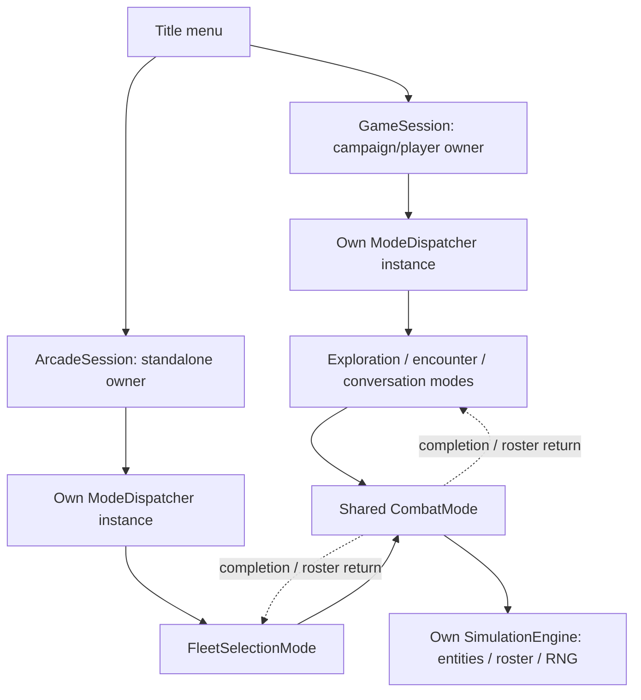

# Shared dispatch, separate sessions

The title menu launches either GameSession for the campaign or ArcadeSession for
standalone Super Melee. Each session contains its own ModeDispatcher value. The
same dispatcher implementation owns mode transitions, synchronous child handoff,
engine/RNG bindings, destruction and parent resume. It owns no campaign state.

GameSession retains the campaign/player owner. Concrete campaign modes borrow
the GameSession, player or StoryState they require. GameMode no longer contains
a shared GameState, a player ID or campaign accessors. No CampaignMode base class
or optional campaign state is introduced.

Super Melee has two mode types: FleetSelectionMode owns the two-side setup UI,
and the same CombatMode used by campaign encounters runs a selected match. The
setup mode calls its session's swapGameMode, remains alive while suspended, then
continues its existing redraw/input path after combat completes. Its MELEE_STATE
has an opaque borrowed session handle for the remaining C callbacks; that handle
is never serialized.

CombatPreparation supplies session-specific setup and scoped service ownership.
Campaign preparation borrows StoryState and configures story/SIS flags, sounds and
optional cyborg input. Arcade preparation borrows the parent's setup, builds the
participant roster and owns match input/arena resources. Both feed the same
CombatMode, which transfers participants, invokes CombatDriver once, explicitly applies
normal completion and releases preparation before deciding its result. Failure
or a skipped match never calls the completion hook. Child destruction returns
participants before parent resume. Arcades use the negotiated/local battle seed
already delivered to setup, without advancing the suspended parent's stream.

LegacyRuntimeBinding projects arcade-owned temporary GLOBDATA, SIS UI storage and
a compatibility fleet queue to existing C callers for the complete dispatcher
run. InitGlobData resets those buffers; ResetPersonalDiscoveries does nothing in
an arcade visit. Normal return and failure restore the campaign projection only
after all arcade modes have been destroyed. Live campaign/nested arcade entry is
rejected. These buffers are not an additional campaign or persistent player model.

The configured arcade teams remain owned by MeleeSetup, without a duplicate native
Fleet representation. The setup mode's scoped C++ frontend owns setup/load-view
allocations, graphics, sounds and connections. Writing melee.cfg is explicit normal
completion, never destructor work. Per-match resources belong to arcade combat
preparation and release on partial setup failure or exception.

CHECK_ABORT in the melee menu returns to title; QuitPosted requests application
shutdown. ArcadeSession rejects campaign load results after dispatch unwinds.
Generic dispatch validates the host identity of initial, successor and child
modes. Passing a mode from another dispatcher cannot execute it. Both sessions
retain the existing nested-exception abort/TODO policy.

The [application session dispatcher](sessions.md) now owns title/arcade transitions.
Remaining compatibility machinery includes legacy title-menu presentation,
team/setup records, global PlayerControl/PlayerInput and SDL rendering/audio/input
services. Startup/title still uses the fallback engine; dispatched campaign and
arcade modes own their engines. This does not yet allow concurrent simulations
or device-free battles. The native [battle driver](battle-driver.md) now owns
combat orchestration and shares frame processing with navigation.
