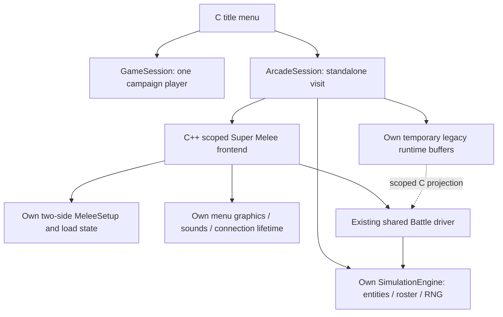
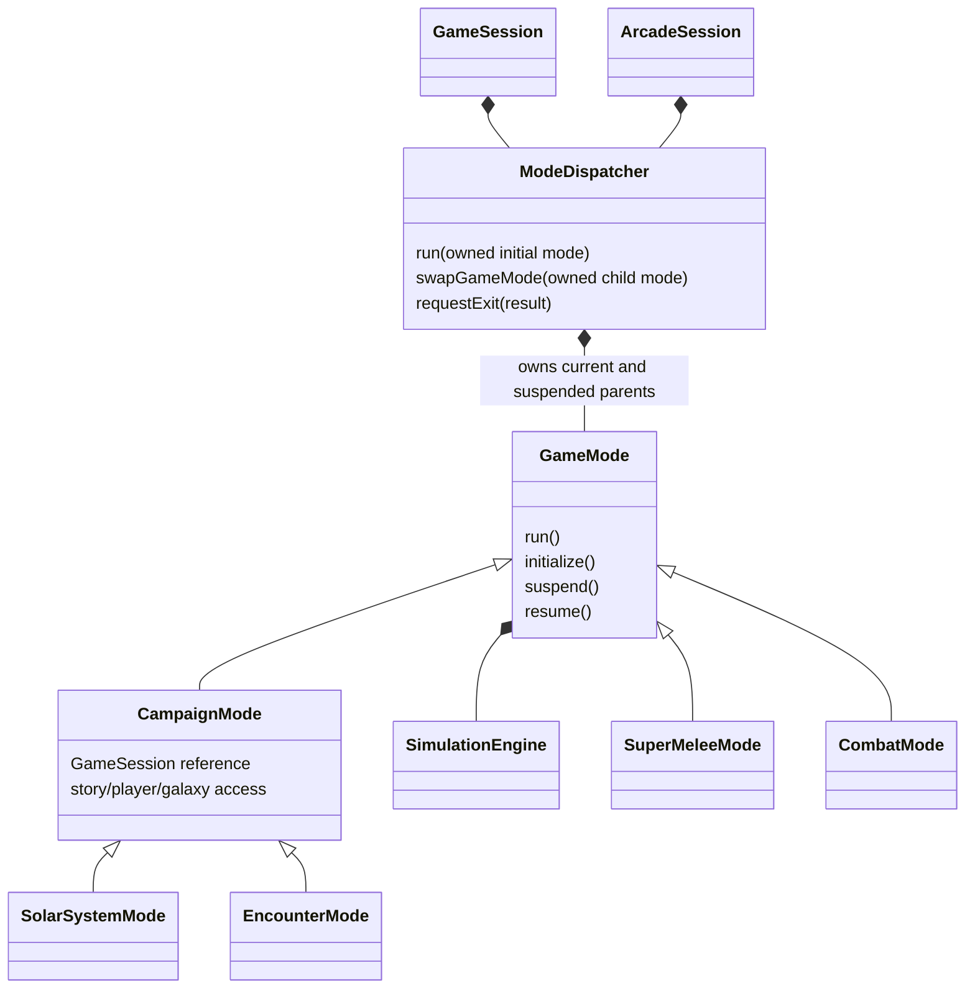

# Standalone arcade session

Super Melee now enters through ArcadeSession at the title boundary, after any
campaign session has unwound. It does not construct a campaign player or attach
itself as a child of a live campaign. GameSession keeps its existing player-bound
contract.

LegacyRuntimeBinding projects the arcade's temporary GLOBDATA, SIS UI buffer and
compatibility fleet queue to existing C callers. The buffers are not a second
campaign or persistent player model. InitGlobData now resets those arcade-owned
buffers while the projection is active; ResetPersonalDiscoveries does nothing
in an arcade visit. On return or failure the previous campaign projection is
restored. Live campaign and nested arcade entry are rejected before binding.

The frontend's two configured teams still belong to MeleeSetup; they have not
been duplicated into native Fleet objects. Their runtime participants belong to
the arcade engine's roster. Remaining fleet/control migration should replace the
setup/build adapters when actual callers migrate, without maintaining parallel
ship records.

The former C Melee entry point is removed. The same frontend source is C++17;
a scoped owner now releases its setup, load-view allocations, graphics, sounds
and netplay connections. It restores the previous frontend/sound bindings.
Writing melee.cfg remains an explicit completion action, not destructor work.
The outer session releases its remaining simulation participants while the arcade
state and engine bindings are still selected, including exception exits.

CHECK_ABORT inside the melee menu means returning to title; QuitPosted means
application shutdown. The C title adapter translates the typed result and keeps
exceptions inside C++. A failure returns to the existing shutdown boundary.

The C title loop, shared Battle driver, SDL services, PlayerControl/PlayerInput
and some rendering globals remain compatibility machinery. ArcadeSession is a
standalone runtime owner, not yet a common GameMode dispatcher. Extracting the
shared dispatcher must preserve the distinction between campaign state and an
arcade visit rather than making campaign state optional everywhere. Startup/title
still uses the fallback engine; Super Melee no longer does.

## Next dispatcher wireframe for review

The next fundamental change is separating lifecycle dispatch from campaign state.
Today GameMode requires a GameState/player pair, so reusing it directly for arcade
would reintroduce the campaign dependency this session removes. Proposed shape:

The common GameMode would own only lifecycle/simulation state and its dispatcher
identity. CampaignMode would retain the required campaign/player reference and
provide the current state accessors. Both sessions would contain a dispatcher by
value, retaining their separate state/seed ownership. Child ownership, scoped
bindings and resume ordering would retain the existing synchronous contracts.
A mode from another dispatcher must be rejected before execution. Arcade does
not acquire load/save actions simply because the generic result can carry one.

This wireframe is a proposal, not the current implementation. It needs review
before moving state access out of the base class and changing the mode hierarchy.
