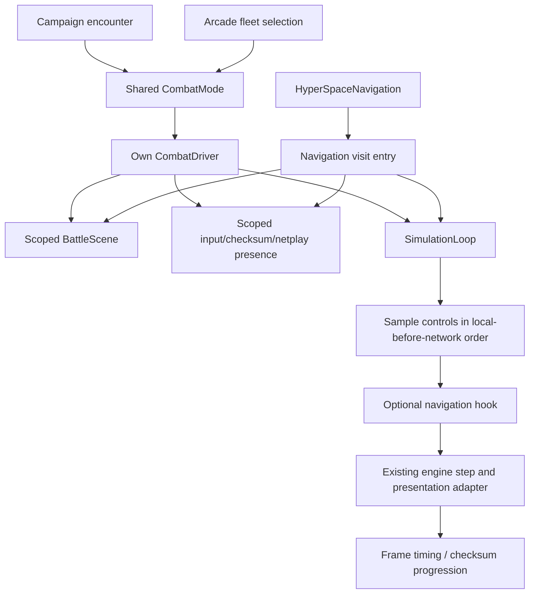

# Native combat driver and shared frame loop

CombatMode now contains a CombatDriver value, borrowing that mode's SimulationEngine.
HyperSpaceNavigation calls a separate runSpaceNavigation entry point with its typed
frame hook. There is no C Battle() entry point, callback/context pair, or BATTLE_STATE.

CombatDriver initializes the arena and availability counters, handles scripted
instant victory, chooses starting ships, negotiates readiness, runs frames and
shows the established Super Melee result/reset flow. Navigation initializes the
flagship/space scene and selects its single vessel; it does not run combat's fleet
selection or result UI. Both paths preserve the existing journal seed hook. Neither
reseeds ordinary modes from the clock.

SimulationLoop owns input ordering, initial-transition state and next-frame timing.
Its optional std::function<void()> hook has no opaque context and runs after input,
before simulation, as the former HyperSpace callback did. A small private C buffer
adapts the existing DoInput frontend. Graphics batching is scoped even when a hook
or simulation callback throws. Display/physics passes, skip-frame handling, speed,
local-before-network input, checksum-before-input, and frame-counter ordering retain
their existing sequence.

BattleScene owns the active soundtrack and a reference to shared space assets.
Initialization occurs after construction so partial acquisition can unwind. Its
complete() explicitly collects floating crew, finishes loaded ship behaviors and
reconciles finite campaign fleets. The reverse-side result order and crew capacity
clamp are preserved. Completion never runs from a destructor.

On cancellation, the scene clears engine entities and loaded participant resources
without invoking Ship::finish or reconciling gameplay results. On completion, the
encounter's participant records remain for parent aftermath. Both paths release
scene entities before shared assets, restore the HyperSpace star-image swap and
release music. The star-image lease is idempotent, including initialization failure.
The driver scopes input/checksum buffers and network battle-presence registration;
selection/readiness failures and exceptions release those bindings before the scene.

Removed infrastructure:

- battle.c and its C Battle entry/callback/state record;
- InitShips/UninitShips procedural lifetime API (now scene initialize/complete);
- global input-order storage and global soundtrack ownership/free function;
- network pointers to a stack battle-state record: only an active boolean was
  observed, so connection state now stores that boolean;
- the frame-rate macro: C++ has constexpr and C callers have an enum constant.

BattleSong remains a small C compatibility request to the selected scene's owned
soundtrack. Availability counters, instantVictory and the netplay frame counter
remain compatibility globals because retirement, selection and encounter aftermath
still access them. Rendering/audio/input, ship-selection UI and existing C entity
callbacks remain backend services. Separate driver objects do not yet imply
concurrent or device-free battles.

Regression tests run the real driver orchestration with scene assets and the
frame/device frontend substituted. They verify normal completion, ship-selection
and readiness failure, connection-presence cleanup, explicit completion versus
cancellation, instant victory and navigation hooks without combat result UI.
Existing mode tests retain roster identity/results, state bindings and RNG checks.
Live combat/navigation checks cover the real scene/frame adapters. This is not a
claim of exhaustive asset-failure or two-peer netplay coverage.
