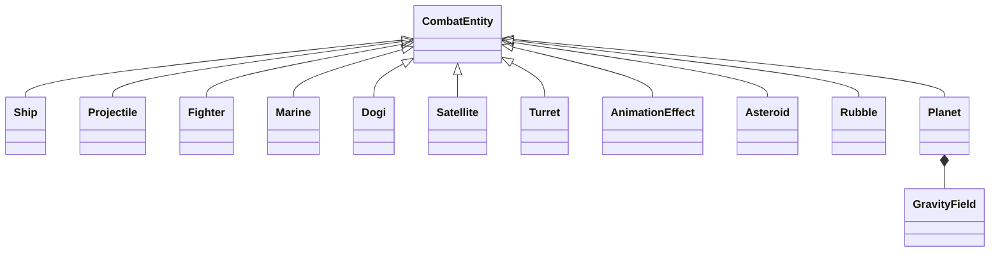

# Combat entities

`CombatEntity` is the common runtime base for ships, projectiles, autonomous
units, effects, asteroids, rubble and the combat planet. It describes lifecycle
hooks, not a universal bundle of ship properties. There is no new parallel
simulation loop.

## Lifecycle and ownership

The existing simulation invokes update before motion, postprocess after motion,
collision at contact, and expire before removing a dead element. These dispatch
to reference-taking native virtual hooks through combat_entity_legacy.cpp.
Only participating stages are installed: a static planet needs collision and
postprocess, while a deferred action may need only expiration. Expiration is a
gameplay event and may extend life to start an animation. Destructors release
resources; they never fire weapons, spawn replacements or commit story state.

ELEMENT queues now own `unique_ptr<CombatEntity>` rather than a projectile-only
owner vector. FreeLink, reset and teardown release all categories uniformly.
Ship descriptors retain their existing asset owner and borrow their engine
records; adding the common base does not introduce a second ship owner. Engine
ELEMENT remains the authoritative position, velocity, lifetime and collision
buffer. Sprite/audio assets retain the existing battle resource lifetime.

Native pool access is internal. A copied ELEMENT does not copy ownership.
Kohr-Ah saw relocation explicitly clones its behavior; Ur-Quan fighter bounce
creates a new fighter with the same carrier identity. New behavior must be bound
before the replacement is processed.

## Autonomous units and effects

Fighter governs steering, returning, firing and impact. Marine switches between
flying and boarding within one object; Shofixti identifies boarded marines through
a typed predicate instead of function addresses. DOGIs and satellites switch to
a dying animation without replacing/deleting their owner inside a callback.
Turret, Chmmr beam cleanup, delayed defense and satellite deployment, Mycon impact,
and Melnorme confusion are native entities as well.

`advanceAnimation` is the common frame-delay operation. AnimationEffect owns
ordinary effects; the old animation_preprocess C entry binds the native owner
on its first update, then uses the common dispatcher. Duplicate frame animators
in Chenjesu, Chmmr, Melnorme and Orz were removed. Dying entities reuse the same
animation operation while retaining their identity. Palette/asset helpers and
other engine rendering primitives remain shared procedural services.

`EntityHandle` identifies an allocated element by address plus a unique allocation
generation. Resolving it returns an optional reference. Free, reuse, reset and
pool teardown invalidate it; it never keeps an entity alive. Fighters use it for
their carrier. Existing target and STARSHIP associations remain compatibility
borrows with their current engine lifetimes; they have not all been replaced.

## Planet and shared physics

Planet owns `PlanetProperties`: gravity parameters and a sprite frame selection.
The chosen sprite supplies the pixel collision mask; there is no invented
circle-radius approximation. The default frame and massive-body marker preserve
the existing combat planet.

The shared CalculateGravity physics routine reads a planet's GravityField.
Planet's postprocess hook schedules that existing pass; Planet does not compute
forces or own other objects. Defaults are the existing display-unit range 255
and constant acceleration of one world unit per tick. This is not inverse-square
gravity. Fields are configurable in native construction; range zero disables
the field. Non-native gravity sources use the stock field while C and C++ coexist.
These values are not a new JSON format or a gameplay balance change.

Asteroid expiration creates native Rubble; rubble expiration respawns an asteroid.
Existing allocation-failure retry behavior, RNG order, queue traversal and safe
engine removal timing are retained. The disabled inverse-square gravity experiment
was deleted when the shared physics file moved to C++.

## Verification and remaining boundaries

Boost.Test covers shared ownership through free/reset/teardown, virtual lifecycle
hooks, dying-state retention, frame delays, stale handles/address reuse, gravity
range boundaries and configurable acceleration. Existing projectile and ship
behavior tests now exercise the common base. Debug/Release, sanitizers, the legacy
SDL2 build and focused Super Melee checks are recorded in the PR.

The battle driver, generic damage/collision, asset drawing, input, audio and some
other C-created effects remain engine services. Laser allocation and most legacy
target links are still adapters. The common interface enables their incremental
migration without requiring ship-specific methods on every entity.
