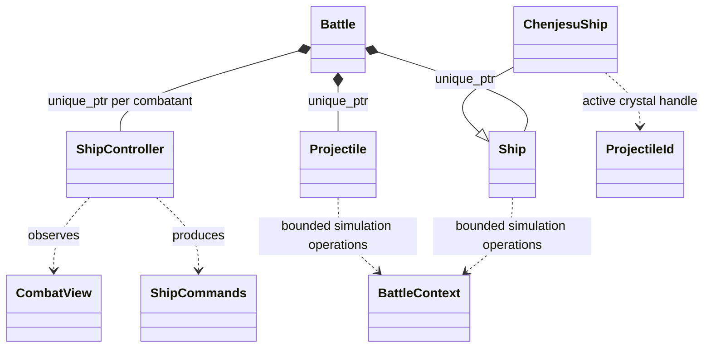

# Battle ownership mockup

[battle.hpp](battle.hpp) is a declaration-only C++17 sketch, not production code.
It records the proposed ownership and interface boundaries without changing the
existing combat engine or introducing a training/runtime dependency.



Ships and projectiles use IDs scoped to a battle, not retained object pointers.
IDs are never reused within a battle. Queries return copied snapshots or nullopt;
callbacks cannot obtain mutable containers. A crystal can disappear on collision
before its launching ship releases fire without leaving a dangling reference.

Battle creates authoritative identities/team bindings. The eventual adapters must
attach those identities to ship/projectile instances and validate projectile source
and team rather than trusting caller-supplied snapshot fields. The sketch does not
yet specify constructors for every concrete ship or projectile.

## Proposed tick contract

1. Capture observations and obtain all controllers' commands before advancing
   ships, so controller order does not expose a partially advanced tick.
2. Run ship and projectile beginTick hooks, including guidance and release edges.
3. Resolve queued remote detonations before movement/collisions. A projectile
   detonates at most once, whether remotely triggered or struck in this tick.
4. Perform common motion and collision processing; apply damage and retirements.
5. Run surviving ships' endTick hooks. Publish queued spawns for the next tick,
   retire removed objects, advance the tick and evaluate completion.

This is a proposed contract, not a claim about current ordering. Existing
ship_preprocess/ship_postprocess and the element engine interleave abilities,
movement and collisions. Implementation must audit those phases and preserve
weapon cadence, release timing, collision rules and special cases. If next-tick
spawn activation changes existing gameplay, adjust this contract during that
migration rather than silently changing the weapon.

The Chenjesu ship keeps an optional crystal ID and previous button state. Holding
fire lets its crystal continue; releasing queues detonation, and detonation queues
fragments. Battle owns those objects. Source death does not automatically destroy
projectiles: weapon-specific owner-death rules must follow the existing game.
An ordinary seeking missile independently queries its target by ID each tick.
Its policy defines what to do when that target disappears.

## State, assets and controllers

The JSON-backed ShipDefinition contains maxima, characteristics and resource IDs.
Initial/current crew is instance state; a fresh ship defaults to max crew while a
campaign ship receives its current crew explicitly. Flagship configuration is a
copied resolved loadout. Resource owners and presentation consume simulation
output; Battle must not require graphics or sound to advance. Presentation event
payloads are intentionally left for a separate graphics/resource audit.

Keyboard, buffered network input, legacy cyborg and future CombatAI implement the
same controller interface. They receive observations rather than unrestricted
campaign access. The view needs capability/cooldown and any additional audited AI
inputs before migration; these minimal fields are not a complete training schema.

A completed BattleResult is applied explicitly by the session adapter, including
the flagship's captain/crew conversion. Destructors do not save campaign state.
The session may also hand recorded experience to an installation/server-owned
trainer after combat. Each battle uses a fixed model; Battle owns neither training
nor the persistent learned model.

## Limits and migration

This mockup describes two-sided active combat, not the full Super Melee fleet
selection/reinforcement lifecycle. Fleet progression, retreat, special collision
effects, beams, fighters and unusual entities need concrete audits before their
interfaces are committed. No generic collision visitor or projectile subclass tree
is prescribed. LegacyShipAdapter can bridge existing functions during migration.

The first implementation can retain the C element engine behind Battle, but that
adapter will still permit only one battle per process until mutable globals and
resource assumptions are removed. A declaration of ownership alone does not make
parallel simulations safe. Separate worker processes can isolate them meanwhile.

Syntax-check the standalone mockup from the repository root:

```sh
printf '#include "docs/design/combat/battle.hpp"\n' | \
  g++ -std=c++17 -Wall -Wextra -Wpedantic -fsyntax-only -x c++ -I. -
```
