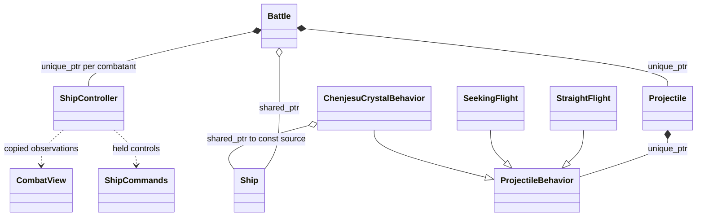

# Battle ownership and projectile behavior prototype

[battle.hpp](battle.hpp) contains the proposed interfaces. Battle itself remains
a declaration-only mockup. [projectile.cpp](projectile.cpp) implements a small
executable ownership/motion prototype, exercised by Boost.Test. It is linked only
into the test executable, never the game. It is not a second combat engine or a
claim that the legacy physics/collision pipeline has been migrated.

## Live migration status

All 28 ship implementations now compile as C++17 concrete classes derived from
[`uqm::combat::Ship`](../../../sc2/src/uqm/ship_behavior.hpp). See the
[production migration notes](ship-migration.md). They own mutable descriptors and
private optional values. Ship execution and cyborg prediction dispatch directly
in C++; C-compatible callbacks keep the current element and resource machinery
running. This is the production behavior boundary, not yet the full
native Battle/Ship API sketched below. The existing death, ditty and fleet-selection
engine remains authoritative.

## Ownership



Projectile is a concrete object with position, velocity, damage and lifetime.
ProjectileBehavior supplies the differences in control, guidance and detonation.
There is no parallel hierarchy of derived Projectile classes. Ordinary straight
and seeking behaviors retain no source ship owner; attribution uses copied IDs.
A target is also an ID resolved against the observation, not a strong owner.

Battle uses shared_ptr for its ship ownership specifically to permit the crystal
relationship. Its proposed addShip accepts unique_ptr at entry and converts it
internally, so the creator does not retain an accidental extra owner. Controllers,
observers, results and recordings retain values/IDs rather than strong pointers.
Only a behavior that needs source lifetime obtains a copy through retainSource.

## Chenjesu contract

The crystal behavior retains shared_ptr<const Ship>: it can read held controls
without mutating the ship. Holding primary fire keeps the crystal moving with an
unbounded lifetime. Releasing fire causes detonation and creates eight independent
fragments by default. They copy position, attribution, damage and motion values;
they retain neither the source ship nor the crystal.

At the agreed ship-retirement boundary, Battle releases its strong ship owner.
On the next crystal update, use_count() == 1 detects that this behavior is the
remaining owner, even if the last commands still say fire is held. Detonation
releases that owner after constructing the fragments. No source state is accessed
through an expired pointer.

This is a local, simulation-thread ownership contract, not general death detection:

- Battle and the active crystal are the only strong source owners at update time.
- Only one crystal from that source can hold this relationship at a time.
- Temporary copies used to construct the behavior are gone before update.
- No asset owner, history, controller, or other weapon takes an additional copy.
- The ship does not strongly own the crystal, so there is no cycle.

The prototype rejects more than two strong owners during a crystal update, so
an accidental extra owner produces a visible contract failure rather than silently
stopping source-retirement detection. Exceptions invalidate the enclosing battle;
the caller must discard it.

Queries return snapshots. A weak_ptr can observe lifetime without changing this
contract. A future weapon needing different source ownership must define its own
rules instead of inheriting the crystal's reference-count assumption.

Removal and detonation are different operations. Collision cleanup or battle
teardown removes the prototype crystal without creating fragments. Detonation
runs once, returns child owners, and marks the parent inactive. Destructors only
release resources. Behavior calls do not mutate the battle's active containers.

## Prototype processing contract

Projectile::step takes a copied CombatView, invokes behavior, then advances common
motion and finite lifetime. Detonation returns children without stepping them;
the caller queues them for an insertion boundary. SeekingFlight demonstrates
bounded angular steering at constant speed, continuing ballistically if the target
disappears. It is not the Earthling missile implementation: acceleration, target
acquisition, collision shape and arena wrapping remain legacy work.

For a future Battle::step, the proposed sequence is:

1. Capture observations and obtain all controllers' commands before advancing
   ships. Publish all commands before any projectile reads its source controls.
2. Run ship and projectile behavior updates.
3. Resolve queued detonation requests, motion and collisions in explicitly audited
   phases. Each projectile can detonate at most once.
4. Run applicable ship completion hooks, retire objects at defined boundaries,
   and publish queued spawns without invalidating active iteration.
5. Advance the tick and evaluate the combat/transition result.

Do not wire the prototype's simple ordering into gameplay wholesale. The current
engine can preprocess and collide newly spawned elements during the same frame.
The current crystal moves before its release fragments are spawned. Those facts
are documented in the [migration audit](legacy-audit.md), including the remaining
retirement and fleet-selection boundary. The [lifecycle wireframe](lifecycle.md)
records how explosion, reincarnation, withdrawal and definitive retirement fit.

## Campaign, assets and AI

A future JSON-backed ShipDefinition holds maxima, characteristics and resource IDs.
Initial/current crew is instance state; fresh ships default to max crew while a
campaign ship receives current crew explicitly. The flagship receives a copied,
resolved loadout. Assets are separate RAII owners; they must not retain ships.

Keyboard, buffered network input, legacy cyborg and future CombatAI share the
controller interface. It produces held commands, not keyboard events. Observation
fields still need expansion for capabilities/cooldowns and audited AI inputs.
Battle has no graphics device, wall-clock pacing, campaign owner or training API.
Presentation event payloads remain a later resource/rendering audit.

A completed BattleResult is applied explicitly by the session adapter, including
flagship crew/captain conversion. Training can consume a separate experience
record after combat. Persistent models belong to the installation/server and are
fixed during a battle; no training occurs in a Ship or Projectile destructor.

## Verification and implementation boundary

The prototype tests hold/release, source retirement with fire still held, one-time
detonation, fragment independence and expiration, teardown without side effects,
source-independent seeking, target disappearance, angular wrapping, and invalid
configuration. They run as part of the existing Boost.Test/CTest suite.

Battle::step, collision resolution, ship/resource adapters, fleet selection,
reinforcements, retreat and networking are not implemented here. Native gameplay
continues using the existing C code. The first adapter still permits only one
battle per process until mutable globals and resource assumptions are removed.
A mockup does not by itself make parallel simulations safe. Adopt/move these
interfaces into production as their adapters are implemented; do not keep a
second maintained combat API beside them.

Syntax-check the standalone header from the repository root:

```sh
printf '#include "docs/design/combat/battle.hpp"\n' | \
  g++ -std=c++17 -Wall -Wextra -Wpedantic -fsyntax-only -x c++ -I. -
```
