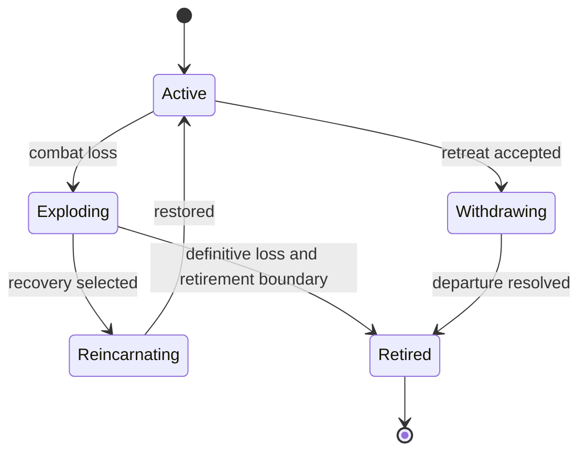

# Ship loss and battle transitions

This is a target wireframe, not a replacement for tactrans.c. It completes the
ownership sketch with a place for the death/recovery cases found in the audit.
No new dispatcher or polymorphic lifecycle framework is needed: Battle and the
concrete ship can exchange ordinary state/results.

## Ship attachment

ShipLifecycle distinguishes Active, Exploding, Reincarnating, Withdrawing and
Retired. A ship's concrete behavior decides recovery eligibility using its own
state and the battle RNG. Battle coordinates when it stops accepting commands,
when its runtime attachment ends and when it releases the source owner.

States describe simulation meaning. They do not prescribe new frame counts,
probabilities, resource reloads or victory timing. The live ship-class migration preserves the existing C transition engine.
A future native Battle adapter must expose its resulting transitions.

Zero crew disables ordinary control but does not itself release Battle's owner.
Ships can still need transition processing, so beginTick/endTick apply while the
ship remains attached, with inactive commands where appropriate. Reincarnation
restores the existing attachment or reconstructs it according to the adapter;
no retired ID is rebound to a different ship. New fleet selections get new IDs.

## Source retirement and dependent projectiles

Battle copies the final ship snapshot for results, resolves required retirement
work and releases its shared_ptr. The remaining source can stay allocated through
a crystal behavior. It is no longer a controllable/collidable active combatant and
is absent from ordinary active-target queries. Its frozen held commands remain
safe to inspect; the sole-owner test tells the crystal that Battle released it.

Do not wait for a retained crystal to disappear before releasing Battle's owner:
that would prevent the sole-owner condition it is waiting for.

The crystal resolves its detonation once and then releases the source. Other
projectiles may remain independent. Assets must outlive the effects that use them
through their own asset ownership, not by keeping extra strong ship owners.

Legacy cleanup sometimes removes source-owned effects directly. Removing a crystal
before owner release suppresses its detonation; retaining it permits the count==1
path on the next tick. BattleRules::persistentProjectiles is a compile-time flag, defaulting to false.
Projectile::retireSource wraps cleanup in if constexpr and tests the stock removal
path. It is currently a prototype rule; the live C cleanup remains unchanged.
The retirement adapter must apply the audited weapon rule.
These are explicit simulation operations, never side effects of a ship destructor.
The prototype exercises both paths; it does not choose new gameplay timing.

## Round and fleet progression

Resolve the initial loss, explosion and possible reincarnation before starting
the victory ditty. Successful reincarnation resumes active combat without starting
a victory sequence. At definitive retirement, stock rules clean up that source's
remaining effects.

Normal play uses the existing ditty completion/readiness gate (including its
minimum-frame and netplay checks). Headless play uses a configured tick duration
instead of requiring audio playback. Simulation continues during this interval,
so an apparent winner can still die or collide with the planet. Recheck both sides
afterward; resolve any newly pending explosion/reincarnation before choosing
replacements. Keep active vessels and select replacements only for retired ones.

Battle needs to distinguish an active exchange of fire, resolving loss/retreat,
requesting a replacement ship, and final completion. These states belong to Battle
rather than a ship's reference count. In particular:

- Resolve effects still permitted to alter crew or the winner before freezing the
  result, including simultaneous destruction and delayed damage.
- Resolve reincarnation before asking for a replacement.
- Preserve legacy cleanup/readiness rather than waiting indefinitely for every
  visual or harmless effect.
- When another ship is available, return a typed selection request to the session
  or Super Melee UI; selection returns an ID/loadout, not a graphics callback.
- Keep music, transitions and network readiness outside simulation-only stepping,
  with explicit gates where the existing mode must wait for them.

The present Battle::step declaration models one active pairing and a final result.
It is intentionally not implemented. Before integrating fleet progression, expand
its result to optional<variant<ShipSelectionRequest, BattleResult>> or an equally
plain result type. nullopt still means keep running. No generic event bus, Asio
executor or exception-based escape is needed.

This is the next review point before replacing legacy death/fleet-selection code.
The already implemented GameSession mode dispatcher and load-unwind contract do
not need to change to accommodate it.
