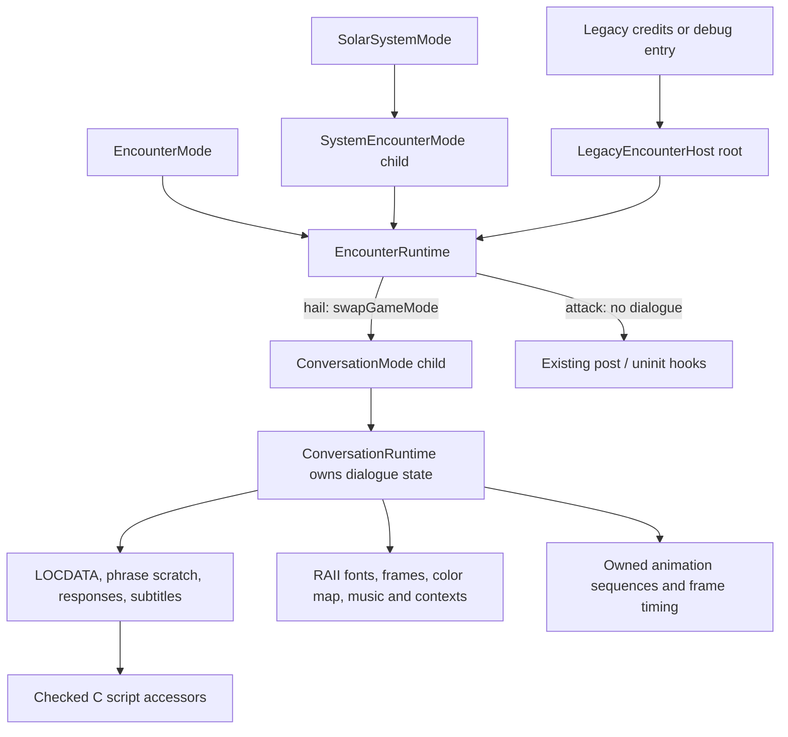

# Conversation child mode

For the actual scripts, see the [conversation graph catalog](conversation/README.md).
The separate [proposed engine model](conversation/model.md) records the future design.
This page describes the existing runtime.

`EncounterRuntime::communicate` selects hail versus attack. Hail creates an owned
`ConversationRuntime` and hands `ConversationMode` to `GameSession::swapGameMode`.
The dispatcher destroys the conversation before returning to the encounter.
Combat remains an encounter responsibility: it reads the existing typed
`BattleSegue` campaign flag after the child has returned. There is no new combat
mode or duplicate story result store in this change.

The C alien scripts retain their story logic and response handlers. Their former
`CommData` and `shared_phrase_buf` accesses now borrow the child's authoritative
storage through `GetConversationData` and `GetConversationPhraseBuffer`. No
mutable global copy is maintained. Access outside a bound owner is a programming
error. The binding restores its previous borrower on scope exit; all input-loop
trampolines receive their owner explicitly in the input state.

The runtime owns response selection, scrolling, constructed phrase storage,
subtitle caching, replay/summary state, animation state and frame timing. The
existing text resources and scripted speech/portrait behavior are preserved.
Resources support partial initialization: failed loading releases every handle
already acquired. Configuration carries resource IDs, not transferred ownership
of already-loaded handles. Script-mutated frame/color-map views are released by
the same capture/release operations the original code used.

Normal dialogue completion stops its playback before calling the existing post
and uninit hooks. A pending load, title exit or shutdown suppresses normal post
actions; uninit still runs once while the old campaign remains alive. The attack
path preserves its own existing post/uninit timing without loading dialogue
assets. Destruction restores borrowed font/context/menu sound bindings, releases
the C script borrow, and frees owned resources before the parent continues.
Session loading still happens only after every old mode/callback stack unwinds.
A conversation runtime is destroyed before a backend exception is rethrown; the
agreed nested-exception diagnostic/abort TODO remains unchanged.

Conversation implements the same `run`, `suspend` and `resume` hooks as other
modes. Its drawing snapshot uses the shared backend also used by exploration;
resume redraws the retained portrait/animation, subtitles and responses without
restarting the script. This does not create independent audio devices or track
players: arbitrary nested media playback and concurrent conversations still need
the later audio-service work. Current encounter combat starts after conversation
teardown.

Credits/outtakes have a C loop outside the campaign dispatcher. The compatibility
entry hosts that encounter in a temporary root mode, so its conversation still
runs as a child. It preserves the credits frame callback. `CommWndRect` remains
the credits compositor's layout boundary, and one pending intro request preserves
C callers that select a transition before constructing the conversation.

Two obsolete communication init/shutdown no-ops and the three C animation
forwarding entry points are removed. The communication/animation engines compile
as C++17. The C sound-track and color-map headers now declare C linkage for their
C++ callers.

Boost.Test links the real mode factory, dispatcher, checked script binding,
completion policy and resource cleanup with simulated drawing/input/audio. It
checks child completion and load/shutdown propagation, unbinding before parent
continuation, script post/uninit ordering, partial initialization cleanup, intro
consumption and nested phrase-buffer isolation. These tests do not simulate an
alien dialogue tree or actual audio/portrait rendering; focused GUI smoke checks
exercise the real runtime separately.

Validation for this pass: Debug/Release CMake/Ninja and legacy builds pass. All
154 Boost.Test cases / 13,668 assertions pass under ASan/UBSan. Changed native
runtime sources pass `-Wall -Wextra -Werror`. A GUI smoke check loaded a saved
probe encounter, entered dialogue, displayed responses/animation/subtitles, and
selected goodbye to return through conversation teardown to combat selection.
Other alien dialogue trees and the credits/outtake path are compiled but have
not received exhaustive interactive checks.
