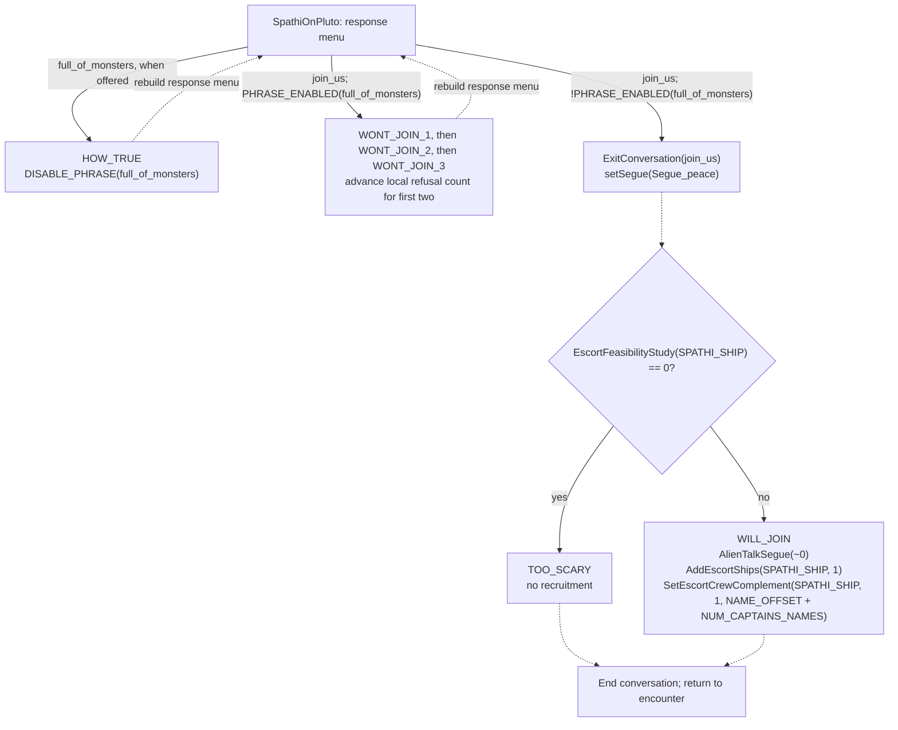

# Existing conversation graph catalog

This catalogs the **current game scripts**, not the proposed replacement engine.
Each conversation page contains its actual lifecycle entry points, a handler
graph, response edges and their conditions, dialogue text, operations and state
updates, and the exact decision bodies with links to source lines.

For the separate future design discussion, see [proposed conversation model](model.md).
For current ownership and mode integration, see [conversation child mode](../conversation-mode.md).

## How to read the graphs

The current scripts do not have explicit dialogue-node objects. A handler is a
**parameterized node**: its behavior depends on the incoming response ID, game
state, and local calculations. `PLAYER_SAID(R, response)` branches identify its
incoming-response variants. Lifecycle initialization selects the entry handler;
post/uninit callbacks can also change state after dialogue ends.

A solid graph arrow is a `Response` or `DoResponsePhrase` registration: choosing
that response invokes the destination callback with its phrase ID. Dashed arrows
without labels are immediate local C calls, with arguments and conditions in the
node tables. Labeled dashed arrows identify lifecycle bindings, passed callback
references, or candidates for a computed function call. A callback reference is
not itself an immediate execution.
Neither kind of arrow implies a separate game mode. Multiple response sites
between two handlers are grouped only in the diagram; the edge tables retain
every registration site.

Conditions in the tables are **enclosing source branches and loops**, not a
normalized predicate over campaign state. Conditions that use local variables,
computed phrase arrays, early returns, and switch fallthrough must be read with
the accompanying updates and exact decision body. “No enclosing branch condition”
does not mean a response is reachable in every execution. Calls made by helper
functions also inherit the calling path's conditions. The condition catalog
assigns linked IDs to the original expressions. Computed response destinations
list their assignment conditions and candidate callbacks. The catalog retains
those dependencies in the source-backed representation.

`PHRASE_ENABLED` / `DISABLE_PHRASE` are recorded where used. Responses are not
assumed to be one-shot: cycles, repeated topics, explicit disabling, and counter-
selected alternatives retain the behavior written in the script. Seen-response
gray styling is a proposed feature, not behavior inferred by this catalog.

The operation tables include calls, assignments, local initialization, increments,
and control flow. A call is not automatically classified as a state mutation:
queries, animation changes, fleet/cargo operations, events, and helper calls are
all visible with their original arguments. Inspecting a helper's own node exposes
its transitive effects. `NPCPhrase_cb` retains queued presentation callbacks in
its recorded arguments. The original LOCDATA presentation descriptor remains
linked in the script; this catalog does not flatten its animation state machine.

Phrase catalogs contain full **base-content** text and voice metadata. Installed
addons may override resources; dynamic names, numbers, and constructed responses
remain expressions/placeholders rather than fabricated literal text.

For the queries and calculations the new engine must express, see the
[condition vocabulary audit](conditions.md), including side-effecting functions
that need to be separated from availability predicates.

## Worked trace: Fwiffo recruitment

This is an actual slice of [Spathi / Fwiffo](catalog/spathi.md), traced from
[SpathiOnPluto](../../../sc2/src/uqm/comm/spathi/spathic.c#L209) and
[ExitConversation](../../../sc2/src/uqm/comm/spathi/spathic.c#L148).



The same response ID, `join_us`, is registered with different destination handlers
based on phrase state. Before the monster topic is disabled, asking again cycles
through refusals; the third refusal can repeat. Once that topic is disabled,
selection reaches the recruitment branch. Its successful action adds one Spathi
escort and sets its crew/captain to the Fwiffo configuration. The complete menu
conditions, greeting selection, and post-encounter changes are in the catalog.

## Conversations

<!-- catalog:start -->
<!-- Generated by tools/conversation_catalog.py. -->

| Conversation | Handler/helper nodes | Response sites | Direct local calls | Phrase records |
| --- | ---: | ---: | ---: | ---: |
| [Arilou](catalog/arilou.md) | 9 | 26 | 4 | 97 |
| [Kohr-Ah](catalog/blackur.md) | 8 | 29 | 2 | 76 |
| [Chmmr](catalog/chmmr.md) | 11 | 31 | 7 | 78 |
| [Commander Hayes: first contact](catalog/comandr.md) | 12 | 52 | 7 | 99 |
| [Druuge](catalog/druuge.md) | 13 | 29 | 5 | 105 |
| [Ilwrath](catalog/ilwrath.md) | 11 | 42 | 3 | 108 |
| [Melnorme](catalog/melnorm.md) | 36 | 61 | 46 | 282 |
| [Mycon](catalog/mycon.md) | 9 | 41 | 5 | 109 |
| [Orz](catalog/orz.md) | 11 | 37 | 7 | 116 |
| [Pkunk](catalog/pkunk.md) | 16 | 53 | 9 | 182 |
| [Yehat rebels](catalog/rebel.md) | 8 | 11 | 2 | 34 |
| [Shofixti](catalog/shofixt.md) | 12 | 30 | 3 | 95 |
| [Slylandro homeworld](catalog/slyhome.md) | 12 | 39 | 3 | 116 |
| [Slylandro probe](catalog/slyland.md) | 6 | 6 | 3 | 86 |
| [Spathi Safe Ones](catalog/spahome.md) | 14 | 64 | 7 | 145 |
| [Spathi / Fwiffo](catalog/spathi.md) | 12 | 60 | 4 | 134 |
| [Commander Hayes: starbase](catalog/starbas.md) | 21 | 57 | 13 | 300 |
| [Supox](catalog/supox.md) | 9 | 24 | 4 | 97 |
| [Syreen](catalog/syreen.md) | 14 | 40 | 6 | 131 |
| [Talking Pet](catalog/talkpet.md) | 13 | 33 | 6 | 113 |
| [Thraddash](catalog/thradd.md) | 16 | 38 | 9 | 154 |
| [Umgah](catalog/umgah.md) | 8 | 26 | 3 | 87 |
| [Ur-Quan](catalog/urquan.md) | 11 | 33 | 3 | 76 |
| [Utwig](catalog/utwig.md) | 10 | 26 | 5 | 117 |
| [VUX / ZEX](catalog/vux.md) | 7 | 31 | 2 | 102 |
| [Yehat royalists](catalog/yehat.md) | 9 | 21 | 3 | 75 |
| [Zoq-Fot-Pik](catalog/zoqfot.md) | 13 | 28 | 48 | 337 |
| **Total** | 331 | 968 | 219 | 3451 |
<!-- catalog:end -->

## Regeneration and limits

From the repository root, with the development-only `pycparser` Python package:

```sh
python3 tools/conversation_catalog.py
python3 tools/conversation_catalog.py --check
```

The generator parses the C syntax without expanding story macros into packed
bit offsets. It resolves default phrase resources through `sc2/content/uqm.rmp`.
It checks that every parsed call is visited and every selectable response has
local destination callbacks, including assignments to callback variables. It
also catalogs script-scope variables and phrase/technology lookup tables. It fails on unfamiliar conditional compilation;
existing `#if 0` and `#ifdef NEVER` branches are excluded and reported.

This is a source-backed, stateful control-flow catalog. It is not an exhaustive
enumeration of every campaign-state combination, an execution simulator, or a
claim that every syntactically present branch is reachable in normal gameplay.
It includes helper/lifecycle nodes so initialization, delayed presentation,
recruitment, trading, and post-encounter effects are not lost. Excerpt trailing whitespace is removed for Markdown; source tokens and dialogue
wording are retained. No game code or conversation behavior is changed by
generating these pages.
