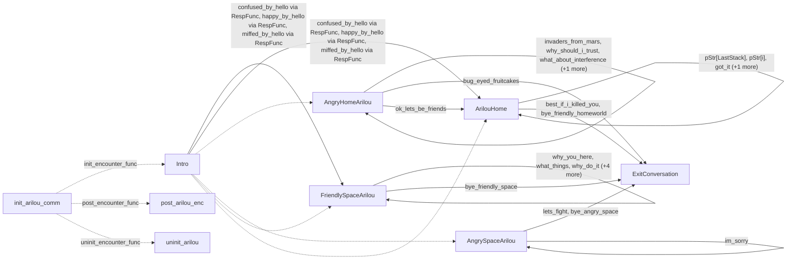

# Arilou: existing conversation graph

> Generated by `tools/conversation_catalog.py`; do not edit this page by hand.

[Catalog and interpretation rules](../README.md) · [Proposed engine](../model.md)

Script: [arilouc.c](../../../../sc2/src/uqm/comm/arilou/arilouc.c#L1). Phrase bank: [arilou.txt](../../../../sc2/content/base/comm/arilou/arilou.txt#L1).

9 handler/helper nodes; 26 response registration sites; 4 direct local calls; 97 phrase records.

## Initialization and lifecycle

| Phase | Callback | Bound by | Conditions / source |
| --- | --- | --- | --- |
| <code>init_encounter_func</code> | [<code>Intro</code>](#node-intro) | <code>init_arilou_comm</code> | No enclosing branch condition; [834](../../../../sc2/src/uqm/comm/arilou/arilouc.c#L834) |
| <code>post_encounter_func</code> | [<code>post_arilou_enc</code>](#node-post_arilou_enc) | <code>init_arilou_comm</code> | No enclosing branch condition; [835](../../../../sc2/src/uqm/comm/arilou/arilouc.c#L835) |
| <code>uninit_encounter_func</code> | [<code>uninit_arilou</code>](#node-uninit_arilou) | <code>init_arilou_comm</code> | No enclosing branch condition; [836](../../../../sc2/src/uqm/comm/arilou/arilouc.c#L836) |

## Handler graph

Solid arrows are selectable responses; dashed arrows are direct C calls. Conditions, arguments, speech and effects are cataloged below. Parallel response sites are grouped only in this diagram.



## Condition catalog

Condition IDs describe enclosing source structure. Branch predicates combine with ∧; case labels mark source locations that can also be reached by fallthrough. Values refer to their original evaluation points. Local assignments and early control flow remain in the decision bodies.

| ID | Source expression / structural condition |
| --- | --- |
| <a id="condition-c1"></a>C1 | <code>PLAYER_SAID(R, bye_angry_space)</code> |
| <a id="condition-c2"></a>C2 | <code>!(PLAYER_SAID(R, bye_angry_space))</code> |
| <a id="condition-c3"></a>C3 | <code>PLAYER_SAID(R, bye_friendly_space)</code> |
| <a id="condition-c4"></a>C4 | <code>!(PLAYER_SAID(R, bye_friendly_space))</code> |
| <a id="condition-c5"></a>C5 | <code>PLAYER_SAID(R, bye_friendly_homeworld)</code> |
| <a id="condition-c6"></a>C6 | <code>!(PLAYER_SAID(R, bye_friendly_homeworld))</code> |
| <a id="condition-c7"></a>C7 | <code>PLAYER_SAID(R, lets_fight)</code> |
| <a id="condition-c8"></a>C8 | <code>!(PLAYER_SAID(R, lets_fight))</code> |
| <a id="condition-c9"></a>C9 | <code>PLAYER_SAID(R, bug_eyed_fruitcakes)</code> |
| <a id="condition-c10"></a>C10 | <code>!(PLAYER_SAID(R, bug_eyed_fruitcakes))</code> |
| <a id="condition-c11"></a>C11 | <code>PLAYER_SAID(R, best_if_i_killed_you)</code> |
| <a id="condition-c12"></a>C12 | <code>PLAYER_SAID(R, confused_by_hello)</code> |
| <a id="condition-c13"></a>C13 | <code>!(PLAYER_SAID(R, confused_by_hello))</code> |
| <a id="condition-c14"></a>C14 | <code>PLAYER_SAID(R, happy_by_hello)</code> |
| <a id="condition-c15"></a>C15 | <code>!(PLAYER_SAID(R, happy_by_hello))</code> |
| <a id="condition-c16"></a>C16 | <code>PLAYER_SAID(R, miffed_by_hello)</code> |
| <a id="condition-c17"></a>C17 | <code>!(PLAYER_SAID(R, miffed_by_hello))</code> |
| <a id="condition-c18"></a>C18 | <code>PLAYER_SAID(R, ok_lets_be_friends)</code> |
| <a id="condition-c19"></a>C19 | <code>!(PLAYER_SAID(R, ok_lets_be_friends))</code> |
| <a id="condition-c20"></a>C20 | <code>PLAYER_SAID(R, what_about_war)</code> |
| <a id="condition-c21"></a>C21 | <code>!(PLAYER_SAID(R, what_about_war))</code> |
| <a id="condition-c22"></a>C22 | <code>PLAYER_SAID(R, what_about_urquan)</code> |
| <a id="condition-c23"></a>C23 | <code>!(PLAYER_SAID(R, what_about_urquan))</code> |
| <a id="condition-c24"></a>C24 | <code>PLAYER_SAID(R, tell_arilou_about_tpet)</code> |
| <a id="condition-c25"></a>C25 | <code>!(PLAYER_SAID(R, tell_arilou_about_tpet))</code> |
| <a id="condition-c26"></a>C26 | <code>PLAYER_SAID(R, what_do_about_tpet)</code> |
| <a id="condition-c27"></a>C27 | <code>!(PLAYER_SAID(R, what_do_about_tpet))</code> |
| <a id="condition-c28"></a>C28 | <code>PLAYER_SAID(R, learned_about_umgah)</code> |
| <a id="condition-c29"></a>C29 | <code>GET_GAME_STATE(ARILOU_CHECKED_UMGAH) != 2</code> |
| <a id="condition-c30"></a>C30 | <code>!(GET_GAME_STATE(ARILOU_CHECKED_UMGAH) != 2)</code> |
| <a id="condition-c31"></a>C31 | <code>!(PLAYER_SAID(R, learned_about_umgah))</code> |
| <a id="condition-c32"></a>C32 | <code>PLAYER_SAID(R, umgah_acting_weird)</code> |
| <a id="condition-c33"></a>C33 | <code>!(PLAYER_SAID(R, umgah_acting_weird))</code> |
| <a id="condition-c34"></a>C34 | <code>PLAYER_SAID(R, what_do_now)</code> |
| <a id="condition-c35"></a>C35 | <code>!(PLAYER_SAID(R, what_do_now))</code> |
| <a id="condition-c36"></a>C36 | <code>PLAYER_SAID(R, what_did_on_earth)</code> |
| <a id="condition-c37"></a>C37 | <code>!(PLAYER_SAID(R, what_did_on_earth))</code> |
| <a id="condition-c38"></a>C38 | <code>PLAYER_SAID(R, why_did_this)</code> |
| <a id="condition-c39"></a>C39 | <code>!(PLAYER_SAID(R, why_did_this))</code> |
| <a id="condition-c40"></a>C40 | <code>PLAYER_SAID(R, tell_more)</code> |
| <a id="condition-c41"></a>C41 | <code>!(PLAYER_SAID(R, tell_more))</code> |
| <a id="condition-c42"></a>C42 | <code>PLAYER_SAID(R, what_give_me)</code> |
| <a id="condition-c43"></a>C43 | <code>!(PLAYER_SAID(R, what_give_me))</code> |
| <a id="condition-c44"></a>C44 | <code>PLAYER_SAID(R, what_about_tpet)</code> |
| <a id="condition-c45"></a>C45 | <code>!(PLAYER_SAID(R, what_about_tpet))</code> |
| <a id="condition-c46"></a>C46 | <code>PLAYER_SAID(R, about_portal_again)</code> |
| <a id="condition-c47"></a>C47 | <code>!(PLAYER_SAID(R, about_portal_again))</code> |
| <a id="condition-c48"></a>C48 | <code>PLAYER_SAID(R, got_it)</code> |
| <a id="condition-c49"></a>C49 | <code>GET_GAME_STATE(ARILOU_HOME_VISITS) == 1</code> |
| <a id="condition-c50"></a>C50 | <code>switch (GET_GAME_STATE(ARILOU_STACK_1))</code> |
| <a id="condition-c51"></a>C51 | <code>case 0 (see source for fallthrough)</code> |
| <a id="condition-c52"></a>C52 | <code>case 1 (see source for fallthrough)</code> |
| <a id="condition-c53"></a>C53 | <code>!(GET_GAME_STATE(TALKING_PET))</code> |
| <a id="condition-c54"></a>C54 | <code>GET_GAME_STATE(TALKING_PET_VISITS)</code> |
| <a id="condition-c55"></a>C55 | <code>switch (GET_GAME_STATE(ARILOU_STACK_2))</code> |
| <a id="condition-c56"></a>C56 | <code>!(GET_GAME_STATE(TALKING_PET_VISITS))</code> |
| <a id="condition-c57"></a>C57 | <code>GET_GAME_STATE(KNOW_UMGAH_ZOMBIES)</code> |
| <a id="condition-c58"></a>C58 | <code>!GET_GAME_STATE(ARILOU_CHECKED_UMGAH)</code> |
| <a id="condition-c59"></a>C59 | <code>!(!GET_GAME_STATE(ARILOU_CHECKED_UMGAH))</code> |
| <a id="condition-c60"></a>C60 | <code>PHRASE_ENABLED(learned_about_umgah)</code> |
| <a id="condition-c61"></a>C61 | <code>PHRASE_ENABLED(learned_about_umgah) &amp;&amp; PHRASE_ENABLED(umgah_acting_weird)</code> |
| <a id="condition-c62"></a>C62 | <code>!(PHRASE_ENABLED(learned_about_umgah) &amp;&amp; PHRASE_ENABLED(umgah_acting_weird))</code> |
| <a id="condition-c63"></a>C63 | <code>GET_GAME_STATE(ARILOU_CHECKED_UMGAH) == 2</code> |
| <a id="condition-c64"></a>C64 | <code>switch (GET_GAME_STATE(ARILOU_STACK_3))</code> |
| <a id="condition-c65"></a>C65 | <code>case 2 (see source for fallthrough)</code> |
| <a id="condition-c66"></a>C66 | <code>!GET_GAME_STATE(KNOW_ARILOU_WANT_WRECK)</code> |
| <a id="condition-c67"></a>C67 | <code>!(!GET_GAME_STATE(KNOW_ARILOU_WANT_WRECK))</code> |
| <a id="condition-c68"></a>C68 | <code>!GET_GAME_STATE(ARILOU_STACK_4)</code> |
| <a id="condition-c69"></a>C69 | <code>pStr[LastStack]</code> |
| <a id="condition-c70"></a>C70 | <code>for (i = 0; i &lt; 4; ++i)</code> |
| <a id="condition-c71"></a>C71 | <code>(i != LastStack) &amp;&amp; pStr[i]</code> |
| <a id="condition-c72"></a>C72 | <code>GET_GAME_STATE(KNOW_ARILOU_WANT_WRECK)</code> |
| <a id="condition-c73"></a>C73 | <code>GET_GAME_STATE(PORTAL_KEY_ON_SHIP)</code> |
| <a id="condition-c74"></a>C74 | <code>!(GET_GAME_STATE(PORTAL_KEY_ON_SHIP))</code> |
| <a id="condition-c75"></a>C75 | <code>PHRASE_ENABLED(about_portal_again)</code> |
| <a id="condition-c76"></a>C76 | <code>PHRASE_ENABLED(about_portal_again) &amp;&amp; (!GET_GAME_STATE(PORTAL_SPAWNER))</code> |
| <a id="condition-c77"></a>C77 | <code>GET_GAME_STATE(ARILOU_MANNER) != 3</code> |
| <a id="condition-c78"></a>C78 | <code>PLAYER_SAID(R, invaders_from_mars)</code> |
| <a id="condition-c79"></a>C79 | <code>!(PLAYER_SAID(R, invaders_from_mars))</code> |
| <a id="condition-c80"></a>C80 | <code>PLAYER_SAID(R, why_should_i_trust)</code> |
| <a id="condition-c81"></a>C81 | <code>!(PLAYER_SAID(R, why_should_i_trust))</code> |
| <a id="condition-c82"></a>C82 | <code>PLAYER_SAID(R, what_about_interference)</code> |
| <a id="condition-c83"></a>C83 | <code>!(PLAYER_SAID(R, what_about_interference))</code> |
| <a id="condition-c84"></a>C84 | <code>PLAYER_SAID(R, i_just_like_to_leave)</code> |
| <a id="condition-c85"></a>C85 | <code>PHRASE_ENABLED(invaders_from_mars)</code> |
| <a id="condition-c86"></a>C86 | <code>!(PHRASE_ENABLED(invaders_from_mars))</code> |
| <a id="condition-c87"></a>C87 | <code>PHRASE_ENABLED(why_should_i_trust)</code> |
| <a id="condition-c88"></a>C88 | <code>!(PHRASE_ENABLED(why_should_i_trust))</code> |
| <a id="condition-c89"></a>C89 | <code>PHRASE_ENABLED(what_about_interference)</code> |
| <a id="condition-c90"></a>C90 | <code>PLAYER_SAID(R, im_sorry)</code> |
| <a id="condition-c91"></a>C91 | <code>PHRASE_ENABLED(im_sorry)</code> |
| <a id="condition-c92"></a>C92 | <code>!(PLAYER_SAID(R, whats_up_1))</code> |
| <a id="condition-c93"></a>C93 | <code>PLAYER_SAID(R, whats_up_1) &#124;&#124; PLAYER_SAID(R, whats_up_2)</code> |
| <a id="condition-c94"></a>C94 | <code>switch (NumVisits++)</code> |
| <a id="condition-c95"></a>C95 | <code>case 3 (see source for fallthrough)</code> |
| <a id="condition-c96"></a>C96 | <code>!(PLAYER_SAID(R, whats_up_1) &#124;&#124; PLAYER_SAID(R, whats_up_2))</code> |
| <a id="condition-c97"></a>C97 | <code>PLAYER_SAID(R, why_you_here)</code> |
| <a id="condition-c98"></a>C98 | <code>!(PLAYER_SAID(R, why_you_here))</code> |
| <a id="condition-c99"></a>C99 | <code>PLAYER_SAID(R, what_things)</code> |
| <a id="condition-c100"></a>C100 | <code>!(PLAYER_SAID(R, what_things))</code> |
| <a id="condition-c101"></a>C101 | <code>PLAYER_SAID(R, why_do_it)</code> |
| <a id="condition-c102"></a>C102 | <code>!(PLAYER_SAID(R, why_do_it))</code> |
| <a id="condition-c103"></a>C103 | <code>!(PLAYER_SAID(R, give_me_info_1))</code> |
| <a id="condition-c104"></a>C104 | <code>PLAYER_SAID(R, give_me_info_1) &#124;&#124; PLAYER_SAID(R, give_me_info_2)</code> |
| <a id="condition-c105"></a>C105 | <code>GET_GAME_STATE(KNOW_ABOUT_SHATTERED) &lt; 2</code> |
| <a id="condition-c106"></a>C106 | <code>switch (GET_GAME_STATE(ARILOU_STACK_5))</code> |
| <a id="condition-c107"></a>C107 | <code>PHRASE_ENABLED(whats_up_2)</code> |
| <a id="condition-c108"></a>C108 | <code>GET_GAME_STATE(ARILOU_INFO) == 0</code> |
| <a id="condition-c109"></a>C109 | <code>!(GET_GAME_STATE(ARILOU_INFO) == 0)</code> |
| <a id="condition-c110"></a>C110 | <code>PHRASE_ENABLED(give_me_info_2)</code> |
| <a id="condition-c111"></a>C111 | <code>GET_GAME_STATE(ARILOU_HINTS) == 0</code> |
| <a id="condition-c112"></a>C112 | <code>!(GET_GAME_STATE(ARILOU_HINTS) == 0)</code> |
| <a id="condition-c113"></a>C113 | <code>LOBYTE(GLOBAL(CurrentActivity)) == WON_LAST_BATTLE</code> |
| <a id="condition-c114"></a>C114 | <code>!(LOBYTE(GLOBAL(CurrentActivity)) == WON_LAST_BATTLE)</code> |
| <a id="condition-c115"></a>C115 | <code>!GET_GAME_STATE(MET_ARILOU)</code> |
| <a id="condition-c116"></a>C116 | <code>GET_GAME_STATE(ARILOU_SPACE_SIDE) &lt;= 1</code> |
| <a id="condition-c117"></a>C117 | <code>!(GET_GAME_STATE(ARILOU_SPACE_SIDE) &lt;= 1)</code> |
| <a id="condition-c118"></a>C118 | <code>Manner == 2</code> |
| <a id="condition-c119"></a>C119 | <code>!(Manner == 2)</code> |
| <a id="condition-c120"></a>C120 | <code>Manner == 1</code> |
| <a id="condition-c121"></a>C121 | <code>GET_GAME_STATE(ARILOU_SPACE_SIDE) &gt; 1</code> |
| <a id="condition-c122"></a>C122 | <code>!(GET_GAME_STATE(ARILOU_SPACE_SIDE) &gt; 1)</code> |
| <a id="condition-c123"></a>C123 | <code>!(Manner == 1)</code> |
| <a id="condition-c124"></a>C124 | <code>!GET_GAME_STATE(PORTAL_SPAWNER)</code> |
| <a id="condition-c125"></a>C125 | <code>(!GET_GAME_STATE(PORTAL_SPAWNER)) &amp;&amp; GET_GAME_STATE(KNOW_ARILOU_WANT_WRECK)</code> |
| <a id="condition-c126"></a>C126 | <code>!((!GET_GAME_STATE(PORTAL_SPAWNER)) &amp;&amp; GET_GAME_STATE(KNOW_ARILOU_WANT_WRECK))</code> |
| <a id="condition-c127"></a>C127 | <code>getSegue() == Segue_hostile</code> |
| <a id="condition-c128"></a>C128 | <code>(getSegue() == Segue_hostile) &amp;&amp; ((Manner = GET_GAME_STATE(ARILOU_MANNER)) != 2)</code> |
| <a id="condition-c129"></a>C129 | <code>Manner != 1</code> |
| <a id="condition-c130"></a>C130 | <code>(GET_GAME_STATE(ARILOU_SPACE_SIDE) &gt; 1) &amp;&amp; (GET_GAME_STATE(ARILOU_HOME_VISITS) &lt;= 1)</code> |
| <a id="condition-c131"></a>C131 | <code>GET_GAME_STATE(ARILOU_MANNER) &lt; 2</code> |
| <a id="condition-c132"></a>C132 | <code>!((GET_GAME_STATE(ARILOU_SPACE_SIDE) &gt; 1) &#124;&#124; (GET_GAME_STATE(ARILOU_MANNER) == 3))</code> |
| <a id="condition-c133"></a>C133 | <code>((GET_GAME_STATE(ARILOU_SPACE_SIDE) &gt; 1) &#124;&#124; (GET_GAME_STATE(ARILOU_MANNER) == 3)) &#124;&#124; (LOBYTE(GLOBAL(CurrentActivity)) == WON_LAST_BATTLE)</code> |
| <a id="condition-c134"></a>C134 | <code>!(((GET_GAME_STATE(ARILOU_SPACE_SIDE) &gt; 1) &#124;&#124; (GET_GAME_STATE(ARILOU_MANNER) == 3)) &#124;&#124; (LOBYTE(GLOBAL(CurrentActivity)) == WON_LAST_BATTLE))</code> |

## Script-scope state and lookup tables

These declarations supply shared local state, computed phrase alternatives, number speech, or lookup data used by the nodes. LOCDATA presentation defaults are linked separately in the source.

Presentation descriptor <code>arilou_desc</code>: [source](../../../../sc2/src/uqm/comm/arilou/arilouc.c#L26).

## Node catalog

<a id="node-exitconversation"></a>

### ExitConversation

<code>static void ExitConversation(RESPONSE_REF R)</code> — [source](../../../../sc2/src/uqm/comm/arilou/arilouc.c#L231).

Incoming player-response variants: [<code>best_if_i_killed_you</code>](#phrase-best_if_i_killed_you), [<code>bye_friendly_homeworld</code>](#phrase-bye_friendly_homeworld), [<code>bug_eyed_fruitcakes</code>](#phrase-bug_eyed_fruitcakes), [<code>lets_fight</code>](#phrase-lets_fight), [<code>bye_angry_space</code>](#phrase-bye_angry_space), [<code>bye_friendly_space</code>](#phrase-bye_friendly_space).

#### Dialogue / audio emissions

| Phrase or expression | Enclosing conditions | Source |
| --- | --- | --- |
| [<code>GOODBYE_ANGRY_SPACE</code>](#phrase-goodbye_angry_space)<br><code>NPCPhrase(GOODBYE_ANGRY_SPACE)</code> | [C1](#condition-c1) | [236](../../../../sc2/src/uqm/comm/arilou/arilouc.c#L236) |
| [<code>GOODBYE_FRIENDLY_SPACE</code>](#phrase-goodbye_friendly_space)<br><code>NPCPhrase(GOODBYE_FRIENDLY_SPACE)</code> | [C2](#condition-c2) ∧ [C3](#condition-c3) | [238](../../../../sc2/src/uqm/comm/arilou/arilouc.c#L238) |
| [<code>GOODBYE_FRDLY_HOMEWORLD</code>](#phrase-goodbye_frdly_homeworld)<br><code>NPCPhrase(GOODBYE_FRDLY_HOMEWORLD)</code> | [C2](#condition-c2) ∧ [C4](#condition-c4) ∧ [C5](#condition-c5) | [240](../../../../sc2/src/uqm/comm/arilou/arilouc.c#L240) |
| [<code>NO_FIGHT</code>](#phrase-no_fight)<br><code>NPCPhrase(NO_FIGHT)</code> | [C2](#condition-c2) ∧ [C4](#condition-c4) ∧ [C6](#condition-c6) ∧ [C7](#condition-c7) | [242](../../../../sc2/src/uqm/comm/arilou/arilouc.c#L242) |
| [<code>WE_NEVER_FRIENDS</code>](#phrase-we_never_friends)<br><code>NPCPhrase(WE_NEVER_FRIENDS)</code> | [C2](#condition-c2) ∧ [C4](#condition-c4) ∧ [C6](#condition-c6) ∧ [C8](#condition-c8) ∧ [C9](#condition-c9) | [245](../../../../sc2/src/uqm/comm/arilou/arilouc.c#L245) |
| [<code>WICKED_HUMAN</code>](#phrase-wicked_human)<br><code>NPCPhrase(WICKED_HUMAN)</code> | [C2](#condition-c2) ∧ [C4](#condition-c4) ∧ [C6](#condition-c6) ∧ [C8](#condition-c8) ∧ [C10](#condition-c10) ∧ [C11](#condition-c11) | [251](../../../../sc2/src/uqm/comm/arilou/arilouc.c#L251) |

#### Actions, queries, local updates, and control flow

Calls are listed without assuming they are pure or mutating. Local updates are retained because they determine dynamic menus and counter-selected speech.

| Kind | Operation | Enclosing conditions | Source |
| --- | --- | --- | --- |
| call | <code>setSegue(Segue_peace)</code> | No enclosing branch condition | [233](../../../../sc2/src/uqm/comm/arilou/arilouc.c#L233) |
| call | <code>PLAYER_SAID(R, bye_angry_space)</code> | No enclosing branch condition | [235](../../../../sc2/src/uqm/comm/arilou/arilouc.c#L235) |
| call | <code>PLAYER_SAID(R, bye_friendly_space)</code> | [C2](#condition-c2) | [237](../../../../sc2/src/uqm/comm/arilou/arilouc.c#L237) |
| call | <code>PLAYER_SAID(R, bye_friendly_homeworld)</code> | [C2](#condition-c2) ∧ [C4](#condition-c4) | [239](../../../../sc2/src/uqm/comm/arilou/arilouc.c#L239) |
| call | <code>PLAYER_SAID(R, lets_fight)</code> | [C2](#condition-c2) ∧ [C4](#condition-c4) ∧ [C6](#condition-c6) | [241](../../../../sc2/src/uqm/comm/arilou/arilouc.c#L241) |
| call | <code>PLAYER_SAID(R, bug_eyed_fruitcakes)</code> | [C2](#condition-c2) ∧ [C4](#condition-c4) ∧ [C6](#condition-c6) ∧ [C8](#condition-c8) | [243](../../../../sc2/src/uqm/comm/arilou/arilouc.c#L243) |
| call | <code>SET_GAME_STATE(ARILOU_MANNER, 2)</code> | [C2](#condition-c2) ∧ [C4](#condition-c4) ∧ [C6](#condition-c6) ∧ [C8](#condition-c8) ∧ [C9](#condition-c9) | [247](../../../../sc2/src/uqm/comm/arilou/arilouc.c#L247) |
| call | <code>PLAYER_SAID(R, best_if_i_killed_you)</code> | [C2](#condition-c2) ∧ [C4](#condition-c4) ∧ [C6](#condition-c6) ∧ [C8](#condition-c8) ∧ [C10](#condition-c10) | [249](../../../../sc2/src/uqm/comm/arilou/arilouc.c#L249) |
| call | <code>SET_GAME_STATE(ARILOU_MANNER, 2)</code> | [C2](#condition-c2) ∧ [C4](#condition-c4) ∧ [C6](#condition-c6) ∧ [C8](#condition-c8) ∧ [C10](#condition-c10) ∧ [C11](#condition-c11) | [253](../../../../sc2/src/uqm/comm/arilou/arilouc.c#L253) |

<details>
<summary>Exact decision body (local calculations, early returns, fallthrough and ordering)</summary>

```c
{
	setSegue (Segue_peace);

	if (PLAYER_SAID (R, bye_angry_space))
		NPCPhrase (GOODBYE_ANGRY_SPACE);
	else if (PLAYER_SAID (R, bye_friendly_space))
		NPCPhrase (GOODBYE_FRIENDLY_SPACE);
	else if (PLAYER_SAID (R, bye_friendly_homeworld))
		NPCPhrase (GOODBYE_FRDLY_HOMEWORLD);
	else if (PLAYER_SAID (R, lets_fight))
		NPCPhrase (NO_FIGHT);
	else if (PLAYER_SAID (R, bug_eyed_fruitcakes))
	{
		NPCPhrase (WE_NEVER_FRIENDS);

		SET_GAME_STATE (ARILOU_MANNER, 2);
	}
	else if (PLAYER_SAID (R, best_if_i_killed_you))
	{
		NPCPhrase (WICKED_HUMAN);

		SET_GAME_STATE (ARILOU_MANNER, 2);
	}
}
```

</details>

<a id="node-arilouhome"></a>

### ArilouHome

<code>static void ArilouHome(RESPONSE_REF R)</code> — [source](../../../../sc2/src/uqm/comm/arilou/arilouc.c#L258).

Incoming player-response variants: <code>pStr[LastStack]</code>, <code>pStr[i]</code>, [<code>got_it</code>](#phrase-got_it), [<code>about_portal_again</code>](#phrase-about_portal_again), [<code>ok_lets_be_friends</code>](#phrase-ok_lets_be_friends), [<code>confused_by_hello</code>](#phrase-confused_by_hello), [<code>happy_by_hello</code>](#phrase-happy_by_hello), [<code>miffed_by_hello</code>](#phrase-miffed_by_hello).

Also called directly by: [<code>Intro</code>](#node-intro) ([788](../../../../sc2/src/uqm/comm/arilou/arilouc.c#L788)).

#### Dialogue / audio emissions

| Phrase or expression | Enclosing conditions | Source |
| --- | --- | --- |
| [<code>CONFUSED_RESPONSE</code>](#phrase-confused_response)<br><code>NPCPhrase(CONFUSED_RESPONSE)</code> | [C12](#condition-c12) | [266](../../../../sc2/src/uqm/comm/arilou/arilouc.c#L266) |
| [<code>HAPPY_RESPONSE</code>](#phrase-happy_response)<br><code>NPCPhrase(HAPPY_RESPONSE)</code> | [C13](#condition-c13) ∧ [C14](#condition-c14) | [268](../../../../sc2/src/uqm/comm/arilou/arilouc.c#L268) |
| [<code>MIFFED_RESPONSE</code>](#phrase-miffed_response)<br><code>NPCPhrase(MIFFED_RESPONSE)</code> | [C13](#condition-c13) ∧ [C15](#condition-c15) ∧ [C16](#condition-c16) | [270](../../../../sc2/src/uqm/comm/arilou/arilouc.c#L270) |
| [<code>NO_ALLY_BUT_MUCH_GIVE</code>](#phrase-no_ally_but_much_give)<br><code>NPCPhrase(NO_ALLY_BUT_MUCH_GIVE)</code> | [C13](#condition-c13) ∧ [C15](#condition-c15) ∧ [C17](#condition-c17) ∧ [C18](#condition-c18) | [272](../../../../sc2/src/uqm/comm/arilou/arilouc.c#L272) |
| [<code>ABOUT_WAR</code>](#phrase-about_war)<br><code>NPCPhrase(ABOUT_WAR)</code> | [C13](#condition-c13) ∧ [C15](#condition-c15) ∧ [C17](#condition-c17) ∧ [C19](#condition-c19) ∧ [C20](#condition-c20) | [275](../../../../sc2/src/uqm/comm/arilou/arilouc.c#L275) |
| [<code>ABOUT_URQUAN</code>](#phrase-about_urquan)<br><code>NPCPhrase(ABOUT_URQUAN)</code> | [C13](#condition-c13) ∧ [C15](#condition-c15) ∧ [C17](#condition-c17) ∧ [C19](#condition-c19) ∧ [C21](#condition-c21) ∧ [C22](#condition-c22) | [281](../../../../sc2/src/uqm/comm/arilou/arilouc.c#L281) |
| [<code>BAD_NEWS_ABOUT_TPET</code>](#phrase-bad_news_about_tpet)<br><code>NPCPhrase(BAD_NEWS_ABOUT_TPET)</code> | [C13](#condition-c13) ∧ [C15](#condition-c15) ∧ [C17](#condition-c17) ∧ [C19](#condition-c19) ∧ [C21](#condition-c21) ∧ [C23](#condition-c23) ∧ [C24](#condition-c24) | [287](../../../../sc2/src/uqm/comm/arilou/arilouc.c#L287) |
| [<code>DANGEROUS_BUT_USEFUL</code>](#phrase-dangerous_but_useful)<br><code>NPCPhrase(DANGEROUS_BUT_USEFUL)</code> | [C13](#condition-c13) ∧ [C15](#condition-c15) ∧ [C17](#condition-c17) ∧ [C19](#condition-c19) ∧ [C21](#condition-c21) ∧ [C23](#condition-c23) ∧ [C25](#condition-c25) ∧ [C26](#condition-c26) | [294](../../../../sc2/src/uqm/comm/arilou/arilouc.c#L294) |
| [<code>NO_NEWS_YET</code>](#phrase-no_news_yet)<br><code>NPCPhrase(NO_NEWS_YET)</code> | [C13](#condition-c13) ∧ [C15](#condition-c15) ∧ [C17](#condition-c17) ∧ [C19](#condition-c19) ∧ [C21](#condition-c21) ∧ [C23](#condition-c23) ∧ [C25](#condition-c25) ∧ [C27](#condition-c27) ∧ [C28](#condition-c28) ∧ [C29](#condition-c29) | [302](../../../../sc2/src/uqm/comm/arilou/arilouc.c#L302) |
| [<code>UMGAH_UNDER_COMPULSION</code>](#phrase-umgah_under_compulsion)<br><code>NPCPhrase(UMGAH_UNDER_COMPULSION)</code> | [C13](#condition-c13) ∧ [C15](#condition-c15) ∧ [C17](#condition-c17) ∧ [C19](#condition-c19) ∧ [C21](#condition-c21) ∧ [C23](#condition-c23) ∧ [C25](#condition-c25) ∧ [C27](#condition-c27) ∧ [C28](#condition-c28) ∧ [C30](#condition-c30) | [305](../../../../sc2/src/uqm/comm/arilou/arilouc.c#L305) |
| [<code>WELL_GO_CHECK</code>](#phrase-well_go_check)<br><code>NPCPhrase(WELL_GO_CHECK)</code> | [C13](#condition-c13) ∧ [C15](#condition-c15) ∧ [C17](#condition-c17) ∧ [C19](#condition-c19) ∧ [C21](#condition-c21) ∧ [C23](#condition-c23) ∧ [C25](#condition-c25) ∧ [C27](#condition-c27) ∧ [C31](#condition-c31) ∧ [C32](#condition-c32) | [314](../../../../sc2/src/uqm/comm/arilou/arilouc.c#L314) |
| [<code>GO_FIND_OUT</code>](#phrase-go_find_out)<br><code>NPCPhrase(GO_FIND_OUT)</code> | [C13](#condition-c13) ∧ [C15](#condition-c15) ∧ [C17](#condition-c17) ∧ [C19](#condition-c19) ∧ [C21](#condition-c21) ∧ [C23](#condition-c23) ∧ [C25](#condition-c25) ∧ [C27](#condition-c27) ∧ [C31](#condition-c31) ∧ [C33](#condition-c33) ∧ [C34](#condition-c34) | [322](../../../../sc2/src/uqm/comm/arilou/arilouc.c#L322) |
| [<code>DID_THIS</code>](#phrase-did_this)<br><code>NPCPhrase(DID_THIS)</code> | [C13](#condition-c13) ∧ [C15](#condition-c15) ∧ [C17](#condition-c17) ∧ [C19](#condition-c19) ∧ [C21](#condition-c21) ∧ [C23](#condition-c23) ∧ [C25](#condition-c25) ∧ [C27](#condition-c27) ∧ [C31](#condition-c31) ∧ [C33](#condition-c33) ∧ [C35](#condition-c35) ∧ [C36](#condition-c36) | [328](../../../../sc2/src/uqm/comm/arilou/arilouc.c#L328) |
| [<code>IDF_PARASITES</code>](#phrase-idf_parasites)<br><code>NPCPhrase(IDF_PARASITES)</code> | [C13](#condition-c13) ∧ [C15](#condition-c15) ∧ [C17](#condition-c17) ∧ [C19](#condition-c19) ∧ [C21](#condition-c21) ∧ [C23](#condition-c23) ∧ [C25](#condition-c25) ∧ [C27](#condition-c27) ∧ [C31](#condition-c31) ∧ [C33](#condition-c33) ∧ [C35](#condition-c35) ∧ [C37](#condition-c37) ∧ [C38](#condition-c38) | [335](../../../../sc2/src/uqm/comm/arilou/arilouc.c#L335) |
| [<code>NOT_NOW</code>](#phrase-not_now)<br><code>NPCPhrase(NOT_NOW)</code> | [C13](#condition-c13) ∧ [C15](#condition-c15) ∧ [C17](#condition-c17) ∧ [C19](#condition-c19) ∧ [C21](#condition-c21) ∧ [C23](#condition-c23) ∧ [C25](#condition-c25) ∧ [C27](#condition-c27) ∧ [C31](#condition-c31) ∧ [C33](#condition-c33) ∧ [C35](#condition-c35) ∧ [C37](#condition-c37) ∧ [C39](#condition-c39) ∧ [C40](#condition-c40) | [342](../../../../sc2/src/uqm/comm/arilou/arilouc.c#L342) |
| [<code>ABOUT_PORTAL</code>](#phrase-about_portal)<br><code>NPCPhrase(ABOUT_PORTAL)</code> | [C13](#condition-c13) ∧ [C15](#condition-c15) ∧ [C17](#condition-c17) ∧ [C19](#condition-c19) ∧ [C21](#condition-c21) ∧ [C23](#condition-c23) ∧ [C25](#condition-c25) ∧ [C27](#condition-c27) ∧ [C31](#condition-c31) ∧ [C33](#condition-c33) ∧ [C35](#condition-c35) ∧ [C37](#condition-c37) ∧ [C39](#condition-c39) ∧ [C41](#condition-c41) ∧ [C42](#condition-c42) | [349](../../../../sc2/src/uqm/comm/arilou/arilouc.c#L349) |
| [<code>ABOUT_TPET</code>](#phrase-about_tpet)<br><code>NPCPhrase(ABOUT_TPET)</code> | [C13](#condition-c13) ∧ [C15](#condition-c15) ∧ [C17](#condition-c17) ∧ [C19](#condition-c19) ∧ [C21](#condition-c21) ∧ [C23](#condition-c23) ∧ [C25](#condition-c25) ∧ [C27](#condition-c27) ∧ [C31](#condition-c31) ∧ [C33](#condition-c33) ∧ [C35](#condition-c35) ∧ [C37](#condition-c37) ∧ [C39](#condition-c39) ∧ [C41](#condition-c41) ∧ [C43](#condition-c43) ∧ [C44](#condition-c44) | [359](../../../../sc2/src/uqm/comm/arilou/arilouc.c#L359) |
| [<code>PORTAL_AGAIN</code>](#phrase-portal_again)<br><code>NPCPhrase(PORTAL_AGAIN)</code> | [C13](#condition-c13) ∧ [C15](#condition-c15) ∧ [C17](#condition-c17) ∧ [C19](#condition-c19) ∧ [C21](#condition-c21) ∧ [C23](#condition-c23) ∧ [C25](#condition-c25) ∧ [C27](#condition-c27) ∧ [C31](#condition-c31) ∧ [C33](#condition-c33) ∧ [C35](#condition-c35) ∧ [C37](#condition-c37) ∧ [C39](#condition-c39) ∧ [C41](#condition-c41) ∧ [C43](#condition-c43) ∧ [C45](#condition-c45) ∧ [C46](#condition-c46) | [365](../../../../sc2/src/uqm/comm/arilou/arilouc.c#L365) |
| [<code>CLEVER_HUMAN</code>](#phrase-clever_human)<br><code>NPCPhrase(CLEVER_HUMAN)</code> | [C13](#condition-c13) ∧ [C15](#condition-c15) ∧ [C17](#condition-c17) ∧ [C19](#condition-c19) ∧ [C21](#condition-c21) ∧ [C23](#condition-c23) ∧ [C25](#condition-c25) ∧ [C27](#condition-c27) ∧ [C31](#condition-c31) ∧ [C33](#condition-c33) ∧ [C35](#condition-c35) ∧ [C37](#condition-c37) ∧ [C39](#condition-c39) ∧ [C41](#condition-c41) ∧ [C43](#condition-c43) ∧ [C45](#condition-c45) ∧ [C47](#condition-c47) ∧ [C48](#condition-c48) ∧ [C49](#condition-c49) | [372](../../../../sc2/src/uqm/comm/arilou/arilouc.c#L372) |
| [<code>GIVE_PORTAL</code>](#phrase-give_portal)<br><code>NPCPhrase(GIVE_PORTAL)</code> | [C13](#condition-c13) ∧ [C15](#condition-c15) ∧ [C17](#condition-c17) ∧ [C19](#condition-c19) ∧ [C21](#condition-c21) ∧ [C23](#condition-c23) ∧ [C25](#condition-c25) ∧ [C27](#condition-c27) ∧ [C31](#condition-c31) ∧ [C33](#condition-c33) ∧ [C35](#condition-c35) ∧ [C37](#condition-c37) ∧ [C39](#condition-c39) ∧ [C41](#condition-c41) ∧ [C43](#condition-c43) ∧ [C45](#condition-c45) ∧ [C47](#condition-c47) ∧ [C48](#condition-c48) | [373](../../../../sc2/src/uqm/comm/arilou/arilouc.c#L373) |

#### Response edges

| Player response | Destination on selection | Enclosing availability conditions | Source |
| --- | --- | --- | --- |
| <code>pStr[LastStack]</code><br>Computed phrase: resolve using the local updates / decision body below. | [<code>ArilouHome</code>](#node-arilouhome) | [C69](#condition-c69) | [446](../../../../sc2/src/uqm/comm/arilou/arilouc.c#L446) |
| <code>pStr[i]</code><br>Computed phrase: resolve using the local updates / decision body below. | [<code>ArilouHome</code>](#node-arilouhome) | [C70](#condition-c70) ∧ [C71](#condition-c71) | [450](../../../../sc2/src/uqm/comm/arilou/arilouc.c#L450) |
| [<code>got_it</code>](#phrase-got_it)<br>I have obtained the Warp Pod unit from the Ur-Quan wreck. | [<code>ArilouHome</code>](#node-arilouhome) | [C72](#condition-c72) ∧ [C73](#condition-c73) | [456](../../../../sc2/src/uqm/comm/arilou/arilouc.c#L456) |
| [<code>about_portal_again</code>](#phrase-about_portal_again)<br>Can you tell me about that Portal Spawner thing again? | [<code>ArilouHome</code>](#node-arilouhome) | [C72](#condition-c72) ∧ [C74](#condition-c74) ∧ [C76](#condition-c76) | [458](../../../../sc2/src/uqm/comm/arilou/arilouc.c#L458) |
| [<code>best_if_i_killed_you</code>](#phrase-best_if_i_killed_you)<br>I think it would be best if I killed you now. | [<code>ExitConversation</code>](#node-exitconversation) | [C77](#condition-c77) | [461](../../../../sc2/src/uqm/comm/arilou/arilouc.c#L461) |
| [<code>bye_friendly_homeworld</code>](#phrase-bye_friendly_homeworld)<br>Goodbye my Arilou friends. | [<code>ExitConversation</code>](#node-exitconversation) | No enclosing branch condition | [462](../../../../sc2/src/uqm/comm/arilou/arilouc.c#L462) |

#### Actions, queries, local updates, and control flow

Calls are listed without assuming they are pure or mutating. Local updates are retained because they determine dynamic menus and counter-selected speech.

| Kind | Operation | Enclosing conditions | Source |
| --- | --- | --- | --- |
| update | <code>LastStack = 0</code> | No enclosing branch condition | [263](../../../../sc2/src/uqm/comm/arilou/arilouc.c#L263) |
| update | <code>pStr[0] = (pStr[1] = (pStr[2] = (pStr[3] = 0)))</code> | No enclosing branch condition | [264](../../../../sc2/src/uqm/comm/arilou/arilouc.c#L264) |
| update | <code>pStr[1] = (pStr[2] = (pStr[3] = 0))</code> | No enclosing branch condition | [264](../../../../sc2/src/uqm/comm/arilou/arilouc.c#L264) |
| update | <code>pStr[2] = (pStr[3] = 0)</code> | No enclosing branch condition | [264](../../../../sc2/src/uqm/comm/arilou/arilouc.c#L264) |
| update | <code>pStr[3] = 0</code> | No enclosing branch condition | [264](../../../../sc2/src/uqm/comm/arilou/arilouc.c#L264) |
| call | <code>PLAYER_SAID(R, confused_by_hello)</code> | No enclosing branch condition | [265](../../../../sc2/src/uqm/comm/arilou/arilouc.c#L265) |
| call | <code>PLAYER_SAID(R, happy_by_hello)</code> | [C13](#condition-c13) | [267](../../../../sc2/src/uqm/comm/arilou/arilouc.c#L267) |
| call | <code>PLAYER_SAID(R, miffed_by_hello)</code> | [C13](#condition-c13) ∧ [C15](#condition-c15) | [269](../../../../sc2/src/uqm/comm/arilou/arilouc.c#L269) |
| call | <code>PLAYER_SAID(R, ok_lets_be_friends)</code> | [C13](#condition-c13) ∧ [C15](#condition-c15) ∧ [C17](#condition-c17) | [271](../../../../sc2/src/uqm/comm/arilou/arilouc.c#L271) |
| call | <code>PLAYER_SAID(R, what_about_war)</code> | [C13](#condition-c13) ∧ [C15](#condition-c15) ∧ [C17](#condition-c17) ∧ [C19](#condition-c19) | [273](../../../../sc2/src/uqm/comm/arilou/arilouc.c#L273) |
| call | <code>SET_GAME_STATE(ARILOU_STACK_1, 1)</code> | [C13](#condition-c13) ∧ [C15](#condition-c15) ∧ [C17](#condition-c17) ∧ [C19](#condition-c19) ∧ [C20](#condition-c20) | [277](../../../../sc2/src/uqm/comm/arilou/arilouc.c#L277) |
| call | <code>PLAYER_SAID(R, what_about_urquan)</code> | [C13](#condition-c13) ∧ [C15](#condition-c15) ∧ [C17](#condition-c17) ∧ [C19](#condition-c19) ∧ [C21](#condition-c21) | [279](../../../../sc2/src/uqm/comm/arilou/arilouc.c#L279) |
| call | <code>SET_GAME_STATE(ARILOU_STACK_1, 2)</code> | [C13](#condition-c13) ∧ [C15](#condition-c15) ∧ [C17](#condition-c17) ∧ [C19](#condition-c19) ∧ [C21](#condition-c21) ∧ [C22](#condition-c22) | [283](../../../../sc2/src/uqm/comm/arilou/arilouc.c#L283) |
| call | <code>PLAYER_SAID(R, tell_arilou_about_tpet)</code> | [C13](#condition-c13) ∧ [C15](#condition-c15) ∧ [C17](#condition-c17) ∧ [C19](#condition-c19) ∧ [C21](#condition-c21) ∧ [C23](#condition-c23) | [285](../../../../sc2/src/uqm/comm/arilou/arilouc.c#L285) |
| update | <code>LastStack = 1</code> | [C13](#condition-c13) ∧ [C15](#condition-c15) ∧ [C17](#condition-c17) ∧ [C19](#condition-c19) ∧ [C21](#condition-c21) ∧ [C23](#condition-c23) ∧ [C24](#condition-c24) | [289](../../../../sc2/src/uqm/comm/arilou/arilouc.c#L289) |
| call | <code>SET_GAME_STATE(ARILOU_STACK_2, 1)</code> | [C13](#condition-c13) ∧ [C15](#condition-c15) ∧ [C17](#condition-c17) ∧ [C19](#condition-c19) ∧ [C21](#condition-c21) ∧ [C23](#condition-c23) ∧ [C24](#condition-c24) | [290](../../../../sc2/src/uqm/comm/arilou/arilouc.c#L290) |
| call | <code>PLAYER_SAID(R, what_do_about_tpet)</code> | [C13](#condition-c13) ∧ [C15](#condition-c15) ∧ [C17](#condition-c17) ∧ [C19](#condition-c19) ∧ [C21](#condition-c21) ∧ [C23](#condition-c23) ∧ [C25](#condition-c25) | [292](../../../../sc2/src/uqm/comm/arilou/arilouc.c#L292) |
| update | <code>LastStack = 1</code> | [C13](#condition-c13) ∧ [C15](#condition-c15) ∧ [C17](#condition-c17) ∧ [C19](#condition-c19) ∧ [C21](#condition-c21) ∧ [C23](#condition-c23) ∧ [C25](#condition-c25) ∧ [C26](#condition-c26) | [296](../../../../sc2/src/uqm/comm/arilou/arilouc.c#L296) |
| call | <code>SET_GAME_STATE(ARILOU_STACK_2, 2)</code> | [C13](#condition-c13) ∧ [C15](#condition-c15) ∧ [C17](#condition-c17) ∧ [C19](#condition-c19) ∧ [C21](#condition-c21) ∧ [C23](#condition-c23) ∧ [C25](#condition-c25) ∧ [C26](#condition-c26) | [297](../../../../sc2/src/uqm/comm/arilou/arilouc.c#L297) |
| call | <code>PLAYER_SAID(R, learned_about_umgah)</code> | [C13](#condition-c13) ∧ [C15](#condition-c15) ∧ [C17](#condition-c17) ∧ [C19](#condition-c19) ∧ [C21](#condition-c21) ∧ [C23](#condition-c23) ∧ [C25](#condition-c25) ∧ [C27](#condition-c27) | [299](../../../../sc2/src/uqm/comm/arilou/arilouc.c#L299) |
| call | <code>GET_GAME_STATE(ARILOU_CHECKED_UMGAH)</code> | [C13](#condition-c13) ∧ [C15](#condition-c15) ∧ [C17](#condition-c17) ∧ [C19](#condition-c19) ∧ [C21](#condition-c21) ∧ [C23](#condition-c23) ∧ [C25](#condition-c25) ∧ [C27](#condition-c27) ∧ [C28](#condition-c28) | [301](../../../../sc2/src/uqm/comm/arilou/arilouc.c#L301) |
| update | <code>LastStack = 1</code> | [C13](#condition-c13) ∧ [C15](#condition-c15) ∧ [C17](#condition-c17) ∧ [C19](#condition-c19) ∧ [C21](#condition-c21) ∧ [C23](#condition-c23) ∧ [C25](#condition-c25) ∧ [C27](#condition-c27) ∧ [C28](#condition-c28) ∧ [C30](#condition-c30) | [307](../../../../sc2/src/uqm/comm/arilou/arilouc.c#L307) |
| call | <code>DISABLE_PHRASE(learned_about_umgah)</code> | [C13](#condition-c13) ∧ [C15](#condition-c15) ∧ [C17](#condition-c17) ∧ [C19](#condition-c19) ∧ [C21](#condition-c21) ∧ [C23](#condition-c23) ∧ [C25](#condition-c25) ∧ [C27](#condition-c27) ∧ [C28](#condition-c28) | [310](../../../../sc2/src/uqm/comm/arilou/arilouc.c#L310) |
| call | <code>PLAYER_SAID(R, umgah_acting_weird)</code> | [C13](#condition-c13) ∧ [C15](#condition-c15) ∧ [C17](#condition-c17) ∧ [C19](#condition-c19) ∧ [C21](#condition-c21) ∧ [C23](#condition-c23) ∧ [C25](#condition-c25) ∧ [C27](#condition-c27) ∧ [C31](#condition-c31) | [312](../../../../sc2/src/uqm/comm/arilou/arilouc.c#L312) |
| call | <code>SET_GAME_STATE(ARILOU_CHECKED_UMGAH, 1)</code> | [C13](#condition-c13) ∧ [C15](#condition-c15) ∧ [C17](#condition-c17) ∧ [C19](#condition-c19) ∧ [C21](#condition-c21) ∧ [C23](#condition-c23) ∧ [C25](#condition-c25) ∧ [C27](#condition-c27) ∧ [C31](#condition-c31) ∧ [C32](#condition-c32) | [316](../../../../sc2/src/uqm/comm/arilou/arilouc.c#L316) |
| call | <code>AddEvent(RELATIVE_EVENT, 0, 10, 0, ARILOU_UMGAH_CHECK)</code> | [C13](#condition-c13) ∧ [C15](#condition-c15) ∧ [C17](#condition-c17) ∧ [C19](#condition-c19) ∧ [C21](#condition-c21) ∧ [C23](#condition-c23) ∧ [C25](#condition-c25) ∧ [C27](#condition-c27) ∧ [C31](#condition-c31) ∧ [C32](#condition-c32) | [317](../../../../sc2/src/uqm/comm/arilou/arilouc.c#L317) |
| call | <code>DISABLE_PHRASE(umgah_acting_weird)</code> | [C13](#condition-c13) ∧ [C15](#condition-c15) ∧ [C17](#condition-c17) ∧ [C19](#condition-c19) ∧ [C21](#condition-c21) ∧ [C23](#condition-c23) ∧ [C25](#condition-c25) ∧ [C27](#condition-c27) ∧ [C31](#condition-c31) ∧ [C32](#condition-c32) | [318](../../../../sc2/src/uqm/comm/arilou/arilouc.c#L318) |
| call | <code>PLAYER_SAID(R, what_do_now)</code> | [C13](#condition-c13) ∧ [C15](#condition-c15) ∧ [C17](#condition-c17) ∧ [C19](#condition-c19) ∧ [C21](#condition-c21) ∧ [C23](#condition-c23) ∧ [C25](#condition-c25) ∧ [C27](#condition-c27) ∧ [C31](#condition-c31) ∧ [C33](#condition-c33) | [320](../../../../sc2/src/uqm/comm/arilou/arilouc.c#L320) |
| call | <code>SET_GAME_STATE(ARILOU_CHECKED_UMGAH, 3)</code> | [C13](#condition-c13) ∧ [C15](#condition-c15) ∧ [C17](#condition-c17) ∧ [C19](#condition-c19) ∧ [C21](#condition-c21) ∧ [C23](#condition-c23) ∧ [C25](#condition-c25) ∧ [C27](#condition-c27) ∧ [C31](#condition-c31) ∧ [C33](#condition-c33) ∧ [C34](#condition-c34) | [324](../../../../sc2/src/uqm/comm/arilou/arilouc.c#L324) |
| call | <code>PLAYER_SAID(R, what_did_on_earth)</code> | [C13](#condition-c13) ∧ [C15](#condition-c15) ∧ [C17](#condition-c17) ∧ [C19](#condition-c19) ∧ [C21](#condition-c21) ∧ [C23](#condition-c23) ∧ [C25](#condition-c25) ∧ [C27](#condition-c27) ∧ [C31](#condition-c31) ∧ [C33](#condition-c33) ∧ [C35](#condition-c35) | [326](../../../../sc2/src/uqm/comm/arilou/arilouc.c#L326) |
| update | <code>LastStack = 2</code> | [C13](#condition-c13) ∧ [C15](#condition-c15) ∧ [C17](#condition-c17) ∧ [C19](#condition-c19) ∧ [C21](#condition-c21) ∧ [C23](#condition-c23) ∧ [C25](#condition-c25) ∧ [C27](#condition-c27) ∧ [C31](#condition-c31) ∧ [C33](#condition-c33) ∧ [C35](#condition-c35) ∧ [C36](#condition-c36) | [330](../../../../sc2/src/uqm/comm/arilou/arilouc.c#L330) |
| call | <code>SET_GAME_STATE(ARILOU_STACK_3, 1)</code> | [C13](#condition-c13) ∧ [C15](#condition-c15) ∧ [C17](#condition-c17) ∧ [C19](#condition-c19) ∧ [C21](#condition-c21) ∧ [C23](#condition-c23) ∧ [C25](#condition-c25) ∧ [C27](#condition-c27) ∧ [C31](#condition-c31) ∧ [C33](#condition-c33) ∧ [C35](#condition-c35) ∧ [C36](#condition-c36) | [331](../../../../sc2/src/uqm/comm/arilou/arilouc.c#L331) |
| call | <code>PLAYER_SAID(R, why_did_this)</code> | [C13](#condition-c13) ∧ [C15](#condition-c15) ∧ [C17](#condition-c17) ∧ [C19](#condition-c19) ∧ [C21](#condition-c21) ∧ [C23](#condition-c23) ∧ [C25](#condition-c25) ∧ [C27](#condition-c27) ∧ [C31](#condition-c31) ∧ [C33](#condition-c33) ∧ [C35](#condition-c35) ∧ [C37](#condition-c37) | [333](../../../../sc2/src/uqm/comm/arilou/arilouc.c#L333) |
| update | <code>LastStack = 2</code> | [C13](#condition-c13) ∧ [C15](#condition-c15) ∧ [C17](#condition-c17) ∧ [C19](#condition-c19) ∧ [C21](#condition-c21) ∧ [C23](#condition-c23) ∧ [C25](#condition-c25) ∧ [C27](#condition-c27) ∧ [C31](#condition-c31) ∧ [C33](#condition-c33) ∧ [C35](#condition-c35) ∧ [C37](#condition-c37) ∧ [C38](#condition-c38) | [337](../../../../sc2/src/uqm/comm/arilou/arilouc.c#L337) |
| call | <code>SET_GAME_STATE(ARILOU_STACK_3, 2)</code> | [C13](#condition-c13) ∧ [C15](#condition-c15) ∧ [C17](#condition-c17) ∧ [C19](#condition-c19) ∧ [C21](#condition-c21) ∧ [C23](#condition-c23) ∧ [C25](#condition-c25) ∧ [C27](#condition-c27) ∧ [C31](#condition-c31) ∧ [C33](#condition-c33) ∧ [C35](#condition-c35) ∧ [C37](#condition-c37) ∧ [C38](#condition-c38) | [338](../../../../sc2/src/uqm/comm/arilou/arilouc.c#L338) |
| call | <code>PLAYER_SAID(R, tell_more)</code> | [C13](#condition-c13) ∧ [C15](#condition-c15) ∧ [C17](#condition-c17) ∧ [C19](#condition-c19) ∧ [C21](#condition-c21) ∧ [C23](#condition-c23) ∧ [C25](#condition-c25) ∧ [C27](#condition-c27) ∧ [C31](#condition-c31) ∧ [C33](#condition-c33) ∧ [C35](#condition-c35) ∧ [C37](#condition-c37) ∧ [C39](#condition-c39) | [340](../../../../sc2/src/uqm/comm/arilou/arilouc.c#L340) |
| update | <code>LastStack = 2</code> | [C13](#condition-c13) ∧ [C15](#condition-c15) ∧ [C17](#condition-c17) ∧ [C19](#condition-c19) ∧ [C21](#condition-c21) ∧ [C23](#condition-c23) ∧ [C25](#condition-c25) ∧ [C27](#condition-c27) ∧ [C31](#condition-c31) ∧ [C33](#condition-c33) ∧ [C35](#condition-c35) ∧ [C37](#condition-c37) ∧ [C39](#condition-c39) ∧ [C40](#condition-c40) | [344](../../../../sc2/src/uqm/comm/arilou/arilouc.c#L344) |
| call | <code>SET_GAME_STATE(ARILOU_STACK_3, 3)</code> | [C13](#condition-c13) ∧ [C15](#condition-c15) ∧ [C17](#condition-c17) ∧ [C19](#condition-c19) ∧ [C21](#condition-c21) ∧ [C23](#condition-c23) ∧ [C25](#condition-c25) ∧ [C27](#condition-c27) ∧ [C31](#condition-c31) ∧ [C33](#condition-c33) ∧ [C35](#condition-c35) ∧ [C37](#condition-c37) ∧ [C39](#condition-c39) ∧ [C40](#condition-c40) | [345](../../../../sc2/src/uqm/comm/arilou/arilouc.c#L345) |
| call | <code>PLAYER_SAID(R, what_give_me)</code> | [C13](#condition-c13) ∧ [C15](#condition-c15) ∧ [C17](#condition-c17) ∧ [C19](#condition-c19) ∧ [C21](#condition-c21) ∧ [C23](#condition-c23) ∧ [C25](#condition-c25) ∧ [C27](#condition-c27) ∧ [C31](#condition-c31) ∧ [C33](#condition-c33) ∧ [C35](#condition-c35) ∧ [C37](#condition-c37) ∧ [C39](#condition-c39) ∧ [C41](#condition-c41) | [347](../../../../sc2/src/uqm/comm/arilou/arilouc.c#L347) |
| update | <code>LastStack = 3</code> | [C13](#condition-c13) ∧ [C15](#condition-c15) ∧ [C17](#condition-c17) ∧ [C19](#condition-c19) ∧ [C21](#condition-c21) ∧ [C23](#condition-c23) ∧ [C25](#condition-c25) ∧ [C27](#condition-c27) ∧ [C31](#condition-c31) ∧ [C33](#condition-c33) ∧ [C35](#condition-c35) ∧ [C37](#condition-c37) ∧ [C39](#condition-c39) ∧ [C41](#condition-c41) ∧ [C42](#condition-c42) | [351](../../../../sc2/src/uqm/comm/arilou/arilouc.c#L351) |
| call | <code>SET_GAME_STATE(KNOW_ARILOU_WANT_WRECK, 1)</code> | [C13](#condition-c13) ∧ [C15](#condition-c15) ∧ [C17](#condition-c17) ∧ [C19](#condition-c19) ∧ [C21](#condition-c21) ∧ [C23](#condition-c23) ∧ [C25](#condition-c25) ∧ [C27](#condition-c27) ∧ [C31](#condition-c31) ∧ [C33](#condition-c33) ∧ [C35](#condition-c35) ∧ [C37](#condition-c37) ∧ [C39](#condition-c39) ∧ [C41](#condition-c41) ∧ [C42](#condition-c42) | [352](../../../../sc2/src/uqm/comm/arilou/arilouc.c#L352) |
| update | <code>R = about_portal_again</code> | [C13](#condition-c13) ∧ [C15](#condition-c15) ∧ [C17](#condition-c17) ∧ [C19](#condition-c19) ∧ [C21](#condition-c21) ∧ [C23](#condition-c23) ∧ [C25](#condition-c25) ∧ [C27](#condition-c27) ∧ [C31](#condition-c31) ∧ [C33](#condition-c33) ∧ [C35](#condition-c35) ∧ [C37](#condition-c37) ∧ [C39](#condition-c39) ∧ [C41](#condition-c41) ∧ [C42](#condition-c42) | [354](../../../../sc2/src/uqm/comm/arilou/arilouc.c#L354) |
| call | <code>DISABLE_PHRASE(what_give_me)</code> | [C13](#condition-c13) ∧ [C15](#condition-c15) ∧ [C17](#condition-c17) ∧ [C19](#condition-c19) ∧ [C21](#condition-c21) ∧ [C23](#condition-c23) ∧ [C25](#condition-c25) ∧ [C27](#condition-c27) ∧ [C31](#condition-c31) ∧ [C33](#condition-c33) ∧ [C35](#condition-c35) ∧ [C37](#condition-c37) ∧ [C39](#condition-c39) ∧ [C41](#condition-c41) ∧ [C42](#condition-c42) | [355](../../../../sc2/src/uqm/comm/arilou/arilouc.c#L355) |
| call | <code>PLAYER_SAID(R, what_about_tpet)</code> | [C13](#condition-c13) ∧ [C15](#condition-c15) ∧ [C17](#condition-c17) ∧ [C19](#condition-c19) ∧ [C21](#condition-c21) ∧ [C23](#condition-c23) ∧ [C25](#condition-c25) ∧ [C27](#condition-c27) ∧ [C31](#condition-c31) ∧ [C33](#condition-c33) ∧ [C35](#condition-c35) ∧ [C37](#condition-c37) ∧ [C39](#condition-c39) ∧ [C41](#condition-c41) ∧ [C43](#condition-c43) | [357](../../../../sc2/src/uqm/comm/arilou/arilouc.c#L357) |
| call | <code>SET_GAME_STATE(ARILOU_STACK_4, 1)</code> | [C13](#condition-c13) ∧ [C15](#condition-c15) ∧ [C17](#condition-c17) ∧ [C19](#condition-c19) ∧ [C21](#condition-c21) ∧ [C23](#condition-c23) ∧ [C25](#condition-c25) ∧ [C27](#condition-c27) ∧ [C31](#condition-c31) ∧ [C33](#condition-c33) ∧ [C35](#condition-c35) ∧ [C37](#condition-c37) ∧ [C39](#condition-c39) ∧ [C41](#condition-c41) ∧ [C43](#condition-c43) ∧ [C44](#condition-c44) | [361](../../../../sc2/src/uqm/comm/arilou/arilouc.c#L361) |
| call | <code>PLAYER_SAID(R, about_portal_again)</code> | [C13](#condition-c13) ∧ [C15](#condition-c15) ∧ [C17](#condition-c17) ∧ [C19](#condition-c19) ∧ [C21](#condition-c21) ∧ [C23](#condition-c23) ∧ [C25](#condition-c25) ∧ [C27](#condition-c27) ∧ [C31](#condition-c31) ∧ [C33](#condition-c33) ∧ [C35](#condition-c35) ∧ [C37](#condition-c37) ∧ [C39](#condition-c39) ∧ [C41](#condition-c41) ∧ [C43](#condition-c43) ∧ [C45](#condition-c45) | [363](../../../../sc2/src/uqm/comm/arilou/arilouc.c#L363) |
| call | <code>DISABLE_PHRASE(about_portal_again)</code> | [C13](#condition-c13) ∧ [C15](#condition-c15) ∧ [C17](#condition-c17) ∧ [C19](#condition-c19) ∧ [C21](#condition-c21) ∧ [C23](#condition-c23) ∧ [C25](#condition-c25) ∧ [C27](#condition-c27) ∧ [C31](#condition-c31) ∧ [C33](#condition-c33) ∧ [C35](#condition-c35) ∧ [C37](#condition-c37) ∧ [C39](#condition-c39) ∧ [C41](#condition-c41) ∧ [C43](#condition-c43) ∧ [C45](#condition-c45) ∧ [C46](#condition-c46) | [367](../../../../sc2/src/uqm/comm/arilou/arilouc.c#L367) |
| call | <code>PLAYER_SAID(R, got_it)</code> | [C13](#condition-c13) ∧ [C15](#condition-c15) ∧ [C17](#condition-c17) ∧ [C19](#condition-c19) ∧ [C21](#condition-c21) ∧ [C23](#condition-c23) ∧ [C25](#condition-c25) ∧ [C27](#condition-c27) ∧ [C31](#condition-c31) ∧ [C33](#condition-c33) ∧ [C35](#condition-c35) ∧ [C37](#condition-c37) ∧ [C39](#condition-c39) ∧ [C41](#condition-c41) ∧ [C43](#condition-c43) ∧ [C45](#condition-c45) ∧ [C47](#condition-c47) | [369](../../../../sc2/src/uqm/comm/arilou/arilouc.c#L369) |
| call | <code>GET_GAME_STATE(ARILOU_HOME_VISITS)</code> | [C13](#condition-c13) ∧ [C15](#condition-c15) ∧ [C17](#condition-c17) ∧ [C19](#condition-c19) ∧ [C21](#condition-c21) ∧ [C23](#condition-c23) ∧ [C25](#condition-c25) ∧ [C27](#condition-c27) ∧ [C31](#condition-c31) ∧ [C33](#condition-c33) ∧ [C35](#condition-c35) ∧ [C37](#condition-c37) ∧ [C39](#condition-c39) ∧ [C41](#condition-c41) ∧ [C43](#condition-c43) ∧ [C45](#condition-c45) ∧ [C47](#condition-c47) ∧ [C48](#condition-c48) | [371](../../../../sc2/src/uqm/comm/arilou/arilouc.c#L371) |
| call | <code>SET_GAME_STATE(PORTAL_KEY_ON_SHIP, 0)</code> | [C13](#condition-c13) ∧ [C15](#condition-c15) ∧ [C17](#condition-c17) ∧ [C19](#condition-c19) ∧ [C21](#condition-c21) ∧ [C23](#condition-c23) ∧ [C25](#condition-c25) ∧ [C27](#condition-c27) ∧ [C31](#condition-c31) ∧ [C33](#condition-c33) ∧ [C35](#condition-c35) ∧ [C37](#condition-c37) ∧ [C39](#condition-c39) ∧ [C41](#condition-c41) ∧ [C43](#condition-c43) ∧ [C45](#condition-c45) ∧ [C47](#condition-c47) ∧ [C48](#condition-c48) | [375](../../../../sc2/src/uqm/comm/arilou/arilouc.c#L375) |
| call | <code>SET_GAME_STATE(PORTAL_SPAWNER, 1)</code> | [C13](#condition-c13) ∧ [C15](#condition-c15) ∧ [C17](#condition-c17) ∧ [C19](#condition-c19) ∧ [C21](#condition-c21) ∧ [C23](#condition-c23) ∧ [C25](#condition-c25) ∧ [C27](#condition-c27) ∧ [C31](#condition-c31) ∧ [C33](#condition-c33) ∧ [C35](#condition-c35) ∧ [C37](#condition-c37) ∧ [C39](#condition-c39) ∧ [C41](#condition-c41) ∧ [C43](#condition-c43) ∧ [C45](#condition-c45) ∧ [C47](#condition-c47) ∧ [C48](#condition-c48) | [376](../../../../sc2/src/uqm/comm/arilou/arilouc.c#L376) |
| call | <code>SET_GAME_STATE(PORTAL_SPAWNER_ON_SHIP, 1)</code> | [C13](#condition-c13) ∧ [C15](#condition-c15) ∧ [C17](#condition-c17) ∧ [C19](#condition-c19) ∧ [C21](#condition-c21) ∧ [C23](#condition-c23) ∧ [C25](#condition-c25) ∧ [C27](#condition-c27) ∧ [C31](#condition-c31) ∧ [C33](#condition-c33) ∧ [C35](#condition-c35) ∧ [C37](#condition-c37) ∧ [C39](#condition-c39) ∧ [C41](#condition-c41) ∧ [C43](#condition-c43) ∧ [C45](#condition-c45) ∧ [C47](#condition-c47) ∧ [C48](#condition-c48) | [377](../../../../sc2/src/uqm/comm/arilou/arilouc.c#L377) |
| call | <code>GET_GAME_STATE(ARILOU_STACK_1)</code> | No enclosing branch condition | [388](../../../../sc2/src/uqm/comm/arilou/arilouc.c#L388) |
| update | <code>pStr[0] = what_about_war</code> | [C50](#condition-c50) ∧ [C51](#condition-c51) | [391](../../../../sc2/src/uqm/comm/arilou/arilouc.c#L391) |
| flow | <code>break;</code> | [C50](#condition-c50) ∧ [C51](#condition-c51) | [392](../../../../sc2/src/uqm/comm/arilou/arilouc.c#L392) |
| update | <code>pStr[0] = what_about_urquan</code> | [C50](#condition-c50) ∧ [C52](#condition-c52) | [394](../../../../sc2/src/uqm/comm/arilou/arilouc.c#L394) |
| flow | <code>break;</code> | [C50](#condition-c50) ∧ [C52](#condition-c52) | [395](../../../../sc2/src/uqm/comm/arilou/arilouc.c#L395) |
| call | <code>GET_GAME_STATE(TALKING_PET)</code> | No enclosing branch condition | [397](../../../../sc2/src/uqm/comm/arilou/arilouc.c#L397) |
| call | <code>GET_GAME_STATE(TALKING_PET_VISITS)</code> | [C53](#condition-c53) | [406](../../../../sc2/src/uqm/comm/arilou/arilouc.c#L406) |
| call | <code>GET_GAME_STATE(ARILOU_STACK_2)</code> | [C53](#condition-c53) ∧ [C54](#condition-c54) | [408](../../../../sc2/src/uqm/comm/arilou/arilouc.c#L408) |
| update | <code>pStr[1] = tell_arilou_about_tpet</code> | [C53](#condition-c53) ∧ [C54](#condition-c54) ∧ [C55](#condition-c55) ∧ [C51](#condition-c51) | [411](../../../../sc2/src/uqm/comm/arilou/arilouc.c#L411) |
| flow | <code>break;</code> | [C53](#condition-c53) ∧ [C54](#condition-c54) ∧ [C55](#condition-c55) ∧ [C51](#condition-c51) | [412](../../../../sc2/src/uqm/comm/arilou/arilouc.c#L412) |
| update | <code>pStr[1] = what_do_about_tpet</code> | [C53](#condition-c53) ∧ [C54](#condition-c54) ∧ [C55](#condition-c55) ∧ [C52](#condition-c52) | [414](../../../../sc2/src/uqm/comm/arilou/arilouc.c#L414) |
| flow | <code>break;</code> | [C53](#condition-c53) ∧ [C54](#condition-c54) ∧ [C55](#condition-c55) ∧ [C52](#condition-c52) | [415](../../../../sc2/src/uqm/comm/arilou/arilouc.c#L415) |
| call | <code>GET_GAME_STATE(KNOW_UMGAH_ZOMBIES)</code> | [C53](#condition-c53) ∧ [C56](#condition-c56) | [418](../../../../sc2/src/uqm/comm/arilou/arilouc.c#L418) |
| call | <code>GET_GAME_STATE(ARILOU_CHECKED_UMGAH)</code> | [C53](#condition-c53) ∧ [C56](#condition-c56) ∧ [C57](#condition-c57) | [420](../../../../sc2/src/uqm/comm/arilou/arilouc.c#L420) |
| update | <code>pStr[1] = umgah_acting_weird</code> | [C53](#condition-c53) ∧ [C56](#condition-c56) ∧ [C57](#condition-c57) ∧ [C58](#condition-c58) | [421](../../../../sc2/src/uqm/comm/arilou/arilouc.c#L421) |
| call | <code>PHRASE_ENABLED(learned_about_umgah)</code> | [C53](#condition-c53) ∧ [C56](#condition-c56) ∧ [C57](#condition-c57) ∧ [C59](#condition-c59) | [422](../../../../sc2/src/uqm/comm/arilou/arilouc.c#L422) |
| call | <code>PHRASE_ENABLED(umgah_acting_weird)</code> | [C53](#condition-c53) ∧ [C56](#condition-c56) ∧ [C57](#condition-c57) ∧ [C59](#condition-c59) ∧ [C60](#condition-c60) | [422](../../../../sc2/src/uqm/comm/arilou/arilouc.c#L422) |
| update | <code>pStr[1] = learned_about_umgah</code> | [C53](#condition-c53) ∧ [C56](#condition-c56) ∧ [C57](#condition-c57) ∧ [C59](#condition-c59) ∧ [C61](#condition-c61) | [423](../../../../sc2/src/uqm/comm/arilou/arilouc.c#L423) |
| call | <code>GET_GAME_STATE(ARILOU_CHECKED_UMGAH)</code> | [C53](#condition-c53) ∧ [C56](#condition-c56) ∧ [C57](#condition-c57) ∧ [C59](#condition-c59) ∧ [C62](#condition-c62) | [424](../../../../sc2/src/uqm/comm/arilou/arilouc.c#L424) |
| update | <code>pStr[1] = what_do_now</code> | [C53](#condition-c53) ∧ [C56](#condition-c56) ∧ [C57](#condition-c57) ∧ [C59](#condition-c59) ∧ [C62](#condition-c62) ∧ [C63](#condition-c63) | [425](../../../../sc2/src/uqm/comm/arilou/arilouc.c#L425) |
| call | <code>GET_GAME_STATE(ARILOU_STACK_3)</code> | No enclosing branch condition | [428](../../../../sc2/src/uqm/comm/arilou/arilouc.c#L428) |
| update | <code>pStr[2] = what_did_on_earth</code> | [C64](#condition-c64) ∧ [C51](#condition-c51) | [431](../../../../sc2/src/uqm/comm/arilou/arilouc.c#L431) |
| flow | <code>break;</code> | [C64](#condition-c64) ∧ [C51](#condition-c51) | [432](../../../../sc2/src/uqm/comm/arilou/arilouc.c#L432) |
| update | <code>pStr[2] = why_did_this</code> | [C64](#condition-c64) ∧ [C52](#condition-c52) | [434](../../../../sc2/src/uqm/comm/arilou/arilouc.c#L434) |
| flow | <code>break;</code> | [C64](#condition-c64) ∧ [C52](#condition-c52) | [435](../../../../sc2/src/uqm/comm/arilou/arilouc.c#L435) |
| update | <code>pStr[2] = tell_more</code> | [C64](#condition-c64) ∧ [C65](#condition-c65) | [437](../../../../sc2/src/uqm/comm/arilou/arilouc.c#L437) |
| flow | <code>break;</code> | [C64](#condition-c64) ∧ [C65](#condition-c65) | [438](../../../../sc2/src/uqm/comm/arilou/arilouc.c#L438) |
| call | <code>GET_GAME_STATE(KNOW_ARILOU_WANT_WRECK)</code> | No enclosing branch condition | [440](../../../../sc2/src/uqm/comm/arilou/arilouc.c#L440) |
| update | <code>pStr[3] = what_give_me</code> | [C66](#condition-c66) | [441](../../../../sc2/src/uqm/comm/arilou/arilouc.c#L441) |
| call | <code>GET_GAME_STATE(ARILOU_STACK_4)</code> | [C67](#condition-c67) | [442](../../../../sc2/src/uqm/comm/arilou/arilouc.c#L442) |
| update | <code>pStr[3] = what_about_tpet</code> | [C67](#condition-c67) ∧ [C68](#condition-c68) | [443](../../../../sc2/src/uqm/comm/arilou/arilouc.c#L443) |
| update | <code>i = 0</code> | No enclosing branch condition | [447](../../../../sc2/src/uqm/comm/arilou/arilouc.c#L447) |
| update | <code>++i</code> | [C70](#condition-c70) | [447](../../../../sc2/src/uqm/comm/arilou/arilouc.c#L447) |
| call | <code>GET_GAME_STATE(KNOW_ARILOU_WANT_WRECK)</code> | No enclosing branch condition | [453](../../../../sc2/src/uqm/comm/arilou/arilouc.c#L453) |
| call | <code>GET_GAME_STATE(PORTAL_KEY_ON_SHIP)</code> | [C72](#condition-c72) | [455](../../../../sc2/src/uqm/comm/arilou/arilouc.c#L455) |
| call | <code>PHRASE_ENABLED(about_portal_again)</code> | [C72](#condition-c72) ∧ [C74](#condition-c74) | [457](../../../../sc2/src/uqm/comm/arilou/arilouc.c#L457) |
| call | <code>GET_GAME_STATE(PORTAL_SPAWNER)</code> | [C72](#condition-c72) ∧ [C74](#condition-c74) ∧ [C75](#condition-c75) | [457](../../../../sc2/src/uqm/comm/arilou/arilouc.c#L457) |
| call | <code>GET_GAME_STATE(ARILOU_MANNER)</code> | No enclosing branch condition | [460](../../../../sc2/src/uqm/comm/arilou/arilouc.c#L460) |

<details>
<summary>Exact decision body (local calculations, early returns, fallthrough and ordering)</summary>

```c
{
	BYTE i, LastStack;
	RESPONSE_REF pStr[4];

	LastStack = 0;
	pStr[0] = pStr[1] = pStr[2] = pStr[3] = 0;
	if (PLAYER_SAID (R, confused_by_hello))
		NPCPhrase (CONFUSED_RESPONSE);
	else if (PLAYER_SAID (R, happy_by_hello))
		NPCPhrase (HAPPY_RESPONSE);
	else if (PLAYER_SAID (R, miffed_by_hello))
		NPCPhrase (MIFFED_RESPONSE);
	else if (PLAYER_SAID (R, ok_lets_be_friends))
		NPCPhrase (NO_ALLY_BUT_MUCH_GIVE);
	else if (PLAYER_SAID (R, what_about_war))
	{
		NPCPhrase (ABOUT_WAR);

		SET_GAME_STATE (ARILOU_STACK_1, 1);
	}
	else if (PLAYER_SAID (R, what_about_urquan))
	{
		NPCPhrase (ABOUT_URQUAN);

		SET_GAME_STATE (ARILOU_STACK_1, 2);
	}
	else if (PLAYER_SAID (R, tell_arilou_about_tpet))
	{
		NPCPhrase (BAD_NEWS_ABOUT_TPET);

		LastStack = 1;
		SET_GAME_STATE (ARILOU_STACK_2, 1);
	}
	else if (PLAYER_SAID (R, what_do_about_tpet))
	{
		NPCPhrase (DANGEROUS_BUT_USEFUL);

		LastStack = 1;
		SET_GAME_STATE (ARILOU_STACK_2, 2);
	}
	else if (PLAYER_SAID (R, learned_about_umgah))
	{
		if (GET_GAME_STATE (ARILOU_CHECKED_UMGAH) != 2)
			NPCPhrase (NO_NEWS_YET);
		else
		{
			NPCPhrase (UMGAH_UNDER_COMPULSION);

			LastStack = 1;
		}

		DISABLE_PHRASE (learned_about_umgah);
	}
	else if (PLAYER_SAID (R, umgah_acting_weird))
	{
		NPCPhrase (WELL_GO_CHECK);

		SET_GAME_STATE (ARILOU_CHECKED_UMGAH, 1);
		AddEvent (RELATIVE_EVENT, 0, 10, 0, ARILOU_UMGAH_CHECK);
		DISABLE_PHRASE (umgah_acting_weird);
	}
	else if (PLAYER_SAID (R, what_do_now))
	{
		NPCPhrase (GO_FIND_OUT);

		SET_GAME_STATE (ARILOU_CHECKED_UMGAH, 3);
	}
	else if (PLAYER_SAID (R, what_did_on_earth))
	{
		NPCPhrase (DID_THIS);

		LastStack = 2;
		SET_GAME_STATE (ARILOU_STACK_3, 1);
	}
	else if (PLAYER_SAID (R, why_did_this))
	{
		NPCPhrase (IDF_PARASITES);

		LastStack = 2;
		SET_GAME_STATE (ARILOU_STACK_3, 2);
	}
	else if (PLAYER_SAID (R, tell_more))
	{
		NPCPhrase (NOT_NOW);

		LastStack = 2;
		SET_GAME_STATE (ARILOU_STACK_3, 3);
	}
	else if (PLAYER_SAID (R, what_give_me))
	{
		NPCPhrase (ABOUT_PORTAL);

		LastStack = 3;
		SET_GAME_STATE (KNOW_ARILOU_WANT_WRECK, 1);

		R = about_portal_again;
		DISABLE_PHRASE (what_give_me);
	}
	else if (PLAYER_SAID (R, what_about_tpet))
	{
		NPCPhrase (ABOUT_TPET);

		SET_GAME_STATE (ARILOU_STACK_4, 1);
	}
	else if (PLAYER_SAID (R, about_portal_again))
	{
		NPCPhrase (PORTAL_AGAIN);

		DISABLE_PHRASE (about_portal_again);
	}
	else if (PLAYER_SAID (R, got_it))
	{
		if (GET_GAME_STATE (ARILOU_HOME_VISITS) == 1)
			NPCPhrase (CLEVER_HUMAN);
		NPCPhrase (GIVE_PORTAL);

		SET_GAME_STATE (PORTAL_KEY_ON_SHIP, 0);
		SET_GAME_STATE (PORTAL_SPAWNER, 1);
		SET_GAME_STATE (PORTAL_SPAWNER_ON_SHIP, 1);
	}
#ifdef NEVER
	else if (PLAYER_SAID (R, got_tpet))
	{
		NPCPhrase (OK_GOT_TPET);

		SET_GAME_STATE (ARILOU_STACK_2, 1);
	}
#endif /* NEVER */

	switch (GET_GAME_STATE (ARILOU_STACK_1))
	{
		case 0:
			pStr[0] = what_about_war;
			break;
		case 1:
			pStr[0] = what_about_urquan;
			break;
	}
	if (GET_GAME_STATE (TALKING_PET))
	{
#ifdef NEVER
		if (GET_GAME_STATE (ARILOU_STACK_2) == 0)
			pStr[1] = got_tpet;
#endif /* NEVER */
	}
	else
	{
		if (GET_GAME_STATE (TALKING_PET_VISITS))
		{
			switch (GET_GAME_STATE (ARILOU_STACK_2))
			{
				case 0:
					pStr[1] = tell_arilou_about_tpet;
					break;
				case 1:
					pStr[1] = what_do_about_tpet;
					break;
			}
		}
		else if (GET_GAME_STATE (KNOW_UMGAH_ZOMBIES))
		{
			if (!GET_GAME_STATE (ARILOU_CHECKED_UMGAH))
				pStr[1] = umgah_acting_weird;
			else if (PHRASE_ENABLED (learned_about_umgah) && PHRASE_ENABLED (umgah_acting_weird))
				pStr[1] = learned_about_umgah;
			else if (GET_GAME_STATE (ARILOU_CHECKED_UMGAH) == 2)
				pStr[1] = what_do_now;
		}
	}
	switch (GET_GAME_STATE (ARILOU_STACK_3))
	{
		case 0:
			pStr[2] = what_did_on_earth;
			break;
		case 1:
			pStr[2] = why_did_this;
			break;
		case 2:
			pStr[2] = tell_more;
			break;
	}
	if (!GET_GAME_STATE (KNOW_ARILOU_WANT_WRECK))
		pStr[3] = what_give_me;
	else if (!GET_GAME_STATE (ARILOU_STACK_4))
		pStr[3] = what_about_tpet;

	if (pStr[LastStack])
		Response (pStr[LastStack], ArilouHome);
	for (i = 0; i < 4; ++i)
	{
		if (i != LastStack && pStr[i])
			Response (pStr[i], ArilouHome);
	}

	if (GET_GAME_STATE (KNOW_ARILOU_WANT_WRECK))
	{
		if (GET_GAME_STATE (PORTAL_KEY_ON_SHIP))
			Response (got_it, ArilouHome);
		else if (PHRASE_ENABLED (about_portal_again) && !GET_GAME_STATE (PORTAL_SPAWNER))
			Response (about_portal_again, ArilouHome);
	}
	if (GET_GAME_STATE (ARILOU_MANNER) != 3)
		Response (best_if_i_killed_you, ExitConversation);
	Response (bye_friendly_homeworld, ExitConversation);
}
```

</details>

<a id="node-angryhomearilou"></a>

### AngryHomeArilou

<code>static void AngryHomeArilou(RESPONSE_REF R)</code> — [source](../../../../sc2/src/uqm/comm/arilou/arilouc.c#L466).

Incoming player-response variants: [<code>invaders_from_mars</code>](#phrase-invaders_from_mars), [<code>why_should_i_trust</code>](#phrase-why_should_i_trust), [<code>what_about_interference</code>](#phrase-what_about_interference), [<code>i_just_like_to_leave</code>](#phrase-i_just_like_to_leave).

Also called directly by: [<code>Intro</code>](#node-intro) ([703](../../../../sc2/src/uqm/comm/arilou/arilouc.c#L703)).

#### Dialogue / audio emissions

| Phrase or expression | Enclosing conditions | Source |
| --- | --- | --- |
| [<code>HAD_OUR_REASONS</code>](#phrase-had_our_reasons)<br><code>NPCPhrase(HAD_OUR_REASONS)</code> | [C78](#condition-c78) | [470](../../../../sc2/src/uqm/comm/arilou/arilouc.c#L470) |
| [<code>TRUST_BECAUSE</code>](#phrase-trust_because)<br><code>NPCPhrase(TRUST_BECAUSE)</code> | [C79](#condition-c79) ∧ [C80](#condition-c80) | [476](../../../../sc2/src/uqm/comm/arilou/arilouc.c#L476) |
| [<code>INTERFERENCE_NECESSARY</code>](#phrase-interference_necessary)<br><code>NPCPhrase(INTERFERENCE_NECESSARY)</code> | [C79](#condition-c79) ∧ [C81](#condition-c81) ∧ [C82](#condition-c82) | [482](../../../../sc2/src/uqm/comm/arilou/arilouc.c#L482) |
| [<code>SORRY_NO_LEAVE</code>](#phrase-sorry_no_leave)<br><code>NPCPhrase(SORRY_NO_LEAVE)</code> | [C79](#condition-c79) ∧ [C81](#condition-c81) ∧ [C83](#condition-c83) ∧ [C84](#condition-c84) | [488](../../../../sc2/src/uqm/comm/arilou/arilouc.c#L488) |

#### Response edges

| Player response | Destination on selection | Enclosing availability conditions | Source |
| --- | --- | --- | --- |
| [<code>invaders_from_mars</code>](#phrase-invaders_from_mars)<br>You guys are like... invaders from Mars! Weird evil monsters! | [<code>AngryHomeArilou</code>](#node-angryhomearilou) | [C85](#condition-c85) | [494](../../../../sc2/src/uqm/comm/arilou/arilouc.c#L494) |
| [<code>bug_eyed_fruitcakes</code>](#phrase-bug_eyed_fruitcakes)<br>No-no-no-no-no! I&#x27;ll stop you! You bug-eyed fruitcakes have mutilated your last cow! | [<code>ExitConversation</code>](#node-exitconversation) | [C86](#condition-c86) | [497](../../../../sc2/src/uqm/comm/arilou/arilouc.c#L497) |
| [<code>why_should_i_trust</code>](#phrase-why_should_i_trust)<br>Why should I trust you? You did funny things to that horror writer a while ago, right? | [<code>AngryHomeArilou</code>](#node-angryhomearilou) | [C87](#condition-c87) | [500](../../../../sc2/src/uqm/comm/arilou/arilouc.c#L500) |
| [<code>what_about_interference</code>](#phrase-what_about_interference)<br>What gives your people the right to interfere with mine? | [<code>AngryHomeArilou</code>](#node-angryhomearilou) | [C88](#condition-c88) ∧ [C89](#condition-c89) | [502](../../../../sc2/src/uqm/comm/arilou/arilouc.c#L502) |
| [<code>ok_lets_be_friends</code>](#phrase-ok_lets_be_friends)<br>Look, I&#x27;m sorry. I made some mistakes. We need you as allies, not as enemies. | [<code>ArilouHome</code>](#node-arilouhome) | No enclosing branch condition | [503](../../../../sc2/src/uqm/comm/arilou/arilouc.c#L503) |
| [<code>i_just_like_to_leave</code>](#phrase-i_just_like_to_leave)<br>Ok, fine, whatever. Just let me leave now, okay? | [<code>AngryHomeArilou</code>](#node-angryhomearilou) | No enclosing branch condition | [504](../../../../sc2/src/uqm/comm/arilou/arilouc.c#L504) |

#### Actions, queries, local updates, and control flow

Calls are listed without assuming they are pure or mutating. Local updates are retained because they determine dynamic menus and counter-selected speech.

| Kind | Operation | Enclosing conditions | Source |
| --- | --- | --- | --- |
| call | <code>PLAYER_SAID(R, invaders_from_mars)</code> | No enclosing branch condition | [468](../../../../sc2/src/uqm/comm/arilou/arilouc.c#L468) |
| call | <code>DISABLE_PHRASE(invaders_from_mars)</code> | [C78](#condition-c78) | [472](../../../../sc2/src/uqm/comm/arilou/arilouc.c#L472) |
| call | <code>PLAYER_SAID(R, why_should_i_trust)</code> | [C79](#condition-c79) | [474](../../../../sc2/src/uqm/comm/arilou/arilouc.c#L474) |
| call | <code>DISABLE_PHRASE(why_should_i_trust)</code> | [C79](#condition-c79) ∧ [C80](#condition-c80) | [478](../../../../sc2/src/uqm/comm/arilou/arilouc.c#L478) |
| call | <code>PLAYER_SAID(R, what_about_interference)</code> | [C79](#condition-c79) ∧ [C81](#condition-c81) | [480](../../../../sc2/src/uqm/comm/arilou/arilouc.c#L480) |
| call | <code>DISABLE_PHRASE(what_about_interference)</code> | [C79](#condition-c79) ∧ [C81](#condition-c81) ∧ [C82](#condition-c82) | [484](../../../../sc2/src/uqm/comm/arilou/arilouc.c#L484) |
| call | <code>PLAYER_SAID(R, i_just_like_to_leave)</code> | [C79](#condition-c79) ∧ [C81](#condition-c81) ∧ [C83](#condition-c83) | [486](../../../../sc2/src/uqm/comm/arilou/arilouc.c#L486) |
| call | <code>DISABLE_PHRASE(i_just_like_to_leave)</code> | [C79](#condition-c79) ∧ [C81](#condition-c81) ∧ [C83](#condition-c83) ∧ [C84](#condition-c84) | [490](../../../../sc2/src/uqm/comm/arilou/arilouc.c#L490) |
| call | <code>PHRASE_ENABLED(invaders_from_mars)</code> | No enclosing branch condition | [493](../../../../sc2/src/uqm/comm/arilou/arilouc.c#L493) |
| call | <code>PHRASE_ENABLED(why_should_i_trust)</code> | No enclosing branch condition | [499](../../../../sc2/src/uqm/comm/arilou/arilouc.c#L499) |
| call | <code>PHRASE_ENABLED(what_about_interference)</code> | [C88](#condition-c88) | [501](../../../../sc2/src/uqm/comm/arilou/arilouc.c#L501) |

<details>
<summary>Exact decision body (local calculations, early returns, fallthrough and ordering)</summary>

```c
{
	if (PLAYER_SAID (R, invaders_from_mars))
	{
		NPCPhrase (HAD_OUR_REASONS);

		DISABLE_PHRASE (invaders_from_mars);
	}
	else if (PLAYER_SAID (R, why_should_i_trust))
	{
		NPCPhrase (TRUST_BECAUSE);

		DISABLE_PHRASE (why_should_i_trust);
	}
	else if (PLAYER_SAID (R, what_about_interference))
	{
		NPCPhrase (INTERFERENCE_NECESSARY);

		DISABLE_PHRASE (what_about_interference);
	}
	else if (PLAYER_SAID (R, i_just_like_to_leave))
	{
		NPCPhrase (SORRY_NO_LEAVE);

		DISABLE_PHRASE (i_just_like_to_leave);
	}

	if (PHRASE_ENABLED (invaders_from_mars))
		Response (invaders_from_mars, AngryHomeArilou);
	else
	{
		Response (bug_eyed_fruitcakes, ExitConversation);
	}
	if (PHRASE_ENABLED (why_should_i_trust))
		Response (why_should_i_trust, AngryHomeArilou);
	else if (PHRASE_ENABLED (what_about_interference))
		Response (what_about_interference, AngryHomeArilou);
	Response (ok_lets_be_friends, ArilouHome);
	Response (i_just_like_to_leave, AngryHomeArilou);
}
```

</details>

<a id="node-angryspacearilou"></a>

### AngrySpaceArilou

<code>static void AngrySpaceArilou(RESPONSE_REF R)</code> — [source](../../../../sc2/src/uqm/comm/arilou/arilouc.c#L508).

Incoming player-response variants: [<code>im_sorry</code>](#phrase-im_sorry).

Also called directly by: [<code>Intro</code>](#node-intro) ([720](../../../../sc2/src/uqm/comm/arilou/arilouc.c#L720)).

#### Dialogue / audio emissions

| Phrase or expression | Enclosing conditions | Source |
| --- | --- | --- |
| [<code>APOLOGIZE_AT_HOMEWORLD</code>](#phrase-apologize_at_homeworld)<br><code>NPCPhrase(APOLOGIZE_AT_HOMEWORLD)</code> | [C90](#condition-c90) | [512](../../../../sc2/src/uqm/comm/arilou/arilouc.c#L512) |

#### Response edges

| Player response | Destination on selection | Enclosing availability conditions | Source |
| --- | --- | --- | --- |
| [<code>lets_fight</code>](#phrase-lets_fight)<br>C&#x27;mon, let&#x27;s fight... Freak Face! | [<code>ExitConversation</code>](#node-exitconversation) | No enclosing branch condition | [517](../../../../sc2/src/uqm/comm/arilou/arilouc.c#L517) |
| [<code>im_sorry</code>](#phrase-im_sorry)<br>Aughhh! I am sorry! WHAT WAS I THINKING?!! | [<code>AngrySpaceArilou</code>](#node-angryspacearilou) | [C91](#condition-c91) | [520](../../../../sc2/src/uqm/comm/arilou/arilouc.c#L520) |
| [<code>bye_angry_space</code>](#phrase-bye_angry_space)<br>G&#x27;bye. | [<code>ExitConversation</code>](#node-exitconversation) | No enclosing branch condition | [522](../../../../sc2/src/uqm/comm/arilou/arilouc.c#L522) |

#### Actions, queries, local updates, and control flow

Calls are listed without assuming they are pure or mutating. Local updates are retained because they determine dynamic menus and counter-selected speech.

| Kind | Operation | Enclosing conditions | Source |
| --- | --- | --- | --- |
| call | <code>PLAYER_SAID(R, im_sorry)</code> | No enclosing branch condition | [510](../../../../sc2/src/uqm/comm/arilou/arilouc.c#L510) |
| call | <code>DISABLE_PHRASE(im_sorry)</code> | [C90](#condition-c90) | [514](../../../../sc2/src/uqm/comm/arilou/arilouc.c#L514) |
| call | <code>PHRASE_ENABLED(im_sorry)</code> | No enclosing branch condition | [518](../../../../sc2/src/uqm/comm/arilou/arilouc.c#L518) |

<details>
<summary>Exact decision body (local calculations, early returns, fallthrough and ordering)</summary>

```c
{
	if (PLAYER_SAID (R, im_sorry))
	{
		NPCPhrase (APOLOGIZE_AT_HOMEWORLD);

		DISABLE_PHRASE (im_sorry);
	}

	Response (lets_fight, ExitConversation);
	if (PHRASE_ENABLED (im_sorry))
	{
		Response (im_sorry, AngrySpaceArilou);
	}
	Response (bye_angry_space, ExitConversation);
}
```

</details>

<a id="node-friendlyspacearilou"></a>

### FriendlySpaceArilou

<code>static void FriendlySpaceArilou(RESPONSE_REF R)</code> — [source](../../../../sc2/src/uqm/comm/arilou/arilouc.c#L526).

Incoming player-response variants: [<code>why_you_here</code>](#phrase-why_you_here), [<code>what_things</code>](#phrase-what_things), [<code>why_do_it</code>](#phrase-why_do_it), [<code>whats_up_1</code>](#phrase-whats_up_1), [<code>whats_up_2</code>](#phrase-whats_up_2), [<code>give_me_info_1</code>](#phrase-give_me_info_1), [<code>give_me_info_2</code>](#phrase-give_me_info_2), [<code>confused_by_hello</code>](#phrase-confused_by_hello), [<code>happy_by_hello</code>](#phrase-happy_by_hello), [<code>miffed_by_hello</code>](#phrase-miffed_by_hello).

Also called directly by: [<code>Intro</code>](#node-intro) ([746](../../../../sc2/src/uqm/comm/arilou/arilouc.c#L746)).

#### Dialogue / audio emissions

| Phrase or expression | Enclosing conditions | Source |
| --- | --- | --- |
| [<code>CONFUSED_RESPONSE</code>](#phrase-confused_response)<br><code>NPCPhrase(CONFUSED_RESPONSE)</code> | [C12](#condition-c12) | [531](../../../../sc2/src/uqm/comm/arilou/arilouc.c#L531) |
| [<code>HAPPY_RESPONSE</code>](#phrase-happy_response)<br><code>NPCPhrase(HAPPY_RESPONSE)</code> | [C13](#condition-c13) ∧ [C14](#condition-c14) | [533](../../../../sc2/src/uqm/comm/arilou/arilouc.c#L533) |
| [<code>MIFFED_RESPONSE</code>](#phrase-miffed_response)<br><code>NPCPhrase(MIFFED_RESPONSE)</code> | [C13](#condition-c13) ∧ [C15](#condition-c15) ∧ [C16](#condition-c16) | [535](../../../../sc2/src/uqm/comm/arilou/arilouc.c#L535) |
| [<code>GENERAL_INFO_1</code>](#phrase-general_info_1)<br><code>NPCPhrase(GENERAL_INFO_1)</code> | [C13](#condition-c13) ∧ [C15](#condition-c15) ∧ [C17](#condition-c17) ∧ [C93](#condition-c93) ∧ [C94](#condition-c94) ∧ [C51](#condition-c51) | [543](../../../../sc2/src/uqm/comm/arilou/arilouc.c#L543) |
| [<code>GENERAL_INFO_2</code>](#phrase-general_info_2)<br><code>NPCPhrase(GENERAL_INFO_2)</code> | [C13](#condition-c13) ∧ [C15](#condition-c15) ∧ [C17](#condition-c17) ∧ [C93](#condition-c93) ∧ [C94](#condition-c94) ∧ [C52](#condition-c52) | [546](../../../../sc2/src/uqm/comm/arilou/arilouc.c#L546) |
| [<code>GENERAL_INFO_3</code>](#phrase-general_info_3)<br><code>NPCPhrase(GENERAL_INFO_3)</code> | [C13](#condition-c13) ∧ [C15](#condition-c15) ∧ [C17](#condition-c17) ∧ [C93](#condition-c93) ∧ [C94](#condition-c94) ∧ [C65](#condition-c65) | [549](../../../../sc2/src/uqm/comm/arilou/arilouc.c#L549) |
| [<code>GENERAL_INFO_4</code>](#phrase-general_info_4)<br><code>NPCPhrase(GENERAL_INFO_4)</code> | [C13](#condition-c13) ∧ [C15](#condition-c15) ∧ [C17](#condition-c17) ∧ [C93](#condition-c93) ∧ [C94](#condition-c94) ∧ [C95](#condition-c95) | [552](../../../../sc2/src/uqm/comm/arilou/arilouc.c#L552) |
| [<code>LEARN_THINGS</code>](#phrase-learn_things)<br><code>NPCPhrase(LEARN_THINGS)</code> | [C13](#condition-c13) ∧ [C15](#condition-c15) ∧ [C17](#condition-c17) ∧ [C96](#condition-c96) ∧ [C97](#condition-c97) | [562](../../../../sc2/src/uqm/comm/arilou/arilouc.c#L562) |
| [<code>THESE_THINGS</code>](#phrase-these_things)<br><code>NPCPhrase(THESE_THINGS)</code> | [C13](#condition-c13) ∧ [C15](#condition-c15) ∧ [C17](#condition-c17) ∧ [C96](#condition-c96) ∧ [C98](#condition-c98) ∧ [C99](#condition-c99) | [568](../../../../sc2/src/uqm/comm/arilou/arilouc.c#L568) |
| [<code>DO_IT_BECAUSE</code>](#phrase-do_it_because)<br><code>NPCPhrase(DO_IT_BECAUSE)</code> | [C13](#condition-c13) ∧ [C15](#condition-c15) ∧ [C17](#condition-c17) ∧ [C96](#condition-c96) ∧ [C98](#condition-c98) ∧ [C100](#condition-c100) ∧ [C101](#condition-c101) | [574](../../../../sc2/src/uqm/comm/arilou/arilouc.c#L574) |
| [<code>ARILOU_HINTS_1</code>](#phrase-arilou_hints_1)<br><code>NPCPhrase(ARILOU_HINTS_1)</code> | [C13](#condition-c13) ∧ [C15](#condition-c15) ∧ [C17](#condition-c17) ∧ [C96](#condition-c96) ∧ [C98](#condition-c98) ∧ [C100](#condition-c100) ∧ [C102](#condition-c102) ∧ [C104](#condition-c104) ∧ [C94](#condition-c94) ∧ [C51](#condition-c51) | [585](../../../../sc2/src/uqm/comm/arilou/arilouc.c#L585) |
| [<code>ARILOU_HINTS_2</code>](#phrase-arilou_hints_2)<br><code>NPCPhrase(ARILOU_HINTS_2)</code> | [C13](#condition-c13) ∧ [C15](#condition-c15) ∧ [C17](#condition-c17) ∧ [C96](#condition-c96) ∧ [C98](#condition-c98) ∧ [C100](#condition-c100) ∧ [C102](#condition-c102) ∧ [C104](#condition-c104) ∧ [C94](#condition-c94) ∧ [C52](#condition-c52) | [588](../../../../sc2/src/uqm/comm/arilou/arilouc.c#L588) |
| [<code>ARILOU_HINTS_3</code>](#phrase-arilou_hints_3)<br><code>NPCPhrase(ARILOU_HINTS_3)</code> | [C13](#condition-c13) ∧ [C15](#condition-c15) ∧ [C17](#condition-c17) ∧ [C96](#condition-c96) ∧ [C98](#condition-c98) ∧ [C100](#condition-c100) ∧ [C102](#condition-c102) ∧ [C104](#condition-c104) ∧ [C94](#condition-c94) ∧ [C65](#condition-c65) | [595](../../../../sc2/src/uqm/comm/arilou/arilouc.c#L595) |
| [<code>ARILOU_HINTS_4</code>](#phrase-arilou_hints_4)<br><code>NPCPhrase(ARILOU_HINTS_4)</code> | [C13](#condition-c13) ∧ [C15](#condition-c15) ∧ [C17](#condition-c17) ∧ [C96](#condition-c96) ∧ [C98](#condition-c98) ∧ [C100](#condition-c100) ∧ [C102](#condition-c102) ∧ [C104](#condition-c104) ∧ [C94](#condition-c94) ∧ [C95](#condition-c95) | [600](../../../../sc2/src/uqm/comm/arilou/arilouc.c#L600) |

#### Response edges

| Player response | Destination on selection | Enclosing availability conditions | Source |
| --- | --- | --- | --- |
| [<code>why_you_here</code>](#phrase-why_you_here)<br>What are you doing here, in this region of space? | [<code>FriendlySpaceArilou</code>](#node-friendlyspacearilou) | [C106](#condition-c106) ∧ [C51](#condition-c51) | [612](../../../../sc2/src/uqm/comm/arilou/arilouc.c#L612) |
| [<code>what_things</code>](#phrase-what_things)<br>What are you exploring for in these `easy places&#x27;? | [<code>FriendlySpaceArilou</code>](#node-friendlyspacearilou) | [C106](#condition-c106) ∧ [C52](#condition-c52) | [615](../../../../sc2/src/uqm/comm/arilou/arilouc.c#L615) |
| [<code>why_do_it</code>](#phrase-why_do_it)<br>Okay, you trap these nungy things. Then what? | [<code>FriendlySpaceArilou</code>](#node-friendlyspacearilou) | [C106](#condition-c106) ∧ [C65](#condition-c65) | [618](../../../../sc2/src/uqm/comm/arilou/arilouc.c#L618) |
| [<code>whats_up_1</code>](#phrase-whats_up_1)<br>What exactly IS your connection with Earth and Humans, anyway? | [<code>FriendlySpaceArilou</code>](#node-friendlyspacearilou) | [C107](#condition-c107) ∧ [C108](#condition-c108) | [624](../../../../sc2/src/uqm/comm/arilou/arilouc.c#L624) |
| [<code>whats_up_2</code>](#phrase-whats_up_2)<br>I&#x27;m still confused about our relationship. Please elaborate. | [<code>FriendlySpaceArilou</code>](#node-friendlyspacearilou) | [C107](#condition-c107) ∧ [C109](#condition-c109) | [626](../../../../sc2/src/uqm/comm/arilou/arilouc.c#L626) |
| [<code>give_me_info_1</code>](#phrase-give_me_info_1)<br>We still struggle against the Ur-Quan. Can you help us? | [<code>FriendlySpaceArilou</code>](#node-friendlyspacearilou) | [C110](#condition-c110) ∧ [C111](#condition-c111) | [631](../../../../sc2/src/uqm/comm/arilou/arilouc.c#L631) |
| [<code>give_me_info_2</code>](#phrase-give_me_info_2)<br>Can you give us any more information? | [<code>FriendlySpaceArilou</code>](#node-friendlyspacearilou) | [C110](#condition-c110) ∧ [C112](#condition-c112) | [633](../../../../sc2/src/uqm/comm/arilou/arilouc.c#L633) |
| [<code>bye_friendly_space</code>](#phrase-bye_friendly_space)<br>Goodbye Arilou. | [<code>ExitConversation</code>](#node-exitconversation) | No enclosing branch condition | [635](../../../../sc2/src/uqm/comm/arilou/arilouc.c#L635) |

#### Actions, queries, local updates, and control flow

Calls are listed without assuming they are pure or mutating. Local updates are retained because they determine dynamic menus and counter-selected speech.

| Kind | Operation | Enclosing conditions | Source |
| --- | --- | --- | --- |
| call | <code>PLAYER_SAID(R, confused_by_hello)</code> | No enclosing branch condition | [530](../../../../sc2/src/uqm/comm/arilou/arilouc.c#L530) |
| call | <code>PLAYER_SAID(R, happy_by_hello)</code> | [C13](#condition-c13) | [532](../../../../sc2/src/uqm/comm/arilou/arilouc.c#L532) |
| call | <code>PLAYER_SAID(R, miffed_by_hello)</code> | [C13](#condition-c13) ∧ [C15](#condition-c15) | [534](../../../../sc2/src/uqm/comm/arilou/arilouc.c#L534) |
| call | <code>PLAYER_SAID(R, whats_up_1)</code> | [C13](#condition-c13) ∧ [C15](#condition-c15) ∧ [C17](#condition-c17) | [536](../../../../sc2/src/uqm/comm/arilou/arilouc.c#L536) |
| call | <code>PLAYER_SAID(R, whats_up_2)</code> | [C13](#condition-c13) ∧ [C15](#condition-c15) ∧ [C17](#condition-c17) ∧ [C92](#condition-c92) | [537](../../../../sc2/src/uqm/comm/arilou/arilouc.c#L537) |
| update | <code>NumVisits = GET_GAME_STATE(ARILOU_INFO)</code> | [C13](#condition-c13) ∧ [C15](#condition-c15) ∧ [C17](#condition-c17) ∧ [C93](#condition-c93) | [539](../../../../sc2/src/uqm/comm/arilou/arilouc.c#L539) |
| call | <code>GET_GAME_STATE(ARILOU_INFO)</code> | [C13](#condition-c13) ∧ [C15](#condition-c15) ∧ [C17](#condition-c17) ∧ [C93](#condition-c93) | [539](../../../../sc2/src/uqm/comm/arilou/arilouc.c#L539) |
| update | <code>NumVisits++</code> | [C13](#condition-c13) ∧ [C15](#condition-c15) ∧ [C17](#condition-c17) ∧ [C93](#condition-c93) | [540](../../../../sc2/src/uqm/comm/arilou/arilouc.c#L540) |
| flow | <code>break;</code> | [C13](#condition-c13) ∧ [C15](#condition-c15) ∧ [C17](#condition-c17) ∧ [C93](#condition-c93) ∧ [C94](#condition-c94) ∧ [C51](#condition-c51) | [544](../../../../sc2/src/uqm/comm/arilou/arilouc.c#L544) |
| flow | <code>break;</code> | [C13](#condition-c13) ∧ [C15](#condition-c15) ∧ [C17](#condition-c17) ∧ [C93](#condition-c93) ∧ [C94](#condition-c94) ∧ [C52](#condition-c52) | [547](../../../../sc2/src/uqm/comm/arilou/arilouc.c#L547) |
| flow | <code>break;</code> | [C13](#condition-c13) ∧ [C15](#condition-c15) ∧ [C17](#condition-c17) ∧ [C93](#condition-c93) ∧ [C94](#condition-c94) ∧ [C65](#condition-c65) | [550](../../../../sc2/src/uqm/comm/arilou/arilouc.c#L550) |
| update | <code>--NumVisits</code> | [C13](#condition-c13) ∧ [C15](#condition-c15) ∧ [C17](#condition-c17) ∧ [C93](#condition-c93) ∧ [C94](#condition-c94) ∧ [C95](#condition-c95) | [553](../../../../sc2/src/uqm/comm/arilou/arilouc.c#L553) |
| flow | <code>break;</code> | [C13](#condition-c13) ∧ [C15](#condition-c15) ∧ [C17](#condition-c17) ∧ [C93](#condition-c93) ∧ [C94](#condition-c94) ∧ [C95](#condition-c95) | [554](../../../../sc2/src/uqm/comm/arilou/arilouc.c#L554) |
| call | <code>SET_GAME_STATE(ARILOU_INFO, NumVisits)</code> | [C13](#condition-c13) ∧ [C15](#condition-c15) ∧ [C17](#condition-c17) ∧ [C93](#condition-c93) | [556](../../../../sc2/src/uqm/comm/arilou/arilouc.c#L556) |
| call | <code>DISABLE_PHRASE(whats_up_2)</code> | [C13](#condition-c13) ∧ [C15](#condition-c15) ∧ [C17](#condition-c17) ∧ [C93](#condition-c93) | [558](../../../../sc2/src/uqm/comm/arilou/arilouc.c#L558) |
| call | <code>PLAYER_SAID(R, why_you_here)</code> | [C13](#condition-c13) ∧ [C15](#condition-c15) ∧ [C17](#condition-c17) ∧ [C96](#condition-c96) | [560](../../../../sc2/src/uqm/comm/arilou/arilouc.c#L560) |
| call | <code>SET_GAME_STATE(ARILOU_STACK_5, 1)</code> | [C13](#condition-c13) ∧ [C15](#condition-c15) ∧ [C17](#condition-c17) ∧ [C96](#condition-c96) ∧ [C97](#condition-c97) | [564](../../../../sc2/src/uqm/comm/arilou/arilouc.c#L564) |
| call | <code>PLAYER_SAID(R, what_things)</code> | [C13](#condition-c13) ∧ [C15](#condition-c15) ∧ [C17](#condition-c17) ∧ [C96](#condition-c96) ∧ [C98](#condition-c98) | [566](../../../../sc2/src/uqm/comm/arilou/arilouc.c#L566) |
| call | <code>SET_GAME_STATE(ARILOU_STACK_5, 2)</code> | [C13](#condition-c13) ∧ [C15](#condition-c15) ∧ [C17](#condition-c17) ∧ [C96](#condition-c96) ∧ [C98](#condition-c98) ∧ [C99](#condition-c99) | [570](../../../../sc2/src/uqm/comm/arilou/arilouc.c#L570) |
| call | <code>PLAYER_SAID(R, why_do_it)</code> | [C13](#condition-c13) ∧ [C15](#condition-c15) ∧ [C17](#condition-c17) ∧ [C96](#condition-c96) ∧ [C98](#condition-c98) ∧ [C100](#condition-c100) | [572](../../../../sc2/src/uqm/comm/arilou/arilouc.c#L572) |
| call | <code>SET_GAME_STATE(ARILOU_STACK_5, 3)</code> | [C13](#condition-c13) ∧ [C15](#condition-c15) ∧ [C17](#condition-c17) ∧ [C96](#condition-c96) ∧ [C98](#condition-c98) ∧ [C100](#condition-c100) ∧ [C101](#condition-c101) | [576](../../../../sc2/src/uqm/comm/arilou/arilouc.c#L576) |
| call | <code>PLAYER_SAID(R, give_me_info_1)</code> | [C13](#condition-c13) ∧ [C15](#condition-c15) ∧ [C17](#condition-c17) ∧ [C96](#condition-c96) ∧ [C98](#condition-c98) ∧ [C100](#condition-c100) ∧ [C102](#condition-c102) | [578](../../../../sc2/src/uqm/comm/arilou/arilouc.c#L578) |
| call | <code>PLAYER_SAID(R, give_me_info_2)</code> | [C13](#condition-c13) ∧ [C15](#condition-c15) ∧ [C17](#condition-c17) ∧ [C96](#condition-c96) ∧ [C98](#condition-c98) ∧ [C100](#condition-c100) ∧ [C102](#condition-c102) ∧ [C103](#condition-c103) | [579](../../../../sc2/src/uqm/comm/arilou/arilouc.c#L579) |
| update | <code>NumVisits = GET_GAME_STATE(ARILOU_HINTS)</code> | [C13](#condition-c13) ∧ [C15](#condition-c15) ∧ [C17](#condition-c17) ∧ [C96](#condition-c96) ∧ [C98](#condition-c98) ∧ [C100](#condition-c100) ∧ [C102](#condition-c102) ∧ [C104](#condition-c104) | [581](../../../../sc2/src/uqm/comm/arilou/arilouc.c#L581) |
| call | <code>GET_GAME_STATE(ARILOU_HINTS)</code> | [C13](#condition-c13) ∧ [C15](#condition-c15) ∧ [C17](#condition-c17) ∧ [C96](#condition-c96) ∧ [C98](#condition-c98) ∧ [C100](#condition-c100) ∧ [C102](#condition-c102) ∧ [C104](#condition-c104) | [581](../../../../sc2/src/uqm/comm/arilou/arilouc.c#L581) |
| update | <code>NumVisits++</code> | [C13](#condition-c13) ∧ [C15](#condition-c15) ∧ [C17](#condition-c17) ∧ [C96](#condition-c96) ∧ [C98](#condition-c98) ∧ [C100](#condition-c100) ∧ [C102](#condition-c102) ∧ [C104](#condition-c104) | [582](../../../../sc2/src/uqm/comm/arilou/arilouc.c#L582) |
| flow | <code>break;</code> | [C13](#condition-c13) ∧ [C15](#condition-c15) ∧ [C17](#condition-c17) ∧ [C96](#condition-c96) ∧ [C98](#condition-c98) ∧ [C100](#condition-c100) ∧ [C102](#condition-c102) ∧ [C104](#condition-c104) ∧ [C94](#condition-c94) ∧ [C51](#condition-c51) | [586](../../../../sc2/src/uqm/comm/arilou/arilouc.c#L586) |
| call | <code>GET_GAME_STATE(KNOW_ABOUT_SHATTERED)</code> | [C13](#condition-c13) ∧ [C15](#condition-c15) ∧ [C17](#condition-c17) ∧ [C96](#condition-c96) ∧ [C98](#condition-c98) ∧ [C100](#condition-c100) ∧ [C102](#condition-c102) ∧ [C104](#condition-c104) ∧ [C94](#condition-c94) ∧ [C52](#condition-c52) | [589](../../../../sc2/src/uqm/comm/arilou/arilouc.c#L589) |
| call | <code>SET_GAME_STATE(KNOW_ABOUT_SHATTERED, 2)</code> | [C13](#condition-c13) ∧ [C15](#condition-c15) ∧ [C17](#condition-c17) ∧ [C96](#condition-c96) ∧ [C98](#condition-c98) ∧ [C100](#condition-c100) ∧ [C102](#condition-c102) ∧ [C104](#condition-c104) ∧ [C94](#condition-c94) ∧ [C52](#condition-c52) ∧ [C105](#condition-c105) | [591](../../../../sc2/src/uqm/comm/arilou/arilouc.c#L591) |
| flow | <code>break;</code> | [C13](#condition-c13) ∧ [C15](#condition-c15) ∧ [C17](#condition-c17) ∧ [C96](#condition-c96) ∧ [C98](#condition-c98) ∧ [C100](#condition-c100) ∧ [C102](#condition-c102) ∧ [C104](#condition-c104) ∧ [C94](#condition-c94) ∧ [C52](#condition-c52) | [593](../../../../sc2/src/uqm/comm/arilou/arilouc.c#L593) |
| call | <code>SET_GAME_STATE(KNOW_URQUAN_STORY, 1)</code> | [C13](#condition-c13) ∧ [C15](#condition-c15) ∧ [C17](#condition-c17) ∧ [C96](#condition-c96) ∧ [C98](#condition-c98) ∧ [C100](#condition-c100) ∧ [C102](#condition-c102) ∧ [C104](#condition-c104) ∧ [C94](#condition-c94) ∧ [C65](#condition-c65) | [596](../../../../sc2/src/uqm/comm/arilou/arilouc.c#L596) |
| call | <code>SET_GAME_STATE(KNOW_KOHR_AH_STORY, 1)</code> | [C13](#condition-c13) ∧ [C15](#condition-c15) ∧ [C17](#condition-c17) ∧ [C96](#condition-c96) ∧ [C98](#condition-c98) ∧ [C100](#condition-c100) ∧ [C102](#condition-c102) ∧ [C104](#condition-c104) ∧ [C94](#condition-c94) ∧ [C65](#condition-c65) | [597](../../../../sc2/src/uqm/comm/arilou/arilouc.c#L597) |
| flow | <code>break;</code> | [C13](#condition-c13) ∧ [C15](#condition-c15) ∧ [C17](#condition-c17) ∧ [C96](#condition-c96) ∧ [C98](#condition-c98) ∧ [C100](#condition-c100) ∧ [C102](#condition-c102) ∧ [C104](#condition-c104) ∧ [C94](#condition-c94) ∧ [C65](#condition-c65) | [598](../../../../sc2/src/uqm/comm/arilou/arilouc.c#L598) |
| update | <code>--NumVisits</code> | [C13](#condition-c13) ∧ [C15](#condition-c15) ∧ [C17](#condition-c17) ∧ [C96](#condition-c96) ∧ [C98](#condition-c98) ∧ [C100](#condition-c100) ∧ [C102](#condition-c102) ∧ [C104](#condition-c104) ∧ [C94](#condition-c94) ∧ [C95](#condition-c95) | [601](../../../../sc2/src/uqm/comm/arilou/arilouc.c#L601) |
| flow | <code>break;</code> | [C13](#condition-c13) ∧ [C15](#condition-c15) ∧ [C17](#condition-c17) ∧ [C96](#condition-c96) ∧ [C98](#condition-c98) ∧ [C100](#condition-c100) ∧ [C102](#condition-c102) ∧ [C104](#condition-c104) ∧ [C94](#condition-c94) ∧ [C95](#condition-c95) | [602](../../../../sc2/src/uqm/comm/arilou/arilouc.c#L602) |
| call | <code>SET_GAME_STATE(ARILOU_HINTS, NumVisits)</code> | [C13](#condition-c13) ∧ [C15](#condition-c15) ∧ [C17](#condition-c17) ∧ [C96](#condition-c96) ∧ [C98](#condition-c98) ∧ [C100](#condition-c100) ∧ [C102](#condition-c102) ∧ [C104](#condition-c104) | [604](../../../../sc2/src/uqm/comm/arilou/arilouc.c#L604) |
| call | <code>DISABLE_PHRASE(give_me_info_2)</code> | [C13](#condition-c13) ∧ [C15](#condition-c15) ∧ [C17](#condition-c17) ∧ [C96](#condition-c96) ∧ [C98](#condition-c98) ∧ [C100](#condition-c100) ∧ [C102](#condition-c102) ∧ [C104](#condition-c104) | [606](../../../../sc2/src/uqm/comm/arilou/arilouc.c#L606) |
| call | <code>GET_GAME_STATE(ARILOU_STACK_5)</code> | No enclosing branch condition | [609](../../../../sc2/src/uqm/comm/arilou/arilouc.c#L609) |
| flow | <code>break;</code> | [C106](#condition-c106) ∧ [C51](#condition-c51) | [613](../../../../sc2/src/uqm/comm/arilou/arilouc.c#L613) |
| flow | <code>break;</code> | [C106](#condition-c106) ∧ [C52](#condition-c52) | [616](../../../../sc2/src/uqm/comm/arilou/arilouc.c#L616) |
| flow | <code>break;</code> | [C106](#condition-c106) ∧ [C65](#condition-c65) | [619](../../../../sc2/src/uqm/comm/arilou/arilouc.c#L619) |
| call | <code>PHRASE_ENABLED(whats_up_2)</code> | No enclosing branch condition | [621](../../../../sc2/src/uqm/comm/arilou/arilouc.c#L621) |
| call | <code>GET_GAME_STATE(ARILOU_INFO)</code> | [C107](#condition-c107) | [623](../../../../sc2/src/uqm/comm/arilou/arilouc.c#L623) |
| call | <code>PHRASE_ENABLED(give_me_info_2)</code> | No enclosing branch condition | [628](../../../../sc2/src/uqm/comm/arilou/arilouc.c#L628) |
| call | <code>GET_GAME_STATE(ARILOU_HINTS)</code> | [C110](#condition-c110) | [630](../../../../sc2/src/uqm/comm/arilou/arilouc.c#L630) |

<details>
<summary>Exact decision body (local calculations, early returns, fallthrough and ordering)</summary>

```c
{
	BYTE NumVisits;

	if (PLAYER_SAID (R, confused_by_hello))
		NPCPhrase (CONFUSED_RESPONSE);
	else if (PLAYER_SAID (R, happy_by_hello))
		NPCPhrase (HAPPY_RESPONSE);
	else if (PLAYER_SAID (R, miffed_by_hello))
		NPCPhrase (MIFFED_RESPONSE);
	else if (PLAYER_SAID (R, whats_up_1)
			|| PLAYER_SAID (R, whats_up_2))
	{
		NumVisits = GET_GAME_STATE (ARILOU_INFO);
		switch (NumVisits++)
		{
			case 0:
				NPCPhrase (GENERAL_INFO_1);
				break;
			case 1:
				NPCPhrase (GENERAL_INFO_2);
				break;
			case 2:
				NPCPhrase (GENERAL_INFO_3);
				break;
			case 3:
				NPCPhrase (GENERAL_INFO_4);
				--NumVisits;
				break;
		}
		SET_GAME_STATE (ARILOU_INFO, NumVisits);

		DISABLE_PHRASE (whats_up_2);
	}
	else if (PLAYER_SAID (R, why_you_here))
	{
		NPCPhrase (LEARN_THINGS);

		SET_GAME_STATE (ARILOU_STACK_5, 1);
	}
	else if (PLAYER_SAID (R, what_things))
	{
		NPCPhrase (THESE_THINGS);

		SET_GAME_STATE (ARILOU_STACK_5, 2);
	}
	else if (PLAYER_SAID (R, why_do_it))
	{
		NPCPhrase (DO_IT_BECAUSE);

		SET_GAME_STATE (ARILOU_STACK_5, 3);
	}
	else if (PLAYER_SAID (R, give_me_info_1)
			|| PLAYER_SAID (R, give_me_info_2))
	{
		NumVisits = GET_GAME_STATE (ARILOU_HINTS);
		switch (NumVisits++)
		{
			case 0:
				NPCPhrase (ARILOU_HINTS_1);
				break;
			case 1:
				NPCPhrase (ARILOU_HINTS_2);
				if (GET_GAME_STATE (KNOW_ABOUT_SHATTERED) < 2)
				{
					SET_GAME_STATE (KNOW_ABOUT_SHATTERED, 2);
				}
				break;
			case 2:
				NPCPhrase (ARILOU_HINTS_3);
				SET_GAME_STATE (KNOW_URQUAN_STORY, 1);
				SET_GAME_STATE (KNOW_KOHR_AH_STORY, 1);
				break;
			case 3:
				NPCPhrase (ARILOU_HINTS_4);
				--NumVisits;
				break;
		}
		SET_GAME_STATE (ARILOU_HINTS, NumVisits);

		DISABLE_PHRASE (give_me_info_2);
	}

	switch (GET_GAME_STATE (ARILOU_STACK_5))
	{
		case 0:
			Response (why_you_here, FriendlySpaceArilou);
			break;
		case 1:
			Response (what_things, FriendlySpaceArilou);
			break;
		case 2:
			Response (why_do_it, FriendlySpaceArilou);
			break;
	}
	if (PHRASE_ENABLED (whats_up_2))
	{
		if (GET_GAME_STATE (ARILOU_INFO) == 0)
			Response (whats_up_1, FriendlySpaceArilou);
		else
			Response (whats_up_2, FriendlySpaceArilou);
	}
	if (PHRASE_ENABLED (give_me_info_2))
	{
		if (GET_GAME_STATE (ARILOU_HINTS) == 0)
			Response (give_me_info_1, FriendlySpaceArilou);
		else
			Response (give_me_info_2, FriendlySpaceArilou);
	}
	Response (bye_friendly_space, ExitConversation);
}
```

</details>

<a id="node-intro"></a>

### Intro

<code>static void Intro(void)</code> — [source](../../../../sc2/src/uqm/comm/arilou/arilouc.c#L639).

#### Dialogue / audio emissions

| Phrase or expression | Enclosing conditions | Source |
| --- | --- | --- |
| [<code>OUT_TAKES</code>](#phrase-out_takes)<br><code>NPCPhrase(OUT_TAKES)</code> | [C113](#condition-c113) | [645](../../../../sc2/src/uqm/comm/arilou/arilouc.c#L645) |
| [<code>INIT_HELLO</code>](#phrase-init_hello)<br><code>NPCPhrase(INIT_HELLO)</code> | [C114](#condition-c114) ∧ [C115](#condition-c115) ∧ [C116](#condition-c116) | [656](../../../../sc2/src/uqm/comm/arilou/arilouc.c#L656) |
| [<code>FRDLY_HOMEWORLD_HELLO_1</code>](#phrase-frdly_homeworld_hello_1)<br><code>NPCPhrase(FRDLY_HOMEWORLD_HELLO_1)</code> | [C114](#condition-c114) ∧ [C115](#condition-c115) ∧ [C117](#condition-c117) | [661](../../../../sc2/src/uqm/comm/arilou/arilouc.c#L661) |
| [<code>HOSTILE_GOODBYE_1</code>](#phrase-hostile_goodbye_1)<br><code>NPCPhrase(HOSTILE_GOODBYE_1)</code> | [C118](#condition-c118) ∧ [C94](#condition-c94) ∧ [C51](#condition-c51) | [679](../../../../sc2/src/uqm/comm/arilou/arilouc.c#L679) |
| [<code>HOSTILE_GOODBYE_2</code>](#phrase-hostile_goodbye_2)<br><code>NPCPhrase(HOSTILE_GOODBYE_2)</code> | [C118](#condition-c118) ∧ [C94](#condition-c94) ∧ [C52](#condition-c52) | [682](../../../../sc2/src/uqm/comm/arilou/arilouc.c#L682) |
| [<code>HOSTILE_GOODBYE_3</code>](#phrase-hostile_goodbye_3)<br><code>NPCPhrase(HOSTILE_GOODBYE_3)</code> | [C118](#condition-c118) ∧ [C94](#condition-c94) ∧ [C65](#condition-c65) | [685](../../../../sc2/src/uqm/comm/arilou/arilouc.c#L685) |
| [<code>HOSTILE_GOODBYE_4</code>](#phrase-hostile_goodbye_4)<br><code>NPCPhrase(HOSTILE_GOODBYE_4)</code> | [C118](#condition-c118) ∧ [C94](#condition-c94) ∧ [C95](#condition-c95) | [688](../../../../sc2/src/uqm/comm/arilou/arilouc.c#L688) |
| [<code>INIT_ANGRY_HWLD_HELLO</code>](#phrase-init_angry_hwld_hello)<br><code>NPCPhrase(INIT_ANGRY_HWLD_HELLO)</code> | [C119](#condition-c119) ∧ [C120](#condition-c120) ∧ [C121](#condition-c121) | [700](../../../../sc2/src/uqm/comm/arilou/arilouc.c#L700) |
| [<code>ANGRY_SPACE_HELLO_1</code>](#phrase-angry_space_hello_1)<br><code>NPCPhrase(ANGRY_SPACE_HELLO_1)</code> | [C119](#condition-c119) ∧ [C120](#condition-c120) ∧ [C122](#condition-c122) ∧ [C94](#condition-c94) ∧ [C51](#condition-c51) | [711](../../../../sc2/src/uqm/comm/arilou/arilouc.c#L711) |
| [<code>ANGRY_SPACE_HELLO_2</code>](#phrase-angry_space_hello_2)<br><code>NPCPhrase(ANGRY_SPACE_HELLO_2)</code> | [C119](#condition-c119) ∧ [C120](#condition-c120) ∧ [C122](#condition-c122) ∧ [C94](#condition-c94) ∧ [C52](#condition-c52) | [714](../../../../sc2/src/uqm/comm/arilou/arilouc.c#L714) |
| [<code>FRIENDLY_SPACE_HELLO_1</code>](#phrase-friendly_space_hello_1)<br><code>NPCPhrase(FRIENDLY_SPACE_HELLO_1)</code> | [C119](#condition-c119) ∧ [C123](#condition-c123) ∧ [C116](#condition-c116) ∧ [C94](#condition-c94) ∧ [C51](#condition-c51) | [731](../../../../sc2/src/uqm/comm/arilou/arilouc.c#L731) |
| [<code>FRIENDLY_SPACE_HELLO_2</code>](#phrase-friendly_space_hello_2)<br><code>NPCPhrase(FRIENDLY_SPACE_HELLO_2)</code> | [C119](#condition-c119) ∧ [C123](#condition-c123) ∧ [C116](#condition-c116) ∧ [C94](#condition-c94) ∧ [C52](#condition-c52) | [734](../../../../sc2/src/uqm/comm/arilou/arilouc.c#L734) |
| [<code>FRIENDLY_SPACE_HELLO_3</code>](#phrase-friendly_space_hello_3)<br><code>NPCPhrase(FRIENDLY_SPACE_HELLO_3)</code> | [C119](#condition-c119) ∧ [C123](#condition-c123) ∧ [C116](#condition-c116) ∧ [C94](#condition-c94) ∧ [C65](#condition-c65) | [737](../../../../sc2/src/uqm/comm/arilou/arilouc.c#L737) |
| [<code>FRIENDLY_SPACE_HELLO_4</code>](#phrase-friendly_space_hello_4)<br><code>NPCPhrase(FRIENDLY_SPACE_HELLO_4)</code> | [C119](#condition-c119) ∧ [C123](#condition-c123) ∧ [C116](#condition-c116) ∧ [C94](#condition-c94) ∧ [C95](#condition-c95) | [740](../../../../sc2/src/uqm/comm/arilou/arilouc.c#L740) |
| [<code>GOT_PART_YET_1</code>](#phrase-got_part_yet_1)<br><code>NPCPhrase(GOT_PART_YET_1)</code> | [C119](#condition-c119) ∧ [C123](#condition-c123) ∧ [C117](#condition-c117) ∧ [C125](#condition-c125) ∧ [C94](#condition-c94) ∧ [C51](#condition-c51) | [757](../../../../sc2/src/uqm/comm/arilou/arilouc.c#L757) |
| [<code>GOT_PART_YET_1</code>](#phrase-got_part_yet_1)<br><code>NPCPhrase(GOT_PART_YET_1)</code> | [C119](#condition-c119) ∧ [C123](#condition-c123) ∧ [C117](#condition-c117) ∧ [C125](#condition-c125) ∧ [C94](#condition-c94) ∧ [C52](#condition-c52) | [760](../../../../sc2/src/uqm/comm/arilou/arilouc.c#L760) |
| [<code>FRDLY_HOMEWORLD_HELLO_1</code>](#phrase-frdly_homeworld_hello_1)<br><code>NPCPhrase(FRDLY_HOMEWORLD_HELLO_1)</code> | [C119](#condition-c119) ∧ [C123](#condition-c123) ∧ [C117](#condition-c117) ∧ [C126](#condition-c126) ∧ [C94](#condition-c94) ∧ [C51](#condition-c51) | [772](../../../../sc2/src/uqm/comm/arilou/arilouc.c#L772) |
| [<code>FRDLY_HOMEWORLD_HELLO_2</code>](#phrase-frdly_homeworld_hello_2)<br><code>NPCPhrase(FRDLY_HOMEWORLD_HELLO_2)</code> | [C119](#condition-c119) ∧ [C123](#condition-c123) ∧ [C117](#condition-c117) ∧ [C126](#condition-c126) ∧ [C94](#condition-c94) ∧ [C52](#condition-c52) | [775](../../../../sc2/src/uqm/comm/arilou/arilouc.c#L775) |
| [<code>FRDLY_HOMEWORLD_HELLO_3</code>](#phrase-frdly_homeworld_hello_3)<br><code>NPCPhrase(FRDLY_HOMEWORLD_HELLO_3)</code> | [C119](#condition-c119) ∧ [C123](#condition-c123) ∧ [C117](#condition-c117) ∧ [C126](#condition-c126) ∧ [C94](#condition-c94) ∧ [C65](#condition-c65) | [778](../../../../sc2/src/uqm/comm/arilou/arilouc.c#L778) |
| [<code>FRDLY_HOMEWORLD_HELLO_4</code>](#phrase-frdly_homeworld_hello_4)<br><code>NPCPhrase(FRDLY_HOMEWORLD_HELLO_4)</code> | [C119](#condition-c119) ∧ [C123](#condition-c123) ∧ [C117](#condition-c117) ∧ [C126](#condition-c126) ∧ [C94](#condition-c94) ∧ [C95](#condition-c95) | [781](../../../../sc2/src/uqm/comm/arilou/arilouc.c#L781) |

#### Response edges

| Player response | Destination on selection | Enclosing availability conditions | Source |
| --- | --- | --- | --- |
| [<code>confused_by_hello</code>](#phrase-confused_by_hello)<br>You sound as if you know me. Have we met? | [<code>FriendlySpaceArilou</code>](#node-friendlyspacearilou)<br>via <code>RespFunc</code> assigned under [C114](#condition-c114) ∧ [C115](#condition-c115) ∧ [C116](#condition-c116) ([657](../../../../sc2/src/uqm/comm/arilou/arilouc.c#L657))<br>OR<br>[<code>ArilouHome</code>](#node-arilouhome)<br>via <code>RespFunc</code> assigned under [C114](#condition-c114) ∧ [C115](#condition-c115) ∧ [C117](#condition-c117) ([662](../../../../sc2/src/uqm/comm/arilou/arilouc.c#L662)) | [C114](#condition-c114) ∧ [C115](#condition-c115) | [665](../../../../sc2/src/uqm/comm/arilou/arilouc.c#L665) |
| [<code>happy_by_hello</code>](#phrase-happy_by_hello)<br>I know who you are! You&#x27;re Arilou!! We&#x27;ve wondered what happened to your people for a long time. | [<code>FriendlySpaceArilou</code>](#node-friendlyspacearilou)<br>via <code>RespFunc</code> assigned under [C114](#condition-c114) ∧ [C115](#condition-c115) ∧ [C116](#condition-c116) ([657](../../../../sc2/src/uqm/comm/arilou/arilouc.c#L657))<br>OR<br>[<code>ArilouHome</code>](#node-arilouhome)<br>via <code>RespFunc</code> assigned under [C114](#condition-c114) ∧ [C115](#condition-c115) ∧ [C117](#condition-c117) ([662](../../../../sc2/src/uqm/comm/arilou/arilouc.c#L662)) | [C114](#condition-c114) ∧ [C115](#condition-c115) | [666](../../../../sc2/src/uqm/comm/arilou/arilouc.c#L666) |
| [<code>miffed_by_hello</code>](#phrase-miffed_by_hello)<br>I&#x27;ll be. It&#x27;s the Arilou. Why the hell did you run out on the Alliance of Free Stars? What happened? | [<code>FriendlySpaceArilou</code>](#node-friendlyspacearilou)<br>via <code>RespFunc</code> assigned under [C114](#condition-c114) ∧ [C115](#condition-c115) ∧ [C116](#condition-c116) ([657](../../../../sc2/src/uqm/comm/arilou/arilouc.c#L657))<br>OR<br>[<code>ArilouHome</code>](#node-arilouhome)<br>via <code>RespFunc</code> assigned under [C114](#condition-c114) ∧ [C115](#condition-c115) ∧ [C117](#condition-c117) ([662](../../../../sc2/src/uqm/comm/arilou/arilouc.c#L662)) | [C114](#condition-c114) ∧ [C115](#condition-c115) | [667](../../../../sc2/src/uqm/comm/arilou/arilouc.c#L667) |

#### Actions, queries, local updates, and control flow

Calls are listed without assuming they are pure or mutating. Local updates are retained because they determine dynamic menus and counter-selected speech.

| Kind | Operation | Enclosing conditions | Source |
| --- | --- | --- | --- |
| call | <code>LOBYTE(GLOBAL(CurrentActivity))</code> | No enclosing branch condition | [643](../../../../sc2/src/uqm/comm/arilou/arilouc.c#L643) |
| call | <code>GLOBAL(CurrentActivity)</code> | No enclosing branch condition | [643](../../../../sc2/src/uqm/comm/arilou/arilouc.c#L643) |
| call | <code>setSegue(Segue_peace)</code> | [C113](#condition-c113) | [647](../../../../sc2/src/uqm/comm/arilou/arilouc.c#L647) |
| flow | <code>return;</code> | [C113](#condition-c113) | [648](../../../../sc2/src/uqm/comm/arilou/arilouc.c#L648) |
| call | <code>GET_GAME_STATE(MET_ARILOU)</code> | [C114](#condition-c114) | [650](../../../../sc2/src/uqm/comm/arilou/arilouc.c#L650) |
| call | <code>GET_GAME_STATE(ARILOU_SPACE_SIDE)</code> | [C114](#condition-c114) ∧ [C115](#condition-c115) | [654](../../../../sc2/src/uqm/comm/arilou/arilouc.c#L654) |
| update | <code>RespFunc = (RESPONSE_FUNC) FriendlySpaceArilou</code> | [C114](#condition-c114) ∧ [C115](#condition-c115) ∧ [C116](#condition-c116) | [657](../../../../sc2/src/uqm/comm/arilou/arilouc.c#L657) |
| update | <code>RespFunc = (RESPONSE_FUNC) ArilouHome</code> | [C114](#condition-c114) ∧ [C115](#condition-c115) ∧ [C117](#condition-c117) | [662](../../../../sc2/src/uqm/comm/arilou/arilouc.c#L662) |
| call | <code>SET_GAME_STATE(ARILOU_HOME_VISITS, 1)</code> | [C114](#condition-c114) ∧ [C115](#condition-c115) ∧ [C117](#condition-c117) | [663](../../../../sc2/src/uqm/comm/arilou/arilouc.c#L663) |
| call | <code>SET_GAME_STATE(MET_ARILOU, 1)</code> | [C114](#condition-c114) ∧ [C115](#condition-c115) | [668](../../../../sc2/src/uqm/comm/arilou/arilouc.c#L668) |
| flow | <code>return;</code> | [C114](#condition-c114) ∧ [C115](#condition-c115) | [669](../../../../sc2/src/uqm/comm/arilou/arilouc.c#L669) |
| update | <code>Manner = GET_GAME_STATE(ARILOU_MANNER)</code> | No enclosing branch condition | [672](../../../../sc2/src/uqm/comm/arilou/arilouc.c#L672) |
| call | <code>GET_GAME_STATE(ARILOU_MANNER)</code> | No enclosing branch condition | [672](../../../../sc2/src/uqm/comm/arilou/arilouc.c#L672) |
| update | <code>NumVisits = GET_GAME_STATE(ARILOU_VISITS)</code> | [C118](#condition-c118) | [675](../../../../sc2/src/uqm/comm/arilou/arilouc.c#L675) |
| call | <code>GET_GAME_STATE(ARILOU_VISITS)</code> | [C118](#condition-c118) | [675](../../../../sc2/src/uqm/comm/arilou/arilouc.c#L675) |
| update | <code>NumVisits++</code> | [C118](#condition-c118) | [676](../../../../sc2/src/uqm/comm/arilou/arilouc.c#L676) |
| flow | <code>break;</code> | [C118](#condition-c118) ∧ [C94](#condition-c94) ∧ [C51](#condition-c51) | [680](../../../../sc2/src/uqm/comm/arilou/arilouc.c#L680) |
| flow | <code>break;</code> | [C118](#condition-c118) ∧ [C94](#condition-c94) ∧ [C52](#condition-c52) | [683](../../../../sc2/src/uqm/comm/arilou/arilouc.c#L683) |
| flow | <code>break;</code> | [C118](#condition-c118) ∧ [C94](#condition-c94) ∧ [C65](#condition-c65) | [686](../../../../sc2/src/uqm/comm/arilou/arilouc.c#L686) |
| update | <code>--NumVisits</code> | [C118](#condition-c118) ∧ [C94](#condition-c94) ∧ [C95](#condition-c95) | [689](../../../../sc2/src/uqm/comm/arilou/arilouc.c#L689) |
| flow | <code>break;</code> | [C118](#condition-c118) ∧ [C94](#condition-c94) ∧ [C95](#condition-c95) | [690](../../../../sc2/src/uqm/comm/arilou/arilouc.c#L690) |
| call | <code>SET_GAME_STATE(ARILOU_VISITS, NumVisits)</code> | [C118](#condition-c118) | [692](../../../../sc2/src/uqm/comm/arilou/arilouc.c#L692) |
| call | <code>setSegue(Segue_peace)</code> | [C118](#condition-c118) | [694](../../../../sc2/src/uqm/comm/arilou/arilouc.c#L694) |
| call | <code>GET_GAME_STATE(ARILOU_SPACE_SIDE)</code> | [C119](#condition-c119) ∧ [C120](#condition-c120) | [698](../../../../sc2/src/uqm/comm/arilou/arilouc.c#L698) |
| call | <code>SET_GAME_STATE(ARILOU_HOME_VISITS, 1)</code> | [C119](#condition-c119) ∧ [C120](#condition-c120) ∧ [C121](#condition-c121) | [701](../../../../sc2/src/uqm/comm/arilou/arilouc.c#L701) |
| call | <code>AngryHomeArilou((RESPONSE_REF) 0)</code> → [<code>AngryHomeArilou</code>](#node-angryhomearilou) | [C119](#condition-c119) ∧ [C120](#condition-c120) ∧ [C121](#condition-c121) | [703](../../../../sc2/src/uqm/comm/arilou/arilouc.c#L703) |
| update | <code>NumVisits = GET_GAME_STATE(ARILOU_VISITS)</code> | [C119](#condition-c119) ∧ [C120](#condition-c120) ∧ [C122](#condition-c122) | [707](../../../../sc2/src/uqm/comm/arilou/arilouc.c#L707) |
| call | <code>GET_GAME_STATE(ARILOU_VISITS)</code> | [C119](#condition-c119) ∧ [C120](#condition-c120) ∧ [C122](#condition-c122) | [707](../../../../sc2/src/uqm/comm/arilou/arilouc.c#L707) |
| update | <code>NumVisits++</code> | [C119](#condition-c119) ∧ [C120](#condition-c120) ∧ [C122](#condition-c122) | [708](../../../../sc2/src/uqm/comm/arilou/arilouc.c#L708) |
| flow | <code>break;</code> | [C119](#condition-c119) ∧ [C120](#condition-c120) ∧ [C122](#condition-c122) ∧ [C94](#condition-c94) ∧ [C51](#condition-c51) | [712](../../../../sc2/src/uqm/comm/arilou/arilouc.c#L712) |
| update | <code>--NumVisits</code> | [C119](#condition-c119) ∧ [C120](#condition-c120) ∧ [C122](#condition-c122) ∧ [C94](#condition-c94) ∧ [C52](#condition-c52) | [715](../../../../sc2/src/uqm/comm/arilou/arilouc.c#L715) |
| flow | <code>break;</code> | [C119](#condition-c119) ∧ [C120](#condition-c120) ∧ [C122](#condition-c122) ∧ [C94](#condition-c94) ∧ [C52](#condition-c52) | [716](../../../../sc2/src/uqm/comm/arilou/arilouc.c#L716) |
| call | <code>SET_GAME_STATE(ARILOU_VISITS, NumVisits)</code> | [C119](#condition-c119) ∧ [C120](#condition-c120) ∧ [C122](#condition-c122) | [718](../../../../sc2/src/uqm/comm/arilou/arilouc.c#L718) |
| call | <code>AngrySpaceArilou((RESPONSE_REF) 0)</code> → [<code>AngrySpaceArilou</code>](#node-angryspacearilou) | [C119](#condition-c119) ∧ [C120](#condition-c120) ∧ [C122](#condition-c122) | [720](../../../../sc2/src/uqm/comm/arilou/arilouc.c#L720) |
| call | <code>GET_GAME_STATE(ARILOU_SPACE_SIDE)</code> | [C119](#condition-c119) ∧ [C123](#condition-c123) | [725](../../../../sc2/src/uqm/comm/arilou/arilouc.c#L725) |
| update | <code>NumVisits = GET_GAME_STATE(ARILOU_VISITS)</code> | [C119](#condition-c119) ∧ [C123](#condition-c123) ∧ [C116](#condition-c116) | [727](../../../../sc2/src/uqm/comm/arilou/arilouc.c#L727) |
| call | <code>GET_GAME_STATE(ARILOU_VISITS)</code> | [C119](#condition-c119) ∧ [C123](#condition-c123) ∧ [C116](#condition-c116) | [727](../../../../sc2/src/uqm/comm/arilou/arilouc.c#L727) |
| update | <code>NumVisits++</code> | [C119](#condition-c119) ∧ [C123](#condition-c123) ∧ [C116](#condition-c116) | [728](../../../../sc2/src/uqm/comm/arilou/arilouc.c#L728) |
| flow | <code>break;</code> | [C119](#condition-c119) ∧ [C123](#condition-c123) ∧ [C116](#condition-c116) ∧ [C94](#condition-c94) ∧ [C51](#condition-c51) | [732](../../../../sc2/src/uqm/comm/arilou/arilouc.c#L732) |
| flow | <code>break;</code> | [C119](#condition-c119) ∧ [C123](#condition-c123) ∧ [C116](#condition-c116) ∧ [C94](#condition-c94) ∧ [C52](#condition-c52) | [735](../../../../sc2/src/uqm/comm/arilou/arilouc.c#L735) |
| flow | <code>break;</code> | [C119](#condition-c119) ∧ [C123](#condition-c123) ∧ [C116](#condition-c116) ∧ [C94](#condition-c94) ∧ [C65](#condition-c65) | [738](../../../../sc2/src/uqm/comm/arilou/arilouc.c#L738) |
| update | <code>--NumVisits</code> | [C119](#condition-c119) ∧ [C123](#condition-c123) ∧ [C116](#condition-c116) ∧ [C94](#condition-c94) ∧ [C95](#condition-c95) | [741](../../../../sc2/src/uqm/comm/arilou/arilouc.c#L741) |
| flow | <code>break;</code> | [C119](#condition-c119) ∧ [C123](#condition-c123) ∧ [C116](#condition-c116) ∧ [C94](#condition-c94) ∧ [C95](#condition-c95) | [742](../../../../sc2/src/uqm/comm/arilou/arilouc.c#L742) |
| call | <code>SET_GAME_STATE(ARILOU_VISITS, NumVisits)</code> | [C119](#condition-c119) ∧ [C123](#condition-c123) ∧ [C116](#condition-c116) | [744](../../../../sc2/src/uqm/comm/arilou/arilouc.c#L744) |
| call | <code>FriendlySpaceArilou((RESPONSE_REF) 0)</code> → [<code>FriendlySpaceArilou</code>](#node-friendlyspacearilou) | [C119](#condition-c119) ∧ [C123](#condition-c123) ∧ [C116](#condition-c116) | [746](../../../../sc2/src/uqm/comm/arilou/arilouc.c#L746) |
| call | <code>GET_GAME_STATE(PORTAL_SPAWNER)</code> | [C119](#condition-c119) ∧ [C123](#condition-c123) ∧ [C117](#condition-c117) | [750](../../../../sc2/src/uqm/comm/arilou/arilouc.c#L750) |
| call | <code>GET_GAME_STATE(KNOW_ARILOU_WANT_WRECK)</code> | [C119](#condition-c119) ∧ [C123](#condition-c123) ∧ [C117](#condition-c117) ∧ [C124](#condition-c124) | [751](../../../../sc2/src/uqm/comm/arilou/arilouc.c#L751) |
| update | <code>NumVisits = GET_GAME_STATE(NO_PORTAL_VISITS)</code> | [C119](#condition-c119) ∧ [C123](#condition-c123) ∧ [C117](#condition-c117) ∧ [C125](#condition-c125) | [753](../../../../sc2/src/uqm/comm/arilou/arilouc.c#L753) |
| call | <code>GET_GAME_STATE(NO_PORTAL_VISITS)</code> | [C119](#condition-c119) ∧ [C123](#condition-c123) ∧ [C117](#condition-c117) ∧ [C125](#condition-c125) | [753](../../../../sc2/src/uqm/comm/arilou/arilouc.c#L753) |
| update | <code>NumVisits++</code> | [C119](#condition-c119) ∧ [C123](#condition-c123) ∧ [C117](#condition-c117) ∧ [C125](#condition-c125) | [754](../../../../sc2/src/uqm/comm/arilou/arilouc.c#L754) |
| flow | <code>break;</code> | [C119](#condition-c119) ∧ [C123](#condition-c123) ∧ [C117](#condition-c117) ∧ [C125](#condition-c125) ∧ [C94](#condition-c94) ∧ [C51](#condition-c51) | [758](../../../../sc2/src/uqm/comm/arilou/arilouc.c#L758) |
| update | <code>--NumVisits</code> | [C119](#condition-c119) ∧ [C123](#condition-c123) ∧ [C117](#condition-c117) ∧ [C125](#condition-c125) ∧ [C94](#condition-c94) ∧ [C52](#condition-c52) | [761](../../../../sc2/src/uqm/comm/arilou/arilouc.c#L761) |
| flow | <code>break;</code> | [C119](#condition-c119) ∧ [C123](#condition-c123) ∧ [C117](#condition-c117) ∧ [C125](#condition-c125) ∧ [C94](#condition-c94) ∧ [C52](#condition-c52) | [762](../../../../sc2/src/uqm/comm/arilou/arilouc.c#L762) |
| call | <code>SET_GAME_STATE(NO_PORTAL_VISITS, NumVisits)</code> | [C119](#condition-c119) ∧ [C123](#condition-c123) ∧ [C117](#condition-c117) ∧ [C125](#condition-c125) | [764](../../../../sc2/src/uqm/comm/arilou/arilouc.c#L764) |
| update | <code>NumVisits = GET_GAME_STATE(ARILOU_HOME_VISITS)</code> | [C119](#condition-c119) ∧ [C123](#condition-c123) ∧ [C117](#condition-c117) ∧ [C126](#condition-c126) | [768](../../../../sc2/src/uqm/comm/arilou/arilouc.c#L768) |
| call | <code>GET_GAME_STATE(ARILOU_HOME_VISITS)</code> | [C119](#condition-c119) ∧ [C123](#condition-c123) ∧ [C117](#condition-c117) ∧ [C126](#condition-c126) | [768](../../../../sc2/src/uqm/comm/arilou/arilouc.c#L768) |
| update | <code>NumVisits++</code> | [C119](#condition-c119) ∧ [C123](#condition-c123) ∧ [C117](#condition-c117) ∧ [C126](#condition-c126) | [769](../../../../sc2/src/uqm/comm/arilou/arilouc.c#L769) |
| flow | <code>break;</code> | [C119](#condition-c119) ∧ [C123](#condition-c123) ∧ [C117](#condition-c117) ∧ [C126](#condition-c126) ∧ [C94](#condition-c94) ∧ [C51](#condition-c51) | [773](../../../../sc2/src/uqm/comm/arilou/arilouc.c#L773) |
| flow | <code>break;</code> | [C119](#condition-c119) ∧ [C123](#condition-c123) ∧ [C117](#condition-c117) ∧ [C126](#condition-c126) ∧ [C94](#condition-c94) ∧ [C52](#condition-c52) | [776](../../../../sc2/src/uqm/comm/arilou/arilouc.c#L776) |
| flow | <code>break;</code> | [C119](#condition-c119) ∧ [C123](#condition-c123) ∧ [C117](#condition-c117) ∧ [C126](#condition-c126) ∧ [C94](#condition-c94) ∧ [C65](#condition-c65) | [779](../../../../sc2/src/uqm/comm/arilou/arilouc.c#L779) |
| update | <code>--NumVisits</code> | [C119](#condition-c119) ∧ [C123](#condition-c123) ∧ [C117](#condition-c117) ∧ [C126](#condition-c126) ∧ [C94](#condition-c94) ∧ [C95](#condition-c95) | [782](../../../../sc2/src/uqm/comm/arilou/arilouc.c#L782) |
| flow | <code>break;</code> | [C119](#condition-c119) ∧ [C123](#condition-c123) ∧ [C117](#condition-c117) ∧ [C126](#condition-c126) ∧ [C94](#condition-c94) ∧ [C95](#condition-c95) | [783](../../../../sc2/src/uqm/comm/arilou/arilouc.c#L783) |
| call | <code>SET_GAME_STATE(ARILOU_HOME_VISITS, NumVisits)</code> | [C119](#condition-c119) ∧ [C123](#condition-c123) ∧ [C117](#condition-c117) ∧ [C126](#condition-c126) | [785](../../../../sc2/src/uqm/comm/arilou/arilouc.c#L785) |
| call | <code>ArilouHome((RESPONSE_REF) 0)</code> → [<code>ArilouHome</code>](#node-arilouhome) | [C119](#condition-c119) ∧ [C123](#condition-c123) ∧ [C117](#condition-c117) | [788](../../../../sc2/src/uqm/comm/arilou/arilouc.c#L788) |

<details>
<summary>Exact decision body (local calculations, early returns, fallthrough and ordering)</summary>

```c
{
	BYTE NumVisits, Manner;

	if (LOBYTE (GLOBAL (CurrentActivity)) == WON_LAST_BATTLE)
	{
		NPCPhrase (OUT_TAKES);

		setSegue (Segue_peace);
		return;
	}
	else if (!GET_GAME_STATE (MET_ARILOU))
	{
		RESPONSE_FUNC  RespFunc;

		if (GET_GAME_STATE (ARILOU_SPACE_SIDE) <= 1)
		{
			NPCPhrase (INIT_HELLO);
			RespFunc = (RESPONSE_FUNC)FriendlySpaceArilou;
		}
		else
		{
			NPCPhrase (FRDLY_HOMEWORLD_HELLO_1);
			RespFunc = (RESPONSE_FUNC)ArilouHome;
			SET_GAME_STATE (ARILOU_HOME_VISITS, 1);
		}
		Response (confused_by_hello, RespFunc);
		Response (happy_by_hello, RespFunc);
		Response (miffed_by_hello, RespFunc);
		SET_GAME_STATE (MET_ARILOU, 1);
		return;
	}

	Manner = GET_GAME_STATE (ARILOU_MANNER);
	if (Manner == 2)
	{
		NumVisits = GET_GAME_STATE (ARILOU_VISITS);
		switch (NumVisits++)
		{
			case 0:
				NPCPhrase (HOSTILE_GOODBYE_1);
				break;
			case 1:
				NPCPhrase (HOSTILE_GOODBYE_2);
				break;
			case 2:
				NPCPhrase (HOSTILE_GOODBYE_3);
				break;
			case 3:
				NPCPhrase (HOSTILE_GOODBYE_4);
				--NumVisits;
				break;
		}
		SET_GAME_STATE (ARILOU_VISITS, NumVisits);

		setSegue (Segue_peace);
	}
	else if (Manner == 1)
	{
		if (GET_GAME_STATE (ARILOU_SPACE_SIDE) > 1)
		{
			NPCPhrase (INIT_ANGRY_HWLD_HELLO);
			SET_GAME_STATE (ARILOU_HOME_VISITS, 1);

			AngryHomeArilou ((RESPONSE_REF)0);
		}
		else
		{
			NumVisits = GET_GAME_STATE (ARILOU_VISITS);
			switch (NumVisits++)
			{
				case 0:
					NPCPhrase (ANGRY_SPACE_HELLO_1);
					break;
				case 1:
					NPCPhrase (ANGRY_SPACE_HELLO_2);
					--NumVisits;
					break;
			}
			SET_GAME_STATE (ARILOU_VISITS, NumVisits);

			AngrySpaceArilou ((RESPONSE_REF)0);
		}
	}
	else
	{
		if (GET_GAME_STATE (ARILOU_SPACE_SIDE) <= 1)
		{
			NumVisits = GET_GAME_STATE (ARILOU_VISITS);
			switch (NumVisits++)
			{
				case 0:
					NPCPhrase (FRIENDLY_SPACE_HELLO_1);
					break;
				case 1:
					NPCPhrase (FRIENDLY_SPACE_HELLO_2);
					break;
				case 2:
					NPCPhrase (FRIENDLY_SPACE_HELLO_3);
					break;
				case 3:
					NPCPhrase (FRIENDLY_SPACE_HELLO_4);
					--NumVisits;
					break;
			}
			SET_GAME_STATE (ARILOU_VISITS, NumVisits);

			FriendlySpaceArilou ((RESPONSE_REF)0);
		}
		else
		{
			if (!GET_GAME_STATE (PORTAL_SPAWNER)
					&& GET_GAME_STATE (KNOW_ARILOU_WANT_WRECK))
			{
				NumVisits = GET_GAME_STATE (NO_PORTAL_VISITS);
				switch (NumVisits++)
				{
					case 0:
						NPCPhrase (GOT_PART_YET_1);
						break;
					case 1:
						NPCPhrase (GOT_PART_YET_1);
						--NumVisits;
						break;
				}
				SET_GAME_STATE (NO_PORTAL_VISITS, NumVisits);
			}
			else
			{
				NumVisits = GET_GAME_STATE (ARILOU_HOME_VISITS);
				switch (NumVisits++)
				{
					case 0:
						NPCPhrase (FRDLY_HOMEWORLD_HELLO_1);
						break;
					case 1:
						NPCPhrase (FRDLY_HOMEWORLD_HELLO_2);
						break;
					case 2:
						NPCPhrase (FRDLY_HOMEWORLD_HELLO_3);
						break;
					case 3:
						NPCPhrase (FRDLY_HOMEWORLD_HELLO_4);
						--NumVisits;
						break;
				}
				SET_GAME_STATE (ARILOU_HOME_VISITS, NumVisits);
			}

			ArilouHome ((RESPONSE_REF)0);
		}
	}
}
```

</details>

<a id="node-uninit_arilou"></a>

### uninit_arilou

<code>static COUNT uninit_arilou(void)</code> — [source](../../../../sc2/src/uqm/comm/arilou/arilouc.c#L794).

#### Actions, queries, local updates, and control flow

Calls are listed without assuming they are pure or mutating. Local updates are retained because they determine dynamic menus and counter-selected speech.

| Kind | Operation | Enclosing conditions | Source |
| --- | --- | --- | --- |
| flow | <code>return 0;</code> | No enclosing branch condition | [796](../../../../sc2/src/uqm/comm/arilou/arilouc.c#L796) |

<details>
<summary>Exact decision body (local calculations, early returns, fallthrough and ordering)</summary>

```c
{
	return (0);
}
```

</details>

<a id="node-post_arilou_enc"></a>

### post_arilou_enc

<code>static void post_arilou_enc(void)</code> — [source](../../../../sc2/src/uqm/comm/arilou/arilouc.c#L800).

#### Actions, queries, local updates, and control flow

Calls are listed without assuming they are pure or mutating. Local updates are retained because they determine dynamic menus and counter-selected speech.

| Kind | Operation | Enclosing conditions | Source |
| --- | --- | --- | --- |
| call | <code>getSegue()</code> | No enclosing branch condition | [804](../../../../sc2/src/uqm/comm/arilou/arilouc.c#L804) |
| update | <code>Manner = GET_GAME_STATE(ARILOU_MANNER)</code> | [C127](#condition-c127) | [805](../../../../sc2/src/uqm/comm/arilou/arilouc.c#L805) |
| call | <code>GET_GAME_STATE(ARILOU_MANNER)</code> | [C127](#condition-c127) | [805](../../../../sc2/src/uqm/comm/arilou/arilouc.c#L805) |
| call | <code>SET_GAME_STATE(ARILOU_MANNER, 1)</code> | [C128](#condition-c128) | [807](../../../../sc2/src/uqm/comm/arilou/arilouc.c#L807) |
| call | <code>SET_GAME_STATE(ARILOU_VISITS, 0)</code> | [C128](#condition-c128) ∧ [C129](#condition-c129) | [810](../../../../sc2/src/uqm/comm/arilou/arilouc.c#L810) |
| call | <code>SET_GAME_STATE(ARILOU_HOME_VISITS, 0)</code> | [C128](#condition-c128) ∧ [C129](#condition-c129) | [811](../../../../sc2/src/uqm/comm/arilou/arilouc.c#L811) |
| call | <code>GET_GAME_STATE(ARILOU_SPACE_SIDE)</code> | No enclosing branch condition | [815](../../../../sc2/src/uqm/comm/arilou/arilouc.c#L815) |
| call | <code>GET_GAME_STATE(ARILOU_HOME_VISITS)</code> | [C121](#condition-c121) | [816](../../../../sc2/src/uqm/comm/arilou/arilouc.c#L816) |
| call | <code>SET_GAME_STATE(UMGAH_ZOMBIE_BLOBBIES, 1)</code> | [C130](#condition-c130) | [818](../../../../sc2/src/uqm/comm/arilou/arilouc.c#L818) |
| call | <code>SET_GAME_STATE(UMGAH_VISITS, 0)</code> | [C130](#condition-c130) | [819](../../../../sc2/src/uqm/comm/arilou/arilouc.c#L819) |
| call | <code>SET_GAME_STATE(UMGAH_HOME_VISITS, 0)</code> | [C130](#condition-c130) | [820](../../../../sc2/src/uqm/comm/arilou/arilouc.c#L820) |
| call | <code>GET_GAME_STATE(ARILOU_MANNER)</code> | [C130](#condition-c130) | [822](../../../../sc2/src/uqm/comm/arilou/arilouc.c#L822) |
| call | <code>SET_GAME_STATE(ARILOU_MANNER, 3)</code> | [C130](#condition-c130) ∧ [C131](#condition-c131) | [824](../../../../sc2/src/uqm/comm/arilou/arilouc.c#L824) |

<details>
<summary>Exact decision body (local calculations, early returns, fallthrough and ordering)</summary>

```c
{
	BYTE Manner;

	if (getSegue () == Segue_hostile
			&& (Manner = GET_GAME_STATE (ARILOU_MANNER)) != 2)
	{
		SET_GAME_STATE (ARILOU_MANNER, 1);
		if (Manner != 1)
		{
			SET_GAME_STATE (ARILOU_VISITS, 0);
			SET_GAME_STATE (ARILOU_HOME_VISITS, 0);
		}
	}

	if (GET_GAME_STATE (ARILOU_SPACE_SIDE) > 1
			&& GET_GAME_STATE (ARILOU_HOME_VISITS) <= 1)
	{
		SET_GAME_STATE (UMGAH_ZOMBIE_BLOBBIES, 1);
		SET_GAME_STATE (UMGAH_VISITS, 0);
		SET_GAME_STATE (UMGAH_HOME_VISITS, 0);

		if (GET_GAME_STATE (ARILOU_MANNER) < 2)
		{
			SET_GAME_STATE (ARILOU_MANNER, 3);
		}
	}
}
```

</details>

<a id="node-init_arilou_comm"></a>

### init_arilou_comm

<code>LOCDATA *init_arilou_comm(void)</code> — [source](../../../../sc2/src/uqm/comm/arilou/arilouc.c#L830).

#### Actions, queries, local updates, and control flow

Calls are listed without assuming they are pure or mutating. Local updates are retained because they determine dynamic menus and counter-selected speech.

| Kind | Operation | Enclosing conditions | Source |
| --- | --- | --- | --- |
| update | <code>arilou_desc.init_encounter_func = Intro</code> | No enclosing branch condition | [834](../../../../sc2/src/uqm/comm/arilou/arilouc.c#L834) |
| update | <code>arilou_desc.post_encounter_func = post_arilou_enc</code> | No enclosing branch condition | [835](../../../../sc2/src/uqm/comm/arilou/arilouc.c#L835) |
| update | <code>arilou_desc.uninit_encounter_func = uninit_arilou</code> | No enclosing branch condition | [836](../../../../sc2/src/uqm/comm/arilou/arilouc.c#L836) |
| update | <code>arilou_desc.AlienTextBaseline.x = TEXT_X_OFFS + (SIS_TEXT_WIDTH &gt;&gt; 1)</code> | No enclosing branch condition | [838](../../../../sc2/src/uqm/comm/arilou/arilouc.c#L838) |
| update | <code>arilou_desc.AlienTextBaseline.y = 0</code> | No enclosing branch condition | [839](../../../../sc2/src/uqm/comm/arilou/arilouc.c#L839) |
| update | <code>arilou_desc.AlienTextWidth = SIS_TEXT_WIDTH - 16</code> | No enclosing branch condition | [840](../../../../sc2/src/uqm/comm/arilou/arilouc.c#L840) |
| call | <code>GET_GAME_STATE(ARILOU_SPACE_SIDE)</code> | No enclosing branch condition | [842](../../../../sc2/src/uqm/comm/arilou/arilouc.c#L842) |
| call | <code>GET_GAME_STATE(ARILOU_MANNER)</code> | [C122](#condition-c122) | [843](../../../../sc2/src/uqm/comm/arilou/arilouc.c#L843) |
| call | <code>LOBYTE(GLOBAL(CurrentActivity))</code> | [C132](#condition-c132) | [844](../../../../sc2/src/uqm/comm/arilou/arilouc.c#L844) |
| call | <code>GLOBAL(CurrentActivity)</code> | [C132](#condition-c132) | [844](../../../../sc2/src/uqm/comm/arilou/arilouc.c#L844) |
| call | <code>setSegue(Segue_peace)</code> | [C133](#condition-c133) | [846](../../../../sc2/src/uqm/comm/arilou/arilouc.c#L846) |
| call | <code>setSegue(Segue_hostile)</code> | [C134](#condition-c134) | [850](../../../../sc2/src/uqm/comm/arilou/arilouc.c#L850) |
| update | <code>retval = &amp;arilou_desc</code> | No enclosing branch condition | [852](../../../../sc2/src/uqm/comm/arilou/arilouc.c#L852) |
| flow | <code>return retval;</code> | No enclosing branch condition | [854](../../../../sc2/src/uqm/comm/arilou/arilouc.c#L854) |

<details>
<summary>Exact decision body (local calculations, early returns, fallthrough and ordering)</summary>

```c
{
	LOCDATA *retval;

	arilou_desc.init_encounter_func = Intro;
	arilou_desc.post_encounter_func = post_arilou_enc;
	arilou_desc.uninit_encounter_func = uninit_arilou;

	arilou_desc.AlienTextBaseline.x = TEXT_X_OFFS + (SIS_TEXT_WIDTH >> 1);
	arilou_desc.AlienTextBaseline.y = 0;
	arilou_desc.AlienTextWidth = SIS_TEXT_WIDTH - 16;

	if (GET_GAME_STATE (ARILOU_SPACE_SIDE) > 1
			|| GET_GAME_STATE (ARILOU_MANNER) == 3
			|| LOBYTE (GLOBAL (CurrentActivity)) == WON_LAST_BATTLE)
	{
		setSegue (Segue_peace);
	}
	else
	{
		setSegue (Segue_hostile);
	}
	retval = &arilou_desc;

	return (retval);
}
```

</details>

## Phrase catalog

Full base-content text, keyed by the symbols used above. Voice filenames are resource metadata; playback also depends on installed addons and settings. Dynamic insertions retain their original placeholders.

<a id="phrase-init_hello"></a>

<details>
<summary>INIT_HELLO — arilou-000.ogg</summary>

[Text source](../../../../sc2/content/base/comm/arilou/arilou.txt#L1)

<pre>Hello my little one. I am so pleased to see you!
You have done well for yourself.
It is gratifying.</pre>

</details>

<a id="phrase-confused_by_hello"></a>

<details>
<summary>confused_by_hello</summary>

[Text source](../../../../sc2/content/base/comm/arilou/arilou.txt#L6)

<pre>You sound as if you know me. Have we met?</pre>

</details>

<a id="phrase-confused_response"></a>

<details>
<summary>CONFUSED_RESPONSE — arilou-001.ogg</summary>

[Text source](../../../../sc2/content/base/comm/arilou/arilou.txt#L9)

<pre>I forget myself. Of course you don&#x27;t know me. You are from Unzervalt, not Earth.
We are, however, how shall I say, related.
It has been many of your years since I have been to our planet Earth.
We are known among your kind by many names... some of them flattering, some of them not.
The one we use most often was given to us by the children of the Celts. A wonderful culture!
They called us the Arilou... the Arilou Lalee&#x27;lay.
More recently we were part of the Alliance of Free Stars, along with your kind
until we decided to return to our own....oh, how would you say... reality
when it became clear that your people would be safe enough under the Ur-Quan slave shield.</pre>

</details>

<a id="phrase-happy_by_hello"></a>

<details>
<summary>happy_by_hello</summary>

[Text source](../../../../sc2/content/base/comm/arilou/arilou.txt#L20)

<pre>I know who you are! You&#x27;re Arilou!! We&#x27;ve wondered what happened to your people for a long time.</pre>

</details>

<a id="phrase-happy_response"></a>

<details>
<summary>HAPPY_RESPONSE — arilou-002.ogg</summary>

[Text source](../../../../sc2/content/base/comm/arilou/arilou.txt#L23)

<pre>You are very clever!
Yes, I am Arilou Lalee&#x27;lay and I suppose it has been a very long time since you&#x27;ve met one of my kind.
I imagine you humans are still very short lived. How sad.
Ah well. To answer your question, we chose to cease our efforts with the Alliance of Free Stars
when it seemed that there was no longer any threat to our Earthlings.
I am pleased to see that you, from outside the slave shield, survived. You seem healthy.</pre>

</details>

<a id="phrase-miffed_by_hello"></a>

<details>
<summary>miffed_by_hello</summary>

[Text source](../../../../sc2/content/base/comm/arilou/arilou.txt#L31)

<pre>I&#x27;ll be. It&#x27;s the Arilou. Why the hell did you run out on the Alliance of Free Stars? What happened?</pre>

</details>

<a id="phrase-miffed_response"></a>

<details>
<summary>MIFFED_RESPONSE — arilou-003.ogg</summary>

[Text source](../../../../sc2/content/base/comm/arilou/arilou.txt#L34)

<pre>You&#x27;re annoyed. How interesting.
It has been so long since I dealt with Humans. I had forgotten what it was like.
Now let&#x27;s see, how shall I best appease you? Yes, if I remember, an honest answer would help.
We didn&#x27;t exactly `run out&#x27; on the Alliance.
We chose to leave when there was no longer a reason to stay.
You humans seemed safe enough under the Ur-Quan slave shield.
In fact, we rather liked the idea and wished we had thought of it ourselves.
For your safety of course.</pre>

</details>

<a id="phrase-friendly_space_hello_1"></a>

<details>
<summary>FRIENDLY_SPACE_HELLO_1 — arilou-004.ogg</summary>

[Text source](../../../../sc2/content/base/comm/arilou/arilou.txt#L44)

<pre>Ah... our human friend. Please, let us chat a while.
It has been so many years since I last visited your Earth
so long since I glided across your open fields under the light of a full moon.
Tell me of Earth. Tell me what I have... oh, I forget myself... how silly.
You were born on the distant world Unzervalt.
I have visited there much more recently.</pre>

</details>

<a id="phrase-friendly_space_hello_2"></a>

<details>
<summary>FRIENDLY_SPACE_HELLO_2 — arilou-005.ogg</summary>

[Text source](../../../../sc2/content/base/comm/arilou/arilou.txt#L52)

<pre>Hello my clever child. We have met again and I am pleased.
Your people are so beautiful... so unspoiled.
Your instincts are like perfume... your motives a shimmering crystal.</pre>

</details>

<a id="phrase-friendly_space_hello_3"></a>

<details>
<summary>FRIENDLY_SPACE_HELLO_3 — arilou-006.ogg</summary>

[Text source](../../../../sc2/content/base/comm/arilou/arilou.txt#L57)

<pre>Last night as you slept, I touched your face and you smiled!...
but now you frown. A pity. Smiling is healthier.</pre>

</details>

<a id="phrase-friendly_space_hello_4"></a>

<details>
<summary>FRIENDLY_SPACE_HELLO_4 — arilou-007.ogg</summary>

[Text source](../../../../sc2/content/base/comm/arilou/arilou.txt#L61)

<pre>Did you desire this meeting, Captain, or did we?</pre>

</details>

<a id="phrase-frdly_homeworld_hello_1"></a>

<details>
<summary>FRDLY_HOMEWORLD_HELLO_1 — arilou-008.ogg</summary>

[Text source](../../../../sc2/content/base/comm/arilou/arilou.txt#L64)

<pre>Ha-ha! Our clever ward has found our nook in *time*!
You are the first, brave human! No others have made the trip.
This is our homeworld, Falayalaralfali, nestled safe in this TrueSpace eddy.
The portal you passed through is a rarity, a natural point of interdimensional fatigue.
We use these phenomena to speed our transit through the realities.
We are wondering, have you met with the Umgah recently?
We entrusted an injured Talking Pet into their care
and we were curious about its progress.</pre>

</details>

<a id="phrase-frdly_homeworld_hello_2"></a>

<details>
<summary>FRDLY_HOMEWORLD_HELLO_2 — arilou-009.ogg</summary>

[Text source](../../../../sc2/content/base/comm/arilou/arilou.txt#L74)

<pre>Welcome back to Falayalaralfali, Captain.
Perhaps, in the fullness of time we will let you visit the surface of our world.
There are many beauties here unmatched anywhere... the Mountain Clouds of Thought
the Tangible Wish... the Dark. Unfortunately, you are not yet... acclimated.
Premature exposure to these would render you... numb.</pre>

</details>

<a id="phrase-frdly_homeworld_hello_3"></a>

<details>
<summary>FRDLY_HOMEWORLD_HELLO_3 — arilou-010.ogg</summary>

[Text source](../../../../sc2/content/base/comm/arilou/arilou.txt#L81)

<pre>Hello. We are pleased to see you again. Have you any numbness yet?
Good. It should be too soon for that. Too soon by far.</pre>

</details>

<a id="phrase-frdly_homeworld_hello_4"></a>

<details>
<summary>FRDLY_HOMEWORLD_HELLO_4 — arilou-011.ogg</summary>

[Text source](../../../../sc2/content/base/comm/arilou/arilou.txt#L85)

<pre>Yes, Captain? What can the Arilou Lalee&#x27;lay of Falayalaralfali do for you this day?</pre>

</details>

<a id="phrase-whats_up_1"></a>

<details>
<summary>whats_up_1</summary>

[Text source](../../../../sc2/content/base/comm/arilou/arilou.txt#L88)

<pre>What exactly IS your connection with Earth and Humans, anyway?</pre>

</details>

<a id="phrase-whats_up_2"></a>

<details>
<summary>whats_up_2</summary>

[Text source](../../../../sc2/content/base/comm/arilou/arilou.txt#L91)

<pre>I&#x27;m still confused about our relationship. Please elaborate.</pre>

</details>

<a id="phrase-general_info_1"></a>

<details>
<summary>GENERAL_INFO_1 — arilou-012.ogg</summary>

[Text source](../../../../sc2/content/base/comm/arilou/arilou.txt#L94)

<pre>You are curious. That is a promising quality.
How can I describe our relation to Humans?...
Never doubt our motives, Captain. Your well-being is of paramount concern to every Arilou.
Surely you know, that it was the day after Humanity joined the Alliance Of Free Stars
that we appeared in the open for the first time. This was no coincidence.
We wanted to protect you. Once we saw that you were...well, safe
we decided to tend to other business for a short while.
Believe me, Captain, we have known each other for a very long time.
You might even say that we knew the first human.</pre>

</details>

<a id="phrase-general_info_2"></a>

<details>
<summary>GENERAL_INFO_2 — arilou-013.ogg</summary>

[Text source](../../../../sc2/content/base/comm/arilou/arilou.txt#L105)

<pre>You have painted our pictures on cave walls, erected standing stones and pyramids for us.
You have wondered at our signs to each other in your wheat fields
and written books about our more personal endeavors
when we allowed you to recall our examinations.
We have a history together, Captain, and you have come a long way.
But I must tread carefully. You are not ready for everything
and I fear that you would not understand what was best for you.</pre>

</details>

<a id="phrase-general_info_3"></a>

<details>
<summary>GENERAL_INFO_3 — arilou-014.ogg</summary>

[Text source](../../../../sc2/content/base/comm/arilou/arilou.txt#L114)

<pre>As you know, we never revealed where in the galaxy one could find our homeworld.
There was a good reason. We are not from your space, or your... *time*.
Some of your more broad thinkers refer to such realms as other dimensions.
Though trivialized, this is a suitable metaphor for your intellect.
Perhaps you know of the Orz. Like us, they are dimensional travellers
but that is where our similarity ends.
Do not trust the Orz, my Human Captain. They are dangerous.
But as to your question... our relationship
To call our interaction with your kind an experiment would be much too simple and impersonal.
Let us just say that we have a vested interest in your... development.
You are one of our... extended family, just as other sentients in other dimensions
have their extended families.
We are proud of you as you would be of your children, and some day
well, I have said too much already.</pre>

</details>

<a id="phrase-general_info_4"></a>

<details>
<summary>GENERAL_INFO_4 — arilou-015.ogg</summary>

[Text source](../../../../sc2/content/base/comm/arilou/arilou.txt#L130)

<pre>You already know more than is appropriate. In fact, you may represent an unfortunate complication.
You have been in the stars for much time. Do you seek the doorway, or are you just passing through?
Remember, you can only go over naturally for the three days it is open.
How to find it? Look on your starmap from 17 through 20. The variable star shall be your guide.</pre>

</details>

<a id="phrase-why_you_here"></a>

<details>
<summary>why_you_here</summary>

[Text source](../../../../sc2/content/base/comm/arilou/arilou.txt#L136)

<pre>What are you doing here, in this region of space?</pre>

</details>

<a id="phrase-learn_things"></a>

<details>
<summary>LEARN_THINGS — arilou-016.ogg</summary>

[Text source](../../../../sc2/content/base/comm/arilou/arilou.txt#L139)

<pre>We are many places, at many *times*. This place is an easy place... one of the ten easy places.
At different times, we explore different easy places. That is our way.
Oh! I can see from the look in your eyes that I have confused you.  I am silly.
Please disregard my words.</pre>

</details>

<a id="phrase-what_things"></a>

<details>
<summary>what_things</summary>

[Text source](../../../../sc2/content/base/comm/arilou/arilou.txt#L145)

<pre>What are you exploring for in these `easy places&#x27;?</pre>

</details>

<a id="phrase-these_things"></a>

<details>
<summary>THESE_THINGS — arilou-017.ogg</summary>

[Text source](../../../../sc2/content/base/comm/arilou/arilou.txt#L148)

<pre>We seek to trap *Nnngn*, but they dart and leap.
YOU cannot trap *Nnngn*... do not even try.
I do not think you can even touch them; you are not quite solid enough.</pre>

</details>

<a id="phrase-why_do_it"></a>

<details>
<summary>why_do_it</summary>

[Text source](../../../../sc2/content/base/comm/arilou/arilou.txt#L153)

<pre>Okay, you trap these nungy things. Then what?</pre>

</details>

<a id="phrase-do_it_because"></a>

<details>
<summary>DO_IT_BECAUSE — arilou-018.ogg</summary>

[Text source](../../../../sc2/content/base/comm/arilou/arilou.txt#L156)

<pre>Why we let them go, of course! *Nnngn* do not like to be confined!
Captain, these things we talk about... they are unimportant to you... they are as dreams.
Our words should address your universe... not ours.</pre>

</details>

<a id="phrase-give_me_info_1"></a>

<details>
<summary>give_me_info_1</summary>

[Text source](../../../../sc2/content/base/comm/arilou/arilou.txt#L161)

<pre>We still struggle against the Ur-Quan. Can you help us?</pre>

</details>

<a id="phrase-arilou_hints_1"></a>

<details>
<summary>ARILOU_HINTS_1 — arilou-019.ogg</summary>

[Text source](../../../../sc2/content/base/comm/arilou/arilou.txt#L164)

<pre>With ships and weapons... blood and bones... no.
Too many shipmates were forcibly... discorporated.. in the last conflict.
Our cooperation is not necessary. You are the focus.
However, knowledge transcends reality perimeters, and this we can share with you.
An example: to discover the nature of the red probes
seek creatures who inhabit a world with no surface.</pre>

</details>

<a id="phrase-give_me_info_2"></a>

<details>
<summary>give_me_info_2</summary>

[Text source](../../../../sc2/content/base/comm/arilou/arilou.txt#L172)

<pre>Can you give us any more information?</pre>

</details>

<a id="phrase-arilou_hints_2"></a>

<details>
<summary>ARILOU_HINTS_2 — arilou-020.ogg</summary>

[Text source](../../../../sc2/content/base/comm/arilou/arilou.txt#L175)

<pre>The Mycon change and reform worlds with their Deep Children.
These changes affect others unfortunately.
The fate of your world and your heart relate to these matters.</pre>

</details>

<a id="phrase-arilou_hints_3"></a>

<details>
<summary>ARILOU_HINTS_3 — arilou-021.ogg</summary>

[Text source](../../../../sc2/content/base/comm/arilou/arilou.txt#L180)

<pre>The carnate forces of Ur-Quan and Kohr-Ah are twined about the memory of pain.
They respond to these words:
`Hold! What you are doing to us is wrong! Why do you do this thing?&#x27;</pre>

</details>

<a id="phrase-arilou_hints_4"></a>

<details>
<summary>ARILOU_HINTS_4 — arilou-022.ogg</summary>

[Text source](../../../../sc2/content/base/comm/arilou/arilou.txt#L185)

<pre>The enemy of your enemy is your friend... at least for a time.</pre>

</details>

<a id="phrase-bye_friendly_space"></a>

<details>
<summary>bye_friendly_space</summary>

[Text source](../../../../sc2/content/base/comm/arilou/arilou.txt#L188)

<pre>Goodbye Arilou.</pre>

</details>

<a id="phrase-goodbye_friendly_space"></a>

<details>
<summary>GOODBYE_FRIENDLY_SPACE — arilou-023.ogg</summary>

[Text source](../../../../sc2/content/base/comm/arilou/arilou.txt#L191)

<pre>Farewell child.</pre>

</details>

<a id="phrase-got_part_yet_1"></a>

<details>
<summary>GOT_PART_YET_1 — arilou-024.ogg</summary>

[Text source](../../../../sc2/content/base/comm/arilou/arilou.txt#L194)

<pre>The prospect of sharing the easy way with you excites us.
If you have found the Ur-Quan Warp Pod, this prospect can be made a reality.</pre>

</details>

<a id="phrase-got_part_yet_2"></a>

<details>
<summary>GOT_PART_YET_2 — arilou-025.ogg</summary>

[Text source](../../../../sc2/content/base/comm/arilou/arilou.txt#L198)

<pre>We are so eager to give you our means to traverse reality.
Have you obtained the Warp Pod yet?</pre>

</details>

<a id="phrase-init_angry_hwld_hello"></a>

<details>
<summary>INIT_ANGRY_HWLD_HELLO — arilou-026.ogg</summary>

[Text source](../../../../sc2/content/base/comm/arilou/arilou.txt#L202)

<pre>You have found our world. We did not see this
and now it is too late to adjust without damage
but perhaps the situation can be resolved in another way.
The answer lies within your next statement.</pre>

</details>

<a id="phrase-invaders_from_mars"></a>

<details>
<summary>invaders_from_mars</summary>

[Text source](../../../../sc2/content/base/comm/arilou/arilou.txt#L208)

<pre>You guys are like... invaders from Mars! Weird evil monsters!</pre>

</details>

<a id="phrase-had_our_reasons"></a>

<details>
<summary>HAD_OUR_REASONS — arilou-027.ogg</summary>

[Text source](../../../../sc2/content/base/comm/arilou/arilou.txt#L211)

<pre>No. We seek not to invade, but to pervade. There is a difference.
Your stories of evil creatures... these are just... side effects.
Pay them no heed.</pre>

</details>

<a id="phrase-bug_eyed_fruitcakes"></a>

<details>
<summary>bug_eyed_fruitcakes</summary>

[Text source](../../../../sc2/content/base/comm/arilou/arilou.txt#L216)

<pre>No-no-no-no-no! I&#x27;ll stop you! You bug-eyed fruitcakes have mutilated your last cow!</pre>

</details>

<a id="phrase-we_never_friends"></a>

<details>
<summary>WE_NEVER_FRIENDS — arilou-028.ogg</summary>

[Text source](../../../../sc2/content/base/comm/arilou/arilou.txt#L219)

<pre>We have sought amiable companionship with you, Captain
when we just as easily could have performed such experiments on you.
We shall not fight with our children. Goodbye.</pre>

</details>

<a id="phrase-ok_lets_be_friends"></a>

<details>
<summary>ok_lets_be_friends</summary>

[Text source](../../../../sc2/content/base/comm/arilou/arilou.txt#L224)

<pre>Look, I&#x27;m sorry. I made some mistakes. We need you as allies, not as enemies.</pre>

</details>

<a id="phrase-no_ally_but_much_give"></a>

<details>
<summary>NO_ALLY_BUT_MUCH_GIVE — arilou-029.ogg</summary>

[Text source](../../../../sc2/content/base/comm/arilou/arilou.txt#L227)

<pre>We have never been your enemy, though your people may once have thought so.
But we are also not your ally. That would require a degree of involvement in this *time*
which is not presently permissible.
For now, we are simply your friends... who have much to give.</pre>

</details>

<a id="phrase-why_should_i_trust"></a>

<details>
<summary>why_should_i_trust</summary>

[Text source](../../../../sc2/content/base/comm/arilou/arilou.txt#L233)

<pre>Why should I trust you? You did funny things to that horror writer a while ago, right?</pre>

</details>

<a id="phrase-trust_because"></a>

<details>
<summary>TRUST_BECAUSE — arilou-030.ogg</summary>

[Text source](../../../../sc2/content/base/comm/arilou/arilou.txt#L236)

<pre>We do many things, few of them funny... at least by our standards.
You do not, CANNOT understand some of what we do, or why.
Therefore, it may be best if you simply consider us... quirky.</pre>

</details>

<a id="phrase-what_about_interference"></a>

<details>
<summary>what_about_interference</summary>

[Text source](../../../../sc2/content/base/comm/arilou/arilou.txt#L241)

<pre>What gives your people the right to interfere with mine?</pre>

</details>

<a id="phrase-interference_necessary"></a>

<details>
<summary>INTERFERENCE_NECESSARY — arilou-031.ogg</summary>

[Text source](../../../../sc2/content/base/comm/arilou/arilou.txt#L244)

<pre>What gives you the right to move, the right to fall?
Some acts are motivated, others are automatic.
Do not presume that you can decide which is which for anyone but yourself
or you will be... disappointed.</pre>

</details>

<a id="phrase-i_just_like_to_leave"></a>

<details>
<summary>i_just_like_to_leave</summary>

[Text source](../../../../sc2/content/base/comm/arilou/arilou.txt#L250)

<pre>Ok, fine, whatever. Just let me leave now, okay?</pre>

</details>

<a id="phrase-sorry_no_leave"></a>

<details>
<summary>SORRY_NO_LEAVE — arilou-032.ogg</summary>

[Text source](../../../../sc2/content/base/comm/arilou/arilou.txt#L253)

<pre>This matter must be resolved, or many event strands will grow... more complicated.
Your presence is required.</pre>

</details>

<a id="phrase-what_about_war"></a>

<details>
<summary>what_about_war</summary>

[Text source](../../../../sc2/content/base/comm/arilou/arilou.txt#L257)

<pre>So what DID happen at the end of the War?</pre>

</details>

<a id="phrase-about_war"></a>

<details>
<summary>ABOUT_WAR — arilou-033.ogg</summary>

[Text source](../../../../sc2/content/base/comm/arilou/arilou.txt#L260)

<pre>Forgive us if we forget the importance you attach to such events as this.
Our... context, is infinitely broader than yours in scope, both in space and *time*.
Nevertheless, to please you I shall try to recall.
Yes, now I remember. Here is the sequence:
The Ur-Quan fleets have moved through your solar system and you are defeated.
Your people make the choice not to fight with and for the Ur-Quan.
A shield is cast about your world. Your people are now safe. This makes us happy.
The Armada departs your star system and moves toward the remaining Alliance members
ourselves, the Syreen, the Yehat and their adopted Shofixti.
The Yehat and Shofixti withdraw to Delta Gorno, but they do not permit the Syreen to follow.
We are content with the flow of events and leave the area to return here.
From our perspective, this sequence of events ends here.</pre>

</details>

<a id="phrase-what_about_urquan"></a>

<details>
<summary>what_about_urquan</summary>

[Text source](../../../../sc2/content/base/comm/arilou/arilou.txt#L274)

<pre>Well what about the Ur-Quan? What are they up to?</pre>

</details>

<a id="phrase-about_urquan"></a>

<details>
<summary>ABOUT_URQUAN — arilou-034.ogg</summary>

[Text source](../../../../sc2/content/base/comm/arilou/arilou.txt#L277)

<pre>Soon after the Ur-Quan defeated the Yehat and imprisoned the Syreen in Betelgeuse
their siblings arrived to initiate the Doctrinal Conflict.
This battle continues as we speak.</pre>

</details>

<a id="phrase-best_if_i_killed_you"></a>

<details>
<summary>best_if_i_killed_you</summary>

[Text source](../../../../sc2/content/base/comm/arilou/arilou.txt#L282)

<pre>I think it would be best if I killed you now.</pre>

</details>

<a id="phrase-wicked_human"></a>

<details>
<summary>WICKED_HUMAN — arilou-035.ogg</summary>

[Text source](../../../../sc2/content/base/comm/arilou/arilou.txt#L285)

<pre>Instinct. Instinct. Instinct. Always the instinct.</pre>

</details>

<a id="phrase-what_did_on_earth"></a>

<details>
<summary>what_did_on_earth</summary>

[Text source](../../../../sc2/content/base/comm/arilou/arilou.txt#L288)

<pre>What, exactly, have you been doing on Earth?</pre>

</details>

<a id="phrase-did_this"></a>

<details>
<summary>DID_THIS — arilou-036.ogg</summary>

[Text source](../../../../sc2/content/base/comm/arilou/arilou.txt#L291)

<pre>You desire honesty. It is given.
We have visited your world for many thousands of years into your species&#x27; past.
We have changed things... made modifications.</pre>

</details>

<a id="phrase-why_did_this"></a>

<details>
<summary>why_did_this</summary>

[Text source](../../../../sc2/content/base/comm/arilou/arilou.txt#L296)

<pre>What did you change and modify on Earth, AND WHY?!</pre>

</details>

<a id="phrase-idf_parasites"></a>

<details>
<summary>IDF_PARASITES — arilou-037.ogg</summary>

[Text source](../../../../sc2/content/base/comm/arilou/arilou.txt#L299)

<pre>Our motives are multiple, our desires complex.
Part of what we do on Earth is for your own protection.
There are parasites. Creatures who dwell Beyond.
They have names, but you do not know them. They would like to find you
but they are blind to your presence... unless you show yourselves.
The Androsynth showed themselves, and something noticed them.
There are no more Androsynth now. Only Orz.</pre>

</details>

<a id="phrase-tell_more"></a>

<details>
<summary>tell_more</summary>

[Text source](../../../../sc2/content/base/comm/arilou/arilou.txt#L308)

<pre>This sounds creepy. Please go on.</pre>

</details>

<a id="phrase-not_now"></a>

<details>
<summary>NOT_NOW — arilou-038.ogg</summary>

[Text source](../../../../sc2/content/base/comm/arilou/arilou.txt#L311)

<pre>No. In a way, ignorance is your armor, your best protection.
They cannot see you now. They cannot smell you.
Much of our work with your people involved making you invisible... changing your smell.
If I tell you more, you will look where you could never look before
and while you are looking you can and will be seen.
You do not want to be seen.</pre>

</details>

<a id="phrase-umgah_acting_weird"></a>

<details>
<summary>umgah_acting_weird</summary>

[Text source](../../../../sc2/content/base/comm/arilou/arilou.txt#L319)

<pre>We have met the Umgah, and they are acting extremely weird, like zombie-blobbies!</pre>

</details>

<a id="phrase-learned_about_umgah"></a>

<details>
<summary>learned_about_umgah</summary>

[Text source](../../../../sc2/content/base/comm/arilou/arilou.txt#L322)

<pre>Have you learned anything about the Umgah yet?</pre>

</details>

<a id="phrase-well_go_check"></a>

<details>
<summary>WELL_GO_CHECK — arilou-039.ogg</summary>

[Text source](../../../../sc2/content/base/comm/arilou/arilou.txt#L325)

<pre>Hmmm... this is disturbing news. They are normally rambunctious to an extreme.
We will send ships to Umgah space to investigate.
We should have some answers in a few days time.</pre>

</details>

<a id="phrase-no_news_yet"></a>

<details>
<summary>NO_NEWS_YET — arilou-040.ogg</summary>

[Text source](../../../../sc2/content/base/comm/arilou/arilou.txt#L330)

<pre>Our exploration skiffs have not returned. We are concerned.
Perhaps if you ask later, we will know then.</pre>

</details>

<a id="phrase-umgah_under_compulsion"></a>

<details>
<summary>UMGAH_UNDER_COMPULSION — arilou-041.ogg</summary>

[Text source](../../../../sc2/content/base/comm/arilou/arilou.txt#L334)

<pre>We have discovered something strange and frightening about the Umgah
When we approached their vessels, we were instantly attacked
and the Umgah made no attempts to contact our ships or respond to our hails.
Using our own psionic sensitivities, we determined that they are under some form of psychic compulsion.
The source of psionic control commands appears to be Beta Orionis, the Umgah&#x27;s home star.
We sent vessels to investigate this location, but none have returned... we fear they are destroyed.</pre>

</details>

<a id="phrase-what_do_now"></a>

<details>
<summary>what_do_now</summary>

[Text source](../../../../sc2/content/base/comm/arilou/arilou.txt#L342)

<pre>So what can we do about the psychically zombified blobbies?</pre>

</details>

<a id="phrase-go_find_out"></a>

<details>
<summary>GO_FIND_OUT — arilou-042.ogg</summary>

[Text source](../../../../sc2/content/base/comm/arilou/arilou.txt#L345)

<pre>We have had no success with our own investigations.
Whatever controls the Umgah is a threat, but we seem unprepared to deal with it.
Perhaps you and your crew are better suited to this mission.
If you choose to go to Beta Orionis, take care, child.
Whatever controls the Umgah now knows of our presence
and it may take measures against us.</pre>

</details>

<a id="phrase-tell_arilou_about_tpet"></a>

<details>
<summary>tell_arilou_about_tpet</summary>

[Text source](../../../../sc2/content/base/comm/arilou/arilou.txt#L353)

<pre>The source of the Umgah&#x27;s compulsion is the Talking Pet you gave the Umgah,
but now it is intelligent and exhibits strange powers.</pre>

</details>

<a id="phrase-bad_news_about_tpet"></a>

<details>
<summary>BAD_NEWS_ABOUT_TPET — arilou-043.ogg</summary>

[Text source](../../../../sc2/content/base/comm/arilou/arilou.txt#L357)

<pre>That is very bad news. This creature, a super-intelligent, psychically coercive creature
is very similar to a race of beings which was thought to have vanished over 20,000 years ago.
They were called the Dnyarri, and history tells that they ruled a wide region of this galaxy
for many thousands of years. The Dnyarri were cruel and devious
and when they were finally overthrown by one of their slave-races
they were supposedly exterminated.
Perhaps this Talking Pet is the degenerate product of the Dnyarri.</pre>

</details>

<a id="phrase-what_do_about_tpet"></a>

<details>
<summary>what_do_about_tpet</summary>

[Text source](../../../../sc2/content/base/comm/arilou/arilou.txt#L366)

<pre>So what should we do about this Dnyarri creature?</pre>

</details>

<a id="phrase-dangerous_but_useful"></a>

<details>
<summary>DANGEROUS_BUT_USEFUL — arilou-044.ogg</summary>

[Text source](../../../../sc2/content/base/comm/arilou/arilou.txt#L369)

<pre>The Dnyarri were the most inimical race this galaxy has known.
In other dimensions, other *times*, there are far, far worse beings
but they do not threaten you at the present time.
During their reign, the Dnyarri possessed absolute power over all intelligent species in this region.
They used their slaves for all menial tasks and many forms of depraved entertainment.
If the Talking Pet we gave to the Umgah has attained the coercive abilities of its ancestors
we must assume that other Talking Pets can do likewise.
Therefore the creature must be considered the most dangerous being in the galaxy.
Its destruction is necessary... unless
you can find some way to gain control over the creature!
If you could do this you would have a powerful weapon against the Ur-Quan.
Of course, if you made one mistake, you would be the Dnyarri&#x27;s slave forever.</pre>

</details>

<a id="phrase-what_give_me"></a>

<details>
<summary>what_give_me</summary>

[Text source](../../../../sc2/content/base/comm/arilou/arilou.txt#L383)

<pre>You said you had much to give my people. Can you be more specific?</pre>

</details>

<a id="phrase-about_portal"></a>

<details>
<summary>ABOUT_PORTAL — arilou-045.ogg</summary>

[Text source](../../../../sc2/content/base/comm/arilou/arilou.txt#L386)

<pre>As you know, we live in a dimension adjacent to HyperSpace which we call QuasiSpace.
Our ships move between these dimensions through weaknesses in the inter-dimensional fabric.
Although many such weaknesses, or Portals, exist which lead from our dimension, QuasiSpace
to various locations in HyperSpace, there is only one naturally occurring Portal
which will transport a ship from HyperSpace to QuasiSpace.
We therefore find it convenient to generate our own Portals artificially
with focused dimensional fatigue rays.
As a sign of our long-standing relationship with your species
we would happily fit your vessel with a Portal Spawner of its own
but your ship is so massive, our units would be ineffective. However
we suspect you may find a sufficiently powerful warp pod, the key element in a Portal Spawner
in the wreck of the Ur-Quan Dreadnought on the seventh world at Alpha Pavonis.
Bring that warp pod back here, and we will prepare a Portal Spawner for your vessel.</pre>

</details>

<a id="phrase-what_about_tpet"></a>

<details>
<summary>what_about_tpet</summary>

[Text source](../../../../sc2/content/base/comm/arilou/arilou.txt#L401)

<pre>You mentioned a Talking Pet. How did you find one?</pre>

</details>

<a id="phrase-about_tpet"></a>

<details>
<summary>ABOUT_TPET — arilou-046.ogg</summary>

[Text source](../../../../sc2/content/base/comm/arilou/arilou.txt#L404)

<pre>We are an endlessly curious species, and we spend much of our time on
how should I say, reconnaissance missions.
During one such trip, we witnessed the crash landing of an Ur-Quan Dreadnought
on the surface of Alpha Pavonis VII.
Normally, when an Ur-Quan vessel is disabled, it automatically engages self-annihilation circuits
to prevent other species from learning the Ur-Quan&#x27;s technological secrets.
In this case, however, these circuits must have failed. The Dreadnought did not disintegrate on impact.
We landed to explore the wreckage, and were amazed to find a survivor... a Talking Pet!
As you may know, the Ur-Quan use these non-sentient creatures for the task of inter-species translation
a task the Ur-Quan find ultimately demeaning.
The Talking Pet was severely injured, and we did what we could for the poor creature
but it grew clear that without superior measures, the Talking Pet would die.
We turned to the Umgah, whom we have known for many centuries.
Their bioscience skills are far superior to our own.
The Umgah promised to do what they could, and let us know how the Pet fared.
We have not heard from the Umgah since.
Perhaps, if you are travelling through their stars, you can ask them for us.</pre>

</details>

<a id="phrase-about_portal_again"></a>

<details>
<summary>about_portal_again</summary>

[Text source](../../../../sc2/content/base/comm/arilou/arilou.txt#L423)

<pre>Can you tell me about that Portal Spawner thing again?</pre>

</details>

<a id="phrase-portal_again"></a>

<details>
<summary>PORTAL_AGAIN — arilou-047.ogg</summary>

[Text source](../../../../sc2/content/base/comm/arilou/arilou.txt#L426)

<pre>Certainly. As a sign of our long-standing friendship with your species
we would be happy to fit your vessel with a Portal Spawner
allowing you to jump from place to place in HyperSpace, without travelling the intervening distance.
However, your ship is so massive, our normal warp pod units are insufficient
but you will find a sufficiently powerful warp pod in the wreck of the Ur-Quan Dreadnought
on Alpha Pavonis VII. Bring that warp pod back here, and we will prepare a Portal Spawner for your vessel.</pre>

</details>

<a id="phrase-got_it"></a>

<details>
<summary>got_it</summary>

[Text source](../../../../sc2/content/base/comm/arilou/arilou.txt#L434)

<pre>I have obtained the Warp Pod unit from the Ur-Quan wreck.</pre>

</details>

<a id="phrase-clever_human"></a>

<details>
<summary>CLEVER_HUMAN — arilou-048.ogg</summary>

[Text source](../../../../sc2/content/base/comm/arilou/arilou.txt#L437)

<pre>What a surprise!
As we have always said, Humans are a MOST resourceful and clever species.
We are so proud of you! But don&#x27;t worry that you shall have to wait.</pre>

</details>

<a id="phrase-give_portal"></a>

<details>
<summary>GIVE_PORTAL — arilou-049.ogg</summary>

[Text source](../../../../sc2/content/base/comm/arilou/arilou.txt#L442)

<pre>We are prepared. Even now our technical personnel are equipping your ship
with a custom version of our Portal Spawner device.
The device is useable only in HyperSpace. Whenever it is activated
the Spawner will focus several inter-dimensional fatigue beams adjacent to your vessel
opening a temporary hole into QuasiSpace. Move quickly through the Portal!
After your ship has passed into QuasiSpace, you can choose any of the nearby Portals
which lead back to HyperSpace, thus saving you needless transit time.
Be keenly aware of this fact! The Spawner requires a great deal of energy to function.
We estimate that each time you use the device, it will consume ten of your fuel units.</pre>

</details>

<a id="phrase-bye_friendly_homeworld"></a>

<details>
<summary>bye_friendly_homeworld</summary>

[Text source](../../../../sc2/content/base/comm/arilou/arilou.txt#L453)

<pre>Goodbye my Arilou friends.</pre>

</details>

<a id="phrase-goodbye_frdly_homeworld"></a>

<details>
<summary>GOODBYE_FRDLY_HOMEWORLD — arilou-050.ogg</summary>

[Text source](../../../../sc2/content/base/comm/arilou/arilou.txt#L456)

<pre>Goodbye clever child.</pre>

</details>

<a id="phrase-hostile_goodbye_1"></a>

<details>
<summary>HOSTILE_GOODBYE_1 — arilou-051.ogg</summary>

[Text source](../../../../sc2/content/base/comm/arilou/arilou.txt#L459)

<pre>We have said all there is to be said.
We would prefer your immediate departure, but are prepared for your attack.</pre>

</details>

<a id="phrase-hostile_goodbye_2"></a>

<details>
<summary>HOSTILE_GOODBYE_2 — arilou-052.ogg</summary>

[Text source](../../../../sc2/content/base/comm/arilou/arilou.txt#L463)

<pre>Your behavior is clearly inimical. We resist discorporation.
Further contact between ourselves is pointless.</pre>

</details>

<a id="phrase-hostile_goodbye_3"></a>

<details>
<summary>HOSTILE_GOODBYE_3 — arilou-053.ogg</summary>

[Text source](../../../../sc2/content/base/comm/arilou/arilou.txt#L467)

<pre>Seek death in other corners. Leave us.</pre>

</details>

<a id="phrase-hostile_goodbye_4"></a>

<details>
<summary>HOSTILE_GOODBYE_4 — arilou-054.ogg</summary>

[Text source](../../../../sc2/content/base/comm/arilou/arilou.txt#L470)

<pre>Seek death in other corners. Leave us.</pre>

</details>

<a id="phrase-angry_space_hello_1"></a>

<details>
<summary>ANGRY_SPACE_HELLO_1 — arilou-055.ogg</summary>

[Text source](../../../../sc2/content/base/comm/arilou/arilou.txt#L473)

<pre>We cannot fathom your reason, therefore you must be acting upon simple instinct.
Perhaps this is our fault. We have always loved instinct
even though we possess none ourselves.
Do you have too much instinct, human? Does your species? We shall see.</pre>

</details>

<a id="phrase-angry_space_hello_2"></a>

<details>
<summary>ANGRY_SPACE_HELLO_2 — arilou-056.ogg</summary>

[Text source](../../../../sc2/content/base/comm/arilou/arilou.txt#L479)

<pre>Human. You flail at the wind. Cease your violence.
Would you hurt your pet? Your child? Your beast?
Please... rethink your posture.</pre>

</details>

<a id="phrase-lets_fight"></a>

<details>
<summary>lets_fight</summary>

[Text source](../../../../sc2/content/base/comm/arilou/arilou.txt#L484)

<pre>C&#x27;mon, let&#x27;s fight... Freak Face!</pre>

</details>

<a id="phrase-no_fight"></a>

<details>
<summary>NO_FIGHT — arilou-057.ogg</summary>

[Text source](../../../../sc2/content/base/comm/arilou/arilou.txt#L487)

<pre>We will never choose to fight you, child.</pre>

</details>

<a id="phrase-im_sorry"></a>

<details>
<summary>im_sorry</summary>

[Text source](../../../../sc2/content/base/comm/arilou/arilou.txt#L490)

<pre>Aughhh! I am sorry! WHAT WAS I THINKING?!!</pre>

</details>

<a id="phrase-apologize_at_homeworld"></a>

<details>
<summary>APOLOGIZE_AT_HOMEWORLD — arilou-058.ogg</summary>

[Text source](../../../../sc2/content/base/comm/arilou/arilou.txt#L493)

<pre>If you wish to make atonement... seek a strangely shaped rock or plant.
However, should you wish to change the nature of our relationship
seek the Arilou in QuasiSpace. You can make the transit at 43.8 : 637.2
but only when the door is open.</pre>

</details>

<a id="phrase-bye_angry_space"></a>

<details>
<summary>bye_angry_space</summary>

[Text source](../../../../sc2/content/base/comm/arilou/arilou.txt#L499)

<pre>G&#x27;bye.</pre>

</details>

<a id="phrase-goodbye_angry_space"></a>

<details>
<summary>GOODBYE_ANGRY_SPACE — arilou-059.ogg</summary>

[Text source](../../../../sc2/content/base/comm/arilou/arilou.txt#L502)

<pre>When you have resolved your conflict, we shall speak again.</pre>

</details>

<a id="phrase-out_takes"></a>

<details>
<summary>OUT_TAKES — arilou-060.ogg</summary>

[Text source](../../../../sc2/content/base/comm/arilou/arilou.txt#L505)

<pre>Do you really believe Project Bluebook revealed EVERYTHING the Army Air Corps knew?
Do you know what REALLY happened at Roswell, New Mexico in the late 1940&#x27;s?
Have you even heard about the Men in Black?
Do you have any friends who have `missing days&#x27;?
Do you sleep with your window unlocked?
Be seeing you...</pre>

</details>

## Inactive source

`#if 0` and `#ifdef NEVER` branches are excluded from the graph and operation tables. Exact decision bodies retain those directives for context. Nonblank inactive source lines: 380, 381, 382, 384, 385, 400, 401.
