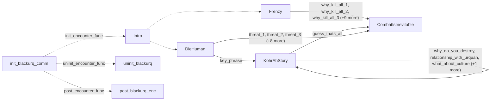

# Kohr-Ah: existing conversation graph

> Generated by `tools/conversation_catalog.py`; do not edit this page by hand.

[Catalog and interpretation rules](../README.md) · [Proposed engine](../model.md)

Script: [blackurc.c](../../../../sc2/src/uqm/comm/blackur/blackurc.c#L1). Phrase bank: [kohrah.txt](../../../../sc2/content/base/comm/kohrah/kohrah.txt#L1).

8 handler/helper nodes; 29 response registration sites; 2 direct local calls; 76 phrase records.

## Initialization and lifecycle

| Phase | Callback | Bound by | Conditions / source |
| --- | --- | --- | --- |
| <code>init_encounter_func</code> | [<code>Intro</code>](#node-intro) | <code>init_blackurq_comm</code> | No enclosing branch condition; [547](../../../../sc2/src/uqm/comm/blackur/blackurc.c#L547) |
| <code>post_encounter_func</code> | [<code>post_blackurq_enc</code>](#node-post_blackurq_enc) | <code>init_blackurq_comm</code> | No enclosing branch condition; [548](../../../../sc2/src/uqm/comm/blackur/blackurc.c#L548) |
| <code>uninit_encounter_func</code> | [<code>uninit_blackurq</code>](#node-uninit_blackurq) | <code>init_blackurq_comm</code> | No enclosing branch condition; [549](../../../../sc2/src/uqm/comm/blackur/blackurc.c#L549) |

## Handler graph

Solid arrows are selectable responses; dashed arrows are direct C calls. Conditions, arguments, speech and effects are cataloged below. Parallel response sites are grouped only in this diagram.



## Condition catalog

Condition IDs describe enclosing source structure. Branch predicates combine with ∧; case labels mark source locations that can also be reached by fallthrough. Values refer to their original evaluation points. Local assignments and early control flow remain in the decision bodies.

| ID | Source expression / structural condition |
| --- | --- |
| <a id="condition-c1"></a>C1 | <code>PLAYER_SAID(R, bye)</code> |
| <a id="condition-c2"></a>C2 | <code>GET_GAME_STATE(KOHR_AH_BYES) == 0</code> |
| <a id="condition-c3"></a>C3 | <code>!(GET_GAME_STATE(KOHR_AH_BYES) == 0)</code> |
| <a id="condition-c4"></a>C4 | <code>!(PLAYER_SAID(R, bye))</code> |
| <a id="condition-c5"></a>C5 | <code>PLAYER_SAID(R, guess_thats_all)</code> |
| <a id="condition-c6"></a>C6 | <code>!(PLAYER_SAID(R, guess_thats_all))</code> |
| <a id="condition-c7"></a>C7 | <code>PLAYER_SAID(R, what_are_you_hovering_over)</code> |
| <a id="condition-c8"></a>C8 | <code>!(PLAYER_SAID(R, what_are_you_hovering_over))</code> |
| <a id="condition-c9"></a>C9 | <code>PLAYER_SAID(R, you_sure_are_creepy)</code> |
| <a id="condition-c10"></a>C10 | <code>!(PLAYER_SAID(R, you_sure_are_creepy))</code> |
| <a id="condition-c11"></a>C11 | <code>PLAYER_SAID(R, stop_that_gross_blinking)</code> |
| <a id="condition-c12"></a>C12 | <code>!(PLAYER_SAID(R, stop_that_gross_blinking))</code> |
| <a id="condition-c13"></a>C13 | <code>!(PLAYER_SAID(R, threat_1))</code> |
| <a id="condition-c14"></a>C14 | <code>!(PLAYER_SAID(R, threat_1) &#124;&#124; PLAYER_SAID(R, threat_2))</code> |
| <a id="condition-c15"></a>C15 | <code>!((PLAYER_SAID(R, threat_1) &#124;&#124; PLAYER_SAID(R, threat_2)) &#124;&#124; PLAYER_SAID(R, threat_3))</code> |
| <a id="condition-c16"></a>C16 | <code>((PLAYER_SAID(R, threat_1) &#124;&#124; PLAYER_SAID(R, threat_2)) &#124;&#124; PLAYER_SAID(R, threat_3)) &#124;&#124; PLAYER_SAID(R, threat_4)</code> |
| <a id="condition-c17"></a>C17 | <code>switch (NumVisits++)</code> |
| <a id="condition-c18"></a>C18 | <code>case 0 (see source for fallthrough)</code> |
| <a id="condition-c19"></a>C19 | <code>case 1 (see source for fallthrough)</code> |
| <a id="condition-c20"></a>C20 | <code>case 2 (see source for fallthrough)</code> |
| <a id="condition-c21"></a>C21 | <code>case 3 (see source for fallthrough)</code> |
| <a id="condition-c22"></a>C22 | <code>!(((PLAYER_SAID(R, threat_1) &#124;&#124; PLAYER_SAID(R, threat_2)) &#124;&#124; PLAYER_SAID(R, threat_3)) &#124;&#124; PLAYER_SAID(R, threat_4))</code> |
| <a id="condition-c23"></a>C23 | <code>!(PLAYER_SAID(R, plead_1))</code> |
| <a id="condition-c24"></a>C24 | <code>!(PLAYER_SAID(R, plead_1) &#124;&#124; PLAYER_SAID(R, plead_2))</code> |
| <a id="condition-c25"></a>C25 | <code>!((PLAYER_SAID(R, plead_1) &#124;&#124; PLAYER_SAID(R, plead_2)) &#124;&#124; PLAYER_SAID(R, plead_3))</code> |
| <a id="condition-c26"></a>C26 | <code>((PLAYER_SAID(R, plead_1) &#124;&#124; PLAYER_SAID(R, plead_2)) &#124;&#124; PLAYER_SAID(R, plead_3)) &#124;&#124; PLAYER_SAID(R, plead_4)</code> |
| <a id="condition-c27"></a>C27 | <code>!(((PLAYER_SAID(R, plead_1) &#124;&#124; PLAYER_SAID(R, plead_2)) &#124;&#124; PLAYER_SAID(R, plead_3)) &#124;&#124; PLAYER_SAID(R, plead_4))</code> |
| <a id="condition-c28"></a>C28 | <code>!(PLAYER_SAID(R, why_kill_all_1))</code> |
| <a id="condition-c29"></a>C29 | <code>!(PLAYER_SAID(R, why_kill_all_1) &#124;&#124; PLAYER_SAID(R, why_kill_all_2))</code> |
| <a id="condition-c30"></a>C30 | <code>!((PLAYER_SAID(R, why_kill_all_1) &#124;&#124; PLAYER_SAID(R, why_kill_all_2)) &#124;&#124; PLAYER_SAID(R, why_kill_all_3))</code> |
| <a id="condition-c31"></a>C31 | <code>((PLAYER_SAID(R, why_kill_all_1) &#124;&#124; PLAYER_SAID(R, why_kill_all_2)) &#124;&#124; PLAYER_SAID(R, why_kill_all_3)) &#124;&#124; PLAYER_SAID(R, why_kill_all_4)</code> |
| <a id="condition-c32"></a>C32 | <code>!(((PLAYER_SAID(R, why_kill_all_1) &#124;&#124; PLAYER_SAID(R, why_kill_all_2)) &#124;&#124; PLAYER_SAID(R, why_kill_all_3)) &#124;&#124; PLAYER_SAID(R, why_kill_all_4))</code> |
| <a id="condition-c33"></a>C33 | <code>!(PLAYER_SAID(R, please_dont_kill_1))</code> |
| <a id="condition-c34"></a>C34 | <code>!(PLAYER_SAID(R, please_dont_kill_1) &#124;&#124; PLAYER_SAID(R, please_dont_kill_2))</code> |
| <a id="condition-c35"></a>C35 | <code>!((PLAYER_SAID(R, please_dont_kill_1) &#124;&#124; PLAYER_SAID(R, please_dont_kill_2)) &#124;&#124; PLAYER_SAID(R, please_dont_kill_3))</code> |
| <a id="condition-c36"></a>C36 | <code>((PLAYER_SAID(R, please_dont_kill_1) &#124;&#124; PLAYER_SAID(R, please_dont_kill_2)) &#124;&#124; PLAYER_SAID(R, please_dont_kill_3)) &#124;&#124; PLAYER_SAID(R, please_dont_kill_4)</code> |
| <a id="condition-c37"></a>C37 | <code>!(((PLAYER_SAID(R, please_dont_kill_1) &#124;&#124; PLAYER_SAID(R, please_dont_kill_2)) &#124;&#124; PLAYER_SAID(R, please_dont_kill_3)) &#124;&#124; PLAYER_SAID(R, please_dont_kill_4))</code> |
| <a id="condition-c38"></a>C38 | <code>!(PLAYER_SAID(R, bye_frenzy_1))</code> |
| <a id="condition-c39"></a>C39 | <code>!(PLAYER_SAID(R, bye_frenzy_1) &#124;&#124; PLAYER_SAID(R, bye_frenzy_2))</code> |
| <a id="condition-c40"></a>C40 | <code>!((PLAYER_SAID(R, bye_frenzy_1) &#124;&#124; PLAYER_SAID(R, bye_frenzy_2)) &#124;&#124; PLAYER_SAID(R, bye_frenzy_3))</code> |
| <a id="condition-c41"></a>C41 | <code>((PLAYER_SAID(R, bye_frenzy_1) &#124;&#124; PLAYER_SAID(R, bye_frenzy_2)) &#124;&#124; PLAYER_SAID(R, bye_frenzy_3)) &#124;&#124; PLAYER_SAID(R, bye_frenzy_4)</code> |
| <a id="condition-c42"></a>C42 | <code>switch (GET_GAME_STATE(KOHR_AH_REASONS))</code> |
| <a id="condition-c43"></a>C43 | <code>switch (GET_GAME_STATE(KOHR_AH_PLEAD))</code> |
| <a id="condition-c44"></a>C44 | <code>switch (GET_GAME_STATE(KOHR_AH_INFO))</code> |
| <a id="condition-c45"></a>C45 | <code>PLAYER_SAID(R, key_phrase)</code> |
| <a id="condition-c46"></a>C46 | <code>!(PLAYER_SAID(R, key_phrase))</code> |
| <a id="condition-c47"></a>C47 | <code>PLAYER_SAID(R, why_do_you_destroy)</code> |
| <a id="condition-c48"></a>C48 | <code>!(PLAYER_SAID(R, why_do_you_destroy))</code> |
| <a id="condition-c49"></a>C49 | <code>PLAYER_SAID(R, relationship_with_urquan)</code> |
| <a id="condition-c50"></a>C50 | <code>!(PLAYER_SAID(R, relationship_with_urquan))</code> |
| <a id="condition-c51"></a>C51 | <code>PLAYER_SAID(R, what_about_culture)</code> |
| <a id="condition-c52"></a>C52 | <code>!(PLAYER_SAID(R, what_about_culture))</code> |
| <a id="condition-c53"></a>C53 | <code>PLAYER_SAID(R, how_leave_me_alone)</code> |
| <a id="condition-c54"></a>C54 | <code>PHRASE_ENABLED(why_do_you_destroy)</code> |
| <a id="condition-c55"></a>C55 | <code>PHRASE_ENABLED(relationship_with_urquan)</code> |
| <a id="condition-c56"></a>C56 | <code>PHRASE_ENABLED(what_about_culture)</code> |
| <a id="condition-c57"></a>C57 | <code>PHRASE_ENABLED(how_leave_me_alone)</code> |
| <a id="condition-c58"></a>C58 | <code>GET_GAME_STATE(KNOW_KOHR_AH_STORY) == 1</code> |
| <a id="condition-c59"></a>C59 | <code>LOBYTE(GLOBAL(CurrentActivity)) == WON_LAST_BATTLE</code> |
| <a id="condition-c60"></a>C60 | <code>GET_GAME_STATE(KOHR_AH_KILLED_ALL)</code> |
| <a id="condition-c61"></a>C61 | <code>!GET_GAME_STATE(KOHR_AH_SENSES_EVIL)</code> |
| <a id="condition-c62"></a>C62 | <code>(!GET_GAME_STATE(KOHR_AH_SENSES_EVIL)) &amp;&amp; GET_GAME_STATE(TALKING_PET_ON_SHIP)</code> |
| <a id="condition-c63"></a>C63 | <code>LOBYTE(GLOBAL(CurrentActivity)) == IN_INTERPLANETARY</code> |
| <a id="condition-c64"></a>C64 | <code>(LOBYTE(GLOBAL(CurrentActivity)) == IN_INTERPLANETARY) &amp;&amp; GLOBAL(BattleGroupRef)</code> |
| <a id="condition-c65"></a>C65 | <code>((LOBYTE(GLOBAL(CurrentActivity)) == IN_INTERPLANETARY) &amp;&amp; GLOBAL(BattleGroupRef)) &amp;&amp; (GLOBAL(BattleGroupRef) == GrpOffs)</code> |
| <a id="condition-c66"></a>C66 | <code>!(((LOBYTE(GLOBAL(CurrentActivity)) == IN_INTERPLANETARY) &amp;&amp; GLOBAL(BattleGroupRef)) &amp;&amp; (GLOBAL(BattleGroupRef) == GrpOffs))</code> |
| <a id="condition-c67"></a>C67 | <code>GET_GAME_STATE(KOHR_AH_FRENZY)</code> |
| <a id="condition-c68"></a>C68 | <code>!(GET_GAME_STATE(KOHR_AH_FRENZY))</code> |
| <a id="condition-c69"></a>C69 | <code>!GET_GAME_STATE(KOHR_AH_KILLED_ALL)</code> |
| <a id="condition-c70"></a>C70 | <code>(!GET_GAME_STATE(KOHR_AH_KILLED_ALL)) &amp;&amp; (LOBYTE(GLOBAL(CurrentActivity)) != WON_LAST_BATTLE)</code> |
| <a id="condition-c71"></a>C71 | <code>!((!GET_GAME_STATE(KOHR_AH_KILLED_ALL)) &amp;&amp; (LOBYTE(GLOBAL(CurrentActivity)) != WON_LAST_BATTLE))</code> |

## Script-scope state and lookup tables

These declarations supply shared local state, computed phrase alternatives, number speech, or lookup data used by the nodes. LOCDATA presentation defaults are linked separately in the source.

Presentation descriptor <code>blackurq_desc</code>: [source](../../../../sc2/src/uqm/comm/blackur/blackurc.c#L23).

## Node catalog

<a id="node-combatisinevitable"></a>

### CombatIsInevitable

<code>static void CombatIsInevitable(RESPONSE_REF R)</code> — [source](../../../../sc2/src/uqm/comm/blackur/blackurc.c#L133).

Incoming player-response variants: [<code>why_kill_all_1</code>](#phrase-why_kill_all_1), [<code>why_kill_all_2</code>](#phrase-why_kill_all_2), [<code>why_kill_all_3</code>](#phrase-why_kill_all_3), [<code>why_kill_all_4</code>](#phrase-why_kill_all_4), [<code>please_dont_kill_1</code>](#phrase-please_dont_kill_1), [<code>please_dont_kill_2</code>](#phrase-please_dont_kill_2), [<code>please_dont_kill_3</code>](#phrase-please_dont_kill_3), [<code>please_dont_kill_4</code>](#phrase-please_dont_kill_4), [<code>bye_frenzy_1</code>](#phrase-bye_frenzy_1), [<code>bye_frenzy_2</code>](#phrase-bye_frenzy_2), [<code>bye_frenzy_3</code>](#phrase-bye_frenzy_3), [<code>bye_frenzy_4</code>](#phrase-bye_frenzy_4), [<code>guess_thats_all</code>](#phrase-guess_thats_all), [<code>threat_1</code>](#phrase-threat_1), [<code>threat_2</code>](#phrase-threat_2), [<code>threat_3</code>](#phrase-threat_3), [<code>threat_4</code>](#phrase-threat_4), [<code>what_are_you_hovering_over</code>](#phrase-what_are_you_hovering_over), [<code>you_sure_are_creepy</code>](#phrase-you_sure_are_creepy), [<code>stop_that_gross_blinking</code>](#phrase-stop_that_gross_blinking), [<code>plead_1</code>](#phrase-plead_1), [<code>plead_2</code>](#phrase-plead_2), [<code>plead_4</code>](#phrase-plead_4), [<code>bye</code>](#phrase-bye).

#### Dialogue / audio emissions

| Phrase or expression | Enclosing conditions | Source |
| --- | --- | --- |
| [<code>GOODBYE_AND_DIE</code>](#phrase-goodbye_and_die)<br><code>NPCPhrase(GOODBYE_AND_DIE)</code> | [C1](#condition-c1) ∧ [C2](#condition-c2) | [142](../../../../sc2/src/uqm/comm/blackur/blackurc.c#L142) |
| [<code>DIE_HUMAN</code>](#phrase-die_human)<br><code>NPCPhrase(DIE_HUMAN)</code> | [C1](#condition-c1) ∧ [C3](#condition-c3) | [144](../../../../sc2/src/uqm/comm/blackur/blackurc.c#L144) |
| [<code>THEN_DIE</code>](#phrase-then_die)<br><code>NPCPhrase(THEN_DIE)</code> | [C4](#condition-c4) ∧ [C5](#condition-c5) | [149](../../../../sc2/src/uqm/comm/blackur/blackurc.c#L149) |
| [<code>BONE_PILE</code>](#phrase-bone_pile)<br><code>NPCPhrase(BONE_PILE)</code> | [C4](#condition-c4) ∧ [C6](#condition-c6) ∧ [C7](#condition-c7) | [152](../../../../sc2/src/uqm/comm/blackur/blackurc.c#L152) |
| [<code>YES_CREEPY</code>](#phrase-yes_creepy)<br><code>NPCPhrase(YES_CREEPY)</code> | [C4](#condition-c4) ∧ [C6](#condition-c6) ∧ [C8](#condition-c8) ∧ [C9](#condition-c9) | [158](../../../../sc2/src/uqm/comm/blackur/blackurc.c#L158) |
| [<code>DIE_HUMAN</code>](#phrase-die_human)<br><code>NPCPhrase(DIE_HUMAN)</code> | [C4](#condition-c4) ∧ [C6](#condition-c6) ∧ [C8](#condition-c8) ∧ [C10](#condition-c10) ∧ [C11](#condition-c11) | [164](../../../../sc2/src/uqm/comm/blackur/blackurc.c#L164) |
| [<code>RESISTANCE_IS_USELESS_1</code>](#phrase-resistance_is_useless_1)<br><code>NPCPhrase(RESISTANCE_IS_USELESS_1)</code> | [C4](#condition-c4) ∧ [C6](#condition-c6) ∧ [C8](#condition-c8) ∧ [C10](#condition-c10) ∧ [C12](#condition-c12) ∧ [C16](#condition-c16) ∧ [C17](#condition-c17) ∧ [C18](#condition-c18) | [177](../../../../sc2/src/uqm/comm/blackur/blackurc.c#L177) |
| [<code>RESISTANCE_IS_USELESS_2</code>](#phrase-resistance_is_useless_2)<br><code>NPCPhrase(RESISTANCE_IS_USELESS_2)</code> | [C4](#condition-c4) ∧ [C6](#condition-c6) ∧ [C8](#condition-c8) ∧ [C10](#condition-c10) ∧ [C12](#condition-c12) ∧ [C16](#condition-c16) ∧ [C17](#condition-c17) ∧ [C19](#condition-c19) | [180](../../../../sc2/src/uqm/comm/blackur/blackurc.c#L180) |
| [<code>RESISTANCE_IS_USELESS_3</code>](#phrase-resistance_is_useless_3)<br><code>NPCPhrase(RESISTANCE_IS_USELESS_3)</code> | [C4](#condition-c4) ∧ [C6](#condition-c6) ∧ [C8](#condition-c8) ∧ [C10](#condition-c10) ∧ [C12](#condition-c12) ∧ [C16](#condition-c16) ∧ [C17](#condition-c17) ∧ [C20](#condition-c20) | [183](../../../../sc2/src/uqm/comm/blackur/blackurc.c#L183) |
| [<code>RESISTANCE_IS_USELESS_4</code>](#phrase-resistance_is_useless_4)<br><code>NPCPhrase(RESISTANCE_IS_USELESS_4)</code> | [C4](#condition-c4) ∧ [C6](#condition-c6) ∧ [C8](#condition-c8) ∧ [C10](#condition-c10) ∧ [C12](#condition-c12) ∧ [C16](#condition-c16) ∧ [C17](#condition-c17) ∧ [C21](#condition-c21) | [186](../../../../sc2/src/uqm/comm/blackur/blackurc.c#L186) |
| [<code>PLEADING_IS_USELESS_1</code>](#phrase-pleading_is_useless_1)<br><code>NPCPhrase(PLEADING_IS_USELESS_1)</code> | [C4](#condition-c4) ∧ [C6](#condition-c6) ∧ [C8](#condition-c8) ∧ [C10](#condition-c10) ∧ [C12](#condition-c12) ∧ [C22](#condition-c22) ∧ [C26](#condition-c26) ∧ [C17](#condition-c17) ∧ [C18](#condition-c18) | [201](../../../../sc2/src/uqm/comm/blackur/blackurc.c#L201) |
| [<code>PLEADING_IS_USELESS_2</code>](#phrase-pleading_is_useless_2)<br><code>NPCPhrase(PLEADING_IS_USELESS_2)</code> | [C4](#condition-c4) ∧ [C6](#condition-c6) ∧ [C8](#condition-c8) ∧ [C10](#condition-c10) ∧ [C12](#condition-c12) ∧ [C22](#condition-c22) ∧ [C26](#condition-c26) ∧ [C17](#condition-c17) ∧ [C19](#condition-c19) | [204](../../../../sc2/src/uqm/comm/blackur/blackurc.c#L204) |
| [<code>PLEADING_IS_USELESS_4</code>](#phrase-pleading_is_useless_4)<br><code>NPCPhrase(PLEADING_IS_USELESS_4)</code> | [C4](#condition-c4) ∧ [C6](#condition-c6) ∧ [C8](#condition-c8) ∧ [C10](#condition-c10) ∧ [C12](#condition-c12) ∧ [C22](#condition-c22) ∧ [C26](#condition-c26) ∧ [C17](#condition-c17) ∧ [C21](#condition-c21) | [211](../../../../sc2/src/uqm/comm/blackur/blackurc.c#L211) |
| [<code>KILL_BECAUSE_1</code>](#phrase-kill_because_1)<br><code>NPCPhrase(KILL_BECAUSE_1)</code> | [C4](#condition-c4) ∧ [C6](#condition-c6) ∧ [C8](#condition-c8) ∧ [C10](#condition-c10) ∧ [C12](#condition-c12) ∧ [C22](#condition-c22) ∧ [C27](#condition-c27) ∧ [C31](#condition-c31) ∧ [C17](#condition-c17) ∧ [C18](#condition-c18) | [226](../../../../sc2/src/uqm/comm/blackur/blackurc.c#L226) |
| [<code>KILL_BECAUSE_2</code>](#phrase-kill_because_2)<br><code>NPCPhrase(KILL_BECAUSE_2)</code> | [C4](#condition-c4) ∧ [C6](#condition-c6) ∧ [C8](#condition-c8) ∧ [C10](#condition-c10) ∧ [C12](#condition-c12) ∧ [C22](#condition-c22) ∧ [C27](#condition-c27) ∧ [C31](#condition-c31) ∧ [C17](#condition-c17) ∧ [C19](#condition-c19) | [229](../../../../sc2/src/uqm/comm/blackur/blackurc.c#L229) |
| [<code>KILL_BECAUSE_3</code>](#phrase-kill_because_3)<br><code>NPCPhrase(KILL_BECAUSE_3)</code> | [C4](#condition-c4) ∧ [C6](#condition-c6) ∧ [C8](#condition-c8) ∧ [C10](#condition-c10) ∧ [C12](#condition-c12) ∧ [C22](#condition-c22) ∧ [C27](#condition-c27) ∧ [C31](#condition-c31) ∧ [C17](#condition-c17) ∧ [C20](#condition-c20) | [232](../../../../sc2/src/uqm/comm/blackur/blackurc.c#L232) |
| [<code>KILL_BECAUSE_4</code>](#phrase-kill_because_4)<br><code>NPCPhrase(KILL_BECAUSE_4)</code> | [C4](#condition-c4) ∧ [C6](#condition-c6) ∧ [C8](#condition-c8) ∧ [C10](#condition-c10) ∧ [C12](#condition-c12) ∧ [C22](#condition-c22) ∧ [C27](#condition-c27) ∧ [C31](#condition-c31) ∧ [C17](#condition-c17) ∧ [C21](#condition-c21) | [235](../../../../sc2/src/uqm/comm/blackur/blackurc.c#L235) |
| [<code>WILL_KILL_1</code>](#phrase-will_kill_1)<br><code>NPCPhrase(WILL_KILL_1)</code> | [C4](#condition-c4) ∧ [C6](#condition-c6) ∧ [C8](#condition-c8) ∧ [C10](#condition-c10) ∧ [C12](#condition-c12) ∧ [C22](#condition-c22) ∧ [C27](#condition-c27) ∧ [C32](#condition-c32) ∧ [C36](#condition-c36) ∧ [C17](#condition-c17) ∧ [C18](#condition-c18) | [250](../../../../sc2/src/uqm/comm/blackur/blackurc.c#L250) |
| [<code>WILL_KILL_2</code>](#phrase-will_kill_2)<br><code>NPCPhrase(WILL_KILL_2)</code> | [C4](#condition-c4) ∧ [C6](#condition-c6) ∧ [C8](#condition-c8) ∧ [C10](#condition-c10) ∧ [C12](#condition-c12) ∧ [C22](#condition-c22) ∧ [C27](#condition-c27) ∧ [C32](#condition-c32) ∧ [C36](#condition-c36) ∧ [C17](#condition-c17) ∧ [C19](#condition-c19) | [253](../../../../sc2/src/uqm/comm/blackur/blackurc.c#L253) |
| [<code>WILL_KILL_3</code>](#phrase-will_kill_3)<br><code>NPCPhrase(WILL_KILL_3)</code> | [C4](#condition-c4) ∧ [C6](#condition-c6) ∧ [C8](#condition-c8) ∧ [C10](#condition-c10) ∧ [C12](#condition-c12) ∧ [C22](#condition-c22) ∧ [C27](#condition-c27) ∧ [C32](#condition-c32) ∧ [C36](#condition-c36) ∧ [C17](#condition-c17) ∧ [C20](#condition-c20) | [256](../../../../sc2/src/uqm/comm/blackur/blackurc.c#L256) |
| [<code>WILL_KILL_4</code>](#phrase-will_kill_4)<br><code>NPCPhrase(WILL_KILL_4)</code> | [C4](#condition-c4) ∧ [C6](#condition-c6) ∧ [C8](#condition-c8) ∧ [C10](#condition-c10) ∧ [C12](#condition-c12) ∧ [C22](#condition-c22) ∧ [C27](#condition-c27) ∧ [C32](#condition-c32) ∧ [C36](#condition-c36) ∧ [C17](#condition-c17) ∧ [C21](#condition-c21) | [259](../../../../sc2/src/uqm/comm/blackur/blackurc.c#L259) |
| [<code>GOODBYE_AND_DIE_FRENZY_1</code>](#phrase-goodbye_and_die_frenzy_1)<br><code>NPCPhrase(GOODBYE_AND_DIE_FRENZY_1)</code> | [C4](#condition-c4) ∧ [C6](#condition-c6) ∧ [C8](#condition-c8) ∧ [C10](#condition-c10) ∧ [C12](#condition-c12) ∧ [C22](#condition-c22) ∧ [C27](#condition-c27) ∧ [C32](#condition-c32) ∧ [C37](#condition-c37) ∧ [C41](#condition-c41) ∧ [C17](#condition-c17) ∧ [C18](#condition-c18) | [274](../../../../sc2/src/uqm/comm/blackur/blackurc.c#L274) |
| [<code>GOODBYE_AND_DIE_FRENZY_2</code>](#phrase-goodbye_and_die_frenzy_2)<br><code>NPCPhrase(GOODBYE_AND_DIE_FRENZY_2)</code> | [C4](#condition-c4) ∧ [C6](#condition-c6) ∧ [C8](#condition-c8) ∧ [C10](#condition-c10) ∧ [C12](#condition-c12) ∧ [C22](#condition-c22) ∧ [C27](#condition-c27) ∧ [C32](#condition-c32) ∧ [C37](#condition-c37) ∧ [C41](#condition-c41) ∧ [C17](#condition-c17) ∧ [C19](#condition-c19) | [277](../../../../sc2/src/uqm/comm/blackur/blackurc.c#L277) |
| [<code>GOODBYE_AND_DIE_FRENZY_3</code>](#phrase-goodbye_and_die_frenzy_3)<br><code>NPCPhrase(GOODBYE_AND_DIE_FRENZY_3)</code> | [C4](#condition-c4) ∧ [C6](#condition-c6) ∧ [C8](#condition-c8) ∧ [C10](#condition-c10) ∧ [C12](#condition-c12) ∧ [C22](#condition-c22) ∧ [C27](#condition-c27) ∧ [C32](#condition-c32) ∧ [C37](#condition-c37) ∧ [C41](#condition-c41) ∧ [C17](#condition-c17) ∧ [C20](#condition-c20) | [280](../../../../sc2/src/uqm/comm/blackur/blackurc.c#L280) |
| [<code>GOODBYE_AND_DIE_FRENZY_4</code>](#phrase-goodbye_and_die_frenzy_4)<br><code>NPCPhrase(GOODBYE_AND_DIE_FRENZY_4)</code> | [C4](#condition-c4) ∧ [C6](#condition-c6) ∧ [C8](#condition-c8) ∧ [C10](#condition-c10) ∧ [C12](#condition-c12) ∧ [C22](#condition-c22) ∧ [C27](#condition-c27) ∧ [C32](#condition-c32) ∧ [C37](#condition-c37) ∧ [C41](#condition-c41) ∧ [C17](#condition-c17) ∧ [C21](#condition-c21) | [283](../../../../sc2/src/uqm/comm/blackur/blackurc.c#L283) |

#### Actions, queries, local updates, and control flow

Calls are listed without assuming they are pure or mutating. Local updates are retained because they determine dynamic menus and counter-selected speech.

| Kind | Operation | Enclosing conditions | Source |
| --- | --- | --- | --- |
| call | <code>setSegue(Segue_hostile)</code> | No enclosing branch condition | [137](../../../../sc2/src/uqm/comm/blackur/blackurc.c#L137) |
| call | <code>PLAYER_SAID(R, bye)</code> | No enclosing branch condition | [139](../../../../sc2/src/uqm/comm/blackur/blackurc.c#L139) |
| call | <code>GET_GAME_STATE(KOHR_AH_BYES)</code> | [C1](#condition-c1) | [141](../../../../sc2/src/uqm/comm/blackur/blackurc.c#L141) |
| call | <code>SET_GAME_STATE(KOHR_AH_BYES, 1)</code> | [C1](#condition-c1) | [146](../../../../sc2/src/uqm/comm/blackur/blackurc.c#L146) |
| call | <code>PLAYER_SAID(R, guess_thats_all)</code> | [C4](#condition-c4) | [148](../../../../sc2/src/uqm/comm/blackur/blackurc.c#L148) |
| call | <code>PLAYER_SAID(R, what_are_you_hovering_over)</code> | [C4](#condition-c4) ∧ [C6](#condition-c6) | [150](../../../../sc2/src/uqm/comm/blackur/blackurc.c#L150) |
| call | <code>SET_GAME_STATE(KOHR_AH_INFO, 1)</code> | [C4](#condition-c4) ∧ [C6](#condition-c6) ∧ [C7](#condition-c7) | [154](../../../../sc2/src/uqm/comm/blackur/blackurc.c#L154) |
| call | <code>PLAYER_SAID(R, you_sure_are_creepy)</code> | [C4](#condition-c4) ∧ [C6](#condition-c6) ∧ [C8](#condition-c8) | [156](../../../../sc2/src/uqm/comm/blackur/blackurc.c#L156) |
| call | <code>SET_GAME_STATE(KOHR_AH_INFO, 2)</code> | [C4](#condition-c4) ∧ [C6](#condition-c6) ∧ [C8](#condition-c8) ∧ [C9](#condition-c9) | [160](../../../../sc2/src/uqm/comm/blackur/blackurc.c#L160) |
| call | <code>PLAYER_SAID(R, stop_that_gross_blinking)</code> | [C4](#condition-c4) ∧ [C6](#condition-c6) ∧ [C8](#condition-c8) ∧ [C10](#condition-c10) | [162](../../../../sc2/src/uqm/comm/blackur/blackurc.c#L162) |
| call | <code>SET_GAME_STATE(KOHR_AH_INFO, 3)</code> | [C4](#condition-c4) ∧ [C6](#condition-c6) ∧ [C8](#condition-c8) ∧ [C10](#condition-c10) ∧ [C11](#condition-c11) | [166](../../../../sc2/src/uqm/comm/blackur/blackurc.c#L166) |
| call | <code>PLAYER_SAID(R, threat_1)</code> | [C4](#condition-c4) ∧ [C6](#condition-c6) ∧ [C8](#condition-c8) ∧ [C10](#condition-c10) ∧ [C12](#condition-c12) | [168](../../../../sc2/src/uqm/comm/blackur/blackurc.c#L168) |
| call | <code>PLAYER_SAID(R, threat_2)</code> | [C4](#condition-c4) ∧ [C6](#condition-c6) ∧ [C8](#condition-c8) ∧ [C10](#condition-c10) ∧ [C12](#condition-c12) ∧ [C13](#condition-c13) | [169](../../../../sc2/src/uqm/comm/blackur/blackurc.c#L169) |
| call | <code>PLAYER_SAID(R, threat_3)</code> | [C4](#condition-c4) ∧ [C6](#condition-c6) ∧ [C8](#condition-c8) ∧ [C10](#condition-c10) ∧ [C12](#condition-c12) ∧ [C14](#condition-c14) | [170](../../../../sc2/src/uqm/comm/blackur/blackurc.c#L170) |
| call | <code>PLAYER_SAID(R, threat_4)</code> | [C4](#condition-c4) ∧ [C6](#condition-c6) ∧ [C8](#condition-c8) ∧ [C10](#condition-c10) ∧ [C12](#condition-c12) ∧ [C15](#condition-c15) | [171](../../../../sc2/src/uqm/comm/blackur/blackurc.c#L171) |
| update | <code>NumVisits = GET_GAME_STATE(KOHR_AH_REASONS)</code> | [C4](#condition-c4) ∧ [C6](#condition-c6) ∧ [C8](#condition-c8) ∧ [C10](#condition-c10) ∧ [C12](#condition-c12) ∧ [C16](#condition-c16) | [173](../../../../sc2/src/uqm/comm/blackur/blackurc.c#L173) |
| call | <code>GET_GAME_STATE(KOHR_AH_REASONS)</code> | [C4](#condition-c4) ∧ [C6](#condition-c6) ∧ [C8](#condition-c8) ∧ [C10](#condition-c10) ∧ [C12](#condition-c12) ∧ [C16](#condition-c16) | [173](../../../../sc2/src/uqm/comm/blackur/blackurc.c#L173) |
| update | <code>NumVisits++</code> | [C4](#condition-c4) ∧ [C6](#condition-c6) ∧ [C8](#condition-c8) ∧ [C10](#condition-c10) ∧ [C12](#condition-c12) ∧ [C16](#condition-c16) | [174](../../../../sc2/src/uqm/comm/blackur/blackurc.c#L174) |
| flow | <code>break;</code> | [C4](#condition-c4) ∧ [C6](#condition-c6) ∧ [C8](#condition-c8) ∧ [C10](#condition-c10) ∧ [C12](#condition-c12) ∧ [C16](#condition-c16) ∧ [C17](#condition-c17) ∧ [C18](#condition-c18) | [178](../../../../sc2/src/uqm/comm/blackur/blackurc.c#L178) |
| flow | <code>break;</code> | [C4](#condition-c4) ∧ [C6](#condition-c6) ∧ [C8](#condition-c8) ∧ [C10](#condition-c10) ∧ [C12](#condition-c12) ∧ [C16](#condition-c16) ∧ [C17](#condition-c17) ∧ [C19](#condition-c19) | [181](../../../../sc2/src/uqm/comm/blackur/blackurc.c#L181) |
| flow | <code>break;</code> | [C4](#condition-c4) ∧ [C6](#condition-c6) ∧ [C8](#condition-c8) ∧ [C10](#condition-c10) ∧ [C12](#condition-c12) ∧ [C16](#condition-c16) ∧ [C17](#condition-c17) ∧ [C20](#condition-c20) | [184](../../../../sc2/src/uqm/comm/blackur/blackurc.c#L184) |
| update | <code>--NumVisits</code> | [C4](#condition-c4) ∧ [C6](#condition-c6) ∧ [C8](#condition-c8) ∧ [C10](#condition-c10) ∧ [C12](#condition-c12) ∧ [C16](#condition-c16) ∧ [C17](#condition-c17) ∧ [C21](#condition-c21) | [187](../../../../sc2/src/uqm/comm/blackur/blackurc.c#L187) |
| flow | <code>break;</code> | [C4](#condition-c4) ∧ [C6](#condition-c6) ∧ [C8](#condition-c8) ∧ [C10](#condition-c10) ∧ [C12](#condition-c12) ∧ [C16](#condition-c16) ∧ [C17](#condition-c17) ∧ [C21](#condition-c21) | [188](../../../../sc2/src/uqm/comm/blackur/blackurc.c#L188) |
| call | <code>SET_GAME_STATE(KOHR_AH_REASONS, NumVisits)</code> | [C4](#condition-c4) ∧ [C6](#condition-c6) ∧ [C8](#condition-c8) ∧ [C10](#condition-c10) ∧ [C12](#condition-c12) ∧ [C16](#condition-c16) | [190](../../../../sc2/src/uqm/comm/blackur/blackurc.c#L190) |
| call | <code>PLAYER_SAID(R, plead_1)</code> | [C4](#condition-c4) ∧ [C6](#condition-c6) ∧ [C8](#condition-c8) ∧ [C10](#condition-c10) ∧ [C12](#condition-c12) ∧ [C22](#condition-c22) | [192](../../../../sc2/src/uqm/comm/blackur/blackurc.c#L192) |
| call | <code>PLAYER_SAID(R, plead_2)</code> | [C4](#condition-c4) ∧ [C6](#condition-c6) ∧ [C8](#condition-c8) ∧ [C10](#condition-c10) ∧ [C12](#condition-c12) ∧ [C22](#condition-c22) ∧ [C23](#condition-c23) | [193](../../../../sc2/src/uqm/comm/blackur/blackurc.c#L193) |
| call | <code>PLAYER_SAID(R, plead_3)</code> | [C4](#condition-c4) ∧ [C6](#condition-c6) ∧ [C8](#condition-c8) ∧ [C10](#condition-c10) ∧ [C12](#condition-c12) ∧ [C22](#condition-c22) ∧ [C24](#condition-c24) | [194](../../../../sc2/src/uqm/comm/blackur/blackurc.c#L194) |
| call | <code>PLAYER_SAID(R, plead_4)</code> | [C4](#condition-c4) ∧ [C6](#condition-c6) ∧ [C8](#condition-c8) ∧ [C10](#condition-c10) ∧ [C12](#condition-c12) ∧ [C22](#condition-c22) ∧ [C25](#condition-c25) | [195](../../../../sc2/src/uqm/comm/blackur/blackurc.c#L195) |
| update | <code>NumVisits = GET_GAME_STATE(KOHR_AH_PLEAD)</code> | [C4](#condition-c4) ∧ [C6](#condition-c6) ∧ [C8](#condition-c8) ∧ [C10](#condition-c10) ∧ [C12](#condition-c12) ∧ [C22](#condition-c22) ∧ [C26](#condition-c26) | [197](../../../../sc2/src/uqm/comm/blackur/blackurc.c#L197) |
| call | <code>GET_GAME_STATE(KOHR_AH_PLEAD)</code> | [C4](#condition-c4) ∧ [C6](#condition-c6) ∧ [C8](#condition-c8) ∧ [C10](#condition-c10) ∧ [C12](#condition-c12) ∧ [C22](#condition-c22) ∧ [C26](#condition-c26) | [197](../../../../sc2/src/uqm/comm/blackur/blackurc.c#L197) |
| update | <code>NumVisits++</code> | [C4](#condition-c4) ∧ [C6](#condition-c6) ∧ [C8](#condition-c8) ∧ [C10](#condition-c10) ∧ [C12](#condition-c12) ∧ [C22](#condition-c22) ∧ [C26](#condition-c26) | [198](../../../../sc2/src/uqm/comm/blackur/blackurc.c#L198) |
| flow | <code>break;</code> | [C4](#condition-c4) ∧ [C6](#condition-c6) ∧ [C8](#condition-c8) ∧ [C10](#condition-c10) ∧ [C12](#condition-c12) ∧ [C22](#condition-c22) ∧ [C26](#condition-c26) ∧ [C17](#condition-c17) ∧ [C18](#condition-c18) | [202](../../../../sc2/src/uqm/comm/blackur/blackurc.c#L202) |
| flow | <code>break;</code> | [C4](#condition-c4) ∧ [C6](#condition-c6) ∧ [C8](#condition-c8) ∧ [C10](#condition-c10) ∧ [C12](#condition-c12) ∧ [C22](#condition-c22) ∧ [C26](#condition-c26) ∧ [C17](#condition-c17) ∧ [C19](#condition-c19) | [205](../../../../sc2/src/uqm/comm/blackur/blackurc.c#L205) |
| update | <code>--NumVisits</code> | [C4](#condition-c4) ∧ [C6](#condition-c6) ∧ [C8](#condition-c8) ∧ [C10](#condition-c10) ∧ [C12](#condition-c12) ∧ [C22](#condition-c22) ∧ [C26](#condition-c26) ∧ [C17](#condition-c17) ∧ [C21](#condition-c21) | [212](../../../../sc2/src/uqm/comm/blackur/blackurc.c#L212) |
| flow | <code>break;</code> | [C4](#condition-c4) ∧ [C6](#condition-c6) ∧ [C8](#condition-c8) ∧ [C10](#condition-c10) ∧ [C12](#condition-c12) ∧ [C22](#condition-c22) ∧ [C26](#condition-c26) ∧ [C17](#condition-c17) ∧ [C21](#condition-c21) | [213](../../../../sc2/src/uqm/comm/blackur/blackurc.c#L213) |
| call | <code>SET_GAME_STATE(KOHR_AH_PLEAD, NumVisits)</code> | [C4](#condition-c4) ∧ [C6](#condition-c6) ∧ [C8](#condition-c8) ∧ [C10](#condition-c10) ∧ [C12](#condition-c12) ∧ [C22](#condition-c22) ∧ [C26](#condition-c26) | [215](../../../../sc2/src/uqm/comm/blackur/blackurc.c#L215) |
| call | <code>PLAYER_SAID(R, why_kill_all_1)</code> | [C4](#condition-c4) ∧ [C6](#condition-c6) ∧ [C8](#condition-c8) ∧ [C10](#condition-c10) ∧ [C12](#condition-c12) ∧ [C22](#condition-c22) ∧ [C27](#condition-c27) | [217](../../../../sc2/src/uqm/comm/blackur/blackurc.c#L217) |
| call | <code>PLAYER_SAID(R, why_kill_all_2)</code> | [C4](#condition-c4) ∧ [C6](#condition-c6) ∧ [C8](#condition-c8) ∧ [C10](#condition-c10) ∧ [C12](#condition-c12) ∧ [C22](#condition-c22) ∧ [C27](#condition-c27) ∧ [C28](#condition-c28) | [218](../../../../sc2/src/uqm/comm/blackur/blackurc.c#L218) |
| call | <code>PLAYER_SAID(R, why_kill_all_3)</code> | [C4](#condition-c4) ∧ [C6](#condition-c6) ∧ [C8](#condition-c8) ∧ [C10](#condition-c10) ∧ [C12](#condition-c12) ∧ [C22](#condition-c22) ∧ [C27](#condition-c27) ∧ [C29](#condition-c29) | [219](../../../../sc2/src/uqm/comm/blackur/blackurc.c#L219) |
| call | <code>PLAYER_SAID(R, why_kill_all_4)</code> | [C4](#condition-c4) ∧ [C6](#condition-c6) ∧ [C8](#condition-c8) ∧ [C10](#condition-c10) ∧ [C12](#condition-c12) ∧ [C22](#condition-c22) ∧ [C27](#condition-c27) ∧ [C30](#condition-c30) | [220](../../../../sc2/src/uqm/comm/blackur/blackurc.c#L220) |
| update | <code>NumVisits = GET_GAME_STATE(KOHR_AH_REASONS)</code> | [C4](#condition-c4) ∧ [C6](#condition-c6) ∧ [C8](#condition-c8) ∧ [C10](#condition-c10) ∧ [C12](#condition-c12) ∧ [C22](#condition-c22) ∧ [C27](#condition-c27) ∧ [C31](#condition-c31) | [222](../../../../sc2/src/uqm/comm/blackur/blackurc.c#L222) |
| call | <code>GET_GAME_STATE(KOHR_AH_REASONS)</code> | [C4](#condition-c4) ∧ [C6](#condition-c6) ∧ [C8](#condition-c8) ∧ [C10](#condition-c10) ∧ [C12](#condition-c12) ∧ [C22](#condition-c22) ∧ [C27](#condition-c27) ∧ [C31](#condition-c31) | [222](../../../../sc2/src/uqm/comm/blackur/blackurc.c#L222) |
| update | <code>NumVisits++</code> | [C4](#condition-c4) ∧ [C6](#condition-c6) ∧ [C8](#condition-c8) ∧ [C10](#condition-c10) ∧ [C12](#condition-c12) ∧ [C22](#condition-c22) ∧ [C27](#condition-c27) ∧ [C31](#condition-c31) | [223](../../../../sc2/src/uqm/comm/blackur/blackurc.c#L223) |
| flow | <code>break;</code> | [C4](#condition-c4) ∧ [C6](#condition-c6) ∧ [C8](#condition-c8) ∧ [C10](#condition-c10) ∧ [C12](#condition-c12) ∧ [C22](#condition-c22) ∧ [C27](#condition-c27) ∧ [C31](#condition-c31) ∧ [C17](#condition-c17) ∧ [C18](#condition-c18) | [227](../../../../sc2/src/uqm/comm/blackur/blackurc.c#L227) |
| flow | <code>break;</code> | [C4](#condition-c4) ∧ [C6](#condition-c6) ∧ [C8](#condition-c8) ∧ [C10](#condition-c10) ∧ [C12](#condition-c12) ∧ [C22](#condition-c22) ∧ [C27](#condition-c27) ∧ [C31](#condition-c31) ∧ [C17](#condition-c17) ∧ [C19](#condition-c19) | [230](../../../../sc2/src/uqm/comm/blackur/blackurc.c#L230) |
| flow | <code>break;</code> | [C4](#condition-c4) ∧ [C6](#condition-c6) ∧ [C8](#condition-c8) ∧ [C10](#condition-c10) ∧ [C12](#condition-c12) ∧ [C22](#condition-c22) ∧ [C27](#condition-c27) ∧ [C31](#condition-c31) ∧ [C17](#condition-c17) ∧ [C20](#condition-c20) | [233](../../../../sc2/src/uqm/comm/blackur/blackurc.c#L233) |
| update | <code>--NumVisits</code> | [C4](#condition-c4) ∧ [C6](#condition-c6) ∧ [C8](#condition-c8) ∧ [C10](#condition-c10) ∧ [C12](#condition-c12) ∧ [C22](#condition-c22) ∧ [C27](#condition-c27) ∧ [C31](#condition-c31) ∧ [C17](#condition-c17) ∧ [C21](#condition-c21) | [236](../../../../sc2/src/uqm/comm/blackur/blackurc.c#L236) |
| flow | <code>break;</code> | [C4](#condition-c4) ∧ [C6](#condition-c6) ∧ [C8](#condition-c8) ∧ [C10](#condition-c10) ∧ [C12](#condition-c12) ∧ [C22](#condition-c22) ∧ [C27](#condition-c27) ∧ [C31](#condition-c31) ∧ [C17](#condition-c17) ∧ [C21](#condition-c21) | [237](../../../../sc2/src/uqm/comm/blackur/blackurc.c#L237) |
| call | <code>SET_GAME_STATE(KOHR_AH_REASONS, NumVisits)</code> | [C4](#condition-c4) ∧ [C6](#condition-c6) ∧ [C8](#condition-c8) ∧ [C10](#condition-c10) ∧ [C12](#condition-c12) ∧ [C22](#condition-c22) ∧ [C27](#condition-c27) ∧ [C31](#condition-c31) | [239](../../../../sc2/src/uqm/comm/blackur/blackurc.c#L239) |
| call | <code>PLAYER_SAID(R, please_dont_kill_1)</code> | [C4](#condition-c4) ∧ [C6](#condition-c6) ∧ [C8](#condition-c8) ∧ [C10](#condition-c10) ∧ [C12](#condition-c12) ∧ [C22](#condition-c22) ∧ [C27](#condition-c27) ∧ [C32](#condition-c32) | [241](../../../../sc2/src/uqm/comm/blackur/blackurc.c#L241) |
| call | <code>PLAYER_SAID(R, please_dont_kill_2)</code> | [C4](#condition-c4) ∧ [C6](#condition-c6) ∧ [C8](#condition-c8) ∧ [C10](#condition-c10) ∧ [C12](#condition-c12) ∧ [C22](#condition-c22) ∧ [C27](#condition-c27) ∧ [C32](#condition-c32) ∧ [C33](#condition-c33) | [242](../../../../sc2/src/uqm/comm/blackur/blackurc.c#L242) |
| call | <code>PLAYER_SAID(R, please_dont_kill_3)</code> | [C4](#condition-c4) ∧ [C6](#condition-c6) ∧ [C8](#condition-c8) ∧ [C10](#condition-c10) ∧ [C12](#condition-c12) ∧ [C22](#condition-c22) ∧ [C27](#condition-c27) ∧ [C32](#condition-c32) ∧ [C34](#condition-c34) | [243](../../../../sc2/src/uqm/comm/blackur/blackurc.c#L243) |
| call | <code>PLAYER_SAID(R, please_dont_kill_4)</code> | [C4](#condition-c4) ∧ [C6](#condition-c6) ∧ [C8](#condition-c8) ∧ [C10](#condition-c10) ∧ [C12](#condition-c12) ∧ [C22](#condition-c22) ∧ [C27](#condition-c27) ∧ [C32](#condition-c32) ∧ [C35](#condition-c35) | [244](../../../../sc2/src/uqm/comm/blackur/blackurc.c#L244) |
| update | <code>NumVisits = GET_GAME_STATE(KOHR_AH_PLEAD)</code> | [C4](#condition-c4) ∧ [C6](#condition-c6) ∧ [C8](#condition-c8) ∧ [C10](#condition-c10) ∧ [C12](#condition-c12) ∧ [C22](#condition-c22) ∧ [C27](#condition-c27) ∧ [C32](#condition-c32) ∧ [C36](#condition-c36) | [246](../../../../sc2/src/uqm/comm/blackur/blackurc.c#L246) |
| call | <code>GET_GAME_STATE(KOHR_AH_PLEAD)</code> | [C4](#condition-c4) ∧ [C6](#condition-c6) ∧ [C8](#condition-c8) ∧ [C10](#condition-c10) ∧ [C12](#condition-c12) ∧ [C22](#condition-c22) ∧ [C27](#condition-c27) ∧ [C32](#condition-c32) ∧ [C36](#condition-c36) | [246](../../../../sc2/src/uqm/comm/blackur/blackurc.c#L246) |
| update | <code>NumVisits++</code> | [C4](#condition-c4) ∧ [C6](#condition-c6) ∧ [C8](#condition-c8) ∧ [C10](#condition-c10) ∧ [C12](#condition-c12) ∧ [C22](#condition-c22) ∧ [C27](#condition-c27) ∧ [C32](#condition-c32) ∧ [C36](#condition-c36) | [247](../../../../sc2/src/uqm/comm/blackur/blackurc.c#L247) |
| flow | <code>break;</code> | [C4](#condition-c4) ∧ [C6](#condition-c6) ∧ [C8](#condition-c8) ∧ [C10](#condition-c10) ∧ [C12](#condition-c12) ∧ [C22](#condition-c22) ∧ [C27](#condition-c27) ∧ [C32](#condition-c32) ∧ [C36](#condition-c36) ∧ [C17](#condition-c17) ∧ [C18](#condition-c18) | [251](../../../../sc2/src/uqm/comm/blackur/blackurc.c#L251) |
| flow | <code>break;</code> | [C4](#condition-c4) ∧ [C6](#condition-c6) ∧ [C8](#condition-c8) ∧ [C10](#condition-c10) ∧ [C12](#condition-c12) ∧ [C22](#condition-c22) ∧ [C27](#condition-c27) ∧ [C32](#condition-c32) ∧ [C36](#condition-c36) ∧ [C17](#condition-c17) ∧ [C19](#condition-c19) | [254](../../../../sc2/src/uqm/comm/blackur/blackurc.c#L254) |
| flow | <code>break;</code> | [C4](#condition-c4) ∧ [C6](#condition-c6) ∧ [C8](#condition-c8) ∧ [C10](#condition-c10) ∧ [C12](#condition-c12) ∧ [C22](#condition-c22) ∧ [C27](#condition-c27) ∧ [C32](#condition-c32) ∧ [C36](#condition-c36) ∧ [C17](#condition-c17) ∧ [C20](#condition-c20) | [257](../../../../sc2/src/uqm/comm/blackur/blackurc.c#L257) |
| update | <code>--NumVisits</code> | [C4](#condition-c4) ∧ [C6](#condition-c6) ∧ [C8](#condition-c8) ∧ [C10](#condition-c10) ∧ [C12](#condition-c12) ∧ [C22](#condition-c22) ∧ [C27](#condition-c27) ∧ [C32](#condition-c32) ∧ [C36](#condition-c36) ∧ [C17](#condition-c17) ∧ [C21](#condition-c21) | [260](../../../../sc2/src/uqm/comm/blackur/blackurc.c#L260) |
| flow | <code>break;</code> | [C4](#condition-c4) ∧ [C6](#condition-c6) ∧ [C8](#condition-c8) ∧ [C10](#condition-c10) ∧ [C12](#condition-c12) ∧ [C22](#condition-c22) ∧ [C27](#condition-c27) ∧ [C32](#condition-c32) ∧ [C36](#condition-c36) ∧ [C17](#condition-c17) ∧ [C21](#condition-c21) | [261](../../../../sc2/src/uqm/comm/blackur/blackurc.c#L261) |
| call | <code>SET_GAME_STATE(KOHR_AH_PLEAD, NumVisits)</code> | [C4](#condition-c4) ∧ [C6](#condition-c6) ∧ [C8](#condition-c8) ∧ [C10](#condition-c10) ∧ [C12](#condition-c12) ∧ [C22](#condition-c22) ∧ [C27](#condition-c27) ∧ [C32](#condition-c32) ∧ [C36](#condition-c36) | [263](../../../../sc2/src/uqm/comm/blackur/blackurc.c#L263) |
| call | <code>PLAYER_SAID(R, bye_frenzy_1)</code> | [C4](#condition-c4) ∧ [C6](#condition-c6) ∧ [C8](#condition-c8) ∧ [C10](#condition-c10) ∧ [C12](#condition-c12) ∧ [C22](#condition-c22) ∧ [C27](#condition-c27) ∧ [C32](#condition-c32) ∧ [C37](#condition-c37) | [265](../../../../sc2/src/uqm/comm/blackur/blackurc.c#L265) |
| call | <code>PLAYER_SAID(R, bye_frenzy_2)</code> | [C4](#condition-c4) ∧ [C6](#condition-c6) ∧ [C8](#condition-c8) ∧ [C10](#condition-c10) ∧ [C12](#condition-c12) ∧ [C22](#condition-c22) ∧ [C27](#condition-c27) ∧ [C32](#condition-c32) ∧ [C37](#condition-c37) ∧ [C38](#condition-c38) | [266](../../../../sc2/src/uqm/comm/blackur/blackurc.c#L266) |
| call | <code>PLAYER_SAID(R, bye_frenzy_3)</code> | [C4](#condition-c4) ∧ [C6](#condition-c6) ∧ [C8](#condition-c8) ∧ [C10](#condition-c10) ∧ [C12](#condition-c12) ∧ [C22](#condition-c22) ∧ [C27](#condition-c27) ∧ [C32](#condition-c32) ∧ [C37](#condition-c37) ∧ [C39](#condition-c39) | [267](../../../../sc2/src/uqm/comm/blackur/blackurc.c#L267) |
| call | <code>PLAYER_SAID(R, bye_frenzy_4)</code> | [C4](#condition-c4) ∧ [C6](#condition-c6) ∧ [C8](#condition-c8) ∧ [C10](#condition-c10) ∧ [C12](#condition-c12) ∧ [C22](#condition-c22) ∧ [C27](#condition-c27) ∧ [C32](#condition-c32) ∧ [C37](#condition-c37) ∧ [C40](#condition-c40) | [268](../../../../sc2/src/uqm/comm/blackur/blackurc.c#L268) |
| update | <code>NumVisits = GET_GAME_STATE(KOHR_AH_INFO)</code> | [C4](#condition-c4) ∧ [C6](#condition-c6) ∧ [C8](#condition-c8) ∧ [C10](#condition-c10) ∧ [C12](#condition-c12) ∧ [C22](#condition-c22) ∧ [C27](#condition-c27) ∧ [C32](#condition-c32) ∧ [C37](#condition-c37) ∧ [C41](#condition-c41) | [270](../../../../sc2/src/uqm/comm/blackur/blackurc.c#L270) |
| call | <code>GET_GAME_STATE(KOHR_AH_INFO)</code> | [C4](#condition-c4) ∧ [C6](#condition-c6) ∧ [C8](#condition-c8) ∧ [C10](#condition-c10) ∧ [C12](#condition-c12) ∧ [C22](#condition-c22) ∧ [C27](#condition-c27) ∧ [C32](#condition-c32) ∧ [C37](#condition-c37) ∧ [C41](#condition-c41) | [270](../../../../sc2/src/uqm/comm/blackur/blackurc.c#L270) |
| update | <code>NumVisits++</code> | [C4](#condition-c4) ∧ [C6](#condition-c6) ∧ [C8](#condition-c8) ∧ [C10](#condition-c10) ∧ [C12](#condition-c12) ∧ [C22](#condition-c22) ∧ [C27](#condition-c27) ∧ [C32](#condition-c32) ∧ [C37](#condition-c37) ∧ [C41](#condition-c41) | [271](../../../../sc2/src/uqm/comm/blackur/blackurc.c#L271) |
| flow | <code>break;</code> | [C4](#condition-c4) ∧ [C6](#condition-c6) ∧ [C8](#condition-c8) ∧ [C10](#condition-c10) ∧ [C12](#condition-c12) ∧ [C22](#condition-c22) ∧ [C27](#condition-c27) ∧ [C32](#condition-c32) ∧ [C37](#condition-c37) ∧ [C41](#condition-c41) ∧ [C17](#condition-c17) ∧ [C18](#condition-c18) | [275](../../../../sc2/src/uqm/comm/blackur/blackurc.c#L275) |
| flow | <code>break;</code> | [C4](#condition-c4) ∧ [C6](#condition-c6) ∧ [C8](#condition-c8) ∧ [C10](#condition-c10) ∧ [C12](#condition-c12) ∧ [C22](#condition-c22) ∧ [C27](#condition-c27) ∧ [C32](#condition-c32) ∧ [C37](#condition-c37) ∧ [C41](#condition-c41) ∧ [C17](#condition-c17) ∧ [C19](#condition-c19) | [278](../../../../sc2/src/uqm/comm/blackur/blackurc.c#L278) |
| flow | <code>break;</code> | [C4](#condition-c4) ∧ [C6](#condition-c6) ∧ [C8](#condition-c8) ∧ [C10](#condition-c10) ∧ [C12](#condition-c12) ∧ [C22](#condition-c22) ∧ [C27](#condition-c27) ∧ [C32](#condition-c32) ∧ [C37](#condition-c37) ∧ [C41](#condition-c41) ∧ [C17](#condition-c17) ∧ [C20](#condition-c20) | [281](../../../../sc2/src/uqm/comm/blackur/blackurc.c#L281) |
| update | <code>--NumVisits</code> | [C4](#condition-c4) ∧ [C6](#condition-c6) ∧ [C8](#condition-c8) ∧ [C10](#condition-c10) ∧ [C12](#condition-c12) ∧ [C22](#condition-c22) ∧ [C27](#condition-c27) ∧ [C32](#condition-c32) ∧ [C37](#condition-c37) ∧ [C41](#condition-c41) ∧ [C17](#condition-c17) ∧ [C21](#condition-c21) | [284](../../../../sc2/src/uqm/comm/blackur/blackurc.c#L284) |
| flow | <code>break;</code> | [C4](#condition-c4) ∧ [C6](#condition-c6) ∧ [C8](#condition-c8) ∧ [C10](#condition-c10) ∧ [C12](#condition-c12) ∧ [C22](#condition-c22) ∧ [C27](#condition-c27) ∧ [C32](#condition-c32) ∧ [C37](#condition-c37) ∧ [C41](#condition-c41) ∧ [C17](#condition-c17) ∧ [C21](#condition-c21) | [285](../../../../sc2/src/uqm/comm/blackur/blackurc.c#L285) |
| call | <code>SET_GAME_STATE(KOHR_AH_INFO, NumVisits)</code> | [C4](#condition-c4) ∧ [C6](#condition-c6) ∧ [C8](#condition-c8) ∧ [C10](#condition-c10) ∧ [C12](#condition-c12) ∧ [C22](#condition-c22) ∧ [C27](#condition-c27) ∧ [C32](#condition-c32) ∧ [C37](#condition-c37) ∧ [C41](#condition-c41) | [287](../../../../sc2/src/uqm/comm/blackur/blackurc.c#L287) |

<details>
<summary>Exact decision body (local calculations, early returns, fallthrough and ordering)</summary>

```c
{
	BYTE NumVisits;

	setSegue (Segue_hostile);

	if (PLAYER_SAID (R, bye))
	{
		if (GET_GAME_STATE (KOHR_AH_BYES) == 0)
			NPCPhrase (GOODBYE_AND_DIE);
		else
			NPCPhrase (DIE_HUMAN /* GOODBYE_AND_DIE_2 */);

		SET_GAME_STATE (KOHR_AH_BYES, 1);
	}
	else if (PLAYER_SAID (R, guess_thats_all))
		NPCPhrase (THEN_DIE);
	else if (PLAYER_SAID (R, what_are_you_hovering_over))
	{
		NPCPhrase (BONE_PILE);

		SET_GAME_STATE (KOHR_AH_INFO, 1);
	}
	else if (PLAYER_SAID (R, you_sure_are_creepy))
	{
		NPCPhrase (YES_CREEPY);

		SET_GAME_STATE (KOHR_AH_INFO, 2);
	}
	else if (PLAYER_SAID (R, stop_that_gross_blinking))
	{
		NPCPhrase (DIE_HUMAN);

		SET_GAME_STATE (KOHR_AH_INFO, 3);
	}
	else if (PLAYER_SAID (R, threat_1)
			|| PLAYER_SAID (R, threat_2)
			|| PLAYER_SAID (R, threat_3)
			|| PLAYER_SAID (R, threat_4))
	{
		NumVisits = GET_GAME_STATE (KOHR_AH_REASONS);
		switch (NumVisits++)
		{
			case 0:
				NPCPhrase (RESISTANCE_IS_USELESS_1);
				break;
			case 1:
				NPCPhrase (RESISTANCE_IS_USELESS_2);
				break;
			case 2:
				NPCPhrase (RESISTANCE_IS_USELESS_3);
				break;
			case 3:
				NPCPhrase (RESISTANCE_IS_USELESS_4);
				--NumVisits;
				break;
		}
		SET_GAME_STATE (KOHR_AH_REASONS, NumVisits);
	}
	else if (PLAYER_SAID (R, plead_1)
			|| PLAYER_SAID (R, plead_2)
			|| PLAYER_SAID (R, plead_3)
			|| PLAYER_SAID (R, plead_4))
	{
		NumVisits = GET_GAME_STATE (KOHR_AH_PLEAD);
		switch (NumVisits++)
		{
			case 0:
				NPCPhrase (PLEADING_IS_USELESS_1);
				break;
			case 1:
				NPCPhrase (PLEADING_IS_USELESS_2);
				break;
			case 2:
				// This response disabled due to lack of a speech file.
				// NPCPhrase (PLEADING_IS_USELESS_3);
				// break;
			case 3:
				NPCPhrase (PLEADING_IS_USELESS_4);
				--NumVisits;
				break;
		}
		SET_GAME_STATE (KOHR_AH_PLEAD, NumVisits);
	}
	else if (PLAYER_SAID (R, why_kill_all_1)
			|| PLAYER_SAID (R, why_kill_all_2)
			|| PLAYER_SAID (R, why_kill_all_3)
			|| PLAYER_SAID (R, why_kill_all_4))
	{
		NumVisits = GET_GAME_STATE (KOHR_AH_REASONS);
		switch (NumVisits++)
		{
			case 0:
				NPCPhrase (KILL_BECAUSE_1);
				break;
			case 1:
				NPCPhrase (KILL_BECAUSE_2);
				break;
			case 2:
				NPCPhrase (KILL_BECAUSE_3);
				break;
			case 3:
				NPCPhrase (KILL_BECAUSE_4);
				--NumVisits;
				break;
		}
		SET_GAME_STATE (KOHR_AH_REASONS, NumVisits);
	}
	else if (PLAYER_SAID (R, please_dont_kill_1)
			|| PLAYER_SAID (R, please_dont_kill_2)
			|| PLAYER_SAID (R, please_dont_kill_3)
			|| PLAYER_SAID (R, please_dont_kill_4))
	{
		NumVisits = GET_GAME_STATE (KOHR_AH_PLEAD);
		switch (NumVisits++)
		{
			case 0:
				NPCPhrase (WILL_KILL_1);
				break;
			case 1:
				NPCPhrase (WILL_KILL_2);
				break;
			case 2:
				NPCPhrase (WILL_KILL_3);
				break;
			case 3:
				NPCPhrase (WILL_KILL_4);
				--NumVisits;
				break;
		}
		SET_GAME_STATE (KOHR_AH_PLEAD, NumVisits);
	}
	else if (PLAYER_SAID (R, bye_frenzy_1)
			|| PLAYER_SAID (R, bye_frenzy_2)
			|| PLAYER_SAID (R, bye_frenzy_3)
			|| PLAYER_SAID (R, bye_frenzy_4))
	{
		NumVisits = GET_GAME_STATE (KOHR_AH_INFO);
		switch (NumVisits++)
		{
			case 0:
				NPCPhrase (GOODBYE_AND_DIE_FRENZY_1);
				break;
			case 1:
				NPCPhrase (GOODBYE_AND_DIE_FRENZY_2);
				break;
			case 2:
				NPCPhrase (GOODBYE_AND_DIE_FRENZY_3);
				break;
			case 3:
				NPCPhrase (GOODBYE_AND_DIE_FRENZY_4);
				--NumVisits;
				break;
		}
		SET_GAME_STATE (KOHR_AH_INFO, NumVisits);
	}
}
```

</details>

<a id="node-frenzy"></a>

### Frenzy

<code>static void Frenzy(RESPONSE_REF R)</code> — [source](../../../../sc2/src/uqm/comm/blackur/blackurc.c#L292).

Also called directly by: [<code>Intro</code>](#node-intro) ([503](../../../../sc2/src/uqm/comm/blackur/blackurc.c#L503)).

#### Response edges

| Player response | Destination on selection | Enclosing availability conditions | Source |
| --- | --- | --- | --- |
| [<code>why_kill_all_1</code>](#phrase-why_kill_all_1)<br>What is this madness!? Why are you trying to kill everyone? | [<code>CombatIsInevitable</code>](#node-combatisinevitable) | [C42](#condition-c42) ∧ [C18](#condition-c18) | [298](../../../../sc2/src/uqm/comm/blackur/blackurc.c#L298) |
| [<code>why_kill_all_2</code>](#phrase-why_kill_all_2)<br>You have no right to continue this genocide! | [<code>CombatIsInevitable</code>](#node-combatisinevitable) | [C42](#condition-c42) ∧ [C19](#condition-c19) | [301](../../../../sc2/src/uqm/comm/blackur/blackurc.c#L301) |
| [<code>why_kill_all_3</code>](#phrase-why_kill_all_3)<br>What has made you this way? It is insane! | [<code>CombatIsInevitable</code>](#node-combatisinevitable) | [C42](#condition-c42) ∧ [C20](#condition-c20) | [304](../../../../sc2/src/uqm/comm/blackur/blackurc.c#L304) |
| [<code>why_kill_all_4</code>](#phrase-why_kill_all_4)<br>I cannot understand why you do this. | [<code>CombatIsInevitable</code>](#node-combatisinevitable) | [C42](#condition-c42) ∧ [C21](#condition-c21) | [307](../../../../sc2/src/uqm/comm/blackur/blackurc.c#L307) |
| [<code>please_dont_kill_1</code>](#phrase-please_dont_kill_1)<br>Please, for the love of reason! Stop this madness! | [<code>CombatIsInevitable</code>](#node-combatisinevitable) | [C43](#condition-c43) ∧ [C18](#condition-c18) | [313](../../../../sc2/src/uqm/comm/blackur/blackurc.c#L313) |
| [<code>please_dont_kill_2</code>](#phrase-please_dont_kill_2)<br>Your logic is faulty. How can you have security in the midst of an endless war? | [<code>CombatIsInevitable</code>](#node-combatisinevitable) | [C43](#condition-c43) ∧ [C19](#condition-c19) | [316](../../../../sc2/src/uqm/comm/blackur/blackurc.c#L316) |
| [<code>please_dont_kill_3</code>](#phrase-please_dont_kill_3)<br>Stop killing people! You have to stop! | [<code>CombatIsInevitable</code>](#node-combatisinevitable) | [C43](#condition-c43) ∧ [C20](#condition-c20) | [319](../../../../sc2/src/uqm/comm/blackur/blackurc.c#L319) |
| [<code>please_dont_kill_4</code>](#phrase-please_dont_kill_4)<br>Is there anything we can do to make you stop the killing? | [<code>CombatIsInevitable</code>](#node-combatisinevitable) | [C43](#condition-c43) ∧ [C21](#condition-c21) | [322](../../../../sc2/src/uqm/comm/blackur/blackurc.c#L322) |
| [<code>bye_frenzy_1</code>](#phrase-bye_frenzy_1)<br>We leave now. We will stop you, somehow. | [<code>CombatIsInevitable</code>](#node-combatisinevitable) | [C44](#condition-c44) ∧ [C18](#condition-c18) | [328](../../../../sc2/src/uqm/comm/blackur/blackurc.c#L328) |
| [<code>bye_frenzy_2</code>](#phrase-bye_frenzy_2)<br>We leave now. We will stop you, somehow. | [<code>CombatIsInevitable</code>](#node-combatisinevitable) | [C44](#condition-c44) ∧ [C19](#condition-c19) | [331](../../../../sc2/src/uqm/comm/blackur/blackurc.c#L331) |
| [<code>bye_frenzy_3</code>](#phrase-bye_frenzy_3)<br>We leave now. We will stop you, somehow. | [<code>CombatIsInevitable</code>](#node-combatisinevitable) | [C44](#condition-c44) ∧ [C20](#condition-c20) | [334](../../../../sc2/src/uqm/comm/blackur/blackurc.c#L334) |
| [<code>bye_frenzy_4</code>](#phrase-bye_frenzy_4)<br>We leave now. We will stop you, somehow. | [<code>CombatIsInevitable</code>](#node-combatisinevitable) | [C44](#condition-c44) ∧ [C21](#condition-c21) | [337](../../../../sc2/src/uqm/comm/blackur/blackurc.c#L337) |

#### Actions, queries, local updates, and control flow

Calls are listed without assuming they are pure or mutating. Local updates are retained because they determine dynamic menus and counter-selected speech.

| Kind | Operation | Enclosing conditions | Source |
| --- | --- | --- | --- |
| call | <code>GET_GAME_STATE(KOHR_AH_REASONS)</code> | No enclosing branch condition | [295](../../../../sc2/src/uqm/comm/blackur/blackurc.c#L295) |
| flow | <code>break;</code> | [C42](#condition-c42) ∧ [C18](#condition-c18) | [299](../../../../sc2/src/uqm/comm/blackur/blackurc.c#L299) |
| flow | <code>break;</code> | [C42](#condition-c42) ∧ [C19](#condition-c19) | [302](../../../../sc2/src/uqm/comm/blackur/blackurc.c#L302) |
| flow | <code>break;</code> | [C42](#condition-c42) ∧ [C20](#condition-c20) | [305](../../../../sc2/src/uqm/comm/blackur/blackurc.c#L305) |
| flow | <code>break;</code> | [C42](#condition-c42) ∧ [C21](#condition-c21) | [308](../../../../sc2/src/uqm/comm/blackur/blackurc.c#L308) |
| call | <code>GET_GAME_STATE(KOHR_AH_PLEAD)</code> | No enclosing branch condition | [310](../../../../sc2/src/uqm/comm/blackur/blackurc.c#L310) |
| flow | <code>break;</code> | [C43](#condition-c43) ∧ [C18](#condition-c18) | [314](../../../../sc2/src/uqm/comm/blackur/blackurc.c#L314) |
| flow | <code>break;</code> | [C43](#condition-c43) ∧ [C19](#condition-c19) | [317](../../../../sc2/src/uqm/comm/blackur/blackurc.c#L317) |
| flow | <code>break;</code> | [C43](#condition-c43) ∧ [C20](#condition-c20) | [320](../../../../sc2/src/uqm/comm/blackur/blackurc.c#L320) |
| flow | <code>break;</code> | [C43](#condition-c43) ∧ [C21](#condition-c21) | [323](../../../../sc2/src/uqm/comm/blackur/blackurc.c#L323) |
| call | <code>GET_GAME_STATE(KOHR_AH_INFO)</code> | No enclosing branch condition | [325](../../../../sc2/src/uqm/comm/blackur/blackurc.c#L325) |
| flow | <code>break;</code> | [C44](#condition-c44) ∧ [C18](#condition-c18) | [329](../../../../sc2/src/uqm/comm/blackur/blackurc.c#L329) |
| flow | <code>break;</code> | [C44](#condition-c44) ∧ [C19](#condition-c19) | [332](../../../../sc2/src/uqm/comm/blackur/blackurc.c#L332) |
| flow | <code>break;</code> | [C44](#condition-c44) ∧ [C20](#condition-c20) | [335](../../../../sc2/src/uqm/comm/blackur/blackurc.c#L335) |
| flow | <code>break;</code> | [C44](#condition-c44) ∧ [C21](#condition-c21) | [338](../../../../sc2/src/uqm/comm/blackur/blackurc.c#L338) |

<details>
<summary>Exact decision body (local calculations, early returns, fallthrough and ordering)</summary>

```c
{
	(void) R;  // ignored
	switch (GET_GAME_STATE (KOHR_AH_REASONS))
	{
		case 0:
			Response (why_kill_all_1, CombatIsInevitable);
			break;
		case 1:
			Response (why_kill_all_2, CombatIsInevitable);
			break;
		case 2:
			Response (why_kill_all_3, CombatIsInevitable);
			break;
		case 3:
			Response (why_kill_all_4, CombatIsInevitable);
			break;
	}
	switch (GET_GAME_STATE (KOHR_AH_PLEAD))
	{
		case 0:
			Response (please_dont_kill_1, CombatIsInevitable);
			break;
		case 1:
			Response (please_dont_kill_2, CombatIsInevitable);
			break;
		case 2:
			Response (please_dont_kill_3, CombatIsInevitable);
			break;
		case 3:
			Response (please_dont_kill_4, CombatIsInevitable);
			break;
	}
	switch (GET_GAME_STATE (KOHR_AH_INFO))
	{
		case 0:
			Response (bye_frenzy_1, CombatIsInevitable);
			break;
		case 1:
			Response (bye_frenzy_2, CombatIsInevitable);
			break;
		case 2:
			Response (bye_frenzy_3, CombatIsInevitable);
			break;
		case 3:
			Response (bye_frenzy_4, CombatIsInevitable);
			break;
	}
}
```

</details>

<a id="node-kohrahstory"></a>

### KohrAhStory

<code>static void KohrAhStory(RESPONSE_REF R)</code> — [source](../../../../sc2/src/uqm/comm/blackur/blackurc.c#L343).

Incoming player-response variants: [<code>why_do_you_destroy</code>](#phrase-why_do_you_destroy), [<code>relationship_with_urquan</code>](#phrase-relationship_with_urquan), [<code>what_about_culture</code>](#phrase-what_about_culture), [<code>how_leave_me_alone</code>](#phrase-how_leave_me_alone), [<code>key_phrase</code>](#phrase-key_phrase).

#### Dialogue / audio emissions

| Phrase or expression | Enclosing conditions | Source |
| --- | --- | --- |
| [<code>RESPONSE_TO_KEY_PHRASE</code>](#phrase-response_to_key_phrase)<br><code>NPCPhrase(RESPONSE_TO_KEY_PHRASE)</code> | [C45](#condition-c45) | [347](../../../../sc2/src/uqm/comm/blackur/blackurc.c#L347) |
| [<code>WE_WERE_SLAVES</code>](#phrase-we_were_slaves)<br><code>NPCPhrase(WE_WERE_SLAVES)</code> | [C46](#condition-c46) ∧ [C47](#condition-c47) | [353](../../../../sc2/src/uqm/comm/blackur/blackurc.c#L353) |
| [<code>WE_ARE_URQUAN_TOO</code>](#phrase-we_are_urquan_too)<br><code>NPCPhrase(WE_ARE_URQUAN_TOO)</code> | [C46](#condition-c46) ∧ [C48](#condition-c48) ∧ [C49](#condition-c49) | [359](../../../../sc2/src/uqm/comm/blackur/blackurc.c#L359) |
| [<code>BONE_GARDENS</code>](#phrase-bone_gardens)<br><code>NPCPhrase(BONE_GARDENS)</code> | [C46](#condition-c46) ∧ [C48](#condition-c48) ∧ [C50](#condition-c50) ∧ [C51](#condition-c51) | [365](../../../../sc2/src/uqm/comm/blackur/blackurc.c#L365) |
| [<code>YOU_DIE</code>](#phrase-you_die)<br><code>NPCPhrase(YOU_DIE)</code> | [C46](#condition-c46) ∧ [C48](#condition-c48) ∧ [C50](#condition-c50) ∧ [C52](#condition-c52) ∧ [C53](#condition-c53) | [371](../../../../sc2/src/uqm/comm/blackur/blackurc.c#L371) |

#### Response edges

| Player response | Destination on selection | Enclosing availability conditions | Source |
| --- | --- | --- | --- |
| [<code>why_do_you_destroy</code>](#phrase-why_do_you_destroy)<br>Kohr-Ah, tell us about yourselves. | [<code>KohrAhStory</code>](#node-kohrahstory) | [C54](#condition-c54) | [377](../../../../sc2/src/uqm/comm/blackur/blackurc.c#L377) |
| [<code>relationship_with_urquan</code>](#phrase-relationship_with_urquan)<br>Who were the Taalo? | [<code>KohrAhStory</code>](#node-kohrahstory) | [C55](#condition-c55) | [379](../../../../sc2/src/uqm/comm/blackur/blackurc.c#L379) |
| [<code>what_about_culture</code>](#phrase-what_about_culture)<br>Who or what are the Dnyarri? | [<code>KohrAhStory</code>](#node-kohrahstory) | [C56](#condition-c56) | [381](../../../../sc2/src/uqm/comm/blackur/blackurc.c#L381) |
| [<code>how_leave_me_alone</code>](#phrase-how_leave_me_alone)<br>How did you defeat the Dnyarri? | [<code>KohrAhStory</code>](#node-kohrahstory) | [C57](#condition-c57) | [383](../../../../sc2/src/uqm/comm/blackur/blackurc.c#L383) |
| [<code>guess_thats_all</code>](#phrase-guess_thats_all)<br>I guess that&#x27;s it. Thanks for the info. We&#x27;ll just leave now. | [<code>CombatIsInevitable</code>](#node-combatisinevitable) | No enclosing branch condition | [384](../../../../sc2/src/uqm/comm/blackur/blackurc.c#L384) |

#### Actions, queries, local updates, and control flow

Calls are listed without assuming they are pure or mutating. Local updates are retained because they determine dynamic menus and counter-selected speech.

| Kind | Operation | Enclosing conditions | Source |
| --- | --- | --- | --- |
| call | <code>PLAYER_SAID(R, key_phrase)</code> | No enclosing branch condition | [345](../../../../sc2/src/uqm/comm/blackur/blackurc.c#L345) |
| call | <code>SET_GAME_STATE(KNOW_KOHR_AH_STORY, 2)</code> | [C45](#condition-c45) | [349](../../../../sc2/src/uqm/comm/blackur/blackurc.c#L349) |
| call | <code>PLAYER_SAID(R, why_do_you_destroy)</code> | [C46](#condition-c46) | [351](../../../../sc2/src/uqm/comm/blackur/blackurc.c#L351) |
| call | <code>DISABLE_PHRASE(why_do_you_destroy)</code> | [C46](#condition-c46) ∧ [C47](#condition-c47) | [355](../../../../sc2/src/uqm/comm/blackur/blackurc.c#L355) |
| call | <code>PLAYER_SAID(R, relationship_with_urquan)</code> | [C46](#condition-c46) ∧ [C48](#condition-c48) | [357](../../../../sc2/src/uqm/comm/blackur/blackurc.c#L357) |
| call | <code>DISABLE_PHRASE(relationship_with_urquan)</code> | [C46](#condition-c46) ∧ [C48](#condition-c48) ∧ [C49](#condition-c49) | [361](../../../../sc2/src/uqm/comm/blackur/blackurc.c#L361) |
| call | <code>PLAYER_SAID(R, what_about_culture)</code> | [C46](#condition-c46) ∧ [C48](#condition-c48) ∧ [C50](#condition-c50) | [363](../../../../sc2/src/uqm/comm/blackur/blackurc.c#L363) |
| call | <code>DISABLE_PHRASE(what_about_culture)</code> | [C46](#condition-c46) ∧ [C48](#condition-c48) ∧ [C50](#condition-c50) ∧ [C51](#condition-c51) | [367](../../../../sc2/src/uqm/comm/blackur/blackurc.c#L367) |
| call | <code>PLAYER_SAID(R, how_leave_me_alone)</code> | [C46](#condition-c46) ∧ [C48](#condition-c48) ∧ [C50](#condition-c50) ∧ [C52](#condition-c52) | [369](../../../../sc2/src/uqm/comm/blackur/blackurc.c#L369) |
| call | <code>DISABLE_PHRASE(how_leave_me_alone)</code> | [C46](#condition-c46) ∧ [C48](#condition-c48) ∧ [C50](#condition-c50) ∧ [C52](#condition-c52) ∧ [C53](#condition-c53) | [373](../../../../sc2/src/uqm/comm/blackur/blackurc.c#L373) |
| call | <code>PHRASE_ENABLED(why_do_you_destroy)</code> | No enclosing branch condition | [376](../../../../sc2/src/uqm/comm/blackur/blackurc.c#L376) |
| call | <code>PHRASE_ENABLED(relationship_with_urquan)</code> | No enclosing branch condition | [378](../../../../sc2/src/uqm/comm/blackur/blackurc.c#L378) |
| call | <code>PHRASE_ENABLED(what_about_culture)</code> | No enclosing branch condition | [380](../../../../sc2/src/uqm/comm/blackur/blackurc.c#L380) |
| call | <code>PHRASE_ENABLED(how_leave_me_alone)</code> | No enclosing branch condition | [382](../../../../sc2/src/uqm/comm/blackur/blackurc.c#L382) |

<details>
<summary>Exact decision body (local calculations, early returns, fallthrough and ordering)</summary>

```c
{
	if (PLAYER_SAID (R, key_phrase))
	{
		NPCPhrase (RESPONSE_TO_KEY_PHRASE);

		SET_GAME_STATE (KNOW_KOHR_AH_STORY, 2);
	}
	else if (PLAYER_SAID (R, why_do_you_destroy))
	{
		NPCPhrase (WE_WERE_SLAVES);

		DISABLE_PHRASE (why_do_you_destroy);
	}
	else if (PLAYER_SAID (R, relationship_with_urquan))
	{
		NPCPhrase (WE_ARE_URQUAN_TOO);

		DISABLE_PHRASE (relationship_with_urquan);
	}
	else if (PLAYER_SAID (R, what_about_culture))
	{
		NPCPhrase (BONE_GARDENS);

		DISABLE_PHRASE (what_about_culture);
	}
	else if (PLAYER_SAID (R, how_leave_me_alone))
	{
		NPCPhrase (YOU_DIE);

		DISABLE_PHRASE (how_leave_me_alone);
	}

	if (PHRASE_ENABLED (why_do_you_destroy))
		Response (why_do_you_destroy, KohrAhStory);
	if (PHRASE_ENABLED (relationship_with_urquan))
		Response (relationship_with_urquan, KohrAhStory);
	if (PHRASE_ENABLED (what_about_culture))
		Response (what_about_culture, KohrAhStory);
	if (PHRASE_ENABLED (how_leave_me_alone))
		Response (how_leave_me_alone, KohrAhStory);
	Response (guess_thats_all, CombatIsInevitable);
}
```

</details>

<a id="node-diehuman"></a>

### DieHuman

<code>static void DieHuman(RESPONSE_REF R)</code> — [source](../../../../sc2/src/uqm/comm/blackur/blackurc.c#L388).

Also called directly by: [<code>Intro</code>](#node-intro) ([524](../../../../sc2/src/uqm/comm/blackur/blackurc.c#L524)).

#### Response edges

| Player response | Destination on selection | Enclosing availability conditions | Source |
| --- | --- | --- | --- |
| [<code>threat_1</code>](#phrase-threat_1)<br>If you attack us, we will destroy you. Don&#x27;t even try it. | [<code>CombatIsInevitable</code>](#node-combatisinevitable) | [C42](#condition-c42) ∧ [C18](#condition-c18) | [394](../../../../sc2/src/uqm/comm/blackur/blackurc.c#L394) |
| [<code>threat_2</code>](#phrase-threat_2)<br>Resistance is useless. Our victory is inevitable! | [<code>CombatIsInevitable</code>](#node-combatisinevitable) | [C42](#condition-c42) ∧ [C19](#condition-c19) | [397](../../../../sc2/src/uqm/comm/blackur/blackurc.c#L397) |
| [<code>threat_3</code>](#phrase-threat_3)<br>You have attacked us before, and we survived! You cannot defeat us. Submit! | [<code>CombatIsInevitable</code>](#node-combatisinevitable) | [C42](#condition-c42) ∧ [C20](#condition-c20) | [400](../../../../sc2/src/uqm/comm/blackur/blackurc.c#L400) |
| [<code>threat_4</code>](#phrase-threat_4)<br>Surrender or die. | [<code>CombatIsInevitable</code>](#node-combatisinevitable) | [C42](#condition-c42) ∧ [C21](#condition-c21) | [403](../../../../sc2/src/uqm/comm/blackur/blackurc.c#L403) |
| [<code>key_phrase</code>](#phrase-key_phrase)<br>Hold! What you are doing to us is wrong! Why do you do this thing? | [<code>KohrAhStory</code>](#node-kohrahstory) | [C58](#condition-c58) | [408](../../../../sc2/src/uqm/comm/blackur/blackurc.c#L408) |
| [<code>what_are_you_hovering_over</code>](#phrase-what_are_you_hovering_over)<br>What are you hanging over? | [<code>CombatIsInevitable</code>](#node-combatisinevitable) | [C44](#condition-c44) ∧ [C18](#condition-c18) | [413](../../../../sc2/src/uqm/comm/blackur/blackurc.c#L413) |
| [<code>you_sure_are_creepy</code>](#phrase-you_sure_are_creepy)<br>You sure are creepy. | [<code>CombatIsInevitable</code>](#node-combatisinevitable) | [C44](#condition-c44) ∧ [C19](#condition-c19) | [416](../../../../sc2/src/uqm/comm/blackur/blackurc.c#L416) |
| [<code>stop_that_gross_blinking</code>](#phrase-stop_that_gross_blinking)<br>Stop that gross blinking! | [<code>CombatIsInevitable</code>](#node-combatisinevitable) | [C44](#condition-c44) ∧ [C20](#condition-c20) | [419](../../../../sc2/src/uqm/comm/blackur/blackurc.c#L419) |
| [<code>plead_1</code>](#phrase-plead_1)<br>Please don&#x27;t destroy this ship. We mean you no harm! | [<code>CombatIsInevitable</code>](#node-combatisinevitable) | [C43](#condition-c43) ∧ [C18](#condition-c18) | [425](../../../../sc2/src/uqm/comm/blackur/blackurc.c#L425) |
| [<code>plead_2</code>](#phrase-plead_2)<br>If you let us go, we&#x27;ll tell you a big secret! | [<code>CombatIsInevitable</code>](#node-combatisinevitable) | [C43](#condition-c43) ∧ [C19](#condition-c19) | [428](../../../../sc2/src/uqm/comm/blackur/blackurc.c#L428) |
| [<code>plead_4</code>](#phrase-plead_4)<br>Don&#x27;t attack us! We are not your enemies! | [<code>CombatIsInevitable</code>](#node-combatisinevitable) | [C43](#condition-c43) ∧ [C21](#condition-c21) | [435](../../../../sc2/src/uqm/comm/blackur/blackurc.c#L435) |
| [<code>bye</code>](#phrase-bye)<br>I&#x27;ve heard enough of your madness for now. Goodbye. | [<code>CombatIsInevitable</code>](#node-combatisinevitable) | No enclosing branch condition | [438](../../../../sc2/src/uqm/comm/blackur/blackurc.c#L438) |

#### Actions, queries, local updates, and control flow

Calls are listed without assuming they are pure or mutating. Local updates are retained because they determine dynamic menus and counter-selected speech.

| Kind | Operation | Enclosing conditions | Source |
| --- | --- | --- | --- |
| call | <code>GET_GAME_STATE(KOHR_AH_REASONS)</code> | No enclosing branch condition | [391](../../../../sc2/src/uqm/comm/blackur/blackurc.c#L391) |
| flow | <code>break;</code> | [C42](#condition-c42) ∧ [C18](#condition-c18) | [395](../../../../sc2/src/uqm/comm/blackur/blackurc.c#L395) |
| flow | <code>break;</code> | [C42](#condition-c42) ∧ [C19](#condition-c19) | [398](../../../../sc2/src/uqm/comm/blackur/blackurc.c#L398) |
| flow | <code>break;</code> | [C42](#condition-c42) ∧ [C20](#condition-c20) | [401](../../../../sc2/src/uqm/comm/blackur/blackurc.c#L401) |
| flow | <code>break;</code> | [C42](#condition-c42) ∧ [C21](#condition-c21) | [404](../../../../sc2/src/uqm/comm/blackur/blackurc.c#L404) |
| call | <code>GET_GAME_STATE(KNOW_KOHR_AH_STORY)</code> | No enclosing branch condition | [406](../../../../sc2/src/uqm/comm/blackur/blackurc.c#L406) |
| call | <code>GET_GAME_STATE(KOHR_AH_INFO)</code> | No enclosing branch condition | [410](../../../../sc2/src/uqm/comm/blackur/blackurc.c#L410) |
| flow | <code>break;</code> | [C44](#condition-c44) ∧ [C18](#condition-c18) | [414](../../../../sc2/src/uqm/comm/blackur/blackurc.c#L414) |
| flow | <code>break;</code> | [C44](#condition-c44) ∧ [C19](#condition-c19) | [417](../../../../sc2/src/uqm/comm/blackur/blackurc.c#L417) |
| flow | <code>break;</code> | [C44](#condition-c44) ∧ [C20](#condition-c20) | [420](../../../../sc2/src/uqm/comm/blackur/blackurc.c#L420) |
| call | <code>GET_GAME_STATE(KOHR_AH_PLEAD)</code> | No enclosing branch condition | [422](../../../../sc2/src/uqm/comm/blackur/blackurc.c#L422) |
| flow | <code>break;</code> | [C43](#condition-c43) ∧ [C18](#condition-c18) | [426](../../../../sc2/src/uqm/comm/blackur/blackurc.c#L426) |
| flow | <code>break;</code> | [C43](#condition-c43) ∧ [C19](#condition-c19) | [429](../../../../sc2/src/uqm/comm/blackur/blackurc.c#L429) |
| flow | <code>break;</code> | [C43](#condition-c43) ∧ [C21](#condition-c21) | [436](../../../../sc2/src/uqm/comm/blackur/blackurc.c#L436) |

<details>
<summary>Exact decision body (local calculations, early returns, fallthrough and ordering)</summary>

```c
{
	(void) R;  // ignored
	switch (GET_GAME_STATE (KOHR_AH_REASONS))
	{
		case 0:
			Response (threat_1, CombatIsInevitable);
			break;
		case 1:
			Response (threat_2, CombatIsInevitable);
			break;
		case 2:
			Response (threat_3, CombatIsInevitable);
			break;
		case 3:
			Response (threat_4, CombatIsInevitable);
			break;
	}
	if (GET_GAME_STATE (KNOW_KOHR_AH_STORY) == 1)
	{
		Response (key_phrase, KohrAhStory);
	}
	switch (GET_GAME_STATE (KOHR_AH_INFO))
	{
		case 0:
			Response (what_are_you_hovering_over, CombatIsInevitable);
			break;
		case 1:
			Response (you_sure_are_creepy, CombatIsInevitable);
			break;
		case 2:
			Response (stop_that_gross_blinking, CombatIsInevitable);
			break;
	}
	switch (GET_GAME_STATE (KOHR_AH_PLEAD))
	{
		case 0:
			Response (plead_1, CombatIsInevitable);
			break;
		case 1:
			Response (plead_2, CombatIsInevitable);
			break;
		case 2:
			// This response disabled due to lack of a speech file.
			// Response (plead_3, CombatIsInevitable);
			// break;
		case 3:
			Response (plead_4, CombatIsInevitable);
			break;
	}
	Response (bye, CombatIsInevitable);
}
```

</details>

<a id="node-intro"></a>

### Intro

<code>static void Intro(void)</code> — [source](../../../../sc2/src/uqm/comm/blackur/blackurc.c#L442).

#### Dialogue / audio emissions

| Phrase or expression | Enclosing conditions | Source |
| --- | --- | --- |
| [<code>OUT_TAKES</code>](#phrase-out_takes)<br><code>NPCPhrase(OUT_TAKES)</code> | [C59](#condition-c59) | [448](../../../../sc2/src/uqm/comm/blackur/blackurc.c#L448) |
| [<code>GAME_OVER_DUDE</code>](#phrase-game_over_dude)<br><code>NPCPhrase(GAME_OVER_DUDE)</code> | [C60](#condition-c60) | [456](../../../../sc2/src/uqm/comm/blackur/blackurc.c#L456) |
| [<code>SENSE_EVIL</code>](#phrase-sense_evil)<br><code>NPCPhrase(SENSE_EVIL)</code> | [C62](#condition-c62) | [465](../../../../sc2/src/uqm/comm/blackur/blackurc.c#L465) |
| [<code>HELLO_SAMATRA</code>](#phrase-hello_samatra)<br><code>NPCPhrase(HELLO_SAMATRA)</code> | [C65](#condition-c65) | [474](../../../../sc2/src/uqm/comm/blackur/blackurc.c#L474) |
| [<code>WE_KILL_ALL_1</code>](#phrase-we_kill_all_1)<br><code>NPCPhrase(WE_KILL_ALL_1)</code> | [C66](#condition-c66) ∧ [C67](#condition-c67) ∧ [C17](#condition-c17) ∧ [C18](#condition-c18) | [489](../../../../sc2/src/uqm/comm/blackur/blackurc.c#L489) |
| [<code>WE_KILL_ALL_2</code>](#phrase-we_kill_all_2)<br><code>NPCPhrase(WE_KILL_ALL_2)</code> | [C66](#condition-c66) ∧ [C67](#condition-c67) ∧ [C17](#condition-c17) ∧ [C19](#condition-c19) | [492](../../../../sc2/src/uqm/comm/blackur/blackurc.c#L492) |
| [<code>WE_KILL_ALL_3</code>](#phrase-we_kill_all_3)<br><code>NPCPhrase(WE_KILL_ALL_3)</code> | [C66](#condition-c66) ∧ [C67](#condition-c67) ∧ [C17](#condition-c17) ∧ [C20](#condition-c20) | [495](../../../../sc2/src/uqm/comm/blackur/blackurc.c#L495) |
| [<code>WE_KILL_ALL_4</code>](#phrase-we_kill_all_4)<br><code>NPCPhrase(WE_KILL_ALL_4)</code> | [C66](#condition-c66) ∧ [C67](#condition-c67) ∧ [C17](#condition-c17) ∧ [C21](#condition-c21) | [498](../../../../sc2/src/uqm/comm/blackur/blackurc.c#L498) |
| [<code>HELLO_AND_DIE_1</code>](#phrase-hello_and_die_1)<br><code>NPCPhrase(HELLO_AND_DIE_1)</code> | [C66](#condition-c66) ∧ [C68](#condition-c68) ∧ [C17](#condition-c17) ∧ [C18](#condition-c18) | [510](../../../../sc2/src/uqm/comm/blackur/blackurc.c#L510) |
| [<code>HELLO_AND_DIE_2</code>](#phrase-hello_and_die_2)<br><code>NPCPhrase(HELLO_AND_DIE_2)</code> | [C66](#condition-c66) ∧ [C68](#condition-c68) ∧ [C17](#condition-c17) ∧ [C19](#condition-c19) | [513](../../../../sc2/src/uqm/comm/blackur/blackurc.c#L513) |
| [<code>HELLO_AND_DIE_3</code>](#phrase-hello_and_die_3)<br><code>NPCPhrase(HELLO_AND_DIE_3)</code> | [C66](#condition-c66) ∧ [C68](#condition-c68) ∧ [C17](#condition-c17) ∧ [C20](#condition-c20) | [516](../../../../sc2/src/uqm/comm/blackur/blackurc.c#L516) |
| [<code>HELLO_AND_DIE_4</code>](#phrase-hello_and_die_4)<br><code>NPCPhrase(HELLO_AND_DIE_4)</code> | [C66](#condition-c66) ∧ [C68](#condition-c68) ∧ [C17](#condition-c17) ∧ [C21](#condition-c21) | [519](../../../../sc2/src/uqm/comm/blackur/blackurc.c#L519) |

#### Actions, queries, local updates, and control flow

Calls are listed without assuming they are pure or mutating. Local updates are retained because they determine dynamic menus and counter-selected speech.

| Kind | Operation | Enclosing conditions | Source |
| --- | --- | --- | --- |
| call | <code>LOBYTE(GLOBAL(CurrentActivity))</code> | No enclosing branch condition | [446](../../../../sc2/src/uqm/comm/blackur/blackurc.c#L446) |
| call | <code>GLOBAL(CurrentActivity)</code> | No enclosing branch condition | [446](../../../../sc2/src/uqm/comm/blackur/blackurc.c#L446) |
| call | <code>setSegue(Segue_peace)</code> | [C59](#condition-c59) | [450](../../../../sc2/src/uqm/comm/blackur/blackurc.c#L450) |
| flow | <code>return;</code> | [C59](#condition-c59) | [451](../../../../sc2/src/uqm/comm/blackur/blackurc.c#L451) |
| call | <code>GET_GAME_STATE(KOHR_AH_KILLED_ALL)</code> | No enclosing branch condition | [454](../../../../sc2/src/uqm/comm/blackur/blackurc.c#L454) |
| call | <code>setSegue(Segue_peace)</code> | [C60](#condition-c60) | [458](../../../../sc2/src/uqm/comm/blackur/blackurc.c#L458) |
| flow | <code>return;</code> | [C60](#condition-c60) | [459](../../../../sc2/src/uqm/comm/blackur/blackurc.c#L459) |
| call | <code>GET_GAME_STATE(KOHR_AH_SENSES_EVIL)</code> | No enclosing branch condition | [462](../../../../sc2/src/uqm/comm/blackur/blackurc.c#L462) |
| call | <code>GET_GAME_STATE(TALKING_PET_ON_SHIP)</code> | [C61](#condition-c61) | [463](../../../../sc2/src/uqm/comm/blackur/blackurc.c#L463) |
| call | <code>SET_GAME_STATE(KOHR_AH_SENSES_EVIL, 1)</code> | [C62](#condition-c62) | [466](../../../../sc2/src/uqm/comm/blackur/blackurc.c#L466) |
| update | <code>GrpOffs = GET_GAME_STATE_32(SAMATRA_GRPOFFS0)</code> | No enclosing branch condition | [469](../../../../sc2/src/uqm/comm/blackur/blackurc.c#L469) |
| call | <code>GET_GAME_STATE_32(SAMATRA_GRPOFFS0)</code> | No enclosing branch condition | [469](../../../../sc2/src/uqm/comm/blackur/blackurc.c#L469) |
| call | <code>LOBYTE(GLOBAL(CurrentActivity))</code> | No enclosing branch condition | [470](../../../../sc2/src/uqm/comm/blackur/blackurc.c#L470) |
| call | <code>GLOBAL(CurrentActivity)</code> | No enclosing branch condition | [470](../../../../sc2/src/uqm/comm/blackur/blackurc.c#L470) |
| call | <code>GLOBAL(BattleGroupRef)</code> | [C63](#condition-c63) | [471](../../../../sc2/src/uqm/comm/blackur/blackurc.c#L471) |
| call | <code>GLOBAL(BattleGroupRef)</code> | [C64](#condition-c64) | [472](../../../../sc2/src/uqm/comm/blackur/blackurc.c#L472) |
| call | <code>SET_GAME_STATE(AWARE_OF_SAMATRA, 1)</code> | [C65](#condition-c65) | [476](../../../../sc2/src/uqm/comm/blackur/blackurc.c#L476) |
| call | <code>setSegue(Segue_hostile)</code> | [C65](#condition-c65) | [477](../../../../sc2/src/uqm/comm/blackur/blackurc.c#L477) |
| update | <code>NumVisits = GET_GAME_STATE(KOHR_AH_VISITS)</code> | [C66](#condition-c66) | [483](../../../../sc2/src/uqm/comm/blackur/blackurc.c#L483) |
| call | <code>GET_GAME_STATE(KOHR_AH_VISITS)</code> | [C66](#condition-c66) | [483](../../../../sc2/src/uqm/comm/blackur/blackurc.c#L483) |
| call | <code>GET_GAME_STATE(KOHR_AH_FRENZY)</code> | [C66](#condition-c66) | [484](../../../../sc2/src/uqm/comm/blackur/blackurc.c#L484) |
| update | <code>NumVisits++</code> | [C66](#condition-c66) ∧ [C67](#condition-c67) | [486](../../../../sc2/src/uqm/comm/blackur/blackurc.c#L486) |
| flow | <code>break;</code> | [C66](#condition-c66) ∧ [C67](#condition-c67) ∧ [C17](#condition-c17) ∧ [C18](#condition-c18) | [490](../../../../sc2/src/uqm/comm/blackur/blackurc.c#L490) |
| flow | <code>break;</code> | [C66](#condition-c66) ∧ [C67](#condition-c67) ∧ [C17](#condition-c17) ∧ [C19](#condition-c19) | [493](../../../../sc2/src/uqm/comm/blackur/blackurc.c#L493) |
| flow | <code>break;</code> | [C66](#condition-c66) ∧ [C67](#condition-c67) ∧ [C17](#condition-c17) ∧ [C20](#condition-c20) | [496](../../../../sc2/src/uqm/comm/blackur/blackurc.c#L496) |
| update | <code>--NumVisits</code> | [C66](#condition-c66) ∧ [C67](#condition-c67) ∧ [C17](#condition-c17) ∧ [C21](#condition-c21) | [499](../../../../sc2/src/uqm/comm/blackur/blackurc.c#L499) |
| flow | <code>break;</code> | [C66](#condition-c66) ∧ [C67](#condition-c67) ∧ [C17](#condition-c17) ∧ [C21](#condition-c21) | [500](../../../../sc2/src/uqm/comm/blackur/blackurc.c#L500) |
| call | <code>Frenzy((RESPONSE_REF) 0)</code> → [<code>Frenzy</code>](#node-frenzy) | [C66](#condition-c66) ∧ [C67](#condition-c67) | [503](../../../../sc2/src/uqm/comm/blackur/blackurc.c#L503) |
| update | <code>NumVisits++</code> | [C66](#condition-c66) ∧ [C68](#condition-c68) | [507](../../../../sc2/src/uqm/comm/blackur/blackurc.c#L507) |
| flow | <code>break;</code> | [C66](#condition-c66) ∧ [C68](#condition-c68) ∧ [C17](#condition-c17) ∧ [C18](#condition-c18) | [511](../../../../sc2/src/uqm/comm/blackur/blackurc.c#L511) |
| flow | <code>break;</code> | [C66](#condition-c66) ∧ [C68](#condition-c68) ∧ [C17](#condition-c17) ∧ [C19](#condition-c19) | [514](../../../../sc2/src/uqm/comm/blackur/blackurc.c#L514) |
| flow | <code>break;</code> | [C66](#condition-c66) ∧ [C68](#condition-c68) ∧ [C17](#condition-c17) ∧ [C20](#condition-c20) | [517](../../../../sc2/src/uqm/comm/blackur/blackurc.c#L517) |
| update | <code>--NumVisits</code> | [C66](#condition-c66) ∧ [C68](#condition-c68) ∧ [C17](#condition-c17) ∧ [C21](#condition-c21) | [520](../../../../sc2/src/uqm/comm/blackur/blackurc.c#L520) |
| flow | <code>break;</code> | [C66](#condition-c66) ∧ [C68](#condition-c68) ∧ [C17](#condition-c17) ∧ [C21](#condition-c21) | [521](../../../../sc2/src/uqm/comm/blackur/blackurc.c#L521) |
| call | <code>DieHuman((RESPONSE_REF) 0)</code> → [<code>DieHuman</code>](#node-diehuman) | [C66](#condition-c66) ∧ [C68](#condition-c68) | [524](../../../../sc2/src/uqm/comm/blackur/blackurc.c#L524) |
| call | <code>SET_GAME_STATE(KOHR_AH_VISITS, NumVisits)</code> | [C66](#condition-c66) | [526](../../../../sc2/src/uqm/comm/blackur/blackurc.c#L526) |

<details>
<summary>Exact decision body (local calculations, early returns, fallthrough and ordering)</summary>

```c
{
	DWORD GrpOffs;

	if (LOBYTE (GLOBAL (CurrentActivity)) == WON_LAST_BATTLE)
	{
		NPCPhrase (OUT_TAKES);

		setSegue (Segue_peace);
		return;
	}

	if (GET_GAME_STATE (KOHR_AH_KILLED_ALL))
	{
		NPCPhrase (GAME_OVER_DUDE);

		setSegue (Segue_peace);
		return;
	}

	if (!GET_GAME_STATE (KOHR_AH_SENSES_EVIL)
			&& GET_GAME_STATE (TALKING_PET_ON_SHIP))
	{
		NPCPhrase (SENSE_EVIL);
		SET_GAME_STATE (KOHR_AH_SENSES_EVIL, 1);
	}

	GrpOffs = GET_GAME_STATE_32 (SAMATRA_GRPOFFS0);
	if (LOBYTE (GLOBAL (CurrentActivity)) == IN_INTERPLANETARY
			&& GLOBAL (BattleGroupRef)
			&& GLOBAL (BattleGroupRef) == GrpOffs)
	{
		NPCPhrase (HELLO_SAMATRA);

		SET_GAME_STATE (AWARE_OF_SAMATRA, 1);
		setSegue (Segue_hostile);
	}
	else
	{
		BYTE NumVisits;

		NumVisits = GET_GAME_STATE (KOHR_AH_VISITS);
		if (GET_GAME_STATE (KOHR_AH_FRENZY))
		{
			switch (NumVisits++)
			{
				case 0:
					NPCPhrase (WE_KILL_ALL_1);
					break;
				case 1:
					NPCPhrase (WE_KILL_ALL_2);
					break;
				case 2:
					NPCPhrase (WE_KILL_ALL_3);
					break;
				case 3:
					NPCPhrase (WE_KILL_ALL_4);
					--NumVisits;
					break;
			}

			Frenzy ((RESPONSE_REF)0);
		}
		else
		{
			switch (NumVisits++)
			{
				case 0:
					NPCPhrase (HELLO_AND_DIE_1);
					break;
				case 1:
					NPCPhrase (HELLO_AND_DIE_2);
					break;
				case 2:
					NPCPhrase (HELLO_AND_DIE_3);
					break;
				case 3:
					NPCPhrase (HELLO_AND_DIE_4);
					--NumVisits;
					break;
			}

			DieHuman ((RESPONSE_REF)0);
		}
		SET_GAME_STATE (KOHR_AH_VISITS, NumVisits);
	}
}
```

</details>

<a id="node-uninit_blackurq"></a>

### uninit_blackurq

<code>static COUNT uninit_blackurq(void)</code> — [source](../../../../sc2/src/uqm/comm/blackur/blackurc.c#L531).

#### Actions, queries, local updates, and control flow

Calls are listed without assuming they are pure or mutating. Local updates are retained because they determine dynamic menus and counter-selected speech.

| Kind | Operation | Enclosing conditions | Source |
| --- | --- | --- | --- |
| flow | <code>return 0;</code> | No enclosing branch condition | [533](../../../../sc2/src/uqm/comm/blackur/blackurc.c#L533) |

<details>
<summary>Exact decision body (local calculations, early returns, fallthrough and ordering)</summary>

```c
{
	return (0);
}
```

</details>

<a id="node-post_blackurq_enc"></a>

### post_blackurq_enc

<code>static void post_blackurq_enc(void)</code> — [source](../../../../sc2/src/uqm/comm/blackur/blackurc.c#L537).

<details>
<summary>Exact decision body (local calculations, early returns, fallthrough and ordering)</summary>

```c
{
	// nothing defined so far
}
```

</details>

<a id="node-init_blackurq_comm"></a>

### init_blackurq_comm

<code>LOCDATA *init_blackurq_comm(void)</code> — [source](../../../../sc2/src/uqm/comm/blackur/blackurc.c#L543).

#### Actions, queries, local updates, and control flow

Calls are listed without assuming they are pure or mutating. Local updates are retained because they determine dynamic menus and counter-selected speech.

| Kind | Operation | Enclosing conditions | Source |
| --- | --- | --- | --- |
| update | <code>blackurq_desc.init_encounter_func = Intro</code> | No enclosing branch condition | [547](../../../../sc2/src/uqm/comm/blackur/blackurc.c#L547) |
| update | <code>blackurq_desc.post_encounter_func = post_blackurq_enc</code> | No enclosing branch condition | [548](../../../../sc2/src/uqm/comm/blackur/blackurc.c#L548) |
| update | <code>blackurq_desc.uninit_encounter_func = uninit_blackurq</code> | No enclosing branch condition | [549](../../../../sc2/src/uqm/comm/blackur/blackurc.c#L549) |
| update | <code>blackurq_desc.AlienTextBaseline.x = TEXT_X_OFFS + (SIS_TEXT_WIDTH &gt;&gt; 1)</code> | No enclosing branch condition | [551](../../../../sc2/src/uqm/comm/blackur/blackurc.c#L551) |
| update | <code>blackurq_desc.AlienTextBaseline.y = 0</code> | No enclosing branch condition | [552](../../../../sc2/src/uqm/comm/blackur/blackurc.c#L552) |
| update | <code>blackurq_desc.AlienTextWidth = SIS_TEXT_WIDTH - 16</code> | No enclosing branch condition | [553](../../../../sc2/src/uqm/comm/blackur/blackurc.c#L553) |
| call | <code>GET_GAME_STATE(KOHR_AH_KILLED_ALL)</code> | No enclosing branch condition | [555](../../../../sc2/src/uqm/comm/blackur/blackurc.c#L555) |
| call | <code>LOBYTE(GLOBAL(CurrentActivity))</code> | [C69](#condition-c69) | [556](../../../../sc2/src/uqm/comm/blackur/blackurc.c#L556) |
| call | <code>GLOBAL(CurrentActivity)</code> | [C69](#condition-c69) | [556](../../../../sc2/src/uqm/comm/blackur/blackurc.c#L556) |
| call | <code>setSegue(Segue_hostile)</code> | [C70](#condition-c70) | [558](../../../../sc2/src/uqm/comm/blackur/blackurc.c#L558) |
| call | <code>setSegue(Segue_peace)</code> | [C71](#condition-c71) | [562](../../../../sc2/src/uqm/comm/blackur/blackurc.c#L562) |
| update | <code>retval = &amp;blackurq_desc</code> | No enclosing branch condition | [564](../../../../sc2/src/uqm/comm/blackur/blackurc.c#L564) |
| flow | <code>return retval;</code> | No enclosing branch condition | [566](../../../../sc2/src/uqm/comm/blackur/blackurc.c#L566) |

<details>
<summary>Exact decision body (local calculations, early returns, fallthrough and ordering)</summary>

```c
{
	LOCDATA *retval;

	blackurq_desc.init_encounter_func = Intro;
	blackurq_desc.post_encounter_func = post_blackurq_enc;
	blackurq_desc.uninit_encounter_func = uninit_blackurq;

	blackurq_desc.AlienTextBaseline.x =	TEXT_X_OFFS + (SIS_TEXT_WIDTH >> 1);
	blackurq_desc.AlienTextBaseline.y = 0;
	blackurq_desc.AlienTextWidth = SIS_TEXT_WIDTH - 16;

	if (!GET_GAME_STATE (KOHR_AH_KILLED_ALL)
			&& LOBYTE (GLOBAL (CurrentActivity)) != WON_LAST_BATTLE)
	{
		setSegue (Segue_hostile);
	}
	else
	{
		setSegue (Segue_peace);
	}
	retval = &blackurq_desc;

	return (retval);
}
```

</details>

## Phrase catalog

Full base-content text, keyed by the symbols used above. Voice filenames are resource metadata; playback also depends on installed addons and settings. Dynamic insertions retain their original placeholders.

<a id="phrase-sense_evil"></a>

<details>
<summary>SENSE_EVIL — kohrah-000.ogg</summary>

[Text source](../../../../sc2/content/base/comm/kohrah/kohrah.txt#L1)

<pre>We sense... something... something ancient... a sickly smell... a chilling wind.
My ancestors scream from within their chambers in my mind
but I cannot understand their words.
This feeling... a memory? It sickens us, and for the first time in our lives
for the first time in generations
We fear.</pre>

</details>

<a id="phrase-hello_and_die_1"></a>

<details>
<summary>HELLO_AND_DIE_1 — kohrah-001.ogg</summary>

[Text source](../../../../sc2/content/base/comm/kohrah/kohrah.txt#L9)

<pre>We are the Ur-Quan Kohr-Ah.
We cleanse our destiny.
You will soon die.
Make whatever rituals are necessary for your species.</pre>

</details>

<a id="phrase-hello_and_die_2"></a>

<details>
<summary>HELLO_AND_DIE_2 — kohrah-002.ogg</summary>

[Text source](../../../../sc2/content/base/comm/kohrah/kohrah.txt#L15)

<pre>We are the Ur-Quan Kohr-Ah.
Your presence here is premature.
We fight the Kzer-Za for supremacy of Doctrine
and possession of the Sa-Matra.
When the battle is won, our task is simple.
We cleanse. You are the filth.</pre>

</details>

<a id="phrase-hello_and_die_3"></a>

<details>
<summary>HELLO_AND_DIE_3 — kohrah-003.ogg</summary>

[Text source](../../../../sc2/content/base/comm/kohrah/kohrah.txt#L23)

<pre>We are the Ur-Quan Kohr-Ah.
You have evaded our attempts to cleanse.
You are no longer filth. You are a threat.
Threats deserve greater attention than filth.</pre>

</details>

<a id="phrase-hello_and_die_4"></a>

<details>
<summary>HELLO_AND_DIE_4 — kohrah-004.ogg</summary>

[Text source](../../../../sc2/content/base/comm/kohrah/kohrah.txt#L29)

<pre>We are the Ur-Quan Kohr-Ah.
Our nature, the fulfillment of our fate
requires your destruction.</pre>

</details>

<a id="phrase-hello_and_die_5"></a>

<details>
<summary>HELLO_AND_DIE_5 — kohrah-005.ogg</summary>

[Text source](../../../../sc2/content/base/comm/kohrah/kohrah.txt#L34)

<pre>We are the Ur-Quan Kohr-Ah.
Our nature, the fulfillment of our fate
requires your destruction.</pre>

</details>

<a id="phrase-hello_and_die_6"></a>

<details>
<summary>HELLO_AND_DIE_6 — kohrah-006.ogg</summary>

[Text source](../../../../sc2/content/base/comm/kohrah/kohrah.txt#L39)

<pre>We are the Ur-Quan Kohr-Ah.
Our nature, the fulfillment of our fate
requires your destruction.</pre>

</details>

<a id="phrase-hello_and_die_7"></a>

<details>
<summary>HELLO_AND_DIE_7 — kohrah-007.ogg</summary>

[Text source](../../../../sc2/content/base/comm/kohrah/kohrah.txt#L44)

<pre>We are the Ur-Quan Kohr-Ah.
Our nature, the fulfillment of our fate
requires your destruction.</pre>

</details>

<a id="phrase-hello_and_die_8"></a>

<details>
<summary>HELLO_AND_DIE_8 — kohrah-008.ogg</summary>

[Text source](../../../../sc2/content/base/comm/kohrah/kohrah.txt#L49)

<pre>We are the Ur-Quan Kohr-Ah.
Our nature, the fulfillment of our fate
requires your destruction.</pre>

</details>

<a id="phrase-hello_samatra"></a>

<details>
<summary>HELLO_SAMATRA — kohrah-009.ogg</summary>

[Text source](../../../../sc2/content/base/comm/kohrah/kohrah.txt#L54)

<pre>FILTH! YOU may NOT approach the Sa-Matra.
Your death was inevitable, but now it is also imminent.</pre>

</details>

<a id="phrase-we_kill_all_1"></a>

<details>
<summary>WE_KILL_ALL_1 — kohrah-010.ogg</summary>

[Text source](../../../../sc2/content/base/comm/kohrah/kohrah.txt#L58)

<pre>We are the Ur-Quan Kohr-Ah.
We have won the ritual war against our cousins, the Kzer-Za.
Our Doctrine, the Path of Now and Forever, shall be dominant
until the Kzer-Za win such a war.
We now cleanse the Kzer-Za slave-races.
Then we shall take possession of the Sa-Matra and move on
to find new intelligence
new filth to cleanse.</pre>

</details>

<a id="phrase-we_kill_all_2"></a>

<details>
<summary>WE_KILL_ALL_2 — kohrah-011.ogg</summary>

[Text source](../../../../sc2/content/base/comm/kohrah/kohrah.txt#L68)

<pre>We are the Ur-Quan Kohr-Ah.
Prepare for the cleansing.</pre>

</details>

<a id="phrase-we_kill_all_3"></a>

<details>
<summary>WE_KILL_ALL_3 — kohrah-012.ogg</summary>

[Text source](../../../../sc2/content/base/comm/kohrah/kohrah.txt#L72)

<pre>We are the Ur-Quan Kohr-Ah.
Prepare for the cleansing.</pre>

</details>

<a id="phrase-we_kill_all_4"></a>

<details>
<summary>WE_KILL_ALL_4 — kohrah-013.ogg</summary>

[Text source](../../../../sc2/content/base/comm/kohrah/kohrah.txt#L76)

<pre>We are the Ur-Quan Kohr-Ah.
Prepare for the cleansing.</pre>

</details>

<a id="phrase-why_kill_all_1"></a>

<details>
<summary>why_kill_all_1</summary>

[Text source](../../../../sc2/content/base/comm/kohrah/kohrah.txt#L80)

<pre>What is this madness!? Why are you trying to kill everyone?</pre>

</details>

<a id="phrase-why_kill_all_2"></a>

<details>
<summary>why_kill_all_2</summary>

[Text source](../../../../sc2/content/base/comm/kohrah/kohrah.txt#L83)

<pre>You have no right to continue this genocide!</pre>

</details>

<a id="phrase-why_kill_all_3"></a>

<details>
<summary>why_kill_all_3</summary>

[Text source](../../../../sc2/content/base/comm/kohrah/kohrah.txt#L86)

<pre>What has made you this way? It is insane!</pre>

</details>

<a id="phrase-why_kill_all_4"></a>

<details>
<summary>why_kill_all_4</summary>

[Text source](../../../../sc2/content/base/comm/kohrah/kohrah.txt#L89)

<pre>I cannot understand why you do this.</pre>

</details>

<a id="phrase-kill_because_1"></a>

<details>
<summary>KILL_BECAUSE_1 — kohrah-014.ogg</summary>

[Text source](../../../../sc2/content/base/comm/kohrah/kohrah.txt#L92)

<pre>We do not kill. We cleanse.
Cleansing is necessary to ensure our eternal freedom and security.
Indeed, you fail to understand: there is no death.
Only termination and rebirth.
Each termination brings around the new chance
the possibility to be born an Ur-Quan.
We merely present this opportunity, make it available to all.</pre>

</details>

<a id="phrase-kill_because_2"></a>

<details>
<summary>KILL_BECAUSE_2 — kohrah-015.ogg</summary>

[Text source](../../../../sc2/content/base/comm/kohrah/kohrah.txt#L101)

<pre>Our Path of Now and Forever is self-justifying, it needs no confirmation.
We cleanse. That is all. There is no more.</pre>

</details>

<a id="phrase-kill_because_3"></a>

<details>
<summary>KILL_BECAUSE_3 — kohrah-016.ogg</summary>

[Text source](../../../../sc2/content/base/comm/kohrah/kohrah.txt#L105)

<pre>You have not asked properly.
If you do not ask properly, we will not discuss this matter.
Instead, we cleanse.</pre>

</details>

<a id="phrase-kill_because_4"></a>

<details>
<summary>KILL_BECAUSE_4 — kohrah-017.ogg</summary>

[Text source](../../../../sc2/content/base/comm/kohrah/kohrah.txt#L110)

<pre>Your understanding is not necessary.</pre>

</details>

<a id="phrase-please_dont_kill_1"></a>

<details>
<summary>please_dont_kill_1</summary>

[Text source](../../../../sc2/content/base/comm/kohrah/kohrah.txt#L113)

<pre>Please, for the love of reason! Stop this madness!</pre>

</details>

<a id="phrase-will_kill_1"></a>

<details>
<summary>WILL_KILL_1 — kohrah-018.ogg</summary>

[Text source](../../../../sc2/content/base/comm/kohrah/kohrah.txt#L116)

<pre>We have listened. We are unmoved. The cleansing will proceed.</pre>

</details>

<a id="phrase-please_dont_kill_2"></a>

<details>
<summary>please_dont_kill_2</summary>

[Text source](../../../../sc2/content/base/comm/kohrah/kohrah.txt#L119)

<pre>Your logic is faulty. How can you have security in the midst of an endless war?</pre>

</details>

<a id="phrase-will_kill_2"></a>

<details>
<summary>WILL_KILL_2 — kohrah-019.ogg</summary>

[Text source](../../../../sc2/content/base/comm/kohrah/kohrah.txt#L122)

<pre>The cleansing ensures our freedom and security.
Threats to this freedom and security are confined to non-Ur-Quan intelligent life forms.
To preserve our freedom and security, we cleanse such threats.</pre>

</details>

<a id="phrase-please_dont_kill_3"></a>

<details>
<summary>please_dont_kill_3</summary>

[Text source](../../../../sc2/content/base/comm/kohrah/kohrah.txt#L127)

<pre>Stop killing people! You have to stop!</pre>

</details>

<a id="phrase-will_kill_3"></a>

<details>
<summary>WILL_KILL_3 — kohrah-020.ogg</summary>

[Text source](../../../../sc2/content/base/comm/kohrah/kohrah.txt#L130)

<pre>We do not have to stop. No one can make us stop except the Kzer-Za
and they have lost the war. Our doctrine is now dominant.
The cleansing will continue.</pre>

</details>

<a id="phrase-please_dont_kill_4"></a>

<details>
<summary>please_dont_kill_4</summary>

[Text source](../../../../sc2/content/base/comm/kohrah/kohrah.txt#L135)

<pre>Is there anything we can do to make you stop the killing?</pre>

</details>

<a id="phrase-will_kill_4"></a>

<details>
<summary>WILL_KILL_4 — kohrah-021.ogg</summary>

[Text source](../../../../sc2/content/base/comm/kohrah/kohrah.txt#L138)

<pre>If you eliminate all non-Ur-Quan sentient races, including yourselves
then we will stop.
We have made this offer before. No one accepts.
So we cleanse.</pre>

</details>

<a id="phrase-bye_frenzy_1"></a>

<details>
<summary>bye_frenzy_1</summary>

[Text source](../../../../sc2/content/base/comm/kohrah/kohrah.txt#L144)

<pre>We leave now. We will stop you, somehow.</pre>

</details>

<a id="phrase-bye_frenzy_2"></a>

<details>
<summary>bye_frenzy_2</summary>

[Text source](../../../../sc2/content/base/comm/kohrah/kohrah.txt#L147)

<pre>We leave now. We will stop you, somehow.</pre>

</details>

<a id="phrase-bye_frenzy_3"></a>

<details>
<summary>bye_frenzy_3</summary>

[Text source](../../../../sc2/content/base/comm/kohrah/kohrah.txt#L150)

<pre>We leave now. We will stop you, somehow.</pre>

</details>

<a id="phrase-bye_frenzy_4"></a>

<details>
<summary>bye_frenzy_4</summary>

[Text source](../../../../sc2/content/base/comm/kohrah/kohrah.txt#L153)

<pre>We leave now. We will stop you, somehow.</pre>

</details>

<a id="phrase-goodbye_and_die_frenzy_1"></a>

<details>
<summary>GOODBYE_AND_DIE_FRENZY_1 — kohrah-022.ogg</summary>

[Text source](../../../../sc2/content/base/comm/kohrah/kohrah.txt#L156)

<pre>You may not leave. You are filth.
You shall be cleansed.</pre>

</details>

<a id="phrase-goodbye_and_die_frenzy_2"></a>

<details>
<summary>GOODBYE_AND_DIE_FRENZY_2 — kohrah-023.ogg</summary>

[Text source](../../../../sc2/content/base/comm/kohrah/kohrah.txt#L160)

<pre>You may not leave. You are filth.
You shall be cleansed.</pre>

</details>

<a id="phrase-goodbye_and_die_frenzy_3"></a>

<details>
<summary>GOODBYE_AND_DIE_FRENZY_3 — kohrah-024.ogg</summary>

[Text source](../../../../sc2/content/base/comm/kohrah/kohrah.txt#L164)

<pre>You may not leave. You are filth.
You shall be cleansed.</pre>

</details>

<a id="phrase-goodbye_and_die_frenzy_4"></a>

<details>
<summary>GOODBYE_AND_DIE_FRENZY_4 — kohrah-025.ogg</summary>

[Text source](../../../../sc2/content/base/comm/kohrah/kohrah.txt#L168)

<pre>You may not leave. You are filth.
You shall be cleansed.</pre>

</details>

<a id="phrase-threat_1"></a>

<details>
<summary>threat_1</summary>

[Text source](../../../../sc2/content/base/comm/kohrah/kohrah.txt#L172)

<pre>If you attack us, we will destroy you. Don&#x27;t even try it.</pre>

</details>

<a id="phrase-resistance_is_useless_1"></a>

<details>
<summary>RESISTANCE_IS_USELESS_1 — kohrah-026.ogg</summary>

[Text source](../../../../sc2/content/base/comm/kohrah/kohrah.txt#L175)

<pre>Over five thousand races have made such a claim.
We survived. They did not.
Nor shall you.</pre>

</details>

<a id="phrase-threat_2"></a>

<details>
<summary>threat_2</summary>

[Text source](../../../../sc2/content/base/comm/kohrah/kohrah.txt#L180)

<pre>Resistance is useless. Our victory is inevitable!</pre>

</details>

<a id="phrase-resistance_is_useless_2"></a>

<details>
<summary>RESISTANCE_IS_USELESS_2 — kohrah-027.ogg</summary>

[Text source](../../../../sc2/content/base/comm/kohrah/kohrah.txt#L183)

<pre>It is not.</pre>

</details>

<a id="phrase-threat_3"></a>

<details>
<summary>threat_3</summary>

[Text source](../../../../sc2/content/base/comm/kohrah/kohrah.txt#L186)

<pre>You have attacked us before, and we survived! You cannot defeat us. Submit!</pre>

</details>

<a id="phrase-resistance_is_useless_3"></a>

<details>
<summary>RESISTANCE_IS_USELESS_3 — kohrah-028.ogg</summary>

[Text source](../../../../sc2/content/base/comm/kohrah/kohrah.txt#L189)

<pre>We did. You did. Yes we can. No.</pre>

</details>

<a id="phrase-threat_4"></a>

<details>
<summary>threat_4</summary>

[Text source](../../../../sc2/content/base/comm/kohrah/kohrah.txt#L192)

<pre>Surrender or die.</pre>

</details>

<a id="phrase-resistance_is_useless_4"></a>

<details>
<summary>RESISTANCE_IS_USELESS_4 — kohrah-029.ogg</summary>

[Text source](../../../../sc2/content/base/comm/kohrah/kohrah.txt#L195)

<pre>Our counter to your statement is simpler
just `die&#x27;.</pre>

</details>

<a id="phrase-key_phrase"></a>

<details>
<summary>key_phrase</summary>

[Text source](../../../../sc2/content/base/comm/kohrah/kohrah.txt#L199)

<pre>Hold! What you are doing to us is wrong! Why do you do this thing?</pre>

</details>

<a id="phrase-response_to_key_phrase"></a>

<details>
<summary>RESPONSE_TO_KEY_PHRASE — kohrah-030.ogg</summary>

[Text source](../../../../sc2/content/base/comm/kohrah/kohrah.txt#L202)

<pre>THE WORDS!... the Words... the words
Alien, you have spoken the Words. You have spoken them rightly.
We will explain to you about the Dnyarri, our slavemasters
the Taalo, our only friends... whom we exterminated
and our reasons why we cleanse the galaxy of all other sentient life.
We have explained this before, over twenty thousand years ago.
Your words, `Why do you do this thing?&#x27; echo that ancient plea.
You see, alien, we were a proud and mighty race, who were cruelly enslaved.
For thousands of years, we had no free will.
We were nothing more than tools.
Never again will anyone enslave our people.
We cleanse the galaxy of such threats.</pre>

</details>

<a id="phrase-why_do_you_destroy"></a>

<details>
<summary>why_do_you_destroy</summary>

[Text source](../../../../sc2/content/base/comm/kohrah/kohrah.txt#L216)

<pre>Kohr-Ah, tell us about yourselves.</pre>

</details>

<a id="phrase-we_were_slaves"></a>

<details>
<summary>WE_WERE_SLAVES — kohrah-031.ogg</summary>

[Text source](../../../../sc2/content/base/comm/kohrah/kohrah.txt#L219)

<pre>We evolved on a hostile world, the descendants of solitary hunters.
In a world where one species is the dominant killer
one&#x27;s only threat is one&#x27;s brother, one&#x27;s sister, anyone of one&#x27;s species.
Civilization did not come easily to us, we earned it.
We mastered our hatreds and murderous desires to form a mighty culture.
In those ancient days, there was no Kohr-Ah or Kzer-Za, only the Ur-Quan.
We explored our world, and then the space beyond.
Here we met the six races of the Sentient Milieu
here we met the Taalo... the only species we ever called `friend&#x27;.
Our association with the Taalo and the Milieu lasted for three thousand years.
We, the Ur-Quan who could not tolerate the presence of others
became the Milieu&#x27;s scouts, their solitary explorers.</pre>

</details>

<a id="phrase-relationship_with_urquan"></a>

<details>
<summary>relationship_with_urquan</summary>

[Text source](../../../../sc2/content/base/comm/kohrah/kohrah.txt#L233)

<pre>Who were the Taalo?</pre>

</details>

<a id="phrase-we_are_urquan_too"></a>

<details>
<summary>WE_ARE_URQUAN_TOO — kohrah-032.ogg</summary>

[Text source](../../../../sc2/content/base/comm/kohrah/kohrah.txt#L236)

<pre>Of all the species we have met, only the Taalo did not trigger our instinctive territoriality.
They were the only people we could stand with, or talk to, without the hunter inside us screaming
`Kill the interloper! Rip out its life!&#x27;
We believe that the same factors that made the Taalo non-threatening to us
their unusual rock-like biology
also gave the Taalo natural immunity to the Dnyarri&#x27;s psychic compulsion.
The Dnyarri would not permit this.
After they had conquered all six of the other races in the Milieu
they commanded us to attack the Taalo and we did.
The Taalo would not fight back... they died.</pre>

</details>

<a id="phrase-what_about_culture"></a>

<details>
<summary>what_about_culture</summary>

[Text source](../../../../sc2/content/base/comm/kohrah/kohrah.txt#L248)

<pre>Who or what are the Dnyarri?</pre>

</details>

<a id="phrase-bone_gardens"></a>

<details>
<summary>BONE_GARDENS — kohrah-033.ogg</summary>

[Text source](../../../../sc2/content/base/comm/kohrah/kohrah.txt#L251)

<pre>It was on a routine planetfall that one of our Milieu scoutships first met the Dnyarri
the creatures you know as our Talking Pets.
But the Dnyarri were different then.
They were evilly intelligent and wielded psychic powers to control the minds of others.
They wanted to rule the universe. We had no choice but to give it to them.
Our Ur-Quan scoutships transported the Dnyarri through the Milieu.
The war for dominance, such as it was, was quick and bloodless.
Within weeks, the Dnyarri controlled all races but one... the Taalo.</pre>

</details>

<a id="phrase-how_leave_me_alone"></a>

<details>
<summary>how_leave_me_alone</summary>

[Text source](../../../../sc2/content/base/comm/kohrah/kohrah.txt#L261)

<pre>How did you defeat the Dnyarri?</pre>

</details>

<a id="phrase-you_die"></a>

<details>
<summary>YOU_DIE — kohrah-034.ogg</summary>

[Text source](../../../../sc2/content/base/comm/kohrah/kohrah.txt#L264)

<pre>For thousands of years, we were unthinking slaves to the Dnyarri.
Like the five other surviving races of the old Milieu, we had no choice.
The Dnyarri&#x27;s compulsion was too strong to resist.
But the Dnyarri were not satisfied with their slave races.
The Yuli and the Drall were inferior, they decided
and so they instructed us to incinerate their worlds, and we did.
The Dnyarri had a special liking for us Ur-Quan
so they began to tinker with our genes... to improve us, their favored slaves.
Their efforts split the Ur-Quan into two sub-races
The Green Ur-Quan, effete scientists and bureaucrats
and the Black Ur-Quan, their Effectuators, the builders, the fighters, the doers.
The Kohr-Ah are the Black Ur-Quan. The Kzer-Za are the Green.
I grow tired of talking, alien, and your time grows short.
I will continue for but a moment longer.
When we discovered that intense pain could block the Dnyarri&#x27;s mental powers
we were able to destroy them, but it took years.
Can you imagine, alien, what it must have been like to wear an Excruciator?
To live in endless screaming pain for months on end? No you cannot.</pre>

</details>

<a id="phrase-guess_thats_all"></a>

<details>
<summary>guess_thats_all</summary>

[Text source](../../../../sc2/content/base/comm/kohrah/kohrah.txt#L284)

<pre>I guess that&#x27;s it. Thanks for the info. We&#x27;ll just leave now.</pre>

</details>

<a id="phrase-then_die"></a>

<details>
<summary>THEN_DIE — kohrah-035.ogg</summary>

[Text source](../../../../sc2/content/base/comm/kohrah/kohrah.txt#L287)

<pre>No, it is not. There is more you must hear.
When the war was over, the great Kohr-Ah rose from our ranks
and declared the Path of Now and Forever. We would cleanse the galaxy.
No one would ever threaten the Ur-Quan this way again.
We had cleansed one of the three remaining Milieu races and were in orbit around a second&#x27;s homeworld.
From the surface came a plea... identical to the words you spoke a few moments ago.
The one-eyed creatures, the Mael-Num, asked so simply, so clearly
that we felt compelled to explain. While we did so, the Kzer-Za appeared.
They would not permit us to destroy, they said. Enslave, yes. Imprison, yes. But never destroy.
The moment was tense. Someone opened fire. The first Doctrinal War had begun.
While we fought, the Mael-Num escaped. We never found them again.
When our battle was done, we, the Kohr-Ah, were defeated
however, the Kzer-Za let us go. We were exiled.
We travelled through space, rebuilt the strength of our battle fleets
and continued our plan, to cleanse threats from the galaxy, for all Ur-Quan.
You have heard our words, and perhaps you understand us a bit better.
But now, it is time for us to cleanse you.</pre>

</details>

<a id="phrase-what_are_you_hovering_over"></a>

<details>
<summary>what_are_you_hovering_over</summary>

[Text source](../../../../sc2/content/base/comm/kohrah/kohrah.txt#L306)

<pre>What are you hanging over?</pre>

</details>

<a id="phrase-bone_pile"></a>

<details>
<summary>BONE_PILE — kohrah-036.ogg</summary>

[Text source](../../../../sc2/content/base/comm/kohrah/kohrah.txt#L309)

<pre>My trophy bone-pit.
In here is one skeleton from each of the races which I personally exterminated.
I fondle these bones and recall the fine cleansing.
Perhaps your bones will grace this pit momentarily
unless they are accidentally vaporized.</pre>

</details>

<a id="phrase-you_sure_are_creepy"></a>

<details>
<summary>you_sure_are_creepy</summary>

[Text source](../../../../sc2/content/base/comm/kohrah/kohrah.txt#L316)

<pre>You sure are creepy.</pre>

</details>

<a id="phrase-yes_creepy"></a>

<details>
<summary>YES_CREEPY — kohrah-037.ogg</summary>

[Text source](../../../../sc2/content/base/comm/kohrah/kohrah.txt#L319)

<pre>Seeing that I represent your imminent death
as well as the termination of your entire species
I think your fear is well justified.
Nonetheless, you require cleansing.</pre>

</details>

<a id="phrase-stop_that_gross_blinking"></a>

<details>
<summary>stop_that_gross_blinking</summary>

[Text source](../../../../sc2/content/base/comm/kohrah/kohrah.txt#L325)

<pre>Stop that gross blinking!</pre>

</details>

<a id="phrase-die_human"></a>

<details>
<summary>DIE_HUMAN — kohrah-038.ogg</summary>

[Text source](../../../../sc2/content/base/comm/kohrah/kohrah.txt#L328)

<pre>The time has come. You require cleansing.</pre>

</details>

<a id="phrase-plead_1"></a>

<details>
<summary>plead_1</summary>

[Text source](../../../../sc2/content/base/comm/kohrah/kohrah.txt#L331)

<pre>Please don&#x27;t destroy this ship. We mean you no harm!</pre>

</details>

<a id="phrase-pleading_is_useless_1"></a>

<details>
<summary>PLEADING_IS_USELESS_1 — kohrah-039.ogg</summary>

[Text source](../../../../sc2/content/base/comm/kohrah/kohrah.txt#L334)

<pre>In the twenty thousand years of our Mission
we have heard more pleas for mercy than you can possibly imagine.
Civilizations which saw their doom before them called upon their geniuses to calm us
to no avail.</pre>

</details>

<a id="phrase-plead_2"></a>

<details>
<summary>plead_2</summary>

[Text source](../../../../sc2/content/base/comm/kohrah/kohrah.txt#L340)

<pre>If you let us go, we&#x27;ll tell you a big secret!</pre>

</details>

<a id="phrase-pleading_is_useless_2"></a>

<details>
<summary>PLEADING_IS_USELESS_2 — kohrah-040.ogg</summary>

[Text source](../../../../sc2/content/base/comm/kohrah/kohrah.txt#L343)

<pre>We are self-sufficient. We need nothing. We want nothing
beyond the total destruction of all non-Ur-Quan sentience.</pre>

</details>

<a id="phrase-plead_3"></a>

<details>
<summary>plead_3</summary>

[Text source](../../../../sc2/content/base/comm/kohrah/kohrah.txt#L347)

<pre>What if we promise to be your slaves? Will you let us live then?</pre>

</details>

<a id="phrase-pleading_is_useless_3"></a>

<details>
<summary>PLEADING_IS_USELESS_3 — kohrah-041.ogg</summary>

[Text source](../../../../sc2/content/base/comm/kohrah/kohrah.txt#L350)

<pre>The ignominy of slaving we leave to our Kzer-Za cousins.
We have no need for inferiors as servants.</pre>

</details>

<a id="phrase-plead_4"></a>

<details>
<summary>plead_4</summary>

[Text source](../../../../sc2/content/base/comm/kohrah/kohrah.txt#L354)

<pre>Don&#x27;t attack us! We are not your enemies!</pre>

</details>

<a id="phrase-pleading_is_useless_4"></a>

<details>
<summary>PLEADING_IS_USELESS_4 — kohrah-042.ogg</summary>

[Text source](../../../../sc2/content/base/comm/kohrah/kohrah.txt#L357)

<pre>You are right.
You are not our enemy.
We have NO enemy
beyond the Kzer-Za, our partners in the eternal conflict.
You are simply... a spore, a seed.
Today you are nothing... insignificant.
But if allowed to bloom and grow someday...
someday, you might represent a threat to our freedom and security.
So we cleanse.</pre>

</details>

<a id="phrase-bye"></a>

<details>
<summary>bye</summary>

[Text source](../../../../sc2/content/base/comm/kohrah/kohrah.txt#L368)

<pre>I&#x27;ve heard enough of your madness for now. Goodbye.</pre>

</details>

<a id="phrase-goodbye_and_die"></a>

<details>
<summary>GOODBYE_AND_DIE — kohrah-043.ogg</summary>

[Text source](../../../../sc2/content/base/comm/kohrah/kohrah.txt#L371)

<pre>Before we destroy other thinking beings we share with them this comforting fact
This life of yours... which shall end immediately following this statement
is but one of many lives you will live.
Perhaps, in your next incarnation
you will be born an Ur-Quan.</pre>

</details>

<a id="phrase-game_over_dude"></a>

<details>
<summary>GAME_OVER_DUDE — kohrah-044.ogg</summary>

[Text source](../../../../sc2/content/base/comm/kohrah/kohrah.txt#L378)

<pre>Attention human!
This broadcast is to inform you of your defeat.
We, the Kohr-Ah, have destroyed all the sentient species in this region of space
and now we have eliminated the Starbase orbiting your planet Earth as well.
Your efforts to resist us are futile.
You are defeated!</pre>

</details>

<a id="phrase-out_takes"></a>

<details>
<summary>OUT_TAKES — kohrah-045.ogg</summary>

[Text source](../../../../sc2/content/base/comm/kohrah/kohrah.txt#L386)

<pre>We are the Ur-Quan Kohr-Ah
The followers of the Path of Now and Forever!
You are filth. We shall cleanse.
You WILL be annigilated... I mean annihigated.. damn!
CUT! CUT! Let&#x27;s start over!
Hey, mister director... can you PLEASE think of SOME other word besides
agnigilate... I mean, oh what&#x27;s the use. I give up.</pre>

</details>
