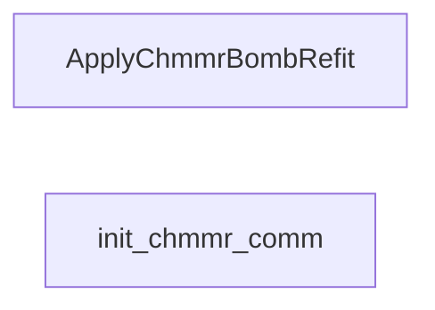

# Chmmr: existing conversation graph

> Generated by `tools/conversation_catalog.py`; do not edit this page by hand.

[Catalog and interpretation rules](../README.md) · [Proposed engine](../model.md)

Script: [chmmrc.c](../../../../sc2/src/uqm/comm/chmmr/chmmrc.c#L1). Phrase bank: [chmmr.txt](../../../../sc2/content/base/comm/chmmr/chmmr.txt#L1).

2 handler/helper nodes; 0 response registration sites; 0 direct local calls; 78 phrase records.

## Initialization and lifecycle

| Phase | Callback | Bound by | Conditions / source |
| --- | --- | --- | --- |

## Handler graph

Solid arrows are selectable responses; dashed arrows are direct C calls. Conditions, arguments, speech and effects are cataloged below. Parallel response sites are grouped only in this diagram.



## Condition catalog

Condition IDs describe enclosing source structure. Branch predicates combine with ∧; case labels mark source locations that can also be reached by fallthrough. Values refer to their original evaluation points. Local assignments and early control flow remain in the decision bodies.

| ID | Source expression / structural condition |
| --- | --- |
| <a id="condition-c1"></a>C1 | <code>starbaseAvailable</code> |
| <a id="condition-c2"></a>C2 | <code>for (i = 0; i &lt; NUM_ELEMENT_CATEGORIES; ++i)</code> |
| <a id="condition-c3"></a>C3 | <code>for (i = NUM_BOMB_MODULES; i &lt; NUM_MODULE_SLOTS; ++i)</code> |
| <a id="condition-c4"></a>C4 | <code>!(starbaseAvailable)</code> |
| <a id="condition-c5"></a>C5 | <code>for (i = NUM_MODULE_SLOTS - 1; i &gt; 0; --i)</code> |
| <a id="condition-c6"></a>C6 | <code>i &gt; 0</code> |
| <a id="condition-c7"></a>C7 | <code>for (; (i &gt; 0) &amp;&amp; (GLOBAL_SIS(ModuleSlots[i]) != (EMPTY_SLOT + 2)); --i)</code> |
| <a id="condition-c8"></a>C8 | <code>i == 0</code> |
| <a id="condition-c9"></a>C9 | <code>m &gt;= 0</code> |
| <a id="condition-c10"></a>C10 | <code>for (m = i - 1; (m &gt;= 0) &amp;&amp; (GLOBAL_SIS(ModuleSlots[m]) == (EMPTY_SLOT + 2)); --m)</code> |
| <a id="condition-c11"></a>C11 | <code>m &lt; 0</code> |
| <a id="condition-c12"></a>C12 | <code>for (i = 0; i &lt; NUM_DRIVE_SLOTS; ++i)</code> |
| <a id="condition-c13"></a>C13 | <code>for (i = 0; i &lt; NUM_JET_SLOTS; ++i)</code> |

## Script-scope state and lookup tables

These declarations supply shared local state, computed phrase alternatives, number speech, or lookup data used by the nodes. LOCDATA presentation defaults are linked separately in the source.

Presentation descriptor <code>chmmr_desc</code>: [source](../../../../sc2/src/uqm/comm/chmmr/chmmrc.c#L29).

## Node catalog

<a id="node-applychmmrbombrefit"></a>

### ApplyChmmrBombRefit

<code>void ApplyChmmrBombRefit(int starbaseAvailable)</code> — [source](../../../../sc2/src/uqm/comm/chmmr/chmmrc.c#L124).

#### Actions, queries, local updates, and control flow

Calls are listed without assuming they are pure or mutating. Local updates are retained because they determine dynamic menus and counter-selected speech.

| Kind | Operation | Enclosing conditions | Source |
| --- | --- | --- | --- |
| update | <code>GLOBAL_SIS(ResUnits) = 1000000L</code> | No enclosing branch condition | [127](../../../../sc2/src/uqm/comm/chmmr/chmmrc.c#L127) |
| call | <code>GLOBAL_SIS(ResUnits)</code> | No enclosing branch condition | [127](../../../../sc2/src/uqm/comm/chmmr/chmmrc.c#L127) |
| update | <code>GLOBAL_SIS(NumLanders) = 0</code> | No enclosing branch condition | [128](../../../../sc2/src/uqm/comm/chmmr/chmmrc.c#L128) |
| call | <code>GLOBAL_SIS(NumLanders)</code> | No enclosing branch condition | [128](../../../../sc2/src/uqm/comm/chmmr/chmmrc.c#L128) |
| update | <code>GLOBAL(ModuleCost[PLANET_LANDER]) = 0</code> | No enclosing branch condition | [129](../../../../sc2/src/uqm/comm/chmmr/chmmrc.c#L129) |
| call | <code>GLOBAL(ModuleCost[PLANET_LANDER])</code> | No enclosing branch condition | [129](../../../../sc2/src/uqm/comm/chmmr/chmmrc.c#L129) |
| update | <code>GetPlayerTravelPosition()-&gt;position.x = UNIVERSE_TO_LOGX(SOL_X)</code> | No enclosing branch condition | [142](../../../../sc2/src/uqm/comm/chmmr/chmmrc.c#L142) |
| call | <code>GetPlayerTravelPosition()</code> | No enclosing branch condition | [142](../../../../sc2/src/uqm/comm/chmmr/chmmrc.c#L142) |
| call | <code>UNIVERSE_TO_LOGX(SOL_X)</code> | No enclosing branch condition | [142](../../../../sc2/src/uqm/comm/chmmr/chmmrc.c#L142) |
| update | <code>GetPlayerTravelPosition()-&gt;position.y = UNIVERSE_TO_LOGY(SOL_Y)</code> | No enclosing branch condition | [143](../../../../sc2/src/uqm/comm/chmmr/chmmrc.c#L143) |
| call | <code>GetPlayerTravelPosition()</code> | No enclosing branch condition | [143](../../../../sc2/src/uqm/comm/chmmr/chmmrc.c#L143) |
| call | <code>UNIVERSE_TO_LOGY(SOL_Y)</code> | No enclosing branch condition | [143](../../../../sc2/src/uqm/comm/chmmr/chmmrc.c#L143) |
| update | <code>GetPlayerTravelPosition()-&gt;flight.facing = 1</code> | No enclosing branch condition | [144](../../../../sc2/src/uqm/comm/chmmr/chmmrc.c#L144) |
| call | <code>GetPlayerTravelPosition()</code> | No enclosing branch condition | [144](../../../../sc2/src/uqm/comm/chmmr/chmmrc.c#L144) |
| update | <code>GetPlayerTravelPosition()-&gt;flight.planet = EARTH_INDEX + 1</code> | No enclosing branch condition | [146](../../../../sc2/src/uqm/comm/chmmr/chmmrc.c#L146) |
| call | <code>GetPlayerTravelPosition()</code> | No enclosing branch condition | [146](../../../../sc2/src/uqm/comm/chmmr/chmmrc.c#L146) |
| update | <code>GetPlayerTravelPosition()-&gt;flight.loadOrbit = 0</code> | No enclosing branch condition | [147](../../../../sc2/src/uqm/comm/chmmr/chmmrc.c#L147) |
| call | <code>GetPlayerTravelPosition()</code> | No enclosing branch condition | [147](../../../../sc2/src/uqm/comm/chmmr/chmmrc.c#L147) |
| update | <code>GetPlayerTravelPosition()-&gt;flight.position.x = EARTH_OUTER_X</code> | No enclosing branch condition | [149](../../../../sc2/src/uqm/comm/chmmr/chmmrc.c#L149) |
| call | <code>GetPlayerTravelPosition()</code> | No enclosing branch condition | [149](../../../../sc2/src/uqm/comm/chmmr/chmmrc.c#L149) |
| update | <code>GetPlayerTravelPosition()-&gt;flight.position.y = EARTH_OUTER_Y</code> | No enclosing branch condition | [150](../../../../sc2/src/uqm/comm/chmmr/chmmrc.c#L150) |
| call | <code>GetPlayerTravelPosition()</code> | No enclosing branch condition | [150](../../../../sc2/src/uqm/comm/chmmr/chmmrc.c#L150) |
| update | <code>GLOBAL_SIS(FuelOnBoard) = FUEL_RESERVE</code> | [C1](#condition-c1) | [154](../../../../sc2/src/uqm/comm/chmmr/chmmrc.c#L154) |
| call | <code>GLOBAL_SIS(FuelOnBoard)</code> | [C1](#condition-c1) | [154](../../../../sc2/src/uqm/comm/chmmr/chmmrc.c#L154) |
| update | <code>GLOBAL_SIS(CrewEnlisted) = 0</code> | [C1](#condition-c1) | [155](../../../../sc2/src/uqm/comm/chmmr/chmmrc.c#L155) |
| call | <code>GLOBAL_SIS(CrewEnlisted)</code> | [C1](#condition-c1) | [155](../../../../sc2/src/uqm/comm/chmmr/chmmrc.c#L155) |
| update | <code>GLOBAL_SIS(TotalElementMass) = 0</code> | [C1](#condition-c1) | [156](../../../../sc2/src/uqm/comm/chmmr/chmmrc.c#L156) |
| call | <code>GLOBAL_SIS(TotalElementMass)</code> | [C1](#condition-c1) | [156](../../../../sc2/src/uqm/comm/chmmr/chmmrc.c#L156) |
| update | <code>GLOBAL(ModuleCost[STORAGE_BAY]) = 0</code> | [C1](#condition-c1) | [157](../../../../sc2/src/uqm/comm/chmmr/chmmrc.c#L157) |
| call | <code>GLOBAL(ModuleCost[STORAGE_BAY])</code> | [C1](#condition-c1) | [157](../../../../sc2/src/uqm/comm/chmmr/chmmrc.c#L157) |
| update | <code>i = 0</code> | [C1](#condition-c1) | [158](../../../../sc2/src/uqm/comm/chmmr/chmmrc.c#L158) |
| update | <code>++i</code> | [C1](#condition-c1) ∧ [C2](#condition-c2) | [158](../../../../sc2/src/uqm/comm/chmmr/chmmrc.c#L158) |
| update | <code>GLOBAL_SIS(ElementAmounts[i]) = 0</code> | [C1](#condition-c1) ∧ [C2](#condition-c2) | [159](../../../../sc2/src/uqm/comm/chmmr/chmmrc.c#L159) |
| call | <code>GLOBAL_SIS(ElementAmounts[i])</code> | [C1](#condition-c1) ∧ [C2](#condition-c2) | [159](../../../../sc2/src/uqm/comm/chmmr/chmmrc.c#L159) |
| update | <code>i = NUM_BOMB_MODULES</code> | [C1](#condition-c1) | [160](../../../../sc2/src/uqm/comm/chmmr/chmmrc.c#L160) |
| update | <code>++i</code> | [C1](#condition-c1) ∧ [C3](#condition-c3) | [160](../../../../sc2/src/uqm/comm/chmmr/chmmrc.c#L160) |
| update | <code>GLOBAL_SIS(ModuleSlots[i]) = EMPTY_SLOT + 2</code> | [C1](#condition-c1) ∧ [C3](#condition-c3) | [161](../../../../sc2/src/uqm/comm/chmmr/chmmrc.c#L161) |
| call | <code>GLOBAL_SIS(ModuleSlots[i])</code> | [C1](#condition-c1) ∧ [C3](#condition-c3) | [161](../../../../sc2/src/uqm/comm/chmmr/chmmrc.c#L161) |
| update | <code>GLOBAL(ShipStamp.origin.x) = STARBASE_INNER_X - SAFE_X</code> | [C1](#condition-c1) | [165](../../../../sc2/src/uqm/comm/chmmr/chmmrc.c#L165) |
| call | <code>GLOBAL(ShipStamp.origin.x)</code> | [C1](#condition-c1) | [165](../../../../sc2/src/uqm/comm/chmmr/chmmrc.c#L165) |
| update | <code>GLOBAL(ShipStamp.origin.y) = STARBASE_INNER_Y - SAFE_Y</code> | [C1](#condition-c1) | [166](../../../../sc2/src/uqm/comm/chmmr/chmmrc.c#L166) |
| call | <code>GLOBAL(ShipStamp.origin.y)</code> | [C1](#condition-c1) | [166](../../../../sc2/src/uqm/comm/chmmr/chmmrc.c#L166) |
| update | <code>i = NUM_MODULE_SLOTS - 1</code> | [C4](#condition-c4) | [172](../../../../sc2/src/uqm/comm/chmmr/chmmrc.c#L172) |
| update | <code>--i</code> | [C4](#condition-c4) ∧ [C5](#condition-c5) | [172](../../../../sc2/src/uqm/comm/chmmr/chmmrc.c#L172) |
| call | <code>GLOBAL_SIS(ModuleSlots[i])</code> | [C4](#condition-c4) ∧ [C5](#condition-c5) ∧ [C6](#condition-c6) | [178](../../../../sc2/src/uqm/comm/chmmr/chmmrc.c#L178) |
| update | <code>--i</code> | [C4](#condition-c4) ∧ [C5](#condition-c5) ∧ [C7](#condition-c7) | [179](../../../../sc2/src/uqm/comm/chmmr/chmmrc.c#L179) |
| flow | <code>break;</code> | [C4](#condition-c4) ∧ [C5](#condition-c5) ∧ [C8](#condition-c8) | [182](../../../../sc2/src/uqm/comm/chmmr/chmmrc.c#L182) |
| update | <code>m = i - 1</code> | [C4](#condition-c4) ∧ [C5](#condition-c5) | [184](../../../../sc2/src/uqm/comm/chmmr/chmmrc.c#L184) |
| call | <code>GLOBAL_SIS(ModuleSlots[m])</code> | [C4](#condition-c4) ∧ [C5](#condition-c5) ∧ [C9](#condition-c9) | [185](../../../../sc2/src/uqm/comm/chmmr/chmmrc.c#L185) |
| update | <code>--m</code> | [C4](#condition-c4) ∧ [C5](#condition-c5) ∧ [C10](#condition-c10) | [186](../../../../sc2/src/uqm/comm/chmmr/chmmrc.c#L186) |
| flow | <code>break;</code> | [C4](#condition-c4) ∧ [C5](#condition-c5) ∧ [C11](#condition-c11) | [189](../../../../sc2/src/uqm/comm/chmmr/chmmrc.c#L189) |
| update | <code>GLOBAL_SIS(ModuleSlots[i]) = GLOBAL_SIS(ModuleSlots[m])</code> | [C4](#condition-c4) ∧ [C5](#condition-c5) | [192](../../../../sc2/src/uqm/comm/chmmr/chmmrc.c#L192) |
| call | <code>GLOBAL_SIS(ModuleSlots[i])</code> | [C4](#condition-c4) ∧ [C5](#condition-c5) | [192](../../../../sc2/src/uqm/comm/chmmr/chmmrc.c#L192) |
| call | <code>GLOBAL_SIS(ModuleSlots[m])</code> | [C4](#condition-c4) ∧ [C5](#condition-c5) | [192](../../../../sc2/src/uqm/comm/chmmr/chmmrc.c#L192) |
| update | <code>GLOBAL_SIS(ModuleSlots[m]) = EMPTY_SLOT + 2</code> | [C4](#condition-c4) ∧ [C5](#condition-c5) | [193](../../../../sc2/src/uqm/comm/chmmr/chmmrc.c#L193) |
| call | <code>GLOBAL_SIS(ModuleSlots[m])</code> | [C4](#condition-c4) ∧ [C5](#condition-c5) | [193](../../../../sc2/src/uqm/comm/chmmr/chmmrc.c#L193) |
| update | <code>GLOBAL(ShipStamp.origin.x) = EARTH_INNER_X - SAFE_X</code> | [C4](#condition-c4) | [198](../../../../sc2/src/uqm/comm/chmmr/chmmrc.c#L198) |
| call | <code>GLOBAL(ShipStamp.origin.x)</code> | [C4](#condition-c4) | [198](../../../../sc2/src/uqm/comm/chmmr/chmmrc.c#L198) |
| update | <code>GLOBAL(ShipStamp.origin.y) = EARTH_INNER_Y - SAFE_Y</code> | [C4](#condition-c4) | [199](../../../../sc2/src/uqm/comm/chmmr/chmmrc.c#L199) |
| call | <code>GLOBAL(ShipStamp.origin.y)</code> | [C4](#condition-c4) | [199](../../../../sc2/src/uqm/comm/chmmr/chmmrc.c#L199) |
| update | <code>i = 0</code> | No enclosing branch condition | [203](../../../../sc2/src/uqm/comm/chmmr/chmmrc.c#L203) |
| update | <code>++i</code> | [C12](#condition-c12) | [203](../../../../sc2/src/uqm/comm/chmmr/chmmrc.c#L203) |
| update | <code>GLOBAL_SIS(DriveSlots[i]) = FUSION_THRUSTER</code> | [C12](#condition-c12) | [204](../../../../sc2/src/uqm/comm/chmmr/chmmrc.c#L204) |
| call | <code>GLOBAL_SIS(DriveSlots[i])</code> | [C12](#condition-c12) | [204](../../../../sc2/src/uqm/comm/chmmr/chmmrc.c#L204) |
| update | <code>i = 0</code> | No enclosing branch condition | [205](../../../../sc2/src/uqm/comm/chmmr/chmmrc.c#L205) |
| update | <code>++i</code> | [C13](#condition-c13) | [205](../../../../sc2/src/uqm/comm/chmmr/chmmrc.c#L205) |
| update | <code>GLOBAL_SIS(JetSlots[i]) = TURNING_JETS</code> | [C13](#condition-c13) | [206](../../../../sc2/src/uqm/comm/chmmr/chmmrc.c#L206) |
| call | <code>GLOBAL_SIS(JetSlots[i])</code> | [C13](#condition-c13) | [206](../../../../sc2/src/uqm/comm/chmmr/chmmrc.c#L206) |
| update | <code>GLOBAL_SIS(ModuleSlots[0]) = BOMB_MODULE_4</code> | No enclosing branch condition | [207](../../../../sc2/src/uqm/comm/chmmr/chmmrc.c#L207) |
| call | <code>GLOBAL_SIS(ModuleSlots[0])</code> | No enclosing branch condition | [207](../../../../sc2/src/uqm/comm/chmmr/chmmrc.c#L207) |
| update | <code>GLOBAL_SIS(ModuleSlots[1]) = BOMB_MODULE_5</code> | No enclosing branch condition | [208](../../../../sc2/src/uqm/comm/chmmr/chmmrc.c#L208) |
| call | <code>GLOBAL_SIS(ModuleSlots[1])</code> | No enclosing branch condition | [208](../../../../sc2/src/uqm/comm/chmmr/chmmrc.c#L208) |
| update | <code>GLOBAL_SIS(ModuleSlots[2]) = BOMB_MODULE_3</code> | No enclosing branch condition | [209](../../../../sc2/src/uqm/comm/chmmr/chmmrc.c#L209) |
| call | <code>GLOBAL_SIS(ModuleSlots[2])</code> | No enclosing branch condition | [209](../../../../sc2/src/uqm/comm/chmmr/chmmrc.c#L209) |
| update | <code>GLOBAL_SIS(ModuleSlots[3]) = BOMB_MODULE_1</code> | No enclosing branch condition | [210](../../../../sc2/src/uqm/comm/chmmr/chmmrc.c#L210) |
| call | <code>GLOBAL_SIS(ModuleSlots[3])</code> | No enclosing branch condition | [210](../../../../sc2/src/uqm/comm/chmmr/chmmrc.c#L210) |
| update | <code>GLOBAL_SIS(ModuleSlots[4]) = BOMB_MODULE_0</code> | No enclosing branch condition | [211](../../../../sc2/src/uqm/comm/chmmr/chmmrc.c#L211) |
| call | <code>GLOBAL_SIS(ModuleSlots[4])</code> | No enclosing branch condition | [211](../../../../sc2/src/uqm/comm/chmmr/chmmrc.c#L211) |
| update | <code>GLOBAL_SIS(ModuleSlots[5]) = BOMB_MODULE_1</code> | No enclosing branch condition | [212](../../../../sc2/src/uqm/comm/chmmr/chmmrc.c#L212) |
| call | <code>GLOBAL_SIS(ModuleSlots[5])</code> | No enclosing branch condition | [212](../../../../sc2/src/uqm/comm/chmmr/chmmrc.c#L212) |
| update | <code>GLOBAL_SIS(ModuleSlots[6]) = BOMB_MODULE_3</code> | No enclosing branch condition | [213](../../../../sc2/src/uqm/comm/chmmr/chmmrc.c#L213) |
| call | <code>GLOBAL_SIS(ModuleSlots[6])</code> | No enclosing branch condition | [213](../../../../sc2/src/uqm/comm/chmmr/chmmrc.c#L213) |
| update | <code>GLOBAL_SIS(ModuleSlots[7]) = BOMB_MODULE_4</code> | No enclosing branch condition | [214](../../../../sc2/src/uqm/comm/chmmr/chmmrc.c#L214) |
| call | <code>GLOBAL_SIS(ModuleSlots[7])</code> | No enclosing branch condition | [214](../../../../sc2/src/uqm/comm/chmmr/chmmrc.c#L214) |
| update | <code>GLOBAL_SIS(ModuleSlots[8]) = BOMB_MODULE_5</code> | No enclosing branch condition | [215](../../../../sc2/src/uqm/comm/chmmr/chmmrc.c#L215) |
| call | <code>GLOBAL_SIS(ModuleSlots[8])</code> | No enclosing branch condition | [215](../../../../sc2/src/uqm/comm/chmmr/chmmrc.c#L215) |
| update | <code>GLOBAL_SIS(ModuleSlots[9]) = BOMB_MODULE_2</code> | No enclosing branch condition | [216](../../../../sc2/src/uqm/comm/chmmr/chmmrc.c#L216) |
| call | <code>GLOBAL_SIS(ModuleSlots[9])</code> | No enclosing branch condition | [216](../../../../sc2/src/uqm/comm/chmmr/chmmrc.c#L216) |

<details>
<summary>Exact decision body (local calculations, early returns, fallthrough and ordering)</summary>

```c
{
    int i;
		GLOBAL_SIS (ResUnits) = 1000000L;
		GLOBAL_SIS (NumLanders) = 0;
		GLOBAL (ModuleCost[PLANET_LANDER]) = 0;

#define EARTH_INDEX 2 /* earth is 3rd planet --> 3 - 1 = 2 */
/* Magic numbers for Earth */
#define EARTH_OUTER_X (-725)
#define EARTH_OUTER_Y (597)
#define EARTH_INNER_X (121)
#define EARTH_INNER_Y (113)
/* Magic numbers for Earth Starbase */
#define STARBASE_INNER_X (86)
#define STARBASE_INNER_Y (113)

		/* transport player to Earth */
		GetPlayerTravelPosition()->position.x = UNIVERSE_TO_LOGX (SOL_X);
		GetPlayerTravelPosition()->position.y = UNIVERSE_TO_LOGY (SOL_Y);
		GetPlayerTravelPosition()->flight.facing = 1;
		/* At Earth or at Starbase */
		GetPlayerTravelPosition()->flight.planet = EARTH_INDEX + 1;
		GetPlayerTravelPosition()->flight.loadOrbit = 0;
		/* XXX : this should be unhardcoded eventually */
		GetPlayerTravelPosition()->flight.position.x = EARTH_OUTER_X;
		GetPlayerTravelPosition()->flight.position.y = EARTH_OUTER_Y;

		if (starbaseAvailable)
		{	/* Normal game mode - you are transported to Starbase */
			GLOBAL_SIS (FuelOnBoard) = FUEL_RESERVE;
			GLOBAL_SIS (CrewEnlisted) = 0;
			GLOBAL_SIS (TotalElementMass) = 0;
			GLOBAL (ModuleCost[STORAGE_BAY]) = 0; /* disable Storage Bay */
			for (i = 0; i < NUM_ELEMENT_CATEGORIES; ++i)
				GLOBAL_SIS (ElementAmounts[i]) = 0;
			for (i = NUM_BOMB_MODULES; i < NUM_MODULE_SLOTS; ++i)
				GLOBAL_SIS (ModuleSlots[i]) = EMPTY_SLOT + 2;

			/* XXX : this should be unhardcoded eventually */
			/* transport to Starbase */
			GLOBAL (ShipStamp.origin.x) = STARBASE_INNER_X - SAFE_X;
			GLOBAL (ShipStamp.origin.y) = STARBASE_INNER_Y - SAFE_Y;
		}
		else
		{	/* 'Beating Game Differently' mode - never visited Starbase,
			 * so you are transported to Earth */
			/* compress the layout -- move all to front */
			for (i = NUM_MODULE_SLOTS - 1; i > 0; --i)
			{
				int m;

				/* find next unused slot */
				for (; i > 0
						&& GLOBAL_SIS (ModuleSlots[i]) != EMPTY_SLOT + 2;
						--i)
					;
				if (i == 0)
					break;
				/* find next module to move */
				for (m = i - 1; m >= 0
						&& GLOBAL_SIS (ModuleSlots[m]) == EMPTY_SLOT + 2;
						--m)
					;
				if (m < 0)
					break;

				/* move the module */
				GLOBAL_SIS (ModuleSlots[i]) = GLOBAL_SIS (ModuleSlots[m]);
				GLOBAL_SIS (ModuleSlots[m]) = EMPTY_SLOT + 2;
			}

			/* XXX : this should be unhardcoded eventually */
			/* transport to Earth itself */
			GLOBAL (ShipStamp.origin.x) = EARTH_INNER_X - SAFE_X;
			GLOBAL (ShipStamp.origin.y) = EARTH_INNER_Y - SAFE_Y;
		}

		/* install Chmmr-supplied modules */
		for (i = 0; i < NUM_DRIVE_SLOTS; ++i)
			GLOBAL_SIS (DriveSlots[i]) = FUSION_THRUSTER;
		for (i = 0; i < NUM_JET_SLOTS; ++i)
			GLOBAL_SIS (JetSlots[i]) = TURNING_JETS;
		GLOBAL_SIS (ModuleSlots[0]) = BOMB_MODULE_4;
		GLOBAL_SIS (ModuleSlots[1]) = BOMB_MODULE_5;
		GLOBAL_SIS (ModuleSlots[2]) = BOMB_MODULE_3;
		GLOBAL_SIS (ModuleSlots[3]) = BOMB_MODULE_1;
		GLOBAL_SIS (ModuleSlots[4]) = BOMB_MODULE_0;
		GLOBAL_SIS (ModuleSlots[5]) = BOMB_MODULE_1;
		GLOBAL_SIS (ModuleSlots[6]) = BOMB_MODULE_3;
		GLOBAL_SIS (ModuleSlots[7]) = BOMB_MODULE_4;
		GLOBAL_SIS (ModuleSlots[8]) = BOMB_MODULE_5;
		GLOBAL_SIS (ModuleSlots[9]) = BOMB_MODULE_2;
}
```

</details>

<a id="node-init_chmmr_comm"></a>

### init_chmmr_comm

<code>LOCDATA *init_chmmr_comm(void)</code> — [source](../../../../sc2/src/uqm/comm/chmmr/chmmrc.c#L222).

#### Actions, queries, local updates, and control flow

Calls are listed without assuming they are pure or mutating. Local updates are retained because they determine dynamic menus and counter-selected speech.

| Kind | Operation | Enclosing conditions | Source |
| --- | --- | --- | --- |
| update | <code>chmmr_desc.AlienTextBaseline.x = TEXT_X_OFFS + (SIS_TEXT_WIDTH &gt;&gt; 1)</code> | No enclosing branch condition | [226](../../../../sc2/src/uqm/comm/chmmr/chmmrc.c#L226) |
| update | <code>chmmr_desc.AlienTextBaseline.y = 0</code> | No enclosing branch condition | [227](../../../../sc2/src/uqm/comm/chmmr/chmmrc.c#L227) |
| update | <code>chmmr_desc.AlienTextWidth = SIS_TEXT_WIDTH - 16</code> | No enclosing branch condition | [228](../../../../sc2/src/uqm/comm/chmmr/chmmrc.c#L228) |
| call | <code>setSegue(Segue_peace)</code> | No enclosing branch condition | [230](../../../../sc2/src/uqm/comm/chmmr/chmmrc.c#L230) |
| update | <code>retval = &amp;chmmr_desc</code> | No enclosing branch condition | [231](../../../../sc2/src/uqm/comm/chmmr/chmmrc.c#L231) |
| flow | <code>return retval;</code> | No enclosing branch condition | [233](../../../../sc2/src/uqm/comm/chmmr/chmmrc.c#L233) |

<details>
<summary>Exact decision body (local calculations, early returns, fallthrough and ordering)</summary>

```c
{
	LOCDATA *retval;

	chmmr_desc.AlienTextBaseline.x = TEXT_X_OFFS + (SIS_TEXT_WIDTH >> 1);
	chmmr_desc.AlienTextBaseline.y = 0;
	chmmr_desc.AlienTextWidth = SIS_TEXT_WIDTH - 16;

	setSegue (Segue_peace);
	retval = &chmmr_desc;

	return (retval);
}
```

</details>

## Phrase catalog

Full base-content text, keyed by the symbols used above. Voice filenames are resource metadata; playback also depends on installed addons and settings. Dynamic insertions retain their original placeholders.

<a id="phrase-why_you_here_1"></a>

<details>
<summary>WHY_YOU_HERE_1 — chmmr-000.ogg</summary>

[Text source](../../../../sc2/content/base/comm/chmmr/chmmr.txt#L1)

<pre>we are the chenjesu... we are the mmrnmhrm
we do not understand how you have penetrated the slave shield or why
but in doing so you have interrupted the process
explain this intrusion.</pre>

</details>

<a id="phrase-why_you_here_2"></a>

<details>
<summary>WHY_YOU_HERE_2 — chmmr-001.ogg</summary>

[Text source](../../../../sc2/content/base/comm/chmmr/chmmr.txt#L7)

<pre>once more you interfere with the process... why?</pre>

</details>

<a id="phrase-why_you_here_3"></a>

<details>
<summary>WHY_YOU_HERE_3 — chmmr-002.ogg</summary>

[Text source](../../../../sc2/content/base/comm/chmmr/chmmr.txt#L10)

<pre>your presence here is painful to us... what is it you wish?</pre>

</details>

<a id="phrase-why_you_here_4"></a>

<details>
<summary>WHY_YOU_HERE_4 — chmmr-003.ogg</summary>

[Text source](../../../../sc2/content/base/comm/chmmr/chmmr.txt#L13)

<pre>your presence here is painful to us... what is it you wish?</pre>

</details>

<a id="phrase-find_out_whats_up"></a>

<details>
<summary>find_out_whats_up</summary>

[Text source](../../../../sc2/content/base/comm/chmmr/chmmr.txt#L16)

<pre>We came here to find out what you&#x27;re doing down there.</pre>

</details>

<a id="phrase-hybrid_process"></a>

<details>
<summary>HYBRID_PROCESS — chmmr-004.ogg</summary>

[Text source](../../../../sc2/content/base/comm/chmmr/chmmr.txt#L19)

<pre>though your ship&#x27;s design is unfamiliar to us
we now understand that you are of human origin and so we will share with you
our reasons for accepting the status of ur-quan slave
in 2135, our great alliance burned within the crucible of sentience
though our fleets of armed starships held back the hierarchy&#x27;s grotesque armada for many years
in the end, the ur-quan unleashed a power upon us that was so overwhelming
we knew we would be annihilated if we did not submit
this unstoppable power, this ultimate weapon was a huge starship
an unstoppable battle platform built by the precursors in the ancient past
your vessel shares some similarities in design to the ur-quan&#x27;s battle platform
which they call `sa-matra&#x27;, meaning `great trophy&#x27;
the sa-matra was many times larger than your ship, and bore weapons and defensive systems
that made it invulnerable to all of our technologies
it remains a mystery to us why the ur-quan fought us for so long without using the sa-matra
but when they finally brought the ship into combat
the sa-matra incinerated our finest broodhome vessels from ten times our own ships&#x27; weapon range.
we had no choices beyond submission or devastation
before the ur-quan arrived to accept our surrender, we sent one last message to your people
a message suggesting that your species do as we chenjesu and mmrnmhrm planned to do
we would accept the ur-quan&#x27;s demands and become slaves
until such a time as we found a way to destroy or neutralize the sa-matra.</pre>

</details>

<a id="phrase-need_help"></a>

<details>
<summary>need_help</summary>

[Text source](../../../../sc2/content/base/comm/chmmr/chmmr.txt#L42)

<pre>We are struggling against the Ur-Quan. Can&#x27;t you help us?</pre>

</details>

<a id="phrase-cant_help"></a>

<details>
<summary>CANT_HELP — chmmr-005.ogg</summary>

[Text source](../../../../sc2/content/base/comm/chmmr/chmmr.txt#L45)

<pre>we cannot be of any assistance now... we are in the middle of the process.
i will explain
after we chenjesu and mmrnmhrm were defeated by the ur-quan
we chose to be encased in a single slave shield on this world
as soon as the ur-quan departed, we began the process
we initiated a synthesis of our two species, our two cultures
one crystalline, the other purely mechanical
this process, fueled only by the radiant energy of our sun
will eventually produce a new hybrid race
and when the process is complete, we will crack the ur-quan slave shield
and emerge from our chrysalis like a winged insect unleashed from its cocoon
then we will be ready and capable to deal with the ur-quan, their battle thralls
and their dreaded sa-matra.</pre>

</details>

<a id="phrase-why_no_help"></a>

<details>
<summary>why_no_help</summary>

[Text source](../../../../sc2/content/base/comm/chmmr/chmmr.txt#L60)

<pre>But why can&#x27;t you help us now?!</pre>

</details>

<a id="phrase-long_time"></a>

<details>
<summary>LONG_TIME — chmmr-006.ogg</summary>

[Text source](../../../../sc2/content/base/comm/chmmr/chmmr.txt#L63)

<pre>the complete synthetic hybridization of the chenjesu and the mmrnmhrm species
will require approximately thirty-five of your earth years
this extended duration is necessary because our synthesis mechanisms
are dependent exclusively on the light of our sun for energy.</pre>

</details>

<a id="phrase-what_if_more_energy"></a>

<details>
<summary>what_if_more_energy</summary>

[Text source](../../../../sc2/content/base/comm/chmmr/chmmr.txt#L69)

<pre>What if we could find some way to get you more energy? Would that speed things up?</pre>

</details>

<a id="phrase-danger_to_us"></a>

<details>
<summary>DANGER_TO_US — chmmr-007.ogg</summary>

[Text source](../../../../sc2/content/base/comm/chmmr/chmmr.txt#L72)

<pre>what you describe is theoretically possible
but it would pose a great danger to us
the process must be executed as planned... or it may fail catastrophically
we would be destroyed.</pre>

</details>

<a id="phrase-need_advice"></a>

<details>
<summary>need_advice</summary>

[Text source](../../../../sc2/content/base/comm/chmmr/chmmr.txt#L78)

<pre>We really need advice from you.</pre>

</details>

<a id="phrase-what_advice"></a>

<details>
<summary>WHAT_ADVICE — chmmr-008.ogg</summary>

[Text source](../../../../sc2/content/base/comm/chmmr/chmmr.txt#L81)

<pre>our wisdom is available... detail your need.</pre>

</details>

<a id="phrase-how_defeat_urquan"></a>

<details>
<summary>how_defeat_urquan</summary>

[Text source](../../../../sc2/content/base/comm/chmmr/chmmr.txt#L84)

<pre>How do you think we can defeat the Ur-Quan?</pre>

</details>

<a id="phrase-defeat_like_so"></a>

<details>
<summary>DEFEAT_LIKE_SO — chmmr-009.ogg</summary>

[Text source](../../../../sc2/content/base/comm/chmmr/chmmr.txt#L87)

<pre>you must find some way to destroy the sa-matra
to do this you will need a powerful weapon capable of destroying an entire planet
but that is not all
you will also require some way to distract the ur-quan
to give you the opportunity to use the weapon.</pre>

</details>

<a id="phrase-what_about_tpet"></a>

<details>
<summary>what_about_tpet</summary>

[Text source](../../../../sc2/content/base/comm/chmmr/chmmr.txt#L94)

<pre>I seem to have acquired a Dnyarri. What do you make of it?</pre>

</details>

<a id="phrase-scary_but_useful"></a>

<details>
<summary>SCARY_BUT_USEFUL — chmmr-010.ogg</summary>

[Text source](../../../../sc2/content/base/comm/chmmr/chmmr.txt#L97)

<pre>we know the dnyarri only from legend
where they are described as the embodiment of evil and cruelty
if ever there was a devil, captain, it was the dnyarri
however, if in fact the creature you possess is one of this ancient breed
its mental power may be useful to help confuse the ur-quan.</pre>

</details>

<a id="phrase-what_about_bomb"></a>

<details>
<summary>what_about_bomb</summary>

[Text source](../../../../sc2/content/base/comm/chmmr/chmmr.txt#L104)

<pre>I got this huge bomb-thing from a race called the Utwig. Is it really a weapon?</pre>

</details>

<a id="phrase-about_bomb"></a>

<details>
<summary>ABOUT_BOMB — chmmr-011.ogg</summary>

[Text source](../../../../sc2/content/base/comm/chmmr/chmmr.txt#L107)

<pre>the device you speak of is a huge matter-antimatter bomb
if you had activated it, the weapon would have annihilated your ship and everything else within five hundred kilometers
the destructive power of this weapon makes it suitable for the most important task you will ever undertake
the neutralization of the sa-matra, the ur-quan&#x27;s nearly invincible battle platform.</pre>

</details>

<a id="phrase-what_about_sun_device"></a>

<details>
<summary>what_about_sun_device</summary>

[Text source](../../../../sc2/content/base/comm/chmmr/chmmr.txt#L113)

<pre>I er... borrowed a device from the Mycon. Do you know what it is?</pre>

</details>

<a id="phrase-about_sun_device"></a>

<details>
<summary>ABOUT_SUN_DEVICE — chmmr-012.ogg</summary>

[Text source](../../../../sc2/content/base/comm/chmmr/chmmr.txt#L116)

<pre>we do not recognize this device
but it appears to be a precursor tool which can radiate a great amount of energy.</pre>

</details>

<a id="phrase-what_about_samatra"></a>

<details>
<summary>what_about_samatra</summary>

[Text source](../../../../sc2/content/base/comm/chmmr/chmmr.txt#L120)

<pre>What more can you tell me about this Sa-Matra?</pre>

</details>

<a id="phrase-about_samatra"></a>

<details>
<summary>ABOUT_SAMATRA — chmmr-013.ogg</summary>

[Text source](../../../../sc2/content/base/comm/chmmr/chmmr.txt#L123)

<pre>we only glimpsed it once, when it devastated our most powerful fleet
it was several times the size of your vessel
with a host of unusual weapons protruding from its scabrous hull
but the most dangerous feature of the sa-matra was its annihilation toroids...
with this weapon they could vaporize ships from the far side of a solar system
or cut broad swaths of devastation across a planet in seconds.</pre>

</details>

<a id="phrase-enough_advice"></a>

<details>
<summary>enough_advice</summary>

[Text source](../../../../sc2/content/base/comm/chmmr/chmmr.txt#L131)

<pre>Thanks! That&#x27;s enough advice for now.</pre>

</details>

<a id="phrase-ok_enough_advice"></a>

<details>
<summary>OK_ENOUGH_ADVICE — chmmr-014.ogg</summary>

[Text source](../../../../sc2/content/base/comm/chmmr/chmmr.txt#L134)

<pre>though your presence here is a painful intrusion
we will always provide advice whenever you request it, captain.</pre>

</details>

<a id="phrase-bye_shielded"></a>

<details>
<summary>bye_shielded</summary>

[Text source](../../../../sc2/content/base/comm/chmmr/chmmr.txt#L138)

<pre>Goodbye Chenjesu. Goodbye Mmrnmhrm.</pre>

</details>

<a id="phrase-goodbye_shielded"></a>

<details>
<summary>GOODBYE_SHIELDED — chmmr-015.ogg</summary>

[Text source](../../../../sc2/content/base/comm/chmmr/chmmr.txt#L141)

<pre>goodbye once and future ally, human... when the process is complete and we emerge from our chrysalis
i shall tell your grandchildren of our conversation this day.</pre>

</details>

<a id="phrase-we_are_free"></a>

<details>
<summary>WE_ARE_FREE — chmmr-016.ogg</summary>

[Text source](../../../../sc2/content/base/comm/chmmr/chmmr.txt#L145)

<pre>WE ARE FREE!
YOU HAVE FLOODED OUR SYNTHESIS MECHANISMS WITH A WEALTH OF RADIANT ENERGY.
WHAT WAS SUPPOSED TO TAKE DECADES HAS BEEN ACCOMPLISHED IN SECONDS.
THE PROCESS IS INCOMPLETE, YET WE HAVE EMERGED.
WE ARE THE CHMMR.</pre>

</details>

<a id="phrase-who_are_you"></a>

<details>
<summary>WHO_ARE_YOU — chmmr-017.ogg</summary>

[Text source](../../../../sc2/content/base/comm/chmmr/chmmr.txt#L152)

<pre>WHO ARE YOU?</pre>

</details>

<a id="phrase-i_am_captain0"></a>

<details>
<summary>i_am_captain0</summary>

[Text source](../../../../sc2/content/base/comm/chmmr/chmmr.txt#L155)

<pre>I am captain</pre>

</details>

<a id="phrase-i_am_captain1"></a>

<details>
<summary>i_am_captain1</summary>

[Text source](../../../../sc2/content/base/comm/chmmr/chmmr.txt#L157)

<pre>of the starship</pre>

</details>

<a id="phrase-i_am_captain2"></a>

<details>
<summary>i_am_captain2</summary>

[Text source](../../../../sc2/content/base/comm/chmmr/chmmr.txt#L159)

<pre>.</pre>

</details>

<a id="phrase-i_am_savior"></a>

<details>
<summary>i_am_savior</summary>

[Text source](../../../../sc2/content/base/comm/chmmr/chmmr.txt#L162)

<pre>I am the guy who&#x27;s trying to save the Galaxy.</pre>

</details>

<a id="phrase-i_am_silly"></a>

<details>
<summary>i_am_silly</summary>

[Text source](../../../../sc2/content/base/comm/chmmr/chmmr.txt#L165)

<pre>Who am I? Me? Er... dang! I just forgot.</pre>

</details>

<a id="phrase-why_have_you_freed_us"></a>

<details>
<summary>WHY_HAVE_YOU_FREED_US — chmmr-018.ogg</summary>

[Text source](../../../../sc2/content/base/comm/chmmr/chmmr.txt#L168)

<pre>WHY HAVE YOU INTERRUPTED THE PROCESS?!!!</pre>

</details>

<a id="phrase-serious_1"></a>

<details>
<summary>serious_1</summary>

[Text source](../../../../sc2/content/base/comm/chmmr/chmmr.txt#L171)

<pre>We struggle to free all races from the Ur-Quan. We need your help.</pre>

</details>

<a id="phrase-serious_2"></a>

<details>
<summary>serious_2</summary>

[Text source](../../../../sc2/content/base/comm/chmmr/chmmr.txt#L174)

<pre>You are the key to winning back the freedom of our Alliance.</pre>

</details>

<a id="phrase-silly"></a>

<details>
<summary>silly</summary>

[Text source](../../../../sc2/content/base/comm/chmmr/chmmr.txt#L177)

<pre>I wanted to see what you looked like without all that orange junk.</pre>

</details>

<a id="phrase-will_help_analyze_logs"></a>

<details>
<summary>WILL_HELP_ANALYZE_LOGS — chmmr-019.ogg</summary>

[Text source](../../../../sc2/content/base/comm/chmmr/chmmr.txt#L180)

<pre>YOUR NEED MUST BE GREAT FOR YOU TO HAVE RISKED SO MUCH
JUST TO BRING US FROM BENEATH THE SHIELD.
WE WERE NOT READY... BUT THIS IS NOW IN THE PAST.
WHAT IS DONE IS DONE.
YOU ARE INTENT ON STOPPING THE UR-QUAN... VERY WELL.
WE ARE PREPARED TO ASSIST YOU IN WHATEVER WAY WE CAN.
WE MUST FIRST TELL YOU THAT EVEN BEFORE WE WERE PLACED UNDER THE SLAVE SHIELD
WE REALIZED THAT THE ONLY WAY TO TRULY DEFEAT THE UR-QUAN
WAS TO FIRST DESTROY THEIR PRECURSOR BATTLE PLATFORM... THE SA-MATRA.
THIS VESSEL WAS RESPONSIBLE FOR THE VICTORY OF THE HIERARCHY OVER THE ALLIANCE.
WHEN IT WAS BROUGHT TO BEAR AGAINST OUR WORLDS, WE COULD NOT RESIST IT.
THIS MUST BE YOUR PRIORITY. THIS MUST BE YOUR EVENTUAL GOAL.
WE KNOW WHAT IS NECESSARY TO ACHIEVE THIS END
BUT FIRST WE MUST KNOW WHAT YOU HAVE ALREADY LEARNED
SO WE WILL SCAN THE DATABANKS AND LOGS ABOARD YOUR SHIP.
THERE.
THE PROCESS IS COMPLETE. NOW WE CAN DISCUSS WHAT YOU MUST DO.</pre>

</details>

<a id="phrase-you_know_samatra"></a>

<details>
<summary>YOU_KNOW_SAMATRA — chmmr-020.ogg</summary>

[Text source](../../../../sc2/content/base/comm/chmmr/chmmr.txt#L199)

<pre>YOU ALREADY HAVE THE DATA NECESSARY TO TELL YOU THAT THE SA-MATRA VESSEL
IS LOCATED IN THE DELTA CRATERIS STAR SYSTEM.</pre>

</details>

<a id="phrase-dont_know_about_samatra"></a>

<details>
<summary>DONT_KNOW_ABOUT_SAMATRA — chmmr-021.ogg</summary>

[Text source](../../../../sc2/content/base/comm/chmmr/chmmr.txt#L203)

<pre>YOU NEED TO LOCATE THE UR-QUAN&#x27;S SA-MATRA VESSEL.
IF YOU CANNOT FIND IT YOURSELF, ASK THOSE OTHERS WHO ARE NEAR THE UR-QUAN.
PERHAPS THEY WILL KNOW.</pre>

</details>

<a id="phrase-need_distraction"></a>

<details>
<summary>NEED_DISTRACTION — chmmr-022.ogg</summary>

[Text source](../../../../sc2/content/base/comm/chmmr/chmmr.txt#L208)

<pre>THE SA-MATRA IS SURE TO BE HEAVILY GUARDED.
TO ALLOW YOU TO GET CLOSE ENOUGH TO THE SA-MATRA
YOU WILL HAVE TO CREATE SOME TYPE OF DIVERSION.</pre>

</details>

<a id="phrase-have_talking_pet"></a>

<details>
<summary>HAVE_TALKING_PET — chmmr-023.ogg</summary>

[Text source](../../../../sc2/content/base/comm/chmmr/chmmr.txt#L213)

<pre>WE HAVE DETECTED THE PRESENCE OF A DNYARRI ABOARD YOUR SHIP.
THOUGH THE BEING IS DARKLY EVIL, AND INCREDIBLY DANGEROUS
THE TAALO DEVICE YOU POSSESS HAS EFFECTIVELY NULLIFIED THE CREATURE&#x27;S POWER OVER YOU.
HOWEVER, IT WILL DO A MOST EXCELLENT JOB DISTRACTING THE UR-QUAN LONG ENOUGH
FOR YOU TO APPROACH THE SA-MATRA AND DESTROY IT.</pre>

</details>

<a id="phrase-need_weapon"></a>

<details>
<summary>NEED_WEAPON — chmmr-024.ogg</summary>

[Text source](../../../../sc2/content/base/comm/chmmr/chmmr.txt#L220)

<pre>TO DEFEAT THE UR-QUAN YOU MUST FIRST DESTROY THE SA-MATRA BATTLE PLATFORM.
THE ONLY WAY WE CAN ENVISION THIS OCCURRING IS FOR YOU TO DETONATE A HUGE EXPLOSIVE DEVICE
ADJACENT TO THE BATTLE PLATFORM, AT POINT BLANK RANGE.
WE BELIEVE THAT THE ONLY WEAPON WHICH CAN GENERATE SUFFICIENT DESTRUCTIVE FORCE
IS A MATTER-ANTIMATTER BOMB, BUT WE CANNOT BUILD ONE OURSELVES.</pre>

</details>

<a id="phrase-have_bomb"></a>

<details>
<summary>HAVE_BOMB — chmmr-025.ogg</summary>

[Text source](../../../../sc2/content/base/comm/chmmr/chmmr.txt#L227)

<pre>YOU POSSESS AN ANTI-MATTER BOMB. THIS IS GOOD.
BUT HAD YOU ACTIVATED IT, THE DEVICE WOULD HAVE ANNIHILATED YOUR SHIP
AND EVERYTHING ELSE WITHIN FIVE HUNDRED KILOMETERS.
EVEN SO, WE WILL HAVE TO IMPROVE THIS DEVICE, MAGNIFY ITS POWER WITH OUR CRYSTAL TECHNOLOGY.
THE DESTRUCTIVE POTENTIAL OF THIS WEAPON WILL THEN MAKE IT SUITABLE
FOR THE MOST IMPORTANT TASK YOU WILL EVER UNDERTAKE
THE NEUTRALIZATION OF THE SA-MATRA, THE UR-QUAN&#x27;S NEARLY INVINCIBLE BATTLE PLATFORM.</pre>

</details>

<a id="phrase-return_when_ready"></a>

<details>
<summary>RETURN_WHEN_READY — chmmr-026.ogg</summary>

[Text source](../../../../sc2/content/base/comm/chmmr/chmmr.txt#L236)

<pre>RETURN WHEN YOU HAVE GATHERED THE RESOURCES WE HAVE DESCRIBED.</pre>

</details>

<a id="phrase-you_are_ready"></a>

<details>
<summary>YOU_ARE_READY — chmmr-027.ogg</summary>

[Text source](../../../../sc2/content/base/comm/chmmr/chmmr.txt#L239)

<pre>YOU ARE READY...</pre>

</details>

<a id="phrase-further_assistance"></a>

<details>
<summary>further_assistance</summary>

[Text source](../../../../sc2/content/base/comm/chmmr/chmmr.txt#L242)

<pre>Can you give us further assistance now?</pre>

</details>

<a id="phrase-no_further_assistance"></a>

<details>
<summary>NO_FURTHER_ASSISTANCE — chmmr-028.ogg</summary>

[Text source](../../../../sc2/content/base/comm/chmmr/chmmr.txt#L245)

<pre>WE CANNOT HELP YOU UNTIL YOU HAVE GATHERED THE NECESSARY RESOURCES.</pre>

</details>

<a id="phrase-tech_help"></a>

<details>
<summary>tech_help</summary>

[Text source](../../../../sc2/content/base/comm/chmmr/chmmr.txt#L248)

<pre>You seem to have superior technology. Would you share this with us?</pre>

</details>

<a id="phrase-use_our_ships_before"></a>

<details>
<summary>USE_OUR_SHIPS_BEFORE — chmmr-029.ogg</summary>

[Text source](../../../../sc2/content/base/comm/chmmr/chmmr.txt#L251)

<pre>WE WILL PROVIDE YOU WITH THE DESIGNS FOR A NEW CLASS OF FIGHTING SHIP... THE AVATAR
ALONG WITH ENOUGH CHMMR TO COMMAND HOWEVER MANY VESSELS YOU MAY BUILD.
AVATAR BATTLESHIPS ARE MUCH MORE EFFECTIVE THAN OUR BROODHOME OR X-FORM VESSELS.
IN COMPETENT HANDS, THESE SHIPS CAN DEFEAT ANY SHIP IN SPACE.</pre>

</details>

<a id="phrase-where_weapon"></a>

<details>
<summary>where_weapon</summary>

[Text source](../../../../sc2/content/base/comm/chmmr/chmmr.txt#L257)

<pre>Where can I find the super-weapon you described?</pre>

</details>

<a id="phrase-precursor_weapon"></a>

<details>
<summary>PRECURSOR_WEAPON — chmmr-030.ogg</summary>

[Text source](../../../../sc2/content/base/comm/chmmr/chmmr.txt#L260)

<pre>THERE ARE RUMORS OF SUCH A DEVICE, A PRECURSOR PLANETEERING TOOL
TO BE FOUND SOMEWHERE FAR TOWARDS THE CORE
IN THE POSSESSION OF A NON-HOSTILE ALIEN RACE.
WE CANNOT PROVIDE ANY MORE INFORMATION AT THIS TIME.</pre>

</details>

<a id="phrase-where_distraction"></a>

<details>
<summary>where_distraction</summary>

[Text source](../../../../sc2/content/base/comm/chmmr/chmmr.txt#L266)

<pre>What can possibly distract an Ur-Quan?</pre>

</details>

<a id="phrase-psychic_weaponry"></a>

<details>
<summary>PSYCHIC_WEAPONRY — chmmr-031.ogg</summary>

[Text source](../../../../sc2/content/base/comm/chmmr/chmmr.txt#L269)

<pre>IN OUR STUDIES WE HAVE LEARNED THAT THE UR-QUAN ARE ESPECIALLY SENSITIVE TO PSYCHIC MANIPULATION.
YOUR BEST STRATEGY WOULD BE TO FIND A WEAPON OF THIS TYPE.
BE AWARE THAT MOST PSYCHIC WEAPONS ARE NOT MECHANICAL CONSTRUCTS.
THEY ARE USUALLY INTELLIGENT LIFE FORMS, OFTEN INIMICAL.</pre>

</details>

<a id="phrase-what_now"></a>

<details>
<summary>what_now</summary>

[Text source](../../../../sc2/content/base/comm/chmmr/chmmr.txt#L275)

<pre>So what happens now?</pre>

</details>

<a id="phrase-we_will_improve_bomb"></a>

<details>
<summary>WE_WILL_IMPROVE_BOMB — chmmr-032.ogg</summary>

[Text source](../../../../sc2/content/base/comm/chmmr/chmmr.txt#L278)

<pre>YOU ARE FULLY PREPARED FOR THE UNDERTAKING.
THERE IS EVERY CHANCE THAT YOU WILL BE ABLE TO DESTROY THE SA-MATRA
AND STOP BOTH THE UR-QUAN AND THE KOHR-AH.</pre>

</details>

<a id="phrase-modify_vessel"></a>

<details>
<summary>MODIFY_VESSEL — chmmr-033.ogg</summary>

[Text source](../../../../sc2/content/base/comm/chmmr/chmmr.txt#L283)

<pre>WE WILL NOW FIT THE PRECURSOR WEAPON AND OUR OWN CRYSTAL AMPLIFICATION SYSTEM TO YOUR VESSEL.
BY ROUTING A PORTION OF YOUR FLAGSHIP&#x27;S FUSION POWER THROUGH THE WEAPON&#x27;S IGNITION CHAMBER
ITS DESTRUCTIVE FORCE WILL BE MULTIPLIED BY A LARGE FACTOR.</pre>

</details>

<a id="phrase-wont_hurt_my_ship"></a>

<details>
<summary>wont_hurt_my_ship</summary>

[Text source](../../../../sc2/content/base/comm/chmmr/chmmr.txt#L288)

<pre>We&#x27;ll fire this weapon at the Sa-Matra, right? It&#x27;s not going to hurt my ship, is it?</pre>

</details>

<a id="phrase-will_destroy_it"></a>

<details>
<summary>WILL_DESTROY_IT — chmmr-034.ogg</summary>

[Text source](../../../../sc2/content/base/comm/chmmr/chmmr.txt#L291)

<pre>YOUR VESSEL WILL BE TOTALLY ANNIHILATED.</pre>

</details>

<a id="phrase-bummer_about_my_ship"></a>

<details>
<summary>bummer_about_my_ship</summary>

[Text source](../../../../sc2/content/base/comm/chmmr/chmmr.txt#L294)

<pre>Whoa. Gee, that&#x27;s bad. I don&#x27;t suppose there&#x27;s anything we can do to change that, is there?</pre>

</details>

<a id="phrase-dead_silence"></a>

<details>
<summary>DEAD_SILENCE — chmmr-035.ogg</summary>

[Text source](../../../../sc2/content/base/comm/chmmr/chmmr.txt#L297)

<pre>NO.</pre>

</details>

<a id="phrase-other_assistance"></a>

<details>
<summary>other_assistance</summary>

[Text source](../../../../sc2/content/base/comm/chmmr/chmmr.txt#L300)

<pre>Can you provide us with any other assistance?</pre>

</details>

<a id="phrase-use_our_ships_after"></a>

<details>
<summary>USE_OUR_SHIPS_AFTER — chmmr-036.ogg</summary>

[Text source](../../../../sc2/content/base/comm/chmmr/chmmr.txt#L303)

<pre>BECAUSE YOUR FLAGSHIP WILL BE SUBSTANTIALLY WEAKENED BY OUR MODIFICATIONS
YOU MAY REQUIRE ADDITIONAL COMBAT VEHICLES FOR PROTECTION
SO THAT YOU CAN APPROACH CLOSE ENOUGH TO THE SA-MATRA TO DETONATE THE WEAPON.
WE WILL PROVIDE YOU WITH THE DESIGNS FOR OUR NEW AVATAR-CLASS FIGHTING SHIPS.
IN COMPETENT HANDS, THESE SHIPS ARE A MATCH FOR BOTH THE UR-QUAN AND KOHR-AH VESSELS.</pre>

</details>

<a id="phrase-proceed"></a>

<details>
<summary>proceed</summary>

[Text source](../../../../sc2/content/base/comm/chmmr/chmmr.txt#L310)

<pre>Very well. Proceed with the modifications.</pre>

</details>

<a id="phrase-take_2_weeks"></a>

<details>
<summary>TAKE_2_WEEKS — chmmr-037.ogg</summary>

[Text source](../../../../sc2/content/base/comm/chmmr/chmmr.txt#L313)

<pre>THE COMPLETION DATE FOR YOUR VESSEL&#x27;S MODIFICATION IS ROUGHLY TWO WEEKS HENCE.
SO THAT YOU AND YOUR HUMAN COMPANIONS MAY MAKE ANY NECESSARY PREPARATIONS AT YOUR STARBASE
WE WILL NOW TRANSPORT YOU AND YOUR CREW BACK TO EARTH IMMEDIATELY.
GOOD LUCK, CAPTAIN.</pre>

</details>

<a id="phrase-hello_after_bomb_1"></a>

<details>
<summary>HELLO_AFTER_BOMB_1 — chmmr-038.ogg</summary>

[Text source](../../../../sc2/content/base/comm/chmmr/chmmr.txt#L319)

<pre>WE GREET YOU HUMAN CAPTAIN. WHAT DO YOU NEED FROM US?</pre>

</details>

<a id="phrase-hello_after_bomb_2"></a>

<details>
<summary>HELLO_AFTER_BOMB_2 — chmmr-039.ogg</summary>

[Text source](../../../../sc2/content/base/comm/chmmr/chmmr.txt#L322)

<pre>WELCOME BACK HUMAN. WHY HAVE YOU RETURNED?</pre>

</details>

<a id="phrase-whats_up_after_bomb"></a>

<details>
<summary>whats_up_after_bomb</summary>

[Text source](../../../../sc2/content/base/comm/chmmr/chmmr.txt#L325)

<pre>Have you learned anything new since I was here last?</pre>

</details>

<a id="phrase-general_info_after_bomb_1"></a>

<details>
<summary>GENERAL_INFO_AFTER_BOMB_1 — chmmr-040.ogg</summary>

[Text source](../../../../sc2/content/base/comm/chmmr/chmmr.txt#L328)

<pre>YES. WE HAVE REACHED TWO CONCLUSIONS
ONE: THE LOCATION OF THE SA-MATRA CAN BE CONFINED TO THE STARS IN THE CRATERIS CONSTELLATION.
SEEK THE VEHICLE IN THIS REGION.
TWO: BECAUSE THE UR-QUAN LOST SO MANY SHIPS WHEN THE SHOFIXTI CAUSED THEIR OWN SUN TO FLARE
THE KOHR-AH&#x27;S FORCES ARE GROSSLY SUPERIOR TO THE UR-QUAN.
IF THE WAR IS NOT OVER BETWEEN THE UR-QUAN AND THE KOHR-AH, IT SHALL BE SOON, WITH THE KOHR-AH VICTORIOUS.
WHEN THIS HAPPENS THE KOHR-AH WILL MOVE THROUGH SPACE
DESTROYING ALL INTELLIGENT RACES ONE BY ONE UNTIL NONE REMAIN.
YOU MUST NOT BE DISTRACTED! THE SA-MATRA IS THE KEY TO THEIR DOMINANCE!
DESTROY THEIR SACRED TROPHY, AND UNITED WITH OUR ALLIES, WE CAN DEFEAT THEIR STAR FLEET.</pre>

</details>

<a id="phrase-general_info_after_bomb_2"></a>

<details>
<summary>GENERAL_INFO_AFTER_BOMB_2 — chmmr-041.ogg</summary>

[Text source](../../../../sc2/content/base/comm/chmmr/chmmr.txt#L340)

<pre>WE HAVE TOLD YOU EVERYTHING WE KNOW.
GO TO THE CRATERIS CONSTELLATION. FIND THE SA-MATRA. USE THE POWERS OF THE DNYARRI.
DESTROY THE SA-MATRA!</pre>

</details>

<a id="phrase-what_do_after_bomb"></a>

<details>
<summary>what_do_after_bomb</summary>

[Text source](../../../../sc2/content/base/comm/chmmr/chmmr.txt#L345)

<pre>So NOW what do I do?</pre>

</details>

<a id="phrase-do_after_bomb"></a>

<details>
<summary>DO_AFTER_BOMB — chmmr-042.ogg</summary>

[Text source](../../../../sc2/content/base/comm/chmmr/chmmr.txt#L348)

<pre>SEEK THE LOCATION OF THE SA-MATRA. FLY THERE WITH GREATEST SPEED!
USE THE POWERS OF THE DNYARRI, AND WHILE THE UR-QUAN ARE IN CHAOS, DESTROY THE SA-MATRA!</pre>

</details>

<a id="phrase-bye_after_bomb"></a>

<details>
<summary>bye_after_bomb</summary>

[Text source](../../../../sc2/content/base/comm/chmmr/chmmr.txt#L352)

<pre>I&#x27;ll see you when it&#x27;s over, I hope.</pre>

</details>

<a id="phrase-goodbye_after_bomb"></a>

<details>
<summary>GOODBYE_AFTER_BOMB — chmmr-043.ogg</summary>

[Text source](../../../../sc2/content/base/comm/chmmr/chmmr.txt#L355)

<pre>YOU ARE PREPARED. WITH COURAGE AND FORTUNE AT YOUR SIDE YOU WILL BE VICTORIOUS.</pre>

</details>

<a id="phrase-bye"></a>

<details>
<summary>bye</summary>

[Text source](../../../../sc2/content/base/comm/chmmr/chmmr.txt#L358)

<pre>Farewell. We will be back when we&#x27;ve got everything we need.</pre>

</details>

<a id="phrase-goodbye"></a>

<details>
<summary>GOODBYE — chmmr-044.ogg</summary>

[Text source](../../../../sc2/content/base/comm/chmmr/chmmr.txt#L361)

<pre>WE AWAIT YOUR RETURN.</pre>

</details>
