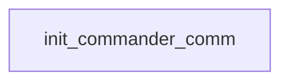

# Commander Hayes: first contact: existing conversation graph

> Generated by `tools/conversation_catalog.py`; do not edit this page by hand.

[Catalog and interpretation rules](../README.md) · [Proposed engine](../model.md)

Script: [comandr.c](../../../../sc2/src/uqm/comm/comandr/comandr.c#L1). Phrase bank: [commander.txt](../../../../sc2/content/base/comm/commander/commander.txt#L1).

1 handler/helper nodes; 0 response registration sites; 0 direct local calls; 99 phrase records.

## Initialization and lifecycle

| Phase | Callback | Bound by | Conditions / source |
| --- | --- | --- | --- |

## Handler graph

Solid arrows are selectable responses; dashed arrows are direct C calls. Conditions, arguments, speech and effects are cataloged below. Parallel response sites are grouped only in this diagram.



## Condition catalog

Condition IDs describe enclosing source structure. Branch predicates combine with ∧; case labels mark source locations that can also be reached by fallthrough. Values refer to their original evaluation points. Local assignments and early control flow remain in the decision bodies.

| ID | Source expression / structural condition |
| --- | --- |
| <a id="condition-c1"></a>C1 | <code>GET_GAME_STATE(RADIOACTIVES_PROVIDED)</code> |
| <a id="condition-c2"></a>C2 | <code>!(GET_GAME_STATE(RADIOACTIVES_PROVIDED))</code> |

## Script-scope state and lookup tables

These declarations supply shared local state, computed phrase alternatives, number speech, or lookup data used by the nodes. LOCDATA presentation defaults are linked separately in the source.

Presentation descriptor <code>commander_desc</code>: [source](../../../../sc2/src/uqm/comm/comandr/comandr.c#L28).

## Node catalog

<a id="node-init_commander_comm"></a>

### init_commander_comm

<code>LOCDATA *init_commander_comm()</code> — [source](../../../../sc2/src/uqm/comm/comandr/comandr.c#L99).

#### Actions, queries, local updates, and control flow

Calls are listed without assuming they are pure or mutating. Local updates are retained because they determine dynamic menus and counter-selected speech.

| Kind | Operation | Enclosing conditions | Source |
| --- | --- | --- | --- |
| call | <code>GET_GAME_STATE(RADIOACTIVES_PROVIDED)</code> | No enclosing branch condition | [103](../../../../sc2/src/uqm/comm/comandr/comandr.c#L103) |
| update | <code>commander_desc.AlienAmbientArray[2].AnimFlags &#124;= ANIM_DISABLED</code> | [C1](#condition-c1) | [105](../../../../sc2/src/uqm/comm/comandr/comandr.c#L105) |
| update | <code>commander_desc.AlienSongFlags &amp;= ~LDASF_USE_ALTERNATE</code> | [C1](#condition-c1) | [107](../../../../sc2/src/uqm/comm/comandr/comandr.c#L107) |
| update | <code>commander_desc.AlienAmbientArray[2].AnimFlags &amp;= ~ANIM_DISABLED</code> | [C2](#condition-c2) | [111](../../../../sc2/src/uqm/comm/comandr/comandr.c#L111) |
| update | <code>commander_desc.AlienAltSongRes = COMMANDER_LOWPOW_MUSIC</code> | [C2](#condition-c2) | [113](../../../../sc2/src/uqm/comm/comandr/comandr.c#L113) |
| update | <code>commander_desc.AlienSongFlags &#124;= LDASF_USE_ALTERNATE</code> | [C2](#condition-c2) | [114](../../../../sc2/src/uqm/comm/comandr/comandr.c#L114) |
| update | <code>commander_desc.AlienTextWidth = 143</code> | No enclosing branch condition | [117](../../../../sc2/src/uqm/comm/comandr/comandr.c#L117) |
| update | <code>commander_desc.AlienTextBaseline.x = 164</code> | No enclosing branch condition | [118](../../../../sc2/src/uqm/comm/comandr/comandr.c#L118) |
| update | <code>commander_desc.AlienTextBaseline.y = 20</code> | No enclosing branch condition | [119](../../../../sc2/src/uqm/comm/comandr/comandr.c#L119) |
| call | <code>setSegue(Segue_peace)</code> | No enclosing branch condition | [121](../../../../sc2/src/uqm/comm/comandr/comandr.c#L121) |
| update | <code>retval = &amp;commander_desc</code> | No enclosing branch condition | [122](../../../../sc2/src/uqm/comm/comandr/comandr.c#L122) |
| flow | <code>return retval;</code> | No enclosing branch condition | [124](../../../../sc2/src/uqm/comm/comandr/comandr.c#L124) |

<details>
<summary>Exact decision body (local calculations, early returns, fallthrough and ordering)</summary>

```c
{
	LOCDATA *retval;

	if (GET_GAME_STATE (RADIOACTIVES_PROVIDED))
	{
		commander_desc.AlienAmbientArray[2].AnimFlags |= ANIM_DISABLED;
		// regular track -- let's make sure
		commander_desc.AlienSongFlags &= ~LDASF_USE_ALTERNATE;
	}
	else
	{
		commander_desc.AlienAmbientArray[2].AnimFlags &= ~ANIM_DISABLED;
		// use alternate 'low-power' track if available
		commander_desc.AlienAltSongRes = COMMANDER_LOWPOW_MUSIC;
		commander_desc.AlienSongFlags |= LDASF_USE_ALTERNATE;
	}

	commander_desc.AlienTextWidth = 143;
	commander_desc.AlienTextBaseline.x = 164;
	commander_desc.AlienTextBaseline.y = 20;

	setSegue (Segue_peace);
	retval = &commander_desc;

	return (retval);
}
```

</details>

## Phrase catalog

Full base-content text, keyed by the symbols used above. Voice filenames are resource metadata; playback also depends on installed addons and settings. Dynamic insertions retain their original placeholders.

<a id="phrase-glad_when_you_come_back"></a>

<details>
<summary>GLAD_WHEN_YOU_COME_BACK — commander-000.ogg</summary>

[Text source](../../../../sc2/content/base/comm/commander/commander.txt#L1)

<pre>Hurry back, Captain.</pre>

</details>

<a id="phrase-give_fuel"></a>

<details>
<summary>GIVE_FUEL — commander-001.ogg</summary>

[Text source](../../../../sc2/content/base/comm/commander/commander.txt#L4)

<pre>We do have a small amount of Starship fuel which is of no use to our power systems.
We will now transport 5 units to your vessel.</pre>

</details>

<a id="phrase-give_fuel_again"></a>

<details>
<summary>GIVE_FUEL_AGAIN — commander-002.ogg</summary>

[Text source](../../../../sc2/content/base/comm/commander/commander.txt#L8)

<pre>We are almost out of fuel now, but we do have a BIT more.
You will have to be more careful with this supply.
Transporting fuel now.</pre>

</details>

<a id="phrase-are_you_supply_ship"></a>

<details>
<summary>ARE_YOU_SUPPLY_SHIP — commander-003.ogg</summary>

[Text source](../../../../sc2/content/base/comm/commander/commander.txt#L13)

<pre>Attention unidentified space vessel!
I am Starbase Commander Hayes of the slave planet Earth.
our HyperWave broadcasts -- extremely weak
situation critical -- energy cores exhausted
scanners and deep radar are non-functional
we cannot identify your vessel
Are you the scheduled Hierarchy resupply ship?
Repeat, are you the resupply vessel?</pre>

</details>

<a id="phrase-do_you_have_radio_this_time"></a>

<details>
<summary>DO_YOU_HAVE_RADIO_THIS_TIME — commander-004.ogg</summary>

[Text source](../../../../sc2/content/base/comm/commander/commander.txt#L23)

<pre>Did you find any radioactive elements for our power cores?</pre>

</details>

<a id="phrase-here_is_another_lander"></a>

<details>
<summary>HERE_IS_ANOTHER_LANDER — commander-005.ogg</summary>

[Text source](../../../../sc2/content/base/comm/commander/commander.txt#L26)

<pre>What!!!
You lost another lander!?
We&#x27;ll build another, but DON&#x27;T LOSE THIS ONE, OKAY!</pre>

</details>

<a id="phrase-the_what_from_where"></a>

<details>
<summary>THE_WHAT_FROM_WHERE — commander-006.ogg</summary>

[Text source](../../../../sc2/content/base/comm/commander/commander.txt#L31)

<pre>The starship what?
Never mind -- look, we won&#x27;t last much longer. Here is our situation
According to our Oath of Fealty to the Ur-Quan, we must maintain this starbase
but, we have no space vessels of our own
and the shield prevents us from contacting Earth
so we are totally dependent on the Ur-Quan supply vessels for everything we need up here.
We know there is a Hierarchy base on the surface of the moon, but we can&#x27;t contact them.
The Ur-Quan were supposed to resupply the base at regular, five year intervals
but we haven&#x27;t received anything in almost eight years!
What we don&#x27;t recycle we can usually synthesize
but to do so, we need replacement radioactives for our generator energy cores.
If you could bring us some radioactive elements, we can fabricate the cores ourselves.
Are you willing to help us!?</pre>

</details>

<a id="phrase-about_time"></a>

<details>
<summary>ABOUT_TIME — commander-007.ogg</summary>

[Text source](../../../../sc2/content/base/comm/commander/commander.txt#L46)

<pre>Well, it&#x27;s about damn time!
In the Fealty agreement the Ur-Quan promised that this station would be resupplied
at least every five years, and its been over eight since we saw you!
If you had arrived a few weeks later, there wouldn&#x27;t have been anyone alive on this station
never mind...just begin your transfer of materials immediately, starting with the radioactives.</pre>

</details>

<a id="phrase-message_garbled_1"></a>

<details>
<summary>MESSAGE_GARBLED_1 — commander-008.ogg</summary>

[Text source](../../../../sc2/content/base/comm/commander/commander.txt#L53)

<pre>I&#x27;m sorry, Captain, your message was garbled. Our receivers have very little power.</pre>

</details>

<a id="phrase-message_garbled_2"></a>

<details>
<summary>MESSAGE_GARBLED_2 — commander-009.ogg</summary>

[Text source](../../../../sc2/content/base/comm/commander/commander.txt#L56)

<pre>I couldn&#x27;t quite make it out, Captain. Could you please repeat?</pre>

</details>

<a id="phrase-here_is_a_new_lander"></a>

<details>
<summary>HERE_IS_A_NEW_LANDER — commander-010.ogg</summary>

[Text source](../../../../sc2/content/base/comm/commander/commander.txt#L59)

<pre>Manufacturing a new lander for you will use most of what little resources we have left
but I suppose we have no choice.
We will transport the new lander vehicle immediately.</pre>

</details>

<a id="phrase-this_may_seem_silly"></a>

<details>
<summary>THIS_MAY_SEEM_SILLY — commander-011.ogg</summary>

[Text source](../../../../sc2/content/base/comm/commander/commander.txt#L64)

<pre>By the way Captain, I think we need a name for this new alliance we&#x27;re going to forge.
And since it was your idea, it&#x27;s only fair that you get the honor of naming it.
So, what will it be?</pre>

</details>

<a id="phrase-ok_the_nafs"></a>

<details>
<summary>OK_THE_NAFS — commander-012.ogg</summary>

[Text source](../../../../sc2/content/base/comm/commander/commander.txt#L69)

<pre>Okay, that sounds pretty inspiring. So be it - The New Alliance of Free Stars!</pre>

</details>

<a id="phrase-ok_the_can"></a>

<details>
<summary>OK_THE_CAN — commander-013.ogg</summary>

[Text source](../../../../sc2/content/base/comm/commander/commander.txt#L72)

<pre>Very well.  From this day forward, we are The Concordance of Alien Nations!</pre>

</details>

<a id="phrase-ok_the_ufw"></a>

<details>
<summary>OK_THE_UFW — commander-014.ogg</summary>

[Text source](../../../../sc2/content/base/comm/commander/commander.txt#L75)

<pre>That has a familiar ring to it... nonetheless, we will make it so - The United Federation of Worlds!</pre>

</details>

<a id="phrase-ok_the_name_is_empire0"></a>

<details>
<summary>OK_THE_NAME_IS_EMPIRE0 — commander-015.ogg</summary>

[Text source](../../../../sc2/content/base/comm/commander/commander.txt#L78)

<pre>Ulp!  Well... you&#x27;re the one with the big starship.
So be it - The Empire of</pre>

</details>

<a id="phrase-ok_the_name_is_empire1"></a>

<details>
<summary>OK_THE_NAME_IS_EMPIRE1</summary>

[Text source](../../../../sc2/content/base/comm/commander/commander.txt#L82)

<pre>!</pre>

</details>

<a id="phrase-fuel_up0"></a>

<details>
<summary>FUEL_UP0 — commander-016.ogg</summary>

[Text source](../../../../sc2/content/base/comm/commander/commander.txt#L85)

<pre>We are initiating transfer of radioactives, Captain.
Now, as soon as our engineers can refit the energy cores...</pre>

</details>

<a id="phrase-fuel_up1"></a>

<details>
<summary>FUEL_UP1 — commander-017.ogg</summary>

[Text source](../../../../sc2/content/base/comm/commander/commander.txt#L89)

<pre>...there, that&#x27;s much better. Power ratings are climbing, life support is coming back into the green.
Deep radar systems and sensors are now online and I can scan your vessel.
!!!? -- WHAT THE HELL KIND OF SHIP IS THAT!?
Just who ARE you, Captain?</pre>

</details>

<a id="phrase-what_kind_of_idiot"></a>

<details>
<summary>WHAT_KIND_OF_IDIOT — commander-018.ogg</summary>

[Text source](../../../../sc2/content/base/comm/commander/commander.txt#L95)

<pre>WHAT!
What kind of idiot sent you out here without replacements for our energy cores!?
It&#x27;s amazing that we&#x27;ve kept the generators online for as long as we have!
Look, you had better get those radioactives right away
or all the other supplies are pretty damn pointless, since we&#x27;ll all be too dead to use them!</pre>

</details>

<a id="phrase-dont_know_who_you_are"></a>

<details>
<summary>DONT_KNOW_WHO_YOU_ARE — commander-019.ogg</summary>

[Text source](../../../../sc2/content/base/comm/commander/commander.txt#L102)

<pre>Look, I don&#x27;t know who you are or why you&#x27;re here
but right now the only thing I&#x27;m worried about
is saving the lives of the 1900 men and women aboard this starbase
and right now you&#x27;re our only hope.
I can&#x27;t keep the transmitter on too much longer -- we need the power for heat and air
so if you don&#x27;t have any radioactives on board your vessel
please get some and bring them back here before it&#x27;s too late.</pre>

</details>

<a id="phrase-thats_impossible"></a>

<details>
<summary>THATS_IMPOSSIBLE — commander-020.ogg</summary>

[Text source](../../../../sc2/content/base/comm/commander/commander.txt#L111)

<pre>Star Control science mission, eh?
Captain, I served as a Star Control officer during the war, aboard several cruisers in the Coreward Front
and if there had been any `scientific mission&#x27; to Vela
I would have heard about it.</pre>

</details>

<a id="phrase-ask_away"></a>

<details>
<summary>ASK_AWAY — commander-021.ogg</summary>

[Text source](../../../../sc2/content/base/comm/commander/commander.txt#L117)

<pre>Okay, what do you want to know?</pre>

</details>

<a id="phrase-radios_on_mercury"></a>

<details>
<summary>RADIOS_ON_MERCURY — commander-022.ogg</summary>

[Text source](../../../../sc2/content/base/comm/commander/commander.txt#L120)

<pre>The fastest way to get radioactives in this system would be to land on Mercury
and scour the surface for deposits of radioactive elements.
But be careful. Mercury is a pretty inhospitable place!
Watch out for earthquakes and those high-temperature areas!</pre>

</details>

<a id="phrase-thanks_for_helping"></a>

<details>
<summary>THANKS_FOR_HELPING — commander-023.ogg</summary>

[Text source](../../../../sc2/content/base/comm/commander/commander.txt#L126)

<pre>Thanks! I&#x27;ll make sure to mention this the next time I talk with our masters
I&#x27;m sure they will reward you.</pre>

</details>

<a id="phrase-starbase_is"></a>

<details>
<summary>STARBASE_IS — commander-024.ogg</summary>

[Text source](../../../../sc2/content/base/comm/commander/commander.txt#L130)

<pre>Ur-Quan slave law requires that we maintain an orbital space platform
to assist Hierarchy vessels which are in need of repairs or fuel.
Since the shield around the Earth cuts us off completely from the planet
we are dependent on Ur-Quan resupply ships for our non-renewable resources.
The resupply vessels are supposed to arrive every five years
at which time the Ur-Quan somehow penetrate the shield and exchange those of us up here
with replacement personnel from the surface.</pre>

</details>

<a id="phrase-happened_to_earth"></a>

<details>
<summary>HAPPENED_TO_EARTH — commander-025.ogg</summary>

[Text source](../../../../sc2/content/base/comm/commander/commander.txt#L139)

<pre>When the Alliance lost the war, the Ur-Quan gave Earth a single choice
join the Hierarchy as Battle Thralls and fight for the Ur-Quan to enslave other sentient species
or become `fallow&#x27; slaves, and be forever imprisoned on a single world
encased in an impenetrable energy shield here on Earth.
We choose not to fight for the Ur-Quan.</pre>

</details>

<a id="phrase-urquan_left"></a>

<details>
<summary>URQUAN_LEFT — commander-026.ogg</summary>

[Text source](../../../../sc2/content/base/comm/commander/commander.txt#L146)

<pre>Soon after Earth accepted the Ur-Quan&#x27;s Oath of Fealty, they departed,
leaving behind a battle group of Spathi and Ilwrath ships based on the moon.</pre>

</details>

<a id="phrase-base_on_moon"></a>

<details>
<summary>BASE_ON_MOON — commander-027.ogg</summary>

[Text source](../../../../sc2/content/base/comm/commander/commander.txt#L150)

<pre>Ahh...fight the Ur-Quan! Win back our freedom!
I remember having such thoughts myself...once, a long time ago.
But that was in the first years after the defeat, when it was still terrifying to look up
and see the bloody glow of the pulsating slave shield overhead.
Through day and night we gazed up at the impenetrable wall
as though the sheer power of our hatred would pull it down.
But over the years, I spent so much of my time struggling
down on the surface under the shield and then later up here, trying to keep this station alive
that I&#x27;d forgotten what it means to be free... to hate our Ur-Quan Masters!
And now, here you are, in an alien ship of unknown power,
offering me your assistance to fight against the Hierarchy again, after all these years.
Captain, your offer is intriguing.
It&#x27;s tempting to think that with your advanced Precursor technology
we can somehow crack Earth&#x27;s slave shield
and reassemble the Alliance to attack the Hierarchy, and THIS time win the damn war!
But... consider the consequences if we should fail.
The Ur-Quan won&#x27;t just punish us here on the station.
They will exact a gruesome retribution on the surface below as well.
Before I commit this station to helping you attack the Ur-Quan
and accepting the risk of annihilation if we are defeated
I have to make sure that you and your ship have what it takes to oppose the Hierarchy.
I&#x27;ll make you a deal.
If you can eliminate the alien base on the moon, and get rid of that threat, at least
I will seriously consider your offer.</pre>

</details>

<a id="phrase-acknowledge_secret"></a>

<details>
<summary>ACKNOWLEDGE_SECRET — commander-028.ogg</summary>

[Text source](../../../../sc2/content/base/comm/commander/commander.txt#L176)

<pre>Hmmm... you know, come to think of it
there were some rumors that Corridor Nine, the special operations division of Star Control
was directing some hush-hush operation near Androsynth space.
The Vela star system... yes, that would be the right direction
So, Captain... if you say it&#x27;s true
how do you explain that huge, alien starship you&#x27;re flying
and why are you here? What do you want from us?</pre>

</details>

<a id="phrase-about_base"></a>

<details>
<summary>ABOUT_BASE — commander-029.ogg</summary>

[Text source](../../../../sc2/content/base/comm/commander/commander.txt#L185)

<pre>After the Ur-Quan erected the slave shield around Earth, and established this space station
they decided to leave a contingent of combat ships close to the Earth
to keep watch on our planet and confirm that we were obeying the Ur-Quan slave laws.
I&#x27;m certain they&#x27;re still out there on the surface of the moon
because we can pick up a constant stream of alien broadcasts.</pre>

</details>

<a id="phrase-good_luck_with_base"></a>

<details>
<summary>GOOD_LUCK_WITH_BASE — commander-030.ogg</summary>

[Text source](../../../../sc2/content/base/comm/commander/commander.txt#L192)

<pre>Be careful, Captain.
There are probably a dozen Spathi Eluders and Ilwrath Avengers down there on the lunar surface.
I don&#x27;t know why they haven&#x27;t come after you yet
but when they do, you&#x27;d better have your weapons armed, and your thrusters burning hot.</pre>

</details>

<a id="phrase-dealt_with_base_yet"></a>

<details>
<summary>DEALT_WITH_BASE_YET — commander-031.ogg</summary>

[Text source](../../../../sc2/content/base/comm/commander/commander.txt#L198)

<pre>Have you dealt with the base yet?</pre>

</details>

<a id="phrase-here_comes_ilwrath"></a>

<details>
<summary>HERE_COMES_ILWRATH — commander-032.ogg</summary>

[Text source](../../../../sc2/content/base/comm/commander/commander.txt#L201)

<pre>Captain, listen closely!
Long range sensors show a ship closing on this station, fast!
Our computer identifies it as Ilwrath, Avenger-class.
I think you&#x27;ve got a fight on your hands, Captain.
Your best bet is to wait until you have point bl-nk r-nge
C-pt-in! It&#x27;s ja-min- ou- s-gn-l!...</pre>

</details>

<a id="phrase-very_impressive"></a>

<details>
<summary>VERY_IMPRESSIVE — commander-033.ogg</summary>

[Text source](../../../../sc2/content/base/comm/commander/commander.txt#L209)

<pre>What a beautiful sight, Captain!
I haven&#x27;t seen an Avenger blown away like that since the Battle in Draco.
I guess you&#x27;ve shown that you can handle yourself in battle, Captain
so my last reservation about helping you has been dissolved.
I will commit this station to helping free Earth and defeat the Ur-Quan.
We may get our atoms rearranged in the process, but by God, Captain, we&#x27;re going to try!
So, the obvious first step is to get your Precursor equipment and software over here
so that we can make it work with our ship repair fabricators.
But then what, Captain?</pre>

</details>

<a id="phrase-it_was_abandoned"></a>

<details>
<summary>IT_WAS_ABANDONED — commander-034.ogg</summary>

[Text source](../../../../sc2/content/base/comm/commander/commander.txt#L220)

<pre>I&#x27;ll be darned!
All these years we&#x27;ve been listening to their incoherent broadcasts, and we never even guessed.</pre>

</details>

<a id="phrase-you_really_fought_base"></a>

<details>
<summary>YOU_REALLY_FOUGHT_BASE — commander-035.ogg</summary>

[Text source](../../../../sc2/content/base/comm/commander/commander.txt#L224)

<pre>You fought them, Captain!?  I hope you didn&#x27;t suffer serious casualties?</pre>

</details>

<a id="phrase-im_glad_you_won"></a>

<details>
<summary>IM_GLAD_YOU_WON — commander-036.ogg</summary>

[Text source](../../../../sc2/content/base/comm/commander/commander.txt#L227)

<pre>I&#x27;m delighted to hear it, Captain.  I wish I could have been there.</pre>

</details>

<a id="phrase-im_sure_it_was_difficult"></a>

<details>
<summary>IM_SURE_IT_WAS_DIFFICULT — commander-037.ogg</summary>

[Text source](../../../../sc2/content/base/comm/commander/commander.txt#L230)

<pre>I&#x27;m sure the experience was disturbing</pre>

</details>

<a id="phrase-that_was_probe"></a>

<details>
<summary>THAT_WAS_PROBE — commander-038.ogg</summary>

[Text source](../../../../sc2/content/base/comm/commander/commander.txt#L233)

<pre>That was the Ur-Quan Security Drone. It keeps an eye on us.
Captain, what happened to the spy drone!?</pre>

</details>

<a id="phrase-deep_trouble"></a>

<details>
<summary>DEEP_TROUBLE — commander-039.ogg</summary>

[Text source](../../../../sc2/content/base/comm/commander/commander.txt#L237)

<pre>Oh no. Right now it&#x27;s probably cruising through HyperSpace
heading right towards the closest Hierarchy outpost.
When the Ur-Quan find out that you are here, they will send a combat fleet instantly!</pre>

</details>

<a id="phrase-good_news"></a>

<details>
<summary>GOOD_NEWS — commander-040.ogg</summary>

[Text source](../../../../sc2/content/base/comm/commander/commander.txt#L242)

<pre>Whew!  That was a close one.  If that probe had gotten away -- up into HyperSpace
we&#x27;d be up to our ears in Dreadnoughts in no time.
What a relief!</pre>

</details>

<a id="phrase-sure_hope"></a>

<details>
<summary>SURE_HOPE — commander-041.ogg</summary>

[Text source](../../../../sc2/content/base/comm/commander/commander.txt#L247)

<pre>If that probe gets back to the Ur-Quan, Captain, we are BOTH in deep trouble!</pre>

</details>

<a id="phrase-about_base_again"></a>

<details>
<summary>ABOUT_BASE_AGAIN — commander-042.ogg</summary>

[Text source](../../../../sc2/content/base/comm/commander/commander.txt#L250)

<pre>As I said before, after the Ur-Quan erected the slave shield around the Earth and assembled this space station
they decided to leave a contingent of Spathi and Ilwrath ships stationed on the moon.
We have looked at the moonbase through our telescopes and can confirm that there is still substantial activity down there
but we have never been able to make contact with the base using either HyperWave &#x27;Caster
or traditional radio signals.</pre>

</details>

<a id="phrase-cook_butts"></a>

<details>
<summary>COOK_BUTTS — commander-043.ogg</summary>

[Text source](../../../../sc2/content/base/comm/commander/commander.txt#L257)

<pre>Ha-ha.. yes, Captain, we&#x27;ll do just that!</pre>

</details>

<a id="phrase-overthrow_aliens"></a>

<details>
<summary>OVERTHROW_ALIENS — commander-044.ogg</summary>

[Text source](../../../../sc2/content/base/comm/commander/commander.txt#L260)

<pre>If you feel it&#x27;s necessary Captain, I understand.</pre>

</details>

<a id="phrase-kill_monsters"></a>

<details>
<summary>KILL_MONSTERS — commander-045.ogg</summary>

[Text source](../../../../sc2/content/base/comm/commander/commander.txt#L263)

<pre>A sensible plan, Captain.  Let&#x27;s get to work.</pre>

</details>

<a id="phrase-good_luck_again"></a>

<details>
<summary>GOOD_LUCK_AGAIN — commander-046.ogg</summary>

[Text source](../../../../sc2/content/base/comm/commander/commander.txt#L266)

<pre>Hurry back, Captain.</pre>

</details>

<a id="phrase-starbase_will_be_ready"></a>

<details>
<summary>STARBASE_WILL_BE_READY — commander-047.ogg</summary>

[Text source](../../../../sc2/content/base/comm/commander/commander.txt#L269)

<pre>Now Captain, I expect the configuration process for the starbase
to take at least 2 weeks, so let&#x27;s get to work...</pre>

</details>

<a id="phrase-overthrow_evil_aliens"></a>

<details>
<summary>overthrow_evil_aliens</summary>

[Text source](../../../../sc2/content/base/comm/commander/commander.txt#L273)

<pre>Er... trust me Commander, I have a plan... a really good plan!  But for now it must remain a secret.</pre>

</details>

<a id="phrase-annihilate_those_monsters"></a>

<details>
<summary>annihilate_those_monsters</summary>

[Text source](../../../../sc2/content/base/comm/commander/commander.txt#L276)

<pre>We will slowly build our strength, unify an allied starfleet, and bring the Ur-Quan to their knee-equivalents.</pre>

</details>

<a id="phrase-cook_their_butts"></a>

<details>
<summary>cook_their_butts</summary>

[Text source](../../../../sc2/content/base/comm/commander/commander.txt#L279)

<pre>Then, Commander, we will proceed to kick some major alien butt!</pre>

</details>

<a id="phrase-where_get_radios"></a>

<details>
<summary>where_get_radios</summary>

[Text source](../../../../sc2/content/base/comm/commander/commander.txt#L282)

<pre>Where can we acquire radioactives?</pre>

</details>

<a id="phrase-well_go_get_them_now"></a>

<details>
<summary>well_go_get_them_now</summary>

[Text source](../../../../sc2/content/base/comm/commander/commander.txt#L285)

<pre>We will leave now and bring back the elements you require.</pre>

</details>

<a id="phrase-we_will_transfer_now"></a>

<details>
<summary>we_will_transfer_now</summary>

[Text source](../../../../sc2/content/base/comm/commander/commander.txt#L288)

<pre>We are ready to transfer radioactives.</pre>

</details>

<a id="phrase-what_will_you_give_us"></a>

<details>
<summary>what_will_you_give_us</summary>

[Text source](../../../../sc2/content/base/comm/commander/commander.txt#L291)

<pre>What will you give us in exchange for radioactives?</pre>

</details>

<a id="phrase-before_radios_we_need_info"></a>

<details>
<summary>before_radios_we_need_info</summary>

[Text source](../../../../sc2/content/base/comm/commander/commander.txt#L294)

<pre>Before we help you, we require certain information.</pre>

</details>

<a id="phrase-no_but_well_help0"></a>

<details>
<summary>no_but_well_help0</summary>

[Text source](../../../../sc2/content/base/comm/commander/commander.txt#L297)

<pre>No, this is the starship</pre>

</details>

<a id="phrase-no_but_well_help1"></a>

<details>
<summary>no_but_well_help1</summary>

[Text source](../../../../sc2/content/base/comm/commander/commander.txt#L300)

<pre>, but we stand ready to assist you.</pre>

</details>

<a id="phrase-yes_this_is_supply_ship"></a>

<details>
<summary>yes_this_is_supply_ship</summary>

[Text source](../../../../sc2/content/base/comm/commander/commander.txt#L303)

<pre>Uh.. yes, this IS the resupply vessel. What do you need resupplied?</pre>

</details>

<a id="phrase-what_slave_planet"></a>

<details>
<summary>what_slave_planet</summary>

[Text source](../../../../sc2/content/base/comm/commander/commander.txt#L306)

<pre>`Slave planet!&#x27; `Hierarchy resupply vessel!&#x27;  What is going on here?</pre>

</details>

<a id="phrase-i_lied"></a>

<details>
<summary>i_lied</summary>

[Text source](../../../../sc2/content/base/comm/commander/commander.txt#L309)

<pre>Actually I lied, this isn&#x27;t the resupply vessel. Sorry.</pre>

</details>

<a id="phrase-plumb_out"></a>

<details>
<summary>plumb_out</summary>

[Text source](../../../../sc2/content/base/comm/commander/commander.txt#L312)

<pre>Er..., oh dang!  Wouldn&#x27;t you know it; we&#x27;re plumb out of those.</pre>

</details>

<a id="phrase-we_are_vindicator0"></a>

<details>
<summary>we_are_vindicator0</summary>

[Text source](../../../../sc2/content/base/comm/commander/commander.txt#L315)

<pre>I am Captain</pre>

</details>

<a id="phrase-we_are_vindicator1"></a>

<details>
<summary>we_are_vindicator1</summary>

[Text source](../../../../sc2/content/base/comm/commander/commander.txt#L318)

<pre>of the starship</pre>

</details>

<a id="phrase-we_are_vindicator2"></a>

<details>
<summary>we_are_vindicator2</summary>

[Text source](../../../../sc2/content/base/comm/commander/commander.txt#L321)

<pre>. We are the survivors of a Star Control science research team to the Vela star system.</pre>

</details>

<a id="phrase-first_give_info"></a>

<details>
<summary>first_give_info</summary>

[Text source](../../../../sc2/content/base/comm/commander/commander.txt#L324)

<pre>I need you to explain a few things.</pre>

</details>

<a id="phrase-we_must_go_now"></a>

<details>
<summary>we_must_go_now</summary>

[Text source](../../../../sc2/content/base/comm/commander/commander.txt#L327)

<pre>We must leave now. I shall tell you more when we return.</pre>

</details>

<a id="phrase-where_can_i_get_radios"></a>

<details>
<summary>where_can_i_get_radios</summary>

[Text source](../../../../sc2/content/base/comm/commander/commander.txt#L330)

<pre>Where can we find the radioactive elements you need?</pre>

</details>

<a id="phrase-ok_i_will_get_radios"></a>

<details>
<summary>ok_i_will_get_radios</summary>

[Text source](../../../../sc2/content/base/comm/commander/commander.txt#L333)

<pre>We will leave now to find the elements you require.</pre>

</details>

<a id="phrase-whats_this_starbase"></a>

<details>
<summary>whats_this_starbase</summary>

[Text source](../../../../sc2/content/base/comm/commander/commander.txt#L336)

<pre>To begin with, what is the purpose of this starbase?</pre>

</details>

<a id="phrase-what_about_earth"></a>

<details>
<summary>what_about_earth</summary>

[Text source](../../../../sc2/content/base/comm/commander/commander.txt#L339)

<pre>What is that strange red glow around Earth?</pre>

</details>

<a id="phrase-where_are_urquan"></a>

<details>
<summary>where_are_urquan</summary>

[Text source](../../../../sc2/content/base/comm/commander/commander.txt#L342)

<pre>Where are the Ur-Quan now?</pre>

</details>

<a id="phrase-our_mission_was_secret"></a>

<details>
<summary>our_mission_was_secret</summary>

[Text source](../../../../sc2/content/base/comm/commander/commander.txt#L345)

<pre>The mission was highly secret.</pre>

</details>

<a id="phrase-we_are_here_to_help"></a>

<details>
<summary>we_are_here_to_help</summary>

[Text source](../../../../sc2/content/base/comm/commander/commander.txt#L348)

<pre>We have returned to Earth to give you the technological secrets of the Precursors, and to help you fight the Hierarchy.</pre>

</details>

<a id="phrase-tell_me_about_base"></a>

<details>
<summary>tell_me_about_base</summary>

[Text source](../../../../sc2/content/base/comm/commander/commander.txt#L351)

<pre>What details can you give us about the base on the moon?</pre>

</details>

<a id="phrase-we_will_take_care_of_base"></a>

<details>
<summary>we_will_take_care_of_base</summary>

[Text source](../../../../sc2/content/base/comm/commander/commander.txt#L354)

<pre>We shall go now and neutralize the base.</pre>

</details>

<a id="phrase-tell_me_again"></a>

<details>
<summary>tell_me_again</summary>

[Text source](../../../../sc2/content/base/comm/commander/commander.txt#L357)

<pre>Could you tell me again about the Hierarchy base on the moon?</pre>

</details>

<a id="phrase-base_was_abandoned"></a>

<details>
<summary>base_was_abandoned</summary>

[Text source](../../../../sc2/content/base/comm/commander/commander.txt#L360)

<pre>We found the base, but it was abandoned years ago.</pre>

</details>

<a id="phrase-we_fought_them"></a>

<details>
<summary>we_fought_them</summary>

[Text source](../../../../sc2/content/base/comm/commander/commander.txt#L363)

<pre>We, uh... attacked the moonbase, and completely destroyed the enemy!</pre>

</details>

<a id="phrase-oh_yes_big_fight"></a>

<details>
<summary>oh_yes_big_fight</summary>

[Text source](../../../../sc2/content/base/comm/commander/commander.txt#L366)

<pre>Er... oh, yes! It was a very vicious fight.</pre>

</details>

<a id="phrase-i_lied_it_was_abandoned"></a>

<details>
<summary>i_lied_it_was_abandoned</summary>

[Text source](../../../../sc2/content/base/comm/commander/commander.txt#L369)

<pre>Actually I lied. We found it abandoned.</pre>

</details>

<a id="phrase-i_cant_talk_about_it"></a>

<details>
<summary>i_cant_talk_about_it</summary>

[Text source](../../../../sc2/content/base/comm/commander/commander.txt#L372)

<pre>It was too horrible for words. I just can&#x27;t talk about it right now.</pre>

</details>

<a id="phrase-name_1"></a>

<details>
<summary>name_1</summary>

[Text source](../../../../sc2/content/base/comm/commander/commander.txt#L375)

<pre>The New Alliance of Free Stars!</pre>

</details>

<a id="phrase-name_2"></a>

<details>
<summary>name_2</summary>

[Text source](../../../../sc2/content/base/comm/commander/commander.txt#L378)

<pre>The Concordance of Alien Nations!</pre>

</details>

<a id="phrase-name_3"></a>

<details>
<summary>name_3</summary>

[Text source](../../../../sc2/content/base/comm/commander/commander.txt#L381)

<pre>The United Federation of Worlds!</pre>

</details>

<a id="phrase-name_40"></a>

<details>
<summary>name_40</summary>

[Text source](../../../../sc2/content/base/comm/commander/commander.txt#L384)

<pre>The Empire of</pre>

</details>

<a id="phrase-name_41"></a>

<details>
<summary>name_41</summary>

[Text source](../../../../sc2/content/base/comm/commander/commander.txt#L386)

<pre>!</pre>

</details>

<a id="phrase-i_lost_my_lander"></a>

<details>
<summary>i_lost_my_lander</summary>

[Text source](../../../../sc2/content/base/comm/commander/commander.txt#L389)

<pre>Due to circumstances beyond our control, our only landing vehicle was destroyed.  Can you replace it?</pre>

</details>

<a id="phrase-i_lost_another_lander"></a>

<details>
<summary>i_lost_another_lander</summary>

[Text source](../../../../sc2/content/base/comm/commander/commander.txt#L392)

<pre>Um... er... well... We lost another lander.</pre>

</details>

<a id="phrase-need_fuel_mercury"></a>

<details>
<summary>need_fuel_mercury</summary>

[Text source](../../../../sc2/content/base/comm/commander/commander.txt#L395)

<pre>We are unable to land on Mercury and retrieve radioactives due to an unforeseen fuel shortage.</pre>

</details>

<a id="phrase-need_fuel_luna"></a>

<details>
<summary>need_fuel_luna</summary>

[Text source](../../../../sc2/content/base/comm/commander/commander.txt#L398)

<pre>We are unable to land on the moon and neutralize the base due to an unforeseen fuel shortage.</pre>

</details>

<a id="phrase-need_fuel_again"></a>

<details>
<summary>need_fuel_again</summary>

[Text source](../../../../sc2/content/base/comm/commander/commander.txt#L401)

<pre>Boy, mileage sure does vary. Could you spare us some more fuel?</pre>

</details>

<a id="phrase-what_was_red_thing"></a>

<details>
<summary>what_was_red_thing</summary>

[Text source](../../../../sc2/content/base/comm/commander/commander.txt#L404)

<pre>Commander, what was that red, fast-moving object in orbit around Earth?</pre>

</details>

<a id="phrase-it_went_away"></a>

<details>
<summary>it_went_away</summary>

[Text source](../../../../sc2/content/base/comm/commander/commander.txt#L407)

<pre>When we approached, it transmitted a warning and warped into HyperSpace.</pre>

</details>

<a id="phrase-we_destroyed_it"></a>

<details>
<summary>we_destroyed_it</summary>

[Text source](../../../../sc2/content/base/comm/commander/commander.txt#L410)

<pre>Er... we destroyed it! Yessiree, blew it to bits.</pre>

</details>

<a id="phrase-what_probe"></a>

<details>
<summary>what_probe</summary>

[Text source](../../../../sc2/content/base/comm/commander/commander.txt#L413)

<pre>Uh, I meant a different red thing. Never mind.</pre>

</details>

<a id="phrase-take_care_of_base_again"></a>

<details>
<summary>take_care_of_base_again</summary>

[Text source](../../../../sc2/content/base/comm/commander/commander.txt#L416)

<pre>Now we&#x27;re ready to take care of the moon base, Commander. Goodbye.</pre>

</details>

<a id="phrase-goodbye_commander"></a>

<details>
<summary>goodbye_commander</summary>

[Text source](../../../../sc2/content/base/comm/commander/commander.txt#L419)

<pre>Goodbye Commander.</pre>

</details>
