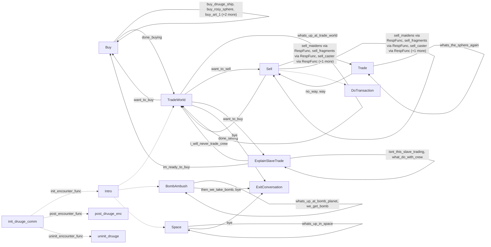

# Druuge: existing conversation graph

> Generated by `tools/conversation_catalog.py`; do not edit this page by hand.

[Catalog and interpretation rules](../README.md) · [Proposed engine](../model.md)

Script: [druugec.c](../../../../sc2/src/uqm/comm/druuge/druugec.c#L1). Phrase bank: [druuge.txt](../../../../sc2/content/base/comm/druuge/druuge.txt#L1).

13 handler/helper nodes; 29 response registration sites; 5 direct local calls; 105 phrase records.

## Initialization and lifecycle

| Phase | Callback | Bound by | Conditions / source |
| --- | --- | --- | --- |
| <code>init_encounter_func</code> | [<code>Intro</code>](#node-intro) | <code>init_druuge_comm</code> | No enclosing branch condition; [905](../../../../sc2/src/uqm/comm/druuge/druugec.c#L905) |
| <code>post_encounter_func</code> | [<code>post_druuge_enc</code>](#node-post_druuge_enc) | <code>init_druuge_comm</code> | No enclosing branch condition; [906](../../../../sc2/src/uqm/comm/druuge/druugec.c#L906) |
| <code>uninit_encounter_func</code> | [<code>uninit_druuge</code>](#node-uninit_druuge) | <code>init_druuge_comm</code> | No enclosing branch condition; [907](../../../../sc2/src/uqm/comm/druuge/druugec.c#L907) |

## Handler graph

Solid arrows are selectable responses; dashed arrows are direct C calls. Conditions, arguments, speech and effects are cataloged below. Parallel response sites are grouped only in this diagram.



## Condition catalog

Condition IDs describe enclosing source structure. Branch predicates combine with ∧; case labels mark source locations that can also be reached by fallthrough. Values refer to their original evaluation points. Local assignments and early control flow remain in the decision bodies.

| ID | Source expression / structural condition |
| --- | --- |
| <a id="condition-c1"></a>C1 | <code>PLAYER_SAID(R, bye)</code> |
| <a id="condition-c2"></a>C2 | <code>GET_GAME_STATE(GLOBAL_FLAGS_AND_DATA) &amp; (1 &lt;&lt; 7)</code> |
| <a id="condition-c3"></a>C3 | <code>SlaveryCount</code> |
| <a id="condition-c4"></a>C4 | <code>(SlaveryCount &gt; 250) &amp;&amp; (PreviousSlaves &lt;= 250)</code> |
| <a id="condition-c5"></a>C5 | <code>PreviousSlaves &gt; 100</code> |
| <a id="condition-c6"></a>C6 | <code>!(PreviousSlaves &gt; 100)</code> |
| <a id="condition-c7"></a>C7 | <code>!((SlaveryCount &gt; 250) &amp;&amp; (PreviousSlaves &lt;= 250))</code> |
| <a id="condition-c8"></a>C8 | <code>(SlaveryCount &gt; 100) &amp;&amp; (PreviousSlaves &lt;= 100)</code> |
| <a id="condition-c9"></a>C9 | <code>switch (GET_GAME_STATE(DRUUGE_HOME_VISITS))</code> |
| <a id="condition-c10"></a>C10 | <code>case 1 (see source for fallthrough)</code> |
| <a id="condition-c11"></a>C11 | <code>default (see source for fallthrough)</code> |
| <a id="condition-c12"></a>C12 | <code>!(GET_GAME_STATE(GLOBAL_FLAGS_AND_DATA) &amp; (1 &lt;&lt; 7))</code> |
| <a id="condition-c13"></a>C13 | <code>GET_GAME_STATE(GLOBAL_FLAGS_AND_DATA) &amp; (1 &lt;&lt; 6)</code> |
| <a id="condition-c14"></a>C14 | <code>!(GET_GAME_STATE(GLOBAL_FLAGS_AND_DATA) &amp; (1 &lt;&lt; 6))</code> |
| <a id="condition-c15"></a>C15 | <code>!(PLAYER_SAID(R, bye))</code> |
| <a id="condition-c16"></a>C16 | <code>!(PLAYER_SAID(R, want_to_buy))</code> |
| <a id="condition-c17"></a>C17 | <code>PLAYER_SAID(R, want_to_buy) &#124;&#124; PLAYER_SAID(R, im_ready_to_buy)</code> |
| <a id="condition-c18"></a>C18 | <code>!GET_GAME_STATE(ROSY_SPHERE)</code> |
| <a id="condition-c19"></a>C19 | <code>!GET_GAME_STATE(ARTIFACT_2_ON_SHIP)</code> |
| <a id="condition-c20"></a>C20 | <code>!GET_GAME_STATE(ARTIFACT_3_ON_SHIP)</code> |
| <a id="condition-c21"></a>C21 | <code>!(PLAYER_SAID(R, want_to_buy) &#124;&#124; PLAYER_SAID(R, im_ready_to_buy))</code> |
| <a id="condition-c22"></a>C22 | <code>PLAYER_SAID(R, buy_druuge_ship)</code> |
| <a id="condition-c23"></a>C23 | <code>GLOBAL_SIS(CrewEnlisted) &lt; SHIP_CREW_COST</code> |
| <a id="condition-c24"></a>C24 | <code>!(GLOBAL_SIS(CrewEnlisted) &lt; SHIP_CREW_COST)</code> |
| <a id="condition-c25"></a>C25 | <code>EscortFeasibilityStudy(DRUUGE_SHIP) == 0</code> |
| <a id="condition-c26"></a>C26 | <code>!(EscortFeasibilityStudy(DRUUGE_SHIP) == 0)</code> |
| <a id="condition-c27"></a>C27 | <code>!(PLAYER_SAID(R, buy_druuge_ship))</code> |
| <a id="condition-c28"></a>C28 | <code>PLAYER_SAID(R, buy_rosy_sphere)</code> |
| <a id="condition-c29"></a>C29 | <code>GLOBAL_SIS(CrewEnlisted) &lt; ARTIFACT_CREW_COST</code> |
| <a id="condition-c30"></a>C30 | <code>!(GLOBAL_SIS(CrewEnlisted) &lt; ARTIFACT_CREW_COST)</code> |
| <a id="condition-c31"></a>C31 | <code>!(PLAYER_SAID(R, buy_rosy_sphere))</code> |
| <a id="condition-c32"></a>C32 | <code>PLAYER_SAID(R, buy_art_1)</code> |
| <a id="condition-c33"></a>C33 | <code>!(PLAYER_SAID(R, buy_art_1))</code> |
| <a id="condition-c34"></a>C34 | <code>PLAYER_SAID(R, buy_art_2)</code> |
| <a id="condition-c35"></a>C35 | <code>!(PLAYER_SAID(R, buy_art_2))</code> |
| <a id="condition-c36"></a>C36 | <code>PLAYER_SAID(R, buy_fuel)</code> |
| <a id="condition-c37"></a>C37 | <code>GLOBAL_SIS(CrewEnlisted) &lt; FUEL_CREW_COST</code> |
| <a id="condition-c38"></a>C38 | <code>!(GLOBAL_SIS(CrewEnlisted) &lt; FUEL_CREW_COST)</code> |
| <a id="condition-c39"></a>C39 | <code>!PLAYER_SAID(R, whats_the_sphere_again)</code> |
| <a id="condition-c40"></a>C40 | <code>!(!PLAYER_SAID(R, whats_the_sphere_again))</code> |
| <a id="condition-c41"></a>C41 | <code>PHRASE_ENABLED(whats_the_sphere_again)</code> |
| <a id="condition-c42"></a>C42 | <code>PLAYER_SAID(R, sell_maidens)</code> |
| <a id="condition-c43"></a>C43 | <code>!(PLAYER_SAID(R, sell_maidens))</code> |
| <a id="condition-c44"></a>C44 | <code>PLAYER_SAID(R, sell_fragments)</code> |
| <a id="condition-c45"></a>C45 | <code>GET_GAME_STATE(EGG_CASE0_ON_SHIP)</code> |
| <a id="condition-c46"></a>C46 | <code>!(GET_GAME_STATE(EGG_CASE0_ON_SHIP))</code> |
| <a id="condition-c47"></a>C47 | <code>GET_GAME_STATE(EGG_CASE1_ON_SHIP)</code> |
| <a id="condition-c48"></a>C48 | <code>!(GET_GAME_STATE(EGG_CASE1_ON_SHIP))</code> |
| <a id="condition-c49"></a>C49 | <code>GET_GAME_STATE(EGG_CASE2_ON_SHIP)</code> |
| <a id="condition-c50"></a>C50 | <code>!(PLAYER_SAID(R, sell_fragments))</code> |
| <a id="condition-c51"></a>C51 | <code>PLAYER_SAID(R, sell_caster)</code> |
| <a id="condition-c52"></a>C52 | <code>!(PLAYER_SAID(R, sell_caster))</code> |
| <a id="condition-c53"></a>C53 | <code>PLAYER_SAID(R, sell_spawner)</code> |
| <a id="condition-c54"></a>C54 | <code>(!GET_GAME_STATE(ROSY_SPHERE)) &amp;&amp; GET_GAME_STATE(ROSY_SPHERE_ON_SHIP)</code> |
| <a id="condition-c55"></a>C55 | <code>!((!GET_GAME_STATE(ROSY_SPHERE)) &amp;&amp; GET_GAME_STATE(ROSY_SPHERE_ON_SHIP))</code> |
| <a id="condition-c56"></a>C56 | <code>ships_to_trade</code> |
| <a id="condition-c57"></a>C57 | <code>ship_slots &gt;= ships_to_trade</code> |
| <a id="condition-c58"></a>C58 | <code>!(ship_slots &gt;= ships_to_trade)</code> |
| <a id="condition-c59"></a>C59 | <code>ship_slots == 0</code> |
| <a id="condition-c60"></a>C60 | <code>!(ship_slots == 0)</code> |
| <a id="condition-c61"></a>C61 | <code>trade_gas</code> |
| <a id="condition-c62"></a>C62 | <code>do / repeat while (slot--)</code> |
| <a id="condition-c63"></a>C63 | <code>!(GLOBAL_SIS(ModuleSlots[slot]) == FUEL_TANK)</code> |
| <a id="condition-c64"></a>C64 | <code>(GLOBAL_SIS(ModuleSlots[slot]) == FUEL_TANK) &#124;&#124; (GLOBAL_SIS(ModuleSlots[slot]) == HIGHEFF_FUELSYS)</code> |
| <a id="condition-c65"></a>C65 | <code>while (capacity &gt; 0x3FFFL)</code> |
| <a id="condition-c66"></a>C66 | <code>f &gt;= 250</code> |
| <a id="condition-c67"></a>C67 | <code>!(f &gt;= 250)</code> |
| <a id="condition-c68"></a>C68 | <code>f &gt;= 100</code> |
| <a id="condition-c69"></a>C69 | <code>!(f &gt;= 100)</code> |
| <a id="condition-c70"></a>C70 | <code>f &gt;= 50</code> |
| <a id="condition-c71"></a>C71 | <code>!(f &gt;= 50)</code> |
| <a id="condition-c72"></a>C72 | <code>f &gt;= 10</code> |
| <a id="condition-c73"></a>C73 | <code>!(f &gt;= 10)</code> |
| <a id="condition-c74"></a>C74 | <code>PLAYER_SAID(R, want_to_sell)</code> |
| <a id="condition-c75"></a>C75 | <code>!(PLAYER_SAID(R, want_to_sell))</code> |
| <a id="condition-c76"></a>C76 | <code>!(PLAYER_SAID(R, no_way))</code> |
| <a id="condition-c77"></a>C77 | <code>PLAYER_SAID(R, no_way) &#124;&#124; PLAYER_SAID(R, way)</code> |
| <a id="condition-c78"></a>C78 | <code>PLAYER_SAID(R, no_way)</code> |
| <a id="condition-c79"></a>C79 | <code>!(PLAYER_SAID(R, no_way) &#124;&#124; PLAYER_SAID(R, way))</code> |
| <a id="condition-c80"></a>C80 | <code>!(PLAYER_SAID(R, sell_maidens) &#124;&#124; PLAYER_SAID(R, sell_fragments))</code> |
| <a id="condition-c81"></a>C81 | <code>!((PLAYER_SAID(R, sell_maidens) &#124;&#124; PLAYER_SAID(R, sell_fragments)) &#124;&#124; PLAYER_SAID(R, sell_caster))</code> |
| <a id="condition-c82"></a>C82 | <code>((PLAYER_SAID(R, sell_maidens) &#124;&#124; PLAYER_SAID(R, sell_fragments)) &#124;&#124; PLAYER_SAID(R, sell_caster)) &#124;&#124; PLAYER_SAID(R, sell_spawner)</code> |
| <a id="condition-c83"></a>C83 | <code>!(!GET_GAME_STATE(ROSY_SPHERE))</code> |
| <a id="condition-c84"></a>C84 | <code>GET_GAME_STATE(MAIDENS_ON_SHIP)</code> |
| <a id="condition-c85"></a>C85 | <code>!(GET_GAME_STATE(EGG_CASE0_ON_SHIP) &#124;&#124; GET_GAME_STATE(EGG_CASE1_ON_SHIP))</code> |
| <a id="condition-c86"></a>C86 | <code>(GET_GAME_STATE(EGG_CASE0_ON_SHIP) &#124;&#124; GET_GAME_STATE(EGG_CASE1_ON_SHIP)) &#124;&#124; GET_GAME_STATE(EGG_CASE2_ON_SHIP)</code> |
| <a id="condition-c87"></a>C87 | <code>((GET_GAME_STATE(EGG_CASE0_ON_SHIP) &#124;&#124; GET_GAME_STATE(EGG_CASE1_ON_SHIP)) &#124;&#124; GET_GAME_STATE(EGG_CASE2_ON_SHIP)) &amp;&amp; (GET_GAME_STATE(FRAGMENTS_BOUGHT) &lt; 2)</code> |
| <a id="condition-c88"></a>C88 | <code>GET_GAME_STATE(BURV_BROADCASTERS_ON_SHIP)</code> |
| <a id="condition-c89"></a>C89 | <code>GET_GAME_STATE(PORTAL_SPAWNER_ON_SHIP)</code> |
| <a id="condition-c90"></a>C90 | <code>PLAYER_SAID(R, want_to_buy)</code> |
| <a id="condition-c91"></a>C91 | <code>PLAYER_SAID(R, isnt_this_slave_trading)</code> |
| <a id="condition-c92"></a>C92 | <code>!(PLAYER_SAID(R, isnt_this_slave_trading))</code> |
| <a id="condition-c93"></a>C93 | <code>PLAYER_SAID(R, what_do_with_crew)</code> |
| <a id="condition-c94"></a>C94 | <code>switch (GET_GAME_STATE(KNOW_DRUUGE_SLAVERS))</code> |
| <a id="condition-c95"></a>C95 | <code>case 0 (see source for fallthrough)</code> |
| <a id="condition-c96"></a>C96 | <code>PLAYER_SAID(R, whats_up_at_trade_world)</code> |
| <a id="condition-c97"></a>C97 | <code>switch (NumVisits++)</code> |
| <a id="condition-c98"></a>C98 | <code>case 2 (see source for fallthrough)</code> |
| <a id="condition-c99"></a>C99 | <code>GET_GAME_STATE(KNOW_ABOUT_SHATTERED) &lt; 2</code> |
| <a id="condition-c100"></a>C100 | <code>case 3 (see source for fallthrough)</code> |
| <a id="condition-c101"></a>C101 | <code>!(PLAYER_SAID(R, whats_up_at_trade_world))</code> |
| <a id="condition-c102"></a>C102 | <code>PLAYER_SAID(R, done_selling)</code> |
| <a id="condition-c103"></a>C103 | <code>!(PLAYER_SAID(R, done_selling))</code> |
| <a id="condition-c104"></a>C104 | <code>PLAYER_SAID(R, done_buying)</code> |
| <a id="condition-c105"></a>C105 | <code>!(PLAYER_SAID(R, done_buying))</code> |
| <a id="condition-c106"></a>C106 | <code>PLAYER_SAID(R, i_will_never_trade_crew)</code> |
| <a id="condition-c107"></a>C107 | <code>PHRASE_ENABLED(whats_up_at_trade_world)</code> |
| <a id="condition-c108"></a>C108 | <code>GET_GAME_STATE(KNOW_DRUUGE_SLAVERS) == 3</code> |
| <a id="condition-c109"></a>C109 | <code>!(GET_GAME_STATE(KNOW_DRUUGE_SLAVERS) == 3)</code> |
| <a id="condition-c110"></a>C110 | <code>PLAYER_SAID(R, whats_up_at_bomb_planet)</code> |
| <a id="condition-c111"></a>C111 | <code>!(PLAYER_SAID(R, whats_up_at_bomb_planet))</code> |
| <a id="condition-c112"></a>C112 | <code>PLAYER_SAID(R, we_get_bomb)</code> |
| <a id="condition-c113"></a>C113 | <code>switch (GET_GAME_STATE(BOMB_VISITS))</code> |
| <a id="condition-c114"></a>C114 | <code>PLAYER_SAID(R, whats_up_in_space)</code> |
| <a id="condition-c115"></a>C115 | <code>PHRASE_ENABLED(whats_up_in_space)</code> |
| <a id="condition-c116"></a>C116 | <code>LOBYTE(GLOBAL(CurrentActivity)) == WON_LAST_BATTLE</code> |
| <a id="condition-c117"></a>C117 | <code>GET_GAME_STATE(DRUUGE_MANNER)</code> |
| <a id="condition-c118"></a>C118 | <code>!(GET_GAME_STATE(DRUUGE_MANNER))</code> |
| <a id="condition-c119"></a>C119 | <code>case 4 (see source for fallthrough)</code> |
| <a id="condition-c120"></a>C120 | <code>GET_GAME_STATE(ATTACKED_DRUUGE)</code> |
| <a id="condition-c121"></a>C121 | <code>GET_GAME_STATE(ATTACKED_DRUUGE) &amp;&amp; (!GET_GAME_STATE(DRUUGE_DISCLAIMER))</code> |
| <a id="condition-c122"></a>C122 | <code>GET_GAME_STATE(MAIDENS_ON_SHIP) &amp;&amp; (!GET_GAME_STATE(SCANNED_MAIDENS))</code> |
| <a id="condition-c123"></a>C123 | <code>((GET_GAME_STATE(EGG_CASE0_ON_SHIP) &#124;&#124; GET_GAME_STATE(EGG_CASE1_ON_SHIP)) &#124;&#124; GET_GAME_STATE(EGG_CASE2_ON_SHIP)) &amp;&amp; (!GET_GAME_STATE(SCANNED_FRAGMENTS))</code> |
| <a id="condition-c124"></a>C124 | <code>GET_GAME_STATE(FRAGMENTS_BOUGHT) &lt; 2</code> |
| <a id="condition-c125"></a>C125 | <code>!(GET_GAME_STATE(FRAGMENTS_BOUGHT) &lt; 2)</code> |
| <a id="condition-c126"></a>C126 | <code>GET_GAME_STATE(BURV_BROADCASTERS_ON_SHIP) &amp;&amp; (!GET_GAME_STATE(SCANNED_CASTER))</code> |
| <a id="condition-c127"></a>C127 | <code>GET_GAME_STATE(PORTAL_SPAWNER_ON_SHIP) &amp;&amp; (!GET_GAME_STATE(SCANNED_SPAWNER))</code> |
| <a id="condition-c128"></a>C128 | <code>GET_GAME_STATE(BOMB_VISITS)</code> |
| <a id="condition-c129"></a>C129 | <code>!(GET_GAME_STATE(BOMB_VISITS))</code> |
| <a id="condition-c130"></a>C130 | <code>!(GET_GAME_STATE(ATTACKED_DRUUGE))</code> |
| <a id="condition-c131"></a>C131 | <code>GetHeadLink(GetPlayerFleetQueue()) == 0</code> |
| <a id="condition-c132"></a>C132 | <code>for (NumVisits = 0; NumVisits &lt; NUM_MODULE_SLOTS; ++NumVisits)</code> |
| <a id="condition-c133"></a>C133 | <code>(which_module &gt;= GUN_WEAPON) &amp;&amp; (which_module &lt;= CANNON_WEAPON)</code> |
| <a id="condition-c134"></a>C134 | <code>NumVisits</code> |
| <a id="condition-c135"></a>C135 | <code>!(NumVisits)</code> |
| <a id="condition-c136"></a>C136 | <code>(getSegue() == Segue_hostile) &amp;&amp; (!AttemptedSalvage)</code> |
| <a id="condition-c137"></a>C137 | <code>((getSegue() == Segue_hostile) &amp;&amp; (!AttemptedSalvage)) &amp;&amp; (!GET_GAME_STATE(DRUUGE_MANNER))</code> |
| <a id="condition-c138"></a>C138 | <code>!GET_GAME_STATE(ATTACKED_DRUUGE)</code> |
| <a id="condition-c139"></a>C139 | <code>GET_GAME_STATE(DRUUGE_MANNER) == 0</code> |
| <a id="condition-c140"></a>C140 | <code>!((GET_GAME_STATE(DRUUGE_MANNER) == 0) &amp;&amp; (GET_GAME_STATE(GLOBAL_FLAGS_AND_DATA) &amp; (1 &lt;&lt; 7)))</code> |
| <a id="condition-c141"></a>C141 | <code>((GET_GAME_STATE(DRUUGE_MANNER) == 0) &amp;&amp; (GET_GAME_STATE(GLOBAL_FLAGS_AND_DATA) &amp; (1 &lt;&lt; 7))) &#124;&#124; (LOBYTE(GLOBAL(CurrentActivity)) == WON_LAST_BATTLE)</code> |
| <a id="condition-c142"></a>C142 | <code>!(((GET_GAME_STATE(DRUUGE_MANNER) == 0) &amp;&amp; (GET_GAME_STATE(GLOBAL_FLAGS_AND_DATA) &amp; (1 &lt;&lt; 7))) &#124;&#124; (LOBYTE(GLOBAL(CurrentActivity)) == WON_LAST_BATTLE))</code> |

## Script-scope state and lookup tables

These declarations supply shared local state, computed phrase alternatives, number speech, or lookup data used by the nodes. LOCDATA presentation defaults are linked separately in the source.

Presentation descriptor <code>druuge_desc</code>: [source](../../../../sc2/src/uqm/comm/druuge/druugec.c#L29).

<details>
<summary>SlaveryCount</summary>

[Source](../../../../sc2/src/uqm/comm/druuge/druugec.c#L161)

```c
static COUNT SlaveryCount = 0;
```

</details>

<details>
<summary>AttemptedSalvage</summary>

[Source](../../../../sc2/src/uqm/comm/druuge/druugec.c#L162)

```c
static BOOLEAN AttemptedSalvage = FALSE;
```

</details>

<details>
<summary>LastResponse</summary>

[Source](../../../../sc2/src/uqm/comm/druuge/druugec.c#L323)

```c
static RESPONSE_REF LastResponse = 0;
```

</details>

## Node catalog

<a id="node-exitconversation"></a>

### ExitConversation

<code>static void ExitConversation(RESPONSE_REF R)</code> — [source](../../../../sc2/src/uqm/comm/druuge/druugec.c#L165).

Incoming player-response variants: [<code>bye</code>](#phrase-bye), [<code>then_we_take_bomb</code>](#phrase-then_we_take_bomb).

#### Dialogue / audio emissions

| Phrase or expression | Enclosing conditions | Source |
| --- | --- | --- |
| [<code>BYE_FROM_TRADE_WORLD_1</code>](#phrase-bye_from_trade_world_1)<br><code>NPCPhrase(BYE_FROM_TRADE_WORLD_1)</code> | [C1](#condition-c1) ∧ [C2](#condition-c2) ∧ [C9](#condition-c9) ∧ [C10](#condition-c10) | [199](../../../../sc2/src/uqm/comm/druuge/druugec.c#L199) |
| [<code>BYE_FROM_TRADE_WORLD_2</code>](#phrase-bye_from_trade_world_2)<br><code>NPCPhrase(BYE_FROM_TRADE_WORLD_2)</code> | [C1](#condition-c1) ∧ [C2](#condition-c2) ∧ [C9](#condition-c9) ∧ [C11](#condition-c11) | [202](../../../../sc2/src/uqm/comm/druuge/druugec.c#L202) |
| [<code>GOODBYE_FROM_BOMB_PLANET</code>](#phrase-goodbye_from_bomb_planet)<br><code>NPCPhrase(GOODBYE_FROM_BOMB_PLANET)</code> | [C1](#condition-c1) ∧ [C12](#condition-c12) ∧ [C13](#condition-c13) | [207](../../../../sc2/src/uqm/comm/druuge/druugec.c#L207) |
| [<code>GOODBYE_FROM_SPACE</code>](#phrase-goodbye_from_space)<br><code>NPCPhrase(GOODBYE_FROM_SPACE)</code> | [C1](#condition-c1) ∧ [C12](#condition-c12) ∧ [C14](#condition-c14) | [209](../../../../sc2/src/uqm/comm/druuge/druugec.c#L209) |
| [<code>FIGHT_FOR_BOMB</code>](#phrase-fight_for_bomb)<br><code>NPCPhrase(FIGHT_FOR_BOMB)</code> | [C15](#condition-c15) | [215](../../../../sc2/src/uqm/comm/druuge/druugec.c#L215) |

#### Actions, queries, local updates, and control flow

Calls are listed without assuming they are pure or mutating. Local updates are retained because they determine dynamic menus and counter-selected speech.

| Kind | Operation | Enclosing conditions | Source |
| --- | --- | --- | --- |
| call | <code>PLAYER_SAID(R, bye)</code> | No enclosing branch condition | [167](../../../../sc2/src/uqm/comm/druuge/druugec.c#L167) |
| call | <code>setSegue(Segue_peace)</code> | [C1](#condition-c1) | [169](../../../../sc2/src/uqm/comm/druuge/druugec.c#L169) |
| call | <code>GET_GAME_STATE(GLOBAL_FLAGS_AND_DATA)</code> | [C1](#condition-c1) | [171](../../../../sc2/src/uqm/comm/druuge/druugec.c#L171) |
| update | <code>PreviousSlaves = MAKE_WORD(GET_GAME_STATE(CREW_SOLD_TO_DRUUGE0), GET_GAME_STATE(CREW_SOLD_TO_DRUUGE1))</code> | [C1](#condition-c1) ∧ [C2](#condition-c2) ∧ [C3](#condition-c3) | [177](../../../../sc2/src/uqm/comm/druuge/druugec.c#L177) |
| call | <code>MAKE_WORD(GET_GAME_STATE(CREW_SOLD_TO_DRUUGE0), GET_GAME_STATE(CREW_SOLD_TO_DRUUGE1))</code> | [C1](#condition-c1) ∧ [C2](#condition-c2) ∧ [C3](#condition-c3) | [177](../../../../sc2/src/uqm/comm/druuge/druugec.c#L177) |
| call | <code>GET_GAME_STATE(CREW_SOLD_TO_DRUUGE0)</code> | [C1](#condition-c1) ∧ [C2](#condition-c2) ∧ [C3](#condition-c3) | [178](../../../../sc2/src/uqm/comm/druuge/druugec.c#L178) |
| call | <code>GET_GAME_STATE(CREW_SOLD_TO_DRUUGE1)</code> | [C1](#condition-c1) ∧ [C2](#condition-c2) ∧ [C3](#condition-c3) | [179](../../../../sc2/src/uqm/comm/druuge/druugec.c#L179) |
| update | <code>SlaveryCount += PreviousSlaves</code> | [C1](#condition-c1) ∧ [C2](#condition-c2) ∧ [C3](#condition-c3) | [181](../../../../sc2/src/uqm/comm/druuge/druugec.c#L181) |
| update | <code>GLOBAL(CrewCost) += 22 - 7</code> | [C1](#condition-c1) ∧ [C2](#condition-c2) ∧ [C3](#condition-c3) ∧ [C4](#condition-c4) ∧ [C5](#condition-c5) | [185](../../../../sc2/src/uqm/comm/druuge/druugec.c#L185) |
| call | <code>GLOBAL(CrewCost)</code> | [C1](#condition-c1) ∧ [C2](#condition-c2) ∧ [C3](#condition-c3) ∧ [C4](#condition-c4) ∧ [C5](#condition-c5) | [185](../../../../sc2/src/uqm/comm/druuge/druugec.c#L185) |
| update | <code>GLOBAL(CrewCost) += 22</code> | [C1](#condition-c1) ∧ [C2](#condition-c2) ∧ [C3](#condition-c3) ∧ [C4](#condition-c4) ∧ [C6](#condition-c6) | [187](../../../../sc2/src/uqm/comm/druuge/druugec.c#L187) |
| call | <code>GLOBAL(CrewCost)</code> | [C1](#condition-c1) ∧ [C2](#condition-c2) ∧ [C3](#condition-c3) ∧ [C4](#condition-c4) ∧ [C6](#condition-c6) | [187](../../../../sc2/src/uqm/comm/druuge/druugec.c#L187) |
| update | <code>GLOBAL(CrewCost) += 7</code> | [C1](#condition-c1) ∧ [C2](#condition-c2) ∧ [C3](#condition-c3) ∧ [C7](#condition-c7) ∧ [C8](#condition-c8) | [190](../../../../sc2/src/uqm/comm/druuge/druugec.c#L190) |
| call | <code>GLOBAL(CrewCost)</code> | [C1](#condition-c1) ∧ [C2](#condition-c2) ∧ [C3](#condition-c3) ∧ [C7](#condition-c7) ∧ [C8](#condition-c8) | [190](../../../../sc2/src/uqm/comm/druuge/druugec.c#L190) |
| call | <code>SET_GAME_STATE(CREW_SOLD_TO_DRUUGE0, LOBYTE(SlaveryCount))</code> | [C1](#condition-c1) ∧ [C2](#condition-c2) ∧ [C3](#condition-c3) | [192](../../../../sc2/src/uqm/comm/druuge/druugec.c#L192) |
| call | <code>LOBYTE(SlaveryCount)</code> | [C1](#condition-c1) ∧ [C2](#condition-c2) ∧ [C3](#condition-c3) | [192](../../../../sc2/src/uqm/comm/druuge/druugec.c#L192) |
| call | <code>SET_GAME_STATE(CREW_SOLD_TO_DRUUGE1, HIBYTE(SlaveryCount))</code> | [C1](#condition-c1) ∧ [C2](#condition-c2) ∧ [C3](#condition-c3) | [193](../../../../sc2/src/uqm/comm/druuge/druugec.c#L193) |
| call | <code>HIBYTE(SlaveryCount)</code> | [C1](#condition-c1) ∧ [C2](#condition-c2) ∧ [C3](#condition-c3) | [193](../../../../sc2/src/uqm/comm/druuge/druugec.c#L193) |
| call | <code>GET_GAME_STATE(DRUUGE_HOME_VISITS)</code> | [C1](#condition-c1) ∧ [C2](#condition-c2) | [196](../../../../sc2/src/uqm/comm/druuge/druugec.c#L196) |
| flow | <code>break;</code> | [C1](#condition-c1) ∧ [C2](#condition-c2) ∧ [C9](#condition-c9) ∧ [C10](#condition-c10) | [200](../../../../sc2/src/uqm/comm/druuge/druugec.c#L200) |
| flow | <code>break;</code> | [C1](#condition-c1) ∧ [C2](#condition-c2) ∧ [C9](#condition-c9) ∧ [C11](#condition-c11) | [203](../../../../sc2/src/uqm/comm/druuge/druugec.c#L203) |
| call | <code>GET_GAME_STATE(GLOBAL_FLAGS_AND_DATA)</code> | [C1](#condition-c1) ∧ [C12](#condition-c12) | [206](../../../../sc2/src/uqm/comm/druuge/druugec.c#L206) |
| call | <code>setSegue(Segue_hostile)</code> | [C15](#condition-c15) | [213](../../../../sc2/src/uqm/comm/druuge/druugec.c#L213) |

<details>
<summary>Exact decision body (local calculations, early returns, fallthrough and ordering)</summary>

```c
{
	if (PLAYER_SAID (R, bye))
	{
		setSegue (Segue_peace);

		if (GET_GAME_STATE (GLOBAL_FLAGS_AND_DATA) & (1 << 7))
		{
			if (SlaveryCount)
			{
				UWORD PreviousSlaves;

				PreviousSlaves = MAKE_WORD (
						GET_GAME_STATE (CREW_SOLD_TO_DRUUGE0),
						GET_GAME_STATE (CREW_SOLD_TO_DRUUGE1)
						);
				SlaveryCount += PreviousSlaves;
				if (SlaveryCount > 250 && PreviousSlaves <= 250)
				{
					if (PreviousSlaves > 100)
						GLOBAL (CrewCost) += (22 - 7);
					else
						GLOBAL (CrewCost) += 22;
				}
				else if (SlaveryCount > 100 && PreviousSlaves <= 100)
					GLOBAL (CrewCost) += 7;

				SET_GAME_STATE (CREW_SOLD_TO_DRUUGE0, LOBYTE (SlaveryCount));
				SET_GAME_STATE (CREW_SOLD_TO_DRUUGE1, HIBYTE (SlaveryCount));
			}

			switch (GET_GAME_STATE (DRUUGE_HOME_VISITS))
			{
				case 1:
					NPCPhrase (BYE_FROM_TRADE_WORLD_1);
					break;
				default:
					NPCPhrase (BYE_FROM_TRADE_WORLD_2);
					break;
			}
		}
		else if (GET_GAME_STATE (GLOBAL_FLAGS_AND_DATA) & (1 << 6))
			NPCPhrase (GOODBYE_FROM_BOMB_PLANET);
		else
			NPCPhrase (GOODBYE_FROM_SPACE);
	}
	else /* if (R == then_we_take_bomb) */
	{
		setSegue (Segue_hostile);

		NPCPhrase (FIGHT_FOR_BOMB);
	}
}
```

</details>

<a id="node-buy"></a>

### Buy

<code>static void Buy(RESPONSE_REF R)</code> — [source](../../../../sc2/src/uqm/comm/druuge/druugec.c#L222).

Incoming player-response variants: [<code>buy_druuge_ship</code>](#phrase-buy_druuge_ship), [<code>buy_rosy_sphere</code>](#phrase-buy_rosy_sphere), [<code>buy_art_1</code>](#phrase-buy_art_1), [<code>buy_art_2</code>](#phrase-buy_art_2), [<code>buy_fuel</code>](#phrase-buy_fuel), [<code>im_ready_to_buy</code>](#phrase-im_ready_to_buy), [<code>want_to_buy</code>](#phrase-want_to_buy).

#### Dialogue / audio emissions

| Phrase or expression | Enclosing conditions | Source |
| --- | --- | --- |
| [<code>READY_TO_SELL</code>](#phrase-ready_to_sell)<br><code>NPCPhrase(READY_TO_SELL)</code> | [C17](#condition-c17) | [227](../../../../sc2/src/uqm/comm/druuge/druugec.c#L227) |
| [<code>HAVE_SPHERE</code>](#phrase-have_sphere)<br><code>NPCPhrase(HAVE_SPHERE)</code> | [C17](#condition-c17) ∧ [C18](#condition-c18) | [229](../../../../sc2/src/uqm/comm/druuge/druugec.c#L229) |
| [<code>HAVE_ART_1</code>](#phrase-have_art_1)<br><code>NPCPhrase(HAVE_ART_1)</code> | [C17](#condition-c17) ∧ [C19](#condition-c19) | [231](../../../../sc2/src/uqm/comm/druuge/druugec.c#L231) |
| [<code>HAVE_ART_2</code>](#phrase-have_art_2)<br><code>NPCPhrase(HAVE_ART_2)</code> | [C17](#condition-c17) ∧ [C20](#condition-c20) | [233](../../../../sc2/src/uqm/comm/druuge/druugec.c#L233) |
| [<code>SHIPS_AND_FUEL</code>](#phrase-ships_and_fuel)<br><code>NPCPhrase(SHIPS_AND_FUEL)</code> | [C17](#condition-c17) | [234](../../../../sc2/src/uqm/comm/druuge/druugec.c#L234) |
| [<code>NOT_ENOUGH_CREW</code>](#phrase-not_enough_crew)<br><code>NPCPhrase(NOT_ENOUGH_CREW)</code> | [C21](#condition-c21) ∧ [C22](#condition-c22) ∧ [C23](#condition-c23) | [242](../../../../sc2/src/uqm/comm/druuge/druugec.c#L242) |
| [<code>NOT_ENOUGH_ROOM</code>](#phrase-not_enough_room)<br><code>NPCPhrase(NOT_ENOUGH_ROOM)</code> | [C21](#condition-c21) ∧ [C22](#condition-c22) ∧ [C24](#condition-c24) ∧ [C25](#condition-c25) | [244](../../../../sc2/src/uqm/comm/druuge/druugec.c#L244) |
| [<code>BOUGHT_SHIP</code>](#phrase-bought_ship)<br><code>NPCPhrase(BOUGHT_SHIP)</code> | [C21](#condition-c21) ∧ [C22](#condition-c22) ∧ [C24](#condition-c24) ∧ [C26](#condition-c26) | [251](../../../../sc2/src/uqm/comm/druuge/druugec.c#L251) |
| [<code>NOT_ENOUGH_CREW</code>](#phrase-not_enough_crew)<br><code>NPCPhrase(NOT_ENOUGH_CREW)</code> | [C21](#condition-c21) ∧ [C27](#condition-c27) ∧ [C28](#condition-c28) ∧ [C29](#condition-c29) | [258](../../../../sc2/src/uqm/comm/druuge/druugec.c#L258) |
| [<code>BOUGHT_SPHERE</code>](#phrase-bought_sphere)<br><code>NPCPhrase(BOUGHT_SPHERE)</code> | [C21](#condition-c21) ∧ [C27](#condition-c27) ∧ [C28](#condition-c28) ∧ [C30](#condition-c30) | [266](../../../../sc2/src/uqm/comm/druuge/druugec.c#L266) |
| [<code>NOT_ENOUGH_CREW</code>](#phrase-not_enough_crew)<br><code>NPCPhrase(NOT_ENOUGH_CREW)</code> | [C21](#condition-c21) ∧ [C27](#condition-c27) ∧ [C31](#condition-c31) ∧ [C32](#condition-c32) ∧ [C29](#condition-c29) | [272](../../../../sc2/src/uqm/comm/druuge/druugec.c#L272) |
| [<code>BOUGHT_ART_1</code>](#phrase-bought_art_1)<br><code>NPCPhrase(BOUGHT_ART_1)</code> | [C21](#condition-c21) ∧ [C27](#condition-c27) ∧ [C31](#condition-c31) ∧ [C32](#condition-c32) ∧ [C30](#condition-c30) | [279](../../../../sc2/src/uqm/comm/druuge/druugec.c#L279) |
| [<code>NOT_ENOUGH_CREW</code>](#phrase-not_enough_crew)<br><code>NPCPhrase(NOT_ENOUGH_CREW)</code> | [C21](#condition-c21) ∧ [C27](#condition-c27) ∧ [C31](#condition-c31) ∧ [C33](#condition-c33) ∧ [C34](#condition-c34) ∧ [C29](#condition-c29) | [285](../../../../sc2/src/uqm/comm/druuge/druugec.c#L285) |
| [<code>BOUGHT_ART_2</code>](#phrase-bought_art_2)<br><code>NPCPhrase(BOUGHT_ART_2)</code> | [C21](#condition-c21) ∧ [C27](#condition-c27) ∧ [C31](#condition-c31) ∧ [C33](#condition-c33) ∧ [C34](#condition-c34) ∧ [C30](#condition-c30) | [292](../../../../sc2/src/uqm/comm/druuge/druugec.c#L292) |
| [<code>NOT_ENOUGH_CREW</code>](#phrase-not_enough_crew)<br><code>NPCPhrase(NOT_ENOUGH_CREW)</code> | [C21](#condition-c21) ∧ [C27](#condition-c27) ∧ [C31](#condition-c31) ∧ [C33](#condition-c33) ∧ [C35](#condition-c35) ∧ [C36](#condition-c36) ∧ [C37](#condition-c37) | [299](../../../../sc2/src/uqm/comm/druuge/druugec.c#L299) |
| [<code>BOUGHT_FUEL</code>](#phrase-bought_fuel)<br><code>NPCPhrase(BOUGHT_FUEL)</code> | [C21](#condition-c21) ∧ [C27](#condition-c27) ∧ [C31](#condition-c31) ∧ [C33](#condition-c33) ∧ [C35](#condition-c35) ∧ [C36](#condition-c36) ∧ [C38](#condition-c38) | [306](../../../../sc2/src/uqm/comm/druuge/druugec.c#L306) |

#### Response edges

| Player response | Destination on selection | Enclosing availability conditions | Source |
| --- | --- | --- | --- |
| [<code>buy_druuge_ship</code>](#phrase-buy_druuge_ship)<br>I wish to purchase a Druuge Mauler. | [<code>Buy</code>](#node-buy) | No enclosing branch condition | [310](../../../../sc2/src/uqm/comm/druuge/druugec.c#L310) |
| [<code>buy_rosy_sphere</code>](#phrase-buy_rosy_sphere)<br>I wish to acquire the Rosy Sphere. | [<code>Buy</code>](#node-buy) | [C18](#condition-c18) | [312](../../../../sc2/src/uqm/comm/druuge/druugec.c#L312) |
| [<code>buy_art_1</code>](#phrase-buy_art_1)<br>I must have Wimbli&#x27;s Trident. | [<code>Buy</code>](#node-buy) | [C19](#condition-c19) | [314](../../../../sc2/src/uqm/comm/druuge/druugec.c#L314) |
| [<code>buy_art_2</code>](#phrase-buy_art_2)<br>I require the Glowing Rod. | [<code>Buy</code>](#node-buy) | [C20](#condition-c20) | [316](../../../../sc2/src/uqm/comm/druuge/druugec.c#L316) |
| [<code>buy_fuel</code>](#phrase-buy_fuel)<br>I need fuel. | [<code>Buy</code>](#node-buy) | No enclosing branch condition | [317](../../../../sc2/src/uqm/comm/druuge/druugec.c#L317) |
| [<code>done_buying</code>](#phrase-done_buying)<br>I am done buying for now. | [<code>TradeWorld</code>](#node-tradeworld) | No enclosing branch condition | [318](../../../../sc2/src/uqm/comm/druuge/druugec.c#L318) |

#### Actions, queries, local updates, and control flow

Calls are listed without assuming they are pure or mutating. Local updates are retained because they determine dynamic menus and counter-selected speech.

| Kind | Operation | Enclosing conditions | Source |
| --- | --- | --- | --- |
| call | <code>PLAYER_SAID(R, want_to_buy)</code> | No enclosing branch condition | [224](../../../../sc2/src/uqm/comm/druuge/druugec.c#L224) |
| call | <code>PLAYER_SAID(R, im_ready_to_buy)</code> | [C16](#condition-c16) | [225](../../../../sc2/src/uqm/comm/druuge/druugec.c#L225) |
| call | <code>GET_GAME_STATE(ROSY_SPHERE)</code> | [C17](#condition-c17) | [228](../../../../sc2/src/uqm/comm/druuge/druugec.c#L228) |
| call | <code>GET_GAME_STATE(ARTIFACT_2_ON_SHIP)</code> | [C17](#condition-c17) | [230](../../../../sc2/src/uqm/comm/druuge/druugec.c#L230) |
| call | <code>GET_GAME_STATE(ARTIFACT_3_ON_SHIP)</code> | [C17](#condition-c17) | [232](../../../../sc2/src/uqm/comm/druuge/druugec.c#L232) |
| call | <code>SET_GAME_STATE(KNOW_DRUUGE_SLAVERS, 3)</code> | [C17](#condition-c17) | [236](../../../../sc2/src/uqm/comm/druuge/druugec.c#L236) |
| call | <code>PLAYER_SAID(R, buy_druuge_ship)</code> | [C21](#condition-c21) | [238](../../../../sc2/src/uqm/comm/druuge/druugec.c#L238) |
| call | <code>GLOBAL_SIS(CrewEnlisted)</code> | [C21](#condition-c21) ∧ [C22](#condition-c22) | [241](../../../../sc2/src/uqm/comm/druuge/druugec.c#L241) |
| call | <code>EscortFeasibilityStudy(DRUUGE_SHIP)</code> | [C21](#condition-c21) ∧ [C22](#condition-c22) ∧ [C24](#condition-c24) | [243](../../../../sc2/src/uqm/comm/druuge/druugec.c#L243) |
| call | <code>DeltaSISGauges(-SHIP_CREW_COST, 0, 0)</code> | [C21](#condition-c21) ∧ [C22](#condition-c22) ∧ [C24](#condition-c24) ∧ [C26](#condition-c26) | [247](../../../../sc2/src/uqm/comm/druuge/druugec.c#L247) |
| update | <code>SlaveryCount += SHIP_CREW_COST</code> | [C21](#condition-c21) ∧ [C22](#condition-c22) ∧ [C24](#condition-c24) ∧ [C26](#condition-c26) | [248](../../../../sc2/src/uqm/comm/druuge/druugec.c#L248) |
| call | <code>AddEscortShips(DRUUGE_SHIP, 1)</code> | [C21](#condition-c21) ∧ [C22](#condition-c22) ∧ [C24](#condition-c24) ∧ [C26](#condition-c26) | [249](../../../../sc2/src/uqm/comm/druuge/druugec.c#L249) |
| call | <code>PLAYER_SAID(R, buy_rosy_sphere)</code> | [C21](#condition-c21) ∧ [C27](#condition-c27) | [255](../../../../sc2/src/uqm/comm/druuge/druugec.c#L255) |
| call | <code>GLOBAL_SIS(CrewEnlisted)</code> | [C21](#condition-c21) ∧ [C27](#condition-c27) ∧ [C28](#condition-c28) | [257](../../../../sc2/src/uqm/comm/druuge/druugec.c#L257) |
| call | <code>DeltaSISGauges(-ARTIFACT_CREW_COST, 0, 0)</code> | [C21](#condition-c21) ∧ [C27](#condition-c27) ∧ [C28](#condition-c28) ∧ [C30](#condition-c30) | [261](../../../../sc2/src/uqm/comm/druuge/druugec.c#L261) |
| update | <code>SlaveryCount += ARTIFACT_CREW_COST</code> | [C21](#condition-c21) ∧ [C27](#condition-c27) ∧ [C28](#condition-c28) ∧ [C30](#condition-c30) | [262](../../../../sc2/src/uqm/comm/druuge/druugec.c#L262) |
| call | <code>SET_GAME_STATE(ROSY_SPHERE_ON_SHIP, 1)</code> | [C21](#condition-c21) ∧ [C27](#condition-c27) ∧ [C28](#condition-c28) ∧ [C30](#condition-c30) | [263](../../../../sc2/src/uqm/comm/druuge/druugec.c#L263) |
| call | <code>SET_GAME_STATE(ROSY_SPHERE, 1)</code> | [C21](#condition-c21) ∧ [C27](#condition-c27) ∧ [C28](#condition-c28) ∧ [C30](#condition-c30) | [264](../../../../sc2/src/uqm/comm/druuge/druugec.c#L264) |
| call | <code>PLAYER_SAID(R, buy_art_1)</code> | [C21](#condition-c21) ∧ [C27](#condition-c27) ∧ [C31](#condition-c31) | [269](../../../../sc2/src/uqm/comm/druuge/druugec.c#L269) |
| call | <code>GLOBAL_SIS(CrewEnlisted)</code> | [C21](#condition-c21) ∧ [C27](#condition-c27) ∧ [C31](#condition-c31) ∧ [C32](#condition-c32) | [271](../../../../sc2/src/uqm/comm/druuge/druugec.c#L271) |
| call | <code>DeltaSISGauges(-ARTIFACT_CREW_COST, 0, 0)</code> | [C21](#condition-c21) ∧ [C27](#condition-c27) ∧ [C31](#condition-c31) ∧ [C32](#condition-c32) ∧ [C30](#condition-c30) | [275](../../../../sc2/src/uqm/comm/druuge/druugec.c#L275) |
| update | <code>SlaveryCount += ARTIFACT_CREW_COST</code> | [C21](#condition-c21) ∧ [C27](#condition-c27) ∧ [C31](#condition-c31) ∧ [C32](#condition-c32) ∧ [C30](#condition-c30) | [276](../../../../sc2/src/uqm/comm/druuge/druugec.c#L276) |
| call | <code>SET_GAME_STATE(ARTIFACT_2_ON_SHIP, 1)</code> | [C21](#condition-c21) ∧ [C27](#condition-c27) ∧ [C31](#condition-c31) ∧ [C32](#condition-c32) ∧ [C30](#condition-c30) | [277](../../../../sc2/src/uqm/comm/druuge/druugec.c#L277) |
| call | <code>PLAYER_SAID(R, buy_art_2)</code> | [C21](#condition-c21) ∧ [C27](#condition-c27) ∧ [C31](#condition-c31) ∧ [C33](#condition-c33) | [282](../../../../sc2/src/uqm/comm/druuge/druugec.c#L282) |
| call | <code>GLOBAL_SIS(CrewEnlisted)</code> | [C21](#condition-c21) ∧ [C27](#condition-c27) ∧ [C31](#condition-c31) ∧ [C33](#condition-c33) ∧ [C34](#condition-c34) | [284](../../../../sc2/src/uqm/comm/druuge/druugec.c#L284) |
| call | <code>DeltaSISGauges(-ARTIFACT_CREW_COST, 0, 0)</code> | [C21](#condition-c21) ∧ [C27](#condition-c27) ∧ [C31](#condition-c31) ∧ [C33](#condition-c33) ∧ [C34](#condition-c34) ∧ [C30](#condition-c30) | [288](../../../../sc2/src/uqm/comm/druuge/druugec.c#L288) |
| update | <code>SlaveryCount += ARTIFACT_CREW_COST</code> | [C21](#condition-c21) ∧ [C27](#condition-c27) ∧ [C31](#condition-c31) ∧ [C33](#condition-c33) ∧ [C34](#condition-c34) ∧ [C30](#condition-c30) | [289](../../../../sc2/src/uqm/comm/druuge/druugec.c#L289) |
| call | <code>SET_GAME_STATE(ARTIFACT_3_ON_SHIP, 1)</code> | [C21](#condition-c21) ∧ [C27](#condition-c27) ∧ [C31](#condition-c31) ∧ [C33](#condition-c33) ∧ [C34](#condition-c34) ∧ [C30](#condition-c30) | [290](../../../../sc2/src/uqm/comm/druuge/druugec.c#L290) |
| call | <code>PLAYER_SAID(R, buy_fuel)</code> | [C21](#condition-c21) ∧ [C27](#condition-c27) ∧ [C31](#condition-c31) ∧ [C33](#condition-c33) ∧ [C35](#condition-c35) | [295](../../../../sc2/src/uqm/comm/druuge/druugec.c#L295) |
| call | <code>GLOBAL_SIS(CrewEnlisted)</code> | [C21](#condition-c21) ∧ [C27](#condition-c27) ∧ [C31](#condition-c31) ∧ [C33](#condition-c33) ∧ [C35](#condition-c35) ∧ [C36](#condition-c36) | [298](../../../../sc2/src/uqm/comm/druuge/druugec.c#L298) |
| call | <code>DeltaSISGauges(-FUEL_CREW_COST, FUEL_CREW_COST * FUEL_TANK_SCALE, 0)</code> | [C21](#condition-c21) ∧ [C27](#condition-c27) ∧ [C31](#condition-c31) ∧ [C33](#condition-c33) ∧ [C35](#condition-c35) ∧ [C36](#condition-c36) ∧ [C38](#condition-c38) | [302](../../../../sc2/src/uqm/comm/druuge/druugec.c#L302) |
| update | <code>SlaveryCount += FUEL_CREW_COST</code> | [C21](#condition-c21) ∧ [C27](#condition-c27) ∧ [C31](#condition-c31) ∧ [C33](#condition-c33) ∧ [C35](#condition-c35) ∧ [C36](#condition-c36) ∧ [C38](#condition-c38) | [304](../../../../sc2/src/uqm/comm/druuge/druugec.c#L304) |
| call | <code>GET_GAME_STATE(ROSY_SPHERE)</code> | No enclosing branch condition | [311](../../../../sc2/src/uqm/comm/druuge/druugec.c#L311) |
| call | <code>GET_GAME_STATE(ARTIFACT_2_ON_SHIP)</code> | No enclosing branch condition | [313](../../../../sc2/src/uqm/comm/druuge/druugec.c#L313) |
| call | <code>GET_GAME_STATE(ARTIFACT_3_ON_SHIP)</code> | No enclosing branch condition | [315](../../../../sc2/src/uqm/comm/druuge/druugec.c#L315) |

<details>
<summary>Exact decision body (local calculations, early returns, fallthrough and ordering)</summary>

```c
{
	if (PLAYER_SAID (R, want_to_buy)
			|| PLAYER_SAID (R, im_ready_to_buy))
	{
		NPCPhrase (READY_TO_SELL);
		if (!GET_GAME_STATE (ROSY_SPHERE))
			NPCPhrase (HAVE_SPHERE);
		if (!GET_GAME_STATE (ARTIFACT_2_ON_SHIP))
			NPCPhrase (HAVE_ART_1);
		if (!GET_GAME_STATE (ARTIFACT_3_ON_SHIP))
			NPCPhrase (HAVE_ART_2);
		NPCPhrase (SHIPS_AND_FUEL);

		SET_GAME_STATE (KNOW_DRUUGE_SLAVERS, 3);
	}
	else if (PLAYER_SAID (R, buy_druuge_ship))
	{
#define SHIP_CREW_COST 100
		if (GLOBAL_SIS (CrewEnlisted) < SHIP_CREW_COST)
			NPCPhrase (NOT_ENOUGH_CREW);
		else if (EscortFeasibilityStudy (DRUUGE_SHIP) == 0)
			NPCPhrase (NOT_ENOUGH_ROOM);
		else
		{
			DeltaSISGauges (-SHIP_CREW_COST, 0, 0);
			SlaveryCount += SHIP_CREW_COST;
			AddEscortShips (DRUUGE_SHIP, 1);

			NPCPhrase (BOUGHT_SHIP);
		}
	}
#define ARTIFACT_CREW_COST 100
	else if (PLAYER_SAID (R, buy_rosy_sphere))
	{
		if (GLOBAL_SIS (CrewEnlisted) < ARTIFACT_CREW_COST)
			NPCPhrase (NOT_ENOUGH_CREW);
		else
		{
			DeltaSISGauges (-ARTIFACT_CREW_COST, 0, 0);
			SlaveryCount += ARTIFACT_CREW_COST;
			SET_GAME_STATE (ROSY_SPHERE_ON_SHIP, 1);
			SET_GAME_STATE (ROSY_SPHERE, 1);

			NPCPhrase (BOUGHT_SPHERE);
		}
	}
	else if (PLAYER_SAID (R, buy_art_1))
	{
		if (GLOBAL_SIS (CrewEnlisted) < ARTIFACT_CREW_COST)
			NPCPhrase (NOT_ENOUGH_CREW);
		else
		{
			DeltaSISGauges (-ARTIFACT_CREW_COST, 0, 0);
			SlaveryCount += ARTIFACT_CREW_COST;
			SET_GAME_STATE (ARTIFACT_2_ON_SHIP, 1);

			NPCPhrase (BOUGHT_ART_1);
		}
	}
	else if (PLAYER_SAID (R, buy_art_2))
	{
		if (GLOBAL_SIS (CrewEnlisted) < ARTIFACT_CREW_COST)
			NPCPhrase (NOT_ENOUGH_CREW);
		else
		{
			DeltaSISGauges (-ARTIFACT_CREW_COST, 0, 0);
			SlaveryCount += ARTIFACT_CREW_COST;
			SET_GAME_STATE (ARTIFACT_3_ON_SHIP, 1);

			NPCPhrase (BOUGHT_ART_2);
		}
	}
	else if (PLAYER_SAID (R, buy_fuel))
	{
#define FUEL_CREW_COST 10
		if (GLOBAL_SIS (CrewEnlisted) < FUEL_CREW_COST)
			NPCPhrase (NOT_ENOUGH_CREW);
		else
		{
			DeltaSISGauges (-FUEL_CREW_COST,
					FUEL_CREW_COST * FUEL_TANK_SCALE, 0);
			SlaveryCount += FUEL_CREW_COST;

			NPCPhrase (BOUGHT_FUEL);
		}
	}

	Response (buy_druuge_ship, Buy);
	if (!GET_GAME_STATE (ROSY_SPHERE))
		Response (buy_rosy_sphere, Buy);
	if (!GET_GAME_STATE (ARTIFACT_2_ON_SHIP))
		Response (buy_art_1, Buy);
	if (!GET_GAME_STATE (ARTIFACT_3_ON_SHIP))
		Response (buy_art_2, Buy);
	Response (buy_fuel, Buy);
	Response (done_buying, TradeWorld);
}
```

</details>

<a id="node-trade"></a>

### Trade

<code>static void Trade(RESPONSE_REF R)</code> — [source](../../../../sc2/src/uqm/comm/druuge/druugec.c#L326).

Incoming player-response variants: [<code>whats_the_sphere_again</code>](#phrase-whats_the_sphere_again), [<code>sell_maidens</code>](#phrase-sell_maidens), [<code>sell_fragments</code>](#phrase-sell_fragments), [<code>sell_caster</code>](#phrase-sell_caster), [<code>sell_spawner</code>](#phrase-sell_spawner).

#### Dialogue / audio emissions

| Phrase or expression | Enclosing conditions | Source |
| --- | --- | --- |
| [<code>TRADE_FOR_SPHERE</code>](#phrase-trade_for_sphere)<br><code>NPCPhrase(TRADE_FOR_SPHERE)</code> | [C39](#condition-c39) | [330](../../../../sc2/src/uqm/comm/druuge/druugec.c#L330) |
| [<code>SPHERE_IS</code>](#phrase-sphere_is)<br><code>NPCPhrase(SPHERE_IS)</code> | [C40](#condition-c40) | [335](../../../../sc2/src/uqm/comm/druuge/druugec.c#L335) |

#### Response edges

| Player response | Destination on selection | Enclosing availability conditions | Source |
| --- | --- | --- | --- |
| [<code>no_way</code>](#phrase-no_way)<br>Thanks, but no thanks. | [<code>Sell</code>](#node-sell) | No enclosing branch condition | [340](../../../../sc2/src/uqm/comm/druuge/druugec.c#L340) |
| [<code>way</code>](#phrase-way)<br>I accept this unusual offer. | [<code>Sell</code>](#node-sell) | No enclosing branch condition | [341](../../../../sc2/src/uqm/comm/druuge/druugec.c#L341) |
| [<code>whats_the_sphere_again</code>](#phrase-whats_the_sphere_again)<br>Tell me more about this Artifact, this Rosy Sphere. | [<code>Trade</code>](#node-trade) | [C41](#condition-c41) | [344](../../../../sc2/src/uqm/comm/druuge/druugec.c#L344) |

#### Actions, queries, local updates, and control flow

Calls are listed without assuming they are pure or mutating. Local updates are retained because they determine dynamic menus and counter-selected speech.

| Kind | Operation | Enclosing conditions | Source |
| --- | --- | --- | --- |
| call | <code>PLAYER_SAID(R, whats_the_sphere_again)</code> | No enclosing branch condition | [328](../../../../sc2/src/uqm/comm/druuge/druugec.c#L328) |
| update | <code>LastResponse = R</code> | [C39](#condition-c39) | [331](../../../../sc2/src/uqm/comm/druuge/druugec.c#L331) |
| call | <code>DISABLE_PHRASE(whats_the_sphere_again)</code> | [C40](#condition-c40) | [337](../../../../sc2/src/uqm/comm/druuge/druugec.c#L337) |
| call | <code>PHRASE_ENABLED(whats_the_sphere_again)</code> | No enclosing branch condition | [342](../../../../sc2/src/uqm/comm/druuge/druugec.c#L342) |

<details>
<summary>Exact decision body (local calculations, early returns, fallthrough and ordering)</summary>

```c
{
	if (!PLAYER_SAID (R, whats_the_sphere_again))
	{
		NPCPhrase (TRADE_FOR_SPHERE);
		LastResponse = R;
	}
	else
	{
		NPCPhrase (SPHERE_IS);

		DISABLE_PHRASE (whats_the_sphere_again);
	}

	Response (no_way, Sell);
	Response (way, Sell);
	if (PHRASE_ENABLED (whats_the_sphere_again))
	{
		Response (whats_the_sphere_again, Trade);
	}
}
```

</details>

<a id="node-dotransaction"></a>

### DoTransaction

<code>static void DoTransaction(RESPONSE_REF R)</code> — [source](../../../../sc2/src/uqm/comm/druuge/druugec.c#L349).

Also called directly by: [<code>Sell</code>](#node-sell) ([503](../../../../sc2/src/uqm/comm/druuge/druugec.c#L503)), [<code>Sell</code>](#node-sell) ([510](../../../../sc2/src/uqm/comm/druuge/druugec.c#L510)).

#### Dialogue / audio emissions

| Phrase or expression | Enclosing conditions | Source |
| --- | --- | --- |
| [<code>BOUGHT_MAIDENS</code>](#phrase-bought_maidens)<br><code>NPCPhrase(BOUGHT_MAIDENS)</code> | [C55](#condition-c55) ∧ [C42](#condition-c42) | [399](../../../../sc2/src/uqm/comm/druuge/druugec.c#L399) |
| [<code>BOUGHT_FRAGMENTS</code>](#phrase-bought_fragments)<br><code>NPCPhrase(BOUGHT_FRAGMENTS)</code> | [C55](#condition-c55) ∧ [C43](#condition-c43) ∧ [C44](#condition-c44) | [404](../../../../sc2/src/uqm/comm/druuge/druugec.c#L404) |
| [<code>BOUGHT_CASTER</code>](#phrase-bought_caster)<br><code>NPCPhrase(BOUGHT_CASTER)</code> | [C55](#condition-c55) ∧ [C43](#condition-c43) ∧ [C50](#condition-c50) ∧ [C51](#condition-c51) | [409](../../../../sc2/src/uqm/comm/druuge/druugec.c#L409) |
| [<code>BOUGHT_SPAWNER</code>](#phrase-bought_spawner)<br><code>NPCPhrase(BOUGHT_SPAWNER)</code> | [C55](#condition-c55) ∧ [C43](#condition-c43) ∧ [C50](#condition-c50) ∧ [C52](#condition-c52) ∧ [C53](#condition-c53) | [415](../../../../sc2/src/uqm/comm/druuge/druugec.c#L415) |
| [<code>YOU_GET</code>](#phrase-you_get)<br><code>NPCPhrase(YOU_GET)</code> | [C55](#condition-c55) | [420](../../../../sc2/src/uqm/comm/druuge/druugec.c#L420) |
| [<code>DEAL_FOR_STATED_SHIPS</code>](#phrase-deal_for_stated_ships)<br><code>NPCPhrase(DEAL_FOR_STATED_SHIPS)</code> | [C55](#condition-c55) ∧ [C56](#condition-c56) ∧ [C57](#condition-c57) | [426](../../../../sc2/src/uqm/comm/druuge/druugec.c#L426) |
| [<code>DEAL_FOR_NO_SHIPS</code>](#phrase-deal_for_no_ships)<br><code>NPCPhrase(DEAL_FOR_NO_SHIPS)</code> | [C55](#condition-c55) ∧ [C56](#condition-c56) ∧ [C58](#condition-c58) ∧ [C59](#condition-c59) | [428](../../../../sc2/src/uqm/comm/druuge/druugec.c#L428) |
| [<code>DEAL_FOR_LESS_SHIPS</code>](#phrase-deal_for_less_ships)<br><code>NPCPhrase(DEAL_FOR_LESS_SHIPS)</code> | [C55](#condition-c55) ∧ [C56](#condition-c56) ∧ [C58](#condition-c58) ∧ [C60](#condition-c60) | [430](../../../../sc2/src/uqm/comm/druuge/druugec.c#L430) |
| [<code>YOU_ALSO_GET</code>](#phrase-you_also_get)<br><code>NPCPhrase(YOU_ALSO_GET)</code> | [C55](#condition-c55) ∧ [C56](#condition-c56) ∧ [C61](#condition-c61) | [433](../../../../sc2/src/uqm/comm/druuge/druugec.c#L433) |
| [<code>FUEL0</code>](#phrase-fuel0)<br><code>NPCPhrase(FUEL0)</code> | [C55](#condition-c55) ∧ [C61](#condition-c61) | [466](../../../../sc2/src/uqm/comm/druuge/druugec.c#L466) |
| <code>f</code><br><code>NPCNumber(f, NULL)</code> | [C55](#condition-c55) ∧ [C61](#condition-c61) | [467](../../../../sc2/src/uqm/comm/druuge/druugec.c#L467) |
| [<code>FUEL1</code>](#phrase-fuel1)<br><code>NPCPhrase(FUEL1)</code> | [C55](#condition-c55) ∧ [C61](#condition-c61) | [468](../../../../sc2/src/uqm/comm/druuge/druugec.c#L468) |
| [<code>HIDEOUS_DEAL</code>](#phrase-hideous_deal)<br><code>NPCPhrase(HIDEOUS_DEAL)</code> | [C55](#condition-c55) ∧ [C61](#condition-c61) ∧ [C66](#condition-c66) | [471](../../../../sc2/src/uqm/comm/druuge/druugec.c#L471) |
| [<code>BAD_DEAL</code>](#phrase-bad_deal)<br><code>NPCPhrase(BAD_DEAL)</code> | [C55](#condition-c55) ∧ [C61](#condition-c61) ∧ [C67](#condition-c67) ∧ [C68](#condition-c68) | [473](../../../../sc2/src/uqm/comm/druuge/druugec.c#L473) |
| [<code>FAIR_DEAL</code>](#phrase-fair_deal)<br><code>NPCPhrase(FAIR_DEAL)</code> | [C55](#condition-c55) ∧ [C61](#condition-c61) ∧ [C67](#condition-c67) ∧ [C69](#condition-c69) ∧ [C70](#condition-c70) | [475](../../../../sc2/src/uqm/comm/druuge/druugec.c#L475) |
| [<code>GOOD_DEAL</code>](#phrase-good_deal)<br><code>NPCPhrase(GOOD_DEAL)</code> | [C55](#condition-c55) ∧ [C61](#condition-c61) ∧ [C67](#condition-c67) ∧ [C69](#condition-c69) ∧ [C71](#condition-c71) ∧ [C72](#condition-c72) | [477](../../../../sc2/src/uqm/comm/druuge/druugec.c#L477) |
| [<code>FINE_DEAL</code>](#phrase-fine_deal)<br><code>NPCPhrase(FINE_DEAL)</code> | [C55](#condition-c55) ∧ [C61](#condition-c61) ∧ [C67](#condition-c67) ∧ [C69](#condition-c69) ∧ [C71](#condition-c71) ∧ [C73](#condition-c73) | [479](../../../../sc2/src/uqm/comm/druuge/druugec.c#L479) |

#### Actions, queries, local updates, and control flow

Calls are listed without assuming they are pure or mutating. Local updates are retained because they determine dynamic menus and counter-selected speech.

| Kind | Operation | Enclosing conditions | Source |
| --- | --- | --- | --- |
| call | <code>PLAYER_SAID(R, sell_maidens)</code> | No enclosing branch condition | [351](../../../../sc2/src/uqm/comm/druuge/druugec.c#L351) |
| call | <code>SET_GAME_STATE(MAIDENS_ON_SHIP, 0)</code> | [C42](#condition-c42) | [353](../../../../sc2/src/uqm/comm/druuge/druugec.c#L353) |
| call | <code>PLAYER_SAID(R, sell_fragments)</code> | [C43](#condition-c43) | [355](../../../../sc2/src/uqm/comm/druuge/druugec.c#L355) |
| call | <code>GET_GAME_STATE(EGG_CASE0_ON_SHIP)</code> | [C43](#condition-c43) ∧ [C44](#condition-c44) | [359](../../../../sc2/src/uqm/comm/druuge/druugec.c#L359) |
| call | <code>SET_GAME_STATE(EGG_CASE0_ON_SHIP, 0)</code> | [C43](#condition-c43) ∧ [C44](#condition-c44) ∧ [C45](#condition-c45) | [361](../../../../sc2/src/uqm/comm/druuge/druugec.c#L361) |
| call | <code>GET_GAME_STATE(EGG_CASE1_ON_SHIP)</code> | [C43](#condition-c43) ∧ [C44](#condition-c44) ∧ [C46](#condition-c46) | [363](../../../../sc2/src/uqm/comm/druuge/druugec.c#L363) |
| call | <code>SET_GAME_STATE(EGG_CASE1_ON_SHIP, 0)</code> | [C43](#condition-c43) ∧ [C44](#condition-c44) ∧ [C46](#condition-c46) ∧ [C47](#condition-c47) | [365](../../../../sc2/src/uqm/comm/druuge/druugec.c#L365) |
| call | <code>GET_GAME_STATE(EGG_CASE2_ON_SHIP)</code> | [C43](#condition-c43) ∧ [C44](#condition-c44) ∧ [C46](#condition-c46) ∧ [C48](#condition-c48) | [367](../../../../sc2/src/uqm/comm/druuge/druugec.c#L367) |
| call | <code>SET_GAME_STATE(EGG_CASE2_ON_SHIP, 0)</code> | [C43](#condition-c43) ∧ [C44](#condition-c44) ∧ [C46](#condition-c46) ∧ [C48](#condition-c48) ∧ [C49](#condition-c49) | [369](../../../../sc2/src/uqm/comm/druuge/druugec.c#L369) |
| update | <code>num_frags = GET_GAME_STATE(FRAGMENTS_BOUGHT) + 1</code> | [C43](#condition-c43) ∧ [C44](#condition-c44) | [372](../../../../sc2/src/uqm/comm/druuge/druugec.c#L372) |
| call | <code>GET_GAME_STATE(FRAGMENTS_BOUGHT)</code> | [C43](#condition-c43) ∧ [C44](#condition-c44) | [372](../../../../sc2/src/uqm/comm/druuge/druugec.c#L372) |
| call | <code>SET_GAME_STATE(FRAGMENTS_BOUGHT, num_frags)</code> | [C43](#condition-c43) ∧ [C44](#condition-c44) | [373](../../../../sc2/src/uqm/comm/druuge/druugec.c#L373) |
| call | <code>PLAYER_SAID(R, sell_caster)</code> | [C43](#condition-c43) ∧ [C50](#condition-c50) | [375](../../../../sc2/src/uqm/comm/druuge/druugec.c#L375) |
| call | <code>SET_GAME_STATE(BURV_BROADCASTERS_ON_SHIP, 0)</code> | [C43](#condition-c43) ∧ [C50](#condition-c50) ∧ [C51](#condition-c51) | [377](../../../../sc2/src/uqm/comm/druuge/druugec.c#L377) |
| call | <code>PLAYER_SAID(R, sell_spawner)</code> | [C43](#condition-c43) ∧ [C50](#condition-c50) ∧ [C52](#condition-c52) | [379](../../../../sc2/src/uqm/comm/druuge/druugec.c#L379) |
| call | <code>SET_GAME_STATE(PORTAL_SPAWNER_ON_SHIP, 0)</code> | [C43](#condition-c43) ∧ [C50](#condition-c50) ∧ [C52](#condition-c52) ∧ [C53](#condition-c53) | [381](../../../../sc2/src/uqm/comm/druuge/druugec.c#L381) |
| call | <code>GET_GAME_STATE(ROSY_SPHERE)</code> | No enclosing branch condition | [384](../../../../sc2/src/uqm/comm/druuge/druugec.c#L384) |
| call | <code>GET_GAME_STATE(ROSY_SPHERE_ON_SHIP)</code> | [C18](#condition-c18) | [385](../../../../sc2/src/uqm/comm/druuge/druugec.c#L385) |
| call | <code>SET_GAME_STATE(ROSY_SPHERE, 1)</code> | [C54](#condition-c54) | [387](../../../../sc2/src/uqm/comm/druuge/druugec.c#L387) |
| update | <code>trade_gas = 0</code> | [C55](#condition-c55) | [394](../../../../sc2/src/uqm/comm/druuge/druugec.c#L394) |
| update | <code>ships_to_trade = 0</code> | [C55](#condition-c55) | [395](../../../../sc2/src/uqm/comm/druuge/druugec.c#L395) |
| update | <code>ship_slots = EscortFeasibilityStudy(DRUUGE_SHIP)</code> | [C55](#condition-c55) | [396](../../../../sc2/src/uqm/comm/druuge/druugec.c#L396) |
| call | <code>EscortFeasibilityStudy(DRUUGE_SHIP)</code> | [C55](#condition-c55) | [396](../../../../sc2/src/uqm/comm/druuge/druugec.c#L396) |
| call | <code>PLAYER_SAID(R, sell_maidens)</code> | [C55](#condition-c55) | [397](../../../../sc2/src/uqm/comm/druuge/druugec.c#L397) |
| update | <code>ships_to_trade = 6</code> | [C55](#condition-c55) ∧ [C42](#condition-c42) | [400](../../../../sc2/src/uqm/comm/druuge/druugec.c#L400) |
| call | <code>PLAYER_SAID(R, sell_fragments)</code> | [C55](#condition-c55) ∧ [C43](#condition-c43) | [402](../../../../sc2/src/uqm/comm/druuge/druugec.c#L402) |
| update | <code>ships_to_trade = 1</code> | [C55](#condition-c55) ∧ [C43](#condition-c43) ∧ [C44](#condition-c44) | [405](../../../../sc2/src/uqm/comm/druuge/druugec.c#L405) |
| call | <code>PLAYER_SAID(R, sell_caster)</code> | [C55](#condition-c55) ∧ [C43](#condition-c43) ∧ [C50](#condition-c50) | [407](../../../../sc2/src/uqm/comm/druuge/druugec.c#L407) |
| update | <code>ships_to_trade = 0</code> | [C55](#condition-c55) ∧ [C43](#condition-c43) ∧ [C50](#condition-c50) ∧ [C51](#condition-c51) | [410](../../../../sc2/src/uqm/comm/druuge/druugec.c#L410) |
| update | <code>trade_gas = 1</code> | [C55](#condition-c55) ∧ [C43](#condition-c43) ∧ [C50](#condition-c50) ∧ [C51](#condition-c51) | [411](../../../../sc2/src/uqm/comm/druuge/druugec.c#L411) |
| call | <code>PLAYER_SAID(R, sell_spawner)</code> | [C55](#condition-c55) ∧ [C43](#condition-c43) ∧ [C50](#condition-c50) ∧ [C52](#condition-c52) | [413](../../../../sc2/src/uqm/comm/druuge/druugec.c#L413) |
| update | <code>ships_to_trade = 3</code> | [C55](#condition-c55) ∧ [C43](#condition-c43) ∧ [C50](#condition-c50) ∧ [C52](#condition-c52) ∧ [C53](#condition-c53) | [416](../../../../sc2/src/uqm/comm/druuge/druugec.c#L416) |
| update | <code>trade_gas = 1</code> | [C55](#condition-c55) ∧ [C43](#condition-c43) ∧ [C50](#condition-c50) ∧ [C52](#condition-c52) ∧ [C53](#condition-c53) | [417](../../../../sc2/src/uqm/comm/druuge/druugec.c#L417) |
| call | <code>AddEscortShips(DRUUGE_SHIP, ships_to_trade)</code> | [C55](#condition-c55) ∧ [C56](#condition-c56) | [423](../../../../sc2/src/uqm/comm/druuge/druugec.c#L423) |
| update | <code>capacity = FUEL_RESERVE</code> | [C55](#condition-c55) ∧ [C61](#condition-c61) | [442](../../../../sc2/src/uqm/comm/druuge/druugec.c#L442) |
| update | <code>slot = NUM_MODULE_SLOTS - 1</code> | [C55](#condition-c55) ∧ [C61](#condition-c61) | [443](../../../../sc2/src/uqm/comm/druuge/druugec.c#L443) |
| call | <code>GLOBAL_SIS(ModuleSlots[slot])</code> | [C55](#condition-c55) ∧ [C61](#condition-c61) ∧ [C62](#condition-c62) | [446](../../../../sc2/src/uqm/comm/druuge/druugec.c#L446) |
| call | <code>GLOBAL_SIS(ModuleSlots[slot])</code> | [C55](#condition-c55) ∧ [C61](#condition-c61) ∧ [C62](#condition-c62) ∧ [C63](#condition-c63) | [447](../../../../sc2/src/uqm/comm/druuge/druugec.c#L447) |
| update | <code>volume = (GLOBAL_SIS(ModuleSlots[slot]) == FUEL_TANK) ? (FUEL_TANK_CAPACITY) : (HEFUEL_TANK_CAPACITY)</code> | [C55](#condition-c55) ∧ [C61](#condition-c61) ∧ [C62](#condition-c62) ∧ [C64](#condition-c64) | [451](../../../../sc2/src/uqm/comm/druuge/druugec.c#L451) |
| call | <code>GLOBAL_SIS(ModuleSlots[slot])</code> | [C55](#condition-c55) ∧ [C61](#condition-c61) ∧ [C62](#condition-c62) ∧ [C64](#condition-c64) | [451](../../../../sc2/src/uqm/comm/druuge/druugec.c#L451) |
| update | <code>capacity += volume</code> | [C55](#condition-c55) ∧ [C61](#condition-c61) ∧ [C62](#condition-c62) ∧ [C64](#condition-c64) | [453](../../../../sc2/src/uqm/comm/druuge/druugec.c#L453) |
| update | <code>slot--</code> | [C55](#condition-c55) ∧ [C61](#condition-c61) | [455](../../../../sc2/src/uqm/comm/druuge/druugec.c#L455) |
| update | <code>capacity -= GLOBAL_SIS(FuelOnBoard)</code> | [C55](#condition-c55) ∧ [C61](#condition-c61) | [456](../../../../sc2/src/uqm/comm/druuge/druugec.c#L456) |
| call | <code>GLOBAL_SIS(FuelOnBoard)</code> | [C55](#condition-c55) ∧ [C61](#condition-c61) | [456](../../../../sc2/src/uqm/comm/druuge/druugec.c#L456) |
| update | <code>f = (COUNT) ((capacity + (FUEL_TANK_SCALE &gt;&gt; 1)) / FUEL_TANK_SCALE)</code> | [C55](#condition-c55) ∧ [C61](#condition-c61) | [457](../../../../sc2/src/uqm/comm/druuge/druugec.c#L457) |
| call | <code>DeltaSISGauges(0, 0x3FFF, 0)</code> | [C55](#condition-c55) ∧ [C61](#condition-c61) ∧ [C65](#condition-c65) | [461](../../../../sc2/src/uqm/comm/druuge/druugec.c#L461) |
| update | <code>capacity -= 0x3FFF</code> | [C55](#condition-c55) ∧ [C61](#condition-c61) ∧ [C65](#condition-c65) | [462](../../../../sc2/src/uqm/comm/druuge/druugec.c#L462) |
| call | <code>DeltaSISGauges(0, (SIZE) capacity, 0)</code> | [C55](#condition-c55) ∧ [C61](#condition-c61) | [464](../../../../sc2/src/uqm/comm/druuge/druugec.c#L464) |

<details>
<summary>Exact decision body (local calculations, early returns, fallthrough and ordering)</summary>

```c
{
	if (PLAYER_SAID (R, sell_maidens))
	{
		SET_GAME_STATE (MAIDENS_ON_SHIP, 0);
	}
	else if (PLAYER_SAID (R, sell_fragments))
	{
		BYTE num_frags;

		if (GET_GAME_STATE (EGG_CASE0_ON_SHIP))
		{
			SET_GAME_STATE (EGG_CASE0_ON_SHIP, 0);
		}
		else if (GET_GAME_STATE (EGG_CASE1_ON_SHIP))
		{
			SET_GAME_STATE (EGG_CASE1_ON_SHIP, 0);
		}
		else if (GET_GAME_STATE (EGG_CASE2_ON_SHIP))
		{
			SET_GAME_STATE (EGG_CASE2_ON_SHIP, 0);
		}

		num_frags = GET_GAME_STATE (FRAGMENTS_BOUGHT) + 1;
		SET_GAME_STATE (FRAGMENTS_BOUGHT, num_frags);
	}
	else if (PLAYER_SAID (R, sell_caster))
	{
		SET_GAME_STATE (BURV_BROADCASTERS_ON_SHIP, 0);
	}
	else if (PLAYER_SAID (R, sell_spawner))
	{
		SET_GAME_STATE (PORTAL_SPAWNER_ON_SHIP, 0);
	}

	if (!GET_GAME_STATE (ROSY_SPHERE)
			&& GET_GAME_STATE (ROSY_SPHERE_ON_SHIP))
	{
		SET_GAME_STATE (ROSY_SPHERE, 1);
	}
	else
	{
		BYTE trade_gas;
		BYTE ship_slots, ships_to_trade;

		trade_gas = 0;
		ships_to_trade = 0;
		ship_slots = EscortFeasibilityStudy (DRUUGE_SHIP);
		if (PLAYER_SAID (R, sell_maidens))
		{
			NPCPhrase (BOUGHT_MAIDENS);
			ships_to_trade = 6;
		}
		else if (PLAYER_SAID (R, sell_fragments))
		{
			NPCPhrase (BOUGHT_FRAGMENTS);
			ships_to_trade = 1;
		}
		else if (PLAYER_SAID (R, sell_caster))
		{
			NPCPhrase (BOUGHT_CASTER);
			ships_to_trade = 0;
			trade_gas = 1;
		}
		else if (PLAYER_SAID (R, sell_spawner))
		{
			NPCPhrase (BOUGHT_SPAWNER);
			ships_to_trade = 3;
			trade_gas = 1;
		}

		NPCPhrase (YOU_GET);
		if (ships_to_trade)
		{
			AddEscortShips (DRUUGE_SHIP, ships_to_trade);

			if (ship_slots >= ships_to_trade)
				NPCPhrase (DEAL_FOR_STATED_SHIPS);
			else if (ship_slots == 0)
				NPCPhrase (DEAL_FOR_NO_SHIPS);
			else
				NPCPhrase (DEAL_FOR_LESS_SHIPS);

			if (trade_gas)
				NPCPhrase (YOU_ALSO_GET);
		}

		if (trade_gas)
		{
			BYTE slot;
			COUNT f;
			DWORD capacity;

			capacity = FUEL_RESERVE;
			slot = NUM_MODULE_SLOTS - 1;
			do
			{
				if (GLOBAL_SIS (ModuleSlots[slot]) == FUEL_TANK
						|| GLOBAL_SIS (ModuleSlots[slot]) == HIGHEFF_FUELSYS)
				{
					COUNT volume;

					volume = GLOBAL_SIS (ModuleSlots[slot]) == FUEL_TANK
							? FUEL_TANK_CAPACITY : HEFUEL_TANK_CAPACITY;
					capacity += volume;
				}
			} while (slot--);
			capacity -= GLOBAL_SIS (FuelOnBoard);
			f = (COUNT)((capacity + (FUEL_TANK_SCALE >> 1)) / FUEL_TANK_SCALE);

			while (capacity > 0x3FFFL)
			{
				DeltaSISGauges (0, 0x3FFF, 0);
				capacity -= 0x3FFF;
			}
			DeltaSISGauges (0, (SIZE)capacity, 0);

			NPCPhrase (FUEL0);
			NPCNumber (f, NULL);
			NPCPhrase (FUEL1);

			if (f >= 250)
				NPCPhrase (HIDEOUS_DEAL);
			else if (f >= 100)
				NPCPhrase (BAD_DEAL);
			else if (f >= 50)
				NPCPhrase (FAIR_DEAL);
			else if (f >= 10)
				NPCPhrase (GOOD_DEAL);
			else
				NPCPhrase (FINE_DEAL);
		}
	}
}
```

</details>

<a id="node-sell"></a>

### Sell

<code>static void Sell(RESPONSE_REF R)</code> — [source](../../../../sc2/src/uqm/comm/druuge/druugec.c#L485).

Incoming player-response variants: [<code>no_way</code>](#phrase-no_way), [<code>way</code>](#phrase-way), [<code>sell_maidens</code>](#phrase-sell_maidens), [<code>sell_fragments</code>](#phrase-sell_fragments), [<code>sell_caster</code>](#phrase-sell_caster), [<code>sell_spawner</code>](#phrase-sell_spawner), [<code>want_to_sell</code>](#phrase-want_to_sell).

#### Dialogue / audio emissions

| Phrase or expression | Enclosing conditions | Source |
| --- | --- | --- |
| [<code>READY_TO_BUY</code>](#phrase-ready_to_buy)<br><code>NPCPhrase(READY_TO_BUY)</code> | [C74](#condition-c74) | [490](../../../../sc2/src/uqm/comm/druuge/druugec.c#L490) |
| [<code>OK_REGULAR_DEAL</code>](#phrase-ok_regular_deal)<br><code>NPCPhrase(OK_REGULAR_DEAL)</code> | [C75](#condition-c75) ∧ [C77](#condition-c77) ∧ [C78](#condition-c78) | [495](../../../../sc2/src/uqm/comm/druuge/druugec.c#L495) |
| [<code>OK_HERES_SPHERE</code>](#phrase-ok_heres_sphere)<br><code>NPCPhrase(OK_HERES_SPHERE)</code> | [C75](#condition-c75) ∧ [C77](#condition-c77) ∧ [C76](#condition-c76) | [498](../../../../sc2/src/uqm/comm/druuge/druugec.c#L498) |

#### Response edges

| Player response | Destination on selection | Enclosing availability conditions | Source |
| --- | --- | --- | --- |
| [<code>sell_maidens</code>](#phrase-sell_maidens)<br>I will sell the Shofixti Maidens to you. | [<code>Trade</code>](#node-trade)<br>via <code>RespFunc</code> assigned under [C18](#condition-c18) ([514](../../../../sc2/src/uqm/comm/druuge/druugec.c#L514))<br>OR<br>[<code>Sell</code>](#node-sell)<br>via <code>RespFunc</code> assigned under [C83](#condition-c83) ([516](../../../../sc2/src/uqm/comm/druuge/druugec.c#L516)) | [C84](#condition-c84) | [518](../../../../sc2/src/uqm/comm/druuge/druugec.c#L518) |
| [<code>sell_fragments</code>](#phrase-sell_fragments)<br>I will sell the Egg Case fragments to you. | [<code>Trade</code>](#node-trade)<br>via <code>RespFunc</code> assigned under [C18](#condition-c18) ([514](../../../../sc2/src/uqm/comm/druuge/druugec.c#L514))<br>OR<br>[<code>Sell</code>](#node-sell)<br>via <code>RespFunc</code> assigned under [C83](#condition-c83) ([516](../../../../sc2/src/uqm/comm/druuge/druugec.c#L516)) | [C87](#condition-c87) | [523](../../../../sc2/src/uqm/comm/druuge/druugec.c#L523) |
| [<code>sell_caster</code>](#phrase-sell_caster)<br>I will sell the HyperWave &#x27;Caster to you. | [<code>Trade</code>](#node-trade)<br>via <code>RespFunc</code> assigned under [C18](#condition-c18) ([514](../../../../sc2/src/uqm/comm/druuge/druugec.c#L514))<br>OR<br>[<code>Sell</code>](#node-sell)<br>via <code>RespFunc</code> assigned under [C83](#condition-c83) ([516](../../../../sc2/src/uqm/comm/druuge/druugec.c#L516)) | [C88](#condition-c88) | [525](../../../../sc2/src/uqm/comm/druuge/druugec.c#L525) |
| [<code>sell_spawner</code>](#phrase-sell_spawner)<br>I will sell the Portal Spawner to you. | [<code>Trade</code>](#node-trade)<br>via <code>RespFunc</code> assigned under [C18](#condition-c18) ([514](../../../../sc2/src/uqm/comm/druuge/druugec.c#L514))<br>OR<br>[<code>Sell</code>](#node-sell)<br>via <code>RespFunc</code> assigned under [C83](#condition-c83) ([516](../../../../sc2/src/uqm/comm/druuge/druugec.c#L516)) | [C89](#condition-c89) | [527](../../../../sc2/src/uqm/comm/druuge/druugec.c#L527) |
| [<code>done_selling</code>](#phrase-done_selling)<br>I do not wish to sell anything more. | [<code>TradeWorld</code>](#node-tradeworld) | No enclosing branch condition | [528](../../../../sc2/src/uqm/comm/druuge/druugec.c#L528) |

#### Actions, queries, local updates, and control flow

Calls are listed without assuming they are pure or mutating. Local updates are retained because they determine dynamic menus and counter-selected speech.

| Kind | Operation | Enclosing conditions | Source |
| --- | --- | --- | --- |
| call | <code>PLAYER_SAID(R, want_to_sell)</code> | No enclosing branch condition | [489](../../../../sc2/src/uqm/comm/druuge/druugec.c#L489) |
| call | <code>PLAYER_SAID(R, no_way)</code> | [C75](#condition-c75) | [491](../../../../sc2/src/uqm/comm/druuge/druugec.c#L491) |
| call | <code>PLAYER_SAID(R, way)</code> | [C75](#condition-c75) ∧ [C76](#condition-c76) | [492](../../../../sc2/src/uqm/comm/druuge/druugec.c#L492) |
| call | <code>PLAYER_SAID(R, no_way)</code> | [C75](#condition-c75) ∧ [C77](#condition-c77) | [494](../../../../sc2/src/uqm/comm/druuge/druugec.c#L494) |
| call | <code>SET_GAME_STATE(ROSY_SPHERE_ON_SHIP, 1)</code> | [C75](#condition-c75) ∧ [C77](#condition-c77) ∧ [C76](#condition-c76) | [500](../../../../sc2/src/uqm/comm/druuge/druugec.c#L500) |
| call | <code>DoTransaction(LastResponse)</code> → [<code>DoTransaction</code>](#node-dotransaction) | [C75](#condition-c75) ∧ [C77](#condition-c77) | [503](../../../../sc2/src/uqm/comm/druuge/druugec.c#L503) |
| call | <code>PLAYER_SAID(R, sell_maidens)</code> | [C75](#condition-c75) ∧ [C79](#condition-c79) | [505](../../../../sc2/src/uqm/comm/druuge/druugec.c#L505) |
| call | <code>PLAYER_SAID(R, sell_fragments)</code> | [C75](#condition-c75) ∧ [C79](#condition-c79) ∧ [C43](#condition-c43) | [506](../../../../sc2/src/uqm/comm/druuge/druugec.c#L506) |
| call | <code>PLAYER_SAID(R, sell_caster)</code> | [C75](#condition-c75) ∧ [C79](#condition-c79) ∧ [C80](#condition-c80) | [507](../../../../sc2/src/uqm/comm/druuge/druugec.c#L507) |
| call | <code>PLAYER_SAID(R, sell_spawner)</code> | [C75](#condition-c75) ∧ [C79](#condition-c79) ∧ [C81](#condition-c81) | [508](../../../../sc2/src/uqm/comm/druuge/druugec.c#L508) |
| call | <code>DoTransaction(R)</code> → [<code>DoTransaction</code>](#node-dotransaction) | [C75](#condition-c75) ∧ [C79](#condition-c79) ∧ [C82](#condition-c82) | [510](../../../../sc2/src/uqm/comm/druuge/druugec.c#L510) |
| call | <code>GET_GAME_STATE(ROSY_SPHERE)</code> | No enclosing branch condition | [513](../../../../sc2/src/uqm/comm/druuge/druugec.c#L513) |
| update | <code>RespFunc = (RESPONSE_FUNC) Trade</code> | [C18](#condition-c18) | [514](../../../../sc2/src/uqm/comm/druuge/druugec.c#L514) |
| update | <code>RespFunc = (RESPONSE_FUNC) Sell</code> | [C83](#condition-c83) | [516](../../../../sc2/src/uqm/comm/druuge/druugec.c#L516) |
| call | <code>GET_GAME_STATE(MAIDENS_ON_SHIP)</code> | No enclosing branch condition | [517](../../../../sc2/src/uqm/comm/druuge/druugec.c#L517) |
| call | <code>GET_GAME_STATE(EGG_CASE0_ON_SHIP)</code> | No enclosing branch condition | [519](../../../../sc2/src/uqm/comm/druuge/druugec.c#L519) |
| call | <code>GET_GAME_STATE(EGG_CASE1_ON_SHIP)</code> | [C46](#condition-c46) | [520](../../../../sc2/src/uqm/comm/druuge/druugec.c#L520) |
| call | <code>GET_GAME_STATE(EGG_CASE2_ON_SHIP)</code> | [C85](#condition-c85) | [521](../../../../sc2/src/uqm/comm/druuge/druugec.c#L521) |
| call | <code>GET_GAME_STATE(FRAGMENTS_BOUGHT)</code> | [C86](#condition-c86) | [522](../../../../sc2/src/uqm/comm/druuge/druugec.c#L522) |
| call | <code>GET_GAME_STATE(BURV_BROADCASTERS_ON_SHIP)</code> | No enclosing branch condition | [524](../../../../sc2/src/uqm/comm/druuge/druugec.c#L524) |
| call | <code>GET_GAME_STATE(PORTAL_SPAWNER_ON_SHIP)</code> | No enclosing branch condition | [526](../../../../sc2/src/uqm/comm/druuge/druugec.c#L526) |

<details>
<summary>Exact decision body (local calculations, early returns, fallthrough and ordering)</summary>

```c
{
	RESPONSE_FUNC RespFunc;

	if (PLAYER_SAID (R, want_to_sell))
		NPCPhrase (READY_TO_BUY);
	else if (PLAYER_SAID (R, no_way)
			|| PLAYER_SAID (R, way))
	{
		if (PLAYER_SAID (R, no_way))
			NPCPhrase (OK_REGULAR_DEAL);
		else
		{
			NPCPhrase (OK_HERES_SPHERE);

			SET_GAME_STATE (ROSY_SPHERE_ON_SHIP, 1);
		}

		DoTransaction (LastResponse);
	}
	else if (PLAYER_SAID (R, sell_maidens)
			|| PLAYER_SAID (R, sell_fragments)
			|| PLAYER_SAID (R, sell_caster)
			|| PLAYER_SAID (R, sell_spawner))
	{
		DoTransaction (R);
	}

	if (!GET_GAME_STATE (ROSY_SPHERE))
		RespFunc = (RESPONSE_FUNC)Trade;
	else
		RespFunc = (RESPONSE_FUNC)Sell;
	if (GET_GAME_STATE (MAIDENS_ON_SHIP))
		Response (sell_maidens, RespFunc);
	if ((GET_GAME_STATE (EGG_CASE0_ON_SHIP)
			|| GET_GAME_STATE (EGG_CASE1_ON_SHIP)
			|| GET_GAME_STATE (EGG_CASE2_ON_SHIP))
			&& GET_GAME_STATE (FRAGMENTS_BOUGHT) < 2)
		Response (sell_fragments, RespFunc);
	if (GET_GAME_STATE (BURV_BROADCASTERS_ON_SHIP))
		Response (sell_caster, RespFunc);
	if (GET_GAME_STATE (PORTAL_SPAWNER_ON_SHIP))
		Response (sell_spawner, RespFunc);
	Response (done_selling, TradeWorld);
}
```

</details>

<a id="node-explainslavetrade"></a>

### ExplainSlaveTrade

<code>static void ExplainSlaveTrade(RESPONSE_REF R)</code> — [source](../../../../sc2/src/uqm/comm/druuge/druugec.c#L532).

Incoming player-response variants: [<code>isnt_this_slave_trading</code>](#phrase-isnt_this_slave_trading), [<code>what_do_with_crew</code>](#phrase-what_do_with_crew), [<code>want_to_buy</code>](#phrase-want_to_buy).

#### Dialogue / audio emissions

| Phrase or expression | Enclosing conditions | Source |
| --- | --- | --- |
| [<code>WE_SELL_FOR_CREW</code>](#phrase-we_sell_for_crew)<br><code>NPCPhrase(WE_SELL_FOR_CREW)</code> | [C90](#condition-c90) | [535](../../../../sc2/src/uqm/comm/druuge/druugec.c#L535) |
| [<code>NO_SLAVE_TRADE</code>](#phrase-no_slave_trade)<br><code>NPCPhrase(NO_SLAVE_TRADE)</code> | [C16](#condition-c16) ∧ [C91](#condition-c91) | [538](../../../../sc2/src/uqm/comm/druuge/druugec.c#L538) |
| [<code>HAVE_FUN</code>](#phrase-have_fun)<br><code>NPCPhrase(HAVE_FUN)</code> | [C16](#condition-c16) ∧ [C92](#condition-c92) ∧ [C93](#condition-c93) | [544](../../../../sc2/src/uqm/comm/druuge/druugec.c#L544) |

#### Response edges

| Player response | Destination on selection | Enclosing availability conditions | Source |
| --- | --- | --- | --- |
| [<code>isnt_this_slave_trading</code>](#phrase-isnt_this_slave_trading)<br>Gee, isn&#x27;t this kind of like... slave trading? | [<code>ExplainSlaveTrade</code>](#node-explainslavetrade) | [C94](#condition-c94) ∧ [C95](#condition-c95) | [552](../../../../sc2/src/uqm/comm/druuge/druugec.c#L552) |
| [<code>what_do_with_crew</code>](#phrase-what_do_with_crew)<br>Well, what would my crew members do here? | [<code>ExplainSlaveTrade</code>](#node-explainslavetrade) | [C94](#condition-c94) ∧ [C10](#condition-c10) | [555](../../../../sc2/src/uqm/comm/druuge/druugec.c#L555) |
| [<code>i_will_never_trade_crew</code>](#phrase-i_will_never_trade_crew)<br>I will never sell my crew to be your slaves. | [<code>TradeWorld</code>](#node-tradeworld) | No enclosing branch condition | [558](../../../../sc2/src/uqm/comm/druuge/druugec.c#L558) |
| [<code>im_ready_to_buy</code>](#phrase-im_ready_to_buy)<br>...I am ready to make purchases. | [<code>Buy</code>](#node-buy) | No enclosing branch condition | [559](../../../../sc2/src/uqm/comm/druuge/druugec.c#L559) |

#### Actions, queries, local updates, and control flow

Calls are listed without assuming they are pure or mutating. Local updates are retained because they determine dynamic menus and counter-selected speech.

| Kind | Operation | Enclosing conditions | Source |
| --- | --- | --- | --- |
| call | <code>PLAYER_SAID(R, want_to_buy)</code> | No enclosing branch condition | [534](../../../../sc2/src/uqm/comm/druuge/druugec.c#L534) |
| call | <code>PLAYER_SAID(R, isnt_this_slave_trading)</code> | [C16](#condition-c16) | [536](../../../../sc2/src/uqm/comm/druuge/druugec.c#L536) |
| call | <code>SET_GAME_STATE(KNOW_DRUUGE_SLAVERS, 1)</code> | [C16](#condition-c16) ∧ [C91](#condition-c91) | [540](../../../../sc2/src/uqm/comm/druuge/druugec.c#L540) |
| call | <code>PLAYER_SAID(R, what_do_with_crew)</code> | [C16](#condition-c16) ∧ [C92](#condition-c92) | [542](../../../../sc2/src/uqm/comm/druuge/druugec.c#L542) |
| call | <code>SET_GAME_STATE(KNOW_DRUUGE_SLAVERS, 2)</code> | [C16](#condition-c16) ∧ [C92](#condition-c92) ∧ [C93](#condition-c93) | [546](../../../../sc2/src/uqm/comm/druuge/druugec.c#L546) |
| call | <code>GET_GAME_STATE(KNOW_DRUUGE_SLAVERS)</code> | No enclosing branch condition | [549](../../../../sc2/src/uqm/comm/druuge/druugec.c#L549) |
| flow | <code>break;</code> | [C94](#condition-c94) ∧ [C95](#condition-c95) | [553](../../../../sc2/src/uqm/comm/druuge/druugec.c#L553) |
| flow | <code>break;</code> | [C94](#condition-c94) ∧ [C10](#condition-c10) | [556](../../../../sc2/src/uqm/comm/druuge/druugec.c#L556) |

<details>
<summary>Exact decision body (local calculations, early returns, fallthrough and ordering)</summary>

```c
{
	if (PLAYER_SAID (R, want_to_buy))
		NPCPhrase (WE_SELL_FOR_CREW);
	else if (PLAYER_SAID (R, isnt_this_slave_trading))
	{
		NPCPhrase (NO_SLAVE_TRADE);

		SET_GAME_STATE (KNOW_DRUUGE_SLAVERS, 1);
	}
	else if (PLAYER_SAID (R, what_do_with_crew))
	{
		NPCPhrase (HAVE_FUN);

		SET_GAME_STATE (KNOW_DRUUGE_SLAVERS, 2);
	}

	switch (GET_GAME_STATE (KNOW_DRUUGE_SLAVERS))
	{
		case 0:
			Response (isnt_this_slave_trading, ExplainSlaveTrade);
			break;
		case 1:
			Response (what_do_with_crew, ExplainSlaveTrade);
			break;
	}
	Response (i_will_never_trade_crew,  TradeWorld);
	Response (im_ready_to_buy, Buy);
}
```

</details>

<a id="node-tradeworld"></a>

### TradeWorld

<code>static void TradeWorld(RESPONSE_REF R)</code> — [source](../../../../sc2/src/uqm/comm/druuge/druugec.c#L563).

Incoming player-response variants: [<code>done_buying</code>](#phrase-done_buying), [<code>done_selling</code>](#phrase-done_selling), [<code>i_will_never_trade_crew</code>](#phrase-i_will_never_trade_crew), [<code>whats_up_at_trade_world</code>](#phrase-whats_up_at_trade_world).

Also called directly by: [<code>Intro</code>](#node-intro) ([788](../../../../sc2/src/uqm/comm/druuge/druugec.c#L788)).

#### Dialogue / audio emissions

| Phrase or expression | Enclosing conditions | Source |
| --- | --- | --- |
| [<code>GEN_INFO_AT_TRADE_WORLD_1</code>](#phrase-gen_info_at_trade_world_1)<br><code>NPCPhrase(GEN_INFO_AT_TRADE_WORLD_1)</code> | [C96](#condition-c96) ∧ [C97](#condition-c97) ∧ [C95](#condition-c95) | [573](../../../../sc2/src/uqm/comm/druuge/druugec.c#L573) |
| [<code>GEN_INFO_AT_TRADE_WORLD_2</code>](#phrase-gen_info_at_trade_world_2)<br><code>NPCPhrase(GEN_INFO_AT_TRADE_WORLD_2)</code> | [C96](#condition-c96) ∧ [C97](#condition-c97) ∧ [C10](#condition-c10) | [576](../../../../sc2/src/uqm/comm/druuge/druugec.c#L576) |
| [<code>GEN_INFO_AT_TRADE_WORLD_3</code>](#phrase-gen_info_at_trade_world_3)<br><code>NPCPhrase(GEN_INFO_AT_TRADE_WORLD_3)</code> | [C96](#condition-c96) ∧ [C97](#condition-c97) ∧ [C98](#condition-c98) | [579](../../../../sc2/src/uqm/comm/druuge/druugec.c#L579) |
| [<code>GEN_INFO_AT_TRADE_WORLD_4</code>](#phrase-gen_info_at_trade_world_4)<br><code>NPCPhrase(GEN_INFO_AT_TRADE_WORLD_4)</code> | [C96](#condition-c96) ∧ [C97](#condition-c97) ∧ [C100](#condition-c100) | [586](../../../../sc2/src/uqm/comm/druuge/druugec.c#L586) |
| [<code>OK_DONE_SELLING</code>](#phrase-ok_done_selling)<br><code>NPCPhrase(OK_DONE_SELLING)</code> | [C101](#condition-c101) ∧ [C102](#condition-c102) | [594](../../../../sc2/src/uqm/comm/druuge/druugec.c#L594) |
| [<code>OK_DONE_BUYING</code>](#phrase-ok_done_buying)<br><code>NPCPhrase(OK_DONE_BUYING)</code> | [C101](#condition-c101) ∧ [C103](#condition-c103) ∧ [C104](#condition-c104) | [596](../../../../sc2/src/uqm/comm/druuge/druugec.c#L596) |
| [<code>YOUR_LOSS</code>](#phrase-your_loss)<br><code>NPCPhrase(YOUR_LOSS)</code> | [C101](#condition-c101) ∧ [C103](#condition-c103) ∧ [C105](#condition-c105) ∧ [C106](#condition-c106) | [598](../../../../sc2/src/uqm/comm/druuge/druugec.c#L598) |

#### Response edges

| Player response | Destination on selection | Enclosing availability conditions | Source |
| --- | --- | --- | --- |
| [<code>whats_up_at_trade_world</code>](#phrase-whats_up_at_trade_world)<br>What can you tell us about this trade world? | [<code>TradeWorld</code>](#node-tradeworld) | [C107](#condition-c107) | [602](../../../../sc2/src/uqm/comm/druuge/druugec.c#L602) |
| [<code>want_to_sell</code>](#phrase-want_to_sell)<br>I would like to sell items. | [<code>Sell</code>](#node-sell) | No enclosing branch condition | [604](../../../../sc2/src/uqm/comm/druuge/druugec.c#L604) |
| [<code>want_to_buy</code>](#phrase-want_to_buy)<br>I would like to make a purchase. | [<code>Buy</code>](#node-buy) | [C108](#condition-c108) | [606](../../../../sc2/src/uqm/comm/druuge/druugec.c#L606) |
| [<code>want_to_buy</code>](#phrase-want_to_buy)<br>I would like to make a purchase. | [<code>ExplainSlaveTrade</code>](#node-explainslavetrade) | [C109](#condition-c109) | [608](../../../../sc2/src/uqm/comm/druuge/druugec.c#L608) |
| [<code>bye</code>](#phrase-bye)<br>I will leave now. | [<code>ExitConversation</code>](#node-exitconversation) | No enclosing branch condition | [609](../../../../sc2/src/uqm/comm/druuge/druugec.c#L609) |

#### Actions, queries, local updates, and control flow

Calls are listed without assuming they are pure or mutating. Local updates are retained because they determine dynamic menus and counter-selected speech.

| Kind | Operation | Enclosing conditions | Source |
| --- | --- | --- | --- |
| call | <code>PLAYER_SAID(R, whats_up_at_trade_world)</code> | No enclosing branch condition | [565](../../../../sc2/src/uqm/comm/druuge/druugec.c#L565) |
| update | <code>NumVisits = GET_GAME_STATE(DRUUGE_HOME_INFO)</code> | [C96](#condition-c96) | [569](../../../../sc2/src/uqm/comm/druuge/druugec.c#L569) |
| call | <code>GET_GAME_STATE(DRUUGE_HOME_INFO)</code> | [C96](#condition-c96) | [569](../../../../sc2/src/uqm/comm/druuge/druugec.c#L569) |
| update | <code>NumVisits++</code> | [C96](#condition-c96) | [570](../../../../sc2/src/uqm/comm/druuge/druugec.c#L570) |
| flow | <code>break;</code> | [C96](#condition-c96) ∧ [C97](#condition-c97) ∧ [C95](#condition-c95) | [574](../../../../sc2/src/uqm/comm/druuge/druugec.c#L574) |
| flow | <code>break;</code> | [C96](#condition-c96) ∧ [C97](#condition-c97) ∧ [C10](#condition-c10) | [577](../../../../sc2/src/uqm/comm/druuge/druugec.c#L577) |
| call | <code>GET_GAME_STATE(KNOW_ABOUT_SHATTERED)</code> | [C96](#condition-c96) ∧ [C97](#condition-c97) ∧ [C98](#condition-c98) | [580](../../../../sc2/src/uqm/comm/druuge/druugec.c#L580) |
| call | <code>SET_GAME_STATE(KNOW_ABOUT_SHATTERED, 2)</code> | [C96](#condition-c96) ∧ [C97](#condition-c97) ∧ [C98](#condition-c98) ∧ [C99](#condition-c99) | [582](../../../../sc2/src/uqm/comm/druuge/druugec.c#L582) |
| flow | <code>break;</code> | [C96](#condition-c96) ∧ [C97](#condition-c97) ∧ [C98](#condition-c98) | [584](../../../../sc2/src/uqm/comm/druuge/druugec.c#L584) |
| update | <code>--NumVisits</code> | [C96](#condition-c96) ∧ [C97](#condition-c97) ∧ [C100](#condition-c100) | [587](../../../../sc2/src/uqm/comm/druuge/druugec.c#L587) |
| flow | <code>break;</code> | [C96](#condition-c96) ∧ [C97](#condition-c97) ∧ [C100](#condition-c100) | [588](../../../../sc2/src/uqm/comm/druuge/druugec.c#L588) |
| call | <code>SET_GAME_STATE(DRUUGE_HOME_INFO, NumVisits)</code> | [C96](#condition-c96) | [590](../../../../sc2/src/uqm/comm/druuge/druugec.c#L590) |
| call | <code>DISABLE_PHRASE(whats_up_at_trade_world)</code> | [C96](#condition-c96) | [591](../../../../sc2/src/uqm/comm/druuge/druugec.c#L591) |
| call | <code>PLAYER_SAID(R, done_selling)</code> | [C101](#condition-c101) | [593](../../../../sc2/src/uqm/comm/druuge/druugec.c#L593) |
| call | <code>PLAYER_SAID(R, done_buying)</code> | [C101](#condition-c101) ∧ [C103](#condition-c103) | [595](../../../../sc2/src/uqm/comm/druuge/druugec.c#L595) |
| call | <code>PLAYER_SAID(R, i_will_never_trade_crew)</code> | [C101](#condition-c101) ∧ [C103](#condition-c103) ∧ [C105](#condition-c105) | [597](../../../../sc2/src/uqm/comm/druuge/druugec.c#L597) |
| call | <code>PHRASE_ENABLED(whats_up_at_trade_world)</code> | No enclosing branch condition | [600](../../../../sc2/src/uqm/comm/druuge/druugec.c#L600) |
| call | <code>GET_GAME_STATE(KNOW_DRUUGE_SLAVERS)</code> | No enclosing branch condition | [605](../../../../sc2/src/uqm/comm/druuge/druugec.c#L605) |

<details>
<summary>Exact decision body (local calculations, early returns, fallthrough and ordering)</summary>

```c
{
	if (PLAYER_SAID (R, whats_up_at_trade_world))
	{
		BYTE NumVisits;

		NumVisits = GET_GAME_STATE (DRUUGE_HOME_INFO);
		switch (NumVisits++)
		{
			case 0:
				NPCPhrase (GEN_INFO_AT_TRADE_WORLD_1);
				break;
			case 1:
				NPCPhrase (GEN_INFO_AT_TRADE_WORLD_2);
				break;
			case 2:
				NPCPhrase (GEN_INFO_AT_TRADE_WORLD_3);
				if (GET_GAME_STATE (KNOW_ABOUT_SHATTERED) < 2)
				{
					SET_GAME_STATE (KNOW_ABOUT_SHATTERED, 2);
				}
				break;
			case 3:
				NPCPhrase (GEN_INFO_AT_TRADE_WORLD_4);
				--NumVisits;
				break;
		}
		SET_GAME_STATE (DRUUGE_HOME_INFO, NumVisits);
		DISABLE_PHRASE (whats_up_at_trade_world);
	}
	else if (PLAYER_SAID (R, done_selling))
		NPCPhrase (OK_DONE_SELLING);
	else if (PLAYER_SAID (R, done_buying))
		NPCPhrase (OK_DONE_BUYING);
	else if (PLAYER_SAID (R, i_will_never_trade_crew))
		NPCPhrase (YOUR_LOSS);

	if (PHRASE_ENABLED (whats_up_at_trade_world))
	{
		Response (whats_up_at_trade_world, TradeWorld);
	}
	Response (want_to_sell, Sell);
	if (GET_GAME_STATE (KNOW_DRUUGE_SLAVERS) == 3)
		Response (want_to_buy, Buy);
	else
		Response (want_to_buy, ExplainSlaveTrade);
	Response (bye, ExitConversation);
}
```

</details>

<a id="node-bombambush"></a>

### BombAmbush

<code>static void BombAmbush(RESPONSE_REF R)</code> — [source](../../../../sc2/src/uqm/comm/druuge/druugec.c#L613).

Incoming player-response variants: [<code>whats_up_at_bomb_planet</code>](#phrase-whats_up_at_bomb_planet), [<code>we_get_bomb</code>](#phrase-we_get_bomb).

Also called directly by: [<code>Intro</code>](#node-intro) ([800](../../../../sc2/src/uqm/comm/druuge/druugec.c#L800)).

#### Dialogue / audio emissions

| Phrase or expression | Enclosing conditions | Source |
| --- | --- | --- |
| [<code>GEN_INFO_AT_BOMB_PLANET</code>](#phrase-gen_info_at_bomb_planet)<br><code>NPCPhrase(GEN_INFO_AT_BOMB_PLANET)</code> | [C110](#condition-c110) | [617](../../../../sc2/src/uqm/comm/druuge/druugec.c#L617) |
| [<code>NOT_GET_BOMB</code>](#phrase-not_get_bomb)<br><code>NPCPhrase(NOT_GET_BOMB)</code> | [C111](#condition-c111) ∧ [C112](#condition-c112) | [622](../../../../sc2/src/uqm/comm/druuge/druugec.c#L622) |

#### Response edges

| Player response | Destination on selection | Enclosing availability conditions | Source |
| --- | --- | --- | --- |
| [<code>whats_up_at_bomb_planet</code>](#phrase-whats_up_at_bomb_planet)<br>Druuge starship captain. Justify your presence here. | [<code>BombAmbush</code>](#node-bombambush) | [C113](#condition-c113) ∧ [C10](#condition-c10) | [629](../../../../sc2/src/uqm/comm/druuge/druugec.c#L629) |
| [<code>we_get_bomb</code>](#phrase-we_get_bomb)<br>This Precursor artifact does not belong to you. It is rightfully ours. Stand aside. | [<code>BombAmbush</code>](#node-bombambush) | [C113](#condition-c113) ∧ [C98](#condition-c98) | [632](../../../../sc2/src/uqm/comm/druuge/druugec.c#L632) |
| [<code>then_we_take_bomb</code>](#phrase-then_we_take_bomb)<br>Regardless of your feelings in this matter, we will now take the device. | [<code>ExitConversation</code>](#node-exitconversation) | [C113](#condition-c113) ∧ [C11](#condition-c11) | [635](../../../../sc2/src/uqm/comm/druuge/druugec.c#L635) |
| [<code>bye</code>](#phrase-bye)<br>I will leave now. | [<code>ExitConversation</code>](#node-exitconversation) | No enclosing branch condition | [638](../../../../sc2/src/uqm/comm/druuge/druugec.c#L638) |

#### Actions, queries, local updates, and control flow

Calls are listed without assuming they are pure or mutating. Local updates are retained because they determine dynamic menus and counter-selected speech.

| Kind | Operation | Enclosing conditions | Source |
| --- | --- | --- | --- |
| call | <code>PLAYER_SAID(R, whats_up_at_bomb_planet)</code> | No enclosing branch condition | [615](../../../../sc2/src/uqm/comm/druuge/druugec.c#L615) |
| call | <code>SET_GAME_STATE(BOMB_VISITS, 2)</code> | [C110](#condition-c110) | [618](../../../../sc2/src/uqm/comm/druuge/druugec.c#L618) |
| call | <code>PLAYER_SAID(R, we_get_bomb)</code> | [C111](#condition-c111) | [620](../../../../sc2/src/uqm/comm/druuge/druugec.c#L620) |
| call | <code>SET_GAME_STATE(BOMB_VISITS, 3)</code> | [C111](#condition-c111) ∧ [C112](#condition-c112) | [623](../../../../sc2/src/uqm/comm/druuge/druugec.c#L623) |
| call | <code>GET_GAME_STATE(BOMB_VISITS)</code> | No enclosing branch condition | [626](../../../../sc2/src/uqm/comm/druuge/druugec.c#L626) |
| flow | <code>break;</code> | [C113](#condition-c113) ∧ [C10](#condition-c10) | [630](../../../../sc2/src/uqm/comm/druuge/druugec.c#L630) |
| flow | <code>break;</code> | [C113](#condition-c113) ∧ [C98](#condition-c98) | [633](../../../../sc2/src/uqm/comm/druuge/druugec.c#L633) |
| flow | <code>break;</code> | [C113](#condition-c113) ∧ [C11](#condition-c11) | [636](../../../../sc2/src/uqm/comm/druuge/druugec.c#L636) |

<details>
<summary>Exact decision body (local calculations, early returns, fallthrough and ordering)</summary>

```c
{
	if (PLAYER_SAID (R, whats_up_at_bomb_planet))
	{
		NPCPhrase (GEN_INFO_AT_BOMB_PLANET);
		SET_GAME_STATE (BOMB_VISITS, 2);
	}
	else if (PLAYER_SAID (R, we_get_bomb))
	{
		NPCPhrase (NOT_GET_BOMB);
		SET_GAME_STATE (BOMB_VISITS, 3);
	}

	switch (GET_GAME_STATE (BOMB_VISITS))
	{
		case 1:
			Response (whats_up_at_bomb_planet, BombAmbush);
			break;
		case 2:
			Response (we_get_bomb, BombAmbush);
			break;
		default:
			Response (then_we_take_bomb, ExitConversation);
			break;
	}
	Response (bye, ExitConversation);
}
```

</details>

<a id="node-space"></a>

### Space

<code>static void Space(RESPONSE_REF R)</code> — [source](../../../../sc2/src/uqm/comm/druuge/druugec.c#L642).

Incoming player-response variants: [<code>whats_up_in_space</code>](#phrase-whats_up_in_space).

Also called directly by: [<code>Intro</code>](#node-intro) ([871](../../../../sc2/src/uqm/comm/druuge/druugec.c#L871)).

#### Dialogue / audio emissions

| Phrase or expression | Enclosing conditions | Source |
| --- | --- | --- |
| [<code>GENERAL_INFO_IN_SPACE_1</code>](#phrase-general_info_in_space_1)<br><code>NPCPhrase(GENERAL_INFO_IN_SPACE_1)</code> | [C114](#condition-c114) ∧ [C97](#condition-c97) ∧ [C95](#condition-c95) | [652](../../../../sc2/src/uqm/comm/druuge/druugec.c#L652) |
| [<code>GENERAL_INFO_IN_SPACE_2</code>](#phrase-general_info_in_space_2)<br><code>NPCPhrase(GENERAL_INFO_IN_SPACE_2)</code> | [C114](#condition-c114) ∧ [C97](#condition-c97) ∧ [C10](#condition-c10) | [655](../../../../sc2/src/uqm/comm/druuge/druugec.c#L655) |
| [<code>GENERAL_INFO_IN_SPACE_3</code>](#phrase-general_info_in_space_3)<br><code>NPCPhrase(GENERAL_INFO_IN_SPACE_3)</code> | [C114](#condition-c114) ∧ [C97](#condition-c97) ∧ [C98](#condition-c98) | [658](../../../../sc2/src/uqm/comm/druuge/druugec.c#L658) |
| [<code>GENERAL_INFO_IN_SPACE_4</code>](#phrase-general_info_in_space_4)<br><code>NPCPhrase(GENERAL_INFO_IN_SPACE_4)</code> | [C114](#condition-c114) ∧ [C97](#condition-c97) ∧ [C100](#condition-c100) | [661](../../../../sc2/src/uqm/comm/druuge/druugec.c#L661) |

#### Response edges

| Player response | Destination on selection | Enclosing availability conditions | Source |
| --- | --- | --- | --- |
| [<code>whats_up_in_space</code>](#phrase-whats_up_in_space)<br>What can you tell us of your culture, your species? | [<code>Space</code>](#node-space) | [C115](#condition-c115) | [672](../../../../sc2/src/uqm/comm/druuge/druugec.c#L672) |
| [<code>bye</code>](#phrase-bye)<br>I will leave now. | [<code>ExitConversation</code>](#node-exitconversation) | No enclosing branch condition | [674](../../../../sc2/src/uqm/comm/druuge/druugec.c#L674) |

#### Actions, queries, local updates, and control flow

Calls are listed without assuming they are pure or mutating. Local updates are retained because they determine dynamic menus and counter-selected speech.

| Kind | Operation | Enclosing conditions | Source |
| --- | --- | --- | --- |
| call | <code>PLAYER_SAID(R, whats_up_in_space)</code> | No enclosing branch condition | [644](../../../../sc2/src/uqm/comm/druuge/druugec.c#L644) |
| update | <code>NumVisits = GET_GAME_STATE(DRUUGE_SPACE_INFO)</code> | [C114](#condition-c114) | [648](../../../../sc2/src/uqm/comm/druuge/druugec.c#L648) |
| call | <code>GET_GAME_STATE(DRUUGE_SPACE_INFO)</code> | [C114](#condition-c114) | [648](../../../../sc2/src/uqm/comm/druuge/druugec.c#L648) |
| update | <code>NumVisits++</code> | [C114](#condition-c114) | [649](../../../../sc2/src/uqm/comm/druuge/druugec.c#L649) |
| flow | <code>break;</code> | [C114](#condition-c114) ∧ [C97](#condition-c97) ∧ [C95](#condition-c95) | [653](../../../../sc2/src/uqm/comm/druuge/druugec.c#L653) |
| flow | <code>break;</code> | [C114](#condition-c114) ∧ [C97](#condition-c97) ∧ [C10](#condition-c10) | [656](../../../../sc2/src/uqm/comm/druuge/druugec.c#L656) |
| flow | <code>break;</code> | [C114](#condition-c114) ∧ [C97](#condition-c97) ∧ [C98](#condition-c98) | [659](../../../../sc2/src/uqm/comm/druuge/druugec.c#L659) |
| update | <code>--NumVisits</code> | [C114](#condition-c114) ∧ [C97](#condition-c97) ∧ [C100](#condition-c100) | [662](../../../../sc2/src/uqm/comm/druuge/druugec.c#L662) |
| flow | <code>break;</code> | [C114](#condition-c114) ∧ [C97](#condition-c97) ∧ [C100](#condition-c100) | [663](../../../../sc2/src/uqm/comm/druuge/druugec.c#L663) |
| call | <code>SET_GAME_STATE(DRUUGE_SPACE_INFO, NumVisits)</code> | [C114](#condition-c114) | [665](../../../../sc2/src/uqm/comm/druuge/druugec.c#L665) |
| call | <code>DISABLE_PHRASE(whats_up_in_space)</code> | [C114](#condition-c114) | [667](../../../../sc2/src/uqm/comm/druuge/druugec.c#L667) |
| call | <code>PHRASE_ENABLED(whats_up_in_space)</code> | No enclosing branch condition | [670](../../../../sc2/src/uqm/comm/druuge/druugec.c#L670) |

<details>
<summary>Exact decision body (local calculations, early returns, fallthrough and ordering)</summary>

```c
{
	if (PLAYER_SAID (R, whats_up_in_space))
	{
		BYTE NumVisits;

		NumVisits = GET_GAME_STATE (DRUUGE_SPACE_INFO);
		switch (NumVisits++)
		{
			case 0:
				NPCPhrase (GENERAL_INFO_IN_SPACE_1);
				break;
			case 1:
				NPCPhrase (GENERAL_INFO_IN_SPACE_2);
				break;
			case 2:
				NPCPhrase (GENERAL_INFO_IN_SPACE_3);
				break;
			case 3:
				NPCPhrase (GENERAL_INFO_IN_SPACE_4);
				--NumVisits;
				break;
		}
		SET_GAME_STATE (DRUUGE_SPACE_INFO, NumVisits);

		DISABLE_PHRASE (whats_up_in_space);
	}

	if (PHRASE_ENABLED (whats_up_in_space))
	{
		Response (whats_up_in_space, Space);
	}
	Response (bye, ExitConversation);
}
```

</details>

<a id="node-intro"></a>

### Intro

<code>static void Intro(void)</code> — [source](../../../../sc2/src/uqm/comm/druuge/druugec.c#L678).

#### Dialogue / audio emissions

| Phrase or expression | Enclosing conditions | Source |
| --- | --- | --- |
| [<code>OUT_TAKES</code>](#phrase-out_takes)<br><code>NPCPhrase(OUT_TAKES)</code> | [C116](#condition-c116) | [684](../../../../sc2/src/uqm/comm/druuge/druugec.c#L684) |
| [<code>HSTL_TRADE_WORLD_HELLO_1</code>](#phrase-hstl_trade_world_hello_1)<br><code>NPCPhrase(HSTL_TRADE_WORLD_HELLO_1)</code> | [C117](#condition-c117) ∧ [C2](#condition-c2) ∧ [C97](#condition-c97) ∧ [C95](#condition-c95) | [698](../../../../sc2/src/uqm/comm/druuge/druugec.c#L698) |
| [<code>HSTL_TRADE_WORLD_HELLO_2</code>](#phrase-hstl_trade_world_hello_2)<br><code>NPCPhrase(HSTL_TRADE_WORLD_HELLO_2)</code> | [C117](#condition-c117) ∧ [C2](#condition-c2) ∧ [C97](#condition-c97) ∧ [C10](#condition-c10) | [701](../../../../sc2/src/uqm/comm/druuge/druugec.c#L701) |
| [<code>HOSTILE_SPACE_HELLO_1</code>](#phrase-hostile_space_hello_1)<br><code>NPCPhrase(HOSTILE_SPACE_HELLO_1)</code> | [C117](#condition-c117) ∧ [C12](#condition-c12) ∧ [C97](#condition-c97) ∧ [C95](#condition-c95) | [713](../../../../sc2/src/uqm/comm/druuge/druugec.c#L713) |
| [<code>HOSTILE_SPACE_HELLO_2</code>](#phrase-hostile_space_hello_2)<br><code>NPCPhrase(HOSTILE_SPACE_HELLO_2)</code> | [C117](#condition-c117) ∧ [C12](#condition-c12) ∧ [C97](#condition-c97) ∧ [C10](#condition-c10) | [716](../../../../sc2/src/uqm/comm/druuge/druugec.c#L716) |
| [<code>INITIAL_TRADE_WORLD_HELLO</code>](#phrase-initial_trade_world_hello)<br><code>NPCPhrase(INITIAL_TRADE_WORLD_HELLO)</code> | [C118](#condition-c118) ∧ [C2](#condition-c2) ∧ [C97](#condition-c97) ∧ [C95](#condition-c95) | [732](../../../../sc2/src/uqm/comm/druuge/druugec.c#L732) |
| [<code>SSQ_TRADE_WORLD_HELLO_1</code>](#phrase-ssq_trade_world_hello_1)<br><code>NPCPhrase(SSQ_TRADE_WORLD_HELLO_1)</code> | [C118](#condition-c118) ∧ [C2](#condition-c2) ∧ [C97](#condition-c97) ∧ [C10](#condition-c10) | [735](../../../../sc2/src/uqm/comm/druuge/druugec.c#L735) |
| [<code>SSQ_TRADE_WORLD_HELLO_2</code>](#phrase-ssq_trade_world_hello_2)<br><code>NPCPhrase(SSQ_TRADE_WORLD_HELLO_2)</code> | [C118](#condition-c118) ∧ [C2](#condition-c2) ∧ [C97](#condition-c97) ∧ [C98](#condition-c98) | [738](../../../../sc2/src/uqm/comm/druuge/druugec.c#L738) |
| [<code>SSQ_TRADE_WORLD_HELLO_3</code>](#phrase-ssq_trade_world_hello_3)<br><code>NPCPhrase(SSQ_TRADE_WORLD_HELLO_3)</code> | [C118](#condition-c118) ∧ [C2](#condition-c2) ∧ [C97](#condition-c97) ∧ [C100](#condition-c100) | [741](../../../../sc2/src/uqm/comm/druuge/druugec.c#L741) |
| [<code>SSQ_TRADE_WORLD_HELLO_4</code>](#phrase-ssq_trade_world_hello_4)<br><code>NPCPhrase(SSQ_TRADE_WORLD_HELLO_4)</code> | [C118](#condition-c118) ∧ [C2](#condition-c2) ∧ [C97](#condition-c97) ∧ [C119](#condition-c119) | [744](../../../../sc2/src/uqm/comm/druuge/druugec.c#L744) |
| [<code>SCAN_MAIDENS</code>](#phrase-scan_maidens)<br><code>NPCPhrase(SCAN_MAIDENS)</code> | [C118](#condition-c118) ∧ [C2](#condition-c2) ∧ [C122](#condition-c122) | [761](../../../../sc2/src/uqm/comm/druuge/druugec.c#L761) |
| [<code>SCAN_FRAGMENTS</code>](#phrase-scan_fragments)<br><code>NPCPhrase(SCAN_FRAGMENTS)</code> | [C118](#condition-c118) ∧ [C2](#condition-c2) ∧ [C123](#condition-c123) ∧ [C124](#condition-c124) | [770](../../../../sc2/src/uqm/comm/druuge/druugec.c#L770) |
| [<code>ENOUGH_FRAGMENTS</code>](#phrase-enough_fragments)<br><code>NPCPhrase(ENOUGH_FRAGMENTS)</code> | [C118](#condition-c118) ∧ [C2](#condition-c2) ∧ [C123](#condition-c123) ∧ [C125](#condition-c125) | [772](../../../../sc2/src/uqm/comm/druuge/druugec.c#L772) |
| [<code>SCAN_DRUUGE_CASTER</code>](#phrase-scan_druuge_caster)<br><code>NPCPhrase(SCAN_DRUUGE_CASTER)</code> | [C118](#condition-c118) ∧ [C2](#condition-c2) ∧ [C126](#condition-c126) | [778](../../../../sc2/src/uqm/comm/druuge/druugec.c#L778) |
| [<code>SCAN_ARILOU_SPAWNER</code>](#phrase-scan_arilou_spawner)<br><code>NPCPhrase(SCAN_ARILOU_SPAWNER)</code> | [C118](#condition-c118) ∧ [C2](#condition-c2) ∧ [C127](#condition-c127) | [784](../../../../sc2/src/uqm/comm/druuge/druugec.c#L784) |
| [<code>SUBSEQ_BOMB_WORLD_HELLO</code>](#phrase-subseq_bomb_world_hello)<br><code>NPCPhrase(SUBSEQ_BOMB_WORLD_HELLO)</code> | [C118](#condition-c118) ∧ [C12](#condition-c12) ∧ [C13](#condition-c13) ∧ [C128](#condition-c128) | [793](../../../../sc2/src/uqm/comm/druuge/druugec.c#L793) |
| [<code>INIT_BOMB_WORLD_HELLO</code>](#phrase-init_bomb_world_hello)<br><code>NPCPhrase(INIT_BOMB_WORLD_HELLO)</code> | [C118](#condition-c118) ∧ [C12](#condition-c12) ∧ [C13](#condition-c13) ∧ [C129](#condition-c129) | [796](../../../../sc2/src/uqm/comm/druuge/druugec.c#L796) |
| [<code>HOSTILE_SPACE_HELLO_1</code>](#phrase-hostile_space_hello_1)<br><code>NPCPhrase(HOSTILE_SPACE_HELLO_1)</code> | [C118](#condition-c118) ∧ [C12](#condition-c12) ∧ [C14](#condition-c14) ∧ [C120](#condition-c120) ∧ [C97](#condition-c97) ∧ [C95](#condition-c95) | [808](../../../../sc2/src/uqm/comm/druuge/druugec.c#L808) |
| [<code>HOSTILE_SPACE_HELLO_2</code>](#phrase-hostile_space_hello_2)<br><code>NPCPhrase(HOSTILE_SPACE_HELLO_2)</code> | [C118](#condition-c118) ∧ [C12](#condition-c12) ∧ [C14](#condition-c14) ∧ [C120](#condition-c120) ∧ [C97](#condition-c97) ∧ [C10](#condition-c10) | [811](../../../../sc2/src/uqm/comm/druuge/druugec.c#L811) |
| [<code>SALVAGE_YOUR_SHIP_1</code>](#phrase-salvage_your_ship_1)<br><code>NPCPhrase(SALVAGE_YOUR_SHIP_1)</code> | [C118](#condition-c118) ∧ [C12](#condition-c12) ∧ [C14](#condition-c14) ∧ [C130](#condition-c130) ∧ [C134](#condition-c134) ∧ [C97](#condition-c97) ∧ [C95](#condition-c95) | [844](../../../../sc2/src/uqm/comm/druuge/druugec.c#L844) |
| [<code>SALVAGE_YOUR_SHIP_2</code>](#phrase-salvage_your_ship_2)<br><code>NPCPhrase(SALVAGE_YOUR_SHIP_2)</code> | [C118](#condition-c118) ∧ [C12](#condition-c12) ∧ [C14](#condition-c14) ∧ [C130](#condition-c130) ∧ [C134](#condition-c134) ∧ [C97](#condition-c97) ∧ [C10](#condition-c10) | [847](../../../../sc2/src/uqm/comm/druuge/druugec.c#L847) |
| [<code>INIT_SPACE_HELLO</code>](#phrase-init_space_hello)<br><code>NPCPhrase(INIT_SPACE_HELLO)</code> | [C118](#condition-c118) ∧ [C12](#condition-c12) ∧ [C14](#condition-c14) ∧ [C130](#condition-c130) ∧ [C135](#condition-c135) ∧ [C97](#condition-c97) ∧ [C95](#condition-c95) | [862](../../../../sc2/src/uqm/comm/druuge/druugec.c#L862) |
| [<code>SUBSEQUENT_SPACE_HELLO</code>](#phrase-subsequent_space_hello)<br><code>NPCPhrase(SUBSEQUENT_SPACE_HELLO)</code> | [C118](#condition-c118) ∧ [C12](#condition-c12) ∧ [C14](#condition-c14) ∧ [C130](#condition-c130) ∧ [C135](#condition-c135) ∧ [C97](#condition-c97) ∧ [C10](#condition-c10) | [865](../../../../sc2/src/uqm/comm/druuge/druugec.c#L865) |

#### Actions, queries, local updates, and control flow

Calls are listed without assuming they are pure or mutating. Local updates are retained because they determine dynamic menus and counter-selected speech.

| Kind | Operation | Enclosing conditions | Source |
| --- | --- | --- | --- |
| call | <code>LOBYTE(GLOBAL(CurrentActivity))</code> | No enclosing branch condition | [682](../../../../sc2/src/uqm/comm/druuge/druugec.c#L682) |
| call | <code>GLOBAL(CurrentActivity)</code> | No enclosing branch condition | [682](../../../../sc2/src/uqm/comm/druuge/druugec.c#L682) |
| call | <code>setSegue(Segue_peace)</code> | [C116](#condition-c116) | [686](../../../../sc2/src/uqm/comm/druuge/druugec.c#L686) |
| flow | <code>return;</code> | [C116](#condition-c116) | [687](../../../../sc2/src/uqm/comm/druuge/druugec.c#L687) |
| call | <code>GET_GAME_STATE(DRUUGE_MANNER)</code> | No enclosing branch condition | [690](../../../../sc2/src/uqm/comm/druuge/druugec.c#L690) |
| call | <code>GET_GAME_STATE(GLOBAL_FLAGS_AND_DATA)</code> | [C117](#condition-c117) | [692](../../../../sc2/src/uqm/comm/druuge/druugec.c#L692) |
| update | <code>NumVisits = GET_GAME_STATE(DRUUGE_HOME_VISITS)</code> | [C117](#condition-c117) ∧ [C2](#condition-c2) | [694](../../../../sc2/src/uqm/comm/druuge/druugec.c#L694) |
| call | <code>GET_GAME_STATE(DRUUGE_HOME_VISITS)</code> | [C117](#condition-c117) ∧ [C2](#condition-c2) | [694](../../../../sc2/src/uqm/comm/druuge/druugec.c#L694) |
| update | <code>NumVisits++</code> | [C117](#condition-c117) ∧ [C2](#condition-c2) | [695](../../../../sc2/src/uqm/comm/druuge/druugec.c#L695) |
| flow | <code>break;</code> | [C117](#condition-c117) ∧ [C2](#condition-c2) ∧ [C97](#condition-c97) ∧ [C95](#condition-c95) | [699](../../../../sc2/src/uqm/comm/druuge/druugec.c#L699) |
| update | <code>--NumVisits</code> | [C117](#condition-c117) ∧ [C2](#condition-c2) ∧ [C97](#condition-c97) ∧ [C10](#condition-c10) | [702](../../../../sc2/src/uqm/comm/druuge/druugec.c#L702) |
| flow | <code>break;</code> | [C117](#condition-c117) ∧ [C2](#condition-c2) ∧ [C97](#condition-c97) ∧ [C10](#condition-c10) | [703](../../../../sc2/src/uqm/comm/druuge/druugec.c#L703) |
| call | <code>SET_GAME_STATE(DRUUGE_HOME_VISITS, NumVisits)</code> | [C117](#condition-c117) ∧ [C2](#condition-c2) | [705](../../../../sc2/src/uqm/comm/druuge/druugec.c#L705) |
| update | <code>NumVisits = GET_GAME_STATE(DRUUGE_VISITS)</code> | [C117](#condition-c117) ∧ [C12](#condition-c12) | [709](../../../../sc2/src/uqm/comm/druuge/druugec.c#L709) |
| call | <code>GET_GAME_STATE(DRUUGE_VISITS)</code> | [C117](#condition-c117) ∧ [C12](#condition-c12) | [709](../../../../sc2/src/uqm/comm/druuge/druugec.c#L709) |
| update | <code>NumVisits++</code> | [C117](#condition-c117) ∧ [C12](#condition-c12) | [710](../../../../sc2/src/uqm/comm/druuge/druugec.c#L710) |
| flow | <code>break;</code> | [C117](#condition-c117) ∧ [C12](#condition-c12) ∧ [C97](#condition-c97) ∧ [C95](#condition-c95) | [714](../../../../sc2/src/uqm/comm/druuge/druugec.c#L714) |
| update | <code>--NumVisits</code> | [C117](#condition-c117) ∧ [C12](#condition-c12) ∧ [C97](#condition-c97) ∧ [C10](#condition-c10) | [717](../../../../sc2/src/uqm/comm/druuge/druugec.c#L717) |
| flow | <code>break;</code> | [C117](#condition-c117) ∧ [C12](#condition-c12) ∧ [C97](#condition-c97) ∧ [C10](#condition-c10) | [718](../../../../sc2/src/uqm/comm/druuge/druugec.c#L718) |
| call | <code>SET_GAME_STATE(DRUUGE_VISITS, NumVisits)</code> | [C117](#condition-c117) ∧ [C12](#condition-c12) | [720](../../../../sc2/src/uqm/comm/druuge/druugec.c#L720) |
| call | <code>setSegue(Segue_hostile)</code> | [C117](#condition-c117) | [723](../../../../sc2/src/uqm/comm/druuge/druugec.c#L723) |
| call | <code>GET_GAME_STATE(GLOBAL_FLAGS_AND_DATA)</code> | [C118](#condition-c118) | [725](../../../../sc2/src/uqm/comm/druuge/druugec.c#L725) |
| update | <code>NumVisits = GET_GAME_STATE(DRUUGE_HOME_VISITS)</code> | [C118](#condition-c118) ∧ [C2](#condition-c2) | [728](../../../../sc2/src/uqm/comm/druuge/druugec.c#L728) |
| call | <code>GET_GAME_STATE(DRUUGE_HOME_VISITS)</code> | [C118](#condition-c118) ∧ [C2](#condition-c2) | [728](../../../../sc2/src/uqm/comm/druuge/druugec.c#L728) |
| update | <code>NumVisits++</code> | [C118](#condition-c118) ∧ [C2](#condition-c2) | [729](../../../../sc2/src/uqm/comm/druuge/druugec.c#L729) |
| flow | <code>break;</code> | [C118](#condition-c118) ∧ [C2](#condition-c2) ∧ [C97](#condition-c97) ∧ [C95](#condition-c95) | [733](../../../../sc2/src/uqm/comm/druuge/druugec.c#L733) |
| flow | <code>break;</code> | [C118](#condition-c118) ∧ [C2](#condition-c2) ∧ [C97](#condition-c97) ∧ [C10](#condition-c10) | [736](../../../../sc2/src/uqm/comm/druuge/druugec.c#L736) |
| flow | <code>break;</code> | [C118](#condition-c118) ∧ [C2](#condition-c2) ∧ [C97](#condition-c97) ∧ [C98](#condition-c98) | [739](../../../../sc2/src/uqm/comm/druuge/druugec.c#L739) |
| flow | <code>break;</code> | [C118](#condition-c118) ∧ [C2](#condition-c2) ∧ [C97](#condition-c97) ∧ [C100](#condition-c100) | [742](../../../../sc2/src/uqm/comm/druuge/druugec.c#L742) |
| update | <code>--NumVisits</code> | [C118](#condition-c118) ∧ [C2](#condition-c2) ∧ [C97](#condition-c97) ∧ [C119](#condition-c119) | [745](../../../../sc2/src/uqm/comm/druuge/druugec.c#L745) |
| flow | <code>break;</code> | [C118](#condition-c118) ∧ [C2](#condition-c2) ∧ [C97](#condition-c97) ∧ [C119](#condition-c119) | [746](../../../../sc2/src/uqm/comm/druuge/druugec.c#L746) |
| call | <code>SET_GAME_STATE(DRUUGE_HOME_VISITS, NumVisits)</code> | [C118](#condition-c118) ∧ [C2](#condition-c2) | [748](../../../../sc2/src/uqm/comm/druuge/druugec.c#L748) |
| call | <code>GET_GAME_STATE(ATTACKED_DRUUGE)</code> | [C118](#condition-c118) ∧ [C2](#condition-c2) | [750](../../../../sc2/src/uqm/comm/druuge/druugec.c#L750) |
| call | <code>GET_GAME_STATE(DRUUGE_DISCLAIMER)</code> | [C118](#condition-c118) ∧ [C2](#condition-c2) ∧ [C120](#condition-c120) | [751](../../../../sc2/src/uqm/comm/druuge/druugec.c#L751) |
| call | <code>SET_GAME_STATE(DRUUGE_DISCLAIMER, 1)</code> | [C118](#condition-c118) ∧ [C2](#condition-c2) ∧ [C121](#condition-c121) | [756](../../../../sc2/src/uqm/comm/druuge/druugec.c#L756) |
| call | <code>GET_GAME_STATE(MAIDENS_ON_SHIP)</code> | [C118](#condition-c118) ∧ [C2](#condition-c2) | [758](../../../../sc2/src/uqm/comm/druuge/druugec.c#L758) |
| call | <code>GET_GAME_STATE(SCANNED_MAIDENS)</code> | [C118](#condition-c118) ∧ [C2](#condition-c2) ∧ [C84](#condition-c84) | [759](../../../../sc2/src/uqm/comm/druuge/druugec.c#L759) |
| call | <code>SET_GAME_STATE(SCANNED_MAIDENS, 1)</code> | [C118](#condition-c118) ∧ [C2](#condition-c2) ∧ [C122](#condition-c122) | [762](../../../../sc2/src/uqm/comm/druuge/druugec.c#L762) |
| call | <code>GET_GAME_STATE(EGG_CASE0_ON_SHIP)</code> | [C118](#condition-c118) ∧ [C2](#condition-c2) | [764](../../../../sc2/src/uqm/comm/druuge/druugec.c#L764) |
| call | <code>GET_GAME_STATE(EGG_CASE1_ON_SHIP)</code> | [C118](#condition-c118) ∧ [C2](#condition-c2) ∧ [C46](#condition-c46) | [765](../../../../sc2/src/uqm/comm/druuge/druugec.c#L765) |
| call | <code>GET_GAME_STATE(EGG_CASE2_ON_SHIP)</code> | [C118](#condition-c118) ∧ [C2](#condition-c2) ∧ [C85](#condition-c85) | [766](../../../../sc2/src/uqm/comm/druuge/druugec.c#L766) |
| call | <code>GET_GAME_STATE(SCANNED_FRAGMENTS)</code> | [C118](#condition-c118) ∧ [C2](#condition-c2) ∧ [C86](#condition-c86) | [767](../../../../sc2/src/uqm/comm/druuge/druugec.c#L767) |
| call | <code>GET_GAME_STATE(FRAGMENTS_BOUGHT)</code> | [C118](#condition-c118) ∧ [C2](#condition-c2) ∧ [C123](#condition-c123) | [769](../../../../sc2/src/uqm/comm/druuge/druugec.c#L769) |
| call | <code>SET_GAME_STATE(SCANNED_FRAGMENTS, 1)</code> | [C118](#condition-c118) ∧ [C2](#condition-c2) ∧ [C123](#condition-c123) | [773](../../../../sc2/src/uqm/comm/druuge/druugec.c#L773) |
| call | <code>GET_GAME_STATE(BURV_BROADCASTERS_ON_SHIP)</code> | [C118](#condition-c118) ∧ [C2](#condition-c2) | [775](../../../../sc2/src/uqm/comm/druuge/druugec.c#L775) |
| call | <code>GET_GAME_STATE(SCANNED_CASTER)</code> | [C118](#condition-c118) ∧ [C2](#condition-c2) ∧ [C88](#condition-c88) | [776](../../../../sc2/src/uqm/comm/druuge/druugec.c#L776) |
| call | <code>SET_GAME_STATE(SCANNED_CASTER, 1)</code> | [C118](#condition-c118) ∧ [C2](#condition-c2) ∧ [C126](#condition-c126) | [779](../../../../sc2/src/uqm/comm/druuge/druugec.c#L779) |
| call | <code>GET_GAME_STATE(PORTAL_SPAWNER_ON_SHIP)</code> | [C118](#condition-c118) ∧ [C2](#condition-c2) | [781](../../../../sc2/src/uqm/comm/druuge/druugec.c#L781) |
| call | <code>GET_GAME_STATE(SCANNED_SPAWNER)</code> | [C118](#condition-c118) ∧ [C2](#condition-c2) ∧ [C89](#condition-c89) | [782](../../../../sc2/src/uqm/comm/druuge/druugec.c#L782) |
| call | <code>SET_GAME_STATE(SCANNED_SPAWNER, 1)</code> | [C118](#condition-c118) ∧ [C2](#condition-c2) ∧ [C127](#condition-c127) | [785](../../../../sc2/src/uqm/comm/druuge/druugec.c#L785) |
| call | <code>TradeWorld((RESPONSE_REF) 0)</code> → [<code>TradeWorld</code>](#node-tradeworld) | [C118](#condition-c118) ∧ [C2](#condition-c2) | [788](../../../../sc2/src/uqm/comm/druuge/druugec.c#L788) |
| call | <code>GET_GAME_STATE(GLOBAL_FLAGS_AND_DATA)</code> | [C118](#condition-c118) ∧ [C12](#condition-c12) | [790](../../../../sc2/src/uqm/comm/druuge/druugec.c#L790) |
| call | <code>GET_GAME_STATE(BOMB_VISITS)</code> | [C118](#condition-c118) ∧ [C12](#condition-c12) ∧ [C13](#condition-c13) | [792](../../../../sc2/src/uqm/comm/druuge/druugec.c#L792) |
| call | <code>SET_GAME_STATE(BOMB_VISITS, 1)</code> | [C118](#condition-c118) ∧ [C12](#condition-c12) ∧ [C13](#condition-c13) ∧ [C129](#condition-c129) | [797](../../../../sc2/src/uqm/comm/druuge/druugec.c#L797) |
| call | <code>BombAmbush((RESPONSE_REF) 0)</code> → [<code>BombAmbush</code>](#node-bombambush) | [C118](#condition-c118) ∧ [C12](#condition-c12) ∧ [C13](#condition-c13) | [800](../../../../sc2/src/uqm/comm/druuge/druugec.c#L800) |
| call | <code>GET_GAME_STATE(ATTACKED_DRUUGE)</code> | [C118](#condition-c118) ∧ [C12](#condition-c12) ∧ [C14](#condition-c14) | [802](../../../../sc2/src/uqm/comm/druuge/druugec.c#L802) |
| update | <code>NumVisits = GET_GAME_STATE(DRUUGE_VISITS)</code> | [C118](#condition-c118) ∧ [C12](#condition-c12) ∧ [C14](#condition-c14) ∧ [C120](#condition-c120) | [804](../../../../sc2/src/uqm/comm/druuge/druugec.c#L804) |
| call | <code>GET_GAME_STATE(DRUUGE_VISITS)</code> | [C118](#condition-c118) ∧ [C12](#condition-c12) ∧ [C14](#condition-c14) ∧ [C120](#condition-c120) | [804](../../../../sc2/src/uqm/comm/druuge/druugec.c#L804) |
| update | <code>NumVisits++</code> | [C118](#condition-c118) ∧ [C12](#condition-c12) ∧ [C14](#condition-c14) ∧ [C120](#condition-c120) | [805](../../../../sc2/src/uqm/comm/druuge/druugec.c#L805) |
| flow | <code>break;</code> | [C118](#condition-c118) ∧ [C12](#condition-c12) ∧ [C14](#condition-c14) ∧ [C120](#condition-c120) ∧ [C97](#condition-c97) ∧ [C95](#condition-c95) | [809](../../../../sc2/src/uqm/comm/druuge/druugec.c#L809) |
| update | <code>--NumVisits</code> | [C118](#condition-c118) ∧ [C12](#condition-c12) ∧ [C14](#condition-c14) ∧ [C120](#condition-c120) ∧ [C97](#condition-c97) ∧ [C10](#condition-c10) | [812](../../../../sc2/src/uqm/comm/druuge/druugec.c#L812) |
| flow | <code>break;</code> | [C118](#condition-c118) ∧ [C12](#condition-c12) ∧ [C14](#condition-c14) ∧ [C120](#condition-c120) ∧ [C97](#condition-c97) ∧ [C10](#condition-c10) | [813](../../../../sc2/src/uqm/comm/druuge/druugec.c#L813) |
| call | <code>SET_GAME_STATE(DRUUGE_VISITS, NumVisits)</code> | [C118](#condition-c118) ∧ [C12](#condition-c12) ∧ [C14](#condition-c14) ∧ [C120](#condition-c120) | [815](../../../../sc2/src/uqm/comm/druuge/druugec.c#L815) |
| call | <code>setSegue(Segue_hostile)</code> | [C118](#condition-c118) ∧ [C12](#condition-c12) ∧ [C14](#condition-c14) ∧ [C120](#condition-c120) | [817](../../../../sc2/src/uqm/comm/druuge/druugec.c#L817) |
| update | <code>NumVisits = 0</code> | [C118](#condition-c118) ∧ [C12](#condition-c12) ∧ [C14](#condition-c14) ∧ [C130](#condition-c130) | [821](../../../../sc2/src/uqm/comm/druuge/druugec.c#L821) |
| call | <code>GetHeadLink(GetPlayerFleetQueue())</code> | [C118](#condition-c118) ∧ [C12](#condition-c12) ∧ [C14](#condition-c14) ∧ [C130](#condition-c130) | [822](../../../../sc2/src/uqm/comm/druuge/druugec.c#L822) |
| call | <code>GetPlayerFleetQueue()</code> | [C118](#condition-c118) ∧ [C12](#condition-c12) ∧ [C14](#condition-c14) ∧ [C130](#condition-c130) | [822](../../../../sc2/src/uqm/comm/druuge/druugec.c#L822) |
| update | <code>NumVisits = 0</code> | [C118](#condition-c118) ∧ [C12](#condition-c12) ∧ [C14](#condition-c14) ∧ [C130](#condition-c130) ∧ [C131](#condition-c131) | [824](../../../../sc2/src/uqm/comm/druuge/druugec.c#L824) |
| update | <code>++NumVisits</code> | [C118](#condition-c118) ∧ [C12](#condition-c12) ∧ [C14](#condition-c14) ∧ [C130](#condition-c130) ∧ [C131](#condition-c131) ∧ [C132](#condition-c132) | [824](../../../../sc2/src/uqm/comm/druuge/druugec.c#L824) |
| update | <code>which_module = GLOBAL_SIS(ModuleSlots[NumVisits])</code> | [C118](#condition-c118) ∧ [C12](#condition-c12) ∧ [C14](#condition-c14) ∧ [C130](#condition-c130) ∧ [C131](#condition-c131) ∧ [C132](#condition-c132) | [828](../../../../sc2/src/uqm/comm/druuge/druugec.c#L828) |
| call | <code>GLOBAL_SIS(ModuleSlots[NumVisits])</code> | [C118](#condition-c118) ∧ [C12](#condition-c12) ∧ [C14](#condition-c14) ∧ [C130](#condition-c130) ∧ [C131](#condition-c131) ∧ [C132](#condition-c132) | [828](../../../../sc2/src/uqm/comm/druuge/druugec.c#L828) |
| update | <code>NumVisits = 0</code> | [C118](#condition-c118) ∧ [C12](#condition-c12) ∧ [C14](#condition-c14) ∧ [C130](#condition-c130) ∧ [C131](#condition-c131) ∧ [C132](#condition-c132) ∧ [C133](#condition-c133) | [832](../../../../sc2/src/uqm/comm/druuge/druugec.c#L832) |
| flow | <code>break;</code> | [C118](#condition-c118) ∧ [C12](#condition-c12) ∧ [C14](#condition-c14) ∧ [C130](#condition-c130) ∧ [C131](#condition-c131) ∧ [C132](#condition-c132) ∧ [C133](#condition-c133) | [833](../../../../sc2/src/uqm/comm/druuge/druugec.c#L833) |
| update | <code>NumVisits = GET_GAME_STATE(DRUUGE_SALVAGE)</code> | [C118](#condition-c118) ∧ [C12](#condition-c12) ∧ [C14](#condition-c14) ∧ [C130](#condition-c130) ∧ [C134](#condition-c134) | [840](../../../../sc2/src/uqm/comm/druuge/druugec.c#L840) |
| call | <code>GET_GAME_STATE(DRUUGE_SALVAGE)</code> | [C118](#condition-c118) ∧ [C12](#condition-c12) ∧ [C14](#condition-c14) ∧ [C130](#condition-c130) ∧ [C134](#condition-c134) | [840](../../../../sc2/src/uqm/comm/druuge/druugec.c#L840) |
| update | <code>NumVisits++</code> | [C118](#condition-c118) ∧ [C12](#condition-c12) ∧ [C14](#condition-c14) ∧ [C130](#condition-c130) ∧ [C134](#condition-c134) | [841](../../../../sc2/src/uqm/comm/druuge/druugec.c#L841) |
| flow | <code>break;</code> | [C118](#condition-c118) ∧ [C12](#condition-c12) ∧ [C14](#condition-c14) ∧ [C130](#condition-c130) ∧ [C134](#condition-c134) ∧ [C97](#condition-c97) ∧ [C95](#condition-c95) | [845](../../../../sc2/src/uqm/comm/druuge/druugec.c#L845) |
| update | <code>--NumVisits</code> | [C118](#condition-c118) ∧ [C12](#condition-c12) ∧ [C14](#condition-c14) ∧ [C130](#condition-c130) ∧ [C134](#condition-c134) ∧ [C97](#condition-c97) ∧ [C10](#condition-c10) | [848](../../../../sc2/src/uqm/comm/druuge/druugec.c#L848) |
| flow | <code>break;</code> | [C118](#condition-c118) ∧ [C12](#condition-c12) ∧ [C14](#condition-c14) ∧ [C130](#condition-c130) ∧ [C134](#condition-c134) ∧ [C97](#condition-c97) ∧ [C10](#condition-c10) | [849](../../../../sc2/src/uqm/comm/druuge/druugec.c#L849) |
| call | <code>SET_GAME_STATE(DRUUGE_SALVAGE, NumVisits)</code> | [C118](#condition-c118) ∧ [C12](#condition-c12) ∧ [C14](#condition-c14) ∧ [C130](#condition-c130) ∧ [C134](#condition-c134) | [851](../../../../sc2/src/uqm/comm/druuge/druugec.c#L851) |
| call | <code>setSegue(Segue_hostile)</code> | [C118](#condition-c118) ∧ [C12](#condition-c12) ∧ [C14](#condition-c14) ∧ [C130](#condition-c130) ∧ [C134](#condition-c134) | [853](../../../../sc2/src/uqm/comm/druuge/druugec.c#L853) |
| update | <code>AttemptedSalvage = TRUE</code> | [C118](#condition-c118) ∧ [C12](#condition-c12) ∧ [C14](#condition-c14) ∧ [C130](#condition-c130) ∧ [C134](#condition-c134) | [854](../../../../sc2/src/uqm/comm/druuge/druugec.c#L854) |
| update | <code>NumVisits = GET_GAME_STATE(DRUUGE_VISITS)</code> | [C118](#condition-c118) ∧ [C12](#condition-c12) ∧ [C14](#condition-c14) ∧ [C130](#condition-c130) ∧ [C135](#condition-c135) | [858](../../../../sc2/src/uqm/comm/druuge/druugec.c#L858) |
| call | <code>GET_GAME_STATE(DRUUGE_VISITS)</code> | [C118](#condition-c118) ∧ [C12](#condition-c12) ∧ [C14](#condition-c14) ∧ [C130](#condition-c130) ∧ [C135](#condition-c135) | [858](../../../../sc2/src/uqm/comm/druuge/druugec.c#L858) |
| update | <code>NumVisits++</code> | [C118](#condition-c118) ∧ [C12](#condition-c12) ∧ [C14](#condition-c14) ∧ [C130](#condition-c130) ∧ [C135](#condition-c135) | [859](../../../../sc2/src/uqm/comm/druuge/druugec.c#L859) |
| flow | <code>break;</code> | [C118](#condition-c118) ∧ [C12](#condition-c12) ∧ [C14](#condition-c14) ∧ [C130](#condition-c130) ∧ [C135](#condition-c135) ∧ [C97](#condition-c97) ∧ [C95](#condition-c95) | [863](../../../../sc2/src/uqm/comm/druuge/druugec.c#L863) |
| update | <code>--NumVisits</code> | [C118](#condition-c118) ∧ [C12](#condition-c12) ∧ [C14](#condition-c14) ∧ [C130](#condition-c130) ∧ [C135](#condition-c135) ∧ [C97](#condition-c97) ∧ [C10](#condition-c10) | [866](../../../../sc2/src/uqm/comm/druuge/druugec.c#L866) |
| flow | <code>break;</code> | [C118](#condition-c118) ∧ [C12](#condition-c12) ∧ [C14](#condition-c14) ∧ [C130](#condition-c130) ∧ [C135](#condition-c135) ∧ [C97](#condition-c97) ∧ [C10](#condition-c10) | [867](../../../../sc2/src/uqm/comm/druuge/druugec.c#L867) |
| call | <code>SET_GAME_STATE(DRUUGE_VISITS, NumVisits)</code> | [C118](#condition-c118) ∧ [C12](#condition-c12) ∧ [C14](#condition-c14) ∧ [C130](#condition-c130) ∧ [C135](#condition-c135) | [869](../../../../sc2/src/uqm/comm/druuge/druugec.c#L869) |
| call | <code>Space((RESPONSE_REF) 0)</code> → [<code>Space</code>](#node-space) | [C118](#condition-c118) ∧ [C12](#condition-c12) ∧ [C14](#condition-c14) ∧ [C130](#condition-c130) ∧ [C135](#condition-c135) | [871](../../../../sc2/src/uqm/comm/druuge/druugec.c#L871) |

<details>
<summary>Exact decision body (local calculations, early returns, fallthrough and ordering)</summary>

```c
{
	BYTE NumVisits;

	if (LOBYTE (GLOBAL (CurrentActivity)) == WON_LAST_BATTLE)
	{
		NPCPhrase (OUT_TAKES);

		setSegue (Segue_peace);
		return;
	}

	if (GET_GAME_STATE (DRUUGE_MANNER))
	{
		if (GET_GAME_STATE (GLOBAL_FLAGS_AND_DATA) & (1 << 7))
		{
			NumVisits = GET_GAME_STATE (DRUUGE_HOME_VISITS);
			switch (NumVisits++)
			{
				case 0:
					NPCPhrase (HSTL_TRADE_WORLD_HELLO_1);
					break;
				case 1:
					NPCPhrase (HSTL_TRADE_WORLD_HELLO_2);
					--NumVisits;
					break;
			}
			SET_GAME_STATE (DRUUGE_HOME_VISITS, NumVisits);
		}
		else
		{
			NumVisits = GET_GAME_STATE (DRUUGE_VISITS);
			switch (NumVisits++)
			{
				case 0:
					NPCPhrase (HOSTILE_SPACE_HELLO_1);
					break;
				case 1:
					NPCPhrase (HOSTILE_SPACE_HELLO_2);
					--NumVisits;
					break;
			}
			SET_GAME_STATE (DRUUGE_VISITS, NumVisits);
		}

		setSegue (Segue_hostile);
	}
	else if (GET_GAME_STATE (GLOBAL_FLAGS_AND_DATA) & (1 << 7))
	{
		{
			NumVisits = GET_GAME_STATE (DRUUGE_HOME_VISITS);
			switch (NumVisits++)
			{
				case 0:
					NPCPhrase (INITIAL_TRADE_WORLD_HELLO);
					break;
				case 1:
					NPCPhrase (SSQ_TRADE_WORLD_HELLO_1);
					break;
				case 2:
					NPCPhrase (SSQ_TRADE_WORLD_HELLO_2);
					break;
				case 3:
					NPCPhrase (SSQ_TRADE_WORLD_HELLO_3);
					break;
				case 4:
					NPCPhrase (SSQ_TRADE_WORLD_HELLO_4);
					--NumVisits;
					break;
			}
			SET_GAME_STATE (DRUUGE_HOME_VISITS, NumVisits);
		}
		if (GET_GAME_STATE (ATTACKED_DRUUGE)
				&& !GET_GAME_STATE (DRUUGE_DISCLAIMER))
		{
			// There is no HOSTILE_TRADE voice track that we know of
			// so this is currently disabled
			//NPCPhrase (HOSTILE_TRADE);
			SET_GAME_STATE (DRUUGE_DISCLAIMER, 1);
		}
		if (GET_GAME_STATE (MAIDENS_ON_SHIP)
				&& !GET_GAME_STATE (SCANNED_MAIDENS))
		{
			NPCPhrase (SCAN_MAIDENS);
			SET_GAME_STATE (SCANNED_MAIDENS, 1);
		}
		if ((GET_GAME_STATE (EGG_CASE0_ON_SHIP)
				|| GET_GAME_STATE (EGG_CASE1_ON_SHIP)
				|| GET_GAME_STATE (EGG_CASE2_ON_SHIP))
				&& !GET_GAME_STATE (SCANNED_FRAGMENTS))
		{
			if (GET_GAME_STATE (FRAGMENTS_BOUGHT) < 2)
				NPCPhrase (SCAN_FRAGMENTS);
			else
				NPCPhrase (ENOUGH_FRAGMENTS);
			SET_GAME_STATE (SCANNED_FRAGMENTS, 1);
		}
		if (GET_GAME_STATE (BURV_BROADCASTERS_ON_SHIP)
				&& !GET_GAME_STATE (SCANNED_CASTER))
		{
			NPCPhrase (SCAN_DRUUGE_CASTER);
			SET_GAME_STATE (SCANNED_CASTER, 1);
		}
		if (GET_GAME_STATE (PORTAL_SPAWNER_ON_SHIP)
				&& !GET_GAME_STATE (SCANNED_SPAWNER))
		{
			NPCPhrase (SCAN_ARILOU_SPAWNER);
			SET_GAME_STATE (SCANNED_SPAWNER, 1);
		}

		TradeWorld ((RESPONSE_REF)0);
	}
	else if (GET_GAME_STATE (GLOBAL_FLAGS_AND_DATA) & (1 << 6))
	{
		if (GET_GAME_STATE (BOMB_VISITS))
			NPCPhrase (SUBSEQ_BOMB_WORLD_HELLO);
		else
		{
			NPCPhrase (INIT_BOMB_WORLD_HELLO);
			SET_GAME_STATE (BOMB_VISITS, 1);
		}

		BombAmbush ((RESPONSE_REF)0);
	}
	else if (GET_GAME_STATE (ATTACKED_DRUUGE))
	{
		NumVisits = GET_GAME_STATE (DRUUGE_VISITS);
		switch (NumVisits++)
		{
			case 0:
				NPCPhrase (HOSTILE_SPACE_HELLO_1);
				break;
			case 1:
				NPCPhrase (HOSTILE_SPACE_HELLO_2);
				--NumVisits;
				break;
		}
		SET_GAME_STATE (DRUUGE_VISITS, NumVisits);

		setSegue (Segue_hostile);
	}
	else
	{
		NumVisits = 0;
		if (GetHeadLink (GetPlayerFleetQueue()) == 0)
		{
			for (NumVisits = 0; NumVisits < NUM_MODULE_SLOTS; ++NumVisits)
			{
				BYTE which_module;

				which_module = GLOBAL_SIS (ModuleSlots[NumVisits]);
				if (which_module >= GUN_WEAPON
						&& which_module <= CANNON_WEAPON)
				{
					NumVisits = 0;
					break;
				}
			}
		}

		if (NumVisits)
		{
			NumVisits = GET_GAME_STATE (DRUUGE_SALVAGE);
			switch (NumVisits++)
			{
				case 0:
					NPCPhrase (SALVAGE_YOUR_SHIP_1);
					break;
				case 1:
					NPCPhrase (SALVAGE_YOUR_SHIP_2);
					--NumVisits;
					break;
			}
			SET_GAME_STATE (DRUUGE_SALVAGE, NumVisits);

			setSegue (Segue_hostile);
			AttemptedSalvage = TRUE;
		}
		else
		{
			NumVisits = GET_GAME_STATE (DRUUGE_VISITS);
			switch (NumVisits++)
			{
				case 0:
					NPCPhrase (INIT_SPACE_HELLO);
					break;
				case 1:
					NPCPhrase (SUBSEQUENT_SPACE_HELLO);
					--NumVisits;
					break;
			}
			SET_GAME_STATE (DRUUGE_VISITS, NumVisits);

			Space ((RESPONSE_REF)0);
		}
	}
}
```

</details>

<a id="node-uninit_druuge"></a>

### uninit_druuge

<code>static COUNT uninit_druuge(void)</code> — [source](../../../../sc2/src/uqm/comm/druuge/druugec.c#L877).

#### Actions, queries, local updates, and control flow

Calls are listed without assuming they are pure or mutating. Local updates are retained because they determine dynamic menus and counter-selected speech.

| Kind | Operation | Enclosing conditions | Source |
| --- | --- | --- | --- |
| flow | <code>return 0;</code> | No enclosing branch condition | [879](../../../../sc2/src/uqm/comm/druuge/druugec.c#L879) |

<details>
<summary>Exact decision body (local calculations, early returns, fallthrough and ordering)</summary>

```c
{
	return (0);
}
```

</details>

<a id="node-post_druuge_enc"></a>

### post_druuge_enc

<code>static void post_druuge_enc(void)</code> — [source](../../../../sc2/src/uqm/comm/druuge/druugec.c#L883).

#### Actions, queries, local updates, and control flow

Calls are listed without assuming they are pure or mutating. Local updates are retained because they determine dynamic menus and counter-selected speech.

| Kind | Operation | Enclosing conditions | Source |
| --- | --- | --- | --- |
| call | <code>getSegue()</code> | No enclosing branch condition | [885](../../../../sc2/src/uqm/comm/druuge/druugec.c#L885) |
| call | <code>GET_GAME_STATE(DRUUGE_MANNER)</code> | [C136](#condition-c136) | [887](../../../../sc2/src/uqm/comm/druuge/druugec.c#L887) |
| call | <code>GET_GAME_STATE(ATTACKED_DRUUGE)</code> | [C137](#condition-c137) | [889](../../../../sc2/src/uqm/comm/druuge/druugec.c#L889) |
| call | <code>SET_GAME_STATE(ATTACKED_DRUUGE, 1)</code> | [C137](#condition-c137) ∧ [C138](#condition-c138) | [891](../../../../sc2/src/uqm/comm/druuge/druugec.c#L891) |
| call | <code>SET_GAME_STATE(DRUUGE_VISITS, 0)</code> | [C137](#condition-c137) ∧ [C138](#condition-c138) | [892](../../../../sc2/src/uqm/comm/druuge/druugec.c#L892) |

<details>
<summary>Exact decision body (local calculations, early returns, fallthrough and ordering)</summary>

```c
{
	if (getSegue () == Segue_hostile
			&& !AttemptedSalvage
			&& !GET_GAME_STATE (DRUUGE_MANNER))
	{
		if (!GET_GAME_STATE (ATTACKED_DRUUGE))
		{
			SET_GAME_STATE (ATTACKED_DRUUGE, 1);
			SET_GAME_STATE (DRUUGE_VISITS, 0);
		}
	}
}
```

</details>

<a id="node-init_druuge_comm"></a>

### init_druuge_comm

<code>LOCDATA *init_druuge_comm(void)</code> — [source](../../../../sc2/src/uqm/comm/druuge/druugec.c#L898).

#### Actions, queries, local updates, and control flow

Calls are listed without assuming they are pure or mutating. Local updates are retained because they determine dynamic menus and counter-selected speech.

| Kind | Operation | Enclosing conditions | Source |
| --- | --- | --- | --- |
| update | <code>SlaveryCount = 0</code> | No enclosing branch condition | [902](../../../../sc2/src/uqm/comm/druuge/druugec.c#L902) |
| update | <code>AttemptedSalvage = FALSE</code> | No enclosing branch condition | [903](../../../../sc2/src/uqm/comm/druuge/druugec.c#L903) |
| update | <code>druuge_desc.init_encounter_func = Intro</code> | No enclosing branch condition | [905](../../../../sc2/src/uqm/comm/druuge/druugec.c#L905) |
| update | <code>druuge_desc.post_encounter_func = post_druuge_enc</code> | No enclosing branch condition | [906](../../../../sc2/src/uqm/comm/druuge/druugec.c#L906) |
| update | <code>druuge_desc.uninit_encounter_func = uninit_druuge</code> | No enclosing branch condition | [907](../../../../sc2/src/uqm/comm/druuge/druugec.c#L907) |
| update | <code>druuge_desc.AlienTextBaseline.x = TEXT_X_OFFS + (SIS_TEXT_WIDTH &gt;&gt; 1)</code> | No enclosing branch condition | [909](../../../../sc2/src/uqm/comm/druuge/druugec.c#L909) |
| update | <code>druuge_desc.AlienTextBaseline.y = 70</code> | No enclosing branch condition | [910](../../../../sc2/src/uqm/comm/druuge/druugec.c#L910) |
| update | <code>druuge_desc.AlienTextWidth = SIS_TEXT_WIDTH - 16</code> | No enclosing branch condition | [911](../../../../sc2/src/uqm/comm/druuge/druugec.c#L911) |
| call | <code>GET_GAME_STATE(DRUUGE_MANNER)</code> | No enclosing branch condition | [913](../../../../sc2/src/uqm/comm/druuge/druugec.c#L913) |
| call | <code>GET_GAME_STATE(GLOBAL_FLAGS_AND_DATA)</code> | [C139](#condition-c139) | [914](../../../../sc2/src/uqm/comm/druuge/druugec.c#L914) |
| call | <code>LOBYTE(GLOBAL(CurrentActivity))</code> | [C140](#condition-c140) | [915](../../../../sc2/src/uqm/comm/druuge/druugec.c#L915) |
| call | <code>GLOBAL(CurrentActivity)</code> | [C140](#condition-c140) | [915](../../../../sc2/src/uqm/comm/druuge/druugec.c#L915) |
| call | <code>setSegue(Segue_peace)</code> | [C141](#condition-c141) | [917](../../../../sc2/src/uqm/comm/druuge/druugec.c#L917) |
| call | <code>setSegue(Segue_hostile)</code> | [C142](#condition-c142) | [921](../../../../sc2/src/uqm/comm/druuge/druugec.c#L921) |
| update | <code>retval = &amp;druuge_desc</code> | No enclosing branch condition | [923](../../../../sc2/src/uqm/comm/druuge/druugec.c#L923) |
| flow | <code>return retval;</code> | No enclosing branch condition | [925](../../../../sc2/src/uqm/comm/druuge/druugec.c#L925) |

<details>
<summary>Exact decision body (local calculations, early returns, fallthrough and ordering)</summary>

```c
{
	LOCDATA *retval;

	SlaveryCount = 0;
	AttemptedSalvage = FALSE;

	druuge_desc.init_encounter_func = Intro;
	druuge_desc.post_encounter_func = post_druuge_enc;
	druuge_desc.uninit_encounter_func = uninit_druuge;

	druuge_desc.AlienTextBaseline.x = TEXT_X_OFFS + (SIS_TEXT_WIDTH >> 1);
	druuge_desc.AlienTextBaseline.y = 70;
	druuge_desc.AlienTextWidth = SIS_TEXT_WIDTH - 16;

	if ((GET_GAME_STATE (DRUUGE_MANNER) == 0
			&& (GET_GAME_STATE (GLOBAL_FLAGS_AND_DATA) & (1 << 7)))
			|| LOBYTE (GLOBAL (CurrentActivity)) == WON_LAST_BATTLE)
	{
		setSegue (Segue_peace);
	}
	else
	{
		setSegue (Segue_hostile);
	}
	retval = &druuge_desc;

	return (retval);
}
```

</details>

## Phrase catalog

Full base-content text, keyed by the symbols used above. Voice filenames are resource metadata; playback also depends on installed addons and settings. Dynamic insertions retain their original placeholders.

<a id="phrase-ambush_is_first_hello"></a>

<details>
<summary>AMBUSH_IS_FIRST_HELLO — druuge-000.ogg</summary>

[Text source](../../../../sc2/content/base/comm/druuge/druuge.txt#L1)

<pre>We are the Druuge of the Crimson Corporation. The planet you approach belongs to us.
All other claims are hereby rendered invalid and uncontestable.
Depart.</pre>

</details>

<a id="phrase-init_bomb_world_hello"></a>

<details>
<summary>INIT_BOMB_WORLD_HELLO — druuge-001.ogg</summary>

[Text source](../../../../sc2/content/base/comm/druuge/druuge.txt#L6)

<pre>Fancy meeting you here, Captain!</pre>

</details>

<a id="phrase-subseq_bomb_world_hello"></a>

<details>
<summary>SUBSEQ_BOMB_WORLD_HELLO — druuge-002.ogg</summary>

[Text source](../../../../sc2/content/base/comm/druuge/druuge.txt#L9)

<pre>The treasure on this world is our property! It belongs to the Crimson Corporation.
Your presence here can only be interpreted
as an attempt to deprive us of what is rightfully ours!
Leave!.. And do not bother us again!...
Or prepare to suffer the severe consequences.</pre>

</details>

<a id="phrase-whats_up_at_bomb_planet"></a>

<details>
<summary>whats_up_at_bomb_planet</summary>

[Text source](../../../../sc2/content/base/comm/druuge/druuge.txt#L16)

<pre>Druuge starship captain. Justify your presence here.</pre>

</details>

<a id="phrase-gen_info_at_bomb_planet"></a>

<details>
<summary>GEN_INFO_AT_BOMB_PLANET — druuge-003.ogg</summary>

[Text source](../../../../sc2/content/base/comm/druuge/druuge.txt#L19)

<pre>We, the appointed representatives of the Crimson Corporation
merely come to obtain the fair and reasonable payment for our goods!
We travelled to this region of space years ago to sell the useless Ultron device to the Utwig.
We knew even then of the weapon on the surface below us -- this was to be our price!
But the Utwig used a clever ploy to cheat us!
I had convinced the morose Utwig fools that the Ultron was the answer to all of their pitiful dreams.
`Powers?&#x27;, the Proctors whined. `Will it give us the powers we crave?&#x27;
I assured them that, yes, the Ultron would give them the Second Sight
the Ultron would allow them to see into the past and the future
the Ultron would slowly imbue each of them with unique secret powers of great significance
the Ultron would ensure that their race&#x27;s huge potential for greatness would be fulfilled.
Then... then a mistake was made.
Enough foolishness! We will take the Precursor device from the surface and then leave.
Thereafter, I may see fit to bequeath the entire planet to you, Captain
for your invaluable services in the past
provided you leave now!</pre>

</details>

<a id="phrase-we_get_bomb"></a>

<details>
<summary>we_get_bomb</summary>

[Text source](../../../../sc2/content/base/comm/druuge/druuge.txt#L37)

<pre>This Precursor artifact does not belong to you. It is rightfully ours. Stand aside.</pre>

</details>

<a id="phrase-not_get_bomb"></a>

<details>
<summary>NOT_GET_BOMB — druuge-004.ogg</summary>

[Text source](../../../../sc2/content/base/comm/druuge/druuge.txt#L40)

<pre>LIAR!
It is WE who are the genuine owners! Not you, Captain.
Those many years ago, when we offered the Ultron to the Utwig
how they capered and laughed at their good fortune... Fools!
Then they begged to hold the device, just for a moment.
To close the deal, I permitted this... a grievous mistake!
The moment the High Proctor touched the Ultron, her body arched
and her eyes rolled back in her head.
She began to babble meaningless phrases and howl like a beast.
We had expected the Utwig to fall for our Sell, to buy the useless device. But never with such gusto!
Their self-doubt and lack of clear reason left them vulnerable to our every manipulation.
But then, the Proctor&#x27;s body relaxed, and her eyes slowly closed.
When they re-opened, her visual orbs shone with a wild and frightening light.
`This is all we could have dreamed of... and more!&#x27;, she intoned. `And now, Druuge, as to your price...&#x27;
I opened my mouth to speak, but before I could utter a word, the Proctor interrupted
`Wait! The Ultron feeds your thoughts directly to me. Do not speak! I know what you desire.&#x27;
What could I say? That the Ultron was a farce and could do no such thing? I was stunned and silent.
The Proctor continued. `You Druuge of the Crimson Corporation desire an object of great antiquity!&#x27;
`Something of secret function and value. Very well! It shall be done.&#x27;
And with that we were led to a small vault.
The Proctor ceremoniously opened the door of the vault
and explained that because we had been of such great service, ALL of the treasures within were now ours!
Inside we found a hodge-podge of ancient and useless artifacts
a glowing rod, an absurd trident and more such junk.
I could see no way to salvage the disastrous situation at that time.
But when I heard of you, your travels, and your foolish quest for freedom
I realized that you could be the agent of our justice... and lo!... it is so.
You have heard our justification. It is valid and unassailable.
Now GO! And do not return.</pre>

</details>

<a id="phrase-then_we_take_bomb"></a>

<details>
<summary>then_we_take_bomb</summary>

[Text source](../../../../sc2/content/base/comm/druuge/druuge.txt#L71)

<pre>Regardless of your feelings in this matter,  we will now take the device.</pre>

</details>

<a id="phrase-fight_for_bomb"></a>

<details>
<summary>FIGHT_FOR_BOMB — druuge-005.ogg</summary>

[Text source](../../../../sc2/content/base/comm/druuge/druuge.txt#L74)

<pre>No! You will not!
We know your soul, young Captain. It is no brighter than ours!
We acknowledge our greed. We revel in it.
You are the dishonest one! Hiding your shame in shadows, you fabricate justifications, rationales!
In the end, we are just the same.
But now you stand in our way. You will not be moved.
Therefore, we will add your true name to our Ledger of Hatred, but first
Die, child, DIE!</pre>

</details>

<a id="phrase-goodbye_from_bomb_planet"></a>

<details>
<summary>GOODBYE_FROM_BOMB_PLANET — druuge-006.ogg</summary>

[Text source](../../../../sc2/content/base/comm/druuge/druuge.txt#L84)

<pre>Your appreciation of this difficult situation does you credit.</pre>

</details>

<a id="phrase-not_enough_room"></a>

<details>
<summary>NOT_ENOUGH_ROOM — druuge-007.ogg</summary>

[Text source](../../../../sc2/content/base/comm/druuge/druuge.txt#L87)

<pre>You don&#x27;t have enough room in your fleet for the ships we want to give you.</pre>

</details>

<a id="phrase-trade_for_sphere"></a>

<details>
<summary>TRADE_FOR_SPHERE — druuge-008.ogg</summary>

[Text source](../../../../sc2/content/base/comm/druuge/druuge.txt#L90)

<pre>Captain! A special deal, a bargain unequalled!
Instead of the usual payment we would give for this item
what would you say to a different exchange?
We would like to trade your commodity for a highly valuable Precursor artifact
The Rosy Sphere!
Its origins are filled with wonder, and its powers are uncontestable, though subtle.
What is your response?</pre>

</details>

<a id="phrase-no_way"></a>

<details>
<summary>no_way</summary>

[Text source](../../../../sc2/content/base/comm/druuge/druuge.txt#L99)

<pre>Thanks, but no thanks.</pre>

</details>

<a id="phrase-ok_regular_deal"></a>

<details>
<summary>OK_REGULAR_DEAL — druuge-009.ogg</summary>

[Text source](../../../../sc2/content/base/comm/druuge/druuge.txt#L102)

<pre>Very well, we can understand your trepidation.
We have been unfair in springing this offer on you so suddenly.
Perhaps we can offer the deal again, in the future
when you have had time to think about it.</pre>

</details>

<a id="phrase-way"></a>

<details>
<summary>way</summary>

[Text source](../../../../sc2/content/base/comm/druuge/druuge.txt#L108)

<pre>I accept this unusual offer.</pre>

</details>

<a id="phrase-ok_heres_sphere"></a>

<details>
<summary>OK_HERES_SPHERE — druuge-010.ogg</summary>

[Text source](../../../../sc2/content/base/comm/druuge/druuge.txt#L111)

<pre>Ha-ha! You are indeed a wise young human!
The Rosy Sphere is yours.</pre>

</details>

<a id="phrase-whats_the_sphere_again"></a>

<details>
<summary>whats_the_sphere_again</summary>

[Text source](../../../../sc2/content/base/comm/druuge/druuge.txt#L115)

<pre>Tell me more about this Artifact, this Rosy Sphere.</pre>

</details>

<a id="phrase-sphere_is"></a>

<details>
<summary>SPHERE_IS — druuge-011.ogg</summary>

[Text source](../../../../sc2/content/base/comm/druuge/druuge.txt#L118)

<pre>Its genesis is lost in antiquity, along with the race who created it
the marvelous Precursors!
Note how the device glows, how it throbs... pulsing slowly... bright... then dark...
like the heart of a slumbering god.
Captain, this artifact has been in our possession for eons.
Vast brutal wars have been fought over its possession.
The offer we make to you here today is quite unique!
Do not make a hasty choice.</pre>

</details>

<a id="phrase-we_sell_for_crew"></a>

<details>
<summary>WE_SELL_FOR_CREW — druuge-012.ogg</summary>

[Text source](../../../../sc2/content/base/comm/druuge/druuge.txt#L128)

<pre>Since this is your first time trading with us, Captain
allow me to explain our standard operating procedures.
We will sell you fuel, ancient artifacts, even our own Mauler starships!
All that we ask in return is that you assign some of your crew to serving here at our trade world
on a permanent basis.</pre>

</details>

<a id="phrase-i_will_never_trade_crew"></a>

<details>
<summary>i_will_never_trade_crew</summary>

[Text source](../../../../sc2/content/base/comm/druuge/druuge.txt#L135)

<pre>I will never sell my crew to be your slaves.</pre>

</details>

<a id="phrase-your_loss"></a>

<details>
<summary>YOUR_LOSS — druuge-013.ogg</summary>

[Text source](../../../../sc2/content/base/comm/druuge/druuge.txt#L138)

<pre>This a great loss for us both, but we will not make an exception in your case.
However, please try to be receptive to what I am about to say.
We have taken the liberty of entering your ships&#x27;s computer system
to investigate the agreement signed by the Earthling volunteers who serve aboard your vessel.
As we expected, we found that they have promised to obey you, Captain, under every circumstance
no exceptions.
You are fully within your rights to deal with us in our required manner.
Should you change your mind, we will always be ready to work with you, Captain.</pre>

</details>

<a id="phrase-isnt_this_slave_trading"></a>

<details>
<summary>isnt_this_slave_trading</summary>

[Text source](../../../../sc2/content/base/comm/druuge/druuge.txt#L148)

<pre>Gee, isn&#x27;t this kind of like... slave trading?</pre>

</details>

<a id="phrase-no_slave_trade"></a>

<details>
<summary>NO_SLAVE_TRADE — druuge-014.ogg</summary>

[Text source](../../../../sc2/content/base/comm/druuge/druuge.txt#L151)

<pre>No, no, no, Captain! Slaves have no choice in their destiny, no freedom.
We would never accept the permanent assignment of one of your people
unless we knew that they had granted you the rights to make such a deal.</pre>

</details>

<a id="phrase-what_do_with_crew"></a>

<details>
<summary>what_do_with_crew</summary>

[Text source](../../../../sc2/content/base/comm/druuge/druuge.txt#L156)

<pre>Well, what would my crew members do here?</pre>

</details>

<a id="phrase-have_fun"></a>

<details>
<summary>HAVE_FUN — druuge-015.ogg</summary>

[Text source](../../../../sc2/content/base/comm/druuge/druuge.txt#L159)

<pre>People as skilled as your flagship&#x27;s crew will receive immediate posts in our starfleet.
They will serve alongside our own Druuge starship personnel
sharing every duty.</pre>

</details>

<a id="phrase-im_ready_to_buy"></a>

<details>
<summary>im_ready_to_buy</summary>

[Text source](../../../../sc2/content/base/comm/druuge/druuge.txt#L164)

<pre>...I am ready to make purchases.</pre>

</details>

<a id="phrase-this_for_sale"></a>

<details>
<summary>THIS_FOR_SALE — druuge-016.ogg</summary>

[Text source](../../../../sc2/content/base/comm/druuge/druuge.txt#L167)

<pre>Excellent! Let us begin.
Our inventory presently includes...</pre>

</details>

<a id="phrase-have_sphere"></a>

<details>
<summary>HAVE_SPHERE — druuge-017.ogg</summary>

[Text source](../../../../sc2/content/base/comm/druuge/druuge.txt#L171)

<pre>The Rosy Sphere! An ancient Precursor artifact of unrivaled beauty and mystery.
Yours for the amazing bargain of only 100 crew.</pre>

</details>

<a id="phrase-have_art_2"></a>

<details>
<summary>HAVE_ART_2 — druuge-018.ogg</summary>

[Text source](../../../../sc2/content/base/comm/druuge/druuge.txt#L175)

<pre>The Glowing Rod! What unearthly powers will you gain
when you hold this coruscating staff high above your head and scream, `Kyeee! Lykeee-lieee!&#x27;
And it can be yours for only 100 crew.</pre>

</details>

<a id="phrase-have_art_1"></a>

<details>
<summary>HAVE_ART_1 — druuge-019.ogg</summary>

[Text source](../../../../sc2/content/base/comm/druuge/druuge.txt#L180)

<pre>The Trident of Wimbli! Not just one, but fully THREE mystic prongs give this artifact
its awesome capabilities. Are you strong enough to master its power? Or will it master you?
Cost? 100 crew.</pre>

</details>

<a id="phrase-ships_and_fuel"></a>

<details>
<summary>SHIPS_AND_FUEL — druuge-020.ogg</summary>

[Text source](../../../../sc2/content/base/comm/druuge/druuge.txt#L185)

<pre>As always, we also have an unlimited supply of exceptionally high-performance starship fuel
at a cost of ten crew for ten units of fuel
as well as a freshly assembled Mauler starship
which we will trade for 100 of your crew.</pre>

</details>

<a id="phrase-bought_ship"></a>

<details>
<summary>BOUGHT_SHIP — druuge-021.ogg</summary>

[Text source](../../../../sc2/content/base/comm/druuge/druuge.txt#L191)

<pre>Good choice. Your fleet swells with power!
With the purchase of additional Mauler vessels, you would be nigh-invincible!</pre>

</details>

<a id="phrase-bought_fuel"></a>

<details>
<summary>BOUGHT_FUEL — druuge-022.ogg</summary>

[Text source](../../../../sc2/content/base/comm/druuge/druuge.txt#L195)

<pre>The fuel has been transferred to your vehicle.
I expect you will notice the immediate benefits of our secret fuel additives.</pre>

</details>

<a id="phrase-bought_art_2"></a>

<details>
<summary>BOUGHT_ART_2 — druuge-023.ogg</summary>

[Text source](../../../../sc2/content/base/comm/druuge/druuge.txt#L199)

<pre>So fortunate for you! So sad for me. I fear this relic of the glorious past
was all that kept me from ending my life to leave this vale of tears.
Now what shall I do?</pre>

</details>

<a id="phrase-bought_art_1"></a>

<details>
<summary>BOUGHT_ART_1 — druuge-024.ogg</summary>

[Text source](../../../../sc2/content/base/comm/druuge/druuge.txt#L204)

<pre>Ho-ho, Captain! Do not point the prongs at me in such a carefree manner!
I might have been accidentally incinerated, or transported to a hostile dimension.
You wield the Trident with authority, Captain.
I can tell that already you are realizing the true scope of this artifact&#x27;s powers.</pre>

</details>

<a id="phrase-bought_sphere"></a>

<details>
<summary>BOUGHT_SPHERE — druuge-025.ogg</summary>

[Text source](../../../../sc2/content/base/comm/druuge/druuge.txt#L210)

<pre>I stride to the Sphere&#x27;s containment vessel and pull it slowly from its ancient cradle.
The dust of centuries has made a gentle weld... there! It has come free.
Now, into your hands I place the ancient sphere. Do you feel that, Captain?
Has the warmth already penetrated the skin of your hands into your soul?
Well it soon shall, Captain. Just keep trying.</pre>

</details>

<a id="phrase-repeat_what_to_sell"></a>

<details>
<summary>repeat_what_to_sell</summary>

[Text source](../../../../sc2/content/base/comm/druuge/druuge.txt#L217)

<pre>Uh, could you repeat what you have to sell?</pre>

</details>

<a id="phrase-init_space_hello"></a>

<details>
<summary>INIT_SPACE_HELLO — druuge-026.ogg</summary>

[Text source](../../../../sc2/content/base/comm/druuge/druuge.txt#L220)

<pre>Greetings friend and fellow explorer.
I am an Officer of the Crimson Corporation.
We are the Druuge.
We are delighted to make your acquaintance, and hope that we can do business together.
Should your desires be similar, please hurry to our main trading world at Zeta Persei I.</pre>

</details>

<a id="phrase-subsequent_space_hello"></a>

<details>
<summary>SUBSEQUENT_SPACE_HELLO — druuge-027.ogg</summary>

[Text source](../../../../sc2/content/base/comm/druuge/druuge.txt#L227)

<pre>Ah, the young starship captain from Earth!
We hope your adventures have brought you wealth.
How can we be of service?</pre>

</details>

<a id="phrase-whats_up_in_space"></a>

<details>
<summary>whats_up_in_space</summary>

[Text source](../../../../sc2/content/base/comm/druuge/druuge.txt#L232)

<pre>What can you tell us of your culture, your species?</pre>

</details>

<a id="phrase-general_info_in_space_1"></a>

<details>
<summary>GENERAL_INFO_IN_SPACE_1 — druuge-028.ogg</summary>

[Text source](../../../../sc2/content/base/comm/druuge/druuge.txt#L235)

<pre>More than a culture, Captain, we are an organization -- the Crimson Corporation!
Our corporation seeks only to improve our quality of life
and does so via the `Dribble-Down&#x27; effect.</pre>

</details>

<a id="phrase-general_info_in_space_2"></a>

<details>
<summary>GENERAL_INFO_IN_SPACE_2 — druuge-029.ogg</summary>

[Text source](../../../../sc2/content/base/comm/druuge/druuge.txt#L240)

<pre>You wish to know more about us? Excellent!
After all, knowledge should be free, eh Captain?!
Let&#x27;s see... about us
well, we ARE the Crimson Corporation, and the Crimson Corporation is us.
When the Corporation&#x27;s earnings are up, our quality of life soars, and our benefit packages improve.
The further up the ladder you are, the more you profit individually.
When times are hard, the Corporation must cut costs, usually by laying off employees.
Since everything on our world is Corporation property
this means any ex-employee is instantly trespassing and is guilty of stealing Corporation property
such as air and sunlight. The only appropriate penalty for theft
is to feed the furnace.</pre>

</details>

<a id="phrase-general_info_in_space_3"></a>

<details>
<summary>GENERAL_INFO_IN_SPACE_3 — druuge-030.ogg</summary>

[Text source](../../../../sc2/content/base/comm/druuge/druuge.txt#L253)

<pre>You know, Captain, we have heard that there is a race called the Melnorme
which has recently entered this part of the galaxy.
We understand that they sell fuel for gross profit
charge fees for common knowledge
and provide a `rescue service&#x27; which amounts to little more than piracy.
How criminal.
Just an aside, Captain. We thought you might like to know
that the resources which can be salvaged from a Melnorme wreck are phenomenal.</pre>

</details>

<a id="phrase-general_info_in_space_4"></a>

<details>
<summary>GENERAL_INFO_IN_SPACE_4 — druuge-031.ogg</summary>

[Text source](../../../../sc2/content/base/comm/druuge/druuge.txt#L263)

<pre>More information, Captain? You have learned so much about us already!
Very well.
You may be interested to know that we recently diverted the onslaught of a hostile alien race.
We learned of its approach from our ex-clients, the Burvixese.
The kind and philanthropic Burvixese informed us that a dark and sinister armada
had detected our HyperWave emissions, and though still distant
was inexorably homing in on our central trade world at Zeta Persei.
We devised a brilliant plan, implemented it perfectly
and were thus spared gruesome death at the hands of the aliens
who we later learned call themselves the `Kohr-Ah&#x27;.</pre>

</details>

<a id="phrase-goodbye_from_space"></a>

<details>
<summary>GOODBYE_FROM_SPACE — druuge-032.ogg</summary>

[Text source](../../../../sc2/content/base/comm/druuge/druuge.txt#L275)

<pre>Until we meet again.</pre>

</details>

<a id="phrase-hstl_trade_world_hello_1"></a>

<details>
<summary>HSTL_TRADE_WORLD_HELLO_1 — druuge-033.ogg</summary>

[Text source](../../../../sc2/content/base/comm/druuge/druuge.txt#L278)

<pre>What, you wish to rob our Trade World, eh? Not today, boyo!</pre>

</details>

<a id="phrase-hstl_trade_world_hello_2"></a>

<details>
<summary>HSTL_TRADE_WORLD_HELLO_2 — druuge-034.ogg</summary>

[Text source](../../../../sc2/content/base/comm/druuge/druuge.txt#L281)

<pre>You made a mistake returning here, Captain.
We know your true colors. You are a blackheart.</pre>

</details>

<a id="phrase-hostile_space_hello_1"></a>

<details>
<summary>HOSTILE_SPACE_HELLO_1 — druuge-035.ogg</summary>

[Text source](../../../../sc2/content/base/comm/druuge/druuge.txt#L285)

<pre>Villains! Pilferers! Crooks!
Look to your souls. Make your peace.
You are about to die.</pre>

</details>

<a id="phrase-hostile_space_hello_2"></a>

<details>
<summary>HOSTILE_SPACE_HELLO_2 — druuge-036.ogg</summary>

[Text source](../../../../sc2/content/base/comm/druuge/druuge.txt#L290)

<pre>Foul pirate! We know of your violence and thievery.
You are undone, and must pay the price for your wretched deeds!</pre>

</details>

<a id="phrase-initial_trade_world_hello"></a>

<details>
<summary>INITIAL_TRADE_WORLD_HELLO — druuge-037.ogg</summary>

[Text source](../../../../sc2/content/base/comm/druuge/druuge.txt#L294)

<pre>Attention alien starship.
You have arrived at the Central Trade World of the Crimson Corporation
Home of the Druuge.
Be welcome and take advantage of our excellent deals.</pre>

</details>

<a id="phrase-ssq_trade_world_hello_1"></a>

<details>
<summary>SSQ_TRADE_WORLD_HELLO_1 — druuge-038.ogg</summary>

[Text source](../../../../sc2/content/base/comm/druuge/druuge.txt#L300)

<pre>It&#x27;s always pleasant to see you again, Captain.
Are you here today to buy or sell?</pre>

</details>

<a id="phrase-ssq_trade_world_hello_2"></a>

<details>
<summary>SSQ_TRADE_WORLD_HELLO_2 — druuge-039.ogg</summary>

[Text source](../../../../sc2/content/base/comm/druuge/druuge.txt#L304)

<pre>Ah! It is the young human in the giant alien spacecraft.</pre>

</details>

<a id="phrase-ssq_trade_world_hello_3"></a>

<details>
<summary>SSQ_TRADE_WORLD_HELLO_3 — druuge-040.ogg</summary>

[Text source](../../../../sc2/content/base/comm/druuge/druuge.txt#L307)

<pre>We welcome you to our Trade World once again, Captain.
We are at your service.</pre>

</details>

<a id="phrase-ssq_trade_world_hello_4"></a>

<details>
<summary>SSQ_TRADE_WORLD_HELLO_4 — druuge-041.ogg</summary>

[Text source](../../../../sc2/content/base/comm/druuge/druuge.txt#L311)

<pre>Hello Captain. Back so soon?</pre>

</details>

<a id="phrase-whats_up_at_trade_world"></a>

<details>
<summary>whats_up_at_trade_world</summary>

[Text source](../../../../sc2/content/base/comm/druuge/druuge.txt#L314)

<pre>What can you tell us about this trade world?</pre>

</details>

<a id="phrase-gen_info_at_trade_world_1"></a>

<details>
<summary>GEN_INFO_AT_TRADE_WORLD_1 — druuge-042.ogg</summary>

[Text source](../../../../sc2/content/base/comm/druuge/druuge.txt#L317)

<pre>This is the heart of our operation, the vital core of the Crimson Corporation.
A million deals are made here each day, perhaps more.
You would be wise to take advantage of all our services, Captain.
You will not find better deals anywhere.</pre>

</details>

<a id="phrase-gen_info_at_trade_world_2"></a>

<details>
<summary>GEN_INFO_AT_TRADE_WORLD_2 — druuge-043.ogg</summary>

[Text source](../../../../sc2/content/base/comm/druuge/druuge.txt#L323)

<pre>While I am sure, Captain, that you would never make this foolish mistake
I still feel I should warn you about one of our laws, specifically
Druuge Statute 3429 - subsection A86, Definition of Starship Derelicts.
Simply put, Captain, this statute recognizes that the universe is an inherently hostile place
and any ship which is unable to defend itself incites violence
usually because someone will try to take the unarmed ship by force.
Therefore any unarmed vessel in our space is defined as a derelict
and is available for salvage by anyone who finds it.</pre>

</details>

<a id="phrase-gen_info_at_trade_world_3"></a>

<details>
<summary>GEN_INFO_AT_TRADE_WORLD_3 — druuge-044.ogg</summary>

[Text source](../../../../sc2/content/base/comm/druuge/druuge.txt#L333)

<pre>In case it has not been made clear to you, Captain
aside from your crew, there are certain items which we are willing to trade for.
Specifically, these include: Vortex Spawners, HyperWave &#x27;Casters
and the tough, fungal mats discarded by the Mycon Deep Children
as they penetrate a planet&#x27;s crust.</pre>

</details>

<a id="phrase-gen_info_at_trade_world_4"></a>

<details>
<summary>GEN_INFO_AT_TRADE_WORLD_4 — druuge-045.ogg</summary>

[Text source](../../../../sc2/content/base/comm/druuge/druuge.txt#L340)

<pre>You may be surprised to learn that we are deeply spiritual beings, Captain.
We worship our god with great enthusiasm.
You want details? Why certainly.
We Druuge are especially fortunate souls.
Most aliens we have encountered have, at best, a tenuous relationship with their gods
but we Druuge have an iron-clad contract!
Our document reads as follows:
Whereas the Druuge (hereinafter known as `the Worshippers&#x27;)
wish to establish a long-term relationship with an omnipotent and all-knowing deific entity
(hereinafter known as `God&#x27; or `god&#x27;)
which shall mutually benefit both parties, the parties agree to abide by the following terms and commitments
for the rest of eternity.
The Worshippers hereby promise to perform faithfully and to the best of their ability
the following:
1. Worshippers shall make regular and sincere obeisance to God, including but not limited to
prayer, sacrifice, and the building of large structures.
2. Worshippers shall make every attempt to convert non-believers (hereinafter known as `Them&#x27;)
making sure to obtain signed documents from same attesting to said conversion.
3. Worshippers shall not enter into an agreement with another deity, without written permission from God.
In consideration of the above correctly performed obeisance, God shall provide:
1. Continued existance with little or no modification to the perceived reality of the Worshippers.
2. No fewer than 3 miracles (Force Majeure), whose exact nature and timing
shall be left to God&#x27;s sole discretion.
3. Worshippers shall enjoy some form of life after death
which shall remain a complete and total mystery to the Worshippers until such time as they die.
We, the undersigned, hereby swear to fulfill our obligations as defined above.
Signed, The Druuge.
(God, being omni-present and all-knowing is considered to have signed this document, by default.)</pre>

</details>

<a id="phrase-scan_maidens"></a>

<details>
<summary>SCAN_MAIDENS — druuge-046.ogg</summary>

[Text source](../../../../sc2/content/base/comm/druuge/druuge.txt#L370)

<pre>It has come to our attention that you have female Shofixti creatures on board your ship.
We have the means to fertilize these creatures artificially
allowing us to produce a hybrid beast to attend our furnaces.
We must have those females, Captain!
We are prepared to offer you fully six of our devastating Mauler starships in exchange.</pre>

</details>

<a id="phrase-scan_fragments"></a>

<details>
<summary>SCAN_FRAGMENTS — druuge-047.ogg</summary>

[Text source](../../../../sc2/content/base/comm/druuge/druuge.txt#L377)

<pre>We know that you have Mycon Deep Child egg case fragments aboard your vessel.
Would you consider trading them to us for a shiny new Mauler starship?</pre>

</details>

<a id="phrase-scan_druuge_caster"></a>

<details>
<summary>SCAN_DRUUGE_CASTER — druuge-048.ogg</summary>

[Text source](../../../../sc2/content/base/comm/druuge/druuge.txt#L381)

<pre>Our sensors reveal that you have one of our more powerful HyperWave &#x27;Casters on board your ship.
Have no fear, Captain. It was abandoned on the Burvixese moon
and by our law it belongs to you; however
we are fond of the device and wish to regain it through trade.
Give us the &#x27;Caster, and we will give you all the fuel your ship can hold.</pre>

</details>

<a id="phrase-scan_arilou_spawner"></a>

<details>
<summary>SCAN_ARILOU_SPAWNER — druuge-049.ogg</summary>

[Text source](../../../../sc2/content/base/comm/druuge/druuge.txt#L388)

<pre>We note you possess a Vortex Spawner.
In exchange for the simple device we will give you three Mauler starships
and fill your fuel tanks, at no extra charge.</pre>

</details>

<a id="phrase-enough_fragments"></a>

<details>
<summary>ENOUGH_FRAGMENTS — druuge-050.ogg</summary>

[Text source](../../../../sc2/content/base/comm/druuge/druuge.txt#L393)

<pre>We have scanned additional Mycon Egg cases on your ship
however, we have a sufficient supply, and do not intend to make further purchases of this commodity.</pre>

</details>

<a id="phrase-ready_to_buy"></a>

<details>
<summary>READY_TO_BUY — druuge-051.ogg</summary>

[Text source](../../../../sc2/content/base/comm/druuge/druuge.txt#L397)

<pre>We are prepared to make a deal.</pre>

</details>

<a id="phrase-ready_to_sell"></a>

<details>
<summary>READY_TO_SELL — druuge-052.ogg</summary>

[Text source](../../../../sc2/content/base/comm/druuge/druuge.txt#L400)

<pre>Excellent! Let us begin.
Our inventory presently includes:</pre>

</details>

<a id="phrase-bye_from_trade_world_1"></a>

<details>
<summary>BYE_FROM_TRADE_WORLD_1 — druuge-053.ogg</summary>

[Text source](../../../../sc2/content/base/comm/druuge/druuge.txt#L404)

<pre>Return soon, Captain. Your patronage is appreciated.</pre>

</details>

<a id="phrase-bye_from_trade_world_2"></a>

<details>
<summary>BYE_FROM_TRADE_WORLD_2 — druuge-054.ogg</summary>

[Text source](../../../../sc2/content/base/comm/druuge/druuge.txt#L407)

<pre>Until next time, captain.</pre>

</details>

<a id="phrase-not_enough_crew"></a>

<details>
<summary>NOT_ENOUGH_CREW — druuge-055.ogg</summary>

[Text source](../../../../sc2/content/base/comm/druuge/druuge.txt#L410)

<pre>Unfortunately, Captain, you do not have enough crew to make this purchase.</pre>

</details>

<a id="phrase-exchange_made"></a>

<details>
<summary>EXCHANGE_MADE — druuge-056.ogg</summary>

[Text source](../../../../sc2/content/base/comm/druuge/druuge.txt#L413)

<pre>The agreed-upon exchange is hereby enacted.</pre>

</details>

<a id="phrase-ok_done_buying"></a>

<details>
<summary>OK_DONE_BUYING — druuge-057.ogg</summary>

[Text source](../../../../sc2/content/base/comm/druuge/druuge.txt#L416)

<pre>Are you sure?... as you wish.</pre>

</details>

<a id="phrase-ok_done_selling"></a>

<details>
<summary>OK_DONE_SELLING — druuge-058.ogg</summary>

[Text source](../../../../sc2/content/base/comm/druuge/druuge.txt#L419)

<pre>Very well.</pre>

</details>

<a id="phrase-bye"></a>

<details>
<summary>bye</summary>

[Text source](../../../../sc2/content/base/comm/druuge/druuge.txt#L422)

<pre>I will leave now.</pre>

</details>

<a id="phrase-want_to_sell"></a>

<details>
<summary>want_to_sell</summary>

[Text source](../../../../sc2/content/base/comm/druuge/druuge.txt#L425)

<pre>I would like to sell items.</pre>

</details>

<a id="phrase-want_to_buy"></a>

<details>
<summary>want_to_buy</summary>

[Text source](../../../../sc2/content/base/comm/druuge/druuge.txt#L428)

<pre>I would like to make a purchase.</pre>

</details>

<a id="phrase-buy_druuge_ship"></a>

<details>
<summary>buy_druuge_ship</summary>

[Text source](../../../../sc2/content/base/comm/druuge/druuge.txt#L431)

<pre>I wish to purchase a Druuge Mauler.</pre>

</details>

<a id="phrase-buy_fuel"></a>

<details>
<summary>buy_fuel</summary>

[Text source](../../../../sc2/content/base/comm/druuge/druuge.txt#L434)

<pre>I need fuel.</pre>

</details>

<a id="phrase-buy_art_1"></a>

<details>
<summary>buy_art_1</summary>

[Text source](../../../../sc2/content/base/comm/druuge/druuge.txt#L437)

<pre>I must have Wimbli&#x27;s Trident.</pre>

</details>

<a id="phrase-buy_art_2"></a>

<details>
<summary>buy_art_2</summary>

[Text source](../../../../sc2/content/base/comm/druuge/druuge.txt#L440)

<pre>I require the Glowing Rod.</pre>

</details>

<a id="phrase-buy_rosy_sphere"></a>

<details>
<summary>buy_rosy_sphere</summary>

[Text source](../../../../sc2/content/base/comm/druuge/druuge.txt#L443)

<pre>I wish to acquire the Rosy Sphere.</pre>

</details>

<a id="phrase-done_buying"></a>

<details>
<summary>done_buying</summary>

[Text source](../../../../sc2/content/base/comm/druuge/druuge.txt#L446)

<pre>I am done buying for now.</pre>

</details>

<a id="phrase-done_selling"></a>

<details>
<summary>done_selling</summary>

[Text source](../../../../sc2/content/base/comm/druuge/druuge.txt#L449)

<pre>I do not wish to sell anything more.</pre>

</details>

<a id="phrase-sell_maidens"></a>

<details>
<summary>sell_maidens</summary>

[Text source](../../../../sc2/content/base/comm/druuge/druuge.txt#L452)

<pre>I will sell the Shofixti Maidens to you.</pre>

</details>

<a id="phrase-sell_caster"></a>

<details>
<summary>sell_caster</summary>

[Text source](../../../../sc2/content/base/comm/druuge/druuge.txt#L455)

<pre>I will sell the HyperWave &#x27;Caster to you.</pre>

</details>

<a id="phrase-sell_fragments"></a>

<details>
<summary>sell_fragments</summary>

[Text source](../../../../sc2/content/base/comm/druuge/druuge.txt#L458)

<pre>I will sell the Egg Case fragments to you.</pre>

</details>

<a id="phrase-sell_spawner"></a>

<details>
<summary>sell_spawner</summary>

[Text source](../../../../sc2/content/base/comm/druuge/druuge.txt#L461)

<pre>I will sell the Portal Spawner to you.</pre>

</details>

<a id="phrase-bought_maidens"></a>

<details>
<summary>BOUGHT_MAIDENS — druuge-059.ogg</summary>

[Text source](../../../../sc2/content/base/comm/druuge/druuge.txt#L464)

<pre>I will purchase the fertile Shofixti adolescents.</pre>

</details>

<a id="phrase-bought_fragments"></a>

<details>
<summary>BOUGHT_FRAGMENTS — druuge-060.ogg</summary>

[Text source](../../../../sc2/content/base/comm/druuge/druuge.txt#L467)

<pre>I accept the deal for the Mycon Deep Child eggcase.</pre>

</details>

<a id="phrase-bought_caster"></a>

<details>
<summary>BOUGHT_CASTER — druuge-061.ogg</summary>

[Text source](../../../../sc2/content/base/comm/druuge/druuge.txt#L470)

<pre>I will buy the HyperWave &#x27;Caster.</pre>

</details>

<a id="phrase-you_get"></a>

<details>
<summary>YOU_GET — druuge-062.ogg</summary>

[Text source](../../../../sc2/content/base/comm/druuge/druuge.txt#L473)

<pre>In exchange, you shall receive</pre>

</details>

<a id="phrase-you_also_get"></a>

<details>
<summary>YOU_ALSO_GET — druuge-063.ogg</summary>

[Text source](../../../../sc2/content/base/comm/druuge/druuge.txt#L476)

<pre>In addition, as agreed, we will also give you</pre>

</details>

<a id="phrase-bought_spawner"></a>

<details>
<summary>BOUGHT_SPAWNER — druuge-064.ogg</summary>

[Text source](../../../../sc2/content/base/comm/druuge/druuge.txt#L479)

<pre>I will take the QuasiSpace Portal Spawner.</pre>

</details>

<a id="phrase-salvage_your_ship_1"></a>

<details>
<summary>SALVAGE_YOUR_SHIP_1 — druuge-065.ogg</summary>

[Text source](../../../../sc2/content/base/comm/druuge/druuge.txt#L482)

<pre>I note that your ship is unarmed and unescorted.
Therefore, by Druuge law, your ship is deemed derelict, and is subject to the laws of salvage.
While I would prefer to take your ship intact, alas, I suspect you will force me to sell it as scrap.</pre>

</details>

<a id="phrase-salvage_your_ship_2"></a>

<details>
<summary>SALVAGE_YOUR_SHIP_2 — druuge-066.ogg</summary>

[Text source](../../../../sc2/content/base/comm/druuge/druuge.txt#L487)

<pre>Under the authority of Druuge Statute 3429, subsection A86
`Definition of Starship Derelicts&#x27;
I hereby declare your undefended vessel as my salvaged property.
You have five seconds to vacate the premises before I am forced to remove you by force
Time&#x27;s up!</pre>

</details>

<a id="phrase-deal_for_stated_ships"></a>

<details>
<summary>DEAL_FOR_STATED_SHIPS — druuge-067.ogg</summary>

[Text source](../../../../sc2/content/base/comm/druuge/druuge.txt#L494)

<pre>the agreed-upon number of ships.</pre>

</details>

<a id="phrase-deal_for_less_ships"></a>

<details>
<summary>DEAL_FOR_LESS_SHIPS — druuge-068.ogg</summary>

[Text source](../../../../sc2/content/base/comm/druuge/druuge.txt#L497)

<pre>less than the number of ships I originally offered
because you have no room for the the full amount in your fleet!
Unfortunate for you, I&#x27;m afraid, but legal I assure you.</pre>

</details>

<a id="phrase-deal_for_no_ships"></a>

<details>
<summary>DEAL_FOR_NO_SHIPS — druuge-069.ogg</summary>

[Text source](../../../../sc2/content/base/comm/druuge/druuge.txt#L502)

<pre>the number of ships which can be added to your fleet
and according to my scan of your task force, that is none.
A serious mistake on your part captain, I&#x27;m afraid, but a great boon for the Firm.
With such a fine deal under my belt, perhaps I should take the rest of the day off.</pre>

</details>

<a id="phrase-fuel0"></a>

<details>
<summary>FUEL0 — druuge-070.ogg</summary>

[Text source](../../../../sc2/content/base/comm/druuge/druuge.txt#L508)

<pre>All the fuel your ship can hold.
We are now hooking up the fuel lines to fill your tanks.
Hmm..</pre>

</details>

<a id="phrase-fuel1"></a>

<details>
<summary>FUEL1</summary>

[Text source](../../../../sc2/content/base/comm/druuge/druuge.txt#L513)

<pre>units of fuel.</pre>

</details>

<a id="phrase-hideous_deal"></a>

<details>
<summary>HIDEOUS_DEAL — druuge-071.ogg</summary>

[Text source](../../../../sc2/content/base/comm/druuge/druuge.txt#L516)

<pre>Aieee! I am ruined! You have sucked my full tanks until they are dry!
Cruel Monster! Bloated Villain! Slicer of innocent throats!
What shall I tell the Manager?! My spouse?!
I shall certainly be assigned to tend the furnaces.
I shall burn in the atomic fires!
Aieee!</pre>

</details>

<a id="phrase-bad_deal"></a>

<details>
<summary>BAD_DEAL — druuge-072.ogg</summary>

[Text source](../../../../sc2/content/base/comm/druuge/druuge.txt#L524)

<pre>This will look very bad on my record, Captain. You have hurt me deeply.
I had expected an understanding between trading partners, between equals
but NO! The moment my back is turned, you fill your bloated tanks far beyond a reasonable limit.
I have learned an important lesson from you today
One I shall never forget.</pre>

</details>

<a id="phrase-fair_deal"></a>

<details>
<summary>FAIR_DEAL — druuge-073.ogg</summary>

[Text source](../../../../sc2/content/base/comm/druuge/druuge.txt#L531)

<pre>You have received a fair exchange for your device, Captain.
Perhaps more than fair for you.
I will not be able to brag about this exchange, but then again
I need not worry about feeding the furnace.</pre>

</details>

<a id="phrase-good_deal"></a>

<details>
<summary>GOOD_DEAL — druuge-074.ogg</summary>

[Text source](../../../../sc2/content/base/comm/druuge/druuge.txt#L537)

<pre>Well done, Captain. Quite a fair exchange. Good job.
(hee-hee-hee).</pre>

</details>

<a id="phrase-fine_deal"></a>

<details>
<summary>FINE_DEAL — druuge-075.ogg</summary>

[Text source](../../../../sc2/content/base/comm/druuge/druuge.txt#L541)

<pre>Ha-ha, yes! Yes! Yes! Yes! Yes! Yes!
A fine deal, Captain. An excellent bargain... for me!
Ho-ho-ho! When I offered you all the fuel you could hold, you could have drained every drop I had.
Cold sweat dripped from my palms as I watched my workers begin the transfer.
And then it was over... so soon! So gloriously soon!
I shall be promoted at least three full steps! A new office! A benefits package!
Fortune has smiled on me today!
I feel so lucky, Captain, that you did not have the forethought to arrive here with a dozen empty tanks.
Thank you! Thank you! Thank you!</pre>

</details>

<a id="phrase-out_takes"></a>

<details>
<summary>OUT_TAKES — druuge-076.ogg</summary>

[Text source](../../../../sc2/content/base/comm/druuge/druuge.txt#L552)

<pre>I hope you know that contract negotiations are going to be very rough
for my role in the sequel... yes, rough indeed. To begin with
I want ten percent of the royalties, creative control over my dialog
and a fat cut of the toy licenses.
What!? What did you say?! The sequel is going to be all about ME?
How wonderful! What an honor! What a great chance to move up the ladder towards
PRODUCER!
Forget everything I said about license fees!
It&#x27;s an honor just to work with you!</pre>

</details>
