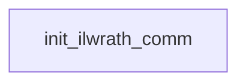

# Ilwrath: existing conversation graph

> Generated by `tools/conversation_catalog.py`; do not edit this page by hand.

[Catalog and interpretation rules](../README.md) · [Proposed engine](../model.md)

Script: [ilwrathc.c](../../../../sc2/src/uqm/comm/ilwrath/ilwrathc.c#L1). Phrase bank: [ilwrath.txt](../../../../sc2/content/base/comm/ilwrath/ilwrath.txt#L1).

1 handler/helper nodes; 0 response registration sites; 0 direct local calls; 108 phrase records.

## Initialization and lifecycle

| Phase | Callback | Bound by | Conditions / source |
| --- | --- | --- | --- |

## Handler graph

Solid arrows are selectable responses; dashed arrows are direct C calls. Conditions, arguments, speech and effects are cataloged below. Parallel response sites are grouped only in this diagram.



## Condition catalog

Condition IDs describe enclosing source structure. Branch predicates combine with ∧; case labels mark source locations that can also be reached by fallthrough. Values refer to their original evaluation points. Local assignments and early control flow remain in the decision bodies.

| ID | Source expression / structural condition |
| --- | --- |
| <a id="condition-c1"></a>C1 | <code>!(GET_GAME_STATE(PROBE_ILWRATH_ENCOUNTER))</code> |
| <a id="condition-c2"></a>C2 | <code>!(GET_GAME_STATE(PROBE_ILWRATH_ENCOUNTER) &#124;&#124; (GET_GAME_STATE(GLOBAL_FLAGS_AND_DATA) &amp; ((1 &lt;&lt; 4) &#124; (1 &lt;&lt; 5))))</code> |
| <a id="condition-c3"></a>C3 | <code>(GET_GAME_STATE(PROBE_ILWRATH_ENCOUNTER) &#124;&#124; (GET_GAME_STATE(GLOBAL_FLAGS_AND_DATA) &amp; ((1 &lt;&lt; 4) &#124; (1 &lt;&lt; 5)))) &#124;&#124; (LOBYTE(GLOBAL(CurrentActivity)) == WON_LAST_BATTLE)</code> |
| <a id="condition-c4"></a>C4 | <code>!((GET_GAME_STATE(PROBE_ILWRATH_ENCOUNTER) &#124;&#124; (GET_GAME_STATE(GLOBAL_FLAGS_AND_DATA) &amp; ((1 &lt;&lt; 4) &#124; (1 &lt;&lt; 5)))) &#124;&#124; (LOBYTE(GLOBAL(CurrentActivity)) == WON_LAST_BATTLE))</code> |

## Script-scope state and lookup tables

These declarations supply shared local state, computed phrase alternatives, number speech, or lookup data used by the nodes. LOCDATA presentation defaults are linked separately in the source.

Presentation descriptor <code>ilwrath_desc</code>: [source](../../../../sc2/src/uqm/comm/ilwrath/ilwrathc.c#L26).

## Node catalog

<a id="node-init_ilwrath_comm"></a>

### init_ilwrath_comm

<code>LOCDATA *init_ilwrath_comm(void)</code> — [source](../../../../sc2/src/uqm/comm/ilwrath/ilwrathc.c#L104).

#### Actions, queries, local updates, and control flow

Calls are listed without assuming they are pure or mutating. Local updates are retained because they determine dynamic menus and counter-selected speech.

| Kind | Operation | Enclosing conditions | Source |
| --- | --- | --- | --- |
| update | <code>ilwrath_desc.AlienTextBaseline.x = TEXT_X_OFFS + (SIS_TEXT_WIDTH &gt;&gt; 1)</code> | No enclosing branch condition | [108](../../../../sc2/src/uqm/comm/ilwrath/ilwrathc.c#L108) |
| update | <code>ilwrath_desc.AlienTextBaseline.y = 70</code> | No enclosing branch condition | [109](../../../../sc2/src/uqm/comm/ilwrath/ilwrathc.c#L109) |
| update | <code>ilwrath_desc.AlienTextWidth = SIS_TEXT_WIDTH - 16</code> | No enclosing branch condition | [110](../../../../sc2/src/uqm/comm/ilwrath/ilwrathc.c#L110) |
| call | <code>GET_GAME_STATE(PROBE_ILWRATH_ENCOUNTER)</code> | No enclosing branch condition | [112](../../../../sc2/src/uqm/comm/ilwrath/ilwrathc.c#L112) |
| call | <code>GET_GAME_STATE(GLOBAL_FLAGS_AND_DATA)</code> | [C1](#condition-c1) | [113](../../../../sc2/src/uqm/comm/ilwrath/ilwrathc.c#L113) |
| call | <code>LOBYTE(GLOBAL(CurrentActivity))</code> | [C2](#condition-c2) | [115](../../../../sc2/src/uqm/comm/ilwrath/ilwrathc.c#L115) |
| call | <code>GLOBAL(CurrentActivity)</code> | [C2](#condition-c2) | [115](../../../../sc2/src/uqm/comm/ilwrath/ilwrathc.c#L115) |
| call | <code>setSegue(Segue_peace)</code> | [C3](#condition-c3) | [117](../../../../sc2/src/uqm/comm/ilwrath/ilwrathc.c#L117) |
| call | <code>setSegue(Segue_hostile)</code> | [C4](#condition-c4) | [121](../../../../sc2/src/uqm/comm/ilwrath/ilwrathc.c#L121) |
| update | <code>retval = &amp;ilwrath_desc</code> | No enclosing branch condition | [123](../../../../sc2/src/uqm/comm/ilwrath/ilwrathc.c#L123) |
| flow | <code>return retval;</code> | No enclosing branch condition | [125](../../../../sc2/src/uqm/comm/ilwrath/ilwrathc.c#L125) |

<details>
<summary>Exact decision body (local calculations, early returns, fallthrough and ordering)</summary>

```c
{
	LOCDATA *retval;

	ilwrath_desc.AlienTextBaseline.x = TEXT_X_OFFS + (SIS_TEXT_WIDTH >> 1);
	ilwrath_desc.AlienTextBaseline.y = 70;
	ilwrath_desc.AlienTextWidth = SIS_TEXT_WIDTH - 16;

	if (GET_GAME_STATE (PROBE_ILWRATH_ENCOUNTER)
			|| (GET_GAME_STATE (GLOBAL_FLAGS_AND_DATA)
			& ((1 << 4) | (1 << 5)))
			|| LOBYTE (GLOBAL (CurrentActivity)) == WON_LAST_BATTLE)
	{
		setSegue (Segue_peace);
	}
	else
	{
		setSegue (Segue_hostile);
	}
	retval = &ilwrath_desc;

	return (retval);
}
```

</details>

## Phrase catalog

Full base-content text, keyed by the symbols used above. Voice filenames are resource metadata; playback also depends on installed addons and settings. Dynamic insertions retain their original placeholders.

<a id="phrase-never_enough"></a>

<details>
<summary>NEVER_ENOUGH — ilwrath-000.ogg</summary>

[Text source](../../../../sc2/content/base/comm/ilwrath/ilwrath.txt#L1)

<pre>We Can Never Receive Sufficient Direction From You, Great Masters!
We Eagerly Await Your Next Vile Commandments.</pre>

</details>

<a id="phrase-ok_warship"></a>

<details>
<summary>OK_WARSHIP — ilwrath-001.ogg</summary>

[Text source](../../../../sc2/content/base/comm/ilwrath/ilwrath.txt#L5)

<pre>As You Wish, Glorious, Unmerciful Destructors!
In All Future Warship We Will Honor You In This Way!</pre>

</details>

<a id="phrase-ok_dwe"></a>

<details>
<summary>OK_DWE — ilwrath-002.ogg</summary>

[Text source](../../../../sc2/content/base/comm/ilwrath/ilwrath.txt#L9)

<pre>Yes, Great Dogar! Yes Mighty Kazon! Dwe Certainly Will, Dwe Certainly Will!</pre>

</details>

<a id="phrase-ok_youboo"></a>

<details>
<summary>OK_YOUBOO — ilwrath-003.ogg</summary>

[Text source](../../../../sc2/content/base/comm/ilwrath/ilwrath.txt#L12)

<pre>It Shall Be So, Great Ones.
Yuubuu Are Mighty!
Yuubuu Are The Most Hideous And Deceitful!
We Ilwrath Are Too Fortunate To Have Yuubuu To Worship!</pre>

</details>

<a id="phrase-ok_dilrat"></a>

<details>
<summary>OK_DILRAT — ilwrath-004.ogg</summary>

[Text source](../../../../sc2/content/base/comm/ilwrath/ilwrath.txt#L18)

<pre>We, The Dill-Rats, Bow And Scrape Off Our Appendages In Your Honor, Mighty Dogar And Kazon!</pre>

</details>

<a id="phrase-big_fun"></a>

<details>
<summary>BIG_FUN — ilwrath-005.ogg</summary>

[Text source](../../../../sc2/content/base/comm/ilwrath/ilwrath.txt#L21)

<pre>Listen!
Once More The Terrible Twosome Are Among Us!
Hear Our Thanks, Mighty Dogar And Kazon!
We Have Found Ultimate Pleasure In Your Cruel Service In These Alien Stars!
Though Our Enemy, The Thraddash, Possess A Tough And Chewy Exterior
Inside These Creatures Can Be Found A Most Smooth And Sweet Set Of Innards.
Their Low Bellows Of Fear And Agony Do Service To Your Names, Great Dogar And Kazon!
We Will Slay These Beasts In Your Name, Until They Are All Dead, Dead, DEAD!</pre>

</details>

<a id="phrase-fast_as_can"></a>

<details>
<summary>FAST_AS_CAN — ilwrath-006.ogg</summary>

[Text source](../../../../sc2/content/base/comm/ilwrath/ilwrath.txt#L31)

<pre>Our Gods Of Darkness And Pain Call To Us Again!
Evil Dogar, Cruel Kazon! How Can We Be So Fortunate To Hear From You Again?
We Pray Thee Gods, Forgive Us For Not Yet Beginning The Slaying Of The Thraddash.
Quickly Now, I Must Rend Three Limbs From My Thorax As A Sign Of My Supplication.
AIEE!
It Is Done! Dogar And Kazon See My Fluids And Must Smile. I Am Happy!
We Make All Haste, But Are Limited By The Speed Of Our Avenger Starcraft.
We Know Our Pitiful Excuses Are Worthless...
We Must Show Our Shame With The Removal Of Yet More Limbs.
AIEE!</pre>

</details>

<a id="phrase-glorious_worship"></a>

<details>
<summary>GLORIOUS_WORSHIP — ilwrath-007.ogg</summary>

[Text source](../../../../sc2/content/base/comm/ilwrath/ilwrath.txt#L43)

<pre>Attend! The Cruel Twins Of Pain And Death Have Returned To Instruct Us!
Dogar And Kazon! We Are Your Instruments Of Cruelty And Death!
As We Speak, Our Holy Excruciators Attack The Thraddash, Slaying Unmercifully In Your Names.</pre>

</details>

<a id="phrase-on_way"></a>

<details>
<summary>ON_WAY — ilwrath-008.ogg</summary>

[Text source](../../../../sc2/content/base/comm/ilwrath/ilwrath.txt#L48)

<pre>Dogar And Kazon Once More Grace Channel 44 With Their Inspiring Words Of Hatred And Cruelty!
Acolyte! Turn The Volume To Maximum Immediately!
Hear Us, Black Dogar! Hear Us, Bloody Kazon!
We Have Heard Your Word And Devote Every Breath To Fulfilling Your Desire For Gratuitous Violence And Death!
As We Speak, A Thousand Starships, Cloaked And Invisible, Make Passage To The Draconis Stars.
Upon Arrival There, The Holy Killing Team Will Begin The Bloody Slaughter You Requested.</pre>

</details>

<a id="phrase-gods_return_1"></a>

<details>
<summary>GODS_RETURN_1 — ilwrath-009.ogg</summary>

[Text source](../../../../sc2/content/base/comm/ilwrath/ilwrath.txt#L56)

<pre>Dogar! Kazon! We Hear Your Summons And Slaughter The Fat Jubby In Greeting.</pre>

</details>

<a id="phrase-gods_return_2"></a>

<details>
<summary>GODS_RETURN_2 — ilwrath-010.ogg</summary>

[Text source](../../../../sc2/content/base/comm/ilwrath/ilwrath.txt#L59)

<pre>From The Black Pits Of Pain The Deific Duo Of Destruction Emerge Once More!</pre>

</details>

<a id="phrase-gods_return_3"></a>

<details>
<summary>GODS_RETURN_3 — ilwrath-011.ogg</summary>

[Text source](../../../../sc2/content/base/comm/ilwrath/ilwrath.txt#L62)

<pre>Our Gods Have Returned Once More, Just As Foretold By This Morning&#x27;s Rituals!
When We Pulled The Steaming Entrails From The Squirming Sacrifice
and Flung The Fatty Loops Against The Walls Of Our Holy Chambers
the Entrails Stuck Tight, Neither Sliding Nor Peeling Even A Little Bit!
Thus Was Our Gods&#x27; Arrival Foretold!</pre>

</details>

<a id="phrase-just_grunts"></a>

<details>
<summary>JUST_GRUNTS — ilwrath-012.ogg</summary>

[Text source](../../../../sc2/content/base/comm/ilwrath/ilwrath.txt#L69)

<pre>What Is That? The Voices Of Our Gods Dogar And Kazon? Surely It Cannot Be!
And Yet My Set Is Tuned To The Mystic 44 -- Who Else Could It Be?
I Am Unworthy Of Such Attention As This!
Dogar -- Kazon! Your Divine Words Will Surely Consume Me.
I Beseech Thee! Speak Directly To The Leaders At Homeworld!
I Am Unworthy.</pre>

</details>

<a id="phrase-grunts_again"></a>

<details>
<summary>GRUNTS_AGAIN — ilwrath-013.ogg</summary>

[Text source](../../../../sc2/content/base/comm/ilwrath/ilwrath.txt#L77)

<pre>Hark! We Are Receiving A Holy Transmission.
Oh Dark And Gruesome Masters! I Am Honored With Your Attention.
But Great Gods, I Am But A Simple Ilwrath, A Humble Murderer.
I Am Unworthy To Hear Your Words!
Only At Our Homeworld Orbiting The Green Eye Of Dogar Are There Ilwrath Sufficiently Evil
to Understand Your Commandments. Forgive Me!</pre>

</details>

<a id="phrase-what_orders"></a>

<details>
<summary>WHAT_ORDERS — ilwrath-014.ogg</summary>

[Text source](../../../../sc2/content/base/comm/ilwrath/ilwrath.txt#L85)

<pre>Your Will Is Our Inspiration. What Shall We Do?</pre>

</details>

<a id="phrase-we_worship_1"></a>

<details>
<summary>WE_WORSHIP_1 — ilwrath-015.ogg</summary>

[Text source](../../../../sc2/content/base/comm/ilwrath/ilwrath.txt#L88)

<pre>From The Chambers Of Pain We Hear Your Words, Cruel And Evil Lords Of Darkness.
And As Your Voice Crackles Out Of The Speaker Boxes, It Sends Thrills Across Our Carapaces.
Our Hairy Quills All Stand Erect And We Pant And Wheeze With Holy Fervor!
Oh Mighty Gods! You Are The Definition Of All That Is Evil And Hideous In This Universe!
You Are The Inspiration For All Cruelty, Deception And Pain.
For This We Thank You!</pre>

</details>

<a id="phrase-we_worship_2"></a>

<details>
<summary>WE_WORSHIP_2 — ilwrath-016.ogg</summary>

[Text source](../../../../sc2/content/base/comm/ilwrath/ilwrath.txt#L96)

<pre>We Shall Make Instant Obeisance, Divine Lords Of Darkness!
Acolyte! Light The Candles Of Torment -- Quickly!
No You Idiot! Not The White Ones...
Use The Yellow And Red Ones We Made From The Prisoners Last Week, The Ones With The Lumps. Yes, Yes!
No Fool, Not Those! They Are Still Wet!</pre>

</details>

<a id="phrase-we_worship_3"></a>

<details>
<summary>WE_WORSHIP_3 — ilwrath-017.ogg</summary>

[Text source](../../../../sc2/content/base/comm/ilwrath/ilwrath.txt#L103)

<pre>Oh Evil Dogar!
Oh Hideous Kazon!
We Shall Toss The Fat Jubbies Into The Pit Of A Thousand Needles!
This We Shall Do In Your Names!
We Shall Bring Forth The Last Remaining Hu-Man Prisoner
And Pull Its Head Apart Slowly, So That Its Cries Last For Hours.
This We Shall Do In Your Names!
We Shall Torment, Terrorize, Maim And Kill, Again, And Again, And AGAIN!
This We Shall Do In Your Names!</pre>

</details>

<a id="phrase-subsequent_chmmr_hello"></a>

<details>
<summary>SUBSEQUENT_CHMMR_HELLO — ilwrath-018.ogg</summary>

[Text source](../../../../sc2/content/base/comm/ilwrath/ilwrath.txt#L114)

<pre>So... The Hu-Man Has Returned To Visit Its Entombed Mentors Of Deceit!
I Am Emotionally Moved By This Poignant Moment, And Feel Compelled To Make Immediate Obeisance.
Flaccid Earthling -- I Will Pour Your Warm Circulatory Fluid Across The Altar Of Dogar
And Dance A Jig Of Cruelty Atop Your Cooling Corpse.</pre>

</details>

<a id="phrase-init_chmmr_hello"></a>

<details>
<summary>INIT_CHMMR_HELLO — ilwrath-019.ogg</summary>

[Text source](../../../../sc2/content/base/comm/ilwrath/ilwrath.txt#L120)

<pre>Caught You, Didn&#x27;t I?
We Have Monitored Your Visit To This World With Great Interest.
Your Plans For Trickery Are Pitiful
And Make Dogar And Kazon Clack Their Mandibles Against One Another And Snicker With Amusement.
And So Now, Squishy Hu-Man
I Wonder What Sort Of Noise You Will Make
When I Pull Off Your Arms?
A High And Wailing Scream, Or A Low Moan Of Ultimate Suffering?</pre>

</details>

<a id="phrase-ok_enough_ilwrath"></a>

<details>
<summary>OK_ENOUGH_ILWRATH — ilwrath-020.ogg</summary>

[Text source](../../../../sc2/content/base/comm/ilwrath/ilwrath.txt#L130)

<pre>And Yet You Know So Little.</pre>

</details>

<a id="phrase-ok_enough_gods"></a>

<details>
<summary>OK_ENOUGH_GODS — ilwrath-021.ogg</summary>

[Text source](../../../../sc2/content/base/comm/ilwrath/ilwrath.txt#L133)

<pre>Your Pitiful Investigations Have Barely Scratched The Surface Of What Is To Be Learned
About Dogar And Kazon.
And Remember, You May Never Get Another Chance To Ask Such Questions.</pre>

</details>

<a id="phrase-send_message"></a>

<details>
<summary>SEND_MESSAGE — ilwrath-022.ogg</summary>

[Text source](../../../../sc2/content/base/comm/ilwrath/ilwrath.txt#L138)

<pre>By The Fetid Breath Of The Dark Twin, Kazon!
A Hu-Man In An Alien Starship... How Fascinating!
When I Intercepted That Ur-Quan Drone, And Learned That An Unidentified Starship Had Approached Earth,
I Never Expected To Find Such A Remarkable Vehicle In The Hands Of A Hu-Man.
Hu-Mans Are Prey Animals - Weak And Helpless-
But Here Is A Hu-Man In An Armed Starship!
And Therefore In Direct Violation Of The Oath Of Fealty.
I Am Sure Our Masters, The Ur-Quan, Will Punish Earth Most Severely For This Treachery....
When I Present Them With The Twisted Wreckage Of Your Ship And Your Many Charred Corpses.</pre>

</details>

<a id="phrase-came_from"></a>

<details>
<summary>CAME_FROM — ilwrath-023.ogg</summary>

[Text source](../../../../sc2/content/base/comm/ilwrath/ilwrath.txt#L149)

<pre>Since You Will Soon Be Dead, I Will Gladly Explain.
We Have Spent Many Years Gleefully Preying On The Pkunk.
They Are A Pitiful, Easily-killed Species
And We Would Have Continued In This Divine Worship Of Dogar And Kazon
But We Required Additional Crew Members And Repairs To Our Cloaking Device.
So We Departed The Giclas Constellation And Set Course For Home.
But Before We Had Reached Our Region Of Space, We Detected The Passage Of A Nearby Vessel - The Ur-Quan Drone.
It Informed Us About You... So Here We Are.
And Now, YOU DIE!</pre>

</details>

<a id="phrase-who_blasts_who"></a>

<details>
<summary>WHO_BLASTS_WHO — ilwrath-024.ogg</summary>

[Text source](../../../../sc2/content/base/comm/ilwrath/ilwrath.txt#L160)

<pre>I Have No Fear Of You, Feeble Mammal.
Though My Ship Lacks A Functioning Cloaking Device, And Many Of Our Crew Are Dead,
My Gods, Dogar The Black And Kazon The Unseen, Have Personally Confided To Me
That They Despise You Hu-Mans, And That They Will Help Us To Kill You All!</pre>

</details>

<a id="phrase-no_surrender"></a>

<details>
<summary>NO_SURRENDER — ilwrath-025.ogg</summary>

[Text source](../../../../sc2/content/base/comm/ilwrath/ilwrath.txt#L166)

<pre>Fool!
As Alien As Your Ship May Be, Our Sensors Reveal How Few Weapons You Have On Board.
Though This Vessel Is Under-Crewed, And Our Cloak Of Darkness Is Non-Functional,
We Still Have More Than Enough Power To Kill You All!</pre>

</details>

<a id="phrase-not_reasonable"></a>

<details>
<summary>NOT_REASONABLE — ilwrath-026.ogg</summary>

[Text source](../../../../sc2/content/base/comm/ilwrath/ilwrath.txt#L172)

<pre>Ha-ha-ha-ha! You Must Be Either A Naive Child Or A Hopeless Fool.
In Either Case, It Makes No Difference, Because Soon You Will Be DEAD!</pre>

</details>

<a id="phrase-subsequent_home_hello"></a>

<details>
<summary>SUBSEQUENT_HOME_HELLO — ilwrath-027.ogg</summary>

[Text source](../../../../sc2/content/base/comm/ilwrath/ilwrath.txt#L176)

<pre>I See That You Have Come To Your Senses
And Are Now Prepared To Engage In The Festival Of A Thousand Screams.
Although Your Initial Rejection Of The Honor Was Dismaying,
We Realize That It May Have Been A Shock To Be So Privileged.
Ha Ha, Pinch Yourself, Hu-Man! You Are Not Dreaming.
Dogar Has Winked And Kazon Has Spasmed In Condescending Approval.
Today, Hu-Man, Is Your Lucky Day!</pre>

</details>

<a id="phrase-general_info"></a>

<details>
<summary>GENERAL_INFO — ilwrath-028.ogg</summary>

[Text source](../../../../sc2/content/base/comm/ilwrath/ilwrath.txt#L185)

<pre>Though Such Information Is Normally Holy And Secret,
I Find I Am Unable To Contain Myself. Know This Fact
You Are Hu-Man, Weak And Alone In This Universe With No Gods To Protect You.
I Know This, Because The Only True Gods Are Our Own Ilwrath Deities, Dogar And Kazon!
Dogar Is The Killer In A Black Cloak...
The Great Destroyer...
The Bloody-Clawed Murderer...
The Dark Beast With A Thousand Young!
Kazon, On The Other Claw, Is The Great Deceiver...
The Malevolent Evil In The Darkness...
The Unstoppable Monster Who Has No Pity...
The Hungry Lurker In The Night.
These Are Our Gods -- The ONLY Gods!
How Do We Know, You Ask? Because Dogar And Kazon TOLD US So.</pre>

</details>

<a id="phrase-goodbye_and_die"></a>

<details>
<summary>GOODBYE_AND_DIE — ilwrath-029.ogg</summary>

[Text source](../../../../sc2/content/base/comm/ilwrath/ilwrath.txt#L201)

<pre>Not So Fast, Tender Hu-Man! You Must First Pay Homage To The Universal Deities Dogar And Kazon!
The Payment Is Simple And Within Your Means.
You Will Pay With Your Lives!</pre>

</details>

<a id="phrase-deceivers"></a>

<details>
<summary>DECEIVERS — ilwrath-030.ogg</summary>

[Text source](../../../../sc2/content/base/comm/ilwrath/ilwrath.txt#L206)

<pre>DECEIVERS!
We Know That You Are Not Truly Dogar And Kazon!
Your Foolish And Childlike Attempts To Fool Us Shall Be Your Death!</pre>

</details>

<a id="phrase-no_peace"></a>

<details>
<summary>NO_PEACE — ilwrath-031.ogg</summary>

[Text source](../../../../sc2/content/base/comm/ilwrath/ilwrath.txt#L211)

<pre>Excellent! We Enjoy The Process Of Rending Life So Much More When The Life Giver Is Willing.
Come Now In Peace And Give That Which Makes You Live!</pre>

</details>

<a id="phrase-no_alliance"></a>

<details>
<summary>NO_ALLIANCE — ilwrath-032.ogg</summary>

[Text source](../../../../sc2/content/base/comm/ilwrath/ilwrath.txt#L215)

<pre>Silly Earthling! The Ur-Quan, Our Masters, Would Be Displeased If They Were Aware Of Your Transgressions!
By Violating Your Oath Of Fealty To The Ur-Quan, We Are Obligated To Take Your Lives As Payment...
A Process That Will Incidentally Please Both Myself And, More Importantly, The Arch-Deific Duo!</pre>

</details>

<a id="phrase-ilwrath_believe"></a>

<details>
<summary>ILWRATH_BELIEVE — ilwrath-033.ogg</summary>

[Text source](../../../../sc2/content/base/comm/ilwrath/ilwrath.txt#L220)

<pre>Listen!
It Is The Hideous And Inspiring Voices Of Our Gods, Dogar And Kazon!
Oh Great Gods Of Evil And Darkness, What Can Your Humble And Devious Servants Do For You?</pre>

</details>

<a id="phrase-ok_kill_thraddash"></a>

<details>
<summary>OK_KILL_THRADDASH — ilwrath-034.ogg</summary>

[Text source](../../../../sc2/content/base/comm/ilwrath/ilwrath.txt#L225)

<pre>Oh Mighty Dogar!
Oh Mighty Kazon!
Your Devoted Servants Hear Your Words And Obey Your Divine And Cruel Insights.
The Pkunk Are Unfit For OUR Sacramental Tortures!
We Relish The Prospect Of Killing Worthy Prey!
We Will Leave Immediately So That We Can Begin Our Glorious, Evil Devotions...
But Who Shall We Prey Upon Next?
Who Shall Suffer Our Inspired Torment?
Hmm.
Didn&#x27;t Those Loathsome Umgah Once Mention A Race Near Their Region Of Space?
Hmm... YES! I Have It! The THRADDASH!
We Will Go NOW, And Kill All Of Them!</pre>

</details>

<a id="phrase-goodbye_gods"></a>

<details>
<summary>GOODBYE_GODS — ilwrath-035.ogg</summary>

[Text source](../../../../sc2/content/base/comm/ilwrath/ilwrath.txt#L239)

<pre>Farewell Dogar And Kazon. We Are Awed By Your Malevolent Presence, And Swear Unto You
To Commit Even More Vile And Treacherous Deeds Tomorrow Than We Did Today!</pre>

</details>

<a id="phrase-init_hello_space"></a>

<details>
<summary>INIT_HELLO_SPACE — ilwrath-036.ogg</summary>

[Text source](../../../../sc2/content/base/comm/ilwrath/ilwrath.txt#L243)

<pre>What? Can I Believe My Sensory Cluster? I Sense Hu-Mans!
I Dance With Joy For Our Good Fortune.
The Hu-Man Dies With Such Agony That It Cannot Help But Please
Dogar And Kazon.</pre>

</details>

<a id="phrase-subsequent_hello_space_1"></a>

<details>
<summary>SUBSEQUENT_HELLO_SPACE_1 — ilwrath-037.ogg</summary>

[Text source](../../../../sc2/content/base/comm/ilwrath/ilwrath.txt#L249)

<pre>What Is It? Mmmm, Hu-Man! It Has Been So Long Since I Have Seen A Hu-Man Die!
We Will Bet On How Many Parts We Can Remove Before It Stops Making Noise!
Now, You Space-Ship Captain, Begin The Expedient Transfer Of All Hu-Man Crew
So That We May Waste No Time.</pre>

</details>

<a id="phrase-subsequent_hello_space_2"></a>

<details>
<summary>SUBSEQUENT_HELLO_SPACE_2 — ilwrath-038.ogg</summary>

[Text source](../../../../sc2/content/base/comm/ilwrath/ilwrath.txt#L255)

<pre>Ah, Hu-Man! You Join Us In The Celebration Of Dogar And Kazon!
We Grow Excited: The Hu-Man Makes Excellent Ceremony.
When We Peel It, Urgent Bleating Comes From The Noisemaker.
Then The Green Eye Of Dogar Observes It Writhe Upon The Altar
And The Cilia Of Kazon Swell, Indicating Their Readiness For The Juices.
It Squirms With Vigor Until We Pop The Crunchy Noisemaker.
Rejoice! The Duo Of Deception Shall Receive Their Supplication.</pre>

</details>

<a id="phrase-subsequent_hello_space_3"></a>

<details>
<summary>SUBSEQUENT_HELLO_SPACE_3 — ilwrath-039.ogg</summary>

[Text source](../../../../sc2/content/base/comm/ilwrath/ilwrath.txt#L264)

<pre>Your Fortuitous Arrival Bodes Well For Our Ceremony Of Consumption!
The Hu-Man Must Prepare: It Must Perform A Complete Depilation,
Then Anoint Its Surface With The Larval Paste Of Our Stillborn Offspring.
At The Altar Of The Duo Of Darkness We Suck The Bony Strength From The Fleshy Weakness
While The Hu-Man Squeals For Either Dogar Or Kazon!
Hu-Man, Listen Closely To These Words
Favor Neither God With Your Screams, Lest You Tragically Taint The Consumption!</pre>

</details>

<a id="phrase-subsequent_hello_space_4"></a>

<details>
<summary>SUBSEQUENT_HELLO_SPACE_4 — ilwrath-040.ogg</summary>

[Text source](../../../../sc2/content/base/comm/ilwrath/ilwrath.txt#L273)

<pre>By The Green Eye Of Dogar, It Is A Squishy Bone-Bag Hu-Man!
It Is Waiting For Kazon To Knead Its Body With The Cilia Of Dread
Until It Can Only Roll And Bleat.
Hah! It Can Only Hope To Be So Honored.
Even Now It Begs For Death And So Now I Must Decide...
Will It Be By Sequentially Bursting Sensory Apparatus Until Nothing Remains?
Will It Be By Shaking It Until It Is Oozing All Over?
Will It Be By Chewing Off Bits And Pieces Until It No Longer Functions?
Hmm, I Think Not The Latter -- Too Many Bones.</pre>

</details>

<a id="phrase-general_info_space_1"></a>

<details>
<summary>GENERAL_INFO_SPACE_1 — ilwrath-041.ogg</summary>

[Text source](../../../../sc2/content/base/comm/ilwrath/ilwrath.txt#L284)

<pre>Hah! Puny Hu-Man! You Make Me Chitter With Amusement!
By The Will Of The Mighty Dogar And Kazon I Am Here To Make You Die, Die, DIE!</pre>

</details>

<a id="phrase-general_info_space_2"></a>

<details>
<summary>GENERAL_INFO_SPACE_2 — ilwrath-042.ogg</summary>

[Text source](../../../../sc2/content/base/comm/ilwrath/ilwrath.txt#L288)

<pre>It Is The Good Will Of Dogar And Kazon That Brings The Fodder Hu-Man To Us!
Were It Not For The Dark Lords Of Deceptions&#x27; Mighty Directive,
We Would Not Have The Good Fortune To Intercept You For A Festive Limb Wringing!
Your Fight For Life, Though Futile, Serves The Noble Purpose
And Appeases Our Honored Deities.
You Have Earned The Right To Hold Your Head High!</pre>

</details>

<a id="phrase-general_info_space_3"></a>

<details>
<summary>GENERAL_INFO_SPACE_3 — ilwrath-043.ogg</summary>

[Text source](../../../../sc2/content/base/comm/ilwrath/ilwrath.txt#L296)

<pre>Incorrectness! We Come From The Eye Of Dogar.
Such A Quasar Exists Nowhere Near This Location!
Look In The Heavens At Location 022.9, 366.6
And Gaze Into The Depths Of Its All-Seeing Eye If You Dare!
Only By The Sparing Caress Of Kazon&#x27;s Anointed Cilia Will You Survive Such An Act.
Else, You Will Bless The Altar Of Consumption With Your Ceremonial Blood!</pre>

</details>

<a id="phrase-general_info_space_4"></a>

<details>
<summary>GENERAL_INFO_SPACE_4 — ilwrath-044.ogg</summary>

[Text source](../../../../sc2/content/base/comm/ilwrath/ilwrath.txt#L304)

<pre>In The Brief Golden Moment - During The War With Your Alliance -
We Ilwrath Enjoyed Unequaled Merriment And Festivities.
So Much Blood And Lymph Fluid!
Then, After The Ur-Quan Made Your Kind Fallow Slaves,
We Were Forced To Use Species Indigenous To Our Planet For Amusement.
We Lived A Pleasant Existence Until A Scandal Rocked The Ilwrath!
The Grah -- Our Favorite Species To Torment, Which We Carefully Maintained At The Brink Of Extinction,
Had Been Completely Consumed!
A Bureaucratic Error Was To Blame.
Quality Death Became Rare. Our Highly Advanced Civilization Began To Show Signs Of Degeneracy.
In Our Moment Of Need, We Prayed To The Mighty Duo For Direction,  And They Answered.
`Go Forth. Seek The Bird Beings.
Pluck Them Slowly. Eviscerate Their Gasping Husks. Let Dogar And Kazon Drink Their Death And Pain!&#x27;
We Went Forth And We Found The Pkunk, But Hu-Man, Now We Are Supremely Joyful...
Because You Die So Much Better!</pre>

</details>

<a id="phrase-general_info_space_5"></a>

<details>
<summary>GENERAL_INFO_SPACE_5 — ilwrath-045.ogg</summary>

[Text source](../../../../sc2/content/base/comm/ilwrath/ilwrath.txt#L321)

<pre>Blasphemer! You Are Not Fit For The Most Holy Rituals Of Devivication And Consumption!
Dogar And Kazon Would Most Assuredly Gag On Your Sour Flesh
And Spit Your Thin Soul Onto The Ninth Mountain Of Hell.
Therefore We Shall Simply Cut You Up And Feed You To The Pets.</pre>

</details>

<a id="phrase-strength_not_all"></a>

<details>
<summary>STRENGTH_NOT_ALL — ilwrath-046.ogg</summary>

[Text source](../../../../sc2/content/base/comm/ilwrath/ilwrath.txt#L327)

<pre>Ha! Foolish Flesh Sac, Your Obsession With Strength Spells Your Doom.
Only Through Enlightenment Achieved With Diligent Ritual Worship Of The Twins Of Darkness
Can A Being Truly Be Victorious!
Death, No Matter What The Source, Feeds The Wicked Pair.
It Is An Ultimate Honor And Victory To Die For This Purpose.
We Know In The End Only The Truly Devout Will Reap The Reward That Dogar And Kazon Dispense!</pre>

</details>

<a id="phrase-no_slay_by_thousands"></a>

<details>
<summary>NO_SLAY_BY_THOUSANDS — ilwrath-047.ogg</summary>

[Text source](../../../../sc2/content/base/comm/ilwrath/ilwrath.txt#L335)

<pre>You Amuse Us With Your Nonsensical Ramblings.
We Look Forward To The Careful Exploration Of Your Structure.
First, We Will Peel Back The Curious Follicle-Infested Outer Layer
Followed By The Greasy Blankets Of Yellow Lard.
Such A Confusing Hodge-Podge Of Parts Can Entertain For Hours!
Hu-Man, Prepare Yourself For The Festivities!</pre>

</details>

<a id="phrase-no_ease_up"></a>

<details>
<summary>NO_EASE_UP — ilwrath-048.ogg</summary>

[Text source](../../../../sc2/content/base/comm/ilwrath/ilwrath.txt#L343)

<pre>Relax -- Yes! Dogar And Kazon Could Not Say It Better!
We Will Engage In The Best Stress-Relieving Activity.
Prepare Your Tepid Flesh Bag For Death!</pre>

</details>

<a id="phrase-goodbye_and_die_space"></a>

<details>
<summary>GOODBYE_AND_DIE_SPACE — ilwrath-049.ogg</summary>

[Text source](../../../../sc2/content/base/comm/ilwrath/ilwrath.txt#L348)

<pre>Where To, Hu-Man?
We Are Here To Escort You To The Glistening Chambers Of Pain
Home Of The Heinous Twins Of Darkness.
We Will Assist You On Your Journey Of Expiration.</pre>

</details>

<a id="phrase-init_home_hello"></a>

<details>
<summary>INIT_HOME_HELLO — ilwrath-050.ogg</summary>

[Text source](../../../../sc2/content/base/comm/ilwrath/ilwrath.txt#L354)

<pre>What A Pleasant Surprise! Ever Since The Ur-Quan Made It A Fallow Slave Species
We Have Missed The Hu-Man! You Arrive Just In Time For The Festival Of A Thousand Screams.
We Welcome You With Open Appendages!
Your Participation In The Ceremony Is Most Fortuitous.
As We Pour Your Steaming Parts From Your Breached Husk
You Will Cry With The Force That Pleases The Mighty Deities Dogar And Kazon!
Then We Will Address Our Inquiries And Receive Deific Guidance. Glorious!</pre>

</details>

<a id="phrase-goodbye_and_die_homeworld"></a>

<details>
<summary>GOODBYE_AND_DIE_HOMEWORLD — ilwrath-051.ogg</summary>

[Text source](../../../../sc2/content/base/comm/ilwrath/ilwrath.txt#L363)

<pre>You Leave? The Festivities Have Not Yet Begun -- You Have Uttered Nary A Single Scream!
Our Pain-Pots Have Been Freshly Mixed, And We Have Sharpened Our Poppers.
Wait! We Cannot Permit You To Miss The Happy Times Of Terror And Torment.</pre>

</details>

<a id="phrase-so_much_to_know"></a>

<details>
<summary>SO_MUCH_TO_KNOW — ilwrath-052.ogg</summary>

[Text source](../../../../sc2/content/base/comm/ilwrath/ilwrath.txt#L368)

<pre>There Is So Much To Tell -- So Many Different Aspects!
These Deities Permeate The Fabric Of The Universe.
Since All Things Eventually Succumb To Death, All Things Meet Dogar And Kazon.</pre>

</details>

<a id="phrase-long_ago"></a>

<details>
<summary>LONG_AGO — ilwrath-053.ogg</summary>

[Text source](../../../../sc2/content/base/comm/ilwrath/ilwrath.txt#L373)

<pre>Hu-Man, You Do Not Understand. It Is As It Has Always Been.
When The Hatchlings Struggle From The Egg Sac
They Show Their Respect To The Twin Gods Of Death During Their First Frenzied Gorging.
From That Moment On, The Directives And Philosophies Of Dogar And Kazon
Are Manifested By The Hatchling.</pre>

</details>

<a id="phrase-killed_good_gods"></a>

<details>
<summary>KILLED_GOOD_GODS — ilwrath-054.ogg</summary>

[Text source](../../../../sc2/content/base/comm/ilwrath/ilwrath.txt#L380)

<pre>During The Dark Ages, We Were Confused By The Many Gods.
There Were Dozens Of Deities Ranging From Zith Of The Pelt
To Awk Of The Seds.
It Was Only Through The Careful Formation Of A Priestly Ruling Body
That The Ilwrath Were Able To Determine The True Gods Dogar And Kazon!
This New Priestly Cabal Revealed That We Must Discard All Other Gods
Be They Of Hearth Or Flowing Web.
Only The Priests Were Capable Of Interpreting The Will Of The Gods.
Their Order Refined Our Worship Until We Could Do No Better.
All Heretics Were To Be Eaten,
And All Possessions Were To Be Delivered To The Holy Sites
Or The Priestly Dwellings.</pre>

</details>

<a id="phrase-channel_44"></a>

<details>
<summary>CHANNEL_44 — ilwrath-055.ogg</summary>

[Text source](../../../../sc2/content/base/comm/ilwrath/ilwrath.txt#L394)

<pre>The Deific Duo Broadcast On Channel 44. Their Words Of Wisdom Are
Available To All And Their Instructions Are Carried Out To The Best Of Our
Mortal Ability. We Know That We Are Pleasing The Gods Because They
No Longer Find It Necessary To Guide Us. In The Past, The Dark Twins
Were Compelled To Direct Us Almost Daily, But Now Have Received No
Direction For Almost Eight Years. Indeed, We Diligently Monitor The
Channel Should Dogar And Kazon Choose To Be Heard.</pre>

</details>

<a id="phrase-because_44"></a>

<details>
<summary>BECAUSE_44 — ilwrath-056.ogg</summary>

[Text source](../../../../sc2/content/base/comm/ilwrath/ilwrath.txt#L403)

<pre>They Do It For Us.
First, They Clear The Channel Of Messy Static And Interference.
Second, It Made It Easy For Us To Properly Identify
What Might Be Mistaken For Mad Rambling As The Sacred Words.
You See, Dogar Possesses 44 Eyes That See Into The 44 Planes Of Existence
And Each Of Kazon&#x27;s 44 Sub-Tongues Is Made Up Of 44 Plump, Writhing Cilia.
Besides, They Knew We Were `Captain Satellite&#x27; Viewers.</pre>

</details>

<a id="phrase-what_about_ilwrath"></a>

<details>
<summary>WHAT_ABOUT_ILWRATH — ilwrath-057.ogg</summary>

[Text source](../../../../sc2/content/base/comm/ilwrath/ilwrath.txt#L412)

<pre>Your Interest Is Not Unusual. It Is Through The Omniscient Guidance
Of Our Mighty Lords Of Darkness That We Have Achieved This State Of Near Perfection.
We Will Dispel Your Ignorance Concerning The First Child Species
Of The Unmerciful Dogar And Kazon.</pre>

</details>

<a id="phrase-about_physio"></a>

<details>
<summary>ABOUT_PHYSIO — ilwrath-058.ogg</summary>

[Text source](../../../../sc2/content/base/comm/ilwrath/ilwrath.txt#L418)

<pre>Yes, Our Striking Appearance Only Hints At The True Strength That Resides Inside.
Coursing Through Our Thorax Are The Fluids Of Life.
Like Yourselves, If We Leak In Excess, We Will Satiate The Sacrificial Needs Of Dogar And Kazon.
Our Mandibles Allow Us To Communicate, Take Sustenance, And Deliver Pain.
The Appendages You See Here Allow Us To Manipulate Our Technologies
And Will Regenerate When Damaged Or Lost As Often Happens In Many Of The Rituals Of Pain.
Our Sensory Cluster Lets Us Monitor The Whim And Will Of The Deadly Duo
In The Complex Sequence Of Events That Leads Us All To Death.</pre>

</details>

<a id="phrase-about_history"></a>

<details>
<summary>ABOUT_HISTORY — ilwrath-059.ogg</summary>

[Text source](../../../../sc2/content/base/comm/ilwrath/ilwrath.txt#L428)

<pre>For Eons We Lived Appendage To Mandible.
Then, Many Millennia Ago, We Received The Guidance Of Dogar And Kazon.
This Enabled Us To Move Beyond The Simple Existence Of Tranquil Hunter-Gatherers,
To Become World-Striding Avatars Of Death And Destruction.
Over The Many Years, We Advanced Our Technology -- Always In The Name Of Dogar And Kazon
Always In The Development Of More Sophisticated Tools For Murder.
Then, The Gods Gave Us The Means To Go Forth And Commit Even More Glorious Acts!
This Was 29 Years Ago, When The Ur-Quan Improved Our Starships And Weapons.
The War Against Your Alliance Was Glorious!
But Alas, All Good Things Come To An End. You Lost.
We Honored The Wishes Of The Soft And Merciful Ur-Quan And Stopped Eating You Hu-Mans.
To Continue Our Festive Ceremonies Of Death We Began Employing Our Native Species For Ceremony.
Things Seemed To Be Going Well Until We Accidentally Exhausted Our Supply Of All These Life Forms.
We Became Distraught And Called To Our Gods For Guidance!
Then, Eight Years Ago, Dogar And Kazon Responded To Our Wails Of Dismay
By Directing Us To Devour Feathered Bird Beings-The Pkunk!
We Now Penetrate Deeply Into Their Home Space!
When We Complete Our Mission Of Genocide
We Are Certain That We Will Once Again Hear From Dogar And Kazon.</pre>

</details>

<a id="phrase-about_culture"></a>

<details>
<summary>ABOUT_CULTURE — ilwrath-060.ogg</summary>

[Text source](../../../../sc2/content/base/comm/ilwrath/ilwrath.txt#L449)

<pre>Ah, Our Culture Is Rich With Meaningful Tradition.
During The Birth Rite The Egg Sac Teems With Many New Potential Deaths
The Hatchlings Fight Over Their First Frothy Draught Of Blood.
In The Ensuing Frenzy, Many Hatchlings Are Consumed, Either Partially Or In Their Entirety.
A Frequently Performed Ceremony Of Affirmation Has The Participant Grinding Away Partial Or Even Whole Appendages.
It Is The Pain That Acknowledges The Greatness Of The Twins Of Excruciation
How Can They Help But Notice The Scream Caused By The Mangled Nervous Tissue?</pre>

</details>

<a id="phrase-about_urquan"></a>

<details>
<summary>ABOUT_URQUAN — ilwrath-061.ogg</summary>

[Text source](../../../../sc2/content/base/comm/ilwrath/ilwrath.txt#L458)

<pre>The Ur-Quan Are But The Instruments Of Dogar And Kazon, Even Though They May Not Admit To It.
This Is Because It Was The Evil Twins That Had Them Assist Us With Their Technologies And Resources.
Their Soft, Merciful Nature Sickens Both Gods But They See The Potential That The Ur-Quan Possess.
If You Doubt This Statement, Notice That The Ur-Quan Dreadnought Is Staffed With 42 Crew Members.
Since Dogar And Kazon Exhibit The Quality Of Omnipresence
The Total Crew Complement Is Actually At The Auspicious Count Of 44!
That The Ur-Quan Are But Instruments Of The Dark Twins Is A Foregone Conclusion.</pre>

</details>

<a id="phrase-urquan_too_nice"></a>

<details>
<summary>URQUAN_TOO_NICE — ilwrath-062.ogg</summary>

[Text source](../../../../sc2/content/base/comm/ilwrath/ilwrath.txt#L467)

<pre>Simply Put, The Ur-Quan Are Far Too Kind To Please Dogar And Kazon.
When Your Species Was Subdued, Our Gods Made Clear Their Desire For Immediate Deaths By The Billion.
We Made Plans For A Grand Ceremony To Be Called `Mountains Of Flesh&#x27;.
We Built Thousands Of Portable Altars, And Transported Millions Of Blood Gowns And Fillet Knives To Your World.
But Then The Ur-Quan Commanded That You Hu-Mans Were To Be Left Alive! The Confusion!
With Our Plans For A Magnificent And Most Holy Planetary Slaughter Forcibly Terminated
We Retreated To Our Homeworld To Sulk.</pre>

</details>

<a id="phrase-of_course_were_evil"></a>

<details>
<summary>OF_COURSE_WERE_EVIL — ilwrath-063.ogg</summary>

[Text source](../../../../sc2/content/base/comm/ilwrath/ilwrath.txt#L476)

<pre>Ha! Evil! Of Course We&#x27;re Evil!
Dogar And Kazon Would Never Reward A Less-Than-Hideously Evil Species With Their Baleful Grace.
Why We Are The Very Definition Of Evil!
Everything About Us, Within And Without, Reeks Of Heinous Deeds, Deceit And Treachery!
Even Our House Pets Are Rather Evil.</pre>

</details>

<a id="phrase-dont_confuse_us"></a>

<details>
<summary>DONT_CONFUSE_US — ilwrath-064.ogg</summary>

[Text source](../../../../sc2/content/base/comm/ilwrath/ilwrath.txt#L483)

<pre>Hmmm... We ARE All Evil.
We All Behave In A Mutually Agreed-Upon Fashion Of Murder, Torture, Deceit And So Forth.
Our Uniform Acceptance Of This Heinous Credo Creates An Orderly And Cooperative Society
Which Hardly Seems Evil.
Evil Is Doing Things That Make Others Hurt Or Fear.
We ALL Do That, Of Course.
But Since We ALL Do Such Things, As Sanctioned By Our Culture,
It Would Be `Bad&#x27; To Do Otherwise.
Which Means...  Er...  Er...
Blasphemer! Do Not Play With Words! You Anger Both Dogar And Kazon! Now You Must Die!</pre>

</details>

<a id="phrase-on_way_to_thraddash"></a>

<details>
<summary>ON_WAY_TO_THRADDASH — ilwrath-065.ogg</summary>

[Text source](../../../../sc2/content/base/comm/ilwrath/ilwrath.txt#L495)

<pre>Begone Hu-Mans!
We Would Very Much Like To Tear Off All Your Digits...
And Be Entertained Fitting Them Into Your Orifices...
But We Are On An Evil Jihad And Cannot Be Bothered Killing You At This Time.
Perhaps Later.</pre>

</details>

<a id="phrase-happy_fighting_thraddash"></a>

<details>
<summary>HAPPY_FIGHTING_THRADDASH — ilwrath-066.ogg</summary>

[Text source](../../../../sc2/content/base/comm/ilwrath/ilwrath.txt#L502)

<pre>From Channel 44 Came The Words Of The Dark Twins To Make Bloody Pilgrimage!
We Have Arrived In the Holy Killing Zone and Eagerly Execute the Commands of Dogar and Kazon.
The Slaying Has Been Excellent -- High Ceremony!
Now You Are Here, Befouling The Event With Primate Chatter.
Begone Hu-Man! You Interfere With The Blessed Murder Worship Of The Dark Twins.</pre>

</details>

<a id="phrase-say_warship"></a>

<details>
<summary>say_warship</summary>

[Text source](../../../../sc2/content/base/comm/ilwrath/ilwrath.txt#L509)

<pre>FROM THIS DAY FORWARD, SAY WARSHIP INSTEAD OF WORSHIP!</pre>

</details>

<a id="phrase-say_dwe"></a>

<details>
<summary>say_dwe</summary>

[Text source](../../../../sc2/content/base/comm/ilwrath/ilwrath.txt#L512)

<pre>FROM THIS DAY FORWARD, SAY DWE INSTEAD OF WE!</pre>

</details>

<a id="phrase-say_youboo"></a>

<details>
<summary>say_youboo</summary>

[Text source](../../../../sc2/content/base/comm/ilwrath/ilwrath.txt#L515)

<pre>FROM THIS DAY FORWARD, SAY YUUBUU INSTEAD OF YOU!</pre>

</details>

<a id="phrase-say_dillrat"></a>

<details>
<summary>say_dillrat</summary>

[Text source](../../../../sc2/content/base/comm/ilwrath/ilwrath.txt#L518)

<pre>YOU ARE NO LONGER THE ILWRATH. YOU ARE NOW THE DILL-RATS!</pre>

</details>

<a id="phrase-enough_orders"></a>

<details>
<summary>enough_orders</summary>

[Text source](../../../../sc2/content/base/comm/ilwrath/ilwrath.txt#L521)

<pre>YOU ARE SUFFICIENTLY GRACED. GO AND KILL GRUESOMELY IN OUR NAMES!</pre>

</details>

<a id="phrase-other_divine_orders"></a>

<details>
<summary>other_divine_orders</summary>

[Text source](../../../../sc2/content/base/comm/ilwrath/ilwrath.txt#L524)

<pre>WE REQUIRE THAT YOU DO THINGS A BIT DIFFERENTLY.</pre>

</details>

<a id="phrase-worship_us"></a>

<details>
<summary>worship_us</summary>

[Text source](../../../../sc2/content/base/comm/ilwrath/ilwrath.txt#L527)

<pre>WORSHIP US!</pre>

</details>

<a id="phrase-bye_gods"></a>

<details>
<summary>bye_gods</summary>

[Text source](../../../../sc2/content/base/comm/ilwrath/ilwrath.txt#L530)

<pre>WE RETURN NOW TO THE FETID DARKNESS. OBEY OUR COMMANDS!</pre>

</details>

<a id="phrase-enough_ilwrath"></a>

<details>
<summary>enough_ilwrath</summary>

[Text source](../../../../sc2/content/base/comm/ilwrath/ilwrath.txt#L533)

<pre>Oooo! My head spins with astonishing facts! Say no more!</pre>

</details>

<a id="phrase-enough_gods"></a>

<details>
<summary>enough_gods</summary>

[Text source](../../../../sc2/content/base/comm/ilwrath/ilwrath.txt#L536)

<pre>I grow weary of Dogar and Kazon. Let&#x27;s discuss something else.</pre>

</details>

<a id="phrase-where_you_come_from"></a>

<details>
<summary>where_you_come_from</summary>

[Text source](../../../../sc2/content/base/comm/ilwrath/ilwrath.txt#L539)

<pre>Where the hell did you come from?</pre>

</details>

<a id="phrase-it_will_be_a_pleasure"></a>

<details>
<summary>it_will_be_a_pleasure</summary>

[Text source](../../../../sc2/content/base/comm/ilwrath/ilwrath.txt#L542)

<pre>It will be a pleasure blasting your ugly face out of the stars.</pre>

</details>

<a id="phrase-be_reasonable"></a>

<details>
<summary>be_reasonable</summary>

[Text source](../../../../sc2/content/base/comm/ilwrath/ilwrath.txt#L545)

<pre>Look, let&#x27;s be reasonable. We CAN coexist peacefully.</pre>

</details>

<a id="phrase-surrender"></a>

<details>
<summary>surrender</summary>

[Text source](../../../../sc2/content/base/comm/ilwrath/ilwrath.txt#L548)

<pre>Surrender, foul alien creature, or you will be annihilated!</pre>

</details>

<a id="phrase-whats_up"></a>

<details>
<summary>whats_up</summary>

[Text source](../../../../sc2/content/base/comm/ilwrath/ilwrath.txt#L551)

<pre>Look, before you try to kill me, would you tell me a bit about yourselves?</pre>

</details>

<a id="phrase-bye"></a>

<details>
<summary>bye</summary>

[Text source](../../../../sc2/content/base/comm/ilwrath/ilwrath.txt#L554)

<pre>It&#x27;s been swell, guys. See ya.</pre>

</details>

<a id="phrase-want_peace"></a>

<details>
<summary>want_peace</summary>

[Text source](../../../../sc2/content/base/comm/ilwrath/ilwrath.txt#L557)

<pre>There is no need for conflict; let peace begin!</pre>

</details>

<a id="phrase-want_alliance"></a>

<details>
<summary>want_alliance</summary>

[Text source](../../../../sc2/content/base/comm/ilwrath/ilwrath.txt#L560)

<pre>Let us unite against our common threat, the dreaded Ur-Quan!</pre>

</details>

<a id="phrase-go_kill_thraddash"></a>

<details>
<summary>go_kill_thraddash</summary>

[Text source](../../../../sc2/content/base/comm/ilwrath/ilwrath.txt#L563)

<pre>HEED THESE WORDS OUR EVIL CHILDREN -- LEAVE THIS PLACE -- SEEK NEW PREY!</pre>

</details>

<a id="phrase-whats_up_space_1"></a>

<details>
<summary>whats_up_space_1</summary>

[Text source](../../../../sc2/content/base/comm/ilwrath/ilwrath.txt#L566)

<pre>Ilwrath Vessel: State now the nature of your mission.</pre>

</details>

<a id="phrase-whats_up_space_2"></a>

<details>
<summary>whats_up_space_2</summary>

[Text source](../../../../sc2/content/base/comm/ilwrath/ilwrath.txt#L569)

<pre>Your presence here is of interest. Please enlighten us.</pre>

</details>

<a id="phrase-whats_up_space_3"></a>

<details>
<summary>whats_up_space_3</summary>

[Text source](../../../../sc2/content/base/comm/ilwrath/ilwrath.txt#L572)

<pre>What is this `Doggone&#x27; and `Quasar&#x27; thing anyway?</pre>

</details>

<a id="phrase-whats_up_space_4"></a>

<details>
<summary>whats_up_space_4</summary>

[Text source](../../../../sc2/content/base/comm/ilwrath/ilwrath.txt#L575)

<pre>What are you Ilwrath spending your time doing?</pre>

</details>

<a id="phrase-whats_up_space_5"></a>

<details>
<summary>whats_up_space_5</summary>

[Text source](../../../../sc2/content/base/comm/ilwrath/ilwrath.txt#L578)

<pre>What&#x27;s up with Dayglo and Crayon?</pre>

</details>

<a id="phrase-you_are_weak"></a>

<details>
<summary>you_are_weak</summary>

[Text source](../../../../sc2/content/base/comm/ilwrath/ilwrath.txt#L581)

<pre>We take pity upon you, weakling Ilwrath. Go now before we change our minds.</pre>

</details>

<a id="phrase-slay_by_thousands"></a>

<details>
<summary>slay_by_thousands</summary>

[Text source](../../../../sc2/content/base/comm/ilwrath/ilwrath.txt#L584)

<pre>Your greed for lives seals your doom. We will slay you by the thousands!</pre>

</details>

<a id="phrase-ease_up"></a>

<details>
<summary>ease_up</summary>

[Text source](../../../../sc2/content/base/comm/ilwrath/ilwrath.txt#L587)

<pre>We mean you no harm; relax.</pre>

</details>

<a id="phrase-bye_space"></a>

<details>
<summary>bye_space</summary>

[Text source](../../../../sc2/content/base/comm/ilwrath/ilwrath.txt#L590)

<pre>Well, I&#x27;d love to chat, but I have to go.</pre>

</details>

<a id="phrase-bye_homeworld"></a>

<details>
<summary>bye_homeworld</summary>

[Text source](../../../../sc2/content/base/comm/ilwrath/ilwrath.txt#L593)

<pre>Goodbye, adios, ciao!</pre>

</details>

<a id="phrase-want_info_on_gods"></a>

<details>
<summary>want_info_on_gods</summary>

[Text source](../../../../sc2/content/base/comm/ilwrath/ilwrath.txt#L596)

<pre>Your gods fascinate us. Can you reveal their true nature?</pre>

</details>

<a id="phrase-when_start_worship"></a>

<details>
<summary>when_start_worship</summary>

[Text source](../../../../sc2/content/base/comm/ilwrath/ilwrath.txt#L599)

<pre>When did you begin your devout ways?</pre>

</details>

<a id="phrase-any_good_gods"></a>

<details>
<summary>any_good_gods</summary>

[Text source](../../../../sc2/content/base/comm/ilwrath/ilwrath.txt#L602)

<pre>I don&#x27;t want to offend, but did you ever have any Good Gods?</pre>

</details>

<a id="phrase-how_talk_with_gods"></a>

<details>
<summary>how_talk_with_gods</summary>

[Text source](../../../../sc2/content/base/comm/ilwrath/ilwrath.txt#L605)

<pre>How do you pray and how do Dogar and Kazon answer?</pre>

</details>

<a id="phrase-why_44"></a>

<details>
<summary>why_44</summary>

[Text source](../../../../sc2/content/base/comm/ilwrath/ilwrath.txt#L608)

<pre>Why do your Gods broadcast on channel 44?</pre>

</details>

<a id="phrase-want_info_on_ilwrath"></a>

<details>
<summary>want_info_on_ilwrath</summary>

[Text source](../../../../sc2/content/base/comm/ilwrath/ilwrath.txt#L611)

<pre>You Ilwrath fascinate me. Tell me about yourselves.</pre>

</details>

<a id="phrase-what_about_physio"></a>

<details>
<summary>what_about_physio</summary>

[Text source](../../../../sc2/content/base/comm/ilwrath/ilwrath.txt#L614)

<pre>Boy, I have to say, you are the strangest looking critters.</pre>

</details>

<a id="phrase-what_about_history"></a>

<details>
<summary>what_about_history</summary>

[Text source](../../../../sc2/content/base/comm/ilwrath/ilwrath.txt#L617)

<pre>How did you get so scr... er, end up like you are?</pre>

</details>

<a id="phrase-what_about_culture"></a>

<details>
<summary>what_about_culture</summary>

[Text source](../../../../sc2/content/base/comm/ilwrath/ilwrath.txt#L620)

<pre>Tell me about your fascinating customs and ceremonies.</pre>

</details>

<a id="phrase-what_about_urquan"></a>

<details>
<summary>what_about_urquan</summary>

[Text source](../../../../sc2/content/base/comm/ilwrath/ilwrath.txt#L623)

<pre>So, what do you think of the Ur-Quan anyway?</pre>

</details>

<a id="phrase-are_you_evil"></a>

<details>
<summary>are_you_evil</summary>

[Text source](../../../../sc2/content/base/comm/ilwrath/ilwrath.txt#L626)

<pre>Okay, so help me understand this. You consider yourselves Evil?</pre>

</details>

<a id="phrase-but_evil_is_defined"></a>

<details>
<summary>but_evil_is_defined</summary>

[Text source](../../../../sc2/content/base/comm/ilwrath/ilwrath.txt#L629)

<pre>But `evil&#x27; is defined as deviation from established values.  If your entire society behaves evilly, then aren&#x27;t you all, in fact, good?</pre>

</details>
