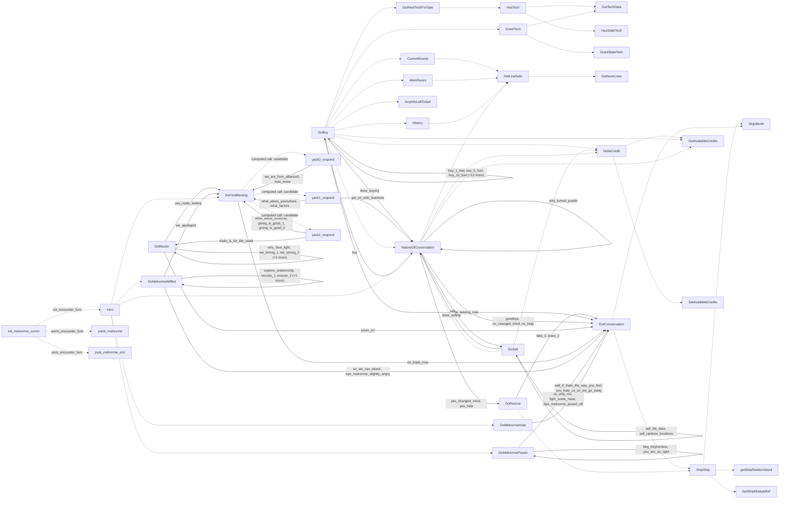

# Melnorme: existing conversation graph

> Generated by `tools/conversation_catalog.py`; do not edit this page by hand.

[Catalog and interpretation rules](../README.md) · [Proposed engine](../model.md)

Script: [melnorm.c](../../../../sc2/src/uqm/comm/melnorm/melnorm.c#L1). Phrase bank: [melnorme.txt](../../../../sc2/content/base/comm/melnorme/melnorme.txt#L1).

36 handler/helper nodes; 61 response registration sites; 46 direct local calls; 282 phrase records.

## Initialization and lifecycle

| Phase | Callback | Bound by | Conditions / source |
| --- | --- | --- | --- |
| <code>init_encounter_func</code> | [<code>Intro</code>](#node-intro) | <code>init_melnorme_comm</code> | No enclosing branch condition; [1835](../../../../sc2/src/uqm/comm/melnorm/melnorm.c#L1835) |
| <code>post_encounter_func</code> | [<code>post_melnorme_enc</code>](#node-post_melnorme_enc) | <code>init_melnorme_comm</code> | No enclosing branch condition; [1836](../../../../sc2/src/uqm/comm/melnorm/melnorm.c#L1836) |
| <code>uninit_encounter_func</code> | [<code>uninit_melnorme</code>](#node-uninit_melnorme) | <code>init_melnorme_comm</code> | No enclosing branch condition; [1837](../../../../sc2/src/uqm/comm/melnorm/melnorm.c#L1837) |

## Handler graph

Solid arrows are selectable responses; dashed arrows are direct C calls. Conditions, arguments, speech and effects are cataloged below. Parallel response sites are grouped only in this diagram.



## Condition catalog

Condition IDs describe enclosing source structure. Branch predicates combine with ∧; case labels mark source locations that can also be reached by fallthrough. Values refer to their original evaluation points. Local assignments and early control flow remain in the decision bodies.

| ID | Source expression / structural condition |
| --- | --- |
| <a id="condition-c1"></a>C1 | <code>for (i = 0; i &lt; NUM_TECHNOLOGIES; ++i)</code> |
| <a id="condition-c2"></a>C2 | <code>tech_data_table[i].id == techId</code> |
| <a id="condition-c3"></a>C3 | <code>switch (stateId)</code> |
| <a id="condition-c4"></a>C4 | <code>case IMPROVED_LANDER_SPEED (see source for fallthrough)</code> |
| <a id="condition-c5"></a>C5 | <code>case IMPROVED_LANDER_CARGO (see source for fallthrough)</code> |
| <a id="condition-c6"></a>C6 | <code>case IMPROVED_LANDER_SHOT (see source for fallthrough)</code> |
| <a id="condition-c7"></a>C7 | <code>!techData</code> |
| <a id="condition-c8"></a>C8 | <code>switch (techData-&gt;type)</code> |
| <a id="condition-c9"></a>C9 | <code>case TECH_TYPE_MODULE (see source for fallthrough)</code> |
| <a id="condition-c10"></a>C10 | <code>case TECH_TYPE_LANDER_SHIELD (see source for fallthrough)</code> |
| <a id="condition-c11"></a>C11 | <code>case TECH_TYPE_STATE (see source for fallthrough)</code> |
| <a id="condition-c12"></a>C12 | <code>array == ok_buy_event_lines</code> |
| <a id="condition-c13"></a>C13 | <code>!(array == ok_buy_event_lines)</code> |
| <a id="condition-c14"></a>C14 | <code>array == ok_buy_alien_race_lines</code> |
| <a id="condition-c15"></a>C15 | <code>!(array == ok_buy_alien_race_lines)</code> |
| <a id="condition-c16"></a>C16 | <code>array == ok_buy_history_lines</code> |
| <a id="condition-c17"></a>C17 | <code>!(array == ok_buy_history_lines)</code> |
| <a id="condition-c18"></a>C18 | <code>array == hello_and_down_to_business_lines</code> |
| <a id="condition-c19"></a>C19 | <code>!(array == hello_and_down_to_business_lines)</code> |
| <a id="condition-c20"></a>C20 | <code>array == rescue_lines</code> |
| <a id="condition-c21"></a>C21 | <code>linenum &gt;= array_size</code> |
| <a id="condition-c22"></a>C22 | <code>for (i = 0; i &lt; NUM_TECH_ITEMS; ++i)</code> |
| <a id="condition-c23"></a>C23 | <code>!HasTech(tech_sale_catalog[i].techId)</code> |
| <a id="condition-c24"></a>C24 | <code>for (i = 0; i &lt; NUM_DRIVE_SLOTS; ++i)</code> |
| <a id="condition-c25"></a>C25 | <code>GLOBAL_SIS(DriveSlots[i]) &lt; EMPTY_SLOT</code> |
| <a id="condition-c26"></a>C26 | <code>for (i = 0; i &lt; NUM_JET_SLOTS; ++i)</code> |
| <a id="condition-c27"></a>C27 | <code>GLOBAL_SIS(JetSlots[i]) &lt; EMPTY_SLOT</code> |
| <a id="condition-c28"></a>C28 | <code>for (i = 0; i &lt; NUM_MODULE_SLOTS; ++i)</code> |
| <a id="condition-c29"></a>C29 | <code>which_module &lt; BOMB_MODULE_0</code> |
| <a id="condition-c30"></a>C30 | <code>!(which_module != CREW_POD)</code> |
| <a id="condition-c31"></a>C31 | <code>(which_module &lt; BOMB_MODULE_0) &amp;&amp; ((which_module != CREW_POD) &#124;&#124; ((++crew_pods) &gt; 0))</code> |
| <a id="condition-c32"></a>C32 | <code>switch (moduleID)</code> |
| <a id="condition-c33"></a>C33 | <code>case PLANET_LANDER (see source for fallthrough)</code> |
| <a id="condition-c34"></a>C34 | <code>case FUSION_THRUSTER (see source for fallthrough)</code> |
| <a id="condition-c35"></a>C35 | <code>case TURNING_JETS (see source for fallthrough)</code> |
| <a id="condition-c36"></a>C36 | <code>case CREW_POD (see source for fallthrough)</code> |
| <a id="condition-c37"></a>C37 | <code>case STORAGE_BAY (see source for fallthrough)</code> |
| <a id="condition-c38"></a>C38 | <code>case DYNAMO_UNIT (see source for fallthrough)</code> |
| <a id="condition-c39"></a>C39 | <code>case SHIVA_FURNACE (see source for fallthrough)</code> |
| <a id="condition-c40"></a>C40 | <code>case GUN_WEAPON (see source for fallthrough)</code> |
| <a id="condition-c41"></a>C41 | <code>case BLASTER_WEAPON (see source for fallthrough)</code> |
| <a id="condition-c42"></a>C42 | <code>case CANNON_WEAPON (see source for fallthrough)</code> |
| <a id="condition-c43"></a>C43 | <code>case TRACKING_SYSTEM (see source for fallthrough)</code> |
| <a id="condition-c44"></a>C44 | <code>case ANTIMISSILE_DEFENSE (see source for fallthrough)</code> |
| <a id="condition-c45"></a>C45 | <code>default (see source for fallthrough)</code> |
| <a id="condition-c46"></a>C46 | <code>fuel_required == 0</code> |
| <a id="condition-c47"></a>C47 | <code>!(fuel_required == 0)</code> |
| <a id="condition-c48"></a>C48 | <code>fuel_required == ((COUNT) (~0))</code> |
| <a id="condition-c49"></a>C49 | <code>GLOBAL_SIS(FuelOnBoard) &gt; FUEL_RESERVE</code> |
| <a id="condition-c50"></a>C50 | <code>for (i = 0; i &lt; NUM_ELEMENT_CATEGORIES; ++i)</code> |
| <a id="condition-c51"></a>C51 | <code>!(fuel_required == ((COUNT) (~0)))</code> |
| <a id="condition-c52"></a>C52 | <code>fuel_required</code> |
| <a id="condition-c53"></a>C53 | <code>for (i = PLANET_LANDER; i &lt; BOMB_MODULE_0; ++i)</code> |
| <a id="condition-c54"></a>C54 | <code>do / repeat while (slot--)</code> |
| <a id="condition-c55"></a>C55 | <code>(SIS_copy.ModuleSlots[slot] == FUEL_TANK) &#124;&#124; (SIS_copy.ModuleSlots[slot] == HIGHEFF_FUELSYS)</code> |
| <a id="condition-c56"></a>C56 | <code>fuel_required &gt; capacity</code> |
| <a id="condition-c57"></a>C57 | <code>which_module == CREW_POD</code> |
| <a id="condition-c58"></a>C58 | <code>!(which_module == CREW_POD)</code> |
| <a id="condition-c59"></a>C59 | <code>which_module == STORAGE_BAY</code> |
| <a id="condition-c60"></a>C60 | <code>total &lt; worth</code> |
| <a id="condition-c61"></a>C61 | <code>(total &lt; worth) &amp;&amp; ShipWorth()</code> |
| <a id="condition-c62"></a>C62 | <code>while (((total &lt; worth) &amp;&amp; ShipWorth()) &amp;&amp; (++num_searches))</code> |
| <a id="condition-c63"></a>C63 | <code>switch (which_module = LOBYTE(LOWORD(rand_val)) % (CREW_POD + 1))</code> |
| <a id="condition-c64"></a>C64 | <code>SIS_copy.NumLanders == 0</code> |
| <a id="condition-c65"></a>C65 | <code>SIS_copy.DriveSlots[i] &lt; EMPTY_SLOT</code> |
| <a id="condition-c66"></a>C66 | <code>i == NUM_DRIVE_SLOTS</code> |
| <a id="condition-c67"></a>C67 | <code>SIS_copy.JetSlots[i] &lt; EMPTY_SLOT</code> |
| <a id="condition-c68"></a>C68 | <code>i == NUM_JET_SLOTS</code> |
| <a id="condition-c69"></a>C69 | <code>((((which_module &gt;= BOMB_MODULE_0) &#124;&#124; (which_module == FUEL_TANK)) &#124;&#124; (which_module == HIGHEFF_FUELSYS)) &#124;&#124; ((which_module == STORAGE_BAY) &amp;&amp; (module_count[STORAGE_BAY] &gt;= bays))) &#124;&#124; ((which_module == CREW_POD) &amp;&amp; (module_count[CREW_POD] &gt;= crew_pods))</code> |
| <a id="condition-c70"></a>C70 | <code>beg_mod == ((BYTE) (~0))</code> |
| <a id="condition-c71"></a>C71 | <code>!(beg_mod == ((BYTE) (~0)))</code> |
| <a id="condition-c72"></a>C72 | <code>which_module &gt; end_mod</code> |
| <a id="condition-c73"></a>C73 | <code>total == 0</code> |
| <a id="condition-c74"></a>C74 | <code>!(total == 0)</code> |
| <a id="condition-c75"></a>C75 | <code>rescue_fuel == capacity</code> |
| <a id="condition-c76"></a>C76 | <code>!(rescue_fuel == capacity)</code> |
| <a id="condition-c77"></a>C77 | <code>module_count[i]</code> |
| <a id="condition-c78"></a>C78 | <code>(i == end_mod) &amp;&amp; (i != beg_mod)</code> |
| <a id="condition-c79"></a>C79 | <code>PLAYER_SAID(R, no_trade_now)</code> |
| <a id="condition-c80"></a>C80 | <code>!(PLAYER_SAID(R, no_trade_now))</code> |
| <a id="condition-c81"></a>C81 | <code>PLAYER_SAID(R, youre_on)</code> |
| <a id="condition-c82"></a>C82 | <code>!(PLAYER_SAID(R, youre_on))</code> |
| <a id="condition-c83"></a>C83 | <code>PLAYER_SAID(R, so_we_can_attack)</code> |
| <a id="condition-c84"></a>C84 | <code>!(PLAYER_SAID(R, so_we_can_attack))</code> |
| <a id="condition-c85"></a>C85 | <code>PLAYER_SAID(R, bye_melnorme_slightly_angry)</code> |
| <a id="condition-c86"></a>C86 | <code>!(PLAYER_SAID(R, bye_melnorme_slightly_angry))</code> |
| <a id="condition-c87"></a>C87 | <code>PLAYER_SAID(R, ok_strip_me)</code> |
| <a id="condition-c88"></a>C88 | <code>ShipWorth() &lt; (4000 / MODULE_COST_SCALE)</code> |
| <a id="condition-c89"></a>C89 | <code>!(ShipWorth() &lt; (4000 / MODULE_COST_SCALE))</code> |
| <a id="condition-c90"></a>C90 | <code>!(PLAYER_SAID(R, ok_strip_me))</code> |
| <a id="condition-c91"></a>C91 | <code>PLAYER_SAID(R, fight_some_more)</code> |
| <a id="condition-c92"></a>C92 | <code>!(PLAYER_SAID(R, fight_some_more))</code> |
| <a id="condition-c93"></a>C93 | <code>PLAYER_SAID(R, bye_melnorme_pissed_off)</code> |
| <a id="condition-c94"></a>C94 | <code>!(PLAYER_SAID(R, bye_melnorme_pissed_off))</code> |
| <a id="condition-c95"></a>C95 | <code>PLAYER_SAID(R, well_if_thats_the_way_you_feel)</code> |
| <a id="condition-c96"></a>C96 | <code>!(PLAYER_SAID(R, well_if_thats_the_way_you_feel))</code> |
| <a id="condition-c97"></a>C97 | <code>PLAYER_SAID(R, you_hate_us_so_we_go_away)</code> |
| <a id="condition-c98"></a>C98 | <code>!(PLAYER_SAID(R, you_hate_us_so_we_go_away))</code> |
| <a id="condition-c99"></a>C99 | <code>PLAYER_SAID(R, take_it)</code> |
| <a id="condition-c100"></a>C100 | <code>!(PLAYER_SAID(R, take_it))</code> |
| <a id="condition-c101"></a>C101 | <code>PLAYER_SAID(R, leave_it)</code> |
| <a id="condition-c102"></a>C102 | <code>!(PLAYER_SAID(R, leave_it))</code> |
| <a id="condition-c103"></a>C103 | <code>PLAYER_SAID(R, no_help)</code> |
| <a id="condition-c104"></a>C104 | <code>!(PLAYER_SAID(R, no_help))</code> |
| <a id="condition-c105"></a>C105 | <code>PLAYER_SAID(R, no_changed_mind)</code> |
| <a id="condition-c106"></a>C106 | <code>!(PLAYER_SAID(R, no_changed_mind))</code> |
| <a id="condition-c107"></a>C107 | <code>!(PLAYER_SAID(R, be_leaving_now))</code> |
| <a id="condition-c108"></a>C108 | <code>PLAYER_SAID(R, be_leaving_now) &#124;&#124; PLAYER_SAID(R, goodbye)</code> |
| <a id="condition-c109"></a>C109 | <code>StripShip(fuel_required)</code> |
| <a id="condition-c110"></a>C110 | <code>(((int) delta_credit) &gt;= 0) &#124;&#124; (((int) (-delta_credit)) &lt;= ((int) Credit))</code> |
| <a id="condition-c111"></a>C111 | <code>switch (phraseId)</code> |
| <a id="condition-c112"></a>C112 | <code>case OK_BUY_ALIEN_RACE_14 (see source for fallthrough)</code> |
| <a id="condition-c113"></a>C113 | <code>!GET_GAME_STATE(FOUND_PLUTO_SPATHI)</code> |
| <a id="condition-c114"></a>C114 | <code>case OK_BUY_ALIEN_RACE_15 (see source for fallthrough)</code> |
| <a id="condition-c115"></a>C115 | <code>GET_GAME_STATE(KNOW_ABOUT_SHATTERED) &lt; 2</code> |
| <a id="condition-c116"></a>C116 | <code>!(GET_GAME_STATE(MELNORME_EVENTS_INFO_STACK) &lt; NUM_EVENT_ITEMS)</code> |
| <a id="condition-c117"></a>C117 | <code>!((GET_GAME_STATE(MELNORME_EVENTS_INFO_STACK) &lt; NUM_EVENT_ITEMS) &#124;&#124; (GET_GAME_STATE(MELNORME_ALIEN_INFO_STACK) &lt; NUM_ALIEN_RACE_ITEMS))</code> |
| <a id="condition-c118"></a>C118 | <code>!(GLOBAL_SIS(ModuleSlots[slot]) == FUEL_TANK)</code> |
| <a id="condition-c119"></a>C119 | <code>(GLOBAL_SIS(ModuleSlots[slot]) == FUEL_TANK) &#124;&#124; (GLOBAL_SIS(ModuleSlots[slot]) == HIGHEFF_FUELSYS)</code> |
| <a id="condition-c120"></a>C120 | <code>credit == 0</code> |
| <a id="condition-c121"></a>C121 | <code>!(credit == 0)</code> |
| <a id="condition-c122"></a>C122 | <code>!(PLAYER_SAID(R, buy_fuel))</code> |
| <a id="condition-c123"></a>C123 | <code>!(PLAYER_SAID(R, buy_fuel) &#124;&#124; PLAYER_SAID(R, buy_1_fuel))</code> |
| <a id="condition-c124"></a>C124 | <code>!((PLAYER_SAID(R, buy_fuel) &#124;&#124; PLAYER_SAID(R, buy_1_fuel)) &#124;&#124; PLAYER_SAID(R, buy_5_fuel))</code> |
| <a id="condition-c125"></a>C125 | <code>!(((PLAYER_SAID(R, buy_fuel) &#124;&#124; PLAYER_SAID(R, buy_1_fuel)) &#124;&#124; PLAYER_SAID(R, buy_5_fuel)) &#124;&#124; PLAYER_SAID(R, buy_10_fuel))</code> |
| <a id="condition-c126"></a>C126 | <code>!((((PLAYER_SAID(R, buy_fuel) &#124;&#124; PLAYER_SAID(R, buy_1_fuel)) &#124;&#124; PLAYER_SAID(R, buy_5_fuel)) &#124;&#124; PLAYER_SAID(R, buy_10_fuel)) &#124;&#124; PLAYER_SAID(R, buy_25_fuel))</code> |
| <a id="condition-c127"></a>C127 | <code>((((PLAYER_SAID(R, buy_fuel) &#124;&#124; PLAYER_SAID(R, buy_1_fuel)) &#124;&#124; PLAYER_SAID(R, buy_5_fuel)) &#124;&#124; PLAYER_SAID(R, buy_10_fuel)) &#124;&#124; PLAYER_SAID(R, buy_25_fuel)) &#124;&#124; PLAYER_SAID(R, fill_me_up)</code> |
| <a id="condition-c128"></a>C128 | <code>PLAYER_SAID(R, buy_1_fuel)</code> |
| <a id="condition-c129"></a>C129 | <code>!(PLAYER_SAID(R, buy_1_fuel))</code> |
| <a id="condition-c130"></a>C130 | <code>PLAYER_SAID(R, buy_5_fuel)</code> |
| <a id="condition-c131"></a>C131 | <code>!(PLAYER_SAID(R, buy_5_fuel))</code> |
| <a id="condition-c132"></a>C132 | <code>PLAYER_SAID(R, buy_10_fuel)</code> |
| <a id="condition-c133"></a>C133 | <code>!(PLAYER_SAID(R, buy_10_fuel))</code> |
| <a id="condition-c134"></a>C134 | <code>PLAYER_SAID(R, buy_25_fuel)</code> |
| <a id="condition-c135"></a>C135 | <code>!(PLAYER_SAID(R, buy_25_fuel))</code> |
| <a id="condition-c136"></a>C136 | <code>PLAYER_SAID(R, fill_me_up)</code> |
| <a id="condition-c137"></a>C137 | <code>needed_credit == 0</code> |
| <a id="condition-c138"></a>C138 | <code>!GET_GAME_STATE(MELNORME_FUEL_PROCEDURE)</code> |
| <a id="condition-c139"></a>C139 | <code>!(needed_credit == 0)</code> |
| <a id="condition-c140"></a>C140 | <code>((GLOBAL_SIS(FuelOnBoard) / FUEL_TANK_SCALE) + needed_credit) &gt; (capacity / FUEL_TANK_SCALE)</code> |
| <a id="condition-c141"></a>C141 | <code>((int) (needed_credit * (BIO_CREDIT_VALUE / 2))) &lt;= ((int) credit)</code> |
| <a id="condition-c142"></a>C142 | <code>while (f &gt; 0x3FFFL)</code> |
| <a id="condition-c143"></a>C143 | <code>needed_credit</code> |
| <a id="condition-c144"></a>C144 | <code>GLOBAL_SIS(FuelOnBoard) &gt;= capacity</code> |
| <a id="condition-c145"></a>C145 | <code>!(((((PLAYER_SAID(R, buy_fuel) &#124;&#124; PLAYER_SAID(R, buy_1_fuel)) &#124;&#124; PLAYER_SAID(R, buy_5_fuel)) &#124;&#124; PLAYER_SAID(R, buy_10_fuel)) &#124;&#124; PLAYER_SAID(R, buy_25_fuel)) &#124;&#124; PLAYER_SAID(R, fill_me_up))</code> |
| <a id="condition-c146"></a>C146 | <code>!(PLAYER_SAID(R, buy_technology))</code> |
| <a id="condition-c147"></a>C147 | <code>PLAYER_SAID(R, buy_technology) &#124;&#124; PLAYER_SAID(R, buy_new_tech)</code> |
| <a id="condition-c148"></a>C148 | <code>!GET_GAME_STATE(MELNORME_TECH_PROCEDURE)</code> |
| <a id="condition-c149"></a>C149 | <code>PLAYER_SAID(R, buy_new_tech)</code> |
| <a id="condition-c150"></a>C150 | <code>!nextTech</code> |
| <a id="condition-c151"></a>C151 | <code>!DeltaCredit(-nextTech-&gt;price)</code> |
| <a id="condition-c152"></a>C152 | <code>!(PLAYER_SAID(R, buy_technology) &#124;&#124; PLAYER_SAID(R, buy_new_tech))</code> |
| <a id="condition-c153"></a>C153 | <code>!(PLAYER_SAID(R, buy_info))</code> |
| <a id="condition-c154"></a>C154 | <code>!(PLAYER_SAID(R, buy_info) &#124;&#124; PLAYER_SAID(R, buy_current_events))</code> |
| <a id="condition-c155"></a>C155 | <code>!((PLAYER_SAID(R, buy_info) &#124;&#124; PLAYER_SAID(R, buy_current_events)) &#124;&#124; PLAYER_SAID(R, buy_alien_races))</code> |
| <a id="condition-c156"></a>C156 | <code>((PLAYER_SAID(R, buy_info) &#124;&#124; PLAYER_SAID(R, buy_current_events)) &#124;&#124; PLAYER_SAID(R, buy_alien_races)) &#124;&#124; PLAYER_SAID(R, buy_history)</code> |
| <a id="condition-c157"></a>C157 | <code>!GET_GAME_STATE(MELNORME_INFO_PROCEDURE)</code> |
| <a id="condition-c158"></a>C158 | <code>!(!GET_GAME_STATE(MELNORME_INFO_PROCEDURE))</code> |
| <a id="condition-c159"></a>C159 | <code>PLAYER_SAID(R, buy_info)</code> |
| <a id="condition-c160"></a>C160 | <code>!DeltaCredit(-INFO_COST)</code> |
| <a id="condition-c161"></a>C161 | <code>PLAYER_SAID(R, buy_current_events)</code> |
| <a id="condition-c162"></a>C162 | <code>!(PLAYER_SAID(R, buy_current_events))</code> |
| <a id="condition-c163"></a>C163 | <code>PLAYER_SAID(R, buy_alien_races)</code> |
| <a id="condition-c164"></a>C164 | <code>!(PLAYER_SAID(R, buy_alien_races))</code> |
| <a id="condition-c165"></a>C165 | <code>PLAYER_SAID(R, buy_history)</code> |
| <a id="condition-c166"></a>C166 | <code>!AnyInfoLeftToSell()</code> |
| <a id="condition-c167"></a>C167 | <code>GET_GAME_STATE(MELNORME_EVENTS_INFO_STACK) &lt; NUM_EVENT_ITEMS</code> |
| <a id="condition-c168"></a>C168 | <code>GET_GAME_STATE(MELNORME_ALIEN_INFO_STACK) &lt; NUM_ALIEN_RACE_ITEMS</code> |
| <a id="condition-c169"></a>C169 | <code>GET_GAME_STATE(MELNORME_HISTORY_INFO_STACK) &lt; NUM_HISTORY_ITEMS</code> |
| <a id="condition-c170"></a>C170 | <code>!(((PLAYER_SAID(R, buy_info) &#124;&#124; PLAYER_SAID(R, buy_current_events)) &#124;&#124; PLAYER_SAID(R, buy_alien_races)) &#124;&#124; PLAYER_SAID(R, buy_history))</code> |
| <a id="condition-c171"></a>C171 | <code>PLAYER_SAID(R, done_buying_fuel)</code> |
| <a id="condition-c172"></a>C172 | <code>!(PLAYER_SAID(R, done_buying_fuel))</code> |
| <a id="condition-c173"></a>C173 | <code>PLAYER_SAID(R, no_buy_new_tech)</code> |
| <a id="condition-c174"></a>C174 | <code>!(PLAYER_SAID(R, no_buy_new_tech))</code> |
| <a id="condition-c175"></a>C175 | <code>PLAYER_SAID(R, done_buying_info)</code> |
| <a id="condition-c176"></a>C176 | <code>!(PLAYER_SAID(R, done_buying_info))</code> |
| <a id="condition-c177"></a>C177 | <code>GLOBAL_SIS(FuelOnBoard) &lt; capacity</code> |
| <a id="condition-c178"></a>C178 | <code>GetNextTechForSale()</code> |
| <a id="condition-c179"></a>C179 | <code>AnyInfoLeftToSell()</code> |
| <a id="condition-c180"></a>C180 | <code>while (rainbow_mask)</code> |
| <a id="condition-c181"></a>C181 | <code>rainbow_mask &amp; 1</code> |
| <a id="condition-c182"></a>C182 | <code>!PLAYER_SAID(R, sell)</code> |
| <a id="condition-c183"></a>C183 | <code>PLAYER_SAID(R, sell_life_data)</code> |
| <a id="condition-c184"></a>C184 | <code>num_new_rainbows</code> |
| <a id="condition-c185"></a>C185 | <code>do / repeat while (GLOBAL_SIS(TotalBioMass))</code> |
| <a id="condition-c186"></a>C186 | <code>AnyButtonPress(TRUE)</code> |
| <a id="condition-c187"></a>C187 | <code>!(AnyButtonPress(TRUE))</code> |
| <a id="condition-c188"></a>C188 | <code>!(PLAYER_SAID(R, sell_life_data))</code> |
| <a id="condition-c189"></a>C189 | <code>GLOBAL_SIS(TotalBioMass) &#124;&#124; num_new_rainbows</code> |
| <a id="condition-c190"></a>C190 | <code>!what_to_sell_queued</code> |
| <a id="condition-c191"></a>C191 | <code>GLOBAL_SIS(TotalBioMass)</code> |
| <a id="condition-c192"></a>C192 | <code>!(GLOBAL_SIS(TotalBioMass) &#124;&#124; num_new_rainbows)</code> |
| <a id="condition-c193"></a>C193 | <code>PLAYER_SAID(R, sell)</code> |
| <a id="condition-c194"></a>C194 | <code>PLAYER_SAID(R, get_on_with_business)</code> |
| <a id="condition-c195"></a>C195 | <code>R == 0</code> |
| <a id="condition-c196"></a>C196 | <code>stack &lt; (NUM_HELLO_LINES - 1)</code> |
| <a id="condition-c197"></a>C197 | <code>!(GLOBAL_SIS(FuelOnBoard) &gt; 0)</code> |
| <a id="condition-c198"></a>C198 | <code>(((GLOBAL_SIS(FuelOnBoard) &gt; 0) &#124;&#124; GLOBAL_SIS(TotalBioMass)) &#124;&#124; Credit) &#124;&#124; num_new_rainbows</code> |
| <a id="condition-c199"></a>C199 | <code>!GET_GAME_STATE(TRADED_WITH_MELNORME)</code> |
| <a id="condition-c200"></a>C200 | <code>!(R == 0)</code> |
| <a id="condition-c201"></a>C201 | <code>PLAYER_SAID(R, why_turned_purple)</code> |
| <a id="condition-c202"></a>C202 | <code>!(PLAYER_SAID(R, why_turned_purple))</code> |
| <a id="condition-c203"></a>C203 | <code>PLAYER_SAID(R, done_selling)</code> |
| <a id="condition-c204"></a>C204 | <code>!(PLAYER_SAID(R, done_selling))</code> |
| <a id="condition-c205"></a>C205 | <code>PLAYER_SAID(R, done_buying)</code> |
| <a id="condition-c206"></a>C206 | <code>!GET_GAME_STATE(WHY_MELNORME_PURPLE)</code> |
| <a id="condition-c207"></a>C207 | <code>!AskedToBuy</code> |
| <a id="condition-c208"></a>C208 | <code>PHRASE_ENABLED(sell)</code> |
| <a id="condition-c209"></a>C209 | <code>!((((GLOBAL_SIS(FuelOnBoard) &gt; 0) &#124;&#124; GLOBAL_SIS(TotalBioMass)) &#124;&#124; Credit) &#124;&#124; num_new_rainbows)</code> |
| <a id="condition-c210"></a>C210 | <code>GET_GAME_STATE(MELNORME_RESCUE_REFUSED)</code> |
| <a id="condition-c211"></a>C211 | <code>!(GET_GAME_STATE(MELNORME_RESCUE_REFUSED))</code> |
| <a id="condition-c212"></a>C212 | <code>num_rescues &lt; (NUM_RESCUE_LINES - 1)</code> |
| <a id="condition-c213"></a>C213 | <code>PLAYER_SAID(R, trade_is_for_the_weak)</code> |
| <a id="condition-c214"></a>C214 | <code>!(PLAYER_SAID(R, trade_is_for_the_weak))</code> |
| <a id="condition-c215"></a>C215 | <code>PLAYER_SAID(R, why_blue_light)</code> |
| <a id="condition-c216"></a>C216 | <code>!(PLAYER_SAID(R, why_blue_light))</code> |
| <a id="condition-c217"></a>C217 | <code>PLAYER_SAID(R, we_strong_1)</code> |
| <a id="condition-c218"></a>C218 | <code>!(PLAYER_SAID(R, we_strong_1))</code> |
| <a id="condition-c219"></a>C219 | <code>PLAYER_SAID(R, we_strong_2)</code> |
| <a id="condition-c220"></a>C220 | <code>!(PLAYER_SAID(R, we_strong_2))</code> |
| <a id="condition-c221"></a>C221 | <code>PLAYER_SAID(R, we_strong_3)</code> |
| <a id="condition-c222"></a>C222 | <code>!(PLAYER_SAID(R, we_strong_3))</code> |
| <a id="condition-c223"></a>C223 | <code>PLAYER_SAID(R, just_testing)</code> |
| <a id="condition-c224"></a>C224 | <code>!GET_GAME_STATE(WHY_MELNORME_BLUE)</code> |
| <a id="condition-c225"></a>C225 | <code>switch (local_stack0)</code> |
| <a id="condition-c226"></a>C226 | <code>case 0 (see source for fallthrough)</code> |
| <a id="condition-c227"></a>C227 | <code>case 1 (see source for fallthrough)</code> |
| <a id="condition-c228"></a>C228 | <code>case 2 (see source for fallthrough)</code> |
| <a id="condition-c229"></a>C229 | <code>switch (local_stack1)</code> |
| <a id="condition-c230"></a>C230 | <code>switch (GET_GAME_STATE(MELNORME_YACK_STACK0))</code> |
| <a id="condition-c231"></a>C231 | <code>switch (GET_GAME_STATE(MELNORME_YACK_STACK1))</code> |
| <a id="condition-c232"></a>C232 | <code>switch (GET_GAME_STATE(MELNORME_YACK_STACK2))</code> |
| <a id="condition-c233"></a>C233 | <code>case 3 (see source for fallthrough)</code> |
| <a id="condition-c234"></a>C234 | <code>switch (business_count++)</code> |
| <a id="condition-c235"></a>C235 | <code>PLAYER_SAID(R, we_are_from_alliance0)</code> |
| <a id="condition-c236"></a>C236 | <code>!(PLAYER_SAID(R, we_are_from_alliance0))</code> |
| <a id="condition-c237"></a>C237 | <code>PLAYER_SAID(R, how_know)</code> |
| <a id="condition-c238"></a>C238 | <code>!(PLAYER_SAID(R, how_know))</code> |
| <a id="condition-c239"></a>C239 | <code>PLAYER_SAID(R, what_about_yourselves)</code> |
| <a id="condition-c240"></a>C240 | <code>!(PLAYER_SAID(R, what_about_yourselves))</code> |
| <a id="condition-c241"></a>C241 | <code>PLAYER_SAID(R, what_factors)</code> |
| <a id="condition-c242"></a>C242 | <code>!(PLAYER_SAID(R, what_factors))</code> |
| <a id="condition-c243"></a>C243 | <code>PLAYER_SAID(R, what_about_universe)</code> |
| <a id="condition-c244"></a>C244 | <code>!(PLAYER_SAID(R, what_about_universe))</code> |
| <a id="condition-c245"></a>C245 | <code>PLAYER_SAID(R, giving_is_good_1)</code> |
| <a id="condition-c246"></a>C246 | <code>!(PLAYER_SAID(R, giving_is_good_1))</code> |
| <a id="condition-c247"></a>C247 | <code>PLAYER_SAID(R, giving_is_good_2)</code> |
| <a id="condition-c248"></a>C248 | <code>!(PLAYER_SAID(R, giving_is_good_2))</code> |
| <a id="condition-c249"></a>C249 | <code>PLAYER_SAID(R, yes_really_testing)</code> |
| <a id="condition-c250"></a>C250 | <code>!(PLAYER_SAID(R, yes_really_testing))</code> |
| <a id="condition-c251"></a>C251 | <code>PLAYER_SAID(R, we_apologize)</code> |
| <a id="condition-c252"></a>C252 | <code>switch (miffed_count++)</code> |
| <a id="condition-c253"></a>C253 | <code>PLAYER_SAID(R, explore_relationship)</code> |
| <a id="condition-c254"></a>C254 | <code>!(PLAYER_SAID(R, explore_relationship))</code> |
| <a id="condition-c255"></a>C255 | <code>PLAYER_SAID(R, excuse_1)</code> |
| <a id="condition-c256"></a>C256 | <code>!(PLAYER_SAID(R, excuse_1))</code> |
| <a id="condition-c257"></a>C257 | <code>PLAYER_SAID(R, excuse_2)</code> |
| <a id="condition-c258"></a>C258 | <code>!(PLAYER_SAID(R, excuse_2))</code> |
| <a id="condition-c259"></a>C259 | <code>PLAYER_SAID(R, excuse_3)</code> |
| <a id="condition-c260"></a>C260 | <code>switch (GET_GAME_STATE(MELNORME_YACK_STACK3))</code> |
| <a id="condition-c261"></a>C261 | <code>switch (pissed_count++)</code> |
| <a id="condition-c262"></a>C262 | <code>PLAYER_SAID(R, beg_forgiveness)</code> |
| <a id="condition-c263"></a>C263 | <code>!(PLAYER_SAID(R, beg_forgiveness))</code> |
| <a id="condition-c264"></a>C264 | <code>PLAYER_SAID(R, you_are_so_right)</code> |
| <a id="condition-c265"></a>C265 | <code>switch (GET_GAME_STATE(MELNORME_YACK_STACK4))</code> |
| <a id="condition-c266"></a>C266 | <code>switch (hate_count++)</code> |
| <a id="condition-c267"></a>C267 | <code>GET_GAME_STATE(MET_MELNORME) == 0</code> |
| <a id="condition-c268"></a>C268 | <code>!(GET_GAME_STATE(MET_MELNORME) == 0)</code> |
| <a id="condition-c269"></a>C269 | <code>switch (GET_GAME_STATE(MELNORME_ANGER))</code> |
| <a id="condition-c270"></a>C270 | <code>GET_GAME_STATE(MELNORME_YACK_STACK2) &lt;= 5</code> |
| <a id="condition-c271"></a>C271 | <code>!(GET_GAME_STATE(MELNORME_YACK_STACK2) &lt;= 5)</code> |
| <a id="condition-c272"></a>C272 | <code>prevMsgMode != SMM_UNDEFINED</code> |

## Script-scope state and lookup tables

These declarations supply shared local state, computed phrase alternatives, number speech, or lookup data used by the nodes. LOCDATA presentation defaults are linked separately in the source.

<details>
<summary>melnorme_numbers_english</summary>

[Source](../../../../sc2/src/uqm/comm/melnorm/melnorm.c#L35)

```c
static const NUMBER_SPEECH_DESC melnorme_numbers_english;
```

</details>

Presentation descriptor <code>melnorme_desc</code>: [source](../../../../sc2/src/uqm/comm/melnorm/melnorm.c#L37).

<details>
<summary>melnorme_digit_names</summary>

[Source](../../../../sc2/src/uqm/comm/melnorm/melnorm.c#L113)

```c
static COUNT melnorme_digit_names[] = {ENUMERATE_ZERO, ENUMERATE_ONE, ENUMERATE_TWO, ENUMERATE_THREE, ENUMERATE_FOUR, ENUMERATE_FIVE, ENUMERATE_SIX, ENUMERATE_SEVEN, ENUMERATE_EIGHT, ENUMERATE_NINE};
```

</details>

<details>
<summary>melnorme_teen_names</summary>

[Source](../../../../sc2/src/uqm/comm/melnorm/melnorm.c#L127)

```c
static COUNT melnorme_teen_names[] = {ENUMERATE_TEN, ENUMERATE_ELEVEN, ENUMERATE_TWELVE, ENUMERATE_THIRTEEN, ENUMERATE_FOURTEEN, ENUMERATE_FIFTEEN, ENUMERATE_SIXTEEN, ENUMERATE_SEVENTEEN, ENUMERATE_EIGHTEEN, ENUMERATE_NINETEEN};
```

</details>

<details>
<summary>melnorme_tens_names</summary>

[Source](../../../../sc2/src/uqm/comm/melnorm/melnorm.c#L141)

```c
static COUNT melnorme_tens_names[] = {0, 0, ENUMERATE_TWENTY, ENUMERATE_THIRTY, ENUMERATE_FOURTY, ENUMERATE_FIFTY, ENUMERATE_SIXTY, ENUMERATE_SEVENTY, ENUMERATE_EIGHTY, ENUMERATE_NINETY};
```

</details>

<details>
<summary>melnorme_numbers_english</summary>

[Source](../../../../sc2/src/uqm/comm/melnorm/melnorm.c#L155)

```c
static const NUMBER_SPEECH_DESC melnorme_numbers_english = {5, {{1000, 0, NULL, NULL, ENUMERATE_THOUSAND}, {100, 0, melnorme_digit_names, NULL, ENUMERATE_HUNDRED}, {10, 0, melnorme_tens_names, NULL, 0}, {1, 10, melnorme_teen_names, NULL, 0}, {1, 0, melnorme_digit_names, NULL, 0}}};
```

</details>

<details>
<summary>tech_data_table</summary>

[Source](../../../../sc2/src/uqm/comm/melnorm/melnorm.c#L249)

```c
static const TechData tech_data_table[] = {{TECH_MODULE_BLASTER, TECH_TYPE_MODULE, BLASTER_WEAPON, 4000}, {TECH_LANDER_SPEED, TECH_TYPE_STATE, IMPROVED_LANDER_SPEED, 1}, {TECH_MODULE_ANTIMISSILE, TECH_TYPE_MODULE, ANTIMISSILE_DEFENSE, 4000}, {TECH_LANDER_SHIELD_BIO, TECH_TYPE_LANDER_SHIELD, BIOLOGICAL_DISASTER, -1}, {TECH_LANDER_CARGO, TECH_TYPE_STATE, IMPROVED_LANDER_CARGO, 1}, {TECH_MODULE_BIGFUELTANK, TECH_TYPE_MODULE, HIGHEFF_FUELSYS, 1000}, {TECH_LANDER_RAPIDFIRE, TECH_TYPE_STATE, IMPROVED_LANDER_SHOT, 1}, {TECH_LANDER_SHIELD_QUAKE, TECH_TYPE_LANDER_SHIELD, EARTHQUAKE_DISASTER, -1}, {TECH_MODULE_TRACKING, TECH_TYPE_MODULE, TRACKING_SYSTEM, 5000}, {TECH_LANDER_SHIELD_LIGHTNING, TECH_TYPE_LANDER_SHIELD, LIGHTNING_DISASTER, -1}, {TECH_LANDER_SHIELD_HEAT, TECH_TYPE_LANDER_SHIELD, LAVASPOT_DISASTER, -1}, {TECH_MODULE_CANNON, TECH_TYPE_MODULE, CANNON_WEAPON, 6000}, {TECH_MODULE_FURNACE, TECH_TYPE_MODULE, SHIVA_FURNACE, 4000}};
```

</details>

<details>
<summary>NUM_TECHNOLOGIES</summary>

[Source](../../../../sc2/src/uqm/comm/melnorm/melnorm.c#L266)

```c
const size_t NUM_TECHNOLOGIES = ARRAY_SIZE(tech_data_table);
```

</details>

<details>
<summary>ok_buy_event_lines</summary>

[Source](../../../../sc2/src/uqm/comm/melnorm/melnorm.c#L366)

```c
static const int ok_buy_event_lines[] = {OK_BUY_EVENT_1, OK_BUY_EVENT_2, OK_BUY_EVENT_3, OK_BUY_EVENT_4, OK_BUY_EVENT_5, OK_BUY_EVENT_6, OK_BUY_EVENT_7, OK_BUY_EVENT_8};
```

</details>

<details>
<summary>NUM_EVENT_ITEMS</summary>

[Source](../../../../sc2/src/uqm/comm/melnorm/melnorm.c#L371)

```c
const size_t NUM_EVENT_ITEMS = ARRAY_SIZE(ok_buy_event_lines);
```

</details>

<details>
<summary>ok_buy_alien_race_lines</summary>

[Source](../../../../sc2/src/uqm/comm/melnorm/melnorm.c#L373)

```c
static const int ok_buy_alien_race_lines[] = {OK_BUY_ALIEN_RACE_1, OK_BUY_ALIEN_RACE_2, OK_BUY_ALIEN_RACE_3, OK_BUY_ALIEN_RACE_4, OK_BUY_ALIEN_RACE_5, OK_BUY_ALIEN_RACE_6, OK_BUY_ALIEN_RACE_7, OK_BUY_ALIEN_RACE_8, OK_BUY_ALIEN_RACE_9, OK_BUY_ALIEN_RACE_10, OK_BUY_ALIEN_RACE_11, OK_BUY_ALIEN_RACE_12, OK_BUY_ALIEN_RACE_13, OK_BUY_ALIEN_RACE_14, OK_BUY_ALIEN_RACE_15, OK_BUY_ALIEN_RACE_16};
```

</details>

<details>
<summary>NUM_ALIEN_RACE_ITEMS</summary>

[Source](../../../../sc2/src/uqm/comm/melnorm/melnorm.c#L382)

```c
const size_t NUM_ALIEN_RACE_ITEMS = ARRAY_SIZE(ok_buy_alien_race_lines);
```

</details>

<details>
<summary>ok_buy_history_lines</summary>

[Source](../../../../sc2/src/uqm/comm/melnorm/melnorm.c#L384)

```c
static const int ok_buy_history_lines[] = {OK_BUY_HISTORY_1, OK_BUY_HISTORY_2, OK_BUY_HISTORY_3, OK_BUY_HISTORY_4, OK_BUY_HISTORY_5, OK_BUY_HISTORY_6, OK_BUY_HISTORY_7, OK_BUY_HISTORY_8, OK_BUY_HISTORY_9};
```

</details>

<details>
<summary>NUM_HISTORY_ITEMS</summary>

[Source](../../../../sc2/src/uqm/comm/melnorm/melnorm.c#L390)

```c
const size_t NUM_HISTORY_ITEMS = ARRAY_SIZE(ok_buy_history_lines);
```

</details>

<details>
<summary>hello_and_down_to_business_lines</summary>

[Source](../../../../sc2/src/uqm/comm/melnorm/melnorm.c#L392)

```c
static const int hello_and_down_to_business_lines[] = {HELLO_AND_DOWN_TO_BUSINESS_1, HELLO_AND_DOWN_TO_BUSINESS_2, HELLO_AND_DOWN_TO_BUSINESS_3, HELLO_AND_DOWN_TO_BUSINESS_4, HELLO_AND_DOWN_TO_BUSINESS_5, HELLO_AND_DOWN_TO_BUSINESS_6, HELLO_AND_DOWN_TO_BUSINESS_7, HELLO_AND_DOWN_TO_BUSINESS_8, HELLO_AND_DOWN_TO_BUSINESS_9, HELLO_AND_DOWN_TO_BUSINESS_10};
```

</details>

<details>
<summary>NUM_HELLO_LINES</summary>

[Source](../../../../sc2/src/uqm/comm/melnorm/melnorm.c#L400)

```c
const size_t NUM_HELLO_LINES = ARRAY_SIZE(hello_and_down_to_business_lines);
```

</details>

<details>
<summary>rescue_lines</summary>

[Source](../../../../sc2/src/uqm/comm/melnorm/melnorm.c#L402)

```c
static const int rescue_lines[] = {RESCUE_EXPLANATION, RESCUE_AGAIN_1, RESCUE_AGAIN_2, RESCUE_AGAIN_3, RESCUE_AGAIN_4, RESCUE_AGAIN_5};
```

</details>

<details>
<summary>NUM_RESCUE_LINES</summary>

[Source](../../../../sc2/src/uqm/comm/melnorm/melnorm.c#L407)

```c
const size_t NUM_RESCUE_LINES = ARRAY_SIZE(rescue_lines);
```

</details>

<details>
<summary>tech_sale_catalog</summary>

[Source](../../../../sc2/src/uqm/comm/melnorm/melnorm.c#L450)

```c
static const TechSaleData tech_sale_catalog[] = {{TECH_MODULE_BLASTER, TECHPRICE, NEW_TECH_1, OK_BUY_NEW_TECH_1}, {TECH_LANDER_SPEED, TECHPRICE, NEW_TECH_2, OK_BUY_NEW_TECH_2}, {TECH_MODULE_ANTIMISSILE, TECHPRICE, NEW_TECH_3, OK_BUY_NEW_TECH_3}, {TECH_LANDER_SHIELD_BIO, TECHPRICE, NEW_TECH_4, OK_BUY_NEW_TECH_4}, {TECH_LANDER_CARGO, TECHPRICE, NEW_TECH_5, OK_BUY_NEW_TECH_5}, {TECH_MODULE_BIGFUELTANK, TECHPRICE, NEW_TECH_6, OK_BUY_NEW_TECH_6}, {TECH_LANDER_RAPIDFIRE, TECHPRICE, NEW_TECH_7, OK_BUY_NEW_TECH_7}, {TECH_LANDER_SHIELD_QUAKE, TECHPRICE, NEW_TECH_8, OK_BUY_NEW_TECH_8}, {TECH_MODULE_TRACKING, TECHPRICE, NEW_TECH_9, OK_BUY_NEW_TECH_9}, {TECH_LANDER_SHIELD_LIGHTNING, TECHPRICE, NEW_TECH_10, OK_BUY_NEW_TECH_10}, {TECH_LANDER_SHIELD_HEAT, TECHPRICE, NEW_TECH_11, OK_BUY_NEW_TECH_11}, {TECH_MODULE_CANNON, TECHPRICE, NEW_TECH_12, OK_BUY_NEW_TECH_12}, {TECH_MODULE_FURNACE, TECHPRICE, NEW_TECH_13, OK_BUY_NEW_TECH_13}};
```

</details>

<details>
<summary>NUM_TECH_ITEMS</summary>

[Source](../../../../sc2/src/uqm/comm/melnorm/melnorm.c#L466)

```c
const size_t NUM_TECH_ITEMS = ARRAY_SIZE(tech_sale_catalog);
```

</details>

<details>
<summary>prevMsgMode</summary>

[Source](../../../../sc2/src/uqm/comm/melnorm/melnorm.c#L485)

```c
static StatMsgMode prevMsgMode;
```

</details>

<details>
<summary>rescue_fuel</summary>

[Source](../../../../sc2/src/uqm/comm/melnorm/melnorm.c#L528)

```c
static COUNT rescue_fuel;
```

</details>

<details>
<summary>SIS_copy</summary>

[Source](../../../../sc2/src/uqm/comm/melnorm/melnorm.c#L529)

```c
static SIS_STATE SIS_copy;
```

</details>

<details>
<summary>AskedToBuy</summary>

[Source](../../../../sc2/src/uqm/comm/melnorm/melnorm.c#L955)

```c
static BYTE AskedToBuy;
```

</details>

<details>
<summary>local_stack0</summary>

[Source](../../../../sc2/src/uqm/comm/melnorm/melnorm.c#L1397)

```c
static BYTE local_stack0;
```

</details>

<details>
<summary>local_stack1</summary>

[Source](../../../../sc2/src/uqm/comm/melnorm/melnorm.c#L1397)

```c
static BYTE local_stack1;
```

</details>

## Node catalog

<a id="node-gettechdata"></a>

### GetTechData

<code>static const TechData *GetTechData(TechId_t techId)</code> — [source](../../../../sc2/src/uqm/comm/melnorm/melnorm.c#L270).

Also called directly by: [<code>HasTech</code>](#node-hastech) ([319](../../../../sc2/src/uqm/comm/melnorm/melnorm.c#L319)), [<code>GrantTech</code>](#node-granttech) ([338](../../../../sc2/src/uqm/comm/melnorm/melnorm.c#L338)).

#### Actions, queries, local updates, and control flow

Calls are listed without assuming they are pure or mutating. Local updates are retained because they determine dynamic menus and counter-selected speech.

| Kind | Operation | Enclosing conditions | Source |
| --- | --- | --- | --- |
| local | <code>size_t i = 0</code> | No enclosing branch condition | [272](../../../../sc2/src/uqm/comm/melnorm/melnorm.c#L272) |
| update | <code>i = 0</code> | No enclosing branch condition | [273](../../../../sc2/src/uqm/comm/melnorm/melnorm.c#L273) |
| update | <code>++i</code> | [C1](#condition-c1) | [273](../../../../sc2/src/uqm/comm/melnorm/melnorm.c#L273) |
| flow | <code>return &amp;tech_data_table[i];</code> | [C1](#condition-c1) ∧ [C2](#condition-c2) | [276](../../../../sc2/src/uqm/comm/melnorm/melnorm.c#L276) |
| flow | <code>return NULL;</code> | No enclosing branch condition | [278](../../../../sc2/src/uqm/comm/melnorm/melnorm.c#L278) |

<details>
<summary>Exact decision body (local calculations, early returns, fallthrough and ordering)</summary>

```c
{
	size_t i = 0;
	for (i = 0; i < NUM_TECHNOLOGIES; ++i)
	{
		if (tech_data_table[i].id == techId)
			return &tech_data_table[i];
	}
	return NULL;
}
```

</details>

<a id="node-hasstatetech"></a>

### HasStateTech

<code>static bool HasStateTech(int stateId)</code> — [source](../../../../sc2/src/uqm/comm/melnorm/melnorm.c#L285).

Also called directly by: [<code>HasTech</code>](#node-hastech) ([330](../../../../sc2/src/uqm/comm/melnorm/melnorm.c#L330)).

#### Actions, queries, local updates, and control flow

Calls are listed without assuming they are pure or mutating. Local updates are retained because they determine dynamic menus and counter-selected speech.

| Kind | Operation | Enclosing conditions | Source |
| --- | --- | --- | --- |
| flow | <code>return GET_GAME_STATE(IMPROVED_LANDER_SPEED);</code> | [C3](#condition-c3) ∧ [C4](#condition-c4) | [290](../../../../sc2/src/uqm/comm/melnorm/melnorm.c#L290) |
| call | <code>GET_GAME_STATE(IMPROVED_LANDER_SPEED)</code> | [C3](#condition-c3) ∧ [C4](#condition-c4) | [290](../../../../sc2/src/uqm/comm/melnorm/melnorm.c#L290) |
| flow | <code>return GET_GAME_STATE(IMPROVED_LANDER_CARGO);</code> | [C3](#condition-c3) ∧ [C5](#condition-c5) | [292](../../../../sc2/src/uqm/comm/melnorm/melnorm.c#L292) |
| call | <code>GET_GAME_STATE(IMPROVED_LANDER_CARGO)</code> | [C3](#condition-c3) ∧ [C5](#condition-c5) | [292](../../../../sc2/src/uqm/comm/melnorm/melnorm.c#L292) |
| flow | <code>return GET_GAME_STATE(IMPROVED_LANDER_SHOT);</code> | [C3](#condition-c3) ∧ [C6](#condition-c6) | [294](../../../../sc2/src/uqm/comm/melnorm/melnorm.c#L294) |
| call | <code>GET_GAME_STATE(IMPROVED_LANDER_SHOT)</code> | [C3](#condition-c3) ∧ [C6](#condition-c6) | [294](../../../../sc2/src/uqm/comm/melnorm/melnorm.c#L294) |
| flow | <code>return false;</code> | No enclosing branch condition | [296](../../../../sc2/src/uqm/comm/melnorm/melnorm.c#L296) |

<details>
<summary>Exact decision body (local calculations, early returns, fallthrough and ordering)</summary>

```c
{
	switch (stateId)
	{
		case IMPROVED_LANDER_SPEED:
			return GET_GAME_STATE (IMPROVED_LANDER_SPEED);
		case IMPROVED_LANDER_CARGO:
			return GET_GAME_STATE (IMPROVED_LANDER_CARGO);
		case IMPROVED_LANDER_SHOT:
			return GET_GAME_STATE (IMPROVED_LANDER_SHOT);
	}
	return false;
}
```

</details>

<a id="node-grantstatetech"></a>

### GrantStateTech

<code>static void GrantStateTech(int stateId, BYTE value)</code> — [source](../../../../sc2/src/uqm/comm/melnorm/melnorm.c#L300).

Also called directly by: [<code>GrantTech</code>](#node-granttech) ([354](../../../../sc2/src/uqm/comm/melnorm/melnorm.c#L354)).

#### Actions, queries, local updates, and control flow

Calls are listed without assuming they are pure or mutating. Local updates are retained because they determine dynamic menus and counter-selected speech.

| Kind | Operation | Enclosing conditions | Source |
| --- | --- | --- | --- |
| call | <code>SET_GAME_STATE(IMPROVED_LANDER_SPEED, value)</code> | [C3](#condition-c3) ∧ [C4](#condition-c4) | [305](../../../../sc2/src/uqm/comm/melnorm/melnorm.c#L305) |
| flow | <code>return;</code> | [C3](#condition-c3) ∧ [C4](#condition-c4) | [306](../../../../sc2/src/uqm/comm/melnorm/melnorm.c#L306) |
| call | <code>SET_GAME_STATE(IMPROVED_LANDER_CARGO, value)</code> | [C3](#condition-c3) ∧ [C5](#condition-c5) | [308](../../../../sc2/src/uqm/comm/melnorm/melnorm.c#L308) |
| flow | <code>return;</code> | [C3](#condition-c3) ∧ [C5](#condition-c5) | [309](../../../../sc2/src/uqm/comm/melnorm/melnorm.c#L309) |
| call | <code>SET_GAME_STATE(IMPROVED_LANDER_SHOT, value)</code> | [C3](#condition-c3) ∧ [C6](#condition-c6) | [311](../../../../sc2/src/uqm/comm/melnorm/melnorm.c#L311) |
| flow | <code>return;</code> | [C3](#condition-c3) ∧ [C6](#condition-c6) | [312](../../../../sc2/src/uqm/comm/melnorm/melnorm.c#L312) |

<details>
<summary>Exact decision body (local calculations, early returns, fallthrough and ordering)</summary>

```c
{
	switch (stateId)
	{
		case IMPROVED_LANDER_SPEED:
			SET_GAME_STATE (IMPROVED_LANDER_SPEED, value);
			return;
		case IMPROVED_LANDER_CARGO:
			SET_GAME_STATE (IMPROVED_LANDER_CARGO, value);
			return;
		case IMPROVED_LANDER_SHOT:
			SET_GAME_STATE (IMPROVED_LANDER_SHOT, value);
			return;
	}
}
```

</details>

<a id="node-hastech"></a>

### HasTech

<code>static bool HasTech(TechId_t techId)</code> — [source](../../../../sc2/src/uqm/comm/melnorm/melnorm.c#L317).

Also called directly by: [<code>GetNextTechForSale</code>](#node-getnexttechforsale) ([476](../../../../sc2/src/uqm/comm/melnorm/melnorm.c#L476)).

#### Actions, queries, local updates, and control flow

Calls are listed without assuming they are pure or mutating. Local updates are retained because they determine dynamic menus and counter-selected speech.

| Kind | Operation | Enclosing conditions | Source |
| --- | --- | --- | --- |
| local | <code>const TechData *techData = GetTechData(techId)</code> | No enclosing branch condition | [319](../../../../sc2/src/uqm/comm/melnorm/melnorm.c#L319) |
| call | <code>GetTechData(techId)</code> → [<code>GetTechData</code>](#node-gettechdata) | No enclosing branch condition | [319](../../../../sc2/src/uqm/comm/melnorm/melnorm.c#L319) |
| flow | <code>return false;</code> | [C7](#condition-c7) | [321](../../../../sc2/src/uqm/comm/melnorm/melnorm.c#L321) |
| flow | <code>return GLOBAL(ModuleCost[techData-&gt;subtype]) != 0;</code> | [C8](#condition-c8) ∧ [C9](#condition-c9) | [326](../../../../sc2/src/uqm/comm/melnorm/melnorm.c#L326) |
| call | <code>GLOBAL(ModuleCost[techData-&gt;subtype])</code> | [C8](#condition-c8) ∧ [C9](#condition-c9) | [326](../../../../sc2/src/uqm/comm/melnorm/melnorm.c#L326) |
| flow | <code>return (GET_GAME_STATE(LANDER_SHIELDS) &amp; (1 &lt;&lt; techData-&gt;subtype)) != 0;</code> | [C8](#condition-c8) ∧ [C10](#condition-c10) | [328](../../../../sc2/src/uqm/comm/melnorm/melnorm.c#L328) |
| call | <code>GET_GAME_STATE(LANDER_SHIELDS)</code> | [C8](#condition-c8) ∧ [C10](#condition-c10) | [328](../../../../sc2/src/uqm/comm/melnorm/melnorm.c#L328) |
| flow | <code>return HasStateTech(techData-&gt;subtype);</code> | [C8](#condition-c8) ∧ [C11](#condition-c11) | [330](../../../../sc2/src/uqm/comm/melnorm/melnorm.c#L330) |
| call | <code>HasStateTech(techData-&gt;subtype)</code> → [<code>HasStateTech</code>](#node-hasstatetech) | [C8](#condition-c8) ∧ [C11](#condition-c11) | [330](../../../../sc2/src/uqm/comm/melnorm/melnorm.c#L330) |
| flow | <code>return false;</code> | No enclosing branch condition | [332](../../../../sc2/src/uqm/comm/melnorm/melnorm.c#L332) |

<details>
<summary>Exact decision body (local calculations, early returns, fallthrough and ordering)</summary>

```c
{
	const TechData* techData = GetTechData (techId);
	if (!techData)
		return false;

	switch (techData->type)
	{
		case TECH_TYPE_MODULE:
			return GLOBAL (ModuleCost[techData->subtype]) != 0;
		case TECH_TYPE_LANDER_SHIELD:
			return (GET_GAME_STATE (LANDER_SHIELDS) & (1 << techData->subtype)) != 0;
		case TECH_TYPE_STATE:
			return HasStateTech (techData->subtype);
	}
	return false;
}
```

</details>

<a id="node-granttech"></a>

### GrantTech

<code>static void GrantTech(TechId_t techId)</code> — [source](../../../../sc2/src/uqm/comm/melnorm/melnorm.c#L336).

Also called directly by: [<code>DoBuy</code>](#node-dobuy) ([1089](../../../../sc2/src/uqm/comm/melnorm/melnorm.c#L1089)).

#### Actions, queries, local updates, and control flow

Calls are listed without assuming they are pure or mutating. Local updates are retained because they determine dynamic menus and counter-selected speech.

| Kind | Operation | Enclosing conditions | Source |
| --- | --- | --- | --- |
| local | <code>const TechData *techData = GetTechData(techId)</code> | No enclosing branch condition | [338](../../../../sc2/src/uqm/comm/melnorm/melnorm.c#L338) |
| call | <code>GetTechData(techId)</code> → [<code>GetTechData</code>](#node-gettechdata) | No enclosing branch condition | [338](../../../../sc2/src/uqm/comm/melnorm/melnorm.c#L338) |
| flow | <code>return;</code> | [C7](#condition-c7) | [340](../../../../sc2/src/uqm/comm/melnorm/melnorm.c#L340) |
| update | <code>GLOBAL(ModuleCost[techData-&gt;subtype]) = techData-&gt;info / MODULE_COST_SCALE</code> | [C8](#condition-c8) ∧ [C9](#condition-c9) | [345](../../../../sc2/src/uqm/comm/melnorm/melnorm.c#L345) |
| call | <code>GLOBAL(ModuleCost[techData-&gt;subtype])</code> | [C8](#condition-c8) ∧ [C9](#condition-c9) | [345](../../../../sc2/src/uqm/comm/melnorm/melnorm.c#L345) |
| flow | <code>return;</code> | [C8](#condition-c8) ∧ [C9](#condition-c9) | [346](../../../../sc2/src/uqm/comm/melnorm/melnorm.c#L346) |
| local | <code>COUNT state = GET_GAME_STATE(LANDER_SHIELDS) &#124; (1 &lt;&lt; techData-&gt;subtype)</code> | [C8](#condition-c8) ∧ [C10](#condition-c10) | [349](../../../../sc2/src/uqm/comm/melnorm/melnorm.c#L349) |
| call | <code>GET_GAME_STATE(LANDER_SHIELDS)</code> | [C8](#condition-c8) ∧ [C10](#condition-c10) | [349](../../../../sc2/src/uqm/comm/melnorm/melnorm.c#L349) |
| call | <code>SET_GAME_STATE(LANDER_SHIELDS, state)</code> | [C8](#condition-c8) ∧ [C10](#condition-c10) | [350](../../../../sc2/src/uqm/comm/melnorm/melnorm.c#L350) |
| flow | <code>return;</code> | [C8](#condition-c8) ∧ [C10](#condition-c10) | [351](../../../../sc2/src/uqm/comm/melnorm/melnorm.c#L351) |
| call | <code>GrantStateTech(techData-&gt;subtype, techData-&gt;info)</code> → [<code>GrantStateTech</code>](#node-grantstatetech) | [C8](#condition-c8) ∧ [C11](#condition-c11) | [354](../../../../sc2/src/uqm/comm/melnorm/melnorm.c#L354) |
| flow | <code>return;</code> | [C8](#condition-c8) ∧ [C11](#condition-c11) | [355](../../../../sc2/src/uqm/comm/melnorm/melnorm.c#L355) |

<details>
<summary>Exact decision body (local calculations, early returns, fallthrough and ordering)</summary>

```c
{
	const TechData* techData = GetTechData (techId);
	if (!techData)
		return;

	switch (techData->type)
	{
		case TECH_TYPE_MODULE:
			GLOBAL (ModuleCost[techData->subtype]) = techData->info / MODULE_COST_SCALE;
			return;
		case TECH_TYPE_LANDER_SHIELD:
		{
			COUNT state = GET_GAME_STATE (LANDER_SHIELDS) | (1 << techData->subtype);
			SET_GAME_STATE (LANDER_SHIELDS, state);
			return;
		}
		case TECH_TYPE_STATE:
			GrantStateTech (techData->subtype, techData->info);
			return;
	}
}
```

</details>

<a id="node-getnumlines"></a>

### GetNumLines

<code>static size_t GetNumLines(const int array[])</code> — [source](../../../../sc2/src/uqm/comm/melnorm/melnorm.c#L411).

Also called directly by: [<code>GetLineSafe</code>](#node-getlinesafe) ([431](../../../../sc2/src/uqm/comm/melnorm/melnorm.c#L431)).

#### Actions, queries, local updates, and control flow

Calls are listed without assuming they are pure or mutating. Local updates are retained because they determine dynamic menus and counter-selected speech.

| Kind | Operation | Enclosing conditions | Source |
| --- | --- | --- | --- |
| flow | <code>return NUM_EVENT_ITEMS;</code> | [C12](#condition-c12) | [414](../../../../sc2/src/uqm/comm/melnorm/melnorm.c#L414) |
| flow | <code>return NUM_ALIEN_RACE_ITEMS;</code> | [C13](#condition-c13) ∧ [C14](#condition-c14) | [416](../../../../sc2/src/uqm/comm/melnorm/melnorm.c#L416) |
| flow | <code>return NUM_HISTORY_ITEMS;</code> | [C13](#condition-c13) ∧ [C15](#condition-c15) ∧ [C16](#condition-c16) | [418](../../../../sc2/src/uqm/comm/melnorm/melnorm.c#L418) |
| flow | <code>return NUM_HELLO_LINES;</code> | [C13](#condition-c13) ∧ [C15](#condition-c15) ∧ [C17](#condition-c17) ∧ [C18](#condition-c18) | [420](../../../../sc2/src/uqm/comm/melnorm/melnorm.c#L420) |
| flow | <code>return NUM_RESCUE_LINES;</code> | [C13](#condition-c13) ∧ [C15](#condition-c15) ∧ [C17](#condition-c17) ∧ [C19](#condition-c19) ∧ [C20](#condition-c20) | [422](../../../../sc2/src/uqm/comm/melnorm/melnorm.c#L422) |
| flow | <code>return 0;</code> | No enclosing branch condition | [423](../../../../sc2/src/uqm/comm/melnorm/melnorm.c#L423) |

<details>
<summary>Exact decision body (local calculations, early returns, fallthrough and ordering)</summary>

```c
{
	if (array == ok_buy_event_lines)
		return NUM_EVENT_ITEMS;
	else if (array == ok_buy_alien_race_lines)
		return NUM_ALIEN_RACE_ITEMS;
	else if (array == ok_buy_history_lines)
		return NUM_HISTORY_ITEMS;
	else if (array == hello_and_down_to_business_lines)
		return NUM_HELLO_LINES;
	else if (array == rescue_lines)
		return NUM_RESCUE_LINES;
	return 0;
}
```

</details>

<a id="node-getlinesafe"></a>

### GetLineSafe

<code>static int GetLineSafe(const int array[], size_t linenum)</code> — [source](../../../../sc2/src/uqm/comm/melnorm/melnorm.c#L429).

Also called directly by: [<code>CurrentEvents</code>](#node-currentevents) ([904](../../../../sc2/src/uqm/comm/melnorm/melnorm.c#L904)), [<code>AlienRaces</code>](#node-alienraces) ([913](../../../../sc2/src/uqm/comm/melnorm/melnorm.c#L913)), [<code>History</code>](#node-history) ([940](../../../../sc2/src/uqm/comm/melnorm/melnorm.c#L940)), [<code>NatureOfConversation</code>](#node-natureofconversation) ([1303](../../../../sc2/src/uqm/comm/melnorm/melnorm.c#L1303)), [<code>NatureOfConversation</code>](#node-natureofconversation) ([1381](../../../../sc2/src/uqm/comm/melnorm/melnorm.c#L1381)).

#### Actions, queries, local updates, and control flow

Calls are listed without assuming they are pure or mutating. Local updates are retained because they determine dynamic menus and counter-selected speech.

| Kind | Operation | Enclosing conditions | Source |
| --- | --- | --- | --- |
| local | <code>const size_t array_size = GetNumLines(array)</code> | No enclosing branch condition | [431](../../../../sc2/src/uqm/comm/melnorm/melnorm.c#L431) |
| call | <code>GetNumLines(array)</code> → [<code>GetNumLines</code>](#node-getnumlines) | No enclosing branch condition | [431](../../../../sc2/src/uqm/comm/melnorm/melnorm.c#L431) |
| call | <code>assert(array_size &gt; 0)</code> | No enclosing branch condition | [432](../../../../sc2/src/uqm/comm/melnorm/melnorm.c#L432) |
| update | <code>linenum = array_size - 1</code> | [C21](#condition-c21) | [434](../../../../sc2/src/uqm/comm/melnorm/melnorm.c#L434) |
| flow | <code>return array[linenum];</code> | No enclosing branch condition | [435](../../../../sc2/src/uqm/comm/melnorm/melnorm.c#L435) |

<details>
<summary>Exact decision body (local calculations, early returns, fallthrough and ordering)</summary>

```c
{
	const size_t array_size = GetNumLines (array);
	assert (array_size > 0);
	if (linenum >= array_size)
		linenum = array_size - 1;
	return array[linenum];
}
```

</details>

<a id="node-getnexttechforsale"></a>

### GetNextTechForSale

<code>static const TechSaleData *GetNextTechForSale(void)</code> — [source](../../../../sc2/src/uqm/comm/melnorm/melnorm.c#L471).

Also called directly by: [<code>DoBuy</code>](#node-dobuy) ([1081](../../../../sc2/src/uqm/comm/melnorm/melnorm.c#L1081)), [<code>DoBuy</code>](#node-dobuy) ([1093](../../../../sc2/src/uqm/comm/melnorm/melnorm.c#L1093)), [<code>DoBuy</code>](#node-dobuy) ([1161](../../../../sc2/src/uqm/comm/melnorm/melnorm.c#L1161)).

#### Actions, queries, local updates, and control flow

Calls are listed without assuming they are pure or mutating. Local updates are retained because they determine dynamic menus and counter-selected speech.

| Kind | Operation | Enclosing conditions | Source |
| --- | --- | --- | --- |
| local | <code>size_t i = 0</code> | No enclosing branch condition | [473](../../../../sc2/src/uqm/comm/melnorm/melnorm.c#L473) |
| update | <code>i = 0</code> | No enclosing branch condition | [474](../../../../sc2/src/uqm/comm/melnorm/melnorm.c#L474) |
| update | <code>++i</code> | [C22](#condition-c22) | [474](../../../../sc2/src/uqm/comm/melnorm/melnorm.c#L474) |
| call | <code>HasTech(tech_sale_catalog[i].techId)</code> → [<code>HasTech</code>](#node-hastech) | [C22](#condition-c22) | [476](../../../../sc2/src/uqm/comm/melnorm/melnorm.c#L476) |
| flow | <code>return &amp;tech_sale_catalog[i];</code> | [C22](#condition-c22) ∧ [C23](#condition-c23) | [477](../../../../sc2/src/uqm/comm/melnorm/melnorm.c#L477) |
| flow | <code>return NULL;</code> | No enclosing branch condition | [480](../../../../sc2/src/uqm/comm/melnorm/melnorm.c#L480) |

<details>
<summary>Exact decision body (local calculations, early returns, fallthrough and ordering)</summary>

```c
{
	size_t i = 0;
	for (i = 0; i < NUM_TECH_ITEMS; ++i)
	{
		if (!HasTech (tech_sale_catalog[i].techId))
			return &tech_sale_catalog[i];
	}

	return NULL;
}
```

</details>

<a id="node-shipworth"></a>

### ShipWorth

<code>static COUNT ShipWorth(void)</code> — [source](../../../../sc2/src/uqm/comm/melnorm/melnorm.c#L490).

Also called directly by: [<code>StripShip</code>](#node-stripship) ([672](../../../../sc2/src/uqm/comm/melnorm/melnorm.c#L672)), [<code>ExitConversation</code>](#node-exitconversation) ([780](../../../../sc2/src/uqm/comm/melnorm/melnorm.c#L780)).

#### Actions, queries, local updates, and control flow

Calls are listed without assuming they are pure or mutating. Local updates are retained because they determine dynamic menus and counter-selected speech.

| Kind | Operation | Enclosing conditions | Source |
| --- | --- | --- | --- |
| update | <code>worth = GLOBAL_SIS(NumLanders) * GLOBAL(ModuleCost[PLANET_LANDER])</code> | No enclosing branch condition | [496](../../../../sc2/src/uqm/comm/melnorm/melnorm.c#L496) |
| call | <code>GLOBAL_SIS(NumLanders)</code> | No enclosing branch condition | [496](../../../../sc2/src/uqm/comm/melnorm/melnorm.c#L496) |
| call | <code>GLOBAL(ModuleCost[PLANET_LANDER])</code> | No enclosing branch condition | [497](../../../../sc2/src/uqm/comm/melnorm/melnorm.c#L497) |
| update | <code>i = 0</code> | No enclosing branch condition | [498](../../../../sc2/src/uqm/comm/melnorm/melnorm.c#L498) |
| update | <code>++i</code> | [C24](#condition-c24) | [498](../../../../sc2/src/uqm/comm/melnorm/melnorm.c#L498) |
| call | <code>GLOBAL_SIS(DriveSlots[i])</code> | [C24](#condition-c24) | [500](../../../../sc2/src/uqm/comm/melnorm/melnorm.c#L500) |
| update | <code>worth += GLOBAL(ModuleCost[FUSION_THRUSTER])</code> | [C24](#condition-c24) ∧ [C25](#condition-c25) | [501](../../../../sc2/src/uqm/comm/melnorm/melnorm.c#L501) |
| call | <code>GLOBAL(ModuleCost[FUSION_THRUSTER])</code> | [C24](#condition-c24) ∧ [C25](#condition-c25) | [501](../../../../sc2/src/uqm/comm/melnorm/melnorm.c#L501) |
| update | <code>i = 0</code> | No enclosing branch condition | [503](../../../../sc2/src/uqm/comm/melnorm/melnorm.c#L503) |
| update | <code>++i</code> | [C26](#condition-c26) | [503](../../../../sc2/src/uqm/comm/melnorm/melnorm.c#L503) |
| call | <code>GLOBAL_SIS(JetSlots[i])</code> | [C26](#condition-c26) | [505](../../../../sc2/src/uqm/comm/melnorm/melnorm.c#L505) |
| update | <code>worth += GLOBAL(ModuleCost[TURNING_JETS])</code> | [C26](#condition-c26) ∧ [C27](#condition-c27) | [506](../../../../sc2/src/uqm/comm/melnorm/melnorm.c#L506) |
| call | <code>GLOBAL(ModuleCost[TURNING_JETS])</code> | [C26](#condition-c26) ∧ [C27](#condition-c27) | [506](../../../../sc2/src/uqm/comm/melnorm/melnorm.c#L506) |
| update | <code>crew_pods = -((SBYTE) (((GLOBAL_SIS(CrewEnlisted) + CREW_POD_CAPACITY) - 1) / CREW_POD_CAPACITY))</code> | No enclosing branch condition | [509](../../../../sc2/src/uqm/comm/melnorm/melnorm.c#L509) |
| call | <code>GLOBAL_SIS(CrewEnlisted)</code> | No enclosing branch condition | [510](../../../../sc2/src/uqm/comm/melnorm/melnorm.c#L510) |
| update | <code>i = 0</code> | No enclosing branch condition | [513](../../../../sc2/src/uqm/comm/melnorm/melnorm.c#L513) |
| update | <code>++i</code> | [C28](#condition-c28) | [513](../../../../sc2/src/uqm/comm/melnorm/melnorm.c#L513) |
| update | <code>which_module = GLOBAL_SIS(ModuleSlots[i])</code> | [C28](#condition-c28) | [517](../../../../sc2/src/uqm/comm/melnorm/melnorm.c#L517) |
| call | <code>GLOBAL_SIS(ModuleSlots[i])</code> | [C28](#condition-c28) | [517](../../../../sc2/src/uqm/comm/melnorm/melnorm.c#L517) |
| update | <code>++crew_pods</code> | [C28](#condition-c28) ∧ [C29](#condition-c29) ∧ [C30](#condition-c30) | [519](../../../../sc2/src/uqm/comm/melnorm/melnorm.c#L519) |
| update | <code>worth += GLOBAL(ModuleCost[which_module])</code> | [C28](#condition-c28) ∧ [C31](#condition-c31) | [521](../../../../sc2/src/uqm/comm/melnorm/melnorm.c#L521) |
| call | <code>GLOBAL(ModuleCost[which_module])</code> | [C28](#condition-c28) ∧ [C31](#condition-c31) | [521](../../../../sc2/src/uqm/comm/melnorm/melnorm.c#L521) |
| flow | <code>return worth;</code> | No enclosing branch condition | [525](../../../../sc2/src/uqm/comm/melnorm/melnorm.c#L525) |

<details>
<summary>Exact decision body (local calculations, early returns, fallthrough and ordering)</summary>

```c
{
	BYTE i;
	SBYTE crew_pods;
	COUNT worth;

	worth = GLOBAL_SIS (NumLanders)
			* GLOBAL (ModuleCost[PLANET_LANDER]);
	for (i = 0; i < NUM_DRIVE_SLOTS; ++i)
	{
		if (GLOBAL_SIS (DriveSlots[i]) < EMPTY_SLOT)
			worth += GLOBAL (ModuleCost[FUSION_THRUSTER]);
	}
	for (i = 0; i < NUM_JET_SLOTS; ++i)
	{
		if (GLOBAL_SIS (JetSlots[i]) < EMPTY_SLOT)
			worth += GLOBAL (ModuleCost[TURNING_JETS]);
	}

	crew_pods = -(SBYTE)(
			(GLOBAL_SIS (CrewEnlisted) + CREW_POD_CAPACITY - 1)
			/ CREW_POD_CAPACITY
			);
	for (i = 0; i < NUM_MODULE_SLOTS; ++i)
	{
		BYTE which_module;

		which_module = GLOBAL_SIS (ModuleSlots[i]);
		if (which_module < BOMB_MODULE_0
				&& (which_module != CREW_POD || ++crew_pods > 0))
		{
			worth += GLOBAL (ModuleCost[which_module]);
		}
	}

	return (worth);
}
```

</details>

<a id="node-getstripmoduleref"></a>

### GetStripModuleRef

<code>static int GetStripModuleRef(int moduleID)</code> — [source](../../../../sc2/src/uqm/comm/melnorm/melnorm.c#L534).

Also called directly by: [<code>StripShip</code>](#node-stripship) ([748](../../../../sc2/src/uqm/comm/melnorm/melnorm.c#L748)).

#### Actions, queries, local updates, and control flow

Calls are listed without assuming they are pure or mutating. Local updates are retained because they determine dynamic menus and counter-selected speech.

| Kind | Operation | Enclosing conditions | Source |
| --- | --- | --- | --- |
| flow | <code>return LANDERS;</code> | [C32](#condition-c32) ∧ [C33](#condition-c33) | [538](../../../../sc2/src/uqm/comm/melnorm/melnorm.c#L538) |
| flow | <code>return THRUSTERS;</code> | [C32](#condition-c32) ∧ [C34](#condition-c34) | [539](../../../../sc2/src/uqm/comm/melnorm/melnorm.c#L539) |
| flow | <code>return JETS;</code> | [C32](#condition-c32) ∧ [C35](#condition-c35) | [540](../../../../sc2/src/uqm/comm/melnorm/melnorm.c#L540) |
| flow | <code>return PODS;</code> | [C32](#condition-c32) ∧ [C36](#condition-c36) | [541](../../../../sc2/src/uqm/comm/melnorm/melnorm.c#L541) |
| flow | <code>return BAYS;</code> | [C32](#condition-c32) ∧ [C37](#condition-c37) | [542](../../../../sc2/src/uqm/comm/melnorm/melnorm.c#L542) |
| flow | <code>return DYNAMOS;</code> | [C32](#condition-c32) ∧ [C38](#condition-c38) | [543](../../../../sc2/src/uqm/comm/melnorm/melnorm.c#L543) |
| flow | <code>return FURNACES;</code> | [C32](#condition-c32) ∧ [C39](#condition-c39) | [544](../../../../sc2/src/uqm/comm/melnorm/melnorm.c#L544) |
| flow | <code>return GUNS;</code> | [C32](#condition-c32) ∧ [C40](#condition-c40) | [545](../../../../sc2/src/uqm/comm/melnorm/melnorm.c#L545) |
| flow | <code>return BLASTERS;</code> | [C32](#condition-c32) ∧ [C41](#condition-c41) | [546](../../../../sc2/src/uqm/comm/melnorm/melnorm.c#L546) |
| flow | <code>return CANNONS;</code> | [C32](#condition-c32) ∧ [C42](#condition-c42) | [547](../../../../sc2/src/uqm/comm/melnorm/melnorm.c#L547) |
| flow | <code>return TRACKERS;</code> | [C32](#condition-c32) ∧ [C43](#condition-c43) | [548](../../../../sc2/src/uqm/comm/melnorm/melnorm.c#L548) |
| flow | <code>return DEFENSES;</code> | [C32](#condition-c32) ∧ [C44](#condition-c44) | [549](../../../../sc2/src/uqm/comm/melnorm/melnorm.c#L549) |
| call | <code>assert(0 &amp;&amp; &quot;Unknown module&quot;)</code> | [C32](#condition-c32) ∧ [C45](#condition-c45) | [554](../../../../sc2/src/uqm/comm/melnorm/melnorm.c#L554) |
| flow | <code>return 0;</code> | No enclosing branch condition | [556](../../../../sc2/src/uqm/comm/melnorm/melnorm.c#L556) |

<details>
<summary>Exact decision body (local calculations, early returns, fallthrough and ordering)</summary>

```c
{
	switch (moduleID)
	{
		case PLANET_LANDER:       return LANDERS;
		case FUSION_THRUSTER:     return THRUSTERS;
		case TURNING_JETS:        return JETS;
		case CREW_POD:            return PODS;
		case STORAGE_BAY:         return BAYS;
		case DYNAMO_UNIT:         return DYNAMOS;
		case SHIVA_FURNACE:       return FURNACES;
		case GUN_WEAPON:          return GUNS;
		case BLASTER_WEAPON:      return BLASTERS;
		case CANNON_WEAPON:       return CANNONS;
		case TRACKING_SYSTEM:     return TRACKERS;
		case ANTIMISSILE_DEFENSE: return DEFENSES;
		// If a modder has added new modules, should it really
		// be a fatal error if the Melnorme don't know about
		// them?
		default:
			assert (0 && "Unknown module");
	}
	return 0;
}
```

</details>

<a id="node-getstriprandomseed"></a>

### getStripRandomSeed

<code>static DWORD getStripRandomSeed(void)</code> — [source](../../../../sc2/src/uqm/comm/melnorm/melnorm.c#L560).

Also called directly by: [<code>StripShip</code>](#node-stripship) ([632](../../../../sc2/src/uqm/comm/melnorm/melnorm.c#L632)).

#### Actions, queries, local updates, and control flow

Calls are listed without assuming they are pure or mutating. Local updates are retained because they determine dynamic menus and counter-selected speech.

| Kind | Operation | Enclosing conditions | Source |
| --- | --- | --- | --- |
| update | <code>x = LOGX_TO_UNIVERSE(GetPlayerTravelPosition()-&gt;position.x) / 100</code> | No enclosing branch condition | [568](../../../../sc2/src/uqm/comm/melnorm/melnorm.c#L568) |
| call | <code>LOGX_TO_UNIVERSE(GetPlayerTravelPosition()-&gt;position.x)</code> | No enclosing branch condition | [568](../../../../sc2/src/uqm/comm/melnorm/melnorm.c#L568) |
| call | <code>GetPlayerTravelPosition()</code> | No enclosing branch condition | [568](../../../../sc2/src/uqm/comm/melnorm/melnorm.c#L568) |
| update | <code>y = LOGY_TO_UNIVERSE(GetPlayerTravelPosition()-&gt;position.y) / 100</code> | No enclosing branch condition | [569](../../../../sc2/src/uqm/comm/melnorm/melnorm.c#L569) |
| call | <code>LOGY_TO_UNIVERSE(GetPlayerTravelPosition()-&gt;position.y)</code> | No enclosing branch condition | [569](../../../../sc2/src/uqm/comm/melnorm/melnorm.c#L569) |
| call | <code>GetPlayerTravelPosition()</code> | No enclosing branch condition | [569](../../../../sc2/src/uqm/comm/melnorm/melnorm.c#L569) |
| flow | <code>return ((((((y * 1013) + x) + GLOBAL_SIS(NumLanders)) + GLOBAL_SIS(ModuleSlots[1])) + GLOBAL_SIS(ModuleSlots[4])) + GLOBAL_SIS(ModuleSlots[7])) + GLOBAL_SIS(ModuleSlots[10]);</code> | No enclosing branch condition | [571](../../../../sc2/src/uqm/comm/melnorm/melnorm.c#L571) |
| call | <code>GLOBAL_SIS(NumLanders)</code> | No enclosing branch condition | [571](../../../../sc2/src/uqm/comm/melnorm/melnorm.c#L571) |
| call | <code>GLOBAL_SIS(ModuleSlots[1])</code> | No enclosing branch condition | [572](../../../../sc2/src/uqm/comm/melnorm/melnorm.c#L572) |
| call | <code>GLOBAL_SIS(ModuleSlots[4])</code> | No enclosing branch condition | [572](../../../../sc2/src/uqm/comm/melnorm/melnorm.c#L572) |
| call | <code>GLOBAL_SIS(ModuleSlots[7])</code> | No enclosing branch condition | [573](../../../../sc2/src/uqm/comm/melnorm/melnorm.c#L573) |
| call | <code>GLOBAL_SIS(ModuleSlots[10])</code> | No enclosing branch condition | [573](../../../../sc2/src/uqm/comm/melnorm/melnorm.c#L573) |

<details>
<summary>Exact decision body (local calculations, early returns, fallthrough and ordering)</summary>

```c
{
	DWORD x, y;
	// We truncate the location because encounters move the ship slightly in
	// HSpace, and throw some other relatively immutable values in the mix to
	// vary the deal when stuck at the same general location again.
	// It is still possible but unlikely for encounters to move the ship into
	// another truncation sector so the player could choose from 2 deals.
	x = LOGX_TO_UNIVERSE (GetPlayerTravelPosition()->position.x) / 100;
	y = LOGY_TO_UNIVERSE (GetPlayerTravelPosition()->position.y) / 100;
	// prime numbers help randomness
	return y * 1013 + x + GLOBAL_SIS (NumLanders)
			+ GLOBAL_SIS (ModuleSlots[1]) + GLOBAL_SIS (ModuleSlots[4])
			+ GLOBAL_SIS (ModuleSlots[7]) + GLOBAL_SIS (ModuleSlots[10]);
}
```

</details>

<a id="node-stripship"></a>

### StripShip

<code>static BOOLEAN StripShip(COUNT fuel_required)</code> — [source](../../../../sc2/src/uqm/comm/melnorm/melnorm.c#L577).

Also called directly by: [<code>ExitConversation</code>](#node-exitconversation) ([787](../../../../sc2/src/uqm/comm/melnorm/melnorm.c#L787)), [<code>ExitConversation</code>](#node-exitconversation) ([810](../../../../sc2/src/uqm/comm/melnorm/melnorm.c#L810)), [<code>DoRescue</code>](#node-dorescue) ([849](../../../../sc2/src/uqm/comm/melnorm/melnorm.c#L849)).

#### Dialogue / audio emissions

| Phrase or expression | Enclosing conditions | Source |
| --- | --- | --- |
| [<code>CHARITY</code>](#phrase-charity)<br><code>NPCPhrase(CHARITY)</code> | [C47](#condition-c47) ∧ [C51](#condition-c51) ∧ [C52](#condition-c52) ∧ [C73](#condition-c73) | [729](../../../../sc2/src/uqm/comm/melnorm/melnorm.c#L729) |
| [<code>RESCUE_OFFER</code>](#phrase-rescue_offer)<br><code>NPCPhrase(RESCUE_OFFER)</code> | [C47](#condition-c47) ∧ [C51](#condition-c51) ∧ [C52](#condition-c52) ∧ [C74](#condition-c74) | [735](../../../../sc2/src/uqm/comm/melnorm/melnorm.c#L735) |
| [<code>RESCUE_TANKS</code>](#phrase-rescue_tanks)<br><code>NPCPhrase(RESCUE_TANKS)</code> | [C47](#condition-c47) ∧ [C51](#condition-c51) ∧ [C52](#condition-c52) ∧ [C74](#condition-c74) ∧ [C75](#condition-c75) | [738](../../../../sc2/src/uqm/comm/melnorm/melnorm.c#L738) |
| [<code>RESCUE_HOME</code>](#phrase-rescue_home)<br><code>NPCPhrase(RESCUE_HOME)</code> | [C47](#condition-c47) ∧ [C51](#condition-c51) ∧ [C52](#condition-c52) ∧ [C74](#condition-c74) ∧ [C76](#condition-c76) | [740](../../../../sc2/src/uqm/comm/melnorm/melnorm.c#L740) |
| [<code>END_LIST_WITH_AND</code>](#phrase-end_list_with_and)<br><code>NPCPhrase(END_LIST_WITH_AND)</code> | [C47](#condition-c47) ∧ [C51](#condition-c51) ∧ [C52](#condition-c52) ∧ [C74](#condition-c74) ∧ [C53](#condition-c53) ∧ [C77](#condition-c77) ∧ [C78](#condition-c78) | [746](../../../../sc2/src/uqm/comm/melnorm/melnorm.c#L746) |
| <code>ENUMERATE_ONE + (module_count[i] - 1)</code><br><code>NPCPhrase(ENUMERATE_ONE + (module_count[i] - 1))</code> | [C47](#condition-c47) ∧ [C51](#condition-c51) ∧ [C52](#condition-c52) ∧ [C74](#condition-c74) ∧ [C53](#condition-c53) ∧ [C77](#condition-c77) | [747](../../../../sc2/src/uqm/comm/melnorm/melnorm.c#L747) |
| <code>GetStripModuleRef(i)</code><br><code>NPCPhrase(GetStripModuleRef(i))</code> | [C47](#condition-c47) ∧ [C51](#condition-c51) ∧ [C52](#condition-c52) ∧ [C74](#condition-c74) ∧ [C53](#condition-c53) ∧ [C77](#condition-c77) | [748](../../../../sc2/src/uqm/comm/melnorm/melnorm.c#L748) |

#### Actions, queries, local updates, and control flow

Calls are listed without assuming they are pure or mutating. Local updates are retained because they determine dynamic menus and counter-selected speech.

| Kind | Operation | Enclosing conditions | Source |
| --- | --- | --- | --- |
| call | <code>SET_GAME_STATE(MELNORME_RESCUE_REFUSED, 0)</code> | No enclosing branch condition | [582](../../../../sc2/src/uqm/comm/melnorm/melnorm.c#L582) |
| update | <code>crew_pods = -((SBYTE) (((GLOBAL_SIS(CrewEnlisted) + CREW_POD_CAPACITY) - 1) / CREW_POD_CAPACITY))</code> | No enclosing branch condition | [584](../../../../sc2/src/uqm/comm/melnorm/melnorm.c#L584) |
| call | <code>GLOBAL_SIS(CrewEnlisted)</code> | No enclosing branch condition | [585](../../../../sc2/src/uqm/comm/melnorm/melnorm.c#L585) |
| update | <code>*GetPlayerSISState() = SIS_copy</code> | [C46](#condition-c46) | [590](../../../../sc2/src/uqm/comm/melnorm/melnorm.c#L590) |
| call | <code>GetPlayerSISState()</code> | [C46](#condition-c46) | [590](../../../../sc2/src/uqm/comm/melnorm/melnorm.c#L590) |
| call | <code>DeltaSISGauges(UNDEFINED_DELTA, rescue_fuel, UNDEFINED_DELTA)</code> | [C46](#condition-c46) | [591](../../../../sc2/src/uqm/comm/melnorm/melnorm.c#L591) |
| update | <code>GLOBAL_SIS(NumLanders) = 0</code> | [C47](#condition-c47) ∧ [C48](#condition-c48) | [595](../../../../sc2/src/uqm/comm/melnorm/melnorm.c#L595) |
| call | <code>GLOBAL_SIS(NumLanders)</code> | [C47](#condition-c47) ∧ [C48](#condition-c48) | [595](../../../../sc2/src/uqm/comm/melnorm/melnorm.c#L595) |
| update | <code>i = 0</code> | [C47](#condition-c47) ∧ [C48](#condition-c48) | [596](../../../../sc2/src/uqm/comm/melnorm/melnorm.c#L596) |
| update | <code>++i</code> | [C47](#condition-c47) ∧ [C48](#condition-c48) ∧ [C24](#condition-c24) | [596](../../../../sc2/src/uqm/comm/melnorm/melnorm.c#L596) |
| update | <code>GLOBAL_SIS(DriveSlots[i]) = EMPTY_SLOT + 0</code> | [C47](#condition-c47) ∧ [C48](#condition-c48) ∧ [C24](#condition-c24) | [597](../../../../sc2/src/uqm/comm/melnorm/melnorm.c#L597) |
| call | <code>GLOBAL_SIS(DriveSlots[i])</code> | [C47](#condition-c47) ∧ [C48](#condition-c48) ∧ [C24](#condition-c24) | [597](../../../../sc2/src/uqm/comm/melnorm/melnorm.c#L597) |
| update | <code>i = 0</code> | [C47](#condition-c47) ∧ [C48](#condition-c48) | [598](../../../../sc2/src/uqm/comm/melnorm/melnorm.c#L598) |
| update | <code>++i</code> | [C47](#condition-c47) ∧ [C48](#condition-c48) ∧ [C26](#condition-c26) | [598](../../../../sc2/src/uqm/comm/melnorm/melnorm.c#L598) |
| update | <code>GLOBAL_SIS(JetSlots[i]) = EMPTY_SLOT + 1</code> | [C47](#condition-c47) ∧ [C48](#condition-c48) ∧ [C26](#condition-c26) | [599](../../../../sc2/src/uqm/comm/melnorm/melnorm.c#L599) |
| call | <code>GLOBAL_SIS(JetSlots[i])</code> | [C47](#condition-c47) ∧ [C48](#condition-c48) ∧ [C26](#condition-c26) | [599](../../../../sc2/src/uqm/comm/melnorm/melnorm.c#L599) |
| call | <code>GLOBAL_SIS(FuelOnBoard)</code> | [C47](#condition-c47) ∧ [C48](#condition-c48) | [600](../../../../sc2/src/uqm/comm/melnorm/melnorm.c#L600) |
| update | <code>GLOBAL_SIS(FuelOnBoard) = FUEL_RESERVE</code> | [C47](#condition-c47) ∧ [C48](#condition-c48) ∧ [C49](#condition-c49) | [601](../../../../sc2/src/uqm/comm/melnorm/melnorm.c#L601) |
| call | <code>GLOBAL_SIS(FuelOnBoard)</code> | [C47](#condition-c47) ∧ [C48](#condition-c48) ∧ [C49](#condition-c49) | [601](../../../../sc2/src/uqm/comm/melnorm/melnorm.c#L601) |
| update | <code>GLOBAL_SIS(TotalBioMass) = 0</code> | [C47](#condition-c47) ∧ [C48](#condition-c48) | [602](../../../../sc2/src/uqm/comm/melnorm/melnorm.c#L602) |
| call | <code>GLOBAL_SIS(TotalBioMass)</code> | [C47](#condition-c47) ∧ [C48](#condition-c48) | [602](../../../../sc2/src/uqm/comm/melnorm/melnorm.c#L602) |
| update | <code>GLOBAL_SIS(TotalElementMass) = 0</code> | [C47](#condition-c47) ∧ [C48](#condition-c48) | [603](../../../../sc2/src/uqm/comm/melnorm/melnorm.c#L603) |
| call | <code>GLOBAL_SIS(TotalElementMass)</code> | [C47](#condition-c47) ∧ [C48](#condition-c48) | [603](../../../../sc2/src/uqm/comm/melnorm/melnorm.c#L603) |
| update | <code>i = 0</code> | [C47](#condition-c47) ∧ [C48](#condition-c48) | [604](../../../../sc2/src/uqm/comm/melnorm/melnorm.c#L604) |
| update | <code>++i</code> | [C47](#condition-c47) ∧ [C48](#condition-c48) ∧ [C50](#condition-c50) | [604](../../../../sc2/src/uqm/comm/melnorm/melnorm.c#L604) |
| update | <code>GLOBAL_SIS(ElementAmounts[i]) = 0</code> | [C47](#condition-c47) ∧ [C48](#condition-c48) ∧ [C50](#condition-c50) | [605](../../../../sc2/src/uqm/comm/melnorm/melnorm.c#L605) |
| call | <code>GLOBAL_SIS(ElementAmounts[i])</code> | [C47](#condition-c47) ∧ [C48](#condition-c48) ∧ [C50](#condition-c50) | [605](../../../../sc2/src/uqm/comm/melnorm/melnorm.c#L605) |
| update | <code>i = 0</code> | [C47](#condition-c47) ∧ [C48](#condition-c48) | [606](../../../../sc2/src/uqm/comm/melnorm/melnorm.c#L606) |
| update | <code>++i</code> | [C47](#condition-c47) ∧ [C48](#condition-c48) ∧ [C28](#condition-c28) | [606](../../../../sc2/src/uqm/comm/melnorm/melnorm.c#L606) |
| update | <code>which_module = GLOBAL_SIS(ModuleSlots[i])</code> | [C47](#condition-c47) ∧ [C48](#condition-c48) ∧ [C28](#condition-c28) | [608](../../../../sc2/src/uqm/comm/melnorm/melnorm.c#L608) |
| call | <code>GLOBAL_SIS(ModuleSlots[i])</code> | [C47](#condition-c47) ∧ [C48](#condition-c48) ∧ [C28](#condition-c28) | [608](../../../../sc2/src/uqm/comm/melnorm/melnorm.c#L608) |
| update | <code>++crew_pods</code> | [C47](#condition-c47) ∧ [C48](#condition-c48) ∧ [C28](#condition-c28) ∧ [C29](#condition-c29) ∧ [C30](#condition-c30) | [611](../../../../sc2/src/uqm/comm/melnorm/melnorm.c#L611) |
| update | <code>GLOBAL_SIS(ModuleSlots[i]) = EMPTY_SLOT + 2</code> | [C47](#condition-c47) ∧ [C48](#condition-c48) ∧ [C28](#condition-c28) ∧ [C31](#condition-c31) | [612](../../../../sc2/src/uqm/comm/melnorm/melnorm.c#L612) |
| call | <code>GLOBAL_SIS(ModuleSlots[i])</code> | [C47](#condition-c47) ∧ [C48](#condition-c48) ∧ [C28](#condition-c28) ∧ [C31](#condition-c31) | [612](../../../../sc2/src/uqm/comm/melnorm/melnorm.c#L612) |
| call | <code>DeltaSISGauges(UNDEFINED_DELTA, UNDEFINED_DELTA, UNDEFINED_DELTA)</code> | [C47](#condition-c47) ∧ [C48](#condition-c48) | [615](../../../../sc2/src/uqm/comm/melnorm/melnorm.c#L615) |
| local | <code>RandomContext rc = {RandomDefaultSeed}</code> | [C47](#condition-c47) ∧ [C51](#condition-c51) ∧ [C52](#condition-c52) | [625](../../../../sc2/src/uqm/comm/melnorm/melnorm.c#L625) |
| call | <code>RandomContext_SeedRandom(&amp;rc, getStripRandomSeed())</code> | [C47](#condition-c47) ∧ [C51](#condition-c51) ∧ [C52](#condition-c52) | [632](../../../../sc2/src/uqm/comm/melnorm/melnorm.c#L632) |
| call | <code>getStripRandomSeed()</code> → [<code>getStripRandomSeed</code>](#node-getstriprandomseed) | [C47](#condition-c47) ∧ [C51](#condition-c51) ∧ [C52](#condition-c52) | [632](../../../../sc2/src/uqm/comm/melnorm/melnorm.c#L632) |
| update | <code>SIS_copy = *GetPlayerSISState()</code> | [C47](#condition-c47) ∧ [C51](#condition-c51) ∧ [C52](#condition-c52) | [634](../../../../sc2/src/uqm/comm/melnorm/melnorm.c#L634) |
| call | <code>GetPlayerSISState()</code> | [C47](#condition-c47) ∧ [C51](#condition-c51) ∧ [C52](#condition-c52) | [634](../../../../sc2/src/uqm/comm/melnorm/melnorm.c#L634) |
| update | <code>i = PLANET_LANDER</code> | [C47](#condition-c47) ∧ [C51](#condition-c51) ∧ [C52](#condition-c52) | [635](../../../../sc2/src/uqm/comm/melnorm/melnorm.c#L635) |
| update | <code>++i</code> | [C47](#condition-c47) ∧ [C51](#condition-c51) ∧ [C52](#condition-c52) ∧ [C53](#condition-c53) | [635](../../../../sc2/src/uqm/comm/melnorm/melnorm.c#L635) |
| update | <code>module_count[i] = 0</code> | [C47](#condition-c47) ∧ [C51](#condition-c51) ∧ [C52](#condition-c52) ∧ [C53](#condition-c53) | [636](../../../../sc2/src/uqm/comm/melnorm/melnorm.c#L636) |
| update | <code>capacity = FUEL_RESERVE</code> | [C47](#condition-c47) ∧ [C51](#condition-c51) ∧ [C52](#condition-c52) | [638](../../../../sc2/src/uqm/comm/melnorm/melnorm.c#L638) |
| update | <code>slot = NUM_MODULE_SLOTS - 1</code> | [C47](#condition-c47) ∧ [C51](#condition-c51) ∧ [C52](#condition-c52) | [639](../../../../sc2/src/uqm/comm/melnorm/melnorm.c#L639) |
| update | <code>volume = (SIS_copy.ModuleSlots[slot] == FUEL_TANK) ? (FUEL_TANK_CAPACITY) : (HEFUEL_TANK_CAPACITY)</code> | [C47](#condition-c47) ∧ [C51](#condition-c51) ∧ [C52](#condition-c52) ∧ [C54](#condition-c54) ∧ [C55](#condition-c55) | [647](../../../../sc2/src/uqm/comm/melnorm/melnorm.c#L647) |
| update | <code>capacity += volume</code> | [C47](#condition-c47) ∧ [C51](#condition-c51) ∧ [C52](#condition-c52) ∧ [C54](#condition-c54) ∧ [C55](#condition-c55) | [649](../../../../sc2/src/uqm/comm/melnorm/melnorm.c#L649) |
| update | <code>slot--</code> | [C47](#condition-c47) ∧ [C51](#condition-c51) ∧ [C52](#condition-c52) | [651](../../../../sc2/src/uqm/comm/melnorm/melnorm.c#L651) |
| update | <code>fuel_required = capacity</code> | [C47](#condition-c47) ∧ [C51](#condition-c51) ∧ [C52](#condition-c52) ∧ [C56](#condition-c56) | [653](../../../../sc2/src/uqm/comm/melnorm/melnorm.c#L653) |
| update | <code>bays = -((SBYTE) (((SIS_copy.TotalElementMass + STORAGE_BAY_CAPACITY) - 1) / STORAGE_BAY_CAPACITY))</code> | [C47](#condition-c47) ∧ [C51](#condition-c51) ∧ [C52](#condition-c52) | [655](../../../../sc2/src/uqm/comm/melnorm/melnorm.c#L655) |
| update | <code>i = 0</code> | [C47](#condition-c47) ∧ [C51](#condition-c51) ∧ [C52](#condition-c52) | [659](../../../../sc2/src/uqm/comm/melnorm/melnorm.c#L659) |
| update | <code>++i</code> | [C47](#condition-c47) ∧ [C51](#condition-c51) ∧ [C52](#condition-c52) ∧ [C28](#condition-c28) | [659](../../../../sc2/src/uqm/comm/melnorm/melnorm.c#L659) |
| update | <code>which_module = SIS_copy.ModuleSlots[i]</code> | [C47](#condition-c47) ∧ [C51](#condition-c51) ∧ [C52](#condition-c52) ∧ [C28](#condition-c28) | [661](../../../../sc2/src/uqm/comm/melnorm/melnorm.c#L661) |
| update | <code>++crew_pods</code> | [C47](#condition-c47) ∧ [C51](#condition-c51) ∧ [C52](#condition-c52) ∧ [C28](#condition-c28) ∧ [C57](#condition-c57) | [663](../../../../sc2/src/uqm/comm/melnorm/melnorm.c#L663) |
| update | <code>++bays</code> | [C47](#condition-c47) ∧ [C51](#condition-c51) ∧ [C52](#condition-c52) ∧ [C28](#condition-c28) ∧ [C58](#condition-c58) ∧ [C59](#condition-c59) | [665](../../../../sc2/src/uqm/comm/melnorm/melnorm.c#L665) |
| update | <code>worth = fuel_required / FUEL_TANK_SCALE</code> | [C47](#condition-c47) ∧ [C51](#condition-c51) ∧ [C52](#condition-c52) | [668](../../../../sc2/src/uqm/comm/melnorm/melnorm.c#L668) |
| update | <code>total = 0</code> | [C47](#condition-c47) ∧ [C51](#condition-c51) ∧ [C52](#condition-c52) | [669](../../../../sc2/src/uqm/comm/melnorm/melnorm.c#L669) |
| update | <code>num_searches = 0</code> | [C47](#condition-c47) ∧ [C51](#condition-c51) ∧ [C52](#condition-c52) | [670](../../../../sc2/src/uqm/comm/melnorm/melnorm.c#L670) |
| update | <code>beg_mod = (end_mod = (BYTE) (~0))</code> | [C47](#condition-c47) ∧ [C51](#condition-c51) ∧ [C52](#condition-c52) | [671](../../../../sc2/src/uqm/comm/melnorm/melnorm.c#L671) |
| update | <code>end_mod = (BYTE) (~0)</code> | [C47](#condition-c47) ∧ [C51](#condition-c51) ∧ [C52](#condition-c52) | [671](../../../../sc2/src/uqm/comm/melnorm/melnorm.c#L671) |
| call | <code>ShipWorth()</code> → [<code>ShipWorth</code>](#node-shipworth) | [C47](#condition-c47) ∧ [C51](#condition-c51) ∧ [C52](#condition-c52) ∧ [C60](#condition-c60) | [672](../../../../sc2/src/uqm/comm/melnorm/melnorm.c#L672) |
| update | <code>++num_searches</code> | [C47](#condition-c47) ∧ [C51](#condition-c51) ∧ [C52](#condition-c52) ∧ [C61](#condition-c61) | [672](../../../../sc2/src/uqm/comm/melnorm/melnorm.c#L672) |
| update | <code>rand_val = RandomContext_Random(&amp;rc)</code> | [C47](#condition-c47) ∧ [C51](#condition-c51) ∧ [C52](#condition-c52) ∧ [C62](#condition-c62) | [676](../../../../sc2/src/uqm/comm/melnorm/melnorm.c#L676) |
| call | <code>RandomContext_Random(&amp;rc)</code> | [C47](#condition-c47) ∧ [C51](#condition-c51) ∧ [C52](#condition-c52) ∧ [C62](#condition-c62) | [676](../../../../sc2/src/uqm/comm/melnorm/melnorm.c#L676) |
| update | <code>which_module = LOBYTE(LOWORD(rand_val)) % (CREW_POD + 1)</code> | [C47](#condition-c47) ∧ [C51](#condition-c51) ∧ [C52](#condition-c52) ∧ [C62](#condition-c62) | [677](../../../../sc2/src/uqm/comm/melnorm/melnorm.c#L677) |
| call | <code>LOBYTE(LOWORD(rand_val))</code> | [C47](#condition-c47) ∧ [C51](#condition-c51) ∧ [C52](#condition-c52) ∧ [C62](#condition-c62) | [677](../../../../sc2/src/uqm/comm/melnorm/melnorm.c#L677) |
| call | <code>LOWORD(rand_val)</code> | [C47](#condition-c47) ∧ [C51](#condition-c51) ∧ [C52](#condition-c52) ∧ [C62](#condition-c62) | [677](../../../../sc2/src/uqm/comm/melnorm/melnorm.c#L677) |
| flow | <code>continue;</code> | [C47](#condition-c47) ∧ [C51](#condition-c51) ∧ [C52](#condition-c52) ∧ [C62](#condition-c62) ∧ [C63](#condition-c63) ∧ [C33](#condition-c33) ∧ [C64](#condition-c64) | [681](../../../../sc2/src/uqm/comm/melnorm/melnorm.c#L681) |
| update | <code>--SIS_copy.NumLanders</code> | [C47](#condition-c47) ∧ [C51](#condition-c51) ∧ [C52](#condition-c52) ∧ [C62](#condition-c62) ∧ [C63](#condition-c63) ∧ [C33](#condition-c33) | [682](../../../../sc2/src/uqm/comm/melnorm/melnorm.c#L682) |
| flow | <code>break;</code> | [C47](#condition-c47) ∧ [C51](#condition-c51) ∧ [C52](#condition-c52) ∧ [C62](#condition-c62) ∧ [C63](#condition-c63) ∧ [C33](#condition-c33) | [683](../../../../sc2/src/uqm/comm/melnorm/melnorm.c#L683) |
| update | <code>i = 0</code> | [C47](#condition-c47) ∧ [C51](#condition-c51) ∧ [C52](#condition-c52) ∧ [C62](#condition-c62) ∧ [C63](#condition-c63) ∧ [C34](#condition-c34) | [685](../../../../sc2/src/uqm/comm/melnorm/melnorm.c#L685) |
| update | <code>++i</code> | [C47](#condition-c47) ∧ [C51](#condition-c51) ∧ [C52](#condition-c52) ∧ [C62](#condition-c62) ∧ [C63](#condition-c63) ∧ [C34](#condition-c34) ∧ [C24](#condition-c24) | [685](../../../../sc2/src/uqm/comm/melnorm/melnorm.c#L685) |
| flow | <code>break;</code> | [C47](#condition-c47) ∧ [C51](#condition-c51) ∧ [C52](#condition-c52) ∧ [C62](#condition-c62) ∧ [C63](#condition-c63) ∧ [C34](#condition-c34) ∧ [C24](#condition-c24) ∧ [C65](#condition-c65) | [688](../../../../sc2/src/uqm/comm/melnorm/melnorm.c#L688) |
| flow | <code>continue;</code> | [C47](#condition-c47) ∧ [C51](#condition-c51) ∧ [C52](#condition-c52) ∧ [C62](#condition-c62) ∧ [C63](#condition-c63) ∧ [C34](#condition-c34) ∧ [C66](#condition-c66) | [691](../../../../sc2/src/uqm/comm/melnorm/melnorm.c#L691) |
| update | <code>SIS_copy.DriveSlots[i] = EMPTY_SLOT + 0</code> | [C47](#condition-c47) ∧ [C51](#condition-c51) ∧ [C52](#condition-c52) ∧ [C62](#condition-c62) ∧ [C63](#condition-c63) ∧ [C34](#condition-c34) | [692](../../../../sc2/src/uqm/comm/melnorm/melnorm.c#L692) |
| flow | <code>break;</code> | [C47](#condition-c47) ∧ [C51](#condition-c51) ∧ [C52](#condition-c52) ∧ [C62](#condition-c62) ∧ [C63](#condition-c63) ∧ [C34](#condition-c34) | [693](../../../../sc2/src/uqm/comm/melnorm/melnorm.c#L693) |
| update | <code>i = 0</code> | [C47](#condition-c47) ∧ [C51](#condition-c51) ∧ [C52](#condition-c52) ∧ [C62](#condition-c62) ∧ [C63](#condition-c63) ∧ [C35](#condition-c35) | [695](../../../../sc2/src/uqm/comm/melnorm/melnorm.c#L695) |
| update | <code>++i</code> | [C47](#condition-c47) ∧ [C51](#condition-c51) ∧ [C52](#condition-c52) ∧ [C62](#condition-c62) ∧ [C63](#condition-c63) ∧ [C35](#condition-c35) ∧ [C26](#condition-c26) | [695](../../../../sc2/src/uqm/comm/melnorm/melnorm.c#L695) |
| flow | <code>break;</code> | [C47](#condition-c47) ∧ [C51](#condition-c51) ∧ [C52](#condition-c52) ∧ [C62](#condition-c62) ∧ [C63](#condition-c63) ∧ [C35](#condition-c35) ∧ [C26](#condition-c26) ∧ [C67](#condition-c67) | [698](../../../../sc2/src/uqm/comm/melnorm/melnorm.c#L698) |
| flow | <code>continue;</code> | [C47](#condition-c47) ∧ [C51](#condition-c51) ∧ [C52](#condition-c52) ∧ [C62](#condition-c62) ∧ [C63](#condition-c63) ∧ [C35](#condition-c35) ∧ [C68](#condition-c68) | [701](../../../../sc2/src/uqm/comm/melnorm/melnorm.c#L701) |
| update | <code>SIS_copy.JetSlots[i] = EMPTY_SLOT + 1</code> | [C47](#condition-c47) ∧ [C51](#condition-c51) ∧ [C52](#condition-c52) ∧ [C62](#condition-c62) ∧ [C63](#condition-c63) ∧ [C35](#condition-c35) | [702](../../../../sc2/src/uqm/comm/melnorm/melnorm.c#L702) |
| flow | <code>break;</code> | [C47](#condition-c47) ∧ [C51](#condition-c51) ∧ [C52](#condition-c52) ∧ [C62](#condition-c62) ∧ [C63](#condition-c63) ∧ [C35](#condition-c35) | [703](../../../../sc2/src/uqm/comm/melnorm/melnorm.c#L703) |
| update | <code>i = HIBYTE(LOWORD(rand_val)) % NUM_MODULE_SLOTS</code> | [C47](#condition-c47) ∧ [C51](#condition-c51) ∧ [C52](#condition-c52) ∧ [C62](#condition-c62) ∧ [C63](#condition-c63) ∧ [C36](#condition-c36) | [705](../../../../sc2/src/uqm/comm/melnorm/melnorm.c#L705) |
| call | <code>HIBYTE(LOWORD(rand_val))</code> | [C47](#condition-c47) ∧ [C51](#condition-c51) ∧ [C52](#condition-c52) ∧ [C62](#condition-c62) ∧ [C63](#condition-c63) ∧ [C36](#condition-c36) | [705](../../../../sc2/src/uqm/comm/melnorm/melnorm.c#L705) |
| call | <code>LOWORD(rand_val)</code> | [C47](#condition-c47) ∧ [C51](#condition-c51) ∧ [C52](#condition-c52) ∧ [C62](#condition-c62) ∧ [C63](#condition-c63) ∧ [C36](#condition-c36) | [705](../../../../sc2/src/uqm/comm/melnorm/melnorm.c#L705) |
| update | <code>which_module = SIS_copy.ModuleSlots[i]</code> | [C47](#condition-c47) ∧ [C51](#condition-c51) ∧ [C52](#condition-c52) ∧ [C62](#condition-c62) ∧ [C63](#condition-c63) ∧ [C36](#condition-c36) | [706](../../../../sc2/src/uqm/comm/melnorm/melnorm.c#L706) |
| flow | <code>continue;</code> | [C47](#condition-c47) ∧ [C51](#condition-c51) ∧ [C52](#condition-c52) ∧ [C62](#condition-c62) ∧ [C63](#condition-c63) ∧ [C36](#condition-c36) ∧ [C69](#condition-c69) | [714](../../../../sc2/src/uqm/comm/melnorm/melnorm.c#L714) |
| update | <code>SIS_copy.ModuleSlots[i] = EMPTY_SLOT + 2</code> | [C47](#condition-c47) ∧ [C51](#condition-c51) ∧ [C52](#condition-c52) ∧ [C62](#condition-c62) ∧ [C63](#condition-c63) ∧ [C36](#condition-c36) | [715](../../../../sc2/src/uqm/comm/melnorm/melnorm.c#L715) |
| flow | <code>break;</code> | [C47](#condition-c47) ∧ [C51](#condition-c51) ∧ [C52](#condition-c52) ∧ [C62](#condition-c62) ∧ [C63](#condition-c63) ∧ [C36](#condition-c36) | [716](../../../../sc2/src/uqm/comm/melnorm/melnorm.c#L716) |
| update | <code>beg_mod = (end_mod = which_module)</code> | [C47](#condition-c47) ∧ [C51](#condition-c51) ∧ [C52](#condition-c52) ∧ [C62](#condition-c62) ∧ [C70](#condition-c70) | [720](../../../../sc2/src/uqm/comm/melnorm/melnorm.c#L720) |
| update | <code>end_mod = which_module</code> | [C47](#condition-c47) ∧ [C51](#condition-c51) ∧ [C52](#condition-c52) ∧ [C62](#condition-c62) ∧ [C70](#condition-c70) | [720](../../../../sc2/src/uqm/comm/melnorm/melnorm.c#L720) |
| update | <code>end_mod = which_module</code> | [C47](#condition-c47) ∧ [C51](#condition-c51) ∧ [C52](#condition-c52) ∧ [C62](#condition-c62) ∧ [C71](#condition-c71) ∧ [C72](#condition-c72) | [722](../../../../sc2/src/uqm/comm/melnorm/melnorm.c#L722) |
| update | <code>++module_count[which_module]</code> | [C47](#condition-c47) ∧ [C51](#condition-c51) ∧ [C52](#condition-c52) ∧ [C62](#condition-c62) | [723](../../../../sc2/src/uqm/comm/melnorm/melnorm.c#L723) |
| update | <code>total += GLOBAL(ModuleCost[which_module])</code> | [C47](#condition-c47) ∧ [C51](#condition-c51) ∧ [C52](#condition-c52) ∧ [C62](#condition-c62) | [724](../../../../sc2/src/uqm/comm/melnorm/melnorm.c#L724) |
| call | <code>GLOBAL(ModuleCost[which_module])</code> | [C47](#condition-c47) ∧ [C51](#condition-c51) ∧ [C52](#condition-c52) ∧ [C62](#condition-c62) | [724](../../../../sc2/src/uqm/comm/melnorm/melnorm.c#L724) |
| call | <code>DeltaSISGauges(0, fuel_required, 0)</code> | [C47](#condition-c47) ∧ [C51](#condition-c51) ∧ [C52](#condition-c52) ∧ [C73](#condition-c73) | [730](../../../../sc2/src/uqm/comm/melnorm/melnorm.c#L730) |
| flow | <code>return FALSE;</code> | [C47](#condition-c47) ∧ [C51](#condition-c51) ∧ [C52](#condition-c52) ∧ [C73](#condition-c73) | [731](../../../../sc2/src/uqm/comm/melnorm/melnorm.c#L731) |
| update | <code>rescue_fuel = fuel_required</code> | [C47](#condition-c47) ∧ [C51](#condition-c51) ∧ [C52](#condition-c52) ∧ [C74](#condition-c74) | [736](../../../../sc2/src/uqm/comm/melnorm/melnorm.c#L736) |
| update | <code>i = PLANET_LANDER</code> | [C47](#condition-c47) ∧ [C51](#condition-c51) ∧ [C52](#condition-c52) ∧ [C74](#condition-c74) | [741](../../../../sc2/src/uqm/comm/melnorm/melnorm.c#L741) |
| update | <code>++i</code> | [C47](#condition-c47) ∧ [C51](#condition-c51) ∧ [C52](#condition-c52) ∧ [C74](#condition-c74) ∧ [C53](#condition-c53) | [741](../../../../sc2/src/uqm/comm/melnorm/melnorm.c#L741) |
| call | <code>GetStripModuleRef(i)</code> → [<code>GetStripModuleRef</code>](#node-getstripmoduleref) | [C47](#condition-c47) ∧ [C51](#condition-c51) ∧ [C52](#condition-c52) ∧ [C74](#condition-c74) ∧ [C53](#condition-c53) ∧ [C77](#condition-c77) | [748](../../../../sc2/src/uqm/comm/melnorm/melnorm.c#L748) |
| flow | <code>return TRUE;</code> | No enclosing branch condition | [754](../../../../sc2/src/uqm/comm/melnorm/melnorm.c#L754) |

<details>
<summary>Exact decision body (local calculations, early returns, fallthrough and ordering)</summary>

```c
{
	BYTE i, which_module;
	SBYTE crew_pods;

	SET_GAME_STATE (MELNORME_RESCUE_REFUSED, 0);

	crew_pods = -(SBYTE)(
			(GLOBAL_SIS (CrewEnlisted) + CREW_POD_CAPACITY - 1)
			/ CREW_POD_CAPACITY
			);
	if (fuel_required == 0)
	{
		(*GetPlayerSISState()) = SIS_copy;
		DeltaSISGauges (UNDEFINED_DELTA, rescue_fuel, UNDEFINED_DELTA);
	}
	else if (fuel_required == (COUNT)~0)
	{
		GLOBAL_SIS (NumLanders) = 0;
		for (i = 0; i < NUM_DRIVE_SLOTS; ++i)
			GLOBAL_SIS (DriveSlots[i]) = EMPTY_SLOT + 0;
		for (i = 0; i < NUM_JET_SLOTS; ++i)
			GLOBAL_SIS (JetSlots[i]) = EMPTY_SLOT + 1;
		if (GLOBAL_SIS (FuelOnBoard) > FUEL_RESERVE)
			GLOBAL_SIS (FuelOnBoard) = FUEL_RESERVE;
		GLOBAL_SIS (TotalBioMass) = 0;
		GLOBAL_SIS (TotalElementMass) = 0;
		for (i = 0; i < NUM_ELEMENT_CATEGORIES; ++i)
			GLOBAL_SIS (ElementAmounts[i]) = 0;
		for (i = 0; i < NUM_MODULE_SLOTS; ++i)
		{
			which_module = GLOBAL_SIS (ModuleSlots[i]);
			if (which_module < BOMB_MODULE_0
					&& (which_module != CREW_POD
					|| ++crew_pods > 0))
				GLOBAL_SIS (ModuleSlots[i]) = EMPTY_SLOT + 2;
		}

		DeltaSISGauges (UNDEFINED_DELTA, UNDEFINED_DELTA, UNDEFINED_DELTA);
	}
	else if (fuel_required)
	{
		SBYTE bays;
		BYTE num_searches, beg_mod, end_mod;
		COUNT worth, total;
		BYTE module_count[BOMB_MODULE_0];
		BYTE slot;
		DWORD capacity;
		RandomContext rc = {RandomDefaultSeed};

		// Bug #567
		// In order to offer the same deal each time if it is refused, we seed
		// the random number generator with our location, thus making the deal
		// a repeatable pseudo-random function of where we got stuck and what,
		// exactly, is on our ship.
		RandomContext_SeedRandom (&rc, getStripRandomSeed ());

		SIS_copy = (*GetPlayerSISState());
		for (i = PLANET_LANDER; i < BOMB_MODULE_0; ++i)
			module_count[i] = 0;

		capacity = FUEL_RESERVE;
		slot = NUM_MODULE_SLOTS - 1;
		do
		{
			if (SIS_copy.ModuleSlots[slot] == FUEL_TANK
					|| SIS_copy.ModuleSlots[slot] == HIGHEFF_FUELSYS)
			{
				COUNT volume;

				volume = SIS_copy.ModuleSlots[slot] == FUEL_TANK
						? FUEL_TANK_CAPACITY : HEFUEL_TANK_CAPACITY;
				capacity += volume;
			}
		} while (slot--);
		if (fuel_required > capacity)
			fuel_required = capacity;

		bays = -(SBYTE)(
				(SIS_copy.TotalElementMass + STORAGE_BAY_CAPACITY - 1)
				/ STORAGE_BAY_CAPACITY
				);
		for (i = 0; i < NUM_MODULE_SLOTS; ++i)
		{
			which_module = SIS_copy.ModuleSlots[i];
			if (which_module == CREW_POD)
				++crew_pods;
			else if (which_module == STORAGE_BAY)
				++bays;
		}

		worth = fuel_required / FUEL_TANK_SCALE;
		total = 0;
		num_searches = 0;
		beg_mod = end_mod = (BYTE)~0;
		while (total < worth && ShipWorth () && ++num_searches)
		{
			DWORD rand_val;

			rand_val = RandomContext_Random (&rc);
			switch (which_module = LOBYTE (LOWORD (rand_val)) % (CREW_POD + 1))
			{
				case PLANET_LANDER:
					if (SIS_copy.NumLanders == 0)
						continue;
					--SIS_copy.NumLanders;
					break;
				case FUSION_THRUSTER:
					for (i = 0; i < NUM_DRIVE_SLOTS; ++i)
					{
						if (SIS_copy.DriveSlots[i] < EMPTY_SLOT)
							break;
					}
					if (i == NUM_DRIVE_SLOTS)
						continue;
					SIS_copy.DriveSlots[i] = EMPTY_SLOT + 0;
					break;
				case TURNING_JETS:
					for (i = 0; i < NUM_JET_SLOTS; ++i)
					{
						if (SIS_copy.JetSlots[i] < EMPTY_SLOT)
							break;
					}
					if (i == NUM_JET_SLOTS)
						continue;
					SIS_copy.JetSlots[i] = EMPTY_SLOT + 1;
					break;
				case CREW_POD:
					i = HIBYTE (LOWORD (rand_val)) % NUM_MODULE_SLOTS;
					which_module = SIS_copy.ModuleSlots[i];
					if (which_module >= BOMB_MODULE_0
							|| which_module == FUEL_TANK
							|| which_module == HIGHEFF_FUELSYS
							|| (which_module == STORAGE_BAY
							&& module_count[STORAGE_BAY] >= bays)
							|| (which_module == CREW_POD
							&& module_count[CREW_POD] >= crew_pods))
						continue;
					SIS_copy.ModuleSlots[i] = EMPTY_SLOT + 2;
					break;
			}

			if (beg_mod == (BYTE)~0)
				beg_mod = end_mod = which_module;
			else if (which_module > end_mod)
				end_mod = which_module;
			++module_count[which_module];
			total += GLOBAL (ModuleCost[which_module]);
		}

		if (total == 0)
		{
			NPCPhrase (CHARITY);
			DeltaSISGauges (0, fuel_required, 0);
			return (FALSE);
		}
		else
		{
			NPCPhrase (RESCUE_OFFER);
			rescue_fuel = fuel_required;
			if (rescue_fuel == capacity)
				NPCPhrase (RESCUE_TANKS);
			else
				NPCPhrase (RESCUE_HOME);
			for (i = PLANET_LANDER; i < BOMB_MODULE_0; ++i)
			{
				if (module_count[i])
				{
					if (i == end_mod && i != beg_mod)
						NPCPhrase (END_LIST_WITH_AND);
					NPCPhrase (ENUMERATE_ONE + (module_count[i] - 1));
					NPCPhrase (GetStripModuleRef (i));
				}
			}
		}
	}

	return (TRUE);
}
```

</details>

<a id="node-exitconversation"></a>

### ExitConversation

<code>static void ExitConversation(RESPONSE_REF R)</code> — [source](../../../../sc2/src/uqm/comm/melnorm/melnorm.c#L758).

Incoming player-response variants: [<code>take_it</code>](#phrase-take_it), [<code>leave_it</code>](#phrase-leave_it), [<code>be_leaving_now</code>](#phrase-be_leaving_now), [<code>goodbye</code>](#phrase-goodbye), [<code>no_changed_mind</code>](#phrase-no_changed_mind), [<code>no_help</code>](#phrase-no_help), [<code>youre_on</code>](#phrase-youre_on), [<code>no_trade_now</code>](#phrase-no_trade_now), [<code>so_we_can_attack</code>](#phrase-so_we_can_attack), [<code>bye_melnorme_slightly_angry</code>](#phrase-bye_melnorme_slightly_angry), [<code>ok_strip_me</code>](#phrase-ok_strip_me), [<code>fight_some_more</code>](#phrase-fight_some_more), [<code>bye_melnorme_pissed_off</code>](#phrase-bye_melnorme_pissed_off), [<code>well_if_thats_the_way_you_feel</code>](#phrase-well_if_thats_the_way_you_feel), [<code>you_hate_us_so_we_go_away</code>](#phrase-you_hate_us_so_we_go_away).

#### Dialogue / audio emissions

| Phrase or expression | Enclosing conditions | Source |
| --- | --- | --- |
| [<code>OK_NO_TRADE_NOW_BYE</code>](#phrase-ok_no_trade_now_bye)<br><code>NPCPhrase(OK_NO_TRADE_NOW_BYE)</code> | [C79](#condition-c79) | [761](../../../../sc2/src/uqm/comm/melnorm/melnorm.c#L761) |
| [<code>YOU_GIVE_US_NO_CHOICE</code>](#phrase-you_give_us_no_choice)<br><code>NPCPhrase(YOU_GIVE_US_NO_CHOICE)</code> | [C80](#condition-c80) ∧ [C81](#condition-c81) | [764](../../../../sc2/src/uqm/comm/melnorm/melnorm.c#L764) |
| [<code>DECEITFUL_HUMAN</code>](#phrase-deceitful_human)<br><code>NPCPhrase(DECEITFUL_HUMAN)</code> | [C80](#condition-c80) ∧ [C82](#condition-c82) ∧ [C83](#condition-c83) | [771](../../../../sc2/src/uqm/comm/melnorm/melnorm.c#L771) |
| [<code>MELNORME_SLIGHTLY_ANGRY_GOODBYE</code>](#phrase-melnorme_slightly_angry_goodbye)<br><code>NPCPhrase(MELNORME_SLIGHTLY_ANGRY_GOODBYE)</code> | [C80](#condition-c80) ∧ [C82](#condition-c82) ∧ [C84](#condition-c84) ∧ [C85](#condition-c85) | [777](../../../../sc2/src/uqm/comm/melnorm/melnorm.c#L777) |
| [<code>NOT_WORTH_STRIPPING</code>](#phrase-not_worth_stripping)<br><code>NPCPhrase(NOT_WORTH_STRIPPING)</code> | [C80](#condition-c80) ∧ [C82](#condition-c82) ∧ [C84](#condition-c84) ∧ [C86](#condition-c86) ∧ [C87](#condition-c87) ∧ [C88](#condition-c88) | [782](../../../../sc2/src/uqm/comm/melnorm/melnorm.c#L782) |
| [<code>FAIR_JUSTICE</code>](#phrase-fair_justice)<br><code>NPCPhrase(FAIR_JUSTICE)</code> | [C80](#condition-c80) ∧ [C82](#condition-c82) ∧ [C84](#condition-c84) ∧ [C86](#condition-c86) ∧ [C87](#condition-c87) ∧ [C89](#condition-c89) | [788](../../../../sc2/src/uqm/comm/melnorm/melnorm.c#L788) |
| [<code>OK_FIGHT_SOME_MORE</code>](#phrase-ok_fight_some_more)<br><code>NPCPhrase(OK_FIGHT_SOME_MORE)</code> | [C80](#condition-c80) ∧ [C82](#condition-c82) ∧ [C84](#condition-c84) ∧ [C86](#condition-c86) ∧ [C90](#condition-c90) ∧ [C91](#condition-c91) | [793](../../../../sc2/src/uqm/comm/melnorm/melnorm.c#L793) |
| [<code>MELNORME_PISSED_OFF_GOODBYE</code>](#phrase-melnorme_pissed_off_goodbye)<br><code>NPCPhrase(MELNORME_PISSED_OFF_GOODBYE)</code> | [C80](#condition-c80) ∧ [C82](#condition-c82) ∧ [C84](#condition-c84) ∧ [C86](#condition-c86) ∧ [C90](#condition-c90) ∧ [C92](#condition-c92) ∧ [C93](#condition-c93) | [799](../../../../sc2/src/uqm/comm/melnorm/melnorm.c#L799) |
| [<code>WE_FIGHT_AGAIN</code>](#phrase-we_fight_again)<br><code>NPCPhrase(WE_FIGHT_AGAIN)</code> | [C80](#condition-c80) ∧ [C82](#condition-c82) ∧ [C84](#condition-c84) ∧ [C86](#condition-c86) ∧ [C90](#condition-c90) ∧ [C92](#condition-c92) ∧ [C94](#condition-c94) ∧ [C95](#condition-c95) | [802](../../../../sc2/src/uqm/comm/melnorm/melnorm.c#L802) |
| [<code>HATE_YOU_GOODBYE</code>](#phrase-hate_you_goodbye)<br><code>NPCPhrase(HATE_YOU_GOODBYE)</code> | [C80](#condition-c80) ∧ [C82](#condition-c82) ∧ [C84](#condition-c84) ∧ [C86](#condition-c86) ∧ [C90](#condition-c90) ∧ [C92](#condition-c92) ∧ [C94](#condition-c94) ∧ [C96](#condition-c96) ∧ [C97](#condition-c97) | [807](../../../../sc2/src/uqm/comm/melnorm/melnorm.c#L807) |
| [<code>HAPPY_TO_HAVE_RESCUED</code>](#phrase-happy_to_have_rescued)<br><code>NPCPhrase(HAPPY_TO_HAVE_RESCUED)</code> | [C80](#condition-c80) ∧ [C82](#condition-c82) ∧ [C84](#condition-c84) ∧ [C86](#condition-c86) ∧ [C90](#condition-c90) ∧ [C92](#condition-c92) ∧ [C94](#condition-c94) ∧ [C96](#condition-c96) ∧ [C98](#condition-c98) ∧ [C99](#condition-c99) | [811](../../../../sc2/src/uqm/comm/melnorm/melnorm.c#L811) |
| [<code>MAYBE_SEE_YOU_LATER</code>](#phrase-maybe_see_you_later)<br><code>NPCPhrase(MAYBE_SEE_YOU_LATER)</code> | [C80](#condition-c80) ∧ [C82](#condition-c82) ∧ [C84](#condition-c84) ∧ [C86](#condition-c86) ∧ [C90](#condition-c90) ∧ [C92](#condition-c92) ∧ [C94](#condition-c94) ∧ [C96](#condition-c96) ∧ [C98](#condition-c98) ∧ [C100](#condition-c100) ∧ [C101](#condition-c101) | [816](../../../../sc2/src/uqm/comm/melnorm/melnorm.c#L816) |
| [<code>GOODBYE_AND_GOODLUCK</code>](#phrase-goodbye_and_goodluck)<br><code>NPCPhrase(GOODBYE_AND_GOODLUCK)</code> | [C80](#condition-c80) ∧ [C82](#condition-c82) ∧ [C84](#condition-c84) ∧ [C86](#condition-c86) ∧ [C90](#condition-c90) ∧ [C92](#condition-c92) ∧ [C94](#condition-c94) ∧ [C96](#condition-c96) ∧ [C98](#condition-c98) ∧ [C100](#condition-c100) ∧ [C102](#condition-c102) ∧ [C103](#condition-c103) | [821](../../../../sc2/src/uqm/comm/melnorm/melnorm.c#L821) |
| [<code>GOODBYE_AND_GOODLUCK_AGAIN</code>](#phrase-goodbye_and_goodluck_again)<br><code>NPCPhrase(GOODBYE_AND_GOODLUCK_AGAIN)</code> | [C80](#condition-c80) ∧ [C82](#condition-c82) ∧ [C84](#condition-c84) ∧ [C86](#condition-c86) ∧ [C90](#condition-c90) ∧ [C92](#condition-c92) ∧ [C94](#condition-c94) ∧ [C96](#condition-c96) ∧ [C98](#condition-c98) ∧ [C100](#condition-c100) ∧ [C102](#condition-c102) ∧ [C104](#condition-c104) ∧ [C105](#condition-c105) | [825](../../../../sc2/src/uqm/comm/melnorm/melnorm.c#L825) |
| [<code>FRIENDLY_GOODBYE</code>](#phrase-friendly_goodbye)<br><code>NPCPhrase(FRIENDLY_GOODBYE)</code> | [C80](#condition-c80) ∧ [C82](#condition-c82) ∧ [C84](#condition-c84) ∧ [C86](#condition-c86) ∧ [C90](#condition-c90) ∧ [C92](#condition-c92) ∧ [C94](#condition-c94) ∧ [C96](#condition-c96) ∧ [C98](#condition-c98) ∧ [C100](#condition-c100) ∧ [C102](#condition-c102) ∧ [C104](#condition-c104) ∧ [C106](#condition-c106) ∧ [C108](#condition-c108) | [830](../../../../sc2/src/uqm/comm/melnorm/melnorm.c#L830) |

#### Actions, queries, local updates, and control flow

Calls are listed without assuming they are pure or mutating. Local updates are retained because they determine dynamic menus and counter-selected speech.

| Kind | Operation | Enclosing conditions | Source |
| --- | --- | --- | --- |
| call | <code>PLAYER_SAID(R, no_trade_now)</code> | No enclosing branch condition | [760](../../../../sc2/src/uqm/comm/melnorm/melnorm.c#L760) |
| call | <code>PLAYER_SAID(R, youre_on)</code> | [C80](#condition-c80) | [762](../../../../sc2/src/uqm/comm/melnorm/melnorm.c#L762) |
| call | <code>SET_GAME_STATE(MELNORME_ANGER, 1)</code> | [C80](#condition-c80) ∧ [C81](#condition-c81) | [766](../../../../sc2/src/uqm/comm/melnorm/melnorm.c#L766) |
| call | <code>setSegue(Segue_hostile)</code> | [C80](#condition-c80) ∧ [C81](#condition-c81) | [767](../../../../sc2/src/uqm/comm/melnorm/melnorm.c#L767) |
| call | <code>PLAYER_SAID(R, so_we_can_attack)</code> | [C80](#condition-c80) ∧ [C82](#condition-c82) | [769](../../../../sc2/src/uqm/comm/melnorm/melnorm.c#L769) |
| call | <code>SET_GAME_STATE(MELNORME_ANGER, 2)</code> | [C80](#condition-c80) ∧ [C82](#condition-c82) ∧ [C83](#condition-c83) | [773](../../../../sc2/src/uqm/comm/melnorm/melnorm.c#L773) |
| call | <code>setSegue(Segue_hostile)</code> | [C80](#condition-c80) ∧ [C82](#condition-c82) ∧ [C83](#condition-c83) | [774](../../../../sc2/src/uqm/comm/melnorm/melnorm.c#L774) |
| call | <code>PLAYER_SAID(R, bye_melnorme_slightly_angry)</code> | [C80](#condition-c80) ∧ [C82](#condition-c82) ∧ [C84](#condition-c84) | [776](../../../../sc2/src/uqm/comm/melnorm/melnorm.c#L776) |
| call | <code>PLAYER_SAID(R, ok_strip_me)</code> | [C80](#condition-c80) ∧ [C82](#condition-c82) ∧ [C84](#condition-c84) ∧ [C86](#condition-c86) | [778](../../../../sc2/src/uqm/comm/melnorm/melnorm.c#L778) |
| call | <code>ShipWorth()</code> → [<code>ShipWorth</code>](#node-shipworth) | [C80](#condition-c80) ∧ [C82](#condition-c82) ∧ [C84](#condition-c84) ∧ [C86](#condition-c86) ∧ [C87](#condition-c87) | [780](../../../../sc2/src/uqm/comm/melnorm/melnorm.c#L780) |
| call | <code>SET_GAME_STATE(MELNORME_ANGER, 0)</code> | [C80](#condition-c80) ∧ [C82](#condition-c82) ∧ [C84](#condition-c84) ∧ [C86](#condition-c86) ∧ [C87](#condition-c87) ∧ [C89](#condition-c89) | [785](../../../../sc2/src/uqm/comm/melnorm/melnorm.c#L785) |
| call | <code>StripShip((COUNT) (~0))</code> → [<code>StripShip</code>](#node-stripship) | [C80](#condition-c80) ∧ [C82](#condition-c82) ∧ [C84](#condition-c84) ∧ [C86](#condition-c86) ∧ [C87](#condition-c87) ∧ [C89](#condition-c89) | [787](../../../../sc2/src/uqm/comm/melnorm/melnorm.c#L787) |
| call | <code>PLAYER_SAID(R, fight_some_more)</code> | [C80](#condition-c80) ∧ [C82](#condition-c82) ∧ [C84](#condition-c84) ∧ [C86](#condition-c86) ∧ [C90](#condition-c90) | [791](../../../../sc2/src/uqm/comm/melnorm/melnorm.c#L791) |
| call | <code>SET_GAME_STATE(MELNORME_ANGER, 3)</code> | [C80](#condition-c80) ∧ [C82](#condition-c82) ∧ [C84](#condition-c84) ∧ [C86](#condition-c86) ∧ [C90](#condition-c90) ∧ [C91](#condition-c91) | [795](../../../../sc2/src/uqm/comm/melnorm/melnorm.c#L795) |
| call | <code>setSegue(Segue_hostile)</code> | [C80](#condition-c80) ∧ [C82](#condition-c82) ∧ [C84](#condition-c84) ∧ [C86](#condition-c86) ∧ [C90](#condition-c90) ∧ [C91](#condition-c91) | [796](../../../../sc2/src/uqm/comm/melnorm/melnorm.c#L796) |
| call | <code>PLAYER_SAID(R, bye_melnorme_pissed_off)</code> | [C80](#condition-c80) ∧ [C82](#condition-c82) ∧ [C84](#condition-c84) ∧ [C86](#condition-c86) ∧ [C90](#condition-c90) ∧ [C92](#condition-c92) | [798](../../../../sc2/src/uqm/comm/melnorm/melnorm.c#L798) |
| call | <code>PLAYER_SAID(R, well_if_thats_the_way_you_feel)</code> | [C80](#condition-c80) ∧ [C82](#condition-c82) ∧ [C84](#condition-c84) ∧ [C86](#condition-c86) ∧ [C90](#condition-c90) ∧ [C92](#condition-c92) ∧ [C94](#condition-c94) | [800](../../../../sc2/src/uqm/comm/melnorm/melnorm.c#L800) |
| call | <code>setSegue(Segue_hostile)</code> | [C80](#condition-c80) ∧ [C82](#condition-c82) ∧ [C84](#condition-c84) ∧ [C86](#condition-c86) ∧ [C90](#condition-c90) ∧ [C92](#condition-c92) ∧ [C94](#condition-c94) ∧ [C95](#condition-c95) | [804](../../../../sc2/src/uqm/comm/melnorm/melnorm.c#L804) |
| call | <code>PLAYER_SAID(R, you_hate_us_so_we_go_away)</code> | [C80](#condition-c80) ∧ [C82](#condition-c82) ∧ [C84](#condition-c84) ∧ [C86](#condition-c86) ∧ [C90](#condition-c90) ∧ [C92](#condition-c92) ∧ [C94](#condition-c94) ∧ [C96](#condition-c96) | [806](../../../../sc2/src/uqm/comm/melnorm/melnorm.c#L806) |
| call | <code>PLAYER_SAID(R, take_it)</code> | [C80](#condition-c80) ∧ [C82](#condition-c82) ∧ [C84](#condition-c84) ∧ [C86](#condition-c86) ∧ [C90](#condition-c90) ∧ [C92](#condition-c92) ∧ [C94](#condition-c94) ∧ [C96](#condition-c96) ∧ [C98](#condition-c98) | [808](../../../../sc2/src/uqm/comm/melnorm/melnorm.c#L808) |
| call | <code>StripShip(0)</code> → [<code>StripShip</code>](#node-stripship) | [C80](#condition-c80) ∧ [C82](#condition-c82) ∧ [C84](#condition-c84) ∧ [C86](#condition-c86) ∧ [C90](#condition-c90) ∧ [C92](#condition-c92) ∧ [C94](#condition-c94) ∧ [C96](#condition-c96) ∧ [C98](#condition-c98) ∧ [C99](#condition-c99) | [810](../../../../sc2/src/uqm/comm/melnorm/melnorm.c#L810) |
| call | <code>PLAYER_SAID(R, leave_it)</code> | [C80](#condition-c80) ∧ [C82](#condition-c82) ∧ [C84](#condition-c84) ∧ [C86](#condition-c86) ∧ [C90](#condition-c90) ∧ [C92](#condition-c92) ∧ [C94](#condition-c94) ∧ [C96](#condition-c96) ∧ [C98](#condition-c98) ∧ [C100](#condition-c100) | [813](../../../../sc2/src/uqm/comm/melnorm/melnorm.c#L813) |
| call | <code>SET_GAME_STATE(MELNORME_RESCUE_REFUSED, 1)</code> | [C80](#condition-c80) ∧ [C82](#condition-c82) ∧ [C84](#condition-c84) ∧ [C86](#condition-c86) ∧ [C90](#condition-c90) ∧ [C92](#condition-c92) ∧ [C94](#condition-c94) ∧ [C96](#condition-c96) ∧ [C98](#condition-c98) ∧ [C100](#condition-c100) ∧ [C101](#condition-c101) | [815](../../../../sc2/src/uqm/comm/melnorm/melnorm.c#L815) |
| call | <code>PLAYER_SAID(R, no_help)</code> | [C80](#condition-c80) ∧ [C82](#condition-c82) ∧ [C84](#condition-c84) ∧ [C86](#condition-c86) ∧ [C90](#condition-c90) ∧ [C92](#condition-c92) ∧ [C94](#condition-c94) ∧ [C96](#condition-c96) ∧ [C98](#condition-c98) ∧ [C100](#condition-c100) ∧ [C102](#condition-c102) | [818](../../../../sc2/src/uqm/comm/melnorm/melnorm.c#L818) |
| call | <code>SET_GAME_STATE(MELNORME_RESCUE_REFUSED, 1)</code> | [C80](#condition-c80) ∧ [C82](#condition-c82) ∧ [C84](#condition-c84) ∧ [C86](#condition-c86) ∧ [C90](#condition-c90) ∧ [C92](#condition-c92) ∧ [C94](#condition-c94) ∧ [C96](#condition-c96) ∧ [C98](#condition-c98) ∧ [C100](#condition-c100) ∧ [C102](#condition-c102) ∧ [C103](#condition-c103) | [820](../../../../sc2/src/uqm/comm/melnorm/melnorm.c#L820) |
| call | <code>PLAYER_SAID(R, no_changed_mind)</code> | [C80](#condition-c80) ∧ [C82](#condition-c82) ∧ [C84](#condition-c84) ∧ [C86](#condition-c86) ∧ [C90](#condition-c90) ∧ [C92](#condition-c92) ∧ [C94](#condition-c94) ∧ [C96](#condition-c96) ∧ [C98](#condition-c98) ∧ [C100](#condition-c100) ∧ [C102](#condition-c102) ∧ [C104](#condition-c104) | [823](../../../../sc2/src/uqm/comm/melnorm/melnorm.c#L823) |
| call | <code>PLAYER_SAID(R, be_leaving_now)</code> | [C80](#condition-c80) ∧ [C82](#condition-c82) ∧ [C84](#condition-c84) ∧ [C86](#condition-c86) ∧ [C90](#condition-c90) ∧ [C92](#condition-c92) ∧ [C94](#condition-c94) ∧ [C96](#condition-c96) ∧ [C98](#condition-c98) ∧ [C100](#condition-c100) ∧ [C102](#condition-c102) ∧ [C104](#condition-c104) ∧ [C106](#condition-c106) | [827](../../../../sc2/src/uqm/comm/melnorm/melnorm.c#L827) |
| call | <code>PLAYER_SAID(R, goodbye)</code> | [C80](#condition-c80) ∧ [C82](#condition-c82) ∧ [C84](#condition-c84) ∧ [C86](#condition-c86) ∧ [C90](#condition-c90) ∧ [C92](#condition-c92) ∧ [C94](#condition-c94) ∧ [C96](#condition-c96) ∧ [C98](#condition-c98) ∧ [C100](#condition-c100) ∧ [C102](#condition-c102) ∧ [C104](#condition-c104) ∧ [C106](#condition-c106) ∧ [C107](#condition-c107) | [828](../../../../sc2/src/uqm/comm/melnorm/melnorm.c#L828) |

<details>
<summary>Exact decision body (local calculations, early returns, fallthrough and ordering)</summary>

```c
{
	if (PLAYER_SAID (R, no_trade_now))
		NPCPhrase (OK_NO_TRADE_NOW_BYE);
	else if (PLAYER_SAID (R, youre_on))
	{
		NPCPhrase (YOU_GIVE_US_NO_CHOICE);

		SET_GAME_STATE (MELNORME_ANGER, 1);
		setSegue (Segue_hostile);
	}
	else if (PLAYER_SAID (R, so_we_can_attack))
	{
		NPCPhrase (DECEITFUL_HUMAN);

		SET_GAME_STATE (MELNORME_ANGER, 2);
		setSegue (Segue_hostile);
	}
	else if (PLAYER_SAID (R, bye_melnorme_slightly_angry))
		NPCPhrase (MELNORME_SLIGHTLY_ANGRY_GOODBYE);
	else if (PLAYER_SAID (R, ok_strip_me))
	{
		if (ShipWorth () < 4000 / MODULE_COST_SCALE)
				/* is ship worth stripping */
			NPCPhrase (NOT_WORTH_STRIPPING);
		else
		{
			SET_GAME_STATE (MELNORME_ANGER, 0);

			StripShip ((COUNT)~0);
			NPCPhrase (FAIR_JUSTICE);
		}
	}
	else if (PLAYER_SAID (R, fight_some_more))
	{
		NPCPhrase (OK_FIGHT_SOME_MORE);

		SET_GAME_STATE (MELNORME_ANGER, 3);
		setSegue (Segue_hostile);
	}
	else if (PLAYER_SAID (R, bye_melnorme_pissed_off))
		NPCPhrase (MELNORME_PISSED_OFF_GOODBYE);
	else if (PLAYER_SAID (R, well_if_thats_the_way_you_feel))
	{
		NPCPhrase (WE_FIGHT_AGAIN);

		setSegue (Segue_hostile);
	}
	else if (PLAYER_SAID (R, you_hate_us_so_we_go_away))
		NPCPhrase (HATE_YOU_GOODBYE);
	else if (PLAYER_SAID (R, take_it))
	{
		StripShip (0);
		NPCPhrase (HAPPY_TO_HAVE_RESCUED);
	}
	else if (PLAYER_SAID (R, leave_it))
	{
		SET_GAME_STATE (MELNORME_RESCUE_REFUSED, 1);
		NPCPhrase (MAYBE_SEE_YOU_LATER);
	}
	else if (PLAYER_SAID (R, no_help))
	{
		SET_GAME_STATE (MELNORME_RESCUE_REFUSED, 1);
		NPCPhrase (GOODBYE_AND_GOODLUCK);
	}
	else if (PLAYER_SAID (R, no_changed_mind))
	{
		NPCPhrase (GOODBYE_AND_GOODLUCK_AGAIN);
	}
	else if (PLAYER_SAID (R, be_leaving_now)
			|| PLAYER_SAID (R, goodbye))
	{
		NPCPhrase (FRIENDLY_GOODBYE);
	}
}
```

</details>

<a id="node-dorescue"></a>

### DoRescue

<code>static void DoRescue(RESPONSE_REF R)</code> — [source](../../../../sc2/src/uqm/comm/melnorm/melnorm.c#L835).

Incoming player-response variants: [<code>yes_changed_mind</code>](#phrase-yes_changed_mind), [<code>yes_help</code>](#phrase-yes_help).

#### Response edges

| Player response | Destination on selection | Enclosing availability conditions | Source |
| --- | --- | --- | --- |
| [<code>take_it</code>](#phrase-take_it)<br>I find I have no choice. I accept your offer... grudgingly. | [<code>ExitConversation</code>](#node-exitconversation) | [C109](#condition-c109) | [851](../../../../sc2/src/uqm/comm/melnorm/melnorm.c#L851) |
| [<code>leave_it</code>](#phrase-leave_it)<br>This offer is absurd! I refuse. | [<code>ExitConversation</code>](#node-exitconversation) | [C109](#condition-c109) | [852](../../../../sc2/src/uqm/comm/melnorm/melnorm.c#L852) |

#### Actions, queries, local updates, and control flow

Calls are listed without assuming they are pure or mutating. Local updates are retained because they determine dynamic menus and counter-selected speech.

| Kind | Operation | Enclosing conditions | Source |
| --- | --- | --- | --- |
| update | <code>dx = LOGX_TO_UNIVERSE(GetPlayerTravelPosition()-&gt;position.x) - SOL_X</code> | No enclosing branch condition | [841](../../../../sc2/src/uqm/comm/melnorm/melnorm.c#L841) |
| call | <code>LOGX_TO_UNIVERSE(GetPlayerTravelPosition()-&gt;position.x)</code> | No enclosing branch condition | [841](../../../../sc2/src/uqm/comm/melnorm/melnorm.c#L841) |
| call | <code>GetPlayerTravelPosition()</code> | No enclosing branch condition | [841](../../../../sc2/src/uqm/comm/melnorm/melnorm.c#L841) |
| update | <code>dy = LOGY_TO_UNIVERSE(GetPlayerTravelPosition()-&gt;position.y) - SOL_Y</code> | No enclosing branch condition | [843](../../../../sc2/src/uqm/comm/melnorm/melnorm.c#L843) |
| call | <code>LOGY_TO_UNIVERSE(GetPlayerTravelPosition()-&gt;position.y)</code> | No enclosing branch condition | [843](../../../../sc2/src/uqm/comm/melnorm/melnorm.c#L843) |
| call | <code>GetPlayerTravelPosition()</code> | No enclosing branch condition | [843](../../../../sc2/src/uqm/comm/melnorm/melnorm.c#L843) |
| update | <code>fuel_required = square_root((DWORD) ((((long) dx) * dx) + (((long) dy) * dy))) + (2 * FUEL_TANK_SCALE)</code> | No enclosing branch condition | [845](../../../../sc2/src/uqm/comm/melnorm/melnorm.c#L845) |
| call | <code>square_root((DWORD) ((((long) dx) * dx) + (((long) dy) * dy)))</code> | No enclosing branch condition | [845](../../../../sc2/src/uqm/comm/melnorm/melnorm.c#L845) |
| call | <code>StripShip(fuel_required)</code> → [<code>StripShip</code>](#node-stripship) | No enclosing branch condition | [849](../../../../sc2/src/uqm/comm/melnorm/melnorm.c#L849) |

<details>
<summary>Exact decision body (local calculations, early returns, fallthrough and ordering)</summary>

```c
{
	SIZE dx, dy;
	COUNT fuel_required;

	(void) R;  // ignored
	dx = LOGX_TO_UNIVERSE (GetPlayerTravelPosition()->position.x)
			- SOL_X;
	dy = LOGY_TO_UNIVERSE (GetPlayerTravelPosition()->position.y)
			- SOL_Y;
	fuel_required = square_root (
			(DWORD)((long)dx * dx + (long)dy * dy)
			) + (2 * FUEL_TANK_SCALE);

	if (StripShip (fuel_required))
	{
		Response (take_it, ExitConversation);
		Response (leave_it, ExitConversation);
	}
}
```

</details>

<a id="node-getavailablecredits"></a>

### GetAvailableCredits

<code>static COUNT GetAvailableCredits(void)</code> — [source](../../../../sc2/src/uqm/comm/melnorm/melnorm.c#L858).

Also called directly by: [<code>DeltaCredit</code>](#node-deltacredit) ([877](../../../../sc2/src/uqm/comm/melnorm/melnorm.c#L877)), [<code>DoBuy</code>](#node-dobuy) ([966](../../../../sc2/src/uqm/comm/melnorm/melnorm.c#L966)), [<code>NatureOfConversation</code>](#node-natureofconversation) ([1299](../../../../sc2/src/uqm/comm/melnorm/melnorm.c#L1299)).

#### Actions, queries, local updates, and control flow

Calls are listed without assuming they are pure or mutating. Local updates are retained because they determine dynamic menus and counter-selected speech.

| Kind | Operation | Enclosing conditions | Source |
| --- | --- | --- | --- |
| flow | <code>return MAKE_WORD(GET_GAME_STATE(MELNORME_CREDIT0), GET_GAME_STATE(MELNORME_CREDIT1));</code> | No enclosing branch condition | [860](../../../../sc2/src/uqm/comm/melnorm/melnorm.c#L860) |
| call | <code>MAKE_WORD(GET_GAME_STATE(MELNORME_CREDIT0), GET_GAME_STATE(MELNORME_CREDIT1))</code> | No enclosing branch condition | [860](../../../../sc2/src/uqm/comm/melnorm/melnorm.c#L860) |
| call | <code>GET_GAME_STATE(MELNORME_CREDIT0)</code> | No enclosing branch condition | [860](../../../../sc2/src/uqm/comm/melnorm/melnorm.c#L860) |
| call | <code>GET_GAME_STATE(MELNORME_CREDIT1)</code> | No enclosing branch condition | [861](../../../../sc2/src/uqm/comm/melnorm/melnorm.c#L861) |

<details>
<summary>Exact decision body (local calculations, early returns, fallthrough and ordering)</summary>

```c
{
	return MAKE_WORD (GET_GAME_STATE (MELNORME_CREDIT0),
			GET_GAME_STATE (MELNORME_CREDIT1));
}
```

</details>

<a id="node-setavailablecredits"></a>

### SetAvailableCredits

<code>static void SetAvailableCredits(COUNT credits)</code> — [source](../../../../sc2/src/uqm/comm/melnorm/melnorm.c#L866).

Also called directly by: [<code>DeltaCredit</code>](#node-deltacredit) ([883](../../../../sc2/src/uqm/comm/melnorm/melnorm.c#L883)).

#### Actions, queries, local updates, and control flow

Calls are listed without assuming they are pure or mutating. Local updates are retained because they determine dynamic menus and counter-selected speech.

| Kind | Operation | Enclosing conditions | Source |
| --- | --- | --- | --- |
| call | <code>SET_GAME_STATE(MELNORME_CREDIT0, LOBYTE(credits))</code> | No enclosing branch condition | [868](../../../../sc2/src/uqm/comm/melnorm/melnorm.c#L868) |
| call | <code>LOBYTE(credits)</code> | No enclosing branch condition | [868](../../../../sc2/src/uqm/comm/melnorm/melnorm.c#L868) |
| call | <code>SET_GAME_STATE(MELNORME_CREDIT1, HIBYTE(credits))</code> | No enclosing branch condition | [869](../../../../sc2/src/uqm/comm/melnorm/melnorm.c#L869) |
| call | <code>HIBYTE(credits)</code> | No enclosing branch condition | [869](../../../../sc2/src/uqm/comm/melnorm/melnorm.c#L869) |

<details>
<summary>Exact decision body (local calculations, early returns, fallthrough and ordering)</summary>

```c
{
	SET_GAME_STATE (MELNORME_CREDIT0, LOBYTE (credits));
	SET_GAME_STATE (MELNORME_CREDIT1, HIBYTE (credits));
}
```

</details>

<a id="node-deltacredit"></a>

### DeltaCredit

<code>static bool DeltaCredit(SIZE delta_credit)</code> — [source](../../../../sc2/src/uqm/comm/melnorm/melnorm.c#L875).

Also called directly by: [<code>DoBuy</code>](#node-dobuy) ([1047](../../../../sc2/src/uqm/comm/melnorm/melnorm.c#L1047)), [<code>DoBuy</code>](#node-dobuy) ([1085](../../../../sc2/src/uqm/comm/melnorm/melnorm.c#L1085)), [<code>DoBuy</code>](#node-dobuy) ([1122](../../../../sc2/src/uqm/comm/melnorm/melnorm.c#L1122)), [<code>DoSell</code>](#node-dosell) ([1225](../../../../sc2/src/uqm/comm/melnorm/melnorm.c#L1225)), [<code>DoSell</code>](#node-dosell) ([1231](../../../../sc2/src/uqm/comm/melnorm/melnorm.c#L1231)), [<code>DoSell</code>](#node-dosell) ([1256](../../../../sc2/src/uqm/comm/melnorm/melnorm.c#L1256)), [<code>NatureOfConversation</code>](#node-natureofconversation) ([1298](../../../../sc2/src/uqm/comm/melnorm/melnorm.c#L1298)).

#### Dialogue / audio emissions

| Phrase or expression | Enclosing conditions | Source |
| --- | --- | --- |
| [<code>NEED_MORE_CREDIT0</code>](#phrase-need_more_credit0)<br><code>NPCPhrase(NEED_MORE_CREDIT0)</code> | No enclosing branch condition | [889](../../../../sc2/src/uqm/comm/melnorm/melnorm.c#L889) |
| <code>(-delta_credit) - Credit</code><br><code>NPCNumber((-delta_credit) - Credit, NULL)</code> | No enclosing branch condition | [890](../../../../sc2/src/uqm/comm/melnorm/melnorm.c#L890) |
| [<code>NEED_MORE_CREDIT1</code>](#phrase-need_more_credit1)<br><code>NPCPhrase(NEED_MORE_CREDIT1)</code> | No enclosing branch condition | [891](../../../../sc2/src/uqm/comm/melnorm/melnorm.c#L891) |

#### Actions, queries, local updates, and control flow

Calls are listed without assuming they are pure or mutating. Local updates are retained because they determine dynamic menus and counter-selected speech.

| Kind | Operation | Enclosing conditions | Source |
| --- | --- | --- | --- |
| local | <code>COUNT Credit = GetAvailableCredits()</code> | No enclosing branch condition | [877](../../../../sc2/src/uqm/comm/melnorm/melnorm.c#L877) |
| call | <code>GetAvailableCredits()</code> → [<code>GetAvailableCredits</code>](#node-getavailablecredits) | No enclosing branch condition | [877](../../../../sc2/src/uqm/comm/melnorm/melnorm.c#L877) |
| update | <code>Credit += delta_credit</code> | [C110](#condition-c110) | [882](../../../../sc2/src/uqm/comm/melnorm/melnorm.c#L882) |
| call | <code>SetAvailableCredits(Credit)</code> → [<code>SetAvailableCredits</code>](#node-setavailablecredits) | [C110](#condition-c110) | [883](../../../../sc2/src/uqm/comm/melnorm/melnorm.c#L883) |
| call | <code>DrawStatusMessage(NULL)</code> | [C110](#condition-c110) | [884](../../../../sc2/src/uqm/comm/melnorm/melnorm.c#L884) |
| flow | <code>return true;</code> | [C110](#condition-c110) | [885](../../../../sc2/src/uqm/comm/melnorm/melnorm.c#L885) |
| flow | <code>return false;</code> | No enclosing branch condition | [893](../../../../sc2/src/uqm/comm/melnorm/melnorm.c#L893) |

<details>
<summary>Exact decision body (local calculations, early returns, fallthrough and ordering)</summary>

```c
{
	COUNT Credit = GetAvailableCredits ();

	// Can they afford it?
	if ((int)delta_credit >= 0 || ((int)(-delta_credit) <= (int)(Credit)))
	{
		Credit += delta_credit;
		SetAvailableCredits (Credit);
		DrawStatusMessage (NULL);
		return true;
	}

	// Fail
	NPCPhrase (NEED_MORE_CREDIT0);
	NPCNumber (-delta_credit - Credit, NULL);
	NPCPhrase (NEED_MORE_CREDIT1);

	return false;
}
```

</details>

<a id="node-currentevents"></a>

### CurrentEvents

<code>static void CurrentEvents(void)</code> — [source](../../../../sc2/src/uqm/comm/melnorm/melnorm.c#L901).

Also called directly by: [<code>DoBuy</code>](#node-dobuy) ([1126](../../../../sc2/src/uqm/comm/melnorm/melnorm.c#L1126)).

#### Dialogue / audio emissions

| Phrase or expression | Enclosing conditions | Source |
| --- | --- | --- |
| <code>phraseId</code><br><code>NPCPhrase(phraseId)</code> | No enclosing branch condition | [905](../../../../sc2/src/uqm/comm/melnorm/melnorm.c#L905) |

#### Actions, queries, local updates, and control flow

Calls are listed without assuming they are pure or mutating. Local updates are retained because they determine dynamic menus and counter-selected speech.

| Kind | Operation | Enclosing conditions | Source |
| --- | --- | --- | --- |
| local | <code>BYTE stack = GET_GAME_STATE(MELNORME_EVENTS_INFO_STACK)</code> | No enclosing branch condition | [903](../../../../sc2/src/uqm/comm/melnorm/melnorm.c#L903) |
| call | <code>GET_GAME_STATE(MELNORME_EVENTS_INFO_STACK)</code> | No enclosing branch condition | [903](../../../../sc2/src/uqm/comm/melnorm/melnorm.c#L903) |
| local | <code>const int phraseId = GetLineSafe(ok_buy_event_lines, stack)</code> | No enclosing branch condition | [904](../../../../sc2/src/uqm/comm/melnorm/melnorm.c#L904) |
| call | <code>GetLineSafe(ok_buy_event_lines, stack)</code> → [<code>GetLineSafe</code>](#node-getlinesafe) | No enclosing branch condition | [904](../../../../sc2/src/uqm/comm/melnorm/melnorm.c#L904) |
| call | <code>SET_GAME_STATE(MELNORME_EVENTS_INFO_STACK, stack + 1)</code> | No enclosing branch condition | [906](../../../../sc2/src/uqm/comm/melnorm/melnorm.c#L906) |

<details>
<summary>Exact decision body (local calculations, early returns, fallthrough and ordering)</summary>

```c
{
	BYTE stack = GET_GAME_STATE (MELNORME_EVENTS_INFO_STACK);
	const int phraseId = GetLineSafe (ok_buy_event_lines, stack);
	NPCPhrase (phraseId);
	SET_GAME_STATE (MELNORME_EVENTS_INFO_STACK, stack + 1);
}
```

</details>

<a id="node-alienraces"></a>

### AlienRaces

<code>static void AlienRaces(void)</code> — [source](../../../../sc2/src/uqm/comm/melnorm/melnorm.c#L910).

Also called directly by: [<code>DoBuy</code>](#node-dobuy) ([1128](../../../../sc2/src/uqm/comm/melnorm/melnorm.c#L1128)).

#### Dialogue / audio emissions

| Phrase or expression | Enclosing conditions | Source |
| --- | --- | --- |
| <code>phraseId</code><br><code>NPCPhrase(phraseId)</code> | No enclosing branch condition | [932](../../../../sc2/src/uqm/comm/melnorm/melnorm.c#L932) |

#### Actions, queries, local updates, and control flow

Calls are listed without assuming they are pure or mutating. Local updates are retained because they determine dynamic menus and counter-selected speech.

| Kind | Operation | Enclosing conditions | Source |
| --- | --- | --- | --- |
| local | <code>BYTE stack = GET_GAME_STATE(MELNORME_ALIEN_INFO_STACK)</code> | No enclosing branch condition | [912](../../../../sc2/src/uqm/comm/melnorm/melnorm.c#L912) |
| call | <code>GET_GAME_STATE(MELNORME_ALIEN_INFO_STACK)</code> | No enclosing branch condition | [912](../../../../sc2/src/uqm/comm/melnorm/melnorm.c#L912) |
| local | <code>const int phraseId = GetLineSafe(ok_buy_alien_race_lines, stack)</code> | No enclosing branch condition | [913](../../../../sc2/src/uqm/comm/melnorm/melnorm.c#L913) |
| call | <code>GetLineSafe(ok_buy_alien_race_lines, stack)</code> → [<code>GetLineSafe</code>](#node-getlinesafe) | No enclosing branch condition | [913](../../../../sc2/src/uqm/comm/melnorm/melnorm.c#L913) |
| call | <code>GET_GAME_STATE(FOUND_PLUTO_SPATHI)</code> | [C111](#condition-c111) ∧ [C112](#condition-c112) | [918](../../../../sc2/src/uqm/comm/melnorm/melnorm.c#L918) |
| call | <code>SET_GAME_STATE(KNOW_SPATHI_PASSWORD, 1)</code> | [C111](#condition-c111) ∧ [C112](#condition-c112) ∧ [C113](#condition-c113) | [920](../../../../sc2/src/uqm/comm/melnorm/melnorm.c#L920) |
| call | <code>SET_GAME_STATE(SPATHI_HOME_VISITS, 7)</code> | [C111](#condition-c111) ∧ [C112](#condition-c112) ∧ [C113](#condition-c113) | [921](../../../../sc2/src/uqm/comm/melnorm/melnorm.c#L921) |
| flow | <code>break;</code> | [C111](#condition-c111) ∧ [C112](#condition-c112) | [923](../../../../sc2/src/uqm/comm/melnorm/melnorm.c#L923) |
| call | <code>GET_GAME_STATE(KNOW_ABOUT_SHATTERED)</code> | [C111](#condition-c111) ∧ [C114](#condition-c114) | [925](../../../../sc2/src/uqm/comm/melnorm/melnorm.c#L925) |
| call | <code>SET_GAME_STATE(KNOW_ABOUT_SHATTERED, 2)</code> | [C111](#condition-c111) ∧ [C114](#condition-c114) ∧ [C115](#condition-c115) | [927](../../../../sc2/src/uqm/comm/melnorm/melnorm.c#L927) |
| call | <code>SET_GAME_STATE(KNOW_SYREEN_WORLD_SHATTERED, 1)</code> | [C111](#condition-c111) ∧ [C114](#condition-c114) | [929](../../../../sc2/src/uqm/comm/melnorm/melnorm.c#L929) |
| flow | <code>break;</code> | [C111](#condition-c111) ∧ [C114](#condition-c114) | [930](../../../../sc2/src/uqm/comm/melnorm/melnorm.c#L930) |
| call | <code>SET_GAME_STATE(MELNORME_ALIEN_INFO_STACK, stack + 1)</code> | No enclosing branch condition | [933](../../../../sc2/src/uqm/comm/melnorm/melnorm.c#L933) |

<details>
<summary>Exact decision body (local calculations, early returns, fallthrough and ordering)</summary>

```c
{
	BYTE stack = GET_GAME_STATE (MELNORME_ALIEN_INFO_STACK);
	const int phraseId = GetLineSafe (ok_buy_alien_race_lines, stack);
	// Two pieces of alien knowledge trigger state changes.
	switch (phraseId)
	{
		case OK_BUY_ALIEN_RACE_14:
			if (!GET_GAME_STATE (FOUND_PLUTO_SPATHI))
			{
				SET_GAME_STATE (KNOW_SPATHI_PASSWORD, 1);
				SET_GAME_STATE (SPATHI_HOME_VISITS, 7);
			}
			break;
		case OK_BUY_ALIEN_RACE_15:
			if (GET_GAME_STATE (KNOW_ABOUT_SHATTERED) < 2)
			{
				SET_GAME_STATE (KNOW_ABOUT_SHATTERED, 2);
			}
			SET_GAME_STATE (KNOW_SYREEN_WORLD_SHATTERED, 1);
			break;
	}
	NPCPhrase (phraseId);
	SET_GAME_STATE (MELNORME_ALIEN_INFO_STACK, stack + 1);
}
```

</details>

<a id="node-history"></a>

### History

<code>static void History(void)</code> — [source](../../../../sc2/src/uqm/comm/melnorm/melnorm.c#L937).

Also called directly by: [<code>DoBuy</code>](#node-dobuy) ([1130](../../../../sc2/src/uqm/comm/melnorm/melnorm.c#L1130)).

#### Dialogue / audio emissions

| Phrase or expression | Enclosing conditions | Source |
| --- | --- | --- |
| <code>phraseId</code><br><code>NPCPhrase(phraseId)</code> | No enclosing branch condition | [941](../../../../sc2/src/uqm/comm/melnorm/melnorm.c#L941) |

#### Actions, queries, local updates, and control flow

Calls are listed without assuming they are pure or mutating. Local updates are retained because they determine dynamic menus and counter-selected speech.

| Kind | Operation | Enclosing conditions | Source |
| --- | --- | --- | --- |
| local | <code>BYTE stack = GET_GAME_STATE(MELNORME_HISTORY_INFO_STACK)</code> | No enclosing branch condition | [939](../../../../sc2/src/uqm/comm/melnorm/melnorm.c#L939) |
| call | <code>GET_GAME_STATE(MELNORME_HISTORY_INFO_STACK)</code> | No enclosing branch condition | [939](../../../../sc2/src/uqm/comm/melnorm/melnorm.c#L939) |
| local | <code>const int phraseId = GetLineSafe(ok_buy_history_lines, stack)</code> | No enclosing branch condition | [940](../../../../sc2/src/uqm/comm/melnorm/melnorm.c#L940) |
| call | <code>GetLineSafe(ok_buy_history_lines, stack)</code> → [<code>GetLineSafe</code>](#node-getlinesafe) | No enclosing branch condition | [940](../../../../sc2/src/uqm/comm/melnorm/melnorm.c#L940) |
| call | <code>SET_GAME_STATE(MELNORME_HISTORY_INFO_STACK, stack + 1)</code> | No enclosing branch condition | [942](../../../../sc2/src/uqm/comm/melnorm/melnorm.c#L942) |

<details>
<summary>Exact decision body (local calculations, early returns, fallthrough and ordering)</summary>

```c
{
	BYTE stack = GET_GAME_STATE (MELNORME_HISTORY_INFO_STACK);
	const int phraseId = GetLineSafe (ok_buy_history_lines, stack);
	NPCPhrase (phraseId);
	SET_GAME_STATE (MELNORME_HISTORY_INFO_STACK, stack + 1);
}
```

</details>

<a id="node-anyinfolefttosell"></a>

### AnyInfoLeftToSell

<code>static bool AnyInfoLeftToSell(void)</code> — [source](../../../../sc2/src/uqm/comm/melnorm/melnorm.c#L946).

Also called directly by: [<code>DoBuy</code>](#node-dobuy) ([1133](../../../../sc2/src/uqm/comm/melnorm/melnorm.c#L1133)), [<code>DoBuy</code>](#node-dobuy) ([1163](../../../../sc2/src/uqm/comm/melnorm/melnorm.c#L1163)).

#### Actions, queries, local updates, and control flow

Calls are listed without assuming they are pure or mutating. Local updates are retained because they determine dynamic menus and counter-selected speech.

| Kind | Operation | Enclosing conditions | Source |
| --- | --- | --- | --- |
| flow | <code>return ((GET_GAME_STATE(MELNORME_EVENTS_INFO_STACK) &lt; NUM_EVENT_ITEMS) &#124;&#124; (GET_GAME_STATE(MELNORME_ALIEN_INFO_STACK) &lt; NUM_ALIEN_RACE_ITEMS)) &#124;&#124; (GET_GAME_STATE(MELNORME_HISTORY_INFO_STACK) &lt; NUM_HISTORY_ITEMS);</code> | No enclosing branch condition | [948](../../../../sc2/src/uqm/comm/melnorm/melnorm.c#L948) |
| call | <code>GET_GAME_STATE(MELNORME_EVENTS_INFO_STACK)</code> | No enclosing branch condition | [948](../../../../sc2/src/uqm/comm/melnorm/melnorm.c#L948) |
| call | <code>GET_GAME_STATE(MELNORME_ALIEN_INFO_STACK)</code> | [C116](#condition-c116) | [949](../../../../sc2/src/uqm/comm/melnorm/melnorm.c#L949) |
| call | <code>GET_GAME_STATE(MELNORME_HISTORY_INFO_STACK)</code> | [C117](#condition-c117) | [950](../../../../sc2/src/uqm/comm/melnorm/melnorm.c#L950) |

<details>
<summary>Exact decision body (local calculations, early returns, fallthrough and ordering)</summary>

```c
{
	return GET_GAME_STATE (MELNORME_EVENTS_INFO_STACK) < NUM_EVENT_ITEMS
			|| GET_GAME_STATE (MELNORME_ALIEN_INFO_STACK) < NUM_ALIEN_RACE_ITEMS
			|| GET_GAME_STATE (MELNORME_HISTORY_INFO_STACK) < NUM_HISTORY_ITEMS;
}
```

</details>

<a id="node-dobuy"></a>

### DoBuy

<code>static void DoBuy(RESPONSE_REF R)</code> — [source](../../../../sc2/src/uqm/comm/melnorm/melnorm.c#L959).

Incoming player-response variants: [<code>buy_1_fuel</code>](#phrase-buy_1_fuel), [<code>buy_5_fuel</code>](#phrase-buy_5_fuel), [<code>buy_10_fuel</code>](#phrase-buy_10_fuel), [<code>buy_25_fuel</code>](#phrase-buy_25_fuel), [<code>fill_me_up</code>](#phrase-fill_me_up), [<code>done_buying_fuel</code>](#phrase-done_buying_fuel), [<code>buy_new_tech</code>](#phrase-buy_new_tech), [<code>no_buy_new_tech</code>](#phrase-no_buy_new_tech), [<code>buy_current_events</code>](#phrase-buy_current_events), [<code>buy_alien_races</code>](#phrase-buy_alien_races), [<code>buy_history</code>](#phrase-buy_history), [<code>done_buying_info</code>](#phrase-done_buying_info), [<code>buy_fuel</code>](#phrase-buy_fuel), [<code>buy_technology</code>](#phrase-buy_technology), [<code>buy_info</code>](#phrase-buy_info), [<code>buy</code>](#phrase-buy).

#### Dialogue / audio emissions

| Phrase or expression | Enclosing conditions | Source |
| --- | --- | --- |
| [<code>NEED_CREDIT</code>](#phrase-need_credit)<br><code>NPCPhrase(NEED_CREDIT)</code> | [C120](#condition-c120) | [987](../../../../sc2/src/uqm/comm/melnorm/melnorm.c#L987) |
| [<code>BUY_FUEL_INTRO</code>](#phrase-buy_fuel_intro)<br><code>NPCPhrase(BUY_FUEL_INTRO)</code> | [C121](#condition-c121) ∧ [C127](#condition-c127) ∧ [C137](#condition-c137) ∧ [C138](#condition-c138) | [1016](../../../../sc2/src/uqm/comm/melnorm/melnorm.c#L1016) |
| [<code>NO_ROOM_FOR_FUEL</code>](#phrase-no_room_for_fuel)<br><code>NPCPhrase(NO_ROOM_FOR_FUEL)</code> | [C121](#condition-c121) ∧ [C127](#condition-c127) ∧ [C139](#condition-c139) ∧ [C140](#condition-c140) | [1025](../../../../sc2/src/uqm/comm/melnorm/melnorm.c#L1025) |
| [<code>GOT_FUEL</code>](#phrase-got_fuel)<br><code>NPCPhrase(GOT_FUEL)</code> | [C121](#condition-c121) ∧ [C127](#condition-c127) ∧ [C139](#condition-c139) ∧ [C141](#condition-c141) | [1033](../../../../sc2/src/uqm/comm/melnorm/melnorm.c#L1033) |
| [<code>HOW_MUCH_FUEL</code>](#phrase-how_much_fuel)<br><code>NPCPhrase(HOW_MUCH_FUEL)</code> | [C121](#condition-c121) ∧ [C127](#condition-c127) | [1052](../../../../sc2/src/uqm/comm/melnorm/melnorm.c#L1052) |
| [<code>BUY_NEW_TECH_INTRO</code>](#phrase-buy_new_tech_intro)<br><code>NPCPhrase(BUY_NEW_TECH_INTRO)</code> | [C121](#condition-c121) ∧ [C145](#condition-c145) ∧ [C147](#condition-c147) ∧ [C148](#condition-c148) | [1074](../../../../sc2/src/uqm/comm/melnorm/melnorm.c#L1074) |
| <code>nextTech-&gt;sold_line</code><br><code>NPCPhrase(nextTech-&gt;sold_line)</code> | [C121](#condition-c121) ∧ [C145](#condition-c145) ∧ [C147](#condition-c147) ∧ [C149](#condition-c149) | [1090](../../../../sc2/src/uqm/comm/melnorm/melnorm.c#L1090) |
| [<code>NEW_TECH_ALL_GONE</code>](#phrase-new_tech_all_gone)<br><code>NPCPhrase(NEW_TECH_ALL_GONE)</code> | [C121](#condition-c121) ∧ [C145](#condition-c145) ∧ [C147](#condition-c147) ∧ [C150](#condition-c150) | [1096](../../../../sc2/src/uqm/comm/melnorm/melnorm.c#L1096) |
| <code>nextTech-&gt;sale_line</code><br><code>NPCPhrase(nextTech-&gt;sale_line)</code> | [C121](#condition-c121) ∧ [C145](#condition-c145) ∧ [C147](#condition-c147) | [1100](../../../../sc2/src/uqm/comm/melnorm/melnorm.c#L1100) |
| [<code>BUY_INFO_INTRO</code>](#phrase-buy_info_intro)<br><code>NPCPhrase(BUY_INFO_INTRO)</code> | [C121](#condition-c121) ∧ [C145](#condition-c145) ∧ [C152](#condition-c152) ∧ [C156](#condition-c156) ∧ [C157](#condition-c157) | [1112](../../../../sc2/src/uqm/comm/melnorm/melnorm.c#L1112) |
| [<code>OK_BUY_INFO</code>](#phrase-ok_buy_info)<br><code>NPCPhrase(OK_BUY_INFO)</code> | [C121](#condition-c121) ∧ [C145](#condition-c145) ∧ [C152](#condition-c152) ∧ [C156](#condition-c156) ∧ [C158](#condition-c158) ∧ [C159](#condition-c159) | [1117](../../../../sc2/src/uqm/comm/melnorm/melnorm.c#L1117) |
| [<code>INFO_ALL_GONE</code>](#phrase-info_all_gone)<br><code>NPCPhrase(INFO_ALL_GONE)</code> | [C121](#condition-c121) ∧ [C145](#condition-c145) ∧ [C152](#condition-c152) ∧ [C156](#condition-c156) ∧ [C166](#condition-c166) | [1135](../../../../sc2/src/uqm/comm/melnorm/melnorm.c#L1135) |
| [<code>OK_DONE_BUYING_FUEL</code>](#phrase-ok_done_buying_fuel)<br><code>NPCPhrase(OK_DONE_BUYING_FUEL)</code> | [C121](#condition-c121) ∧ [C145](#condition-c145) ∧ [C152](#condition-c152) ∧ [C170](#condition-c170) ∧ [C171](#condition-c171) | [1150](../../../../sc2/src/uqm/comm/melnorm/melnorm.c#L1150) |
| [<code>OK_NO_BUY_NEW_TECH</code>](#phrase-ok_no_buy_new_tech)<br><code>NPCPhrase(OK_NO_BUY_NEW_TECH)</code> | [C121](#condition-c121) ∧ [C145](#condition-c145) ∧ [C152](#condition-c152) ∧ [C170](#condition-c170) ∧ [C172](#condition-c172) ∧ [C173](#condition-c173) | [1152](../../../../sc2/src/uqm/comm/melnorm/melnorm.c#L1152) |
| [<code>OK_DONE_BUYING_INFO</code>](#phrase-ok_done_buying_info)<br><code>NPCPhrase(OK_DONE_BUYING_INFO)</code> | [C121](#condition-c121) ∧ [C145](#condition-c145) ∧ [C152](#condition-c152) ∧ [C170](#condition-c170) ∧ [C172](#condition-c172) ∧ [C174](#condition-c174) ∧ [C175](#condition-c175) | [1154](../../../../sc2/src/uqm/comm/melnorm/melnorm.c#L1154) |
| [<code>WHAT_TO_BUY</code>](#phrase-what_to_buy)<br><code>NPCPhrase(WHAT_TO_BUY)</code> | [C121](#condition-c121) ∧ [C145](#condition-c145) ∧ [C152](#condition-c152) ∧ [C170](#condition-c170) ∧ [C172](#condition-c172) ∧ [C174](#condition-c174) ∧ [C176](#condition-c176) | [1156](../../../../sc2/src/uqm/comm/melnorm/melnorm.c#L1156) |

#### Response edges

| Player response | Destination on selection | Enclosing availability conditions | Source |
| --- | --- | --- | --- |
| [<code>buy_1_fuel</code>](#phrase-buy_1_fuel)<br>1 unit of fuel. | [<code>DoBuy</code>](#node-dobuy) | [C121](#condition-c121) ∧ [C127](#condition-c127) | [1054](../../../../sc2/src/uqm/comm/melnorm/melnorm.c#L1054) |
| [<code>buy_5_fuel</code>](#phrase-buy_5_fuel)<br>5 units of fuel. | [<code>DoBuy</code>](#node-dobuy) | [C121](#condition-c121) ∧ [C127](#condition-c127) | [1055](../../../../sc2/src/uqm/comm/melnorm/melnorm.c#L1055) |
| [<code>buy_10_fuel</code>](#phrase-buy_10_fuel)<br>10 units of fuel. | [<code>DoBuy</code>](#node-dobuy) | [C121](#condition-c121) ∧ [C127](#condition-c127) | [1056](../../../../sc2/src/uqm/comm/melnorm/melnorm.c#L1056) |
| [<code>buy_25_fuel</code>](#phrase-buy_25_fuel)<br>25 units of fuel. | [<code>DoBuy</code>](#node-dobuy) | [C121](#condition-c121) ∧ [C127](#condition-c127) | [1057](../../../../sc2/src/uqm/comm/melnorm/melnorm.c#L1057) |
| [<code>fill_me_up</code>](#phrase-fill_me_up)<br>Fill all my fuel tanks to maximum capacity. | [<code>DoBuy</code>](#node-dobuy) | [C121](#condition-c121) ∧ [C127](#condition-c127) | [1058](../../../../sc2/src/uqm/comm/melnorm/melnorm.c#L1058) |
| [<code>done_buying_fuel</code>](#phrase-done_buying_fuel)<br>I am done buying fuel. | [<code>DoBuy</code>](#node-dobuy) | [C121](#condition-c121) ∧ [C127](#condition-c127) | [1059](../../../../sc2/src/uqm/comm/melnorm/melnorm.c#L1059) |
| [<code>buy_new_tech</code>](#phrase-buy_new_tech)<br>I would like to buy the technology you described. | [<code>DoBuy</code>](#node-dobuy) | [C121](#condition-c121) ∧ [C145](#condition-c145) ∧ [C147](#condition-c147) | [1102](../../../../sc2/src/uqm/comm/melnorm/melnorm.c#L1102) |
| [<code>no_buy_new_tech</code>](#phrase-no_buy_new_tech)<br>I do not want to purchase any more technology. | [<code>DoBuy</code>](#node-dobuy) | [C121](#condition-c121) ∧ [C145](#condition-c145) ∧ [C147](#condition-c147) | [1103](../../../../sc2/src/uqm/comm/melnorm/melnorm.c#L1103) |
| [<code>buy_current_events</code>](#phrase-buy_current_events)<br>I wish to buy information about current events. | [<code>DoBuy</code>](#node-dobuy) | [C121](#condition-c121) ∧ [C145](#condition-c145) ∧ [C152](#condition-c152) ∧ [C156](#condition-c156) ∧ [C167](#condition-c167) | [1140](../../../../sc2/src/uqm/comm/melnorm/melnorm.c#L1140) |
| [<code>buy_alien_races</code>](#phrase-buy_alien_races)<br>I will pay for useful data on alien races. | [<code>DoBuy</code>](#node-dobuy) | [C121](#condition-c121) ∧ [C145](#condition-c145) ∧ [C152](#condition-c152) ∧ [C156](#condition-c156) ∧ [C168](#condition-c168) | [1142](../../../../sc2/src/uqm/comm/melnorm/melnorm.c#L1142) |
| [<code>buy_history</code>](#phrase-buy_history)<br>Please sell us historical information. | [<code>DoBuy</code>](#node-dobuy) | [C121](#condition-c121) ∧ [C145](#condition-c145) ∧ [C152](#condition-c152) ∧ [C156](#condition-c156) ∧ [C169](#condition-c169) | [1144](../../../../sc2/src/uqm/comm/melnorm/melnorm.c#L1144) |
| [<code>done_buying_info</code>](#phrase-done_buying_info)<br>I am done buying information. | [<code>DoBuy</code>](#node-dobuy) | [C121](#condition-c121) ∧ [C145](#condition-c145) ∧ [C152](#condition-c152) ∧ [C156](#condition-c156) | [1145](../../../../sc2/src/uqm/comm/melnorm/melnorm.c#L1145) |
| [<code>buy_fuel</code>](#phrase-buy_fuel)<br>I&#x27;d like to buy some fuel. | [<code>DoBuy</code>](#node-dobuy) | [C121](#condition-c121) ∧ [C145](#condition-c145) ∧ [C152](#condition-c152) ∧ [C170](#condition-c170) ∧ [C177](#condition-c177) | [1160](../../../../sc2/src/uqm/comm/melnorm/melnorm.c#L1160) |
| [<code>buy_technology</code>](#phrase-buy_technology)<br>I am interested in purchasing new technology. | [<code>DoBuy</code>](#node-dobuy) | [C121](#condition-c121) ∧ [C145](#condition-c145) ∧ [C152](#condition-c152) ∧ [C170](#condition-c170) ∧ [C178](#condition-c178) | [1162](../../../../sc2/src/uqm/comm/melnorm/melnorm.c#L1162) |
| [<code>buy_info</code>](#phrase-buy_info)<br>I wish to buy information. | [<code>DoBuy</code>](#node-dobuy) | [C121](#condition-c121) ∧ [C145](#condition-c145) ∧ [C152](#condition-c152) ∧ [C170](#condition-c170) ∧ [C179](#condition-c179) | [1164](../../../../sc2/src/uqm/comm/melnorm/melnorm.c#L1164) |
| [<code>done_buying</code>](#phrase-done_buying)<br>I am done buying, for now. | [<code>NatureOfConversation</code>](#node-natureofconversation) | [C121](#condition-c121) ∧ [C145](#condition-c145) ∧ [C152](#condition-c152) ∧ [C170](#condition-c170) | [1166](../../../../sc2/src/uqm/comm/melnorm/melnorm.c#L1166) |
| [<code>be_leaving_now</code>](#phrase-be_leaving_now)<br>I shall be leaving now. | [<code>ExitConversation</code>](#node-exitconversation) | [C121](#condition-c121) ∧ [C145](#condition-c145) ∧ [C152](#condition-c152) ∧ [C170](#condition-c170) | [1167](../../../../sc2/src/uqm/comm/melnorm/melnorm.c#L1167) |

#### Actions, queries, local updates, and control flow

Calls are listed without assuming they are pure or mutating. Local updates are retained because they determine dynamic menus and counter-selected speech.

| Kind | Operation | Enclosing conditions | Source |
| --- | --- | --- | --- |
| update | <code>credit = GetAvailableCredits()</code> | No enclosing branch condition | [966](../../../../sc2/src/uqm/comm/melnorm/melnorm.c#L966) |
| call | <code>GetAvailableCredits()</code> → [<code>GetAvailableCredits</code>](#node-getavailablecredits) | No enclosing branch condition | [966](../../../../sc2/src/uqm/comm/melnorm/melnorm.c#L966) |
| update | <code>capacity = FUEL_RESERVE</code> | No enclosing branch condition | [968](../../../../sc2/src/uqm/comm/melnorm/melnorm.c#L968) |
| update | <code>slot = NUM_MODULE_SLOTS - 1</code> | No enclosing branch condition | [969](../../../../sc2/src/uqm/comm/melnorm/melnorm.c#L969) |
| call | <code>GLOBAL_SIS(ModuleSlots[slot])</code> | [C54](#condition-c54) | [972](../../../../sc2/src/uqm/comm/melnorm/melnorm.c#L972) |
| call | <code>GLOBAL_SIS(ModuleSlots[slot])</code> | [C54](#condition-c54) ∧ [C118](#condition-c118) | [973](../../../../sc2/src/uqm/comm/melnorm/melnorm.c#L973) |
| update | <code>volume = (GLOBAL_SIS(ModuleSlots[slot]) == FUEL_TANK) ? (FUEL_TANK_CAPACITY) : (HEFUEL_TANK_CAPACITY)</code> | [C54](#condition-c54) ∧ [C119](#condition-c119) | [977](../../../../sc2/src/uqm/comm/melnorm/melnorm.c#L977) |
| call | <code>GLOBAL_SIS(ModuleSlots[slot])</code> | [C54](#condition-c54) ∧ [C119](#condition-c119) | [977](../../../../sc2/src/uqm/comm/melnorm/melnorm.c#L977) |
| update | <code>capacity += volume</code> | [C54](#condition-c54) ∧ [C119](#condition-c119) | [979](../../../../sc2/src/uqm/comm/melnorm/melnorm.c#L979) |
| update | <code>slot--</code> | No enclosing branch condition | [981](../../../../sc2/src/uqm/comm/melnorm/melnorm.c#L981) |
| update | <code>AskedToBuy = TRUE</code> | [C120](#condition-c120) | [986](../../../../sc2/src/uqm/comm/melnorm/melnorm.c#L986) |
| call | <code>NatureOfConversation(R)</code> → [<code>NatureOfConversation</code>](#node-natureofconversation) | [C120](#condition-c120) | [989](../../../../sc2/src/uqm/comm/melnorm/melnorm.c#L989) |
| call | <code>PLAYER_SAID(R, buy_fuel)</code> | [C121](#condition-c121) | [991](../../../../sc2/src/uqm/comm/melnorm/melnorm.c#L991) |
| call | <code>PLAYER_SAID(R, buy_1_fuel)</code> | [C121](#condition-c121) ∧ [C122](#condition-c122) | [992](../../../../sc2/src/uqm/comm/melnorm/melnorm.c#L992) |
| call | <code>PLAYER_SAID(R, buy_5_fuel)</code> | [C121](#condition-c121) ∧ [C123](#condition-c123) | [993](../../../../sc2/src/uqm/comm/melnorm/melnorm.c#L993) |
| call | <code>PLAYER_SAID(R, buy_10_fuel)</code> | [C121](#condition-c121) ∧ [C124](#condition-c124) | [994](../../../../sc2/src/uqm/comm/melnorm/melnorm.c#L994) |
| call | <code>PLAYER_SAID(R, buy_25_fuel)</code> | [C121](#condition-c121) ∧ [C125](#condition-c125) | [995](../../../../sc2/src/uqm/comm/melnorm/melnorm.c#L995) |
| call | <code>PLAYER_SAID(R, fill_me_up)</code> | [C121](#condition-c121) ∧ [C126](#condition-c126) | [996](../../../../sc2/src/uqm/comm/melnorm/melnorm.c#L996) |
| update | <code>needed_credit = 0</code> | [C121](#condition-c121) ∧ [C127](#condition-c127) | [998](../../../../sc2/src/uqm/comm/melnorm/melnorm.c#L998) |
| call | <code>PLAYER_SAID(R, buy_1_fuel)</code> | [C121](#condition-c121) ∧ [C127](#condition-c127) | [999](../../../../sc2/src/uqm/comm/melnorm/melnorm.c#L999) |
| update | <code>needed_credit = 1</code> | [C121](#condition-c121) ∧ [C127](#condition-c127) ∧ [C128](#condition-c128) | [1000](../../../../sc2/src/uqm/comm/melnorm/melnorm.c#L1000) |
| call | <code>PLAYER_SAID(R, buy_5_fuel)</code> | [C121](#condition-c121) ∧ [C127](#condition-c127) ∧ [C129](#condition-c129) | [1001](../../../../sc2/src/uqm/comm/melnorm/melnorm.c#L1001) |
| update | <code>needed_credit = 5</code> | [C121](#condition-c121) ∧ [C127](#condition-c127) ∧ [C129](#condition-c129) ∧ [C130](#condition-c130) | [1002](../../../../sc2/src/uqm/comm/melnorm/melnorm.c#L1002) |
| call | <code>PLAYER_SAID(R, buy_10_fuel)</code> | [C121](#condition-c121) ∧ [C127](#condition-c127) ∧ [C129](#condition-c129) ∧ [C131](#condition-c131) | [1003](../../../../sc2/src/uqm/comm/melnorm/melnorm.c#L1003) |
| update | <code>needed_credit = 10</code> | [C121](#condition-c121) ∧ [C127](#condition-c127) ∧ [C129](#condition-c129) ∧ [C131](#condition-c131) ∧ [C132](#condition-c132) | [1004](../../../../sc2/src/uqm/comm/melnorm/melnorm.c#L1004) |
| call | <code>PLAYER_SAID(R, buy_25_fuel)</code> | [C121](#condition-c121) ∧ [C127](#condition-c127) ∧ [C129](#condition-c129) ∧ [C131](#condition-c131) ∧ [C133](#condition-c133) | [1005](../../../../sc2/src/uqm/comm/melnorm/melnorm.c#L1005) |
| update | <code>needed_credit = 25</code> | [C121](#condition-c121) ∧ [C127](#condition-c127) ∧ [C129](#condition-c129) ∧ [C131](#condition-c131) ∧ [C133](#condition-c133) ∧ [C134](#condition-c134) | [1006](../../../../sc2/src/uqm/comm/melnorm/melnorm.c#L1006) |
| call | <code>PLAYER_SAID(R, fill_me_up)</code> | [C121](#condition-c121) ∧ [C127](#condition-c127) ∧ [C129](#condition-c129) ∧ [C131](#condition-c131) ∧ [C133](#condition-c133) ∧ [C135](#condition-c135) | [1007](../../../../sc2/src/uqm/comm/melnorm/melnorm.c#L1007) |
| update | <code>needed_credit = (((capacity - GLOBAL_SIS(FuelOnBoard)) + FUEL_TANK_SCALE) - 1) / FUEL_TANK_SCALE</code> | [C121](#condition-c121) ∧ [C127](#condition-c127) ∧ [C129](#condition-c129) ∧ [C131](#condition-c131) ∧ [C133](#condition-c133) ∧ [C135](#condition-c135) ∧ [C136](#condition-c136) | [1008](../../../../sc2/src/uqm/comm/melnorm/melnorm.c#L1008) |
| call | <code>GLOBAL_SIS(FuelOnBoard)</code> | [C121](#condition-c121) ∧ [C127](#condition-c127) ∧ [C129](#condition-c129) ∧ [C131](#condition-c131) ∧ [C133](#condition-c133) ∧ [C135](#condition-c135) ∧ [C136](#condition-c136) | [1008](../../../../sc2/src/uqm/comm/melnorm/melnorm.c#L1008) |
| call | <code>GET_GAME_STATE(MELNORME_FUEL_PROCEDURE)</code> | [C121](#condition-c121) ∧ [C127](#condition-c127) ∧ [C137](#condition-c137) | [1014](../../../../sc2/src/uqm/comm/melnorm/melnorm.c#L1014) |
| call | <code>SET_GAME_STATE(MELNORME_FUEL_PROCEDURE, 1)</code> | [C121](#condition-c121) ∧ [C127](#condition-c127) ∧ [C137](#condition-c137) ∧ [C138](#condition-c138) | [1017](../../../../sc2/src/uqm/comm/melnorm/melnorm.c#L1017) |
| call | <code>GLOBAL_SIS(FuelOnBoard)</code> | [C121](#condition-c121) ∧ [C127](#condition-c127) ∧ [C139](#condition-c139) | [1022](../../../../sc2/src/uqm/comm/melnorm/melnorm.c#L1022) |
| flow | <code>goto TryFuelAgain;</code> | [C121](#condition-c121) ∧ [C127](#condition-c127) ∧ [C139](#condition-c139) ∧ [C140](#condition-c140) | [1026](../../../../sc2/src/uqm/comm/melnorm/melnorm.c#L1026) |
| update | <code>f = ((DWORD) needed_credit) * FUEL_TANK_SCALE</code> | [C121](#condition-c121) ∧ [C127](#condition-c127) ∧ [C139](#condition-c139) ∧ [C141](#condition-c141) | [1035](../../../../sc2/src/uqm/comm/melnorm/melnorm.c#L1035) |
| call | <code>DeltaSISGauges(0, 0x3FFF, 0)</code> | [C121](#condition-c121) ∧ [C127](#condition-c127) ∧ [C139](#condition-c139) ∧ [C141](#condition-c141) ∧ [C142](#condition-c142) | [1038](../../../../sc2/src/uqm/comm/melnorm/melnorm.c#L1038) |
| update | <code>f -= 0x3FFF</code> | [C121](#condition-c121) ∧ [C127](#condition-c127) ∧ [C139](#condition-c139) ∧ [C141](#condition-c141) ∧ [C142](#condition-c142) | [1039](../../../../sc2/src/uqm/comm/melnorm/melnorm.c#L1039) |
| call | <code>DeltaSISGauges(0, (SIZE) f, 0)</code> | [C121](#condition-c121) ∧ [C127](#condition-c127) ∧ [C139](#condition-c139) ∧ [C141](#condition-c141) | [1041](../../../../sc2/src/uqm/comm/melnorm/melnorm.c#L1041) |
| update | <code>needed_credit *= BIO_CREDIT_VALUE / 2</code> | [C121](#condition-c121) ∧ [C127](#condition-c127) ∧ [C139](#condition-c139) | [1043](../../../../sc2/src/uqm/comm/melnorm/melnorm.c#L1043) |
| call | <code>DeltaCredit(-needed_credit)</code> → [<code>DeltaCredit</code>](#node-deltacredit) | [C121](#condition-c121) ∧ [C127](#condition-c127) ∧ [C143](#condition-c143) | [1047](../../../../sc2/src/uqm/comm/melnorm/melnorm.c#L1047) |
| call | <code>GLOBAL_SIS(FuelOnBoard)</code> | [C121](#condition-c121) ∧ [C127](#condition-c127) ∧ [C143](#condition-c143) | [1048](../../../../sc2/src/uqm/comm/melnorm/melnorm.c#L1048) |
| flow | <code>goto BuyBuyBuy;</code> | [C121](#condition-c121) ∧ [C127](#condition-c127) ∧ [C143](#condition-c143) ∧ [C144](#condition-c144) | [1049](../../../../sc2/src/uqm/comm/melnorm/melnorm.c#L1049) |
| call | <code>PLAYER_SAID(R, buy_technology)</code> | [C121](#condition-c121) ∧ [C145](#condition-c145) | [1061](../../../../sc2/src/uqm/comm/melnorm/melnorm.c#L1061) |
| call | <code>PLAYER_SAID(R, buy_new_tech)</code> | [C121](#condition-c121) ∧ [C145](#condition-c145) ∧ [C146](#condition-c146) | [1062](../../../../sc2/src/uqm/comm/melnorm/melnorm.c#L1062) |
| call | <code>GET_GAME_STATE(MELNORME_TECH_PROCEDURE)</code> | [C121](#condition-c121) ∧ [C145](#condition-c145) ∧ [C147](#condition-c147) | [1072](../../../../sc2/src/uqm/comm/melnorm/melnorm.c#L1072) |
| call | <code>SET_GAME_STATE(MELNORME_TECH_PROCEDURE, 1)</code> | [C121](#condition-c121) ∧ [C145](#condition-c145) ∧ [C147](#condition-c147) ∧ [C148](#condition-c148) | [1075](../../../../sc2/src/uqm/comm/melnorm/melnorm.c#L1075) |
| call | <code>PLAYER_SAID(R, buy_new_tech)</code> | [C121](#condition-c121) ∧ [C145](#condition-c145) ∧ [C147](#condition-c147) | [1079](../../../../sc2/src/uqm/comm/melnorm/melnorm.c#L1079) |
| update | <code>nextTech = GetNextTechForSale()</code> | [C121](#condition-c121) ∧ [C145](#condition-c145) ∧ [C147](#condition-c147) ∧ [C149](#condition-c149) | [1081](../../../../sc2/src/uqm/comm/melnorm/melnorm.c#L1081) |
| call | <code>GetNextTechForSale()</code> → [<code>GetNextTechForSale</code>](#node-getnexttechforsale) | [C121](#condition-c121) ∧ [C145](#condition-c145) ∧ [C147](#condition-c147) ∧ [C149](#condition-c149) | [1081](../../../../sc2/src/uqm/comm/melnorm/melnorm.c#L1081) |
| flow | <code>goto BuyBuyBuy;</code> | [C121](#condition-c121) ∧ [C145](#condition-c145) ∧ [C147](#condition-c147) ∧ [C149](#condition-c149) ∧ [C150](#condition-c150) | [1083](../../../../sc2/src/uqm/comm/melnorm/melnorm.c#L1083) |
| call | <code>DeltaCredit(-nextTech-&gt;price)</code> → [<code>DeltaCredit</code>](#node-deltacredit) | [C121](#condition-c121) ∧ [C145](#condition-c145) ∧ [C147](#condition-c147) ∧ [C149](#condition-c149) | [1085](../../../../sc2/src/uqm/comm/melnorm/melnorm.c#L1085) |
| flow | <code>goto BuyBuyBuy;</code> | [C121](#condition-c121) ∧ [C145](#condition-c145) ∧ [C147](#condition-c147) ∧ [C149](#condition-c149) ∧ [C151](#condition-c151) | [1086](../../../../sc2/src/uqm/comm/melnorm/melnorm.c#L1086) |
| call | <code>GrantTech(nextTech-&gt;techId)</code> → [<code>GrantTech</code>](#node-granttech) | [C121](#condition-c121) ∧ [C145](#condition-c145) ∧ [C147](#condition-c147) ∧ [C149](#condition-c149) | [1089](../../../../sc2/src/uqm/comm/melnorm/melnorm.c#L1089) |
| update | <code>nextTech = GetNextTechForSale()</code> | [C121](#condition-c121) ∧ [C145](#condition-c145) ∧ [C147](#condition-c147) | [1093](../../../../sc2/src/uqm/comm/melnorm/melnorm.c#L1093) |
| call | <code>GetNextTechForSale()</code> → [<code>GetNextTechForSale</code>](#node-getnexttechforsale) | [C121](#condition-c121) ∧ [C145](#condition-c145) ∧ [C147](#condition-c147) | [1093](../../../../sc2/src/uqm/comm/melnorm/melnorm.c#L1093) |
| flow | <code>goto BuyBuyBuy;</code> | [C121](#condition-c121) ∧ [C145](#condition-c145) ∧ [C147](#condition-c147) ∧ [C150](#condition-c150) | [1097](../../../../sc2/src/uqm/comm/melnorm/melnorm.c#L1097) |
| call | <code>PLAYER_SAID(R, buy_info)</code> | [C121](#condition-c121) ∧ [C145](#condition-c145) ∧ [C152](#condition-c152) | [1105](../../../../sc2/src/uqm/comm/melnorm/melnorm.c#L1105) |
| call | <code>PLAYER_SAID(R, buy_current_events)</code> | [C121](#condition-c121) ∧ [C145](#condition-c145) ∧ [C152](#condition-c152) ∧ [C153](#condition-c153) | [1106](../../../../sc2/src/uqm/comm/melnorm/melnorm.c#L1106) |
| call | <code>PLAYER_SAID(R, buy_alien_races)</code> | [C121](#condition-c121) ∧ [C145](#condition-c145) ∧ [C152](#condition-c152) ∧ [C154](#condition-c154) | [1107](../../../../sc2/src/uqm/comm/melnorm/melnorm.c#L1107) |
| call | <code>PLAYER_SAID(R, buy_history)</code> | [C121](#condition-c121) ∧ [C145](#condition-c145) ∧ [C152](#condition-c152) ∧ [C155](#condition-c155) | [1108](../../../../sc2/src/uqm/comm/melnorm/melnorm.c#L1108) |
| call | <code>GET_GAME_STATE(MELNORME_INFO_PROCEDURE)</code> | [C121](#condition-c121) ∧ [C145](#condition-c145) ∧ [C152](#condition-c152) ∧ [C156](#condition-c156) | [1110](../../../../sc2/src/uqm/comm/melnorm/melnorm.c#L1110) |
| call | <code>SET_GAME_STATE(MELNORME_INFO_PROCEDURE, 1)</code> | [C121](#condition-c121) ∧ [C145](#condition-c145) ∧ [C152](#condition-c152) ∧ [C156](#condition-c156) ∧ [C157](#condition-c157) | [1113](../../../../sc2/src/uqm/comm/melnorm/melnorm.c#L1113) |
| call | <code>PLAYER_SAID(R, buy_info)</code> | [C121](#condition-c121) ∧ [C145](#condition-c145) ∧ [C152](#condition-c152) ∧ [C156](#condition-c156) ∧ [C158](#condition-c158) | [1115](../../../../sc2/src/uqm/comm/melnorm/melnorm.c#L1115) |
| call | <code>DeltaCredit(-INFO_COST)</code> → [<code>DeltaCredit</code>](#node-deltacredit) | [C121](#condition-c121) ∧ [C145](#condition-c145) ∧ [C152](#condition-c152) ∧ [C156](#condition-c156) ∧ [C158](#condition-c158) ∧ [C153](#condition-c153) | [1122](../../../../sc2/src/uqm/comm/melnorm/melnorm.c#L1122) |
| flow | <code>goto BuyBuyBuy;</code> | [C121](#condition-c121) ∧ [C145](#condition-c145) ∧ [C152](#condition-c152) ∧ [C156](#condition-c156) ∧ [C158](#condition-c158) ∧ [C153](#condition-c153) ∧ [C160](#condition-c160) | [1123](../../../../sc2/src/uqm/comm/melnorm/melnorm.c#L1123) |
| call | <code>PLAYER_SAID(R, buy_current_events)</code> | [C121](#condition-c121) ∧ [C145](#condition-c145) ∧ [C152](#condition-c152) ∧ [C156](#condition-c156) ∧ [C158](#condition-c158) ∧ [C153](#condition-c153) | [1125](../../../../sc2/src/uqm/comm/melnorm/melnorm.c#L1125) |
| call | <code>CurrentEvents()</code> → [<code>CurrentEvents</code>](#node-currentevents) | [C121](#condition-c121) ∧ [C145](#condition-c145) ∧ [C152](#condition-c152) ∧ [C156](#condition-c156) ∧ [C158](#condition-c158) ∧ [C153](#condition-c153) ∧ [C161](#condition-c161) | [1126](../../../../sc2/src/uqm/comm/melnorm/melnorm.c#L1126) |
| call | <code>PLAYER_SAID(R, buy_alien_races)</code> | [C121](#condition-c121) ∧ [C145](#condition-c145) ∧ [C152](#condition-c152) ∧ [C156](#condition-c156) ∧ [C158](#condition-c158) ∧ [C153](#condition-c153) ∧ [C162](#condition-c162) | [1127](../../../../sc2/src/uqm/comm/melnorm/melnorm.c#L1127) |
| call | <code>AlienRaces()</code> → [<code>AlienRaces</code>](#node-alienraces) | [C121](#condition-c121) ∧ [C145](#condition-c145) ∧ [C152](#condition-c152) ∧ [C156](#condition-c156) ∧ [C158](#condition-c158) ∧ [C153](#condition-c153) ∧ [C162](#condition-c162) ∧ [C163](#condition-c163) | [1128](../../../../sc2/src/uqm/comm/melnorm/melnorm.c#L1128) |
| call | <code>PLAYER_SAID(R, buy_history)</code> | [C121](#condition-c121) ∧ [C145](#condition-c145) ∧ [C152](#condition-c152) ∧ [C156](#condition-c156) ∧ [C158](#condition-c158) ∧ [C153](#condition-c153) ∧ [C162](#condition-c162) ∧ [C164](#condition-c164) | [1129](../../../../sc2/src/uqm/comm/melnorm/melnorm.c#L1129) |
| call | <code>History()</code> → [<code>History</code>](#node-history) | [C121](#condition-c121) ∧ [C145](#condition-c145) ∧ [C152](#condition-c152) ∧ [C156](#condition-c156) ∧ [C158](#condition-c158) ∧ [C153](#condition-c153) ∧ [C162](#condition-c162) ∧ [C164](#condition-c164) ∧ [C165](#condition-c165) | [1130](../../../../sc2/src/uqm/comm/melnorm/melnorm.c#L1130) |
| call | <code>AnyInfoLeftToSell()</code> → [<code>AnyInfoLeftToSell</code>](#node-anyinfolefttosell) | [C121](#condition-c121) ∧ [C145](#condition-c145) ∧ [C152](#condition-c152) ∧ [C156](#condition-c156) | [1133](../../../../sc2/src/uqm/comm/melnorm/melnorm.c#L1133) |
| flow | <code>goto BuyBuyBuy;</code> | [C121](#condition-c121) ∧ [C145](#condition-c145) ∧ [C152](#condition-c152) ∧ [C156](#condition-c156) ∧ [C166](#condition-c166) | [1136](../../../../sc2/src/uqm/comm/melnorm/melnorm.c#L1136) |
| call | <code>GET_GAME_STATE(MELNORME_EVENTS_INFO_STACK)</code> | [C121](#condition-c121) ∧ [C145](#condition-c145) ∧ [C152](#condition-c152) ∧ [C156](#condition-c156) | [1139](../../../../sc2/src/uqm/comm/melnorm/melnorm.c#L1139) |
| call | <code>GET_GAME_STATE(MELNORME_ALIEN_INFO_STACK)</code> | [C121](#condition-c121) ∧ [C145](#condition-c145) ∧ [C152](#condition-c152) ∧ [C156](#condition-c156) | [1141](../../../../sc2/src/uqm/comm/melnorm/melnorm.c#L1141) |
| call | <code>GET_GAME_STATE(MELNORME_HISTORY_INFO_STACK)</code> | [C121](#condition-c121) ∧ [C145](#condition-c145) ∧ [C152](#condition-c152) ∧ [C156](#condition-c156) | [1143](../../../../sc2/src/uqm/comm/melnorm/melnorm.c#L1143) |
| call | <code>PLAYER_SAID(R, done_buying_fuel)</code> | [C121](#condition-c121) ∧ [C145](#condition-c145) ∧ [C152](#condition-c152) ∧ [C170](#condition-c170) | [1149](../../../../sc2/src/uqm/comm/melnorm/melnorm.c#L1149) |
| call | <code>PLAYER_SAID(R, no_buy_new_tech)</code> | [C121](#condition-c121) ∧ [C145](#condition-c145) ∧ [C152](#condition-c152) ∧ [C170](#condition-c170) ∧ [C172](#condition-c172) | [1151](../../../../sc2/src/uqm/comm/melnorm/melnorm.c#L1151) |
| call | <code>PLAYER_SAID(R, done_buying_info)</code> | [C121](#condition-c121) ∧ [C145](#condition-c145) ∧ [C152](#condition-c152) ∧ [C170](#condition-c170) ∧ [C172](#condition-c172) ∧ [C174](#condition-c174) | [1153](../../../../sc2/src/uqm/comm/melnorm/melnorm.c#L1153) |
| call | <code>GLOBAL_SIS(FuelOnBoard)</code> | [C121](#condition-c121) ∧ [C145](#condition-c145) ∧ [C152](#condition-c152) ∧ [C170](#condition-c170) | [1159](../../../../sc2/src/uqm/comm/melnorm/melnorm.c#L1159) |
| call | <code>GetNextTechForSale()</code> → [<code>GetNextTechForSale</code>](#node-getnexttechforsale) | [C121](#condition-c121) ∧ [C145](#condition-c145) ∧ [C152](#condition-c152) ∧ [C170](#condition-c170) | [1161](../../../../sc2/src/uqm/comm/melnorm/melnorm.c#L1161) |
| call | <code>AnyInfoLeftToSell()</code> → [<code>AnyInfoLeftToSell</code>](#node-anyinfolefttosell) | [C121](#condition-c121) ∧ [C145](#condition-c145) ∧ [C152](#condition-c152) ∧ [C170](#condition-c170) | [1163](../../../../sc2/src/uqm/comm/melnorm/melnorm.c#L1163) |

<details>
<summary>Exact decision body (local calculations, early returns, fallthrough and ordering)</summary>

```c
{
	COUNT credit;
	SIZE needed_credit;
	BYTE slot;
	DWORD capacity;

	credit = GetAvailableCredits ();

	capacity = FUEL_RESERVE;
	slot = NUM_MODULE_SLOTS - 1;
	do
	{
		if (GLOBAL_SIS (ModuleSlots[slot]) == FUEL_TANK
				|| GLOBAL_SIS (ModuleSlots[slot]) == HIGHEFF_FUELSYS)
		{
			COUNT volume;

			volume = GLOBAL_SIS (ModuleSlots[slot]) == FUEL_TANK
					? FUEL_TANK_CAPACITY : HEFUEL_TANK_CAPACITY;
			capacity += volume;
		}
	} while (slot--);

	// If they're out of credits, educate them on how commerce works.
	if (credit == 0)
	{
		AskedToBuy = TRUE;
		NPCPhrase (NEED_CREDIT);

		NatureOfConversation (R);
	}
	else if (PLAYER_SAID (R, buy_fuel)
			|| PLAYER_SAID (R, buy_1_fuel)
			|| PLAYER_SAID (R, buy_5_fuel)
			|| PLAYER_SAID (R, buy_10_fuel)
			|| PLAYER_SAID (R, buy_25_fuel)
			|| PLAYER_SAID (R, fill_me_up))
	{
		needed_credit = 0;
		if (PLAYER_SAID (R, buy_1_fuel))
			needed_credit = 1;
		else if (PLAYER_SAID (R, buy_5_fuel))
			needed_credit = 5;
		else if (PLAYER_SAID (R, buy_10_fuel))
			needed_credit = 10;
		else if (PLAYER_SAID (R, buy_25_fuel))
			needed_credit = 25;
		else if (PLAYER_SAID (R, fill_me_up))
			needed_credit = (capacity - GLOBAL_SIS (FuelOnBoard)
					+ FUEL_TANK_SCALE - 1)
				/ FUEL_TANK_SCALE;

		if (needed_credit == 0)
		{
			if (!GET_GAME_STATE (MELNORME_FUEL_PROCEDURE))
			{
				NPCPhrase (BUY_FUEL_INTRO);
				SET_GAME_STATE (MELNORME_FUEL_PROCEDURE, 1);
			}
		}
		else
		{
			if (GLOBAL_SIS (FuelOnBoard) / FUEL_TANK_SCALE
					+ needed_credit > capacity / FUEL_TANK_SCALE)
			{
				NPCPhrase (NO_ROOM_FOR_FUEL);
				goto TryFuelAgain;
			}

			if ((int)(needed_credit * (BIO_CREDIT_VALUE / 2)) <= (int)credit)
			{
				DWORD f;

				NPCPhrase (GOT_FUEL);

				f = (DWORD)needed_credit * FUEL_TANK_SCALE;
				while (f > 0x3FFFL)
				{
					DeltaSISGauges (0, 0x3FFF, 0);
					f -= 0x3FFF;
				}
				DeltaSISGauges (0, (SIZE)f, 0);
			}
			needed_credit *= (BIO_CREDIT_VALUE / 2);
		}
		if (needed_credit)
		{
			DeltaCredit (-needed_credit);
			if (GLOBAL_SIS (FuelOnBoard) >= capacity)
				goto BuyBuyBuy;
		}
TryFuelAgain:
		NPCPhrase (HOW_MUCH_FUEL);

		Response (buy_1_fuel, DoBuy);
		Response (buy_5_fuel, DoBuy);
		Response (buy_10_fuel, DoBuy);
		Response (buy_25_fuel, DoBuy);
		Response (fill_me_up, DoBuy);
		Response (done_buying_fuel, DoBuy);
	}
	else if (PLAYER_SAID (R, buy_technology)
			|| PLAYER_SAID (R, buy_new_tech))
	{
		// Note that this code no longer uses the MELNORME_TECH_STACK state
		// buts, as they're not needed; we can tell what technologies the
		// player has by using the technology API above.  This opens the
		// possibility of the player acquiring tech from someplace other than
		// the Melnorme.
		const TechSaleData* nextTech;

		// If it's our first time, give an introduction.
		if (!GET_GAME_STATE (MELNORME_TECH_PROCEDURE))
		{
			NPCPhrase (BUY_NEW_TECH_INTRO);
			SET_GAME_STATE (MELNORME_TECH_PROCEDURE, 1);
		}

		// Did the player just attempt to buy a tech?
		if (PLAYER_SAID (R, buy_new_tech))
		{
			nextTech = GetNextTechForSale ();
			if (!nextTech)
				goto BuyBuyBuy; // No tech left to buy

			if (!DeltaCredit (-nextTech->price))
				goto BuyBuyBuy;  // Can't afford it

			// Make the sale
			GrantTech (nextTech->techId);
			NPCPhrase (nextTech->sold_line);
		}

		nextTech = GetNextTechForSale ();
		if (!nextTech)
		{
			NPCPhrase (NEW_TECH_ALL_GONE);
			goto BuyBuyBuy; // No tech left to buy
		}

		NPCPhrase (nextTech->sale_line);

		Response (buy_new_tech, DoBuy);
		Response (no_buy_new_tech, DoBuy);
	}
	else if (PLAYER_SAID (R, buy_info)
			|| PLAYER_SAID (R, buy_current_events)
			|| PLAYER_SAID (R, buy_alien_races)
			|| PLAYER_SAID (R, buy_history))
	{
		if (!GET_GAME_STATE (MELNORME_INFO_PROCEDURE))
		{
			NPCPhrase (BUY_INFO_INTRO);
			SET_GAME_STATE (MELNORME_INFO_PROCEDURE, 1);
		}
		else if (PLAYER_SAID (R, buy_info))
		{
			NPCPhrase (OK_BUY_INFO);
		}
		else
		{
#define INFO_COST 75
			if (!DeltaCredit (-INFO_COST))
				goto BuyBuyBuy;

			if (PLAYER_SAID (R, buy_current_events))
				CurrentEvents ();
			else if (PLAYER_SAID (R, buy_alien_races))
				AlienRaces ();
			else if (PLAYER_SAID (R, buy_history))
				History ();
		}

		if (!AnyInfoLeftToSell ())
		{
			NPCPhrase (INFO_ALL_GONE);
			goto BuyBuyBuy;
		}

		if (GET_GAME_STATE (MELNORME_EVENTS_INFO_STACK) < NUM_EVENT_ITEMS)
			Response (buy_current_events, DoBuy);
		if (GET_GAME_STATE (MELNORME_ALIEN_INFO_STACK) < NUM_ALIEN_RACE_ITEMS)
			Response (buy_alien_races, DoBuy);
		if (GET_GAME_STATE (MELNORME_HISTORY_INFO_STACK) < NUM_HISTORY_ITEMS)
			Response (buy_history, DoBuy);
		Response (done_buying_info, DoBuy);
	}
	else
	{
		if (PLAYER_SAID (R, done_buying_fuel))
			NPCPhrase (OK_DONE_BUYING_FUEL);
		else if (PLAYER_SAID (R, no_buy_new_tech))
			NPCPhrase (OK_NO_BUY_NEW_TECH);
		else if (PLAYER_SAID (R, done_buying_info))
			NPCPhrase (OK_DONE_BUYING_INFO);
		else
			NPCPhrase (WHAT_TO_BUY);

BuyBuyBuy:
		if (GLOBAL_SIS (FuelOnBoard) < capacity)
			Response (buy_fuel, DoBuy);
		if (GetNextTechForSale ())
			Response (buy_technology, DoBuy);
		if (AnyInfoLeftToSell ())
			Response (buy_info, DoBuy);

		Response (done_buying, NatureOfConversation);
		Response (be_leaving_now, ExitConversation);
	}
}
```

</details>

<a id="node-dosell"></a>

### DoSell

<code>static void DoSell(RESPONSE_REF R)</code> — [source](../../../../sc2/src/uqm/comm/melnorm/melnorm.c#L1172).

Incoming player-response variants: [<code>sell_life_data</code>](#phrase-sell_life_data), [<code>sell_rainbow_locations</code>](#phrase-sell_rainbow_locations), [<code>sell</code>](#phrase-sell).

#### Dialogue / audio emissions

| Phrase or expression | Enclosing conditions | Source |
| --- | --- | --- |
| [<code>SOLD_LIFE_DATA1</code>](#phrase-sold_life_data1)<br><code>NPCPhrase(SOLD_LIFE_DATA1)</code> | [C182](#condition-c182) ∧ [C183](#condition-c183) | [1200](../../../../sc2/src/uqm/comm/melnorm/melnorm.c#L1200) |
| <code>GLOBAL_SIS(TotalBioMass)</code><br><code>NPCNumber(GLOBAL_SIS(TotalBioMass), NULL)</code> | [C182](#condition-c182) ∧ [C183](#condition-c183) | [1201](../../../../sc2/src/uqm/comm/melnorm/melnorm.c#L1201) |
| [<code>SOLD_LIFE_DATA2</code>](#phrase-sold_life_data2)<br><code>NPCPhrase(SOLD_LIFE_DATA2)</code> | [C182](#condition-c182) ∧ [C183](#condition-c183) | [1202](../../../../sc2/src/uqm/comm/melnorm/melnorm.c#L1202) |
| <code>added_credit</code><br><code>NPCNumber(added_credit, NULL)</code> | [C182](#condition-c182) ∧ [C183](#condition-c183) | [1203](../../../../sc2/src/uqm/comm/melnorm/melnorm.c#L1203) |
| [<code>SOLD_LIFE_DATA3</code>](#phrase-sold_life_data3)<br><code>NPCPhrase(SOLD_LIFE_DATA3)</code> | [C182](#condition-c182) ∧ [C183](#condition-c183) | [1204](../../../../sc2/src/uqm/comm/melnorm/melnorm.c#L1204) |
| [<code>WHAT_TO_SELL</code>](#phrase-what_to_sell)<br><code>NPCPhrase(WHAT_TO_SELL)</code> | [C182](#condition-c182) ∧ [C183](#condition-c183) ∧ [C184](#condition-c184) | [1208](../../../../sc2/src/uqm/comm/melnorm/melnorm.c#L1208) |
| [<code>SOLD_RAINBOW_LOCATIONS1</code>](#phrase-sold_rainbow_locations1)<br><code>NPCPhrase(SOLD_RAINBOW_LOCATIONS1)</code> | [C182](#condition-c182) ∧ [C188](#condition-c188) | [1246](../../../../sc2/src/uqm/comm/melnorm/melnorm.c#L1246) |
| <code>num_new_rainbows</code><br><code>NPCNumber(num_new_rainbows, NULL)</code> | [C182](#condition-c182) ∧ [C188](#condition-c188) | [1247](../../../../sc2/src/uqm/comm/melnorm/melnorm.c#L1247) |
| [<code>SOLD_RAINBOW_LOCATIONS2</code>](#phrase-sold_rainbow_locations2)<br><code>NPCPhrase(SOLD_RAINBOW_LOCATIONS2)</code> | [C182](#condition-c182) ∧ [C188](#condition-c188) | [1248](../../../../sc2/src/uqm/comm/melnorm/melnorm.c#L1248) |
| <code>added_credit</code><br><code>NPCNumber(added_credit, NULL)</code> | [C182](#condition-c182) ∧ [C188](#condition-c188) | [1249](../../../../sc2/src/uqm/comm/melnorm/melnorm.c#L1249) |
| [<code>SOLD_RAINBOW_LOCATIONS3</code>](#phrase-sold_rainbow_locations3)<br><code>NPCPhrase(SOLD_RAINBOW_LOCATIONS3)</code> | [C182](#condition-c182) ∧ [C188](#condition-c188) | [1250](../../../../sc2/src/uqm/comm/melnorm/melnorm.c#L1250) |
| [<code>WHAT_TO_SELL</code>](#phrase-what_to_sell)<br><code>NPCPhrase(WHAT_TO_SELL)</code> | [C189](#condition-c189) ∧ [C190](#condition-c190) | [1265](../../../../sc2/src/uqm/comm/melnorm/melnorm.c#L1265) |
| [<code>NOTHING_TO_SELL</code>](#phrase-nothing_to_sell)<br><code>NPCPhrase(NOTHING_TO_SELL)</code> | [C192](#condition-c192) ∧ [C193](#condition-c193) | [1276](../../../../sc2/src/uqm/comm/melnorm/melnorm.c#L1276) |

#### Response edges

| Player response | Destination on selection | Enclosing availability conditions | Source |
| --- | --- | --- | --- |
| [<code>sell_life_data</code>](#phrase-sell_life_data)<br>I have some data on alien lifeforms. | [<code>DoSell</code>](#node-dosell) | [C189](#condition-c189) ∧ [C191](#condition-c191) | [1268](../../../../sc2/src/uqm/comm/melnorm/melnorm.c#L1268) |
| [<code>sell_rainbow_locations</code>](#phrase-sell_rainbow_locations)<br>I wish to sell you Rainbow world locations. | [<code>DoSell</code>](#node-dosell) | [C189](#condition-c189) ∧ [C184](#condition-c184) | [1270](../../../../sc2/src/uqm/comm/melnorm/melnorm.c#L1270) |
| [<code>done_selling</code>](#phrase-done_selling)<br>I am done selling, for now. | [<code>NatureOfConversation</code>](#node-natureofconversation) | [C189](#condition-c189) | [1271](../../../../sc2/src/uqm/comm/melnorm/melnorm.c#L1271) |

#### Actions, queries, local updates, and control flow

Calls are listed without assuming they are pure or mutating. Local updates are retained because they determine dynamic menus and counter-selected speech.

| Kind | Operation | Enclosing conditions | Source |
| --- | --- | --- | --- |
| local | <code>int what_to_sell_queued = 0</code> | No enclosing branch condition | [1177](../../../../sc2/src/uqm/comm/melnorm/melnorm.c#L1177) |
| update | <code>rainbow_mask = MAKE_WORD(GET_GAME_STATE(RAINBOW_WORLD0), GET_GAME_STATE(RAINBOW_WORLD1))</code> | No enclosing branch condition | [1179](../../../../sc2/src/uqm/comm/melnorm/melnorm.c#L1179) |
| call | <code>MAKE_WORD(GET_GAME_STATE(RAINBOW_WORLD0), GET_GAME_STATE(RAINBOW_WORLD1))</code> | No enclosing branch condition | [1179](../../../../sc2/src/uqm/comm/melnorm/melnorm.c#L1179) |
| call | <code>GET_GAME_STATE(RAINBOW_WORLD0)</code> | No enclosing branch condition | [1180](../../../../sc2/src/uqm/comm/melnorm/melnorm.c#L1180) |
| call | <code>GET_GAME_STATE(RAINBOW_WORLD1)</code> | No enclosing branch condition | [1181](../../../../sc2/src/uqm/comm/melnorm/melnorm.c#L1181) |
| update | <code>num_new_rainbows = (BYTE) (-GET_GAME_STATE(MELNORME_RAINBOW_COUNT))</code> | No enclosing branch condition | [1183](../../../../sc2/src/uqm/comm/melnorm/melnorm.c#L1183) |
| call | <code>GET_GAME_STATE(MELNORME_RAINBOW_COUNT)</code> | No enclosing branch condition | [1183](../../../../sc2/src/uqm/comm/melnorm/melnorm.c#L1183) |
| update | <code>++num_new_rainbows</code> | [C180](#condition-c180) ∧ [C181](#condition-c181) | [1187](../../../../sc2/src/uqm/comm/melnorm/melnorm.c#L1187) |
| update | <code>rainbow_mask &gt;&gt;= 1</code> | [C180](#condition-c180) | [1189](../../../../sc2/src/uqm/comm/melnorm/melnorm.c#L1189) |
| call | <code>PLAYER_SAID(R, sell)</code> | No enclosing branch condition | [1192](../../../../sc2/src/uqm/comm/melnorm/melnorm.c#L1192) |
| call | <code>PLAYER_SAID(R, sell_life_data)</code> | [C182](#condition-c182) | [1194](../../../../sc2/src/uqm/comm/melnorm/melnorm.c#L1194) |
| update | <code>added_credit = GLOBAL_SIS(TotalBioMass) * BIO_CREDIT_VALUE</code> | [C182](#condition-c182) ∧ [C183](#condition-c183) | [1198](../../../../sc2/src/uqm/comm/melnorm/melnorm.c#L1198) |
| call | <code>GLOBAL_SIS(TotalBioMass)</code> | [C182](#condition-c182) ∧ [C183](#condition-c183) | [1198](../../../../sc2/src/uqm/comm/melnorm/melnorm.c#L1198) |
| call | <code>GLOBAL_SIS(TotalBioMass)</code> | [C182](#condition-c182) ∧ [C183](#condition-c183) | [1201](../../../../sc2/src/uqm/comm/melnorm/melnorm.c#L1201) |
| update | <code>what_to_sell_queued = 1</code> | [C182](#condition-c182) ∧ [C183](#condition-c183) ∧ [C184](#condition-c184) | [1209](../../../../sc2/src/uqm/comm/melnorm/melnorm.c#L1209) |
| call | <code>AlienTalkSegue(1)</code> | [C182](#condition-c182) ∧ [C183](#condition-c183) | [1211](../../../../sc2/src/uqm/comm/melnorm/melnorm.c#L1211) |
| call | <code>DrawCargoStrings((BYTE) (~0), (BYTE) (~0))</code> | [C182](#condition-c182) ∧ [C183](#condition-c183) | [1213](../../../../sc2/src/uqm/comm/melnorm/melnorm.c#L1213) |
| call | <code>SleepThread(ONE_SECOND / 2)</code> | [C182](#condition-c182) ∧ [C183](#condition-c183) | [1214](../../../../sc2/src/uqm/comm/melnorm/melnorm.c#L1214) |
| update | <code>TimeIn = GetTimeCounter()</code> | [C182](#condition-c182) ∧ [C183](#condition-c183) | [1215](../../../../sc2/src/uqm/comm/melnorm/melnorm.c#L1215) |
| call | <code>GetTimeCounter()</code> | [C182](#condition-c182) ∧ [C183](#condition-c183) | [1215](../../../../sc2/src/uqm/comm/melnorm/melnorm.c#L1215) |
| call | <code>DrawCargoStrings((BYTE) NUM_ELEMENT_CATEGORIES, (BYTE) NUM_ELEMENT_CATEGORIES)</code> | [C182](#condition-c182) ∧ [C183](#condition-c183) | [1216](../../../../sc2/src/uqm/comm/melnorm/melnorm.c#L1216) |
| update | <code>TimeIn = GetTimeCounter()</code> | [C182](#condition-c182) ∧ [C183](#condition-c183) ∧ [C185](#condition-c185) | [1222](../../../../sc2/src/uqm/comm/melnorm/melnorm.c#L1222) |
| call | <code>GetTimeCounter()</code> | [C182](#condition-c182) ∧ [C183](#condition-c183) ∧ [C185](#condition-c185) | [1222](../../../../sc2/src/uqm/comm/melnorm/melnorm.c#L1222) |
| call | <code>AnyButtonPress(TRUE)</code> | [C182](#condition-c182) ∧ [C183](#condition-c183) ∧ [C185](#condition-c185) | [1223](../../../../sc2/src/uqm/comm/melnorm/melnorm.c#L1223) |
| call | <code>DeltaCredit(GLOBAL_SIS(TotalBioMass) * BIO_CREDIT_VALUE)</code> → [<code>DeltaCredit</code>](#node-deltacredit) | [C182](#condition-c182) ∧ [C183](#condition-c183) ∧ [C185](#condition-c185) ∧ [C186](#condition-c186) | [1225](../../../../sc2/src/uqm/comm/melnorm/melnorm.c#L1225) |
| call | <code>GLOBAL_SIS(TotalBioMass)</code> | [C182](#condition-c182) ∧ [C183](#condition-c183) ∧ [C185](#condition-c185) ∧ [C186](#condition-c186) | [1225](../../../../sc2/src/uqm/comm/melnorm/melnorm.c#L1225) |
| update | <code>GLOBAL_SIS(TotalBioMass) = 0</code> | [C182](#condition-c182) ∧ [C183](#condition-c183) ∧ [C185](#condition-c185) ∧ [C186](#condition-c186) | [1226](../../../../sc2/src/uqm/comm/melnorm/melnorm.c#L1226) |
| call | <code>GLOBAL_SIS(TotalBioMass)</code> | [C182](#condition-c182) ∧ [C183](#condition-c183) ∧ [C185](#condition-c185) ∧ [C186](#condition-c186) | [1226](../../../../sc2/src/uqm/comm/melnorm/melnorm.c#L1226) |
| update | <code>--GLOBAL_SIS(TotalBioMass)</code> | [C182](#condition-c182) ∧ [C183](#condition-c183) ∧ [C185](#condition-c185) ∧ [C187](#condition-c187) | [1230](../../../../sc2/src/uqm/comm/melnorm/melnorm.c#L1230) |
| call | <code>GLOBAL_SIS(TotalBioMass)</code> | [C182](#condition-c182) ∧ [C183](#condition-c183) ∧ [C185](#condition-c185) ∧ [C187](#condition-c187) | [1230](../../../../sc2/src/uqm/comm/melnorm/melnorm.c#L1230) |
| call | <code>DeltaCredit(BIO_CREDIT_VALUE)</code> → [<code>DeltaCredit</code>](#node-deltacredit) | [C182](#condition-c182) ∧ [C183](#condition-c183) ∧ [C185](#condition-c185) ∧ [C187](#condition-c187) | [1231](../../../../sc2/src/uqm/comm/melnorm/melnorm.c#L1231) |
| call | <code>DrawCargoStrings((BYTE) NUM_ELEMENT_CATEGORIES, (BYTE) NUM_ELEMENT_CATEGORIES)</code> | [C182](#condition-c182) ∧ [C183](#condition-c183) ∧ [C185](#condition-c185) | [1233](../../../../sc2/src/uqm/comm/melnorm/melnorm.c#L1233) |
| call | <code>GLOBAL_SIS(TotalBioMass)</code> | [C182](#condition-c182) ∧ [C183](#condition-c183) | [1237](../../../../sc2/src/uqm/comm/melnorm/melnorm.c#L1237) |
| call | <code>SleepThread(ONE_SECOND / 2)</code> | [C182](#condition-c182) ∧ [C183](#condition-c183) | [1238](../../../../sc2/src/uqm/comm/melnorm/melnorm.c#L1238) |
| call | <code>ClearSISRect(DRAW_SIS_DISPLAY)</code> | [C182](#condition-c182) ∧ [C183](#condition-c183) | [1240](../../../../sc2/src/uqm/comm/melnorm/melnorm.c#L1240) |
| update | <code>added_credit = num_new_rainbows * (250 * BIO_CREDIT_VALUE)</code> | [C182](#condition-c182) ∧ [C188](#condition-c188) | [1244](../../../../sc2/src/uqm/comm/melnorm/melnorm.c#L1244) |
| update | <code>num_new_rainbows += GET_GAME_STATE(MELNORME_RAINBOW_COUNT)</code> | [C182](#condition-c182) ∧ [C188](#condition-c188) | [1252](../../../../sc2/src/uqm/comm/melnorm/melnorm.c#L1252) |
| call | <code>GET_GAME_STATE(MELNORME_RAINBOW_COUNT)</code> | [C182](#condition-c182) ∧ [C188](#condition-c188) | [1252](../../../../sc2/src/uqm/comm/melnorm/melnorm.c#L1252) |
| call | <code>SET_GAME_STATE(MELNORME_RAINBOW_COUNT, num_new_rainbows)</code> | [C182](#condition-c182) ∧ [C188](#condition-c188) | [1253](../../../../sc2/src/uqm/comm/melnorm/melnorm.c#L1253) |
| update | <code>num_new_rainbows = 0</code> | [C182](#condition-c182) ∧ [C188](#condition-c188) | [1254](../../../../sc2/src/uqm/comm/melnorm/melnorm.c#L1254) |
| call | <code>DeltaCredit(added_credit)</code> → [<code>DeltaCredit</code>](#node-deltacredit) | [C182](#condition-c182) ∧ [C188](#condition-c188) | [1256](../../../../sc2/src/uqm/comm/melnorm/melnorm.c#L1256) |
| update | <code>AskedToBuy = FALSE</code> | [C182](#condition-c182) | [1259](../../../../sc2/src/uqm/comm/melnorm/melnorm.c#L1259) |
| call | <code>GLOBAL_SIS(TotalBioMass)</code> | No enclosing branch condition | [1262](../../../../sc2/src/uqm/comm/melnorm/melnorm.c#L1262) |
| call | <code>GLOBAL_SIS(TotalBioMass)</code> | [C189](#condition-c189) | [1267](../../../../sc2/src/uqm/comm/melnorm/melnorm.c#L1267) |
| call | <code>PLAYER_SAID(R, sell)</code> | [C192](#condition-c192) | [1275](../../../../sc2/src/uqm/comm/melnorm/melnorm.c#L1275) |
| call | <code>DISABLE_PHRASE(sell)</code> | [C192](#condition-c192) | [1277](../../../../sc2/src/uqm/comm/melnorm/melnorm.c#L1277) |
| call | <code>NatureOfConversation(R)</code> → [<code>NatureOfConversation</code>](#node-natureofconversation) | [C192](#condition-c192) | [1279](../../../../sc2/src/uqm/comm/melnorm/melnorm.c#L1279) |

<details>
<summary>Exact decision body (local calculations, early returns, fallthrough and ordering)</summary>

```c
{
	BYTE num_new_rainbows;
	UWORD rainbow_mask;
	SIZE added_credit;
	int what_to_sell_queued = 0;

	rainbow_mask = MAKE_WORD (
			GET_GAME_STATE (RAINBOW_WORLD0),
			GET_GAME_STATE (RAINBOW_WORLD1)
			);
	num_new_rainbows = (BYTE)(-GET_GAME_STATE (MELNORME_RAINBOW_COUNT));
	while (rainbow_mask)
	{
		if (rainbow_mask & 1)
			++num_new_rainbows;

		rainbow_mask >>= 1;
	}

	if (!PLAYER_SAID (R, sell))
	{
		if (PLAYER_SAID (R, sell_life_data))
		{
			DWORD TimeIn;

			added_credit = GLOBAL_SIS (TotalBioMass) * BIO_CREDIT_VALUE;

			NPCPhrase (SOLD_LIFE_DATA1);
			NPCNumber (GLOBAL_SIS (TotalBioMass), NULL);
			NPCPhrase (SOLD_LIFE_DATA2);
			NPCNumber (added_credit, NULL);
			NPCPhrase (SOLD_LIFE_DATA3);
			// queue WHAT_TO_SELL before talk-segue
			if (num_new_rainbows)
			{
				NPCPhrase (WHAT_TO_SELL);
				what_to_sell_queued = 1;
			}
			AlienTalkSegue (1);

			DrawCargoStrings ((BYTE)~0, (BYTE)~0);
			SleepThread (ONE_SECOND / 2);
			TimeIn = GetTimeCounter ();
			DrawCargoStrings (
					(BYTE)NUM_ELEMENT_CATEGORIES,
					(BYTE)NUM_ELEMENT_CATEGORIES
					);
			do
			{
				TimeIn = GetTimeCounter ();
				if (AnyButtonPress (TRUE))
				{
					DeltaCredit (GLOBAL_SIS (TotalBioMass) * BIO_CREDIT_VALUE);
					GLOBAL_SIS (TotalBioMass) = 0;
				}
				else
				{
					--GLOBAL_SIS (TotalBioMass);
					DeltaCredit (BIO_CREDIT_VALUE);
				}
				DrawCargoStrings (
						(BYTE)NUM_ELEMENT_CATEGORIES,
						(BYTE)NUM_ELEMENT_CATEGORIES
						);
			} while (GLOBAL_SIS (TotalBioMass));
			SleepThread (ONE_SECOND / 2);

			ClearSISRect (DRAW_SIS_DISPLAY);
		}
		else /* if (R == sell_rainbow_locations) */
		{
			added_credit = num_new_rainbows * (250 * BIO_CREDIT_VALUE);

			NPCPhrase (SOLD_RAINBOW_LOCATIONS1);
			NPCNumber (num_new_rainbows, NULL);
			NPCPhrase (SOLD_RAINBOW_LOCATIONS2);
			NPCNumber (added_credit, NULL);
			NPCPhrase (SOLD_RAINBOW_LOCATIONS3);

			num_new_rainbows += GET_GAME_STATE (MELNORME_RAINBOW_COUNT);
			SET_GAME_STATE (MELNORME_RAINBOW_COUNT, num_new_rainbows);
			num_new_rainbows = 0;

			DeltaCredit (added_credit);
		}

		AskedToBuy = FALSE;
	}

	if (GLOBAL_SIS (TotalBioMass) || num_new_rainbows)
	{
		if (!what_to_sell_queued)
			NPCPhrase (WHAT_TO_SELL);

		if (GLOBAL_SIS (TotalBioMass))
			Response (sell_life_data, DoSell);
		if (num_new_rainbows)
			Response (sell_rainbow_locations, DoSell);
		Response (done_selling, NatureOfConversation);
	}
	else
	{
		if (PLAYER_SAID (R, sell))
			NPCPhrase (NOTHING_TO_SELL);
		DISABLE_PHRASE (sell);

		NatureOfConversation (R);
	}
}
```

</details>

<a id="node-natureofconversation"></a>

### NatureOfConversation

<code>static void NatureOfConversation(RESPONSE_REF R)</code> — [source](../../../../sc2/src/uqm/comm/melnorm/melnorm.c#L1285).

Incoming player-response variants: [<code>done_buying</code>](#phrase-done_buying), [<code>done_selling</code>](#phrase-done_selling), [<code>why_turned_purple</code>](#phrase-why_turned_purple), [<code>get_on_with_business</code>](#phrase-get_on_with_business).

Also called directly by: [<code>DoBuy</code>](#node-dobuy) ([989](../../../../sc2/src/uqm/comm/melnorm/melnorm.c#L989)), [<code>DoSell</code>](#node-dosell) ([1279](../../../../sc2/src/uqm/comm/melnorm/melnorm.c#L1279)), [<code>Intro</code>](#node-intro) ([1801](../../../../sc2/src/uqm/comm/melnorm/melnorm.c#L1801)).

#### Dialogue / audio emissions

| Phrase or expression | Enclosing conditions | Source |
| --- | --- | --- |
| <code>GetLineSafe(hello_and_down_to_business_lines, stack)</code><br><code>NPCPhrase(GetLineSafe(hello_and_down_to_business_lines, stack))</code> | [C195](#condition-c195) | [1303](../../../../sc2/src/uqm/comm/melnorm/melnorm.c#L1303) |
| [<code>TRADING_INFO</code>](#phrase-trading_info)<br><code>NPCPhrase(TRADING_INFO)</code> | [C198](#condition-c198) ∧ [C199](#condition-c199) | [1331](../../../../sc2/src/uqm/comm/melnorm/melnorm.c#L1331) |
| [<code>BUY_OR_SELL</code>](#phrase-buy_or_sell)<br><code>NPCPhrase(BUY_OR_SELL)</code> | [C198](#condition-c198) ∧ [C195](#condition-c195) | [1337](../../../../sc2/src/uqm/comm/melnorm/melnorm.c#L1337) |
| [<code>TURNED_PURPLE_BECAUSE</code>](#phrase-turned_purple_because)<br><code>NPCPhrase(TURNED_PURPLE_BECAUSE)</code> | [C198](#condition-c198) ∧ [C200](#condition-c200) ∧ [C201](#condition-c201) | [1348](../../../../sc2/src/uqm/comm/melnorm/melnorm.c#L1348) |
| [<code>OK_DONE_SELLING</code>](#phrase-ok_done_selling)<br><code>NPCPhrase(OK_DONE_SELLING)</code> | [C198](#condition-c198) ∧ [C200](#condition-c200) ∧ [C202](#condition-c202) ∧ [C203](#condition-c203) | [1352](../../../../sc2/src/uqm/comm/melnorm/melnorm.c#L1352) |
| [<code>OK_DONE_BUYING</code>](#phrase-ok_done_buying)<br><code>NPCPhrase(OK_DONE_BUYING)</code> | [C198](#condition-c198) ∧ [C200](#condition-c200) ∧ [C202](#condition-c202) ∧ [C204](#condition-c204) ∧ [C205](#condition-c205) | [1356](../../../../sc2/src/uqm/comm/melnorm/melnorm.c#L1356) |
| [<code>CHANGED_MIND</code>](#phrase-changed_mind)<br><code>NPCPhrase(CHANGED_MIND)</code> | [C209](#condition-c209) ∧ [C210](#condition-c210) | [1373](../../../../sc2/src/uqm/comm/melnorm/melnorm.c#L1373) |
| <code>GetLineSafe(rescue_lines, num_rescues)</code><br><code>NPCPhrase(GetLineSafe(rescue_lines, num_rescues))</code> | [C209](#condition-c209) ∧ [C211](#condition-c211) | [1381](../../../../sc2/src/uqm/comm/melnorm/melnorm.c#L1381) |
| [<code>SHOULD_WE_HELP_YOU</code>](#phrase-should_we_help_you)<br><code>NPCPhrase(SHOULD_WE_HELP_YOU)</code> | [C209](#condition-c209) ∧ [C211](#condition-c211) | [1389](../../../../sc2/src/uqm/comm/melnorm/melnorm.c#L1389) |

#### Response edges

| Player response | Destination on selection | Enclosing availability conditions | Source |
| --- | --- | --- | --- |
| [<code>why_turned_purple</code>](#phrase-why_turned_purple)<br>Why did your bridge turn purple? | [<code>NatureOfConversation</code>](#node-natureofconversation) | [C198](#condition-c198) ∧ [C206](#condition-c206) | [1361](../../../../sc2/src/uqm/comm/melnorm/melnorm.c#L1361) |
| [<code>buy</code>](#phrase-buy)<br>I would like to make some purchases. | [<code>DoBuy</code>](#node-dobuy) | [C198](#condition-c198) ∧ [C207](#condition-c207) | [1364](../../../../sc2/src/uqm/comm/melnorm/melnorm.c#L1364) |
| [<code>sell</code>](#phrase-sell)<br>I have some items I would like to sell. | [<code>DoSell</code>](#node-dosell) | [C198](#condition-c198) ∧ [C208](#condition-c208) | [1366](../../../../sc2/src/uqm/comm/melnorm/melnorm.c#L1366) |
| [<code>goodbye</code>](#phrase-goodbye)<br>Goodbye, Trade Master. | [<code>ExitConversation</code>](#node-exitconversation) | [C198](#condition-c198) | [1367](../../../../sc2/src/uqm/comm/melnorm/melnorm.c#L1367) |
| [<code>yes_changed_mind</code>](#phrase-yes_changed_mind)<br>Perhaps I was hasty in refusing your offer. What was it again? | [<code>DoRescue</code>](#node-dorescue) | [C209](#condition-c209) ∧ [C210](#condition-c210) | [1375](../../../../sc2/src/uqm/comm/melnorm/melnorm.c#L1375) |
| [<code>no_changed_mind</code>](#phrase-no_changed_mind)<br>No thanks, I don&#x27;t need your help right now. | [<code>ExitConversation</code>](#node-exitconversation) | [C209](#condition-c209) ∧ [C210](#condition-c210) | [1376](../../../../sc2/src/uqm/comm/melnorm/melnorm.c#L1376) |
| [<code>yes_help</code>](#phrase-yes_help)<br>Yes, I would appreciate your assistance. What is your fee? | [<code>DoRescue</code>](#node-dorescue) | [C209](#condition-c209) ∧ [C211](#condition-c211) | [1391](../../../../sc2/src/uqm/comm/melnorm/melnorm.c#L1391) |
| [<code>no_help</code>](#phrase-no_help)<br>I don&#x27;t need your help at this time. Maybe later, though. | [<code>ExitConversation</code>](#node-exitconversation) | [C209](#condition-c209) ∧ [C211](#condition-c211) | [1392](../../../../sc2/src/uqm/comm/melnorm/melnorm.c#L1392) |

#### Actions, queries, local updates, and control flow

Calls are listed without assuming they are pure or mutating. Local updates are retained because they determine dynamic menus and counter-selected speech.

| Kind | Operation | Enclosing conditions | Source |
| --- | --- | --- | --- |
| call | <code>PLAYER_SAID(R, get_on_with_business)</code> | No enclosing branch condition | [1291](../../../../sc2/src/uqm/comm/melnorm/melnorm.c#L1291) |
| call | <code>SET_GAME_STATE(MELNORME_YACK_STACK2, 5)</code> | [C194](#condition-c194) | [1293](../../../../sc2/src/uqm/comm/melnorm/melnorm.c#L1293) |
| update | <code>R = 0</code> | [C194](#condition-c194) | [1294](../../../../sc2/src/uqm/comm/melnorm/melnorm.c#L1294) |
| call | <code>DeltaCredit(0)</code> → [<code>DeltaCredit</code>](#node-deltacredit) | No enclosing branch condition | [1298](../../../../sc2/src/uqm/comm/melnorm/melnorm.c#L1298) |
| update | <code>Credit = GetAvailableCredits()</code> | No enclosing branch condition | [1299](../../../../sc2/src/uqm/comm/melnorm/melnorm.c#L1299) |
| call | <code>GetAvailableCredits()</code> → [<code>GetAvailableCredits</code>](#node-getavailablecredits) | No enclosing branch condition | [1299](../../../../sc2/src/uqm/comm/melnorm/melnorm.c#L1299) |
| local | <code>BYTE stack = GET_GAME_STATE(MELNORME_YACK_STACK2) - 5</code> | [C195](#condition-c195) | [1302](../../../../sc2/src/uqm/comm/melnorm/melnorm.c#L1302) |
| call | <code>GET_GAME_STATE(MELNORME_YACK_STACK2)</code> | [C195](#condition-c195) | [1302](../../../../sc2/src/uqm/comm/melnorm/melnorm.c#L1302) |
| call | <code>GetLineSafe(hello_and_down_to_business_lines, stack)</code> → [<code>GetLineSafe</code>](#node-getlinesafe) | [C195](#condition-c195) | [1303](../../../../sc2/src/uqm/comm/melnorm/melnorm.c#L1303) |
| update | <code>++stack</code> | [C195](#condition-c195) ∧ [C196](#condition-c196) | [1305](../../../../sc2/src/uqm/comm/melnorm/melnorm.c#L1305) |
| call | <code>SET_GAME_STATE(MELNORME_YACK_STACK2, stack + 5)</code> | [C195](#condition-c195) | [1306](../../../../sc2/src/uqm/comm/melnorm/melnorm.c#L1306) |
| update | <code>rainbow_mask = MAKE_WORD(GET_GAME_STATE(RAINBOW_WORLD0), GET_GAME_STATE(RAINBOW_WORLD1))</code> | No enclosing branch condition | [1309](../../../../sc2/src/uqm/comm/melnorm/melnorm.c#L1309) |
| call | <code>MAKE_WORD(GET_GAME_STATE(RAINBOW_WORLD0), GET_GAME_STATE(RAINBOW_WORLD1))</code> | No enclosing branch condition | [1309](../../../../sc2/src/uqm/comm/melnorm/melnorm.c#L1309) |
| call | <code>GET_GAME_STATE(RAINBOW_WORLD0)</code> | No enclosing branch condition | [1310](../../../../sc2/src/uqm/comm/melnorm/melnorm.c#L1310) |
| call | <code>GET_GAME_STATE(RAINBOW_WORLD1)</code> | No enclosing branch condition | [1311](../../../../sc2/src/uqm/comm/melnorm/melnorm.c#L1311) |
| update | <code>num_new_rainbows = (BYTE) (-GET_GAME_STATE(MELNORME_RAINBOW_COUNT))</code> | No enclosing branch condition | [1313](../../../../sc2/src/uqm/comm/melnorm/melnorm.c#L1313) |
| call | <code>GET_GAME_STATE(MELNORME_RAINBOW_COUNT)</code> | No enclosing branch condition | [1313](../../../../sc2/src/uqm/comm/melnorm/melnorm.c#L1313) |
| update | <code>++num_new_rainbows</code> | [C180](#condition-c180) ∧ [C181](#condition-c181) | [1317](../../../../sc2/src/uqm/comm/melnorm/melnorm.c#L1317) |
| update | <code>rainbow_mask &gt;&gt;= 1</code> | [C180](#condition-c180) | [1319](../../../../sc2/src/uqm/comm/melnorm/melnorm.c#L1319) |
| call | <code>GLOBAL_SIS(FuelOnBoard)</code> | No enclosing branch condition | [1322](../../../../sc2/src/uqm/comm/melnorm/melnorm.c#L1322) |
| call | <code>GLOBAL_SIS(TotalBioMass)</code> | [C197](#condition-c197) | [1323](../../../../sc2/src/uqm/comm/melnorm/melnorm.c#L1323) |
| call | <code>GET_GAME_STATE(TRADED_WITH_MELNORME)</code> | [C198](#condition-c198) | [1327](../../../../sc2/src/uqm/comm/melnorm/melnorm.c#L1327) |
| call | <code>SET_GAME_STATE(TRADED_WITH_MELNORME, 1)</code> | [C198](#condition-c198) ∧ [C199](#condition-c199) | [1329](../../../../sc2/src/uqm/comm/melnorm/melnorm.c#L1329) |
| call | <code>AlienTalkSegue(1)</code> | [C198](#condition-c198) ∧ [C195](#condition-c195) | [1338](../../../../sc2/src/uqm/comm/melnorm/melnorm.c#L1338) |
| call | <code>XFormColorMap(GetColorMapAddress(SetAbsColorMapIndex(GetConversationData()-&gt;AlienColorMap, 1)), ONE_SECOND / 2)</code> | [C198](#condition-c198) ∧ [C195](#condition-c195) | [1339](../../../../sc2/src/uqm/comm/melnorm/melnorm.c#L1339) |
| call | <code>GetColorMapAddress(SetAbsColorMapIndex(GetConversationData()-&gt;AlienColorMap, 1))</code> | [C198](#condition-c198) ∧ [C195](#condition-c195) | [1339](../../../../sc2/src/uqm/comm/melnorm/melnorm.c#L1339) |
| call | <code>SetAbsColorMapIndex(GetConversationData()-&gt;AlienColorMap, 1)</code> | [C198](#condition-c198) ∧ [C195](#condition-c195) | [1340](../../../../sc2/src/uqm/comm/melnorm/melnorm.c#L1340) |
| call | <code>GetConversationData()</code> | [C198](#condition-c198) ∧ [C195](#condition-c195) | [1340](../../../../sc2/src/uqm/comm/melnorm/melnorm.c#L1340) |
| call | <code>AlienTalkSegue((COUNT) (~0))</code> | [C198](#condition-c198) ∧ [C195](#condition-c195) | [1342](../../../../sc2/src/uqm/comm/melnorm/melnorm.c#L1342) |
| call | <code>PLAYER_SAID(R, why_turned_purple)</code> | [C198](#condition-c198) ∧ [C200](#condition-c200) | [1344](../../../../sc2/src/uqm/comm/melnorm/melnorm.c#L1344) |
| call | <code>SET_GAME_STATE(WHY_MELNORME_PURPLE, 1)</code> | [C198](#condition-c198) ∧ [C200](#condition-c200) ∧ [C201](#condition-c201) | [1346](../../../../sc2/src/uqm/comm/melnorm/melnorm.c#L1346) |
| call | <code>PLAYER_SAID(R, done_selling)</code> | [C198](#condition-c198) ∧ [C200](#condition-c200) ∧ [C202](#condition-c202) | [1350](../../../../sc2/src/uqm/comm/melnorm/melnorm.c#L1350) |
| call | <code>PLAYER_SAID(R, done_buying)</code> | [C198](#condition-c198) ∧ [C200](#condition-c200) ∧ [C202](#condition-c202) ∧ [C204](#condition-c204) | [1354](../../../../sc2/src/uqm/comm/melnorm/melnorm.c#L1354) |
| call | <code>GET_GAME_STATE(WHY_MELNORME_PURPLE)</code> | [C198](#condition-c198) | [1359](../../../../sc2/src/uqm/comm/melnorm/melnorm.c#L1359) |
| call | <code>PHRASE_ENABLED(sell)</code> | [C198](#condition-c198) | [1365](../../../../sc2/src/uqm/comm/melnorm/melnorm.c#L1365) |
| call | <code>GET_GAME_STATE(MELNORME_RESCUE_REFUSED)</code> | [C209](#condition-c209) | [1371](../../../../sc2/src/uqm/comm/melnorm/melnorm.c#L1371) |
| local | <code>BYTE num_rescues = GET_GAME_STATE(MELNORME_RESCUE_COUNT)</code> | [C209](#condition-c209) ∧ [C211](#condition-c211) | [1380](../../../../sc2/src/uqm/comm/melnorm/melnorm.c#L1380) |
| call | <code>GET_GAME_STATE(MELNORME_RESCUE_COUNT)</code> | [C209](#condition-c209) ∧ [C211](#condition-c211) | [1380](../../../../sc2/src/uqm/comm/melnorm/melnorm.c#L1380) |
| call | <code>GetLineSafe(rescue_lines, num_rescues)</code> → [<code>GetLineSafe</code>](#node-getlinesafe) | [C209](#condition-c209) ∧ [C211](#condition-c211) | [1381](../../../../sc2/src/uqm/comm/melnorm/melnorm.c#L1381) |
| update | <code>++num_rescues</code> | [C209](#condition-c209) ∧ [C211](#condition-c211) ∧ [C212](#condition-c212) | [1385](../../../../sc2/src/uqm/comm/melnorm/melnorm.c#L1385) |
| call | <code>SET_GAME_STATE(MELNORME_RESCUE_COUNT, num_rescues)</code> | [C209](#condition-c209) ∧ [C211](#condition-c211) ∧ [C212](#condition-c212) | [1386](../../../../sc2/src/uqm/comm/melnorm/melnorm.c#L1386) |

<details>
<summary>Exact decision body (local calculations, early returns, fallthrough and ordering)</summary>

```c
{
	BYTE num_new_rainbows;
	UWORD rainbow_mask;
	COUNT Credit;

	if (PLAYER_SAID (R, get_on_with_business))
	{
		SET_GAME_STATE (MELNORME_YACK_STACK2, 5);
		R = 0;
	}

	// Draw credits display
	DeltaCredit (0);
	Credit = GetAvailableCredits ();
	if (R == 0)
	{
		BYTE stack = GET_GAME_STATE (MELNORME_YACK_STACK2) - 5;
		NPCPhrase (GetLineSafe (hello_and_down_to_business_lines, stack));
		if (stack < (NUM_HELLO_LINES - 1))
			++stack;
		SET_GAME_STATE (MELNORME_YACK_STACK2, stack + 5);
	}

	rainbow_mask = MAKE_WORD (
			GET_GAME_STATE (RAINBOW_WORLD0),
			GET_GAME_STATE (RAINBOW_WORLD1)
			);
	num_new_rainbows = (BYTE)(-GET_GAME_STATE (MELNORME_RAINBOW_COUNT));
	while (rainbow_mask)
	{
		if (rainbow_mask & 1)
			++num_new_rainbows;

		rainbow_mask >>= 1;
	}

	if (GLOBAL_SIS (FuelOnBoard) > 0
			|| GLOBAL_SIS (TotalBioMass)
			|| Credit
			|| num_new_rainbows)
	{
		if (!GET_GAME_STATE (TRADED_WITH_MELNORME))
		{
			SET_GAME_STATE (TRADED_WITH_MELNORME, 1);

			NPCPhrase (TRADING_INFO);
		}

		if (R == 0)
		{
				/* Melnorme reports any news and turns purple */
			NPCPhrase (BUY_OR_SELL);
			AlienTalkSegue (1);
			XFormColorMap (GetColorMapAddress (
					SetAbsColorMapIndex (GetConversationData()->AlienColorMap, 1)
					), ONE_SECOND / 2);
			AlienTalkSegue ((COUNT)~0);
		}
		else if (PLAYER_SAID (R, why_turned_purple))
		{
			SET_GAME_STATE (WHY_MELNORME_PURPLE, 1);

			NPCPhrase (TURNED_PURPLE_BECAUSE);
		}
		else if (PLAYER_SAID (R, done_selling))
		{
			NPCPhrase (OK_DONE_SELLING);
		}
		else if (PLAYER_SAID (R, done_buying))
		{
			NPCPhrase (OK_DONE_BUYING);
		}

		if (!GET_GAME_STATE (WHY_MELNORME_PURPLE))
		{
			Response (why_turned_purple, NatureOfConversation);
		}
		if (!AskedToBuy)
			Response (buy, DoBuy);
		if (PHRASE_ENABLED (sell))
			Response (sell, DoSell);
		Response (goodbye, ExitConversation);
	}
	else /* needs to be rescued */
	{
		if (GET_GAME_STATE (MELNORME_RESCUE_REFUSED))
		{
			NPCPhrase (CHANGED_MIND);

			Response (yes_changed_mind, DoRescue);
			Response (no_changed_mind, ExitConversation);
		}
		else
		{
			BYTE num_rescues = GET_GAME_STATE (MELNORME_RESCUE_COUNT);
			NPCPhrase (GetLineSafe (rescue_lines, num_rescues));

			if (num_rescues < NUM_RESCUE_LINES - 1)
			{
				++num_rescues;
				SET_GAME_STATE (MELNORME_RESCUE_COUNT, num_rescues);
			}

			NPCPhrase (SHOULD_WE_HELP_YOU);

			Response (yes_help, DoRescue);
			Response (no_help, ExitConversation);
		}
	}
}
```

</details>

<a id="node-dobluster"></a>

### DoBluster

<code>static void DoBluster(RESPONSE_REF R)</code> — [source](../../../../sc2/src/uqm/comm/melnorm/melnorm.c#L1400).

Incoming player-response variants: [<code>why_blue_light</code>](#phrase-why_blue_light), [<code>we_strong_1</code>](#phrase-we_strong_1), [<code>we_strong_2</code>](#phrase-we_strong_2), [<code>we_strong_3</code>](#phrase-we_strong_3), [<code>just_testing</code>](#phrase-just_testing), [<code>trade_is_for_the_weak</code>](#phrase-trade_is_for_the_weak).

#### Dialogue / audio emissions

| Phrase or expression | Enclosing conditions | Source |
| --- | --- | --- |
| [<code>WERE_NOT_AFRAID</code>](#phrase-were_not_afraid)<br><code>NPCPhrase(WERE_NOT_AFRAID)</code> | [C213](#condition-c213) | [1409](../../../../sc2/src/uqm/comm/melnorm/melnorm.c#L1409) |
| [<code>BLUE_IS_MAD</code>](#phrase-blue_is_mad)<br><code>NPCPhrase(BLUE_IS_MAD)</code> | [C214](#condition-c214) ∧ [C215](#condition-c215) | [1415](../../../../sc2/src/uqm/comm/melnorm/melnorm.c#L1415) |
| [<code>YOU_NOT_STRONG_1</code>](#phrase-you_not_strong_1)<br><code>NPCPhrase(YOU_NOT_STRONG_1)</code> | [C214](#condition-c214) ∧ [C216](#condition-c216) ∧ [C217](#condition-c217) | [1420](../../../../sc2/src/uqm/comm/melnorm/melnorm.c#L1420) |
| [<code>YOU_NOT_STRONG_2</code>](#phrase-you_not_strong_2)<br><code>NPCPhrase(YOU_NOT_STRONG_2)</code> | [C214](#condition-c214) ∧ [C216](#condition-c216) ∧ [C218](#condition-c218) ∧ [C219](#condition-c219) | [1425](../../../../sc2/src/uqm/comm/melnorm/melnorm.c#L1425) |
| [<code>YOU_NOT_STRONG_3</code>](#phrase-you_not_strong_3)<br><code>NPCPhrase(YOU_NOT_STRONG_3)</code> | [C214](#condition-c214) ∧ [C216](#condition-c216) ∧ [C218](#condition-c218) ∧ [C220](#condition-c220) ∧ [C221](#condition-c221) | [1430](../../../../sc2/src/uqm/comm/melnorm/melnorm.c#L1430) |
| [<code>REALLY_TESTING</code>](#phrase-really_testing)<br><code>NPCPhrase(REALLY_TESTING)</code> | [C214](#condition-c214) ∧ [C216](#condition-c216) ∧ [C218](#condition-c218) ∧ [C220](#condition-c220) ∧ [C222](#condition-c222) ∧ [C223](#condition-c223) | [1435](../../../../sc2/src/uqm/comm/melnorm/melnorm.c#L1435) |

#### Response edges

| Player response | Destination on selection | Enclosing availability conditions | Source |
| --- | --- | --- | --- |
| [<code>why_blue_light</code>](#phrase-why_blue_light)<br>Why did your bridge just turn blue? | [<code>DoBluster</code>](#node-dobluster) | [C224](#condition-c224) | [1439](../../../../sc2/src/uqm/comm/melnorm/melnorm.c#L1439) |
| [<code>we_strong_1</code>](#phrase-we_strong_1)<br>We have no fear of you, Melnorme! | [<code>DoBluster</code>](#node-dobluster) | [C225](#condition-c225) ∧ [C226](#condition-c226) | [1443](../../../../sc2/src/uqm/comm/melnorm/melnorm.c#L1443) |
| [<code>we_strong_2</code>](#phrase-we_strong_2)<br>We have the most powerful ship in this part of the galaxy. | [<code>DoBluster</code>](#node-dobluster) | [C225](#condition-c225) ∧ [C227](#condition-c227) | [1446](../../../../sc2/src/uqm/comm/melnorm/melnorm.c#L1446) |
| [<code>we_strong_3</code>](#phrase-we_strong_3)<br>Why shouldn&#x27;t we just take what we want from you by force? | [<code>DoBluster</code>](#node-dobluster) | [C225](#condition-c225) ∧ [C228](#condition-c228) | [1449](../../../../sc2/src/uqm/comm/melnorm/melnorm.c#L1449) |
| [<code>just_testing</code>](#phrase-just_testing)<br>Look, we were just testing your intentions. We&#x27;re actually peaceful and friendly. | [<code>DoBluster</code>](#node-dobluster) | [C229](#condition-c229) ∧ [C226](#condition-c226) | [1455](../../../../sc2/src/uqm/comm/melnorm/melnorm.c#L1455) |
| [<code>yes_really_testing</code>](#phrase-yes_really_testing)<br>I promise, we won&#x27;t do anything sneaky like that. | [<code>DoFirstMeeting</code>](#node-dofirstmeeting) | [C229](#condition-c229) ∧ [C227](#condition-c227) | [1459](../../../../sc2/src/uqm/comm/melnorm/melnorm.c#L1459) |
| [<code>youre_on</code>](#phrase-youre_on)<br>Let&#x27;s just test out that weapon system, shall we?... IN COMBAT! | [<code>ExitConversation</code>](#node-exitconversation) | No enclosing branch condition | [1463](../../../../sc2/src/uqm/comm/melnorm/melnorm.c#L1463) |

#### Actions, queries, local updates, and control flow

Calls are listed without assuming they are pure or mutating. Local updates are retained because they determine dynamic menus and counter-selected speech.

| Kind | Operation | Enclosing conditions | Source |
| --- | --- | --- | --- |
| call | <code>PLAYER_SAID(R, trade_is_for_the_weak)</code> | No enclosing branch condition | [1402](../../../../sc2/src/uqm/comm/melnorm/melnorm.c#L1402) |
| call | <code>XFormColorMap(GetColorMapAddress(SetAbsColorMapIndex(GetConversationData()-&gt;AlienColorMap, 2)), ONE_SECOND / 2)</code> | [C213](#condition-c213) | [1404](../../../../sc2/src/uqm/comm/melnorm/melnorm.c#L1404) |
| call | <code>GetColorMapAddress(SetAbsColorMapIndex(GetConversationData()-&gt;AlienColorMap, 2))</code> | [C213](#condition-c213) | [1404](../../../../sc2/src/uqm/comm/melnorm/melnorm.c#L1404) |
| call | <code>SetAbsColorMapIndex(GetConversationData()-&gt;AlienColorMap, 2)</code> | [C213](#condition-c213) | [1405](../../../../sc2/src/uqm/comm/melnorm/melnorm.c#L1405) |
| call | <code>GetConversationData()</code> | [C213](#condition-c213) | [1405](../../../../sc2/src/uqm/comm/melnorm/melnorm.c#L1405) |
| call | <code>SET_GAME_STATE(MELNORME_YACK_STACK2, 4)</code> | [C213](#condition-c213) | [1408](../../../../sc2/src/uqm/comm/melnorm/melnorm.c#L1408) |
| call | <code>PLAYER_SAID(R, why_blue_light)</code> | [C214](#condition-c214) | [1411](../../../../sc2/src/uqm/comm/melnorm/melnorm.c#L1411) |
| call | <code>SET_GAME_STATE(WHY_MELNORME_BLUE, 1)</code> | [C214](#condition-c214) ∧ [C215](#condition-c215) | [1413](../../../../sc2/src/uqm/comm/melnorm/melnorm.c#L1413) |
| call | <code>PLAYER_SAID(R, we_strong_1)</code> | [C214](#condition-c214) ∧ [C216](#condition-c216) | [1417](../../../../sc2/src/uqm/comm/melnorm/melnorm.c#L1417) |
| update | <code>local_stack0 = 1</code> | [C214](#condition-c214) ∧ [C216](#condition-c216) ∧ [C217](#condition-c217) | [1419](../../../../sc2/src/uqm/comm/melnorm/melnorm.c#L1419) |
| call | <code>PLAYER_SAID(R, we_strong_2)</code> | [C214](#condition-c214) ∧ [C216](#condition-c216) ∧ [C218](#condition-c218) | [1422](../../../../sc2/src/uqm/comm/melnorm/melnorm.c#L1422) |
| update | <code>local_stack0 = 2</code> | [C214](#condition-c214) ∧ [C216](#condition-c216) ∧ [C218](#condition-c218) ∧ [C219](#condition-c219) | [1424](../../../../sc2/src/uqm/comm/melnorm/melnorm.c#L1424) |
| call | <code>PLAYER_SAID(R, we_strong_3)</code> | [C214](#condition-c214) ∧ [C216](#condition-c216) ∧ [C218](#condition-c218) ∧ [C220](#condition-c220) | [1427](../../../../sc2/src/uqm/comm/melnorm/melnorm.c#L1427) |
| update | <code>local_stack0 = 3</code> | [C214](#condition-c214) ∧ [C216](#condition-c216) ∧ [C218](#condition-c218) ∧ [C220](#condition-c220) ∧ [C221](#condition-c221) | [1429](../../../../sc2/src/uqm/comm/melnorm/melnorm.c#L1429) |
| call | <code>PLAYER_SAID(R, just_testing)</code> | [C214](#condition-c214) ∧ [C216](#condition-c216) ∧ [C218](#condition-c218) ∧ [C220](#condition-c220) ∧ [C222](#condition-c222) | [1432](../../../../sc2/src/uqm/comm/melnorm/melnorm.c#L1432) |
| update | <code>local_stack1 = 1</code> | [C214](#condition-c214) ∧ [C216](#condition-c216) ∧ [C218](#condition-c218) ∧ [C220](#condition-c220) ∧ [C222](#condition-c222) ∧ [C223](#condition-c223) | [1434](../../../../sc2/src/uqm/comm/melnorm/melnorm.c#L1434) |
| call | <code>GET_GAME_STATE(WHY_MELNORME_BLUE)</code> | No enclosing branch condition | [1438](../../../../sc2/src/uqm/comm/melnorm/melnorm.c#L1438) |
| flow | <code>break;</code> | [C225](#condition-c225) ∧ [C226](#condition-c226) | [1444](../../../../sc2/src/uqm/comm/melnorm/melnorm.c#L1444) |
| flow | <code>break;</code> | [C225](#condition-c225) ∧ [C227](#condition-c227) | [1447](../../../../sc2/src/uqm/comm/melnorm/melnorm.c#L1447) |
| flow | <code>break;</code> | [C225](#condition-c225) ∧ [C228](#condition-c228) | [1450](../../../../sc2/src/uqm/comm/melnorm/melnorm.c#L1450) |
| flow | <code>break;</code> | [C229](#condition-c229) ∧ [C226](#condition-c226) | [1456](../../../../sc2/src/uqm/comm/melnorm/melnorm.c#L1456) |
| flow | <code>break;</code> | [C229](#condition-c229) ∧ [C227](#condition-c227) | [1460](../../../../sc2/src/uqm/comm/melnorm/melnorm.c#L1460) |

<details>
<summary>Exact decision body (local calculations, early returns, fallthrough and ordering)</summary>

```c
{
	if (PLAYER_SAID (R, trade_is_for_the_weak))
	{
		XFormColorMap (GetColorMapAddress (
				SetAbsColorMapIndex (GetConversationData()->AlienColorMap, 2)
				), ONE_SECOND / 2);

		SET_GAME_STATE (MELNORME_YACK_STACK2, 4);
		NPCPhrase (WERE_NOT_AFRAID);
	}
	else if (PLAYER_SAID (R, why_blue_light))
	{
		SET_GAME_STATE (WHY_MELNORME_BLUE, 1);

		NPCPhrase (BLUE_IS_MAD);
	}
	else if (PLAYER_SAID (R, we_strong_1))
	{
		local_stack0 = 1;
		NPCPhrase (YOU_NOT_STRONG_1);
	}
	else if (PLAYER_SAID (R, we_strong_2))
	{
		local_stack0 = 2;
		NPCPhrase (YOU_NOT_STRONG_2);
	}
	else if (PLAYER_SAID (R, we_strong_3))
	{
		local_stack0 = 3;
		NPCPhrase (YOU_NOT_STRONG_3);
	}
	else if (PLAYER_SAID (R, just_testing))
	{
		local_stack1 = 1;
		NPCPhrase (REALLY_TESTING);
	}

	if (!GET_GAME_STATE (WHY_MELNORME_BLUE))
		Response (why_blue_light, DoBluster);
	switch (local_stack0)
	{
		case 0:
			Response (we_strong_1, DoBluster);
			break;
		case 1:
			Response (we_strong_2, DoBluster);
			break;
		case 2:
			Response (we_strong_3, DoBluster);
			break;
	}
	switch (local_stack1)
	{
		case 0:
			Response (just_testing, DoBluster);
			break;
		case 1:
		{
			Response (yes_really_testing, DoFirstMeeting);
			break;
		}
	}
	Response (youre_on, ExitConversation);
}
```

</details>

<a id="node-yack0_respond"></a>

### yack0_respond

<code>static void yack0_respond(void)</code> — [source](../../../../sc2/src/uqm/comm/melnorm/melnorm.c#L1467).

Computed-call candidate from [<code>DoFirstMeeting</code>](#node-dofirstmeeting): <code>(*stack_func[0])()</code> ([1619](../../../../sc2/src/uqm/comm/melnorm/melnorm.c#L1619)).

Computed-call candidate from [<code>DoFirstMeeting</code>](#node-dofirstmeeting): <code>(*stack_func[1])()</code> ([1620](../../../../sc2/src/uqm/comm/melnorm/melnorm.c#L1620)).

Computed-call candidate from [<code>DoFirstMeeting</code>](#node-dofirstmeeting): <code>(*stack_func[2])()</code> ([1621](../../../../sc2/src/uqm/comm/melnorm/melnorm.c#L1621)).

#### Response edges

| Player response | Destination on selection | Enclosing availability conditions | Source |
| --- | --- | --- | --- |
| [<code>we_are_from_alliance0</code>](#phrase-we_are_from_alliance0)<br>We come in peace, representing<br><code>DoResponsePhrase(we_are_from_alliance0, DoFirstMeeting, GetConversationPhraseBuffer())</code> | [<code>DoFirstMeeting</code>](#node-dofirstmeeting) | [C230](#condition-c230) ∧ [C226](#condition-c226) | [1482](../../../../sc2/src/uqm/comm/melnorm/melnorm.c#L1482) |
| [<code>how_know</code>](#phrase-how_know)<br>How did you know about us before meeting us? | [<code>DoFirstMeeting</code>](#node-dofirstmeeting) | [C230](#condition-c230) ∧ [C227](#condition-c227) | [1486](../../../../sc2/src/uqm/comm/melnorm/melnorm.c#L1486) |

#### Actions, queries, local updates, and control flow

Calls are listed without assuming they are pure or mutating. Local updates are retained because they determine dynamic menus and counter-selected speech.

| Kind | Operation | Enclosing conditions | Source |
| --- | --- | --- | --- |
| call | <code>GET_GAME_STATE(MELNORME_YACK_STACK0)</code> | No enclosing branch condition | [1470](../../../../sc2/src/uqm/comm/melnorm/melnorm.c#L1470) |
| call | <code>GetAllianceName(buf, name_1)</code> | [C230](#condition-c230) ∧ [C226](#condition-c226) | [1476](../../../../sc2/src/uqm/comm/melnorm/melnorm.c#L1476) |
| call | <code>construct_response(GetConversationPhraseBuffer(), we_are_from_alliance0, buf, (RESPONSE_REF) (-1))</code> | [C230](#condition-c230) ∧ [C226](#condition-c226) | [1477](../../../../sc2/src/uqm/comm/melnorm/melnorm.c#L1477) |
| call | <code>GetConversationPhraseBuffer()</code> | [C230](#condition-c230) ∧ [C226](#condition-c226) | [1478](../../../../sc2/src/uqm/comm/melnorm/melnorm.c#L1478) |
| call | <code>GetConversationPhraseBuffer()</code> | [C230](#condition-c230) ∧ [C226](#condition-c226) | [1482](../../../../sc2/src/uqm/comm/melnorm/melnorm.c#L1482) |
| flow | <code>break;</code> | [C230](#condition-c230) ∧ [C226](#condition-c226) | [1483](../../../../sc2/src/uqm/comm/melnorm/melnorm.c#L1483) |
| flow | <code>break;</code> | [C230](#condition-c230) ∧ [C227](#condition-c227) | [1487](../../../../sc2/src/uqm/comm/melnorm/melnorm.c#L1487) |

<details>
<summary>Exact decision body (local calculations, early returns, fallthrough and ordering)</summary>

```c
{

	switch (GET_GAME_STATE (MELNORME_YACK_STACK0))
	{
		case 0:
		{
			UNICODE buf[ALLIANCE_NAME_BUFSIZE];

			GetAllianceName (buf, name_1);
			construct_response (
					GetConversationPhraseBuffer(),
					we_are_from_alliance0,
					buf,
					(RESPONSE_REF)-1);
			DoResponsePhrase (we_are_from_alliance0, DoFirstMeeting, GetConversationPhraseBuffer());
			break;
		}
		case 1:
			Response (how_know, DoFirstMeeting);
			break;
	}
}
```

</details>

<a id="node-yack1_respond"></a>

### yack1_respond

<code>static void yack1_respond(void)</code> — [source](../../../../sc2/src/uqm/comm/melnorm/melnorm.c#L1492).

Computed-call candidate from [<code>DoFirstMeeting</code>](#node-dofirstmeeting): <code>(*stack_func[0])()</code> ([1619](../../../../sc2/src/uqm/comm/melnorm/melnorm.c#L1619)).

Computed-call candidate from [<code>DoFirstMeeting</code>](#node-dofirstmeeting): <code>(*stack_func[1])()</code> ([1620](../../../../sc2/src/uqm/comm/melnorm/melnorm.c#L1620)).

Computed-call candidate from [<code>DoFirstMeeting</code>](#node-dofirstmeeting): <code>(*stack_func[2])()</code> ([1621](../../../../sc2/src/uqm/comm/melnorm/melnorm.c#L1621)).

#### Response edges

| Player response | Destination on selection | Enclosing availability conditions | Source |
| --- | --- | --- | --- |
| [<code>what_about_yourselves</code>](#phrase-what_about_yourselves)<br>What can you tell us about yourselves? | [<code>DoFirstMeeting</code>](#node-dofirstmeeting) | [C231](#condition-c231) ∧ [C226](#condition-c226) | [1497](../../../../sc2/src/uqm/comm/melnorm/melnorm.c#L1497) |
| [<code>what_factors</code>](#phrase-what_factors)<br>What are these `unavoidable factors&#x27;? | [<code>DoFirstMeeting</code>](#node-dofirstmeeting) | [C231](#condition-c231) ∧ [C227](#condition-c227) | [1500](../../../../sc2/src/uqm/comm/melnorm/melnorm.c#L1500) |
| [<code>get_on_with_business</code>](#phrase-get_on_with_business)<br>Shall we begin trading now? | [<code>NatureOfConversation</code>](#node-natureofconversation) | [C231](#condition-c231) ∧ [C228](#condition-c228) | [1502](../../../../sc2/src/uqm/comm/melnorm/melnorm.c#L1502) |

#### Actions, queries, local updates, and control flow

Calls are listed without assuming they are pure or mutating. Local updates are retained because they determine dynamic menus and counter-selected speech.

| Kind | Operation | Enclosing conditions | Source |
| --- | --- | --- | --- |
| call | <code>GET_GAME_STATE(MELNORME_YACK_STACK1)</code> | No enclosing branch condition | [1494](../../../../sc2/src/uqm/comm/melnorm/melnorm.c#L1494) |
| flow | <code>break;</code> | [C231](#condition-c231) ∧ [C226](#condition-c226) | [1498](../../../../sc2/src/uqm/comm/melnorm/melnorm.c#L1498) |
| flow | <code>break;</code> | [C231](#condition-c231) ∧ [C228](#condition-c228) | [1503](../../../../sc2/src/uqm/comm/melnorm/melnorm.c#L1503) |

<details>
<summary>Exact decision body (local calculations, early returns, fallthrough and ordering)</summary>

```c
{
	switch (GET_GAME_STATE (MELNORME_YACK_STACK1))
	{
		case 0:
			Response (what_about_yourselves, DoFirstMeeting);
			break;
		case 1:
			Response (what_factors, DoFirstMeeting);
		case 2:
			Response (get_on_with_business, NatureOfConversation);
			break;
	}
}
```

</details>

<a id="node-yack2_respond"></a>

### yack2_respond

<code>static void yack2_respond(void)</code> — [source](../../../../sc2/src/uqm/comm/melnorm/melnorm.c#L1508).

Computed-call candidate from [<code>DoFirstMeeting</code>](#node-dofirstmeeting): <code>(*stack_func[0])()</code> ([1619](../../../../sc2/src/uqm/comm/melnorm/melnorm.c#L1619)).

Computed-call candidate from [<code>DoFirstMeeting</code>](#node-dofirstmeeting): <code>(*stack_func[1])()</code> ([1620](../../../../sc2/src/uqm/comm/melnorm/melnorm.c#L1620)).

Computed-call candidate from [<code>DoFirstMeeting</code>](#node-dofirstmeeting): <code>(*stack_func[2])()</code> ([1621](../../../../sc2/src/uqm/comm/melnorm/melnorm.c#L1621)).

#### Response edges

| Player response | Destination on selection | Enclosing availability conditions | Source |
| --- | --- | --- | --- |
| [<code>what_about_universe</code>](#phrase-what_about_universe)<br>Do you have any information which might be useful to us? | [<code>DoFirstMeeting</code>](#node-dofirstmeeting) | [C232](#condition-c232) ∧ [C226](#condition-c226) | [1513](../../../../sc2/src/uqm/comm/melnorm/melnorm.c#L1513) |
| [<code>giving_is_good_1</code>](#phrase-giving_is_good_1)<br>Fees! Surely your culture is far beyond such pettiness as money? | [<code>DoFirstMeeting</code>](#node-dofirstmeeting) | [C232](#condition-c232) ∧ [C227](#condition-c227) | [1516](../../../../sc2/src/uqm/comm/melnorm/melnorm.c#L1516) |
| [<code>giving_is_good_2</code>](#phrase-giving_is_good_2)<br>But our cause is just! Isn&#x27;t altruism the highest pinnacle of morality? | [<code>DoFirstMeeting</code>](#node-dofirstmeeting) | [C232](#condition-c232) ∧ [C228](#condition-c228) | [1519](../../../../sc2/src/uqm/comm/melnorm/melnorm.c#L1519) |
| [<code>trade_is_for_the_weak</code>](#phrase-trade_is_for_the_weak)<br>`Trade&#x27; is for the weak. We TAKE what we want! | [<code>DoBluster</code>](#node-dobluster) | [C232](#condition-c232) ∧ [C233](#condition-c233) | [1522](../../../../sc2/src/uqm/comm/melnorm/melnorm.c#L1522) |

#### Actions, queries, local updates, and control flow

Calls are listed without assuming they are pure or mutating. Local updates are retained because they determine dynamic menus and counter-selected speech.

| Kind | Operation | Enclosing conditions | Source |
| --- | --- | --- | --- |
| call | <code>GET_GAME_STATE(MELNORME_YACK_STACK2)</code> | No enclosing branch condition | [1510](../../../../sc2/src/uqm/comm/melnorm/melnorm.c#L1510) |
| flow | <code>break;</code> | [C232](#condition-c232) ∧ [C226](#condition-c226) | [1514](../../../../sc2/src/uqm/comm/melnorm/melnorm.c#L1514) |
| flow | <code>break;</code> | [C232](#condition-c232) ∧ [C227](#condition-c227) | [1517](../../../../sc2/src/uqm/comm/melnorm/melnorm.c#L1517) |
| flow | <code>break;</code> | [C232](#condition-c232) ∧ [C228](#condition-c228) | [1520](../../../../sc2/src/uqm/comm/melnorm/melnorm.c#L1520) |
| flow | <code>break;</code> | [C232](#condition-c232) ∧ [C233](#condition-c233) | [1523](../../../../sc2/src/uqm/comm/melnorm/melnorm.c#L1523) |

<details>
<summary>Exact decision body (local calculations, early returns, fallthrough and ordering)</summary>

```c
{
	switch (GET_GAME_STATE (MELNORME_YACK_STACK2))
	{
		case 0:
			Response (what_about_universe, DoFirstMeeting);
			break;
		case 1:
			Response (giving_is_good_1, DoFirstMeeting);
			break;
		case 2:
			Response (giving_is_good_2, DoFirstMeeting);
			break;
		case 3:
			Response (trade_is_for_the_weak, DoBluster);
			break;
	}
}
```

</details>

<a id="node-dofirstmeeting"></a>

### DoFirstMeeting

<code>static void DoFirstMeeting(RESPONSE_REF R)</code> — [source](../../../../sc2/src/uqm/comm/melnorm/melnorm.c#L1528).

Incoming player-response variants: [<code>yes_really_testing</code>](#phrase-yes_really_testing), [<code>we_are_from_alliance0</code>](#phrase-we_are_from_alliance0), [<code>how_know</code>](#phrase-how_know), [<code>what_about_yourselves</code>](#phrase-what_about_yourselves), [<code>what_factors</code>](#phrase-what_factors), [<code>what_about_universe</code>](#phrase-what_about_universe), [<code>giving_is_good_1</code>](#phrase-giving_is_good_1), [<code>giving_is_good_2</code>](#phrase-giving_is_good_2), [<code>we_apologize</code>](#phrase-we_apologize).

Also called directly by: [<code>Intro</code>](#node-intro) ([1791](../../../../sc2/src/uqm/comm/melnorm/melnorm.c#L1791)), [<code>Intro</code>](#node-intro) ([1799](../../../../sc2/src/uqm/comm/melnorm/melnorm.c#L1799)).

#### Dialogue / audio emissions

| Phrase or expression | Enclosing conditions | Source |
| --- | --- | --- |
| [<code>HELLO_NOW_DOWN_TO_BUSINESS_1</code>](#phrase-hello_now_down_to_business_1)<br><code>NPCPhrase(HELLO_NOW_DOWN_TO_BUSINESS_1)</code> | [C195](#condition-c195) ∧ [C234](#condition-c234) ∧ [C226](#condition-c226) | [1546](../../../../sc2/src/uqm/comm/melnorm/melnorm.c#L1546) |
| [<code>HELLO_NOW_DOWN_TO_BUSINESS_2</code>](#phrase-hello_now_down_to_business_2)<br><code>NPCPhrase(HELLO_NOW_DOWN_TO_BUSINESS_2)</code> | [C195](#condition-c195) ∧ [C234](#condition-c234) ∧ [C227](#condition-c227) | [1549](../../../../sc2/src/uqm/comm/melnorm/melnorm.c#L1549) |
| [<code>HELLO_NOW_DOWN_TO_BUSINESS_3</code>](#phrase-hello_now_down_to_business_3)<br><code>NPCPhrase(HELLO_NOW_DOWN_TO_BUSINESS_3)</code> | [C195](#condition-c195) ∧ [C234](#condition-c234) ∧ [C228](#condition-c228) | [1552](../../../../sc2/src/uqm/comm/melnorm/melnorm.c#L1552) |
| [<code>KNOW_OF_YOU</code>](#phrase-know_of_you)<br><code>NPCPhrase(KNOW_OF_YOU)</code> | [C200](#condition-c200) ∧ [C235](#condition-c235) | [1561](../../../../sc2/src/uqm/comm/melnorm/melnorm.c#L1561) |
| [<code>KNOW_BECAUSE</code>](#phrase-know_because)<br><code>NPCPhrase(KNOW_BECAUSE)</code> | [C200](#condition-c200) ∧ [C236](#condition-c236) ∧ [C237](#condition-c237) | [1566](../../../../sc2/src/uqm/comm/melnorm/melnorm.c#L1566) |
| [<code>NO_TALK_ABOUT_OURSELVES</code>](#phrase-no_talk_about_ourselves)<br><code>NPCPhrase(NO_TALK_ABOUT_OURSELVES)</code> | [C200](#condition-c200) ∧ [C236](#condition-c236) ∧ [C238](#condition-c238) ∧ [C239](#condition-c239) | [1572](../../../../sc2/src/uqm/comm/melnorm/melnorm.c#L1572) |
| [<code>FACTORS_ARE</code>](#phrase-factors_are)<br><code>NPCPhrase(FACTORS_ARE)</code> | [C200](#condition-c200) ∧ [C236](#condition-c236) ∧ [C238](#condition-c238) ∧ [C240](#condition-c240) ∧ [C241](#condition-c241) | [1578](../../../../sc2/src/uqm/comm/melnorm/melnorm.c#L1578) |
| [<code>NO_FREE_LUNCH</code>](#phrase-no_free_lunch)<br><code>NPCPhrase(NO_FREE_LUNCH)</code> | [C200](#condition-c200) ∧ [C236](#condition-c236) ∧ [C238](#condition-c238) ∧ [C240](#condition-c240) ∧ [C242](#condition-c242) ∧ [C243](#condition-c243) | [1584](../../../../sc2/src/uqm/comm/melnorm/melnorm.c#L1584) |
| [<code>GIVING_IS_BAD_1</code>](#phrase-giving_is_bad_1)<br><code>NPCPhrase(GIVING_IS_BAD_1)</code> | [C200](#condition-c200) ∧ [C236](#condition-c236) ∧ [C238](#condition-c238) ∧ [C240](#condition-c240) ∧ [C242](#condition-c242) ∧ [C244](#condition-c244) ∧ [C245](#condition-c245) | [1590](../../../../sc2/src/uqm/comm/melnorm/melnorm.c#L1590) |
| [<code>GIVING_IS_BAD_2</code>](#phrase-giving_is_bad_2)<br><code>NPCPhrase(GIVING_IS_BAD_2)</code> | [C200](#condition-c200) ∧ [C236](#condition-c236) ∧ [C238](#condition-c238) ∧ [C240](#condition-c240) ∧ [C242](#condition-c242) ∧ [C244](#condition-c244) ∧ [C246](#condition-c246) ∧ [C247](#condition-c247) | [1596](../../../../sc2/src/uqm/comm/melnorm/melnorm.c#L1596) |
| [<code>TEST_RESULTS</code>](#phrase-test_results)<br><code>NPCPhrase(TEST_RESULTS)</code> | [C200](#condition-c200) ∧ [C236](#condition-c236) ∧ [C238](#condition-c238) ∧ [C240](#condition-c240) ∧ [C242](#condition-c242) ∧ [C244](#condition-c244) ∧ [C246](#condition-c246) ∧ [C248](#condition-c248) ∧ [C249](#condition-c249) | [1604](../../../../sc2/src/uqm/comm/melnorm/melnorm.c#L1604) |
| [<code>APOLOGY_ACCEPTED</code>](#phrase-apology_accepted)<br><code>NPCPhrase(APOLOGY_ACCEPTED)</code> | [C200](#condition-c200) ∧ [C236](#condition-c236) ∧ [C238](#condition-c238) ∧ [C240](#condition-c240) ∧ [C242](#condition-c242) ∧ [C244](#condition-c244) ∧ [C246](#condition-c246) ∧ [C248](#condition-c248) ∧ [C250](#condition-c250) ∧ [C251](#condition-c251) | [1613](../../../../sc2/src/uqm/comm/melnorm/melnorm.c#L1613) |

#### Response edges

| Player response | Destination on selection | Enclosing availability conditions | Source |
| --- | --- | --- | --- |
| [<code>no_trade_now</code>](#phrase-no_trade_now)<br>We cannot continue this conversation. Goodbye. | [<code>ExitConversation</code>](#node-exitconversation) | No enclosing branch condition | [1622](../../../../sc2/src/uqm/comm/melnorm/melnorm.c#L1622) |

#### Actions, queries, local updates, and control flow

Calls are listed without assuming they are pure or mutating. Local updates are retained because they determine dynamic menus and counter-selected speech.

| Kind | Operation | Enclosing conditions | Source |
| --- | --- | --- | --- |
| local | <code>BYTE last_stack = 0</code> | No enclosing branch condition | [1530](../../../../sc2/src/uqm/comm/melnorm/melnorm.c#L1530) |
| local | <code>PVOIDFUNC stack_func[] = {yack0_respond, yack1_respond, yack2_respond}</code> | No enclosing branch condition | [1531](../../../../sc2/src/uqm/comm/melnorm/melnorm.c#L1531) |
| update | <code>business_count = GET_GAME_STATE(MELNORME_BUSINESS_COUNT)</code> | [C195](#condition-c195) | [1542](../../../../sc2/src/uqm/comm/melnorm/melnorm.c#L1542) |
| call | <code>GET_GAME_STATE(MELNORME_BUSINESS_COUNT)</code> | [C195](#condition-c195) | [1542](../../../../sc2/src/uqm/comm/melnorm/melnorm.c#L1542) |
| update | <code>business_count++</code> | [C195](#condition-c195) | [1543](../../../../sc2/src/uqm/comm/melnorm/melnorm.c#L1543) |
| flow | <code>break;</code> | [C195](#condition-c195) ∧ [C234](#condition-c234) ∧ [C226](#condition-c226) | [1547](../../../../sc2/src/uqm/comm/melnorm/melnorm.c#L1547) |
| flow | <code>break;</code> | [C195](#condition-c195) ∧ [C234](#condition-c234) ∧ [C227](#condition-c227) | [1550](../../../../sc2/src/uqm/comm/melnorm/melnorm.c#L1550) |
| update | <code>--business_count</code> | [C195](#condition-c195) ∧ [C234](#condition-c234) ∧ [C228](#condition-c228) | [1553](../../../../sc2/src/uqm/comm/melnorm/melnorm.c#L1553) |
| flow | <code>break;</code> | [C195](#condition-c195) ∧ [C234](#condition-c234) ∧ [C228](#condition-c228) | [1554](../../../../sc2/src/uqm/comm/melnorm/melnorm.c#L1554) |
| call | <code>SET_GAME_STATE(MELNORME_BUSINESS_COUNT, business_count)</code> | [C195](#condition-c195) | [1556](../../../../sc2/src/uqm/comm/melnorm/melnorm.c#L1556) |
| call | <code>PLAYER_SAID(R, we_are_from_alliance0)</code> | [C200](#condition-c200) | [1558](../../../../sc2/src/uqm/comm/melnorm/melnorm.c#L1558) |
| call | <code>SET_GAME_STATE(MELNORME_YACK_STACK0, 1)</code> | [C200](#condition-c200) ∧ [C235](#condition-c235) | [1560](../../../../sc2/src/uqm/comm/melnorm/melnorm.c#L1560) |
| call | <code>PLAYER_SAID(R, how_know)</code> | [C200](#condition-c200) ∧ [C236](#condition-c236) | [1563](../../../../sc2/src/uqm/comm/melnorm/melnorm.c#L1563) |
| call | <code>SET_GAME_STATE(MELNORME_YACK_STACK0, 2)</code> | [C200](#condition-c200) ∧ [C236](#condition-c236) ∧ [C237](#condition-c237) | [1565](../../../../sc2/src/uqm/comm/melnorm/melnorm.c#L1565) |
| call | <code>PLAYER_SAID(R, what_about_yourselves)</code> | [C200](#condition-c200) ∧ [C236](#condition-c236) ∧ [C238](#condition-c238) | [1568](../../../../sc2/src/uqm/comm/melnorm/melnorm.c#L1568) |
| update | <code>last_stack = 1</code> | [C200](#condition-c200) ∧ [C236](#condition-c236) ∧ [C238](#condition-c238) ∧ [C239](#condition-c239) | [1570](../../../../sc2/src/uqm/comm/melnorm/melnorm.c#L1570) |
| call | <code>SET_GAME_STATE(MELNORME_YACK_STACK1, 1)</code> | [C200](#condition-c200) ∧ [C236](#condition-c236) ∧ [C238](#condition-c238) ∧ [C239](#condition-c239) | [1571](../../../../sc2/src/uqm/comm/melnorm/melnorm.c#L1571) |
| call | <code>PLAYER_SAID(R, what_factors)</code> | [C200](#condition-c200) ∧ [C236](#condition-c236) ∧ [C238](#condition-c238) ∧ [C240](#condition-c240) | [1574](../../../../sc2/src/uqm/comm/melnorm/melnorm.c#L1574) |
| update | <code>last_stack = 1</code> | [C200](#condition-c200) ∧ [C236](#condition-c236) ∧ [C238](#condition-c238) ∧ [C240](#condition-c240) ∧ [C241](#condition-c241) | [1576](../../../../sc2/src/uqm/comm/melnorm/melnorm.c#L1576) |
| call | <code>SET_GAME_STATE(MELNORME_YACK_STACK1, 2)</code> | [C200](#condition-c200) ∧ [C236](#condition-c236) ∧ [C238](#condition-c238) ∧ [C240](#condition-c240) ∧ [C241](#condition-c241) | [1577](../../../../sc2/src/uqm/comm/melnorm/melnorm.c#L1577) |
| call | <code>PLAYER_SAID(R, what_about_universe)</code> | [C200](#condition-c200) ∧ [C236](#condition-c236) ∧ [C238](#condition-c238) ∧ [C240](#condition-c240) ∧ [C242](#condition-c242) | [1580](../../../../sc2/src/uqm/comm/melnorm/melnorm.c#L1580) |
| update | <code>last_stack = 2</code> | [C200](#condition-c200) ∧ [C236](#condition-c236) ∧ [C238](#condition-c238) ∧ [C240](#condition-c240) ∧ [C242](#condition-c242) ∧ [C243](#condition-c243) | [1582](../../../../sc2/src/uqm/comm/melnorm/melnorm.c#L1582) |
| call | <code>SET_GAME_STATE(MELNORME_YACK_STACK2, 1)</code> | [C200](#condition-c200) ∧ [C236](#condition-c236) ∧ [C238](#condition-c238) ∧ [C240](#condition-c240) ∧ [C242](#condition-c242) ∧ [C243](#condition-c243) | [1583](../../../../sc2/src/uqm/comm/melnorm/melnorm.c#L1583) |
| call | <code>PLAYER_SAID(R, giving_is_good_1)</code> | [C200](#condition-c200) ∧ [C236](#condition-c236) ∧ [C238](#condition-c238) ∧ [C240](#condition-c240) ∧ [C242](#condition-c242) ∧ [C244](#condition-c244) | [1586](../../../../sc2/src/uqm/comm/melnorm/melnorm.c#L1586) |
| update | <code>last_stack = 2</code> | [C200](#condition-c200) ∧ [C236](#condition-c236) ∧ [C238](#condition-c238) ∧ [C240](#condition-c240) ∧ [C242](#condition-c242) ∧ [C244](#condition-c244) ∧ [C245](#condition-c245) | [1588](../../../../sc2/src/uqm/comm/melnorm/melnorm.c#L1588) |
| call | <code>SET_GAME_STATE(MELNORME_YACK_STACK2, 2)</code> | [C200](#condition-c200) ∧ [C236](#condition-c236) ∧ [C238](#condition-c238) ∧ [C240](#condition-c240) ∧ [C242](#condition-c242) ∧ [C244](#condition-c244) ∧ [C245](#condition-c245) | [1589](../../../../sc2/src/uqm/comm/melnorm/melnorm.c#L1589) |
| call | <code>PLAYER_SAID(R, giving_is_good_2)</code> | [C200](#condition-c200) ∧ [C236](#condition-c236) ∧ [C238](#condition-c238) ∧ [C240](#condition-c240) ∧ [C242](#condition-c242) ∧ [C244](#condition-c244) ∧ [C246](#condition-c246) | [1592](../../../../sc2/src/uqm/comm/melnorm/melnorm.c#L1592) |
| update | <code>last_stack = 2</code> | [C200](#condition-c200) ∧ [C236](#condition-c236) ∧ [C238](#condition-c238) ∧ [C240](#condition-c240) ∧ [C242](#condition-c242) ∧ [C244](#condition-c244) ∧ [C246](#condition-c246) ∧ [C247](#condition-c247) | [1594](../../../../sc2/src/uqm/comm/melnorm/melnorm.c#L1594) |
| call | <code>SET_GAME_STATE(MELNORME_YACK_STACK2, 3)</code> | [C200](#condition-c200) ∧ [C236](#condition-c236) ∧ [C238](#condition-c238) ∧ [C240](#condition-c240) ∧ [C242](#condition-c242) ∧ [C244](#condition-c244) ∧ [C246](#condition-c246) ∧ [C247](#condition-c247) | [1595](../../../../sc2/src/uqm/comm/melnorm/melnorm.c#L1595) |
| call | <code>PLAYER_SAID(R, yes_really_testing)</code> | [C200](#condition-c200) ∧ [C236](#condition-c236) ∧ [C238](#condition-c238) ∧ [C240](#condition-c240) ∧ [C242](#condition-c242) ∧ [C244](#condition-c244) ∧ [C246](#condition-c246) ∧ [C248](#condition-c248) | [1598](../../../../sc2/src/uqm/comm/melnorm/melnorm.c#L1598) |
| call | <code>XFormColorMap(GetColorMapAddress(SetAbsColorMapIndex(GetConversationData()-&gt;AlienColorMap, 0)), ONE_SECOND / 2)</code> | [C200](#condition-c200) ∧ [C236](#condition-c236) ∧ [C238](#condition-c238) ∧ [C240](#condition-c240) ∧ [C242](#condition-c242) ∧ [C244](#condition-c244) ∧ [C246](#condition-c246) ∧ [C248](#condition-c248) ∧ [C249](#condition-c249) | [1600](../../../../sc2/src/uqm/comm/melnorm/melnorm.c#L1600) |
| call | <code>GetColorMapAddress(SetAbsColorMapIndex(GetConversationData()-&gt;AlienColorMap, 0))</code> | [C200](#condition-c200) ∧ [C236](#condition-c236) ∧ [C238](#condition-c238) ∧ [C240](#condition-c240) ∧ [C242](#condition-c242) ∧ [C244](#condition-c244) ∧ [C246](#condition-c246) ∧ [C248](#condition-c248) ∧ [C249](#condition-c249) | [1600](../../../../sc2/src/uqm/comm/melnorm/melnorm.c#L1600) |
| call | <code>SetAbsColorMapIndex(GetConversationData()-&gt;AlienColorMap, 0)</code> | [C200](#condition-c200) ∧ [C236](#condition-c236) ∧ [C238](#condition-c238) ∧ [C240](#condition-c240) ∧ [C242](#condition-c242) ∧ [C244](#condition-c244) ∧ [C246](#condition-c246) ∧ [C248](#condition-c248) ∧ [C249](#condition-c249) | [1601](../../../../sc2/src/uqm/comm/melnorm/melnorm.c#L1601) |
| call | <code>GetConversationData()</code> | [C200](#condition-c200) ∧ [C236](#condition-c236) ∧ [C238](#condition-c238) ∧ [C240](#condition-c240) ∧ [C242](#condition-c242) ∧ [C244](#condition-c244) ∧ [C246](#condition-c246) ∧ [C248](#condition-c248) ∧ [C249](#condition-c249) | [1601](../../../../sc2/src/uqm/comm/melnorm/melnorm.c#L1601) |
| call | <code>PLAYER_SAID(R, we_apologize)</code> | [C200](#condition-c200) ∧ [C236](#condition-c236) ∧ [C238](#condition-c238) ∧ [C240](#condition-c240) ∧ [C242](#condition-c242) ∧ [C244](#condition-c244) ∧ [C246](#condition-c246) ∧ [C248](#condition-c248) ∧ [C250](#condition-c250) | [1606](../../../../sc2/src/uqm/comm/melnorm/melnorm.c#L1606) |
| call | <code>SET_GAME_STATE(MELNORME_ANGER, 0)</code> | [C200](#condition-c200) ∧ [C236](#condition-c236) ∧ [C238](#condition-c238) ∧ [C240](#condition-c240) ∧ [C242](#condition-c242) ∧ [C244](#condition-c244) ∧ [C246](#condition-c246) ∧ [C248](#condition-c248) ∧ [C250](#condition-c250) ∧ [C251](#condition-c251) | [1608](../../../../sc2/src/uqm/comm/melnorm/melnorm.c#L1608) |
| call | <code>XFormColorMap(GetColorMapAddress(SetAbsColorMapIndex(GetConversationData()-&gt;AlienColorMap, 0)), ONE_SECOND / 2)</code> | [C200](#condition-c200) ∧ [C236](#condition-c236) ∧ [C238](#condition-c238) ∧ [C240](#condition-c240) ∧ [C242](#condition-c242) ∧ [C244](#condition-c244) ∧ [C246](#condition-c246) ∧ [C248](#condition-c248) ∧ [C250](#condition-c250) ∧ [C251](#condition-c251) | [1609](../../../../sc2/src/uqm/comm/melnorm/melnorm.c#L1609) |
| call | <code>GetColorMapAddress(SetAbsColorMapIndex(GetConversationData()-&gt;AlienColorMap, 0))</code> | [C200](#condition-c200) ∧ [C236](#condition-c236) ∧ [C238](#condition-c238) ∧ [C240](#condition-c240) ∧ [C242](#condition-c242) ∧ [C244](#condition-c244) ∧ [C246](#condition-c246) ∧ [C248](#condition-c248) ∧ [C250](#condition-c250) ∧ [C251](#condition-c251) | [1609](../../../../sc2/src/uqm/comm/melnorm/melnorm.c#L1609) |
| call | <code>SetAbsColorMapIndex(GetConversationData()-&gt;AlienColorMap, 0)</code> | [C200](#condition-c200) ∧ [C236](#condition-c236) ∧ [C238](#condition-c238) ∧ [C240](#condition-c240) ∧ [C242](#condition-c242) ∧ [C244](#condition-c244) ∧ [C246](#condition-c246) ∧ [C248](#condition-c248) ∧ [C250](#condition-c250) ∧ [C251](#condition-c251) | [1610](../../../../sc2/src/uqm/comm/melnorm/melnorm.c#L1610) |
| call | <code>GetConversationData()</code> | [C200](#condition-c200) ∧ [C236](#condition-c236) ∧ [C238](#condition-c238) ∧ [C240](#condition-c240) ∧ [C242](#condition-c242) ∧ [C244](#condition-c244) ∧ [C246](#condition-c246) ∧ [C248](#condition-c248) ∧ [C250](#condition-c250) ∧ [C251](#condition-c251) | [1610](../../../../sc2/src/uqm/comm/melnorm/melnorm.c#L1610) |
| update | <code>temp_func = stack_func[0]</code> | No enclosing branch condition | [1616](../../../../sc2/src/uqm/comm/melnorm/melnorm.c#L1616) |
| update | <code>stack_func[0] = stack_func[last_stack]</code> | No enclosing branch condition | [1617](../../../../sc2/src/uqm/comm/melnorm/melnorm.c#L1617) |
| update | <code>stack_func[last_stack] = temp_func</code> | No enclosing branch condition | [1618](../../../../sc2/src/uqm/comm/melnorm/melnorm.c#L1618) |
| call | <code>(*stack_func[0])()</code> | No enclosing branch condition | [1619](../../../../sc2/src/uqm/comm/melnorm/melnorm.c#L1619) |
| call | <code>(*stack_func[1])()</code> | No enclosing branch condition | [1620](../../../../sc2/src/uqm/comm/melnorm/melnorm.c#L1620) |
| call | <code>(*stack_func[2])()</code> | No enclosing branch condition | [1621](../../../../sc2/src/uqm/comm/melnorm/melnorm.c#L1621) |

<details>
<summary>Exact decision body (local calculations, early returns, fallthrough and ordering)</summary>

```c
{
	BYTE last_stack = 0;
	PVOIDFUNC temp_func, stack_func[] =
	{
		yack0_respond,
		yack1_respond,
		yack2_respond,
	};

	if (R == 0)
	{
		BYTE business_count;

		business_count = GET_GAME_STATE (MELNORME_BUSINESS_COUNT);
		switch (business_count++)
		{
			case 0:
				NPCPhrase (HELLO_NOW_DOWN_TO_BUSINESS_1);
				break;
			case 1:
				NPCPhrase (HELLO_NOW_DOWN_TO_BUSINESS_2);
				break;
			case 2:
				NPCPhrase (HELLO_NOW_DOWN_TO_BUSINESS_3);
				--business_count;
				break;
		}
		SET_GAME_STATE (MELNORME_BUSINESS_COUNT, business_count);
	}
	else if (PLAYER_SAID (R, we_are_from_alliance0))
	{
		SET_GAME_STATE (MELNORME_YACK_STACK0, 1);
		NPCPhrase (KNOW_OF_YOU);
	}
	else if (PLAYER_SAID (R, how_know))
	{
		SET_GAME_STATE (MELNORME_YACK_STACK0, 2);
		NPCPhrase (KNOW_BECAUSE);
	}
	else if (PLAYER_SAID (R, what_about_yourselves))
	{
		last_stack = 1;
		SET_GAME_STATE (MELNORME_YACK_STACK1, 1);
		NPCPhrase (NO_TALK_ABOUT_OURSELVES);
	}
	else if (PLAYER_SAID (R, what_factors))
	{
		last_stack = 1;
		SET_GAME_STATE (MELNORME_YACK_STACK1, 2);
		NPCPhrase (FACTORS_ARE);
	}
	else if (PLAYER_SAID (R, what_about_universe))
	{
		last_stack = 2;
		SET_GAME_STATE (MELNORME_YACK_STACK2, 1);
		NPCPhrase (NO_FREE_LUNCH);
	}
	else if (PLAYER_SAID (R, giving_is_good_1))
	{
		last_stack = 2;
		SET_GAME_STATE (MELNORME_YACK_STACK2, 2);
		NPCPhrase (GIVING_IS_BAD_1);
	}
	else if (PLAYER_SAID (R, giving_is_good_2))
	{
		last_stack = 2;
		SET_GAME_STATE (MELNORME_YACK_STACK2, 3);
		NPCPhrase (GIVING_IS_BAD_2);
	}
	else if (PLAYER_SAID (R, yes_really_testing))
	{
		XFormColorMap (GetColorMapAddress (
				SetAbsColorMapIndex (GetConversationData()->AlienColorMap, 0)
				), ONE_SECOND / 2);

		NPCPhrase (TEST_RESULTS);
	}
	else if (PLAYER_SAID (R, we_apologize))
	{
		SET_GAME_STATE (MELNORME_ANGER, 0);
		XFormColorMap (GetColorMapAddress (
				SetAbsColorMapIndex (GetConversationData()->AlienColorMap, 0)
				), ONE_SECOND / 2);

		NPCPhrase (APOLOGY_ACCEPTED);
	}

	temp_func = stack_func[0];
	stack_func[0] = stack_func[last_stack];
	stack_func[last_stack] = temp_func;
	(*stack_func[0]) ();
	(*stack_func[1]) ();
	(*stack_func[2]) ();
	Response (no_trade_now, ExitConversation);
}
```

</details>

<a id="node-domelnormemiffed"></a>

### DoMelnormeMiffed

<code>static void DoMelnormeMiffed(RESPONSE_REF R)</code> — [source](../../../../sc2/src/uqm/comm/melnorm/melnorm.c#L1626).

Incoming player-response variants: [<code>explore_relationship</code>](#phrase-explore_relationship), [<code>excuse_1</code>](#phrase-excuse_1), [<code>excuse_2</code>](#phrase-excuse_2), [<code>excuse_3</code>](#phrase-excuse_3).

Also called directly by: [<code>Intro</code>](#node-intro) ([1804](../../../../sc2/src/uqm/comm/melnorm/melnorm.c#L1804)).

#### Dialogue / audio emissions

| Phrase or expression | Enclosing conditions | Source |
| --- | --- | --- |
| [<code>HELLO_SLIGHTLY_ANGRY_1</code>](#phrase-hello_slightly_angry_1)<br><code>NPCPhrase(HELLO_SLIGHTLY_ANGRY_1)</code> | [C195](#condition-c195) ∧ [C252](#condition-c252) ∧ [C226](#condition-c226) | [1636](../../../../sc2/src/uqm/comm/melnorm/melnorm.c#L1636) |
| [<code>HELLO_SLIGHTLY_ANGRY_2</code>](#phrase-hello_slightly_angry_2)<br><code>NPCPhrase(HELLO_SLIGHTLY_ANGRY_2)</code> | [C195](#condition-c195) ∧ [C252](#condition-c252) ∧ [C227](#condition-c227) | [1639](../../../../sc2/src/uqm/comm/melnorm/melnorm.c#L1639) |
| [<code>HELLO_SLIGHTLY_ANGRY_3</code>](#phrase-hello_slightly_angry_3)<br><code>NPCPhrase(HELLO_SLIGHTLY_ANGRY_3)</code> | [C195](#condition-c195) ∧ [C252](#condition-c252) ∧ [C45](#condition-c45) | [1643](../../../../sc2/src/uqm/comm/melnorm/melnorm.c#L1643) |
| [<code>EXAMPLE_OF_RELATIONSHIP</code>](#phrase-example_of_relationship)<br><code>NPCPhrase(EXAMPLE_OF_RELATIONSHIP)</code> | [C200](#condition-c200) ∧ [C253](#condition-c253) | [1656](../../../../sc2/src/uqm/comm/melnorm/melnorm.c#L1656) |
| [<code>NO_EXCUSE_1</code>](#phrase-no_excuse_1)<br><code>NPCPhrase(NO_EXCUSE_1)</code> | [C200](#condition-c200) ∧ [C254](#condition-c254) ∧ [C255](#condition-c255) | [1662](../../../../sc2/src/uqm/comm/melnorm/melnorm.c#L1662) |
| [<code>NO_EXCUSE_2</code>](#phrase-no_excuse_2)<br><code>NPCPhrase(NO_EXCUSE_2)</code> | [C200](#condition-c200) ∧ [C254](#condition-c254) ∧ [C256](#condition-c256) ∧ [C257](#condition-c257) | [1668](../../../../sc2/src/uqm/comm/melnorm/melnorm.c#L1668) |
| [<code>NO_EXCUSE_3</code>](#phrase-no_excuse_3)<br><code>NPCPhrase(NO_EXCUSE_3)</code> | [C200](#condition-c200) ∧ [C254](#condition-c254) ∧ [C256](#condition-c256) ∧ [C258](#condition-c258) ∧ [C259](#condition-c259) | [1674](../../../../sc2/src/uqm/comm/melnorm/melnorm.c#L1674) |

#### Response edges

| Player response | Destination on selection | Enclosing availability conditions | Source |
| --- | --- | --- | --- |
| [<code>explore_relationship</code>](#phrase-explore_relationship)<br>Can we discuss establishing an alliance? | [<code>DoMelnormeMiffed</code>](#node-domelnormemiffed) | [C260](#condition-c260) ∧ [C226](#condition-c226) | [1680](../../../../sc2/src/uqm/comm/melnorm/melnorm.c#L1680) |
| [<code>excuse_1</code>](#phrase-excuse_1)<br>Look, mistakes happen. Don&#x27;t get so bent out of shape! | [<code>DoMelnormeMiffed</code>](#node-domelnormemiffed) | [C260](#condition-c260) ∧ [C227](#condition-c227) | [1683](../../../../sc2/src/uqm/comm/melnorm/melnorm.c#L1683) |
| [<code>excuse_2</code>](#phrase-excuse_2)<br>Let&#x27;s just forget our battle ever happened, ok? | [<code>DoMelnormeMiffed</code>](#node-domelnormemiffed) | [C260](#condition-c260) ∧ [C228](#condition-c228) | [1686](../../../../sc2/src/uqm/comm/melnorm/melnorm.c#L1686) |
| [<code>excuse_3</code>](#phrase-excuse_3)<br>What do you want from me, a formal apology? | [<code>DoMelnormeMiffed</code>](#node-domelnormemiffed) | [C260](#condition-c260) ∧ [C233](#condition-c233) | [1689](../../../../sc2/src/uqm/comm/melnorm/melnorm.c#L1689) |
| [<code>we_apologize</code>](#phrase-we_apologize)<br>I apologize. I&#x27;m sorry. Please forgive me, I beg you. | [<code>DoFirstMeeting</code>](#node-dofirstmeeting) | No enclosing branch condition | [1692](../../../../sc2/src/uqm/comm/melnorm/melnorm.c#L1692) |
| [<code>so_we_can_attack</code>](#phrase-so_we_can_attack)<br>This seems like a great opportunity to attack you again. | [<code>ExitConversation</code>](#node-exitconversation) | No enclosing branch condition | [1693](../../../../sc2/src/uqm/comm/melnorm/melnorm.c#L1693) |
| [<code>bye_melnorme_slightly_angry</code>](#phrase-bye_melnorme_slightly_angry)<br>I&#x27;m leaving now. Goodbye. | [<code>ExitConversation</code>](#node-exitconversation) | No enclosing branch condition | [1694](../../../../sc2/src/uqm/comm/melnorm/melnorm.c#L1694) |

#### Actions, queries, local updates, and control flow

Calls are listed without assuming they are pure or mutating. Local updates are retained because they determine dynamic menus and counter-selected speech.

| Kind | Operation | Enclosing conditions | Source |
| --- | --- | --- | --- |
| update | <code>miffed_count = GET_GAME_STATE(MELNORME_MIFFED_COUNT)</code> | [C195](#condition-c195) | [1632](../../../../sc2/src/uqm/comm/melnorm/melnorm.c#L1632) |
| call | <code>GET_GAME_STATE(MELNORME_MIFFED_COUNT)</code> | [C195](#condition-c195) | [1632](../../../../sc2/src/uqm/comm/melnorm/melnorm.c#L1632) |
| update | <code>miffed_count++</code> | [C195](#condition-c195) | [1633](../../../../sc2/src/uqm/comm/melnorm/melnorm.c#L1633) |
| flow | <code>break;</code> | [C195](#condition-c195) ∧ [C252](#condition-c252) ∧ [C226](#condition-c226) | [1637](../../../../sc2/src/uqm/comm/melnorm/melnorm.c#L1637) |
| flow | <code>break;</code> | [C195](#condition-c195) ∧ [C252](#condition-c252) ∧ [C227](#condition-c227) | [1640](../../../../sc2/src/uqm/comm/melnorm/melnorm.c#L1640) |
| update | <code>--miffed_count</code> | [C195](#condition-c195) ∧ [C252](#condition-c252) ∧ [C45](#condition-c45) | [1642](../../../../sc2/src/uqm/comm/melnorm/melnorm.c#L1642) |
| flow | <code>break;</code> | [C195](#condition-c195) ∧ [C252](#condition-c252) ∧ [C45](#condition-c45) | [1644](../../../../sc2/src/uqm/comm/melnorm/melnorm.c#L1644) |
| call | <code>SET_GAME_STATE(MELNORME_MIFFED_COUNT, miffed_count)</code> | [C195](#condition-c195) | [1646](../../../../sc2/src/uqm/comm/melnorm/melnorm.c#L1646) |
| call | <code>XFormColorMap(GetColorMapAddress(SetAbsColorMapIndex(GetConversationData()-&gt;AlienColorMap, 2)), ONE_SECOND / 2)</code> | [C195](#condition-c195) | [1648](../../../../sc2/src/uqm/comm/melnorm/melnorm.c#L1648) |
| call | <code>GetColorMapAddress(SetAbsColorMapIndex(GetConversationData()-&gt;AlienColorMap, 2))</code> | [C195](#condition-c195) | [1648](../../../../sc2/src/uqm/comm/melnorm/melnorm.c#L1648) |
| call | <code>SetAbsColorMapIndex(GetConversationData()-&gt;AlienColorMap, 2)</code> | [C195](#condition-c195) | [1649](../../../../sc2/src/uqm/comm/melnorm/melnorm.c#L1649) |
| call | <code>GetConversationData()</code> | [C195](#condition-c195) | [1649](../../../../sc2/src/uqm/comm/melnorm/melnorm.c#L1649) |
| call | <code>PLAYER_SAID(R, explore_relationship)</code> | [C200](#condition-c200) | [1652](../../../../sc2/src/uqm/comm/melnorm/melnorm.c#L1652) |
| call | <code>SET_GAME_STATE(MELNORME_YACK_STACK3, 1)</code> | [C200](#condition-c200) ∧ [C253](#condition-c253) | [1654](../../../../sc2/src/uqm/comm/melnorm/melnorm.c#L1654) |
| call | <code>PLAYER_SAID(R, excuse_1)</code> | [C200](#condition-c200) ∧ [C254](#condition-c254) | [1658](../../../../sc2/src/uqm/comm/melnorm/melnorm.c#L1658) |
| call | <code>SET_GAME_STATE(MELNORME_YACK_STACK3, 2)</code> | [C200](#condition-c200) ∧ [C254](#condition-c254) ∧ [C255](#condition-c255) | [1660](../../../../sc2/src/uqm/comm/melnorm/melnorm.c#L1660) |
| call | <code>PLAYER_SAID(R, excuse_2)</code> | [C200](#condition-c200) ∧ [C254](#condition-c254) ∧ [C256](#condition-c256) | [1664](../../../../sc2/src/uqm/comm/melnorm/melnorm.c#L1664) |
| call | <code>SET_GAME_STATE(MELNORME_YACK_STACK3, 3)</code> | [C200](#condition-c200) ∧ [C254](#condition-c254) ∧ [C256](#condition-c256) ∧ [C257](#condition-c257) | [1666](../../../../sc2/src/uqm/comm/melnorm/melnorm.c#L1666) |
| call | <code>PLAYER_SAID(R, excuse_3)</code> | [C200](#condition-c200) ∧ [C254](#condition-c254) ∧ [C256](#condition-c256) ∧ [C258](#condition-c258) | [1670](../../../../sc2/src/uqm/comm/melnorm/melnorm.c#L1670) |
| call | <code>SET_GAME_STATE(MELNORME_YACK_STACK3, 4)</code> | [C200](#condition-c200) ∧ [C254](#condition-c254) ∧ [C256](#condition-c256) ∧ [C258](#condition-c258) ∧ [C259](#condition-c259) | [1672](../../../../sc2/src/uqm/comm/melnorm/melnorm.c#L1672) |
| call | <code>GET_GAME_STATE(MELNORME_YACK_STACK3)</code> | No enclosing branch condition | [1677](../../../../sc2/src/uqm/comm/melnorm/melnorm.c#L1677) |
| flow | <code>break;</code> | [C260](#condition-c260) ∧ [C226](#condition-c226) | [1681](../../../../sc2/src/uqm/comm/melnorm/melnorm.c#L1681) |
| flow | <code>break;</code> | [C260](#condition-c260) ∧ [C227](#condition-c227) | [1684](../../../../sc2/src/uqm/comm/melnorm/melnorm.c#L1684) |
| flow | <code>break;</code> | [C260](#condition-c260) ∧ [C228](#condition-c228) | [1687](../../../../sc2/src/uqm/comm/melnorm/melnorm.c#L1687) |
| flow | <code>break;</code> | [C260](#condition-c260) ∧ [C233](#condition-c233) | [1690](../../../../sc2/src/uqm/comm/melnorm/melnorm.c#L1690) |

<details>
<summary>Exact decision body (local calculations, early returns, fallthrough and ordering)</summary>

```c
{
	if (R == 0)
	{
		BYTE miffed_count;

		miffed_count = GET_GAME_STATE (MELNORME_MIFFED_COUNT);
		switch (miffed_count++)
		{
			case 0:
				NPCPhrase (HELLO_SLIGHTLY_ANGRY_1);
				break;
			case 1:
				NPCPhrase (HELLO_SLIGHTLY_ANGRY_2);
				break;
			default:
				--miffed_count;
				NPCPhrase (HELLO_SLIGHTLY_ANGRY_3);
				break;
		}
		SET_GAME_STATE (MELNORME_MIFFED_COUNT, miffed_count);

		XFormColorMap (GetColorMapAddress (
				SetAbsColorMapIndex (GetConversationData()->AlienColorMap, 2)
				), ONE_SECOND / 2);
	}
	else if (PLAYER_SAID (R, explore_relationship))
	{
		SET_GAME_STATE (MELNORME_YACK_STACK3, 1);

		NPCPhrase (EXAMPLE_OF_RELATIONSHIP);
	}
	else if (PLAYER_SAID (R, excuse_1))
	{
		SET_GAME_STATE (MELNORME_YACK_STACK3, 2);

		NPCPhrase (NO_EXCUSE_1);
	}
	else if (PLAYER_SAID (R, excuse_2))
	{
		SET_GAME_STATE (MELNORME_YACK_STACK3, 3);

		NPCPhrase (NO_EXCUSE_2);
	}
	else if (PLAYER_SAID (R, excuse_3))
	{
		SET_GAME_STATE (MELNORME_YACK_STACK3, 4);

		NPCPhrase (NO_EXCUSE_3);
	}

	switch (GET_GAME_STATE (MELNORME_YACK_STACK3))
	{
		case 0:
			Response (explore_relationship, DoMelnormeMiffed);
			break;
		case 1:
			Response (excuse_1, DoMelnormeMiffed);
			break;
		case 2:
			Response (excuse_2, DoMelnormeMiffed);
			break;
		case 3:
			Response (excuse_3, DoMelnormeMiffed);
			break;
	}
	Response (we_apologize, DoFirstMeeting);
	Response (so_we_can_attack, ExitConversation);
	Response (bye_melnorme_slightly_angry, ExitConversation);
}
```

</details>

<a id="node-domelnormepissed"></a>

### DoMelnormePissed

<code>static void DoMelnormePissed(RESPONSE_REF R)</code> — [source](../../../../sc2/src/uqm/comm/melnorm/melnorm.c#L1698).

Incoming player-response variants: [<code>beg_forgiveness</code>](#phrase-beg_forgiveness), [<code>you_are_so_right</code>](#phrase-you_are_so_right).

Also called directly by: [<code>Intro</code>](#node-intro) ([1807](../../../../sc2/src/uqm/comm/melnorm/melnorm.c#L1807)).

#### Dialogue / audio emissions

| Phrase or expression | Enclosing conditions | Source |
| --- | --- | --- |
| [<code>HELLO_PISSED_OFF_1</code>](#phrase-hello_pissed_off_1)<br><code>NPCPhrase(HELLO_PISSED_OFF_1)</code> | [C195](#condition-c195) ∧ [C261](#condition-c261) ∧ [C226](#condition-c226) | [1708](../../../../sc2/src/uqm/comm/melnorm/melnorm.c#L1708) |
| [<code>HELLO_PISSED_OFF_2</code>](#phrase-hello_pissed_off_2)<br><code>NPCPhrase(HELLO_PISSED_OFF_2)</code> | [C195](#condition-c195) ∧ [C261](#condition-c261) ∧ [C227](#condition-c227) | [1711](../../../../sc2/src/uqm/comm/melnorm/melnorm.c#L1711) |
| [<code>HELLO_PISSED_OFF_3</code>](#phrase-hello_pissed_off_3)<br><code>NPCPhrase(HELLO_PISSED_OFF_3)</code> | [C195](#condition-c195) ∧ [C261](#condition-c261) ∧ [C45](#condition-c45) | [1715](../../../../sc2/src/uqm/comm/melnorm/melnorm.c#L1715) |
| [<code>LOTS_TO_MAKE_UP_FOR</code>](#phrase-lots_to_make_up_for)<br><code>NPCPhrase(LOTS_TO_MAKE_UP_FOR)</code> | [C200](#condition-c200) ∧ [C262](#condition-c262) | [1728](../../../../sc2/src/uqm/comm/melnorm/melnorm.c#L1728) |
| [<code>ONE_LAST_CHANCE</code>](#phrase-one_last_chance)<br><code>NPCPhrase(ONE_LAST_CHANCE)</code> | [C200](#condition-c200) ∧ [C263](#condition-c263) ∧ [C264](#condition-c264) | [1734](../../../../sc2/src/uqm/comm/melnorm/melnorm.c#L1734) |

#### Response edges

| Player response | Destination on selection | Enclosing availability conditions | Source |
| --- | --- | --- | --- |
| [<code>beg_forgiveness</code>](#phrase-beg_forgiveness)<br>We beg your forgiveness for our unwarranted aggression. | [<code>DoMelnormePissed</code>](#node-domelnormepissed) | [C265](#condition-c265) ∧ [C226](#condition-c226) | [1740](../../../../sc2/src/uqm/comm/melnorm/melnorm.c#L1740) |
| [<code>you_are_so_right</code>](#phrase-you_are_so_right)<br>We stand prepared to make reparations for our previous conduct. | [<code>DoMelnormePissed</code>](#node-domelnormepissed) | [C265](#condition-c265) ∧ [C227](#condition-c227) | [1743](../../../../sc2/src/uqm/comm/melnorm/melnorm.c#L1743) |
| [<code>ok_strip_me</code>](#phrase-ok_strip_me)<br>Ok, it&#x27;s a deal, but ONLY the non-essentials! | [<code>ExitConversation</code>](#node-exitconversation) | [C265](#condition-c265) ∧ [C228](#condition-c228) | [1746](../../../../sc2/src/uqm/comm/melnorm/melnorm.c#L1746) |
| [<code>fight_some_more</code>](#phrase-fight_some_more)<br>Prepare to be destroyed. | [<code>ExitConversation</code>](#node-exitconversation) | No enclosing branch condition | [1749](../../../../sc2/src/uqm/comm/melnorm/melnorm.c#L1749) |
| [<code>bye_melnorme_pissed_off</code>](#phrase-bye_melnorme_pissed_off)<br>Goodbye. | [<code>ExitConversation</code>](#node-exitconversation) | No enclosing branch condition | [1750](../../../../sc2/src/uqm/comm/melnorm/melnorm.c#L1750) |

#### Actions, queries, local updates, and control flow

Calls are listed without assuming they are pure or mutating. Local updates are retained because they determine dynamic menus and counter-selected speech.

| Kind | Operation | Enclosing conditions | Source |
| --- | --- | --- | --- |
| update | <code>pissed_count = GET_GAME_STATE(MELNORME_PISSED_COUNT)</code> | [C195](#condition-c195) | [1704](../../../../sc2/src/uqm/comm/melnorm/melnorm.c#L1704) |
| call | <code>GET_GAME_STATE(MELNORME_PISSED_COUNT)</code> | [C195](#condition-c195) | [1704](../../../../sc2/src/uqm/comm/melnorm/melnorm.c#L1704) |
| update | <code>pissed_count++</code> | [C195](#condition-c195) | [1705](../../../../sc2/src/uqm/comm/melnorm/melnorm.c#L1705) |
| flow | <code>break;</code> | [C195](#condition-c195) ∧ [C261](#condition-c261) ∧ [C226](#condition-c226) | [1709](../../../../sc2/src/uqm/comm/melnorm/melnorm.c#L1709) |
| flow | <code>break;</code> | [C195](#condition-c195) ∧ [C261](#condition-c261) ∧ [C227](#condition-c227) | [1712](../../../../sc2/src/uqm/comm/melnorm/melnorm.c#L1712) |
| update | <code>--pissed_count</code> | [C195](#condition-c195) ∧ [C261](#condition-c261) ∧ [C45](#condition-c45) | [1714](../../../../sc2/src/uqm/comm/melnorm/melnorm.c#L1714) |
| flow | <code>break;</code> | [C195](#condition-c195) ∧ [C261](#condition-c261) ∧ [C45](#condition-c45) | [1716](../../../../sc2/src/uqm/comm/melnorm/melnorm.c#L1716) |
| call | <code>SET_GAME_STATE(MELNORME_PISSED_COUNT, pissed_count)</code> | [C195](#condition-c195) | [1718](../../../../sc2/src/uqm/comm/melnorm/melnorm.c#L1718) |
| call | <code>XFormColorMap(GetColorMapAddress(SetAbsColorMapIndex(GetConversationData()-&gt;AlienColorMap, 2)), ONE_SECOND / 2)</code> | [C195](#condition-c195) | [1720](../../../../sc2/src/uqm/comm/melnorm/melnorm.c#L1720) |
| call | <code>GetColorMapAddress(SetAbsColorMapIndex(GetConversationData()-&gt;AlienColorMap, 2))</code> | [C195](#condition-c195) | [1720](../../../../sc2/src/uqm/comm/melnorm/melnorm.c#L1720) |
| call | <code>SetAbsColorMapIndex(GetConversationData()-&gt;AlienColorMap, 2)</code> | [C195](#condition-c195) | [1721](../../../../sc2/src/uqm/comm/melnorm/melnorm.c#L1721) |
| call | <code>GetConversationData()</code> | [C195](#condition-c195) | [1721](../../../../sc2/src/uqm/comm/melnorm/melnorm.c#L1721) |
| call | <code>PLAYER_SAID(R, beg_forgiveness)</code> | [C200](#condition-c200) | [1724](../../../../sc2/src/uqm/comm/melnorm/melnorm.c#L1724) |
| call | <code>SET_GAME_STATE(MELNORME_YACK_STACK4, 1)</code> | [C200](#condition-c200) ∧ [C262](#condition-c262) | [1726](../../../../sc2/src/uqm/comm/melnorm/melnorm.c#L1726) |
| call | <code>PLAYER_SAID(R, you_are_so_right)</code> | [C200](#condition-c200) ∧ [C263](#condition-c263) | [1730](../../../../sc2/src/uqm/comm/melnorm/melnorm.c#L1730) |
| call | <code>SET_GAME_STATE(MELNORME_YACK_STACK4, 2)</code> | [C200](#condition-c200) ∧ [C263](#condition-c263) ∧ [C264](#condition-c264) | [1732](../../../../sc2/src/uqm/comm/melnorm/melnorm.c#L1732) |
| call | <code>GET_GAME_STATE(MELNORME_YACK_STACK4)</code> | No enclosing branch condition | [1737](../../../../sc2/src/uqm/comm/melnorm/melnorm.c#L1737) |
| flow | <code>break;</code> | [C265](#condition-c265) ∧ [C226](#condition-c226) | [1741](../../../../sc2/src/uqm/comm/melnorm/melnorm.c#L1741) |
| flow | <code>break;</code> | [C265](#condition-c265) ∧ [C227](#condition-c227) | [1744](../../../../sc2/src/uqm/comm/melnorm/melnorm.c#L1744) |
| flow | <code>break;</code> | [C265](#condition-c265) ∧ [C228](#condition-c228) | [1747](../../../../sc2/src/uqm/comm/melnorm/melnorm.c#L1747) |

<details>
<summary>Exact decision body (local calculations, early returns, fallthrough and ordering)</summary>

```c
{
	if (R == 0)
	{
		BYTE pissed_count;

		pissed_count = GET_GAME_STATE (MELNORME_PISSED_COUNT);
		switch (pissed_count++)
		{
			case 0:
				NPCPhrase (HELLO_PISSED_OFF_1);
				break;
			case 1:
				NPCPhrase (HELLO_PISSED_OFF_2);
				break;
			default:
				--pissed_count;
				NPCPhrase (HELLO_PISSED_OFF_3);
				break;
		}
		SET_GAME_STATE (MELNORME_PISSED_COUNT, pissed_count);

		XFormColorMap (GetColorMapAddress (
				SetAbsColorMapIndex (GetConversationData()->AlienColorMap, 2)
				), ONE_SECOND / 2);
	}
	else if (PLAYER_SAID (R, beg_forgiveness))
	{
		SET_GAME_STATE (MELNORME_YACK_STACK4, 1);

		NPCPhrase (LOTS_TO_MAKE_UP_FOR);
	}
	else if (PLAYER_SAID (R, you_are_so_right))
	{
		SET_GAME_STATE (MELNORME_YACK_STACK4, 2);

		NPCPhrase (ONE_LAST_CHANCE);
	}

	switch (GET_GAME_STATE (MELNORME_YACK_STACK4))
	{
		case 0:
			Response (beg_forgiveness, DoMelnormePissed);
			break;
		case 1:
			Response (you_are_so_right, DoMelnormePissed);
			break;
		case 2:
			Response (ok_strip_me, ExitConversation);
			break;
	}
	Response (fight_some_more, ExitConversation);
	Response (bye_melnorme_pissed_off, ExitConversation);
}
```

</details>

<a id="node-domelnormehate"></a>

### DoMelnormeHate

<code>static void DoMelnormeHate(RESPONSE_REF R)</code> — [source](../../../../sc2/src/uqm/comm/melnorm/melnorm.c#L1754).

Also called directly by: [<code>Intro</code>](#node-intro) ([1810](../../../../sc2/src/uqm/comm/melnorm/melnorm.c#L1810)).

#### Dialogue / audio emissions

| Phrase or expression | Enclosing conditions | Source |
| --- | --- | --- |
| [<code>HELLO_HATE_YOU_1</code>](#phrase-hello_hate_you_1)<br><code>NPCPhrase(HELLO_HATE_YOU_1)</code> | [C266](#condition-c266) ∧ [C226](#condition-c226) | [1763](../../../../sc2/src/uqm/comm/melnorm/melnorm.c#L1763) |
| [<code>HELLO_HATE_YOU_2</code>](#phrase-hello_hate_you_2)<br><code>NPCPhrase(HELLO_HATE_YOU_2)</code> | [C266](#condition-c266) ∧ [C227](#condition-c227) | [1766](../../../../sc2/src/uqm/comm/melnorm/melnorm.c#L1766) |
| [<code>HELLO_HATE_YOU_3</code>](#phrase-hello_hate_you_3)<br><code>NPCPhrase(HELLO_HATE_YOU_3)</code> | [C266](#condition-c266) ∧ [C45](#condition-c45) | [1770](../../../../sc2/src/uqm/comm/melnorm/melnorm.c#L1770) |

#### Response edges

| Player response | Destination on selection | Enclosing availability conditions | Source |
| --- | --- | --- | --- |
| [<code>well_if_thats_the_way_you_feel</code>](#phrase-well_if_thats_the_way_you_feel)<br>Die, eye-freak. | [<code>ExitConversation</code>](#node-exitconversation) | No enclosing branch condition | [1779](../../../../sc2/src/uqm/comm/melnorm/melnorm.c#L1779) |
| [<code>you_hate_us_so_we_go_away</code>](#phrase-you_hate_us_so_we_go_away)<br>Goodbye. | [<code>ExitConversation</code>](#node-exitconversation) | No enclosing branch condition | [1780](../../../../sc2/src/uqm/comm/melnorm/melnorm.c#L1780) |

#### Actions, queries, local updates, and control flow

Calls are listed without assuming they are pure or mutating. Local updates are retained because they determine dynamic menus and counter-selected speech.

| Kind | Operation | Enclosing conditions | Source |
| --- | --- | --- | --- |
| update | <code>hate_count = GET_GAME_STATE(MELNORME_HATE_COUNT)</code> | No enclosing branch condition | [1759](../../../../sc2/src/uqm/comm/melnorm/melnorm.c#L1759) |
| call | <code>GET_GAME_STATE(MELNORME_HATE_COUNT)</code> | No enclosing branch condition | [1759](../../../../sc2/src/uqm/comm/melnorm/melnorm.c#L1759) |
| update | <code>hate_count++</code> | No enclosing branch condition | [1760](../../../../sc2/src/uqm/comm/melnorm/melnorm.c#L1760) |
| flow | <code>break;</code> | [C266](#condition-c266) ∧ [C226](#condition-c226) | [1764](../../../../sc2/src/uqm/comm/melnorm/melnorm.c#L1764) |
| flow | <code>break;</code> | [C266](#condition-c266) ∧ [C227](#condition-c227) | [1767](../../../../sc2/src/uqm/comm/melnorm/melnorm.c#L1767) |
| update | <code>--hate_count</code> | [C266](#condition-c266) ∧ [C45](#condition-c45) | [1769](../../../../sc2/src/uqm/comm/melnorm/melnorm.c#L1769) |
| flow | <code>break;</code> | [C266](#condition-c266) ∧ [C45](#condition-c45) | [1771](../../../../sc2/src/uqm/comm/melnorm/melnorm.c#L1771) |
| call | <code>SET_GAME_STATE(MELNORME_HATE_COUNT, hate_count)</code> | No enclosing branch condition | [1773](../../../../sc2/src/uqm/comm/melnorm/melnorm.c#L1773) |
| call | <code>XFormColorMap(GetColorMapAddress(SetAbsColorMapIndex(GetConversationData()-&gt;AlienColorMap, 2)), ONE_SECOND / 2)</code> | No enclosing branch condition | [1775](../../../../sc2/src/uqm/comm/melnorm/melnorm.c#L1775) |
| call | <code>GetColorMapAddress(SetAbsColorMapIndex(GetConversationData()-&gt;AlienColorMap, 2))</code> | No enclosing branch condition | [1775](../../../../sc2/src/uqm/comm/melnorm/melnorm.c#L1775) |
| call | <code>SetAbsColorMapIndex(GetConversationData()-&gt;AlienColorMap, 2)</code> | No enclosing branch condition | [1776](../../../../sc2/src/uqm/comm/melnorm/melnorm.c#L1776) |
| call | <code>GetConversationData()</code> | No enclosing branch condition | [1776](../../../../sc2/src/uqm/comm/melnorm/melnorm.c#L1776) |

<details>
<summary>Exact decision body (local calculations, early returns, fallthrough and ordering)</summary>

```c
{
	BYTE hate_count;

	(void) R;  // ignored
	hate_count = GET_GAME_STATE (MELNORME_HATE_COUNT);
	switch (hate_count++)
	{
		case 0:
			NPCPhrase (HELLO_HATE_YOU_1);
			break;
		case 1:
			NPCPhrase (HELLO_HATE_YOU_2);
			break;
		default:
			--hate_count;
			NPCPhrase (HELLO_HATE_YOU_3);
			break;
	}
	SET_GAME_STATE (MELNORME_HATE_COUNT, hate_count);

	XFormColorMap (GetColorMapAddress (
			SetAbsColorMapIndex (GetConversationData()->AlienColorMap, 2)
			), ONE_SECOND / 2);

	Response (well_if_thats_the_way_you_feel, ExitConversation);
	Response (you_hate_us_so_we_go_away, ExitConversation);
}
```

</details>

<a id="node-intro"></a>

### Intro

<code>static void Intro(void)</code> — [source](../../../../sc2/src/uqm/comm/melnorm/melnorm.c#L1784).

#### Actions, queries, local updates, and control flow

Calls are listed without assuming they are pure or mutating. Local updates are retained because they determine dynamic menus and counter-selected speech.

| Kind | Operation | Enclosing conditions | Source |
| --- | --- | --- | --- |
| update | <code>prevMsgMode = SetStatusMessageMode(SMM_CREDITS)</code> | No enclosing branch condition | [1786](../../../../sc2/src/uqm/comm/melnorm/melnorm.c#L1786) |
| call | <code>SetStatusMessageMode(SMM_CREDITS)</code> | No enclosing branch condition | [1786](../../../../sc2/src/uqm/comm/melnorm/melnorm.c#L1786) |
| call | <code>GET_GAME_STATE(MET_MELNORME)</code> | No enclosing branch condition | [1788](../../../../sc2/src/uqm/comm/melnorm/melnorm.c#L1788) |
| call | <code>SET_GAME_STATE(MET_MELNORME, 1)</code> | [C267](#condition-c267) | [1790](../../../../sc2/src/uqm/comm/melnorm/melnorm.c#L1790) |
| call | <code>DoFirstMeeting(0)</code> → [<code>DoFirstMeeting</code>](#node-dofirstmeeting) | [C267](#condition-c267) | [1791](../../../../sc2/src/uqm/comm/melnorm/melnorm.c#L1791) |
| call | <code>GET_GAME_STATE(MELNORME_ANGER)</code> | [C268](#condition-c268) | [1795](../../../../sc2/src/uqm/comm/melnorm/melnorm.c#L1795) |
| call | <code>GET_GAME_STATE(MELNORME_YACK_STACK2)</code> | [C268](#condition-c268) ∧ [C269](#condition-c269) ∧ [C226](#condition-c226) | [1798](../../../../sc2/src/uqm/comm/melnorm/melnorm.c#L1798) |
| call | <code>DoFirstMeeting(0)</code> → [<code>DoFirstMeeting</code>](#node-dofirstmeeting) | [C268](#condition-c268) ∧ [C269](#condition-c269) ∧ [C226](#condition-c226) ∧ [C270](#condition-c270) | [1799](../../../../sc2/src/uqm/comm/melnorm/melnorm.c#L1799) |
| call | <code>NatureOfConversation(0)</code> → [<code>NatureOfConversation</code>](#node-natureofconversation) | [C268](#condition-c268) ∧ [C269](#condition-c269) ∧ [C226](#condition-c226) ∧ [C271](#condition-c271) | [1801](../../../../sc2/src/uqm/comm/melnorm/melnorm.c#L1801) |
| flow | <code>break;</code> | [C268](#condition-c268) ∧ [C269](#condition-c269) ∧ [C226](#condition-c226) | [1802](../../../../sc2/src/uqm/comm/melnorm/melnorm.c#L1802) |
| call | <code>DoMelnormeMiffed(0)</code> → [<code>DoMelnormeMiffed</code>](#node-domelnormemiffed) | [C268](#condition-c268) ∧ [C269](#condition-c269) ∧ [C227](#condition-c227) | [1804](../../../../sc2/src/uqm/comm/melnorm/melnorm.c#L1804) |
| flow | <code>break;</code> | [C268](#condition-c268) ∧ [C269](#condition-c269) ∧ [C227](#condition-c227) | [1805](../../../../sc2/src/uqm/comm/melnorm/melnorm.c#L1805) |
| call | <code>DoMelnormePissed(0)</code> → [<code>DoMelnormePissed</code>](#node-domelnormepissed) | [C268](#condition-c268) ∧ [C269](#condition-c269) ∧ [C228](#condition-c228) | [1807](../../../../sc2/src/uqm/comm/melnorm/melnorm.c#L1807) |
| flow | <code>break;</code> | [C268](#condition-c268) ∧ [C269](#condition-c269) ∧ [C228](#condition-c228) | [1808](../../../../sc2/src/uqm/comm/melnorm/melnorm.c#L1808) |
| call | <code>DoMelnormeHate(0)</code> → [<code>DoMelnormeHate</code>](#node-domelnormehate) | [C268](#condition-c268) ∧ [C269](#condition-c269) ∧ [C45](#condition-c45) | [1810](../../../../sc2/src/uqm/comm/melnorm/melnorm.c#L1810) |
| flow | <code>break;</code> | [C268](#condition-c268) ∧ [C269](#condition-c269) ∧ [C45](#condition-c45) | [1811](../../../../sc2/src/uqm/comm/melnorm/melnorm.c#L1811) |

<details>
<summary>Exact decision body (local calculations, early returns, fallthrough and ordering)</summary>

```c
{
	prevMsgMode = SetStatusMessageMode (SMM_CREDITS);

	if (GET_GAME_STATE (MET_MELNORME) == 0)
	{
		SET_GAME_STATE (MET_MELNORME, 1);
		DoFirstMeeting (0);
	}
	else
	{
		switch (GET_GAME_STATE (MELNORME_ANGER))
		{
			case 0:
				if (GET_GAME_STATE (MELNORME_YACK_STACK2) <= 5)
					DoFirstMeeting (0);
				else
					NatureOfConversation (0);
				break;
			case 1:
				DoMelnormeMiffed (0);
				break;
			case 2:
				DoMelnormePissed (0);
				break;
			default:
				DoMelnormeHate (0);
				break;
		}
	}
}
```

</details>

<a id="node-uninit_melnorme"></a>

### uninit_melnorme

<code>static COUNT uninit_melnorme(void)</code> — [source](../../../../sc2/src/uqm/comm/melnorm/melnorm.c#L1817).

#### Actions, queries, local updates, and control flow

Calls are listed without assuming they are pure or mutating. Local updates are retained because they determine dynamic menus and counter-selected speech.

| Kind | Operation | Enclosing conditions | Source |
| --- | --- | --- | --- |
| flow | <code>return 0;</code> | No enclosing branch condition | [1819](../../../../sc2/src/uqm/comm/melnorm/melnorm.c#L1819) |

<details>
<summary>Exact decision body (local calculations, early returns, fallthrough and ordering)</summary>

```c
{
	return 0;
}
```

</details>

<a id="node-post_melnorme_enc"></a>

### post_melnorme_enc

<code>static void post_melnorme_enc(void)</code> — [source](../../../../sc2/src/uqm/comm/melnorm/melnorm.c#L1823).

#### Actions, queries, local updates, and control flow

Calls are listed without assuming they are pure or mutating. Local updates are retained because they determine dynamic menus and counter-selected speech.

| Kind | Operation | Enclosing conditions | Source |
| --- | --- | --- | --- |
| call | <code>SetStatusMessageMode(prevMsgMode)</code> | [C272](#condition-c272) | [1826](../../../../sc2/src/uqm/comm/melnorm/melnorm.c#L1826) |
| call | <code>DrawStatusMessage(NULL)</code> | No enclosing branch condition | [1827](../../../../sc2/src/uqm/comm/melnorm/melnorm.c#L1827) |

<details>
<summary>Exact decision body (local calculations, early returns, fallthrough and ordering)</summary>

```c
{
	if (prevMsgMode != SMM_UNDEFINED)
		SetStatusMessageMode (prevMsgMode);
	DrawStatusMessage (NULL);
}
```

</details>

<a id="node-init_melnorme_comm"></a>

### init_melnorme_comm

<code>LOCDATA *init_melnorme_comm(void)</code> — [source](../../../../sc2/src/uqm/comm/melnorm/melnorm.c#L1831).

#### Actions, queries, local updates, and control flow

Calls are listed without assuming they are pure or mutating. Local updates are retained because they determine dynamic menus and counter-selected speech.

| Kind | Operation | Enclosing conditions | Source |
| --- | --- | --- | --- |
| update | <code>melnorme_desc.init_encounter_func = Intro</code> | No enclosing branch condition | [1835](../../../../sc2/src/uqm/comm/melnorm/melnorm.c#L1835) |
| update | <code>melnorme_desc.post_encounter_func = post_melnorme_enc</code> | No enclosing branch condition | [1836](../../../../sc2/src/uqm/comm/melnorm/melnorm.c#L1836) |
| update | <code>melnorme_desc.uninit_encounter_func = uninit_melnorme</code> | No enclosing branch condition | [1837](../../../../sc2/src/uqm/comm/melnorm/melnorm.c#L1837) |
| update | <code>melnorme_desc.AlienTextBaseline.x = TEXT_X_OFFS + (SIS_TEXT_WIDTH &gt;&gt; 1)</code> | No enclosing branch condition | [1839](../../../../sc2/src/uqm/comm/melnorm/melnorm.c#L1839) |
| update | <code>melnorme_desc.AlienTextBaseline.y = 0</code> | No enclosing branch condition | [1840](../../../../sc2/src/uqm/comm/melnorm/melnorm.c#L1840) |
| update | <code>melnorme_desc.AlienTextWidth = SIS_TEXT_WIDTH - 16</code> | No enclosing branch condition | [1841](../../../../sc2/src/uqm/comm/melnorm/melnorm.c#L1841) |
| update | <code>local_stack0 = 0</code> | No enclosing branch condition | [1843](../../../../sc2/src/uqm/comm/melnorm/melnorm.c#L1843) |
| update | <code>local_stack1 = 0</code> | No enclosing branch condition | [1844](../../../../sc2/src/uqm/comm/melnorm/melnorm.c#L1844) |
| update | <code>prevMsgMode = SMM_UNDEFINED</code> | No enclosing branch condition | [1846](../../../../sc2/src/uqm/comm/melnorm/melnorm.c#L1846) |
| call | <code>setSegue(Segue_peace)</code> | No enclosing branch condition | [1848](../../../../sc2/src/uqm/comm/melnorm/melnorm.c#L1848) |
| update | <code>AskedToBuy = FALSE</code> | No enclosing branch condition | [1849](../../../../sc2/src/uqm/comm/melnorm/melnorm.c#L1849) |
| update | <code>retval = &amp;melnorme_desc</code> | No enclosing branch condition | [1850](../../../../sc2/src/uqm/comm/melnorm/melnorm.c#L1850) |
| flow | <code>return retval;</code> | No enclosing branch condition | [1852](../../../../sc2/src/uqm/comm/melnorm/melnorm.c#L1852) |

<details>
<summary>Exact decision body (local calculations, early returns, fallthrough and ordering)</summary>

```c
{
	LOCDATA *retval;

	melnorme_desc.init_encounter_func = Intro;
	melnorme_desc.post_encounter_func = post_melnorme_enc;
	melnorme_desc.uninit_encounter_func = uninit_melnorme;

	melnorme_desc.AlienTextBaseline.x = TEXT_X_OFFS + (SIS_TEXT_WIDTH >> 1);
	melnorme_desc.AlienTextBaseline.y = 0;
	melnorme_desc.AlienTextWidth = SIS_TEXT_WIDTH - 16;

	local_stack0 = 0;
	local_stack1 = 0;

	prevMsgMode = SMM_UNDEFINED;

	setSegue (Segue_peace);
	AskedToBuy = FALSE;
	retval = &melnorme_desc;

	return (retval);
}
```

</details>

## Phrase catalog

Full base-content text, keyed by the symbols used above. Voice filenames are resource metadata; playback also depends on installed addons and settings. Dynamic insertions retain their original placeholders.

<a id="phrase-hello_now_down_to_business_1"></a>

<details>
<summary>HELLO_NOW_DOWN_TO_BUSINESS_1 — melnorme-000.ogg</summary>

[Text source](../../../../sc2/content/base/comm/melnorme/melnorme.txt#L1)

<pre>I am Trade Master Greenish in command of the Melnorme starship
`Inevitably Successful in All Circumstances.&#x27;
I bid you a formal welcome, Captain.
Though we Melnorme have just recently arrived in this region of space
we have long desired to make contact with your species
and look forward to an extended profitable relationship.</pre>

</details>

<a id="phrase-hello_now_down_to_business_2"></a>

<details>
<summary>HELLO_NOW_DOWN_TO_BUSINESS_2 — melnorme-001.ogg</summary>

[Text source](../../../../sc2/content/base/comm/melnorme/melnorme.txt#L9)

<pre>As a master trader in the Melnorme merchant fleet, I greet you, Captain.
News of your species and your unusual vessel has travelled quickly.
I need not say how eager we are to trade with you and your kind!
Now, how can I be of service to you?</pre>

</details>

<a id="phrase-hello_now_down_to_business_3"></a>

<details>
<summary>HELLO_NOW_DOWN_TO_BUSINESS_3 — melnorme-002.ogg</summary>

[Text source](../../../../sc2/content/base/comm/melnorme/melnorme.txt#L15)

<pre>Hello again, human space captain.
Perhaps during this encounter, we will be able to establish a successful, businesslike relationship.</pre>

</details>

<a id="phrase-know_of_you"></a>

<details>
<summary>KNOW_OF_YOU — melnorme-003.ogg</summary>

[Text source](../../../../sc2/content/base/comm/melnorme/melnorme.txt#L19)

<pre>Even before our first meeting, we knew of you, Captain.
Though your struggle to free Earth shall be a long and difficult challenge
fraught with great danger and mystery
we have great confidence in you and your abilities.</pre>

</details>

<a id="phrase-how_know"></a>

<details>
<summary>how_know</summary>

[Text source](../../../../sc2/content/base/comm/melnorme/melnorme.txt#L25)

<pre>How did you know about us before meeting us?</pre>

</details>

<a id="phrase-know_because"></a>

<details>
<summary>KNOW_BECAUSE — melnorme-004.ogg</summary>

[Text source](../../../../sc2/content/base/comm/melnorme/melnorme.txt#L28)

<pre>We gather information from a thousand secret sources in space and time.
Our charge for revealing even one of these sources would be so high
that your species would be in debt to us for centuries.</pre>

</details>

<a id="phrase-what_about_yourselves"></a>

<details>
<summary>what_about_yourselves</summary>

[Text source](../../../../sc2/content/base/comm/melnorme/melnorme.txt#L33)

<pre>What can you tell us about yourselves?</pre>

</details>

<a id="phrase-no_talk_about_ourselves"></a>

<details>
<summary>NO_TALK_ABOUT_OURSELVES — melnorme-005.ogg</summary>

[Text source](../../../../sc2/content/base/comm/melnorme/melnorme.txt#L36)

<pre>Our origins and purposes are, frankly, mysterious and due to several unavoidable factors
we are unable to discuss ourselves in any great detail.</pre>

</details>

<a id="phrase-what_factors"></a>

<details>
<summary>what_factors</summary>

[Text source](../../../../sc2/content/base/comm/melnorme/melnorme.txt#L40)

<pre>What are these `unavoidable factors&#x27;?</pre>

</details>

<a id="phrase-factors_are"></a>

<details>
<summary>FACTORS_ARE — melnorme-006.ogg</summary>

[Text source](../../../../sc2/content/base/comm/melnorme/melnorme.txt#L43)

<pre>First and foremost among these factors
is our unwillingness to GIVE away information
about our history, psychology and mental powers,
our unique physiology,
the exact locations of homeworlds,
or our potentially ominous, long-range plans.
However, these important and relevant pieces of information
ARE available, for a nominal sum of Credits.</pre>

</details>

<a id="phrase-what_about_universe"></a>

<details>
<summary>what_about_universe</summary>

[Text source](../../../../sc2/content/base/comm/melnorme/melnorme.txt#L53)

<pre>Do you have any information which might be useful to us?</pre>

</details>

<a id="phrase-no_free_lunch"></a>

<details>
<summary>NO_FREE_LUNCH — melnorme-007.ogg</summary>

[Text source](../../../../sc2/content/base/comm/melnorme/melnorme.txt#L56)

<pre>Absolutely.
Our primary trade good IS information.
Why, right here on my display screen, I have something
which I am certain would be of incalculable value to you!
We can discuss the details of this VERY significant information
later, when we have established normal trading procedures
at which time we shall also discuss the nature of our fees.</pre>

</details>

<a id="phrase-giving_is_good_1"></a>

<details>
<summary>giving_is_good_1</summary>

[Text source](../../../../sc2/content/base/comm/melnorme/melnorme.txt#L65)

<pre>Fees! Surely your culture is far beyond such pettiness as money?</pre>

</details>

<a id="phrase-giving_is_bad_1"></a>

<details>
<summary>GIVING_IS_BAD_1 — melnorme-008.ogg</summary>

[Text source](../../../../sc2/content/base/comm/melnorme/melnorme.txt#L68)

<pre>You are of course correct.
We long ago abandoned currency,
and now only deal with commodities that have intrinsic value, such as valuable information.</pre>

</details>

<a id="phrase-giving_is_good_2"></a>

<details>
<summary>giving_is_good_2</summary>

[Text source](../../../../sc2/content/base/comm/melnorme/melnorme.txt#L73)

<pre>But our cause is just! Isn&#x27;t altruism the highest pinnacle of morality?</pre>

</details>

<a id="phrase-giving_is_bad_2"></a>

<details>
<summary>GIVING_IS_BAD_2 — melnorme-009.ogg</summary>

[Text source](../../../../sc2/content/base/comm/melnorme/melnorme.txt#L76)

<pre>No, it is not.
In fact, in our culture, `giving&#x27;
with no fair exchange of goods or services,
is considered vulgar and inappropriate.
Please do not mention this subject again.</pre>

</details>

<a id="phrase-get_on_with_business"></a>

<details>
<summary>get_on_with_business</summary>

[Text source](../../../../sc2/content/base/comm/melnorme/melnorme.txt#L83)

<pre>Shall we begin trading now?</pre>

</details>

<a id="phrase-trade_is_for_the_weak"></a>

<details>
<summary>trade_is_for_the_weak</summary>

[Text source](../../../../sc2/content/base/comm/melnorme/melnorme.txt#L86)

<pre>`Trade&#x27; is for the weak.  We TAKE what we want!</pre>

</details>

<a id="phrase-were_not_afraid"></a>

<details>
<summary>WERE_NOT_AFRAID — melnorme-010.ogg</summary>

[Text source](../../../../sc2/content/base/comm/melnorme/melnorme.txt#L89)

<pre>We reel with inchoate fear, and are thrown into a sudden panic.
Being peaceful by nature
we would no doubt be unprepared for your sudden hostility
were it not for the excellent weapon system we bought from the Keel-Verezy just last month.
A weapon system which is fully locked on your command bridge, by the way.</pre>

</details>

<a id="phrase-no_trade_now"></a>

<details>
<summary>no_trade_now</summary>

[Text source](../../../../sc2/content/base/comm/melnorme/melnorme.txt#L96)

<pre>We cannot continue this conversation. Goodbye.</pre>

</details>

<a id="phrase-ok_no_trade_now_bye"></a>

<details>
<summary>OK_NO_TRADE_NOW_BYE — melnorme-011.ogg</summary>

[Text source](../../../../sc2/content/base/comm/melnorme/melnorme.txt#L99)

<pre>When you wish to trade with us, seek any supergiant star system.
We shall be there.</pre>

</details>

<a id="phrase-hello_and_down_to_business_1"></a>

<details>
<summary>HELLO_AND_DOWN_TO_BUSINESS_1 — melnorme-012.ogg</summary>

[Text source](../../../../sc2/content/base/comm/melnorme/melnorme.txt#L103)

<pre>Yes, let us get down to business.</pre>

</details>

<a id="phrase-hello_and_down_to_business_2"></a>

<details>
<summary>HELLO_AND_DOWN_TO_BUSINESS_2 — melnorme-013.ogg</summary>

[Text source](../../../../sc2/content/base/comm/melnorme/melnorme.txt#L106)

<pre>How nice to see you again, Captain.
Before we go on, I have a small announcement.
As you may know, in our travels throughout the galaxy
we Melnorme have found many strange and interesting alien artifacts.
One of these devices is the MetaChron, a kind of trans-time alarm system.
In a nutshell, it warns me of future dangers by predicting its own demise
which is most likely linked to my own well being, since I keep it under my pillow.
The unit is a small pyramid and, when all is well, white in color.
But if we are proceeding along a timeline which will eventually result in the destruction of the MetaChron
the unit slowly darkens. Presumably, it will be destroyed at the same time as it turns completely black.
When we first entered this region of space, the MetaChron was white.
Now it is light gray.
At its present rate of change, something will destroy the MetaChron
in the early part of the year 2159.
In order to avoid this unpleasantness, we may be leaving just before this time
so if you have business you wish to conduct with us
I suggest you do so before January 2159, or February at the latest.</pre>

</details>

<a id="phrase-hello_and_down_to_business_3"></a>

<details>
<summary>HELLO_AND_DOWN_TO_BUSINESS_3 — melnorme-014.ogg</summary>

[Text source](../../../../sc2/content/base/comm/melnorme/melnorme.txt#L125)

<pre>I had itchy pods this morning, Captain, and here you are!</pre>

</details>

<a id="phrase-hello_and_down_to_business_4"></a>

<details>
<summary>HELLO_AND_DOWN_TO_BUSINESS_4 — melnorme-015.ogg</summary>

[Text source](../../../../sc2/content/base/comm/melnorme/melnorme.txt#L128)

<pre>What a coincidence! I was just talking about you with a Keel-Verezy captain.
They expressed great interest in your explorations and struggles against the Ur-Quan
but, like all Verezy, I&#x27;m afraid they were hesitant to introduce themselves for fear of
well, frightening you.
In any event, it is our pleasure to meet you once again.</pre>

</details>

<a id="phrase-hello_and_down_to_business_5"></a>

<details>
<summary>HELLO_AND_DOWN_TO_BUSINESS_5 — melnorme-016.ogg</summary>

[Text source](../../../../sc2/content/base/comm/melnorme/melnorme.txt#L135)

<pre>Once again we meet to exchange valuable tangibles.
Isn&#x27;t this fun?!</pre>

</details>

<a id="phrase-hello_and_down_to_business_6"></a>

<details>
<summary>HELLO_AND_DOWN_TO_BUSINESS_6 — melnorme-017.ogg</summary>

[Text source](../../../../sc2/content/base/comm/melnorme/melnorme.txt#L139)

<pre>Your arrival was predicted by our Tzo crystal&#x27;s vibrations.
We already know why you are here and what you need from us; however
etiquette requires that we act as though we are ignorant of your desires.</pre>

</details>

<a id="phrase-hello_and_down_to_business_7"></a>

<details>
<summary>HELLO_AND_DOWN_TO_BUSINESS_7 — melnorme-018.ogg</summary>

[Text source](../../../../sc2/content/base/comm/melnorme/melnorme.txt#L144)

<pre>This very morning, I was just saying to subordinate Ochre
`Fe-Fi-Fo-Fum! I smell the feet of a Hu-Hu-Man!&#x27;
We laughed and laughed. What a synchronicity!</pre>

</details>

<a id="phrase-hello_and_down_to_business_8"></a>

<details>
<summary>HELLO_AND_DOWN_TO_BUSINESS_8 — melnorme-019.ogg</summary>

[Text source](../../../../sc2/content/base/comm/melnorme/melnorme.txt#L149)

<pre>I must warn you, Captain
this is the time of the month we Melnorme drive exceptionally hard bargains.
Beware!</pre>

</details>

<a id="phrase-hello_and_down_to_business_9"></a>

<details>
<summary>HELLO_AND_DOWN_TO_BUSINESS_9 — melnorme-020.ogg</summary>

[Text source](../../../../sc2/content/base/comm/melnorme/melnorme.txt#L154)

<pre>LOOK OUT!
Hoy! What a close call!
Captain, why did you try to run down that Keel-Verezy vessel!?
You almost smashed it into flinders!
What!? You didn&#x27;t see it? Surely you -- oh
Never mind.</pre>

</details>

<a id="phrase-hello_and_down_to_business_10"></a>

<details>
<summary>HELLO_AND_DOWN_TO_BUSINESS_10 — melnorme-021.ogg</summary>

[Text source](../../../../sc2/content/base/comm/melnorme/melnorme.txt#L162)

<pre>Welcome back, Captain! You are our favorite customer.</pre>

</details>

<a id="phrase-whats_my_credit"></a>

<details>
<summary>whats_my_credit</summary>

[Text source](../../../../sc2/content/base/comm/melnorme/melnorme.txt#L165)

<pre>What&#x27;s my Credit balance, if you please?</pre>

</details>

<a id="phrase-hello_slightly_angry_1"></a>

<details>
<summary>HELLO_SLIGHTLY_ANGRY_1 — melnorme-022.ogg</summary>

[Text source](../../../../sc2/content/base/comm/melnorme/melnorme.txt#L168)

<pre>So, the violent one has returned.
Have you come back to seek our forgiveness
or to attack our defenseless vessel once more?</pre>

</details>

<a id="phrase-hello_slightly_angry_2"></a>

<details>
<summary>HELLO_SLIGHTLY_ANGRY_2 — melnorme-023.ogg</summary>

[Text source](../../../../sc2/content/base/comm/melnorme/melnorme.txt#L173)

<pre>You have disappointed us
though to be truthful
we had some hints that our relationship would be difficult at first
due to your species&#x27; emotional immaturity.</pre>

</details>

<a id="phrase-hello_slightly_angry_3"></a>

<details>
<summary>HELLO_SLIGHTLY_ANGRY_3 — melnorme-024.ogg</summary>

[Text source](../../../../sc2/content/base/comm/melnorme/melnorme.txt#L179)

<pre>We require a formal apology.</pre>

</details>

<a id="phrase-explore_relationship"></a>

<details>
<summary>explore_relationship</summary>

[Text source](../../../../sc2/content/base/comm/melnorme/melnorme.txt#L182)

<pre>Can we discuss establishing an alliance?</pre>

</details>

<a id="phrase-example_of_relationship"></a>

<details>
<summary>EXAMPLE_OF_RELATIONSHIP — melnorme-025.ogg</summary>

[Text source](../../../../sc2/content/base/comm/melnorme/melnorme.txt#L185)

<pre>Your question reveals a certain lack of understanding
about the nature of friendly, inter-species relationships.
We shall clarify the situation.
If you wish to be friends with someone
never, EVER
shoot wads of super-heated plasma at them.
Is this clear?</pre>

</details>

<a id="phrase-excuse_1"></a>

<details>
<summary>excuse_1</summary>

[Text source](../../../../sc2/content/base/comm/melnorme/melnorme.txt#L194)

<pre>Look, mistakes happen.  Don&#x27;t get so bent out of shape!</pre>

</details>

<a id="phrase-no_excuse_1"></a>

<details>
<summary>NO_EXCUSE_1 — melnorme-026.ogg</summary>

[Text source](../../../../sc2/content/base/comm/melnorme/melnorme.txt#L197)

<pre>The Spathi once used a similar excuse
after an unfortunate incident at their base on Algol IV.
They didn&#x27;t like the climate there
so they decided to make `just a few minor, climatic adjustments.&#x27;
Their equipment went haywire, they panicked and fled
and the entire atmosphere was stripped off the planet
much to the native Algolites sincere,
though short-lived, regret.</pre>

</details>

<a id="phrase-excuse_2"></a>

<details>
<summary>excuse_2</summary>

[Text source](../../../../sc2/content/base/comm/melnorme/melnorme.txt#L207)

<pre>Let&#x27;s just forget our battle ever happened, ok?</pre>

</details>

<a id="phrase-no_excuse_2"></a>

<details>
<summary>NO_EXCUSE_2 — melnorme-027.ogg</summary>

[Text source](../../../../sc2/content/base/comm/melnorme/melnorme.txt#L210)

<pre>No.</pre>

</details>

<a id="phrase-excuse_3"></a>

<details>
<summary>excuse_3</summary>

[Text source](../../../../sc2/content/base/comm/melnorme/melnorme.txt#L213)

<pre>What do you want from me, a formal apology?</pre>

</details>

<a id="phrase-no_excuse_3"></a>

<details>
<summary>NO_EXCUSE_3 — melnorme-028.ogg</summary>

[Text source](../../../../sc2/content/base/comm/melnorme/melnorme.txt#L216)

<pre>There is a small possibility that an apology would set things right.
But it would have to be genuine.</pre>

</details>

<a id="phrase-we_apologize"></a>

<details>
<summary>we_apologize</summary>

[Text source](../../../../sc2/content/base/comm/melnorme/melnorme.txt#L220)

<pre>I apologize. I&#x27;m sorry. Please forgive me, I beg you.</pre>

</details>

<a id="phrase-apology_accepted"></a>

<details>
<summary>APOLOGY_ACCEPTED — melnorme-029.ogg</summary>

[Text source](../../../../sc2/content/base/comm/melnorme/melnorme.txt#L223)

<pre>Well, since you put it so nicely
you seem so genuinely repentant
we&#x27;ll give you another chance to become trading partners with us.
But don&#x27;t ever attack us again
Or the next time we won&#x27;t be such nice guys.</pre>

</details>

<a id="phrase-so_we_can_attack"></a>

<details>
<summary>so_we_can_attack</summary>

[Text source](../../../../sc2/content/base/comm/melnorme/melnorme.txt#L230)

<pre>This seems like a great opportunity to attack you again.</pre>

</details>

<a id="phrase-deceitful_human"></a>

<details>
<summary>DECEITFUL_HUMAN — melnorme-030.ogg</summary>

[Text source](../../../../sc2/content/base/comm/melnorme/melnorme.txt#L233)

<pre>Deceitful human!</pre>

</details>

<a id="phrase-bye_melnorme_slightly_angry"></a>

<details>
<summary>bye_melnorme_slightly_angry</summary>

[Text source](../../../../sc2/content/base/comm/melnorme/melnorme.txt#L236)

<pre>I&#x27;m leaving now.  Goodbye.</pre>

</details>

<a id="phrase-melnorme_slightly_angry_goodbye"></a>

<details>
<summary>MELNORME_SLIGHTLY_ANGRY_GOODBYE — melnorme-031.ogg</summary>

[Text source](../../../../sc2/content/base/comm/melnorme/melnorme.txt#L239)

<pre>Farewell, violent human.</pre>

</details>

<a id="phrase-hello_hate_you_1"></a>

<details>
<summary>HELLO_HATE_YOU_1 — melnorme-032.ogg</summary>

[Text source](../../../../sc2/content/base/comm/melnorme/melnorme.txt#L242)

<pre>We thought you were a nice guy.
Boy, were we wrong!
Now go away and leave us alone.</pre>

</details>

<a id="phrase-hello_hate_you_2"></a>

<details>
<summary>HELLO_HATE_YOU_2 — melnorme-033.ogg</summary>

[Text source](../../../../sc2/content/base/comm/melnorme/melnorme.txt#L247)

<pre>So, the jerk is back.
What do you want from us this time?
Never mind, we don&#x27;t want to know.</pre>

</details>

<a id="phrase-hello_hate_you_3"></a>

<details>
<summary>HELLO_HATE_YOU_3 — melnorme-034.ogg</summary>

[Text source](../../../../sc2/content/base/comm/melnorme/melnorme.txt#L252)

<pre>We will hate you forever.
It is no use coming back here in the hopes that we will ever change our minds.
We won&#x27;t!</pre>

</details>

<a id="phrase-well_if_thats_the_way_you_feel"></a>

<details>
<summary>well_if_thats_the_way_you_feel</summary>

[Text source](../../../../sc2/content/base/comm/melnorme/melnorme.txt#L257)

<pre>Die, eye-freak.</pre>

</details>

<a id="phrase-you_hate_us_so_we_go_away"></a>

<details>
<summary>you_hate_us_so_we_go_away</summary>

[Text source](../../../../sc2/content/base/comm/melnorme/melnorme.txt#L260)

<pre>Goodbye.</pre>

</details>

<a id="phrase-hate_you_goodbye"></a>

<details>
<summary>HATE_YOU_GOODBYE — melnorme-035.ogg</summary>

[Text source](../../../../sc2/content/base/comm/melnorme/melnorme.txt#L263)

<pre>Don&#x27;t ever come back!</pre>

</details>

<a id="phrase-we_fight_again"></a>

<details>
<summary>WE_FIGHT_AGAIN — melnorme-036.ogg</summary>

[Text source](../../../../sc2/content/base/comm/melnorme/melnorme.txt#L266)

<pre>This time you shall pay for your transgressions!</pre>

</details>

<a id="phrase-rescue_explanation"></a>

<details>
<summary>RESCUE_EXPLANATION — melnorme-037.ogg</summary>

[Text source](../../../../sc2/content/base/comm/melnorme/melnorme.txt#L269)

<pre>According to our scanners and other sensitive devices
you are immobile in HyperSpace with no fuel reserves.
This is a serious situation.
Without fuel you shall drift here until your batteries exhaust themselves
then your life-support will fail
and you will expire
unless, of course
a hostile alien vessel finds you here helpless
and annihilates you mercilessly.
This has been known to happen.

However
as a gesture of good will, and in the spirit of friendship, we offer our assistance!
For a nominal fee.</pre>

</details>

<a id="phrase-rescue_again_1"></a>

<details>
<summary>RESCUE_AGAIN_1 — melnorme-038.ogg</summary>

[Text source](../../../../sc2/content/base/comm/melnorme/melnorme.txt#L285)

<pre>Once more we find ourselves in a position to help you.
How wonderful.</pre>

</details>

<a id="phrase-rescue_again_2"></a>

<details>
<summary>RESCUE_AGAIN_2 — melnorme-039.ogg</summary>

[Text source](../../../../sc2/content/base/comm/melnorme/melnorme.txt#L289)

<pre>Have you ever considered buying more fuel tanks?
Just a friendly suggestion, Captain.</pre>

</details>

<a id="phrase-rescue_again_3"></a>

<details>
<summary>RESCUE_AGAIN_3 — melnorme-040.ogg</summary>

[Text source](../../../../sc2/content/base/comm/melnorme/melnorme.txt#L293)

<pre>We have come to help you once more, Captain.</pre>

</details>

<a id="phrase-rescue_again_4"></a>

<details>
<summary>RESCUE_AGAIN_4 — melnorme-041.ogg</summary>

[Text source](../../../../sc2/content/base/comm/melnorme/melnorme.txt#L296)

<pre>We MUST stop meeting like this, Captain!
Ha, ha, ha!</pre>

</details>

<a id="phrase-rescue_again_5"></a>

<details>
<summary>RESCUE_AGAIN_5 — melnorme-042.ogg</summary>

[Text source](../../../../sc2/content/base/comm/melnorme/melnorme.txt#L300)

<pre>Out of fuel again, eh, Captain?</pre>

</details>

<a id="phrase-changed_mind"></a>

<details>
<summary>CHANGED_MIND — melnorme-043.ogg</summary>

[Text source](../../../../sc2/content/base/comm/melnorme/melnorme.txt#L303)

<pre>Have you changed your mind
and decided to accept our offer of assistance?</pre>

</details>

<a id="phrase-no_changed_mind"></a>

<details>
<summary>no_changed_mind</summary>

[Text source](../../../../sc2/content/base/comm/melnorme/melnorme.txt#L307)

<pre>No thanks, I don&#x27;t need your help right now.</pre>

</details>

<a id="phrase-yes_changed_mind"></a>

<details>
<summary>yes_changed_mind</summary>

[Text source](../../../../sc2/content/base/comm/melnorme/melnorme.txt#L310)

<pre>Perhaps I was hasty in refusing your offer. What was it again?</pre>

</details>

<a id="phrase-should_we_help_you"></a>

<details>
<summary>SHOULD_WE_HELP_YOU — melnorme-044.ogg</summary>

[Text source](../../../../sc2/content/base/comm/melnorme/melnorme.txt#L313)

<pre>Would you like us to help you at this time?</pre>

</details>

<a id="phrase-yes_help"></a>

<details>
<summary>yes_help</summary>

[Text source](../../../../sc2/content/base/comm/melnorme/melnorme.txt#L316)

<pre>Yes, I would appreciate your assistance. What is your fee?</pre>

</details>

<a id="phrase-no_help"></a>

<details>
<summary>no_help</summary>

[Text source](../../../../sc2/content/base/comm/melnorme/melnorme.txt#L319)

<pre>I don&#x27;t need your help at this time. Maybe later, though.</pre>

</details>

<a id="phrase-rescue_offer"></a>

<details>
<summary>RESCUE_OFFER — melnorme-045.ogg</summary>

[Text source](../../../../sc2/content/base/comm/melnorme/melnorme.txt#L322)

<pre>You have no Credit balance in our mercantile computer
and our scanners show that you possess no useful trade goods
but, perhaps we can work out a special deal.
In exchange for our giving you enough fuel to</pre>

</details>

<a id="phrase-rescue_tanks"></a>

<details>
<summary>RESCUE_TANKS — melnorme-046.ogg</summary>

[Text source](../../../../sc2/content/base/comm/melnorme/melnorme.txt#L328)

<pre>fill your tanks, we will take:</pre>

</details>

<a id="phrase-rescue_home"></a>

<details>
<summary>RESCUE_HOME — melnorme-047.ogg</summary>

[Text source](../../../../sc2/content/base/comm/melnorme/melnorme.txt#L331)

<pre>get you home, we will take:</pre>

</details>

<a id="phrase-take_it"></a>

<details>
<summary>take_it</summary>

[Text source](../../../../sc2/content/base/comm/melnorme/melnorme.txt#L334)

<pre>I find I have no choice. I accept your offer... grudgingly.</pre>

</details>

<a id="phrase-leave_it"></a>

<details>
<summary>leave_it</summary>

[Text source](../../../../sc2/content/base/comm/melnorme/melnorme.txt#L337)

<pre>This offer is absurd! I refuse.</pre>

</details>

<a id="phrase-happy_to_have_rescued"></a>

<details>
<summary>HAPPY_TO_HAVE_RESCUED — melnorme-048.ogg</summary>

[Text source](../../../../sc2/content/base/comm/melnorme/melnorme.txt#L340)

<pre>The exchange of fuel for equipment is complete.
As always, it is a pleasure doing business with you.
Goodbye, Captain.</pre>

</details>

<a id="phrase-maybe_see_you_later"></a>

<details>
<summary>MAYBE_SEE_YOU_LATER — melnorme-049.ogg</summary>

[Text source](../../../../sc2/content/base/comm/melnorme/melnorme.txt#L345)

<pre>Well then, we bid you farewell.
We hope to see you again
though with you sitting here, dead in space
vulnerable and alone
we won&#x27;t hold our breath.</pre>

</details>

<a id="phrase-goodbye_and_goodluck"></a>

<details>
<summary>GOODBYE_AND_GOODLUCK — melnorme-050.ogg</summary>

[Text source](../../../../sc2/content/base/comm/melnorme/melnorme.txt#L352)

<pre>Good luck, Captain.</pre>

</details>

<a id="phrase-goodbye_and_goodluck_again"></a>

<details>
<summary>GOODBYE_AND_GOODLUCK_AGAIN — melnorme-051.ogg</summary>

[Text source](../../../../sc2/content/base/comm/melnorme/melnorme.txt#L355)

<pre>Until we meet again, Captain.</pre>

</details>

<a id="phrase-hello_pissed_off_1"></a>

<details>
<summary>HELLO_PISSED_OFF_1 — melnorme-052.ogg</summary>

[Text source](../../../../sc2/content/base/comm/melnorme/melnorme.txt#L358)

<pre>The Human has returned.
He hopes to either convince us of his sorrow over his past wrong-doings
or he intends to compel us to give/render unreasonable bargains by force.</pre>

</details>

<a id="phrase-hello_pissed_off_2"></a>

<details>
<summary>HELLO_PISSED_OFF_2 — melnorme-053.ogg</summary>

[Text source](../../../../sc2/content/base/comm/melnorme/melnorme.txt#L363)

<pre>Ahhh-YING!! Ahhh-YING! Ahhh-YING! Ahhh-Y
Oh sorry, Captain. I was just meditating on the sorry state of your consciousness.
Do you perceive any improvement?</pre>

</details>

<a id="phrase-hello_pissed_off_3"></a>

<details>
<summary>HELLO_PISSED_OFF_3 — melnorme-054.ogg</summary>

[Text source](../../../../sc2/content/base/comm/melnorme/melnorme.txt#L368)

<pre>Perhaps I can be of some assistance to you in this time of confusion and travail
either make a sincere apology to us, or depart.</pre>

</details>

<a id="phrase-beg_forgiveness"></a>

<details>
<summary>beg_forgiveness</summary>

[Text source](../../../../sc2/content/base/comm/melnorme/melnorme.txt#L372)

<pre>We beg your forgiveness for our unwarranted aggression.</pre>

</details>

<a id="phrase-lots_to_make_up_for"></a>

<details>
<summary>LOTS_TO_MAKE_UP_FOR — melnorme-055.ogg</summary>

[Text source](../../../../sc2/content/base/comm/melnorme/melnorme.txt#L375)

<pre>Even if we were to accept your words as truth
you have a lot to make up for.</pre>

</details>

<a id="phrase-you_are_so_right"></a>

<details>
<summary>you_are_so_right</summary>

[Text source](../../../../sc2/content/base/comm/melnorme/melnorme.txt#L379)

<pre>We stand prepared to make reparations for our previous conduct.</pre>

</details>

<a id="phrase-one_last_chance"></a>

<details>
<summary>ONE_LAST_CHANCE — melnorme-056.ogg</summary>

[Text source](../../../../sc2/content/base/comm/melnorme/melnorme.txt#L382)

<pre>Hmm
hmm... hmm... hmm.
Oh, very well then.
We will give you a single opportunity to compensate us
for the damages you have inflicted upon our mercantile fleet
with your unreasonable attacks in the past.
We will not make this offer a second time.
You will give us all non-essential hardware from your vessel
immediately!
Do you accept?</pre>

</details>

<a id="phrase-ok_strip_me"></a>

<details>
<summary>ok_strip_me</summary>

[Text source](../../../../sc2/content/base/comm/melnorme/melnorme.txt#L394)

<pre>Ok, it&#x27;s a deal, but ONLY the non-essentials!</pre>

</details>

<a id="phrase-no_strip_now"></a>

<details>
<summary>no_strip_now</summary>

[Text source](../../../../sc2/content/base/comm/melnorme/melnorme.txt#L397)

<pre>What kind of sucker do you think I am? Forget it!</pre>

</details>

<a id="phrase-not_worth_stripping"></a>

<details>
<summary>NOT_WORTH_STRIPPING — melnorme-057.ogg</summary>

[Text source](../../../../sc2/content/base/comm/melnorme/melnorme.txt#L400)

<pre>It&#x27;s not worth stripping.</pre>

</details>

<a id="phrase-fair_justice"></a>

<details>
<summary>FAIR_JUSTICE — melnorme-058.ogg</summary>

[Text source](../../../../sc2/content/base/comm/melnorme/melnorme.txt#L403)

<pre>Removal of non-essential equipment is complete.
We are satisfied with the exchange, and believe that we can now pursue
a productive business relationship.
We shall forget the mistakes you made in the past. Mostly.</pre>

</details>

<a id="phrase-bye_melnorme_pissed_off"></a>

<details>
<summary>bye_melnorme_pissed_off</summary>

[Text source](../../../../sc2/content/base/comm/melnorme/melnorme.txt#L409)

<pre>Goodbye.</pre>

</details>

<a id="phrase-melnorme_pissed_off_goodbye"></a>

<details>
<summary>MELNORME_PISSED_OFF_GOODBYE — melnorme-059.ogg</summary>

[Text source](../../../../sc2/content/base/comm/melnorme/melnorme.txt#L412)

<pre>Good riddance.</pre>

</details>

<a id="phrase-fight_some_more"></a>

<details>
<summary>fight_some_more</summary>

[Text source](../../../../sc2/content/base/comm/melnorme/melnorme.txt#L415)

<pre>Prepare to be destroyed.</pre>

</details>

<a id="phrase-ok_fight_some_more"></a>

<details>
<summary>OK_FIGHT_SOME_MORE — melnorme-060.ogg</summary>

[Text source](../../../../sc2/content/base/comm/melnorme/melnorme.txt#L418)

<pre>No, YOU prepare to be destroyed!</pre>

</details>

<a id="phrase-why_blue_light"></a>

<details>
<summary>why_blue_light</summary>

[Text source](../../../../sc2/content/base/comm/melnorme/melnorme.txt#L421)

<pre>Why did your bridge just turn blue?</pre>

</details>

<a id="phrase-blue_is_mad"></a>

<details>
<summary>BLUE_IS_MAD — melnorme-061.ogg</summary>

[Text source](../../../../sc2/content/base/comm/melnorme/melnorme.txt#L424)

<pre>To us, blue ambience signifies a response to an unexpected threat
it shows that we are under emotional distress
and not incidentally
it also lets us see our weapon consoles more clearly.</pre>

</details>

<a id="phrase-we_strong_1"></a>

<details>
<summary>we_strong_1</summary>

[Text source](../../../../sc2/content/base/comm/melnorme/melnorme.txt#L430)

<pre>We have no fear of you, Melnorme!</pre>

</details>

<a id="phrase-you_not_strong_1"></a>

<details>
<summary>YOU_NOT_STRONG_1 — melnorme-062.ogg</summary>

[Text source](../../../../sc2/content/base/comm/melnorme/melnorme.txt#L433)

<pre>Oh, you should.
Once the Dramya thought they could steal from us.
You don&#x27;t see too many Dramya around these days, do you?</pre>

</details>

<a id="phrase-we_strong_2"></a>

<details>
<summary>we_strong_2</summary>

[Text source](../../../../sc2/content/base/comm/melnorme/melnorme.txt#L438)

<pre>We have the most powerful ship in this part of the galaxy.</pre>

</details>

<a id="phrase-you_not_strong_2"></a>

<details>
<summary>YOU_NOT_STRONG_2 — melnorme-063.ogg</summary>

[Text source](../../../../sc2/content/base/comm/melnorme/melnorme.txt#L441)

<pre>Perhaps that is true, but you have only one ship.</pre>

</details>

<a id="phrase-we_strong_3"></a>

<details>
<summary>we_strong_3</summary>

[Text source](../../../../sc2/content/base/comm/melnorme/melnorme.txt#L444)

<pre>Why shouldn&#x27;t we just take what we want from you by force?</pre>

</details>

<a id="phrase-you_not_strong_3"></a>

<details>
<summary>YOU_NOT_STRONG_3 — melnorme-064.ogg</summary>

[Text source](../../../../sc2/content/base/comm/melnorme/melnorme.txt#L447)

<pre>Because it&#x27;s against the law, and besides
if you steal from us, the other Melnorme ships will have to raise their prices
and other innocent space aliens will have to pay for your wrong-doing.
Now that&#x27;s not fair, is it?</pre>

</details>

<a id="phrase-just_testing"></a>

<details>
<summary>just_testing</summary>

[Text source](../../../../sc2/content/base/comm/melnorme/melnorme.txt#L453)

<pre>Look, we were just testing your intentions.  We&#x27;re actually peaceful and friendly.</pre>

</details>

<a id="phrase-really_testing"></a>

<details>
<summary>REALLY_TESTING — melnorme-065.ogg</summary>

[Text source](../../../../sc2/content/base/comm/melnorme/melnorme.txt#L456)

<pre>You have an odd way of making friends, Captain.
Are you certain that you aren&#x27;t just tricking us
so that you can attack us the moment our back is turned?</pre>

</details>

<a id="phrase-yes_really_testing"></a>

<details>
<summary>yes_really_testing</summary>

[Text source](../../../../sc2/content/base/comm/melnorme/melnorme.txt#L461)

<pre>I promise, we won&#x27;t do anything sneaky like that.</pre>

</details>

<a id="phrase-test_results"></a>

<details>
<summary>TEST_RESULTS — melnorme-066.ogg</summary>

[Text source](../../../../sc2/content/base/comm/melnorme/melnorme.txt#L464)

<pre>We believe you.</pre>

</details>

<a id="phrase-youre_on"></a>

<details>
<summary>youre_on</summary>

[Text source](../../../../sc2/content/base/comm/melnorme/melnorme.txt#L467)

<pre>Let&#x27;s just test out that weapon system, shall we?... IN COMBAT!</pre>

</details>

<a id="phrase-you_give_us_no_choice"></a>

<details>
<summary>YOU_GIVE_US_NO_CHOICE — melnorme-067.ogg</summary>

[Text source](../../../../sc2/content/base/comm/melnorme/melnorme.txt#L470)

<pre>You give us no choice.</pre>

</details>

<a id="phrase-trading_info"></a>

<details>
<summary>TRADING_INFO — melnorme-068.ogg</summary>

[Text source](../../../../sc2/content/base/comm/melnorme/melnorme.txt#L473)

<pre>Since this is your first time trading with us, let me explain how our system works.
We are interested in purchasing certain items, specifically
biological data on alien life forms
and the coordinates of certain strange worlds whose radiant energies defy all scanners
producing a rainbow-like image.
In exchange, we have many interesting and valuable commodities, such as
fuel compatible with your starship&#x27;s HyperDrive thrusters,
technological specifications, allowing you to build new devices for your ship
and many important secrets which may help you in your travels.
To facilitate trade, we translate all your sales into Interstar Credits
with which you may make purchases.
If you have any questions, don&#x27;t hesitate to ask.</pre>

</details>

<a id="phrase-buy_or_sell"></a>

<details>
<summary>BUY_OR_SELL — melnorme-069.ogg</summary>

[Text source](../../../../sc2/content/base/comm/melnorme/melnorme.txt#L487)

<pre>Now, what can we do for you today?</pre>

</details>

<a id="phrase-goodbye"></a>

<details>
<summary>goodbye</summary>

[Text source](../../../../sc2/content/base/comm/melnorme/melnorme.txt#L490)

<pre>Goodbye, Trade Master.</pre>

</details>

<a id="phrase-why_turned_purple"></a>

<details>
<summary>why_turned_purple</summary>

[Text source](../../../../sc2/content/base/comm/melnorme/melnorme.txt#L493)

<pre>Why did your bridge turn purple?</pre>

</details>

<a id="phrase-buy"></a>

<details>
<summary>buy</summary>

[Text source](../../../../sc2/content/base/comm/melnorme/melnorme.txt#L496)

<pre>I would like to make some purchases.</pre>

</details>

<a id="phrase-sell"></a>

<details>
<summary>sell</summary>

[Text source](../../../../sc2/content/base/comm/melnorme/melnorme.txt#L499)

<pre>I have some items I would like to sell.</pre>

</details>

<a id="phrase-turned_purple_because"></a>

<details>
<summary>TURNED_PURPLE_BECAUSE — melnorme-070.ogg</summary>

[Text source](../../../../sc2/content/base/comm/melnorme/melnorme.txt#L502)

<pre>That&#x27;s a good question with a very interesting answer!
The fee for this information is 12,000,000 Credits.</pre>

</details>

<a id="phrase-nothing_to_sell"></a>

<details>
<summary>NOTHING_TO_SELL — melnorme-071.ogg</summary>

[Text source](../../../../sc2/content/base/comm/melnorme/melnorme.txt#L506)

<pre>We appreciate your intentions, but you have nothing we wish to buy.</pre>

</details>

<a id="phrase-what_to_sell"></a>

<details>
<summary>WHAT_TO_SELL — melnorme-072.ogg</summary>

[Text source](../../../../sc2/content/base/comm/melnorme/melnorme.txt#L509)

<pre>What would you like to sell, Captain?</pre>

</details>

<a id="phrase-ok_done_selling"></a>

<details>
<summary>OK_DONE_SELLING — melnorme-073.ogg</summary>

[Text source](../../../../sc2/content/base/comm/melnorme/melnorme.txt#L512)

<pre>As you wish.</pre>

</details>

<a id="phrase-sell_life_data"></a>

<details>
<summary>sell_life_data</summary>

[Text source](../../../../sc2/content/base/comm/melnorme/melnorme.txt#L515)

<pre>I have some data on alien lifeforms.</pre>

</details>

<a id="phrase-sold_life_data1"></a>

<details>
<summary>SOLD_LIFE_DATA1 — melnorme-074.ogg</summary>

[Text source](../../../../sc2/content/base/comm/melnorme/melnorme.txt#L518)

<pre>The</pre>

</details>

<a id="phrase-sold_life_data2"></a>

<details>
<summary>SOLD_LIFE_DATA2 — melnorme-203.ogg</summary>

[Text source](../../../../sc2/content/base/comm/melnorme/melnorme.txt#L521)

<pre>units of biological data we downloaded from your ship earn you</pre>

</details>

<a id="phrase-sold_life_data3"></a>

<details>
<summary>SOLD_LIFE_DATA3 — melnorme-204.ogg</summary>

[Text source](../../../../sc2/content/base/comm/melnorme/melnorme.txt#L524)

<pre>Credits.</pre>

</details>

<a id="phrase-sell_rainbow_locations"></a>

<details>
<summary>sell_rainbow_locations</summary>

[Text source](../../../../sc2/content/base/comm/melnorme/melnorme.txt#L527)

<pre>I wish to sell you Rainbow world locations.</pre>

</details>

<a id="phrase-sold_rainbow_locations1"></a>

<details>
<summary>SOLD_RAINBOW_LOCATIONS1 — melnorme-075.ogg</summary>

[Text source](../../../../sc2/content/base/comm/melnorme/melnorme.txt#L530)

<pre>Your ship&#x27;s log indicates that you discovered the whereabouts of</pre>

</details>

<a id="phrase-sold_rainbow_locations2"></a>

<details>
<summary>SOLD_RAINBOW_LOCATIONS2 — melnorme-205.ogg</summary>

[Text source](../../../../sc2/content/base/comm/melnorme/melnorme.txt#L533)

<pre>of the Rainbow worlds which so fascinate us.
In exchange, we will give you</pre>

</details>

<a id="phrase-sold_rainbow_locations3"></a>

<details>
<summary>SOLD_RAINBOW_LOCATIONS3 — melnorme-204.ogg</summary>

[Text source](../../../../sc2/content/base/comm/melnorme/melnorme.txt#L537)

<pre>Credits.</pre>

</details>

<a id="phrase-sell_precursor_find"></a>

<details>
<summary>sell_precursor_find</summary>

[Text source](../../../../sc2/content/base/comm/melnorme/melnorme.txt#L540)

<pre>We found a Precursor artifact. Do you want it?</pre>

</details>

<a id="phrase-sold_precursor_find"></a>

<details>
<summary>SOLD_PRECURSOR_FIND — melnorme-076.ogg</summary>

[Text source](../../../../sc2/content/base/comm/melnorme/melnorme.txt#L543)

<pre>Always! Absolutely!
In exchange we will give you
N Credits</pre>

</details>

<a id="phrase-changed_mind_no_sell"></a>

<details>
<summary>changed_mind_no_sell</summary>

[Text source](../../../../sc2/content/base/comm/melnorme/melnorme.txt#L548)

<pre>On second thought, I don&#x27;t think I want to sell anything.</pre>

</details>

<a id="phrase-done_selling"></a>

<details>
<summary>done_selling</summary>

[Text source](../../../../sc2/content/base/comm/melnorme/melnorme.txt#L551)

<pre>I am done selling, for now.</pre>

</details>

<a id="phrase-need_credit"></a>

<details>
<summary>NEED_CREDIT — melnorme-077.ogg</summary>

[Text source](../../../../sc2/content/base/comm/melnorme/melnorme.txt#L554)

<pre>You need Credits to purchase our trade items.
To earn Credits you must sell us the items we desire, which are:
biological data on alien lifeforms
and the coordinates of certain strange worlds whose radiant energies defy all scanners
producing a rainbow-like image.</pre>

</details>

<a id="phrase-what_to_buy"></a>

<details>
<summary>WHAT_TO_BUY — melnorme-078.ogg</summary>

[Text source](../../../../sc2/content/base/comm/melnorme/melnorme.txt#L561)

<pre>What trade items would you like to buy today?</pre>

</details>

<a id="phrase-what_more_to_buy"></a>

<details>
<summary>WHAT_MORE_TO_BUY — melnorme-079.ogg</summary>

[Text source](../../../../sc2/content/base/comm/melnorme/melnorme.txt#L564)

<pre>Would you like to purchase anything else?</pre>

</details>

<a id="phrase-ok_done_buying"></a>

<details>
<summary>OK_DONE_BUYING — melnorme-080.ogg</summary>

[Text source](../../../../sc2/content/base/comm/melnorme/melnorme.txt#L567)

<pre>Very well then.</pre>

</details>

<a id="phrase-buy_fuel"></a>

<details>
<summary>buy_fuel</summary>

[Text source](../../../../sc2/content/base/comm/melnorme/melnorme.txt#L570)

<pre>I&#x27;d like to buy some fuel.</pre>

</details>

<a id="phrase-done_buying"></a>

<details>
<summary>done_buying</summary>

[Text source](../../../../sc2/content/base/comm/melnorme/melnorme.txt#L573)

<pre>I am done buying, for now.</pre>

</details>

<a id="phrase-be_leaving_now"></a>

<details>
<summary>be_leaving_now</summary>

[Text source](../../../../sc2/content/base/comm/melnorme/melnorme.txt#L576)

<pre>I shall be leaving now.</pre>

</details>

<a id="phrase-how_much_fuel"></a>

<details>
<summary>HOW_MUCH_FUEL — melnorme-081.ogg</summary>

[Text source](../../../../sc2/content/base/comm/melnorme/melnorme.txt#L579)

<pre>How much fuel do you wish to purchase?</pre>

</details>

<a id="phrase-buy_1_fuel"></a>

<details>
<summary>buy_1_fuel</summary>

[Text source](../../../../sc2/content/base/comm/melnorme/melnorme.txt#L582)

<pre>1 unit of fuel.</pre>

</details>

<a id="phrase-got_fuel"></a>

<details>
<summary>GOT_FUEL — melnorme-082.ogg</summary>

[Text source](../../../../sc2/content/base/comm/melnorme/melnorme.txt#L585)

<pre>Fuel transferred to your vessel.</pre>

</details>

<a id="phrase-buy_5_fuel"></a>

<details>
<summary>buy_5_fuel</summary>

[Text source](../../../../sc2/content/base/comm/melnorme/melnorme.txt#L588)

<pre>5 units of fuel.</pre>

</details>

<a id="phrase-buy_10_fuel"></a>

<details>
<summary>buy_10_fuel</summary>

[Text source](../../../../sc2/content/base/comm/melnorme/melnorme.txt#L591)

<pre>10 units of fuel.</pre>

</details>

<a id="phrase-buy_25_fuel"></a>

<details>
<summary>buy_25_fuel</summary>

[Text source](../../../../sc2/content/base/comm/melnorme/melnorme.txt#L594)

<pre>25 units of fuel.</pre>

</details>

<a id="phrase-done_buying_fuel"></a>

<details>
<summary>done_buying_fuel</summary>

[Text source](../../../../sc2/content/base/comm/melnorme/melnorme.txt#L597)

<pre>I am done buying fuel.</pre>

</details>

<a id="phrase-friendly_goodbye"></a>

<details>
<summary>FRIENDLY_GOODBYE — melnorme-083.ogg</summary>

[Text source](../../../../sc2/content/base/comm/melnorme/melnorme.txt#L600)

<pre>It has been a pleasure dealing with you, Captain.
We look forward to your next visit.</pre>

</details>

<a id="phrase-credit_is0"></a>

<details>
<summary>CREDIT_IS0</summary>

[Text source](../../../../sc2/content/base/comm/melnorme/melnorme.txt#L604)

<pre>Your present balance is</pre>

</details>

<a id="phrase-credit_is1"></a>

<details>
<summary>CREDIT_IS1</summary>

[Text source](../../../../sc2/content/base/comm/melnorme/melnorme.txt#L606)

<pre>Credits.</pre>

</details>

<a id="phrase-need_more_credit0"></a>

<details>
<summary>NEED_MORE_CREDIT0 — melnorme-084.ogg</summary>

[Text source](../../../../sc2/content/base/comm/melnorme/melnorme.txt#L609)

<pre>Unfortunately this purchase requires</pre>

</details>

<a id="phrase-need_more_credit1"></a>

<details>
<summary>NEED_MORE_CREDIT1 — melnorme-206.ogg</summary>

[Text source](../../../../sc2/content/base/comm/melnorme/melnorme.txt#L611)

<pre>additional Credits.</pre>

</details>

<a id="phrase-buy_fuel_intro"></a>

<details>
<summary>BUY_FUEL_INTRO — melnorme-085.ogg</summary>

[Text source](../../../../sc2/content/base/comm/melnorme/melnorme.txt#L614)

<pre>As you know, we carry a large supply of fuel on board which is compatible with your engine system.
We will be happy to sell this substance to you at a cost of 1 Credit per fuel unit.</pre>

</details>

<a id="phrase-no_room_for_fuel"></a>

<details>
<summary>NO_ROOM_FOR_FUEL — melnorme-086.ogg</summary>

[Text source](../../../../sc2/content/base/comm/melnorme/melnorme.txt#L618)

<pre>Your ship&#x27;s capacity is insufficient to hold that much fuel.</pre>

</details>

<a id="phrase-buy_info"></a>

<details>
<summary>buy_info</summary>

[Text source](../../../../sc2/content/base/comm/melnorme/melnorme.txt#L621)

<pre>I wish to buy information.</pre>

</details>

<a id="phrase-buy_technology"></a>

<details>
<summary>buy_technology</summary>

[Text source](../../../../sc2/content/base/comm/melnorme/melnorme.txt#L624)

<pre>I am interested in purchasing new technology.</pre>

</details>

<a id="phrase-buy_current_events"></a>

<details>
<summary>buy_current_events</summary>

[Text source](../../../../sc2/content/base/comm/melnorme/melnorme.txt#L627)

<pre>I wish to buy information about current events.</pre>

</details>

<a id="phrase-buy_alien_races"></a>

<details>
<summary>buy_alien_races</summary>

[Text source](../../../../sc2/content/base/comm/melnorme/melnorme.txt#L630)

<pre>I will pay for useful data on alien races.</pre>

</details>

<a id="phrase-buy_history"></a>

<details>
<summary>buy_history</summary>

[Text source](../../../../sc2/content/base/comm/melnorme/melnorme.txt#L633)

<pre>Please sell us historical information.</pre>

</details>

<a id="phrase-done_buying_info"></a>

<details>
<summary>done_buying_info</summary>

[Text source](../../../../sc2/content/base/comm/melnorme/melnorme.txt#L636)

<pre>I am done buying information.</pre>

</details>

<a id="phrase-no_buy_info"></a>

<details>
<summary>no_buy_info</summary>

[Text source](../../../../sc2/content/base/comm/melnorme/melnorme.txt#L639)

<pre>I do not wish to buy information at this time.</pre>

</details>

<a id="phrase-buy_info_intro"></a>

<details>
<summary>BUY_INFO_INTRO — melnorme-087.ogg</summary>

[Text source](../../../../sc2/content/base/comm/melnorme/melnorme.txt#L642)

<pre>As you know, in our many centuries of star-trading
we Melnorme have come to learn much about what happens in our galaxy
both now and in the ancient past.
We have also kept records on the diverse alien races in your region of space.
We will share this crucial knowledge with you for a fee of 75 Credits per informative fact.
No refunds.</pre>

</details>

<a id="phrase-ok_buy_info"></a>

<details>
<summary>OK_BUY_INFO — melnorme-088.ogg</summary>

[Text source](../../../../sc2/content/base/comm/melnorme/melnorme.txt#L650)

<pre>How wonderful, Captain!</pre>

</details>

<a id="phrase-ok_no_buy_info"></a>

<details>
<summary>OK_NO_BUY_INFO — melnorme-089.ogg</summary>

[Text source](../../../../sc2/content/base/comm/melnorme/melnorme.txt#L653)

<pre>What else would you like to buy?</pre>

</details>

<a id="phrase-ok_done_buying_info"></a>

<details>
<summary>OK_DONE_BUYING_INFO — melnorme-090.ogg</summary>

[Text source](../../../../sc2/content/base/comm/melnorme/melnorme.txt#L656)

<pre>What else would you like to buy?</pre>

</details>

<a id="phrase-ok_buy_event_1"></a>

<details>
<summary>OK_BUY_EVENT_1 — melnorme-091.ogg</summary>

[Text source](../../../../sc2/content/base/comm/melnorme/melnorme.txt#L659)

<pre>While you probably believe that the Shofixti are extinct
having caused their sun to flare with a device identical to the Utwig&#x27;s super-bomb
the truth is not so simple.
There yet exists a chance to resuscitate this meta-marsupial species, though it will not be easy.
The problem at hand seems simple: bring together two Shofixti of different sexes
and the carnal gymnastics proceed. Given the short gestation and maturation time of the Shofixti
you will have thousands of the creatures in ten years, and millions in twenty.
Finding a male of the species is easier than flup
simply visit the Shofixti&#x27;s blasted star system at Delta Gorno.
Captain Tanaka or its sibling Katana shall greet you on your arrival.
A warning! -- These warriors are old and fly in barely functional ships.
If they mistakenly identify you as the enemy, do not return fire!
Retreat and try to talk with them on their own level.
The females of the species will be more difficult to obtain.
The only supply of such remaining in the galaxy is at Alpha Cerenkov I
included as part of General ZEX&#x27;s bizarre and beloved menagerie.
Fortunately for you, Captain, ZEX is considered... well... perverse, by his fellow VUX.
This is because ZEX actually enjoys the presence of human beings.
To acquire the Shofixti females, you will have to appease ZEX, or kill him.</pre>

</details>

<a id="phrase-ok_buy_event_2"></a>

<details>
<summary>OK_BUY_EVENT_2 — melnorme-092.ogg</summary>

[Text source](../../../../sc2/content/base/comm/melnorme/melnorme.txt#L680)

<pre>The Ur-Quan are presently at war with a race called the Kohr-Ah.
They are fighting within a large spherical region of space centered around the Crateris star group.
Although it is probably too early to tell, it would appear that the Kohr-Ah are winning.</pre>

</details>

<a id="phrase-ok_buy_event_3"></a>

<details>
<summary>OK_BUY_EVENT_3 — melnorme-093.ogg</summary>

[Text source](../../../../sc2/content/base/comm/melnorme/melnorme.txt#L685)

<pre>No doubt you are familiar with an alien race called the Umgah who live in the Orionis constellation.
While they are renowned for their potent and often cruel sense of humor
they have outdone themselves in recent years.
Specifically, they have used an unusual HyperWave &#x27;Caster
to impersonate the Ilwrath gods Dogar and Kazon.
When the Ilwrath began tuning-in to `the voices of their gods&#x27; on their HyperWave receivers
their priest caste was understandably skeptical
and counselled their many followers to ignore the blasphemous signals.
However, in a surprise move, the majority of the Ilwrath then rose up
and slaughtered the entire priest caste.
Their reasons for this ghastly move included over-taxation, lack of `quality death in ceremony&#x27;
and the general feeling that the priests had made Dogar and Kazon&#x27;s pronouncements overly complex.</pre>

</details>

<a id="phrase-ok_buy_event_4"></a>

<details>
<summary>OK_BUY_EVENT_4 — melnorme-094.ogg</summary>

[Text source](../../../../sc2/content/base/comm/melnorme/melnorme.txt#L699)

<pre>As you know, there are weaknesses in the division between dimensions.
For example, your vessel uses such weaknesses to enter HyperSpace.
However, there are other weak spots in the galaxy which lead to yet different dimensions.
One such portal exists nearby, between the Chandrasekhar and Columbae constellations.
The portal opens only a short time each month starting on the 17th.
Since we have never entered the portal, we can give no more information on this subject.</pre>

</details>

<a id="phrase-ok_buy_event_5"></a>

<details>
<summary>OK_BUY_EVENT_5 — melnorme-095.ogg</summary>

[Text source](../../../../sc2/content/base/comm/melnorme/melnorme.txt#L707)

<pre>As you are probably aware, Ur-Quan starships -- you call them `Dreadnoughts&#x27;, I believe
possess effective self-annihilation circuits which prevent other races
from reverse-engineering Ur-Quan technological secrets.
However, we have become aware of a shipwrecked dreadnought which has remained largely intact.
You will find the remains of the ship on the surface of a blue world orbiting Alpha Pavonis.
We suspect you will find at least one item of interest there, possibly two.</pre>

</details>

<a id="phrase-ok_buy_event_6"></a>

<details>
<summary>OK_BUY_EVENT_6 — melnorme-096.ogg</summary>

[Text source](../../../../sc2/content/base/comm/melnorme/melnorme.txt#L715)

<pre>You may have noticed the presence of an increasingly large number of red probe vessels
which move with great speed and attack relentlessly.
We are sorry to say that this is our catalog item 2418-B.
Do not blame us! We are not responsible for this violent folly!
The product is not being used in a correct manner.
Should you wish to confront the actual wrong-doers
we suggest you search the planets in Beta Corvi for the probes&#x27; owners.</pre>

</details>

<a id="phrase-ok_buy_event_7"></a>

<details>
<summary>OK_BUY_EVENT_7 — melnorme-097.ogg</summary>

[Text source](../../../../sc2/content/base/comm/melnorme/melnorme.txt#L724)

<pre>Not more than fifty years ago
the Druuge were informed by the now-extinct Burvixese race
of a powerful alien nation called the Utwig.
The Utwig, the Burvixese explained, were pleasant, sophisticated creatures
but they were also terminally depressed and often spoke about ending their lives
by activating a super-weapon, some kind of gigantic bomb
which they had found on one of their worlds -- Zeta Hyades VI-B I think it was.
The Druuge recognized the description of the bomb as a Precursor planeteering tool
which indeed was an explosive device of unrivaled power, and they set out to make it their own.
Though the revolting, criminal, insidious Druuge rarely leave their sphere of influence
(it encompasses Algol, Almagest, and the Persei stars)
they made a special trip on this occasion to the Aquarii constellation, where they made contact with the Utwig.
There is a device commonly known as the `Ultron&#x27;.
Is it now in your possession? Ah... I see.
The Druuge sold this device to the Utwig, explaining that it was a Precursor `Personal Magnifier&#x27;
which would enrich the lives of their entire culture in too many ways to describe specifically.
The Utwig, I am sorry to say, fell for the Druuge&#x27;s foul ruse, and snapped up the Ultron immediately.
Fortunately for us all, the Utwig did not pay the Druuge&#x27;s requested price -- the super-bomb
and instead gave them a collection of `historical oddments and genuine artifacts&#x27;
which to this day, the Druuge are trying to unload on unwary buyers.</pre>

</details>

<a id="phrase-ok_buy_event_8"></a>

<details>
<summary>OK_BUY_EVENT_8 — melnorme-098.ogg</summary>

[Text source](../../../../sc2/content/base/comm/melnorme/melnorme.txt#L746)

<pre>The Utwig, who live in the Aquarii constellation, have grown very depressed of late.
They accidentally broke the supposed `Ultron&#x27; sold to them by the felonious Druuge.
As a consequence, they are morose and melancholic
and will probably be unwilling to help you fight the Ur-Quan.
If you wish to gain them as allies, we recommend that you acquire the broken Ultron
(as if it EVER worked)
and find some suitable replacement parts.
Our information indicates that you can find these items in three different places:
a Rosy Sphere at the Druuge trade world
an Aqua Helix somewhere in Thraddash space
and a Clear Spindle, which is currently in the possession of the Pkunk.
Captain, that was the last current event we have for sale.</pre>

</details>

<a id="phrase-ok_buy_alien_race_1"></a>

<details>
<summary>OK_BUY_ALIEN_RACE_1 — melnorme-099.ogg</summary>

[Text source](../../../../sc2/content/base/comm/melnorme/melnorme.txt#L760)

<pre>The Zoq-Fot-Pik are a friendly co-op of three alien species all native to the same world.
They are presently suffering severe collateral damage
from the ritual combat between the Ur-Quan and the Kohr-Ah.
While this is unfortunate for the Zoq-Fot-Pik -- they have been forced to abandon many of their worlds
this close proximity to the inter-Ur-Quan war will give them insights into the conflict
which will be of great use to you.
In addition, the Zoq-Fot-Pik met the Chenjesu early on in the war, and are eager to make allies
who can protect them from their enemies.
In case you are interested, the Zoq-Fot-Pik homeworld is at coordinates 400.0:543.7, planet I.</pre>

</details>

<a id="phrase-ok_buy_alien_race_2"></a>

<details>
<summary>OK_BUY_ALIEN_RACE_2 — melnorme-100.ogg</summary>

[Text source](../../../../sc2/content/base/comm/melnorme/melnorme.txt#L771)

<pre>The Ilwrath are presently attacking the Pkunk in the Lacaille and Krueger constellations.
These beings have slavish devotion to their dark gods Dogar and Kazon
which in the past few years has been used against them by the Umgah.
If you need to manipulate the Ilwrath, we suggest you discover the Umgah&#x27;s technique
and duplicate it.</pre>

</details>

<a id="phrase-ok_buy_alien_race_3"></a>

<details>
<summary>OK_BUY_ALIEN_RACE_3 — melnorme-101.ogg</summary>

[Text source](../../../../sc2/content/base/comm/melnorme/melnorme.txt#L778)

<pre>The Pkunk are a mystical off-shoot of the Yehat species
who left their bird-brothers long ago to found a peaceful enclave in the Krueger and Giclas stars.
At the present time, the Pkunk are defending themselves against the Ilwrath
who have been commanded to attack the happy birds by Dogar and Kazon.
The Pkunk may be unwilling to make a formal alliance with you
but we have confidence that if you explain yourself honestly
they will help your efforts against the Ur-Quan.</pre>

</details>

<a id="phrase-ok_buy_alien_race_4"></a>

<details>
<summary>OK_BUY_ALIEN_RACE_4 — melnorme-102.ogg</summary>

[Text source](../../../../sc2/content/base/comm/melnorme/melnorme.txt#L787)

<pre>The creatures presently fighting the Ur-Quan are called the Kohr-Ah.
They are an Ur-Quan sub-species who split off from the main species many thousands of years ago.
Their present fight is a ritual reenacting of a major difference of opinion
between two, rival Ur-Quan leaders after the Ur-Quan overwhelmed their slave-masters, the Dnyarri.
The Kohr-Ah are immune to reason, having long ago lost the ability to see their situation objectively.
They live in a self-maintained paradox: to ensure their safety and security
the Kohr-Ah fight an endless battle against all other sentient species.</pre>

</details>

<a id="phrase-ok_buy_alien_race_5"></a>

<details>
<summary>OK_BUY_ALIEN_RACE_5 — melnorme-103.ogg</summary>

[Text source](../../../../sc2/content/base/comm/melnorme/melnorme.txt#L796)

<pre>I must warn you about some very bad people.
`Is this worth so many credits?&#x27; you ask yourself.
I assure you, it is!
The creatures are called the `Druuge&#x27; and they are a callous and evil race.
They care for nothing but profit and personal gain through unfair mercantile exchanges..
Why are you looking at me like that, Captain? It is not appropriate.
As I was saying, these wicked creatures will try to sell you commodities at unreasonably low prices.
Hoy! -- they almost give away fuel!
Do not fall for their tricks! There are hidden costs -- secret tariffs!
So that you may avoid them, I will tell you that their main trade world is Zeta Persei I.
Why are you smiling, Captain?</pre>

</details>

<a id="phrase-ok_buy_alien_race_6"></a>

<details>
<summary>OK_BUY_ALIEN_RACE_6 — melnorme-104.ogg</summary>

[Text source](../../../../sc2/content/base/comm/melnorme/melnorme.txt#L809)

<pre>The Burvixese race evolved on the planet Arcturus I.
They lived there in a relatively benevolent manner
until the Kohr-Ah came and destroyed them during the course of 2 or 3 unfortunate days.
The Druuge were largely responsible for the Kohr-Ah finding the Burvixese.
You see, the Burvixese were in long-distance HyperWave contact
with a race known simply as the Gg.
For decades the Gg and the Burvixese traded much valuable information
until the Gg came under attack by an invading race who you may know as the Kohr-Ah.
The Gg warned the Burvixese that the Kohr-Ah located races by their HyperWave transmissions
and that they had already discovered the radiations from the Druuge.
When the Burvixese were kind enough to warn the Druuge that a hostile alien race
was homing in on their HyperWave radiations, the Druuge shut down all their transmitters
and erected a powerful HyperWave beacon on the surface of the Burvixese moon.
The Kohr-Ah changed course, attacked the poor Burvixese and sadly, destroyed them all.</pre>

</details>

<a id="phrase-ok_buy_alien_race_7"></a>

<details>
<summary>OK_BUY_ALIEN_RACE_7 — melnorme-105.ogg</summary>

[Text source](../../../../sc2/content/base/comm/melnorme/melnorme.txt#L825)

<pre>The Thraddash are an arrogant, stubborn, and thick-skinned species
who reside in the Draconis and Apodis star systems.
They have little or no respect for anything but force, which they admire greatly.
To make the Thraddash your friends, you should consider killing most, but not all of them.
In addition, they guard some kind of sacred relic at the star system Zeta Draconis
though we do not know the true nature of this artifact.
The Thraddash homeworld is at Delta Draconis.</pre>

</details>

<a id="phrase-ok_buy_alien_race_8"></a>

<details>
<summary>OK_BUY_ALIEN_RACE_8 — melnorme-106.ogg</summary>

[Text source](../../../../sc2/content/base/comm/melnorme/melnorme.txt#L834)

<pre>After the war, the Chenjesu and the Mmrnmhrm chose to be slave-shielded
on the Chenjesu&#x27;s homeworld at Procyon.
We suspect that they are melding their two species to form some kind of new, hybrid race
a race which may well be powerful enough to destroy the Ur-Quan single-handedly.
However, by our calculations, this process will take many decades, if not centuries.
Should you wish to talk to them, we recommend you invest in a
HyperWave broadcasting system which is powerful enough to penetrate the shield around their world.</pre>

</details>

<a id="phrase-ok_buy_alien_race_9"></a>

<details>
<summary>OK_BUY_ALIEN_RACE_9 — melnorme-107.ogg</summary>

[Text source](../../../../sc2/content/base/comm/melnorme/melnorme.txt#L843)

<pre>The Mycon are using this time while the Ur-Quan have their attention elsewhere
to expand their sphere of influence as fast as possible.
The Mycon colonize planets by launching tough spore-pods from orbit
and injecting them under the planet&#x27;s surface.
Months later, after the spores have grown hundreds of thick, fibrous tendrils under the planet&#x27;s crust
the tendrils suddenly thrust up out of the planet and create huge calderas
not incidentally filling the planet&#x27;s atmosphere with the Mycon&#x27;s preferred gases
clouds of super-heated steam and sulphuric acid.</pre>

</details>

<a id="phrase-ok_buy_alien_race_10"></a>

<details>
<summary>OK_BUY_ALIEN_RACE_10 — melnorme-108.ogg</summary>

[Text source](../../../../sc2/content/base/comm/melnorme/melnorme.txt#L853)

<pre>Following the end of the War, the Androsynth began experimenting with Inter-Dimensional Fatigue
a process which is related to your faster-than-light drive
but involves dimensions far more alien than HyperSpace.
They had just made a major breakthrough when they were suddenly wiped out by a race called the Orz
who appeared seemingly out of nowhere.
Actually, we don&#x27;t know what the Orz did to the Androsynth -- they&#x27;re just all gone.</pre>

</details>

<a id="phrase-ok_buy_alien_race_11"></a>

<details>
<summary>OK_BUY_ALIEN_RACE_11 — melnorme-109.ogg</summary>

[Text source](../../../../sc2/content/base/comm/melnorme/melnorme.txt#L861)

<pre>The Arilou Lalee&#x27;lay are a mysterious race of IDF beings
IDF meaning, Inter-Dimensional Fatigue.
They do not reside in this galaxy, or in fact, anywhere in this universe.
While it is true that the Arilou are rarely seen far from the Columbae star group
they do make regular, secret visits to your world, and have done so for centuries.
Ever since Earth was slave-shielded, they have focused their attention
on the humans aboard the starbase, many of whom are now members of your crew.
Though the Arilou Lalee&#x27;lay always smile and are never overtly hostile
we believe that they have a secret agenda which somehow involves your planet, Earth.
These secret plans may or may not cause grief and woe to you Earthlings.</pre>

</details>

<a id="phrase-ok_buy_alien_race_12"></a>

<details>
<summary>OK_BUY_ALIEN_RACE_12 — melnorme-110.ogg</summary>

[Text source](../../../../sc2/content/base/comm/melnorme/melnorme.txt#L873)

<pre>Just under 20 years ago, the brave and suicidal Shofixti annihilated their species
by exploding a Precursor device -- some kind of bomb -- in the interior of their sun.
The resulting storm of solar flares cooked the life off the Shofixti homeworld
and incinerated over a hundred Ur-Quan Dreadnoughts
which had just entered the system to conquer the Shofixti.
In actuality, there are still at least a dozen Shofixti left alive in the galaxy.
One or two are at Delta Gorno, guarding the dead hulk of their once beautiful world.
Others can be found in VUX space.</pre>

</details>

<a id="phrase-ok_buy_alien_race_13"></a>

<details>
<summary>OK_BUY_ALIEN_RACE_13 — melnorme-111.ogg</summary>

[Text source](../../../../sc2/content/base/comm/melnorme/melnorme.txt#L883)

<pre>The Slylandro are a mostly non-solid, sentient race who live in a gas giant at Beta Corvi.
We recently sold them a self-replicating exploration probe
which has somehow turned hostile and attacks everything it detects.
If such encounters have angered you, Captain, please do NOT address your concerns to us.
We possess a formal Waiver of Damages, authorized by a Slylandro Speaker
and are in no way responsible for the situation.</pre>

</details>

<a id="phrase-ok_buy_alien_race_14"></a>

<details>
<summary>OK_BUY_ALIEN_RACE_14 — melnorme-112.ogg</summary>

[Text source](../../../../sc2/content/base/comm/melnorme/melnorme.txt#L891)

<pre>The cowardly Spathi live at the single planet orbiting Epsilon Gruis.
They do not actually live on their world, rather they reside on its airless moon.
The reason? A xenomorphic species, which craves the sweet-flavored flesh of the Spathi
has been transported to the surface of their planet
and makes every attempt to devour the poor Spathi.
I am certain that the Spathi would be forever in your debt
if you were to eliminate these creatures from their planet.
What? You fear the alien creatures will find you a treat also?
Fear not. Our data reveals the beasts are not interested in your species.
Should you wish to consult with the Spathi Ruling Council
you will need to know the Secret Spathi Cypher -- a password, which is
`Huffi-Muffi-Guffi&#x27;.</pre>

</details>

<a id="phrase-ok_buy_alien_race_15"></a>

<details>
<summary>OK_BUY_ALIEN_RACE_15 — melnorme-113.ogg</summary>

[Text source](../../../../sc2/content/base/comm/melnorme/melnorme.txt#L905)

<pre>Like you Earthlings, when the war with the Ur-Quan was lost
the Syreen chose to be slave-shielded. Their new world is at Betelgeuse.
The Syreen&#x27;s starbase is crewed by the starship commanders and crew
who were decommissioned at the end of the war.
Though the Syreen hate the Ur-Quan with a vengeance, they are unlikely to offer you assistance
unless you reveal to them the truth behind the tragedy of their original homeworld, Syra
which was destroyed by the birth of a Mycon `Deep Child&#x27; a century ago.</pre>

</details>

<a id="phrase-ok_buy_alien_race_16"></a>

<details>
<summary>OK_BUY_ALIEN_RACE_16 — melnorme-114.ogg</summary>

[Text source](../../../../sc2/content/base/comm/melnorme/melnorme.txt#L914)

<pre>When the Ur-Quan entered Gamma Serpentis -- the home star of the Yehat
their Queen made a sudden change of allegiance and allied with the Ur-Quan Hierarchy.
They became Ur-Quan combat thralls.
This act was viewed by most Yehat starship officers as ultimately dishonorable
the desperate act of a corrupt regent to maintain her throne.
The Yehat&#x27;s shame was greatly magnified by the Shofixti&#x27;s show of courage
when they destroyed their own star system to slow down the Ur-Quan Armada.
Captain, you have heard all that we have to say about aliens indigenous to this region.
Should we learn more in the near future, we shall be certain to sell it to you.</pre>

</details>

<a id="phrase-ok_buy_history_1"></a>

<details>
<summary>OK_BUY_HISTORY_1 — melnorme-115.ogg</summary>

[Text source](../../../../sc2/content/base/comm/melnorme/melnorme.txt#L925)

<pre>Almost twenty-five thousand of your years ago, there existed near this region of space
an association of starfaring races called the `Sentient Milieu&#x27;.
This group formed over several thousand years to mutually enrich their respective cultures
to provide a safe creche for emerging sentient species
and to afford themselves a degree of protection from external hostilities via military alliance.
Of the seven most active Milieu members, the most famous race -- indeed you know them well, Captain
were the Ur-Quan.</pre>

</details>

<a id="phrase-ok_buy_history_2"></a>

<details>
<summary>OK_BUY_HISTORY_2 — melnorme-116.ogg</summary>

[Text source](../../../../sc2/content/base/comm/melnorme/melnorme.txt#L934)

<pre>The Ur-Quan evolved on a harsh planet orbiting a star outside this region of space.
They were solitary predators, like your praying mantis, Captain, or polar bear
who had a very limited set of social behaviors, most of which dealt with sex.
Since they had to compete for survival against many physically superior species
the Ur-Quan evolved intelligence and tool use, in much the same way as your own species.
The Ur-Quan also learned to master their fierce territoriality to build a cooperative planetary culture.
When the Ur-Quan were discovered by the Taalo, they had just begun exploring their solar system
in crude atomic vehicles.
Although the Ur-Quan attacked what they thought to be an invader, the Taalo were patient.
They explained the purpose of the Sentient Milieu, and offered the Ur-Quan membership.
The Ur-Quan recognized the benefits that such a system provided
and once more conquered the hunting beast within themselves
to become cooperative, productive members of the Milieu. This lasted for several thousands of years.</pre>

</details>

<a id="phrase-ok_buy_history_3"></a>

<details>
<summary>OK_BUY_HISTORY_3 — melnorme-117.ogg</summary>

[Text source](../../../../sc2/content/base/comm/melnorme/melnorme.txt#L949)

<pre>Just over twenty thousand years ago
when your ancestors were learning to chart the course of the moon and stars on animal horns
the Sentient Milieu spanned five hundred light years and included the membership of a hundred worlds.
Like all other star-travellers, they had discovered ruins and relics of a far more ancient culture
which your species calls the `Precursors&#x27;.
Explorers from many species spent their lives trying to piece together this ancient mystery
but of all races, the Ur-Quan were the most bold adventurers.
Their scouts, flying single-ships, penetrated far into uncharted space, and landed on a million worlds.
On one such mission, a young Ur-Quan made planetfall on a small, life-bearing alien world
to identify some anomalous energy readings, occasionally a sign of Precursor installations.
Instead the Ur-Quan found a small, hideous creature -- a Dnyarri.
Before the scout was able to defend itself, the Dnyarri creature took control of the Ur-Quan&#x27;s mind
and commanded the scout to place the Dnyarri aboard the Ur-Quan&#x27;s ship, along with hundreds of its evil brood.
Then the Ur-Quan returned to the heart of the Milieu, landing on its capital planet.
Within hours, every resident of the planet was a Dnyarri slave.
Within a month, Dnyarri-compelled starships had spread the evil, psychic creatures across the entire Milieu.</pre>

</details>

<a id="phrase-ok_buy_history_4"></a>

<details>
<summary>OK_BUY_HISTORY_4 — melnorme-118.ogg</summary>

[Text source](../../../../sc2/content/base/comm/melnorme/melnorme.txt#L967)

<pre>When the Dnyarri took control over the Milieu, one race fought back -- the Taalo.
These slow, quiet creatures were silicon-based life forms
but bore little resemblance to the modern Chenjesu.
The Taalo were natural immunes to the Dnyarri psychic compulsion; they were unaffected by the creatures&#x27; power
and the Dnyarri would not permit anyone to exist outside their control
so they ordered the remaining races of the Milieu to attack and destroy the Taalo home planet.
This planet was one of the few Milieu worlds located in this region of space.
I believe you call their star Delta Vulpeculae. Their home was a moon revolving about the second planet.
I am sad to say that the Taalo were, indeed, eliminated.
However, at the time of their devastation they had completed a device
which they thought would give other races psychic immunity like their own.
What happened to this device, this shield? It&#x27;s hard to say.
Maybe it was destroyed in the attack on their homeworld, maybe not.</pre>

</details>

<a id="phrase-ok_buy_history_5"></a>

<details>
<summary>OK_BUY_HISTORY_5 — melnorme-119.ogg</summary>

[Text source](../../../../sc2/content/base/comm/melnorme/melnorme.txt#L982)

<pre>In the Dnyarri&#x27;s new empire, the Ur-Quan were the favored slaves.
This is probably because the Ur-Quan were the most psychically sensitive, the most easily compelled.
As the centuries of Dnyarri dominance passed, what was once the Sentient Milieu
deteriorated and degenerated into a great galactic gulag.
Alien races which did not serve with the efficiency and speed demanded by the Dnyarri
were ruthlessly burned from the faces of their worlds.
The agents of this genocide were inevitably the Dnyarri&#x27;s favored pet, the Ur-Quan.
After almost twenty-five hundred years of unrelenting Dnyarri control
there were only four living member races of the once-great Sentient Milieu.
By this point, the Dnyarri had used genetic manipulation to split the Ur-Quan into two sub-species:
the Green Ur-Quan -- scientists, technicians, and administrators
who were responsible for maintaining the limited infrastructure of the Dnyarri civilization
and the Black Ur-Quan, who filled the ranks of basic laborer and combat soldier.
Then, a chance discovery by an Ur-Quan named Kzer-Za
led to the violent overthrow of the Dnyarri Slave Empire.</pre>

</details>

<a id="phrase-ok_buy_history_6"></a>

<details>
<summary>OK_BUY_HISTORY_6 — melnorme-120.ogg</summary>

[Text source](../../../../sc2/content/base/comm/melnorme/melnorme.txt#L999)

<pre>The Ur-Quan named Kzer-Za was a Green, a researcher specializing in repairing the mental damage
inflicted by long-term exposure to the Dnyarri&#x27;s psychic compulsion.
By this point in history, the Dnyarri had grown lax in their dominance
and on occasion accidentally permitted their slaves moments of self-direction.
Kzer-Za was able to use those few scattered minutes to compose a theory.
From its observations, Kzer-Za realized that when a slave died
the Dnyarri `disconnected&#x27; from the slave&#x27;s mind, lest it too be dragged down to death.
Further, the Ur-Quan scientist uncovered the fact that when a slave underwent great pain
the Dnyarri temporarily disconnected -- but that the degree of pain had to be extreme, nearly lethal.
Kzer-Za chose its moment carefully -- it waited until it was near an open transmission unit.
Then, in a short moment of mental freedom, the Ur-Quan injected itself with a dose of acidic poison
sending incredible waves of pain through its long body.
In the few moments before its death, Kzer-Za was able to wrest control of the transmitter
to send word of its discovery across the planet, and into space as well.
Before the Dnyarri knew what was happening
Ur-Quan everywhere were hacking at their own bodies with chunks of glass, burning themselves horribly
doing anything that would give them the few seconds of freedom necessary to find the nearest Dnyarri
and crush the bleating creature.
As they gained longer and longer periods of control, the Ur-Quan developed new tools and weapons
to destroy their evil masters. The most gruesome of these devices was the Excruciator
a mechanism which was inserted directly into the brain, and generated a constant stream of agony.
The Dnyarri could not bring themselves to make the necessary mental connection with these tortured Ur-Quan.
They were slaughtered by the thousands.
The Ur-Quan Slave revolt was won.</pre>

</details>

<a id="phrase-ok_buy_history_7"></a>

<details>
<summary>OK_BUY_HISTORY_7 — melnorme-121.ogg</summary>

[Text source](../../../../sc2/content/base/comm/melnorme/melnorme.txt#L1025)

<pre>When the last Ur-Quan was free of psychic compulsion -- when the last free Dnyarri was dead
the combined might of the Ur-Quan star fleets met in orbit above the Dnyarri homeworld.
They had come together to make two important decisions.
First -- how to punish the few frightened Dnyarri left below on the planet&#x27;s surface.
Second -- how to ensure that never again would the Ur-Quan be made slaves.
The first decision was made swiftly. The Dnyarri would not be allowed to die;
ah, that was too kind a fate.
Instead, the creatures would be genetically modified into sub-sentience
they would become dumb animals.
These low creatures would be further debased by serving the Ur-Quan for all eternity
in the most demeaning way the Ur-Quan could imagine
acting as translators, making physical contact with other species
whom the Ur-Quan now considered grossly inferior to themselves and revolting.
The second decision -- how to ensure their freedom permanently -- caused great turmoil.</pre>

</details>

<a id="phrase-ok_buy_history_8"></a>

<details>
<summary>OK_BUY_HISTORY_8 — melnorme-122.ogg</summary>

[Text source](../../../../sc2/content/base/comm/melnorme/melnorme.txt#L1041)

<pre>Following the successful Ur-Quan slave revolt
the Ur-Quan met to decide how to ensure their freedom.
The Green Ur-Quan, who called themselves the Kzer-Za in honor of the Ur-Quan who triggered the revolt
wished to establish the `Path of Now and Forever&#x27;
which required that all other sentient species must become slaves of the Ur-Quan
or be forever imprisoned beneath an impenetrable force shield.
Leading the opposition to this plan was Kohr-Ah, a charismatic fleet officer.
Kohr-Ah proposed a simpler alternative, the `Eternal Doctrine.&#x27;
Simply put, this scheme called for the systematic eradication of all sentient life in the universe
aside from the Ur-Quan.
Captain, if these positions seem to you extreme or unwarranted
you must remember that the Ur-Quan had been unwilling slaves for millennia
and that each of them had to remain in agony for years in order to defeat the Dnyarri.
The followers of Kzer-Za and Kohr-Ah were all on the brink of madness
but neither side would submit, and so they fought a bloody civil war.</pre>

</details>

<a id="phrase-ok_buy_history_9"></a>

<details>
<summary>OK_BUY_HISTORY_9 — melnorme-123.ogg</summary>

[Text source](../../../../sc2/content/base/comm/melnorme/melnorme.txt#L1058)

<pre>This is the last historical item we have for sale.
The civil war between the Green Ur-Quan, the followers of Kzer-Za
and their opponents, the death-dealing Kohr-Ah, lasted for decades.
It is likely that they would have annihilated each other
were it not for a chance discovery by a Kzer-Za -- a Precursor Battleship!
The vessel was huge, many times the size of the Ur-Quan&#x27;s vessels.
The Precursor ship sliced through the Kohr-Ah forces in days -- the Kohr-Ah were defeated.
However, in their victory the Kzer-Za were humble
they realized that there was a chance that they were wrong, and the Kohr-Ah were right.
Instead of destroying the Kohr-Ah, the Kzer-Za let them go
directing them to make their way through the stars, travelling against the spin of the galaxy.
The Kzer-Za would travel in the opposite direction
and when the two Ur-Quan forces met, they would fight again in ritual combat
with the Precursor Battleship given to the winner.
Captain, this is happening here and now.
The Kzer-Za, the Ur-Quan who enslaved Earth, are fighting their ritual battle against the Kohr-Ah
in a large area centered near the Crateris constellation.
If the Kohr-Ah win this battle, Captain, the Kzer-Za will stand aside and let them kill us all.
We believe it is your destiny to prevent this from happening.</pre>

</details>

<a id="phrase-info_all_gone"></a>

<details>
<summary>INFO_ALL_GONE — melnorme-124.ogg</summary>

[Text source](../../../../sc2/content/base/comm/melnorme/melnorme.txt#L1079)

<pre>We regret to say that you have exhausted our supply of genuinely valuable information.
However we DO have many thousands of useless facts and that we will gladly sell you
at a substantial discount. Are you interested?
Hmm, we thought not.</pre>

</details>

<a id="phrase-buy_new_tech"></a>

<details>
<summary>buy_new_tech</summary>

[Text source](../../../../sc2/content/base/comm/melnorme/melnorme.txt#L1085)

<pre>I would like to buy the technology you described.</pre>

</details>

<a id="phrase-no_buy_new_tech"></a>

<details>
<summary>no_buy_new_tech</summary>

[Text source](../../../../sc2/content/base/comm/melnorme/melnorme.txt#L1088)

<pre>I do not want to purchase any more technology.</pre>

</details>

<a id="phrase-done_buying_new_tech"></a>

<details>
<summary>done_buying_new_tech</summary>

[Text source](../../../../sc2/content/base/comm/melnorme/melnorme.txt#L1091)

<pre>I do not want to purchase any more technology.</pre>

</details>

<a id="phrase-fill_me_up"></a>

<details>
<summary>fill_me_up</summary>

[Text source](../../../../sc2/content/base/comm/melnorme/melnorme.txt#L1094)

<pre>Fill all my fuel tanks to maximum capacity.</pre>

</details>

<a id="phrase-ok_fill_you_up"></a>

<details>
<summary>OK_FILL_YOU_UP — melnorme-125.ogg</summary>

[Text source](../../../../sc2/content/base/comm/melnorme/melnorme.txt#L1097)

<pre>Yes sir, fill &#x27;er up, right away!</pre>

</details>

<a id="phrase-buy_new_tech_intro"></a>

<details>
<summary>BUY_NEW_TECH_INTRO — melnorme-126.ogg</summary>

[Text source](../../../../sc2/content/base/comm/melnorme/melnorme.txt#L1100)

<pre>Investment! Ah yes, you are so right.
These technological breakthroughs don&#x27;t cost you Credit
they EARN you Credit!
Of course... there is an initial charge
but each technological system item is GUARANTEED
to be useful for something important
somewhere in the galaxy
at some point in the future.
All technologies cost 150 Credits.</pre>

</details>

<a id="phrase-ok_buy_new_tech"></a>

<details>
<summary>OK_BUY_NEW_TECH — melnorme-127.ogg</summary>

[Text source](../../../../sc2/content/base/comm/melnorme/melnorme.txt#L1111)

<pre>Right now we are offering</pre>

</details>

<a id="phrase-ok_no_buy_new_tech"></a>

<details>
<summary>OK_NO_BUY_NEW_TECH — melnorme-128.ogg</summary>

[Text source](../../../../sc2/content/base/comm/melnorme/melnorme.txt#L1114)

<pre>What else would you like to buy?</pre>

</details>

<a id="phrase-ok_done_buying_new_tech"></a>

<details>
<summary>OK_DONE_BUYING_NEW_TECH — melnorme-129.ogg</summary>

[Text source](../../../../sc2/content/base/comm/melnorme/melnorme.txt#L1117)

<pre>Would you like to purchase anything else?</pre>

</details>

<a id="phrase-ok_done_buying_fuel"></a>

<details>
<summary>OK_DONE_BUYING_FUEL — melnorme-130.ogg</summary>

[Text source](../../../../sc2/content/base/comm/melnorme/melnorme.txt#L1120)

<pre>Would you like to purchase anything else?</pre>

</details>

<a id="phrase-new_tech_1"></a>

<details>
<summary>NEW_TECH_1 — melnorme-131.ogg</summary>

[Text source](../../../../sc2/content/base/comm/melnorme/melnorme.txt#L1123)

<pre>The technology we are now offering includes plans for building
blaster weapons twice as powerful as your ion-bolt guns.</pre>

</details>

<a id="phrase-new_tech_2"></a>

<details>
<summary>NEW_TECH_2 — melnorme-132.ogg</summary>

[Text source](../../../../sc2/content/base/comm/melnorme/melnorme.txt#L1127)

<pre>The technology we are now offering includes specifications for constructing
modifications to your planet landers which will double their speed.</pre>

</details>

<a id="phrase-new_tech_3"></a>

<details>
<summary>NEW_TECH_3 — melnorme-133.ogg</summary>

[Text source](../../../../sc2/content/base/comm/melnorme/melnorme.txt#L1131)

<pre>The technology we are now offering includes details on how to add
`point-defense&#x27; laser defense systems for your flagship.</pre>

</details>

<a id="phrase-new_tech_4"></a>

<details>
<summary>NEW_TECH_4 — melnorme-134.ogg</summary>

[Text source](../../../../sc2/content/base/comm/melnorme/melnorme.txt#L1135)

<pre>The technology we are now offering includes plans for building
improvements to your planet landers which make them resistant to hostile alien lifeforms.</pre>

</details>

<a id="phrase-new_tech_5"></a>

<details>
<summary>NEW_TECH_5 — melnorme-135.ogg</summary>

[Text source](../../../../sc2/content/base/comm/melnorme/melnorme.txt#L1139)

<pre>The technology we are now offering includes blueprints
which show how to increase your lander&#x27;s cargo space
to double its present volume.</pre>

</details>

<a id="phrase-new_tech_6"></a>

<details>
<summary>NEW_TECH_6 — melnorme-136.ogg</summary>

[Text source](../../../../sc2/content/base/comm/melnorme/melnorme.txt#L1144)

<pre>The technology we are now offering includes blueprints which show how to add
double-capacity fuel tanks.</pre>

</details>

<a id="phrase-new_tech_7"></a>

<details>
<summary>NEW_TECH_7 — melnorme-137.ogg</summary>

[Text source](../../../../sc2/content/base/comm/melnorme/melnorme.txt#L1148)

<pre>The technology we are now offering includes plans for improving the rate of fire
on your lander&#x27;s stunray bolt-beamer gun.</pre>

</details>

<a id="phrase-new_tech_8"></a>

<details>
<summary>NEW_TECH_8 — melnorme-138.ogg</summary>

[Text source](../../../../sc2/content/base/comm/melnorme/melnorme.txt#L1152)

<pre>The technology we are now offering includes details for building
modifications to your planet landers which make them resistant to earthquakes.</pre>

</details>

<a id="phrase-new_tech_9"></a>

<details>
<summary>NEW_TECH_9 — melnorme-139.ogg</summary>

[Text source](../../../../sc2/content/base/comm/melnorme/melnorme.txt#L1156)

<pre>The technology we are now offering includes plans for adding
auto-tracking modules which improve the aim of all your weapons.</pre>

</details>

<a id="phrase-new_tech_10"></a>

<details>
<summary>NEW_TECH_10 — melnorme-140.ogg</summary>

[Text source](../../../../sc2/content/base/comm/melnorme/melnorme.txt#L1160)

<pre>The technology we are now offering includes plans for adding
improvements to your planet landers which make them resistant to inclement planet weather.</pre>

</details>

<a id="phrase-new_tech_11"></a>

<details>
<summary>NEW_TECH_11 — melnorme-141.ogg</summary>

[Text source](../../../../sc2/content/base/comm/melnorme/melnorme.txt#L1164)

<pre>The technology we are now offering is everything you need to know to assemble
modifications to your planet landers which make them resistant to planetary hot-spots.</pre>

</details>

<a id="phrase-new_tech_12"></a>

<details>
<summary>NEW_TECH_12 — melnorme-142.ogg</summary>

[Text source](../../../../sc2/content/base/comm/melnorme/melnorme.txt#L1168)

<pre>The technology we are now offering is plans for building
`Hellbore Cannons&#x27;, a weapon much more destructive than a simple blaster.</pre>

</details>

<a id="phrase-new_tech_13"></a>

<details>
<summary>NEW_TECH_13 — melnorme-143.ogg</summary>

[Text source](../../../../sc2/content/base/comm/melnorme/melnorme.txt#L1172)

<pre>The technology we are now offering includes details on how to develop
Shiva Furnace modules which generate energy for your combat batteries
twice as fast as your standard dynamos.</pre>

</details>

<a id="phrase-ok_buy_new_tech_1"></a>

<details>
<summary>OK_BUY_NEW_TECH_1 — melnorme-144.ogg</summary>

[Text source](../../../../sc2/content/base/comm/melnorme/melnorme.txt#L1177)

<pre>Please remember that these weapons consume energy from your combat batteries
faster than your familiar ion-bolt guns.
You may wish to compensate for this by building additional dynamo modules for your flagship.</pre>

</details>

<a id="phrase-ok_buy_new_tech_2"></a>

<details>
<summary>OK_BUY_NEW_TECH_2 — melnorme-145.ogg</summary>

[Text source](../../../../sc2/content/base/comm/melnorme/melnorme.txt#L1182)

<pre>Ah yes, speed! An excellent choice for the relentless hunter
and craven coward as well.
These modifications are simple enough to be put in place immediately.
Your landers should be properly equipped in no time.</pre>

</details>

<a id="phrase-ok_buy_new_tech_3"></a>

<details>
<summary>OK_BUY_NEW_TECH_3 — melnorme-146.ogg</summary>

[Text source](../../../../sc2/content/base/comm/melnorme/melnorme.txt#L1188)

<pre>These little babies are great for defense, but because of their limited range
they may not make a good offensive weapon.
However, the more you build for your vessel the more damage each laser strike will do.</pre>

</details>

<a id="phrase-ok_buy_new_tech_4"></a>

<details>
<summary>OK_BUY_NEW_TECH_4 — melnorme-147.ogg</summary>

[Text source](../../../../sc2/content/base/comm/melnorme/melnorme.txt#L1193)

<pre>Our reinforcement procedures on your landers are complete.
Now, provided your crew will stop putting their hands out the windows
they will be much better protected against hostile lifeforms.</pre>

</details>

<a id="phrase-ok_buy_new_tech_5"></a>

<details>
<summary>OK_BUY_NEW_TECH_5 — melnorme-148.ogg</summary>

[Text source](../../../../sc2/content/base/comm/melnorme/melnorme.txt#L1198)

<pre>I hope this makes your resource gathering more cost-effective, Captain.</pre>

</details>

<a id="phrase-ok_buy_new_tech_6"></a>

<details>
<summary>OK_BUY_NEW_TECH_6 — melnorme-149.ogg</summary>

[Text source](../../../../sc2/content/base/comm/melnorme/melnorme.txt#L1201)

<pre>We hope that these improved tanks will make more module slots available on your flagship
which you can fill with other, more useful equipment.</pre>

</details>

<a id="phrase-ok_buy_new_tech_7"></a>

<details>
<summary>OK_BUY_NEW_TECH_7 — melnorme-150.ogg</summary>

[Text source](../../../../sc2/content/base/comm/melnorme/melnorme.txt#L1205)

<pre>After some wild game, hmmm? Well, the changes we made should really make a difference!
Unless of course that wiring went in backwards
in which case you won&#x27;t be able to shoot at all, or take off for that matter.
Don&#x27;t worry, Captain. We stand behind our work. If something goes wrong
just bring it back to us, and we&#x27;ll fix it pronto!</pre>

</details>

<a id="phrase-ok_buy_new_tech_8"></a>

<details>
<summary>OK_BUY_NEW_TECH_8 — melnorme-151.ogg</summary>

[Text source](../../../../sc2/content/base/comm/melnorme/melnorme.txt#L1212)

<pre>With the addition of these safety belts and heavy-duty shock absorbers
your lander occupants should be much safer when an untimely earthquake strikes.
The job is complete. Your landers are ready.</pre>

</details>

<a id="phrase-ok_buy_new_tech_9"></a>

<details>
<summary>OK_BUY_NEW_TECH_9 — melnorme-152.ogg</summary>

[Text source](../../../../sc2/content/base/comm/melnorme/melnorme.txt#L1217)

<pre>You are preparing for a mighty battle, eh?
Well, let me give you some advice.
You should consider using multiple Tracking modules, since this will greatly improve your aim
however, never add more than three to your ship. Any more would be useless.</pre>

</details>

<a id="phrase-ok_buy_new_tech_10"></a>

<details>
<summary>OK_BUY_NEW_TECH_10 — melnorme-153.ogg</summary>

[Text source](../../../../sc2/content/base/comm/melnorme/melnorme.txt#L1223)

<pre>A little superconductive spray-paint and Presto!
Your lander can sustain a direct hit by a lightning bolt
without crisping the passengers inside... usually.
Since the job is so easy that a nymph could do it
I expect all your landers will be treated in less than an hour.</pre>

</details>

<a id="phrase-ok_buy_new_tech_11"></a>

<details>
<summary>OK_BUY_NEW_TECH_11 — melnorme-154.ogg</summary>

[Text source](../../../../sc2/content/base/comm/melnorme/melnorme.txt#L1230)

<pre>With these new ablative-plasma heat shields, your crew will be substantially safer on hot worlds
but like all our lander modifications, this protection is not perfect, so remain cautious.
Since the changes to your landers are straightforward
your landers should be fitted with the heat shields by the time you return to your ship.</pre>

</details>

<a id="phrase-ok_buy_new_tech_12"></a>

<details>
<summary>OK_BUY_NEW_TECH_12 — melnorme-155.ogg</summary>

[Text source](../../../../sc2/content/base/comm/melnorme/melnorme.txt#L1236)

<pre>Captain, just a suggestion!
Hellbore Cannon are energy gulpers, so unless you want to have a long delay between shots
I would suggest you add Dynamos or even Shiva Furnaces to your ship.</pre>

</details>

<a id="phrase-ok_buy_new_tech_13"></a>

<details>
<summary>OK_BUY_NEW_TECH_13 — melnorme-156.ogg</summary>

[Text source](../../../../sc2/content/base/comm/melnorme/melnorme.txt#L1241)

<pre>I am certain you will appreciate this new module, Captain!
With it you should be able to destroy and devastate twice as fast as before.</pre>

</details>

<a id="phrase-charity"></a>

<details>
<summary>CHARITY — melnorme-157.ogg</summary>

[Text source](../../../../sc2/content/base/comm/melnorme/melnorme.txt#L1245)

<pre>Since you have no useful, easily removable equipment on your vessel
we have decided to provide you with fuel at no cost.
Please do not make the mistake of thinking of this as a `gift&#x27; or act of altruism
we are merely investing in our relationship with you, the customer.
We are certain that in the long run, this will prove to be a most profitable investment.</pre>

</details>

<a id="phrase-new_tech_all_gone"></a>

<details>
<summary>NEW_TECH_ALL_GONE — melnorme-158.ogg</summary>

[Text source](../../../../sc2/content/base/comm/melnorme/melnorme.txt#L1252)

<pre>Commander, that is the limit of the new technology we can offer you.
If I may say so, you have been an excellent customer.
Thank you!</pre>

</details>

<a id="phrase-we_are_from_alliance0"></a>

<details>
<summary>we_are_from_alliance0</summary>

[Text source](../../../../sc2/content/base/comm/melnorme/melnorme.txt#L1257)

<pre>We come in peace, representing</pre>

</details>

<a id="phrase-strip_head"></a>

<details>
<summary>STRIP_HEAD — melnorme-159.ogg</summary>

[Text source](../../../../sc2/content/base/comm/melnorme/melnorme.txt#L1260)

<pre>We will take</pre>

</details>

<a id="phrase-landers"></a>

<details>
<summary>LANDERS — melnorme-160.ogg</summary>

[Text source](../../../../sc2/content/base/comm/melnorme/melnorme.txt#L1263)

<pre>of your Planet Landers</pre>

</details>

<a id="phrase-thrusters"></a>

<details>
<summary>THRUSTERS — melnorme-161.ogg</summary>

[Text source](../../../../sc2/content/base/comm/melnorme/melnorme.txt#L1266)

<pre>of your Fusion Thrusters</pre>

</details>

<a id="phrase-jets"></a>

<details>
<summary>JETS — melnorme-162.ogg</summary>

[Text source](../../../../sc2/content/base/comm/melnorme/melnorme.txt#L1269)

<pre>of your Turning Jets</pre>

</details>

<a id="phrase-pods"></a>

<details>
<summary>PODS — melnorme-163.ogg</summary>

[Text source](../../../../sc2/content/base/comm/melnorme/melnorme.txt#L1272)

<pre>of your empty Crew Pods</pre>

</details>

<a id="phrase-bays"></a>

<details>
<summary>BAYS — melnorme-164.ogg</summary>

[Text source](../../../../sc2/content/base/comm/melnorme/melnorme.txt#L1275)

<pre>of your empty Storage Bays</pre>

</details>

<a id="phrase-dynamos"></a>

<details>
<summary>DYNAMOS — melnorme-165.ogg</summary>

[Text source](../../../../sc2/content/base/comm/melnorme/melnorme.txt#L1278)

<pre>of your Dynamo modules</pre>

</details>

<a id="phrase-furnaces"></a>

<details>
<summary>FURNACES — melnorme-166.ogg</summary>

[Text source](../../../../sc2/content/base/comm/melnorme/melnorme.txt#L1281)

<pre>of your Shiva Furnaces</pre>

</details>

<a id="phrase-guns"></a>

<details>
<summary>GUNS — melnorme-167.ogg</summary>

[Text source](../../../../sc2/content/base/comm/melnorme/melnorme.txt#L1284)

<pre>of your Ion-Bolt Guns</pre>

</details>

<a id="phrase-blasters"></a>

<details>
<summary>BLASTERS — melnorme-168.ogg</summary>

[Text source](../../../../sc2/content/base/comm/melnorme/melnorme.txt#L1287)

<pre>of your Blasters</pre>

</details>

<a id="phrase-cannons"></a>

<details>
<summary>CANNONS — melnorme-169.ogg</summary>

[Text source](../../../../sc2/content/base/comm/melnorme/melnorme.txt#L1290)

<pre>of your Hellbore Cannons</pre>

</details>

<a id="phrase-trackers"></a>

<details>
<summary>TRACKERS — melnorme-170.ogg</summary>

[Text source](../../../../sc2/content/base/comm/melnorme/melnorme.txt#L1293)

<pre>of your Auto-Tracking Modules</pre>

</details>

<a id="phrase-defenses"></a>

<details>
<summary>DEFENSES — melnorme-171.ogg</summary>

[Text source](../../../../sc2/content/base/comm/melnorme/melnorme.txt#L1296)

<pre>of your Point-Defense Lasers</pre>

</details>

<a id="phrase-name_1"></a>

<details>
<summary>name_1</summary>

[Text source](../../../../sc2/content/base/comm/melnorme/melnorme.txt#L1299)

<pre>The New Alliance of Free Stars!</pre>

</details>

<a id="phrase-name_2"></a>

<details>
<summary>name_2</summary>

[Text source](../../../../sc2/content/base/comm/melnorme/melnorme.txt#L1302)

<pre>The Concordance of Alien Nations!</pre>

</details>

<a id="phrase-name_3"></a>

<details>
<summary>name_3</summary>

[Text source](../../../../sc2/content/base/comm/melnorme/melnorme.txt#L1305)

<pre>The United Federation of Worlds!</pre>

</details>

<a id="phrase-name_40"></a>

<details>
<summary>name_40</summary>

[Text source](../../../../sc2/content/base/comm/melnorme/melnorme.txt#L1308)

<pre>The Empire of</pre>

</details>

<a id="phrase-name_41"></a>

<details>
<summary>name_41</summary>

[Text source](../../../../sc2/content/base/comm/melnorme/melnorme.txt#L1310)

<pre>!</pre>

</details>

<a id="phrase-enumerate_one"></a>

<details>
<summary>ENUMERATE_ONE — melnorme-172.ogg</summary>

[Text source](../../../../sc2/content/base/comm/melnorme/melnorme.txt#L1313)

<pre>one</pre>

</details>

<a id="phrase-enumerate_two"></a>

<details>
<summary>ENUMERATE_TWO — melnorme-173.ogg</summary>

[Text source](../../../../sc2/content/base/comm/melnorme/melnorme.txt#L1316)

<pre>two</pre>

</details>

<a id="phrase-enumerate_three"></a>

<details>
<summary>ENUMERATE_THREE — melnorme-174.ogg</summary>

[Text source](../../../../sc2/content/base/comm/melnorme/melnorme.txt#L1319)

<pre>three</pre>

</details>

<a id="phrase-enumerate_four"></a>

<details>
<summary>ENUMERATE_FOUR — melnorme-175.ogg</summary>

[Text source](../../../../sc2/content/base/comm/melnorme/melnorme.txt#L1322)

<pre>four</pre>

</details>

<a id="phrase-enumerate_five"></a>

<details>
<summary>ENUMERATE_FIVE — melnorme-176.ogg</summary>

[Text source](../../../../sc2/content/base/comm/melnorme/melnorme.txt#L1325)

<pre>five</pre>

</details>

<a id="phrase-enumerate_six"></a>

<details>
<summary>ENUMERATE_SIX — melnorme-177.ogg</summary>

[Text source](../../../../sc2/content/base/comm/melnorme/melnorme.txt#L1328)

<pre>six</pre>

</details>

<a id="phrase-enumerate_seven"></a>

<details>
<summary>ENUMERATE_SEVEN — melnorme-178.ogg</summary>

[Text source](../../../../sc2/content/base/comm/melnorme/melnorme.txt#L1331)

<pre>seven</pre>

</details>

<a id="phrase-enumerate_eight"></a>

<details>
<summary>ENUMERATE_EIGHT — melnorme-179.ogg</summary>

[Text source](../../../../sc2/content/base/comm/melnorme/melnorme.txt#L1334)

<pre>eight</pre>

</details>

<a id="phrase-enumerate_nine"></a>

<details>
<summary>ENUMERATE_NINE — melnorme-180.ogg</summary>

[Text source](../../../../sc2/content/base/comm/melnorme/melnorme.txt#L1337)

<pre>nine</pre>

</details>

<a id="phrase-enumerate_ten"></a>

<details>
<summary>ENUMERATE_TEN — melnorme-181.ogg</summary>

[Text source](../../../../sc2/content/base/comm/melnorme/melnorme.txt#L1340)

<pre>ten</pre>

</details>

<a id="phrase-enumerate_eleven"></a>

<details>
<summary>ENUMERATE_ELEVEN — melnorme-182.ogg</summary>

[Text source](../../../../sc2/content/base/comm/melnorme/melnorme.txt#L1343)

<pre>eleven</pre>

</details>

<a id="phrase-enumerate_twelve"></a>

<details>
<summary>ENUMERATE_TWELVE — melnorme-183.ogg</summary>

[Text source](../../../../sc2/content/base/comm/melnorme/melnorme.txt#L1346)

<pre>twelve</pre>

</details>

<a id="phrase-enumerate_thirteen"></a>

<details>
<summary>ENUMERATE_THIRTEEN — melnorme-184.ogg</summary>

[Text source](../../../../sc2/content/base/comm/melnorme/melnorme.txt#L1349)

<pre>thirteen</pre>

</details>

<a id="phrase-enumerate_fourteen"></a>

<details>
<summary>ENUMERATE_FOURTEEN — melnorme-185.ogg</summary>

[Text source](../../../../sc2/content/base/comm/melnorme/melnorme.txt#L1352)

<pre>fourteen</pre>

</details>

<a id="phrase-enumerate_fifteen"></a>

<details>
<summary>ENUMERATE_FIFTEEN — melnorme-186.ogg</summary>

[Text source](../../../../sc2/content/base/comm/melnorme/melnorme.txt#L1355)

<pre>fifteen</pre>

</details>

<a id="phrase-enumerate_sixteen"></a>

<details>
<summary>ENUMERATE_SIXTEEN — melnorme-187.ogg</summary>

[Text source](../../../../sc2/content/base/comm/melnorme/melnorme.txt#L1358)

<pre>sixteen</pre>

</details>

<a id="phrase-end_list_with_and"></a>

<details>
<summary>END_LIST_WITH_AND — melnorme-188.ogg</summary>

[Text source](../../../../sc2/content/base/comm/melnorme/melnorme.txt#L1361)

<pre>and</pre>

</details>

<a id="phrase-enumerate_zero"></a>

<details>
<summary>ENUMERATE_ZERO</summary>

[Text source](../../../../sc2/content/base/comm/melnorme/melnorme.txt#L1364)

<pre>zero</pre>

</details>

<a id="phrase-enumerate_seventeen"></a>

<details>
<summary>ENUMERATE_SEVENTEEN — melnorme-190.ogg</summary>

[Text source](../../../../sc2/content/base/comm/melnorme/melnorme.txt#L1367)

<pre>seventeen</pre>

</details>

<a id="phrase-enumerate_eighteen"></a>

<details>
<summary>ENUMERATE_EIGHTEEN — melnorme-191.ogg</summary>

[Text source](../../../../sc2/content/base/comm/melnorme/melnorme.txt#L1370)

<pre>eighteen</pre>

</details>

<a id="phrase-enumerate_nineteen"></a>

<details>
<summary>ENUMERATE_NINETEEN — melnorme-192.ogg</summary>

[Text source](../../../../sc2/content/base/comm/melnorme/melnorme.txt#L1373)

<pre>nineteen</pre>

</details>

<a id="phrase-enumerate_twenty"></a>

<details>
<summary>ENUMERATE_TWENTY — melnorme-193.ogg</summary>

[Text source](../../../../sc2/content/base/comm/melnorme/melnorme.txt#L1376)

<pre>twenty</pre>

</details>

<a id="phrase-enumerate_thirty"></a>

<details>
<summary>ENUMERATE_THIRTY — melnorme-194.ogg</summary>

[Text source](../../../../sc2/content/base/comm/melnorme/melnorme.txt#L1379)

<pre>thirty</pre>

</details>

<a id="phrase-enumerate_fourty"></a>

<details>
<summary>ENUMERATE_FOURTY — melnorme-195.ogg</summary>

[Text source](../../../../sc2/content/base/comm/melnorme/melnorme.txt#L1382)

<pre>fourty</pre>

</details>

<a id="phrase-enumerate_fifty"></a>

<details>
<summary>ENUMERATE_FIFTY — melnorme-196.ogg</summary>

[Text source](../../../../sc2/content/base/comm/melnorme/melnorme.txt#L1385)

<pre>fifty</pre>

</details>

<a id="phrase-enumerate_sixty"></a>

<details>
<summary>ENUMERATE_SIXTY — melnorme-197.ogg</summary>

[Text source](../../../../sc2/content/base/comm/melnorme/melnorme.txt#L1388)

<pre>sixty</pre>

</details>

<a id="phrase-enumerate_seventy"></a>

<details>
<summary>ENUMERATE_SEVENTY — melnorme-198.ogg</summary>

[Text source](../../../../sc2/content/base/comm/melnorme/melnorme.txt#L1391)

<pre>seventy</pre>

</details>

<a id="phrase-enumerate_eighty"></a>

<details>
<summary>ENUMERATE_EIGHTY — melnorme-199.ogg</summary>

[Text source](../../../../sc2/content/base/comm/melnorme/melnorme.txt#L1394)

<pre>eighty</pre>

</details>

<a id="phrase-enumerate_ninety"></a>

<details>
<summary>ENUMERATE_NINETY — melnorme-200.ogg</summary>

[Text source](../../../../sc2/content/base/comm/melnorme/melnorme.txt#L1397)

<pre>ninety</pre>

</details>

<a id="phrase-enumerate_hundred"></a>

<details>
<summary>ENUMERATE_HUNDRED — melnorme-201.ogg</summary>

[Text source](../../../../sc2/content/base/comm/melnorme/melnorme.txt#L1400)

<pre>hundred</pre>

</details>

<a id="phrase-enumerate_thousand"></a>

<details>
<summary>ENUMERATE_THOUSAND — melnorme-202.ogg</summary>

[Text source](../../../../sc2/content/base/comm/melnorme/melnorme.txt#L1403)

<pre>thousand</pre>

</details>
