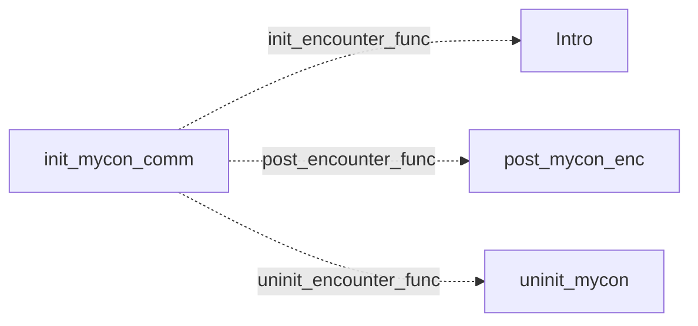

# Mycon: existing conversation graph

> Generated by `tools/conversation_catalog.py`; do not edit this page by hand.

[Catalog and interpretation rules](../README.md) · [Proposed engine](../model.md)

Script: [myconc.c](../../../../sc2/src/uqm/comm/mycon/myconc.c#L1). Phrase bank: [mycon.txt](../../../../sc2/content/base/comm/mycon/mycon.txt#L1).

4 handler/helper nodes; 0 response registration sites; 0 direct local calls; 109 phrase records.

## Initialization and lifecycle

| Phase | Callback | Bound by | Conditions / source |
| --- | --- | --- | --- |
| <code>init_encounter_func</code> | [<code>Intro</code>](#node-intro) | <code>init_mycon_comm</code> | No enclosing branch condition; [131](../../../../sc2/src/uqm/comm/mycon/myconc.c#L131) |
| <code>post_encounter_func</code> | [<code>post_mycon_enc</code>](#node-post_mycon_enc) | <code>init_mycon_comm</code> | No enclosing branch condition; [132](../../../../sc2/src/uqm/comm/mycon/myconc.c#L132) |
| <code>uninit_encounter_func</code> | [<code>uninit_mycon</code>](#node-uninit_mycon) | <code>init_mycon_comm</code> | No enclosing branch condition; [133](../../../../sc2/src/uqm/comm/mycon/myconc.c#L133) |

## Handler graph

Solid arrows are selectable responses; dashed arrows are direct C calls. Conditions, arguments, speech and effects are cataloged below. Parallel response sites are grouped only in this diagram.



## Condition catalog

Condition IDs describe enclosing source structure. Branch predicates combine with ∧; case labels mark source locations that can also be reached by fallthrough. Values refer to their original evaluation points. Local assignments and early control flow remain in the decision bodies.

| ID | Source expression / structural condition |
| --- | --- |
| <a id="condition-c1"></a>C1 | <code>LOBYTE(GLOBAL(CurrentActivity)) != WON_LAST_BATTLE</code> |
| <a id="condition-c2"></a>C2 | <code>!(LOBYTE(GLOBAL(CurrentActivity)) != WON_LAST_BATTLE)</code> |

## Script-scope state and lookup tables

These declarations supply shared local state, computed phrase alternatives, number speech, or lookup data used by the nodes. LOCDATA presentation defaults are linked separately in the source.

Presentation descriptor <code>mycon_desc</code>: [source](../../../../sc2/src/uqm/comm/mycon/myconc.c#L27).

## Node catalog

<a id="node-intro"></a>

### Intro

<code>static void Intro(void)</code> — [source](../../../../sc2/src/uqm/comm/mycon/myconc.c#L112).

<details>
<summary>Exact decision body (local calculations, early returns, fallthrough and ordering)</summary>

```c
{}
```

</details>

<a id="node-uninit_mycon"></a>

### uninit_mycon

<code>static COUNT uninit_mycon(void)</code> — [source](../../../../sc2/src/uqm/comm/mycon/myconc.c#L115).

#### Actions, queries, local updates, and control flow

Calls are listed without assuming they are pure or mutating. Local updates are retained because they determine dynamic menus and counter-selected speech.

| Kind | Operation | Enclosing conditions | Source |
| --- | --- | --- | --- |
| flow | <code>return 0;</code> | No enclosing branch condition | [117](../../../../sc2/src/uqm/comm/mycon/myconc.c#L117) |

<details>
<summary>Exact decision body (local calculations, early returns, fallthrough and ordering)</summary>

```c
{
	return (0);
}
```

</details>

<a id="node-post_mycon_enc"></a>

### post_mycon_enc

<code>static void post_mycon_enc(void)</code> — [source](../../../../sc2/src/uqm/comm/mycon/myconc.c#L121).

<details>
<summary>Exact decision body (local calculations, early returns, fallthrough and ordering)</summary>

```c
{
	// nothing defined so far
}
```

</details>

<a id="node-init_mycon_comm"></a>

### init_mycon_comm

<code>LOCDATA *init_mycon_comm(void)</code> — [source](../../../../sc2/src/uqm/comm/mycon/myconc.c#L127).

#### Actions, queries, local updates, and control flow

Calls are listed without assuming they are pure or mutating. Local updates are retained because they determine dynamic menus and counter-selected speech.

| Kind | Operation | Enclosing conditions | Source |
| --- | --- | --- | --- |
| update | <code>mycon_desc.init_encounter_func = Intro</code> | No enclosing branch condition | [131](../../../../sc2/src/uqm/comm/mycon/myconc.c#L131) |
| update | <code>mycon_desc.post_encounter_func = post_mycon_enc</code> | No enclosing branch condition | [132](../../../../sc2/src/uqm/comm/mycon/myconc.c#L132) |
| update | <code>mycon_desc.uninit_encounter_func = uninit_mycon</code> | No enclosing branch condition | [133](../../../../sc2/src/uqm/comm/mycon/myconc.c#L133) |
| update | <code>mycon_desc.AlienTextBaseline.x = TEXT_X_OFFS + (SIS_TEXT_WIDTH &gt;&gt; 1)</code> | No enclosing branch condition | [135](../../../../sc2/src/uqm/comm/mycon/myconc.c#L135) |
| update | <code>mycon_desc.AlienTextBaseline.y = 0</code> | No enclosing branch condition | [136](../../../../sc2/src/uqm/comm/mycon/myconc.c#L136) |
| update | <code>mycon_desc.AlienTextWidth = SIS_TEXT_WIDTH - 16</code> | No enclosing branch condition | [137](../../../../sc2/src/uqm/comm/mycon/myconc.c#L137) |
| call | <code>LOBYTE(GLOBAL(CurrentActivity))</code> | No enclosing branch condition | [140](../../../../sc2/src/uqm/comm/mycon/myconc.c#L140) |
| call | <code>GLOBAL(CurrentActivity)</code> | No enclosing branch condition | [140](../../../../sc2/src/uqm/comm/mycon/myconc.c#L140) |
| call | <code>setSegue(Segue_hostile)</code> | [C1](#condition-c1) | [142](../../../../sc2/src/uqm/comm/mycon/myconc.c#L142) |
| call | <code>setSegue(Segue_peace)</code> | [C2](#condition-c2) | [146](../../../../sc2/src/uqm/comm/mycon/myconc.c#L146) |
| update | <code>retval = &amp;mycon_desc</code> | No enclosing branch condition | [148](../../../../sc2/src/uqm/comm/mycon/myconc.c#L148) |
| flow | <code>return retval;</code> | No enclosing branch condition | [150](../../../../sc2/src/uqm/comm/mycon/myconc.c#L150) |

<details>
<summary>Exact decision body (local calculations, early returns, fallthrough and ordering)</summary>

```c
{
	LOCDATA *retval;

	mycon_desc.init_encounter_func = Intro;
	mycon_desc.post_encounter_func = post_mycon_enc;
	mycon_desc.uninit_encounter_func = uninit_mycon;

	mycon_desc.AlienTextBaseline.x = TEXT_X_OFFS + (SIS_TEXT_WIDTH >> 1);
	mycon_desc.AlienTextBaseline.y = 0;
	mycon_desc.AlienTextWidth = SIS_TEXT_WIDTH - 16;


	if (LOBYTE (GLOBAL (CurrentActivity)) != WON_LAST_BATTLE)
	{
		setSegue (Segue_hostile);
	}
	else
	{
		setSegue (Segue_peace);
	}
	retval = &mycon_desc;

	return (retval);
}
```

</details>

## Phrase catalog

Full base-content text, keyed by the symbols used above. Voice filenames are resource metadata; playback also depends on installed addons and settings. Dynamic insertions retain their original placeholders.

<a id="phrase-tell_us_about_world"></a>

<details>
<summary>TELL_US_ABOUT_WORLD — mycon-000.ogg</summary>

[Text source](../../../../sc2/content/base/comm/mycon/mycon.txt#L1)

<pre>Your suggestion is appropriate.
Acceptable new worlds are a priority for the rapid and complete spread of Juffo-Wup.
We wish to know more for our suitability assessment.
Tell us of this world.</pre>

</details>

<a id="phrase-bye_and_die_homeworld"></a>

<details>
<summary>BYE_AND_DIE_HOMEWORLD — mycon-001.ogg</summary>

[Text source](../../../../sc2/content/base/comm/mycon/mycon.txt#L7)

<pre>You impede the flow of Juffo-Wup through the Universe.
We will now remove this clog.
We will now aid Juffo-Wup by eliminating you!</pre>

</details>

<a id="phrase-ramble_1"></a>

<details>
<summary>RAMBLE_1 — mycon-002.ogg</summary>

[Text source](../../../../sc2/content/base/comm/mycon/mycon.txt#L12)

<pre>A single spore lands, finds nourishment in decay and soon attains maturity..
In turn it exhales a cloud of new life, a thousand spores, each lands, finds nourishment in decay
so progresses Juffo-Wup.</pre>

</details>

<a id="phrase-ramble_2"></a>

<details>
<summary>RAMBLE_2 — mycon-003.ogg</summary>

[Text source](../../../../sc2/content/base/comm/mycon/mycon.txt#L17)

<pre>Our bodies seethe with the passion of our genes.
A thousand of your species do not possess the richness in one of my cells.</pre>

</details>

<a id="phrase-ramble_3"></a>

<details>
<summary>RAMBLE_3 — mycon-004.ogg</summary>

[Text source](../../../../sc2/content/base/comm/mycon/mycon.txt#L21)

<pre>I fill with my parents&#x27; parents&#x27; parents&#x27; parents&#x27; parents
I am they -- and they are us. Then, and now.</pre>

</details>

<a id="phrase-ramble_4"></a>

<details>
<summary>RAMBLE_4 — mycon-005.ogg</summary>

[Text source](../../../../sc2/content/base/comm/mycon/mycon.txt#L25)

<pre>The Deep Children are part of Juffo-Wup -- home builders.
The dwellers in the Mohorovichic.</pre>

</details>

<a id="phrase-ramble_5"></a>

<details>
<summary>RAMBLE_5 — mycon-006.ogg</summary>

[Text source](../../../../sc2/content/base/comm/mycon/mycon.txt#L29)

<pre>I am Dugee
I am the purity monitor
I choose what buds are permitted to mature
and which must be eradicated.
I died of general misfunction 57,283 years ago.</pre>

</details>

<a id="phrase-ramble_6"></a>

<details>
<summary>RAMBLE_6 — mycon-007.ogg</summary>

[Text source](../../../../sc2/content/base/comm/mycon/mycon.txt#L36)

<pre>A cold rock, spinning silently in the Void, a womb for the Children.</pre>

</details>

<a id="phrase-ramble_7"></a>

<details>
<summary>RAMBLE_7 — mycon-008.ogg</summary>

[Text source](../../../../sc2/content/base/comm/mycon/mycon.txt#L39)

<pre>Pulsing hot liquid flows through my outstretched tendrils, sending thrills into my interior.
The moment has come. I swell and burst.
Above me a cloud of whispering life whirls through the air.
I am content.</pre>

</details>

<a id="phrase-ramble_8"></a>

<details>
<summary>RAMBLE_8 — mycon-009.ogg</summary>

[Text source](../../../../sc2/content/base/comm/mycon/mycon.txt#L45)

<pre>The Juffo-Wup is strong in this place.</pre>

</details>

<a id="phrase-ramble_9"></a>

<details>
<summary>RAMBLE_9 — mycon-010.ogg</summary>

[Text source](../../../../sc2/content/base/comm/mycon/mycon.txt#L48)

<pre>Your simple sexual process produces random mosaics of genetic instructions
yet with the simplicity of breath, I modify my own patterns.
You humans improve a tool and double your capabilities.
We Mycon improve ourselves and increase a thousand-fold.</pre>

</details>

<a id="phrase-ramble_10"></a>

<details>
<summary>RAMBLE_10 — mycon-011.ogg</summary>

[Text source](../../../../sc2/content/base/comm/mycon/mycon.txt#L54)

<pre>The Deep Children!
Spears of light in the darkness!
Their discarded husks speak of joy to come.</pre>

</details>

<a id="phrase-ramble_11"></a>

<details>
<summary>RAMBLE_11 — mycon-012.ogg</summary>

[Text source](../../../../sc2/content/base/comm/mycon/mycon.txt#L59)

<pre>I have chosen my offsprings&#x27; memories carefully from my set of remembrances
the sweet and warm times of my existence and those of my parents&#x27; parents&#x27; parents
the bits of a million lifetimes coalesced into a birth gift of complete awareness.</pre>

</details>

<a id="phrase-ramble_12"></a>

<details>
<summary>RAMBLE_12 — mycon-013.ogg</summary>

[Text source](../../../../sc2/content/base/comm/mycon/mycon.txt#L64)

<pre>In the dark they grow, the deep fire feeds the Children.
Their birth breathes warmth across a cold world.</pre>

</details>

<a id="phrase-ramble_13"></a>

<details>
<summary>RAMBLE_13 — mycon-014.ogg</summary>

[Text source](../../../../sc2/content/base/comm/mycon/mycon.txt#L68)

<pre>`...the system requires more energy. A convenient source lies beneath the crust...&#x27;</pre>

</details>

<a id="phrase-ramble_14"></a>

<details>
<summary>RAMBLE_14 — mycon-015.ogg</summary>

[Text source](../../../../sc2/content/base/comm/mycon/mycon.txt#L71)

<pre>We look to Juffo-Wup for direction, and it provides the pattern
endless expansion with purity of achievement and intolerance of error.</pre>

</details>

<a id="phrase-ramble_15"></a>

<details>
<summary>RAMBLE_15 — mycon-016.ogg</summary>

[Text source](../../../../sc2/content/base/comm/mycon/mycon.txt#L75)

<pre>I am Shloosh
I was incinerated fourteen thousand Earth years ago
I live now, for but a moment
and then, I am gone.</pre>

</details>

<a id="phrase-ramble_16"></a>

<details>
<summary>RAMBLE_16 — mycon-017.ogg</summary>

[Text source](../../../../sc2/content/base/comm/mycon/mycon.txt#L81)

<pre>`...incorporation of dense amphibole fibers ensure survival in environmental extremes...&#x27;</pre>

</details>

<a id="phrase-ramble_17"></a>

<details>
<summary>RAMBLE_17 — mycon-018.ogg</summary>

[Text source](../../../../sc2/content/base/comm/mycon/mycon.txt#L84)

<pre>I yearn for magma
the flowing warm basalts
the red glow of the lava pools.</pre>

</details>

<a id="phrase-ramble_18"></a>

<details>
<summary>RAMBLE_18 — mycon-019.ogg</summary>

[Text source](../../../../sc2/content/base/comm/mycon/mycon.txt#L89)

<pre>When we encounter the Non, we must absorb the Non or reject the Non so that it is no longer Non.</pre>

</details>

<a id="phrase-ramble_19"></a>

<details>
<summary>RAMBLE_19 — mycon-020.ogg</summary>

[Text source](../../../../sc2/content/base/comm/mycon/mycon.txt#L92)

<pre>`...entry of noise into the signal is unavoidable. We must include a filtering mechanism...&#x27;</pre>

</details>

<a id="phrase-ramble_20"></a>

<details>
<summary>RAMBLE_20 — mycon-021.ogg</summary>

[Text source](../../../../sc2/content/base/comm/mycon/mycon.txt#L95)

<pre>Cessation of an individual is unavoidable
a consequence of existence
yet with the birth of life, individuality is transferred in part
and may occasionally gain dominance for an interval
achieving a kind of shared immortality.</pre>

</details>

<a id="phrase-ramble_21"></a>

<details>
<summary>RAMBLE_21 — mycon-022.ogg</summary>

[Text source](../../../../sc2/content/base/comm/mycon/mycon.txt#L102)

<pre>`...Survival is a priority. Expansion is a priority. Processing is a priority...&#x27;</pre>

</details>

<a id="phrase-ramble_22"></a>

<details>
<summary>RAMBLE_22 — mycon-023.ogg</summary>

[Text source](../../../../sc2/content/base/comm/mycon/mycon.txt#L105)

<pre>Juffo-Wup acknowledges the existence of un-Voidable Non
when we are faced with such, we join, absorb and wait for our opportunity
to learn the weakness that will allow us to Void the Non.</pre>

</details>

<a id="phrase-ramble_23"></a>

<details>
<summary>RAMBLE_23 — mycon-024.ogg</summary>

[Text source](../../../../sc2/content/base/comm/mycon/mycon.txt#L110)

<pre>At times, I meet another, who shares with me the life of a parent inside the mind
and if we speak this fragment becomes predominant in the both of us
and self meets self with occasionally enlightening results.</pre>

</details>

<a id="phrase-ramble_24"></a>

<details>
<summary>RAMBLE_24 — mycon-025.ogg</summary>

[Text source](../../../../sc2/content/base/comm/mycon/mycon.txt#L115)

<pre>The Podships thrum with the plasma containment field
whose offspring seek to transform the Non to Void
the fields grow tighter, and tighter
the bass rumble of the generators rises gradually to a high burning scream
sudden silence and a flash of light announce release
the hot pulsing subsides slowly.</pre>

</details>

<a id="phrase-ramble_25"></a>

<details>
<summary>RAMBLE_25 — mycon-026.ogg</summary>

[Text source](../../../../sc2/content/base/comm/mycon/mycon.txt#L123)

<pre>The Deep Children fall from the Void, gathering speed for the penetration
The tough casing warms as it passes through the atmosphere, glowing white as it hits the surface
solid rock flows like liquid, and the child slips into the warm, safe depths beneath the crust.</pre>

</details>

<a id="phrase-ramble_26"></a>

<details>
<summary>RAMBLE_26 — mycon-027.ogg</summary>

[Text source](../../../../sc2/content/base/comm/mycon/mycon.txt#L128)

<pre>`...look... think... act... look... learn... remember... teach... repeat...&#x27;</pre>

</details>

<a id="phrase-ramble_27"></a>

<details>
<summary>RAMBLE_27 — mycon-028.ogg</summary>

[Text source](../../../../sc2/content/base/comm/mycon/mycon.txt#L131)

<pre>The implantation fleet has assembled in orbit above the green world
the patterns of weakness reveal the point of introduction.
The Child is prepared for its birthing trip.
Release!</pre>

</details>

<a id="phrase-ramble_28"></a>

<details>
<summary>RAMBLE_28 — mycon-029.ogg</summary>

[Text source](../../../../sc2/content/base/comm/mycon/mycon.txt#L137)

<pre>I am Gussh
I attend the birthing nodes
I died 343 Earth years ago
I do not know how.</pre>

</details>

<a id="phrase-ramble_29"></a>

<details>
<summary>RAMBLE_29 — mycon-030.ogg</summary>

[Text source](../../../../sc2/content/base/comm/mycon/mycon.txt#L143)

<pre>When Juffo-Wup is complete
when at last there is no Void, no Non
when the Creators return
then we can finally rest.</pre>

</details>

<a id="phrase-ramble_30"></a>

<details>
<summary>RAMBLE_30 — mycon-031.ogg</summary>

[Text source](../../../../sc2/content/base/comm/mycon/mycon.txt#L149)

<pre>Darkness is Void
Juffo-Wup is light.</pre>

</details>

<a id="phrase-ramble_31"></a>

<details>
<summary>RAMBLE_31 — mycon-032.ogg</summary>

[Text source](../../../../sc2/content/base/comm/mycon/mycon.txt#L153)

<pre>`... planetary transformer biot 94-18: take your place at the transporter dais...&#x27;</pre>

</details>

<a id="phrase-ramble_32"></a>

<details>
<summary>RAMBLE_32 — mycon-033.ogg</summary>

[Text source](../../../../sc2/content/base/comm/mycon/mycon.txt#L156)

<pre>You are the Non. You must go now, and never return.</pre>

</details>

<a id="phrase-question_1"></a>

<details>
<summary>question_1</summary>

[Text source](../../../../sc2/content/base/comm/mycon/mycon.txt#L159)

<pre>What can you tell me about your species?</pre>

</details>

<a id="phrase-question_2"></a>

<details>
<summary>question_2</summary>

[Text source](../../../../sc2/content/base/comm/mycon/mycon.txt#L162)

<pre>Well then, what can you tell us of your history?</pre>

</details>

<a id="phrase-question_3"></a>

<details>
<summary>question_3</summary>

[Text source](../../../../sc2/content/base/comm/mycon/mycon.txt#L165)

<pre>Why are you unwilling to address my questions?</pre>

</details>

<a id="phrase-question_4"></a>

<details>
<summary>question_4</summary>

[Text source](../../../../sc2/content/base/comm/mycon/mycon.txt#L168)

<pre>You&#x27;re not paying any attention to me, are you?</pre>

</details>

<a id="phrase-question_5"></a>

<details>
<summary>question_5</summary>

[Text source](../../../../sc2/content/base/comm/mycon/mycon.txt#L171)

<pre>You&#x27;re not paying any attention to me, are you?</pre>

</details>

<a id="phrase-question_6"></a>

<details>
<summary>question_6</summary>

[Text source](../../../../sc2/content/base/comm/mycon/mycon.txt#L174)

<pre>You&#x27;re not paying any attention to me, are you?</pre>

</details>

<a id="phrase-question_7"></a>

<details>
<summary>question_7</summary>

[Text source](../../../../sc2/content/base/comm/mycon/mycon.txt#L177)

<pre>You&#x27;re not paying any attention to me, are you?</pre>

</details>

<a id="phrase-question_8"></a>

<details>
<summary>question_8</summary>

[Text source](../../../../sc2/content/base/comm/mycon/mycon.txt#L180)

<pre>You&#x27;re not paying any attention to me, are you?</pre>

</details>

<a id="phrase-question_9"></a>

<details>
<summary>question_9</summary>

[Text source](../../../../sc2/content/base/comm/mycon/mycon.txt#L183)

<pre>You&#x27;re not paying any attention to me, are you?</pre>

</details>

<a id="phrase-question_10"></a>

<details>
<summary>question_10</summary>

[Text source](../../../../sc2/content/base/comm/mycon/mycon.txt#L186)

<pre>You&#x27;re not paying any attention to me, are you?</pre>

</details>

<a id="phrase-question_11"></a>

<details>
<summary>question_11</summary>

[Text source](../../../../sc2/content/base/comm/mycon/mycon.txt#L189)

<pre>You&#x27;re not paying any attention to me, are you?</pre>

</details>

<a id="phrase-question_12"></a>

<details>
<summary>question_12</summary>

[Text source](../../../../sc2/content/base/comm/mycon/mycon.txt#L192)

<pre>You&#x27;re not paying any attention to me, are you?</pre>

</details>

<a id="phrase-question_13"></a>

<details>
<summary>question_13</summary>

[Text source](../../../../sc2/content/base/comm/mycon/mycon.txt#L195)

<pre>You&#x27;re not paying any attention to me, are you?</pre>

</details>

<a id="phrase-question_14"></a>

<details>
<summary>question_14</summary>

[Text source](../../../../sc2/content/base/comm/mycon/mycon.txt#L198)

<pre>You&#x27;re not paying any attention to me, are you?</pre>

</details>

<a id="phrase-question_15"></a>

<details>
<summary>question_15</summary>

[Text source](../../../../sc2/content/base/comm/mycon/mycon.txt#L201)

<pre>You&#x27;re not paying any attention to me, are you?</pre>

</details>

<a id="phrase-question_16"></a>

<details>
<summary>question_16</summary>

[Text source](../../../../sc2/content/base/comm/mycon/mycon.txt#L204)

<pre>You&#x27;re not paying any attention to me, are you?</pre>

</details>

<a id="phrase-bye_space"></a>

<details>
<summary>bye_space</summary>

[Text source](../../../../sc2/content/base/comm/mycon/mycon.txt#L207)

<pre>Don&#x27;t trouble yourself. I&#x27;ll see myself out.</pre>

</details>

<a id="phrase-bye_and_die_space"></a>

<details>
<summary>BYE_AND_DIE_SPACE — mycon-034.ogg</summary>

[Text source](../../../../sc2/content/base/comm/mycon/mycon.txt#L210)

<pre>Juffo-Wup fills in my fibers and I grow turgid. Violent action ensues.</pre>

</details>

<a id="phrase-gonna_die"></a>

<details>
<summary>gonna_die</summary>

[Text source](../../../../sc2/content/base/comm/mycon/mycon.txt#L213)

<pre>Time to die.</pre>

</details>

<a id="phrase-insult_1"></a>

<details>
<summary>insult_1</summary>

[Text source](../../../../sc2/content/base/comm/mycon/mycon.txt#L216)

<pre>I wonder how you would taste, fried in butter?</pre>

</details>

<a id="phrase-insult_2"></a>

<details>
<summary>insult_2</summary>

[Text source](../../../../sc2/content/base/comm/mycon/mycon.txt#L219)

<pre>You know, I probably have some of your relatives between my toes!</pre>

</details>

<a id="phrase-insult_3"></a>

<details>
<summary>insult_3</summary>

[Text source](../../../../sc2/content/base/comm/mycon/mycon.txt#L222)

<pre>Is that a rock you&#x27;re sitting on, or do you just have a big butt?</pre>

</details>

<a id="phrase-insult_4"></a>

<details>
<summary>insult_4</summary>

[Text source](../../../../sc2/content/base/comm/mycon/mycon.txt#L225)

<pre>I don&#x27;t suppose there&#x27;s a chance that you&#x27;ll actually respond to what I am saying, is there?</pre>

</details>

<a id="phrase-insult_5"></a>

<details>
<summary>insult_5</summary>

[Text source](../../../../sc2/content/base/comm/mycon/mycon.txt#L228)

<pre>I can&#x27;t believe I&#x27;m trying to have a conversation with a hot fungus.</pre>

</details>

<a id="phrase-insult_6"></a>

<details>
<summary>insult_6</summary>

[Text source](../../../../sc2/content/base/comm/mycon/mycon.txt#L231)

<pre>Stop wiggling those... those... whatever they are!</pre>

</details>

<a id="phrase-insult_7"></a>

<details>
<summary>insult_7</summary>

[Text source](../../../../sc2/content/base/comm/mycon/mycon.txt#L234)

<pre>Where&#x27;s the Absorbine Junior when you need it?</pre>

</details>

<a id="phrase-insult_8"></a>

<details>
<summary>insult_8</summary>

[Text source](../../../../sc2/content/base/comm/mycon/mycon.txt#L237)

<pre>Helloo? Ugly! Can you hear me?</pre>

</details>

<a id="phrase-come_in_peace"></a>

<details>
<summary>come_in_peace</summary>

[Text source](../../../../sc2/content/base/comm/mycon/mycon.txt#L240)

<pre>Mycon. Please try to understand. We wish peace between our peoples.</pre>

</details>

<a id="phrase-hello_homeworld_1"></a>

<details>
<summary>HELLO_HOMEWORLD_1 — mycon-035.ogg</summary>

[Text source](../../../../sc2/content/base/comm/mycon/mycon.txt#L243)

<pre>Juffo-Wup is All... omni-existent, spreading and changing the Non into Juffo-Wup.
You are Non, who must become Juffo-Wup or Void.
We are the agents of Juffo-Wup.
We are the Mycon.</pre>

</details>

<a id="phrase-hello_homeworld_2"></a>

<details>
<summary>HELLO_HOMEWORLD_2 — mycon-036.ogg</summary>

[Text source](../../../../sc2/content/base/comm/mycon/mycon.txt#L249)

<pre>We are the Mycon.</pre>

</details>

<a id="phrase-hello_homeworld_3"></a>

<details>
<summary>HELLO_HOMEWORLD_3 — mycon-037.ogg</summary>

[Text source](../../../../sc2/content/base/comm/mycon/mycon.txt#L252)

<pre>We are the Mycon.</pre>

</details>

<a id="phrase-hello_homeworld_4"></a>

<details>
<summary>HELLO_HOMEWORLD_4 — mycon-038.ogg</summary>

[Text source](../../../../sc2/content/base/comm/mycon/mycon.txt#L255)

<pre>We are the Mycon.</pre>

</details>

<a id="phrase-hello_homeworld_5"></a>

<details>
<summary>HELLO_HOMEWORLD_5 — mycon-039.ogg</summary>

[Text source](../../../../sc2/content/base/comm/mycon/mycon.txt#L258)

<pre>We are the Mycon.</pre>

</details>

<a id="phrase-hello_homeworld_6"></a>

<details>
<summary>HELLO_HOMEWORLD_6 — mycon-040.ogg</summary>

[Text source](../../../../sc2/content/base/comm/mycon/mycon.txt#L261)

<pre>We are the Mycon.</pre>

</details>

<a id="phrase-hello_homeworld_7"></a>

<details>
<summary>HELLO_HOMEWORLD_7 — mycon-041.ogg</summary>

[Text source](../../../../sc2/content/base/comm/mycon/mycon.txt#L264)

<pre>We are the Mycon.</pre>

</details>

<a id="phrase-hello_homeworld_8"></a>

<details>
<summary>HELLO_HOMEWORLD_8 — mycon-042.ogg</summary>

[Text source](../../../../sc2/content/base/comm/mycon/mycon.txt#L267)

<pre>We are the Mycon.</pre>

</details>

<a id="phrase-hello_space_1"></a>

<details>
<summary>HELLO_SPACE_1 — mycon-043.ogg</summary>

[Text source](../../../../sc2/content/base/comm/mycon/mycon.txt#L270)

<pre>We are part of Juffo-Wup.
Juffo-Wup is the hot light in the darkness.
All else is unfulfilled Void.
The source of Juffo-Wup is at 629.1, 220.8.
We are the Mycon.</pre>

</details>

<a id="phrase-hello_space_2"></a>

<details>
<summary>HELLO_SPACE_2 — mycon-044.ogg</summary>

[Text source](../../../../sc2/content/base/comm/mycon/mycon.txt#L277)

<pre>We are the Mycon.</pre>

</details>

<a id="phrase-hello_space_3"></a>

<details>
<summary>HELLO_SPACE_3 — mycon-045.ogg</summary>

[Text source](../../../../sc2/content/base/comm/mycon/mycon.txt#L280)

<pre>We are the Mycon.</pre>

</details>

<a id="phrase-hello_space_4"></a>

<details>
<summary>HELLO_SPACE_4 — mycon-046.ogg</summary>

[Text source](../../../../sc2/content/base/comm/mycon/mycon.txt#L283)

<pre>We are the Mycon.</pre>

</details>

<a id="phrase-hello_space_5"></a>

<details>
<summary>HELLO_SPACE_5 — mycon-047.ogg</summary>

[Text source](../../../../sc2/content/base/comm/mycon/mycon.txt#L286)

<pre>We are the Mycon.</pre>

</details>

<a id="phrase-hello_space_6"></a>

<details>
<summary>HELLO_SPACE_6 — mycon-048.ogg</summary>

[Text source](../../../../sc2/content/base/comm/mycon/mycon.txt#L289)

<pre>We are the Mycon.</pre>

</details>

<a id="phrase-hello_space_7"></a>

<details>
<summary>HELLO_SPACE_7 — mycon-049.ogg</summary>

[Text source](../../../../sc2/content/base/comm/mycon/mycon.txt#L292)

<pre>We are the Mycon.</pre>

</details>

<a id="phrase-hello_space_8"></a>

<details>
<summary>HELLO_SPACE_8 — mycon-050.ogg</summary>

[Text source](../../../../sc2/content/base/comm/mycon/mycon.txt#L295)

<pre>We are the Mycon.</pre>

</details>

<a id="phrase-lets_be_friends"></a>

<details>
<summary>lets_be_friends</summary>

[Text source](../../../../sc2/content/base/comm/mycon/mycon.txt#L298)

<pre>Let&#x27;s be friends.</pre>

</details>

<a id="phrase-came_to_homeworld"></a>

<details>
<summary>came_to_homeworld</summary>

[Text source](../../../../sc2/content/base/comm/mycon/mycon.txt#L301)

<pre>We have come to your homeworld to seek a truce.</pre>

</details>

<a id="phrase-submit_to_us"></a>

<details>
<summary>submit_to_us</summary>

[Text source](../../../../sc2/content/base/comm/mycon/mycon.txt#L304)

<pre>Heinous fungus! Submit to our will!</pre>

</details>

<a id="phrase-bye_sun_device"></a>

<details>
<summary>bye_sun_device</summary>

[Text source](../../../../sc2/content/base/comm/mycon/mycon.txt#L307)

<pre>We&#x27;ll just be going now.</pre>

</details>

<a id="phrase-goodbye_sun_device"></a>

<details>
<summary>GOODBYE_SUN_DEVICE — mycon-051.ogg</summary>

[Text source](../../../../sc2/content/base/comm/mycon/mycon.txt#L310)

<pre>Begone from our special place.</pre>

</details>

<a id="phrase-response_1"></a>

<details>
<summary>RESPONSE_1 — mycon-052.ogg</summary>

[Text source](../../../../sc2/content/base/comm/mycon/mycon.txt#L313)

<pre>This is good.</pre>

</details>

<a id="phrase-response_2"></a>

<details>
<summary>RESPONSE_2 — mycon-053.ogg</summary>

[Text source](../../../../sc2/content/base/comm/mycon/mycon.txt#L316)

<pre>This is good.</pre>

</details>

<a id="phrase-response_3"></a>

<details>
<summary>RESPONSE_3 — mycon-054.ogg</summary>

[Text source](../../../../sc2/content/base/comm/mycon/mycon.txt#L319)

<pre>This is good.</pre>

</details>

<a id="phrase-clue_1"></a>

<details>
<summary>clue_1</summary>

[Text source](../../../../sc2/content/base/comm/mycon/mycon.txt#L322)

<pre>Its air is pure and sweet.</pre>

</details>

<a id="phrase-clue_2"></a>

<details>
<summary>clue_2</summary>

[Text source](../../../../sc2/content/base/comm/mycon/mycon.txt#L325)

<pre>Abundant life covers its surface.</pre>

</details>

<a id="phrase-clue_3"></a>

<details>
<summary>clue_3</summary>

[Text source](../../../../sc2/content/base/comm/mycon/mycon.txt#L328)

<pre>The sun gently warms the surface.</pre>

</details>

<a id="phrase-what_about_shattered"></a>

<details>
<summary>what_about_shattered</summary>

[Text source](../../../../sc2/content/base/comm/mycon/mycon.txt#L331)

<pre>Why are the Shattered Worlds found only in your region of space?</pre>

</details>

<a id="phrase-about_shattered"></a>

<details>
<summary>ABOUT_SHATTERED — mycon-055.ogg</summary>

[Text source](../../../../sc2/content/base/comm/mycon/mycon.txt#L334)

<pre>These are the homes of the Deep Children.</pre>

</details>

<a id="phrase-hello_sun_device_world_1"></a>

<details>
<summary>HELLO_SUN_DEVICE_WORLD_1 — mycon-056.ogg</summary>

[Text source](../../../../sc2/content/base/comm/mycon/mycon.txt#L337)

<pre>This is a special place
filled with Juffo-Wup.
But it is not the source.
Juffo-Wup springs forth from 629.1, 220.8.
We must not allow this place to be soiled by the Non.
You must go. Now.</pre>

</details>

<a id="phrase-hello_sun_device_world_2"></a>

<details>
<summary>HELLO_SUN_DEVICE_WORLD_2 — mycon-057.ogg</summary>

[Text source](../../../../sc2/content/base/comm/mycon/mycon.txt#L345)

<pre>You have returned to our special place.
This is not permissible.
Leave.</pre>

</details>

<a id="phrase-whats_up_sun_device"></a>

<details>
<summary>whats_up_sun_device</summary>

[Text source](../../../../sc2/content/base/comm/mycon/mycon.txt#L350)

<pre>What makes this world so special to you?</pre>

</details>

<a id="phrase-general_info_sun_device"></a>

<details>
<summary>GENERAL_INFO_SUN_DEVICE — mycon-058.ogg</summary>

[Text source](../../../../sc2/content/base/comm/mycon/mycon.txt#L353)

<pre>Juffo-Wup is the power of life... hot warmth in the cold Void.
It flows through all things, binding them together, making them one.
You are Non-Juffo-Wup, you cannot understand.
Below is the pod of Juffo-Wup -- there for a thousand centuries.
When we are cold, the pod opens and warms us.
When it is dark, the pod clenches and lo, there is light.
You are the Non. The pod is not for you. You must leave.</pre>

</details>

<a id="phrase-like_to_land"></a>

<details>
<summary>like_to_land</summary>

[Text source](../../../../sc2/content/base/comm/mycon/mycon.txt#L362)

<pre>I have business on this world.  Move aside.</pre>

</details>

<a id="phrase-never_let_land"></a>

<details>
<summary>NEVER_LET_LAND — mycon-059.ogg</summary>

[Text source](../../../../sc2/content/base/comm/mycon/mycon.txt#L365)

<pre>Juffo-Wup flows through Time and Space. It cannot be stopped by mere energy blasts.
However, you are Non -- not part of Juffo-Wup.
You CAN be destroyed by energy blasts.
Let us demonstrate.</pre>

</details>

<a id="phrase-bye_homeworld"></a>

<details>
<summary>bye_homeworld</summary>

[Text source](../../../../sc2/content/base/comm/mycon/mycon.txt#L371)

<pre>Goodbye fungus-boys!</pre>

</details>

<a id="phrase-i_have_a_cunning_plan"></a>

<details>
<summary>i_have_a_cunning_plan</summary>

[Text source](../../../../sc2/content/base/comm/mycon/mycon.txt#L374)

<pre>There is a world at the star Organon. I believe it is perfect for your Deep Children.</pre>

</details>

<a id="phrase-die_liar"></a>

<details>
<summary>DIE_LIAR — mycon-060.ogg</summary>

[Text source](../../../../sc2/content/base/comm/mycon/mycon.txt#L377)

<pre>You are an obstruction to Juffo-Wup.
You must be removed.</pre>

</details>

<a id="phrase-how_goes_implanting"></a>

<details>
<summary>how_goes_implanting</summary>

[Text source](../../../../sc2/content/base/comm/mycon/mycon.txt#L381)

<pre>Have you visited the planet I told you about?</pre>

</details>

<a id="phrase-unforseen_delays"></a>

<details>
<summary>UNFORSEEN_DELAYS — mycon-061.ogg</summary>

[Text source](../../../../sc2/content/base/comm/mycon/mycon.txt#L384)

<pre>We have experienced unforeseen delays implanting Deep Children beneath the crust of Organon 1.
However, Juffo-Wup is inevitable.  The Deep Children WILL be born.</pre>

</details>

<a id="phrase-die_thief"></a>

<details>
<summary>DIE_THIEF — mycon-062.ogg</summary>

[Text source](../../../../sc2/content/base/comm/mycon/mycon.txt#L388)

<pre>You have taken something from us which we value
something which is important to Juffo-Wup.
We require the Solar Manipulator.
We will take it back from you now!</pre>

</details>

<a id="phrase-die_thief_again"></a>

<details>
<summary>DIE_THIEF_AGAIN — mycon-063.ogg</summary>

[Text source](../../../../sc2/content/base/comm/mycon/mycon.txt#L394)

<pre>You have taken something from us which we value... which is important to Juffo-Wup.
Return the Solar Manipulator immediately.</pre>

</details>

<a id="phrase-goodbye_and_die"></a>

<details>
<summary>GOODBYE_AND_DIE — mycon-064.ogg</summary>

[Text source](../../../../sc2/content/base/comm/mycon/mycon.txt#L398)

<pre>Juffo-Wup is All
but you are not a part of Juffo-Wup
therefore you must cease existence.
We shall make you cease to exist, for Juffo-Wup.</pre>

</details>

<a id="phrase-ambush_tail"></a>

<details>
<summary>AMBUSH_TAIL</summary>

[Text source](../../../../sc2/content/base/comm/mycon/mycon.txt#L404)

<pre></pre>

</details>

<a id="phrase-ramble_tail"></a>

<details>
<summary>RAMBLE_TAIL</summary>

[Text source](../../../../sc2/content/base/comm/mycon/mycon.txt#L407)

<pre></pre>

</details>

<a id="phrase-we_go_to_implant"></a>

<details>
<summary>WE_GO_TO_IMPLANT — mycon-065.ogg</summary>

[Text source](../../../../sc2/content/base/comm/mycon/mycon.txt#L410)

<pre>If your words are true, we will gladly spread Juffo-Wup to a new world!
We will assemble the Birthing Fleet and send them to this planet.
We will send many ships to protect the Children as they grow.
You have been of service to us.
Your insight into the ineffable Juffo-Wup is encouraging.
Perhaps, if we were to plant spore sacs in your brain organ
and let its tendrils spread through your flesh
then you would truly understand Juffo-Wup... become part of Juffo-Wup.
You WOULD be happier and more fulfilled.  Consider our offer.</pre>

</details>

<a id="phrase-wont_fall_for_trick"></a>

<details>
<summary>WONT_FALL_FOR_TRICK — mycon-066.ogg</summary>

[Text source](../../../../sc2/content/base/comm/mycon/mycon.txt#L421)

<pre>We do not interpret the will of Juffo-Wup.
Only the source is so empowered.
Until instructed otherwise, Juffo-Wup requires that we remain here.</pre>

</details>
