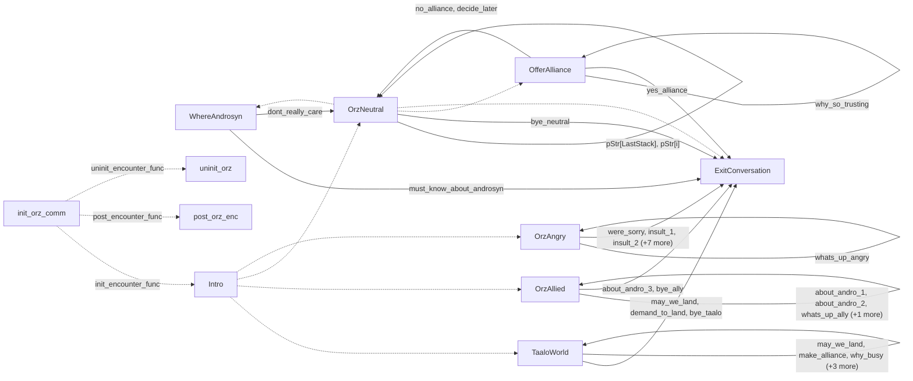

# Orz: existing conversation graph

> Generated by `tools/conversation_catalog.py`; do not edit this page by hand.

[Catalog and interpretation rules](../README.md) · [Proposed engine](../model.md)

Script: [orzc.c](../../../../sc2/src/uqm/comm/orz/orzc.c#L1). Phrase bank: [orz.txt](../../../../sc2/content/base/comm/orz/orz.txt#L1).

11 handler/helper nodes; 37 response registration sites; 7 direct local calls; 116 phrase records.

## Initialization and lifecycle

| Phase | Callback | Bound by | Conditions / source |
| --- | --- | --- | --- |
| <code>init_encounter_func</code> | [<code>Intro</code>](#node-intro) | <code>init_orz_comm</code> | No enclosing branch condition; [878](../../../../sc2/src/uqm/comm/orz/orzc.c#L878) |
| <code>post_encounter_func</code> | [<code>post_orz_enc</code>](#node-post_orz_enc) | <code>init_orz_comm</code> | No enclosing branch condition; [879](../../../../sc2/src/uqm/comm/orz/orzc.c#L879) |
| <code>uninit_encounter_func</code> | [<code>uninit_orz</code>](#node-uninit_orz) | <code>init_orz_comm</code> | No enclosing branch condition; [880](../../../../sc2/src/uqm/comm/orz/orzc.c#L880) |

## Handler graph

Solid arrows are selectable responses; dashed arrows are direct C calls. Conditions, arguments, speech and effects are cataloged below. Parallel response sites are grouped only in this diagram.



## Condition catalog

Condition IDs describe enclosing source structure. Branch predicates combine with ∧; case labels mark source locations that can also be reached by fallthrough. Values refer to their original evaluation points. Local assignments and early control flow remain in the decision bodies.

| ID | Source expression / structural condition |
| --- | --- |
| <a id="condition-c1"></a>C1 | <code>PLAYER_SAID(R, bye_ally)</code> |
| <a id="condition-c2"></a>C2 | <code>!(PLAYER_SAID(R, bye_ally))</code> |
| <a id="condition-c3"></a>C3 | <code>PLAYER_SAID(R, bye_neutral)</code> |
| <a id="condition-c4"></a>C4 | <code>!(PLAYER_SAID(R, bye_neutral))</code> |
| <a id="condition-c5"></a>C5 | <code>PLAYER_SAID(R, bye_angry)</code> |
| <a id="condition-c6"></a>C6 | <code>!(PLAYER_SAID(R, bye_angry))</code> |
| <a id="condition-c7"></a>C7 | <code>PLAYER_SAID(R, bye_taalo)</code> |
| <a id="condition-c8"></a>C8 | <code>GET_GAME_STATE(ORZ_MANNER) == 1</code> |
| <a id="condition-c9"></a>C9 | <code>!(GET_GAME_STATE(ORZ_MANNER) == 1)</code> |
| <a id="condition-c10"></a>C10 | <code>!(PLAYER_SAID(R, bye_taalo))</code> |
| <a id="condition-c11"></a>C11 | <code>PLAYER_SAID(R, hostile_2)</code> |
| <a id="condition-c12"></a>C12 | <code>!(PLAYER_SAID(R, hostile_2))</code> |
| <a id="condition-c13"></a>C13 | <code>PLAYER_SAID(R, may_we_land)</code> |
| <a id="condition-c14"></a>C14 | <code>!(PLAYER_SAID(R, may_we_land))</code> |
| <a id="condition-c15"></a>C15 | <code>!(PLAYER_SAID(R, yes_alliance))</code> |
| <a id="condition-c16"></a>C16 | <code>PLAYER_SAID(R, yes_alliance) &#124;&#124; PLAYER_SAID(R, were_sorry)</code> |
| <a id="condition-c17"></a>C17 | <code>PLAYER_SAID(R, yes_alliance)</code> |
| <a id="condition-c18"></a>C18 | <code>!(PLAYER_SAID(R, yes_alliance) &#124;&#124; PLAYER_SAID(R, were_sorry))</code> |
| <a id="condition-c19"></a>C19 | <code>PLAYER_SAID(R, demand_to_land)</code> |
| <a id="condition-c20"></a>C20 | <code>!(PLAYER_SAID(R, demand_to_land))</code> |
| <a id="condition-c21"></a>C21 | <code>!(PLAYER_SAID(R, about_andro_3))</code> |
| <a id="condition-c22"></a>C22 | <code>PLAYER_SAID(R, about_andro_3) &#124;&#124; PLAYER_SAID(R, must_know_about_androsyn)</code> |
| <a id="condition-c23"></a>C23 | <code>PLAYER_SAID(R, about_andro_3)</code> |
| <a id="condition-c24"></a>C24 | <code>!(PLAYER_SAID(R, about_andro_3) &#124;&#124; PLAYER_SAID(R, must_know_about_androsyn))</code> |
| <a id="condition-c25"></a>C25 | <code>switch (NumVisits++)</code> |
| <a id="condition-c26"></a>C26 | <code>case 0 (see source for fallthrough)</code> |
| <a id="condition-c27"></a>C27 | <code>case 1 (see source for fallthrough)</code> |
| <a id="condition-c28"></a>C28 | <code>case 2 (see source for fallthrough)</code> |
| <a id="condition-c29"></a>C29 | <code>case 7 (see source for fallthrough)</code> |
| <a id="condition-c30"></a>C30 | <code>default (see source for fallthrough)</code> |
| <a id="condition-c31"></a>C31 | <code>PLAYER_SAID(R, why_you_here)</code> |
| <a id="condition-c32"></a>C32 | <code>Manner != 1</code> |
| <a id="condition-c33"></a>C33 | <code>!(Manner != 1)</code> |
| <a id="condition-c34"></a>C34 | <code>!(PLAYER_SAID(R, why_you_here))</code> |
| <a id="condition-c35"></a>C35 | <code>PLAYER_SAID(R, what_is_this_place)</code> |
| <a id="condition-c36"></a>C36 | <code>!(PLAYER_SAID(R, what_is_this_place))</code> |
| <a id="condition-c37"></a>C37 | <code>PLAYER_SAID(R, make_alliance)</code> |
| <a id="condition-c38"></a>C38 | <code>!(PLAYER_SAID(R, make_alliance))</code> |
| <a id="condition-c39"></a>C39 | <code>PLAYER_SAID(R, why_busy)</code> |
| <a id="condition-c40"></a>C40 | <code>PHRASE_ENABLED(may_we_land)</code> |
| <a id="condition-c41"></a>C41 | <code>Manner == 3</code> |
| <a id="condition-c42"></a>C42 | <code>(Manner == 3) &amp;&amp; (CheckAlliance(ORZ_SHIP) == GOOD_GUY)</code> |
| <a id="condition-c43"></a>C43 | <code>!((Manner == 3) &amp;&amp; (CheckAlliance(ORZ_SHIP) == GOOD_GUY))</code> |
| <a id="condition-c44"></a>C44 | <code>!(PHRASE_ENABLED(may_we_land))</code> |
| <a id="condition-c45"></a>C45 | <code>PHRASE_ENABLED(make_alliance)</code> |
| <a id="condition-c46"></a>C46 | <code>!(PHRASE_ENABLED(make_alliance))</code> |
| <a id="condition-c47"></a>C47 | <code>PHRASE_ENABLED(why_busy)</code> |
| <a id="condition-c48"></a>C48 | <code>PHRASE_ENABLED(demand_to_land)</code> |
| <a id="condition-c49"></a>C49 | <code>Manner == 1</code> |
| <a id="condition-c50"></a>C50 | <code>!(Manner == 1)</code> |
| <a id="condition-c51"></a>C51 | <code>PHRASE_ENABLED(why_you_here)</code> |
| <a id="condition-c52"></a>C52 | <code>PHRASE_ENABLED(what_is_this_place)</code> |
| <a id="condition-c53"></a>C53 | <code>PLAYER_SAID(R, whats_up_ally)</code> |
| <a id="condition-c54"></a>C54 | <code>case 3 (see source for fallthrough)</code> |
| <a id="condition-c55"></a>C55 | <code>!(PLAYER_SAID(R, whats_up_ally))</code> |
| <a id="condition-c56"></a>C56 | <code>PLAYER_SAID(R, more_about_you)</code> |
| <a id="condition-c57"></a>C57 | <code>!(PLAYER_SAID(R, more_about_you))</code> |
| <a id="condition-c58"></a>C58 | <code>PLAYER_SAID(R, about_andro_1)</code> |
| <a id="condition-c59"></a>C59 | <code>!(PLAYER_SAID(R, about_andro_1))</code> |
| <a id="condition-c60"></a>C60 | <code>PLAYER_SAID(R, about_andro_2)</code> |
| <a id="condition-c61"></a>C61 | <code>GET_GAME_STATE(ORZ_ANDRO_STATE) == 0</code> |
| <a id="condition-c62"></a>C62 | <code>!(GET_GAME_STATE(ORZ_ANDRO_STATE) == 0)</code> |
| <a id="condition-c63"></a>C63 | <code>GET_GAME_STATE(ORZ_ANDRO_STATE) == 1</code> |
| <a id="condition-c64"></a>C64 | <code>!(GET_GAME_STATE(ORZ_ANDRO_STATE) == 1)</code> |
| <a id="condition-c65"></a>C65 | <code>PHRASE_ENABLED(whats_up_ally)</code> |
| <a id="condition-c66"></a>C66 | <code>PHRASE_ENABLED(more_about_you)</code> |
| <a id="condition-c67"></a>C67 | <code>PLAYER_SAID(R, seem_like_nice_guys)</code> |
| <a id="condition-c68"></a>C68 | <code>!(PLAYER_SAID(R, seem_like_nice_guys))</code> |
| <a id="condition-c69"></a>C69 | <code>PLAYER_SAID(R, talk_about_alliance)</code> |
| <a id="condition-c70"></a>C70 | <code>!(PLAYER_SAID(R, talk_about_alliance))</code> |
| <a id="condition-c71"></a>C71 | <code>PLAYER_SAID(R, why_so_trusting)</code> |
| <a id="condition-c72"></a>C72 | <code>GET_GAME_STATE(ORZ_STACK1) == 0</code> |
| <a id="condition-c73"></a>C73 | <code>PLAYER_SAID(R, hostile_1)</code> |
| <a id="condition-c74"></a>C74 | <code>!(PLAYER_SAID(R, hostile_1))</code> |
| <a id="condition-c75"></a>C75 | <code>PLAYER_SAID(R, we_are_vindicator0)</code> |
| <a id="condition-c76"></a>C76 | <code>!(PLAYER_SAID(R, we_are_vindicator0))</code> |
| <a id="condition-c77"></a>C77 | <code>PLAYER_SAID(R, who_you)</code> |
| <a id="condition-c78"></a>C78 | <code>!(PLAYER_SAID(R, who_you))</code> |
| <a id="condition-c79"></a>C79 | <code>PLAYER_SAID(R, why_here)</code> |
| <a id="condition-c80"></a>C80 | <code>!(PLAYER_SAID(R, why_here))</code> |
| <a id="condition-c81"></a>C81 | <code>PLAYER_SAID(R, no_alliance)</code> |
| <a id="condition-c82"></a>C82 | <code>!(PLAYER_SAID(R, no_alliance))</code> |
| <a id="condition-c83"></a>C83 | <code>PLAYER_SAID(R, decide_later)</code> |
| <a id="condition-c84"></a>C84 | <code>!(PLAYER_SAID(R, decide_later))</code> |
| <a id="condition-c85"></a>C85 | <code>PLAYER_SAID(R, dont_really_care)</code> |
| <a id="condition-c86"></a>C86 | <code>!(PLAYER_SAID(R, dont_really_care))</code> |
| <a id="condition-c87"></a>C87 | <code>PLAYER_SAID(R, where_androsyn)</code> |
| <a id="condition-c88"></a>C88 | <code>!(PLAYER_SAID(R, where_androsyn))</code> |
| <a id="condition-c89"></a>C89 | <code>PLAYER_SAID(R, talk_about_alliance) &#124;&#124; PLAYER_SAID(R, seem_like_nice_guys)</code> |
| <a id="condition-c90"></a>C90 | <code>!(PLAYER_SAID(R, talk_about_alliance) &#124;&#124; PLAYER_SAID(R, seem_like_nice_guys))</code> |
| <a id="condition-c91"></a>C91 | <code>PHRASE_ENABLED(where_androsyn)</code> |
| <a id="condition-c92"></a>C92 | <code>PHRASE_ENABLED(where_androsyn) &amp;&amp; (GET_GAME_STATE(ORZ_ANDRO_STATE) == 2)</code> |
| <a id="condition-c93"></a>C93 | <code>GET_GAME_STATE(REFUSED_ORZ_ALLIANCE)</code> |
| <a id="condition-c94"></a>C94 | <code>PHRASE_ENABLED(talk_about_alliance)</code> |
| <a id="condition-c95"></a>C95 | <code>!(GET_GAME_STATE(REFUSED_ORZ_ALLIANCE))</code> |
| <a id="condition-c96"></a>C96 | <code>GET_GAME_STATE(ORZ_STACK0) == 0</code> |
| <a id="condition-c97"></a>C97 | <code>!(GET_GAME_STATE(ORZ_STACK0) == 0)</code> |
| <a id="condition-c98"></a>C98 | <code>PHRASE_ENABLED(hostile_1)</code> |
| <a id="condition-c99"></a>C99 | <code>!(PHRASE_ENABLED(hostile_1))</code> |
| <a id="condition-c100"></a>C100 | <code>pStr[LastStack]</code> |
| <a id="condition-c101"></a>C101 | <code>pStr[LastStack] != we_are_vindicator0</code> |
| <a id="condition-c102"></a>C102 | <code>!(pStr[LastStack] != we_are_vindicator0)</code> |
| <a id="condition-c103"></a>C103 | <code>for (i = 0; i &lt; 3; ++i)</code> |
| <a id="condition-c104"></a>C104 | <code>(i != LastStack) &amp;&amp; pStr[i]</code> |
| <a id="condition-c105"></a>C105 | <code>pStr[i] != we_are_vindicator0</code> |
| <a id="condition-c106"></a>C106 | <code>!(pStr[i] != we_are_vindicator0)</code> |
| <a id="condition-c107"></a>C107 | <code>PLAYER_SAID(R, whats_up_angry)</code> |
| <a id="condition-c108"></a>C108 | <code>PHRASE_ENABLED(whats_up_angry)</code> |
| <a id="condition-c109"></a>C109 | <code>switch (GET_GAME_STATE(ORZ_PERSONAL_INFO))</code> |
| <a id="condition-c110"></a>C110 | <code>case 4 (see source for fallthrough)</code> |
| <a id="condition-c111"></a>C111 | <code>case 5 (see source for fallthrough)</code> |
| <a id="condition-c112"></a>C112 | <code>case 6 (see source for fallthrough)</code> |
| <a id="condition-c113"></a>C113 | <code>LOBYTE(GLOBAL(CurrentActivity)) == WON_LAST_BATTLE</code> |
| <a id="condition-c114"></a>C114 | <code>!GET_GAME_STATE(MET_ORZ_BEFORE)</code> |
| <a id="condition-c115"></a>C115 | <code>Manner == 2</code> |
| <a id="condition-c116"></a>C116 | <code>!(Manner == 2)</code> |
| <a id="condition-c117"></a>C117 | <code>GET_GAME_STATE(GLOBAL_FLAGS_AND_DATA) &amp; (1 &lt;&lt; 6)</code> |
| <a id="condition-c118"></a>C118 | <code>!(GET_GAME_STATE(GLOBAL_FLAGS_AND_DATA) &amp; (1 &lt;&lt; 6))</code> |
| <a id="condition-c119"></a>C119 | <code>GET_GAME_STATE(GLOBAL_FLAGS_AND_DATA) &amp; (1 &lt;&lt; 7)</code> |
| <a id="condition-c120"></a>C120 | <code>!(GET_GAME_STATE(GLOBAL_FLAGS_AND_DATA) &amp; (1 &lt;&lt; 7))</code> |
| <a id="condition-c121"></a>C121 | <code>getSegue() == Segue_hostile</code> |
| <a id="condition-c122"></a>C122 | <code>(getSegue() == Segue_hostile) &amp;&amp; ((Manner = GET_GAME_STATE(ORZ_MANNER)) != 2)</code> |
| <a id="condition-c123"></a>C123 | <code>!(GET_GAME_STATE(ORZ_MANNER) == 3)</code> |
| <a id="condition-c124"></a>C124 | <code>(GET_GAME_STATE(ORZ_MANNER) == 3) &#124;&#124; (LOBYTE(GLOBAL(CurrentActivity)) == WON_LAST_BATTLE)</code> |
| <a id="condition-c125"></a>C125 | <code>!((GET_GAME_STATE(ORZ_MANNER) == 3) &#124;&#124; (LOBYTE(GLOBAL(CurrentActivity)) == WON_LAST_BATTLE))</code> |

## Script-scope state and lookup tables

These declarations supply shared local state, computed phrase alternatives, number speech, or lookup data used by the nodes. LOCDATA presentation defaults are linked separately in the source.

Presentation descriptor <code>orz_desc</code>: [source](../../../../sc2/src/uqm/comm/orz/orzc.c#L26).

## Node catalog

<a id="node-exitconversation"></a>

### ExitConversation

<code>static void ExitConversation(RESPONSE_REF R)</code> — [source](../../../../sc2/src/uqm/comm/orz/orzc.c#L175).

Incoming player-response variants: [<code>may_we_land</code>](#phrase-may_we_land), [<code>demand_to_land</code>](#phrase-demand_to_land), [<code>bye_taalo</code>](#phrase-bye_taalo), [<code>about_andro_3</code>](#phrase-about_andro_3), [<code>bye_ally</code>](#phrase-bye_ally), [<code>must_know_about_androsyn</code>](#phrase-must_know_about_androsyn), [<code>yes_alliance</code>](#phrase-yes_alliance), [<code>bye_neutral</code>](#phrase-bye_neutral), [<code>were_sorry</code>](#phrase-were_sorry), [<code>insult_1</code>](#phrase-insult_1), [<code>insult_2</code>](#phrase-insult_2), [<code>insult_3</code>](#phrase-insult_3), [<code>insult_4</code>](#phrase-insult_4), [<code>insult_5</code>](#phrase-insult_5), [<code>insult_6</code>](#phrase-insult_6), [<code>insult_7</code>](#phrase-insult_7), [<code>insult_8</code>](#phrase-insult_8), [<code>bye_angry</code>](#phrase-bye_angry).

Also called directly by: [<code>OrzNeutral</code>](#node-orzneutral) ([526](../../../../sc2/src/uqm/comm/orz/orzc.c#L526)).

#### Dialogue / audio emissions

| Phrase or expression | Enclosing conditions | Source |
| --- | --- | --- |
| [<code>GOODBYE_ALLY</code>](#phrase-goodbye_ally)<br><code>NPCPhrase(GOODBYE_ALLY)</code> | [C1](#condition-c1) | [180](../../../../sc2/src/uqm/comm/orz/orzc.c#L180) |
| [<code>GOODBYE_NEUTRAL</code>](#phrase-goodbye_neutral)<br><code>NPCPhrase(GOODBYE_NEUTRAL)</code> | [C2](#condition-c2) ∧ [C3](#condition-c3) | [182](../../../../sc2/src/uqm/comm/orz/orzc.c#L182) |
| [<code>GOODBYE_ANGRY</code>](#phrase-goodbye_angry)<br><code>NPCPhrase(GOODBYE_ANGRY)</code> | [C2](#condition-c2) ∧ [C4](#condition-c4) ∧ [C5](#condition-c5) | [184](../../../../sc2/src/uqm/comm/orz/orzc.c#L184) |
| [<code>ANGRY_TAALO_GOODBYE</code>](#phrase-angry_taalo_goodbye)<br><code>NPCPhrase(ANGRY_TAALO_GOODBYE)</code> | [C2](#condition-c2) ∧ [C4](#condition-c4) ∧ [C6](#condition-c6) ∧ [C7](#condition-c7) ∧ [C8](#condition-c8) | [188](../../../../sc2/src/uqm/comm/orz/orzc.c#L188) |
| [<code>FRIENDLY_TAALO_GOODBYE</code>](#phrase-friendly_taalo_goodbye)<br><code>NPCPhrase(FRIENDLY_TAALO_GOODBYE)</code> | [C2](#condition-c2) ∧ [C4](#condition-c4) ∧ [C6](#condition-c6) ∧ [C7](#condition-c7) ∧ [C9](#condition-c9) | [190](../../../../sc2/src/uqm/comm/orz/orzc.c#L190) |
| [<code>HOSTILITY_IS_BAD_2</code>](#phrase-hostility_is_bad_2)<br><code>NPCPhrase(HOSTILITY_IS_BAD_2)</code> | [C2](#condition-c2) ∧ [C4](#condition-c4) ∧ [C6](#condition-c6) ∧ [C10](#condition-c10) ∧ [C11](#condition-c11) | [194](../../../../sc2/src/uqm/comm/orz/orzc.c#L194) |
| [<code>SURE_LAND</code>](#phrase-sure_land)<br><code>NPCPhrase(SURE_LAND)</code> | [C2](#condition-c2) ∧ [C4](#condition-c4) ∧ [C6](#condition-c6) ∧ [C10](#condition-c10) ∧ [C12](#condition-c12) ∧ [C13](#condition-c13) | [200](../../../../sc2/src/uqm/comm/orz/orzc.c#L200) |
| [<code>GREAT</code>](#phrase-great)<br><code>NPCPhrase(GREAT)</code> | [C2](#condition-c2) ∧ [C4](#condition-c4) ∧ [C6](#condition-c6) ∧ [C10](#condition-c10) ∧ [C12](#condition-c12) ∧ [C14](#condition-c14) ∧ [C16](#condition-c16) ∧ [C17](#condition-c17) | [208](../../../../sc2/src/uqm/comm/orz/orzc.c#L208) |
| [<code>APOLOGY_ACCEPTED</code>](#phrase-apology_accepted)<br><code>NPCPhrase(APOLOGY_ACCEPTED)</code> | [C2](#condition-c2) ∧ [C4](#condition-c4) ∧ [C6](#condition-c6) ∧ [C10](#condition-c10) ∧ [C12](#condition-c12) ∧ [C14](#condition-c14) ∧ [C16](#condition-c16) ∧ [C15](#condition-c15) | [210](../../../../sc2/src/uqm/comm/orz/orzc.c#L210) |
| [<code>NO_DEMAND</code>](#phrase-no_demand)<br><code>NPCPhrase(NO_DEMAND)</code> | [C2](#condition-c2) ∧ [C4](#condition-c4) ∧ [C6](#condition-c6) ∧ [C10](#condition-c10) ∧ [C12](#condition-c12) ∧ [C14](#condition-c14) ∧ [C18](#condition-c18) ∧ [C19](#condition-c19) | [220](../../../../sc2/src/uqm/comm/orz/orzc.c#L220) |
| [<code>BLEW_IT</code>](#phrase-blew_it)<br><code>NPCPhrase(BLEW_IT)</code> | [C2](#condition-c2) ∧ [C4](#condition-c4) ∧ [C6](#condition-c6) ∧ [C10](#condition-c10) ∧ [C12](#condition-c12) ∧ [C14](#condition-c14) ∧ [C18](#condition-c18) ∧ [C20](#condition-c20) ∧ [C22](#condition-c22) ∧ [C23](#condition-c23) | [228](../../../../sc2/src/uqm/comm/orz/orzc.c#L228) |
| [<code>KNOW_TOO_MUCH</code>](#phrase-know_too_much)<br><code>NPCPhrase(KNOW_TOO_MUCH)</code> | [C2](#condition-c2) ∧ [C4](#condition-c4) ∧ [C6](#condition-c6) ∧ [C10](#condition-c10) ∧ [C12](#condition-c12) ∧ [C14](#condition-c14) ∧ [C18](#condition-c18) ∧ [C20](#condition-c20) ∧ [C22](#condition-c22) ∧ [C21](#condition-c21) | [230](../../../../sc2/src/uqm/comm/orz/orzc.c#L230) |
| [<code>INSULTED_1</code>](#phrase-insulted_1)<br><code>NPCPhrase(INSULTED_1)</code> | [C2](#condition-c2) ∧ [C4](#condition-c4) ∧ [C6](#condition-c6) ∧ [C10](#condition-c10) ∧ [C12](#condition-c12) ∧ [C14](#condition-c14) ∧ [C18](#condition-c18) ∧ [C20](#condition-c20) ∧ [C24](#condition-c24) ∧ [C25](#condition-c25) ∧ [C26](#condition-c26) | [253](../../../../sc2/src/uqm/comm/orz/orzc.c#L253) |
| [<code>INSULTED_2</code>](#phrase-insulted_2)<br><code>NPCPhrase(INSULTED_2)</code> | [C2](#condition-c2) ∧ [C4](#condition-c4) ∧ [C6](#condition-c6) ∧ [C10](#condition-c10) ∧ [C12](#condition-c12) ∧ [C14](#condition-c14) ∧ [C18](#condition-c18) ∧ [C20](#condition-c20) ∧ [C24](#condition-c24) ∧ [C25](#condition-c25) ∧ [C27](#condition-c27) | [256](../../../../sc2/src/uqm/comm/orz/orzc.c#L256) |
| [<code>INSULTED_3</code>](#phrase-insulted_3)<br><code>NPCPhrase(INSULTED_3)</code> | [C2](#condition-c2) ∧ [C4](#condition-c4) ∧ [C6](#condition-c6) ∧ [C10](#condition-c10) ∧ [C12](#condition-c12) ∧ [C14](#condition-c14) ∧ [C18](#condition-c18) ∧ [C20](#condition-c20) ∧ [C24](#condition-c24) ∧ [C25](#condition-c25) ∧ [C28](#condition-c28) | [259](../../../../sc2/src/uqm/comm/orz/orzc.c#L259) |
| [<code>INSULTED_4</code>](#phrase-insulted_4)<br><code>NPCPhrase(INSULTED_4)</code> | [C2](#condition-c2) ∧ [C4](#condition-c4) ∧ [C6](#condition-c6) ∧ [C10](#condition-c10) ∧ [C12](#condition-c12) ∧ [C14](#condition-c14) ∧ [C18](#condition-c18) ∧ [C20](#condition-c20) ∧ [C24](#condition-c24) ∧ [C25](#condition-c25) ∧ [C30](#condition-c30) | [265](../../../../sc2/src/uqm/comm/orz/orzc.c#L265) |

#### Actions, queries, local updates, and control flow

Calls are listed without assuming they are pure or mutating. Local updates are retained because they determine dynamic menus and counter-selected speech.

| Kind | Operation | Enclosing conditions | Source |
| --- | --- | --- | --- |
| call | <code>setSegue(Segue_peace)</code> | No enclosing branch condition | [177](../../../../sc2/src/uqm/comm/orz/orzc.c#L177) |
| call | <code>PLAYER_SAID(R, bye_ally)</code> | No enclosing branch condition | [179](../../../../sc2/src/uqm/comm/orz/orzc.c#L179) |
| call | <code>PLAYER_SAID(R, bye_neutral)</code> | [C2](#condition-c2) | [181](../../../../sc2/src/uqm/comm/orz/orzc.c#L181) |
| call | <code>PLAYER_SAID(R, bye_angry)</code> | [C2](#condition-c2) ∧ [C4](#condition-c4) | [183](../../../../sc2/src/uqm/comm/orz/orzc.c#L183) |
| call | <code>PLAYER_SAID(R, bye_taalo)</code> | [C2](#condition-c2) ∧ [C4](#condition-c4) ∧ [C6](#condition-c6) | [185](../../../../sc2/src/uqm/comm/orz/orzc.c#L185) |
| call | <code>GET_GAME_STATE(ORZ_MANNER)</code> | [C2](#condition-c2) ∧ [C4](#condition-c4) ∧ [C6](#condition-c6) ∧ [C7](#condition-c7) | [187](../../../../sc2/src/uqm/comm/orz/orzc.c#L187) |
| call | <code>PLAYER_SAID(R, hostile_2)</code> | [C2](#condition-c2) ∧ [C4](#condition-c4) ∧ [C6](#condition-c6) ∧ [C10](#condition-c10) | [192](../../../../sc2/src/uqm/comm/orz/orzc.c#L192) |
| call | <code>setSegue(Segue_hostile)</code> | [C2](#condition-c2) ∧ [C4](#condition-c4) ∧ [C6](#condition-c6) ∧ [C10](#condition-c10) ∧ [C11](#condition-c11) | [196](../../../../sc2/src/uqm/comm/orz/orzc.c#L196) |
| call | <code>PLAYER_SAID(R, may_we_land)</code> | [C2](#condition-c2) ∧ [C4](#condition-c4) ∧ [C6](#condition-c6) ∧ [C10](#condition-c10) ∧ [C12](#condition-c12) | [198](../../../../sc2/src/uqm/comm/orz/orzc.c#L198) |
| call | <code>SET_GAME_STATE(TAALO_UNPROTECTED, 1)</code> | [C2](#condition-c2) ∧ [C4](#condition-c4) ∧ [C6](#condition-c6) ∧ [C10](#condition-c10) ∧ [C12](#condition-c12) ∧ [C13](#condition-c13) | [202](../../../../sc2/src/uqm/comm/orz/orzc.c#L202) |
| call | <code>PLAYER_SAID(R, yes_alliance)</code> | [C2](#condition-c2) ∧ [C4](#condition-c4) ∧ [C6](#condition-c6) ∧ [C10](#condition-c10) ∧ [C12](#condition-c12) ∧ [C14](#condition-c14) | [204](../../../../sc2/src/uqm/comm/orz/orzc.c#L204) |
| call | <code>PLAYER_SAID(R, were_sorry)</code> | [C2](#condition-c2) ∧ [C4](#condition-c4) ∧ [C6](#condition-c6) ∧ [C10](#condition-c10) ∧ [C12](#condition-c12) ∧ [C14](#condition-c14) ∧ [C15](#condition-c15) | [205](../../../../sc2/src/uqm/comm/orz/orzc.c#L205) |
| call | <code>PLAYER_SAID(R, yes_alliance)</code> | [C2](#condition-c2) ∧ [C4](#condition-c4) ∧ [C6](#condition-c6) ∧ [C10](#condition-c10) ∧ [C12](#condition-c12) ∧ [C14](#condition-c14) ∧ [C16](#condition-c16) | [207](../../../../sc2/src/uqm/comm/orz/orzc.c#L207) |
| call | <code>SET_GAME_STATE(ORZ_ANDRO_STATE, 0)</code> | [C2](#condition-c2) ∧ [C4](#condition-c4) ∧ [C6](#condition-c6) ∧ [C10](#condition-c10) ∧ [C12](#condition-c12) ∧ [C14](#condition-c14) ∧ [C16](#condition-c16) | [212](../../../../sc2/src/uqm/comm/orz/orzc.c#L212) |
| call | <code>SET_GAME_STATE(ORZ_GENERAL_INFO, 0)</code> | [C2](#condition-c2) ∧ [C4](#condition-c4) ∧ [C6](#condition-c6) ∧ [C10](#condition-c10) ∧ [C12](#condition-c12) ∧ [C14](#condition-c14) ∧ [C16](#condition-c16) | [213](../../../../sc2/src/uqm/comm/orz/orzc.c#L213) |
| call | <code>SET_GAME_STATE(ORZ_PERSONAL_INFO, 0)</code> | [C2](#condition-c2) ∧ [C4](#condition-c4) ∧ [C6](#condition-c6) ∧ [C10](#condition-c10) ∧ [C12](#condition-c12) ∧ [C14](#condition-c14) ∧ [C16](#condition-c16) | [214](../../../../sc2/src/uqm/comm/orz/orzc.c#L214) |
| call | <code>SET_GAME_STATE(ORZ_MANNER, 3)</code> | [C2](#condition-c2) ∧ [C4](#condition-c4) ∧ [C6](#condition-c6) ∧ [C10](#condition-c10) ∧ [C12](#condition-c12) ∧ [C14](#condition-c14) ∧ [C16](#condition-c16) | [215](../../../../sc2/src/uqm/comm/orz/orzc.c#L215) |
| call | <code>SetRaceAllied(ORZ_SHIP, TRUE)</code> | [C2](#condition-c2) ∧ [C4](#condition-c4) ∧ [C6](#condition-c6) ∧ [C10](#condition-c10) ∧ [C12](#condition-c12) ∧ [C14](#condition-c14) ∧ [C16](#condition-c16) | [216](../../../../sc2/src/uqm/comm/orz/orzc.c#L216) |
| call | <code>PLAYER_SAID(R, demand_to_land)</code> | [C2](#condition-c2) ∧ [C4](#condition-c4) ∧ [C6](#condition-c6) ∧ [C10](#condition-c10) ∧ [C12](#condition-c12) ∧ [C14](#condition-c14) ∧ [C18](#condition-c18) | [218](../../../../sc2/src/uqm/comm/orz/orzc.c#L218) |
| call | <code>setSegue(Segue_hostile)</code> | [C2](#condition-c2) ∧ [C4](#condition-c4) ∧ [C6](#condition-c6) ∧ [C10](#condition-c10) ∧ [C12](#condition-c12) ∧ [C14](#condition-c14) ∧ [C18](#condition-c18) ∧ [C19](#condition-c19) | [222](../../../../sc2/src/uqm/comm/orz/orzc.c#L222) |
| call | <code>PLAYER_SAID(R, about_andro_3)</code> | [C2](#condition-c2) ∧ [C4](#condition-c4) ∧ [C6](#condition-c6) ∧ [C10](#condition-c10) ∧ [C12](#condition-c12) ∧ [C14](#condition-c14) ∧ [C18](#condition-c18) ∧ [C20](#condition-c20) | [224](../../../../sc2/src/uqm/comm/orz/orzc.c#L224) |
| call | <code>PLAYER_SAID(R, must_know_about_androsyn)</code> | [C2](#condition-c2) ∧ [C4](#condition-c4) ∧ [C6](#condition-c6) ∧ [C10](#condition-c10) ∧ [C12](#condition-c12) ∧ [C14](#condition-c14) ∧ [C18](#condition-c18) ∧ [C20](#condition-c20) ∧ [C21](#condition-c21) | [225](../../../../sc2/src/uqm/comm/orz/orzc.c#L225) |
| call | <code>PLAYER_SAID(R, about_andro_3)</code> | [C2](#condition-c2) ∧ [C4](#condition-c4) ∧ [C6](#condition-c6) ∧ [C10](#condition-c10) ∧ [C12](#condition-c12) ∧ [C14](#condition-c14) ∧ [C18](#condition-c18) ∧ [C20](#condition-c20) ∧ [C22](#condition-c22) | [227](../../../../sc2/src/uqm/comm/orz/orzc.c#L227) |
| call | <code>SET_GAME_STATE(ORZ_VISITS, 0)</code> | [C2](#condition-c2) ∧ [C4](#condition-c4) ∧ [C6](#condition-c6) ∧ [C10](#condition-c10) ∧ [C12](#condition-c12) ∧ [C14](#condition-c14) ∧ [C18](#condition-c18) ∧ [C20](#condition-c20) ∧ [C22](#condition-c22) | [232](../../../../sc2/src/uqm/comm/orz/orzc.c#L232) |
| call | <code>SET_GAME_STATE(ORZ_MANNER, 2)</code> | [C2](#condition-c2) ∧ [C4](#condition-c4) ∧ [C6](#condition-c6) ∧ [C10](#condition-c10) ∧ [C12](#condition-c12) ∧ [C14](#condition-c14) ∧ [C18](#condition-c18) ∧ [C20](#condition-c20) ∧ [C22](#condition-c22) | [233](../../../../sc2/src/uqm/comm/orz/orzc.c#L233) |
| call | <code>setSegue(Segue_hostile)</code> | [C2](#condition-c2) ∧ [C4](#condition-c4) ∧ [C6](#condition-c6) ∧ [C10](#condition-c10) ∧ [C12](#condition-c12) ∧ [C14](#condition-c14) ∧ [C18](#condition-c18) ∧ [C20](#condition-c20) ∧ [C22](#condition-c22) | [234](../../../../sc2/src/uqm/comm/orz/orzc.c#L234) |
| call | <code>PLAYER_SAID(R, about_andro_3)</code> | [C2](#condition-c2) ∧ [C4](#condition-c4) ∧ [C6](#condition-c6) ∧ [C10](#condition-c10) ∧ [C12](#condition-c12) ∧ [C14](#condition-c14) ∧ [C18](#condition-c18) ∧ [C20](#condition-c20) ∧ [C22](#condition-c22) | [235](../../../../sc2/src/uqm/comm/orz/orzc.c#L235) |
| call | <code>SetRaceAllied(ORZ_SHIP, FALSE)</code> | [C2](#condition-c2) ∧ [C4](#condition-c4) ∧ [C6](#condition-c6) ∧ [C10](#condition-c10) ∧ [C12](#condition-c12) ∧ [C14](#condition-c14) ∧ [C18](#condition-c18) ∧ [C20](#condition-c20) ∧ [C22](#condition-c22) ∧ [C23](#condition-c23) | [237](../../../../sc2/src/uqm/comm/orz/orzc.c#L237) |
| call | <code>RemoveEscortShips(ORZ_SHIP)</code> | [C2](#condition-c2) ∧ [C4](#condition-c4) ∧ [C6](#condition-c6) ∧ [C10](#condition-c10) ∧ [C12](#condition-c12) ∧ [C14](#condition-c14) ∧ [C18](#condition-c18) ∧ [C20](#condition-c20) ∧ [C22](#condition-c22) ∧ [C23](#condition-c23) | [238](../../../../sc2/src/uqm/comm/orz/orzc.c#L238) |
| call | <code>XFormColorMap(GetColorMapAddress(SetAbsColorMapIndex(GetConversationData()-&gt;AlienColorMap, 1)), ONE_SECOND / 2)</code> | [C2](#condition-c2) ∧ [C4](#condition-c4) ∧ [C6](#condition-c6) ∧ [C10](#condition-c10) ∧ [C12](#condition-c12) ∧ [C14](#condition-c14) ∧ [C18](#condition-c18) ∧ [C20](#condition-c20) ∧ [C22](#condition-c22) | [241](../../../../sc2/src/uqm/comm/orz/orzc.c#L241) |
| call | <code>GetColorMapAddress(SetAbsColorMapIndex(GetConversationData()-&gt;AlienColorMap, 1))</code> | [C2](#condition-c2) ∧ [C4](#condition-c4) ∧ [C6](#condition-c6) ∧ [C10](#condition-c10) ∧ [C12](#condition-c12) ∧ [C14](#condition-c14) ∧ [C18](#condition-c18) ∧ [C20](#condition-c20) ∧ [C22](#condition-c22) | [241](../../../../sc2/src/uqm/comm/orz/orzc.c#L241) |
| call | <code>SetAbsColorMapIndex(GetConversationData()-&gt;AlienColorMap, 1)</code> | [C2](#condition-c2) ∧ [C4](#condition-c4) ∧ [C6](#condition-c6) ∧ [C10](#condition-c10) ∧ [C12](#condition-c12) ∧ [C14](#condition-c14) ∧ [C18](#condition-c18) ∧ [C20](#condition-c20) ∧ [C22](#condition-c22) | [242](../../../../sc2/src/uqm/comm/orz/orzc.c#L242) |
| call | <code>GetConversationData()</code> | [C2](#condition-c2) ∧ [C4](#condition-c4) ∧ [C6](#condition-c6) ∧ [C10](#condition-c10) ∧ [C12](#condition-c12) ∧ [C14](#condition-c14) ∧ [C18](#condition-c18) ∧ [C20](#condition-c20) ∧ [C22](#condition-c22) | [242](../../../../sc2/src/uqm/comm/orz/orzc.c#L242) |
| update | <code>NumVisits = GET_GAME_STATE(ORZ_PERSONAL_INFO)</code> | [C2](#condition-c2) ∧ [C4](#condition-c4) ∧ [C6](#condition-c6) ∧ [C10](#condition-c10) ∧ [C12](#condition-c12) ∧ [C14](#condition-c14) ∧ [C18](#condition-c18) ∧ [C20](#condition-c20) ∧ [C24](#condition-c24) | [249](../../../../sc2/src/uqm/comm/orz/orzc.c#L249) |
| call | <code>GET_GAME_STATE(ORZ_PERSONAL_INFO)</code> | [C2](#condition-c2) ∧ [C4](#condition-c4) ∧ [C6](#condition-c6) ∧ [C10](#condition-c10) ∧ [C12](#condition-c12) ∧ [C14](#condition-c14) ∧ [C18](#condition-c18) ∧ [C20](#condition-c20) ∧ [C24](#condition-c24) | [249](../../../../sc2/src/uqm/comm/orz/orzc.c#L249) |
| update | <code>NumVisits++</code> | [C2](#condition-c2) ∧ [C4](#condition-c4) ∧ [C6](#condition-c6) ∧ [C10](#condition-c10) ∧ [C12](#condition-c12) ∧ [C14](#condition-c14) ∧ [C18](#condition-c18) ∧ [C20](#condition-c20) ∧ [C24](#condition-c24) | [250](../../../../sc2/src/uqm/comm/orz/orzc.c#L250) |
| flow | <code>break;</code> | [C2](#condition-c2) ∧ [C4](#condition-c4) ∧ [C6](#condition-c6) ∧ [C10](#condition-c10) ∧ [C12](#condition-c12) ∧ [C14](#condition-c14) ∧ [C18](#condition-c18) ∧ [C20](#condition-c20) ∧ [C24](#condition-c24) ∧ [C25](#condition-c25) ∧ [C26](#condition-c26) | [254](../../../../sc2/src/uqm/comm/orz/orzc.c#L254) |
| flow | <code>break;</code> | [C2](#condition-c2) ∧ [C4](#condition-c4) ∧ [C6](#condition-c6) ∧ [C10](#condition-c10) ∧ [C12](#condition-c12) ∧ [C14](#condition-c14) ∧ [C18](#condition-c18) ∧ [C20](#condition-c20) ∧ [C24](#condition-c24) ∧ [C25](#condition-c25) ∧ [C27](#condition-c27) | [257](../../../../sc2/src/uqm/comm/orz/orzc.c#L257) |
| call | <code>setSegue(Segue_hostile)</code> | [C2](#condition-c2) ∧ [C4](#condition-c4) ∧ [C6](#condition-c6) ∧ [C10](#condition-c10) ∧ [C12](#condition-c12) ∧ [C14](#condition-c14) ∧ [C18](#condition-c18) ∧ [C20](#condition-c20) ∧ [C24](#condition-c24) ∧ [C25](#condition-c25) ∧ [C28](#condition-c28) | [260](../../../../sc2/src/uqm/comm/orz/orzc.c#L260) |
| flow | <code>break;</code> | [C2](#condition-c2) ∧ [C4](#condition-c4) ∧ [C6](#condition-c6) ∧ [C10](#condition-c10) ∧ [C12](#condition-c12) ∧ [C14](#condition-c14) ∧ [C18](#condition-c18) ∧ [C20](#condition-c20) ∧ [C24](#condition-c24) ∧ [C25](#condition-c25) ∧ [C28](#condition-c28) | [261](../../../../sc2/src/uqm/comm/orz/orzc.c#L261) |
| update | <code>--NumVisits</code> | [C2](#condition-c2) ∧ [C4](#condition-c4) ∧ [C6](#condition-c6) ∧ [C10](#condition-c10) ∧ [C12](#condition-c12) ∧ [C14](#condition-c14) ∧ [C18](#condition-c18) ∧ [C20](#condition-c20) ∧ [C24](#condition-c24) ∧ [C25](#condition-c25) ∧ [C29](#condition-c29) | [263](../../../../sc2/src/uqm/comm/orz/orzc.c#L263) |
| call | <code>setSegue(Segue_hostile)</code> | [C2](#condition-c2) ∧ [C4](#condition-c4) ∧ [C6](#condition-c6) ∧ [C10](#condition-c10) ∧ [C12](#condition-c12) ∧ [C14](#condition-c14) ∧ [C18](#condition-c18) ∧ [C20](#condition-c20) ∧ [C24](#condition-c24) ∧ [C25](#condition-c25) ∧ [C30](#condition-c30) | [266](../../../../sc2/src/uqm/comm/orz/orzc.c#L266) |
| flow | <code>break;</code> | [C2](#condition-c2) ∧ [C4](#condition-c4) ∧ [C6](#condition-c6) ∧ [C10](#condition-c10) ∧ [C12](#condition-c12) ∧ [C14](#condition-c14) ∧ [C18](#condition-c18) ∧ [C20](#condition-c20) ∧ [C24](#condition-c24) ∧ [C25](#condition-c25) ∧ [C30](#condition-c30) | [267](../../../../sc2/src/uqm/comm/orz/orzc.c#L267) |
| call | <code>SET_GAME_STATE(ORZ_PERSONAL_INFO, NumVisits)</code> | [C2](#condition-c2) ∧ [C4](#condition-c4) ∧ [C6](#condition-c6) ∧ [C10](#condition-c10) ∧ [C12](#condition-c12) ∧ [C14](#condition-c14) ∧ [C18](#condition-c18) ∧ [C20](#condition-c20) ∧ [C24](#condition-c24) | [269](../../../../sc2/src/uqm/comm/orz/orzc.c#L269) |

<details>
<summary>Exact decision body (local calculations, early returns, fallthrough and ordering)</summary>

```c
{
	setSegue (Segue_peace);

	if (PLAYER_SAID (R, bye_ally))
		NPCPhrase (GOODBYE_ALLY);
	else if (PLAYER_SAID (R, bye_neutral))
		NPCPhrase (GOODBYE_NEUTRAL);
	else if (PLAYER_SAID (R, bye_angry))
		NPCPhrase (GOODBYE_ANGRY);
	else if (PLAYER_SAID (R, bye_taalo))
	{
		if (GET_GAME_STATE (ORZ_MANNER) == 1)
			NPCPhrase (ANGRY_TAALO_GOODBYE);
		else
			NPCPhrase (FRIENDLY_TAALO_GOODBYE);
	}
	else if (PLAYER_SAID (R, hostile_2))
	{
		NPCPhrase (HOSTILITY_IS_BAD_2);

		setSegue (Segue_hostile);
	}
	else if (PLAYER_SAID (R, may_we_land))
	{
		NPCPhrase (SURE_LAND);

		SET_GAME_STATE (TAALO_UNPROTECTED, 1);
	}
	else if (PLAYER_SAID (R, yes_alliance)
			|| PLAYER_SAID (R, were_sorry))
	{
		if (PLAYER_SAID (R, yes_alliance))
			NPCPhrase (GREAT);
		else
			NPCPhrase (APOLOGY_ACCEPTED);

		SET_GAME_STATE (ORZ_ANDRO_STATE, 0);
		SET_GAME_STATE (ORZ_GENERAL_INFO, 0);
		SET_GAME_STATE (ORZ_PERSONAL_INFO, 0);
		SET_GAME_STATE (ORZ_MANNER, 3);
		SetRaceAllied (ORZ_SHIP, TRUE);
	}
	else if (PLAYER_SAID (R, demand_to_land))
	{
		NPCPhrase (NO_DEMAND);

		setSegue (Segue_hostile);
	}
	else if (PLAYER_SAID (R, about_andro_3)
			|| PLAYER_SAID (R, must_know_about_androsyn))
	{
		if (PLAYER_SAID (R, about_andro_3))
			NPCPhrase (BLEW_IT);
		else
			NPCPhrase (KNOW_TOO_MUCH);

		SET_GAME_STATE (ORZ_VISITS, 0);
		SET_GAME_STATE (ORZ_MANNER, 2);
		setSegue (Segue_hostile);
		if (PLAYER_SAID (R, about_andro_3))
		{
			SetRaceAllied (ORZ_SHIP, FALSE);
			RemoveEscortShips (ORZ_SHIP);
		}

		XFormColorMap (GetColorMapAddress (
				SetAbsColorMapIndex (GetConversationData()->AlienColorMap, 1)
				), ONE_SECOND / 2);
	}
	else /* insults */
	{
		BYTE NumVisits;

		NumVisits = GET_GAME_STATE (ORZ_PERSONAL_INFO);
		switch (NumVisits++)
		{
			case 0:
				NPCPhrase (INSULTED_1);
				break;
			case 1:
				NPCPhrase (INSULTED_2);
				break;
			case 2:
				NPCPhrase (INSULTED_3);
				setSegue (Segue_hostile);
				break;
			case 7:
				--NumVisits;
			default:
				NPCPhrase (INSULTED_4);
				setSegue (Segue_hostile);
				break;
		}
		SET_GAME_STATE (ORZ_PERSONAL_INFO, NumVisits);
	}
}
```

</details>

<a id="node-taaloworld"></a>

### TaaloWorld

<code>static void TaaloWorld(RESPONSE_REF R)</code> — [source](../../../../sc2/src/uqm/comm/orz/orzc.c#L274).

Incoming player-response variants: [<code>may_we_land</code>](#phrase-may_we_land), [<code>make_alliance</code>](#phrase-make_alliance), [<code>why_busy</code>](#phrase-why_busy), [<code>demand_to_land</code>](#phrase-demand_to_land), [<code>why_you_here</code>](#phrase-why_you_here), [<code>what_is_this_place</code>](#phrase-what_is_this_place).

Also called directly by: [<code>Intro</code>](#node-intro) ([705](../../../../sc2/src/uqm/comm/orz/orzc.c#L705)).

#### Dialogue / audio emissions

| Phrase or expression | Enclosing conditions | Source |
| --- | --- | --- |
| [<code>ASK_NICELY</code>](#phrase-ask_nicely)<br><code>NPCPhrase(ASK_NICELY)</code> | [C19](#condition-c19) | [282](../../../../sc2/src/uqm/comm/orz/orzc.c#L282) |
| [<code>FRIENDLY_EXPLANATION</code>](#phrase-friendly_explanation)<br><code>NPCPhrase(FRIENDLY_EXPLANATION)</code> | [C20](#condition-c20) ∧ [C31](#condition-c31) ∧ [C32](#condition-c32) | [289](../../../../sc2/src/uqm/comm/orz/orzc.c#L289) |
| [<code>ANGRY_EXPLANATION</code>](#phrase-angry_explanation)<br><code>NPCPhrase(ANGRY_EXPLANATION)</code> | [C20](#condition-c20) ∧ [C31](#condition-c31) ∧ [C33](#condition-c33) | [291](../../../../sc2/src/uqm/comm/orz/orzc.c#L291) |
| [<code>FRIENDLY_PLACE</code>](#phrase-friendly_place)<br><code>NPCPhrase(FRIENDLY_PLACE)</code> | [C20](#condition-c20) ∧ [C34](#condition-c34) ∧ [C35](#condition-c35) ∧ [C32](#condition-c32) | [298](../../../../sc2/src/uqm/comm/orz/orzc.c#L298) |
| [<code>ANGRY_PLACE</code>](#phrase-angry_place)<br><code>NPCPhrase(ANGRY_PLACE)</code> | [C20](#condition-c20) ∧ [C34](#condition-c34) ∧ [C35](#condition-c35) ∧ [C33](#condition-c33) | [300](../../../../sc2/src/uqm/comm/orz/orzc.c#L300) |
| [<code>ALLIES_CAN_VISIT</code>](#phrase-allies_can_visit)<br><code>NPCPhrase(ALLIES_CAN_VISIT)</code> | [C20](#condition-c20) ∧ [C34](#condition-c34) ∧ [C36](#condition-c36) ∧ [C13](#condition-c13) | [306](../../../../sc2/src/uqm/comm/orz/orzc.c#L306) |
| [<code>CANT_ALLY_HERE</code>](#phrase-cant_ally_here)<br><code>NPCPhrase(CANT_ALLY_HERE)</code> | [C20](#condition-c20) ∧ [C34](#condition-c34) ∧ [C36](#condition-c36) ∧ [C14](#condition-c14) ∧ [C37](#condition-c37) | [312](../../../../sc2/src/uqm/comm/orz/orzc.c#L312) |
| [<code>BUSY_BECAUSE</code>](#phrase-busy_because)<br><code>NPCPhrase(BUSY_BECAUSE)</code> | [C20](#condition-c20) ∧ [C34](#condition-c34) ∧ [C36](#condition-c36) ∧ [C14](#condition-c14) ∧ [C38](#condition-c38) ∧ [C39](#condition-c39) | [318](../../../../sc2/src/uqm/comm/orz/orzc.c#L318) |

#### Response edges

| Player response | Destination on selection | Enclosing availability conditions | Source |
| --- | --- | --- | --- |
| [<code>may_we_land</code>](#phrase-may_we_land)<br>Would you mind if we did a bit of exploring on the planet&#x27;s surface? | [<code>ExitConversation</code>](#node-exitconversation) | [C40](#condition-c40) ∧ [C42](#condition-c42) | [326](../../../../sc2/src/uqm/comm/orz/orzc.c#L326) |
| [<code>may_we_land</code>](#phrase-may_we_land)<br>Would you mind if we did a bit of exploring on the planet&#x27;s surface? | [<code>TaaloWorld</code>](#node-taaloworld) | [C40](#condition-c40) ∧ [C43](#condition-c43) | [328](../../../../sc2/src/uqm/comm/orz/orzc.c#L328) |
| [<code>make_alliance</code>](#phrase-make_alliance)<br>All right, all right. We&#x27;ll be `campers&#x27;. How do we do that? | [<code>TaaloWorld</code>](#node-taaloworld) | [C44](#condition-c44) ∧ [C45](#condition-c45) | [331](../../../../sc2/src/uqm/comm/orz/orzc.c#L331) |
| [<code>why_busy</code>](#phrase-why_busy)<br>What are you busy doing? | [<code>TaaloWorld</code>](#node-taaloworld) | [C44](#condition-c44) ∧ [C46](#condition-c46) ∧ [C47](#condition-c47) | [333](../../../../sc2/src/uqm/comm/orz/orzc.c#L333) |
| [<code>demand_to_land</code>](#phrase-demand_to_land)<br>I demand that you allow us to pass so that we can land on the surface. | [<code>ExitConversation</code>](#node-exitconversation) | [C48](#condition-c48) ∧ [C49](#condition-c49) | [337](../../../../sc2/src/uqm/comm/orz/orzc.c#L337) |
| [<code>demand_to_land</code>](#phrase-demand_to_land)<br>I demand that you allow us to pass so that we can land on the surface. | [<code>TaaloWorld</code>](#node-taaloworld) | [C48](#condition-c48) ∧ [C50](#condition-c50) | [339](../../../../sc2/src/uqm/comm/orz/orzc.c#L339) |
| [<code>why_you_here</code>](#phrase-why_you_here)<br>Why are you here at this planet? | [<code>TaaloWorld</code>](#node-taaloworld) | [C51](#condition-c51) | [342](../../../../sc2/src/uqm/comm/orz/orzc.c#L342) |
| [<code>what_is_this_place</code>](#phrase-what_is_this_place)<br>What do you mean by `Playground&#x27;? Can you explain some more? | [<code>TaaloWorld</code>](#node-taaloworld) | [C52](#condition-c52) | [344](../../../../sc2/src/uqm/comm/orz/orzc.c#L344) |
| [<code>bye_taalo</code>](#phrase-bye_taalo)<br>Well, it&#x27;s been swell, but I really should be going now. | [<code>ExitConversation</code>](#node-exitconversation) | No enclosing branch condition | [345](../../../../sc2/src/uqm/comm/orz/orzc.c#L345) |

#### Actions, queries, local updates, and control flow

Calls are listed without assuming they are pure or mutating. Local updates are retained because they determine dynamic menus and counter-selected speech.

| Kind | Operation | Enclosing conditions | Source |
| --- | --- | --- | --- |
| update | <code>Manner = GET_GAME_STATE(ORZ_MANNER)</code> | No enclosing branch condition | [279](../../../../sc2/src/uqm/comm/orz/orzc.c#L279) |
| call | <code>GET_GAME_STATE(ORZ_MANNER)</code> | No enclosing branch condition | [279](../../../../sc2/src/uqm/comm/orz/orzc.c#L279) |
| call | <code>PLAYER_SAID(R, demand_to_land)</code> | No enclosing branch condition | [280](../../../../sc2/src/uqm/comm/orz/orzc.c#L280) |
| call | <code>DISABLE_PHRASE(demand_to_land)</code> | [C19](#condition-c19) | [284](../../../../sc2/src/uqm/comm/orz/orzc.c#L284) |
| call | <code>PLAYER_SAID(R, why_you_here)</code> | [C20](#condition-c20) | [286](../../../../sc2/src/uqm/comm/orz/orzc.c#L286) |
| call | <code>DISABLE_PHRASE(why_you_here)</code> | [C20](#condition-c20) ∧ [C31](#condition-c31) | [293](../../../../sc2/src/uqm/comm/orz/orzc.c#L293) |
| call | <code>PLAYER_SAID(R, what_is_this_place)</code> | [C20](#condition-c20) ∧ [C34](#condition-c34) | [295](../../../../sc2/src/uqm/comm/orz/orzc.c#L295) |
| call | <code>DISABLE_PHRASE(what_is_this_place)</code> | [C20](#condition-c20) ∧ [C34](#condition-c34) ∧ [C35](#condition-c35) | [302](../../../../sc2/src/uqm/comm/orz/orzc.c#L302) |
| call | <code>PLAYER_SAID(R, may_we_land)</code> | [C20](#condition-c20) ∧ [C34](#condition-c34) ∧ [C36](#condition-c36) | [304](../../../../sc2/src/uqm/comm/orz/orzc.c#L304) |
| call | <code>DISABLE_PHRASE(may_we_land)</code> | [C20](#condition-c20) ∧ [C34](#condition-c34) ∧ [C36](#condition-c36) ∧ [C13](#condition-c13) | [308](../../../../sc2/src/uqm/comm/orz/orzc.c#L308) |
| call | <code>PLAYER_SAID(R, make_alliance)</code> | [C20](#condition-c20) ∧ [C34](#condition-c34) ∧ [C36](#condition-c36) ∧ [C14](#condition-c14) | [310](../../../../sc2/src/uqm/comm/orz/orzc.c#L310) |
| call | <code>DISABLE_PHRASE(make_alliance)</code> | [C20](#condition-c20) ∧ [C34](#condition-c34) ∧ [C36](#condition-c36) ∧ [C14](#condition-c14) ∧ [C37](#condition-c37) | [314](../../../../sc2/src/uqm/comm/orz/orzc.c#L314) |
| call | <code>PLAYER_SAID(R, why_busy)</code> | [C20](#condition-c20) ∧ [C34](#condition-c34) ∧ [C36](#condition-c36) ∧ [C14](#condition-c14) ∧ [C38](#condition-c38) | [316](../../../../sc2/src/uqm/comm/orz/orzc.c#L316) |
| call | <code>DISABLE_PHRASE(why_busy)</code> | [C20](#condition-c20) ∧ [C34](#condition-c34) ∧ [C36](#condition-c36) ∧ [C14](#condition-c14) ∧ [C38](#condition-c38) ∧ [C39](#condition-c39) | [320](../../../../sc2/src/uqm/comm/orz/orzc.c#L320) |
| call | <code>PHRASE_ENABLED(may_we_land)</code> | No enclosing branch condition | [323](../../../../sc2/src/uqm/comm/orz/orzc.c#L323) |
| call | <code>CheckAlliance(ORZ_SHIP)</code> | [C40](#condition-c40) ∧ [C41](#condition-c41) | [325](../../../../sc2/src/uqm/comm/orz/orzc.c#L325) |
| call | <code>PHRASE_ENABLED(make_alliance)</code> | [C44](#condition-c44) | [330](../../../../sc2/src/uqm/comm/orz/orzc.c#L330) |
| call | <code>PHRASE_ENABLED(why_busy)</code> | [C44](#condition-c44) ∧ [C46](#condition-c46) | [332](../../../../sc2/src/uqm/comm/orz/orzc.c#L332) |
| call | <code>PHRASE_ENABLED(demand_to_land)</code> | No enclosing branch condition | [334](../../../../sc2/src/uqm/comm/orz/orzc.c#L334) |
| call | <code>PHRASE_ENABLED(why_you_here)</code> | No enclosing branch condition | [341](../../../../sc2/src/uqm/comm/orz/orzc.c#L341) |
| call | <code>PHRASE_ENABLED(what_is_this_place)</code> | No enclosing branch condition | [343](../../../../sc2/src/uqm/comm/orz/orzc.c#L343) |

<details>
<summary>Exact decision body (local calculations, early returns, fallthrough and ordering)</summary>

```c
{
	// We can only get here when ORZ_MANNER != HOSTILE (2)
	BYTE Manner;

	Manner = GET_GAME_STATE (ORZ_MANNER);
	if (PLAYER_SAID (R, demand_to_land))
	{
		NPCPhrase (ASK_NICELY);

		DISABLE_PHRASE (demand_to_land);
	}
	else if (PLAYER_SAID (R, why_you_here))
	{
		if (Manner != 1)
			NPCPhrase (FRIENDLY_EXPLANATION);
		else
			NPCPhrase (ANGRY_EXPLANATION);

		DISABLE_PHRASE (why_you_here);
	}
	else if (PLAYER_SAID (R, what_is_this_place))
	{
		if (Manner != 1)
			NPCPhrase (FRIENDLY_PLACE);
		else
			NPCPhrase (ANGRY_PLACE);

		DISABLE_PHRASE (what_is_this_place);
	}
	else if (PLAYER_SAID (R, may_we_land))
	{
		NPCPhrase (ALLIES_CAN_VISIT);

		DISABLE_PHRASE (may_we_land);
	}
	else if (PLAYER_SAID (R, make_alliance))
	{
		NPCPhrase (CANT_ALLY_HERE);

		DISABLE_PHRASE (make_alliance);
	}
	else if (PLAYER_SAID (R, why_busy))
	{
		NPCPhrase (BUSY_BECAUSE);

		DISABLE_PHRASE (why_busy);
	}

	if (PHRASE_ENABLED (may_we_land))
	{
		if (Manner == 3 && CheckAlliance (ORZ_SHIP) == GOOD_GUY)
			Response (may_we_land, ExitConversation);
		else
			Response (may_we_land, TaaloWorld);
	}
	else if (PHRASE_ENABLED (make_alliance))
		Response (make_alliance, TaaloWorld);
	else if (PHRASE_ENABLED (why_busy))
		Response (why_busy, TaaloWorld);
	if (PHRASE_ENABLED (demand_to_land))
	{
		if (Manner == 1)
			Response (demand_to_land, ExitConversation);
		else
			Response (demand_to_land, TaaloWorld);
	}
	if (PHRASE_ENABLED (why_you_here))
		Response (why_you_here, TaaloWorld);
	if (PHRASE_ENABLED (what_is_this_place))
		Response (what_is_this_place, TaaloWorld);
	Response (bye_taalo, ExitConversation);
}
```

</details>

<a id="node-orzallied"></a>

### OrzAllied

<code>static void OrzAllied(RESPONSE_REF R)</code> — [source](../../../../sc2/src/uqm/comm/orz/orzc.c#L349).

Incoming player-response variants: [<code>about_andro_1</code>](#phrase-about_andro_1), [<code>about_andro_2</code>](#phrase-about_andro_2), [<code>whats_up_ally</code>](#phrase-whats_up_ally), [<code>more_about_you</code>](#phrase-more_about_you).

Also called directly by: [<code>Intro</code>](#node-intro) ([752](../../../../sc2/src/uqm/comm/orz/orzc.c#L752)).

#### Dialogue / audio emissions

| Phrase or expression | Enclosing conditions | Source |
| --- | --- | --- |
| [<code>GENERAL_INFO_ALLY_1</code>](#phrase-general_info_ally_1)<br><code>NPCPhrase(GENERAL_INFO_ALLY_1)</code> | [C53](#condition-c53) ∧ [C25](#condition-c25) ∧ [C26](#condition-c26) | [359](../../../../sc2/src/uqm/comm/orz/orzc.c#L359) |
| [<code>GENERAL_INFO_ALLY_2</code>](#phrase-general_info_ally_2)<br><code>NPCPhrase(GENERAL_INFO_ALLY_2)</code> | [C53](#condition-c53) ∧ [C25](#condition-c25) ∧ [C27](#condition-c27) | [362](../../../../sc2/src/uqm/comm/orz/orzc.c#L362) |
| [<code>GENERAL_INFO_ALLY_3</code>](#phrase-general_info_ally_3)<br><code>NPCPhrase(GENERAL_INFO_ALLY_3)</code> | [C53](#condition-c53) ∧ [C25](#condition-c25) ∧ [C28](#condition-c28) | [365](../../../../sc2/src/uqm/comm/orz/orzc.c#L365) |
| [<code>GENERAL_INFO_ALLY_4</code>](#phrase-general_info_ally_4)<br><code>NPCPhrase(GENERAL_INFO_ALLY_4)</code> | [C53](#condition-c53) ∧ [C25](#condition-c25) ∧ [C54](#condition-c54) | [368](../../../../sc2/src/uqm/comm/orz/orzc.c#L368) |
| [<code>ABOUT_US_1</code>](#phrase-about_us_1)<br><code>NPCPhrase(ABOUT_US_1)</code> | [C55](#condition-c55) ∧ [C56](#condition-c56) ∧ [C25](#condition-c25) ∧ [C26](#condition-c26) | [382](../../../../sc2/src/uqm/comm/orz/orzc.c#L382) |
| [<code>ABOUT_US_2</code>](#phrase-about_us_2)<br><code>NPCPhrase(ABOUT_US_2)</code> | [C55](#condition-c55) ∧ [C56](#condition-c56) ∧ [C25](#condition-c25) ∧ [C27](#condition-c27) | [385](../../../../sc2/src/uqm/comm/orz/orzc.c#L385) |
| [<code>ABOUT_US_3</code>](#phrase-about_us_3)<br><code>NPCPhrase(ABOUT_US_3)</code> | [C55](#condition-c55) ∧ [C56](#condition-c56) ∧ [C25](#condition-c25) ∧ [C28](#condition-c28) | [388](../../../../sc2/src/uqm/comm/orz/orzc.c#L388) |
| [<code>ABOUT_US_4</code>](#phrase-about_us_4)<br><code>NPCPhrase(ABOUT_US_4)</code> | [C55](#condition-c55) ∧ [C56](#condition-c56) ∧ [C25](#condition-c25) ∧ [C54](#condition-c54) | [391](../../../../sc2/src/uqm/comm/orz/orzc.c#L391) |
| [<code>FORGET_ANDRO_1</code>](#phrase-forget_andro_1)<br><code>NPCPhrase(FORGET_ANDRO_1)</code> | [C55](#condition-c55) ∧ [C57](#condition-c57) ∧ [C58](#condition-c58) | [401](../../../../sc2/src/uqm/comm/orz/orzc.c#L401) |
| [<code>FORGET_ANDRO_2</code>](#phrase-forget_andro_2)<br><code>NPCPhrase(FORGET_ANDRO_2)</code> | [C55](#condition-c55) ∧ [C57](#condition-c57) ∧ [C59](#condition-c59) ∧ [C60](#condition-c60) | [407](../../../../sc2/src/uqm/comm/orz/orzc.c#L407) |

#### Response edges

| Player response | Destination on selection | Enclosing availability conditions | Source |
| --- | --- | --- | --- |
| [<code>about_andro_1</code>](#phrase-about_andro_1)<br>Now please don&#x27;t take this the wrong way, but what did happen to the Androsynth? | [<code>OrzAllied</code>](#node-orzallied) | [C61](#condition-c61) | [413](../../../../sc2/src/uqm/comm/orz/orzc.c#L413) |
| [<code>about_andro_2</code>](#phrase-about_andro_2)<br>Just tell me this. Are we in for the same fate as them? | [<code>OrzAllied</code>](#node-orzallied) | [C62](#condition-c62) ∧ [C63](#condition-c63) | [415](../../../../sc2/src/uqm/comm/orz/orzc.c#L415) |
| [<code>about_andro_3</code>](#phrase-about_andro_3)<br>Okay, okay. Now this isn&#x27;t really a question, but let&#x27;s say you WERE going to talk about the Androsynth. If you were, what would you say? | [<code>ExitConversation</code>](#node-exitconversation) | [C62](#condition-c62) ∧ [C64](#condition-c64) | [418](../../../../sc2/src/uqm/comm/orz/orzc.c#L418) |
| [<code>whats_up_ally</code>](#phrase-whats_up_ally)<br>Uh.....Hi there. Its good to see you again....I think. | [<code>OrzAllied</code>](#node-orzallied) | [C65](#condition-c65) | [421](../../../../sc2/src/uqm/comm/orz/orzc.c#L421) |
| [<code>more_about_you</code>](#phrase-more_about_you)<br>I&#x27;m afraid I&#x27;m still not exactly clear on who you are and where you&#x27;re from. | [<code>OrzAllied</code>](#node-orzallied) | [C66](#condition-c66) | [423](../../../../sc2/src/uqm/comm/orz/orzc.c#L423) |
| [<code>bye_ally</code>](#phrase-bye_ally)<br>I could stay and talk all day, but I&#x27;m afraid I must go. Farewell, allies! | [<code>ExitConversation</code>](#node-exitconversation) | No enclosing branch condition | [424](../../../../sc2/src/uqm/comm/orz/orzc.c#L424) |

#### Actions, queries, local updates, and control flow

Calls are listed without assuming they are pure or mutating. Local updates are retained because they determine dynamic menus and counter-selected speech.

| Kind | Operation | Enclosing conditions | Source |
| --- | --- | --- | --- |
| call | <code>PLAYER_SAID(R, whats_up_ally)</code> | No enclosing branch condition | [353](../../../../sc2/src/uqm/comm/orz/orzc.c#L353) |
| update | <code>NumVisits = GET_GAME_STATE(ORZ_GENERAL_INFO)</code> | [C53](#condition-c53) | [355](../../../../sc2/src/uqm/comm/orz/orzc.c#L355) |
| call | <code>GET_GAME_STATE(ORZ_GENERAL_INFO)</code> | [C53](#condition-c53) | [355](../../../../sc2/src/uqm/comm/orz/orzc.c#L355) |
| update | <code>NumVisits++</code> | [C53](#condition-c53) | [356](../../../../sc2/src/uqm/comm/orz/orzc.c#L356) |
| flow | <code>break;</code> | [C53](#condition-c53) ∧ [C25](#condition-c25) ∧ [C26](#condition-c26) | [360](../../../../sc2/src/uqm/comm/orz/orzc.c#L360) |
| flow | <code>break;</code> | [C53](#condition-c53) ∧ [C25](#condition-c25) ∧ [C27](#condition-c27) | [363](../../../../sc2/src/uqm/comm/orz/orzc.c#L363) |
| flow | <code>break;</code> | [C53](#condition-c53) ∧ [C25](#condition-c25) ∧ [C28](#condition-c28) | [366](../../../../sc2/src/uqm/comm/orz/orzc.c#L366) |
| update | <code>--NumVisits</code> | [C53](#condition-c53) ∧ [C25](#condition-c25) ∧ [C54](#condition-c54) | [369](../../../../sc2/src/uqm/comm/orz/orzc.c#L369) |
| flow | <code>break;</code> | [C53](#condition-c53) ∧ [C25](#condition-c25) ∧ [C54](#condition-c54) | [370](../../../../sc2/src/uqm/comm/orz/orzc.c#L370) |
| call | <code>SET_GAME_STATE(ORZ_GENERAL_INFO, NumVisits)</code> | [C53](#condition-c53) | [372](../../../../sc2/src/uqm/comm/orz/orzc.c#L372) |
| call | <code>DISABLE_PHRASE(whats_up_ally)</code> | [C53](#condition-c53) | [374](../../../../sc2/src/uqm/comm/orz/orzc.c#L374) |
| call | <code>PLAYER_SAID(R, more_about_you)</code> | [C55](#condition-c55) | [376](../../../../sc2/src/uqm/comm/orz/orzc.c#L376) |
| update | <code>NumVisits = GET_GAME_STATE(ORZ_PERSONAL_INFO)</code> | [C55](#condition-c55) ∧ [C56](#condition-c56) | [378](../../../../sc2/src/uqm/comm/orz/orzc.c#L378) |
| call | <code>GET_GAME_STATE(ORZ_PERSONAL_INFO)</code> | [C55](#condition-c55) ∧ [C56](#condition-c56) | [378](../../../../sc2/src/uqm/comm/orz/orzc.c#L378) |
| update | <code>NumVisits++</code> | [C55](#condition-c55) ∧ [C56](#condition-c56) | [379](../../../../sc2/src/uqm/comm/orz/orzc.c#L379) |
| flow | <code>break;</code> | [C55](#condition-c55) ∧ [C56](#condition-c56) ∧ [C25](#condition-c25) ∧ [C26](#condition-c26) | [383](../../../../sc2/src/uqm/comm/orz/orzc.c#L383) |
| flow | <code>break;</code> | [C55](#condition-c55) ∧ [C56](#condition-c56) ∧ [C25](#condition-c25) ∧ [C27](#condition-c27) | [386](../../../../sc2/src/uqm/comm/orz/orzc.c#L386) |
| flow | <code>break;</code> | [C55](#condition-c55) ∧ [C56](#condition-c56) ∧ [C25](#condition-c25) ∧ [C28](#condition-c28) | [389](../../../../sc2/src/uqm/comm/orz/orzc.c#L389) |
| update | <code>--NumVisits</code> | [C55](#condition-c55) ∧ [C56](#condition-c56) ∧ [C25](#condition-c25) ∧ [C54](#condition-c54) | [392](../../../../sc2/src/uqm/comm/orz/orzc.c#L392) |
| flow | <code>break;</code> | [C55](#condition-c55) ∧ [C56](#condition-c56) ∧ [C25](#condition-c25) ∧ [C54](#condition-c54) | [393](../../../../sc2/src/uqm/comm/orz/orzc.c#L393) |
| call | <code>SET_GAME_STATE(ORZ_PERSONAL_INFO, NumVisits)</code> | [C55](#condition-c55) ∧ [C56](#condition-c56) | [395](../../../../sc2/src/uqm/comm/orz/orzc.c#L395) |
| call | <code>DISABLE_PHRASE(more_about_you)</code> | [C55](#condition-c55) ∧ [C56](#condition-c56) | [397](../../../../sc2/src/uqm/comm/orz/orzc.c#L397) |
| call | <code>PLAYER_SAID(R, about_andro_1)</code> | [C55](#condition-c55) ∧ [C57](#condition-c57) | [399](../../../../sc2/src/uqm/comm/orz/orzc.c#L399) |
| call | <code>SET_GAME_STATE(ORZ_ANDRO_STATE, 1)</code> | [C55](#condition-c55) ∧ [C57](#condition-c57) ∧ [C58](#condition-c58) | [403](../../../../sc2/src/uqm/comm/orz/orzc.c#L403) |
| call | <code>PLAYER_SAID(R, about_andro_2)</code> | [C55](#condition-c55) ∧ [C57](#condition-c57) ∧ [C59](#condition-c59) | [405](../../../../sc2/src/uqm/comm/orz/orzc.c#L405) |
| call | <code>SET_GAME_STATE(ORZ_ANDRO_STATE, 2)</code> | [C55](#condition-c55) ∧ [C57](#condition-c57) ∧ [C59](#condition-c59) ∧ [C60](#condition-c60) | [409](../../../../sc2/src/uqm/comm/orz/orzc.c#L409) |
| call | <code>GET_GAME_STATE(ORZ_ANDRO_STATE)</code> | No enclosing branch condition | [412](../../../../sc2/src/uqm/comm/orz/orzc.c#L412) |
| call | <code>GET_GAME_STATE(ORZ_ANDRO_STATE)</code> | [C62](#condition-c62) | [414](../../../../sc2/src/uqm/comm/orz/orzc.c#L414) |
| call | <code>PHRASE_ENABLED(whats_up_ally)</code> | No enclosing branch condition | [420](../../../../sc2/src/uqm/comm/orz/orzc.c#L420) |
| call | <code>PHRASE_ENABLED(more_about_you)</code> | No enclosing branch condition | [422](../../../../sc2/src/uqm/comm/orz/orzc.c#L422) |

<details>
<summary>Exact decision body (local calculations, early returns, fallthrough and ordering)</summary>

```c
{
	BYTE NumVisits;

	if (PLAYER_SAID (R, whats_up_ally))
	{
		NumVisits = GET_GAME_STATE (ORZ_GENERAL_INFO);
		switch (NumVisits++)
		{
			case 0:
				NPCPhrase (GENERAL_INFO_ALLY_1);
				break;
			case 1:
				NPCPhrase (GENERAL_INFO_ALLY_2);
				break;
			case 2:
				NPCPhrase (GENERAL_INFO_ALLY_3);
				break;
			case 3:
				NPCPhrase (GENERAL_INFO_ALLY_4);
				--NumVisits;
				break;
		}
		SET_GAME_STATE (ORZ_GENERAL_INFO, NumVisits);

		DISABLE_PHRASE (whats_up_ally);
	}
	else if (PLAYER_SAID (R, more_about_you))
	{
		NumVisits = GET_GAME_STATE (ORZ_PERSONAL_INFO);
		switch (NumVisits++)
		{
			case 0:
				NPCPhrase (ABOUT_US_1);
				break;
			case 1:
				NPCPhrase (ABOUT_US_2);
				break;
			case 2:
				NPCPhrase (ABOUT_US_3);
				break;
			case 3:
				NPCPhrase (ABOUT_US_4);
				--NumVisits;
				break;
		}
		SET_GAME_STATE (ORZ_PERSONAL_INFO, NumVisits);

		DISABLE_PHRASE (more_about_you);
	}
	else if (PLAYER_SAID (R, about_andro_1))
	{
		NPCPhrase (FORGET_ANDRO_1);

		SET_GAME_STATE (ORZ_ANDRO_STATE, 1);
	}
	else if (PLAYER_SAID (R, about_andro_2))
	{
		NPCPhrase (FORGET_ANDRO_2);

		SET_GAME_STATE (ORZ_ANDRO_STATE, 2);
	}

	if (GET_GAME_STATE (ORZ_ANDRO_STATE) == 0)
		Response (about_andro_1, OrzAllied);
	else if (GET_GAME_STATE (ORZ_ANDRO_STATE) == 1)
		Response (about_andro_2, OrzAllied);
	else
	{
		Response (about_andro_3, ExitConversation);
	}
	if (PHRASE_ENABLED (whats_up_ally))
		Response (whats_up_ally, OrzAllied);
	if (PHRASE_ENABLED (more_about_you))
		Response (more_about_you, OrzAllied);
	Response (bye_ally, ExitConversation);
}
```

</details>

<a id="node-whereandrosyn"></a>

### WhereAndrosyn

<code>static void WhereAndrosyn(RESPONSE_REF R)</code> — [source](../../../../sc2/src/uqm/comm/orz/orzc.c#L430).

Also called directly by: [<code>OrzNeutral</code>](#node-orzneutral) ([515](../../../../sc2/src/uqm/comm/orz/orzc.c#L515)).

#### Dialogue / audio emissions

| Phrase or expression | Enclosing conditions | Source |
| --- | --- | --- |
| [<code>DISEMBLE_ABOUT_ANDROSYN</code>](#phrase-disemble_about_androsyn)<br><code>NPCPhrase(DISEMBLE_ABOUT_ANDROSYN)</code> | No enclosing branch condition | [433](../../../../sc2/src/uqm/comm/orz/orzc.c#L433) |

#### Response edges

| Player response | Destination on selection | Enclosing availability conditions | Source |
| --- | --- | --- | --- |
| [<code>must_know_about_androsyn</code>](#phrase-must_know_about_androsyn)<br>What happened?? Dammit, what did you do to the Androsynth?!! | [<code>ExitConversation</code>](#node-exitconversation) | No enclosing branch condition | [436](../../../../sc2/src/uqm/comm/orz/orzc.c#L436) |
| [<code>dont_really_care</code>](#phrase-dont_really_care)<br>Uh, that&#x27;s okay. I didn&#x27;t really care about them so much anyway. | [<code>OrzNeutral</code>](#node-orzneutral) | No enclosing branch condition | [437](../../../../sc2/src/uqm/comm/orz/orzc.c#L437) |

#### Actions, queries, local updates, and control flow

Calls are listed without assuming they are pure or mutating. Local updates are retained because they determine dynamic menus and counter-selected speech.

| Kind | Operation | Enclosing conditions | Source |
| --- | --- | --- | --- |
| call | <code>DISABLE_PHRASE(where_androsyn)</code> | No enclosing branch condition | [434](../../../../sc2/src/uqm/comm/orz/orzc.c#L434) |

<details>
<summary>Exact decision body (local calculations, early returns, fallthrough and ordering)</summary>

```c
{
	(void) R;  // ignored
	NPCPhrase (DISEMBLE_ABOUT_ANDROSYN);
	DISABLE_PHRASE (where_androsyn);

	Response (must_know_about_androsyn, ExitConversation);
	Response (dont_really_care, OrzNeutral);
}
```

</details>

<a id="node-offeralliance"></a>

### OfferAlliance

<code>static void OfferAlliance(RESPONSE_REF R)</code> — [source](../../../../sc2/src/uqm/comm/orz/orzc.c#L441).

Incoming player-response variants: [<code>why_so_trusting</code>](#phrase-why_so_trusting).

Also called directly by: [<code>OrzNeutral</code>](#node-orzneutral) ([521](../../../../sc2/src/uqm/comm/orz/orzc.c#L521)).

#### Dialogue / audio emissions

| Phrase or expression | Enclosing conditions | Source |
| --- | --- | --- |
| [<code>ARE_NICE_WANT_ALLY</code>](#phrase-are_nice_want_ally)<br><code>NPCPhrase(ARE_NICE_WANT_ALLY)</code> | [C67](#condition-c67) | [444](../../../../sc2/src/uqm/comm/orz/orzc.c#L444) |
| [<code>OK_TALK_ALLIANCE</code>](#phrase-ok_talk_alliance)<br><code>NPCPhrase(OK_TALK_ALLIANCE)</code> | [C68](#condition-c68) ∧ [C69](#condition-c69) | [446](../../../../sc2/src/uqm/comm/orz/orzc.c#L446) |
| [<code>TRUSTING_BECAUSE</code>](#phrase-trusting_because)<br><code>NPCPhrase(TRUSTING_BECAUSE)</code> | [C68](#condition-c68) ∧ [C70](#condition-c70) ∧ [C71](#condition-c71) | [449](../../../../sc2/src/uqm/comm/orz/orzc.c#L449) |

#### Response edges

| Player response | Destination on selection | Enclosing availability conditions | Source |
| --- | --- | --- | --- |
| [<code>no_alliance</code>](#phrase-no_alliance)<br>I am not quite sure, but I think the answer is no. | [<code>OrzNeutral</code>](#node-orzneutral) | No enclosing branch condition | [454](../../../../sc2/src/uqm/comm/orz/orzc.c#L454) |
| [<code>decide_later</code>](#phrase-decide_later)<br>No point in rushing into anything. Let us think about it some more. | [<code>OrzNeutral</code>](#node-orzneutral) | No enclosing branch condition | [455](../../../../sc2/src/uqm/comm/orz/orzc.c#L455) |
| [<code>why_so_trusting</code>](#phrase-why_so_trusting)<br>You seem very... uh, trusting. Why is that? | [<code>OfferAlliance</code>](#node-offeralliance) | [C72](#condition-c72) | [458](../../../../sc2/src/uqm/comm/orz/orzc.c#L458) |
| [<code>yes_alliance</code>](#phrase-yes_alliance)<br>Uh....I presume you are talking about an alliance. Yes, we are very interested. | [<code>ExitConversation</code>](#node-exitconversation) | No enclosing branch condition | [460](../../../../sc2/src/uqm/comm/orz/orzc.c#L460) |

#### Actions, queries, local updates, and control flow

Calls are listed without assuming they are pure or mutating. Local updates are retained because they determine dynamic menus and counter-selected speech.

| Kind | Operation | Enclosing conditions | Source |
| --- | --- | --- | --- |
| call | <code>PLAYER_SAID(R, seem_like_nice_guys)</code> | No enclosing branch condition | [443](../../../../sc2/src/uqm/comm/orz/orzc.c#L443) |
| call | <code>PLAYER_SAID(R, talk_about_alliance)</code> | [C68](#condition-c68) | [445](../../../../sc2/src/uqm/comm/orz/orzc.c#L445) |
| call | <code>PLAYER_SAID(R, why_so_trusting)</code> | [C68](#condition-c68) ∧ [C70](#condition-c70) | [447](../../../../sc2/src/uqm/comm/orz/orzc.c#L447) |
| call | <code>SET_GAME_STATE(ORZ_STACK1, 1)</code> | [C68](#condition-c68) ∧ [C70](#condition-c70) ∧ [C71](#condition-c71) | [451](../../../../sc2/src/uqm/comm/orz/orzc.c#L451) |
| call | <code>GET_GAME_STATE(ORZ_STACK1)</code> | No enclosing branch condition | [456](../../../../sc2/src/uqm/comm/orz/orzc.c#L456) |

<details>
<summary>Exact decision body (local calculations, early returns, fallthrough and ordering)</summary>

```c
{
	if (PLAYER_SAID (R, seem_like_nice_guys))
		NPCPhrase (ARE_NICE_WANT_ALLY);
	else if (PLAYER_SAID (R, talk_about_alliance))
		NPCPhrase (OK_TALK_ALLIANCE);
	else if (PLAYER_SAID (R, why_so_trusting))
	{
		NPCPhrase (TRUSTING_BECAUSE);

		SET_GAME_STATE (ORZ_STACK1, 1);
	}

	Response (no_alliance, OrzNeutral);
	Response (decide_later, OrzNeutral);
	if (GET_GAME_STATE (ORZ_STACK1) == 0)
	{
		Response (why_so_trusting, OfferAlliance);
	}
	Response (yes_alliance, ExitConversation);
}
```

</details>

<a id="node-orzneutral"></a>

### OrzNeutral

<code>static void OrzNeutral(RESPONSE_REF R)</code> — [source](../../../../sc2/src/uqm/comm/orz/orzc.c#L464).

Incoming player-response variants: [<code>dont_really_care</code>](#phrase-dont_really_care), [<code>no_alliance</code>](#phrase-no_alliance), [<code>decide_later</code>](#phrase-decide_later), <code>pStr[LastStack]</code>, <code>pStr[i]</code>.

Also called directly by: [<code>Intro</code>](#node-intro) ([799](../../../../sc2/src/uqm/comm/orz/orzc.c#L799)).

#### Dialogue / audio emissions

| Phrase or expression | Enclosing conditions | Source |
| --- | --- | --- |
| [<code>HOSTILITY_IS_BAD_1</code>](#phrase-hostility_is_bad_1)<br><code>NPCPhrase(HOSTILITY_IS_BAD_1)</code> | [C73](#condition-c73) | [473](../../../../sc2/src/uqm/comm/orz/orzc.c#L473) |
| [<code>NICE_TO_MEET_YOU</code>](#phrase-nice_to_meet_you)<br><code>NPCPhrase(NICE_TO_MEET_YOU)</code> | [C74](#condition-c74) ∧ [C75](#condition-c75) | [480](../../../../sc2/src/uqm/comm/orz/orzc.c#L480) |
| [<code>WE_ARE_ORZ</code>](#phrase-we_are_orz)<br><code>NPCPhrase(WE_ARE_ORZ)</code> | [C74](#condition-c74) ∧ [C76](#condition-c76) ∧ [C77](#condition-c77) | [487](../../../../sc2/src/uqm/comm/orz/orzc.c#L487) |
| [<code>HERE_BECAUSE</code>](#phrase-here_because)<br><code>NPCPhrase(HERE_BECAUSE)</code> | [C74](#condition-c74) ∧ [C76](#condition-c76) ∧ [C78](#condition-c78) ∧ [C79](#condition-c79) | [493](../../../../sc2/src/uqm/comm/orz/orzc.c#L493) |
| [<code>MAYBE_LATER</code>](#phrase-maybe_later)<br><code>NPCPhrase(MAYBE_LATER)</code> | [C74](#condition-c74) ∧ [C76](#condition-c76) ∧ [C78](#condition-c78) ∧ [C80](#condition-c80) ∧ [C81](#condition-c81) | [499](../../../../sc2/src/uqm/comm/orz/orzc.c#L499) |
| [<code>OK_LATER</code>](#phrase-ok_later)<br><code>NPCPhrase(OK_LATER)</code> | [C74](#condition-c74) ∧ [C76](#condition-c76) ∧ [C78](#condition-c78) ∧ [C80](#condition-c80) ∧ [C82](#condition-c82) ∧ [C83](#condition-c83) | [506](../../../../sc2/src/uqm/comm/orz/orzc.c#L506) |
| [<code>YOU_ARE_OUR_FRIENDS</code>](#phrase-you_are_our_friends)<br><code>NPCPhrase(YOU_ARE_OUR_FRIENDS)</code> | [C74](#condition-c74) ∧ [C76](#condition-c76) ∧ [C78](#condition-c78) ∧ [C80](#condition-c80) ∧ [C82](#condition-c82) ∧ [C84](#condition-c84) ∧ [C85](#condition-c85) | [512](../../../../sc2/src/uqm/comm/orz/orzc.c#L512) |

#### Response edges

| Player response | Destination on selection | Enclosing availability conditions | Source |
| --- | --- | --- | --- |
| <code>pStr[LastStack]</code><br>Computed phrase: resolve using the local updates / decision body below. | [<code>OrzNeutral</code>](#node-orzneutral) | [C100](#condition-c100) ∧ [C101](#condition-c101) | [562](../../../../sc2/src/uqm/comm/orz/orzc.c#L562) |
| <code>pStr[LastStack]</code><br>Computed phrase: resolve using the local updates / decision body below.<br><code>DoResponsePhrase(pStr[LastStack], OrzNeutral, GetConversationPhraseBuffer())</code> | [<code>OrzNeutral</code>](#node-orzneutral) | [C100](#condition-c100) ∧ [C102](#condition-c102) | [564](../../../../sc2/src/uqm/comm/orz/orzc.c#L564) |
| <code>pStr[i]</code><br>Computed phrase: resolve using the local updates / decision body below. | [<code>OrzNeutral</code>](#node-orzneutral) | [C103](#condition-c103) ∧ [C104](#condition-c104) ∧ [C105](#condition-c105) | [571](../../../../sc2/src/uqm/comm/orz/orzc.c#L571) |
| <code>pStr[i]</code><br>Computed phrase: resolve using the local updates / decision body below.<br><code>DoResponsePhrase(pStr[i], OrzNeutral, GetConversationPhraseBuffer())</code> | [<code>OrzNeutral</code>](#node-orzneutral) | [C103](#condition-c103) ∧ [C104](#condition-c104) ∧ [C106](#condition-c106) | [573](../../../../sc2/src/uqm/comm/orz/orzc.c#L573) |
| [<code>bye_neutral</code>](#phrase-bye_neutral)<br>Well, it&#x27;s been.... uh... well, I&#x27;m afraid I have to go now. Do you understand? | [<code>ExitConversation</code>](#node-exitconversation) | No enclosing branch condition | [576](../../../../sc2/src/uqm/comm/orz/orzc.c#L576) |

#### Actions, queries, local updates, and control flow

Calls are listed without assuming they are pure or mutating. Local updates are retained because they determine dynamic menus and counter-selected speech.

| Kind | Operation | Enclosing conditions | Source |
| --- | --- | --- | --- |
| update | <code>LastStack = 0</code> | No enclosing branch condition | [469](../../../../sc2/src/uqm/comm/orz/orzc.c#L469) |
| update | <code>pStr[0] = (pStr[1] = (pStr[2] = 0))</code> | No enclosing branch condition | [470](../../../../sc2/src/uqm/comm/orz/orzc.c#L470) |
| update | <code>pStr[1] = (pStr[2] = 0)</code> | No enclosing branch condition | [470](../../../../sc2/src/uqm/comm/orz/orzc.c#L470) |
| update | <code>pStr[2] = 0</code> | No enclosing branch condition | [470](../../../../sc2/src/uqm/comm/orz/orzc.c#L470) |
| call | <code>PLAYER_SAID(R, hostile_1)</code> | No enclosing branch condition | [471](../../../../sc2/src/uqm/comm/orz/orzc.c#L471) |
| call | <code>DISABLE_PHRASE(hostile_1)</code> | [C73](#condition-c73) | [475](../../../../sc2/src/uqm/comm/orz/orzc.c#L475) |
| update | <code>LastStack = 2</code> | [C73](#condition-c73) | [476](../../../../sc2/src/uqm/comm/orz/orzc.c#L476) |
| call | <code>PLAYER_SAID(R, we_are_vindicator0)</code> | [C74](#condition-c74) | [478](../../../../sc2/src/uqm/comm/orz/orzc.c#L478) |
| call | <code>SET_GAME_STATE(ORZ_STACK0, 1)</code> | [C74](#condition-c74) ∧ [C75](#condition-c75) | [482](../../../../sc2/src/uqm/comm/orz/orzc.c#L482) |
| update | <code>LastStack = 1</code> | [C74](#condition-c74) ∧ [C75](#condition-c75) | [483](../../../../sc2/src/uqm/comm/orz/orzc.c#L483) |
| call | <code>PLAYER_SAID(R, who_you)</code> | [C74](#condition-c74) ∧ [C76](#condition-c76) | [485](../../../../sc2/src/uqm/comm/orz/orzc.c#L485) |
| call | <code>SET_GAME_STATE(ORZ_ANDRO_STATE, 1)</code> | [C74](#condition-c74) ∧ [C76](#condition-c76) ∧ [C77](#condition-c77) | [489](../../../../sc2/src/uqm/comm/orz/orzc.c#L489) |
| call | <code>PLAYER_SAID(R, why_here)</code> | [C74](#condition-c74) ∧ [C76](#condition-c76) ∧ [C78](#condition-c78) | [491](../../../../sc2/src/uqm/comm/orz/orzc.c#L491) |
| call | <code>SET_GAME_STATE(ORZ_ANDRO_STATE, 2)</code> | [C74](#condition-c74) ∧ [C76](#condition-c76) ∧ [C78](#condition-c78) ∧ [C79](#condition-c79) | [495](../../../../sc2/src/uqm/comm/orz/orzc.c#L495) |
| call | <code>PLAYER_SAID(R, no_alliance)</code> | [C74](#condition-c74) ∧ [C76](#condition-c76) ∧ [C78](#condition-c78) ∧ [C80](#condition-c80) | [497](../../../../sc2/src/uqm/comm/orz/orzc.c#L497) |
| call | <code>DISABLE_PHRASE(talk_about_alliance)</code> | [C74](#condition-c74) ∧ [C76](#condition-c76) ∧ [C78](#condition-c78) ∧ [C80](#condition-c80) ∧ [C81](#condition-c81) | [501](../../../../sc2/src/uqm/comm/orz/orzc.c#L501) |
| call | <code>SET_GAME_STATE(REFUSED_ORZ_ALLIANCE, 1)</code> | [C74](#condition-c74) ∧ [C76](#condition-c76) ∧ [C78](#condition-c78) ∧ [C80](#condition-c80) ∧ [C81](#condition-c81) | [502](../../../../sc2/src/uqm/comm/orz/orzc.c#L502) |
| call | <code>PLAYER_SAID(R, decide_later)</code> | [C74](#condition-c74) ∧ [C76](#condition-c76) ∧ [C78](#condition-c78) ∧ [C80](#condition-c80) ∧ [C82](#condition-c82) | [504](../../../../sc2/src/uqm/comm/orz/orzc.c#L504) |
| call | <code>DISABLE_PHRASE(talk_about_alliance)</code> | [C74](#condition-c74) ∧ [C76](#condition-c76) ∧ [C78](#condition-c78) ∧ [C80](#condition-c80) ∧ [C82](#condition-c82) ∧ [C83](#condition-c83) | [508](../../../../sc2/src/uqm/comm/orz/orzc.c#L508) |
| call | <code>SET_GAME_STATE(REFUSED_ORZ_ALLIANCE, 1)</code> | [C74](#condition-c74) ∧ [C76](#condition-c76) ∧ [C78](#condition-c78) ∧ [C80](#condition-c80) ∧ [C82](#condition-c82) ∧ [C83](#condition-c83) | [509](../../../../sc2/src/uqm/comm/orz/orzc.c#L509) |
| call | <code>PLAYER_SAID(R, dont_really_care)</code> | [C74](#condition-c74) ∧ [C76](#condition-c76) ∧ [C78](#condition-c78) ∧ [C80](#condition-c80) ∧ [C82](#condition-c82) ∧ [C84](#condition-c84) | [511](../../../../sc2/src/uqm/comm/orz/orzc.c#L511) |
| call | <code>PLAYER_SAID(R, where_androsyn)</code> | [C74](#condition-c74) ∧ [C76](#condition-c76) ∧ [C78](#condition-c78) ∧ [C80](#condition-c80) ∧ [C82](#condition-c82) ∧ [C84](#condition-c84) ∧ [C86](#condition-c86) | [513](../../../../sc2/src/uqm/comm/orz/orzc.c#L513) |
| call | <code>WhereAndrosyn(R)</code> → [<code>WhereAndrosyn</code>](#node-whereandrosyn) | [C74](#condition-c74) ∧ [C76](#condition-c76) ∧ [C78](#condition-c78) ∧ [C80](#condition-c80) ∧ [C82](#condition-c82) ∧ [C84](#condition-c84) ∧ [C86](#condition-c86) ∧ [C87](#condition-c87) | [515](../../../../sc2/src/uqm/comm/orz/orzc.c#L515) |
| flow | <code>return;</code> | [C74](#condition-c74) ∧ [C76](#condition-c76) ∧ [C78](#condition-c78) ∧ [C80](#condition-c80) ∧ [C82](#condition-c82) ∧ [C84](#condition-c84) ∧ [C86](#condition-c86) ∧ [C87](#condition-c87) | [516](../../../../sc2/src/uqm/comm/orz/orzc.c#L516) |
| call | <code>PLAYER_SAID(R, talk_about_alliance)</code> | [C74](#condition-c74) ∧ [C76](#condition-c76) ∧ [C78](#condition-c78) ∧ [C80](#condition-c80) ∧ [C82](#condition-c82) ∧ [C84](#condition-c84) ∧ [C86](#condition-c86) ∧ [C88](#condition-c88) | [518](../../../../sc2/src/uqm/comm/orz/orzc.c#L518) |
| call | <code>PLAYER_SAID(R, seem_like_nice_guys)</code> | [C74](#condition-c74) ∧ [C76](#condition-c76) ∧ [C78](#condition-c78) ∧ [C80](#condition-c80) ∧ [C82](#condition-c82) ∧ [C84](#condition-c84) ∧ [C86](#condition-c86) ∧ [C88](#condition-c88) ∧ [C70](#condition-c70) | [519](../../../../sc2/src/uqm/comm/orz/orzc.c#L519) |
| call | <code>OfferAlliance(R)</code> → [<code>OfferAlliance</code>](#node-offeralliance) | [C74](#condition-c74) ∧ [C76](#condition-c76) ∧ [C78](#condition-c78) ∧ [C80](#condition-c80) ∧ [C82](#condition-c82) ∧ [C84](#condition-c84) ∧ [C86](#condition-c86) ∧ [C88](#condition-c88) ∧ [C89](#condition-c89) | [521](../../../../sc2/src/uqm/comm/orz/orzc.c#L521) |
| flow | <code>return;</code> | [C74](#condition-c74) ∧ [C76](#condition-c76) ∧ [C78](#condition-c78) ∧ [C80](#condition-c80) ∧ [C82](#condition-c82) ∧ [C84](#condition-c84) ∧ [C86](#condition-c86) ∧ [C88](#condition-c88) ∧ [C89](#condition-c89) | [522](../../../../sc2/src/uqm/comm/orz/orzc.c#L522) |
| call | <code>PLAYER_SAID(R, hostile_2)</code> | [C74](#condition-c74) ∧ [C76](#condition-c76) ∧ [C78](#condition-c78) ∧ [C80](#condition-c80) ∧ [C82](#condition-c82) ∧ [C84](#condition-c84) ∧ [C86](#condition-c86) ∧ [C88](#condition-c88) ∧ [C90](#condition-c90) | [524](../../../../sc2/src/uqm/comm/orz/orzc.c#L524) |
| call | <code>ExitConversation(R)</code> → [<code>ExitConversation</code>](#node-exitconversation) | [C74](#condition-c74) ∧ [C76](#condition-c76) ∧ [C78](#condition-c78) ∧ [C80](#condition-c80) ∧ [C82](#condition-c82) ∧ [C84](#condition-c84) ∧ [C86](#condition-c86) ∧ [C88](#condition-c88) ∧ [C90](#condition-c90) ∧ [C11](#condition-c11) | [526](../../../../sc2/src/uqm/comm/orz/orzc.c#L526) |
| flow | <code>return;</code> | [C74](#condition-c74) ∧ [C76](#condition-c76) ∧ [C78](#condition-c78) ∧ [C80](#condition-c80) ∧ [C82](#condition-c82) ∧ [C84](#condition-c84) ∧ [C86](#condition-c86) ∧ [C88](#condition-c88) ∧ [C90](#condition-c90) ∧ [C11](#condition-c11) | [527](../../../../sc2/src/uqm/comm/orz/orzc.c#L527) |
| call | <code>GET_GAME_STATE(ORZ_ANDRO_STATE)</code> | No enclosing branch condition | [530](../../../../sc2/src/uqm/comm/orz/orzc.c#L530) |
| update | <code>pStr[0] = who_you</code> | [C61](#condition-c61) | [531](../../../../sc2/src/uqm/comm/orz/orzc.c#L531) |
| call | <code>GET_GAME_STATE(ORZ_ANDRO_STATE)</code> | [C62](#condition-c62) | [532](../../../../sc2/src/uqm/comm/orz/orzc.c#L532) |
| update | <code>pStr[0] = why_here</code> | [C62](#condition-c62) ∧ [C63](#condition-c63) | [533](../../../../sc2/src/uqm/comm/orz/orzc.c#L533) |
| call | <code>PHRASE_ENABLED(where_androsyn)</code> | [C62](#condition-c62) ∧ [C64](#condition-c64) | [534](../../../../sc2/src/uqm/comm/orz/orzc.c#L534) |
| call | <code>GET_GAME_STATE(ORZ_ANDRO_STATE)</code> | [C62](#condition-c62) ∧ [C64](#condition-c64) ∧ [C91](#condition-c91) | [534](../../../../sc2/src/uqm/comm/orz/orzc.c#L534) |
| update | <code>pStr[0] = where_androsyn</code> | [C62](#condition-c62) ∧ [C64](#condition-c64) ∧ [C92](#condition-c92) | [535](../../../../sc2/src/uqm/comm/orz/orzc.c#L535) |
| call | <code>GET_GAME_STATE(REFUSED_ORZ_ALLIANCE)</code> | No enclosing branch condition | [536](../../../../sc2/src/uqm/comm/orz/orzc.c#L536) |
| call | <code>PHRASE_ENABLED(talk_about_alliance)</code> | [C93](#condition-c93) | [538](../../../../sc2/src/uqm/comm/orz/orzc.c#L538) |
| update | <code>pStr[1] = talk_about_alliance</code> | [C93](#condition-c93) ∧ [C94](#condition-c94) | [539](../../../../sc2/src/uqm/comm/orz/orzc.c#L539) |
| call | <code>GET_GAME_STATE(ORZ_STACK0)</code> | [C95](#condition-c95) | [541](../../../../sc2/src/uqm/comm/orz/orzc.c#L541) |
| call | <code>construct_response(GetConversationPhraseBuffer(), we_are_vindicator0, GLOBAL_SIS(CommanderName), we_are_vindicator1, GLOBAL_SIS(ShipName), we_are_vindicator2, (UNICODE *) NULL)</code> | [C95](#condition-c95) ∧ [C96](#condition-c96) | [543](../../../../sc2/src/uqm/comm/orz/orzc.c#L543) |
| call | <code>GetConversationPhraseBuffer()</code> | [C95](#condition-c95) ∧ [C96](#condition-c96) | [543](../../../../sc2/src/uqm/comm/orz/orzc.c#L543) |
| call | <code>GLOBAL_SIS(CommanderName)</code> | [C95](#condition-c95) ∧ [C96](#condition-c96) | [545](../../../../sc2/src/uqm/comm/orz/orzc.c#L545) |
| call | <code>GLOBAL_SIS(ShipName)</code> | [C95](#condition-c95) ∧ [C96](#condition-c96) | [547](../../../../sc2/src/uqm/comm/orz/orzc.c#L547) |
| update | <code>pStr[1] = we_are_vindicator0</code> | [C95](#condition-c95) ∧ [C96](#condition-c96) | [550](../../../../sc2/src/uqm/comm/orz/orzc.c#L550) |
| update | <code>pStr[1] = seem_like_nice_guys</code> | [C95](#condition-c95) ∧ [C97](#condition-c97) | [553](../../../../sc2/src/uqm/comm/orz/orzc.c#L553) |
| call | <code>PHRASE_ENABLED(hostile_1)</code> | No enclosing branch condition | [554](../../../../sc2/src/uqm/comm/orz/orzc.c#L554) |
| update | <code>pStr[2] = hostile_1</code> | [C98](#condition-c98) | [555](../../../../sc2/src/uqm/comm/orz/orzc.c#L555) |
| update | <code>pStr[2] = hostile_2</code> | [C99](#condition-c99) | [557](../../../../sc2/src/uqm/comm/orz/orzc.c#L557) |
| call | <code>GetConversationPhraseBuffer()</code> | [C100](#condition-c100) ∧ [C102](#condition-c102) | [564](../../../../sc2/src/uqm/comm/orz/orzc.c#L564) |
| update | <code>i = 0</code> | No enclosing branch condition | [566](../../../../sc2/src/uqm/comm/orz/orzc.c#L566) |
| update | <code>++i</code> | [C103](#condition-c103) | [566](../../../../sc2/src/uqm/comm/orz/orzc.c#L566) |
| call | <code>GetConversationPhraseBuffer()</code> | [C103](#condition-c103) ∧ [C104](#condition-c104) ∧ [C106](#condition-c106) | [573](../../../../sc2/src/uqm/comm/orz/orzc.c#L573) |

<details>
<summary>Exact decision body (local calculations, early returns, fallthrough and ordering)</summary>

```c
{
	BYTE i, LastStack;
	RESPONSE_REF pStr[3];

	LastStack = 0;
	pStr[0] = pStr[1] = pStr[2] = 0;
	if (PLAYER_SAID (R, hostile_1))
	{
		NPCPhrase (HOSTILITY_IS_BAD_1);

		DISABLE_PHRASE (hostile_1);
		LastStack = 2;
	}
	else if (PLAYER_SAID (R, we_are_vindicator0))
	{
		NPCPhrase (NICE_TO_MEET_YOU);

		SET_GAME_STATE (ORZ_STACK0, 1);
		LastStack = 1;
	}
	else if (PLAYER_SAID (R, who_you))
	{
		NPCPhrase (WE_ARE_ORZ);

		SET_GAME_STATE (ORZ_ANDRO_STATE, 1);
	}
	else if (PLAYER_SAID (R, why_here))
	{
		NPCPhrase (HERE_BECAUSE);

		SET_GAME_STATE (ORZ_ANDRO_STATE, 2);
	}
	else if (PLAYER_SAID (R, no_alliance))
	{
		NPCPhrase (MAYBE_LATER);

		DISABLE_PHRASE (talk_about_alliance);
		SET_GAME_STATE (REFUSED_ORZ_ALLIANCE, 1);
	}
	else if (PLAYER_SAID (R, decide_later))
	{
		NPCPhrase (OK_LATER);

		DISABLE_PHRASE (talk_about_alliance);
		SET_GAME_STATE (REFUSED_ORZ_ALLIANCE, 1);
	}
	else if (PLAYER_SAID (R, dont_really_care))
		NPCPhrase (YOU_ARE_OUR_FRIENDS);
	else if (PLAYER_SAID (R, where_androsyn))
	{
		WhereAndrosyn (R);
		return;
	}
	else if (PLAYER_SAID (R, talk_about_alliance)
			|| PLAYER_SAID (R, seem_like_nice_guys))
	{
		OfferAlliance (R);
		return;
	}
	else if (PLAYER_SAID (R, hostile_2))
	{
		ExitConversation (R);
		return;
	}

	if (GET_GAME_STATE (ORZ_ANDRO_STATE) == 0)
		pStr[0] = who_you;
	else if (GET_GAME_STATE (ORZ_ANDRO_STATE) == 1)
		pStr[0] = why_here;
	else if (PHRASE_ENABLED (where_androsyn) && GET_GAME_STATE (ORZ_ANDRO_STATE) == 2)
		pStr[0] = where_androsyn;
	if (GET_GAME_STATE (REFUSED_ORZ_ALLIANCE))
	{
		if (PHRASE_ENABLED (talk_about_alliance))
			pStr[1] = talk_about_alliance;
	}
	else if (GET_GAME_STATE (ORZ_STACK0) == 0)
	{
		construct_response (GetConversationPhraseBuffer(),
				we_are_vindicator0,
				GLOBAL_SIS (CommanderName),
				we_are_vindicator1,
				GLOBAL_SIS (ShipName),
				we_are_vindicator2,
				(UNICODE*)NULL);
		pStr[1] = we_are_vindicator0;
	}
	else
		pStr[1] = seem_like_nice_guys;
	if (PHRASE_ENABLED (hostile_1))
		pStr[2] = hostile_1;
	else
		pStr[2] = hostile_2;

	if (pStr[LastStack])
	{
		if (pStr[LastStack] != we_are_vindicator0)
			Response (pStr[LastStack], OrzNeutral);
		else
			DoResponsePhrase (pStr[LastStack], OrzNeutral, GetConversationPhraseBuffer());
	}
	for (i = 0; i < 3; ++i)
	{
		if (i != LastStack && pStr[i])
		{
			if (pStr[i] != we_are_vindicator0)
				Response (pStr[i], OrzNeutral);
			else
				DoResponsePhrase (pStr[i], OrzNeutral, GetConversationPhraseBuffer());
		}
	}
	Response (bye_neutral, ExitConversation);
}
```

</details>

<a id="node-orzangry"></a>

### OrzAngry

<code>static void OrzAngry(RESPONSE_REF R)</code> — [source](../../../../sc2/src/uqm/comm/orz/orzc.c#L580).

Incoming player-response variants: [<code>whats_up_angry</code>](#phrase-whats_up_angry).

Also called directly by: [<code>Intro</code>](#node-intro) ([834](../../../../sc2/src/uqm/comm/orz/orzc.c#L834)).

#### Dialogue / audio emissions

| Phrase or expression | Enclosing conditions | Source |
| --- | --- | --- |
| [<code>GENERAL_INFO_ANGRY_1</code>](#phrase-general_info_angry_1)<br><code>NPCPhrase(GENERAL_INFO_ANGRY_1)</code> | [C107](#condition-c107) ∧ [C25](#condition-c25) ∧ [C26](#condition-c26) | [590](../../../../sc2/src/uqm/comm/orz/orzc.c#L590) |
| [<code>GENERAL_INFO_ANGRY_2</code>](#phrase-general_info_angry_2)<br><code>NPCPhrase(GENERAL_INFO_ANGRY_2)</code> | [C107](#condition-c107) ∧ [C25](#condition-c25) ∧ [C27](#condition-c27) | [593](../../../../sc2/src/uqm/comm/orz/orzc.c#L593) |

#### Response edges

| Player response | Destination on selection | Enclosing availability conditions | Source |
| --- | --- | --- | --- |
| [<code>whats_up_angry</code>](#phrase-whats_up_angry)<br>You appear to be upset. Have I offended you somehow? | [<code>OrzAngry</code>](#node-orzangry) | [C108](#condition-c108) | [604](../../../../sc2/src/uqm/comm/orz/orzc.c#L604) |
| [<code>were_sorry</code>](#phrase-were_sorry)<br>I&#x27;m not sure what I said wrong, but in any event, I&#x27;m sorry. | [<code>ExitConversation</code>](#node-exitconversation) | No enclosing branch condition | [606](../../../../sc2/src/uqm/comm/orz/orzc.c#L606) |
| [<code>insult_1</code>](#phrase-insult_1)<br>You are a dangerous species. We want nothing to do with you. | [<code>ExitConversation</code>](#node-exitconversation) | [C109](#condition-c109) ∧ [C26](#condition-c26) | [610](../../../../sc2/src/uqm/comm/orz/orzc.c#L610) |
| [<code>insult_2</code>](#phrase-insult_2)<br>If anyone is going to do any `dissolving&#x27; around here it&#x27;s going to be you! | [<code>ExitConversation</code>](#node-exitconversation) | [C109](#condition-c109) ∧ [C27](#condition-c27) | [613](../../../../sc2/src/uqm/comm/orz/orzc.c#L613) |
| [<code>insult_3</code>](#phrase-insult_3)<br>That&#x27;s it! I&#x27;ve had it! You&#x27;re dead. | [<code>ExitConversation</code>](#node-exitconversation) | [C109](#condition-c109) ∧ [C28](#condition-c28) | [616](../../../../sc2/src/uqm/comm/orz/orzc.c#L616) |
| [<code>insult_4</code>](#phrase-insult_4)<br>That&#x27;s it! I&#x27;ve had it! You&#x27;re dead. | [<code>ExitConversation</code>](#node-exitconversation) | [C109](#condition-c109) ∧ [C54](#condition-c54) | [619](../../../../sc2/src/uqm/comm/orz/orzc.c#L619) |
| [<code>insult_5</code>](#phrase-insult_5)<br>That&#x27;s it! I&#x27;ve had it! You&#x27;re dead. | [<code>ExitConversation</code>](#node-exitconversation) | [C109](#condition-c109) ∧ [C110](#condition-c110) | [622](../../../../sc2/src/uqm/comm/orz/orzc.c#L622) |
| [<code>insult_6</code>](#phrase-insult_6)<br>That&#x27;s it! I&#x27;ve had it! You&#x27;re dead. | [<code>ExitConversation</code>](#node-exitconversation) | [C109](#condition-c109) ∧ [C111](#condition-c111) | [625](../../../../sc2/src/uqm/comm/orz/orzc.c#L625) |
| [<code>insult_7</code>](#phrase-insult_7)<br>That&#x27;s it! I&#x27;ve had it! You&#x27;re dead. | [<code>ExitConversation</code>](#node-exitconversation) | [C109](#condition-c109) ∧ [C112](#condition-c112) | [628](../../../../sc2/src/uqm/comm/orz/orzc.c#L628) |
| [<code>insult_8</code>](#phrase-insult_8)<br>That&#x27;s it! I&#x27;ve had it! You&#x27;re dead. | [<code>ExitConversation</code>](#node-exitconversation) | [C109](#condition-c109) ∧ [C29](#condition-c29) | [631](../../../../sc2/src/uqm/comm/orz/orzc.c#L631) |
| [<code>bye_angry</code>](#phrase-bye_angry)<br>You are just too darn strange. I&#x27;m out of here. | [<code>ExitConversation</code>](#node-exitconversation) | No enclosing branch condition | [634](../../../../sc2/src/uqm/comm/orz/orzc.c#L634) |

#### Actions, queries, local updates, and control flow

Calls are listed without assuming they are pure or mutating. Local updates are retained because they determine dynamic menus and counter-selected speech.

| Kind | Operation | Enclosing conditions | Source |
| --- | --- | --- | --- |
| call | <code>PLAYER_SAID(R, whats_up_angry)</code> | No enclosing branch condition | [582](../../../../sc2/src/uqm/comm/orz/orzc.c#L582) |
| update | <code>NumVisits = GET_GAME_STATE(ORZ_GENERAL_INFO)</code> | [C107](#condition-c107) | [586](../../../../sc2/src/uqm/comm/orz/orzc.c#L586) |
| call | <code>GET_GAME_STATE(ORZ_GENERAL_INFO)</code> | [C107](#condition-c107) | [586](../../../../sc2/src/uqm/comm/orz/orzc.c#L586) |
| update | <code>NumVisits++</code> | [C107](#condition-c107) | [587](../../../../sc2/src/uqm/comm/orz/orzc.c#L587) |
| flow | <code>break;</code> | [C107](#condition-c107) ∧ [C25](#condition-c25) ∧ [C26](#condition-c26) | [591](../../../../sc2/src/uqm/comm/orz/orzc.c#L591) |
| update | <code>--NumVisits</code> | [C107](#condition-c107) ∧ [C25](#condition-c25) ∧ [C27](#condition-c27) | [594](../../../../sc2/src/uqm/comm/orz/orzc.c#L594) |
| flow | <code>break;</code> | [C107](#condition-c107) ∧ [C25](#condition-c25) ∧ [C27](#condition-c27) | [595](../../../../sc2/src/uqm/comm/orz/orzc.c#L595) |
| call | <code>SET_GAME_STATE(ORZ_GENERAL_INFO, NumVisits)</code> | [C107](#condition-c107) | [597](../../../../sc2/src/uqm/comm/orz/orzc.c#L597) |
| call | <code>DISABLE_PHRASE(whats_up_angry)</code> | [C107](#condition-c107) | [599](../../../../sc2/src/uqm/comm/orz/orzc.c#L599) |
| call | <code>PHRASE_ENABLED(whats_up_angry)</code> | No enclosing branch condition | [602](../../../../sc2/src/uqm/comm/orz/orzc.c#L602) |
| call | <code>GET_GAME_STATE(ORZ_PERSONAL_INFO)</code> | No enclosing branch condition | [607](../../../../sc2/src/uqm/comm/orz/orzc.c#L607) |
| flow | <code>break;</code> | [C109](#condition-c109) ∧ [C26](#condition-c26) | [611](../../../../sc2/src/uqm/comm/orz/orzc.c#L611) |
| flow | <code>break;</code> | [C109](#condition-c109) ∧ [C27](#condition-c27) | [614](../../../../sc2/src/uqm/comm/orz/orzc.c#L614) |
| flow | <code>break;</code> | [C109](#condition-c109) ∧ [C28](#condition-c28) | [617](../../../../sc2/src/uqm/comm/orz/orzc.c#L617) |
| flow | <code>break;</code> | [C109](#condition-c109) ∧ [C54](#condition-c54) | [620](../../../../sc2/src/uqm/comm/orz/orzc.c#L620) |
| flow | <code>break;</code> | [C109](#condition-c109) ∧ [C110](#condition-c110) | [623](../../../../sc2/src/uqm/comm/orz/orzc.c#L623) |
| flow | <code>break;</code> | [C109](#condition-c109) ∧ [C111](#condition-c111) | [626](../../../../sc2/src/uqm/comm/orz/orzc.c#L626) |
| flow | <code>break;</code> | [C109](#condition-c109) ∧ [C112](#condition-c112) | [629](../../../../sc2/src/uqm/comm/orz/orzc.c#L629) |
| flow | <code>break;</code> | [C109](#condition-c109) ∧ [C29](#condition-c29) | [632](../../../../sc2/src/uqm/comm/orz/orzc.c#L632) |

<details>
<summary>Exact decision body (local calculations, early returns, fallthrough and ordering)</summary>

```c
{
	if (PLAYER_SAID (R, whats_up_angry))
	{
		BYTE NumVisits;

		NumVisits = GET_GAME_STATE (ORZ_GENERAL_INFO);
		switch (NumVisits++)
		{
			case 0:
				NPCPhrase (GENERAL_INFO_ANGRY_1);
				break;
			case 1:
				NPCPhrase (GENERAL_INFO_ANGRY_2);
				--NumVisits;
				break;
		}
		SET_GAME_STATE (ORZ_GENERAL_INFO, NumVisits);

		DISABLE_PHRASE (whats_up_angry);
	}

	if (PHRASE_ENABLED (whats_up_angry))
	{
		Response (whats_up_angry, OrzAngry);
	}
	Response (were_sorry, ExitConversation);
	switch (GET_GAME_STATE (ORZ_PERSONAL_INFO))
	{
		case 0:
			Response (insult_1, ExitConversation);
			break;
		case 1:
			Response (insult_2, ExitConversation);
			break;
		case 2:
			Response (insult_3, ExitConversation);
			break;
		case 3:
			Response (insult_4, ExitConversation);
			break;
		case 4:
			Response (insult_5, ExitConversation);
			break;
		case 5:
			Response (insult_6, ExitConversation);
			break;
		case 6:
			Response (insult_7, ExitConversation);
			break;
		case 7:
			Response (insult_8, ExitConversation);
			break;
	}
	Response (bye_angry, ExitConversation);
}
```

</details>

<a id="node-intro"></a>

### Intro

<code>static void Intro(void)</code> — [source](../../../../sc2/src/uqm/comm/orz/orzc.c#L638).

#### Dialogue / audio emissions

| Phrase or expression | Enclosing conditions | Source |
| --- | --- | --- |
| [<code>OUT_TAKES</code>](#phrase-out_takes)<br><code>NPCPhrase(OUT_TAKES)</code> | [C113](#condition-c113) | [644](../../../../sc2/src/uqm/comm/orz/orzc.c#L644) |
| [<code>INIT_HELLO</code>](#phrase-init_hello)<br><code>NPCPhrase(INIT_HELLO)</code> | [C114](#condition-c114) | [651](../../../../sc2/src/uqm/comm/orz/orzc.c#L651) |
| [<code>HOSTILE_HELLO_1</code>](#phrase-hostile_hello_1)<br><code>NPCPhrase(HOSTILE_HELLO_1)</code> | [C115](#condition-c115) ∧ [C25](#condition-c25) ∧ [C26](#condition-c26) | [663](../../../../sc2/src/uqm/comm/orz/orzc.c#L663) |
| [<code>HOSTILE_HELLO_2</code>](#phrase-hostile_hello_2)<br><code>NPCPhrase(HOSTILE_HELLO_2)</code> | [C115](#condition-c115) ∧ [C25](#condition-c25) ∧ [C27](#condition-c27) | [666](../../../../sc2/src/uqm/comm/orz/orzc.c#L666) |
| [<code>FRIENDLY_ALLIED_TAALO_HELLO_1</code>](#phrase-friendly_allied_taalo_hello_1)<br><code>NPCPhrase(FRIENDLY_ALLIED_TAALO_HELLO_1)</code> | [C116](#condition-c116) ∧ [C117](#condition-c117) ∧ [C32](#condition-c32) ∧ [C25](#condition-c25) ∧ [C26](#condition-c26) | [682](../../../../sc2/src/uqm/comm/orz/orzc.c#L682) |
| [<code>FRIENDLY_ALLIED_TAALO_HELLO_2</code>](#phrase-friendly_allied_taalo_hello_2)<br><code>NPCPhrase(FRIENDLY_ALLIED_TAALO_HELLO_2)</code> | [C116](#condition-c116) ∧ [C117](#condition-c117) ∧ [C32](#condition-c32) ∧ [C25](#condition-c25) ∧ [C27](#condition-c27) | [685](../../../../sc2/src/uqm/comm/orz/orzc.c#L685) |
| [<code>ANGRY_TAALO_HELLO_1</code>](#phrase-angry_taalo_hello_1)<br><code>NPCPhrase(ANGRY_TAALO_HELLO_1)</code> | [C116](#condition-c116) ∧ [C117](#condition-c117) ∧ [C33](#condition-c33) ∧ [C25](#condition-c25) ∧ [C26](#condition-c26) | [695](../../../../sc2/src/uqm/comm/orz/orzc.c#L695) |
| [<code>ANGRY_TAALO_HELLO_2</code>](#phrase-angry_taalo_hello_2)<br><code>NPCPhrase(ANGRY_TAALO_HELLO_2)</code> | [C116](#condition-c116) ∧ [C117](#condition-c117) ∧ [C33](#condition-c33) ∧ [C25](#condition-c25) ∧ [C27](#condition-c27) | [698](../../../../sc2/src/uqm/comm/orz/orzc.c#L698) |
| [<code>ALLIED_HOMEWORLD_HELLO_1</code>](#phrase-allied_homeworld_hello_1)<br><code>NPCPhrase(ALLIED_HOMEWORLD_HELLO_1)</code> | [C116](#condition-c116) ∧ [C118](#condition-c118) ∧ [C42](#condition-c42) ∧ [C119](#condition-c119) ∧ [C25](#condition-c25) ∧ [C26](#condition-c26) | [715](../../../../sc2/src/uqm/comm/orz/orzc.c#L715) |
| [<code>ALLIED_HOMEWORLD_HELLO_2</code>](#phrase-allied_homeworld_hello_2)<br><code>NPCPhrase(ALLIED_HOMEWORLD_HELLO_2)</code> | [C116](#condition-c116) ∧ [C118](#condition-c118) ∧ [C42](#condition-c42) ∧ [C119](#condition-c119) ∧ [C25](#condition-c25) ∧ [C27](#condition-c27) | [718](../../../../sc2/src/uqm/comm/orz/orzc.c#L718) |
| [<code>ALLIED_HOMEWORLD_HELLO_3</code>](#phrase-allied_homeworld_hello_3)<br><code>NPCPhrase(ALLIED_HOMEWORLD_HELLO_3)</code> | [C116](#condition-c116) ∧ [C118](#condition-c118) ∧ [C42](#condition-c42) ∧ [C119](#condition-c119) ∧ [C25](#condition-c25) ∧ [C28](#condition-c28) | [721](../../../../sc2/src/uqm/comm/orz/orzc.c#L721) |
| [<code>ALLIED_HOMEWORLD_HELLO_4</code>](#phrase-allied_homeworld_hello_4)<br><code>NPCPhrase(ALLIED_HOMEWORLD_HELLO_4)</code> | [C116](#condition-c116) ∧ [C118](#condition-c118) ∧ [C42](#condition-c42) ∧ [C119](#condition-c119) ∧ [C25](#condition-c25) ∧ [C54](#condition-c54) | [724](../../../../sc2/src/uqm/comm/orz/orzc.c#L724) |
| [<code>ALLIED_SPACE_HELLO_1</code>](#phrase-allied_space_hello_1)<br><code>NPCPhrase(ALLIED_SPACE_HELLO_1)</code> | [C116](#condition-c116) ∧ [C118](#condition-c118) ∧ [C42](#condition-c42) ∧ [C120](#condition-c120) ∧ [C25](#condition-c25) ∧ [C26](#condition-c26) | [736](../../../../sc2/src/uqm/comm/orz/orzc.c#L736) |
| [<code>ALLIED_SPACE_HELLO_2</code>](#phrase-allied_space_hello_2)<br><code>NPCPhrase(ALLIED_SPACE_HELLO_2)</code> | [C116](#condition-c116) ∧ [C118](#condition-c118) ∧ [C42](#condition-c42) ∧ [C120](#condition-c120) ∧ [C25](#condition-c25) ∧ [C27](#condition-c27) | [739](../../../../sc2/src/uqm/comm/orz/orzc.c#L739) |
| [<code>ALLIED_SPACE_HELLO_3</code>](#phrase-allied_space_hello_3)<br><code>NPCPhrase(ALLIED_SPACE_HELLO_3)</code> | [C116](#condition-c116) ∧ [C118](#condition-c118) ∧ [C42](#condition-c42) ∧ [C120](#condition-c120) ∧ [C25](#condition-c25) ∧ [C28](#condition-c28) | [742](../../../../sc2/src/uqm/comm/orz/orzc.c#L742) |
| [<code>ALLIED_SPACE_HELLO_4</code>](#phrase-allied_space_hello_4)<br><code>NPCPhrase(ALLIED_SPACE_HELLO_4)</code> | [C116](#condition-c116) ∧ [C118](#condition-c118) ∧ [C42](#condition-c42) ∧ [C120](#condition-c120) ∧ [C25](#condition-c25) ∧ [C54](#condition-c54) | [745](../../../../sc2/src/uqm/comm/orz/orzc.c#L745) |
| [<code>NEUTRAL_HOMEWORLD_HELLO_1</code>](#phrase-neutral_homeworld_hello_1)<br><code>NPCPhrase(NEUTRAL_HOMEWORLD_HELLO_1)</code> | [C116](#condition-c116) ∧ [C118](#condition-c118) ∧ [C43](#condition-c43) ∧ [C32](#condition-c32) ∧ [C119](#condition-c119) ∧ [C25](#condition-c25) ∧ [C26](#condition-c26) | [762](../../../../sc2/src/uqm/comm/orz/orzc.c#L762) |
| [<code>NEUTRAL_HOMEWORLD_HELLO_2</code>](#phrase-neutral_homeworld_hello_2)<br><code>NPCPhrase(NEUTRAL_HOMEWORLD_HELLO_2)</code> | [C116](#condition-c116) ∧ [C118](#condition-c118) ∧ [C43](#condition-c43) ∧ [C32](#condition-c32) ∧ [C119](#condition-c119) ∧ [C25](#condition-c25) ∧ [C27](#condition-c27) | [765](../../../../sc2/src/uqm/comm/orz/orzc.c#L765) |
| [<code>NEUTRAL_HOMEWORLD_HELLO_3</code>](#phrase-neutral_homeworld_hello_3)<br><code>NPCPhrase(NEUTRAL_HOMEWORLD_HELLO_3)</code> | [C116](#condition-c116) ∧ [C118](#condition-c118) ∧ [C43](#condition-c43) ∧ [C32](#condition-c32) ∧ [C119](#condition-c119) ∧ [C25](#condition-c25) ∧ [C28](#condition-c28) | [768](../../../../sc2/src/uqm/comm/orz/orzc.c#L768) |
| [<code>NEUTRAL_HOMEWORLD_HELLO_4</code>](#phrase-neutral_homeworld_hello_4)<br><code>NPCPhrase(NEUTRAL_HOMEWORLD_HELLO_4)</code> | [C116](#condition-c116) ∧ [C118](#condition-c118) ∧ [C43](#condition-c43) ∧ [C32](#condition-c32) ∧ [C119](#condition-c119) ∧ [C25](#condition-c25) ∧ [C54](#condition-c54) | [771](../../../../sc2/src/uqm/comm/orz/orzc.c#L771) |
| [<code>NEUTRAL_SPACE_HELLO_1</code>](#phrase-neutral_space_hello_1)<br><code>NPCPhrase(NEUTRAL_SPACE_HELLO_1)</code> | [C116](#condition-c116) ∧ [C118](#condition-c118) ∧ [C43](#condition-c43) ∧ [C32](#condition-c32) ∧ [C120](#condition-c120) ∧ [C25](#condition-c25) ∧ [C26](#condition-c26) | [783](../../../../sc2/src/uqm/comm/orz/orzc.c#L783) |
| [<code>NEUTRAL_SPACE_HELLO_2</code>](#phrase-neutral_space_hello_2)<br><code>NPCPhrase(NEUTRAL_SPACE_HELLO_2)</code> | [C116](#condition-c116) ∧ [C118](#condition-c118) ∧ [C43](#condition-c43) ∧ [C32](#condition-c32) ∧ [C120](#condition-c120) ∧ [C25](#condition-c25) ∧ [C27](#condition-c27) | [786](../../../../sc2/src/uqm/comm/orz/orzc.c#L786) |
| [<code>NEUTRAL_SPACE_HELLO_3</code>](#phrase-neutral_space_hello_3)<br><code>NPCPhrase(NEUTRAL_SPACE_HELLO_3)</code> | [C116](#condition-c116) ∧ [C118](#condition-c118) ∧ [C43](#condition-c43) ∧ [C32](#condition-c32) ∧ [C120](#condition-c120) ∧ [C25](#condition-c25) ∧ [C28](#condition-c28) | [789](../../../../sc2/src/uqm/comm/orz/orzc.c#L789) |
| [<code>NEUTRAL_SPACE_HELLO_4</code>](#phrase-neutral_space_hello_4)<br><code>NPCPhrase(NEUTRAL_SPACE_HELLO_4)</code> | [C116](#condition-c116) ∧ [C118](#condition-c118) ∧ [C43](#condition-c43) ∧ [C32](#condition-c32) ∧ [C120](#condition-c120) ∧ [C25](#condition-c25) ∧ [C54](#condition-c54) | [792](../../../../sc2/src/uqm/comm/orz/orzc.c#L792) |
| [<code>ANGRY_HOMEWORLD_HELLO_1</code>](#phrase-angry_homeworld_hello_1)<br><code>NPCPhrase(ANGRY_HOMEWORLD_HELLO_1)</code> | [C116](#condition-c116) ∧ [C118](#condition-c118) ∧ [C43](#condition-c43) ∧ [C33](#condition-c33) ∧ [C119](#condition-c119) ∧ [C25](#condition-c25) ∧ [C26](#condition-c26) | [809](../../../../sc2/src/uqm/comm/orz/orzc.c#L809) |
| [<code>ANGRY_HOMEWORLD_HELLO_2</code>](#phrase-angry_homeworld_hello_2)<br><code>NPCPhrase(ANGRY_HOMEWORLD_HELLO_2)</code> | [C116](#condition-c116) ∧ [C118](#condition-c118) ∧ [C43](#condition-c43) ∧ [C33](#condition-c33) ∧ [C119](#condition-c119) ∧ [C25](#condition-c25) ∧ [C27](#condition-c27) | [812](../../../../sc2/src/uqm/comm/orz/orzc.c#L812) |
| [<code>ANGRY_SPACE_HELLO_1</code>](#phrase-angry_space_hello_1)<br><code>NPCPhrase(ANGRY_SPACE_HELLO_1)</code> | [C116](#condition-c116) ∧ [C118](#condition-c118) ∧ [C43](#condition-c43) ∧ [C33](#condition-c33) ∧ [C120](#condition-c120) ∧ [C25](#condition-c25) ∧ [C26](#condition-c26) | [824](../../../../sc2/src/uqm/comm/orz/orzc.c#L824) |
| [<code>ANGRY_SPACE_HELLO_2</code>](#phrase-angry_space_hello_2)<br><code>NPCPhrase(ANGRY_SPACE_HELLO_2)</code> | [C116](#condition-c116) ∧ [C118](#condition-c118) ∧ [C43](#condition-c43) ∧ [C33](#condition-c33) ∧ [C120](#condition-c120) ∧ [C25](#condition-c25) ∧ [C27](#condition-c27) | [827](../../../../sc2/src/uqm/comm/orz/orzc.c#L827) |

#### Actions, queries, local updates, and control flow

Calls are listed without assuming they are pure or mutating. Local updates are retained because they determine dynamic menus and counter-selected speech.

| Kind | Operation | Enclosing conditions | Source |
| --- | --- | --- | --- |
| call | <code>LOBYTE(GLOBAL(CurrentActivity))</code> | No enclosing branch condition | [642](../../../../sc2/src/uqm/comm/orz/orzc.c#L642) |
| call | <code>GLOBAL(CurrentActivity)</code> | No enclosing branch condition | [642](../../../../sc2/src/uqm/comm/orz/orzc.c#L642) |
| call | <code>setSegue(Segue_peace)</code> | [C113](#condition-c113) | [646](../../../../sc2/src/uqm/comm/orz/orzc.c#L646) |
| flow | <code>return;</code> | [C113](#condition-c113) | [647](../../../../sc2/src/uqm/comm/orz/orzc.c#L647) |
| call | <code>GET_GAME_STATE(MET_ORZ_BEFORE)</code> | No enclosing branch condition | [650](../../../../sc2/src/uqm/comm/orz/orzc.c#L650) |
| update | <code>Manner = GET_GAME_STATE(ORZ_MANNER)</code> | No enclosing branch condition | [653](../../../../sc2/src/uqm/comm/orz/orzc.c#L653) |
| call | <code>GET_GAME_STATE(ORZ_MANNER)</code> | No enclosing branch condition | [653](../../../../sc2/src/uqm/comm/orz/orzc.c#L653) |
| update | <code>GetConversationData()-&gt;AlienColorMap = SetAbsColorMapIndex(GetConversationData()-&gt;AlienColorMap, 1)</code> | [C115](#condition-c115) | [656](../../../../sc2/src/uqm/comm/orz/orzc.c#L656) |
| call | <code>GetConversationData()</code> | [C115](#condition-c115) | [656](../../../../sc2/src/uqm/comm/orz/orzc.c#L656) |
| call | <code>SetAbsColorMapIndex(GetConversationData()-&gt;AlienColorMap, 1)</code> | [C115](#condition-c115) | [657](../../../../sc2/src/uqm/comm/orz/orzc.c#L657) |
| call | <code>GetConversationData()</code> | [C115](#condition-c115) | [657](../../../../sc2/src/uqm/comm/orz/orzc.c#L657) |
| update | <code>NumVisits = GET_GAME_STATE(ORZ_VISITS)</code> | [C115](#condition-c115) | [659](../../../../sc2/src/uqm/comm/orz/orzc.c#L659) |
| call | <code>GET_GAME_STATE(ORZ_VISITS)</code> | [C115](#condition-c115) | [659](../../../../sc2/src/uqm/comm/orz/orzc.c#L659) |
| update | <code>NumVisits++</code> | [C115](#condition-c115) | [660](../../../../sc2/src/uqm/comm/orz/orzc.c#L660) |
| flow | <code>break;</code> | [C115](#condition-c115) ∧ [C25](#condition-c25) ∧ [C26](#condition-c26) | [664](../../../../sc2/src/uqm/comm/orz/orzc.c#L664) |
| update | <code>--NumVisits</code> | [C115](#condition-c115) ∧ [C25](#condition-c25) ∧ [C27](#condition-c27) | [667](../../../../sc2/src/uqm/comm/orz/orzc.c#L667) |
| flow | <code>break;</code> | [C115](#condition-c115) ∧ [C25](#condition-c25) ∧ [C27](#condition-c27) | [668](../../../../sc2/src/uqm/comm/orz/orzc.c#L668) |
| call | <code>SET_GAME_STATE(ORZ_VISITS, NumVisits)</code> | [C115](#condition-c115) | [670](../../../../sc2/src/uqm/comm/orz/orzc.c#L670) |
| call | <code>setSegue(Segue_hostile)</code> | [C115](#condition-c115) | [672](../../../../sc2/src/uqm/comm/orz/orzc.c#L672) |
| call | <code>GET_GAME_STATE(GLOBAL_FLAGS_AND_DATA)</code> | [C116](#condition-c116) | [674](../../../../sc2/src/uqm/comm/orz/orzc.c#L674) |
| update | <code>NumVisits = GET_GAME_STATE(TAALO_VISITS)</code> | [C116](#condition-c116) ∧ [C117](#condition-c117) | [676](../../../../sc2/src/uqm/comm/orz/orzc.c#L676) |
| call | <code>GET_GAME_STATE(TAALO_VISITS)</code> | [C116](#condition-c116) ∧ [C117](#condition-c117) | [676](../../../../sc2/src/uqm/comm/orz/orzc.c#L676) |
| update | <code>NumVisits++</code> | [C116](#condition-c116) ∧ [C117](#condition-c117) ∧ [C32](#condition-c32) | [679](../../../../sc2/src/uqm/comm/orz/orzc.c#L679) |
| flow | <code>break;</code> | [C116](#condition-c116) ∧ [C117](#condition-c117) ∧ [C32](#condition-c32) ∧ [C25](#condition-c25) ∧ [C26](#condition-c26) | [683](../../../../sc2/src/uqm/comm/orz/orzc.c#L683) |
| update | <code>--NumVisits</code> | [C116](#condition-c116) ∧ [C117](#condition-c117) ∧ [C32](#condition-c32) ∧ [C25](#condition-c25) ∧ [C27](#condition-c27) | [686](../../../../sc2/src/uqm/comm/orz/orzc.c#L686) |
| flow | <code>break;</code> | [C116](#condition-c116) ∧ [C117](#condition-c117) ∧ [C32](#condition-c32) ∧ [C25](#condition-c25) ∧ [C27](#condition-c27) | [687](../../../../sc2/src/uqm/comm/orz/orzc.c#L687) |
| update | <code>NumVisits++</code> | [C116](#condition-c116) ∧ [C117](#condition-c117) ∧ [C33](#condition-c33) | [692](../../../../sc2/src/uqm/comm/orz/orzc.c#L692) |
| flow | <code>break;</code> | [C116](#condition-c116) ∧ [C117](#condition-c117) ∧ [C33](#condition-c33) ∧ [C25](#condition-c25) ∧ [C26](#condition-c26) | [696](../../../../sc2/src/uqm/comm/orz/orzc.c#L696) |
| update | <code>--NumVisits</code> | [C116](#condition-c116) ∧ [C117](#condition-c117) ∧ [C33](#condition-c33) ∧ [C25](#condition-c25) ∧ [C27](#condition-c27) | [699](../../../../sc2/src/uqm/comm/orz/orzc.c#L699) |
| flow | <code>break;</code> | [C116](#condition-c116) ∧ [C117](#condition-c117) ∧ [C33](#condition-c33) ∧ [C25](#condition-c25) ∧ [C27](#condition-c27) | [700](../../../../sc2/src/uqm/comm/orz/orzc.c#L700) |
| call | <code>SET_GAME_STATE(TAALO_VISITS, NumVisits)</code> | [C116](#condition-c116) ∧ [C117](#condition-c117) | [703](../../../../sc2/src/uqm/comm/orz/orzc.c#L703) |
| call | <code>TaaloWorld((RESPONSE_REF) 0)</code> → [<code>TaaloWorld</code>](#node-taaloworld) | [C116](#condition-c116) ∧ [C117](#condition-c117) | [705](../../../../sc2/src/uqm/comm/orz/orzc.c#L705) |
| call | <code>CheckAlliance(ORZ_SHIP)</code> | [C116](#condition-c116) ∧ [C118](#condition-c118) ∧ [C41](#condition-c41) | [707](../../../../sc2/src/uqm/comm/orz/orzc.c#L707) |
| call | <code>GET_GAME_STATE(GLOBAL_FLAGS_AND_DATA)</code> | [C116](#condition-c116) ∧ [C118](#condition-c118) ∧ [C42](#condition-c42) | [709](../../../../sc2/src/uqm/comm/orz/orzc.c#L709) |
| update | <code>NumVisits = GET_GAME_STATE(ORZ_HOME_VISITS)</code> | [C116](#condition-c116) ∧ [C118](#condition-c118) ∧ [C42](#condition-c42) ∧ [C119](#condition-c119) | [711](../../../../sc2/src/uqm/comm/orz/orzc.c#L711) |
| call | <code>GET_GAME_STATE(ORZ_HOME_VISITS)</code> | [C116](#condition-c116) ∧ [C118](#condition-c118) ∧ [C42](#condition-c42) ∧ [C119](#condition-c119) | [711](../../../../sc2/src/uqm/comm/orz/orzc.c#L711) |
| update | <code>NumVisits++</code> | [C116](#condition-c116) ∧ [C118](#condition-c118) ∧ [C42](#condition-c42) ∧ [C119](#condition-c119) | [712](../../../../sc2/src/uqm/comm/orz/orzc.c#L712) |
| flow | <code>break;</code> | [C116](#condition-c116) ∧ [C118](#condition-c118) ∧ [C42](#condition-c42) ∧ [C119](#condition-c119) ∧ [C25](#condition-c25) ∧ [C26](#condition-c26) | [716](../../../../sc2/src/uqm/comm/orz/orzc.c#L716) |
| flow | <code>break;</code> | [C116](#condition-c116) ∧ [C118](#condition-c118) ∧ [C42](#condition-c42) ∧ [C119](#condition-c119) ∧ [C25](#condition-c25) ∧ [C27](#condition-c27) | [719](../../../../sc2/src/uqm/comm/orz/orzc.c#L719) |
| flow | <code>break;</code> | [C116](#condition-c116) ∧ [C118](#condition-c118) ∧ [C42](#condition-c42) ∧ [C119](#condition-c119) ∧ [C25](#condition-c25) ∧ [C28](#condition-c28) | [722](../../../../sc2/src/uqm/comm/orz/orzc.c#L722) |
| update | <code>--NumVisits</code> | [C116](#condition-c116) ∧ [C118](#condition-c118) ∧ [C42](#condition-c42) ∧ [C119](#condition-c119) ∧ [C25](#condition-c25) ∧ [C54](#condition-c54) | [725](../../../../sc2/src/uqm/comm/orz/orzc.c#L725) |
| flow | <code>break;</code> | [C116](#condition-c116) ∧ [C118](#condition-c118) ∧ [C42](#condition-c42) ∧ [C119](#condition-c119) ∧ [C25](#condition-c25) ∧ [C54](#condition-c54) | [726](../../../../sc2/src/uqm/comm/orz/orzc.c#L726) |
| call | <code>SET_GAME_STATE(ORZ_HOME_VISITS, NumVisits)</code> | [C116](#condition-c116) ∧ [C118](#condition-c118) ∧ [C42](#condition-c42) ∧ [C119](#condition-c119) | [728](../../../../sc2/src/uqm/comm/orz/orzc.c#L728) |
| update | <code>NumVisits = GET_GAME_STATE(ORZ_VISITS)</code> | [C116](#condition-c116) ∧ [C118](#condition-c118) ∧ [C42](#condition-c42) ∧ [C120](#condition-c120) | [732](../../../../sc2/src/uqm/comm/orz/orzc.c#L732) |
| call | <code>GET_GAME_STATE(ORZ_VISITS)</code> | [C116](#condition-c116) ∧ [C118](#condition-c118) ∧ [C42](#condition-c42) ∧ [C120](#condition-c120) | [732](../../../../sc2/src/uqm/comm/orz/orzc.c#L732) |
| update | <code>NumVisits++</code> | [C116](#condition-c116) ∧ [C118](#condition-c118) ∧ [C42](#condition-c42) ∧ [C120](#condition-c120) | [733](../../../../sc2/src/uqm/comm/orz/orzc.c#L733) |
| flow | <code>break;</code> | [C116](#condition-c116) ∧ [C118](#condition-c118) ∧ [C42](#condition-c42) ∧ [C120](#condition-c120) ∧ [C25](#condition-c25) ∧ [C26](#condition-c26) | [737](../../../../sc2/src/uqm/comm/orz/orzc.c#L737) |
| flow | <code>break;</code> | [C116](#condition-c116) ∧ [C118](#condition-c118) ∧ [C42](#condition-c42) ∧ [C120](#condition-c120) ∧ [C25](#condition-c25) ∧ [C27](#condition-c27) | [740](../../../../sc2/src/uqm/comm/orz/orzc.c#L740) |
| flow | <code>break;</code> | [C116](#condition-c116) ∧ [C118](#condition-c118) ∧ [C42](#condition-c42) ∧ [C120](#condition-c120) ∧ [C25](#condition-c25) ∧ [C28](#condition-c28) | [743](../../../../sc2/src/uqm/comm/orz/orzc.c#L743) |
| update | <code>--NumVisits</code> | [C116](#condition-c116) ∧ [C118](#condition-c118) ∧ [C42](#condition-c42) ∧ [C120](#condition-c120) ∧ [C25](#condition-c25) ∧ [C54](#condition-c54) | [746](../../../../sc2/src/uqm/comm/orz/orzc.c#L746) |
| flow | <code>break;</code> | [C116](#condition-c116) ∧ [C118](#condition-c118) ∧ [C42](#condition-c42) ∧ [C120](#condition-c120) ∧ [C25](#condition-c25) ∧ [C54](#condition-c54) | [747](../../../../sc2/src/uqm/comm/orz/orzc.c#L747) |
| call | <code>SET_GAME_STATE(ORZ_VISITS, NumVisits)</code> | [C116](#condition-c116) ∧ [C118](#condition-c118) ∧ [C42](#condition-c42) ∧ [C120](#condition-c120) | [749](../../../../sc2/src/uqm/comm/orz/orzc.c#L749) |
| call | <code>OrzAllied((RESPONSE_REF) 0)</code> → [<code>OrzAllied</code>](#node-orzallied) | [C116](#condition-c116) ∧ [C118](#condition-c118) ∧ [C42](#condition-c42) | [752](../../../../sc2/src/uqm/comm/orz/orzc.c#L752) |
| call | <code>GET_GAME_STATE(GLOBAL_FLAGS_AND_DATA)</code> | [C116](#condition-c116) ∧ [C118](#condition-c118) ∧ [C43](#condition-c43) ∧ [C32](#condition-c32) | [756](../../../../sc2/src/uqm/comm/orz/orzc.c#L756) |
| update | <code>NumVisits = GET_GAME_STATE(ORZ_HOME_VISITS)</code> | [C116](#condition-c116) ∧ [C118](#condition-c118) ∧ [C43](#condition-c43) ∧ [C32](#condition-c32) ∧ [C119](#condition-c119) | [758](../../../../sc2/src/uqm/comm/orz/orzc.c#L758) |
| call | <code>GET_GAME_STATE(ORZ_HOME_VISITS)</code> | [C116](#condition-c116) ∧ [C118](#condition-c118) ∧ [C43](#condition-c43) ∧ [C32](#condition-c32) ∧ [C119](#condition-c119) | [758](../../../../sc2/src/uqm/comm/orz/orzc.c#L758) |
| update | <code>NumVisits++</code> | [C116](#condition-c116) ∧ [C118](#condition-c118) ∧ [C43](#condition-c43) ∧ [C32](#condition-c32) ∧ [C119](#condition-c119) | [759](../../../../sc2/src/uqm/comm/orz/orzc.c#L759) |
| flow | <code>break;</code> | [C116](#condition-c116) ∧ [C118](#condition-c118) ∧ [C43](#condition-c43) ∧ [C32](#condition-c32) ∧ [C119](#condition-c119) ∧ [C25](#condition-c25) ∧ [C26](#condition-c26) | [763](../../../../sc2/src/uqm/comm/orz/orzc.c#L763) |
| flow | <code>break;</code> | [C116](#condition-c116) ∧ [C118](#condition-c118) ∧ [C43](#condition-c43) ∧ [C32](#condition-c32) ∧ [C119](#condition-c119) ∧ [C25](#condition-c25) ∧ [C27](#condition-c27) | [766](../../../../sc2/src/uqm/comm/orz/orzc.c#L766) |
| flow | <code>break;</code> | [C116](#condition-c116) ∧ [C118](#condition-c118) ∧ [C43](#condition-c43) ∧ [C32](#condition-c32) ∧ [C119](#condition-c119) ∧ [C25](#condition-c25) ∧ [C28](#condition-c28) | [769](../../../../sc2/src/uqm/comm/orz/orzc.c#L769) |
| update | <code>--NumVisits</code> | [C116](#condition-c116) ∧ [C118](#condition-c118) ∧ [C43](#condition-c43) ∧ [C32](#condition-c32) ∧ [C119](#condition-c119) ∧ [C25](#condition-c25) ∧ [C54](#condition-c54) | [772](../../../../sc2/src/uqm/comm/orz/orzc.c#L772) |
| flow | <code>break;</code> | [C116](#condition-c116) ∧ [C118](#condition-c118) ∧ [C43](#condition-c43) ∧ [C32](#condition-c32) ∧ [C119](#condition-c119) ∧ [C25](#condition-c25) ∧ [C54](#condition-c54) | [773](../../../../sc2/src/uqm/comm/orz/orzc.c#L773) |
| call | <code>SET_GAME_STATE(ORZ_HOME_VISITS, NumVisits)</code> | [C116](#condition-c116) ∧ [C118](#condition-c118) ∧ [C43](#condition-c43) ∧ [C32](#condition-c32) ∧ [C119](#condition-c119) | [775](../../../../sc2/src/uqm/comm/orz/orzc.c#L775) |
| update | <code>NumVisits = GET_GAME_STATE(ORZ_VISITS)</code> | [C116](#condition-c116) ∧ [C118](#condition-c118) ∧ [C43](#condition-c43) ∧ [C32](#condition-c32) ∧ [C120](#condition-c120) | [779](../../../../sc2/src/uqm/comm/orz/orzc.c#L779) |
| call | <code>GET_GAME_STATE(ORZ_VISITS)</code> | [C116](#condition-c116) ∧ [C118](#condition-c118) ∧ [C43](#condition-c43) ∧ [C32](#condition-c32) ∧ [C120](#condition-c120) | [779](../../../../sc2/src/uqm/comm/orz/orzc.c#L779) |
| update | <code>NumVisits++</code> | [C116](#condition-c116) ∧ [C118](#condition-c118) ∧ [C43](#condition-c43) ∧ [C32](#condition-c32) ∧ [C120](#condition-c120) | [780](../../../../sc2/src/uqm/comm/orz/orzc.c#L780) |
| flow | <code>break;</code> | [C116](#condition-c116) ∧ [C118](#condition-c118) ∧ [C43](#condition-c43) ∧ [C32](#condition-c32) ∧ [C120](#condition-c120) ∧ [C25](#condition-c25) ∧ [C26](#condition-c26) | [784](../../../../sc2/src/uqm/comm/orz/orzc.c#L784) |
| flow | <code>break;</code> | [C116](#condition-c116) ∧ [C118](#condition-c118) ∧ [C43](#condition-c43) ∧ [C32](#condition-c32) ∧ [C120](#condition-c120) ∧ [C25](#condition-c25) ∧ [C27](#condition-c27) | [787](../../../../sc2/src/uqm/comm/orz/orzc.c#L787) |
| flow | <code>break;</code> | [C116](#condition-c116) ∧ [C118](#condition-c118) ∧ [C43](#condition-c43) ∧ [C32](#condition-c32) ∧ [C120](#condition-c120) ∧ [C25](#condition-c25) ∧ [C28](#condition-c28) | [790](../../../../sc2/src/uqm/comm/orz/orzc.c#L790) |
| update | <code>--NumVisits</code> | [C116](#condition-c116) ∧ [C118](#condition-c118) ∧ [C43](#condition-c43) ∧ [C32](#condition-c32) ∧ [C120](#condition-c120) ∧ [C25](#condition-c25) ∧ [C54](#condition-c54) | [793](../../../../sc2/src/uqm/comm/orz/orzc.c#L793) |
| flow | <code>break;</code> | [C116](#condition-c116) ∧ [C118](#condition-c118) ∧ [C43](#condition-c43) ∧ [C32](#condition-c32) ∧ [C120](#condition-c120) ∧ [C25](#condition-c25) ∧ [C54](#condition-c54) | [794](../../../../sc2/src/uqm/comm/orz/orzc.c#L794) |
| call | <code>SET_GAME_STATE(ORZ_VISITS, NumVisits)</code> | [C116](#condition-c116) ∧ [C118](#condition-c118) ∧ [C43](#condition-c43) ∧ [C32](#condition-c32) ∧ [C120](#condition-c120) | [796](../../../../sc2/src/uqm/comm/orz/orzc.c#L796) |
| call | <code>OrzNeutral((RESPONSE_REF) 0)</code> → [<code>OrzNeutral</code>](#node-orzneutral) | [C116](#condition-c116) ∧ [C118](#condition-c118) ∧ [C43](#condition-c43) ∧ [C32](#condition-c32) | [799](../../../../sc2/src/uqm/comm/orz/orzc.c#L799) |
| call | <code>GET_GAME_STATE(GLOBAL_FLAGS_AND_DATA)</code> | [C116](#condition-c116) ∧ [C118](#condition-c118) ∧ [C43](#condition-c43) ∧ [C33](#condition-c33) | [803](../../../../sc2/src/uqm/comm/orz/orzc.c#L803) |
| update | <code>NumVisits = GET_GAME_STATE(ORZ_HOME_VISITS)</code> | [C116](#condition-c116) ∧ [C118](#condition-c118) ∧ [C43](#condition-c43) ∧ [C33](#condition-c33) ∧ [C119](#condition-c119) | [805](../../../../sc2/src/uqm/comm/orz/orzc.c#L805) |
| call | <code>GET_GAME_STATE(ORZ_HOME_VISITS)</code> | [C116](#condition-c116) ∧ [C118](#condition-c118) ∧ [C43](#condition-c43) ∧ [C33](#condition-c33) ∧ [C119](#condition-c119) | [805](../../../../sc2/src/uqm/comm/orz/orzc.c#L805) |
| update | <code>NumVisits++</code> | [C116](#condition-c116) ∧ [C118](#condition-c118) ∧ [C43](#condition-c43) ∧ [C33](#condition-c33) ∧ [C119](#condition-c119) | [806](../../../../sc2/src/uqm/comm/orz/orzc.c#L806) |
| flow | <code>break;</code> | [C116](#condition-c116) ∧ [C118](#condition-c118) ∧ [C43](#condition-c43) ∧ [C33](#condition-c33) ∧ [C119](#condition-c119) ∧ [C25](#condition-c25) ∧ [C26](#condition-c26) | [810](../../../../sc2/src/uqm/comm/orz/orzc.c#L810) |
| update | <code>--NumVisits</code> | [C116](#condition-c116) ∧ [C118](#condition-c118) ∧ [C43](#condition-c43) ∧ [C33](#condition-c33) ∧ [C119](#condition-c119) ∧ [C25](#condition-c25) ∧ [C27](#condition-c27) | [813](../../../../sc2/src/uqm/comm/orz/orzc.c#L813) |
| flow | <code>break;</code> | [C116](#condition-c116) ∧ [C118](#condition-c118) ∧ [C43](#condition-c43) ∧ [C33](#condition-c33) ∧ [C119](#condition-c119) ∧ [C25](#condition-c25) ∧ [C27](#condition-c27) | [814](../../../../sc2/src/uqm/comm/orz/orzc.c#L814) |
| call | <code>SET_GAME_STATE(ORZ_HOME_VISITS, NumVisits)</code> | [C116](#condition-c116) ∧ [C118](#condition-c118) ∧ [C43](#condition-c43) ∧ [C33](#condition-c33) ∧ [C119](#condition-c119) | [816](../../../../sc2/src/uqm/comm/orz/orzc.c#L816) |
| update | <code>NumVisits = GET_GAME_STATE(ORZ_VISITS)</code> | [C116](#condition-c116) ∧ [C118](#condition-c118) ∧ [C43](#condition-c43) ∧ [C33](#condition-c33) ∧ [C120](#condition-c120) | [820](../../../../sc2/src/uqm/comm/orz/orzc.c#L820) |
| call | <code>GET_GAME_STATE(ORZ_VISITS)</code> | [C116](#condition-c116) ∧ [C118](#condition-c118) ∧ [C43](#condition-c43) ∧ [C33](#condition-c33) ∧ [C120](#condition-c120) | [820](../../../../sc2/src/uqm/comm/orz/orzc.c#L820) |
| update | <code>NumVisits++</code> | [C116](#condition-c116) ∧ [C118](#condition-c118) ∧ [C43](#condition-c43) ∧ [C33](#condition-c33) ∧ [C120](#condition-c120) | [821](../../../../sc2/src/uqm/comm/orz/orzc.c#L821) |
| flow | <code>break;</code> | [C116](#condition-c116) ∧ [C118](#condition-c118) ∧ [C43](#condition-c43) ∧ [C33](#condition-c33) ∧ [C120](#condition-c120) ∧ [C25](#condition-c25) ∧ [C26](#condition-c26) | [825](../../../../sc2/src/uqm/comm/orz/orzc.c#L825) |
| update | <code>--NumVisits</code> | [C116](#condition-c116) ∧ [C118](#condition-c118) ∧ [C43](#condition-c43) ∧ [C33](#condition-c33) ∧ [C120](#condition-c120) ∧ [C25](#condition-c25) ∧ [C27](#condition-c27) | [828](../../../../sc2/src/uqm/comm/orz/orzc.c#L828) |
| flow | <code>break;</code> | [C116](#condition-c116) ∧ [C118](#condition-c118) ∧ [C43](#condition-c43) ∧ [C33](#condition-c33) ∧ [C120](#condition-c120) ∧ [C25](#condition-c25) ∧ [C27](#condition-c27) | [829](../../../../sc2/src/uqm/comm/orz/orzc.c#L829) |
| call | <code>SET_GAME_STATE(ORZ_VISITS, NumVisits)</code> | [C116](#condition-c116) ∧ [C118](#condition-c118) ∧ [C43](#condition-c43) ∧ [C33](#condition-c33) ∧ [C120](#condition-c120) | [831](../../../../sc2/src/uqm/comm/orz/orzc.c#L831) |
| call | <code>OrzAngry((RESPONSE_REF) 0)</code> → [<code>OrzAngry</code>](#node-orzangry) | [C116](#condition-c116) ∧ [C118](#condition-c118) ∧ [C43](#condition-c43) ∧ [C33](#condition-c33) | [834](../../../../sc2/src/uqm/comm/orz/orzc.c#L834) |
| call | <code>GET_GAME_STATE(MET_ORZ_BEFORE)</code> | No enclosing branch condition | [837](../../../../sc2/src/uqm/comm/orz/orzc.c#L837) |
| call | <code>SET_GAME_STATE(MET_ORZ_BEFORE, 1)</code> | [C114](#condition-c114) | [839](../../../../sc2/src/uqm/comm/orz/orzc.c#L839) |
| call | <code>EnableTalkingAnim(FALSE)</code> | [C114](#condition-c114) | [842](../../../../sc2/src/uqm/comm/orz/orzc.c#L842) |
| call | <code>AlienTalkSegue(1)</code> | [C114](#condition-c114) | [843](../../../../sc2/src/uqm/comm/orz/orzc.c#L843) |
| call | <code>EnableTalkingAnim(TRUE)</code> | [C114](#condition-c114) | [845](../../../../sc2/src/uqm/comm/orz/orzc.c#L845) |

<details>
<summary>Exact decision body (local calculations, early returns, fallthrough and ordering)</summary>

```c
{
	BYTE NumVisits, Manner;

	if (LOBYTE (GLOBAL (CurrentActivity)) == WON_LAST_BATTLE)
	{
		NPCPhrase (OUT_TAKES);

		setSegue (Segue_peace);
		return;
	}

	if (!GET_GAME_STATE (MET_ORZ_BEFORE))
		NPCPhrase (INIT_HELLO);

	Manner = GET_GAME_STATE (ORZ_MANNER);
	if (Manner == 2)
	{
		GetConversationData()->AlienColorMap =
				SetAbsColorMapIndex (GetConversationData()->AlienColorMap, 1);

		NumVisits = GET_GAME_STATE (ORZ_VISITS);
		switch (NumVisits++)
		{
			case 0:
				NPCPhrase (HOSTILE_HELLO_1);
				break;
			case 1:
				NPCPhrase (HOSTILE_HELLO_2);
				--NumVisits;
				break;
		}
		SET_GAME_STATE (ORZ_VISITS, NumVisits);

		setSegue (Segue_hostile);
	}
	else if (GET_GAME_STATE (GLOBAL_FLAGS_AND_DATA) & (1 << 6))
	{
		NumVisits = GET_GAME_STATE (TAALO_VISITS);
		if (Manner != 1)
		{
			switch (NumVisits++)
			{
				case 0:
					NPCPhrase (FRIENDLY_ALLIED_TAALO_HELLO_1);
					break;
				case 1:
					NPCPhrase (FRIENDLY_ALLIED_TAALO_HELLO_2);
					--NumVisits;
					break;
			}
		}
		else
		{
			switch (NumVisits++)
			{
				case 0:
					NPCPhrase (ANGRY_TAALO_HELLO_1);
					break;
				case 1:
					NPCPhrase (ANGRY_TAALO_HELLO_2);
					--NumVisits;
					break;
			}
		}
		SET_GAME_STATE (TAALO_VISITS, NumVisits);

		TaaloWorld ((RESPONSE_REF)0);
	}
	else if (Manner == 3 && CheckAlliance (ORZ_SHIP) == GOOD_GUY)
	{
		if (GET_GAME_STATE (GLOBAL_FLAGS_AND_DATA) & (1 << 7))
		{
			NumVisits = GET_GAME_STATE (ORZ_HOME_VISITS);
			switch (NumVisits++)
			{
				case 0:
					NPCPhrase (ALLIED_HOMEWORLD_HELLO_1);
					break;
				case 1:
					NPCPhrase (ALLIED_HOMEWORLD_HELLO_2);
					break;
				case 2:
					NPCPhrase (ALLIED_HOMEWORLD_HELLO_3);
					break;
				case 3:
					NPCPhrase (ALLIED_HOMEWORLD_HELLO_4);
					--NumVisits;
					break;
			}
			SET_GAME_STATE (ORZ_HOME_VISITS, NumVisits);
		}
		else
		{
			NumVisits = GET_GAME_STATE (ORZ_VISITS);
			switch (NumVisits++)
			{
				case 0:
					NPCPhrase (ALLIED_SPACE_HELLO_1);
					break;
				case 1:
					NPCPhrase (ALLIED_SPACE_HELLO_2);
					break;
				case 2:
					NPCPhrase (ALLIED_SPACE_HELLO_3);
					break;
				case 3:
					NPCPhrase (ALLIED_SPACE_HELLO_4);
					--NumVisits;
					break;
			}
			SET_GAME_STATE (ORZ_VISITS, NumVisits);
		}

		OrzAllied ((RESPONSE_REF)0);
	}
	else if (Manner != 1)
	{
		if (GET_GAME_STATE (GLOBAL_FLAGS_AND_DATA) & (1 << 7))
		{
			NumVisits = GET_GAME_STATE (ORZ_HOME_VISITS);
			switch (NumVisits++)
			{
				case 0:
					NPCPhrase (NEUTRAL_HOMEWORLD_HELLO_1);
					break;
				case 1:
					NPCPhrase (NEUTRAL_HOMEWORLD_HELLO_2);
					break;
				case 2:
					NPCPhrase (NEUTRAL_HOMEWORLD_HELLO_3);
					break;
				case 3:
					NPCPhrase (NEUTRAL_HOMEWORLD_HELLO_4);
					--NumVisits;
					break;
			}
			SET_GAME_STATE (ORZ_HOME_VISITS, NumVisits);
		}
		else
		{
			NumVisits = GET_GAME_STATE (ORZ_VISITS);
			switch (NumVisits++)
			{
				case 0:
					NPCPhrase (NEUTRAL_SPACE_HELLO_1);
					break;
				case 1:
					NPCPhrase (NEUTRAL_SPACE_HELLO_2);
					break;
				case 2:
					NPCPhrase (NEUTRAL_SPACE_HELLO_3);
					break;
				case 3:
					NPCPhrase (NEUTRAL_SPACE_HELLO_4);
					--NumVisits;
					break;
			}
			SET_GAME_STATE (ORZ_VISITS, NumVisits);
		}

		OrzNeutral ((RESPONSE_REF)0);
	}
	else
	{
		if (GET_GAME_STATE (GLOBAL_FLAGS_AND_DATA) & (1 << 7))
		{
			NumVisits = GET_GAME_STATE (ORZ_HOME_VISITS);
			switch (NumVisits++)
			{
				case 0:
					NPCPhrase (ANGRY_HOMEWORLD_HELLO_1);
					break;
				case 1:
					NPCPhrase (ANGRY_HOMEWORLD_HELLO_2);
					--NumVisits;
					break;
			}
			SET_GAME_STATE (ORZ_HOME_VISITS, NumVisits);
		}
		else
		{
			NumVisits = GET_GAME_STATE (ORZ_VISITS);
			switch (NumVisits++)
			{
				case 0:
					NPCPhrase (ANGRY_SPACE_HELLO_1);
					break;
				case 1:
					NPCPhrase (ANGRY_SPACE_HELLO_2);
					--NumVisits;
					break;
			}
			SET_GAME_STATE (ORZ_VISITS, NumVisits);
		}

		OrzAngry ((RESPONSE_REF)0);
	}

	if (!GET_GAME_STATE (MET_ORZ_BEFORE))
	{
		SET_GAME_STATE (MET_ORZ_BEFORE, 1);

		// Disable talking anim and run the computer report
		EnableTalkingAnim (FALSE);
		AlienTalkSegue (1);
		// Run whatever is left with talking anim
		EnableTalkingAnim (TRUE);
	}
}
```

</details>

<a id="node-uninit_orz"></a>

### uninit_orz

<code>static COUNT uninit_orz(void)</code> — [source](../../../../sc2/src/uqm/comm/orz/orzc.c#L850).

#### Actions, queries, local updates, and control flow

Calls are listed without assuming they are pure or mutating. Local updates are retained because they determine dynamic menus and counter-selected speech.

| Kind | Operation | Enclosing conditions | Source |
| --- | --- | --- | --- |
| flow | <code>return 0;</code> | No enclosing branch condition | [852](../../../../sc2/src/uqm/comm/orz/orzc.c#L852) |

<details>
<summary>Exact decision body (local calculations, early returns, fallthrough and ordering)</summary>

```c
{
	return (0);
}
```

</details>

<a id="node-post_orz_enc"></a>

### post_orz_enc

<code>static void post_orz_enc(void)</code> — [source](../../../../sc2/src/uqm/comm/orz/orzc.c#L856).

#### Actions, queries, local updates, and control flow

Calls are listed without assuming they are pure or mutating. Local updates are retained because they determine dynamic menus and counter-selected speech.

| Kind | Operation | Enclosing conditions | Source |
| --- | --- | --- | --- |
| call | <code>getSegue()</code> | No enclosing branch condition | [860](../../../../sc2/src/uqm/comm/orz/orzc.c#L860) |
| update | <code>Manner = GET_GAME_STATE(ORZ_MANNER)</code> | [C121](#condition-c121) | [861](../../../../sc2/src/uqm/comm/orz/orzc.c#L861) |
| call | <code>GET_GAME_STATE(ORZ_MANNER)</code> | [C121](#condition-c121) | [861](../../../../sc2/src/uqm/comm/orz/orzc.c#L861) |
| call | <code>SET_GAME_STATE(ORZ_MANNER, 1)</code> | [C122](#condition-c122) | [863](../../../../sc2/src/uqm/comm/orz/orzc.c#L863) |
| call | <code>SET_GAME_STATE(ORZ_VISITS, 0)</code> | [C122](#condition-c122) ∧ [C32](#condition-c32) | [866](../../../../sc2/src/uqm/comm/orz/orzc.c#L866) |
| call | <code>SET_GAME_STATE(ORZ_HOME_VISITS, 0)</code> | [C122](#condition-c122) ∧ [C32](#condition-c32) | [867](../../../../sc2/src/uqm/comm/orz/orzc.c#L867) |
| call | <code>SET_GAME_STATE(TAALO_VISITS, 0)</code> | [C122](#condition-c122) ∧ [C32](#condition-c32) | [868](../../../../sc2/src/uqm/comm/orz/orzc.c#L868) |

<details>
<summary>Exact decision body (local calculations, early returns, fallthrough and ordering)</summary>

```c
{
	BYTE Manner;

	if (getSegue () == Segue_hostile
			&& (Manner = GET_GAME_STATE (ORZ_MANNER)) != 2)
	{
		SET_GAME_STATE (ORZ_MANNER, 1);
		if (Manner != 1)
		{
			SET_GAME_STATE (ORZ_VISITS, 0);
			SET_GAME_STATE (ORZ_HOME_VISITS, 0);
			SET_GAME_STATE (TAALO_VISITS, 0);
		}
	}
}
```

</details>

<a id="node-init_orz_comm"></a>

### init_orz_comm

<code>LOCDATA *init_orz_comm(void)</code> — [source](../../../../sc2/src/uqm/comm/orz/orzc.c#L874).

#### Actions, queries, local updates, and control flow

Calls are listed without assuming they are pure or mutating. Local updates are retained because they determine dynamic menus and counter-selected speech.

| Kind | Operation | Enclosing conditions | Source |
| --- | --- | --- | --- |
| update | <code>orz_desc.init_encounter_func = Intro</code> | No enclosing branch condition | [878](../../../../sc2/src/uqm/comm/orz/orzc.c#L878) |
| update | <code>orz_desc.post_encounter_func = post_orz_enc</code> | No enclosing branch condition | [879](../../../../sc2/src/uqm/comm/orz/orzc.c#L879) |
| update | <code>orz_desc.uninit_encounter_func = uninit_orz</code> | No enclosing branch condition | [880](../../../../sc2/src/uqm/comm/orz/orzc.c#L880) |
| update | <code>orz_desc.AlienTextBaseline.x = TEXT_X_OFFS + (SIS_TEXT_WIDTH &gt;&gt; 1)</code> | No enclosing branch condition | [882](../../../../sc2/src/uqm/comm/orz/orzc.c#L882) |
| update | <code>orz_desc.AlienTextBaseline.y = 0</code> | No enclosing branch condition | [883](../../../../sc2/src/uqm/comm/orz/orzc.c#L883) |
| update | <code>orz_desc.AlienTextWidth = SIS_TEXT_WIDTH - 16</code> | No enclosing branch condition | [884](../../../../sc2/src/uqm/comm/orz/orzc.c#L884) |
| call | <code>GET_GAME_STATE(ORZ_MANNER)</code> | No enclosing branch condition | [886](../../../../sc2/src/uqm/comm/orz/orzc.c#L886) |
| call | <code>LOBYTE(GLOBAL(CurrentActivity))</code> | [C123](#condition-c123) | [887](../../../../sc2/src/uqm/comm/orz/orzc.c#L887) |
| call | <code>GLOBAL(CurrentActivity)</code> | [C123](#condition-c123) | [887](../../../../sc2/src/uqm/comm/orz/orzc.c#L887) |
| call | <code>setSegue(Segue_peace)</code> | [C124](#condition-c124) | [889](../../../../sc2/src/uqm/comm/orz/orzc.c#L889) |
| call | <code>setSegue(Segue_hostile)</code> | [C125](#condition-c125) | [893](../../../../sc2/src/uqm/comm/orz/orzc.c#L893) |
| update | <code>retval = &amp;orz_desc</code> | No enclosing branch condition | [895](../../../../sc2/src/uqm/comm/orz/orzc.c#L895) |
| flow | <code>return retval;</code> | No enclosing branch condition | [897](../../../../sc2/src/uqm/comm/orz/orzc.c#L897) |

<details>
<summary>Exact decision body (local calculations, early returns, fallthrough and ordering)</summary>

```c
{
	LOCDATA *retval;

	orz_desc.init_encounter_func = Intro;
	orz_desc.post_encounter_func = post_orz_enc;
	orz_desc.uninit_encounter_func = uninit_orz;

	orz_desc.AlienTextBaseline.x = TEXT_X_OFFS + (SIS_TEXT_WIDTH >> 1);
	orz_desc.AlienTextBaseline.y = 0;
	orz_desc.AlienTextWidth = SIS_TEXT_WIDTH - 16;

	if (GET_GAME_STATE (ORZ_MANNER) == 3
			|| LOBYTE (GLOBAL (CurrentActivity)) == WON_LAST_BATTLE)
	{
		setSegue (Segue_peace);
	}
	else
	{
		setSegue (Segue_hostile);
	}
	retval = &orz_desc;

	return (retval);
}
```

</details>

## Phrase catalog

Full base-content text, keyed by the symbols used above. Voice filenames are resource metadata; playback also depends on installed addons and settings. Dynamic insertions retain their original placeholders.

<a id="phrase-init_hello"></a>

<details>
<summary>INIT_HELLO — orz-000.ogg</summary>

[Text source](../../../../sc2/content/base/comm/orz/orz.txt#L1)

<pre>THIS IS A SYSTEM MESSAGE FROM SHIP&#x27;S COMPUTER TRANSLATION SUBSYSTEM:
INCOMING MESSAGE EXTREMELY UNUSUAL IN COMPOSITION.
TRANSLATION INCLUDES MANY LINGUAL ANOMALIES.
OVERALL ACCURACY OF TRANSLATION IS: UNKNOWN</pre>

</details>

<a id="phrase-who_you"></a>

<details>
<summary>who_you</summary>

[Text source](../../../../sc2/content/base/comm/orz/orz.txt#L7)

<pre>Who are you? What can you tell us about yourselves?</pre>

</details>

<a id="phrase-we_are_orz"></a>

<details>
<summary>WE_ARE_ORZ — orz-001.ogg</summary>

[Text source](../../../../sc2/content/base/comm/orz/orz.txt#L10)

<pre>Who are you? You are not Orz! We are Orz! Orz are happy *people energy* from the outside.
Inside is good. So much good that Orz will always *germinate*.
Can you come together with Orz for *parties*?</pre>

</details>

<a id="phrase-why_here"></a>

<details>
<summary>why_here</summary>

[Text source](../../../../sc2/content/base/comm/orz/orz.txt#L15)

<pre>Okay, right. Uh... maybe you could tell me why you are here.</pre>

</details>

<a id="phrase-here_because"></a>

<details>
<summary>HERE_BECAUSE — orz-002.ogg</summary>

[Text source](../../../../sc2/content/base/comm/orz/orz.txt#L18)

<pre>Here is *bright* and *smooth*. The other place is *hurt* Orz too much tired for keeping together.
Other place is *Frumple*. Orz are here now, but almost not yet.
Soon Orz are really here! You are help Orz with *parties*.
Orz looking for you, and find you. So much joy!!
Now *smooth* place all the time, and after now never going back to outside.
Never!!</pre>

</details>

<a id="phrase-allied_homeworld_hello_1"></a>

<details>
<summary>ALLIED_HOMEWORLD_HELLO_1 — orz-003.ogg</summary>

[Text source](../../../../sc2/content/base/comm/orz/orz.txt#L26)

<pre>Hello to our *house*. Do you feel *better* yet?
If you are *campers* you will enjoy *the change*, but maybe not yet.
It is best if many happy Orz are coming to your *house*.
Let&#x27;s *spitting* the fun words for several *pieces* and then surprising things!!!</pre>

</details>

<a id="phrase-allied_homeworld_hello_2"></a>

<details>
<summary>ALLIED_HOMEWORLD_HELLO_2 — orz-004.ogg</summary>

[Text source](../../../../sc2/content/base/comm/orz/orz.txt#L32)

<pre>This is my *house*. Do you want to know a *secret*? Do not *think* it is *not campers*.
You are so many *lonely* *juicy* *bubbles*. It is so sad.
Now that you are *campers* you will have more *parties*
and no more *sad* *lonely* *bubbles*.
This is the *secret*.</pre>

</details>

<a id="phrase-allied_homeworld_hello_3"></a>

<details>
<summary>ALLIED_HOMEWORLD_HELLO_3 — orz-005.ogg</summary>

[Text source](../../../../sc2/content/base/comm/orz/orz.txt#L39)

<pre>Happy to come to my *house* some more times. I am Orz.
I do not have the name because I am Orz. Orz is the name.
Do you want to *squirt*?
If you want to, then you do. It is best, I know it.</pre>

</details>

<a id="phrase-allied_homeworld_hello_4"></a>

<details>
<summary>ALLIED_HOMEWORLD_HELLO_4 — orz-006.ogg</summary>

[Text source](../../../../sc2/content/base/comm/orz/orz.txt#L45)

<pre>Happy to come to my *house* some more times. I am Orz.
I do not have the name because I am Orz. Orz is the name.
Do you want to *squirt*?
If you want to, then you do. It is best, I know it.</pre>

</details>

<a id="phrase-allied_space_hello_1"></a>

<details>
<summary>ALLIED_SPACE_HELLO_1 — orz-007.ogg</summary>

[Text source](../../../../sc2/content/base/comm/orz/orz.txt#L51)

<pre>Oh, the *alliance* *party* *campers* are in the *now space*.
It is *happy spices*. Why are you there?
Of course because also the Orz are in the *now space*.
So I am waiting for you to *spit*. It is a pleasure.</pre>

</details>

<a id="phrase-allied_space_hello_2"></a>

<details>
<summary>ALLIED_SPACE_HELLO_2 — orz-008.ogg</summary>

[Text source](../../../../sc2/content/base/comm/orz/orz.txt#L57)

<pre>*Campers* like to say `hello&#x27; when they *smell* the Orz.
We have learned this. It is *no function* but Orz want to make *campers* happy everyday.
Okay... Hello!! Now you are happy I am sure.</pre>

</details>

<a id="phrase-allied_space_hello_3"></a>

<details>
<summary>ALLIED_SPACE_HELLO_3 — orz-009.ogg</summary>

[Text source](../../../../sc2/content/base/comm/orz/orz.txt#L62)

<pre>I am *expanding!* It is so much *squishy* to *smell* you!
*Campers* are the best! I have *anticipation* and then what?
Better parties in *the middle* for sure.</pre>

</details>

<a id="phrase-allied_space_hello_4"></a>

<details>
<summary>ALLIED_SPACE_HELLO_4 — orz-010.ogg</summary>

[Text source](../../../../sc2/content/base/comm/orz/orz.txt#L67)

<pre>I am *expanding!* It is so much *squishy* to *smell* you!
*Campers* are the best! I have *anticipation* and then what?
Better parties in *the middle* for sure.</pre>

</details>

<a id="phrase-whats_up_ally"></a>

<details>
<summary>whats_up_ally</summary>

[Text source](../../../../sc2/content/base/comm/orz/orz.txt#L72)

<pre>Uh.....Hi there. Its good to see you again....I think.</pre>

</details>

<a id="phrase-general_info_ally_1"></a>

<details>
<summary>GENERAL_INFO_ALLY_1 — orz-011.ogg</summary>

[Text source](../../../../sc2/content/base/comm/orz/orz.txt#L75)

<pre>That is *funny*. You think you *see* Orz but Orz are not *light reflections*.
Maybe you think Orz are *many bubbles* too. It is such a joke.
Orz are not *many bubbles* like *campers*. Orz are just Orz.
I am Orz. I am one with many *fingers*.
My *fingers* reach through into *heavy space* and you *see* *Orz bubbles*
but it is really *fingers*.
Maybe you do not even *smell*? That is sad.
*Smelling* *pretty colors* is the best *game*.</pre>

</details>

<a id="phrase-general_info_ally_2"></a>

<details>
<summary>GENERAL_INFO_ALLY_2 — orz-012.ogg</summary>

[Text source](../../../../sc2/content/base/comm/orz/orz.txt#L85)

<pre>Perhaps you have not been to the *Playground*.
The *Playground* is for Taalo and for Orz, but *Campers* can go.
It more fun than several.
The *Playground* is 372.1, 261.9 your *silly* numbers.
You can go there for too much fun.</pre>

</details>

<a id="phrase-general_info_ally_3"></a>

<details>
<summary>GENERAL_INFO_ALLY_3 — orz-013.ogg</summary>

[Text source](../../../../sc2/content/base/comm/orz/orz.txt#L92)

<pre>Hello! I will say again for extra enjoyment. So much a fun game.
Hello! Hello! Next I will *spit* *slow time* words to you for better *dancing*.
Do you know? Orz can *dance* very well.
Now you are a *happy camper* and Orz can give *heavy space* ships for *dancing*.
Orz will give. Orz ships have the GO! GO!. Do you know?
These are best for letting go near *heavy space* planet bodies.
Then GO! GO! can going fastest to enter ships of the *other*.
Then it is *happy time*.</pre>

</details>

<a id="phrase-general_info_ally_4"></a>

<details>
<summary>GENERAL_INFO_ALLY_4 — orz-014.ogg</summary>

[Text source](../../../../sc2/content/base/comm/orz/orz.txt#L102)

<pre>Even more *pleasant combinations*. I am *successful* the most.
Perhaps after the biggest *party* you will understanding the Orz
and I can showing you other *levels*.
There are so many, but you only *play* on this one.
One is not enough.
We are *friends* now. Never be afraid to *open* enough and *spread the wax*.</pre>

</details>

<a id="phrase-more_about_you"></a>

<details>
<summary>more_about_you</summary>

[Text source](../../../../sc2/content/base/comm/orz/orz.txt#L110)

<pre>I&#x27;m afraid I&#x27;m still not exactly clear on who you are and where you&#x27;re from.</pre>

</details>

<a id="phrase-about_us_1"></a>

<details>
<summary>ABOUT_US_1 — orz-015.ogg</summary>

[Text source](../../../../sc2/content/base/comm/orz/orz.txt#L113)

<pre>You are a *silly* *camper*. I am always Orz.
If I was not Orz, then I would not be, but of course I am Orz.
We are from the *outside*. Also the Arilou *quick babies* are from *outside*.
It is the same, but not.
Orz are from *below*, Arilou are from *above*.
Orz does not like Arilou. Arilou are too much trouble.
We can not have *parties* when Arilou always *jumping in front*.
It makes Orz *frumple* so much.
These are *fat* words. Do you want to play this some more?</pre>

</details>

<a id="phrase-about_us_2"></a>

<details>
<summary>ABOUT_US_2 — orz-016.ogg</summary>

[Text source](../../../../sc2/content/base/comm/orz/orz.txt#L124)

<pre>I will tell again the many *pieces*. You do not know *special things*.
Here is some. *Time* is not one but many.
*Space* is many. *Colors* are many. You are so *sticky*.
You cannot *slide* like Orz from *outside* to *inside* and *in between*.
It is sad, but Orz can *pull* the *campers* after being *connected*.
This is soon.
Orz are trying to *pull* the Androsynth, but they are so *silly*, they do not want.
Arilou can *slide*. Also Taalo. Many can *slide*, but Orz are better of course.</pre>

</details>

<a id="phrase-about_us_3"></a>

<details>
<summary>ABOUT_US_3 — orz-017.ogg</summary>

[Text source](../../../../sc2/content/base/comm/orz/orz.txt#L134)

<pre>Here is *good news*!
Six or nine *pieces* ago, myself the Orz did not even *smell* your *level*.
Can you believe? It is so silly! It is such a *happy town*.
Then the Androsynth made some *slippery places* and then Orz can *smell* it.
It *smells* so good Orz are surprised!
I, myself pushed the *fingers* into the *new town* and there are so many *campers*.
First the VUX, but they are such *silly cows*
they ask so much about the Androsynth we must *dance* with them.
Then we can *smell* the Arilou. Again they are *jumping in front*.
It is always! Nnnnggaaahhhhh!
There is *juice squeezing* and then we are not so *frumple*.
Finally we find you, the *happy campers* and the Taalo *playground* for sliding through.
Where are the Taalo? There they are. It is too much fun.
We are too happy, in this *slow time* *heavy space*. It is a better *level* for games.
This is the everything story. Now you know.</pre>

</details>

<a id="phrase-about_us_4"></a>

<details>
<summary>ABOUT_US_4 — orz-018.ogg</summary>

[Text source](../../../../sc2/content/base/comm/orz/orz.txt#L151)

<pre>I am already telling the everything story. It is too much.
You do not asking about us the many.
Next it is the *party* and you will *become*.
It is best.
After this you are so *happy* you do not ask the many questions.
Do you anticipate? Yes! You do!
I am too *tired* the *silly* word *game*.</pre>

</details>

<a id="phrase-where_androsyn"></a>

<details>
<summary>where_androsyn</summary>

[Text source](../../../../sc2/content/base/comm/orz/orz.txt#L160)

<pre>Our charts show this as Androsynth space. Do you know what happened to them?</pre>

</details>

<a id="phrase-disemble_about_androsyn"></a>

<details>
<summary>DISEMBLE_ABOUT_ANDROSYN — orz-019.ogg</summary>

[Text source](../../../../sc2/content/base/comm/orz/orz.txt#L163)

<pre>Androsynth are not here. Orz are here.
You are not the same too much like Androsynth. You are *happy campers*.
Do you want to see our surprising *toys*? No!! Do Not!!
Androsynth are so silly. We do not *tell stories* a lot about them.
No more Androsynth *stories*.</pre>

</details>

<a id="phrase-must_know_about_androsyn"></a>

<details>
<summary>must_know_about_androsyn</summary>

[Text source](../../../../sc2/content/base/comm/orz/orz.txt#L170)

<pre>What happened?? Dammit, what did you do to the Androsynth?!!</pre>

</details>

<a id="phrase-know_too_much"></a>

<details>
<summary>KNOW_TOO_MUCH — orz-020.ogg</summary>

[Text source](../../../../sc2/content/base/comm/orz/orz.txt#L173)

<pre>Nnnnnngaaaa!!!! I am *squeezing* the *juice*.
You have become too close. You are *sick* for the last time!
Nnnnnnggggaaaaaa!! It is not enough for *happy days* I am sure.
More and more *juice!*
Androsynth are not the story!!</pre>

</details>

<a id="phrase-dont_really_care"></a>

<details>
<summary>dont_really_care</summary>

[Text source](../../../../sc2/content/base/comm/orz/orz.txt#L180)

<pre>Uh, that&#x27;s okay. I didn&#x27;t really care about them so much anyway.</pre>

</details>

<a id="phrase-you_are_our_friends"></a>

<details>
<summary>YOU_ARE_OUR_FRIENDS — orz-021.ogg</summary>

[Text source](../../../../sc2/content/base/comm/orz/orz.txt#L183)

<pre>Ahaa! I am told other Orz *cousins* you are *connected* for *camping*.
I am so right!
It is happiest days to not care about Androsynth anything.
So now we can be *together* for friendly *dessert*.
I am so right. I will tell them again.</pre>

</details>

<a id="phrase-about_andro_1"></a>

<details>
<summary>about_andro_1</summary>

[Text source](../../../../sc2/content/base/comm/orz/orz.txt#L190)

<pre>Now please don&#x27;t take this the wrong way, but what did happen to the Androsynth?</pre>

</details>

<a id="phrase-forget_andro_1"></a>

<details>
<summary>FORGET_ANDRO_1 — orz-022.ogg</summary>

[Text source](../../../../sc2/content/base/comm/orz/orz.txt#L193)

<pre>I am say best word *frumple*. Maybe you do not know.
*Frumple* be *round* yet *lumpy*. So bad!!!
The asking about Androsynth is so *frumple* we are not happy.
Do not asking it so much.
It is better to not *frumple* or else there is so much problems.
No more Androsynth is better.</pre>

</details>

<a id="phrase-about_andro_2"></a>

<details>
<summary>about_andro_2</summary>

[Text source](../../../../sc2/content/base/comm/orz/orz.txt#L201)

<pre>Just tell me this. Are we in for the same fate as them?</pre>

</details>

<a id="phrase-forget_andro_2"></a>

<details>
<summary>FORGET_ANDRO_2 — orz-023.ogg</summary>

[Text source](../../../../sc2/content/base/comm/orz/orz.txt#L204)

<pre>You are not same. You are *happy campers*, but already you know.
I will not talking about *silly* Androsynth, now is stop asking.
If you are say the question another time
it is *frumple* too much and Orz are *dancing* for *dissolving* the *campers*.
I am clear!!
You are not so *silly*!</pre>

</details>

<a id="phrase-about_andro_3"></a>

<details>
<summary>about_andro_3</summary>

[Text source](../../../../sc2/content/base/comm/orz/orz.txt#L212)

<pre>Okay, okay. Now this isn&#x27;t really a question, but let&#x27;s say you WERE going to talk about the Androsynth. If you were, what would you say?</pre>

</details>

<a id="phrase-blew_it"></a>

<details>
<summary>BLEW_IT — orz-024.ogg</summary>

[Text source](../../../../sc2/content/base/comm/orz/orz.txt#L215)

<pre>Nnnnnggggaaaahhhhh!!!!!! It is *dancing*!!!!</pre>

</details>

<a id="phrase-neutral_homeworld_hello_1"></a>

<details>
<summary>NEUTRAL_HOMEWORLD_HELLO_1 — orz-025.ogg</summary>

[Text source](../../../../sc2/content/base/comm/orz/orz.txt#L218)

<pre>This is my *house.* Did you come to *play*?.
Do not be sad if you are *other*. We can still have a *party*.
There are never enough *campers*.</pre>

</details>

<a id="phrase-neutral_homeworld_hello_2"></a>

<details>
<summary>NEUTRAL_HOMEWORLD_HELLO_2 — orz-026.ogg</summary>

[Text source](../../../../sc2/content/base/comm/orz/orz.txt#L223)

<pre>You want to *take* *silly* words in *slow time*. It is okay.
I will *spit* words and then perhaps it is the *party*.
Welcome to my *house* or *other house*.
It is a joke! Only it is my *house*.</pre>

</details>

<a id="phrase-neutral_homeworld_hello_3"></a>

<details>
<summary>NEUTRAL_HOMEWORLD_HELLO_3 — orz-027.ogg</summary>

[Text source](../../../../sc2/content/base/comm/orz/orz.txt#L229)

<pre>Again you have come to my *house*. It is the same time.
Why are you coming? Do you always the *slow time*?
I am surprised!
Oh well. Now is for *fun time*, not worrying.</pre>

</details>

<a id="phrase-neutral_homeworld_hello_4"></a>

<details>
<summary>NEUTRAL_HOMEWORLD_HELLO_4 — orz-028.ogg</summary>

[Text source](../../../../sc2/content/base/comm/orz/orz.txt#L235)

<pre>Again you have come to my *house*. It is the same time.
Why are you coming? Do you always the *slow time*?
I am surprised!
Oh well. Now is for *fun time*, not worrying.</pre>

</details>

<a id="phrase-neutral_space_hello_1"></a>

<details>
<summary>NEUTRAL_SPACE_HELLO_1 — orz-029.ogg</summary>

[Text source](../../../../sc2/content/base/comm/orz/orz.txt#L241)

<pre>Hello extremely! I hope you like to *play*.
Some *campers* are not so good for *games*.
Is it time for *playing* yet?</pre>

</details>

<a id="phrase-neutral_space_hello_2"></a>

<details>
<summary>NEUTRAL_SPACE_HELLO_2 — orz-030.ogg</summary>

[Text source](../../../../sc2/content/base/comm/orz/orz.txt#L246)

<pre>Pleasant *combinations*! We have been *anticipating* about you.
Do you like *parties*? We do several times, and so much the better.</pre>

</details>

<a id="phrase-neutral_space_hello_3"></a>

<details>
<summary>NEUTRAL_SPACE_HELLO_3 — orz-031.ogg</summary>

[Text source](../../../../sc2/content/base/comm/orz/orz.txt#L250)

<pre>So much *juicy*! Let&#x27;s have *party time* sooner.</pre>

</details>

<a id="phrase-neutral_space_hello_4"></a>

<details>
<summary>NEUTRAL_SPACE_HELLO_4 — orz-032.ogg</summary>

[Text source](../../../../sc2/content/base/comm/orz/orz.txt#L253)

<pre>Hi. You seem like good *campers*.
Perhaps we can do *snappy fun* with you everytime.</pre>

</details>

<a id="phrase-hostile_1"></a>

<details>
<summary>hostile_1</summary>

[Text source](../../../../sc2/content/base/comm/orz/orz.txt#L257)

<pre>Do not attempt any hostilities or you will be immediately destroyed.</pre>

</details>

<a id="phrase-hostility_is_bad_1"></a>

<details>
<summary>HOSTILITY_IS_BAD_1 — orz-033.ogg</summary>

[Text source](../../../../sc2/content/base/comm/orz/orz.txt#L260)

<pre>If you are *sick* you should have a *party*.
We can come and *play* at your *house*.</pre>

</details>

<a id="phrase-hostile_2"></a>

<details>
<summary>hostile_2</summary>

[Text source](../../../../sc2/content/base/comm/orz/orz.txt#L264)

<pre>We have no time for childish nonsense. We require information. Comply at once.</pre>

</details>

<a id="phrase-hostility_is_bad_2"></a>

<details>
<summary>HOSTILITY_IS_BAD_2 — orz-034.ogg</summary>

[Text source](../../../../sc2/content/base/comm/orz/orz.txt#L267)

<pre>*Extra sick fish* need *special training* for extra *fun*.
We will have a *happy party* now.</pre>

</details>

<a id="phrase-we_are_vindicator0"></a>

<details>
<summary>we_are_vindicator0</summary>

[Text source](../../../../sc2/content/base/comm/orz/orz.txt#L271)

<pre>Greetings. I am Captain</pre>

</details>

<a id="phrase-we_are_vindicator1"></a>

<details>
<summary>we_are_vindicator1</summary>

[Text source](../../../../sc2/content/base/comm/orz/orz.txt#L274)

<pre>, of the starship</pre>

</details>

<a id="phrase-we_are_vindicator2"></a>

<details>
<summary>we_are_vindicator2</summary>

[Text source](../../../../sc2/content/base/comm/orz/orz.txt#L277)

<pre>. We are having some difficulty translating your messages.</pre>

</details>

<a id="phrase-nice_to_meet_you"></a>

<details>
<summary>NICE_TO_MEET_YOU — orz-035.ogg</summary>

[Text source](../../../../sc2/content/base/comm/orz/orz.txt#L280)

<pre>Yes, of course. Difficulty. Problems are difficult.
Let&#x27;s be *special* together. *Spicy games* are always fun.</pre>

</details>

<a id="phrase-seem_like_nice_guys"></a>

<details>
<summary>seem_like_nice_guys</summary>

[Text source](../../../../sc2/content/base/comm/orz/orz.txt#L284)

<pre>You seem like friendly fellows. Perhaps you could aid us in our mission?</pre>

</details>

<a id="phrase-are_nice_want_ally"></a>

<details>
<summary>ARE_NICE_WANT_ALLY — orz-036.ogg</summary>

[Text source](../../../../sc2/content/base/comm/orz/orz.txt#L287)

<pre>Yes. Yes. We are too friendly.
Extremely happy *sisters* should correct each other for *celebration*.
So much enjoyment!
Shall we come to your *house* so that we can be *relatives*?</pre>

</details>

<a id="phrase-talk_about_alliance"></a>

<details>
<summary>talk_about_alliance</summary>

[Text source](../../../../sc2/content/base/comm/orz/orz.txt#L293)

<pre>We have reconsidered the idea of an alliance between our peoples.</pre>

</details>

<a id="phrase-ok_talk_alliance"></a>

<details>
<summary>OK_TALK_ALLIANCE — orz-037.ogg</summary>

[Text source](../../../../sc2/content/base/comm/orz/orz.txt#L296)

<pre>So much the better! Orz have been waiting for *alliance* time.
I will show you the *inside*.
It is so good that you will never leave.
Oh, I am so excited for expecting *alliance parties*.
Yes! Yes! Reconsider is best.</pre>

</details>

<a id="phrase-yes_alliance"></a>

<details>
<summary>yes_alliance</summary>

[Text source](../../../../sc2/content/base/comm/orz/orz.txt#L303)

<pre>Uh....I presume you are talking about an alliance. Yes, we are very interested.</pre>

</details>

<a id="phrase-great"></a>

<details>
<summary>GREAT — orz-038.ogg</summary>

[Text source](../../../../sc2/content/base/comm/orz/orz.txt#L306)

<pre>Jumping *peppers*!! This is smiley time!
You are *campers* after all!!
We will start *alliance* *parties* for better enjoyment!</pre>

</details>

<a id="phrase-no_alliance"></a>

<details>
<summary>no_alliance</summary>

[Text source](../../../../sc2/content/base/comm/orz/orz.txt#L311)

<pre>I am not quite sure, but I think the answer is no.</pre>

</details>

<a id="phrase-maybe_later"></a>

<details>
<summary>MAYBE_LATER — orz-039.ogg</summary>

[Text source](../../../../sc2/content/base/comm/orz/orz.txt#L314)

<pre>Disappointing *conclusions*.
Maybe we can play *alliance* another happy day.
I will tell *Orz puppies* to wait for *camping*.</pre>

</details>

<a id="phrase-decide_later"></a>

<details>
<summary>decide_later</summary>

[Text source](../../../../sc2/content/base/comm/orz/orz.txt#L319)

<pre>No point in rushing into anything. Let us think about it some more.</pre>

</details>

<a id="phrase-ok_later"></a>

<details>
<summary>OK_LATER — orz-040.ogg</summary>

[Text source](../../../../sc2/content/base/comm/orz/orz.txt#L322)

<pre>Yes! Think and then do! You will tell us soon. Soon is now.
*Parties* can be so much fun for other reasons.
*Alliance* is good.</pre>

</details>

<a id="phrase-why_so_trusting"></a>

<details>
<summary>why_so_trusting</summary>

[Text source](../../../../sc2/content/base/comm/orz/orz.txt#L327)

<pre>You seem very... uh, trusting. Why is that?</pre>

</details>

<a id="phrase-trusting_because"></a>

<details>
<summary>TRUSTING_BECAUSE — orz-041.ogg</summary>

[Text source](../../../../sc2/content/base/comm/orz/orz.txt#L330)

<pre>We are not trusting. We like to be *together*.
Do you want to be *together* with us?
Always the other *sad animals* go away, but first we have lots of fun.
Too many fun is not enough!! Do you agree?
I think you *smell* like you do.
This is the story about trusting.
It is sad and makes many Orz *dissolve* or burst into several.
Why is it that you are trusting? What a funny question.
I am tired.</pre>

</details>

<a id="phrase-bye_neutral"></a>

<details>
<summary>bye_neutral</summary>

[Text source](../../../../sc2/content/base/comm/orz/orz.txt#L341)

<pre>Well, it&#x27;s been.... uh... well, I&#x27;m afraid I have to go now. Do you understand?</pre>

</details>

<a id="phrase-goodbye_neutral"></a>

<details>
<summary>GOODBYE_NEUTRAL — orz-042.ogg</summary>

[Text source](../../../../sc2/content/base/comm/orz/orz.txt#L344)

<pre>Going. Yes. Orz is go with you same place for *party*.
Nobody is forget.
Next is *alliance* *party*. Always promise is good to keep.
So much pleasure is coming, Orz and the you is change together as soon as *camping* is started.
You are not even aware, and then everyone is so happy.
You are not forget. Alliance is promise.
Orz are wait.</pre>

</details>

<a id="phrase-angry_space_hello_1"></a>

<details>
<summary>ANGRY_SPACE_HELLO_1 — orz-043.ogg</summary>

[Text source](../../../../sc2/content/base/comm/orz/orz.txt#L353)

<pre>Orz are find you! You do not *play* with Orz so it is not even *happy town*.
Orz are think that *dissolving* is a better chance for you.
This is a good plan. Orz are accomplishing this for better *games*.
Now is time for *dissolving*.</pre>

</details>

<a id="phrase-angry_space_hello_2"></a>

<details>
<summary>ANGRY_SPACE_HELLO_2 — orz-044.ogg</summary>

[Text source](../../../../sc2/content/base/comm/orz/orz.txt#L359)

<pre>So many times Orz are say `Hello, we are Orz&#x27;, but next is always same.
Certainly you are *silly cows*.
Now is try again for *dissolving*. Of course this is best for extra fun.
After dissolved, *silly cows* will not be *frumple*
and Orz will have *special sauce*, not the *juice*.</pre>

</details>

<a id="phrase-angry_homeworld_hello_1"></a>

<details>
<summary>ANGRY_HOMEWORLD_HELLO_1 — orz-045.ogg</summary>

[Text source](../../../../sc2/content/base/comm/orz/orz.txt#L366)

<pre>You have come to our *house* but we cannot *play* the fun *games* with you.
Nnnnngggaaahhh!!
You are not even *campers*. Why are you coming to our *house*?
We cannot *smell* you even a little.
So much trouble in *slow time* is not the best.</pre>

</details>

<a id="phrase-angry_homeworld_hello_2"></a>

<details>
<summary>ANGRY_HOMEWORLD_HELLO_2 — orz-046.ogg</summary>

[Text source](../../../../sc2/content/base/comm/orz/orz.txt#L373)

<pre>You are not *connected*! Too many times I speak the *silly* words in *slow time*.
No more speaking.
Next you must *dissolve* and *become* the second time.
Orz will help you *dissolving*.</pre>

</details>

<a id="phrase-whats_up_angry"></a>

<details>
<summary>whats_up_angry</summary>

[Text source](../../../../sc2/content/base/comm/orz/orz.txt#L379)

<pre>You appear to be upset. Have I offended you somehow?</pre>

</details>

<a id="phrase-general_info_angry_1"></a>

<details>
<summary>GENERAL_INFO_ANGRY_1 — orz-047.ogg</summary>

[Text source](../../../../sc2/content/base/comm/orz/orz.txt#L382)

<pre>Orz is upset! Not one the many!
We are *squeezing* the *juice*!
You are showing that you are not *happy campers*
and so Orz cannot have the *party*.
Orz need *party* or there is no fun and we are *frumple* everyday.
This is so sad, Orz is upset of course.</pre>

</details>

<a id="phrase-general_info_angry_2"></a>

<details>
<summary>GENERAL_INFO_ANGRY_2 — orz-048.ogg</summary>

[Text source](../../../../sc2/content/base/comm/orz/orz.txt#L390)

<pre>Too many times explaining the silly words.
How many time? One? Two? Three? Seven?
Orz are ready to find new *friends*. You do not want to *play*.
Do not coming to our *house*.</pre>

</details>

<a id="phrase-were_sorry"></a>

<details>
<summary>were_sorry</summary>

[Text source](../../../../sc2/content/base/comm/orz/orz.txt#L396)

<pre>I&#x27;m not sure what I said wrong, but in any event, I&#x27;m sorry.</pre>

</details>

<a id="phrase-apology_accepted"></a>

<details>
<summary>APOLOGY_ACCEPTED — orz-049.ogg</summary>

[Text source](../../../../sc2/content/base/comm/orz/orz.txt#L399)

<pre>*Sorry* is good fun. Yes, we are see it is the *game*.
You are strangest *campers*, but Orz is understand now.
We will come to your *house* and we will be *sorry* too.
Then is *partytime*.
Oh, the funny *joke* is *sorry*. There are no more *silly cows*.
This is *happy town* after all!</pre>

</details>

<a id="phrase-insult_1"></a>

<details>
<summary>insult_1</summary>

[Text source](../../../../sc2/content/base/comm/orz/orz.txt#L407)

<pre>You are a dangerous species. We want nothing to do with you.</pre>

</details>

<a id="phrase-insult_2"></a>

<details>
<summary>insult_2</summary>

[Text source](../../../../sc2/content/base/comm/orz/orz.txt#L410)

<pre>If anyone is going to do any `dissolving&#x27; around here it&#x27;s going to be you!</pre>

</details>

<a id="phrase-insult_3"></a>

<details>
<summary>insult_3</summary>

[Text source](../../../../sc2/content/base/comm/orz/orz.txt#L413)

<pre>That&#x27;s it! I&#x27;ve had it! You&#x27;re dead.</pre>

</details>

<a id="phrase-insult_4"></a>

<details>
<summary>insult_4</summary>

[Text source](../../../../sc2/content/base/comm/orz/orz.txt#L416)

<pre>That&#x27;s it! I&#x27;ve had it! You&#x27;re dead.</pre>

</details>

<a id="phrase-insult_5"></a>

<details>
<summary>insult_5</summary>

[Text source](../../../../sc2/content/base/comm/orz/orz.txt#L419)

<pre>That&#x27;s it! I&#x27;ve had it! You&#x27;re dead.</pre>

</details>

<a id="phrase-insult_6"></a>

<details>
<summary>insult_6</summary>

[Text source](../../../../sc2/content/base/comm/orz/orz.txt#L422)

<pre>That&#x27;s it! I&#x27;ve had it! You&#x27;re dead.</pre>

</details>

<a id="phrase-insult_7"></a>

<details>
<summary>insult_7</summary>

[Text source](../../../../sc2/content/base/comm/orz/orz.txt#L425)

<pre>That&#x27;s it! I&#x27;ve had it! You&#x27;re dead.</pre>

</details>

<a id="phrase-insult_8"></a>

<details>
<summary>insult_8</summary>

[Text source](../../../../sc2/content/base/comm/orz/orz.txt#L428)

<pre>That&#x27;s it! I&#x27;ve had it! You&#x27;re dead.</pre>

</details>

<a id="phrase-insulted_1"></a>

<details>
<summary>INSULTED_1 — orz-050.ogg</summary>

[Text source](../../../../sc2/content/base/comm/orz/orz.txt#L431)

<pre>*Dangerous* is not the way! Orz are happy *fun* days all the time.
*Silly cow* is so strange Orz think.
Next *silly cow* are *dissolving* and no more word making in *slow time*.
Then *happy days* are here again.</pre>

</details>

<a id="phrase-insulted_2"></a>

<details>
<summary>INSULTED_2 — orz-051.ogg</summary>

[Text source](../../../../sc2/content/base/comm/orz/orz.txt#L437)

<pre>Orz are not *dissolve*! Why is the *silly cow* say Orz are *dissolving*?
Too much crazy perhaps. You are so sick even for a *party*.
Again I am *squeezing the juice*. Nnnggaaaahhh!!
It does not even helping.</pre>

</details>

<a id="phrase-insulted_3"></a>

<details>
<summary>INSULTED_3 — orz-052.ogg</summary>

[Text source](../../../../sc2/content/base/comm/orz/orz.txt#L443)

<pre>We are not *dead*. Orz is never *dead*.
Orz is thinking *silly cow* are want to *dance*.
Orz can *dance* very well *in between*
but not as much fun as *parties*.</pre>

</details>

<a id="phrase-insulted_4"></a>

<details>
<summary>INSULTED_4 — orz-053.ogg</summary>

[Text source](../../../../sc2/content/base/comm/orz/orz.txt#L449)

<pre>We are not *dead*. Orz is never *dead*.
Orz is thinking *silly cow* are want to *dance*.
Orz can *dance* very well *in between*
but not as much fun as *parties*.</pre>

</details>

<a id="phrase-bye_angry"></a>

<details>
<summary>bye_angry</summary>

[Text source](../../../../sc2/content/base/comm/orz/orz.txt#L455)

<pre>You are just too darn strange. I&#x27;m out of here.</pre>

</details>

<a id="phrase-goodbye_angry"></a>

<details>
<summary>GOODBYE_ANGRY — orz-054.ogg</summary>

[Text source](../../../../sc2/content/base/comm/orz/orz.txt#L458)

<pre>Orz cannot be *strange*. Orz is Orz. Strange is other thing.
You are the *silliest cow* even more so.
At least you can *dance* with Orz.
After the *dancing* Orz think you will make good *special sauce*.
Maybe even for other Orz *party*, so do not be sad.</pre>

</details>

<a id="phrase-angry_taalo_hello_1"></a>

<details>
<summary>ANGRY_TAALO_HELLO_1 — orz-055.ogg</summary>

[Text source](../../../../sc2/content/base/comm/orz/orz.txt#L465)

<pre>Who is it? It is the *not Campers*.
Maybe you have come to Taalo *playground* for a *Picnic*.
No!!! It is not the case! *Silly Cows* can never have a *picnic*.
Of course. Not even a party.
If you are gone, Orz can have fun some more.</pre>

</details>

<a id="phrase-angry_taalo_hello_2"></a>

<details>
<summary>ANGRY_TAALO_HELLO_2 — orz-056.ogg</summary>

[Text source](../../../../sc2/content/base/comm/orz/orz.txt#L472)

<pre>I am not expecting, and then what? Again the *Silly Cows*.
You think that the *Playground* is a *fun* place?
I will explain. It is not.
Now it is explained. Of course you understand.
It is enough talking the words. You are leaving.</pre>

</details>

<a id="phrase-friendly_allied_taalo_hello_1"></a>

<details>
<summary>FRIENDLY_ALLIED_TAALO_HELLO_1 — orz-057.ogg</summary>

[Text source](../../../../sc2/content/base/comm/orz/orz.txt#L479)

<pre>Happy *pieces*! I am *squirting nice colors*!
Why? The reason.
*Camper friends* have come to Taalo *Playground*.
Why are you coming to this?</pre>

</details>

<a id="phrase-friendly_allied_taalo_hello_2"></a>

<details>
<summary>FRIENDLY_ALLIED_TAALO_HELLO_2 — orz-058.ogg</summary>

[Text source](../../../../sc2/content/base/comm/orz/orz.txt#L485)

<pre>I *smell* you so much. *Campers* are pleasant.
You are coming again to the *Playground*.
We can have extra fun for future *parties* in *quick time*.</pre>

</details>

<a id="phrase-demand_to_land"></a>

<details>
<summary>demand_to_land</summary>

[Text source](../../../../sc2/content/base/comm/orz/orz.txt#L490)

<pre>I demand that you allow us to pass so that we can land on the surface.</pre>

</details>

<a id="phrase-no_demand"></a>

<details>
<summary>NO_DEMAND — orz-059.ogg</summary>

[Text source](../../../../sc2/content/base/comm/orz/orz.txt#L493)

<pre>NNNNgggggaaahhhhh!!!!!! You are *frumple*! You are silly!!
Is this happy? NO!!! I cannot *spit* words with *Cows*!
There is no demanding!
We will *dance* now for several *pieces*.</pre>

</details>

<a id="phrase-ask_nicely"></a>

<details>
<summary>ASK_NICELY — orz-060.ogg</summary>

[Text source](../../../../sc2/content/base/comm/orz/orz.txt#L499)

<pre>You are not *spitting* happy words. Demand is not happy.
If you want to going onto *Playground* then *happy words* are best.
Do you understand the most?
It is so simple.</pre>

</details>

<a id="phrase-why_you_here"></a>

<details>
<summary>why_you_here</summary>

[Text source](../../../../sc2/content/base/comm/orz/orz.txt#L505)

<pre>Why are you here at this planet?</pre>

</details>

<a id="phrase-angry_explanation"></a>

<details>
<summary>ANGRY_EXPLANATION — orz-061.ogg</summary>

[Text source](../../../../sc2/content/base/comm/orz/orz.txt#L508)

<pre>This answer is not for *Silly Cows*.
You do not know Taalo. Taalo are not the *friends*.
You are coming to the *Playground* and then making words.
Always you make Orz *squeezing* the *juice*. We do not have enough.
I do not want to *smell* you now.</pre>

</details>

<a id="phrase-friendly_explanation"></a>

<details>
<summary>FRIENDLY_EXPLANATION — orz-062.ogg</summary>

[Text source](../../../../sc2/content/base/comm/orz/orz.txt#L515)

<pre>I will tell. This is Taalo *Playground*. Do you know?
Taalo is not anymore the *heavy space*. They are not here.
To *play* with Taalo, Orz must *spread* into *Pretty Space*.
There are so many good places for this here, Orz are happy.
Of course you do not know Taalo. You are *Campers*.
You cannot going to *Pretty Space*, too bad.</pre>

</details>

<a id="phrase-what_is_this_place"></a>

<details>
<summary>what_is_this_place</summary>

[Text source](../../../../sc2/content/base/comm/orz/orz.txt#L523)

<pre>What do you mean by `Playground&#x27;? Can you explain some more?</pre>

</details>

<a id="phrase-friendly_place"></a>

<details>
<summary>FRIENDLY_PLACE — orz-063.ogg</summary>

[Text source](../../../../sc2/content/base/comm/orz/orz.txt#L526)

<pre>Yes. Yes. You say words, then I say.
It is fun *in between*. More fun than *dancing*.
Many *gravity centers* in *heavy space* make good *party places*.
This is why we like the *New Town*. So many *Campers* and then what?
Even the *Playgrounds*! Such a surprise!
At this *Playground*, Taalo are making *Time jokes*. It is too funny for the Orz.
Taalo are in *heavy space* and next what?
They spread to *Pretty Space* because Dnyarri are chasing them.
Now Dnyarri are sleeping, so Orz can *chase* them.
Then we can have a *party*. They are even better *campers* than you.
Do not feeling bad. You are good enough *campers*, but not yet.</pre>

</details>

<a id="phrase-angry_place"></a>

<details>
<summary>ANGRY_PLACE — orz-064.ogg</summary>

[Text source](../../../../sc2/content/base/comm/orz/orz.txt#L539)

<pre>Why explaining? You are not a *camper*! You are too *hard*!
If you want *words with fluid* then you must be *campers*!
Of course you are so silly. That is too much. Do not asking about *playgrounds*.
If you want to be a *camper* you can go to my *house*.
Silly name is Gamma Vulpeculae.</pre>

</details>

<a id="phrase-may_we_land"></a>

<details>
<summary>may_we_land</summary>

[Text source](../../../../sc2/content/base/comm/orz/orz.txt#L546)

<pre>Would you mind if we did a bit of exploring on the planet&#x27;s surface?</pre>

</details>

<a id="phrase-sure_land"></a>

<details>
<summary>SURE_LAND — orz-065.ogg</summary>

[Text source](../../../../sc2/content/base/comm/orz/orz.txt#L549)

<pre>You are ask if Orz are upset? Orz are not upset.
You are *happy campers*. Certainly you are only *slow time* *walkers*.
It is not fun on the surface in *slow time*.
If you want to go, that is okay.</pre>

</details>

<a id="phrase-allies_can_visit"></a>

<details>
<summary>ALLIES_CAN_VISIT — orz-066.ogg</summary>

[Text source](../../../../sc2/content/base/comm/orz/orz.txt#L555)

<pre>Only *campers* can go to the *playground*.
*Alliance parties* are often a good idea for better *parties*.
Even for *picnics*.
Do you want to be *campers* for the *friendly days*?</pre>

</details>

<a id="phrase-make_alliance"></a>

<details>
<summary>make_alliance</summary>

[Text source](../../../../sc2/content/base/comm/orz/orz.txt#L561)

<pre>All right, all right. We&#x27;ll be `campers&#x27;. How do we do that?</pre>

</details>

<a id="phrase-cant_ally_here"></a>

<details>
<summary>CANT_ALLY_HERE — orz-067.ogg</summary>

[Text source](../../../../sc2/content/base/comm/orz/orz.txt#L564)

<pre>*Jumping Peppers!* I am *squirting* more *nice colors*.
It is the best way!
You will be very happy *campers*. Do not be *terrified*.
It is better as *campers*.
You must going to my *house* to start *camping*.
It is 371.3, 253.7 location.
We are so busy here for starting the *campers*!</pre>

</details>

<a id="phrase-why_busy"></a>

<details>
<summary>why_busy</summary>

[Text source](../../../../sc2/content/base/comm/orz/orz.txt#L573)

<pre>What are you busy doing?</pre>

</details>

<a id="phrase-busy_because"></a>

<details>
<summary>BUSY_BECAUSE — orz-068.ogg</summary>

[Text source](../../../../sc2/content/base/comm/orz/orz.txt#L576)

<pre>Busy is because Orz have reason. It is secret for *campers*.
You must going quickly to my *house*.
It is too bad you cannot *HYUIVBHJHG* there
but flying the *heavy* ship is okay.
Perhaps next we will show you our toys. But do not look!!!
Now you will go to my *house*.</pre>

</details>

<a id="phrase-bye_taalo"></a>

<details>
<summary>bye_taalo</summary>

[Text source](../../../../sc2/content/base/comm/orz/orz.txt#L584)

<pre>Well, it&#x27;s been swell, but I really should be going now.</pre>

</details>

<a id="phrase-bye_ally"></a>

<details>
<summary>bye_ally</summary>

[Text source](../../../../sc2/content/base/comm/orz/orz.txt#L587)

<pre>I could stay and talk all day, but I&#x27;m afraid I must go. Farewell, allies!</pre>

</details>

<a id="phrase-goodbye_ally"></a>

<details>
<summary>GOODBYE_ALLY — orz-069.ogg</summary>

[Text source](../../../../sc2/content/base/comm/orz/orz.txt#L590)

<pre>Yes! We do! Goodbye is the *Game*. Hello!! I am only joke.
It is funny enough. Do not forget to *enjoy the sauce*!!!</pre>

</details>

<a id="phrase-friendly_taalo_goodbye"></a>

<details>
<summary>FRIENDLY_TAALO_GOODBYE — orz-070.ogg</summary>

[Text source](../../../../sc2/content/base/comm/orz/orz.txt#L594)

<pre>I am so sad myself. You are not here and then I do not think of *parties*.
Oh well. It is so much excitement for the next time.
You must leave now so then you must come back.
Yes. I understand very well.</pre>

</details>

<a id="phrase-angry_taalo_goodbye"></a>

<details>
<summary>ANGRY_TAALO_GOODBYE — orz-071.ogg</summary>

[Text source](../../../../sc2/content/base/comm/orz/orz.txt#L600)

<pre>Finally you are *absorbing*. I am tired of *spitting* the meaning.
Go. It is *happy days* after you are gone.
Then I will have enough *juice*.
So much the better.</pre>

</details>

<a id="phrase-hostile_hello_1"></a>

<details>
<summary>HOSTILE_HELLO_1 — orz-072.ogg</summary>

[Text source](../../../../sc2/content/base/comm/orz/orz.txt#L606)

<pre>Nnnnnngaaaa!!!! I am *squeezing* the *juice*.
More and more *juice!*
You are *sick* for the last time!</pre>

</details>

<a id="phrase-hostile_hello_2"></a>

<details>
<summary>HOSTILE_HELLO_2 — orz-073.ogg</summary>

[Text source](../../../../sc2/content/base/comm/orz/orz.txt#L611)

<pre>Nnnnnggggaaaahhhhh!!!!!! It is *dancing*!!!!</pre>

</details>

<a id="phrase-out_takes"></a>

<details>
<summary>OUT_TAKES — orz-074.ogg</summary>

[Text source](../../../../sc2/content/base/comm/orz/orz.txt#L614)

<pre>*Happy campers* are the best. It is *happy*
HOLD IT! I&#x27;m getting sick of this stupid dialog!
Who wrote this stuff -- a five year old?
Okay, okay. I&#x27;ll try it again *sigh*...
...*Happy* campers are best. It is good to *smell* you again...</pre>

</details>
