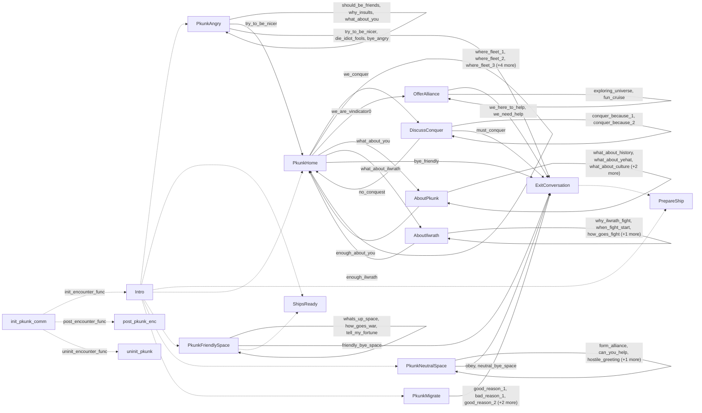

# Pkunk: existing conversation graph

> Generated by `tools/conversation_catalog.py`; do not edit this page by hand.

[Catalog and interpretation rules](../README.md) · [Proposed engine](../model.md)

Script: [pkunkc.c](../../../../sc2/src/uqm/comm/pkunk/pkunkc.c#L1). Phrase bank: [pkunk.txt](../../../../sc2/content/base/comm/pkunk/pkunk.txt#L1).

16 handler/helper nodes; 53 response registration sites; 9 direct local calls; 182 phrase records.

## Initialization and lifecycle

| Phase | Callback | Bound by | Conditions / source |
| --- | --- | --- | --- |
| <code>init_encounter_func</code> | [<code>Intro</code>](#node-intro) | <code>init_pkunk_comm</code> | No enclosing branch condition; [1124](../../../../sc2/src/uqm/comm/pkunk/pkunkc.c#L1124) |
| <code>post_encounter_func</code> | [<code>post_pkunk_enc</code>](#node-post_pkunk_enc) | <code>init_pkunk_comm</code> | No enclosing branch condition; [1125](../../../../sc2/src/uqm/comm/pkunk/pkunkc.c#L1125) |
| <code>uninit_encounter_func</code> | [<code>uninit_pkunk</code>](#node-uninit_pkunk) | <code>init_pkunk_comm</code> | No enclosing branch condition; [1126](../../../../sc2/src/uqm/comm/pkunk/pkunkc.c#L1126) |

## Handler graph

Solid arrows are selectable responses; dashed arrows are direct C calls. Conditions, arguments, speech and effects are cataloged below. Parallel response sites are grouped only in this diagram.



## Condition catalog

Condition IDs describe enclosing source structure. Branch predicates combine with ∧; case labels mark source locations that can also be reached by fallthrough. Values refer to their original evaluation points. Local assignments and early control flow remain in the decision bodies.

| ID | Source expression / structural condition |
| --- | --- |
| <a id="condition-c1"></a>C1 | <code>GET_GAME_STATE(PKUNK_MANNER) == 3</code> |
| <a id="condition-c2"></a>C2 | <code>!((i = (GLOBAL(GameClock.year_index) - START_YEAR) - GET_GAME_STATE(PKUNK_SHIP_YEAR)) &lt; 0)</code> |
| <a id="condition-c3"></a>C3 | <code>i == 0</code> |
| <a id="condition-c4"></a>C4 | <code>!((i == 0) &amp;&amp; ((i = GLOBAL(GameClock.month_index) - GET_GAME_STATE(PKUNK_SHIP_MONTH)) &lt; 0))</code> |
| <a id="condition-c5"></a>C5 | <code>AddEscortShips(PKUNK_SHIP, MAX_PKUNK_SHIPS)</code> |
| <a id="condition-c6"></a>C6 | <code>(di = GLOBAL(GameClock.day_index)) &gt; 28</code> |
| <a id="condition-c7"></a>C7 | <code>PLAYER_SAID(R, friendly_bye_space)</code> |
| <a id="condition-c8"></a>C8 | <code>!(PLAYER_SAID(R, friendly_bye_space))</code> |
| <a id="condition-c9"></a>C9 | <code>PLAYER_SAID(R, neutral_bye_space)</code> |
| <a id="condition-c10"></a>C10 | <code>!(PLAYER_SAID(R, neutral_bye_space))</code> |
| <a id="condition-c11"></a>C11 | <code>PLAYER_SAID(R, bye_angry)</code> |
| <a id="condition-c12"></a>C12 | <code>!(PLAYER_SAID(R, bye_angry))</code> |
| <a id="condition-c13"></a>C13 | <code>PLAYER_SAID(R, bye_friendly)</code> |
| <a id="condition-c14"></a>C14 | <code>!(PLAYER_SAID(R, bye_friendly))</code> |
| <a id="condition-c15"></a>C15 | <code>!(PLAYER_SAID(R, we_here_to_help))</code> |
| <a id="condition-c16"></a>C16 | <code>PLAYER_SAID(R, we_here_to_help) &#124;&#124; PLAYER_SAID(R, we_need_help)</code> |
| <a id="condition-c17"></a>C17 | <code>PLAYER_SAID(R, we_here_to_help)</code> |
| <a id="condition-c18"></a>C18 | <code>EscortFeasibilityStudy(PKUNK_SHIP) == 0</code> |
| <a id="condition-c19"></a>C19 | <code>!(EscortFeasibilityStudy(PKUNK_SHIP) == 0)</code> |
| <a id="condition-c20"></a>C20 | <code>!(PLAYER_SAID(R, we_here_to_help) &#124;&#124; PLAYER_SAID(R, we_need_help))</code> |
| <a id="condition-c21"></a>C21 | <code>PLAYER_SAID(R, try_to_be_nicer)</code> |
| <a id="condition-c22"></a>C22 | <code>!(PLAYER_SAID(R, try_to_be_nicer))</code> |
| <a id="condition-c23"></a>C23 | <code>!(PLAYER_SAID(R, must_conquer))</code> |
| <a id="condition-c24"></a>C24 | <code>PLAYER_SAID(R, must_conquer) &#124;&#124; PLAYER_SAID(R, obey)</code> |
| <a id="condition-c25"></a>C25 | <code>PLAYER_SAID(R, obey)</code> |
| <a id="condition-c26"></a>C26 | <code>!(PLAYER_SAID(R, obey))</code> |
| <a id="condition-c27"></a>C27 | <code>!(PLAYER_SAID(R, must_conquer) &#124;&#124; PLAYER_SAID(R, obey))</code> |
| <a id="condition-c28"></a>C28 | <code>PLAYER_SAID(R, die_idiot_fools)</code> |
| <a id="condition-c29"></a>C29 | <code>!(PLAYER_SAID(R, die_idiot_fools))</code> |
| <a id="condition-c30"></a>C30 | <code>PLAYER_SAID(R, suit_yourself)</code> |
| <a id="condition-c31"></a>C31 | <code>!(PLAYER_SAID(R, suit_yourself))</code> |
| <a id="condition-c32"></a>C32 | <code>PLAYER_SAID(R, good_reason_1)</code> |
| <a id="condition-c33"></a>C33 | <code>!(PLAYER_SAID(R, good_reason_1))</code> |
| <a id="condition-c34"></a>C34 | <code>PLAYER_SAID(R, good_reason_2)</code> |
| <a id="condition-c35"></a>C35 | <code>!(PLAYER_SAID(R, good_reason_2))</code> |
| <a id="condition-c36"></a>C36 | <code>PLAYER_SAID(R, bad_reason_1)</code> |
| <a id="condition-c37"></a>C37 | <code>!(PLAYER_SAID(R, bad_reason_1))</code> |
| <a id="condition-c38"></a>C38 | <code>PLAYER_SAID(R, bad_reason_2)</code> |
| <a id="condition-c39"></a>C39 | <code>PLAYER_SAID(R, why_insults)</code> |
| <a id="condition-c40"></a>C40 | <code>!(PLAYER_SAID(R, why_insults))</code> |
| <a id="condition-c41"></a>C41 | <code>PLAYER_SAID(R, what_about_you)</code> |
| <a id="condition-c42"></a>C42 | <code>!(PLAYER_SAID(R, what_about_you))</code> |
| <a id="condition-c43"></a>C43 | <code>PLAYER_SAID(R, should_be_friends)</code> |
| <a id="condition-c44"></a>C44 | <code>PHRASE_ENABLED(should_be_friends)</code> |
| <a id="condition-c45"></a>C45 | <code>!(PHRASE_ENABLED(should_be_friends))</code> |
| <a id="condition-c46"></a>C46 | <code>GET_GAME_STATE(GLOBAL_FLAGS_AND_DATA) &amp; (1 &lt;&lt; 7)</code> |
| <a id="condition-c47"></a>C47 | <code>!(GET_GAME_STATE(GLOBAL_FLAGS_AND_DATA) &amp; (1 &lt;&lt; 7))</code> |
| <a id="condition-c48"></a>C48 | <code>PHRASE_ENABLED(why_insults)</code> |
| <a id="condition-c49"></a>C49 | <code>PHRASE_ENABLED(what_about_you)</code> |
| <a id="condition-c50"></a>C50 | <code>PLAYER_SAID(R, we_conquer)</code> |
| <a id="condition-c51"></a>C51 | <code>!(PLAYER_SAID(R, we_conquer))</code> |
| <a id="condition-c52"></a>C52 | <code>PLAYER_SAID(R, conquer_because_1)</code> |
| <a id="condition-c53"></a>C53 | <code>!(PLAYER_SAID(R, conquer_because_1))</code> |
| <a id="condition-c54"></a>C54 | <code>PLAYER_SAID(R, conquer_because_2)</code> |
| <a id="condition-c55"></a>C55 | <code>PHRASE_ENABLED(conquer_because_1)</code> |
| <a id="condition-c56"></a>C56 | <code>PHRASE_ENABLED(conquer_because_2)</code> |
| <a id="condition-c57"></a>C57 | <code>PLAYER_SAID(R, we_are_vindicator0)</code> |
| <a id="condition-c58"></a>C58 | <code>!(PLAYER_SAID(R, we_are_vindicator0))</code> |
| <a id="condition-c59"></a>C59 | <code>PLAYER_SAID(R, exploring_universe)</code> |
| <a id="condition-c60"></a>C60 | <code>!(PLAYER_SAID(R, exploring_universe))</code> |
| <a id="condition-c61"></a>C61 | <code>PLAYER_SAID(R, fun_cruise)</code> |
| <a id="condition-c62"></a>C62 | <code>PHRASE_ENABLED(exploring_universe)</code> |
| <a id="condition-c63"></a>C63 | <code>PHRASE_ENABLED(fun_cruise)</code> |
| <a id="condition-c64"></a>C64 | <code>PLAYER_SAID(R, what_about_history)</code> |
| <a id="condition-c65"></a>C65 | <code>!(PLAYER_SAID(R, what_about_history))</code> |
| <a id="condition-c66"></a>C66 | <code>PLAYER_SAID(R, what_about_yehat)</code> |
| <a id="condition-c67"></a>C67 | <code>!(PLAYER_SAID(R, what_about_yehat))</code> |
| <a id="condition-c68"></a>C68 | <code>PLAYER_SAID(R, what_about_culture)</code> |
| <a id="condition-c69"></a>C69 | <code>!(PLAYER_SAID(R, what_about_culture))</code> |
| <a id="condition-c70"></a>C70 | <code>PLAYER_SAID(R, elaborate_culture)</code> |
| <a id="condition-c71"></a>C71 | <code>!(PLAYER_SAID(R, elaborate_culture))</code> |
| <a id="condition-c72"></a>C72 | <code>PLAYER_SAID(R, what_about_future)</code> |
| <a id="condition-c73"></a>C73 | <code>PHRASE_ENABLED(what_about_history)</code> |
| <a id="condition-c74"></a>C74 | <code>!(PHRASE_ENABLED(what_about_history))</code> |
| <a id="condition-c75"></a>C75 | <code>PHRASE_ENABLED(what_about_yehat)</code> |
| <a id="condition-c76"></a>C76 | <code>PHRASE_ENABLED(what_about_culture)</code> |
| <a id="condition-c77"></a>C77 | <code>!(PHRASE_ENABLED(what_about_culture))</code> |
| <a id="condition-c78"></a>C78 | <code>PHRASE_ENABLED(elaborate_culture)</code> |
| <a id="condition-c79"></a>C79 | <code>PHRASE_ENABLED(what_about_future)</code> |
| <a id="condition-c80"></a>C80 | <code>!InfoLeft</code> |
| <a id="condition-c81"></a>C81 | <code>PLAYER_SAID(R, what_about_ilwrath)</code> |
| <a id="condition-c82"></a>C82 | <code>!(PLAYER_SAID(R, what_about_ilwrath))</code> |
| <a id="condition-c83"></a>C83 | <code>PLAYER_SAID(R, why_ilwrath_fight)</code> |
| <a id="condition-c84"></a>C84 | <code>!(PLAYER_SAID(R, why_ilwrath_fight))</code> |
| <a id="condition-c85"></a>C85 | <code>PLAYER_SAID(R, when_fight_start)</code> |
| <a id="condition-c86"></a>C86 | <code>!(PLAYER_SAID(R, when_fight_start))</code> |
| <a id="condition-c87"></a>C87 | <code>PLAYER_SAID(R, how_goes_fight)</code> |
| <a id="condition-c88"></a>C88 | <code>!(PLAYER_SAID(R, how_goes_fight))</code> |
| <a id="condition-c89"></a>C89 | <code>PLAYER_SAID(R, how_stop_fight)</code> |
| <a id="condition-c90"></a>C90 | <code>PHRASE_ENABLED(why_ilwrath_fight)</code> |
| <a id="condition-c91"></a>C91 | <code>PHRASE_ENABLED(when_fight_start)</code> |
| <a id="condition-c92"></a>C92 | <code>PHRASE_ENABLED(how_goes_fight)</code> |
| <a id="condition-c93"></a>C93 | <code>PHRASE_ENABLED(how_stop_fight)</code> |
| <a id="condition-c94"></a>C94 | <code>PLAYER_SAID(R, no_conquest)</code> |
| <a id="condition-c95"></a>C95 | <code>!(PLAYER_SAID(R, no_conquest))</code> |
| <a id="condition-c96"></a>C96 | <code>PLAYER_SAID(R, enough_ilwrath)</code> |
| <a id="condition-c97"></a>C97 | <code>!(PLAYER_SAID(R, enough_ilwrath))</code> |
| <a id="condition-c98"></a>C98 | <code>PLAYER_SAID(R, enough_about_you)</code> |
| <a id="condition-c99"></a>C99 | <code>!(PLAYER_SAID(R, enough_about_you))</code> |
| <a id="condition-c100"></a>C100 | <code>!(PLAYER_SAID(R, where_fleet_1))</code> |
| <a id="condition-c101"></a>C101 | <code>!(PLAYER_SAID(R, where_fleet_1) &#124;&#124; PLAYER_SAID(R, where_fleet_2))</code> |
| <a id="condition-c102"></a>C102 | <code>(PLAYER_SAID(R, where_fleet_1) &#124;&#124; PLAYER_SAID(R, where_fleet_2)) &#124;&#124; PLAYER_SAID(R, where_fleet_3)</code> |
| <a id="condition-c103"></a>C103 | <code>!(GET_GAME_STATE(PKUNK_MISSION) &amp; 1)</code> |
| <a id="condition-c104"></a>C104 | <code>switch (NumVisits++)</code> |
| <a id="condition-c105"></a>C105 | <code>case 0 (see source for fallthrough)</code> |
| <a id="condition-c106"></a>C106 | <code>case 1 (see source for fallthrough)</code> |
| <a id="condition-c107"></a>C107 | <code>!(!(GET_GAME_STATE(PKUNK_MISSION) &amp; 1))</code> |
| <a id="condition-c108"></a>C108 | <code>case 2 (see source for fallthrough)</code> |
| <a id="condition-c109"></a>C109 | <code>!((PLAYER_SAID(R, where_fleet_1) &#124;&#124; PLAYER_SAID(R, where_fleet_2)) &#124;&#124; PLAYER_SAID(R, where_fleet_3))</code> |
| <a id="condition-c110"></a>C110 | <code>!(PLAYER_SAID(R, am_worried_1))</code> |
| <a id="condition-c111"></a>C111 | <code>!(PLAYER_SAID(R, am_worried_1) &#124;&#124; PLAYER_SAID(R, am_worried_2))</code> |
| <a id="condition-c112"></a>C112 | <code>(PLAYER_SAID(R, am_worried_1) &#124;&#124; PLAYER_SAID(R, am_worried_2)) &#124;&#124; PLAYER_SAID(R, am_worried_3)</code> |
| <a id="condition-c113"></a>C113 | <code>!((PLAYER_SAID(R, am_worried_1) &#124;&#124; PLAYER_SAID(R, am_worried_2)) &#124;&#124; PLAYER_SAID(R, am_worried_3))</code> |
| <a id="condition-c114"></a>C114 | <code>!GET_GAME_STATE(CLEAR_SPINDLE)</code> |
| <a id="condition-c115"></a>C115 | <code>PHRASE_ENABLED(we_conquer)</code> |
| <a id="condition-c116"></a>C116 | <code>PHRASE_ENABLED(we_conquer) &amp;&amp; (GET_GAME_STATE(PKUNK_MANNER) == 0)</code> |
| <a id="condition-c117"></a>C117 | <code>GET_GAME_STATE(PKUNK_ON_THE_MOVE)</code> |
| <a id="condition-c118"></a>C118 | <code>PHRASE_ENABLED(where_fleet_1)</code> |
| <a id="condition-c119"></a>C119 | <code>PHRASE_ENABLED(where_fleet_1) &amp;&amp; (!GET_GAME_STATE(PKUNK_SWITCH))</code> |
| <a id="condition-c120"></a>C120 | <code>switch (GET_GAME_STATE(PKUNK_FLEET))</code> |
| <a id="condition-c121"></a>C121 | <code>!(PHRASE_ENABLED(where_fleet_1) &amp;&amp; (!GET_GAME_STATE(PKUNK_SWITCH)))</code> |
| <a id="condition-c122"></a>C122 | <code>!PHRASE_ENABLED(where_fleet_1)</code> |
| <a id="condition-c123"></a>C123 | <code>(!PHRASE_ENABLED(where_fleet_1)) &amp;&amp; PHRASE_ENABLED(am_worried_1)</code> |
| <a id="condition-c124"></a>C124 | <code>((!PHRASE_ENABLED(where_fleet_1)) &amp;&amp; PHRASE_ENABLED(am_worried_1)) &amp;&amp; (GET_GAME_STATE(PKUNK_MISSION) &amp; 1)</code> |
| <a id="condition-c125"></a>C125 | <code>switch (GET_GAME_STATE(PKUNK_WORRY))</code> |
| <a id="condition-c126"></a>C126 | <code>!GET_GAME_STATE(PKUNK_SHIP_MONTH)</code> |
| <a id="condition-c127"></a>C127 | <code>PHRASE_ENABLED(what_about_ilwrath)</code> |
| <a id="condition-c128"></a>C128 | <code>!GET_GAME_STATE(ILWRATH_DECEIVED)</code> |
| <a id="condition-c129"></a>C129 | <code>!(!GET_GAME_STATE(ILWRATH_DECEIVED))</code> |
| <a id="condition-c130"></a>C130 | <code>PLAYER_SAID(R, whats_up_space)</code> |
| <a id="condition-c131"></a>C131 | <code>ShipsReady()</code> |
| <a id="condition-c132"></a>C132 | <code>!(ShipsReady())</code> |
| <a id="condition-c133"></a>C133 | <code>case 3 (see source for fallthrough)</code> |
| <a id="condition-c134"></a>C134 | <code>case 4 (see source for fallthrough)</code> |
| <a id="condition-c135"></a>C135 | <code>case 5 (see source for fallthrough)</code> |
| <a id="condition-c136"></a>C136 | <code>case 6 (see source for fallthrough)</code> |
| <a id="condition-c137"></a>C137 | <code>case 7 (see source for fallthrough)</code> |
| <a id="condition-c138"></a>C138 | <code>!(PLAYER_SAID(R, whats_up_space))</code> |
| <a id="condition-c139"></a>C139 | <code>PLAYER_SAID(R, how_goes_war)</code> |
| <a id="condition-c140"></a>C140 | <code>!(PLAYER_SAID(R, how_goes_war))</code> |
| <a id="condition-c141"></a>C141 | <code>PLAYER_SAID(R, tell_my_fortune)</code> |
| <a id="condition-c142"></a>C142 | <code>PHRASE_ENABLED(whats_up_space)</code> |
| <a id="condition-c143"></a>C143 | <code>!GET_GAME_STATE(PKUNK_DONE_WAR)</code> |
| <a id="condition-c144"></a>C144 | <code>(!GET_GAME_STATE(PKUNK_DONE_WAR)) &amp;&amp; PHRASE_ENABLED(how_goes_war)</code> |
| <a id="condition-c145"></a>C145 | <code>PHRASE_ENABLED(tell_my_fortune)</code> |
| <a id="condition-c146"></a>C146 | <code>PLAYER_SAID(R, form_alliance)</code> |
| <a id="condition-c147"></a>C147 | <code>!(PLAYER_SAID(R, form_alliance))</code> |
| <a id="condition-c148"></a>C148 | <code>PLAYER_SAID(R, can_you_help)</code> |
| <a id="condition-c149"></a>C149 | <code>!(PLAYER_SAID(R, can_you_help))</code> |
| <a id="condition-c150"></a>C150 | <code>PLAYER_SAID(R, hostile_greeting)</code> |
| <a id="condition-c151"></a>C151 | <code>!(PLAYER_SAID(R, hostile_greeting))</code> |
| <a id="condition-c152"></a>C152 | <code>PLAYER_SAID(R, whats_up_neutral)</code> |
| <a id="condition-c153"></a>C153 | <code>PHRASE_ENABLED(form_alliance)</code> |
| <a id="condition-c154"></a>C154 | <code>!(PHRASE_ENABLED(form_alliance))</code> |
| <a id="condition-c155"></a>C155 | <code>PHRASE_ENABLED(can_you_help)</code> |
| <a id="condition-c156"></a>C156 | <code>PHRASE_ENABLED(hostile_greeting)</code> |
| <a id="condition-c157"></a>C157 | <code>!(PHRASE_ENABLED(hostile_greeting))</code> |
| <a id="condition-c158"></a>C158 | <code>PHRASE_ENABLED(whats_up_neutral)</code> |
| <a id="condition-c159"></a>C159 | <code>!(ReasonMask &amp; GOOD_REASON_1)</code> |
| <a id="condition-c160"></a>C160 | <code>!(ReasonMask &amp; BAD_REASON_1)</code> |
| <a id="condition-c161"></a>C161 | <code>!(ReasonMask &amp; GOOD_REASON_2)</code> |
| <a id="condition-c162"></a>C162 | <code>!(ReasonMask &amp; BAD_REASON_2)</code> |
| <a id="condition-c163"></a>C163 | <code>LOBYTE(GLOBAL(CurrentActivity)) == WON_LAST_BATTLE</code> |
| <a id="condition-c164"></a>C164 | <code>Manner == 2</code> |
| <a id="condition-c165"></a>C165 | <code>!(Manner == 2)</code> |
| <a id="condition-c166"></a>C166 | <code>Manner == 1</code> |
| <a id="condition-c167"></a>C167 | <code>!(Manner == 1)</code> |
| <a id="condition-c168"></a>C168 | <code>!(!GET_GAME_STATE(CLEAR_SPINDLE))</code> |
| <a id="condition-c169"></a>C169 | <code>!GET_GAME_STATE(PKUNK_SENSE_VICTOR)</code> |
| <a id="condition-c170"></a>C170 | <code>(!GET_GAME_STATE(PKUNK_SENSE_VICTOR)) &amp;&amp; (GLOBAL(GameClock.year_index) &gt; START_YEAR)</code> |
| <a id="condition-c171"></a>C171 | <code>((!GET_GAME_STATE(PKUNK_SENSE_VICTOR)) &amp;&amp; (GLOBAL(GameClock.year_index) &gt; START_YEAR)) &amp;&amp; (!GET_GAME_STATE(KOHR_AH_FRENZY))</code> |
| <a id="condition-c172"></a>C172 | <code>Manner == 0</code> |
| <a id="condition-c173"></a>C173 | <code>!(Manner == 0)</code> |
| <a id="condition-c174"></a>C174 | <code>NumVisits</code> |
| <a id="condition-c175"></a>C175 | <code>NumVisits &amp;&amp; ShipsReady()</code> |
| <a id="condition-c176"></a>C176 | <code>!(NumVisits &amp;&amp; ShipsReady())</code> |
| <a id="condition-c177"></a>C177 | <code>((NumVisits = GET_GAME_STATE(PKUNK_MISSION)) == 0) &#124;&#124; (!(NumVisits &amp; 1))</code> |
| <a id="condition-c178"></a>C178 | <code>Manner == 3</code> |
| <a id="condition-c179"></a>C179 | <code>!(Manner == 3)</code> |
| <a id="condition-c180"></a>C180 | <code>!(((NumVisits = GET_GAME_STATE(PKUNK_MISSION)) == 0) &#124;&#124; (!(NumVisits &amp; 1)))</code> |
| <a id="condition-c181"></a>C181 | <code>getSegue() == Segue_hostile</code> |
| <a id="condition-c182"></a>C182 | <code>(getSegue() == Segue_hostile) &amp;&amp; ((Manner = GET_GAME_STATE(PKUNK_MANNER)) != 2)</code> |
| <a id="condition-c183"></a>C183 | <code>Manner != 1</code> |
| <a id="condition-c184"></a>C184 | <code>!(GET_GAME_STATE(PKUNK_MANNER) == 3)</code> |
| <a id="condition-c185"></a>C185 | <code>(GET_GAME_STATE(PKUNK_MANNER) == 3) &#124;&#124; (LOBYTE(GLOBAL(CurrentActivity)) == WON_LAST_BATTLE)</code> |
| <a id="condition-c186"></a>C186 | <code>!((GET_GAME_STATE(PKUNK_MANNER) == 3) &#124;&#124; (LOBYTE(GLOBAL(CurrentActivity)) == WON_LAST_BATTLE))</code> |

## Script-scope state and lookup tables

These declarations supply shared local state, computed phrase alternatives, number speech, or lookup data used by the nodes. LOCDATA presentation defaults are linked separately in the source.

Presentation descriptor <code>pkunk_desc</code>: [source](../../../../sc2/src/uqm/comm/pkunk/pkunkc.c#L27).

## Node catalog

<a id="node-shipsready"></a>

### ShipsReady

<code>static BOOLEAN ShipsReady(void)</code> — [source](../../../../sc2/src/uqm/comm/pkunk/pkunkc.c#L99).

Also called directly by: [<code>PkunkFriendlySpace</code>](#node-pkunkfriendlyspace) ([658](../../../../sc2/src/uqm/comm/pkunk/pkunkc.c#L658)), [<code>Intro</code>](#node-intro) ([950](../../../../sc2/src/uqm/comm/pkunk/pkunkc.c#L950)).

#### Actions, queries, local updates, and control flow

Calls are listed without assuming they are pure or mutating. Local updates are retained because they determine dynamic menus and counter-selected speech.

| Kind | Operation | Enclosing conditions | Source |
| --- | --- | --- | --- |
| flow | <code>return (GET_GAME_STATE(PKUNK_MANNER) == 3) &amp;&amp; (!(((i = (GLOBAL(GameClock.year_index) - START_YEAR) - GET_GAME_STATE(PKUNK_SHIP_YEAR)) &lt; 0) &#124;&#124; (((i == 0) &amp;&amp; ((i = GLOBAL(GameClock.month_index) - GET_GAME_STATE(PKUNK_SHIP_MONTH)) &lt; 0)) &#124;&#124; ((i == 0) &amp;&amp; (GLOBAL(GameClock.day_index) &lt; GET_GAME_STATE(PKUNK_SHIP_DAY))))));</code> | No enclosing branch condition | [103](../../../../sc2/src/uqm/comm/pkunk/pkunkc.c#L103) |
| call | <code>GET_GAME_STATE(PKUNK_MANNER)</code> | No enclosing branch condition | [103](../../../../sc2/src/uqm/comm/pkunk/pkunkc.c#L103) |
| update | <code>i = (GLOBAL(GameClock.year_index) - START_YEAR) - GET_GAME_STATE(PKUNK_SHIP_YEAR)</code> | [C1](#condition-c1) | [104](../../../../sc2/src/uqm/comm/pkunk/pkunkc.c#L104) |
| call | <code>GLOBAL(GameClock.year_index)</code> | [C1](#condition-c1) | [104](../../../../sc2/src/uqm/comm/pkunk/pkunkc.c#L104) |
| call | <code>GET_GAME_STATE(PKUNK_SHIP_YEAR)</code> | [C1](#condition-c1) | [104](../../../../sc2/src/uqm/comm/pkunk/pkunkc.c#L104) |
| update | <code>i = GLOBAL(GameClock.month_index) - GET_GAME_STATE(PKUNK_SHIP_MONTH)</code> | [C1](#condition-c1) ∧ [C2](#condition-c2) ∧ [C3](#condition-c3) | [105](../../../../sc2/src/uqm/comm/pkunk/pkunkc.c#L105) |
| call | <code>GLOBAL(GameClock.month_index)</code> | [C1](#condition-c1) ∧ [C2](#condition-c2) ∧ [C3](#condition-c3) | [105](../../../../sc2/src/uqm/comm/pkunk/pkunkc.c#L105) |
| call | <code>GET_GAME_STATE(PKUNK_SHIP_MONTH)</code> | [C1](#condition-c1) ∧ [C2](#condition-c2) ∧ [C3](#condition-c3) | [105](../../../../sc2/src/uqm/comm/pkunk/pkunkc.c#L105) |
| call | <code>GLOBAL(GameClock.day_index)</code> | [C1](#condition-c1) ∧ [C2](#condition-c2) ∧ [C4](#condition-c4) ∧ [C3](#condition-c3) | [106](../../../../sc2/src/uqm/comm/pkunk/pkunkc.c#L106) |
| call | <code>GET_GAME_STATE(PKUNK_SHIP_DAY)</code> | [C1](#condition-c1) ∧ [C2](#condition-c2) ∧ [C4](#condition-c4) ∧ [C3](#condition-c3) | [106](../../../../sc2/src/uqm/comm/pkunk/pkunkc.c#L106) |

<details>
<summary>Exact decision body (local calculations, early returns, fallthrough and ordering)</summary>

```c
{
	SIZE i;

	return (GET_GAME_STATE (PKUNK_MANNER) == 3
		&& !((i = (GLOBAL (GameClock.year_index) - START_YEAR) - GET_GAME_STATE (PKUNK_SHIP_YEAR)) < 0
		     || ((i == 0 && (i = GLOBAL (GameClock.month_index) - GET_GAME_STATE (PKUNK_SHIP_MONTH)) < 0)
			 || (i == 0 && GLOBAL (GameClock.day_index) < GET_GAME_STATE (PKUNK_SHIP_DAY)))));
}
```

</details>

<a id="node-prepareship"></a>

### PrepareShip

<code>static void PrepareShip(void)</code> — [source](../../../../sc2/src/uqm/comm/pkunk/pkunkc.c#L110).

Also called directly by: [<code>ExitConversation</code>](#node-exitconversation) ([166](../../../../sc2/src/uqm/comm/pkunk/pkunkc.c#L166)), [<code>Intro</code>](#node-intro) ([957](../../../../sc2/src/uqm/comm/pkunk/pkunkc.c#L957)).

#### Actions, queries, local updates, and control flow

Calls are listed without assuming they are pure or mutating. Local updates are retained because they determine dynamic menus and counter-selected speech.

| Kind | Operation | Enclosing conditions | Source |
| --- | --- | --- | --- |
| call | <code>AddEscortShips(PKUNK_SHIP, MAX_PKUNK_SHIPS)</code> | No enclosing branch condition | [113](../../../../sc2/src/uqm/comm/pkunk/pkunkc.c#L113) |
| update | <code>mi = GLOBAL(GameClock.month_index)</code> | [C5](#condition-c5) | [117](../../../../sc2/src/uqm/comm/pkunk/pkunkc.c#L117) |
| call | <code>GLOBAL(GameClock.month_index)</code> | [C5](#condition-c5) | [117](../../../../sc2/src/uqm/comm/pkunk/pkunkc.c#L117) |
| call | <code>SET_GAME_STATE(PKUNK_SHIP_MONTH, mi)</code> | [C5](#condition-c5) | [118](../../../../sc2/src/uqm/comm/pkunk/pkunkc.c#L118) |
| update | <code>di = GLOBAL(GameClock.day_index)</code> | [C5](#condition-c5) | [119](../../../../sc2/src/uqm/comm/pkunk/pkunkc.c#L119) |
| call | <code>GLOBAL(GameClock.day_index)</code> | [C5](#condition-c5) | [119](../../../../sc2/src/uqm/comm/pkunk/pkunkc.c#L119) |
| update | <code>di = 28</code> | [C5](#condition-c5) ∧ [C6](#condition-c6) | [120](../../../../sc2/src/uqm/comm/pkunk/pkunkc.c#L120) |
| call | <code>SET_GAME_STATE(PKUNK_SHIP_DAY, di)</code> | [C5](#condition-c5) | [121](../../../../sc2/src/uqm/comm/pkunk/pkunkc.c#L121) |
| update | <code>yi = ((BYTE) (GLOBAL(GameClock.year_index) - START_YEAR)) + 1</code> | [C5](#condition-c5) | [122](../../../../sc2/src/uqm/comm/pkunk/pkunkc.c#L122) |
| call | <code>GLOBAL(GameClock.year_index)</code> | [C5](#condition-c5) | [122](../../../../sc2/src/uqm/comm/pkunk/pkunkc.c#L122) |
| call | <code>SET_GAME_STATE(PKUNK_SHIP_YEAR, yi)</code> | [C5](#condition-c5) | [123](../../../../sc2/src/uqm/comm/pkunk/pkunkc.c#L123) |

<details>
<summary>Exact decision body (local calculations, early returns, fallthrough and ordering)</summary>

```c
{
#define MAX_PKUNK_SHIPS 4
	if (AddEscortShips (PKUNK_SHIP, MAX_PKUNK_SHIPS))
	{
		BYTE mi, di, yi;

		mi = GLOBAL (GameClock.month_index);
		SET_GAME_STATE (PKUNK_SHIP_MONTH, mi);
		if ((di = GLOBAL (GameClock.day_index)) > 28)
			di = 28;
		SET_GAME_STATE (PKUNK_SHIP_DAY, di);
		yi = (BYTE)(GLOBAL (GameClock.year_index) - START_YEAR) + 1;
		SET_GAME_STATE (PKUNK_SHIP_YEAR, yi);
	}
}
```

</details>

<a id="node-exitconversation"></a>

### ExitConversation

<code>static void ExitConversation(RESPONSE_REF R)</code> — [source](../../../../sc2/src/uqm/comm/pkunk/pkunkc.c#L133).

Incoming player-response variants: [<code>try_to_be_nicer</code>](#phrase-try_to_be_nicer), [<code>die_idiot_fools</code>](#phrase-die_idiot_fools), [<code>bye_angry</code>](#phrase-bye_angry), [<code>must_conquer</code>](#phrase-must_conquer), [<code>we_here_to_help</code>](#phrase-we_here_to_help), [<code>we_need_help</code>](#phrase-we_need_help), [<code>bye_friendly</code>](#phrase-bye_friendly), [<code>friendly_bye_space</code>](#phrase-friendly_bye_space), [<code>obey</code>](#phrase-obey), [<code>neutral_bye_space</code>](#phrase-neutral_bye_space), [<code>good_reason_1</code>](#phrase-good_reason_1), [<code>bad_reason_1</code>](#phrase-bad_reason_1), [<code>good_reason_2</code>](#phrase-good_reason_2), [<code>bad_reason_2</code>](#phrase-bad_reason_2), [<code>suit_yourself</code>](#phrase-suit_yourself).

#### Dialogue / audio emissions

| Phrase or expression | Enclosing conditions | Source |
| --- | --- | --- |
| [<code>FRIENDLY_GOODBYE_SPACE</code>](#phrase-friendly_goodbye_space)<br><code>NPCPhrase(FRIENDLY_GOODBYE_SPACE)</code> | [C7](#condition-c7) | [138](../../../../sc2/src/uqm/comm/pkunk/pkunkc.c#L138) |
| [<code>NEUTRAL_GOODBYE_SPACE</code>](#phrase-neutral_goodbye_space)<br><code>NPCPhrase(NEUTRAL_GOODBYE_SPACE)</code> | [C8](#condition-c8) ∧ [C9](#condition-c9) | [140](../../../../sc2/src/uqm/comm/pkunk/pkunkc.c#L140) |
| [<code>GOODBYE_ANGRY</code>](#phrase-goodbye_angry)<br><code>NPCPhrase(GOODBYE_ANGRY)</code> | [C8](#condition-c8) ∧ [C10](#condition-c10) ∧ [C11](#condition-c11) | [142](../../../../sc2/src/uqm/comm/pkunk/pkunkc.c#L142) |
| [<code>GOODBYE_FRIENDLY</code>](#phrase-goodbye_friendly)<br><code>NPCPhrase(GOODBYE_FRIENDLY)</code> | [C8](#condition-c8) ∧ [C10](#condition-c10) ∧ [C12](#condition-c12) ∧ [C13](#condition-c13) | [144](../../../../sc2/src/uqm/comm/pkunk/pkunkc.c#L144) |
| [<code>NEED_HELP</code>](#phrase-need_help)<br><code>NPCPhrase(NEED_HELP)</code> | [C8](#condition-c8) ∧ [C10](#condition-c10) ∧ [C12](#condition-c12) ∧ [C14](#condition-c14) ∧ [C16](#condition-c16) ∧ [C17](#condition-c17) | [149](../../../../sc2/src/uqm/comm/pkunk/pkunkc.c#L149) |
| [<code>GIVE_HELP</code>](#phrase-give_help)<br><code>NPCPhrase(GIVE_HELP)</code> | [C8](#condition-c8) ∧ [C10](#condition-c10) ∧ [C12](#condition-c12) ∧ [C14](#condition-c14) ∧ [C16](#condition-c16) ∧ [C15](#condition-c15) | [151](../../../../sc2/src/uqm/comm/pkunk/pkunkc.c#L151) |
| [<code>ALMOST_ALLIANCE</code>](#phrase-almost_alliance)<br><code>NPCPhrase(ALMOST_ALLIANCE)</code> | [C8](#condition-c8) ∧ [C10](#condition-c10) ∧ [C12](#condition-c12) ∧ [C14](#condition-c14) ∧ [C16](#condition-c16) | [152](../../../../sc2/src/uqm/comm/pkunk/pkunkc.c#L152) |
| [<code>INIT_NO_ROOM</code>](#phrase-init_no_room)<br><code>NPCPhrase(INIT_NO_ROOM)</code> | [C8](#condition-c8) ∧ [C10](#condition-c10) ∧ [C12](#condition-c12) ∧ [C14](#condition-c14) ∧ [C16](#condition-c16) ∧ [C18](#condition-c18) | [161](../../../../sc2/src/uqm/comm/pkunk/pkunkc.c#L161) |
| [<code>INIT_SHIP_GIFT</code>](#phrase-init_ship_gift)<br><code>NPCPhrase(INIT_SHIP_GIFT)</code> | [C8](#condition-c8) ∧ [C10](#condition-c10) ∧ [C12](#condition-c12) ∧ [C14](#condition-c14) ∧ [C16](#condition-c16) ∧ [C19](#condition-c19) | [164](../../../../sc2/src/uqm/comm/pkunk/pkunkc.c#L164) |
| [<code>CANT_ASK_FOR_MORE</code>](#phrase-cant_ask_for_more)<br><code>NPCPhrase(CANT_ASK_FOR_MORE)</code> | [C8](#condition-c8) ∧ [C10](#condition-c10) ∧ [C12](#condition-c12) ∧ [C14](#condition-c14) ∧ [C20](#condition-c20) ∧ [C21](#condition-c21) | [171](../../../../sc2/src/uqm/comm/pkunk/pkunkc.c#L171) |
| [<code>VISIT_OUR_HOMEWORLD</code>](#phrase-visit_our_homeworld)<br><code>NPCPhrase(VISIT_OUR_HOMEWORLD)</code> | [C8](#condition-c8) ∧ [C10](#condition-c10) ∧ [C12](#condition-c12) ∧ [C14](#condition-c14) ∧ [C20](#condition-c20) ∧ [C21](#condition-c21) | [172](../../../../sc2/src/uqm/comm/pkunk/pkunkc.c#L172) |
| [<code>NO_OBEY</code>](#phrase-no_obey)<br><code>NPCPhrase(NO_OBEY)</code> | [C8](#condition-c8) ∧ [C10](#condition-c10) ∧ [C12](#condition-c12) ∧ [C14](#condition-c14) ∧ [C20](#condition-c20) ∧ [C22](#condition-c22) ∧ [C24](#condition-c24) ∧ [C25](#condition-c25) | [183](../../../../sc2/src/uqm/comm/pkunk/pkunkc.c#L183) |
| [<code>BAD_IDEA</code>](#phrase-bad_idea)<br><code>NPCPhrase(BAD_IDEA)</code> | [C8](#condition-c8) ∧ [C10](#condition-c10) ∧ [C12](#condition-c12) ∧ [C14](#condition-c14) ∧ [C20](#condition-c20) ∧ [C22](#condition-c22) ∧ [C24](#condition-c24) ∧ [C26](#condition-c26) | [186](../../../../sc2/src/uqm/comm/pkunk/pkunkc.c#L186) |
| [<code>VERY_WELL</code>](#phrase-very_well)<br><code>NPCPhrase(VERY_WELL)</code> | [C8](#condition-c8) ∧ [C10](#condition-c10) ∧ [C12](#condition-c12) ∧ [C14](#condition-c14) ∧ [C20](#condition-c20) ∧ [C22](#condition-c22) ∧ [C27](#condition-c27) ∧ [C28](#condition-c28) | [194](../../../../sc2/src/uqm/comm/pkunk/pkunkc.c#L194) |
| [<code>GOODBYE_MIGRATION</code>](#phrase-goodbye_migration)<br><code>NPCPhrase(GOODBYE_MIGRATION)</code> | [C8](#condition-c8) ∧ [C10](#condition-c10) ∧ [C12](#condition-c12) ∧ [C14](#condition-c14) ∧ [C20](#condition-c20) ∧ [C22](#condition-c22) ∧ [C27](#condition-c27) ∧ [C29](#condition-c29) ∧ [C30](#condition-c30) | [199](../../../../sc2/src/uqm/comm/pkunk/pkunkc.c#L199) |
| [<code>WE_GO_HOME_1</code>](#phrase-we_go_home_1)<br><code>NPCPhrase(WE_GO_HOME_1)</code> | [C8](#condition-c8) ∧ [C10](#condition-c10) ∧ [C12](#condition-c12) ∧ [C14](#condition-c14) ∧ [C20](#condition-c20) ∧ [C22](#condition-c22) ∧ [C27](#condition-c27) ∧ [C29](#condition-c29) ∧ [C31](#condition-c31) ∧ [C32](#condition-c32) | [207](../../../../sc2/src/uqm/comm/pkunk/pkunkc.c#L207) |
| [<code>WE_GO_HOME_2</code>](#phrase-we_go_home_2)<br><code>NPCPhrase(WE_GO_HOME_2)</code> | [C8](#condition-c8) ∧ [C10](#condition-c10) ∧ [C12](#condition-c12) ∧ [C14](#condition-c14) ∧ [C20](#condition-c20) ∧ [C22](#condition-c22) ∧ [C27](#condition-c27) ∧ [C29](#condition-c29) ∧ [C31](#condition-c31) ∧ [C33](#condition-c33) ∧ [C34](#condition-c34) | [213](../../../../sc2/src/uqm/comm/pkunk/pkunkc.c#L213) |
| [<code>NO_GO_HOME_1</code>](#phrase-no_go_home_1)<br><code>NPCPhrase(NO_GO_HOME_1)</code> | [C8](#condition-c8) ∧ [C10](#condition-c10) ∧ [C12](#condition-c12) ∧ [C14](#condition-c14) ∧ [C20](#condition-c20) ∧ [C22](#condition-c22) ∧ [C27](#condition-c27) ∧ [C29](#condition-c29) ∧ [C31](#condition-c31) ∧ [C33](#condition-c33) ∧ [C35](#condition-c35) ∧ [C36](#condition-c36) | [219](../../../../sc2/src/uqm/comm/pkunk/pkunkc.c#L219) |
| [<code>NO_GO_HOME_2</code>](#phrase-no_go_home_2)<br><code>NPCPhrase(NO_GO_HOME_2)</code> | [C8](#condition-c8) ∧ [C10](#condition-c10) ∧ [C12](#condition-c12) ∧ [C14](#condition-c14) ∧ [C20](#condition-c20) ∧ [C22](#condition-c22) ∧ [C27](#condition-c27) ∧ [C29](#condition-c29) ∧ [C31](#condition-c31) ∧ [C33](#condition-c33) ∧ [C35](#condition-c35) ∧ [C37](#condition-c37) ∧ [C38](#condition-c38) | [224](../../../../sc2/src/uqm/comm/pkunk/pkunkc.c#L224) |

#### Actions, queries, local updates, and control flow

Calls are listed without assuming they are pure or mutating. Local updates are retained because they determine dynamic menus and counter-selected speech.

| Kind | Operation | Enclosing conditions | Source |
| --- | --- | --- | --- |
| call | <code>setSegue(Segue_peace)</code> | No enclosing branch condition | [135](../../../../sc2/src/uqm/comm/pkunk/pkunkc.c#L135) |
| call | <code>PLAYER_SAID(R, friendly_bye_space)</code> | No enclosing branch condition | [137](../../../../sc2/src/uqm/comm/pkunk/pkunkc.c#L137) |
| call | <code>PLAYER_SAID(R, neutral_bye_space)</code> | [C8](#condition-c8) | [139](../../../../sc2/src/uqm/comm/pkunk/pkunkc.c#L139) |
| call | <code>PLAYER_SAID(R, bye_angry)</code> | [C8](#condition-c8) ∧ [C10](#condition-c10) | [141](../../../../sc2/src/uqm/comm/pkunk/pkunkc.c#L141) |
| call | <code>PLAYER_SAID(R, bye_friendly)</code> | [C8](#condition-c8) ∧ [C10](#condition-c10) ∧ [C12](#condition-c12) | [143](../../../../sc2/src/uqm/comm/pkunk/pkunkc.c#L143) |
| call | <code>PLAYER_SAID(R, we_here_to_help)</code> | [C8](#condition-c8) ∧ [C10](#condition-c10) ∧ [C12](#condition-c12) ∧ [C14](#condition-c14) | [145](../../../../sc2/src/uqm/comm/pkunk/pkunkc.c#L145) |
| call | <code>PLAYER_SAID(R, we_need_help)</code> | [C8](#condition-c8) ∧ [C10](#condition-c10) ∧ [C12](#condition-c12) ∧ [C14](#condition-c14) ∧ [C15](#condition-c15) | [146](../../../../sc2/src/uqm/comm/pkunk/pkunkc.c#L146) |
| call | <code>PLAYER_SAID(R, we_here_to_help)</code> | [C8](#condition-c8) ∧ [C10](#condition-c10) ∧ [C12](#condition-c12) ∧ [C14](#condition-c14) ∧ [C16](#condition-c16) | [148](../../../../sc2/src/uqm/comm/pkunk/pkunkc.c#L148) |
| call | <code>SET_GAME_STATE(PKUNK_MANNER, 3)</code> | [C8](#condition-c8) ∧ [C10](#condition-c10) ∧ [C12](#condition-c12) ∧ [C14](#condition-c14) ∧ [C16](#condition-c16) | [154](../../../../sc2/src/uqm/comm/pkunk/pkunkc.c#L154) |
| call | <code>SET_GAME_STATE(PKUNK_VISITS, 0)</code> | [C8](#condition-c8) ∧ [C10](#condition-c10) ∧ [C12](#condition-c12) ∧ [C14](#condition-c14) ∧ [C16](#condition-c16) | [155](../../../../sc2/src/uqm/comm/pkunk/pkunkc.c#L155) |
| call | <code>SET_GAME_STATE(PKUNK_HOME_VISITS, 0)</code> | [C8](#condition-c8) ∧ [C10](#condition-c10) ∧ [C12](#condition-c12) ∧ [C14](#condition-c14) ∧ [C16](#condition-c16) | [156](../../../../sc2/src/uqm/comm/pkunk/pkunkc.c#L156) |
| call | <code>SET_GAME_STATE(PKUNK_INFO, 0)</code> | [C8](#condition-c8) ∧ [C10](#condition-c10) ∧ [C12](#condition-c12) ∧ [C14](#condition-c14) ∧ [C16](#condition-c16) | [157](../../../../sc2/src/uqm/comm/pkunk/pkunkc.c#L157) |
| call | <code>AddEvent(RELATIVE_EVENT, 6, 0, 0, ADVANCE_PKUNK_MISSION)</code> | [C8](#condition-c8) ∧ [C10](#condition-c10) ∧ [C12](#condition-c12) ∧ [C14](#condition-c14) ∧ [C16](#condition-c16) | [159](../../../../sc2/src/uqm/comm/pkunk/pkunkc.c#L159) |
| call | <code>EscortFeasibilityStudy(PKUNK_SHIP)</code> | [C8](#condition-c8) ∧ [C10](#condition-c10) ∧ [C12](#condition-c12) ∧ [C14](#condition-c14) ∧ [C16](#condition-c16) | [160](../../../../sc2/src/uqm/comm/pkunk/pkunkc.c#L160) |
| call | <code>AlienTalkSegue((COUNT) (~0))</code> | [C8](#condition-c8) ∧ [C10](#condition-c10) ∧ [C12](#condition-c12) ∧ [C14](#condition-c14) ∧ [C16](#condition-c16) ∧ [C19](#condition-c19) | [165](../../../../sc2/src/uqm/comm/pkunk/pkunkc.c#L165) |
| call | <code>PrepareShip()</code> → [<code>PrepareShip</code>](#node-prepareship) | [C8](#condition-c8) ∧ [C10](#condition-c10) ∧ [C12](#condition-c12) ∧ [C14](#condition-c14) ∧ [C16](#condition-c16) ∧ [C19](#condition-c19) | [166](../../../../sc2/src/uqm/comm/pkunk/pkunkc.c#L166) |
| call | <code>PLAYER_SAID(R, try_to_be_nicer)</code> | [C8](#condition-c8) ∧ [C10](#condition-c10) ∧ [C12](#condition-c12) ∧ [C14](#condition-c14) ∧ [C20](#condition-c20) | [169](../../../../sc2/src/uqm/comm/pkunk/pkunkc.c#L169) |
| call | <code>SET_GAME_STATE(PKUNK_MANNER, 3)</code> | [C8](#condition-c8) ∧ [C10](#condition-c10) ∧ [C12](#condition-c12) ∧ [C14](#condition-c14) ∧ [C20](#condition-c20) ∧ [C21](#condition-c21) | [174](../../../../sc2/src/uqm/comm/pkunk/pkunkc.c#L174) |
| call | <code>SET_GAME_STATE(PKUNK_VISITS, 0)</code> | [C8](#condition-c8) ∧ [C10](#condition-c10) ∧ [C12](#condition-c12) ∧ [C14](#condition-c14) ∧ [C20](#condition-c20) ∧ [C21](#condition-c21) | [175](../../../../sc2/src/uqm/comm/pkunk/pkunkc.c#L175) |
| call | <code>SET_GAME_STATE(PKUNK_HOME_VISITS, 0)</code> | [C8](#condition-c8) ∧ [C10](#condition-c10) ∧ [C12](#condition-c12) ∧ [C14](#condition-c14) ∧ [C20](#condition-c20) ∧ [C21](#condition-c21) | [176](../../../../sc2/src/uqm/comm/pkunk/pkunkc.c#L176) |
| call | <code>SET_GAME_STATE(PKUNK_INFO, 0)</code> | [C8](#condition-c8) ∧ [C10](#condition-c10) ∧ [C12](#condition-c12) ∧ [C14](#condition-c14) ∧ [C20](#condition-c20) ∧ [C21](#condition-c21) | [177](../../../../sc2/src/uqm/comm/pkunk/pkunkc.c#L177) |
| call | <code>PLAYER_SAID(R, must_conquer)</code> | [C8](#condition-c8) ∧ [C10](#condition-c10) ∧ [C12](#condition-c12) ∧ [C14](#condition-c14) ∧ [C20](#condition-c20) ∧ [C22](#condition-c22) | [179](../../../../sc2/src/uqm/comm/pkunk/pkunkc.c#L179) |
| call | <code>PLAYER_SAID(R, obey)</code> | [C8](#condition-c8) ∧ [C10](#condition-c10) ∧ [C12](#condition-c12) ∧ [C14](#condition-c14) ∧ [C20](#condition-c20) ∧ [C22](#condition-c22) ∧ [C23](#condition-c23) | [180](../../../../sc2/src/uqm/comm/pkunk/pkunkc.c#L180) |
| call | <code>PLAYER_SAID(R, obey)</code> | [C8](#condition-c8) ∧ [C10](#condition-c10) ∧ [C12](#condition-c12) ∧ [C14](#condition-c14) ∧ [C20](#condition-c20) ∧ [C22](#condition-c22) ∧ [C24](#condition-c24) | [182](../../../../sc2/src/uqm/comm/pkunk/pkunkc.c#L182) |
| call | <code>SET_GAME_STATE(PKUNK_MANNER, 2)</code> | [C8](#condition-c8) ∧ [C10](#condition-c10) ∧ [C12](#condition-c12) ∧ [C14](#condition-c14) ∧ [C20](#condition-c20) ∧ [C22](#condition-c22) ∧ [C24](#condition-c24) ∧ [C26](#condition-c26) | [188](../../../../sc2/src/uqm/comm/pkunk/pkunkc.c#L188) |
| call | <code>setSegue(Segue_hostile)</code> | [C8](#condition-c8) ∧ [C10](#condition-c10) ∧ [C12](#condition-c12) ∧ [C14](#condition-c14) ∧ [C20](#condition-c20) ∧ [C22](#condition-c22) ∧ [C24](#condition-c24) | [190](../../../../sc2/src/uqm/comm/pkunk/pkunkc.c#L190) |
| call | <code>PLAYER_SAID(R, die_idiot_fools)</code> | [C8](#condition-c8) ∧ [C10](#condition-c10) ∧ [C12](#condition-c12) ∧ [C14](#condition-c14) ∧ [C20](#condition-c20) ∧ [C22](#condition-c22) ∧ [C27](#condition-c27) | [192](../../../../sc2/src/uqm/comm/pkunk/pkunkc.c#L192) |
| call | <code>setSegue(Segue_hostile)</code> | [C8](#condition-c8) ∧ [C10](#condition-c10) ∧ [C12](#condition-c12) ∧ [C14](#condition-c14) ∧ [C20](#condition-c20) ∧ [C22](#condition-c22) ∧ [C27](#condition-c27) ∧ [C28](#condition-c28) | [196](../../../../sc2/src/uqm/comm/pkunk/pkunkc.c#L196) |
| call | <code>PLAYER_SAID(R, suit_yourself)</code> | [C8](#condition-c8) ∧ [C10](#condition-c10) ∧ [C12](#condition-c12) ∧ [C14](#condition-c14) ∧ [C20](#condition-c20) ∧ [C22](#condition-c22) ∧ [C27](#condition-c27) ∧ [C29](#condition-c29) | [198](../../../../sc2/src/uqm/comm/pkunk/pkunkc.c#L198) |
| update | <code>ReasonMask = GET_GAME_STATE(PKUNK_REASONS)</code> | [C8](#condition-c8) ∧ [C10](#condition-c10) ∧ [C12](#condition-c12) ∧ [C14](#condition-c14) ∧ [C20](#condition-c20) ∧ [C22](#condition-c22) ∧ [C27](#condition-c27) ∧ [C29](#condition-c29) ∧ [C31](#condition-c31) | [204](../../../../sc2/src/uqm/comm/pkunk/pkunkc.c#L204) |
| call | <code>GET_GAME_STATE(PKUNK_REASONS)</code> | [C8](#condition-c8) ∧ [C10](#condition-c10) ∧ [C12](#condition-c12) ∧ [C14](#condition-c14) ∧ [C20](#condition-c20) ∧ [C22](#condition-c22) ∧ [C27](#condition-c27) ∧ [C29](#condition-c29) ∧ [C31](#condition-c31) | [204](../../../../sc2/src/uqm/comm/pkunk/pkunkc.c#L204) |
| call | <code>PLAYER_SAID(R, good_reason_1)</code> | [C8](#condition-c8) ∧ [C10](#condition-c10) ∧ [C12](#condition-c12) ∧ [C14](#condition-c14) ∧ [C20](#condition-c20) ∧ [C22](#condition-c22) ∧ [C27](#condition-c27) ∧ [C29](#condition-c29) ∧ [C31](#condition-c31) | [205](../../../../sc2/src/uqm/comm/pkunk/pkunkc.c#L205) |
| update | <code>ReasonMask &#124;= GOOD_REASON_1</code> | [C8](#condition-c8) ∧ [C10](#condition-c10) ∧ [C12](#condition-c12) ∧ [C14](#condition-c14) ∧ [C20](#condition-c20) ∧ [C22](#condition-c22) ∧ [C27](#condition-c27) ∧ [C29](#condition-c29) ∧ [C31](#condition-c31) ∧ [C32](#condition-c32) | [208](../../../../sc2/src/uqm/comm/pkunk/pkunkc.c#L208) |
| call | <code>AddEvent(RELATIVE_EVENT, 0, 0, 0, ADVANCE_PKUNK_MISSION)</code> | [C8](#condition-c8) ∧ [C10](#condition-c10) ∧ [C12](#condition-c12) ∧ [C14](#condition-c14) ∧ [C20](#condition-c20) ∧ [C22](#condition-c22) ∧ [C27](#condition-c27) ∧ [C29](#condition-c29) ∧ [C31](#condition-c31) ∧ [C32](#condition-c32) | [209](../../../../sc2/src/uqm/comm/pkunk/pkunkc.c#L209) |
| call | <code>PLAYER_SAID(R, good_reason_2)</code> | [C8](#condition-c8) ∧ [C10](#condition-c10) ∧ [C12](#condition-c12) ∧ [C14](#condition-c14) ∧ [C20](#condition-c20) ∧ [C22](#condition-c22) ∧ [C27](#condition-c27) ∧ [C29](#condition-c29) ∧ [C31](#condition-c31) ∧ [C33](#condition-c33) | [211](../../../../sc2/src/uqm/comm/pkunk/pkunkc.c#L211) |
| update | <code>ReasonMask &#124;= GOOD_REASON_2</code> | [C8](#condition-c8) ∧ [C10](#condition-c10) ∧ [C12](#condition-c12) ∧ [C14](#condition-c14) ∧ [C20](#condition-c20) ∧ [C22](#condition-c22) ∧ [C27](#condition-c27) ∧ [C29](#condition-c29) ∧ [C31](#condition-c31) ∧ [C33](#condition-c33) ∧ [C34](#condition-c34) | [214](../../../../sc2/src/uqm/comm/pkunk/pkunkc.c#L214) |
| call | <code>AddEvent(RELATIVE_EVENT, 0, 0, 0, ADVANCE_PKUNK_MISSION)</code> | [C8](#condition-c8) ∧ [C10](#condition-c10) ∧ [C12](#condition-c12) ∧ [C14](#condition-c14) ∧ [C20](#condition-c20) ∧ [C22](#condition-c22) ∧ [C27](#condition-c27) ∧ [C29](#condition-c29) ∧ [C31](#condition-c31) ∧ [C33](#condition-c33) ∧ [C34](#condition-c34) | [215](../../../../sc2/src/uqm/comm/pkunk/pkunkc.c#L215) |
| call | <code>PLAYER_SAID(R, bad_reason_1)</code> | [C8](#condition-c8) ∧ [C10](#condition-c10) ∧ [C12](#condition-c12) ∧ [C14](#condition-c14) ∧ [C20](#condition-c20) ∧ [C22](#condition-c22) ∧ [C27](#condition-c27) ∧ [C29](#condition-c29) ∧ [C31](#condition-c31) ∧ [C33](#condition-c33) ∧ [C35](#condition-c35) | [217](../../../../sc2/src/uqm/comm/pkunk/pkunkc.c#L217) |
| update | <code>ReasonMask &#124;= BAD_REASON_1</code> | [C8](#condition-c8) ∧ [C10](#condition-c10) ∧ [C12](#condition-c12) ∧ [C14](#condition-c14) ∧ [C20](#condition-c20) ∧ [C22](#condition-c22) ∧ [C27](#condition-c27) ∧ [C29](#condition-c29) ∧ [C31](#condition-c31) ∧ [C33](#condition-c33) ∧ [C35](#condition-c35) ∧ [C36](#condition-c36) | [220](../../../../sc2/src/uqm/comm/pkunk/pkunkc.c#L220) |
| call | <code>PLAYER_SAID(R, bad_reason_2)</code> | [C8](#condition-c8) ∧ [C10](#condition-c10) ∧ [C12](#condition-c12) ∧ [C14](#condition-c14) ∧ [C20](#condition-c20) ∧ [C22](#condition-c22) ∧ [C27](#condition-c27) ∧ [C29](#condition-c29) ∧ [C31](#condition-c31) ∧ [C33](#condition-c33) ∧ [C35](#condition-c35) ∧ [C37](#condition-c37) | [222](../../../../sc2/src/uqm/comm/pkunk/pkunkc.c#L222) |
| update | <code>ReasonMask &#124;= BAD_REASON_2</code> | [C8](#condition-c8) ∧ [C10](#condition-c10) ∧ [C12](#condition-c12) ∧ [C14](#condition-c14) ∧ [C20](#condition-c20) ∧ [C22](#condition-c22) ∧ [C27](#condition-c27) ∧ [C29](#condition-c29) ∧ [C31](#condition-c31) ∧ [C33](#condition-c33) ∧ [C35](#condition-c35) ∧ [C37](#condition-c37) ∧ [C38](#condition-c38) | [225](../../../../sc2/src/uqm/comm/pkunk/pkunkc.c#L225) |
| call | <code>SET_GAME_STATE(PKUNK_REASONS, ReasonMask)</code> | [C8](#condition-c8) ∧ [C10](#condition-c10) ∧ [C12](#condition-c12) ∧ [C14](#condition-c14) ∧ [C20](#condition-c20) ∧ [C22](#condition-c22) ∧ [C27](#condition-c27) ∧ [C29](#condition-c29) ∧ [C31](#condition-c31) | [227](../../../../sc2/src/uqm/comm/pkunk/pkunkc.c#L227) |

<details>
<summary>Exact decision body (local calculations, early returns, fallthrough and ordering)</summary>

```c
{
	setSegue (Segue_peace);

	if (PLAYER_SAID (R, friendly_bye_space))
		NPCPhrase (FRIENDLY_GOODBYE_SPACE);
	else if (PLAYER_SAID (R, neutral_bye_space))
		NPCPhrase (NEUTRAL_GOODBYE_SPACE);
	else if (PLAYER_SAID (R, bye_angry))
		NPCPhrase (GOODBYE_ANGRY);
	else if (PLAYER_SAID (R, bye_friendly))
		NPCPhrase (GOODBYE_FRIENDLY);
	else if (PLAYER_SAID (R, we_here_to_help)
			|| PLAYER_SAID (R, we_need_help))
	{
		if (PLAYER_SAID (R, we_here_to_help))
			NPCPhrase (NEED_HELP);
		else
			NPCPhrase (GIVE_HELP);
		NPCPhrase (ALMOST_ALLIANCE);

		SET_GAME_STATE (PKUNK_MANNER, 3);
		SET_GAME_STATE (PKUNK_VISITS, 0);
		SET_GAME_STATE (PKUNK_HOME_VISITS, 0);
		SET_GAME_STATE (PKUNK_INFO, 0);

		AddEvent (RELATIVE_EVENT, 6, 0, 0, ADVANCE_PKUNK_MISSION);
		if (EscortFeasibilityStudy (PKUNK_SHIP) == 0)
			NPCPhrase (INIT_NO_ROOM);
		else
		{
			NPCPhrase (INIT_SHIP_GIFT);
			AlienTalkSegue ((COUNT)~0);
			PrepareShip ();
		}
	}
	else if (PLAYER_SAID (R, try_to_be_nicer))
	{
		NPCPhrase (CANT_ASK_FOR_MORE);
		NPCPhrase (VISIT_OUR_HOMEWORLD);

		SET_GAME_STATE (PKUNK_MANNER, 3);
		SET_GAME_STATE (PKUNK_VISITS, 0);
		SET_GAME_STATE (PKUNK_HOME_VISITS, 0);
		SET_GAME_STATE (PKUNK_INFO, 0);
	}
	else if (PLAYER_SAID (R, must_conquer)
			|| PLAYER_SAID (R, obey))
	{
		if (PLAYER_SAID (R, obey))
			NPCPhrase (NO_OBEY);
		else
		{
			NPCPhrase (BAD_IDEA);

			SET_GAME_STATE (PKUNK_MANNER, 2);
		}
		setSegue (Segue_hostile);
	}
	else if (PLAYER_SAID (R, die_idiot_fools))
	{
		NPCPhrase (VERY_WELL);

		setSegue (Segue_hostile);
	}
	else if (PLAYER_SAID (R, suit_yourself))
		NPCPhrase (GOODBYE_MIGRATION);
	else
	{
		BYTE ReasonMask;

		ReasonMask = GET_GAME_STATE (PKUNK_REASONS);
		if (PLAYER_SAID (R, good_reason_1))
		{
			NPCPhrase (WE_GO_HOME_1);
			ReasonMask |= GOOD_REASON_1;
			AddEvent (RELATIVE_EVENT, 0, 0, 0, ADVANCE_PKUNK_MISSION);
		}
		else if (PLAYER_SAID (R, good_reason_2))
		{
			NPCPhrase (WE_GO_HOME_2);
			ReasonMask |= GOOD_REASON_2;
			AddEvent (RELATIVE_EVENT, 0, 0, 0, ADVANCE_PKUNK_MISSION);
		}
		else if (PLAYER_SAID (R, bad_reason_1))
		{
			NPCPhrase (NO_GO_HOME_1);
			ReasonMask |= BAD_REASON_1;
		}
		else if (PLAYER_SAID (R, bad_reason_2))
		{
			NPCPhrase (NO_GO_HOME_2);
			ReasonMask |= BAD_REASON_2;
		}
		SET_GAME_STATE (PKUNK_REASONS, ReasonMask);
	}
}
```

</details>

<a id="node-pkunkangry"></a>

### PkunkAngry

<code>static void PkunkAngry(RESPONSE_REF R)</code> — [source](../../../../sc2/src/uqm/comm/pkunk/pkunkc.c#L234).

Incoming player-response variants: [<code>should_be_friends</code>](#phrase-should_be_friends), [<code>why_insults</code>](#phrase-why_insults), [<code>what_about_you</code>](#phrase-what_about_you).

Also called directly by: [<code>Intro</code>](#node-intro) ([907](../../../../sc2/src/uqm/comm/pkunk/pkunkc.c#L907)).

#### Dialogue / audio emissions

| Phrase or expression | Enclosing conditions | Source |
| --- | --- | --- |
| [<code>RELEASE_TENSION</code>](#phrase-release_tension)<br><code>NPCPhrase(RELEASE_TENSION)</code> | [C39](#condition-c39) | [238](../../../../sc2/src/uqm/comm/pkunk/pkunkc.c#L238) |
| [<code>ABOUT_US</code>](#phrase-about_us)<br><code>NPCPhrase(ABOUT_US)</code> | [C40](#condition-c40) ∧ [C41](#condition-c41) | [244](../../../../sc2/src/uqm/comm/pkunk/pkunkc.c#L244) |
| [<code>YES_FRIENDS</code>](#phrase-yes_friends)<br><code>NPCPhrase(YES_FRIENDS)</code> | [C40](#condition-c40) ∧ [C42](#condition-c42) ∧ [C43](#condition-c43) | [250](../../../../sc2/src/uqm/comm/pkunk/pkunkc.c#L250) |

#### Response edges

| Player response | Destination on selection | Enclosing availability conditions | Source |
| --- | --- | --- | --- |
| [<code>should_be_friends</code>](#phrase-should_be_friends)<br>You are right. Perhaps we should be friends after all. Please forgive my past actions. | [<code>PkunkAngry</code>](#node-pkunkangry) | [C44](#condition-c44) | [257](../../../../sc2/src/uqm/comm/pkunk/pkunkc.c#L257) |
| [<code>try_to_be_nicer</code>](#phrase-try_to_be_nicer)<br>Well, I feel pretty bad about killing you guys and stuff. I&#x27;ll try not to blow up any more of your ships. | [<code>PkunkHome</code>](#node-pkunkhome) | [C45](#condition-c45) ∧ [C46](#condition-c46) | [262](../../../../sc2/src/uqm/comm/pkunk/pkunkc.c#L262) |
| [<code>try_to_be_nicer</code>](#phrase-try_to_be_nicer)<br>Well, I feel pretty bad about killing you guys and stuff. I&#x27;ll try not to blow up any more of your ships. | [<code>ExitConversation</code>](#node-exitconversation) | [C45](#condition-c45) ∧ [C47](#condition-c47) | [264](../../../../sc2/src/uqm/comm/pkunk/pkunkc.c#L264) |
| [<code>die_idiot_fools</code>](#phrase-die_idiot_fools)<br>I have no patience for this absurd idiocy. Prepare yourselves for battle! | [<code>ExitConversation</code>](#node-exitconversation) | No enclosing branch condition | [266](../../../../sc2/src/uqm/comm/pkunk/pkunkc.c#L266) |
| [<code>why_insults</code>](#phrase-why_insults)<br>Just tell me one thing. Why do you transmit insults during the course of a battle? | [<code>PkunkAngry</code>](#node-pkunkangry) | [C48](#condition-c48) | [268](../../../../sc2/src/uqm/comm/pkunk/pkunkc.c#L268) |
| [<code>what_about_you</code>](#phrase-what_about_you)<br>Suddenly I find myself very curious about your species. | [<code>PkunkAngry</code>](#node-pkunkangry) | [C49](#condition-c49) | [270](../../../../sc2/src/uqm/comm/pkunk/pkunkc.c#L270) |
| [<code>bye_angry</code>](#phrase-bye_angry)<br>Hello! Is anybody in there? You are a sentient species aren&#x27;t you? Oh forget it. I&#x27;m leaving. | [<code>ExitConversation</code>](#node-exitconversation) | No enclosing branch condition | [271](../../../../sc2/src/uqm/comm/pkunk/pkunkc.c#L271) |

#### Actions, queries, local updates, and control flow

Calls are listed without assuming they are pure or mutating. Local updates are retained because they determine dynamic menus and counter-selected speech.

| Kind | Operation | Enclosing conditions | Source |
| --- | --- | --- | --- |
| call | <code>PLAYER_SAID(R, why_insults)</code> | No enclosing branch condition | [236](../../../../sc2/src/uqm/comm/pkunk/pkunkc.c#L236) |
| call | <code>DISABLE_PHRASE(why_insults)</code> | [C39](#condition-c39) | [240](../../../../sc2/src/uqm/comm/pkunk/pkunkc.c#L240) |
| call | <code>PLAYER_SAID(R, what_about_you)</code> | [C40](#condition-c40) | [242](../../../../sc2/src/uqm/comm/pkunk/pkunkc.c#L242) |
| call | <code>DISABLE_PHRASE(what_about_you)</code> | [C40](#condition-c40) ∧ [C41](#condition-c41) | [246](../../../../sc2/src/uqm/comm/pkunk/pkunkc.c#L246) |
| call | <code>PLAYER_SAID(R, should_be_friends)</code> | [C40](#condition-c40) ∧ [C42](#condition-c42) | [248](../../../../sc2/src/uqm/comm/pkunk/pkunkc.c#L248) |
| call | <code>DISABLE_PHRASE(should_be_friends)</code> | [C40](#condition-c40) ∧ [C42](#condition-c42) ∧ [C43](#condition-c43) | [252](../../../../sc2/src/uqm/comm/pkunk/pkunkc.c#L252) |
| call | <code>PHRASE_ENABLED(should_be_friends)</code> | No enclosing branch condition | [255](../../../../sc2/src/uqm/comm/pkunk/pkunkc.c#L255) |
| call | <code>GET_GAME_STATE(GLOBAL_FLAGS_AND_DATA)</code> | [C45](#condition-c45) | [261](../../../../sc2/src/uqm/comm/pkunk/pkunkc.c#L261) |
| call | <code>PHRASE_ENABLED(why_insults)</code> | No enclosing branch condition | [267](../../../../sc2/src/uqm/comm/pkunk/pkunkc.c#L267) |
| call | <code>PHRASE_ENABLED(what_about_you)</code> | No enclosing branch condition | [269](../../../../sc2/src/uqm/comm/pkunk/pkunkc.c#L269) |

<details>
<summary>Exact decision body (local calculations, early returns, fallthrough and ordering)</summary>

```c
{
	if (PLAYER_SAID (R, why_insults))
	{
		NPCPhrase (RELEASE_TENSION);

		DISABLE_PHRASE (why_insults);
	}
	else if (PLAYER_SAID (R, what_about_you))
	{
		NPCPhrase (ABOUT_US);

		DISABLE_PHRASE (what_about_you);
	}
	else if (PLAYER_SAID (R, should_be_friends))
	{
		NPCPhrase (YES_FRIENDS);

		DISABLE_PHRASE (should_be_friends);
	}

	if (PHRASE_ENABLED (should_be_friends))
	{
		Response (should_be_friends, PkunkAngry);
	}
	else
	{
		if (GET_GAME_STATE (GLOBAL_FLAGS_AND_DATA) & (1 << 7))
			Response (try_to_be_nicer, PkunkHome);
		else
			Response (try_to_be_nicer, ExitConversation);
	}
	Response (die_idiot_fools, ExitConversation);
	if (PHRASE_ENABLED (why_insults))
		Response (why_insults, PkunkAngry);
	if (PHRASE_ENABLED (what_about_you))
		Response (what_about_you, PkunkAngry);
	Response (bye_angry, ExitConversation);
}
```

</details>

<a id="node-discussconquer"></a>

### DiscussConquer

<code>static void DiscussConquer(RESPONSE_REF R)</code> — [source](../../../../sc2/src/uqm/comm/pkunk/pkunkc.c#L275).

Incoming player-response variants: [<code>conquer_because_1</code>](#phrase-conquer_because_1), [<code>conquer_because_2</code>](#phrase-conquer_because_2), [<code>we_conquer</code>](#phrase-we_conquer).

#### Dialogue / audio emissions

| Phrase or expression | Enclosing conditions | Source |
| --- | --- | --- |
| [<code>WHY_CONQUER</code>](#phrase-why_conquer)<br><code>NPCPhrase(WHY_CONQUER)</code> | [C50](#condition-c50) | [279](../../../../sc2/src/uqm/comm/pkunk/pkunkc.c#L279) |
| [<code>NOT_CONQUER_1</code>](#phrase-not_conquer_1)<br><code>NPCPhrase(NOT_CONQUER_1)</code> | [C51](#condition-c51) ∧ [C52](#condition-c52) | [292](../../../../sc2/src/uqm/comm/pkunk/pkunkc.c#L292) |
| [<code>NOT_CONQUER_2</code>](#phrase-not_conquer_2)<br><code>NPCPhrase(NOT_CONQUER_2)</code> | [C51](#condition-c51) ∧ [C53](#condition-c53) ∧ [C54](#condition-c54) | [298](../../../../sc2/src/uqm/comm/pkunk/pkunkc.c#L298) |

#### Response edges

| Player response | Destination on selection | Enclosing availability conditions | Source |
| --- | --- | --- | --- |
| [<code>conquer_because_1</code>](#phrase-conquer_because_1)<br>I conquer for the greater glory of the human race! | [<code>DiscussConquer</code>](#node-discussconquer) | [C55](#condition-c55) | [316](../../../../sc2/src/uqm/comm/pkunk/pkunkc.c#L316) |
| [<code>conquer_because_2</code>](#phrase-conquer_because_2)<br>It is regrettable, but your resources are needed to fight the war against the Ur-Quan | [<code>DiscussConquer</code>](#node-discussconquer) | [C56](#condition-c56) | [319](../../../../sc2/src/uqm/comm/pkunk/pkunkc.c#L319) |
| [<code>must_conquer</code>](#phrase-must_conquer)<br>Enough! One more word and I will simply open fire. I have come here to conquer you and conquered you shall be. | [<code>ExitConversation</code>](#node-exitconversation) | No enclosing branch condition | [320](../../../../sc2/src/uqm/comm/pkunk/pkunkc.c#L320) |
| [<code>no_conquest</code>](#phrase-no_conquest)<br>Oh heck. Let&#x27;s just forget it. I couldn&#x27;t hurt you guys. | [<code>PkunkHome</code>](#node-pkunkhome) | No enclosing branch condition | [321](../../../../sc2/src/uqm/comm/pkunk/pkunkc.c#L321) |

#### Actions, queries, local updates, and control flow

Calls are listed without assuming they are pure or mutating. Local updates are retained because they determine dynamic menus and counter-selected speech.

| Kind | Operation | Enclosing conditions | Source |
| --- | --- | --- | --- |
| call | <code>PLAYER_SAID(R, we_conquer)</code> | No enclosing branch condition | [277](../../../../sc2/src/uqm/comm/pkunk/pkunkc.c#L277) |
| call | <code>DISABLE_PHRASE(we_conquer)</code> | [C50](#condition-c50) | [281](../../../../sc2/src/uqm/comm/pkunk/pkunkc.c#L281) |
| call | <code>PLAYER_SAID(R, conquer_because_1)</code> | [C51](#condition-c51) | [283](../../../../sc2/src/uqm/comm/pkunk/pkunkc.c#L283) |
| call | <code>DISABLE_PHRASE(conquer_because_1)</code> | [C51](#condition-c51) ∧ [C52](#condition-c52) | [294](../../../../sc2/src/uqm/comm/pkunk/pkunkc.c#L294) |
| call | <code>PLAYER_SAID(R, conquer_because_2)</code> | [C51](#condition-c51) ∧ [C53](#condition-c53) | [296](../../../../sc2/src/uqm/comm/pkunk/pkunkc.c#L296) |
| call | <code>DISABLE_PHRASE(conquer_because_2)</code> | [C51](#condition-c51) ∧ [C53](#condition-c53) ∧ [C54](#condition-c54) | [300](../../../../sc2/src/uqm/comm/pkunk/pkunkc.c#L300) |
| call | <code>PHRASE_ENABLED(conquer_because_1)</code> | No enclosing branch condition | [303](../../../../sc2/src/uqm/comm/pkunk/pkunkc.c#L303) |
| call | <code>PHRASE_ENABLED(conquer_because_2)</code> | No enclosing branch condition | [318](../../../../sc2/src/uqm/comm/pkunk/pkunkc.c#L318) |

<details>
<summary>Exact decision body (local calculations, early returns, fallthrough and ordering)</summary>

```c
{
	if (PLAYER_SAID (R, we_conquer))
	{
		NPCPhrase (WHY_CONQUER);

		DISABLE_PHRASE (we_conquer);
	}
	else if (PLAYER_SAID (R, conquer_because_1))
	{
#if 0
		NPCPhrase (NOT_CONQUER_10);
		NPCPhrase (GLOBAL_ALLIANCE_NAME + name_1);
		NPCPhrase (NOT_CONQUER_11);
		NPCPhrase (GLOBAL_ALLIANCE_NAME + name_1);
		NPCPhrase (NOT_CONQUER_12);
#endif
		NPCPhrase (NOT_CONQUER_1);

		DISABLE_PHRASE (conquer_because_1);
	}
	else if (PLAYER_SAID (R, conquer_because_2))
	{
		NPCPhrase (NOT_CONQUER_2);

		DISABLE_PHRASE (conquer_because_2);
	}

	if (PHRASE_ENABLED (conquer_because_1))
	{
#if 0
		UNICODE buf[ALLIANCE_NAME_BUFSIZE];

		GetAllianceName (buf, name_1);
		construct_response (
				GetConversationPhraseBuffer(),
				conquer_because_1,
				buf,
				(RESPONSE_REF)-1);
		DoResponsePhrase (conquer_because_1, DiscussConquer, GetConversationPhraseBuffer());
#endif
		Response(conquer_because_1, DiscussConquer);
	}
	if (PHRASE_ENABLED (conquer_because_2))
		Response (conquer_because_2, DiscussConquer);
	Response (must_conquer, ExitConversation);
	Response (no_conquest, PkunkHome);
}
```

</details>

<a id="node-offeralliance"></a>

### OfferAlliance

<code>static void OfferAlliance(RESPONSE_REF R)</code> — [source](../../../../sc2/src/uqm/comm/pkunk/pkunkc.c#L325).

Incoming player-response variants: [<code>exploring_universe</code>](#phrase-exploring_universe), [<code>fun_cruise</code>](#phrase-fun_cruise), [<code>we_are_vindicator0</code>](#phrase-we_are_vindicator0).

#### Dialogue / audio emissions

| Phrase or expression | Enclosing conditions | Source |
| --- | --- | --- |
| [<code>WHY_YOU_HERE</code>](#phrase-why_you_here)<br><code>NPCPhrase(WHY_YOU_HERE)</code> | [C57](#condition-c57) | [328](../../../../sc2/src/uqm/comm/pkunk/pkunkc.c#L328) |
| [<code>SENSE_DEEPER_CONFLICT</code>](#phrase-sense_deeper_conflict)<br><code>NPCPhrase(SENSE_DEEPER_CONFLICT)</code> | [C58](#condition-c58) ∧ [C59](#condition-c59) | [331](../../../../sc2/src/uqm/comm/pkunk/pkunkc.c#L331) |
| [<code>REPRESS</code>](#phrase-repress)<br><code>NPCPhrase(REPRESS)</code> | [C58](#condition-c58) ∧ [C60](#condition-c60) ∧ [C61](#condition-c61) | [337](../../../../sc2/src/uqm/comm/pkunk/pkunkc.c#L337) |

#### Response edges

| Player response | Destination on selection | Enclosing availability conditions | Source |
| --- | --- | --- | --- |
| [<code>we_here_to_help</code>](#phrase-we_here_to_help)<br>We have come to your homeworld to offer you aid and assistance. This vessel and its crew are at your service. | [<code>ExitConversation</code>](#node-exitconversation) | No enclosing branch condition | [342](../../../../sc2/src/uqm/comm/pkunk/pkunkc.c#L342) |
| [<code>we_need_help</code>](#phrase-we_need_help)<br>I have come to ask you for your help in the fight against the Ur-Quan. | [<code>ExitConversation</code>](#node-exitconversation) | No enclosing branch condition | [343](../../../../sc2/src/uqm/comm/pkunk/pkunkc.c#L343) |
| [<code>exploring_universe</code>](#phrase-exploring_universe)<br>We are on a five year mission, to seek out new life and new civilizations to boldly go where no.....well you get the idea. We&#x27;re kind of exploring. | [<code>OfferAlliance</code>](#node-offeralliance) | [C62](#condition-c62) | [345](../../../../sc2/src/uqm/comm/pkunk/pkunkc.c#L345) |
| [<code>fun_cruise</code>](#phrase-fun_cruise)<br>Oh ....uh, no reason. We thought we&#x27;d just take this baby out for a little cruise and would you look at where we ended up. | [<code>OfferAlliance</code>](#node-offeralliance) | [C63](#condition-c63) | [347](../../../../sc2/src/uqm/comm/pkunk/pkunkc.c#L347) |

#### Actions, queries, local updates, and control flow

Calls are listed without assuming they are pure or mutating. Local updates are retained because they determine dynamic menus and counter-selected speech.

| Kind | Operation | Enclosing conditions | Source |
| --- | --- | --- | --- |
| call | <code>PLAYER_SAID(R, we_are_vindicator0)</code> | No enclosing branch condition | [327](../../../../sc2/src/uqm/comm/pkunk/pkunkc.c#L327) |
| call | <code>PLAYER_SAID(R, exploring_universe)</code> | [C58](#condition-c58) | [329](../../../../sc2/src/uqm/comm/pkunk/pkunkc.c#L329) |
| call | <code>DISABLE_PHRASE(exploring_universe)</code> | [C58](#condition-c58) ∧ [C59](#condition-c59) | [333](../../../../sc2/src/uqm/comm/pkunk/pkunkc.c#L333) |
| call | <code>PLAYER_SAID(R, fun_cruise)</code> | [C58](#condition-c58) ∧ [C60](#condition-c60) | [335](../../../../sc2/src/uqm/comm/pkunk/pkunkc.c#L335) |
| call | <code>DISABLE_PHRASE(fun_cruise)</code> | [C58](#condition-c58) ∧ [C60](#condition-c60) ∧ [C61](#condition-c61) | [339](../../../../sc2/src/uqm/comm/pkunk/pkunkc.c#L339) |
| call | <code>PHRASE_ENABLED(exploring_universe)</code> | No enclosing branch condition | [344](../../../../sc2/src/uqm/comm/pkunk/pkunkc.c#L344) |
| call | <code>PHRASE_ENABLED(fun_cruise)</code> | No enclosing branch condition | [346](../../../../sc2/src/uqm/comm/pkunk/pkunkc.c#L346) |

<details>
<summary>Exact decision body (local calculations, early returns, fallthrough and ordering)</summary>

```c
{
	if (PLAYER_SAID (R, we_are_vindicator0))
		NPCPhrase (WHY_YOU_HERE);
	else if (PLAYER_SAID (R, exploring_universe))
	{
		NPCPhrase (SENSE_DEEPER_CONFLICT);

		DISABLE_PHRASE (exploring_universe);
	}
	else if (PLAYER_SAID (R, fun_cruise))
	{
		NPCPhrase (REPRESS);

		DISABLE_PHRASE (fun_cruise);
	}

	Response (we_here_to_help, ExitConversation);
	Response (we_need_help, ExitConversation);
	if (PHRASE_ENABLED (exploring_universe))
		Response (exploring_universe, OfferAlliance);
	if (PHRASE_ENABLED (fun_cruise))
		Response (fun_cruise, OfferAlliance);
}
```

</details>

<a id="node-aboutpkunk"></a>

### AboutPkunk

<code>static void AboutPkunk(RESPONSE_REF R)</code> — [source](../../../../sc2/src/uqm/comm/pkunk/pkunkc.c#L351).

Incoming player-response variants: [<code>what_about_history</code>](#phrase-what_about_history), [<code>what_about_yehat</code>](#phrase-what_about_yehat), [<code>what_about_culture</code>](#phrase-what_about_culture), [<code>elaborate_culture</code>](#phrase-elaborate_culture), [<code>what_about_future</code>](#phrase-what_about_future), [<code>what_about_you</code>](#phrase-what_about_you).

#### Dialogue / audio emissions

| Phrase or expression | Enclosing conditions | Source |
| --- | --- | --- |
| [<code>ABOUT_US</code>](#phrase-about_us)<br><code>NPCPhrase(ABOUT_US)</code> | [C41](#condition-c41) | [357](../../../../sc2/src/uqm/comm/pkunk/pkunkc.c#L357) |
| [<code>ABOUT_HISTORY</code>](#phrase-about_history)<br><code>NPCPhrase(ABOUT_HISTORY)</code> | [C42](#condition-c42) ∧ [C64](#condition-c64) | [360](../../../../sc2/src/uqm/comm/pkunk/pkunkc.c#L360) |
| [<code>ABOUT_YEHAT</code>](#phrase-about_yehat)<br><code>NPCPhrase(ABOUT_YEHAT)</code> | [C42](#condition-c42) ∧ [C65](#condition-c65) ∧ [C66](#condition-c66) | [366](../../../../sc2/src/uqm/comm/pkunk/pkunkc.c#L366) |
| [<code>ABOUT_CULTURE</code>](#phrase-about_culture)<br><code>NPCPhrase(ABOUT_CULTURE)</code> | [C42](#condition-c42) ∧ [C65](#condition-c65) ∧ [C67](#condition-c67) ∧ [C68](#condition-c68) | [372](../../../../sc2/src/uqm/comm/pkunk/pkunkc.c#L372) |
| [<code>OK_ELABORATE_CULTURE</code>](#phrase-ok_elaborate_culture)<br><code>NPCPhrase(OK_ELABORATE_CULTURE)</code> | [C42](#condition-c42) ∧ [C65](#condition-c65) ∧ [C67](#condition-c67) ∧ [C69](#condition-c69) ∧ [C70](#condition-c70) | [378](../../../../sc2/src/uqm/comm/pkunk/pkunkc.c#L378) |
| [<code>ABOUT_FUTURE</code>](#phrase-about_future)<br><code>NPCPhrase(ABOUT_FUTURE)</code> | [C42](#condition-c42) ∧ [C65](#condition-c65) ∧ [C67](#condition-c67) ∧ [C69](#condition-c69) ∧ [C71](#condition-c71) ∧ [C72](#condition-c72) | [384](../../../../sc2/src/uqm/comm/pkunk/pkunkc.c#L384) |

#### Response edges

| Player response | Destination on selection | Enclosing availability conditions | Source |
| --- | --- | --- | --- |
| [<code>what_about_history</code>](#phrase-what_about_history)<br>What can you tell us of the history of the Pkunk? | [<code>AboutPkunk</code>](#node-aboutpkunk) | [C73](#condition-c73) | [391](../../../../sc2/src/uqm/comm/pkunk/pkunkc.c#L391) |
| [<code>what_about_yehat</code>](#phrase-what_about_yehat)<br>What about the Yehat? Are you friendly with them? | [<code>AboutPkunk</code>](#node-aboutpkunk) | [C74](#condition-c74) ∧ [C75](#condition-c75) | [396](../../../../sc2/src/uqm/comm/pkunk/pkunkc.c#L396) |
| [<code>what_about_culture</code>](#phrase-what_about_culture)<br>What interesting things can you tell us about your culture? | [<code>AboutPkunk</code>](#node-aboutpkunk) | [C76](#condition-c76) | [401](../../../../sc2/src/uqm/comm/pkunk/pkunkc.c#L401) |
| [<code>elaborate_culture</code>](#phrase-elaborate_culture)<br>Do you refer to the Now Essence as an extension of the Cosmic Whole, or as a subset of the totality of Oneness? | [<code>AboutPkunk</code>](#node-aboutpkunk) | [C77](#condition-c77) ∧ [C78](#condition-c78) | [406](../../../../sc2/src/uqm/comm/pkunk/pkunkc.c#L406) |
| [<code>what_about_future</code>](#phrase-what_about_future)<br>Is it true that you can really see into the future? | [<code>AboutPkunk</code>](#node-aboutpkunk) | [C79](#condition-c79) | [411](../../../../sc2/src/uqm/comm/pkunk/pkunkc.c#L411) |
| [<code>enough_about_you</code>](#phrase-enough_about_you)<br>I&#x27;d love to hear more about your culture, but... the... uh... Oh, would you look at the time. Bye! | [<code>PkunkHome</code>](#node-pkunkhome) | No enclosing branch condition | [414](../../../../sc2/src/uqm/comm/pkunk/pkunkc.c#L414) |

#### Actions, queries, local updates, and control flow

Calls are listed without assuming they are pure or mutating. Local updates are retained because they determine dynamic menus and counter-selected speech.

| Kind | Operation | Enclosing conditions | Source |
| --- | --- | --- | --- |
| update | <code>InfoLeft = FALSE</code> | No enclosing branch condition | [355](../../../../sc2/src/uqm/comm/pkunk/pkunkc.c#L355) |
| call | <code>PLAYER_SAID(R, what_about_you)</code> | No enclosing branch condition | [356](../../../../sc2/src/uqm/comm/pkunk/pkunkc.c#L356) |
| call | <code>PLAYER_SAID(R, what_about_history)</code> | [C42](#condition-c42) | [358](../../../../sc2/src/uqm/comm/pkunk/pkunkc.c#L358) |
| call | <code>DISABLE_PHRASE(what_about_history)</code> | [C42](#condition-c42) ∧ [C64](#condition-c64) | [362](../../../../sc2/src/uqm/comm/pkunk/pkunkc.c#L362) |
| call | <code>PLAYER_SAID(R, what_about_yehat)</code> | [C42](#condition-c42) ∧ [C65](#condition-c65) | [364](../../../../sc2/src/uqm/comm/pkunk/pkunkc.c#L364) |
| call | <code>DISABLE_PHRASE(what_about_yehat)</code> | [C42](#condition-c42) ∧ [C65](#condition-c65) ∧ [C66](#condition-c66) | [368](../../../../sc2/src/uqm/comm/pkunk/pkunkc.c#L368) |
| call | <code>PLAYER_SAID(R, what_about_culture)</code> | [C42](#condition-c42) ∧ [C65](#condition-c65) ∧ [C67](#condition-c67) | [370](../../../../sc2/src/uqm/comm/pkunk/pkunkc.c#L370) |
| call | <code>DISABLE_PHRASE(what_about_culture)</code> | [C42](#condition-c42) ∧ [C65](#condition-c65) ∧ [C67](#condition-c67) ∧ [C68](#condition-c68) | [374](../../../../sc2/src/uqm/comm/pkunk/pkunkc.c#L374) |
| call | <code>PLAYER_SAID(R, elaborate_culture)</code> | [C42](#condition-c42) ∧ [C65](#condition-c65) ∧ [C67](#condition-c67) ∧ [C69](#condition-c69) | [376](../../../../sc2/src/uqm/comm/pkunk/pkunkc.c#L376) |
| call | <code>DISABLE_PHRASE(elaborate_culture)</code> | [C42](#condition-c42) ∧ [C65](#condition-c65) ∧ [C67](#condition-c67) ∧ [C69](#condition-c69) ∧ [C70](#condition-c70) | [380](../../../../sc2/src/uqm/comm/pkunk/pkunkc.c#L380) |
| call | <code>PLAYER_SAID(R, what_about_future)</code> | [C42](#condition-c42) ∧ [C65](#condition-c65) ∧ [C67](#condition-c67) ∧ [C69](#condition-c69) ∧ [C71](#condition-c71) | [382](../../../../sc2/src/uqm/comm/pkunk/pkunkc.c#L382) |
| call | <code>DISABLE_PHRASE(what_about_future)</code> | [C42](#condition-c42) ∧ [C65](#condition-c65) ∧ [C67](#condition-c67) ∧ [C69](#condition-c69) ∧ [C71](#condition-c71) ∧ [C72](#condition-c72) | [386](../../../../sc2/src/uqm/comm/pkunk/pkunkc.c#L386) |
| call | <code>PHRASE_ENABLED(what_about_history)</code> | No enclosing branch condition | [389](../../../../sc2/src/uqm/comm/pkunk/pkunkc.c#L389) |
| update | <code>InfoLeft = TRUE</code> | [C73](#condition-c73) | [392](../../../../sc2/src/uqm/comm/pkunk/pkunkc.c#L392) |
| call | <code>PHRASE_ENABLED(what_about_yehat)</code> | [C74](#condition-c74) | [394](../../../../sc2/src/uqm/comm/pkunk/pkunkc.c#L394) |
| update | <code>InfoLeft = TRUE</code> | [C74](#condition-c74) ∧ [C75](#condition-c75) | [397](../../../../sc2/src/uqm/comm/pkunk/pkunkc.c#L397) |
| call | <code>PHRASE_ENABLED(what_about_culture)</code> | No enclosing branch condition | [399](../../../../sc2/src/uqm/comm/pkunk/pkunkc.c#L399) |
| update | <code>InfoLeft = TRUE</code> | [C76](#condition-c76) | [402](../../../../sc2/src/uqm/comm/pkunk/pkunkc.c#L402) |
| call | <code>PHRASE_ENABLED(elaborate_culture)</code> | [C77](#condition-c77) | [404](../../../../sc2/src/uqm/comm/pkunk/pkunkc.c#L404) |
| update | <code>InfoLeft = TRUE</code> | [C77](#condition-c77) ∧ [C78](#condition-c78) | [407](../../../../sc2/src/uqm/comm/pkunk/pkunkc.c#L407) |
| call | <code>PHRASE_ENABLED(what_about_future)</code> | No enclosing branch condition | [409](../../../../sc2/src/uqm/comm/pkunk/pkunkc.c#L409) |
| update | <code>InfoLeft = TRUE</code> | [C79](#condition-c79) | [412](../../../../sc2/src/uqm/comm/pkunk/pkunkc.c#L412) |
| call | <code>DISABLE_PHRASE(what_about_you)</code> | [C80](#condition-c80) | [418](../../../../sc2/src/uqm/comm/pkunk/pkunkc.c#L418) |

<details>
<summary>Exact decision body (local calculations, early returns, fallthrough and ordering)</summary>

```c
{
	BYTE InfoLeft;

	InfoLeft = FALSE;
	if (PLAYER_SAID (R, what_about_you))
		NPCPhrase (ABOUT_US);
	else if (PLAYER_SAID (R, what_about_history))
	{
		NPCPhrase (ABOUT_HISTORY);

		DISABLE_PHRASE (what_about_history);
	}
	else if (PLAYER_SAID (R, what_about_yehat))
	{
		NPCPhrase (ABOUT_YEHAT);

		DISABLE_PHRASE (what_about_yehat);
	}
	else if (PLAYER_SAID (R, what_about_culture))
	{
		NPCPhrase (ABOUT_CULTURE);

		DISABLE_PHRASE (what_about_culture);
	}
	else if (PLAYER_SAID (R, elaborate_culture))
	{
		NPCPhrase (OK_ELABORATE_CULTURE);

		DISABLE_PHRASE (elaborate_culture);
	}
	else if (PLAYER_SAID (R, what_about_future))
	{
		NPCPhrase (ABOUT_FUTURE);

		DISABLE_PHRASE (what_about_future);
	}

	if (PHRASE_ENABLED (what_about_history))
	{
		Response (what_about_history, AboutPkunk);
		InfoLeft = TRUE;
	}
	else if (PHRASE_ENABLED (what_about_yehat))
	{
		Response (what_about_yehat, AboutPkunk);
		InfoLeft = TRUE;
	}
	if (PHRASE_ENABLED (what_about_culture))
	{
		Response (what_about_culture, AboutPkunk);
		InfoLeft = TRUE;
	}
	else if (PHRASE_ENABLED (elaborate_culture))
	{
		Response (elaborate_culture, AboutPkunk);
		InfoLeft = TRUE;
	}
	if (PHRASE_ENABLED (what_about_future))
	{
		Response (what_about_future, AboutPkunk);
		InfoLeft = TRUE;
	}
	Response (enough_about_you, PkunkHome);

	if (!InfoLeft)
	{
		DISABLE_PHRASE (what_about_you);
	}
}
```

</details>

<a id="node-aboutilwrath"></a>

### AboutIlwrath

<code>static void AboutIlwrath(RESPONSE_REF R)</code> — [source](../../../../sc2/src/uqm/comm/pkunk/pkunkc.c#L423).

Incoming player-response variants: [<code>why_ilwrath_fight</code>](#phrase-why_ilwrath_fight), [<code>when_fight_start</code>](#phrase-when_fight_start), [<code>how_goes_fight</code>](#phrase-how_goes_fight), [<code>how_stop_fight</code>](#phrase-how_stop_fight), [<code>what_about_ilwrath</code>](#phrase-what_about_ilwrath).

#### Dialogue / audio emissions

| Phrase or expression | Enclosing conditions | Source |
| --- | --- | --- |
| [<code>ABOUT_ILWRATH</code>](#phrase-about_ilwrath)<br><code>NPCPhrase(ABOUT_ILWRATH)</code> | [C81](#condition-c81) | [429](../../../../sc2/src/uqm/comm/pkunk/pkunkc.c#L429) |
| [<code>ILWRATH_FIGHT_BECAUSE</code>](#phrase-ilwrath_fight_because)<br><code>NPCPhrase(ILWRATH_FIGHT_BECAUSE)</code> | [C82](#condition-c82) ∧ [C83](#condition-c83) | [432](../../../../sc2/src/uqm/comm/pkunk/pkunkc.c#L432) |
| [<code>FIGHT_START_WHEN</code>](#phrase-fight_start_when)<br><code>NPCPhrase(FIGHT_START_WHEN)</code> | [C82](#condition-c82) ∧ [C84](#condition-c84) ∧ [C85](#condition-c85) | [438](../../../../sc2/src/uqm/comm/pkunk/pkunkc.c#L438) |
| [<code>FIGHT_GOES</code>](#phrase-fight_goes)<br><code>NPCPhrase(FIGHT_GOES)</code> | [C82](#condition-c82) ∧ [C84](#condition-c84) ∧ [C86](#condition-c86) ∧ [C87](#condition-c87) | [444](../../../../sc2/src/uqm/comm/pkunk/pkunkc.c#L444) |
| [<code>STOP_FIGHT_LIKE_SO</code>](#phrase-stop_fight_like_so)<br><code>NPCPhrase(STOP_FIGHT_LIKE_SO)</code> | [C82](#condition-c82) ∧ [C84](#condition-c84) ∧ [C86](#condition-c86) ∧ [C88](#condition-c88) ∧ [C89](#condition-c89) | [450](../../../../sc2/src/uqm/comm/pkunk/pkunkc.c#L450) |

#### Response edges

| Player response | Destination on selection | Enclosing availability conditions | Source |
| --- | --- | --- | --- |
| [<code>why_ilwrath_fight</code>](#phrase-why_ilwrath_fight)<br>This is just my impression, but they seem rather hostile. Why is that? | [<code>AboutIlwrath</code>](#node-aboutilwrath) | [C90](#condition-c90) | [457](../../../../sc2/src/uqm/comm/pkunk/pkunkc.c#L457) |
| [<code>when_fight_start</code>](#phrase-when_fight_start)<br>When was it that they started attacking you? | [<code>AboutIlwrath</code>](#node-aboutilwrath) | [C91](#condition-c91) | [462](../../../../sc2/src/uqm/comm/pkunk/pkunkc.c#L462) |
| [<code>how_goes_fight</code>](#phrase-how_goes_fight)<br>How are you faring in the fight against them? | [<code>AboutIlwrath</code>](#node-aboutilwrath) | [C92](#condition-c92) | [467](../../../../sc2/src/uqm/comm/pkunk/pkunkc.c#L467) |
| [<code>how_stop_fight</code>](#phrase-how_stop_fight)<br>Is there any way to stop the Ilwrath? | [<code>AboutIlwrath</code>](#node-aboutilwrath) | [C93](#condition-c93) | [472](../../../../sc2/src/uqm/comm/pkunk/pkunkc.c#L472) |
| [<code>enough_ilwrath</code>](#phrase-enough_ilwrath)<br>Let&#x27;s talk about something else. | [<code>PkunkHome</code>](#node-pkunkhome) | No enclosing branch condition | [475](../../../../sc2/src/uqm/comm/pkunk/pkunkc.c#L475) |

#### Actions, queries, local updates, and control flow

Calls are listed without assuming they are pure or mutating. Local updates are retained because they determine dynamic menus and counter-selected speech.

| Kind | Operation | Enclosing conditions | Source |
| --- | --- | --- | --- |
| update | <code>InfoLeft = FALSE</code> | No enclosing branch condition | [427](../../../../sc2/src/uqm/comm/pkunk/pkunkc.c#L427) |
| call | <code>PLAYER_SAID(R, what_about_ilwrath)</code> | No enclosing branch condition | [428](../../../../sc2/src/uqm/comm/pkunk/pkunkc.c#L428) |
| call | <code>PLAYER_SAID(R, why_ilwrath_fight)</code> | [C82](#condition-c82) | [430](../../../../sc2/src/uqm/comm/pkunk/pkunkc.c#L430) |
| call | <code>DISABLE_PHRASE(why_ilwrath_fight)</code> | [C82](#condition-c82) ∧ [C83](#condition-c83) | [434](../../../../sc2/src/uqm/comm/pkunk/pkunkc.c#L434) |
| call | <code>PLAYER_SAID(R, when_fight_start)</code> | [C82](#condition-c82) ∧ [C84](#condition-c84) | [436](../../../../sc2/src/uqm/comm/pkunk/pkunkc.c#L436) |
| call | <code>DISABLE_PHRASE(when_fight_start)</code> | [C82](#condition-c82) ∧ [C84](#condition-c84) ∧ [C85](#condition-c85) | [440](../../../../sc2/src/uqm/comm/pkunk/pkunkc.c#L440) |
| call | <code>PLAYER_SAID(R, how_goes_fight)</code> | [C82](#condition-c82) ∧ [C84](#condition-c84) ∧ [C86](#condition-c86) | [442](../../../../sc2/src/uqm/comm/pkunk/pkunkc.c#L442) |
| call | <code>DISABLE_PHRASE(how_goes_fight)</code> | [C82](#condition-c82) ∧ [C84](#condition-c84) ∧ [C86](#condition-c86) ∧ [C87](#condition-c87) | [446](../../../../sc2/src/uqm/comm/pkunk/pkunkc.c#L446) |
| call | <code>PLAYER_SAID(R, how_stop_fight)</code> | [C82](#condition-c82) ∧ [C84](#condition-c84) ∧ [C86](#condition-c86) ∧ [C88](#condition-c88) | [448](../../../../sc2/src/uqm/comm/pkunk/pkunkc.c#L448) |
| call | <code>DISABLE_PHRASE(how_stop_fight)</code> | [C82](#condition-c82) ∧ [C84](#condition-c84) ∧ [C86](#condition-c86) ∧ [C88](#condition-c88) ∧ [C89](#condition-c89) | [452](../../../../sc2/src/uqm/comm/pkunk/pkunkc.c#L452) |
| call | <code>PHRASE_ENABLED(why_ilwrath_fight)</code> | No enclosing branch condition | [455](../../../../sc2/src/uqm/comm/pkunk/pkunkc.c#L455) |
| update | <code>InfoLeft = TRUE</code> | [C90](#condition-c90) | [458](../../../../sc2/src/uqm/comm/pkunk/pkunkc.c#L458) |
| call | <code>PHRASE_ENABLED(when_fight_start)</code> | No enclosing branch condition | [460](../../../../sc2/src/uqm/comm/pkunk/pkunkc.c#L460) |
| update | <code>InfoLeft = TRUE</code> | [C91](#condition-c91) | [463](../../../../sc2/src/uqm/comm/pkunk/pkunkc.c#L463) |
| call | <code>PHRASE_ENABLED(how_goes_fight)</code> | No enclosing branch condition | [465](../../../../sc2/src/uqm/comm/pkunk/pkunkc.c#L465) |
| update | <code>InfoLeft = TRUE</code> | [C92](#condition-c92) | [468](../../../../sc2/src/uqm/comm/pkunk/pkunkc.c#L468) |
| call | <code>PHRASE_ENABLED(how_stop_fight)</code> | No enclosing branch condition | [470](../../../../sc2/src/uqm/comm/pkunk/pkunkc.c#L470) |
| update | <code>InfoLeft = TRUE</code> | [C93](#condition-c93) | [473](../../../../sc2/src/uqm/comm/pkunk/pkunkc.c#L473) |
| call | <code>DISABLE_PHRASE(what_about_ilwrath)</code> | [C80](#condition-c80) | [479](../../../../sc2/src/uqm/comm/pkunk/pkunkc.c#L479) |

<details>
<summary>Exact decision body (local calculations, early returns, fallthrough and ordering)</summary>

```c
{
	BYTE InfoLeft;

	InfoLeft = FALSE;
	if (PLAYER_SAID (R, what_about_ilwrath))
		NPCPhrase (ABOUT_ILWRATH);
	else if (PLAYER_SAID (R, why_ilwrath_fight))
	{
		NPCPhrase (ILWRATH_FIGHT_BECAUSE);

		DISABLE_PHRASE (why_ilwrath_fight);
	}
	else if (PLAYER_SAID (R, when_fight_start))
	{
		NPCPhrase (FIGHT_START_WHEN);

		DISABLE_PHRASE (when_fight_start);
	}
	else if (PLAYER_SAID (R, how_goes_fight))
	{
		NPCPhrase (FIGHT_GOES);

		DISABLE_PHRASE (how_goes_fight);
	}
	else if (PLAYER_SAID (R, how_stop_fight))
	{
		NPCPhrase (STOP_FIGHT_LIKE_SO);

		DISABLE_PHRASE (how_stop_fight);
	}

	if (PHRASE_ENABLED (why_ilwrath_fight))
	{
		Response (why_ilwrath_fight, AboutIlwrath);
		InfoLeft = TRUE;
	}
	if (PHRASE_ENABLED (when_fight_start))
	{
		Response (when_fight_start, AboutIlwrath);
		InfoLeft = TRUE;
	}
	if (PHRASE_ENABLED (how_goes_fight))
	{
		Response (how_goes_fight, AboutIlwrath);
		InfoLeft = TRUE;
	}
	if (PHRASE_ENABLED (how_stop_fight))
	{
		Response (how_stop_fight, AboutIlwrath);
		InfoLeft = TRUE;
	}
	Response (enough_ilwrath, PkunkHome);

	if (!InfoLeft)
	{
		DISABLE_PHRASE (what_about_ilwrath);
	}
}
```

</details>

<a id="node-pkunkhome"></a>

### PkunkHome

<code>static void PkunkHome(RESPONSE_REF R)</code> — [source](../../../../sc2/src/uqm/comm/pkunk/pkunkc.c#L484).

Incoming player-response variants: [<code>try_to_be_nicer</code>](#phrase-try_to_be_nicer), [<code>no_conquest</code>](#phrase-no_conquest), [<code>enough_about_you</code>](#phrase-enough_about_you), [<code>enough_ilwrath</code>](#phrase-enough_ilwrath), [<code>where_fleet_1</code>](#phrase-where_fleet_1), [<code>where_fleet_2</code>](#phrase-where_fleet_2), [<code>where_fleet_3</code>](#phrase-where_fleet_3), [<code>am_worried_1</code>](#phrase-am_worried_1), [<code>am_worried_2</code>](#phrase-am_worried_2), [<code>am_worried_3</code>](#phrase-am_worried_3), [<code>what_about_ilwrath</code>](#phrase-what_about_ilwrath).

Also called directly by: [<code>Intro</code>](#node-intro) ([991](../../../../sc2/src/uqm/comm/pkunk/pkunkc.c#L991)).

#### Dialogue / audio emissions

| Phrase or expression | Enclosing conditions | Source |
| --- | --- | --- |
| [<code>GOOD_IDEA</code>](#phrase-good_idea)<br><code>NPCPhrase(GOOD_IDEA)</code> | [C94](#condition-c94) | [489](../../../../sc2/src/uqm/comm/pkunk/pkunkc.c#L489) |
| [<code>OK_ENOUGH_ILWRATH</code>](#phrase-ok_enough_ilwrath)<br><code>NPCPhrase(OK_ENOUGH_ILWRATH)</code> | [C95](#condition-c95) ∧ [C96](#condition-c96) | [491](../../../../sc2/src/uqm/comm/pkunk/pkunkc.c#L491) |
| [<code>OK_ENOUGH_ABOUT_US</code>](#phrase-ok_enough_about_us)<br><code>NPCPhrase(OK_ENOUGH_ABOUT_US)</code> | [C95](#condition-c95) ∧ [C97](#condition-c97) ∧ [C98](#condition-c98) | [493](../../../../sc2/src/uqm/comm/pkunk/pkunkc.c#L493) |
| [<code>RETURNING_FROM_YEHAT_1</code>](#phrase-returning_from_yehat_1)<br><code>NPCPhrase(RETURNING_FROM_YEHAT_1)</code> | [C95](#condition-c95) ∧ [C97](#condition-c97) ∧ [C99](#condition-c99) ∧ [C102](#condition-c102) ∧ [C103](#condition-c103) ∧ [C104](#condition-c104) ∧ [C105](#condition-c105) | [505](../../../../sc2/src/uqm/comm/pkunk/pkunkc.c#L505) |
| [<code>RETURNING_FROM_YEHAT_2</code>](#phrase-returning_from_yehat_2)<br><code>NPCPhrase(RETURNING_FROM_YEHAT_2)</code> | [C95](#condition-c95) ∧ [C97](#condition-c97) ∧ [C99](#condition-c99) ∧ [C102](#condition-c102) ∧ [C103](#condition-c103) ∧ [C104](#condition-c104) ∧ [C106](#condition-c106) | [508](../../../../sc2/src/uqm/comm/pkunk/pkunkc.c#L508) |
| [<code>MIGRATING_HOMEWORLD_1</code>](#phrase-migrating_homeworld_1)<br><code>NPCPhrase(MIGRATING_HOMEWORLD_1)</code> | [C95](#condition-c95) ∧ [C97](#condition-c97) ∧ [C99](#condition-c99) ∧ [C102](#condition-c102) ∧ [C107](#condition-c107) ∧ [C104](#condition-c104) ∧ [C105](#condition-c105) | [520](../../../../sc2/src/uqm/comm/pkunk/pkunkc.c#L520) |
| [<code>MIGRATING_HOMEWORLD_2</code>](#phrase-migrating_homeworld_2)<br><code>NPCPhrase(MIGRATING_HOMEWORLD_2)</code> | [C95](#condition-c95) ∧ [C97](#condition-c97) ∧ [C99](#condition-c99) ∧ [C102](#condition-c102) ∧ [C107](#condition-c107) ∧ [C104](#condition-c104) ∧ [C106](#condition-c106) | [523](../../../../sc2/src/uqm/comm/pkunk/pkunkc.c#L523) |
| [<code>MIGRATING_HOMEWORLD_3</code>](#phrase-migrating_homeworld_3)<br><code>NPCPhrase(MIGRATING_HOMEWORLD_3)</code> | [C95](#condition-c95) ∧ [C97](#condition-c97) ∧ [C99](#condition-c99) ∧ [C102](#condition-c102) ∧ [C107](#condition-c107) ∧ [C104](#condition-c104) ∧ [C108](#condition-c108) | [526](../../../../sc2/src/uqm/comm/pkunk/pkunkc.c#L526) |
| [<code>DONT_WORRY_1</code>](#phrase-dont_worry_1)<br><code>NPCPhrase(DONT_WORRY_1)</code> | [C95](#condition-c95) ∧ [C97](#condition-c97) ∧ [C99](#condition-c99) ∧ [C109](#condition-c109) ∧ [C112](#condition-c112) ∧ [C104](#condition-c104) ∧ [C105](#condition-c105) | [546](../../../../sc2/src/uqm/comm/pkunk/pkunkc.c#L546) |
| [<code>DONT_WORRY_2</code>](#phrase-dont_worry_2)<br><code>NPCPhrase(DONT_WORRY_2)</code> | [C95](#condition-c95) ∧ [C97](#condition-c97) ∧ [C99](#condition-c99) ∧ [C109](#condition-c109) ∧ [C112](#condition-c112) ∧ [C104](#condition-c104) ∧ [C106](#condition-c106) | [549](../../../../sc2/src/uqm/comm/pkunk/pkunkc.c#L549) |
| [<code>DONT_WORRY_3</code>](#phrase-dont_worry_3)<br><code>NPCPhrase(DONT_WORRY_3)</code> | [C95](#condition-c95) ∧ [C97](#condition-c97) ∧ [C99](#condition-c99) ∧ [C109](#condition-c109) ∧ [C112](#condition-c112) ∧ [C104](#condition-c104) ∧ [C108](#condition-c108) | [552](../../../../sc2/src/uqm/comm/pkunk/pkunkc.c#L552) |
| [<code>CANT_ASK_FOR_MORE</code>](#phrase-cant_ask_for_more)<br><code>NPCPhrase(CANT_ASK_FOR_MORE)</code> | [C95](#condition-c95) ∧ [C97](#condition-c97) ∧ [C99](#condition-c99) ∧ [C109](#condition-c109) ∧ [C113](#condition-c113) ∧ [C21](#condition-c21) | [562](../../../../sc2/src/uqm/comm/pkunk/pkunkc.c#L562) |
| [<code>GIVE_SPINDLE</code>](#phrase-give_spindle)<br><code>NPCPhrase(GIVE_SPINDLE)</code> | [C95](#condition-c95) ∧ [C97](#condition-c97) ∧ [C99](#condition-c99) ∧ [C109](#condition-c109) ∧ [C113](#condition-c113) ∧ [C21](#condition-c21) ∧ [C114](#condition-c114) | [565](../../../../sc2/src/uqm/comm/pkunk/pkunkc.c#L565) |
| [<code>CAN_BE_FRIENDS</code>](#phrase-can_be_friends)<br><code>NPCPhrase(CAN_BE_FRIENDS)</code> | [C95](#condition-c95) ∧ [C97](#condition-c97) ∧ [C99](#condition-c99) ∧ [C109](#condition-c109) ∧ [C113](#condition-c113) ∧ [C21](#condition-c21) | [570](../../../../sc2/src/uqm/comm/pkunk/pkunkc.c#L570) |
| [<code>ABOUT_ILWRATH</code>](#phrase-about_ilwrath)<br><code>NPCPhrase(ABOUT_ILWRATH)</code> | [C95](#condition-c95) ∧ [C97](#condition-c97) ∧ [C99](#condition-c99) ∧ [C109](#condition-c109) ∧ [C113](#condition-c113) ∧ [C22](#condition-c22) ∧ [C81](#condition-c81) | [578](../../../../sc2/src/uqm/comm/pkunk/pkunkc.c#L578) |

#### Response edges

| Player response | Destination on selection | Enclosing availability conditions | Source |
| --- | --- | --- | --- |
| [<code>we_conquer</code>](#phrase-we_conquer)<br>Avast! Delinquent Alien Birds. You are now being conquered. Submit! | [<code>DiscussConquer</code>](#node-discussconquer) | [C116](#condition-c116) | [585](../../../../sc2/src/uqm/comm/pkunk/pkunkc.c#L585) |
| [<code>where_fleet_1</code>](#phrase-where_fleet_1)<br>Where are all your ships? | [<code>PkunkHome</code>](#node-pkunkhome) | [C117](#condition-c117) ∧ [C119](#condition-c119) ∧ [C120](#condition-c120) ∧ [C105](#condition-c105) | [594](../../../../sc2/src/uqm/comm/pkunk/pkunkc.c#L594) |
| [<code>where_fleet_2</code>](#phrase-where_fleet_2)<br>Your starfleet has left again, why? | [<code>PkunkHome</code>](#node-pkunkhome) | [C117](#condition-c117) ∧ [C119](#condition-c119) ∧ [C120](#condition-c120) ∧ [C106](#condition-c106) | [597](../../../../sc2/src/uqm/comm/pkunk/pkunkc.c#L597) |
| [<code>where_fleet_3</code>](#phrase-where_fleet_3)<br>Please don&#x27;t tell me your fleet has left again to go to the Yehat! | [<code>PkunkHome</code>](#node-pkunkhome) | [C117](#condition-c117) ∧ [C119](#condition-c119) ∧ [C120](#condition-c120) ∧ [C108](#condition-c108) | [600](../../../../sc2/src/uqm/comm/pkunk/pkunkc.c#L600) |
| [<code>am_worried_1</code>](#phrase-am_worried_1)<br>Frankly, Pkunk, I believe the Yehat will barbecue your peaceful crusaders. Recall them, please! | [<code>PkunkHome</code>](#node-pkunkhome) | [C117](#condition-c117) ∧ [C121](#condition-c121) ∧ [C124](#condition-c124) ∧ [C125](#condition-c125) ∧ [C105](#condition-c105) | [611](../../../../sc2/src/uqm/comm/pkunk/pkunkc.c#L611) |
| [<code>am_worried_2</code>](#phrase-am_worried_2)<br>Um..., why don&#x27;t you wait until next year? | [<code>PkunkHome</code>](#node-pkunkhome) | [C117](#condition-c117) ∧ [C121](#condition-c121) ∧ [C124](#condition-c124) ∧ [C125](#condition-c125) ∧ [C106](#condition-c106) | [614](../../../../sc2/src/uqm/comm/pkunk/pkunkc.c#L614) |
| [<code>am_worried_3</code>](#phrase-am_worried_3)<br>Look. When your ships get to the Yehat, they will be slaughtered. Order them home. | [<code>PkunkHome</code>](#node-pkunkhome) | [C117](#condition-c117) ∧ [C121](#condition-c121) ∧ [C124](#condition-c124) ∧ [C125](#condition-c125) ∧ [C108](#condition-c108) | [617](../../../../sc2/src/uqm/comm/pkunk/pkunkc.c#L617) |
| [<code>we_are_vindicator0</code>](#phrase-we_are_vindicator0)<br>Perhaps we should introduce ourselves. I am Captain<br><code>DoResponsePhrase(we_are_vindicator0, OfferAlliance, GetConversationPhraseBuffer())</code> | [<code>OfferAlliance</code>](#node-offeralliance) | [C126](#condition-c126) | [631](../../../../sc2/src/uqm/comm/pkunk/pkunkc.c#L631) |
| [<code>what_about_you</code>](#phrase-what_about_you)<br>Suddenly I find myself very curious about your species. | [<code>AboutPkunk</code>](#node-aboutpkunk) | [C49](#condition-c49) | [635](../../../../sc2/src/uqm/comm/pkunk/pkunkc.c#L635) |
| [<code>what_about_ilwrath</code>](#phrase-what_about_ilwrath)<br>Would you mind if I asked you a few things about the Ilwrath? | [<code>AboutIlwrath</code>](#node-aboutilwrath) | [C127](#condition-c127) ∧ [C128](#condition-c128) | [641](../../../../sc2/src/uqm/comm/pkunk/pkunkc.c#L641) |
| [<code>what_about_ilwrath</code>](#phrase-what_about_ilwrath)<br>Would you mind if I asked you a few things about the Ilwrath? | [<code>PkunkHome</code>](#node-pkunkhome) | [C127](#condition-c127) ∧ [C129](#condition-c129) | [645](../../../../sc2/src/uqm/comm/pkunk/pkunkc.c#L645) |
| [<code>bye_friendly</code>](#phrase-bye_friendly)<br>Goodbye guys. See ya later. | [<code>ExitConversation</code>](#node-exitconversation) | No enclosing branch condition | [648](../../../../sc2/src/uqm/comm/pkunk/pkunkc.c#L648) |

#### Actions, queries, local updates, and control flow

Calls are listed without assuming they are pure or mutating. Local updates are retained because they determine dynamic menus and counter-selected speech.

| Kind | Operation | Enclosing conditions | Source |
| --- | --- | --- | --- |
| call | <code>PLAYER_SAID(R, no_conquest)</code> | No enclosing branch condition | [488](../../../../sc2/src/uqm/comm/pkunk/pkunkc.c#L488) |
| call | <code>PLAYER_SAID(R, enough_ilwrath)</code> | [C95](#condition-c95) | [490](../../../../sc2/src/uqm/comm/pkunk/pkunkc.c#L490) |
| call | <code>PLAYER_SAID(R, enough_about_you)</code> | [C95](#condition-c95) ∧ [C97](#condition-c97) | [492](../../../../sc2/src/uqm/comm/pkunk/pkunkc.c#L492) |
| call | <code>PLAYER_SAID(R, where_fleet_1)</code> | [C95](#condition-c95) ∧ [C97](#condition-c97) ∧ [C99](#condition-c99) | [494](../../../../sc2/src/uqm/comm/pkunk/pkunkc.c#L494) |
| call | <code>PLAYER_SAID(R, where_fleet_2)</code> | [C95](#condition-c95) ∧ [C97](#condition-c97) ∧ [C99](#condition-c99) ∧ [C100](#condition-c100) | [495](../../../../sc2/src/uqm/comm/pkunk/pkunkc.c#L495) |
| call | <code>PLAYER_SAID(R, where_fleet_3)</code> | [C95](#condition-c95) ∧ [C97](#condition-c97) ∧ [C99](#condition-c99) ∧ [C101](#condition-c101) | [496](../../../../sc2/src/uqm/comm/pkunk/pkunkc.c#L496) |
| call | <code>SET_GAME_STATE(PKUNK_SWITCH, 1)</code> | [C95](#condition-c95) ∧ [C97](#condition-c97) ∧ [C99](#condition-c99) ∧ [C102](#condition-c102) | [498](../../../../sc2/src/uqm/comm/pkunk/pkunkc.c#L498) |
| call | <code>GET_GAME_STATE(PKUNK_MISSION)</code> | [C95](#condition-c95) ∧ [C97](#condition-c97) ∧ [C99](#condition-c99) ∧ [C102](#condition-c102) | [499](../../../../sc2/src/uqm/comm/pkunk/pkunkc.c#L499) |
| update | <code>NumVisits = GET_GAME_STATE(PKUNK_RETURN)</code> | [C95](#condition-c95) ∧ [C97](#condition-c97) ∧ [C99](#condition-c99) ∧ [C102](#condition-c102) ∧ [C103](#condition-c103) | [501](../../../../sc2/src/uqm/comm/pkunk/pkunkc.c#L501) |
| call | <code>GET_GAME_STATE(PKUNK_RETURN)</code> | [C95](#condition-c95) ∧ [C97](#condition-c97) ∧ [C99](#condition-c99) ∧ [C102](#condition-c102) ∧ [C103](#condition-c103) | [501](../../../../sc2/src/uqm/comm/pkunk/pkunkc.c#L501) |
| update | <code>NumVisits++</code> | [C95](#condition-c95) ∧ [C97](#condition-c97) ∧ [C99](#condition-c99) ∧ [C102](#condition-c102) ∧ [C103](#condition-c103) | [502](../../../../sc2/src/uqm/comm/pkunk/pkunkc.c#L502) |
| flow | <code>break;</code> | [C95](#condition-c95) ∧ [C97](#condition-c97) ∧ [C99](#condition-c99) ∧ [C102](#condition-c102) ∧ [C103](#condition-c103) ∧ [C104](#condition-c104) ∧ [C105](#condition-c105) | [506](../../../../sc2/src/uqm/comm/pkunk/pkunkc.c#L506) |
| update | <code>--NumVisits</code> | [C95](#condition-c95) ∧ [C97](#condition-c97) ∧ [C99](#condition-c99) ∧ [C102](#condition-c102) ∧ [C103](#condition-c103) ∧ [C104](#condition-c104) ∧ [C106](#condition-c106) | [509](../../../../sc2/src/uqm/comm/pkunk/pkunkc.c#L509) |
| flow | <code>break;</code> | [C95](#condition-c95) ∧ [C97](#condition-c97) ∧ [C99](#condition-c99) ∧ [C102](#condition-c102) ∧ [C103](#condition-c103) ∧ [C104](#condition-c104) ∧ [C106](#condition-c106) | [510](../../../../sc2/src/uqm/comm/pkunk/pkunkc.c#L510) |
| call | <code>SET_GAME_STATE(PKUNK_RETURN, NumVisits)</code> | [C95](#condition-c95) ∧ [C97](#condition-c97) ∧ [C99](#condition-c99) ∧ [C102](#condition-c102) ∧ [C103](#condition-c103) | [512](../../../../sc2/src/uqm/comm/pkunk/pkunkc.c#L512) |
| update | <code>NumVisits = GET_GAME_STATE(PKUNK_MIGRATE)</code> | [C95](#condition-c95) ∧ [C97](#condition-c97) ∧ [C99](#condition-c99) ∧ [C102](#condition-c102) ∧ [C107](#condition-c107) | [516](../../../../sc2/src/uqm/comm/pkunk/pkunkc.c#L516) |
| call | <code>GET_GAME_STATE(PKUNK_MIGRATE)</code> | [C95](#condition-c95) ∧ [C97](#condition-c97) ∧ [C99](#condition-c99) ∧ [C102](#condition-c102) ∧ [C107](#condition-c107) | [516](../../../../sc2/src/uqm/comm/pkunk/pkunkc.c#L516) |
| update | <code>NumVisits++</code> | [C95](#condition-c95) ∧ [C97](#condition-c97) ∧ [C99](#condition-c99) ∧ [C102](#condition-c102) ∧ [C107](#condition-c107) | [517](../../../../sc2/src/uqm/comm/pkunk/pkunkc.c#L517) |
| flow | <code>break;</code> | [C95](#condition-c95) ∧ [C97](#condition-c97) ∧ [C99](#condition-c99) ∧ [C102](#condition-c102) ∧ [C107](#condition-c107) ∧ [C104](#condition-c104) ∧ [C105](#condition-c105) | [521](../../../../sc2/src/uqm/comm/pkunk/pkunkc.c#L521) |
| flow | <code>break;</code> | [C95](#condition-c95) ∧ [C97](#condition-c97) ∧ [C99](#condition-c99) ∧ [C102](#condition-c102) ∧ [C107](#condition-c107) ∧ [C104](#condition-c104) ∧ [C106](#condition-c106) | [524](../../../../sc2/src/uqm/comm/pkunk/pkunkc.c#L524) |
| update | <code>--NumVisits</code> | [C95](#condition-c95) ∧ [C97](#condition-c97) ∧ [C99](#condition-c99) ∧ [C102](#condition-c102) ∧ [C107](#condition-c107) ∧ [C104](#condition-c104) ∧ [C108](#condition-c108) | [527](../../../../sc2/src/uqm/comm/pkunk/pkunkc.c#L527) |
| flow | <code>break;</code> | [C95](#condition-c95) ∧ [C97](#condition-c97) ∧ [C99](#condition-c99) ∧ [C102](#condition-c102) ∧ [C107](#condition-c107) ∧ [C104](#condition-c104) ∧ [C108](#condition-c108) | [528](../../../../sc2/src/uqm/comm/pkunk/pkunkc.c#L528) |
| call | <code>SET_GAME_STATE(PKUNK_MIGRATE, NumVisits)</code> | [C95](#condition-c95) ∧ [C97](#condition-c97) ∧ [C99](#condition-c99) ∧ [C102](#condition-c102) ∧ [C107](#condition-c107) | [530](../../../../sc2/src/uqm/comm/pkunk/pkunkc.c#L530) |
| update | <code>NumVisits = GET_GAME_STATE(PKUNK_FLEET) + 1</code> | [C95](#condition-c95) ∧ [C97](#condition-c97) ∧ [C99](#condition-c99) ∧ [C102](#condition-c102) | [533](../../../../sc2/src/uqm/comm/pkunk/pkunkc.c#L533) |
| call | <code>GET_GAME_STATE(PKUNK_FLEET)</code> | [C95](#condition-c95) ∧ [C97](#condition-c97) ∧ [C99](#condition-c99) ∧ [C102](#condition-c102) | [533](../../../../sc2/src/uqm/comm/pkunk/pkunkc.c#L533) |
| call | <code>SET_GAME_STATE(PKUNK_FLEET, NumVisits)</code> | [C95](#condition-c95) ∧ [C97](#condition-c97) ∧ [C99](#condition-c99) ∧ [C102](#condition-c102) | [534](../../../../sc2/src/uqm/comm/pkunk/pkunkc.c#L534) |
| call | <code>DISABLE_PHRASE(where_fleet_1)</code> | [C95](#condition-c95) ∧ [C97](#condition-c97) ∧ [C99](#condition-c99) ∧ [C102](#condition-c102) | [536](../../../../sc2/src/uqm/comm/pkunk/pkunkc.c#L536) |
| call | <code>PLAYER_SAID(R, am_worried_1)</code> | [C95](#condition-c95) ∧ [C97](#condition-c97) ∧ [C99](#condition-c99) ∧ [C109](#condition-c109) | [538](../../../../sc2/src/uqm/comm/pkunk/pkunkc.c#L538) |
| call | <code>PLAYER_SAID(R, am_worried_2)</code> | [C95](#condition-c95) ∧ [C97](#condition-c97) ∧ [C99](#condition-c99) ∧ [C109](#condition-c109) ∧ [C110](#condition-c110) | [539](../../../../sc2/src/uqm/comm/pkunk/pkunkc.c#L539) |
| call | <code>PLAYER_SAID(R, am_worried_3)</code> | [C95](#condition-c95) ∧ [C97](#condition-c97) ∧ [C99](#condition-c99) ∧ [C109](#condition-c109) ∧ [C111](#condition-c111) | [540](../../../../sc2/src/uqm/comm/pkunk/pkunkc.c#L540) |
| update | <code>NumVisits = GET_GAME_STATE(PKUNK_WORRY)</code> | [C95](#condition-c95) ∧ [C97](#condition-c97) ∧ [C99](#condition-c99) ∧ [C109](#condition-c109) ∧ [C112](#condition-c112) | [542](../../../../sc2/src/uqm/comm/pkunk/pkunkc.c#L542) |
| call | <code>GET_GAME_STATE(PKUNK_WORRY)</code> | [C95](#condition-c95) ∧ [C97](#condition-c97) ∧ [C99](#condition-c99) ∧ [C109](#condition-c109) ∧ [C112](#condition-c112) | [542](../../../../sc2/src/uqm/comm/pkunk/pkunkc.c#L542) |
| update | <code>NumVisits++</code> | [C95](#condition-c95) ∧ [C97](#condition-c97) ∧ [C99](#condition-c99) ∧ [C109](#condition-c109) ∧ [C112](#condition-c112) | [543](../../../../sc2/src/uqm/comm/pkunk/pkunkc.c#L543) |
| flow | <code>break;</code> | [C95](#condition-c95) ∧ [C97](#condition-c97) ∧ [C99](#condition-c99) ∧ [C109](#condition-c109) ∧ [C112](#condition-c112) ∧ [C104](#condition-c104) ∧ [C105](#condition-c105) | [547](../../../../sc2/src/uqm/comm/pkunk/pkunkc.c#L547) |
| flow | <code>break;</code> | [C95](#condition-c95) ∧ [C97](#condition-c97) ∧ [C99](#condition-c99) ∧ [C109](#condition-c109) ∧ [C112](#condition-c112) ∧ [C104](#condition-c104) ∧ [C106](#condition-c106) | [550](../../../../sc2/src/uqm/comm/pkunk/pkunkc.c#L550) |
| update | <code>--NumVisits</code> | [C95](#condition-c95) ∧ [C97](#condition-c97) ∧ [C99](#condition-c99) ∧ [C109](#condition-c109) ∧ [C112](#condition-c112) ∧ [C104](#condition-c104) ∧ [C108](#condition-c108) | [553](../../../../sc2/src/uqm/comm/pkunk/pkunkc.c#L553) |
| flow | <code>break;</code> | [C95](#condition-c95) ∧ [C97](#condition-c97) ∧ [C99](#condition-c99) ∧ [C109](#condition-c109) ∧ [C112](#condition-c112) ∧ [C104](#condition-c104) ∧ [C108](#condition-c108) | [554](../../../../sc2/src/uqm/comm/pkunk/pkunkc.c#L554) |
| call | <code>SET_GAME_STATE(PKUNK_WORRY, NumVisits)</code> | [C95](#condition-c95) ∧ [C97](#condition-c97) ∧ [C99](#condition-c99) ∧ [C109](#condition-c109) ∧ [C112](#condition-c112) | [556](../../../../sc2/src/uqm/comm/pkunk/pkunkc.c#L556) |
| call | <code>DISABLE_PHRASE(am_worried_1)</code> | [C95](#condition-c95) ∧ [C97](#condition-c97) ∧ [C99](#condition-c99) ∧ [C109](#condition-c109) ∧ [C112](#condition-c112) | [558](../../../../sc2/src/uqm/comm/pkunk/pkunkc.c#L558) |
| call | <code>PLAYER_SAID(R, try_to_be_nicer)</code> | [C95](#condition-c95) ∧ [C97](#condition-c97) ∧ [C99](#condition-c99) ∧ [C109](#condition-c109) ∧ [C113](#condition-c113) | [560](../../../../sc2/src/uqm/comm/pkunk/pkunkc.c#L560) |
| call | <code>GET_GAME_STATE(CLEAR_SPINDLE)</code> | [C95](#condition-c95) ∧ [C97](#condition-c97) ∧ [C99](#condition-c99) ∧ [C109](#condition-c109) ∧ [C113](#condition-c113) ∧ [C21](#condition-c21) | [563](../../../../sc2/src/uqm/comm/pkunk/pkunkc.c#L563) |
| call | <code>SET_GAME_STATE(CLEAR_SPINDLE, 1)</code> | [C95](#condition-c95) ∧ [C97](#condition-c97) ∧ [C99](#condition-c99) ∧ [C109](#condition-c109) ∧ [C113](#condition-c113) ∧ [C21](#condition-c21) ∧ [C114](#condition-c114) | [567](../../../../sc2/src/uqm/comm/pkunk/pkunkc.c#L567) |
| call | <code>SET_GAME_STATE(CLEAR_SPINDLE_ON_SHIP, 1)</code> | [C95](#condition-c95) ∧ [C97](#condition-c97) ∧ [C99](#condition-c99) ∧ [C109](#condition-c109) ∧ [C113](#condition-c113) ∧ [C21](#condition-c21) ∧ [C114](#condition-c114) | [568](../../../../sc2/src/uqm/comm/pkunk/pkunkc.c#L568) |
| call | <code>SET_GAME_STATE(PKUNK_MANNER, 3)</code> | [C95](#condition-c95) ∧ [C97](#condition-c97) ∧ [C99](#condition-c99) ∧ [C109](#condition-c109) ∧ [C113](#condition-c113) ∧ [C21](#condition-c21) | [572](../../../../sc2/src/uqm/comm/pkunk/pkunkc.c#L572) |
| call | <code>SET_GAME_STATE(PKUNK_VISITS, 0)</code> | [C95](#condition-c95) ∧ [C97](#condition-c97) ∧ [C99](#condition-c99) ∧ [C109](#condition-c109) ∧ [C113](#condition-c113) ∧ [C21](#condition-c21) | [573](../../../../sc2/src/uqm/comm/pkunk/pkunkc.c#L573) |
| call | <code>SET_GAME_STATE(PKUNK_HOME_VISITS, 0)</code> | [C95](#condition-c95) ∧ [C97](#condition-c97) ∧ [C99](#condition-c99) ∧ [C109](#condition-c109) ∧ [C113](#condition-c113) ∧ [C21](#condition-c21) | [574](../../../../sc2/src/uqm/comm/pkunk/pkunkc.c#L574) |
| call | <code>PLAYER_SAID(R, what_about_ilwrath)</code> | [C95](#condition-c95) ∧ [C97](#condition-c97) ∧ [C99](#condition-c99) ∧ [C109](#condition-c109) ∧ [C113](#condition-c113) ∧ [C22](#condition-c22) | [576](../../../../sc2/src/uqm/comm/pkunk/pkunkc.c#L576) |
| call | <code>DISABLE_PHRASE(what_about_ilwrath)</code> | [C95](#condition-c95) ∧ [C97](#condition-c97) ∧ [C99](#condition-c99) ∧ [C109](#condition-c109) ∧ [C113](#condition-c113) ∧ [C22](#condition-c22) ∧ [C81](#condition-c81) | [580](../../../../sc2/src/uqm/comm/pkunk/pkunkc.c#L580) |
| call | <code>PHRASE_ENABLED(we_conquer)</code> | No enclosing branch condition | [583](../../../../sc2/src/uqm/comm/pkunk/pkunkc.c#L583) |
| call | <code>GET_GAME_STATE(PKUNK_MANNER)</code> | [C115](#condition-c115) | [583](../../../../sc2/src/uqm/comm/pkunk/pkunkc.c#L583) |
| call | <code>GET_GAME_STATE(PKUNK_ON_THE_MOVE)</code> | No enclosing branch condition | [587](../../../../sc2/src/uqm/comm/pkunk/pkunkc.c#L587) |
| call | <code>PHRASE_ENABLED(where_fleet_1)</code> | [C117](#condition-c117) | [589](../../../../sc2/src/uqm/comm/pkunk/pkunkc.c#L589) |
| call | <code>GET_GAME_STATE(PKUNK_SWITCH)</code> | [C117](#condition-c117) ∧ [C118](#condition-c118) | [589](../../../../sc2/src/uqm/comm/pkunk/pkunkc.c#L589) |
| call | <code>GET_GAME_STATE(PKUNK_FLEET)</code> | [C117](#condition-c117) ∧ [C119](#condition-c119) | [591](../../../../sc2/src/uqm/comm/pkunk/pkunkc.c#L591) |
| flow | <code>break;</code> | [C117](#condition-c117) ∧ [C119](#condition-c119) ∧ [C120](#condition-c120) ∧ [C105](#condition-c105) | [595](../../../../sc2/src/uqm/comm/pkunk/pkunkc.c#L595) |
| flow | <code>break;</code> | [C117](#condition-c117) ∧ [C119](#condition-c119) ∧ [C120](#condition-c120) ∧ [C106](#condition-c106) | [598](../../../../sc2/src/uqm/comm/pkunk/pkunkc.c#L598) |
| flow | <code>break;</code> | [C117](#condition-c117) ∧ [C119](#condition-c119) ∧ [C120](#condition-c120) ∧ [C108](#condition-c108) | [601](../../../../sc2/src/uqm/comm/pkunk/pkunkc.c#L601) |
| call | <code>PHRASE_ENABLED(where_fleet_1)</code> | [C117](#condition-c117) ∧ [C121](#condition-c121) | [604](../../../../sc2/src/uqm/comm/pkunk/pkunkc.c#L604) |
| call | <code>PHRASE_ENABLED(am_worried_1)</code> | [C117](#condition-c117) ∧ [C121](#condition-c121) ∧ [C122](#condition-c122) | [605](../../../../sc2/src/uqm/comm/pkunk/pkunkc.c#L605) |
| call | <code>GET_GAME_STATE(PKUNK_MISSION)</code> | [C117](#condition-c117) ∧ [C121](#condition-c121) ∧ [C123](#condition-c123) | [606](../../../../sc2/src/uqm/comm/pkunk/pkunkc.c#L606) |
| call | <code>GET_GAME_STATE(PKUNK_WORRY)</code> | [C117](#condition-c117) ∧ [C121](#condition-c121) ∧ [C124](#condition-c124) | [608](../../../../sc2/src/uqm/comm/pkunk/pkunkc.c#L608) |
| flow | <code>break;</code> | [C117](#condition-c117) ∧ [C121](#condition-c121) ∧ [C124](#condition-c124) ∧ [C125](#condition-c125) ∧ [C105](#condition-c105) | [612](../../../../sc2/src/uqm/comm/pkunk/pkunkc.c#L612) |
| flow | <code>break;</code> | [C117](#condition-c117) ∧ [C121](#condition-c121) ∧ [C124](#condition-c124) ∧ [C125](#condition-c125) ∧ [C106](#condition-c106) | [615](../../../../sc2/src/uqm/comm/pkunk/pkunkc.c#L615) |
| flow | <code>break;</code> | [C117](#condition-c117) ∧ [C121](#condition-c121) ∧ [C124](#condition-c124) ∧ [C125](#condition-c125) ∧ [C108](#condition-c108) | [618](../../../../sc2/src/uqm/comm/pkunk/pkunkc.c#L618) |
| call | <code>GET_GAME_STATE(PKUNK_SHIP_MONTH)</code> | No enclosing branch condition | [622](../../../../sc2/src/uqm/comm/pkunk/pkunkc.c#L622) |
| call | <code>construct_response(GetConversationPhraseBuffer(), we_are_vindicator0, GLOBAL_SIS(CommanderName), we_are_vindicator1, GLOBAL_SIS(ShipName), we_are_vindicator2, (UNICODE *) NULL)</code> | [C126](#condition-c126) | [624](../../../../sc2/src/uqm/comm/pkunk/pkunkc.c#L624) |
| call | <code>GetConversationPhraseBuffer()</code> | [C126](#condition-c126) | [624](../../../../sc2/src/uqm/comm/pkunk/pkunkc.c#L624) |
| call | <code>GLOBAL_SIS(CommanderName)</code> | [C126](#condition-c126) | [626](../../../../sc2/src/uqm/comm/pkunk/pkunkc.c#L626) |
| call | <code>GLOBAL_SIS(ShipName)</code> | [C126](#condition-c126) | [628](../../../../sc2/src/uqm/comm/pkunk/pkunkc.c#L628) |
| call | <code>GetConversationPhraseBuffer()</code> | [C126](#condition-c126) | [631](../../../../sc2/src/uqm/comm/pkunk/pkunkc.c#L631) |
| call | <code>PHRASE_ENABLED(what_about_you)</code> | No enclosing branch condition | [633](../../../../sc2/src/uqm/comm/pkunk/pkunkc.c#L633) |
| call | <code>PHRASE_ENABLED(what_about_ilwrath)</code> | No enclosing branch condition | [637](../../../../sc2/src/uqm/comm/pkunk/pkunkc.c#L637) |
| call | <code>GET_GAME_STATE(ILWRATH_DECEIVED)</code> | [C127](#condition-c127) | [639](../../../../sc2/src/uqm/comm/pkunk/pkunkc.c#L639) |

<details>
<summary>Exact decision body (local calculations, early returns, fallthrough and ordering)</summary>

```c
{
	BYTE NumVisits;

	if (PLAYER_SAID (R, no_conquest))
		NPCPhrase (GOOD_IDEA);
	else if (PLAYER_SAID (R, enough_ilwrath))
		NPCPhrase (OK_ENOUGH_ILWRATH);
	else if (PLAYER_SAID (R, enough_about_you))
		NPCPhrase (OK_ENOUGH_ABOUT_US);
	else if (PLAYER_SAID (R, where_fleet_1)
			|| PLAYER_SAID (R, where_fleet_2)
			|| PLAYER_SAID (R, where_fleet_3))
	{
		SET_GAME_STATE (PKUNK_SWITCH, 1);
		if (!(GET_GAME_STATE (PKUNK_MISSION) & 1))
		{
			NumVisits = GET_GAME_STATE (PKUNK_RETURN);
			switch (NumVisits++)
			{
				case 0:
					NPCPhrase (RETURNING_FROM_YEHAT_1);
					break;
				case 1:
					NPCPhrase (RETURNING_FROM_YEHAT_2);
					--NumVisits;
					break;
			}
			SET_GAME_STATE (PKUNK_RETURN, NumVisits);
		}
		else
		{
			NumVisits = GET_GAME_STATE (PKUNK_MIGRATE);
			switch (NumVisits++)
			{
				case 0:
					NPCPhrase (MIGRATING_HOMEWORLD_1);
					break;
				case 1:
					NPCPhrase (MIGRATING_HOMEWORLD_2);
					break;
				case 2:
					NPCPhrase (MIGRATING_HOMEWORLD_3);
					--NumVisits;
					break;
			}
			SET_GAME_STATE (PKUNK_MIGRATE, NumVisits);
		}

		NumVisits = GET_GAME_STATE (PKUNK_FLEET) + 1;
		SET_GAME_STATE (PKUNK_FLEET, NumVisits);

		DISABLE_PHRASE (where_fleet_1);
	}
	else if (PLAYER_SAID (R, am_worried_1)
			|| PLAYER_SAID (R, am_worried_2)
			|| PLAYER_SAID (R, am_worried_3))
	{
		NumVisits = GET_GAME_STATE (PKUNK_WORRY);
		switch (NumVisits++)
		{
			case 0:
				NPCPhrase (DONT_WORRY_1);
				break;
			case 1:
				NPCPhrase (DONT_WORRY_2);
				break;
			case 2:
				NPCPhrase (DONT_WORRY_3);
				--NumVisits;
				break;
		}
		SET_GAME_STATE (PKUNK_WORRY, NumVisits);

		DISABLE_PHRASE (am_worried_1);
	}
	else if (PLAYER_SAID (R, try_to_be_nicer))
	{
		NPCPhrase (CANT_ASK_FOR_MORE);
		if (!GET_GAME_STATE (CLEAR_SPINDLE))
		{
			NPCPhrase (GIVE_SPINDLE);

			SET_GAME_STATE (CLEAR_SPINDLE, 1);
			SET_GAME_STATE (CLEAR_SPINDLE_ON_SHIP, 1);
		}
		NPCPhrase (CAN_BE_FRIENDS);

		SET_GAME_STATE (PKUNK_MANNER, 3);
		SET_GAME_STATE (PKUNK_VISITS, 0);
		SET_GAME_STATE (PKUNK_HOME_VISITS, 0);
	}
	else if (PLAYER_SAID (R, what_about_ilwrath))
	{
		NPCPhrase (ABOUT_ILWRATH /* ILWRATH_GONE */);

		DISABLE_PHRASE (what_about_ilwrath);
	}

	if (PHRASE_ENABLED (we_conquer) && GET_GAME_STATE (PKUNK_MANNER) == 0)
	{
		Response (we_conquer, DiscussConquer);
	}
	if (GET_GAME_STATE (PKUNK_ON_THE_MOVE))
	{
		if (PHRASE_ENABLED (where_fleet_1) && !GET_GAME_STATE (PKUNK_SWITCH))
		{
			switch (GET_GAME_STATE (PKUNK_FLEET))
			{
				case 0:
					Response (where_fleet_1, PkunkHome);
					break;
				case 1:
					Response (where_fleet_2, PkunkHome);
					break;
				case 2:
					Response (where_fleet_3, PkunkHome);
					break;
			}
		}
		else if (!PHRASE_ENABLED (where_fleet_1)
				&& PHRASE_ENABLED (am_worried_1)
				&& (GET_GAME_STATE (PKUNK_MISSION) & 1))
		{
			switch (GET_GAME_STATE (PKUNK_WORRY))
			{
				case 0:
					Response (am_worried_1, PkunkHome);
					break;
				case 1:
					Response (am_worried_2, PkunkHome);
					break;
				case 2:
					Response (am_worried_3, PkunkHome);
					break;
			}
		}
	}
	if (!GET_GAME_STATE (PKUNK_SHIP_MONTH))
	{
		construct_response (GetConversationPhraseBuffer(),
				we_are_vindicator0,
				GLOBAL_SIS (CommanderName),
				we_are_vindicator1,
				GLOBAL_SIS (ShipName),
				we_are_vindicator2,
				(UNICODE*)NULL);
		DoResponsePhrase (we_are_vindicator0, OfferAlliance, GetConversationPhraseBuffer());
	}
	if (PHRASE_ENABLED (what_about_you))
	{
		Response (what_about_you, AboutPkunk);
	}
	if (PHRASE_ENABLED (what_about_ilwrath))
	{
		if (!GET_GAME_STATE (ILWRATH_DECEIVED))
		{
			Response (what_about_ilwrath, AboutIlwrath);
		}
		else
		{
			Response (what_about_ilwrath, PkunkHome);
		}
	}
	Response (bye_friendly, ExitConversation);
}
```

</details>

<a id="node-pkunkfriendlyspace"></a>

### PkunkFriendlySpace

<code>static void PkunkFriendlySpace(RESPONSE_REF R)</code> — [source](../../../../sc2/src/uqm/comm/pkunk/pkunkc.c#L652).

Incoming player-response variants: [<code>whats_up_space</code>](#phrase-whats_up_space), [<code>how_goes_war</code>](#phrase-how_goes_war), [<code>tell_my_fortune</code>](#phrase-tell_my_fortune).

Also called directly by: [<code>Intro</code>](#node-intro) ([1030](../../../../sc2/src/uqm/comm/pkunk/pkunkc.c#L1030)).

#### Dialogue / audio emissions

| Phrase or expression | Enclosing conditions | Source |
| --- | --- | --- |
| [<code>SHIPS_AT_HOME</code>](#phrase-ships_at_home)<br><code>NPCPhrase(SHIPS_AT_HOME)</code> | [C130](#condition-c130) ∧ [C131](#condition-c131) | [659](../../../../sc2/src/uqm/comm/pkunk/pkunkc.c#L659) |
| [<code>GENERAL_INFO_SPACE_1</code>](#phrase-general_info_space_1)<br><code>NPCPhrase(GENERAL_INFO_SPACE_1)</code> | [C130](#condition-c130) ∧ [C132](#condition-c132) ∧ [C104](#condition-c104) ∧ [C105](#condition-c105) | [666](../../../../sc2/src/uqm/comm/pkunk/pkunkc.c#L666) |
| [<code>GENERAL_INFO_SPACE_2</code>](#phrase-general_info_space_2)<br><code>NPCPhrase(GENERAL_INFO_SPACE_2)</code> | [C130](#condition-c130) ∧ [C132](#condition-c132) ∧ [C104](#condition-c104) ∧ [C106](#condition-c106) | [669](../../../../sc2/src/uqm/comm/pkunk/pkunkc.c#L669) |
| [<code>GENERAL_INFO_SPACE_3</code>](#phrase-general_info_space_3)<br><code>NPCPhrase(GENERAL_INFO_SPACE_3)</code> | [C130](#condition-c130) ∧ [C132](#condition-c132) ∧ [C104](#condition-c104) ∧ [C108](#condition-c108) | [672](../../../../sc2/src/uqm/comm/pkunk/pkunkc.c#L672) |
| [<code>GENERAL_INFO_SPACE_4</code>](#phrase-general_info_space_4)<br><code>NPCPhrase(GENERAL_INFO_SPACE_4)</code> | [C130](#condition-c130) ∧ [C132](#condition-c132) ∧ [C104](#condition-c104) ∧ [C133](#condition-c133) | [675](../../../../sc2/src/uqm/comm/pkunk/pkunkc.c#L675) |
| [<code>GENERAL_INFO_SPACE_5</code>](#phrase-general_info_space_5)<br><code>NPCPhrase(GENERAL_INFO_SPACE_5)</code> | [C130](#condition-c130) ∧ [C132](#condition-c132) ∧ [C104](#condition-c104) ∧ [C134](#condition-c134) | [678](../../../../sc2/src/uqm/comm/pkunk/pkunkc.c#L678) |
| [<code>GENERAL_INFO_SPACE_6</code>](#phrase-general_info_space_6)<br><code>NPCPhrase(GENERAL_INFO_SPACE_6)</code> | [C130](#condition-c130) ∧ [C132](#condition-c132) ∧ [C104](#condition-c104) ∧ [C135](#condition-c135) | [681](../../../../sc2/src/uqm/comm/pkunk/pkunkc.c#L681) |
| [<code>GENERAL_INFO_SPACE_7</code>](#phrase-general_info_space_7)<br><code>NPCPhrase(GENERAL_INFO_SPACE_7)</code> | [C130](#condition-c130) ∧ [C132](#condition-c132) ∧ [C104](#condition-c104) ∧ [C136](#condition-c136) | [684](../../../../sc2/src/uqm/comm/pkunk/pkunkc.c#L684) |
| [<code>GENERAL_INFO_SPACE_8</code>](#phrase-general_info_space_8)<br><code>NPCPhrase(GENERAL_INFO_SPACE_8)</code> | [C130](#condition-c130) ∧ [C132](#condition-c132) ∧ [C104](#condition-c104) ∧ [C137](#condition-c137) | [687](../../../../sc2/src/uqm/comm/pkunk/pkunkc.c#L687) |
| [<code>WAR_GOES_1</code>](#phrase-war_goes_1)<br><code>NPCPhrase(WAR_GOES_1)</code> | [C138](#condition-c138) ∧ [C139](#condition-c139) ∧ [C104](#condition-c104) ∧ [C105](#condition-c105) | [702](../../../../sc2/src/uqm/comm/pkunk/pkunkc.c#L702) |
| [<code>WAR_GOES_2</code>](#phrase-war_goes_2)<br><code>NPCPhrase(WAR_GOES_2)</code> | [C138](#condition-c138) ∧ [C139](#condition-c139) ∧ [C104](#condition-c104) ∧ [C106](#condition-c106) | [707](../../../../sc2/src/uqm/comm/pkunk/pkunkc.c#L707) |
| [<code>WAR_GOES_3</code>](#phrase-war_goes_3)<br><code>NPCPhrase(WAR_GOES_3)</code> | [C138](#condition-c138) ∧ [C139](#condition-c139) ∧ [C104](#condition-c104) ∧ [C108](#condition-c108) | [710](../../../../sc2/src/uqm/comm/pkunk/pkunkc.c#L710) |
| [<code>WAR_GOES_4</code>](#phrase-war_goes_4)<br><code>NPCPhrase(WAR_GOES_4)</code> | [C138](#condition-c138) ∧ [C139](#condition-c139) ∧ [C104](#condition-c104) ∧ [C133](#condition-c133) | [713](../../../../sc2/src/uqm/comm/pkunk/pkunkc.c#L713) |
| [<code>FORTUNE_IS_1</code>](#phrase-fortune_is_1)<br><code>NPCPhrase(FORTUNE_IS_1)</code> | [C138](#condition-c138) ∧ [C140](#condition-c140) ∧ [C141](#condition-c141) ∧ [C104](#condition-c104) ∧ [C105](#condition-c105) | [728](../../../../sc2/src/uqm/comm/pkunk/pkunkc.c#L728) |
| [<code>FORTUNE_IS_2</code>](#phrase-fortune_is_2)<br><code>NPCPhrase(FORTUNE_IS_2)</code> | [C138](#condition-c138) ∧ [C140](#condition-c140) ∧ [C141](#condition-c141) ∧ [C104](#condition-c104) ∧ [C106](#condition-c106) | [731](../../../../sc2/src/uqm/comm/pkunk/pkunkc.c#L731) |
| [<code>FORTUNE_IS_3</code>](#phrase-fortune_is_3)<br><code>NPCPhrase(FORTUNE_IS_3)</code> | [C138](#condition-c138) ∧ [C140](#condition-c140) ∧ [C141](#condition-c141) ∧ [C104](#condition-c104) ∧ [C108](#condition-c108) | [734](../../../../sc2/src/uqm/comm/pkunk/pkunkc.c#L734) |
| [<code>FORTUNE_IS_4</code>](#phrase-fortune_is_4)<br><code>NPCPhrase(FORTUNE_IS_4)</code> | [C138](#condition-c138) ∧ [C140](#condition-c140) ∧ [C141](#condition-c141) ∧ [C104](#condition-c104) ∧ [C133](#condition-c133) | [737](../../../../sc2/src/uqm/comm/pkunk/pkunkc.c#L737) |
| [<code>FORTUNE_IS_5</code>](#phrase-fortune_is_5)<br><code>NPCPhrase(FORTUNE_IS_5)</code> | [C138](#condition-c138) ∧ [C140](#condition-c140) ∧ [C141](#condition-c141) ∧ [C104](#condition-c104) ∧ [C134](#condition-c134) | [740](../../../../sc2/src/uqm/comm/pkunk/pkunkc.c#L740) |
| [<code>FORTUNE_IS_6</code>](#phrase-fortune_is_6)<br><code>NPCPhrase(FORTUNE_IS_6)</code> | [C138](#condition-c138) ∧ [C140](#condition-c140) ∧ [C141](#condition-c141) ∧ [C104](#condition-c104) ∧ [C135](#condition-c135) | [743](../../../../sc2/src/uqm/comm/pkunk/pkunkc.c#L743) |
| [<code>FORTUNE_IS_7</code>](#phrase-fortune_is_7)<br><code>NPCPhrase(FORTUNE_IS_7)</code> | [C138](#condition-c138) ∧ [C140](#condition-c140) ∧ [C141](#condition-c141) ∧ [C104](#condition-c104) ∧ [C136](#condition-c136) | [746](../../../../sc2/src/uqm/comm/pkunk/pkunkc.c#L746) |
| [<code>FORTUNE_IS_8</code>](#phrase-fortune_is_8)<br><code>NPCPhrase(FORTUNE_IS_8)</code> | [C138](#condition-c138) ∧ [C140](#condition-c140) ∧ [C141](#condition-c141) ∧ [C104](#condition-c104) ∧ [C137](#condition-c137) | [749](../../../../sc2/src/uqm/comm/pkunk/pkunkc.c#L749) |

#### Response edges

| Player response | Destination on selection | Enclosing availability conditions | Source |
| --- | --- | --- | --- |
| [<code>whats_up_space</code>](#phrase-whats_up_space)<br>What&#x27;s news? | [<code>PkunkFriendlySpace</code>](#node-pkunkfriendlyspace) | [C142](#condition-c142) | [759](../../../../sc2/src/uqm/comm/pkunk/pkunkc.c#L759) |
| [<code>how_goes_war</code>](#phrase-how_goes_war)<br>I seem to be having a little trouble defeating the Ur-Quan Hierarchy. Do you have any helpful advice for me? | [<code>PkunkFriendlySpace</code>](#node-pkunkfriendlyspace) | [C144](#condition-c144) | [761](../../../../sc2/src/uqm/comm/pkunk/pkunkc.c#L761) |
| [<code>tell_my_fortune</code>](#phrase-tell_my_fortune)<br>I&#x27;ve always wanted my fortune told. Would you mind? | [<code>PkunkFriendlySpace</code>](#node-pkunkfriendlyspace) | [C145](#condition-c145) | [763](../../../../sc2/src/uqm/comm/pkunk/pkunkc.c#L763) |
| [<code>friendly_bye_space</code>](#phrase-friendly_bye_space)<br>Adios Pkunkos. | [<code>ExitConversation</code>](#node-exitconversation) | No enclosing branch condition | [764](../../../../sc2/src/uqm/comm/pkunk/pkunkc.c#L764) |

#### Actions, queries, local updates, and control flow

Calls are listed without assuming they are pure or mutating. Local updates are retained because they determine dynamic menus and counter-selected speech.

| Kind | Operation | Enclosing conditions | Source |
| --- | --- | --- | --- |
| call | <code>PLAYER_SAID(R, whats_up_space)</code> | No enclosing branch condition | [656](../../../../sc2/src/uqm/comm/pkunk/pkunkc.c#L656) |
| call | <code>ShipsReady()</code> → [<code>ShipsReady</code>](#node-shipsready) | [C130](#condition-c130) | [658](../../../../sc2/src/uqm/comm/pkunk/pkunkc.c#L658) |
| update | <code>NumVisits = GET_GAME_STATE(PKUNK_INFO)</code> | [C130](#condition-c130) ∧ [C132](#condition-c132) | [662](../../../../sc2/src/uqm/comm/pkunk/pkunkc.c#L662) |
| call | <code>GET_GAME_STATE(PKUNK_INFO)</code> | [C130](#condition-c130) ∧ [C132](#condition-c132) | [662](../../../../sc2/src/uqm/comm/pkunk/pkunkc.c#L662) |
| update | <code>NumVisits++</code> | [C130](#condition-c130) ∧ [C132](#condition-c132) | [663](../../../../sc2/src/uqm/comm/pkunk/pkunkc.c#L663) |
| flow | <code>break;</code> | [C130](#condition-c130) ∧ [C132](#condition-c132) ∧ [C104](#condition-c104) ∧ [C105](#condition-c105) | [667](../../../../sc2/src/uqm/comm/pkunk/pkunkc.c#L667) |
| flow | <code>break;</code> | [C130](#condition-c130) ∧ [C132](#condition-c132) ∧ [C104](#condition-c104) ∧ [C106](#condition-c106) | [670](../../../../sc2/src/uqm/comm/pkunk/pkunkc.c#L670) |
| flow | <code>break;</code> | [C130](#condition-c130) ∧ [C132](#condition-c132) ∧ [C104](#condition-c104) ∧ [C108](#condition-c108) | [673](../../../../sc2/src/uqm/comm/pkunk/pkunkc.c#L673) |
| flow | <code>break;</code> | [C130](#condition-c130) ∧ [C132](#condition-c132) ∧ [C104](#condition-c104) ∧ [C133](#condition-c133) | [676](../../../../sc2/src/uqm/comm/pkunk/pkunkc.c#L676) |
| flow | <code>break;</code> | [C130](#condition-c130) ∧ [C132](#condition-c132) ∧ [C104](#condition-c104) ∧ [C134](#condition-c134) | [679](../../../../sc2/src/uqm/comm/pkunk/pkunkc.c#L679) |
| flow | <code>break;</code> | [C130](#condition-c130) ∧ [C132](#condition-c132) ∧ [C104](#condition-c104) ∧ [C135](#condition-c135) | [682](../../../../sc2/src/uqm/comm/pkunk/pkunkc.c#L682) |
| flow | <code>break;</code> | [C130](#condition-c130) ∧ [C132](#condition-c132) ∧ [C104](#condition-c104) ∧ [C136](#condition-c136) | [685](../../../../sc2/src/uqm/comm/pkunk/pkunkc.c#L685) |
| update | <code>--NumVisits</code> | [C130](#condition-c130) ∧ [C132](#condition-c132) ∧ [C104](#condition-c104) ∧ [C137](#condition-c137) | [688](../../../../sc2/src/uqm/comm/pkunk/pkunkc.c#L688) |
| flow | <code>break;</code> | [C130](#condition-c130) ∧ [C132](#condition-c132) ∧ [C104](#condition-c104) ∧ [C137](#condition-c137) | [689](../../../../sc2/src/uqm/comm/pkunk/pkunkc.c#L689) |
| call | <code>SET_GAME_STATE(PKUNK_INFO, NumVisits)</code> | [C130](#condition-c130) ∧ [C132](#condition-c132) | [691](../../../../sc2/src/uqm/comm/pkunk/pkunkc.c#L691) |
| call | <code>DISABLE_PHRASE(whats_up_space)</code> | [C130](#condition-c130) | [694](../../../../sc2/src/uqm/comm/pkunk/pkunkc.c#L694) |
| call | <code>PLAYER_SAID(R, how_goes_war)</code> | [C138](#condition-c138) | [696](../../../../sc2/src/uqm/comm/pkunk/pkunkc.c#L696) |
| update | <code>NumVisits = GET_GAME_STATE(PKUNK_WAR)</code> | [C138](#condition-c138) ∧ [C139](#condition-c139) | [698](../../../../sc2/src/uqm/comm/pkunk/pkunkc.c#L698) |
| call | <code>GET_GAME_STATE(PKUNK_WAR)</code> | [C138](#condition-c138) ∧ [C139](#condition-c139) | [698](../../../../sc2/src/uqm/comm/pkunk/pkunkc.c#L698) |
| update | <code>NumVisits++</code> | [C138](#condition-c138) ∧ [C139](#condition-c139) | [699](../../../../sc2/src/uqm/comm/pkunk/pkunkc.c#L699) |
| call | <code>SET_GAME_STATE(KNOW_URQUAN_STORY, 1)</code> | [C138](#condition-c138) ∧ [C139](#condition-c139) ∧ [C104](#condition-c104) ∧ [C105](#condition-c105) | [703](../../../../sc2/src/uqm/comm/pkunk/pkunkc.c#L703) |
| call | <code>SET_GAME_STATE(KNOW_KOHR_AH_STORY, 1)</code> | [C138](#condition-c138) ∧ [C139](#condition-c139) ∧ [C104](#condition-c104) ∧ [C105](#condition-c105) | [704](../../../../sc2/src/uqm/comm/pkunk/pkunkc.c#L704) |
| flow | <code>break;</code> | [C138](#condition-c138) ∧ [C139](#condition-c139) ∧ [C104](#condition-c104) ∧ [C105](#condition-c105) | [705](../../../../sc2/src/uqm/comm/pkunk/pkunkc.c#L705) |
| flow | <code>break;</code> | [C138](#condition-c138) ∧ [C139](#condition-c139) ∧ [C104](#condition-c104) ∧ [C106](#condition-c106) | [708](../../../../sc2/src/uqm/comm/pkunk/pkunkc.c#L708) |
| flow | <code>break;</code> | [C138](#condition-c138) ∧ [C139](#condition-c139) ∧ [C104](#condition-c104) ∧ [C108](#condition-c108) | [711](../../../../sc2/src/uqm/comm/pkunk/pkunkc.c#L711) |
| call | <code>SET_GAME_STATE(PKUNK_DONE_WAR, 1)</code> | [C138](#condition-c138) ∧ [C139](#condition-c139) ∧ [C104](#condition-c104) ∧ [C133](#condition-c133) | [714](../../../../sc2/src/uqm/comm/pkunk/pkunkc.c#L714) |
| update | <code>--NumVisits</code> | [C138](#condition-c138) ∧ [C139](#condition-c139) ∧ [C104](#condition-c104) ∧ [C133](#condition-c133) | [715](../../../../sc2/src/uqm/comm/pkunk/pkunkc.c#L715) |
| flow | <code>break;</code> | [C138](#condition-c138) ∧ [C139](#condition-c139) ∧ [C104](#condition-c104) ∧ [C133](#condition-c133) | [716](../../../../sc2/src/uqm/comm/pkunk/pkunkc.c#L716) |
| call | <code>SET_GAME_STATE(PKUNK_WAR, NumVisits)</code> | [C138](#condition-c138) ∧ [C139](#condition-c139) | [718](../../../../sc2/src/uqm/comm/pkunk/pkunkc.c#L718) |
| call | <code>DISABLE_PHRASE(how_goes_war)</code> | [C138](#condition-c138) ∧ [C139](#condition-c139) | [720](../../../../sc2/src/uqm/comm/pkunk/pkunkc.c#L720) |
| call | <code>PLAYER_SAID(R, tell_my_fortune)</code> | [C138](#condition-c138) ∧ [C140](#condition-c140) | [722](../../../../sc2/src/uqm/comm/pkunk/pkunkc.c#L722) |
| update | <code>NumVisits = GET_GAME_STATE(PKUNK_FORTUNE)</code> | [C138](#condition-c138) ∧ [C140](#condition-c140) ∧ [C141](#condition-c141) | [724](../../../../sc2/src/uqm/comm/pkunk/pkunkc.c#L724) |
| call | <code>GET_GAME_STATE(PKUNK_FORTUNE)</code> | [C138](#condition-c138) ∧ [C140](#condition-c140) ∧ [C141](#condition-c141) | [724](../../../../sc2/src/uqm/comm/pkunk/pkunkc.c#L724) |
| update | <code>NumVisits++</code> | [C138](#condition-c138) ∧ [C140](#condition-c140) ∧ [C141](#condition-c141) | [725](../../../../sc2/src/uqm/comm/pkunk/pkunkc.c#L725) |
| flow | <code>break;</code> | [C138](#condition-c138) ∧ [C140](#condition-c140) ∧ [C141](#condition-c141) ∧ [C104](#condition-c104) ∧ [C105](#condition-c105) | [729](../../../../sc2/src/uqm/comm/pkunk/pkunkc.c#L729) |
| flow | <code>break;</code> | [C138](#condition-c138) ∧ [C140](#condition-c140) ∧ [C141](#condition-c141) ∧ [C104](#condition-c104) ∧ [C106](#condition-c106) | [732](../../../../sc2/src/uqm/comm/pkunk/pkunkc.c#L732) |
| flow | <code>break;</code> | [C138](#condition-c138) ∧ [C140](#condition-c140) ∧ [C141](#condition-c141) ∧ [C104](#condition-c104) ∧ [C108](#condition-c108) | [735](../../../../sc2/src/uqm/comm/pkunk/pkunkc.c#L735) |
| flow | <code>break;</code> | [C138](#condition-c138) ∧ [C140](#condition-c140) ∧ [C141](#condition-c141) ∧ [C104](#condition-c104) ∧ [C133](#condition-c133) | [738](../../../../sc2/src/uqm/comm/pkunk/pkunkc.c#L738) |
| flow | <code>break;</code> | [C138](#condition-c138) ∧ [C140](#condition-c140) ∧ [C141](#condition-c141) ∧ [C104](#condition-c104) ∧ [C134](#condition-c134) | [741](../../../../sc2/src/uqm/comm/pkunk/pkunkc.c#L741) |
| flow | <code>break;</code> | [C138](#condition-c138) ∧ [C140](#condition-c140) ∧ [C141](#condition-c141) ∧ [C104](#condition-c104) ∧ [C135](#condition-c135) | [744](../../../../sc2/src/uqm/comm/pkunk/pkunkc.c#L744) |
| flow | <code>break;</code> | [C138](#condition-c138) ∧ [C140](#condition-c140) ∧ [C141](#condition-c141) ∧ [C104](#condition-c104) ∧ [C136](#condition-c136) | [747](../../../../sc2/src/uqm/comm/pkunk/pkunkc.c#L747) |
| update | <code>--NumVisits</code> | [C138](#condition-c138) ∧ [C140](#condition-c140) ∧ [C141](#condition-c141) ∧ [C104](#condition-c104) ∧ [C137](#condition-c137) | [750](../../../../sc2/src/uqm/comm/pkunk/pkunkc.c#L750) |
| flow | <code>break;</code> | [C138](#condition-c138) ∧ [C140](#condition-c140) ∧ [C141](#condition-c141) ∧ [C104](#condition-c104) ∧ [C137](#condition-c137) | [751](../../../../sc2/src/uqm/comm/pkunk/pkunkc.c#L751) |
| call | <code>SET_GAME_STATE(PKUNK_FORTUNE, NumVisits)</code> | [C138](#condition-c138) ∧ [C140](#condition-c140) ∧ [C141](#condition-c141) | [753](../../../../sc2/src/uqm/comm/pkunk/pkunkc.c#L753) |
| call | <code>DISABLE_PHRASE(tell_my_fortune)</code> | [C138](#condition-c138) ∧ [C140](#condition-c140) ∧ [C141](#condition-c141) | [755](../../../../sc2/src/uqm/comm/pkunk/pkunkc.c#L755) |
| call | <code>PHRASE_ENABLED(whats_up_space)</code> | No enclosing branch condition | [758](../../../../sc2/src/uqm/comm/pkunk/pkunkc.c#L758) |
| call | <code>GET_GAME_STATE(PKUNK_DONE_WAR)</code> | No enclosing branch condition | [760](../../../../sc2/src/uqm/comm/pkunk/pkunkc.c#L760) |
| call | <code>PHRASE_ENABLED(how_goes_war)</code> | [C143](#condition-c143) | [760](../../../../sc2/src/uqm/comm/pkunk/pkunkc.c#L760) |
| call | <code>PHRASE_ENABLED(tell_my_fortune)</code> | No enclosing branch condition | [762](../../../../sc2/src/uqm/comm/pkunk/pkunkc.c#L762) |

<details>
<summary>Exact decision body (local calculations, early returns, fallthrough and ordering)</summary>

```c
{
	BYTE NumVisits;

	if (PLAYER_SAID (R, whats_up_space))
	{
		if (ShipsReady ())
			NPCPhrase (SHIPS_AT_HOME);
		else
		{
			NumVisits = GET_GAME_STATE (PKUNK_INFO);
			switch (NumVisits++)
			{
				case 0:
					NPCPhrase (GENERAL_INFO_SPACE_1);
					break;
				case 1:
					NPCPhrase (GENERAL_INFO_SPACE_2);
					break;
				case 2:
					NPCPhrase (GENERAL_INFO_SPACE_3);
					break;
				case 3:
					NPCPhrase (GENERAL_INFO_SPACE_4);
					break;
				case 4:
					NPCPhrase (GENERAL_INFO_SPACE_5);
					break;
				case 5:
					NPCPhrase (GENERAL_INFO_SPACE_6);
					break;
				case 6:
					NPCPhrase (GENERAL_INFO_SPACE_7);
					break;
				case 7:
					NPCPhrase (GENERAL_INFO_SPACE_8);
					--NumVisits;
					break;
			}
			SET_GAME_STATE (PKUNK_INFO, NumVisits);
		}

		DISABLE_PHRASE (whats_up_space);
	}
	else if (PLAYER_SAID (R, how_goes_war))
	{
		NumVisits = GET_GAME_STATE (PKUNK_WAR);
		switch (NumVisits++)
		{
			case 0:
				NPCPhrase (WAR_GOES_1);
				SET_GAME_STATE (KNOW_URQUAN_STORY, 1);
				SET_GAME_STATE (KNOW_KOHR_AH_STORY, 1);
				break;
			case 1:
				NPCPhrase (WAR_GOES_2);
				break;
			case 2:
				NPCPhrase (WAR_GOES_3);
				break;
			case 3:
				NPCPhrase (WAR_GOES_4);
				SET_GAME_STATE (PKUNK_DONE_WAR, 1);
				--NumVisits;
				break;
		}
		SET_GAME_STATE (PKUNK_WAR, NumVisits);

		DISABLE_PHRASE (how_goes_war);
	}
	else if (PLAYER_SAID (R, tell_my_fortune))
	{
		NumVisits = GET_GAME_STATE (PKUNK_FORTUNE);
		switch (NumVisits++)
		{
			case 0:
				NPCPhrase (FORTUNE_IS_1);
				break;
			case 1:
				NPCPhrase (FORTUNE_IS_2);
				break;
			case 2:
				NPCPhrase (FORTUNE_IS_3);
				break;
			case 3:
				NPCPhrase (FORTUNE_IS_4);
				break;
			case 4:
				NPCPhrase (FORTUNE_IS_5);
				break;
			case 5:
				NPCPhrase (FORTUNE_IS_6);
				break;
			case 6:
				NPCPhrase (FORTUNE_IS_7);
				break;
			case 7:
				NPCPhrase (FORTUNE_IS_8);
				--NumVisits;
				break;
		}
		SET_GAME_STATE (PKUNK_FORTUNE, NumVisits);

		DISABLE_PHRASE (tell_my_fortune);
	}

	if (PHRASE_ENABLED (whats_up_space))
		Response (whats_up_space, PkunkFriendlySpace);
	if (!GET_GAME_STATE (PKUNK_DONE_WAR) && PHRASE_ENABLED (how_goes_war))
		Response (how_goes_war, PkunkFriendlySpace);
	if (PHRASE_ENABLED (tell_my_fortune))
		Response (tell_my_fortune, PkunkFriendlySpace);
	Response (friendly_bye_space, ExitConversation);
}
```

</details>

<a id="node-pkunkneutralspace"></a>

### PkunkNeutralSpace

<code>static void PkunkNeutralSpace(RESPONSE_REF R)</code> — [source](../../../../sc2/src/uqm/comm/pkunk/pkunkc.c#L768).

Incoming player-response variants: [<code>form_alliance</code>](#phrase-form_alliance), [<code>can_you_help</code>](#phrase-can_you_help), [<code>hostile_greeting</code>](#phrase-hostile_greeting), [<code>whats_up_neutral</code>](#phrase-whats_up_neutral).

Also called directly by: [<code>Intro</code>](#node-intro) ([1051](../../../../sc2/src/uqm/comm/pkunk/pkunkc.c#L1051)).

#### Dialogue / audio emissions

| Phrase or expression | Enclosing conditions | Source |
| --- | --- | --- |
| [<code>GO_TO_HOMEWORLD</code>](#phrase-go_to_homeworld)<br><code>NPCPhrase(GO_TO_HOMEWORLD)</code> | [C146](#condition-c146) | [774](../../../../sc2/src/uqm/comm/pkunk/pkunkc.c#L774) |
| [<code>GO_TO_HOMEWORLD_AGAIN</code>](#phrase-go_to_homeworld_again)<br><code>NPCPhrase(GO_TO_HOMEWORLD_AGAIN)</code> | [C147](#condition-c147) ∧ [C148](#condition-c148) | [780](../../../../sc2/src/uqm/comm/pkunk/pkunkc.c#L780) |
| [<code>DONT_BE_HOSTILE</code>](#phrase-dont_be_hostile)<br><code>NPCPhrase(DONT_BE_HOSTILE)</code> | [C147](#condition-c147) ∧ [C149](#condition-c149) ∧ [C150](#condition-c150) | [786](../../../../sc2/src/uqm/comm/pkunk/pkunkc.c#L786) |
| [<code>GENERAL_INFO_SPACE_1</code>](#phrase-general_info_space_1)<br><code>NPCPhrase(GENERAL_INFO_SPACE_1)</code> | [C147](#condition-c147) ∧ [C149](#condition-c149) ∧ [C151](#condition-c151) ∧ [C152](#condition-c152) ∧ [C104](#condition-c104) ∧ [C105](#condition-c105) | [796](../../../../sc2/src/uqm/comm/pkunk/pkunkc.c#L796) |
| [<code>GENERAL_INFO_SPACE_2</code>](#phrase-general_info_space_2)<br><code>NPCPhrase(GENERAL_INFO_SPACE_2)</code> | [C147](#condition-c147) ∧ [C149](#condition-c149) ∧ [C151](#condition-c151) ∧ [C152](#condition-c152) ∧ [C104](#condition-c104) ∧ [C106](#condition-c106) | [799](../../../../sc2/src/uqm/comm/pkunk/pkunkc.c#L799) |
| [<code>GENERAL_INFO_SPACE_6</code>](#phrase-general_info_space_6)<br><code>NPCPhrase(GENERAL_INFO_SPACE_6)</code> | [C147](#condition-c147) ∧ [C149](#condition-c149) ∧ [C151](#condition-c151) ∧ [C152](#condition-c152) ∧ [C104](#condition-c104) ∧ [C108](#condition-c108) | [802](../../../../sc2/src/uqm/comm/pkunk/pkunkc.c#L802) |
| [<code>GENERAL_INFO_SPACE_7</code>](#phrase-general_info_space_7)<br><code>NPCPhrase(GENERAL_INFO_SPACE_7)</code> | [C147](#condition-c147) ∧ [C149](#condition-c149) ∧ [C151](#condition-c151) ∧ [C152](#condition-c152) ∧ [C104](#condition-c104) ∧ [C133](#condition-c133) | [805](../../../../sc2/src/uqm/comm/pkunk/pkunkc.c#L805) |

#### Response edges

| Player response | Destination on selection | Enclosing availability conditions | Source |
| --- | --- | --- | --- |
| [<code>form_alliance</code>](#phrase-form_alliance)<br>We are friendly beings who seek to establish friendly relations with your species. | [<code>PkunkNeutralSpace</code>](#node-pkunkneutralspace) | [C153](#condition-c153) | [815](../../../../sc2/src/uqm/comm/pkunk/pkunkc.c#L815) |
| [<code>can_you_help</code>](#phrase-can_you_help)<br>We are dedicated to fighting the Ur-Quan Hierarchy. Can you help us? | [<code>PkunkNeutralSpace</code>](#node-pkunkneutralspace) | [C154](#condition-c154) ∧ [C155](#condition-c155) | [817](../../../../sc2/src/uqm/comm/pkunk/pkunkc.c#L817) |
| [<code>hostile_greeting</code>](#phrase-hostile_greeting)<br>Hey! Bird-brains! Got any fruit loops? Har-har-har! | [<code>PkunkNeutralSpace</code>](#node-pkunkneutralspace) | [C156](#condition-c156) | [819](../../../../sc2/src/uqm/comm/pkunk/pkunkc.c#L819) |
| [<code>obey</code>](#phrase-obey)<br>You must obey my commands. Fulfill my every whim! | [<code>ExitConversation</code>](#node-exitconversation) | [C157](#condition-c157) | [822](../../../../sc2/src/uqm/comm/pkunk/pkunkc.c#L822) |
| [<code>whats_up_neutral</code>](#phrase-whats_up_neutral)<br>We are seekers of truth. Enlighten us! | [<code>PkunkNeutralSpace</code>](#node-pkunkneutralspace) | [C158](#condition-c158) | [825](../../../../sc2/src/uqm/comm/pkunk/pkunkc.c#L825) |
| [<code>neutral_bye_space</code>](#phrase-neutral_bye_space)<br>Duty calls. I must go now. | [<code>ExitConversation</code>](#node-exitconversation) | No enclosing branch condition | [826](../../../../sc2/src/uqm/comm/pkunk/pkunkc.c#L826) |

#### Actions, queries, local updates, and control flow

Calls are listed without assuming they are pure or mutating. Local updates are retained because they determine dynamic menus and counter-selected speech.

| Kind | Operation | Enclosing conditions | Source |
| --- | --- | --- | --- |
| call | <code>PLAYER_SAID(R, form_alliance)</code> | No enclosing branch condition | [772](../../../../sc2/src/uqm/comm/pkunk/pkunkc.c#L772) |
| call | <code>DISABLE_PHRASE(form_alliance)</code> | [C146](#condition-c146) | [776](../../../../sc2/src/uqm/comm/pkunk/pkunkc.c#L776) |
| call | <code>PLAYER_SAID(R, can_you_help)</code> | [C147](#condition-c147) | [778](../../../../sc2/src/uqm/comm/pkunk/pkunkc.c#L778) |
| call | <code>DISABLE_PHRASE(can_you_help)</code> | [C147](#condition-c147) ∧ [C148](#condition-c148) | [782](../../../../sc2/src/uqm/comm/pkunk/pkunkc.c#L782) |
| call | <code>PLAYER_SAID(R, hostile_greeting)</code> | [C147](#condition-c147) ∧ [C149](#condition-c149) | [784](../../../../sc2/src/uqm/comm/pkunk/pkunkc.c#L784) |
| call | <code>DISABLE_PHRASE(hostile_greeting)</code> | [C147](#condition-c147) ∧ [C149](#condition-c149) ∧ [C150](#condition-c150) | [788](../../../../sc2/src/uqm/comm/pkunk/pkunkc.c#L788) |
| call | <code>PLAYER_SAID(R, whats_up_neutral)</code> | [C147](#condition-c147) ∧ [C149](#condition-c149) ∧ [C151](#condition-c151) | [790](../../../../sc2/src/uqm/comm/pkunk/pkunkc.c#L790) |
| update | <code>NumVisits = GET_GAME_STATE(PKUNK_INFO)</code> | [C147](#condition-c147) ∧ [C149](#condition-c149) ∧ [C151](#condition-c151) ∧ [C152](#condition-c152) | [792](../../../../sc2/src/uqm/comm/pkunk/pkunkc.c#L792) |
| call | <code>GET_GAME_STATE(PKUNK_INFO)</code> | [C147](#condition-c147) ∧ [C149](#condition-c149) ∧ [C151](#condition-c151) ∧ [C152](#condition-c152) | [792](../../../../sc2/src/uqm/comm/pkunk/pkunkc.c#L792) |
| update | <code>NumVisits++</code> | [C147](#condition-c147) ∧ [C149](#condition-c149) ∧ [C151](#condition-c151) ∧ [C152](#condition-c152) | [793](../../../../sc2/src/uqm/comm/pkunk/pkunkc.c#L793) |
| flow | <code>break;</code> | [C147](#condition-c147) ∧ [C149](#condition-c149) ∧ [C151](#condition-c151) ∧ [C152](#condition-c152) ∧ [C104](#condition-c104) ∧ [C105](#condition-c105) | [797](../../../../sc2/src/uqm/comm/pkunk/pkunkc.c#L797) |
| flow | <code>break;</code> | [C147](#condition-c147) ∧ [C149](#condition-c149) ∧ [C151](#condition-c151) ∧ [C152](#condition-c152) ∧ [C104](#condition-c104) ∧ [C106](#condition-c106) | [800](../../../../sc2/src/uqm/comm/pkunk/pkunkc.c#L800) |
| flow | <code>break;</code> | [C147](#condition-c147) ∧ [C149](#condition-c149) ∧ [C151](#condition-c151) ∧ [C152](#condition-c152) ∧ [C104](#condition-c104) ∧ [C108](#condition-c108) | [803](../../../../sc2/src/uqm/comm/pkunk/pkunkc.c#L803) |
| update | <code>--NumVisits</code> | [C147](#condition-c147) ∧ [C149](#condition-c149) ∧ [C151](#condition-c151) ∧ [C152](#condition-c152) ∧ [C104](#condition-c104) ∧ [C133](#condition-c133) | [806](../../../../sc2/src/uqm/comm/pkunk/pkunkc.c#L806) |
| flow | <code>break;</code> | [C147](#condition-c147) ∧ [C149](#condition-c149) ∧ [C151](#condition-c151) ∧ [C152](#condition-c152) ∧ [C104](#condition-c104) ∧ [C133](#condition-c133) | [807](../../../../sc2/src/uqm/comm/pkunk/pkunkc.c#L807) |
| call | <code>SET_GAME_STATE(PKUNK_INFO, NumVisits)</code> | [C147](#condition-c147) ∧ [C149](#condition-c149) ∧ [C151](#condition-c151) ∧ [C152](#condition-c152) | [809](../../../../sc2/src/uqm/comm/pkunk/pkunkc.c#L809) |
| call | <code>DISABLE_PHRASE(whats_up_neutral)</code> | [C147](#condition-c147) ∧ [C149](#condition-c149) ∧ [C151](#condition-c151) ∧ [C152](#condition-c152) | [811](../../../../sc2/src/uqm/comm/pkunk/pkunkc.c#L811) |
| call | <code>PHRASE_ENABLED(form_alliance)</code> | No enclosing branch condition | [814](../../../../sc2/src/uqm/comm/pkunk/pkunkc.c#L814) |
| call | <code>PHRASE_ENABLED(can_you_help)</code> | [C154](#condition-c154) | [816](../../../../sc2/src/uqm/comm/pkunk/pkunkc.c#L816) |
| call | <code>PHRASE_ENABLED(hostile_greeting)</code> | No enclosing branch condition | [818](../../../../sc2/src/uqm/comm/pkunk/pkunkc.c#L818) |
| call | <code>PHRASE_ENABLED(whats_up_neutral)</code> | No enclosing branch condition | [824](../../../../sc2/src/uqm/comm/pkunk/pkunkc.c#L824) |

<details>
<summary>Exact decision body (local calculations, early returns, fallthrough and ordering)</summary>

```c
{
	BYTE NumVisits;

	if (PLAYER_SAID (R, form_alliance))
	{
		NPCPhrase (GO_TO_HOMEWORLD);

		DISABLE_PHRASE (form_alliance);
	}
	else if (PLAYER_SAID (R, can_you_help))
	{
		NPCPhrase (GO_TO_HOMEWORLD_AGAIN);

		DISABLE_PHRASE (can_you_help);
	}
	else if (PLAYER_SAID (R, hostile_greeting))
	{
		NPCPhrase (DONT_BE_HOSTILE);

		DISABLE_PHRASE (hostile_greeting);
	}
	else if (PLAYER_SAID (R, whats_up_neutral))
	{
		NumVisits = GET_GAME_STATE (PKUNK_INFO);
		switch (NumVisits++)
		{
			case 0:
				NPCPhrase (GENERAL_INFO_SPACE_1);
				break;
			case 1:
				NPCPhrase (GENERAL_INFO_SPACE_2);
				break;
			case 2:
				NPCPhrase (GENERAL_INFO_SPACE_6 /* was 3 */);
				break;
			case 3:
				NPCPhrase (GENERAL_INFO_SPACE_7 /* was 4 */);
				--NumVisits;
				break;
		}
		SET_GAME_STATE (PKUNK_INFO, NumVisits);

		DISABLE_PHRASE (whats_up_neutral);
	}

	if (PHRASE_ENABLED (form_alliance))
		Response (form_alliance, PkunkNeutralSpace);
	else if (PHRASE_ENABLED (can_you_help))
		Response (can_you_help, PkunkNeutralSpace);
	if (PHRASE_ENABLED (hostile_greeting))
		Response (hostile_greeting, PkunkNeutralSpace);
	else
	{
		Response (obey, ExitConversation);
	}
	if (PHRASE_ENABLED (whats_up_neutral))
		Response (whats_up_neutral, PkunkNeutralSpace);
	Response (neutral_bye_space, ExitConversation);
}
```

</details>

<a id="node-pkunkmigrate"></a>

### PkunkMigrate

<code>static void PkunkMigrate(RESPONSE_REF R)</code> — [source](../../../../sc2/src/uqm/comm/pkunk/pkunkc.c#L830).

Also called directly by: [<code>Intro</code>](#node-intro) ([1091](../../../../sc2/src/uqm/comm/pkunk/pkunkc.c#L1091)).

#### Response edges

| Player response | Destination on selection | Enclosing availability conditions | Source |
| --- | --- | --- | --- |
| [<code>good_reason_1</code>](#phrase-good_reason_1)<br>Turn back! Our most mystical device, the, er... Ouija Board, gave a definite NO when we asked it about your trip. | [<code>ExitConversation</code>](#node-exitconversation) | [C159](#condition-c159) | [837](../../../../sc2/src/uqm/comm/pkunk/pkunkc.c#L837) |
| [<code>bad_reason_1</code>](#phrase-bad_reason_1)<br>Your trip is fruitless. The Yehat will blow you out of the stars. | [<code>ExitConversation</code>](#node-exitconversation) | [C160](#condition-c160) | [839](../../../../sc2/src/uqm/comm/pkunk/pkunkc.c#L839) |
| [<code>good_reason_2</code>](#phrase-good_reason_2)<br>Didn&#x27;t you know this is the, um... year of the Swollen Moon? Bad time to travel! | [<code>ExitConversation</code>](#node-exitconversation) | [C161](#condition-c161) | [841](../../../../sc2/src/uqm/comm/pkunk/pkunkc.c#L841) |
| [<code>bad_reason_2</code>](#phrase-bad_reason_2)<br>You have left your home star systems unguarded! What if they are invaded? | [<code>ExitConversation</code>](#node-exitconversation) | [C162](#condition-c162) | [843](../../../../sc2/src/uqm/comm/pkunk/pkunkc.c#L843) |
| [<code>suit_yourself</code>](#phrase-suit_yourself)<br>Suit yourself. | [<code>ExitConversation</code>](#node-exitconversation) | No enclosing branch condition | [844](../../../../sc2/src/uqm/comm/pkunk/pkunkc.c#L844) |

#### Actions, queries, local updates, and control flow

Calls are listed without assuming they are pure or mutating. Local updates are retained because they determine dynamic menus and counter-selected speech.

| Kind | Operation | Enclosing conditions | Source |
| --- | --- | --- | --- |
| update | <code>ReasonMask = GET_GAME_STATE(PKUNK_REASONS)</code> | No enclosing branch condition | [835](../../../../sc2/src/uqm/comm/pkunk/pkunkc.c#L835) |
| call | <code>GET_GAME_STATE(PKUNK_REASONS)</code> | No enclosing branch condition | [835](../../../../sc2/src/uqm/comm/pkunk/pkunkc.c#L835) |

<details>
<summary>Exact decision body (local calculations, early returns, fallthrough and ordering)</summary>

```c
{
	BYTE ReasonMask;
	(void) R;  // ignored

	ReasonMask = GET_GAME_STATE (PKUNK_REASONS);
	if (!(ReasonMask & GOOD_REASON_1))
		Response (good_reason_1, ExitConversation);
	if (!(ReasonMask & BAD_REASON_1))
		Response (bad_reason_1, ExitConversation);
	if (!(ReasonMask & GOOD_REASON_2))
		Response (good_reason_2, ExitConversation);
	if (!(ReasonMask & BAD_REASON_2))
		Response (bad_reason_2, ExitConversation);
	Response (suit_yourself, ExitConversation);
}
```

</details>

<a id="node-intro"></a>

### Intro

<code>static void Intro(void)</code> — [source](../../../../sc2/src/uqm/comm/pkunk/pkunkc.c#L848).

#### Dialogue / audio emissions

| Phrase or expression | Enclosing conditions | Source |
| --- | --- | --- |
| [<code>OUT_TAKES</code>](#phrase-out_takes)<br><code>NPCPhrase(OUT_TAKES)</code> | [C163](#condition-c163) | [854](../../../../sc2/src/uqm/comm/pkunk/pkunkc.c#L854) |
| [<code>HATE_YOU_FOREVER_1</code>](#phrase-hate_you_forever_1)<br><code>NPCPhrase(HATE_YOU_FOREVER_1)</code> | [C164](#condition-c164) ∧ [C104](#condition-c104) ∧ [C105](#condition-c105) | [868](../../../../sc2/src/uqm/comm/pkunk/pkunkc.c#L868) |
| [<code>HATE_YOU_FOREVER_2</code>](#phrase-hate_you_forever_2)<br><code>NPCPhrase(HATE_YOU_FOREVER_2)</code> | [C164](#condition-c164) ∧ [C104](#condition-c104) ∧ [C106](#condition-c106) | [871](../../../../sc2/src/uqm/comm/pkunk/pkunkc.c#L871) |
| [<code>HATE_YOU_FOREVER_3</code>](#phrase-hate_you_forever_3)<br><code>NPCPhrase(HATE_YOU_FOREVER_3)</code> | [C164](#condition-c164) ∧ [C104](#condition-c104) ∧ [C108](#condition-c108) | [874](../../../../sc2/src/uqm/comm/pkunk/pkunkc.c#L874) |
| [<code>HATE_YOU_FOREVER_4</code>](#phrase-hate_you_forever_4)<br><code>NPCPhrase(HATE_YOU_FOREVER_4)</code> | [C164](#condition-c164) ∧ [C104](#condition-c104) ∧ [C133](#condition-c133) | [877](../../../../sc2/src/uqm/comm/pkunk/pkunkc.c#L877) |
| [<code>SPIRITUAL_PROBLEMS_1</code>](#phrase-spiritual_problems_1)<br><code>NPCPhrase(SPIRITUAL_PROBLEMS_1)</code> | [C165](#condition-c165) ∧ [C166](#condition-c166) ∧ [C104](#condition-c104) ∧ [C105](#condition-c105) | [892](../../../../sc2/src/uqm/comm/pkunk/pkunkc.c#L892) |
| [<code>SPIRITUAL_PROBLEMS_2</code>](#phrase-spiritual_problems_2)<br><code>NPCPhrase(SPIRITUAL_PROBLEMS_2)</code> | [C165](#condition-c165) ∧ [C166](#condition-c166) ∧ [C104](#condition-c104) ∧ [C106](#condition-c106) | [895](../../../../sc2/src/uqm/comm/pkunk/pkunkc.c#L895) |
| [<code>SPIRITUAL_PROBLEMS_3</code>](#phrase-spiritual_problems_3)<br><code>NPCPhrase(SPIRITUAL_PROBLEMS_3)</code> | [C165](#condition-c165) ∧ [C166](#condition-c166) ∧ [C104](#condition-c104) ∧ [C108](#condition-c108) | [898](../../../../sc2/src/uqm/comm/pkunk/pkunkc.c#L898) |
| [<code>SPIRITUAL_PROBLEMS_4</code>](#phrase-spiritual_problems_4)<br><code>NPCPhrase(SPIRITUAL_PROBLEMS_4)</code> | [C165](#condition-c165) ∧ [C166](#condition-c166) ∧ [C104](#condition-c104) ∧ [C133](#condition-c133) | [901](../../../../sc2/src/uqm/comm/pkunk/pkunkc.c#L901) |
| [<code>GIVE_SPINDLE</code>](#phrase-give_spindle)<br><code>NPCPhrase(GIVE_SPINDLE)</code> | [C165](#condition-c165) ∧ [C167](#condition-c167) ∧ [C46](#condition-c46) ∧ [C114](#condition-c114) | [914](../../../../sc2/src/uqm/comm/pkunk/pkunkc.c#L914) |
| [<code>SENSE_KOHRAH_VICTORY</code>](#phrase-sense_kohrah_victory)<br><code>NPCPhrase(SENSE_KOHRAH_VICTORY)</code> | [C165](#condition-c165) ∧ [C167](#condition-c167) ∧ [C46](#condition-c46) ∧ [C168](#condition-c168) ∧ [C171](#condition-c171) | [923](../../../../sc2/src/uqm/comm/pkunk/pkunkc.c#L923) |
| [<code>NEUTRAL_HOMEWORLD_HELLO_1</code>](#phrase-neutral_homeworld_hello_1)<br><code>NPCPhrase(NEUTRAL_HOMEWORLD_HELLO_1)</code> | [C165](#condition-c165) ∧ [C167](#condition-c167) ∧ [C46](#condition-c46) ∧ [C172](#condition-c172) ∧ [C104](#condition-c104) ∧ [C105](#condition-c105) | [934](../../../../sc2/src/uqm/comm/pkunk/pkunkc.c#L934) |
| [<code>NEUTRAL_HOMEWORLD_HELLO_2</code>](#phrase-neutral_homeworld_hello_2)<br><code>NPCPhrase(NEUTRAL_HOMEWORLD_HELLO_2)</code> | [C165](#condition-c165) ∧ [C167](#condition-c167) ∧ [C46](#condition-c46) ∧ [C172](#condition-c172) ∧ [C104](#condition-c104) ∧ [C106](#condition-c106) | [937](../../../../sc2/src/uqm/comm/pkunk/pkunkc.c#L937) |
| [<code>NEUTRAL_HOMEWORLD_HELLO_3</code>](#phrase-neutral_homeworld_hello_3)<br><code>NPCPhrase(NEUTRAL_HOMEWORLD_HELLO_3)</code> | [C165](#condition-c165) ∧ [C167](#condition-c167) ∧ [C46](#condition-c46) ∧ [C172](#condition-c172) ∧ [C104](#condition-c104) ∧ [C108](#condition-c108) | [940](../../../../sc2/src/uqm/comm/pkunk/pkunkc.c#L940) |
| [<code>NEUTRAL_HOMEWORLD_HELLO_4</code>](#phrase-neutral_homeworld_hello_4)<br><code>NPCPhrase(NEUTRAL_HOMEWORLD_HELLO_4)</code> | [C165](#condition-c165) ∧ [C167](#condition-c167) ∧ [C46](#condition-c46) ∧ [C172](#condition-c172) ∧ [C104](#condition-c104) ∧ [C133](#condition-c133) | [943](../../../../sc2/src/uqm/comm/pkunk/pkunkc.c#L943) |
| [<code>NO_ROOM</code>](#phrase-no_room)<br><code>NPCPhrase(NO_ROOM)</code> | [C165](#condition-c165) ∧ [C167](#condition-c167) ∧ [C46](#condition-c46) ∧ [C173](#condition-c173) ∧ [C175](#condition-c175) ∧ [C18](#condition-c18) | [953](../../../../sc2/src/uqm/comm/pkunk/pkunkc.c#L953) |
| [<code>SHIP_GIFT</code>](#phrase-ship_gift)<br><code>NPCPhrase(SHIP_GIFT)</code> | [C165](#condition-c165) ∧ [C167](#condition-c167) ∧ [C46](#condition-c46) ∧ [C173](#condition-c173) ∧ [C175](#condition-c175) ∧ [C19](#condition-c19) | [956](../../../../sc2/src/uqm/comm/pkunk/pkunkc.c#L956) |
| [<code>FRIENDLY_HOMEWORLD_HELLO_1</code>](#phrase-friendly_homeworld_hello_1)<br><code>NPCPhrase(FRIENDLY_HOMEWORLD_HELLO_1)</code> | [C165](#condition-c165) ∧ [C167](#condition-c167) ∧ [C46](#condition-c46) ∧ [C173](#condition-c173) ∧ [C176](#condition-c176) ∧ [C104](#condition-c104) ∧ [C105](#condition-c105) | [963](../../../../sc2/src/uqm/comm/pkunk/pkunkc.c#L963) |
| [<code>FRIENDLY_HOMEWORLD_HELLO_2</code>](#phrase-friendly_homeworld_hello_2)<br><code>NPCPhrase(FRIENDLY_HOMEWORLD_HELLO_2)</code> | [C165](#condition-c165) ∧ [C167](#condition-c167) ∧ [C46](#condition-c46) ∧ [C173](#condition-c173) ∧ [C176](#condition-c176) ∧ [C104](#condition-c104) ∧ [C106](#condition-c106) | [966](../../../../sc2/src/uqm/comm/pkunk/pkunkc.c#L966) |
| [<code>FRIENDLY_HOMEWORLD_HELLO_3</code>](#phrase-friendly_homeworld_hello_3)<br><code>NPCPhrase(FRIENDLY_HOMEWORLD_HELLO_3)</code> | [C165](#condition-c165) ∧ [C167](#condition-c167) ∧ [C46](#condition-c46) ∧ [C173](#condition-c173) ∧ [C176](#condition-c176) ∧ [C104](#condition-c104) ∧ [C108](#condition-c108) | [969](../../../../sc2/src/uqm/comm/pkunk/pkunkc.c#L969) |
| [<code>FRIENDLY_HOMEWORLD_HELLO_4</code>](#phrase-friendly_homeworld_hello_4)<br><code>NPCPhrase(FRIENDLY_HOMEWORLD_HELLO_4)</code> | [C165](#condition-c165) ∧ [C167](#condition-c167) ∧ [C46](#condition-c46) ∧ [C173](#condition-c173) ∧ [C176](#condition-c176) ∧ [C104](#condition-c104) ∧ [C133](#condition-c133) | [972](../../../../sc2/src/uqm/comm/pkunk/pkunkc.c#L972) |
| [<code>FRIENDLY_HOMEWORLD_HELLO_5</code>](#phrase-friendly_homeworld_hello_5)<br><code>NPCPhrase(FRIENDLY_HOMEWORLD_HELLO_5)</code> | [C165](#condition-c165) ∧ [C167](#condition-c167) ∧ [C46](#condition-c46) ∧ [C173](#condition-c173) ∧ [C176](#condition-c176) ∧ [C104](#condition-c104) ∧ [C134](#condition-c134) | [975](../../../../sc2/src/uqm/comm/pkunk/pkunkc.c#L975) |
| [<code>FRIENDLY_HOMEWORLD_HELLO_6</code>](#phrase-friendly_homeworld_hello_6)<br><code>NPCPhrase(FRIENDLY_HOMEWORLD_HELLO_6)</code> | [C165](#condition-c165) ∧ [C167](#condition-c167) ∧ [C46](#condition-c46) ∧ [C173](#condition-c173) ∧ [C176](#condition-c176) ∧ [C104](#condition-c104) ∧ [C135](#condition-c135) | [978](../../../../sc2/src/uqm/comm/pkunk/pkunkc.c#L978) |
| [<code>FRIENDLY_HOMEWORLD_HELLO_7</code>](#phrase-friendly_homeworld_hello_7)<br><code>NPCPhrase(FRIENDLY_HOMEWORLD_HELLO_7)</code> | [C165](#condition-c165) ∧ [C167](#condition-c167) ∧ [C46](#condition-c46) ∧ [C173](#condition-c173) ∧ [C176](#condition-c176) ∧ [C104](#condition-c104) ∧ [C136](#condition-c136) | [981](../../../../sc2/src/uqm/comm/pkunk/pkunkc.c#L981) |
| [<code>FRIENDLY_HOMEWORLD_HELLO_8</code>](#phrase-friendly_homeworld_hello_8)<br><code>NPCPhrase(FRIENDLY_HOMEWORLD_HELLO_8)</code> | [C165](#condition-c165) ∧ [C167](#condition-c167) ∧ [C46](#condition-c46) ∧ [C173](#condition-c173) ∧ [C176](#condition-c176) ∧ [C104](#condition-c104) ∧ [C137](#condition-c137) | [984](../../../../sc2/src/uqm/comm/pkunk/pkunkc.c#L984) |
| [<code>FRIENDLY_SPACE_HELLO_1</code>](#phrase-friendly_space_hello_1)<br><code>NPCPhrase(FRIENDLY_SPACE_HELLO_1)</code> | [C165](#condition-c165) ∧ [C167](#condition-c167) ∧ [C47](#condition-c47) ∧ [C177](#condition-c177) ∧ [C178](#condition-c178) ∧ [C104](#condition-c104) ∧ [C105](#condition-c105) | [1004](../../../../sc2/src/uqm/comm/pkunk/pkunkc.c#L1004) |
| [<code>FRIENDLY_SPACE_HELLO_2</code>](#phrase-friendly_space_hello_2)<br><code>NPCPhrase(FRIENDLY_SPACE_HELLO_2)</code> | [C165](#condition-c165) ∧ [C167](#condition-c167) ∧ [C47](#condition-c47) ∧ [C177](#condition-c177) ∧ [C178](#condition-c178) ∧ [C104](#condition-c104) ∧ [C106](#condition-c106) | [1007](../../../../sc2/src/uqm/comm/pkunk/pkunkc.c#L1007) |
| [<code>FRIENDLY_SPACE_HELLO_3</code>](#phrase-friendly_space_hello_3)<br><code>NPCPhrase(FRIENDLY_SPACE_HELLO_3)</code> | [C165](#condition-c165) ∧ [C167](#condition-c167) ∧ [C47](#condition-c47) ∧ [C177](#condition-c177) ∧ [C178](#condition-c178) ∧ [C104](#condition-c104) ∧ [C108](#condition-c108) | [1010](../../../../sc2/src/uqm/comm/pkunk/pkunkc.c#L1010) |
| [<code>FRIENDLY_SPACE_HELLO_4</code>](#phrase-friendly_space_hello_4)<br><code>NPCPhrase(FRIENDLY_SPACE_HELLO_4)</code> | [C165](#condition-c165) ∧ [C167](#condition-c167) ∧ [C47](#condition-c47) ∧ [C177](#condition-c177) ∧ [C178](#condition-c178) ∧ [C104](#condition-c104) ∧ [C133](#condition-c133) | [1013](../../../../sc2/src/uqm/comm/pkunk/pkunkc.c#L1013) |
| [<code>FRIENDLY_SPACE_HELLO_5</code>](#phrase-friendly_space_hello_5)<br><code>NPCPhrase(FRIENDLY_SPACE_HELLO_5)</code> | [C165](#condition-c165) ∧ [C167](#condition-c167) ∧ [C47](#condition-c47) ∧ [C177](#condition-c177) ∧ [C178](#condition-c178) ∧ [C104](#condition-c104) ∧ [C134](#condition-c134) | [1016](../../../../sc2/src/uqm/comm/pkunk/pkunkc.c#L1016) |
| [<code>FRIENDLY_SPACE_HELLO_6</code>](#phrase-friendly_space_hello_6)<br><code>NPCPhrase(FRIENDLY_SPACE_HELLO_6)</code> | [C165](#condition-c165) ∧ [C167](#condition-c167) ∧ [C47](#condition-c47) ∧ [C177](#condition-c177) ∧ [C178](#condition-c178) ∧ [C104](#condition-c104) ∧ [C135](#condition-c135) | [1019](../../../../sc2/src/uqm/comm/pkunk/pkunkc.c#L1019) |
| [<code>FRIENDLY_SPACE_HELLO_7</code>](#phrase-friendly_space_hello_7)<br><code>NPCPhrase(FRIENDLY_SPACE_HELLO_7)</code> | [C165](#condition-c165) ∧ [C167](#condition-c167) ∧ [C47](#condition-c47) ∧ [C177](#condition-c177) ∧ [C178](#condition-c178) ∧ [C104](#condition-c104) ∧ [C136](#condition-c136) | [1022](../../../../sc2/src/uqm/comm/pkunk/pkunkc.c#L1022) |
| [<code>FRIENDLY_SPACE_HELLO_8</code>](#phrase-friendly_space_hello_8)<br><code>NPCPhrase(FRIENDLY_SPACE_HELLO_8)</code> | [C165](#condition-c165) ∧ [C167](#condition-c167) ∧ [C47](#condition-c47) ∧ [C177](#condition-c177) ∧ [C178](#condition-c178) ∧ [C104](#condition-c104) ∧ [C137](#condition-c137) | [1025](../../../../sc2/src/uqm/comm/pkunk/pkunkc.c#L1025) |
| [<code>NEUTRAL_SPACE_HELLO_1</code>](#phrase-neutral_space_hello_1)<br><code>NPCPhrase(NEUTRAL_SPACE_HELLO_1)</code> | [C165](#condition-c165) ∧ [C167](#condition-c167) ∧ [C47](#condition-c47) ∧ [C177](#condition-c177) ∧ [C179](#condition-c179) ∧ [C104](#condition-c104) ∧ [C105](#condition-c105) | [1037](../../../../sc2/src/uqm/comm/pkunk/pkunkc.c#L1037) |
| [<code>NEUTRAL_SPACE_HELLO_2</code>](#phrase-neutral_space_hello_2)<br><code>NPCPhrase(NEUTRAL_SPACE_HELLO_2)</code> | [C165](#condition-c165) ∧ [C167](#condition-c167) ∧ [C47](#condition-c47) ∧ [C177](#condition-c177) ∧ [C179](#condition-c179) ∧ [C104](#condition-c104) ∧ [C106](#condition-c106) | [1040](../../../../sc2/src/uqm/comm/pkunk/pkunkc.c#L1040) |
| [<code>NEUTRAL_SPACE_HELLO_3</code>](#phrase-neutral_space_hello_3)<br><code>NPCPhrase(NEUTRAL_SPACE_HELLO_3)</code> | [C165](#condition-c165) ∧ [C167](#condition-c167) ∧ [C47](#condition-c47) ∧ [C177](#condition-c177) ∧ [C179](#condition-c179) ∧ [C104](#condition-c104) ∧ [C108](#condition-c108) | [1043](../../../../sc2/src/uqm/comm/pkunk/pkunkc.c#L1043) |
| [<code>NEUTRAL_SPACE_HELLO_4</code>](#phrase-neutral_space_hello_4)<br><code>NPCPhrase(NEUTRAL_SPACE_HELLO_4)</code> | [C165](#condition-c165) ∧ [C167](#condition-c167) ∧ [C47](#condition-c47) ∧ [C177](#condition-c177) ∧ [C179](#condition-c179) ∧ [C104](#condition-c104) ∧ [C133](#condition-c133) | [1046](../../../../sc2/src/uqm/comm/pkunk/pkunkc.c#L1046) |
| [<code>MIGRATING_SPACE_1</code>](#phrase-migrating_space_1)<br><code>NPCPhrase(MIGRATING_SPACE_1)</code> | [C165](#condition-c165) ∧ [C167](#condition-c167) ∧ [C47](#condition-c47) ∧ [C180](#condition-c180) ∧ [C104](#condition-c104) ∧ [C105](#condition-c105) | [1064](../../../../sc2/src/uqm/comm/pkunk/pkunkc.c#L1064) |
| [<code>MIGRATING_SPACE_2</code>](#phrase-migrating_space_2)<br><code>NPCPhrase(MIGRATING_SPACE_2)</code> | [C165](#condition-c165) ∧ [C167](#condition-c167) ∧ [C47](#condition-c47) ∧ [C180](#condition-c180) ∧ [C104](#condition-c104) ∧ [C106](#condition-c106) | [1067](../../../../sc2/src/uqm/comm/pkunk/pkunkc.c#L1067) |
| [<code>MIGRATING_SPACE_3</code>](#phrase-migrating_space_3)<br><code>NPCPhrase(MIGRATING_SPACE_3)</code> | [C165](#condition-c165) ∧ [C167](#condition-c167) ∧ [C47](#condition-c47) ∧ [C180](#condition-c180) ∧ [C104](#condition-c104) ∧ [C108](#condition-c108) | [1070](../../../../sc2/src/uqm/comm/pkunk/pkunkc.c#L1070) |
| [<code>MIGRATING_SPACE_4</code>](#phrase-migrating_space_4)<br><code>NPCPhrase(MIGRATING_SPACE_4)</code> | [C165](#condition-c165) ∧ [C167](#condition-c167) ∧ [C47](#condition-c47) ∧ [C180](#condition-c180) ∧ [C104](#condition-c104) ∧ [C133](#condition-c133) | [1073](../../../../sc2/src/uqm/comm/pkunk/pkunkc.c#L1073) |
| [<code>MIGRATING_SPACE_5</code>](#phrase-migrating_space_5)<br><code>NPCPhrase(MIGRATING_SPACE_5)</code> | [C165](#condition-c165) ∧ [C167](#condition-c167) ∧ [C47](#condition-c47) ∧ [C180](#condition-c180) ∧ [C104](#condition-c104) ∧ [C134](#condition-c134) | [1076](../../../../sc2/src/uqm/comm/pkunk/pkunkc.c#L1076) |
| [<code>MIGRATING_SPACE_6</code>](#phrase-migrating_space_6)<br><code>NPCPhrase(MIGRATING_SPACE_6)</code> | [C165](#condition-c165) ∧ [C167](#condition-c167) ∧ [C47](#condition-c47) ∧ [C180](#condition-c180) ∧ [C104](#condition-c104) ∧ [C135](#condition-c135) | [1079](../../../../sc2/src/uqm/comm/pkunk/pkunkc.c#L1079) |
| [<code>MIGRATING_SPACE_7</code>](#phrase-migrating_space_7)<br><code>NPCPhrase(MIGRATING_SPACE_7)</code> | [C165](#condition-c165) ∧ [C167](#condition-c167) ∧ [C47](#condition-c47) ∧ [C180](#condition-c180) ∧ [C104](#condition-c104) ∧ [C136](#condition-c136) | [1082](../../../../sc2/src/uqm/comm/pkunk/pkunkc.c#L1082) |
| [<code>MIGRATING_SPACE_8</code>](#phrase-migrating_space_8)<br><code>NPCPhrase(MIGRATING_SPACE_8)</code> | [C165](#condition-c165) ∧ [C167](#condition-c167) ∧ [C47](#condition-c47) ∧ [C180](#condition-c180) ∧ [C104](#condition-c104) ∧ [C137](#condition-c137) | [1085](../../../../sc2/src/uqm/comm/pkunk/pkunkc.c#L1085) |

#### Actions, queries, local updates, and control flow

Calls are listed without assuming they are pure or mutating. Local updates are retained because they determine dynamic menus and counter-selected speech.

| Kind | Operation | Enclosing conditions | Source |
| --- | --- | --- | --- |
| call | <code>LOBYTE(GLOBAL(CurrentActivity))</code> | No enclosing branch condition | [852](../../../../sc2/src/uqm/comm/pkunk/pkunkc.c#L852) |
| call | <code>GLOBAL(CurrentActivity)</code> | No enclosing branch condition | [852](../../../../sc2/src/uqm/comm/pkunk/pkunkc.c#L852) |
| call | <code>setSegue(Segue_peace)</code> | [C163](#condition-c163) | [856](../../../../sc2/src/uqm/comm/pkunk/pkunkc.c#L856) |
| flow | <code>return;</code> | [C163](#condition-c163) | [857](../../../../sc2/src/uqm/comm/pkunk/pkunkc.c#L857) |
| update | <code>Manner = GET_GAME_STATE(PKUNK_MANNER)</code> | No enclosing branch condition | [860](../../../../sc2/src/uqm/comm/pkunk/pkunkc.c#L860) |
| call | <code>GET_GAME_STATE(PKUNK_MANNER)</code> | No enclosing branch condition | [860](../../../../sc2/src/uqm/comm/pkunk/pkunkc.c#L860) |
| update | <code>NumVisits = GET_GAME_STATE(PKUNK_VISITS)</code> | [C164](#condition-c164) | [864](../../../../sc2/src/uqm/comm/pkunk/pkunkc.c#L864) |
| call | <code>GET_GAME_STATE(PKUNK_VISITS)</code> | [C164](#condition-c164) | [864](../../../../sc2/src/uqm/comm/pkunk/pkunkc.c#L864) |
| update | <code>NumVisits++</code> | [C164](#condition-c164) | [865](../../../../sc2/src/uqm/comm/pkunk/pkunkc.c#L865) |
| flow | <code>break;</code> | [C164](#condition-c164) ∧ [C104](#condition-c104) ∧ [C105](#condition-c105) | [869](../../../../sc2/src/uqm/comm/pkunk/pkunkc.c#L869) |
| flow | <code>break;</code> | [C164](#condition-c164) ∧ [C104](#condition-c104) ∧ [C106](#condition-c106) | [872](../../../../sc2/src/uqm/comm/pkunk/pkunkc.c#L872) |
| flow | <code>break;</code> | [C164](#condition-c164) ∧ [C104](#condition-c104) ∧ [C108](#condition-c108) | [875](../../../../sc2/src/uqm/comm/pkunk/pkunkc.c#L875) |
| update | <code>--NumVisits</code> | [C164](#condition-c164) ∧ [C104](#condition-c104) ∧ [C133](#condition-c133) | [878](../../../../sc2/src/uqm/comm/pkunk/pkunkc.c#L878) |
| flow | <code>break;</code> | [C164](#condition-c164) ∧ [C104](#condition-c104) ∧ [C133](#condition-c133) | [879](../../../../sc2/src/uqm/comm/pkunk/pkunkc.c#L879) |
| call | <code>SET_GAME_STATE(PKUNK_VISITS, NumVisits)</code> | [C164](#condition-c164) | [881](../../../../sc2/src/uqm/comm/pkunk/pkunkc.c#L881) |
| call | <code>setSegue(Segue_hostile)</code> | [C164](#condition-c164) | [883](../../../../sc2/src/uqm/comm/pkunk/pkunkc.c#L883) |
| update | <code>NumVisits = GET_GAME_STATE(PKUNK_VISITS)</code> | [C165](#condition-c165) ∧ [C166](#condition-c166) | [888](../../../../sc2/src/uqm/comm/pkunk/pkunkc.c#L888) |
| call | <code>GET_GAME_STATE(PKUNK_VISITS)</code> | [C165](#condition-c165) ∧ [C166](#condition-c166) | [888](../../../../sc2/src/uqm/comm/pkunk/pkunkc.c#L888) |
| update | <code>NumVisits++</code> | [C165](#condition-c165) ∧ [C166](#condition-c166) | [889](../../../../sc2/src/uqm/comm/pkunk/pkunkc.c#L889) |
| flow | <code>break;</code> | [C165](#condition-c165) ∧ [C166](#condition-c166) ∧ [C104](#condition-c104) ∧ [C105](#condition-c105) | [893](../../../../sc2/src/uqm/comm/pkunk/pkunkc.c#L893) |
| flow | <code>break;</code> | [C165](#condition-c165) ∧ [C166](#condition-c166) ∧ [C104](#condition-c104) ∧ [C106](#condition-c106) | [896](../../../../sc2/src/uqm/comm/pkunk/pkunkc.c#L896) |
| flow | <code>break;</code> | [C165](#condition-c165) ∧ [C166](#condition-c166) ∧ [C104](#condition-c104) ∧ [C108](#condition-c108) | [899](../../../../sc2/src/uqm/comm/pkunk/pkunkc.c#L899) |
| update | <code>--NumVisits</code> | [C165](#condition-c165) ∧ [C166](#condition-c166) ∧ [C104](#condition-c104) ∧ [C133](#condition-c133) | [902](../../../../sc2/src/uqm/comm/pkunk/pkunkc.c#L902) |
| flow | <code>break;</code> | [C165](#condition-c165) ∧ [C166](#condition-c166) ∧ [C104](#condition-c104) ∧ [C133](#condition-c133) | [903](../../../../sc2/src/uqm/comm/pkunk/pkunkc.c#L903) |
| call | <code>SET_GAME_STATE(PKUNK_VISITS, NumVisits)</code> | [C165](#condition-c165) ∧ [C166](#condition-c166) | [905](../../../../sc2/src/uqm/comm/pkunk/pkunkc.c#L905) |
| call | <code>PkunkAngry((RESPONSE_REF) 0)</code> → [<code>PkunkAngry</code>](#node-pkunkangry) | [C165](#condition-c165) ∧ [C166](#condition-c166) | [907](../../../../sc2/src/uqm/comm/pkunk/pkunkc.c#L907) |
| call | <code>GET_GAME_STATE(GLOBAL_FLAGS_AND_DATA)</code> | [C165](#condition-c165) ∧ [C167](#condition-c167) | [909](../../../../sc2/src/uqm/comm/pkunk/pkunkc.c#L909) |
| call | <code>GET_GAME_STATE(CLEAR_SPINDLE)</code> | [C165](#condition-c165) ∧ [C167](#condition-c167) ∧ [C46](#condition-c46) | [912](../../../../sc2/src/uqm/comm/pkunk/pkunkc.c#L912) |
| call | <code>SET_GAME_STATE(CLEAR_SPINDLE, 1)</code> | [C165](#condition-c165) ∧ [C167](#condition-c167) ∧ [C46](#condition-c46) ∧ [C114](#condition-c114) | [916](../../../../sc2/src/uqm/comm/pkunk/pkunkc.c#L916) |
| call | <code>SET_GAME_STATE(CLEAR_SPINDLE_ON_SHIP, 1)</code> | [C165](#condition-c165) ∧ [C167](#condition-c167) ∧ [C46](#condition-c46) ∧ [C114](#condition-c114) | [917](../../../../sc2/src/uqm/comm/pkunk/pkunkc.c#L917) |
| call | <code>GET_GAME_STATE(PKUNK_SENSE_VICTOR)</code> | [C165](#condition-c165) ∧ [C167](#condition-c167) ∧ [C46](#condition-c46) ∧ [C168](#condition-c168) | [919](../../../../sc2/src/uqm/comm/pkunk/pkunkc.c#L919) |
| call | <code>GLOBAL(GameClock.year_index)</code> | [C165](#condition-c165) ∧ [C167](#condition-c167) ∧ [C46](#condition-c46) ∧ [C168](#condition-c168) ∧ [C169](#condition-c169) | [920](../../../../sc2/src/uqm/comm/pkunk/pkunkc.c#L920) |
| call | <code>GET_GAME_STATE(KOHR_AH_FRENZY)</code> | [C165](#condition-c165) ∧ [C167](#condition-c167) ∧ [C46](#condition-c46) ∧ [C168](#condition-c168) ∧ [C170](#condition-c170) | [921](../../../../sc2/src/uqm/comm/pkunk/pkunkc.c#L921) |
| call | <code>SET_GAME_STATE(PKUNK_SENSE_VICTOR, 1)</code> | [C165](#condition-c165) ∧ [C167](#condition-c167) ∧ [C46](#condition-c46) ∧ [C168](#condition-c168) ∧ [C171](#condition-c171) | [925](../../../../sc2/src/uqm/comm/pkunk/pkunkc.c#L925) |
| update | <code>NumVisits = GET_GAME_STATE(PKUNK_HOME_VISITS)</code> | [C165](#condition-c165) ∧ [C167](#condition-c167) ∧ [C46](#condition-c46) | [928](../../../../sc2/src/uqm/comm/pkunk/pkunkc.c#L928) |
| call | <code>GET_GAME_STATE(PKUNK_HOME_VISITS)</code> | [C165](#condition-c165) ∧ [C167](#condition-c167) ∧ [C46](#condition-c46) | [928](../../../../sc2/src/uqm/comm/pkunk/pkunkc.c#L928) |
| update | <code>NumVisits++</code> | [C165](#condition-c165) ∧ [C167](#condition-c167) ∧ [C46](#condition-c46) ∧ [C172](#condition-c172) | [931](../../../../sc2/src/uqm/comm/pkunk/pkunkc.c#L931) |
| flow | <code>break;</code> | [C165](#condition-c165) ∧ [C167](#condition-c167) ∧ [C46](#condition-c46) ∧ [C172](#condition-c172) ∧ [C104](#condition-c104) ∧ [C105](#condition-c105) | [935](../../../../sc2/src/uqm/comm/pkunk/pkunkc.c#L935) |
| flow | <code>break;</code> | [C165](#condition-c165) ∧ [C167](#condition-c167) ∧ [C46](#condition-c46) ∧ [C172](#condition-c172) ∧ [C104](#condition-c104) ∧ [C106](#condition-c106) | [938](../../../../sc2/src/uqm/comm/pkunk/pkunkc.c#L938) |
| flow | <code>break;</code> | [C165](#condition-c165) ∧ [C167](#condition-c167) ∧ [C46](#condition-c46) ∧ [C172](#condition-c172) ∧ [C104](#condition-c104) ∧ [C108](#condition-c108) | [941](../../../../sc2/src/uqm/comm/pkunk/pkunkc.c#L941) |
| update | <code>--NumVisits</code> | [C165](#condition-c165) ∧ [C167](#condition-c167) ∧ [C46](#condition-c46) ∧ [C172](#condition-c172) ∧ [C104](#condition-c104) ∧ [C133](#condition-c133) | [944](../../../../sc2/src/uqm/comm/pkunk/pkunkc.c#L944) |
| flow | <code>break;</code> | [C165](#condition-c165) ∧ [C167](#condition-c167) ∧ [C46](#condition-c46) ∧ [C172](#condition-c172) ∧ [C104](#condition-c104) ∧ [C133](#condition-c133) | [945](../../../../sc2/src/uqm/comm/pkunk/pkunkc.c#L945) |
| call | <code>ShipsReady()</code> → [<code>ShipsReady</code>](#node-shipsready) | [C165](#condition-c165) ∧ [C167](#condition-c167) ∧ [C46](#condition-c46) ∧ [C173](#condition-c173) ∧ [C174](#condition-c174) | [950](../../../../sc2/src/uqm/comm/pkunk/pkunkc.c#L950) |
| call | <code>EscortFeasibilityStudy(PKUNK_SHIP)</code> | [C165](#condition-c165) ∧ [C167](#condition-c167) ∧ [C46](#condition-c46) ∧ [C173](#condition-c173) ∧ [C175](#condition-c175) | [952](../../../../sc2/src/uqm/comm/pkunk/pkunkc.c#L952) |
| call | <code>PrepareShip()</code> → [<code>PrepareShip</code>](#node-prepareship) | [C165](#condition-c165) ∧ [C167](#condition-c167) ∧ [C46](#condition-c46) ∧ [C173](#condition-c173) ∧ [C175](#condition-c175) ∧ [C19](#condition-c19) | [957](../../../../sc2/src/uqm/comm/pkunk/pkunkc.c#L957) |
| update | <code>NumVisits++</code> | [C165](#condition-c165) ∧ [C167](#condition-c167) ∧ [C46](#condition-c46) ∧ [C173](#condition-c173) ∧ [C176](#condition-c176) | [960](../../../../sc2/src/uqm/comm/pkunk/pkunkc.c#L960) |
| flow | <code>break;</code> | [C165](#condition-c165) ∧ [C167](#condition-c167) ∧ [C46](#condition-c46) ∧ [C173](#condition-c173) ∧ [C176](#condition-c176) ∧ [C104](#condition-c104) ∧ [C105](#condition-c105) | [964](../../../../sc2/src/uqm/comm/pkunk/pkunkc.c#L964) |
| flow | <code>break;</code> | [C165](#condition-c165) ∧ [C167](#condition-c167) ∧ [C46](#condition-c46) ∧ [C173](#condition-c173) ∧ [C176](#condition-c176) ∧ [C104](#condition-c104) ∧ [C106](#condition-c106) | [967](../../../../sc2/src/uqm/comm/pkunk/pkunkc.c#L967) |
| flow | <code>break;</code> | [C165](#condition-c165) ∧ [C167](#condition-c167) ∧ [C46](#condition-c46) ∧ [C173](#condition-c173) ∧ [C176](#condition-c176) ∧ [C104](#condition-c104) ∧ [C108](#condition-c108) | [970](../../../../sc2/src/uqm/comm/pkunk/pkunkc.c#L970) |
| flow | <code>break;</code> | [C165](#condition-c165) ∧ [C167](#condition-c167) ∧ [C46](#condition-c46) ∧ [C173](#condition-c173) ∧ [C176](#condition-c176) ∧ [C104](#condition-c104) ∧ [C133](#condition-c133) | [973](../../../../sc2/src/uqm/comm/pkunk/pkunkc.c#L973) |
| flow | <code>break;</code> | [C165](#condition-c165) ∧ [C167](#condition-c167) ∧ [C46](#condition-c46) ∧ [C173](#condition-c173) ∧ [C176](#condition-c176) ∧ [C104](#condition-c104) ∧ [C134](#condition-c134) | [976](../../../../sc2/src/uqm/comm/pkunk/pkunkc.c#L976) |
| flow | <code>break;</code> | [C165](#condition-c165) ∧ [C167](#condition-c167) ∧ [C46](#condition-c46) ∧ [C173](#condition-c173) ∧ [C176](#condition-c176) ∧ [C104](#condition-c104) ∧ [C135](#condition-c135) | [979](../../../../sc2/src/uqm/comm/pkunk/pkunkc.c#L979) |
| flow | <code>break;</code> | [C165](#condition-c165) ∧ [C167](#condition-c167) ∧ [C46](#condition-c46) ∧ [C173](#condition-c173) ∧ [C176](#condition-c176) ∧ [C104](#condition-c104) ∧ [C136](#condition-c136) | [982](../../../../sc2/src/uqm/comm/pkunk/pkunkc.c#L982) |
| update | <code>--NumVisits</code> | [C165](#condition-c165) ∧ [C167](#condition-c167) ∧ [C46](#condition-c46) ∧ [C173](#condition-c173) ∧ [C176](#condition-c176) ∧ [C104](#condition-c104) ∧ [C137](#condition-c137) | [985](../../../../sc2/src/uqm/comm/pkunk/pkunkc.c#L985) |
| flow | <code>break;</code> | [C165](#condition-c165) ∧ [C167](#condition-c167) ∧ [C46](#condition-c46) ∧ [C173](#condition-c173) ∧ [C176](#condition-c176) ∧ [C104](#condition-c104) ∧ [C137](#condition-c137) | [986](../../../../sc2/src/uqm/comm/pkunk/pkunkc.c#L986) |
| call | <code>SET_GAME_STATE(PKUNK_HOME_VISITS, NumVisits)</code> | [C165](#condition-c165) ∧ [C167](#condition-c167) ∧ [C46](#condition-c46) | [989](../../../../sc2/src/uqm/comm/pkunk/pkunkc.c#L989) |
| call | <code>PkunkHome((RESPONSE_REF) 0)</code> → [<code>PkunkHome</code>](#node-pkunkhome) | [C165](#condition-c165) ∧ [C167](#condition-c167) ∧ [C46](#condition-c46) | [991](../../../../sc2/src/uqm/comm/pkunk/pkunkc.c#L991) |
| update | <code>NumVisits = GET_GAME_STATE(PKUNK_MISSION)</code> | [C165](#condition-c165) ∧ [C167](#condition-c167) ∧ [C47](#condition-c47) | [993](../../../../sc2/src/uqm/comm/pkunk/pkunkc.c#L993) |
| call | <code>GET_GAME_STATE(PKUNK_MISSION)</code> | [C165](#condition-c165) ∧ [C167](#condition-c167) ∧ [C47](#condition-c47) | [993](../../../../sc2/src/uqm/comm/pkunk/pkunkc.c#L993) |
| update | <code>NumVisits = GET_GAME_STATE(PKUNK_VISITS)</code> | [C165](#condition-c165) ∧ [C167](#condition-c167) ∧ [C47](#condition-c47) ∧ [C177](#condition-c177) | [998](../../../../sc2/src/uqm/comm/pkunk/pkunkc.c#L998) |
| call | <code>GET_GAME_STATE(PKUNK_VISITS)</code> | [C165](#condition-c165) ∧ [C167](#condition-c167) ∧ [C47](#condition-c47) ∧ [C177](#condition-c177) | [998](../../../../sc2/src/uqm/comm/pkunk/pkunkc.c#L998) |
| update | <code>NumVisits++</code> | [C165](#condition-c165) ∧ [C167](#condition-c167) ∧ [C47](#condition-c47) ∧ [C177](#condition-c177) ∧ [C178](#condition-c178) | [1001](../../../../sc2/src/uqm/comm/pkunk/pkunkc.c#L1001) |
| flow | <code>break;</code> | [C165](#condition-c165) ∧ [C167](#condition-c167) ∧ [C47](#condition-c47) ∧ [C177](#condition-c177) ∧ [C178](#condition-c178) ∧ [C104](#condition-c104) ∧ [C105](#condition-c105) | [1005](../../../../sc2/src/uqm/comm/pkunk/pkunkc.c#L1005) |
| flow | <code>break;</code> | [C165](#condition-c165) ∧ [C167](#condition-c167) ∧ [C47](#condition-c47) ∧ [C177](#condition-c177) ∧ [C178](#condition-c178) ∧ [C104](#condition-c104) ∧ [C106](#condition-c106) | [1008](../../../../sc2/src/uqm/comm/pkunk/pkunkc.c#L1008) |
| flow | <code>break;</code> | [C165](#condition-c165) ∧ [C167](#condition-c167) ∧ [C47](#condition-c47) ∧ [C177](#condition-c177) ∧ [C178](#condition-c178) ∧ [C104](#condition-c104) ∧ [C108](#condition-c108) | [1011](../../../../sc2/src/uqm/comm/pkunk/pkunkc.c#L1011) |
| flow | <code>break;</code> | [C165](#condition-c165) ∧ [C167](#condition-c167) ∧ [C47](#condition-c47) ∧ [C177](#condition-c177) ∧ [C178](#condition-c178) ∧ [C104](#condition-c104) ∧ [C133](#condition-c133) | [1014](../../../../sc2/src/uqm/comm/pkunk/pkunkc.c#L1014) |
| flow | <code>break;</code> | [C165](#condition-c165) ∧ [C167](#condition-c167) ∧ [C47](#condition-c47) ∧ [C177](#condition-c177) ∧ [C178](#condition-c178) ∧ [C104](#condition-c104) ∧ [C134](#condition-c134) | [1017](../../../../sc2/src/uqm/comm/pkunk/pkunkc.c#L1017) |
| flow | <code>break;</code> | [C165](#condition-c165) ∧ [C167](#condition-c167) ∧ [C47](#condition-c47) ∧ [C177](#condition-c177) ∧ [C178](#condition-c178) ∧ [C104](#condition-c104) ∧ [C135](#condition-c135) | [1020](../../../../sc2/src/uqm/comm/pkunk/pkunkc.c#L1020) |
| flow | <code>break;</code> | [C165](#condition-c165) ∧ [C167](#condition-c167) ∧ [C47](#condition-c47) ∧ [C177](#condition-c177) ∧ [C178](#condition-c178) ∧ [C104](#condition-c104) ∧ [C136](#condition-c136) | [1023](../../../../sc2/src/uqm/comm/pkunk/pkunkc.c#L1023) |
| update | <code>--NumVisits</code> | [C165](#condition-c165) ∧ [C167](#condition-c167) ∧ [C47](#condition-c47) ∧ [C177](#condition-c177) ∧ [C178](#condition-c178) ∧ [C104](#condition-c104) ∧ [C137](#condition-c137) | [1026](../../../../sc2/src/uqm/comm/pkunk/pkunkc.c#L1026) |
| flow | <code>break;</code> | [C165](#condition-c165) ∧ [C167](#condition-c167) ∧ [C47](#condition-c47) ∧ [C177](#condition-c177) ∧ [C178](#condition-c178) ∧ [C104](#condition-c104) ∧ [C137](#condition-c137) | [1027](../../../../sc2/src/uqm/comm/pkunk/pkunkc.c#L1027) |
| call | <code>PkunkFriendlySpace((RESPONSE_REF) 0)</code> → [<code>PkunkFriendlySpace</code>](#node-pkunkfriendlyspace) | [C165](#condition-c165) ∧ [C167](#condition-c167) ∧ [C47](#condition-c47) ∧ [C177](#condition-c177) ∧ [C178](#condition-c178) | [1030](../../../../sc2/src/uqm/comm/pkunk/pkunkc.c#L1030) |
| update | <code>NumVisits++</code> | [C165](#condition-c165) ∧ [C167](#condition-c167) ∧ [C47](#condition-c47) ∧ [C177](#condition-c177) ∧ [C179](#condition-c179) | [1034](../../../../sc2/src/uqm/comm/pkunk/pkunkc.c#L1034) |
| flow | <code>break;</code> | [C165](#condition-c165) ∧ [C167](#condition-c167) ∧ [C47](#condition-c47) ∧ [C177](#condition-c177) ∧ [C179](#condition-c179) ∧ [C104](#condition-c104) ∧ [C105](#condition-c105) | [1038](../../../../sc2/src/uqm/comm/pkunk/pkunkc.c#L1038) |
| flow | <code>break;</code> | [C165](#condition-c165) ∧ [C167](#condition-c167) ∧ [C47](#condition-c47) ∧ [C177](#condition-c177) ∧ [C179](#condition-c179) ∧ [C104](#condition-c104) ∧ [C106](#condition-c106) | [1041](../../../../sc2/src/uqm/comm/pkunk/pkunkc.c#L1041) |
| flow | <code>break;</code> | [C165](#condition-c165) ∧ [C167](#condition-c167) ∧ [C47](#condition-c47) ∧ [C177](#condition-c177) ∧ [C179](#condition-c179) ∧ [C104](#condition-c104) ∧ [C108](#condition-c108) | [1044](../../../../sc2/src/uqm/comm/pkunk/pkunkc.c#L1044) |
| update | <code>--NumVisits</code> | [C165](#condition-c165) ∧ [C167](#condition-c167) ∧ [C47](#condition-c47) ∧ [C177](#condition-c177) ∧ [C179](#condition-c179) ∧ [C104](#condition-c104) ∧ [C133](#condition-c133) | [1047](../../../../sc2/src/uqm/comm/pkunk/pkunkc.c#L1047) |
| flow | <code>break;</code> | [C165](#condition-c165) ∧ [C167](#condition-c167) ∧ [C47](#condition-c47) ∧ [C177](#condition-c177) ∧ [C179](#condition-c179) ∧ [C104](#condition-c104) ∧ [C133](#condition-c133) | [1048](../../../../sc2/src/uqm/comm/pkunk/pkunkc.c#L1048) |
| call | <code>PkunkNeutralSpace((RESPONSE_REF) 0)</code> → [<code>PkunkNeutralSpace</code>](#node-pkunkneutralspace) | [C165](#condition-c165) ∧ [C167](#condition-c167) ∧ [C47](#condition-c47) ∧ [C177](#condition-c177) ∧ [C179](#condition-c179) | [1051](../../../../sc2/src/uqm/comm/pkunk/pkunkc.c#L1051) |
| call | <code>SET_GAME_STATE(PKUNK_VISITS, NumVisits)</code> | [C165](#condition-c165) ∧ [C167](#condition-c167) ∧ [C47](#condition-c47) ∧ [C177](#condition-c177) | [1053](../../../../sc2/src/uqm/comm/pkunk/pkunkc.c#L1053) |
| update | <code>NumVisits = GET_GAME_STATE(PKUNK_MIGRATE_VISITS)</code> | [C165](#condition-c165) ∧ [C167](#condition-c167) ∧ [C47](#condition-c47) ∧ [C180](#condition-c180) | [1060](../../../../sc2/src/uqm/comm/pkunk/pkunkc.c#L1060) |
| call | <code>GET_GAME_STATE(PKUNK_MIGRATE_VISITS)</code> | [C165](#condition-c165) ∧ [C167](#condition-c167) ∧ [C47](#condition-c47) ∧ [C180](#condition-c180) | [1060](../../../../sc2/src/uqm/comm/pkunk/pkunkc.c#L1060) |
| update | <code>NumVisits++</code> | [C165](#condition-c165) ∧ [C167](#condition-c167) ∧ [C47](#condition-c47) ∧ [C180](#condition-c180) | [1061](../../../../sc2/src/uqm/comm/pkunk/pkunkc.c#L1061) |
| flow | <code>break;</code> | [C165](#condition-c165) ∧ [C167](#condition-c167) ∧ [C47](#condition-c47) ∧ [C180](#condition-c180) ∧ [C104](#condition-c104) ∧ [C105](#condition-c105) | [1065](../../../../sc2/src/uqm/comm/pkunk/pkunkc.c#L1065) |
| flow | <code>break;</code> | [C165](#condition-c165) ∧ [C167](#condition-c167) ∧ [C47](#condition-c47) ∧ [C180](#condition-c180) ∧ [C104](#condition-c104) ∧ [C106](#condition-c106) | [1068](../../../../sc2/src/uqm/comm/pkunk/pkunkc.c#L1068) |
| flow | <code>break;</code> | [C165](#condition-c165) ∧ [C167](#condition-c167) ∧ [C47](#condition-c47) ∧ [C180](#condition-c180) ∧ [C104](#condition-c104) ∧ [C108](#condition-c108) | [1071](../../../../sc2/src/uqm/comm/pkunk/pkunkc.c#L1071) |
| flow | <code>break;</code> | [C165](#condition-c165) ∧ [C167](#condition-c167) ∧ [C47](#condition-c47) ∧ [C180](#condition-c180) ∧ [C104](#condition-c104) ∧ [C133](#condition-c133) | [1074](../../../../sc2/src/uqm/comm/pkunk/pkunkc.c#L1074) |
| flow | <code>break;</code> | [C165](#condition-c165) ∧ [C167](#condition-c167) ∧ [C47](#condition-c47) ∧ [C180](#condition-c180) ∧ [C104](#condition-c104) ∧ [C134](#condition-c134) | [1077](../../../../sc2/src/uqm/comm/pkunk/pkunkc.c#L1077) |
| flow | <code>break;</code> | [C165](#condition-c165) ∧ [C167](#condition-c167) ∧ [C47](#condition-c47) ∧ [C180](#condition-c180) ∧ [C104](#condition-c104) ∧ [C135](#condition-c135) | [1080](../../../../sc2/src/uqm/comm/pkunk/pkunkc.c#L1080) |
| flow | <code>break;</code> | [C165](#condition-c165) ∧ [C167](#condition-c167) ∧ [C47](#condition-c47) ∧ [C180](#condition-c180) ∧ [C104](#condition-c104) ∧ [C136](#condition-c136) | [1083](../../../../sc2/src/uqm/comm/pkunk/pkunkc.c#L1083) |
| update | <code>--NumVisits</code> | [C165](#condition-c165) ∧ [C167](#condition-c167) ∧ [C47](#condition-c47) ∧ [C180](#condition-c180) ∧ [C104](#condition-c104) ∧ [C137](#condition-c137) | [1086](../../../../sc2/src/uqm/comm/pkunk/pkunkc.c#L1086) |
| flow | <code>break;</code> | [C165](#condition-c165) ∧ [C167](#condition-c167) ∧ [C47](#condition-c47) ∧ [C180](#condition-c180) ∧ [C104](#condition-c104) ∧ [C137](#condition-c137) | [1087](../../../../sc2/src/uqm/comm/pkunk/pkunkc.c#L1087) |
| call | <code>SET_GAME_STATE(PKUNK_MIGRATE_VISITS, NumVisits)</code> | [C165](#condition-c165) ∧ [C167](#condition-c167) ∧ [C47](#condition-c47) ∧ [C180](#condition-c180) | [1089](../../../../sc2/src/uqm/comm/pkunk/pkunkc.c#L1089) |
| call | <code>PkunkMigrate((RESPONSE_REF) 0)</code> → [<code>PkunkMigrate</code>](#node-pkunkmigrate) | [C165](#condition-c165) ∧ [C167](#condition-c167) ∧ [C47](#condition-c47) ∧ [C180](#condition-c180) | [1091](../../../../sc2/src/uqm/comm/pkunk/pkunkc.c#L1091) |

<details>
<summary>Exact decision body (local calculations, early returns, fallthrough and ordering)</summary>

```c
{
	BYTE NumVisits, Manner;

	if (LOBYTE (GLOBAL (CurrentActivity)) == WON_LAST_BATTLE)
	{
		NPCPhrase (OUT_TAKES);

		setSegue (Segue_peace);
		return;
	}

	Manner = GET_GAME_STATE (PKUNK_MANNER);
	if (Manner == 2)
	{
		// Irreparably Pissed off the Pkunk.
		NumVisits = GET_GAME_STATE (PKUNK_VISITS);
		switch (NumVisits++)
		{
			case 0:
				NPCPhrase (HATE_YOU_FOREVER_1);
				break;
			case 1:
				NPCPhrase (HATE_YOU_FOREVER_2);
				break;
			case 2:
				NPCPhrase (HATE_YOU_FOREVER_3);
				break;
			case 3:
				NPCPhrase (HATE_YOU_FOREVER_4);
				--NumVisits;
				break;
		}
		SET_GAME_STATE (PKUNK_VISITS, NumVisits);

		setSegue (Segue_hostile);
	}
	else if (Manner == 1)
	{
		// Bad relations with the Pkunk, but not irreparably.
		NumVisits = GET_GAME_STATE (PKUNK_VISITS);
		switch (NumVisits++)
		{
			case 0:
				NPCPhrase (SPIRITUAL_PROBLEMS_1);
				break;
			case 1:
				NPCPhrase (SPIRITUAL_PROBLEMS_2);
				break;
			case 2:
				NPCPhrase (SPIRITUAL_PROBLEMS_3);
				break;
			case 3:
				NPCPhrase (SPIRITUAL_PROBLEMS_4);
				--NumVisits;
				break;
		}
		SET_GAME_STATE (PKUNK_VISITS, NumVisits);

		PkunkAngry ((RESPONSE_REF)0);
	}
	else if (GET_GAME_STATE (GLOBAL_FLAGS_AND_DATA) & (1 << 7))
	{
		// Encountering the Pkunk at their home world.
		if (!GET_GAME_STATE (CLEAR_SPINDLE))
		{
			NPCPhrase (GIVE_SPINDLE);

			SET_GAME_STATE (CLEAR_SPINDLE, 1);
			SET_GAME_STATE (CLEAR_SPINDLE_ON_SHIP, 1);
		}
		else if (!GET_GAME_STATE (PKUNK_SENSE_VICTOR)
				&& GLOBAL (GameClock.year_index) > START_YEAR
				&& !GET_GAME_STATE (KOHR_AH_FRENZY))
		{
			NPCPhrase (SENSE_KOHRAH_VICTORY);

			SET_GAME_STATE (PKUNK_SENSE_VICTOR, 1);
		}

		NumVisits = GET_GAME_STATE (PKUNK_HOME_VISITS);
		if (Manner == 0)
		{
			switch (NumVisits++)
			{
				case 0:
					NPCPhrase (NEUTRAL_HOMEWORLD_HELLO_1);
					break;
				case 1:
					NPCPhrase (NEUTRAL_HOMEWORLD_HELLO_2);
					break;
				case 2:
					NPCPhrase (NEUTRAL_HOMEWORLD_HELLO_3);
					break;
				case 3:
					NPCPhrase (NEUTRAL_HOMEWORLD_HELLO_4);
					--NumVisits;
					break;
			}
		}
		else
		{
			if (NumVisits && ShipsReady ())
			{
				if (EscortFeasibilityStudy (PKUNK_SHIP) == 0)
					NPCPhrase (NO_ROOM);
				else
				{
					NPCPhrase (SHIP_GIFT);
					PrepareShip ();
				}
			}
			else switch (NumVisits++)
			{
				case 0:
					NPCPhrase (FRIENDLY_HOMEWORLD_HELLO_1);
					break;
				case 1:
					NPCPhrase (FRIENDLY_HOMEWORLD_HELLO_2);
					break;
				case 2:
					NPCPhrase (FRIENDLY_HOMEWORLD_HELLO_3);
					break;
				case 3:
					NPCPhrase (FRIENDLY_HOMEWORLD_HELLO_4);
					break;
				case 4:
					NPCPhrase (FRIENDLY_HOMEWORLD_HELLO_5);
					break;
				case 5:
					NPCPhrase (FRIENDLY_HOMEWORLD_HELLO_6);
					break;
				case 6:
					NPCPhrase (FRIENDLY_HOMEWORLD_HELLO_7);
					break;
				case 7:
					NPCPhrase (FRIENDLY_HOMEWORLD_HELLO_8);
					--NumVisits;
					break;
			}
		}
		SET_GAME_STATE (PKUNK_HOME_VISITS, NumVisits);

		PkunkHome ((RESPONSE_REF)0);
	}
	else if ((NumVisits = GET_GAME_STATE (PKUNK_MISSION)) == 0
			|| !(NumVisits & 1))
	{
		// Encountering a Pkunk ship in space, while they are not
		// migrating.
		NumVisits = GET_GAME_STATE (PKUNK_VISITS);
		if (Manner == 3)
		{
			switch (NumVisits++)
			{
				case 0:
					NPCPhrase (FRIENDLY_SPACE_HELLO_1);
					break;
				case 1:
					NPCPhrase (FRIENDLY_SPACE_HELLO_2);
					break;
				case 2:
					NPCPhrase (FRIENDLY_SPACE_HELLO_3);
					break;
				case 3:
					NPCPhrase (FRIENDLY_SPACE_HELLO_4);
					break;
				case 4:
					NPCPhrase (FRIENDLY_SPACE_HELLO_5);
					break;
				case 5:
					NPCPhrase (FRIENDLY_SPACE_HELLO_6);
					break;
				case 6:
					NPCPhrase (FRIENDLY_SPACE_HELLO_7);
					break;
				case 7:
					NPCPhrase (FRIENDLY_SPACE_HELLO_8);
					--NumVisits;
					break;
			}

			PkunkFriendlySpace ((RESPONSE_REF)0);
		}
		else
		{
			switch (NumVisits++)
			{
				case 0:
					NPCPhrase (NEUTRAL_SPACE_HELLO_1);
					break;
				case 1:
					NPCPhrase (NEUTRAL_SPACE_HELLO_2);
					break;
				case 2:
					NPCPhrase (NEUTRAL_SPACE_HELLO_3);
					break;
				case 3:
					NPCPhrase (NEUTRAL_SPACE_HELLO_4);
					--NumVisits;
					break;
			}

			PkunkNeutralSpace ((RESPONSE_REF)0);
		}
		SET_GAME_STATE (PKUNK_VISITS, NumVisits);

	}
	else
	{
		// Encountering a Pkunk ship in space, while they are
		// migrating.
		NumVisits = GET_GAME_STATE (PKUNK_MIGRATE_VISITS);
		switch (NumVisits++)
		{
			case 0:
				NPCPhrase (MIGRATING_SPACE_1);
				break;
			case 1:
				NPCPhrase (MIGRATING_SPACE_2);
				break;
			case 2:
				NPCPhrase (MIGRATING_SPACE_3);
				break;
			case 3:
				NPCPhrase (MIGRATING_SPACE_4);
				break;
			case 4:
				NPCPhrase (MIGRATING_SPACE_5);
				break;
			case 5:
				NPCPhrase (MIGRATING_SPACE_6);
				break;
			case 6:
				NPCPhrase (MIGRATING_SPACE_7);
				break;
			case 7:
				NPCPhrase (MIGRATING_SPACE_8);
				--NumVisits;
				break;
		}
		SET_GAME_STATE (PKUNK_MIGRATE_VISITS, NumVisits);

		PkunkMigrate ((RESPONSE_REF)0);
	}
}
```

</details>

<a id="node-uninit_pkunk"></a>

### uninit_pkunk

<code>static COUNT uninit_pkunk(void)</code> — [source](../../../../sc2/src/uqm/comm/pkunk/pkunkc.c#L1097).

#### Actions, queries, local updates, and control flow

Calls are listed without assuming they are pure or mutating. Local updates are retained because they determine dynamic menus and counter-selected speech.

| Kind | Operation | Enclosing conditions | Source |
| --- | --- | --- | --- |
| flow | <code>return 0;</code> | No enclosing branch condition | [1099](../../../../sc2/src/uqm/comm/pkunk/pkunkc.c#L1099) |

<details>
<summary>Exact decision body (local calculations, early returns, fallthrough and ordering)</summary>

```c
{
	return (0);
}
```

</details>

<a id="node-post_pkunk_enc"></a>

### post_pkunk_enc

<code>static void post_pkunk_enc(void)</code> — [source](../../../../sc2/src/uqm/comm/pkunk/pkunkc.c#L1103).

#### Actions, queries, local updates, and control flow

Calls are listed without assuming they are pure or mutating. Local updates are retained because they determine dynamic menus and counter-selected speech.

| Kind | Operation | Enclosing conditions | Source |
| --- | --- | --- | --- |
| call | <code>getSegue()</code> | No enclosing branch condition | [1107](../../../../sc2/src/uqm/comm/pkunk/pkunkc.c#L1107) |
| update | <code>Manner = GET_GAME_STATE(PKUNK_MANNER)</code> | [C181](#condition-c181) | [1108](../../../../sc2/src/uqm/comm/pkunk/pkunkc.c#L1108) |
| call | <code>GET_GAME_STATE(PKUNK_MANNER)</code> | [C181](#condition-c181) | [1108](../../../../sc2/src/uqm/comm/pkunk/pkunkc.c#L1108) |
| call | <code>SET_GAME_STATE(PKUNK_MANNER, 1)</code> | [C182](#condition-c182) | [1110](../../../../sc2/src/uqm/comm/pkunk/pkunkc.c#L1110) |
| call | <code>SET_GAME_STATE(PKUNK_VISITS, 0)</code> | [C182](#condition-c182) ∧ [C183](#condition-c183) | [1113](../../../../sc2/src/uqm/comm/pkunk/pkunkc.c#L1113) |
| call | <code>SET_GAME_STATE(PKUNK_HOME_VISITS, 0)</code> | [C182](#condition-c182) ∧ [C183](#condition-c183) | [1114](../../../../sc2/src/uqm/comm/pkunk/pkunkc.c#L1114) |

<details>
<summary>Exact decision body (local calculations, early returns, fallthrough and ordering)</summary>

```c
{
	BYTE Manner;

	if (getSegue () == Segue_hostile
			&& (Manner = GET_GAME_STATE (PKUNK_MANNER)) != 2)
	{
		SET_GAME_STATE (PKUNK_MANNER, 1);
		if (Manner != 1)
		{
			SET_GAME_STATE (PKUNK_VISITS, 0);
			SET_GAME_STATE (PKUNK_HOME_VISITS, 0);
		}
	}
}
```

</details>

<a id="node-init_pkunk_comm"></a>

### init_pkunk_comm

<code>LOCDATA *init_pkunk_comm(void)</code> — [source](../../../../sc2/src/uqm/comm/pkunk/pkunkc.c#L1120).

#### Actions, queries, local updates, and control flow

Calls are listed without assuming they are pure or mutating. Local updates are retained because they determine dynamic menus and counter-selected speech.

| Kind | Operation | Enclosing conditions | Source |
| --- | --- | --- | --- |
| update | <code>pkunk_desc.init_encounter_func = Intro</code> | No enclosing branch condition | [1124](../../../../sc2/src/uqm/comm/pkunk/pkunkc.c#L1124) |
| update | <code>pkunk_desc.post_encounter_func = post_pkunk_enc</code> | No enclosing branch condition | [1125](../../../../sc2/src/uqm/comm/pkunk/pkunkc.c#L1125) |
| update | <code>pkunk_desc.uninit_encounter_func = uninit_pkunk</code> | No enclosing branch condition | [1126](../../../../sc2/src/uqm/comm/pkunk/pkunkc.c#L1126) |
| update | <code>pkunk_desc.AlienTextBaseline.x = TEXT_X_OFFS + (SIS_TEXT_WIDTH &gt;&gt; 1)</code> | No enclosing branch condition | [1128](../../../../sc2/src/uqm/comm/pkunk/pkunkc.c#L1128) |
| update | <code>pkunk_desc.AlienTextBaseline.y = 0</code> | No enclosing branch condition | [1129](../../../../sc2/src/uqm/comm/pkunk/pkunkc.c#L1129) |
| update | <code>pkunk_desc.AlienTextWidth = SIS_TEXT_WIDTH - 16</code> | No enclosing branch condition | [1130](../../../../sc2/src/uqm/comm/pkunk/pkunkc.c#L1130) |
| call | <code>GET_GAME_STATE(PKUNK_MANNER)</code> | No enclosing branch condition | [1132](../../../../sc2/src/uqm/comm/pkunk/pkunkc.c#L1132) |
| call | <code>LOBYTE(GLOBAL(CurrentActivity))</code> | [C184](#condition-c184) | [1133](../../../../sc2/src/uqm/comm/pkunk/pkunkc.c#L1133) |
| call | <code>GLOBAL(CurrentActivity)</code> | [C184](#condition-c184) | [1133](../../../../sc2/src/uqm/comm/pkunk/pkunkc.c#L1133) |
| call | <code>setSegue(Segue_peace)</code> | [C185](#condition-c185) | [1136](../../../../sc2/src/uqm/comm/pkunk/pkunkc.c#L1136) |
| call | <code>setSegue(Segue_hostile)</code> | [C186](#condition-c186) | [1141](../../../../sc2/src/uqm/comm/pkunk/pkunkc.c#L1141) |
| update | <code>retval = &amp;pkunk_desc</code> | No enclosing branch condition | [1143](../../../../sc2/src/uqm/comm/pkunk/pkunkc.c#L1143) |
| flow | <code>return retval;</code> | No enclosing branch condition | [1145](../../../../sc2/src/uqm/comm/pkunk/pkunkc.c#L1145) |

<details>
<summary>Exact decision body (local calculations, early returns, fallthrough and ordering)</summary>

```c
{
	LOCDATA *retval;

	pkunk_desc.init_encounter_func = Intro;
	pkunk_desc.post_encounter_func = post_pkunk_enc;
	pkunk_desc.uninit_encounter_func = uninit_pkunk;

	pkunk_desc.AlienTextBaseline.x = TEXT_X_OFFS + (SIS_TEXT_WIDTH >> 1);
	pkunk_desc.AlienTextBaseline.y = 0;
	pkunk_desc.AlienTextWidth = SIS_TEXT_WIDTH - 16;

	if (GET_GAME_STATE (PKUNK_MANNER) == 3
			|| LOBYTE (GLOBAL (CurrentActivity)) == WON_LAST_BATTLE)
	{
		// Enter communications immediately.
		setSegue (Segue_peace);
	}
	else
	{
		// Ask the player whether to attack or talk.
		setSegue (Segue_hostile);
	}
	retval = &pkunk_desc;

	return (retval);
}
```

</details>

## Phrase catalog

Full base-content text, keyed by the symbols used above. Voice filenames are resource metadata; playback also depends on installed addons and settings. Dynamic insertions retain their original placeholders.

<a id="phrase-give_spindle"></a>

<details>
<summary>GIVE_SPINDLE — pkunk-000.ogg</summary>

[Text source](../../../../sc2/content/base/comm/pkunk/pkunk.txt#L1)

<pre>WAIT!... a spirit voice rings within my soul
it tells me that I must give you something
something to aid you on your noble quest!
What, spirit? What must we give this young human?
Mineral resources?... no.
Important secrets?... no.
Starships?...  no.
Then what IS it spirit, spit it out!
What?!... that thing? Are you sure? Okay.
Here you go, Captain. Take this Clear Spindle.
It is an ancient and powerful device built by the Precursors hundreds of thousands of years ago.
What does it do, you ask?
I haven&#x27;t the slightest idea.</pre>

</details>

<a id="phrase-name_1"></a>

<details>
<summary>name_1</summary>

[Text source](../../../../sc2/content/base/comm/pkunk/pkunk.txt#L16)

<pre>The New Alliance of Free Stars</pre>

</details>

<a id="phrase-name_2"></a>

<details>
<summary>name_2</summary>

[Text source](../../../../sc2/content/base/comm/pkunk/pkunk.txt#L19)

<pre>The Concordance of Alien Nations</pre>

</details>

<a id="phrase-name_3"></a>

<details>
<summary>name_3</summary>

[Text source](../../../../sc2/content/base/comm/pkunk/pkunk.txt#L22)

<pre>The United Federation of Worlds</pre>

</details>

<a id="phrase-name_40"></a>

<details>
<summary>name_40</summary>

[Text source](../../../../sc2/content/base/comm/pkunk/pkunk.txt#L25)

<pre>The Empire of</pre>

</details>

<a id="phrase-name_41"></a>

<details>
<summary>name_41</summary>

[Text source](../../../../sc2/content/base/comm/pkunk/pkunk.txt#L27)

<pre></pre>

</details>

<a id="phrase-neutral_space_hello_1"></a>

<details>
<summary>NEUTRAL_SPACE_HELLO_1 — pkunk-001.ogg</summary>

[Text source](../../../../sc2/content/base/comm/pkunk/pkunk.txt#L30)

<pre>Welcome to our home stars. We are the Pkunk. Pkunk we are.
Seekers of the deepest truths, askers of interesting and significant questions.
Even now a question of great transcendental significance comes unbidden to our minds:
`Who are you and what do you want?&#x27;</pre>

</details>

<a id="phrase-neutral_space_hello_3"></a>

<details>
<summary>NEUTRAL_SPACE_HELLO_3 — pkunk-002.ogg</summary>

[Text source](../../../../sc2/content/base/comm/pkunk/pkunk.txt#L36)

<pre>Greetings and various apropos felicitations!  We are Pkunk.
Hatchlings of light, spritual soul beings of the vast cosmic oneness
wayfarers on the river of destiny, students of the mystical dimensions
purveyors of blissful love, birdlike manifestations of glorious light energies from the astral plane.
How about yourselves?</pre>

</details>

<a id="phrase-neutral_space_hello_2"></a>

<details>
<summary>NEUTRAL_SPACE_HELLO_2 — pkunk-003.ogg</summary>

[Text source](../../../../sc2/content/base/comm/pkunk/pkunk.txt#L43)

<pre>Do not be frightened.  We are powerful creatures, yes,
but we could not hurt you any more than we could squish the helpless Pootworm.
We love the Pootworm.  We are one with the Pootworm.  We are one with you.
Of course you realize this means you are one with the Pootworm. Rejoice!!
To be one with the Pootworm is to be alive, and why not be alive?
Is that not what living is for?</pre>

</details>

<a id="phrase-neutral_space_hello_4"></a>

<details>
<summary>NEUTRAL_SPACE_HELLO_4 — pkunk-004.ogg</summary>

[Text source](../../../../sc2/content/base/comm/pkunk/pkunk.txt#L51)

<pre>I sense that you are cautious.
You feel that you are not yet ready to enter into the fullness of our compassion.
I say to you, Let go!!
Travel to our planet of love at the star you call Gamma Krueger
and share the brightness of your soul with us.
Unburden yourself of fears, become as a child once again
release yourself to tears of joy!
Go. Go now, young one. Go quickly!</pre>

</details>

<a id="phrase-friendly_space_hello_1"></a>

<details>
<summary>FRIENDLY_SPACE_HELLO_1 — pkunk-005.ogg</summary>

[Text source](../../../../sc2/content/base/comm/pkunk/pkunk.txt#L61)

<pre>Whoopdy Dee and Trolly Bazoo!  What a good day I am having.
First, my nest mate surprises me with extra fat and spicy grubs for earlymeal.
Then I am complimented on my fine display of ceremonial tongs.
To top it off, I encounter the human friend, loved by all Pkunk.
Can things get any better?</pre>

</details>

<a id="phrase-friendly_space_hello_2"></a>

<details>
<summary>FRIENDLY_SPACE_HELLO_2 — pkunk-006.ogg</summary>

[Text source](../../../../sc2/content/base/comm/pkunk/pkunk.txt#L68)

<pre>The stars are in auspicious alignment, the various significant moons
are in the correct houses, and ambient psychic energies are in balance.
All is well, and the universe is at peace.
Well, actually 2/3 of our civilization has been decimated by the Ilwrath
but besides that, all is well.  It is good to see you again.</pre>

</details>

<a id="phrase-friendly_space_hello_3"></a>

<details>
<summary>FRIENDLY_SPACE_HELLO_3 — pkunk-007.ogg</summary>

[Text source](../../../../sc2/content/base/comm/pkunk/pkunk.txt#L75)

<pre>Human!  I was just thinking of you!
Ah, but I see you are not surprised, and why should you be?
Amazing psychic occurrences are commonplace for us Pkunk.
I am filled with love at the sight of you.
Perhaps we can converse together, or just coexist for a few special moments.</pre>

</details>

<a id="phrase-friendly_space_hello_4"></a>

<details>
<summary>FRIENDLY_SPACE_HELLO_4 — pkunk-008.ogg</summary>

[Text source](../../../../sc2/content/base/comm/pkunk/pkunk.txt#L82)

<pre>So fledgling, you have returned for your spiritual training.
You seek to be as we Pkunk are.  An admirable if somewhat naive goal.
Of course, as a loving parent I must push you from the nest.
Try as you might to cling to the side, I must step on your fingers and kick you over the edge.
Ah, but I cannot.  I see those sad Human eyes, and I must give in.
My love gushes forth.</pre>

</details>

<a id="phrase-friendly_space_hello_5"></a>

<details>
<summary>FRIENDLY_SPACE_HELLO_5 — pkunk-009.ogg</summary>

[Text source](../../../../sc2/content/base/comm/pkunk/pkunk.txt#L90)

<pre>Ah, Captain human! I was hoping you would return. I have great news!
Were you aware that in one of your previous lives, you were Duke Franz Ferdinand?
It&#x27;s true! And before that, you were the Egyptian god-pharaoh Atum-ta, the sixth!
This is amazing, Captain, just fantastic. Imagine, having been so many important people!
Well, to be frank, your case is not all that unusual.
It just so happens that almost everyone&#x27;s past lives were as famous, rich or interesting people.
It seems that if you are a turnip farmer, a salesman, or something boring like that
you aren&#x27;t reincarnated. When you die you just kind of... cease.
Isn&#x27;t the universe a wacky place?</pre>

</details>

<a id="phrase-friendly_space_hello_6"></a>

<details>
<summary>FRIENDLY_SPACE_HELLO_6 — pkunk-010.ogg</summary>

[Text source](../../../../sc2/content/base/comm/pkunk/pkunk.txt#L101)

<pre>Ah. So once again you come to our region of space.
All are welcome to our nest. We are Pkunk, we cannot help but love all.
Share our joy. Share our love. Are we not Pkunk?
Yes, I said we were and so we are.  Ha ha!!
I must laugh and sing for the sheer joy of it!
This is our way.</pre>

</details>

<a id="phrase-friendly_space_hello_7"></a>

<details>
<summary>FRIENDLY_SPACE_HELLO_7 — pkunk-011.ogg</summary>

[Text source](../../../../sc2/content/base/comm/pkunk/pkunk.txt#L109)

<pre>Hello human! We are warm and fuzzy with the news of your return.
What wisdom do you seek today?</pre>

</details>

<a id="phrase-friendly_space_hello_8"></a>

<details>
<summary>FRIENDLY_SPACE_HELLO_8 — pkunk-012.ogg</summary>

[Text source](../../../../sc2/content/base/comm/pkunk/pkunk.txt#L113)

<pre>Hello human! We are warm and fuzzy with the news of your return.
What wisdom do you seek today?</pre>

</details>

<a id="phrase-neutral_homeworld_hello_1"></a>

<details>
<summary>NEUTRAL_HOMEWORLD_HELLO_1 — pkunk-013.ogg</summary>

[Text source](../../../../sc2/content/base/comm/pkunk/pkunk.txt#L117)

<pre>Auspicious portents and serendipitous omens have foretold your arrival.
Welcome alien guest to the home of the gentle and playful Pkunk
Children of the Cosmic Light
Hobgoblins of Joy
Seekers of Spiritual Truth
and other neat stuff like that.</pre>

</details>

<a id="phrase-neutral_homeworld_hello_2"></a>

<details>
<summary>NEUTRAL_HOMEWORLD_HELLO_2 — pkunk-014.ogg</summary>

[Text source](../../../../sc2/content/base/comm/pkunk/pkunk.txt#L125)

<pre>Oh jubilation and moderate amounts of spiritual-type ecstasy!
Our sensitive friend and intimate soulmate has returned to our homeworld,
bringing with him his most beautiful aura and radiant smile.
How do you fare, Captain?</pre>

</details>

<a id="phrase-neutral_homeworld_hello_3"></a>

<details>
<summary>NEUTRAL_HOMEWORLD_HELLO_3 — pkunk-015.ogg</summary>

[Text source](../../../../sc2/content/base/comm/pkunk/pkunk.txt#L131)

<pre>Hello human! We are warm and fuzzy with the news of your return.
What wisdom do you seek today?</pre>

</details>

<a id="phrase-neutral_homeworld_hello_4"></a>

<details>
<summary>NEUTRAL_HOMEWORLD_HELLO_4 — pkunk-016.ogg</summary>

[Text source](../../../../sc2/content/base/comm/pkunk/pkunk.txt#L135)

<pre>Hello human! We are warm and fuzzy with the news of your return.
What wisdom do you seek today?</pre>

</details>

<a id="phrase-friendly_homeworld_hello_1"></a>

<details>
<summary>FRIENDLY_HOMEWORLD_HELLO_1 — pkunk-017.ogg</summary>

[Text source](../../../../sc2/content/base/comm/pkunk/pkunk.txt#L139)

<pre>Captain. We have been expecting you, of course.
In fact, you are here because we wished you to be here.
By channeling our psychic energies through a transdimensional flux inducer
we are able to affect the low frequency stream of a soul particle such as yourself, and direct its course.
The only thing is, we can&#x27;t remember why we brought you here.</pre>

</details>

<a id="phrase-friendly_homeworld_hello_2"></a>

<details>
<summary>FRIENDLY_HOMEWORLD_HELLO_2 — pkunk-018.ogg</summary>

[Text source](../../../../sc2/content/base/comm/pkunk/pkunk.txt#L146)

<pre>Welcome back, Captain, to our humble planet.
It is good, once again, to merge our chakras with the totality of your spiritual essence.
We speak, of course, metaphorically. How can we best be of aid to you?</pre>

</details>

<a id="phrase-friendly_homeworld_hello_3"></a>

<details>
<summary>FRIENDLY_HOMEWORLD_HELLO_3 — pkunk-019.ogg</summary>

[Text source](../../../../sc2/content/base/comm/pkunk/pkunk.txt#L151)

<pre>Hello human! We are warm and fuzzy with the news of your return.
What wisdom do you seek today?</pre>

</details>

<a id="phrase-friendly_homeworld_hello_4"></a>

<details>
<summary>FRIENDLY_HOMEWORLD_HELLO_4 — pkunk-020.ogg</summary>

[Text source](../../../../sc2/content/base/comm/pkunk/pkunk.txt#L155)

<pre>Hello human! We are warm and fuzzy with the news of your return.
What wisdom do you seek today?</pre>

</details>

<a id="phrase-friendly_homeworld_hello_5"></a>

<details>
<summary>FRIENDLY_HOMEWORLD_HELLO_5 — pkunk-021.ogg</summary>

[Text source](../../../../sc2/content/base/comm/pkunk/pkunk.txt#L159)

<pre>Hello human! We are warm and fuzzy with the news of your return.
What wisdom do you seek today?</pre>

</details>

<a id="phrase-friendly_homeworld_hello_6"></a>

<details>
<summary>FRIENDLY_HOMEWORLD_HELLO_6 — pkunk-022.ogg</summary>

[Text source](../../../../sc2/content/base/comm/pkunk/pkunk.txt#L163)

<pre>Hello human! We are warm and fuzzy with the news of your return.
What wisdom do you seek today?</pre>

</details>

<a id="phrase-friendly_homeworld_hello_7"></a>

<details>
<summary>FRIENDLY_HOMEWORLD_HELLO_7 — pkunk-023.ogg</summary>

[Text source](../../../../sc2/content/base/comm/pkunk/pkunk.txt#L167)

<pre>Hello human! We are warm and fuzzy with the news of your return.
What wisdom do you seek today?</pre>

</details>

<a id="phrase-friendly_homeworld_hello_8"></a>

<details>
<summary>FRIENDLY_HOMEWORLD_HELLO_8 — pkunk-024.ogg</summary>

[Text source](../../../../sc2/content/base/comm/pkunk/pkunk.txt#L171)

<pre>Hello human! We are warm and fuzzy with the news of your return.
What wisdom do you seek today?</pre>

</details>

<a id="phrase-whats_up_neutral"></a>

<details>
<summary>whats_up_neutral</summary>

[Text source](../../../../sc2/content/base/comm/pkunk/pkunk.txt#L175)

<pre>We are seekers of truth. Enlighten us!</pre>

</details>

<a id="phrase-general_info_neutral_1"></a>

<details>
<summary>GENERAL_INFO_NEUTRAL_1 — pkunk-025.ogg</summary>

[Text source](../../../../sc2/content/base/comm/pkunk/pkunk.txt#L178)

<pre>Since you are a perceptive individual, you have noticed that we are physiologically similar to the Yehat.
This relationship is not coincidence, for indeed in the Harmonic Realm of Creation, there IS no coincidence.
To be more specific, we are an off-shoot of the Yehat species
 -- a peaceful, empathetic off-shoot! --
which fractured from the Yehat race early in its Space Age.
You see, we create Peace, Tranquility and Harmony
whereas, the Yehat are birds of prey
who live in a constant balance of terror with their fellow creatures.</pre>

</details>

<a id="phrase-general_info_neutral_2"></a>

<details>
<summary>GENERAL_INFO_NEUTRAL_2 — pkunk-026.ogg</summary>

[Text source](../../../../sc2/content/base/comm/pkunk/pkunk.txt#L188)

<pre>Earth Captain. You would be well advised to use caution when traveling in this area.
We must warn you about the presence of a spiritually corrupt and violent race... the Ilwrath.
Ah! I see you already know of them.
The Ilwrath appeared almost eight years ago, following a powerful HyperWave broadcast
supposedly from Dogar and Kazon, the dark gods of Death and Pain.
Ever since, they have ceaselessly attacked our ships and planets.</pre>

</details>

<a id="phrase-general_info_neutral_3"></a>

<details>
<summary>GENERAL_INFO_NEUTRAL_3 — pkunk-027.ogg</summary>

[Text source](../../../../sc2/content/base/comm/pkunk/pkunk.txt#L196)

<pre>Over many long years, we have investigated the mysteries of the Universe
the powers of crystal energy
regression into past lives
the truth behind crop circles
and how to keep largely free of lice and other annoying parasites that tend to get into your feathers.</pre>

</details>

<a id="phrase-general_info_neutral_4"></a>

<details>
<summary>GENERAL_INFO_NEUTRAL_4 — pkunk-028.ogg</summary>

[Text source](../../../../sc2/content/base/comm/pkunk/pkunk.txt#L203)

<pre>You may wonder about our name... Pkunk.
`Pkunk&#x27; means `Peace&#x27; in our language, and we are devoted to this joyous concept.</pre>

</details>

<a id="phrase-good_reason_1"></a>

<details>
<summary>good_reason_1</summary>

[Text source](../../../../sc2/content/base/comm/pkunk/pkunk.txt#L207)

<pre>Turn back! Our most mystical device, the, er... Ouija Board, gave a definite NO when we asked it about your trip.</pre>

</details>

<a id="phrase-we_go_home_1"></a>

<details>
<summary>WE_GO_HOME_1 — pkunk-029.ogg</summary>

[Text source](../../../../sc2/content/base/comm/pkunk/pkunk.txt#L210)

<pre>Hmm... this is an ominous portent.
We must consult our spirit guides before proceeding.
Unfortunately, we will have to return home to do this properly.
Thank you for your concern.</pre>

</details>

<a id="phrase-good_reason_2"></a>

<details>
<summary>good_reason_2</summary>

[Text source](../../../../sc2/content/base/comm/pkunk/pkunk.txt#L216)

<pre>Didn&#x27;t you know this is the, um... year of the Swollen Moon?  Bad time to travel!</pre>

</details>

<a id="phrase-we_go_home_2"></a>

<details>
<summary>WE_GO_HOME_2 — pkunk-030.ogg</summary>

[Text source](../../../../sc2/content/base/comm/pkunk/pkunk.txt#L219)

<pre>It IS?!
We are so glad you warned us!
No time to lose!  We&#x27;ll see you back in our home star systems.
Bye!</pre>

</details>

<a id="phrase-bad_reason_1"></a>

<details>
<summary>bad_reason_1</summary>

[Text source](../../../../sc2/content/base/comm/pkunk/pkunk.txt#L225)

<pre>Your trip is fruitless. The Yehat will blow you out of the stars.</pre>

</details>

<a id="phrase-no_go_home_1"></a>

<details>
<summary>NO_GO_HOME_1 — pkunk-031.ogg</summary>

[Text source](../../../../sc2/content/base/comm/pkunk/pkunk.txt#L228)

<pre>No, we are certain that our Yehat siblings are spiritually prepared for our reunion.
We shall proceed.</pre>

</details>

<a id="phrase-bad_reason_2"></a>

<details>
<summary>bad_reason_2</summary>

[Text source](../../../../sc2/content/base/comm/pkunk/pkunk.txt#L232)

<pre>You have left your home star systems unguarded! What if they are invaded?</pre>

</details>

<a id="phrase-no_go_home_2"></a>

<details>
<summary>NO_GO_HOME_2 — pkunk-032.ogg</summary>

[Text source](../../../../sc2/content/base/comm/pkunk/pkunk.txt#L235)

<pre>Nothing but material possessions, Captain.
We Pkunk, having risen to the ninty-ninth psychic plane, plus a tad
are far beyond trapping our spiritual needs with crude matter.</pre>

</details>

<a id="phrase-sense_kohrah_victory"></a>

<details>
<summary>SENSE_KOHRAH_VICTORY — pkunk-033.ogg</summary>

[Text source](../../../../sc2/content/base/comm/pkunk/pkunk.txt#L240)

<pre>Before we proceed Captain, I must speak.
Many of my people have not been sleeping well these past few nights.
In fact, I myself did not sleep well last night.
Well, actually I slept okay in the first part of the night, and then had a little trouble a little later on
maybe halfway through, until I got up and had something to eat.
Anyway, the reason we&#x27;re not sleeping is because of a dream. Yes, a dream.
We have seen that in the center of this region of space, near stars that form the shape of a cup
and are in a constellation that begins with the letter C and ends with the letter S
and whose letters rearranged spell `Asteric&#x27;, two great armadas fight.
One of black ships, the other of green.
Our dream tells us that if the black ships should win this fight, they will destroy all life in this region.
Captain, they are winning now. If there is anything you can do to stop them you must do it... please!
Okay, that&#x27;s all I wanted to say.</pre>

</details>

<a id="phrase-spiritual_problems_1"></a>

<details>
<summary>SPIRITUAL_PROBLEMS_1 — pkunk-034.ogg</summary>

[Text source](../../../../sc2/content/base/comm/pkunk/pkunk.txt#L255)

<pre>We welcome you to our space, perversely misguided spirits of hostile intent that you are.
Perhaps it is simply that your species does not comprehend such subtle concepts
as the unification of the inner self child with the universal love stream.
So sad.
Perhaps if we put it in terms you could understand:
Killing bad, bad.
Is that better?</pre>

</details>

<a id="phrase-spiritual_problems_2"></a>

<details>
<summary>SPIRITUAL_PROBLEMS_2 — pkunk-035.ogg</summary>

[Text source](../../../../sc2/content/base/comm/pkunk/pkunk.txt#L264)

<pre>Greetings aggressive ones.
We extend our wing tip to you in a gesture of unwarranted compassion.
Open your heart and become one with your happy self.
Let us help you.  Let us heal you.  Let us love you.
Don&#x27;t be afraid of love.  Are you afraid of love?
Are you afraid of yourself?  We love you... friend.</pre>

</details>

<a id="phrase-spiritual_problems_3"></a>

<details>
<summary>SPIRITUAL_PROBLEMS_3 — pkunk-036.ogg</summary>

[Text source](../../../../sc2/content/base/comm/pkunk/pkunk.txt#L272)

<pre>Whoopdy Dee and Trolly Bazoo!
This is what I say when I am in a good mood.
Are you in a good mood today?
Please allow me to give you some advice.
Rather than become tense, and fire weapons at other people&#x27;s ships
simply say, `Whoopdy Dee and Trolly Bazoo!&#x27;
You will feel much better and you will be much more popular.</pre>

</details>

<a id="phrase-spiritual_problems_4"></a>

<details>
<summary>SPIRITUAL_PROBLEMS_4 — pkunk-037.ogg</summary>

[Text source](../../../../sc2/content/base/comm/pkunk/pkunk.txt#L281)

<pre>You are what we Pkunk call the `spiritually disenfranchised&#x27;.
I&#x27;m not sure why we call you that, because you don&#x27;t seem disenfranchised to me
just incredibly violent.
Anyway, my empathic senses tell me that there is yet hope for you
if only you would admit to your emotional depravity.</pre>

</details>

<a id="phrase-hate_you_forever_1"></a>

<details>
<summary>HATE_YOU_FOREVER_1 — pkunk-038.ogg</summary>

[Text source](../../../../sc2/content/base/comm/pkunk/pkunk.txt#L288)

<pre>Wait! Say nothing, loathsome creature of dark and unnatural vibrations
lest you disturb my peaceful and loving state of mind.
Ah... but it is too late.  I must quickly destroy you
so that I may return to my state of compassionate bliss.</pre>

</details>

<a id="phrase-hate_you_forever_2"></a>

<details>
<summary>HATE_YOU_FOREVER_2 — pkunk-039.ogg</summary>

[Text source](../../../../sc2/content/base/comm/pkunk/pkunk.txt#L294)

<pre>Cosmic Disturbance! Cosmic Disturbance!!
It is arising from something in the vicinity - some creature of unwholesome habits and loathsome nature.
Wait!  The trance of PLAM PRIKKY overcomes me and clarifies my vision.
I open my eyes and turn my head...YES.  There it is before me.  The creature I sensed.
Now I am exhausted and must rest.
Ensign, destroy this creature&#x27;s ship at once.
I shall be in my chambers, recuperating.</pre>

</details>

<a id="phrase-hate_you_forever_3"></a>

<details>
<summary>HATE_YOU_FOREVER_3 — pkunk-040.ogg</summary>

[Text source](../../../../sc2/content/base/comm/pkunk/pkunk.txt#L303)

<pre>Yes. Yes. This is just as it was foretold.
You will now open fire on our peaceful, and all but harmless ship
missing us by 2.7 of your metric units.
We will then regrettably, but efficiently, destroy you and continue on our way.
Ah, but perhaps you are alarmed by our prescience.
Yes. Sometimes it amazes even us Pkunk.</pre>

</details>

<a id="phrase-hate_you_forever_4"></a>

<details>
<summary>HATE_YOU_FOREVER_4 — pkunk-041.ogg</summary>

[Text source](../../../../sc2/content/base/comm/pkunk/pkunk.txt#L311)

<pre>So it is you!
Once again your negative energy threatens to overwhelm my delicate senses.
I reel.
Almost I am unable to press the button to activate my ship&#x27;s armaments.
The pain, the agony!
For the sake of all that is good and lovely, I must reach the button
must reach it!...</pre>

</details>

<a id="phrase-migrating_space_1"></a>

<details>
<summary>MIGRATING_SPACE_1 — pkunk-042.ogg</summary>

[Text source](../../../../sc2/content/base/comm/pkunk/pkunk.txt#L320)

<pre>We have decided that our Yehat siblings are in need of our love and good counsel.
We have waited far too long to return home and heal the wound that has kept our race apart these many centuries.
When we arrive in the Serpentis constellation, we will greet our Yehat brethren with warm hugs of affection
which I am sure shall be returned in kind.</pre>

</details>

<a id="phrase-migrating_space_2"></a>

<details>
<summary>MIGRATING_SPACE_2 — pkunk-043.ogg</summary>

[Text source](../../../../sc2/content/base/comm/pkunk/pkunk.txt#L326)

<pre>Once more we have set out to return home -- home to our loving, but misguided brothers and sisters.
Please do not try to stop us this time.  We are firm in our resolve.</pre>

</details>

<a id="phrase-migrating_space_3"></a>

<details>
<summary>MIGRATING_SPACE_3 — pkunk-044.ogg</summary>

[Text source](../../../../sc2/content/base/comm/pkunk/pkunk.txt#L330)

<pre>We are dedicated to returning home to heal our dysfunctional species structure.
We understand that you mean well, but there is nothing you can do to dissuade us this time.</pre>

</details>

<a id="phrase-migrating_space_4"></a>

<details>
<summary>MIGRATING_SPACE_4 — pkunk-045.ogg</summary>

[Text source](../../../../sc2/content/base/comm/pkunk/pkunk.txt#L334)

<pre>We are dedicated to returning home to heal our dysfunctional species structure.
We understand that you mean well, but there is nothing you can do to dissuade us this time.</pre>

</details>

<a id="phrase-migrating_space_5"></a>

<details>
<summary>MIGRATING_SPACE_5 — pkunk-046.ogg</summary>

[Text source](../../../../sc2/content/base/comm/pkunk/pkunk.txt#L338)

<pre>We are dedicated to returning home to heal our dysfunctional species structure.
We understand that you mean well, but there is nothing you can do to dissuade us this time.</pre>

</details>

<a id="phrase-migrating_space_6"></a>

<details>
<summary>MIGRATING_SPACE_6 — pkunk-047.ogg</summary>

[Text source](../../../../sc2/content/base/comm/pkunk/pkunk.txt#L342)

<pre>We are dedicated to returning home to heal our dysfunctional species structure.
We understand that you mean well, but there is nothing you can do to dissuade us this time.</pre>

</details>

<a id="phrase-migrating_space_7"></a>

<details>
<summary>MIGRATING_SPACE_7 — pkunk-048.ogg</summary>

[Text source](../../../../sc2/content/base/comm/pkunk/pkunk.txt#L346)

<pre>We are dedicated to returning home to heal our dysfunctional species structure.
We understand that you mean well, but there is nothing you can do to dissuade us this time.</pre>

</details>

<a id="phrase-migrating_space_8"></a>

<details>
<summary>MIGRATING_SPACE_8 — pkunk-049.ogg</summary>

[Text source](../../../../sc2/content/base/comm/pkunk/pkunk.txt#L350)

<pre>We are dedicated to returning home to heal our dysfunctional species structure.
We understand that you mean well, but there is nothing you can do to dissuade us this time.</pre>

</details>

<a id="phrase-die_idiot_fools"></a>

<details>
<summary>die_idiot_fools</summary>

[Text source](../../../../sc2/content/base/comm/pkunk/pkunk.txt#L354)

<pre>I have no patience for this absurd idiocy. Prepare yourselves for battle!</pre>

</details>

<a id="phrase-very_well"></a>

<details>
<summary>VERY_WELL — pkunk-050.ogg</summary>

[Text source](../../../../sc2/content/base/comm/pkunk/pkunk.txt#L357)

<pre>So, you choose the dark path.
I am saddened, and yet I feel a certain exhilaration, for with your destruction
the universe will be a better place, and it will be I who caused the change.</pre>

</details>

<a id="phrase-why_insults"></a>

<details>
<summary>why_insults</summary>

[Text source](../../../../sc2/content/base/comm/pkunk/pkunk.txt#L362)

<pre>Just tell me one thing.  Why do you transmit insults during the course of a battle?</pre>

</details>

<a id="phrase-release_tension"></a>

<details>
<summary>RELEASE_TENSION — pkunk-051.ogg</summary>

[Text source](../../../../sc2/content/base/comm/pkunk/pkunk.txt#L365)

<pre>Unlike certain other species, we Pkunk are an inherently peaceful and loving people.
Combat does not come easily to us.
In order to be at all effective, we find it necessary to whip ourselves into an emotional frenzy.</pre>

</details>

<a id="phrase-what_about_you_angry"></a>

<details>
<summary>what_about_you_angry</summary>

[Text source](../../../../sc2/content/base/comm/pkunk/pkunk.txt#L370)

<pre>I require information regarding your species. Comply at once or be destroyed.</pre>

</details>

<a id="phrase-about_us_angry"></a>

<details>
<summary>ABOUT_US_ANGRY — pkunk-052.ogg</summary>

[Text source](../../../../sc2/content/base/comm/pkunk/pkunk.txt#L373)

<pre>Information about our species? How nice of you to ask.
Well, first of all, our species doesn&#x27;t go around demanding information from other species.
Do you know why? Because it&#x27;s not nice.
In fact, I don&#x27;t think it&#x27;s going too far to say really RATHER rude.</pre>

</details>

<a id="phrase-what_about_you"></a>

<details>
<summary>what_about_you</summary>

[Text source](../../../../sc2/content/base/comm/pkunk/pkunk.txt#L379)

<pre>Suddenly I find myself very curious about your species.</pre>

</details>

<a id="phrase-should_be_friends"></a>

<details>
<summary>should_be_friends</summary>

[Text source](../../../../sc2/content/base/comm/pkunk/pkunk.txt#L382)

<pre>You are right. Perhaps we should be friends after all. Please forgive my past actions.</pre>

</details>

<a id="phrase-yes_friends"></a>

<details>
<summary>YES_FRIENDS — pkunk-053.ogg</summary>

[Text source](../../../../sc2/content/base/comm/pkunk/pkunk.txt#L385)

<pre>Forgive? We Pkunk are hardly in a position to forgive.
We ourselves are but spiritual wayfarers on the road to perfection.
Admittedly, we are approaching the end of the road, while you are still leaving the driveway
but we are all travellers together.</pre>

</details>

<a id="phrase-try_to_be_nicer"></a>

<details>
<summary>try_to_be_nicer</summary>

[Text source](../../../../sc2/content/base/comm/pkunk/pkunk.txt#L391)

<pre>Well, I feel pretty bad about killing you guys and stuff. I&#x27;ll try not to blow up any more of your ships.</pre>

</details>

<a id="phrase-cant_ask_for_more"></a>

<details>
<summary>CANT_ASK_FOR_MORE — pkunk-054.ogg</summary>

[Text source](../../../../sc2/content/base/comm/pkunk/pkunk.txt#L394)

<pre>That&#x27;s all anyone can do... try. We absolve you of all your past wrong-doings.
And please, do not thank us.
We have taken pity on you and helped you to change your inner self because we have chosen to heal ourselves
and we are you and you are us, therefore we help only those who heal themselves, and are thereby helping others.
You see?</pre>

</details>

<a id="phrase-visit_our_homeworld"></a>

<details>
<summary>VISIT_OUR_HOMEWORLD — pkunk-055.ogg</summary>

[Text source](../../../../sc2/content/base/comm/pkunk/pkunk.txt#L401)

<pre>If you wish our assistance, you should consult with our wise ones
at our homeworld. Its coordinates are 52.2, 52.5.</pre>

</details>

<a id="phrase-can_be_friends"></a>

<details>
<summary>CAN_BE_FRIENDS — pkunk-056.ogg</summary>

[Text source](../../../../sc2/content/base/comm/pkunk/pkunk.txt#L405)

<pre>Now that we&#x27;ve cleared the air and can completely trust each other
we&#x27;ll just tell you where our home planet is located.
It is the first planet in the Gamma Krueger system, located at 52.2, 52.5 on the standard HyperSpace starmap.
Ah, now that feels so much better, doesn&#x27;t it, friend?</pre>

</details>

<a id="phrase-bye_angry"></a>

<details>
<summary>bye_angry</summary>

[Text source](../../../../sc2/content/base/comm/pkunk/pkunk.txt#L411)

<pre>Hello! Is anybody in there? You are a sentient species aren&#x27;t you? Oh forget it. I&#x27;m leaving.</pre>

</details>

<a id="phrase-goodbye_angry"></a>

<details>
<summary>GOODBYE_ANGRY — pkunk-057.ogg</summary>

[Text source](../../../../sc2/content/base/comm/pkunk/pkunk.txt#L414)

<pre>Violent fool! Begone!
My feathers are ruffled! Away!</pre>

</details>

<a id="phrase-we_conquer"></a>

<details>
<summary>we_conquer</summary>

[Text source](../../../../sc2/content/base/comm/pkunk/pkunk.txt#L418)

<pre>Avast! Delinquent Alien Birds. You are now being conquered. Submit!</pre>

</details>

<a id="phrase-why_conquer"></a>

<details>
<summary>WHY_CONQUER — pkunk-058.ogg</summary>

[Text source](../../../../sc2/content/base/comm/pkunk/pkunk.txt#L421)

<pre>Ah. Yes. Well. At least you are honest.
Uh, excuse me if I may be so bold, but exactly why do you want to conquer us?</pre>

</details>

<a id="phrase-conquer_because_1"></a>

<details>
<summary>conquer_because_1</summary>

[Text source](../../../../sc2/content/base/comm/pkunk/pkunk.txt#L425)

<pre>I conquer for the greater glory of the human race!</pre>

</details>

<a id="phrase-not_conquer_1"></a>

<details>
<summary>NOT_CONQUER_1 — pkunk-059.ogg</summary>

[Text source](../../../../sc2/content/base/comm/pkunk/pkunk.txt#L428)

<pre>Did you say the humans?
We Pkunk have long loved the humans!
Why they&#x27;re our favorite, uh... non-feathered friends!</pre>

</details>

<a id="phrase-conquer_because_2"></a>

<details>
<summary>conquer_because_2</summary>

[Text source](../../../../sc2/content/base/comm/pkunk/pkunk.txt#L433)

<pre>It is regrettable, but your resources are needed to fight the war against the Ur-Quan</pre>

</details>

<a id="phrase-not_conquer_2"></a>

<details>
<summary>NOT_CONQUER_2 — pkunk-060.ogg</summary>

[Text source](../../../../sc2/content/base/comm/pkunk/pkunk.txt#L436)

<pre>It sounds like a good cause
but perhaps attacking a peaceful race is not the best way to begin a new, enlightened order.</pre>

</details>

<a id="phrase-must_conquer"></a>

<details>
<summary>must_conquer</summary>

[Text source](../../../../sc2/content/base/comm/pkunk/pkunk.txt#L440)

<pre>Enough! One more word and I will simply open fire. I have come here to conquer you and conquered you shall be.</pre>

</details>

<a id="phrase-bad_idea"></a>

<details>
<summary>BAD_IDEA — pkunk-061.ogg</summary>

[Text source](../../../../sc2/content/base/comm/pkunk/pkunk.txt#L443)

<pre>You have chosen unwisely, Captain.</pre>

</details>

<a id="phrase-no_conquest"></a>

<details>
<summary>no_conquest</summary>

[Text source](../../../../sc2/content/base/comm/pkunk/pkunk.txt#L446)

<pre>Oh heck. Let&#x27;s just forget it. I couldn&#x27;t hurt you guys.</pre>

</details>

<a id="phrase-good_idea"></a>

<details>
<summary>GOOD_IDEA — pkunk-062.ogg</summary>

[Text source](../../../../sc2/content/base/comm/pkunk/pkunk.txt#L449)

<pre>When I first looked at you, Captain, I knew that you were an advanced soul.
I turned to my first officer, Chrupp, and said
`Chrupp, would you just look at that creature&#x27;s aura! It&#x27;s magnificent!&#x27;
`the soft blues... the gentle greens... the unusual shades of chartreuse and ocher!&#x27;
`This human must be on the side of Truth and Light, Chrupp, he must!&#x27;
And then Chrupp said, `Just in case, I am raising the shields and warming up the guns.&#x27;
I don&#x27;t think Chrupp likes you, Captain.</pre>

</details>

<a id="phrase-we_are_vindicator0"></a>

<details>
<summary>we_are_vindicator0</summary>

[Text source](../../../../sc2/content/base/comm/pkunk/pkunk.txt#L458)

<pre>Perhaps we should introduce ourselves. I am Captain</pre>

</details>

<a id="phrase-we_are_vindicator1"></a>

<details>
<summary>we_are_vindicator1</summary>

[Text source](../../../../sc2/content/base/comm/pkunk/pkunk.txt#L460)

<pre>in command of the</pre>

</details>

<a id="phrase-we_are_vindicator2"></a>

<details>
<summary>we_are_vindicator2</summary>

[Text source](../../../../sc2/content/base/comm/pkunk/pkunk.txt#L463)

<pre>.</pre>

</details>

<a id="phrase-why_you_here"></a>

<details>
<summary>WHY_YOU_HERE — pkunk-063.ogg</summary>

[Text source](../../../../sc2/content/base/comm/pkunk/pkunk.txt#L466)

<pre>Yes, yes.  We know all that.
We are not known throughout the galactic sector as powerful psychics for nothing!
Of course we already know the answer to this next question too, but we enjoy conversation.
Why have you come here?</pre>

</details>

<a id="phrase-we_here_to_help"></a>

<details>
<summary>we_here_to_help</summary>

[Text source](../../../../sc2/content/base/comm/pkunk/pkunk.txt#L472)

<pre>We have come to your homeworld to offer you aid and assistance.  This vessel and its crew are at your service.</pre>

</details>

<a id="phrase-need_help"></a>

<details>
<summary>NEED_HELP — pkunk-064.ogg</summary>

[Text source](../../../../sc2/content/base/comm/pkunk/pkunk.txt#L475)

<pre>I am forming a psychic link with you.
I sense that you refer to our conflict with the Ilwrath.
I sense that you are offering to venture singlehandedly deep into Ilwrath space
and do battle with their vast numbers
and I can see that you give not even a thought to the danger you would be in.
You are noble indeed, and I accept your offer of aid, but in spirit alone.
The karmic burden of your gruesome death would be too great.
Still, I say thank you, Captain.</pre>

</details>

<a id="phrase-we_need_help"></a>

<details>
<summary>we_need_help</summary>

[Text source](../../../../sc2/content/base/comm/pkunk/pkunk.txt#L485)

<pre>I have come to ask you for your help in the fight against the Ur-Quan.</pre>

</details>

<a id="phrase-give_help"></a>

<details>
<summary>GIVE_HELP — pkunk-065.ogg</summary>

[Text source](../../../../sc2/content/base/comm/pkunk/pkunk.txt#L488)

<pre>The fight.  Always the fight.  We Pkunk are Yin and you are Yang.
I suppose the problem is that the Ur-Quan are a little more Yang than you are.
Well, be that as it may, we are sympathetic to your concerns.
We were not always the mystical, aloof -- and yet caring -- enlightened beings that we are now.
If need be, we can still kick some serious butt!</pre>

</details>

<a id="phrase-exploring_universe"></a>

<details>
<summary>exploring_universe</summary>

[Text source](../../../../sc2/content/base/comm/pkunk/pkunk.txt#L495)

<pre>We are on a five year mission, to seek out new life and new civilizations to boldly go where no.....well you get the idea.  We&#x27;re kind of exploring.</pre>

</details>

<a id="phrase-sense_deeper_conflict"></a>

<details>
<summary>SENSE_DEEPER_CONFLICT — pkunk-066.ogg</summary>

[Text source](../../../../sc2/content/base/comm/pkunk/pkunk.txt#L498)

<pre>I sense a deeper reason, a deeper conflict.
A conflict of immense proportion, a proportion of... deeper reason.
A deeper thing that is... not too terribly deep.
A conflicting deeper thing... uh, I&#x27;m not really sure what I sense.
Are you sure there isn&#x27;t something you want to say to me?</pre>

</details>

<a id="phrase-fun_cruise"></a>

<details>
<summary>fun_cruise</summary>

[Text source](../../../../sc2/content/base/comm/pkunk/pkunk.txt#L505)

<pre>Oh ....uh, no reason.  We thought we&#x27;d just take this baby out for a little cruise and would you look at where we ended up.</pre>

</details>

<a id="phrase-repress"></a>

<details>
<summary>REPRESS — pkunk-067.ogg</summary>

[Text source](../../../../sc2/content/base/comm/pkunk/pkunk.txt#L508)

<pre>My telepathic sensors are telling me that you are repressing something.
Repress, repress, repress.  What is it?  Come on.
What is it?  I see a smile.
You&#x27;re smiling.  Tell Pkunky the secret.
Come on, nasty alien gonna tell Birdy Pkunky big secret?</pre>

</details>

<a id="phrase-why_ilwrath_fight"></a>

<details>
<summary>why_ilwrath_fight</summary>

[Text source](../../../../sc2/content/base/comm/pkunk/pkunk.txt#L515)

<pre>This is just my impression, but they seem rather hostile. Why is that?</pre>

</details>

<a id="phrase-ilwrath_fight_because"></a>

<details>
<summary>ILWRATH_FIGHT_BECAUSE — pkunk-068.ogg</summary>

[Text source](../../../../sc2/content/base/comm/pkunk/pkunk.txt#L518)

<pre>We have delved most deeply into the dark and greasy heart of the Ilwrath.
And what do you suppose we found there?
Well, we found a torpid, vile, malign, odious, spiteful spirit.
Right, no surprises there.
What did surprise us though, was what we saw when we regressed into their past lives!
It turns out that in their last lives, the Ilwrath were all shining beings of pure light and blissful love.
They had reached the pinnacle of spiritual evolution and could go no further.
They were perfection.
And then, somehow they got just a tiny bit better
and WHAM, they were all of a sudden totally evil.
Wouldn&#x27;t you know it, get too perfect and you wrap right around to evil.
That is why us Pkunk strive to be perfect
but always do little bad and annoying things to keep from ending up like the Ilwrath.</pre>

</details>

<a id="phrase-when_fight_start"></a>

<details>
<summary>when_fight_start</summary>

[Text source](../../../../sc2/content/base/comm/pkunk/pkunk.txt#L533)

<pre>When was it that they started attacking you?</pre>

</details>

<a id="phrase-fight_start_when"></a>

<details>
<summary>FIGHT_START_WHEN — pkunk-069.ogg</summary>

[Text source](../../../../sc2/content/base/comm/pkunk/pkunk.txt#L536)

<pre>When? That&#x27;s easy.
It was exactly 27 thousand rotations of the 7th planet in the house of Plarty Fum
BEFORE the first alignment of the auspicious constellation of Bis Bis
with the heavenly body of Shamla Sool, which was really only a partial alignment.
I guess you would say 8 years ago.</pre>

</details>

<a id="phrase-how_goes_fight"></a>

<details>
<summary>how_goes_fight</summary>

[Text source](../../../../sc2/content/base/comm/pkunk/pkunk.txt#L543)

<pre>How are you faring in the fight against them?</pre>

</details>

<a id="phrase-fight_goes"></a>

<details>
<summary>FIGHT_GOES — pkunk-070.ogg</summary>

[Text source](../../../../sc2/content/base/comm/pkunk/pkunk.txt#L546)

<pre>We have calculated that at our present rate of attrition
we will exist only on the spiritual plane in a matter of a year or so.
Of course, the physical realm does hold a certain coarse attraction
a material quaintness, if you will.
We will be somewhat disappointed to have to leave it.</pre>

</details>

<a id="phrase-how_goes_war"></a>

<details>
<summary>how_goes_war</summary>

[Text source](../../../../sc2/content/base/comm/pkunk/pkunk.txt#L553)

<pre>I seem to be having a little trouble defeating the Ur-Quan Hierarchy. Do you have any helpful advice for me?</pre>

</details>

<a id="phrase-war_goes_1"></a>

<details>
<summary>WAR_GOES_1 — pkunk-071.ogg</summary>

[Text source](../../../../sc2/content/base/comm/pkunk/pkunk.txt#L556)

<pre>Well, not advice exactly, but I can offer you plenty of moral support.
Also, I can tell you about another dream.  Yes, perhaps I will tell you about my dream.
In this dream there was a small creature, fragile and weak.
Above it loomed a much larger creature, dark and foreboding.
The large creature was preparing to take the smaller one into its slavering jaws
when the little one looked up and said,
`Hold!  Why do you do this!  What you are doing is wrong!&#x27;
This made the large creature pause, while it pondered the question.
Then I woke up, and I&#x27;m not sure if the little creature got eaten or not.
Come to think of it, it really wasn&#x27;t much of a dream.
I would have much preferred Awkky Birdy&#x27;s dream.
Anyway, just thought I would tell you about that.</pre>

</details>

<a id="phrase-war_goes_2"></a>

<details>
<summary>WAR_GOES_2 — pkunk-072.ogg</summary>

[Text source](../../../../sc2/content/base/comm/pkunk/pkunk.txt#L570)

<pre>I can only tell you to contemplate the small gobbet stone.
The stone is spewed forth from the gullet of a Wart Wumpet to land in a moving stream.
Does a fish swallow the stone? Perhaps, but that is not the point.
Is the stone round? Yes!
Does it have little disgusting nodules on it filled with slimy viscous fluid?
Only sometimes!
What is the point?  The point is clear! Make friends with other species.
Even the nasty Charg beast cannot defeat a pack of Ibids
without the help of 7 or 8 Wrinkle Dogs.
I think you see what I am getting at.</pre>

</details>

<a id="phrase-war_goes_3"></a>

<details>
<summary>WAR_GOES_3 — pkunk-073.ogg</summary>

[Text source](../../../../sc2/content/base/comm/pkunk/pkunk.txt#L582)

<pre>Avoid being disincarnated before your soul is adequately prepared for the transformation.</pre>

</details>

<a id="phrase-war_goes_4"></a>

<details>
<summary>WAR_GOES_4 — pkunk-074.ogg</summary>

[Text source](../../../../sc2/content/base/comm/pkunk/pkunk.txt#L585)

<pre>Seek the path of the trumble cart.
Heavily laden, it rocks and weaves, but does it turn over?
Only occasionally. You see?
Also, one other bit of advice, Captain.
For mundane material concerns, seek the help of the one-eyed beings.
They may be found in supergiant stellar systems.</pre>

</details>

<a id="phrase-how_stop_fight"></a>

<details>
<summary>how_stop_fight</summary>

[Text source](../../../../sc2/content/base/comm/pkunk/pkunk.txt#L593)

<pre>Is there any way to stop the Ilwrath?</pre>

</details>

<a id="phrase-stop_fight_like_so"></a>

<details>
<summary>STOP_FIGHT_LIKE_SO — pkunk-075.ogg</summary>

[Text source](../../../../sc2/content/base/comm/pkunk/pkunk.txt#L596)

<pre>Hmmm. An interesting question.  The answer would be..YES!
If some benign and loving, yet incredibly destructive and powerful force
were to simultaneously rip off all of their legs and drop their putrid egg sacs into steaming pools of molten metal
that would have the desired result of ending the conflict.
Ah...but I jest.  Of course I bear the Ilwrath no ill will
how could I, when I am filled only with love.</pre>

</details>

<a id="phrase-enough_ilwrath"></a>

<details>
<summary>enough_ilwrath</summary>

[Text source](../../../../sc2/content/base/comm/pkunk/pkunk.txt#L604)

<pre>Let&#x27;s talk about something else.</pre>

</details>

<a id="phrase-ok_enough_ilwrath"></a>

<details>
<summary>OK_ENOUGH_ILWRATH — pkunk-076.ogg</summary>

[Text source](../../../../sc2/content/base/comm/pkunk/pkunk.txt#L607)

<pre>Yes, you&#x27;re right.  Why dwell on the heinous Ilwrath
when we could speak of flowers, rainbows, fairies, and crystal magic.
Did you know, for example, that there is an invisible fairy spirit at this moment sitting on your head
and making humorous faces at me?  Ah, the mysteries of the Universe.
Try to understand &#x27;em, but can you?
Nope, they&#x27;re mysteries!</pre>

</details>

<a id="phrase-what_about_history"></a>

<details>
<summary>what_about_history</summary>

[Text source](../../../../sc2/content/base/comm/pkunk/pkunk.txt#L615)

<pre>What can you tell us of the history of the Pkunk?</pre>

</details>

<a id="phrase-about_history"></a>

<details>
<summary>ABOUT_HISTORY — pkunk-077.ogg</summary>

[Text source](../../../../sc2/content/base/comm/pkunk/pkunk.txt#L618)

<pre>Ah. An intelligent question. But where to begin?
Surely you know that we Pkunk were once one and the same species as the Yehat.
Yes, it&#x27;s true. We were once brutal birds of prey, oblivious to the mysteries of crystal magic
or the 7 dimensions of psychic beings.
It was not until Weeny Wikki Beeki Birdi sat on the mystical egg of Icelike Temperature
and gave the Original Squawk
`Rup-Rup-Rup-BGAK!&#x27;
that our transformation began.  It was the Squawk
`Rup-Rup-Rup-BGAK!&#x27;
that triggered the Harmonic Oscillations that would lead us to become the enlightened avians that we are.</pre>

</details>

<a id="phrase-what_about_yehat"></a>

<details>
<summary>what_about_yehat</summary>

[Text source](../../../../sc2/content/base/comm/pkunk/pkunk.txt#L630)

<pre>What about the Yehat? Are you friendly with them?</pre>

</details>

<a id="phrase-about_yehat"></a>

<details>
<summary>ABOUT_YEHAT — pkunk-078.ogg</summary>

[Text source](../../../../sc2/content/base/comm/pkunk/pkunk.txt#L633)

<pre>That depends on how you define friendly.
We love our Yehat brethren, whereas they open fire on our vessels on sight.
Fortunately, our psychic abilities allow us to sense the deep, abiding love
and yes, even shyness in our Yehat brothers and sisters.
How we must have hurt them when we left so long ago.
Soon though, it will be time for the loving reunion
as our destiny is fulfilled and we are once again reunited as one people.</pre>

</details>

<a id="phrase-what_about_culture"></a>

<details>
<summary>what_about_culture</summary>

[Text source](../../../../sc2/content/base/comm/pkunk/pkunk.txt#L642)

<pre>What interesting things can you tell us about your culture?</pre>

</details>

<a id="phrase-about_culture"></a>

<details>
<summary>ABOUT_CULTURE — pkunk-079.ogg</summary>

[Text source](../../../../sc2/content/base/comm/pkunk/pkunk.txt#L645)

<pre>Just off the top of my beak, I suppose I would say
that our culture could be defined as the ultimate unification
or Oneness if you will
of the extradimensional convergent-chakra being-energies
to form a togetherness self
which both is and is not a culmination of the now essence.</pre>

</details>

<a id="phrase-elaborate_culture"></a>

<details>
<summary>elaborate_culture</summary>

[Text source](../../../../sc2/content/base/comm/pkunk/pkunk.txt#L653)

<pre>Do you refer to the Now Essence as an extension of the Cosmic Whole, or as a subset of the totality of Oneness?</pre>

</details>

<a id="phrase-ok_elaborate_culture"></a>

<details>
<summary>OK_ELABORATE_CULTURE — pkunk-080.ogg</summary>

[Text source](../../../../sc2/content/base/comm/pkunk/pkunk.txt#L656)

<pre>An excellent question. The answer is in itself, an answer, containing the explanation you seek.
And more!
Let me say the revelation includes the mysteries of Pyramid Power
which is merely a subset of the greater and more general Pointy Power.
UFO&#x27;s and FO&#x27;s are significant, but their role should not be overplayed.
I&#x27;m sorry, but I can be no more specific than that.</pre>

</details>

<a id="phrase-what_about_future"></a>

<details>
<summary>what_about_future</summary>

[Text source](../../../../sc2/content/base/comm/pkunk/pkunk.txt#L664)

<pre>Is it true that you can really see into the future?</pre>

</details>

<a id="phrase-about_future"></a>

<details>
<summary>ABOUT_FUTURE — pkunk-081.ogg</summary>

[Text source](../../../../sc2/content/base/comm/pkunk/pkunk.txt#L667)

<pre>Yes it&#x27;s... uh... wait... a vision comes upon me!
A shining light -- a crack in the egg!
A swirling vortex... a tunnel. I see my past lives! Your past lives!
More shining light! Ah, there it is now, the future!
It&#x27;s coming in clearer. Yes. I see tears. Tears of joy!
They are coming from our Yehat brothers and sisters
who welcome us back to the nest, wings outstretched, beaks stuffed with grubs!
Soon we shall return. Soon.</pre>

</details>

<a id="phrase-enough_about_you"></a>

<details>
<summary>enough_about_you</summary>

[Text source](../../../../sc2/content/base/comm/pkunk/pkunk.txt#L677)

<pre>I&#x27;d love to hear more about your culture, but... the... uh... Oh, would you look at the time. Bye!</pre>

</details>

<a id="phrase-ok_enough_about_us"></a>

<details>
<summary>OK_ENOUGH_ABOUT_US — pkunk-082.ogg</summary>

[Text source](../../../../sc2/content/base/comm/pkunk/pkunk.txt#L680)

<pre>Yes, you are right. I should be careful not to overwhelm you with my psychic intensities
Perhaps we could talk something less overwhelming, albeit less interesting.</pre>

</details>

<a id="phrase-about_us"></a>

<details>
<summary>ABOUT_US — pkunk-083.ogg</summary>

[Text source](../../../../sc2/content/base/comm/pkunk/pkunk.txt#L684)

<pre>Not at all, we are after all a fascinating species.
Of course, modesty prevents me from talking at length
although perhaps if you were to ask me specific questions, propriety might be better served.</pre>

</details>

<a id="phrase-where_fleet_1"></a>

<details>
<summary>where_fleet_1</summary>

[Text source](../../../../sc2/content/base/comm/pkunk/pkunk.txt#L689)

<pre>Where are all your ships?</pre>

</details>

<a id="phrase-where_fleet_2"></a>

<details>
<summary>where_fleet_2</summary>

[Text source](../../../../sc2/content/base/comm/pkunk/pkunk.txt#L692)

<pre>Your starfleet has left again, why?</pre>

</details>

<a id="phrase-where_fleet_3"></a>

<details>
<summary>where_fleet_3</summary>

[Text source](../../../../sc2/content/base/comm/pkunk/pkunk.txt#L695)

<pre>Please don&#x27;t tell me your fleet has left again to go to the Yehat!</pre>

</details>

<a id="phrase-migrating_homeworld_1"></a>

<details>
<summary>MIGRATING_HOMEWORLD_1 — pkunk-084.ogg</summary>

[Text source](../../../../sc2/content/base/comm/pkunk/pkunk.txt#L698)

<pre>The time has come, Captain, for our reunification with the Yehat.
We must proceed.</pre>

</details>

<a id="phrase-migrating_homeworld_2"></a>

<details>
<summary>MIGRATING_HOMEWORLD_2 — pkunk-085.ogg</summary>

[Text source](../../../../sc2/content/base/comm/pkunk/pkunk.txt#L702)

<pre>We have checked all our chakras and observed our auras.
We are prepared for the great melding of we Pkunk with our Yehat siblings.
Rejoice with us, Captain!</pre>

</details>

<a id="phrase-migrating_homeworld_3"></a>

<details>
<summary>MIGRATING_HOMEWORLD_3 — pkunk-086.ogg</summary>

[Text source](../../../../sc2/content/base/comm/pkunk/pkunk.txt#L707)

<pre>Twice before we have been dissuaded from returning to our ancestral nest
from joining our long-lost Yehat brothers and sisters.
This time we shall not fail.</pre>

</details>

<a id="phrase-returning_from_yehat_1"></a>

<details>
<summary>RETURNING_FROM_YEHAT_1 — pkunk-087.ogg</summary>

[Text source](../../../../sc2/content/base/comm/pkunk/pkunk.txt#L712)

<pre>We have consulted with our inner chickadees, and must hurry home.
Farewell, somewhat-enlightened mammal.</pre>

</details>

<a id="phrase-returning_from_yehat_2"></a>

<details>
<summary>RETURNING_FROM_YEHAT_2 — pkunk-088.ogg</summary>

[Text source](../../../../sc2/content/base/comm/pkunk/pkunk.txt#L716)

<pre>We must make haste, Captain!
To the nest!  The nest!</pre>

</details>

<a id="phrase-am_worried_1"></a>

<details>
<summary>am_worried_1</summary>

[Text source](../../../../sc2/content/base/comm/pkunk/pkunk.txt#L720)

<pre>Frankly, Pkunk, I believe the Yehat will barbecue your peaceful crusaders. Recall them, please!</pre>

</details>

<a id="phrase-am_worried_2"></a>

<details>
<summary>am_worried_2</summary>

[Text source](../../../../sc2/content/base/comm/pkunk/pkunk.txt#L723)

<pre>Um..., why don&#x27;t you wait until next year?</pre>

</details>

<a id="phrase-am_worried_3"></a>

<details>
<summary>am_worried_3</summary>

[Text source](../../../../sc2/content/base/comm/pkunk/pkunk.txt#L726)

<pre>Look. When your ships get to the Yehat, they will be slaughtered. Order them home.</pre>

</details>

<a id="phrase-dont_worry_1"></a>

<details>
<summary>DONT_WORRY_1 — pkunk-089.ogg</summary>

[Text source](../../../../sc2/content/base/comm/pkunk/pkunk.txt#L729)

<pre>Your concern for our well-being touches us... makes us love you even more.
Come here, Captain. Give us a hug.
There. Feel better?
Can&#x27;t you see now that we are right, and you are wrong?
Please don&#x27;t worry. Everything will turn out all right.</pre>

</details>

<a id="phrase-dont_worry_2"></a>

<details>
<summary>DONT_WORRY_2 — pkunk-090.ogg</summary>

[Text source](../../../../sc2/content/base/comm/pkunk/pkunk.txt#L736)

<pre>Captain... young, immature, naive Captain. We know what we are doing.
Trust us.</pre>

</details>

<a id="phrase-dont_worry_3"></a>

<details>
<summary>DONT_WORRY_3 — pkunk-091.ogg</summary>

[Text source](../../../../sc2/content/base/comm/pkunk/pkunk.txt#L740)

<pre>Perhaps you are right. Maybe this whole thing is a stupid mistake.
I know what I should do! I should call up all our ships right now and...
Wait! What was that? What just flew past my window?
Why it was a sneegel bird! What would a sneegel bird be doing so far from its flock this time of year?
I have never seen such a thing... it must be... AN OMEN!
Yes! An omen! Can&#x27;t you see, Captain?!
We are the sneegel! We have been separated from our flock, from our Yehat family!
Oh joyous day! Oh happy BGAK! Our path is carved in holy stone!
We cannot be moved. Farewell Captain, farewell!</pre>

</details>

<a id="phrase-form_alliance"></a>

<details>
<summary>form_alliance</summary>

[Text source](../../../../sc2/content/base/comm/pkunk/pkunk.txt#L751)

<pre>We are friendly beings who seek to establish friendly relations with your species.</pre>

</details>

<a id="phrase-go_to_homeworld"></a>

<details>
<summary>GO_TO_HOMEWORLD — pkunk-092.ogg</summary>

[Text source](../../../../sc2/content/base/comm/pkunk/pkunk.txt#L754)

<pre>Although we Pkunk have no rank, no pecking order, no arbitrary scheme of dominance
we do recognize that some of the souls in this universe have lived many lives
while others are but spiritual chickadees.
I, Captain, have lived thirty-eight lives
a paltry number compared to those wise and ancient souls who guide our race.
You must consult them, Captain. They will help you to understand yourself
and in doing so, understand others... who in turn may or may not understand other things.
Seek those wise birds at our homeworld, at Gamma Krueger I. They have all the answers.</pre>

</details>

<a id="phrase-can_you_help"></a>

<details>
<summary>can_you_help</summary>

[Text source](../../../../sc2/content/base/comm/pkunk/pkunk.txt#L764)

<pre>We are dedicated to fighting the Ur-Quan Hierarchy. Can you help us?</pre>

</details>

<a id="phrase-go_to_homeworld_again"></a>

<details>
<summary>GO_TO_HOMEWORLD_AGAIN — pkunk-093.ogg</summary>

[Text source](../../../../sc2/content/base/comm/pkunk/pkunk.txt#L767)

<pre>See the wise ones at our homeworld, Captain.
Go to Gamma Krueger for your answers.</pre>

</details>

<a id="phrase-hostile_greeting"></a>

<details>
<summary>hostile_greeting</summary>

[Text source](../../../../sc2/content/base/comm/pkunk/pkunk.txt#L771)

<pre>Hey! Bird-brains! Got any fruit loops? Har-har-har!</pre>

</details>

<a id="phrase-dont_be_hostile"></a>

<details>
<summary>DONT_BE_HOSTILE — pkunk-094.ogg</summary>

[Text source](../../../../sc2/content/base/comm/pkunk/pkunk.txt#L774)

<pre>Ah, an insult... a sometimes necessary and constructive release of tension.
Now perhaps you feel better, and we can deal with your real problems.</pre>

</details>

<a id="phrase-obey"></a>

<details>
<summary>obey</summary>

[Text source](../../../../sc2/content/base/comm/pkunk/pkunk.txt#L778)

<pre>You must obey my commands. Fulfill my every whim!</pre>

</details>

<a id="phrase-no_obey"></a>

<details>
<summary>NO_OBEY — pkunk-095.ogg</summary>

[Text source](../../../../sc2/content/base/comm/pkunk/pkunk.txt#L781)

<pre>Though you are far too crude and stupid to realize this, Captain
we ARE fulfilling your every whim, your every desire.
It is just that you don&#x27;t know what you really want. We do.
Why even now, your soul touches mine and I become aware that deep down inside
you wish us to punish you for your arrogance and bellicosity.</pre>

</details>

<a id="phrase-neutral_bye_space"></a>

<details>
<summary>neutral_bye_space</summary>

[Text source](../../../../sc2/content/base/comm/pkunk/pkunk.txt#L788)

<pre>Duty calls. I must go now.</pre>

</details>

<a id="phrase-neutral_goodbye_space"></a>

<details>
<summary>NEUTRAL_GOODBYE_SPACE — pkunk-096.ogg</summary>

[Text source](../../../../sc2/content/base/comm/pkunk/pkunk.txt#L791)

<pre>Yes, by all means, if duty is calling. I&#x27;m sure we&#x27;ll see each other again.
Perhaps when the stars are aligned in an appropriate configuration.
Yes, my inner voice is telling me that is correct. When the stars align, Captain...</pre>

</details>

<a id="phrase-ship_gift"></a>

<details>
<summary>SHIP_GIFT — pkunk-097.ogg</summary>

[Text source](../../../../sc2/content/base/comm/pkunk/pkunk.txt#L796)

<pre>Since you are our friends
our good friends!
we want to give you a gift... several Pkunk Fury starships, fully crewed.
If you return in a year&#x27;s time, perhaps we will be able to give you some more.</pre>

</details>

<a id="phrase-no_room"></a>

<details>
<summary>NO_ROOM — pkunk-098.ogg</summary>

[Text source](../../../../sc2/content/base/comm/pkunk/pkunk.txt#L802)

<pre>Alas, you do not possess sufficient room in your fleet for all of the ships we wish to give you.
Ah, well. We shall have to do the best we can.</pre>

</details>

<a id="phrase-friendly_bye_space"></a>

<details>
<summary>friendly_bye_space</summary>

[Text source](../../../../sc2/content/base/comm/pkunk/pkunk.txt#L806)

<pre>Adios Pkunkos.</pre>

</details>

<a id="phrase-friendly_goodbye_space"></a>

<details>
<summary>FRIENDLY_GOODBYE_SPACE — pkunk-099.ogg</summary>

[Text source](../../../../sc2/content/base/comm/pkunk/pkunk.txt#L809)

<pre>Goodbye Captain. When the crystal spheres once more rotate into harmonic union
we shall meet again.</pre>

</details>

<a id="phrase-bye_friendly"></a>

<details>
<summary>bye_friendly</summary>

[Text source](../../../../sc2/content/base/comm/pkunk/pkunk.txt#L813)

<pre>Goodbye guys. See ya later.</pre>

</details>

<a id="phrase-goodbye_friendly"></a>

<details>
<summary>GOODBYE_FRIENDLY — pkunk-100.ogg</summary>

[Text source](../../../../sc2/content/base/comm/pkunk/pkunk.txt#L816)

<pre>Farewell kind human. Return soon.</pre>

</details>

<a id="phrase-almost_alliance"></a>

<details>
<summary>ALMOST_ALLIANCE — pkunk-101.ogg</summary>

[Text source](../../../../sc2/content/base/comm/pkunk/pkunk.txt#L819)

<pre>Let us unite and form an alliance!!
We will provide you with all of the crew, ships, and resources you desire.
We will give you.....wait!
I sense that you are offended by our crass material offer.
Yes, I am ashamed.  Any war mongering species could offer this... we are Pkunk!...Children of the Stellar Breeze!
We shall give you what all others could not! The greatest of gifts!
We shall give you our love.
Ah, you are speechless.  Do not talk now.  I can feel the energy connecting us.
Let us part while the silence remains. Farewell...</pre>

</details>

<a id="phrase-init_no_room"></a>

<details>
<summary>INIT_NO_ROOM — pkunk-102.ogg</summary>

[Text source](../../../../sc2/content/base/comm/pkunk/pkunk.txt#L830)

<pre>But wait!  Before we go, we would give you a small token of our love,
4 of our meager ships, fully crewed
but alas, you do not possess sufficient room in your fleet for all of the ships we wish to give you.
Ah, well. Such are the vagaries of life...</pre>

</details>

<a id="phrase-init_ship_gift"></a>

<details>
<summary>INIT_SHIP_GIFT — pkunk-103.ogg</summary>

[Text source](../../../../sc2/content/base/comm/pkunk/pkunk.txt#L836)

<pre>But wait!  Before we go, as a small token of our love,
not as a material gift, mind you, we give you 4 of our meager ships, fully crewed.
Good luck!</pre>

</details>

<a id="phrase-suit_yourself"></a>

<details>
<summary>suit_yourself</summary>

[Text source](../../../../sc2/content/base/comm/pkunk/pkunk.txt#L841)

<pre>Suit yourself.</pre>

</details>

<a id="phrase-goodbye_migration"></a>

<details>
<summary>GOODBYE_MIGRATION — pkunk-104.ogg</summary>

[Text source](../../../../sc2/content/base/comm/pkunk/pkunk.txt#L844)

<pre>And now we return to the golden path. Our Yehat brethren await.</pre>

</details>

<a id="phrase-what_about_ilwrath"></a>

<details>
<summary>what_about_ilwrath</summary>

[Text source](../../../../sc2/content/base/comm/pkunk/pkunk.txt#L847)

<pre>Would you mind if I asked you a few things about the Ilwrath?</pre>

</details>

<a id="phrase-about_ilwrath"></a>

<details>
<summary>ABOUT_ILWRATH — pkunk-105.ogg</summary>

[Text source](../../../../sc2/content/base/comm/pkunk/pkunk.txt#L850)

<pre>Why should we mind? We bear the spidery creatures no ill will.
Without darkness there is no light. Without death there is no birth
and thanks to the Ilwrath there&#x27;s lots of birth.</pre>

</details>

<a id="phrase-whats_up_space"></a>

<details>
<summary>whats_up_space</summary>

[Text source](../../../../sc2/content/base/comm/pkunk/pkunk.txt#L855)

<pre>What&#x27;s news?</pre>

</details>

<a id="phrase-ships_at_home"></a>

<details>
<summary>SHIPS_AT_HOME — pkunk-106.ogg</summary>

[Text source](../../../../sc2/content/base/comm/pkunk/pkunk.txt#L858)

<pre>If there was such a thing as a coincidence I would say
`What a coincidence that you should ask!&#x27;
As it is, everything is for a reason. Clearly you ask because you are meant to ask.
Just as I am meant to tell you that there are several fine Pkunk ships
waiting for you at our homeworld.  Use them in good health, and with love.</pre>

</details>

<a id="phrase-general_info_space_1"></a>

<details>
<summary>GENERAL_INFO_SPACE_1 — pkunk-107.ogg</summary>

[Text source](../../../../sc2/content/base/comm/pkunk/pkunk.txt#L865)

<pre>Ahh, vague omens and mysterious portents.  Tangled webs of fate
intertwined with the branches of destiny, blown by the capricious winds of happenstance.
News, news....uh, actually there is some news!
It just so happens that it has come to our attention that Dogar and Kazon
the two gods of the Ilwrath, may actually be a hoax.
We don&#x27;t know who this hoax would have been perpetrated by
but it seems someone has used these fictitious gods
to send the Ilwrath down on us.</pre>

</details>

<a id="phrase-general_info_space_2"></a>

<details>
<summary>GENERAL_INFO_SPACE_2 — pkunk-108.ogg</summary>

[Text source](../../../../sc2/content/base/comm/pkunk/pkunk.txt#L875)

<pre>Well, we are quite sure now that Dogar and Kazon are a hoax.
Aside from never having seen them on the 4th astral plane where most gods like to hang out
we also recently went back and listened carefully to a recording of one of their broadcasts
which was sent to the Ilwrath on HyperWave channel 44.
We were able to detect some giggling at the end of the message.
Someone out there is playing some kind of joke on the Ilwrath. Or is it a joke on us?
We&#x27;re not quite sure, but what with all the vaporized planets and total carnage
it may be a while before we can look back and fully appreciate the humor.</pre>

</details>

<a id="phrase-general_info_space_3"></a>

<details>
<summary>GENERAL_INFO_SPACE_3 — pkunk-109.ogg</summary>

[Text source](../../../../sc2/content/base/comm/pkunk/pkunk.txt#L885)

<pre>News? Here is news.  Did you know that the lovely clear spindle which we gave you
is actually part of a larger device which has two other pieces?
The function and origin of this alien artifact are unknown to us
but we thought that the charming little spindle, on its own, made quite a handy paperweight
not to mention a catchy conversation starter. So clear and so pretty.
We hope you like it.</pre>

</details>

<a id="phrase-general_info_space_4"></a>

<details>
<summary>GENERAL_INFO_SPACE_4 — pkunk-110.ogg</summary>

[Text source](../../../../sc2/content/base/comm/pkunk/pkunk.txt#L893)

<pre>I believe we may have mentioned that the clear spindle thing-a-ma-jig
has two other pieces that fit together with it.
Just the other day one of our psychics, while in the Trance of Plam Prikky
cried out the location of one of these curious alien widgy-whatsits.
Perhaps you are interested.  Just before she fainted she said
`A Sphere of Rosy Color, a Ball of Red
grasped by the greedy hands of a Foul Race deep in Persei. The sphere waits.
In a tiny voice it calls for its two mates.
`Where are you, where are you, Clear Spindle Thing-a-ma-jig and other thing?&#x27;</pre>

</details>

<a id="phrase-general_info_space_5"></a>

<details>
<summary>GENERAL_INFO_SPACE_5 — pkunk-111.ogg</summary>

[Text source](../../../../sc2/content/base/comm/pkunk/pkunk.txt#L904)

<pre>Back to the Clear Spindle business, we have had another telepathic revelation regarding this.
This time, an old and venerable Pkunk named Awkky Birdy has had a dream sent to him by his spirit guide, Bosco.
In the dream, Awkky Birdy is surrounded by a sea of young Pkunk Females
who all want nothing more than to mate with him, in a passionate ceremony of Blissful Yompin.
Awkky Birdy is overcome.  He hesitates, and the females rush forward and swarm over him.
Uh...the Clear Spindle, yes I am coming to that.
Just as he is about to pass out, Awkky Birdy sees a Clear Spindle, a red orb, and a blue twisty thing
all spinning about each other above his head.
In a fit of ecstasy he screams out the word, `DRACONIS!!!!&#x27;
and then the lights dim, and with a smile on his face Awkky Birdy sleeps.
Quite a dream, eh?</pre>

</details>

<a id="phrase-general_info_space_6"></a>

<details>
<summary>GENERAL_INFO_SPACE_6 — pkunk-112.ogg</summary>

[Text source](../../../../sc2/content/base/comm/pkunk/pkunk.txt#L917)

<pre>Yes.  We have good news!  Well, that is to say, we have no news.
But it is good news.
Hmmmmm. This is your expression, human Captain. We Pkunk do not pretend to understand it.</pre>

</details>

<a id="phrase-general_info_space_7"></a>

<details>
<summary>GENERAL_INFO_SPACE_7 — pkunk-113.ogg</summary>

[Text source](../../../../sc2/content/base/comm/pkunk/pkunk.txt#L922)

<pre>I am afraid that our good, no-news is still the same.</pre>

</details>

<a id="phrase-general_info_space_8"></a>

<details>
<summary>GENERAL_INFO_SPACE_8 — pkunk-114.ogg</summary>

[Text source](../../../../sc2/content/base/comm/pkunk/pkunk.txt#L925)

<pre>I am afraid that our good, no-news is still the same.</pre>

</details>

<a id="phrase-tell_my_fortune"></a>

<details>
<summary>tell_my_fortune</summary>

[Text source](../../../../sc2/content/base/comm/pkunk/pkunk.txt#L928)

<pre>I&#x27;ve always wanted my fortune told.  Would you mind?</pre>

</details>

<a id="phrase-fortune_is_1"></a>

<details>
<summary>FORTUNE_IS_1 — pkunk-115.ogg</summary>

[Text source](../../../../sc2/content/base/comm/pkunk/pkunk.txt#L931)

<pre>Not at all. You are an open book to me.
Ahhh, how quaint your little life is. So refreshing.
Anyway, I see in your future, that you will be jumping across the galaxy
through dimensional doorways which are at your beck and call.
This ability you shall receive from a mysterious, and yet somehow I sense, lovable alien race
called ArilouLaleelay, or LalilouArilay, or LoopylooHappyday, or something like that.
Also I sense that you will have 14 children, and die at an early age.</pre>

</details>

<a id="phrase-fortune_is_2"></a>

<details>
<summary>FORTUNE_IS_2 — pkunk-116.ogg</summary>

[Text source](../../../../sc2/content/base/comm/pkunk/pkunk.txt#L940)

<pre>Let me call upon the spirits of light.
Spirits of Light! Hellooo!
Spirits!! Ah yes, I feel them approaching. Spirits of Liiiight
what is in store for this strange but not altogether unpleasing alien creature?....
The Spirits now speak through me - I gaze with a strange intensity
Ohhhhmmmm....
You will have a greaaat baaattllllle
You will almost be destroyyyyed
but because you made friends with a certain birdlike race
they will come to help you at the last minuuuute.
Ah, the trance is past.</pre>

</details>

<a id="phrase-fortune_is_3"></a>

<details>
<summary>FORTUNE_IS_3 — pkunk-117.ogg</summary>

[Text source](../../../../sc2/content/base/comm/pkunk/pkunk.txt#L953)

<pre>I gaze into all that will be.
I follow the tiny thread that is you, Captain.
I see shining rocks that sleep. They are annoyed.
Someone is making a great explosion of light. They awaken!
They are powerful. They face the one who disturbed them.
Captain, that one wears your face.</pre>

</details>

<a id="phrase-fortune_is_4"></a>

<details>
<summary>FORTUNE_IS_4 — pkunk-118.ogg</summary>

[Text source](../../../../sc2/content/base/comm/pkunk/pkunk.txt#L961)

<pre>Through the haze I see beautiful humanoid women
who have been driven from their home.
I see a leg moving back and forth. I see their home planet.
It is ill, infected with a burning disease.
I see you handing the fetching humanoid female a piece of fungus.
She is angry... but not at you Captain. You are smiling at the beautiful woman.
She is smiling back. I see you and the woman... oh... um
I didn&#x27;t know humans could do that!
The vision ends there.</pre>

</details>

<a id="phrase-fortune_is_5"></a>

<details>
<summary>FORTUNE_IS_5 — pkunk-119.ogg</summary>

[Text source](../../../../sc2/content/base/comm/pkunk/pkunk.txt#L972)

<pre>I&#x27;m afraid that the spirits haven&#x27;t been particularly cooperative in the past few days.
As a matter of fact, our last successful contact with the world beyond
was when my cousin Braky channeled an angry 5000 year-old warrior named Rumdumdaddy.
He explained that the spirits have been so busy answering summonings
pushing around the little Ouija thingies and acting as guides to Astral travellers
that they haven&#x27;t had a speck of time to themselves.
Through Braky&#x27;s voice, Rumdumdaddy complained that we should all be more respectful of the dead
and stop hassling them all the time, and just leave them alone.
Ever since then, we can&#x27;t get squat out of the spirit world.</pre>

</details>

<a id="phrase-fortune_is_6"></a>

<details>
<summary>FORTUNE_IS_6 — pkunk-120.ogg</summary>

[Text source](../../../../sc2/content/base/comm/pkunk/pkunk.txt#L983)

<pre>Sorry, no can do. The spirits still refuse to answer our calls
I think they&#x27;re on strike or something.</pre>

</details>

<a id="phrase-fortune_is_7"></a>

<details>
<summary>FORTUNE_IS_7 — pkunk-121.ogg</summary>

[Text source](../../../../sc2/content/base/comm/pkunk/pkunk.txt#L987)

<pre>We have finally made contact with the `other side&#x27;
and I&#x27;m unhappy to say that the terms we&#x27;ve negotiated with them
don&#x27;t really allow for any more looking into your future.
Sorry.</pre>

</details>

<a id="phrase-fortune_is_8"></a>

<details>
<summary>FORTUNE_IS_8 — pkunk-122.ogg</summary>

[Text source](../../../../sc2/content/base/comm/pkunk/pkunk.txt#L993)

<pre>We have exhausted our capacity to foretell your future, Captain. Sorry.</pre>

</details>

<a id="phrase-out_takes"></a>

<details>
<summary>OUT_TAKES — pkunk-124.ogg</summary>

[Text source](../../../../sc2/content/base/comm/pkunk/pkunk.txt#L996)

<pre>Ah, a final parting with our favorite seeker of enlightenment... how sad.
But wait! This doesn&#x27;t have to be the end!
We have established a conduit from the reams of our Harmonic Awareness directly to you!
You can use this channel to ask us questions about your past lives, or your future destiny!
Just call 1-900-PKUNKRA
That&#x27;s 1-900-PKUNKRA, 24 hours a day!
Only two bucks per minute.
(children under 18 must have parental permission before calling.)</pre>

</details>

## Inactive source

`#if 0` and `#ifdef NEVER` branches are excluded from the graph and operation tables. Exact decision bodies retain those directives for context. Nonblank inactive source lines: 286, 287, 288, 289, 290, 306, 308, 309, 310, 311, 312, 313, 314.
