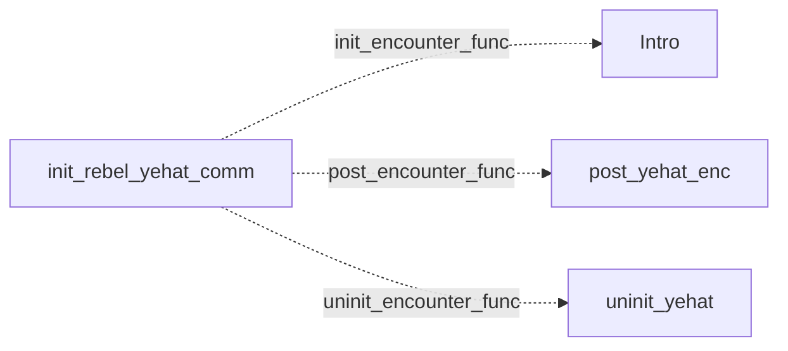

# Yehat rebels: existing conversation graph

> Generated by `tools/conversation_catalog.py`; do not edit this page by hand.

[Catalog and interpretation rules](../README.md) · [Proposed engine](../model.md)

Script: [rebel.c](../../../../sc2/src/uqm/comm/rebel/rebel.c#L1). Phrase bank: [yehatrebels.txt](../../../../sc2/content/base/comm/yehatrebels/yehatrebels.txt#L1).

4 handler/helper nodes; 0 response registration sites; 0 direct local calls; 34 phrase records.

## Initialization and lifecycle

| Phase | Callback | Bound by | Conditions / source |
| --- | --- | --- | --- |
| <code>init_encounter_func</code> | [<code>Intro</code>](#node-intro) | <code>init_rebel_yehat_comm</code> | No enclosing branch condition; [219](../../../../sc2/src/uqm/comm/rebel/rebel.c#L219) |
| <code>post_encounter_func</code> | [<code>post_yehat_enc</code>](#node-post_yehat_enc) | <code>init_rebel_yehat_comm</code> | No enclosing branch condition; [220](../../../../sc2/src/uqm/comm/rebel/rebel.c#L220) |
| <code>uninit_encounter_func</code> | [<code>uninit_yehat</code>](#node-uninit_yehat) | <code>init_rebel_yehat_comm</code> | No enclosing branch condition; [221](../../../../sc2/src/uqm/comm/rebel/rebel.c#L221) |

## Handler graph

Solid arrows are selectable responses; dashed arrows are direct C calls. Conditions, arguments, speech and effects are cataloged below. Parallel response sites are grouped only in this diagram.



## Condition catalog

Condition IDs describe enclosing source structure. Branch predicates combine with ∧; case labels mark source locations that can also be reached by fallthrough. Values refer to their original evaluation points. Local assignments and early control flow remain in the decision bodies.

| ID | Source expression / structural condition |
| --- | --- |

## Script-scope state and lookup tables

These declarations supply shared local state, computed phrase alternatives, number speech, or lookup data used by the nodes. LOCDATA presentation defaults are linked separately in the source.

Presentation descriptor <code>yehat_desc</code>: [source](../../../../sc2/src/uqm/comm/rebel/rebel.c#L26).

## Node catalog

<a id="node-intro"></a>

### Intro

<code>static void Intro(void)</code> — [source](../../../../sc2/src/uqm/comm/rebel/rebel.c#L198).

<details>
<summary>Exact decision body (local calculations, early returns, fallthrough and ordering)</summary>

```c
{
}
```

</details>

<a id="node-uninit_yehat"></a>

### uninit_yehat

<code>static COUNT uninit_yehat(void)</code> — [source](../../../../sc2/src/uqm/comm/rebel/rebel.c#L203).

#### Actions, queries, local updates, and control flow

Calls are listed without assuming they are pure or mutating. Local updates are retained because they determine dynamic menus and counter-selected speech.

| Kind | Operation | Enclosing conditions | Source |
| --- | --- | --- | --- |
| flow | <code>return 0;</code> | No enclosing branch condition | [205](../../../../sc2/src/uqm/comm/rebel/rebel.c#L205) |

<details>
<summary>Exact decision body (local calculations, early returns, fallthrough and ordering)</summary>

```c
{
	return (0);
}
```

</details>

<a id="node-post_yehat_enc"></a>

### post_yehat_enc

<code>static void post_yehat_enc(void)</code> — [source](../../../../sc2/src/uqm/comm/rebel/rebel.c#L209).

<details>
<summary>Exact decision body (local calculations, early returns, fallthrough and ordering)</summary>

```c
{
	// nothing defined so far
}
```

</details>

<a id="node-init_rebel_yehat_comm"></a>

### init_rebel_yehat_comm

<code>LOCDATA *init_rebel_yehat_comm(void)</code> — [source](../../../../sc2/src/uqm/comm/rebel/rebel.c#L215).

#### Actions, queries, local updates, and control flow

Calls are listed without assuming they are pure or mutating. Local updates are retained because they determine dynamic menus and counter-selected speech.

| Kind | Operation | Enclosing conditions | Source |
| --- | --- | --- | --- |
| update | <code>yehat_desc.init_encounter_func = Intro</code> | No enclosing branch condition | [219](../../../../sc2/src/uqm/comm/rebel/rebel.c#L219) |
| update | <code>yehat_desc.post_encounter_func = post_yehat_enc</code> | No enclosing branch condition | [220](../../../../sc2/src/uqm/comm/rebel/rebel.c#L220) |
| update | <code>yehat_desc.uninit_encounter_func = uninit_yehat</code> | No enclosing branch condition | [221](../../../../sc2/src/uqm/comm/rebel/rebel.c#L221) |
| update | <code>yehat_desc.AlienTextBaseline.x = (SIS_SCREEN_WIDTH * 2) / 3</code> | No enclosing branch condition | [223](../../../../sc2/src/uqm/comm/rebel/rebel.c#L223) |
| update | <code>yehat_desc.AlienTextBaseline.y = 60</code> | No enclosing branch condition | [224](../../../../sc2/src/uqm/comm/rebel/rebel.c#L224) |
| update | <code>yehat_desc.AlienTextWidth = ((SIS_TEXT_WIDTH - 16) * 2) / 3</code> | No enclosing branch condition | [225](../../../../sc2/src/uqm/comm/rebel/rebel.c#L225) |
| update | <code>yehat_desc.AlienAltSongRes = REBEL_MUSIC</code> | No enclosing branch condition | [228](../../../../sc2/src/uqm/comm/rebel/rebel.c#L228) |
| update | <code>yehat_desc.AlienSongFlags &#124;= LDASF_USE_ALTERNATE</code> | No enclosing branch condition | [229](../../../../sc2/src/uqm/comm/rebel/rebel.c#L229) |
| call | <code>setSegue(Segue_peace)</code> | No enclosing branch condition | [231](../../../../sc2/src/uqm/comm/rebel/rebel.c#L231) |
| update | <code>retval = &amp;yehat_desc</code> | No enclosing branch condition | [232](../../../../sc2/src/uqm/comm/rebel/rebel.c#L232) |
| flow | <code>return retval;</code> | No enclosing branch condition | [234](../../../../sc2/src/uqm/comm/rebel/rebel.c#L234) |

<details>
<summary>Exact decision body (local calculations, early returns, fallthrough and ordering)</summary>

```c
{
	LOCDATA *retval;

	yehat_desc.init_encounter_func = Intro;
	yehat_desc.post_encounter_func = post_yehat_enc;
	yehat_desc.uninit_encounter_func = uninit_yehat;

	yehat_desc.AlienTextBaseline.x = SIS_SCREEN_WIDTH * 2 / 3;
	yehat_desc.AlienTextBaseline.y = 60;
	yehat_desc.AlienTextWidth = (SIS_TEXT_WIDTH - 16) * 2 / 3;

	// use alternate "Rebels" track if available
	yehat_desc.AlienAltSongRes = REBEL_MUSIC;
	yehat_desc.AlienSongFlags |= LDASF_USE_ALTERNATE;

	setSegue (Segue_peace);
	retval = &yehat_desc;

	return (retval);
}
```

</details>

## Phrase catalog

Full base-content text, keyed by the symbols used above. Voice filenames are resource metadata; playback also depends on installed addons and settings. Dynamic insertions retain their original placeholders.

<a id="phrase-rebel_hello_1"></a>

<details>
<summary>REBEL_HELLO_1 — yehatrebels-000.ogg</summary>

[Text source](../../../../sc2/content/base/comm/yehatrebels/yehatrebels.txt#L1)

<pre>Welcome to ye, human friend and ally!
The revolution has begun and clans flock to our cause!</pre>

</details>

<a id="phrase-rebel_hello_2"></a>

<details>
<summary>REBEL_HELLO_2 — yehatrebels-001.ogg</summary>

[Text source](../../../../sc2/content/base/comm/yehatrebels/yehatrebels.txt#L5)

<pre>Greetings friend from Earth!
The head of our revolution, Cheep-Guava, has led us to many great victories.
We have cleaned the Royalist traitors from five star systems!</pre>

</details>

<a id="phrase-rebel_hello_3"></a>

<details>
<summary>REBEL_HELLO_3 — yehatrebels-002.ogg</summary>

[Text source](../../../../sc2/content/base/comm/yehatrebels/yehatrebels.txt#L10)

<pre>A greeting to ye, Captain!
We hope yer battles have been fierce and yer enemies are left in ruin.
Now what can we be doing fer ye?</pre>

</details>

<a id="phrase-rebel_hello_4"></a>

<details>
<summary>REBEL_HELLO_4 — yehatrebels-003.ogg</summary>

[Text source](../../../../sc2/content/base/comm/yehatrebels/yehatrebels.txt#L15)

<pre>Hello Captain. What are you needing from us this day?</pre>

</details>

<a id="phrase-how_goes_revolution"></a>

<details>
<summary>how_goes_revolution</summary>

[Text source](../../../../sc2/content/base/comm/yehatrebels/yehatrebels.txt#L18)

<pre>How is the revolution going?</pre>

</details>

<a id="phrase-rebel_revolution_1"></a>

<details>
<summary>REBEL_REVOLUTION_1 — yehatrebels-004.ogg</summary>

[Text source](../../../../sc2/content/base/comm/yehatrebels/yehatrebels.txt#L21)

<pre>We have cleaned the Royalist traitors from five systems
and even the Veep-Kreep Clan is joining with us against the false Queen!</pre>

</details>

<a id="phrase-rebel_revolution_2"></a>

<details>
<summary>REBEL_REVOLUTION_2 — yehatrebels-005.ogg</summary>

[Text source](../../../../sc2/content/base/comm/yehatrebels/yehatrebels.txt#L25)

<pre>It is a sad thing, this battle that has pitched Clan against Clan, ship against ship
I myself have sent three Royalist Terminators and their brave crew to the Great Beyond!
What a waste.
We pray that the struggle ends quickly.</pre>

</details>

<a id="phrase-rebel_revolution_3"></a>

<details>
<summary>REBEL_REVOLUTION_3 — yehatrebels-006.ogg</summary>

[Text source](../../../../sc2/content/base/comm/yehatrebels/yehatrebels.txt#L31)

<pre>Though we have taken grave losses -- lost brave and true shipmates
the enemy -- the fake Queen and her cronies,  have suffered far worse.</pre>

</details>

<a id="phrase-rebel_revolution_4"></a>

<details>
<summary>REBEL_REVOLUTION_4 — yehatrebels-007.ogg</summary>

[Text source](../../../../sc2/content/base/comm/yehatrebels/yehatrebels.txt#L35)

<pre>Our victory is in sight, just beyond the next battle
or perhaps the next.</pre>

</details>

<a id="phrase-any_ships"></a>

<details>
<summary>any_ships</summary>

[Text source](../../../../sc2/content/base/comm/yehatrebels/yehatrebels.txt#L39)

<pre>Do you have any ships available to join our fleet?</pre>

</details>

<a id="phrase-no_room"></a>

<details>
<summary>NO_ROOM — yehatrebels-008.ogg</summary>

[Text source](../../../../sc2/content/base/comm/yehatrebels/yehatrebels.txt#L42)

<pre>The question is moot, is it not, since ye have no room fer such ships in yer fleet?</pre>

</details>

<a id="phrase-have_all_ships"></a>

<details>
<summary>HAVE_ALL_SHIPS — yehatrebels-009.ogg</summary>

[Text source](../../../../sc2/content/base/comm/yehatrebels/yehatrebels.txt#L45)

<pre>We are honored to help ye, Captain!
We shall attach four Terminators to yer fleet immediately.</pre>

</details>

<a id="phrase-have_few_ships"></a>

<details>
<summary>HAVE_FEW_SHIPS — yehatrebels-010.ogg</summary>

[Text source](../../../../sc2/content/base/comm/yehatrebels/yehatrebels.txt#L49)

<pre>We are happy assisting ye, Captain.
We shall provide ye with enough of our Terminator vessels to complete yer fleet.
Fight well with them, Captain. They are our best and brightest.</pre>

</details>

<a id="phrase-no_ships_yet"></a>

<details>
<summary>NO_SHIPS_YET — yehatrebels-011.ogg</summary>

[Text source](../../../../sc2/content/base/comm/yehatrebels/yehatrebels.txt#L54)

<pre>Alas, as yet we have no ships which we can be making available to ye at this time.
However, if ye return at a later date, perhaps then we shall have something fer ye.</pre>

</details>

<a id="phrase-give_info_rebels"></a>

<details>
<summary>give_info_rebels</summary>

[Text source](../../../../sc2/content/base/comm/yehatrebels/yehatrebels.txt#L58)

<pre>Would you share some information with us?</pre>

</details>

<a id="phrase-what_info"></a>

<details>
<summary>WHAT_INFO — yehatrebels-012.ogg</summary>

[Text source](../../../../sc2/content/base/comm/yehatrebels/yehatrebels.txt#L61)

<pre>Of course! What knowledge do ye seek?</pre>

</details>

<a id="phrase-what_about_royalty"></a>

<details>
<summary>what_about_royalty</summary>

[Text source](../../../../sc2/content/base/comm/yehatrebels/yehatrebels.txt#L64)

<pre>Can you tell me about your Royal Family?</pre>

</details>

<a id="phrase-about_royalty"></a>

<details>
<summary>ABOUT_ROYALTY — yehatrebels-013.ogg</summary>

[Text source](../../../../sc2/content/base/comm/yehatrebels/yehatrebels.txt#L67)

<pre>The FALSE Royals, ye should say, Captain!
To understand our relationship with the Veep-Neep Queens, ye must first learn a bit of our history.
In the ancient past, we Yehat were little more than a collection of warring Clans.
That history is bloody, Captain... hideous. We were barbarous then, aye... murderers all.
Many great warlords rose from the hills and forests of our verdant homeworld to unite the clans
to become King of all Yehat Clans. Each one failed.
It was no male who finally won the great prize, the High Perch of Caer Zeep-Reep!
No, Captain, it was a female!... a wise and powerful Queen... the first of the Veep-Neep Dynasty.
In exchange fer the Clans&#x27; fealty, she gave a simple, compelling promise.
She guaranteed that united under her wing, the Clans would NEVER suffer defeat!
And she kept her promise. At long last, there was peace on our world.
Her line kept true to this promise fer over twenty centuries
soothing ruffled feathers, dispensing justice, stamping out foment
but then came the present Queen... a true harridan!
Under her rule, the power of the Starship Clans was transferred
to the sycophantic Homeworld dandies... to `warlords&#x27; who had nae seen true combat.
We, the beak and claw of the Yehat Empire were powerless to influence her decisions.
When the Queen showed the true colors of her plumage and allied with the evil Ur-Quan worms
we realized that she would do anything, ANYTHING!...
...to maintain the illusion of upholding her ancestor&#x27;s promise
even if it meant destroying our honor, everything that we stand fer, in the exchange.
Now we, the true Yehat Clans, seek to pull the false Queen from the High Perch.
Perhaps we will find a new Queen someday who will bring together the Clans once more.
Or sadly, I fear we may never replace the Veep-Neeps Queens
and we shall fight Clan against Clan until only the bloody feathers remain.</pre>

</details>

<a id="phrase-what_about_war"></a>

<details>
<summary>what_about_war</summary>

[Text source](../../../../sc2/content/base/comm/yehatrebels/yehatrebels.txt#L94)

<pre>Tell me about the end of the War.</pre>

</details>

<a id="phrase-about_war"></a>

<details>
<summary>ABOUT_WAR — yehatrebels-014.ogg</summary>

[Text source](../../../../sc2/content/base/comm/yehatrebels/yehatrebels.txt#L97)

<pre>I will describe these events, Captain.
They make fer a tale, Captain, wrought with sadness... and heroism!... and betrayal.
After the Chenjesu, Mmrnmhrm and yer species were defeated
We prepared a defense in the Shofixti homestar, Delta Gorno.
Aside our Shofixti, our adopted children, we awaited the onslaught of the Ur-Quan armada.
We waited with eagerness, with the hot anticipation of battle!
But then we received an unbelievable message from our Queen... `Retreat&#x27;.
We could not believe it! Tactical withdrawals, yes... but to pull back the entire fleet?
There was no mistake... no garbled orders.
We obeyed.
Oh, Captain! The eyes of the Shofixti! Their bright and valiant eyes!... as we moved away.
Without us... they had no hope of forming a tactical wedge.
They would barely slow the Hierarchy fleet.
When the Ur-Quan came, the Shofixti fought as immortal heroes!...
darting in and out of the Dreadnought formations
and then suddenly BLAZING!... like dying stars.
But... in only a few hours... the Shofixti fleet was gone
and the Dreadnoughts moved towards the homeworld.</pre>

</details>

<a id="phrase-what_about_urquan"></a>

<details>
<summary>what_about_urquan</summary>

[Text source](../../../../sc2/content/base/comm/yehatrebels/yehatrebels.txt#L117)

<pre>How were the Shofixti defeated?</pre>

</details>

<a id="phrase-about_urquan"></a>

<details>
<summary>ABOUT_URQUAN — yehatrebels-015.ogg</summary>

[Text source](../../../../sc2/content/base/comm/yehatrebels/yehatrebels.txt#L120)

<pre>As we abandoned the Shofixti to the oncoming Ur-Quan armada
we watched the situation on the sterile displays of our long-range sensors.
Suddenly the screens flared and went black... burnt out! We ran to the windows
just in time to see the Shofixti&#x27;s sun burning with incredible light
many orders of magnitude greater than its normal brilliance!
A million tongues of fusion fire spread through the star system
devastating the inner system&#x27;s planets, but incinerating ALL the Ur-Quan vessels!
In that moment, the Hierarchy&#x27;s war fleet was reduced by almost thirty percent.
We later remembered that not too many years before the appearance of the Ur-Quan
the Shofixti had told us that they had found `something&#x27;.
With the pride of a hatchling&#x27;s first flight, they unveiled their find
it was about the size of a surface transport, but cylindrical and entirely black.
Across its surface were a million characters scrawled in an alien script.
The message was clear... DANGER! DO NOT TOUCH!
We trusted the Shofixti to respect the warning, and left the device in their possession.
At the end, when the Ur-Quan were approaching their planet
the Shofixti must have realized that they could not win
but at least they could insure that both sides would lose.
They must have detonated the device in the outer layer of their sun.
The sudden removal of a section of the sun&#x27;s surface layers
allowed the pressurized plasma from the interior to burst out
like a miniature super nova.</pre>

</details>

<a id="phrase-what_about_vux"></a>

<details>
<summary>what_about_vux</summary>

[Text source](../../../../sc2/content/base/comm/yehatrebels/yehatrebels.txt#L144)

<pre>Do you know anything about the VUX?</pre>

</details>

<a id="phrase-about_vux"></a>

<details>
<summary>ABOUT_VUX — yehatrebels-016.ogg</summary>

[Text source](../../../../sc2/content/base/comm/yehatrebels/yehatrebels.txt#L147)

<pre>The grotesque monsters? They are an effete and bigoted race, unworthy prey
with one exception... General ZEX.
He commanded the entire VUX fleet during the Great War
and even by our high standards of battle skill, he is a genius.
The brilliant tactics of Fortress Square and the Dynamic Triangle are his creations.
Without ZEX, the VUX would have fallen to our Alliance fleets in weeks
but ZEX always found a way to turn his own weakness into an advantage.
After the War, we learned that the Primat and the VUX High Council
decided to move ZEX out of the picture, and sent him off to `luxurious retirement&#x27; at Alpha Cerenkov I.
We have heard that he spends his time pursuing his hobby, though we do not know what more than that.</pre>

</details>

<a id="phrase-what_about_clue"></a>

<details>
<summary>what_about_clue</summary>

[Text source](../../../../sc2/content/base/comm/yehatrebels/yehatrebels.txt#L159)

<pre>How can we defeat the Ur-Quan?</pre>

</details>

<a id="phrase-about_clue"></a>

<details>
<summary>ABOUT_CLUE — yehatrebels-017.ogg</summary>

[Text source](../../../../sc2/content/base/comm/yehatrebels/yehatrebels.txt#L162)

<pre>If I were ye, brave human, I&#x27;d probably be seeking the focus of the Ur-Quan&#x27;s power
and do whatever is necessary to destroy it.
We may have a hint as to just what that weak spot is.
When we were being Hierarchy battle slaves
we learned that the Ur-Quan were possessing some kind of super-weapon
a huge battleship they called `Sa-Matra&#x27; with the firepower to destroy an entire star fleet.
For some reason, the Ur-Quan were reluctant to use the vessel.
It wasn&#x27;t until their armada was finally held back at the coreward front
that they brought the Sa-Matra&#x27;s power to bear on the Alliance.
Captain, here&#x27;s my advice... ye can be destroying Dreadnoughts until the breegs come home
but ye are never going to defeat the Ur-Quan Hierarchy until ye eliminate their Sa-Matra.</pre>

</details>

<a id="phrase-enough_info"></a>

<details>
<summary>enough_info</summary>

[Text source](../../../../sc2/content/base/comm/yehatrebels/yehatrebels.txt#L175)

<pre>That&#x27;s sufficient information for now.</pre>

</details>

<a id="phrase-ok_enough_info"></a>

<details>
<summary>OK_ENOUGH_INFO — yehatrebels-018.ogg</summary>

[Text source](../../../../sc2/content/base/comm/yehatrebels/yehatrebels.txt#L178)

<pre>If you need to know anything more, just ask.</pre>

</details>

<a id="phrase-bye_rebel"></a>

<details>
<summary>bye_rebel</summary>

[Text source](../../../../sc2/content/base/comm/yehatrebels/yehatrebels.txt#L181)

<pre>Goodbye brave rebels. Viva la Revolution!</pre>

</details>

<a id="phrase-goodbye_rebel"></a>

<details>
<summary>GOODBYE_REBEL — yehatrebels-019.ogg</summary>

[Text source](../../../../sc2/content/base/comm/yehatrebels/yehatrebels.txt#L184)

<pre>Goodbye human comrade. Fight well!</pre>

</details>

<a id="phrase-yehat_cavalry"></a>

<details>
<summary>YEHAT_CAVALRY — yehatrebels-020.ogg</summary>

[Text source](../../../../sc2/content/base/comm/yehatrebels/yehatrebels.txt#L187)

<pre>Greetings human friend! We know ye are about to be attacking the Sa-Matra
and probably don&#x27;t like being interrupted, but we have important news!...
The Rebellion is WON! We are VICTORIOUS!
We have pulled the Veep-Neep harpy Queen and her cronies from the High Perch!
And better yet... we have found a new Queen!...
...A Queen who will unite the Clans in peace and harmony as never before!
You will never guess who it is, Captain!
A PKUNK! Yes! It is TRUE!
They survived their absorption into our culture
and are now providing us with insights into ourselves we never dreamed of!
We only THOUGHT we were being happy birds of prey! We were fooling ourselves!
Our new Queen&#x27;s name is Braky Girdy the First!... and her first command
was to rush here and bring ye these ships...Yehat Terminators and Pkunk Furies.
Now, Captain, together we can attack the Sa-Matra!</pre>

</details>

<a id="phrase-what_about_pkunk_rebel"></a>

<details>
<summary>what_about_pkunk_rebel</summary>

[Text source](../../../../sc2/content/base/comm/yehatrebels/yehatrebels.txt#L203)

<pre>We have encountered an offshoot of your species, the Pkunk. Tell us about them.</pre>

</details>

<a id="phrase-pkunk_absorbed_rebel"></a>

<details>
<summary>PKUNK_ABSORBED_REBEL — yehatrebels-021.ogg</summary>

[Text source](../../../../sc2/content/base/comm/yehatrebels/yehatrebels.txt#L206)

<pre>The Pkunk have been absorbed.
They are no more. This is how it should be.
Now the matter is settled, human. Do not be bringing it up again.</pre>

</details>

<a id="phrase-hate_pkunk_rebel"></a>

<details>
<summary>HATE_PKUNK_REBEL — yehatrebels-022.ogg</summary>

[Text source](../../../../sc2/content/base/comm/yehatrebels/yehatrebels.txt#L211)

<pre>The cowards live?!! This is unbelievable!!
It is a SAD, SAD day to be hearing this thing from ye, human.
The P... the Pku... I canna even say their vile name!
The Pku... PKU-NK! are the greatest embarrassment our species has ever suffered!
Do not be calling these wretched creatures an offshoot of our species!
Better it is that ye be calling them GARBAGE! or DROPPINGS!
Or better yet do not be talking about them at all!</pre>

</details>
