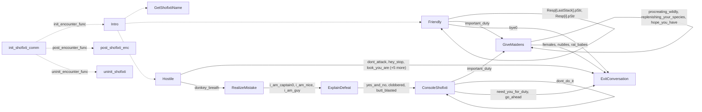

# Shofixti: existing conversation graph

> Generated by `tools/conversation_catalog.py`; do not edit this page by hand.

[Catalog and interpretation rules](../README.md) · [Proposed engine](../model.md)

Script: [shofixt.c](../../../../sc2/src/uqm/comm/shofixt/shofixt.c#L1). Phrase bank: [shofixti.txt](../../../../sc2/content/base/comm/shofixti/shofixti.txt#L1).

12 handler/helper nodes; 30 response registration sites; 3 direct local calls; 95 phrase records.

## Initialization and lifecycle

| Phase | Callback | Bound by | Conditions / source |
| --- | --- | --- | --- |
| <code>init_encounter_func</code> | [<code>Intro</code>](#node-intro) | <code>init_shofixti_comm</code> | No enclosing branch condition; [639](../../../../sc2/src/uqm/comm/shofixt/shofixt.c#L639) |
| <code>post_encounter_func</code> | [<code>post_shofixti_enc</code>](#node-post_shofixti_enc) | <code>init_shofixti_comm</code> | No enclosing branch condition; [640](../../../../sc2/src/uqm/comm/shofixt/shofixt.c#L640) |
| <code>uninit_encounter_func</code> | [<code>uninit_shofixti</code>](#node-uninit_shofixti) | <code>init_shofixti_comm</code> | No enclosing branch condition; [641](../../../../sc2/src/uqm/comm/shofixt/shofixt.c#L641) |

## Handler graph

Solid arrows are selectable responses; dashed arrows are direct C calls. Conditions, arguments, speech and effects are cataloged below. Parallel response sites are grouped only in this diagram.



## Condition catalog

Condition IDs describe enclosing source structure. Branch predicates combine with ∧; case labels mark source locations that can also be reached by fallthrough. Values refer to their original evaluation points. Local assignments and early control flow remain in the decision bodies.

| ID | Source expression / structural condition |
| --- | --- |
| <a id="condition-c1"></a>C1 | <code>GET_GAME_STATE(SHOFIXTI_KIA)</code> |
| <a id="condition-c2"></a>C2 | <code>!(GET_GAME_STATE(SHOFIXTI_KIA))</code> |
| <a id="condition-c3"></a>C3 | <code>PLAYER_SAID(R, bye0)</code> |
| <a id="condition-c4"></a>C4 | <code>!(PLAYER_SAID(R, bye0))</code> |
| <a id="condition-c5"></a>C5 | <code>PLAYER_SAID(R, go_ahead)</code> |
| <a id="condition-c6"></a>C6 | <code>!(PLAYER_SAID(R, go_ahead))</code> |
| <a id="condition-c7"></a>C7 | <code>PLAYER_SAID(R, need_you_for_duty)</code> |
| <a id="condition-c8"></a>C8 | <code>!(PLAYER_SAID(R, need_you_for_duty))</code> |
| <a id="condition-c9"></a>C9 | <code>!(PLAYER_SAID(R, females))</code> |
| <a id="condition-c10"></a>C10 | <code>!(PLAYER_SAID(R, females) &#124;&#124; PLAYER_SAID(R, nubiles))</code> |
| <a id="condition-c11"></a>C11 | <code>(PLAYER_SAID(R, females) &#124;&#124; PLAYER_SAID(R, nubiles)) &#124;&#124; PLAYER_SAID(R, rat_babes)</code> |
| <a id="condition-c12"></a>C12 | <code>!((PLAYER_SAID(R, females) &#124;&#124; PLAYER_SAID(R, nubiles)) &#124;&#124; PLAYER_SAID(R, rat_babes))</code> |
| <a id="condition-c13"></a>C13 | <code>PLAYER_SAID(R, dont_attack)</code> |
| <a id="condition-c14"></a>C14 | <code>!(PLAYER_SAID(R, dont_attack))</code> |
| <a id="condition-c15"></a>C15 | <code>PLAYER_SAID(R, hey_stop)</code> |
| <a id="condition-c16"></a>C16 | <code>!(PLAYER_SAID(R, hey_stop))</code> |
| <a id="condition-c17"></a>C17 | <code>PLAYER_SAID(R, look_you_are)</code> |
| <a id="condition-c18"></a>C18 | <code>!(PLAYER_SAID(R, look_you_are))</code> |
| <a id="condition-c19"></a>C19 | <code>PLAYER_SAID(R, no_one_insults)</code> |
| <a id="condition-c20"></a>C20 | <code>!(PLAYER_SAID(R, no_one_insults))</code> |
| <a id="condition-c21"></a>C21 | <code>PLAYER_SAID(R, mighty_words)</code> |
| <a id="condition-c22"></a>C22 | <code>!(PLAYER_SAID(R, mighty_words))</code> |
| <a id="condition-c23"></a>C23 | <code>PLAYER_SAID(R, dont_know)</code> |
| <a id="condition-c24"></a>C24 | <code>!(PLAYER_SAID(R, dont_know))</code> |
| <a id="condition-c25"></a>C25 | <code>PLAYER_SAID(R, look0)</code> |
| <a id="condition-c26"></a>C26 | <code>!(PLAYER_SAID(R, look0))</code> |
| <a id="condition-c27"></a>C27 | <code>PLAYER_SAID(R, no_bloodshed)</code> |
| <a id="condition-c28"></a>C28 | <code>!(PLAYER_SAID(R, no_bloodshed))</code> |
| <a id="condition-c29"></a>C29 | <code>PLAYER_SAID(R, dont_want_to_fight)</code> |
| <a id="condition-c30"></a>C30 | <code>switch (NumVisits++)</code> |
| <a id="condition-c31"></a>C31 | <code>case 0 (see source for fallthrough)</code> |
| <a id="condition-c32"></a>C32 | <code>case 1 (see source for fallthrough)</code> |
| <a id="condition-c33"></a>C33 | <code>case 2 (see source for fallthrough)</code> |
| <a id="condition-c34"></a>C34 | <code>case 3 (see source for fallthrough)</code> |
| <a id="condition-c35"></a>C35 | <code>PLAYER_SAID(R, important_duty)</code> |
| <a id="condition-c36"></a>C36 | <code>!(PLAYER_SAID(R, important_duty))</code> |
| <a id="condition-c37"></a>C37 | <code>PLAYER_SAID(R, dont_do_it)</code> |
| <a id="condition-c38"></a>C38 | <code>!(PLAYER_SAID(R, dont_do_it))</code> |
| <a id="condition-c39"></a>C39 | <code>GET_GAME_STATE(MAIDENS_ON_SHIP)</code> |
| <a id="condition-c40"></a>C40 | <code>PHRASE_ENABLED(dont_do_it)</code> |
| <a id="condition-c41"></a>C41 | <code>PLAYER_SAID(R, i_am_nice)</code> |
| <a id="condition-c42"></a>C42 | <code>!(PLAYER_SAID(R, i_am_nice))</code> |
| <a id="condition-c43"></a>C43 | <code>PLAYER_SAID(R, i_am_guy)</code> |
| <a id="condition-c44"></a>C44 | <code>!(PLAYER_SAID(R, i_am_guy))</code> |
| <a id="condition-c45"></a>C45 | <code>switch (GET_GAME_STATE(SHOFIXTI_STACK1))</code> |
| <a id="condition-c46"></a>C46 | <code>switch (GET_GAME_STATE(SHOFIXTI_STACK2))</code> |
| <a id="condition-c47"></a>C47 | <code>switch (GET_GAME_STATE(SHOFIXTI_STACK3))</code> |
| <a id="condition-c48"></a>C48 | <code>PLAYER_SAID(R, report0)</code> |
| <a id="condition-c49"></a>C49 | <code>!(PLAYER_SAID(R, report0))</code> |
| <a id="condition-c50"></a>C50 | <code>PLAYER_SAID(R, why_here0)</code> |
| <a id="condition-c51"></a>C51 | <code>!(PLAYER_SAID(R, why_here0))</code> |
| <a id="condition-c52"></a>C52 | <code>PLAYER_SAID(R, what_happened)</code> |
| <a id="condition-c53"></a>C53 | <code>!(PLAYER_SAID(R, what_happened))</code> |
| <a id="condition-c54"></a>C54 | <code>PLAYER_SAID(R, glory_device)</code> |
| <a id="condition-c55"></a>C55 | <code>!(PLAYER_SAID(R, glory_device))</code> |
| <a id="condition-c56"></a>C56 | <code>PLAYER_SAID(R, where_world)</code> |
| <a id="condition-c57"></a>C57 | <code>!(PLAYER_SAID(R, where_world))</code> |
| <a id="condition-c58"></a>C58 | <code>PLAYER_SAID(R, how_survive)</code> |
| <a id="condition-c59"></a>C59 | <code>PHRASE_ENABLED(report0)</code> |
| <a id="condition-c60"></a>C60 | <code>Resp[LastStack].pStr</code> |
| <a id="condition-c61"></a>C61 | <code>for (i = 0; i &lt; 3; ++i)</code> |
| <a id="condition-c62"></a>C62 | <code>(i != LastStack) &amp;&amp; Resp[i].pStr</code> |
| <a id="condition-c63"></a>C63 | <code>LOBYTE(GLOBAL(CurrentActivity)) == WON_LAST_BATTLE</code> |
| <a id="condition-c64"></a>C64 | <code>GET_GAME_STATE(SHOFIXTI_STACK2) &gt; 2</code> |
| <a id="condition-c65"></a>C65 | <code>!(GET_GAME_STATE(SHOFIXTI_STACK2) &gt; 2)</code> |
| <a id="condition-c66"></a>C66 | <code>case 4 (see source for fallthrough)</code> |
| <a id="condition-c67"></a>C67 | <code>case 5 (see source for fallthrough)</code> |
| <a id="condition-c68"></a>C68 | <code>case 6 (see source for fallthrough)</code> |
| <a id="condition-c69"></a>C69 | <code>case 7 (see source for fallthrough)</code> |

## Script-scope state and lookup tables

These declarations supply shared local state, computed phrase alternatives, number speech, or lookup data used by the nodes. LOCDATA presentation defaults are linked separately in the source.

Presentation descriptor <code>shofixti_desc</code>: [source](../../../../sc2/src/uqm/comm/shofixt/shofixt.c#L26).

<details>
<summary>shofixti_name</summary>

[Source](../../../../sc2/src/uqm/comm/shofixt/shofixt.c#L159)

```c
static RESPONSE_REF shofixti_name;
```

</details>

## Node catalog

<a id="node-getshofixtiname"></a>

### GetShofixtiName

<code>static void GetShofixtiName(void)</code> — [source](../../../../sc2/src/uqm/comm/shofixt/shofixt.c#L162).

Also called directly by: [<code>Intro</code>](#node-intro) ([553](../../../../sc2/src/uqm/comm/shofixt/shofixt.c#L553)).

#### Actions, queries, local updates, and control flow

Calls are listed without assuming they are pure or mutating. Local updates are retained because they determine dynamic menus and counter-selected speech.

| Kind | Operation | Enclosing conditions | Source |
| --- | --- | --- | --- |
| call | <code>GET_GAME_STATE(SHOFIXTI_KIA)</code> | No enclosing branch condition | [164](../../../../sc2/src/uqm/comm/shofixt/shofixt.c#L164) |
| update | <code>shofixti_name = katana</code> | [C1](#condition-c1) | [165](../../../../sc2/src/uqm/comm/shofixt/shofixt.c#L165) |
| update | <code>shofixti_name = tanaka</code> | [C2](#condition-c2) | [167](../../../../sc2/src/uqm/comm/shofixt/shofixt.c#L167) |

<details>
<summary>Exact decision body (local calculations, early returns, fallthrough and ordering)</summary>

```c
{
	if (GET_GAME_STATE (SHOFIXTI_KIA))
		shofixti_name = katana;
	else
		shofixti_name = tanaka;
}
```

</details>

<a id="node-exitconversation"></a>

### ExitConversation

<code>static void ExitConversation(RESPONSE_REF R)</code> — [source](../../../../sc2/src/uqm/comm/shofixt/shofixt.c#L171).

Incoming player-response variants: [<code>females</code>](#phrase-females), [<code>nubiles</code>](#phrase-nubiles), [<code>rat_babes</code>](#phrase-rat_babes), [<code>need_you_for_duty</code>](#phrase-need_you_for_duty), [<code>go_ahead</code>](#phrase-go_ahead), [<code>dont_attack</code>](#phrase-dont_attack), [<code>hey_stop</code>](#phrase-hey_stop), [<code>look_you_are</code>](#phrase-look_you_are), [<code>no_one_insults</code>](#phrase-no_one_insults), [<code>mighty_words</code>](#phrase-mighty_words), [<code>dont_know</code>](#phrase-dont_know), [<code>look0</code>](#phrase-look0), [<code>dont_want_to_fight</code>](#phrase-dont_want_to_fight), [<code>bye0</code>](#phrase-bye0).

#### Dialogue / audio emissions

| Phrase or expression | Enclosing conditions | Source |
| --- | --- | --- |
| [<code>GOODBYE</code>](#phrase-goodbye)<br><code>NPCPhrase(GOODBYE)</code> | [C3](#condition-c3) | [177](../../../../sc2/src/uqm/comm/shofixt/shofixt.c#L177) |
| [<code>ON_SECOND_THOUGHT</code>](#phrase-on_second_thought)<br><code>NPCPhrase(ON_SECOND_THOUGHT)</code> | [C4](#condition-c4) ∧ [C5](#condition-c5) | [183](../../../../sc2/src/uqm/comm/shofixt/shofixt.c#L183) |
| [<code>OK_WILL_BE_SENTRY</code>](#phrase-ok_will_be_sentry)<br><code>NPCPhrase(OK_WILL_BE_SENTRY)</code> | [C4](#condition-c4) ∧ [C6](#condition-c6) ∧ [C7](#condition-c7) | [189](../../../../sc2/src/uqm/comm/shofixt/shofixt.c#L189) |
| [<code>LEAPING_HAPPINESS</code>](#phrase-leaping_happiness)<br><code>NPCPhrase(LEAPING_HAPPINESS)</code> | [C4](#condition-c4) ∧ [C6](#condition-c6) ∧ [C8](#condition-c8) ∧ [C11](#condition-c11) | [197](../../../../sc2/src/uqm/comm/shofixt/shofixt.c#L197) |
| [<code>TYPICAL_PLOY</code>](#phrase-typical_ploy)<br><code>NPCPhrase(TYPICAL_PLOY)</code> | [C4](#condition-c4) ∧ [C6](#condition-c6) ∧ [C8](#condition-c8) ∧ [C12](#condition-c12) ∧ [C13](#condition-c13) | [207](../../../../sc2/src/uqm/comm/shofixt/shofixt.c#L207) |
| [<code>ONLY_STOP</code>](#phrase-only_stop)<br><code>NPCPhrase(ONLY_STOP)</code> | [C4](#condition-c4) ∧ [C6](#condition-c6) ∧ [C8](#condition-c8) ∧ [C12](#condition-c12) ∧ [C14](#condition-c14) ∧ [C15](#condition-c15) | [213](../../../../sc2/src/uqm/comm/shofixt/shofixt.c#L213) |
| [<code>TOO_BAD</code>](#phrase-too_bad)<br><code>NPCPhrase(TOO_BAD)</code> | [C4](#condition-c4) ∧ [C6](#condition-c6) ∧ [C8](#condition-c8) ∧ [C12](#condition-c12) ∧ [C14](#condition-c14) ∧ [C16](#condition-c16) ∧ [C17](#condition-c17) | [219](../../../../sc2/src/uqm/comm/shofixt/shofixt.c#L219) |
| [<code>YOU_LIMP</code>](#phrase-you_limp)<br><code>NPCPhrase(YOU_LIMP)</code> | [C4](#condition-c4) ∧ [C6](#condition-c6) ∧ [C8](#condition-c8) ∧ [C12](#condition-c12) ∧ [C14](#condition-c14) ∧ [C16](#condition-c16) ∧ [C18](#condition-c18) ∧ [C19](#condition-c19) | [225](../../../../sc2/src/uqm/comm/shofixt/shofixt.c#L225) |
| [<code>HANG_YOUR</code>](#phrase-hang_your)<br><code>NPCPhrase(HANG_YOUR)</code> | [C4](#condition-c4) ∧ [C6](#condition-c6) ∧ [C8](#condition-c8) ∧ [C12](#condition-c12) ∧ [C14](#condition-c14) ∧ [C16](#condition-c16) ∧ [C18](#condition-c18) ∧ [C20](#condition-c20) ∧ [C21](#condition-c21) | [231](../../../../sc2/src/uqm/comm/shofixt/shofixt.c#L231) |
| [<code>NEVER</code>](#phrase-never)<br><code>NPCPhrase(NEVER)</code> | [C4](#condition-c4) ∧ [C6](#condition-c6) ∧ [C8](#condition-c8) ∧ [C12](#condition-c12) ∧ [C14](#condition-c14) ∧ [C16](#condition-c16) ∧ [C18](#condition-c18) ∧ [C20](#condition-c20) ∧ [C22](#condition-c22) ∧ [C23](#condition-c23) | [237](../../../../sc2/src/uqm/comm/shofixt/shofixt.c#L237) |
| [<code>FOR_YOU</code>](#phrase-for_you)<br><code>NPCPhrase(FOR_YOU)</code> | [C4](#condition-c4) ∧ [C6](#condition-c6) ∧ [C8](#condition-c8) ∧ [C12](#condition-c12) ∧ [C14](#condition-c14) ∧ [C16](#condition-c16) ∧ [C18](#condition-c18) ∧ [C20](#condition-c20) ∧ [C22](#condition-c22) ∧ [C24](#condition-c24) ∧ [C25](#condition-c25) | [243](../../../../sc2/src/uqm/comm/shofixt/shofixt.c#L243) |
| [<code>YES_BLOODSHED</code>](#phrase-yes_bloodshed)<br><code>NPCPhrase(YES_BLOODSHED)</code> | [C4](#condition-c4) ∧ [C6](#condition-c6) ∧ [C8](#condition-c8) ∧ [C12](#condition-c12) ∧ [C14](#condition-c14) ∧ [C16](#condition-c16) ∧ [C18](#condition-c18) ∧ [C20](#condition-c20) ∧ [C22](#condition-c22) ∧ [C24](#condition-c24) ∧ [C26](#condition-c26) ∧ [C27](#condition-c27) | [249](../../../../sc2/src/uqm/comm/shofixt/shofixt.c#L249) |
| [<code>MUST_FIGHT_YOU_URQUAN_1</code>](#phrase-must_fight_you_urquan_1)<br><code>NPCPhrase(MUST_FIGHT_YOU_URQUAN_1)</code> | [C4](#condition-c4) ∧ [C6](#condition-c6) ∧ [C8](#condition-c8) ∧ [C12](#condition-c12) ∧ [C14](#condition-c14) ∧ [C16](#condition-c16) ∧ [C18](#condition-c18) ∧ [C20](#condition-c20) ∧ [C22](#condition-c22) ∧ [C24](#condition-c24) ∧ [C26](#condition-c26) ∧ [C28](#condition-c28) ∧ [C29](#condition-c29) ∧ [C30](#condition-c30) ∧ [C31](#condition-c31) | [261](../../../../sc2/src/uqm/comm/shofixt/shofixt.c#L261) |
| [<code>MUST_FIGHT_YOU_URQUAN_2</code>](#phrase-must_fight_you_urquan_2)<br><code>NPCPhrase(MUST_FIGHT_YOU_URQUAN_2)</code> | [C4](#condition-c4) ∧ [C6](#condition-c6) ∧ [C8](#condition-c8) ∧ [C12](#condition-c12) ∧ [C14](#condition-c14) ∧ [C16](#condition-c16) ∧ [C18](#condition-c18) ∧ [C20](#condition-c20) ∧ [C22](#condition-c22) ∧ [C24](#condition-c24) ∧ [C26](#condition-c26) ∧ [C28](#condition-c28) ∧ [C29](#condition-c29) ∧ [C30](#condition-c30) ∧ [C32](#condition-c32) | [264](../../../../sc2/src/uqm/comm/shofixt/shofixt.c#L264) |
| [<code>MUST_FIGHT_YOU_URQUAN_3</code>](#phrase-must_fight_you_urquan_3)<br><code>NPCPhrase(MUST_FIGHT_YOU_URQUAN_3)</code> | [C4](#condition-c4) ∧ [C6](#condition-c6) ∧ [C8](#condition-c8) ∧ [C12](#condition-c12) ∧ [C14](#condition-c14) ∧ [C16](#condition-c16) ∧ [C18](#condition-c18) ∧ [C20](#condition-c20) ∧ [C22](#condition-c22) ∧ [C24](#condition-c24) ∧ [C26](#condition-c26) ∧ [C28](#condition-c28) ∧ [C29](#condition-c29) ∧ [C30](#condition-c30) ∧ [C33](#condition-c33) | [267](../../../../sc2/src/uqm/comm/shofixt/shofixt.c#L267) |
| [<code>MUST_FIGHT_YOU_URQUAN_4</code>](#phrase-must_fight_you_urquan_4)<br><code>NPCPhrase(MUST_FIGHT_YOU_URQUAN_4)</code> | [C4](#condition-c4) ∧ [C6](#condition-c6) ∧ [C8](#condition-c8) ∧ [C12](#condition-c12) ∧ [C14](#condition-c14) ∧ [C16](#condition-c16) ∧ [C18](#condition-c18) ∧ [C20](#condition-c20) ∧ [C22](#condition-c22) ∧ [C24](#condition-c24) ∧ [C26](#condition-c26) ∧ [C28](#condition-c28) ∧ [C29](#condition-c29) ∧ [C30](#condition-c30) ∧ [C34](#condition-c34) | [270](../../../../sc2/src/uqm/comm/shofixt/shofixt.c#L270) |

#### Actions, queries, local updates, and control flow

Calls are listed without assuming they are pure or mutating. Local updates are retained because they determine dynamic menus and counter-selected speech.

| Kind | Operation | Enclosing conditions | Source |
| --- | --- | --- | --- |
| call | <code>setSegue(Segue_hostile)</code> | No enclosing branch condition | [173](../../../../sc2/src/uqm/comm/shofixt/shofixt.c#L173) |
| call | <code>PLAYER_SAID(R, bye0)</code> | No enclosing branch condition | [175](../../../../sc2/src/uqm/comm/shofixt/shofixt.c#L175) |
| call | <code>setSegue(Segue_peace)</code> | [C3](#condition-c3) | [179](../../../../sc2/src/uqm/comm/shofixt/shofixt.c#L179) |
| call | <code>PLAYER_SAID(R, go_ahead)</code> | [C4](#condition-c4) | [181](../../../../sc2/src/uqm/comm/shofixt/shofixt.c#L181) |
| call | <code>setSegue(Segue_peace)</code> | [C4](#condition-c4) ∧ [C5](#condition-c5) | [185](../../../../sc2/src/uqm/comm/shofixt/shofixt.c#L185) |
| call | <code>PLAYER_SAID(R, need_you_for_duty)</code> | [C4](#condition-c4) ∧ [C6](#condition-c6) | [187](../../../../sc2/src/uqm/comm/shofixt/shofixt.c#L187) |
| call | <code>setSegue(Segue_peace)</code> | [C4](#condition-c4) ∧ [C6](#condition-c6) ∧ [C7](#condition-c7) | [191](../../../../sc2/src/uqm/comm/shofixt/shofixt.c#L191) |
| call | <code>PLAYER_SAID(R, females)</code> | [C4](#condition-c4) ∧ [C6](#condition-c6) ∧ [C8](#condition-c8) | [193](../../../../sc2/src/uqm/comm/shofixt/shofixt.c#L193) |
| call | <code>PLAYER_SAID(R, nubiles)</code> | [C4](#condition-c4) ∧ [C6](#condition-c6) ∧ [C8](#condition-c8) ∧ [C9](#condition-c9) | [194](../../../../sc2/src/uqm/comm/shofixt/shofixt.c#L194) |
| call | <code>PLAYER_SAID(R, rat_babes)</code> | [C4](#condition-c4) ∧ [C6](#condition-c6) ∧ [C8](#condition-c8) ∧ [C10](#condition-c10) | [195](../../../../sc2/src/uqm/comm/shofixt/shofixt.c#L195) |
| call | <code>SET_GAME_STATE(SHOFIXTI_RECRUITED, 1)</code> | [C4](#condition-c4) ∧ [C6](#condition-c6) ∧ [C8](#condition-c8) ∧ [C11](#condition-c11) | [199](../../../../sc2/src/uqm/comm/shofixt/shofixt.c#L199) |
| call | <code>SET_GAME_STATE(MAIDENS_ON_SHIP, 0)</code> | [C4](#condition-c4) ∧ [C6](#condition-c6) ∧ [C8](#condition-c8) ∧ [C11](#condition-c11) | [200](../../../../sc2/src/uqm/comm/shofixt/shofixt.c#L200) |
| call | <code>setSegue(Segue_peace)</code> | [C4](#condition-c4) ∧ [C6](#condition-c6) ∧ [C8](#condition-c8) ∧ [C11](#condition-c11) | [201](../../../../sc2/src/uqm/comm/shofixt/shofixt.c#L201) |
| call | <code>AddEvent(RELATIVE_EVENT, 2, 0, 0, SHOFIXTI_RETURN_EVENT)</code> | [C4](#condition-c4) ∧ [C6](#condition-c6) ∧ [C8](#condition-c8) ∧ [C11](#condition-c11) | [203](../../../../sc2/src/uqm/comm/shofixt/shofixt.c#L203) |
| call | <code>PLAYER_SAID(R, dont_attack)</code> | [C4](#condition-c4) ∧ [C6](#condition-c6) ∧ [C8](#condition-c8) ∧ [C12](#condition-c12) | [205](../../../../sc2/src/uqm/comm/shofixt/shofixt.c#L205) |
| call | <code>SET_GAME_STATE(SHOFIXTI_STACK1, 1)</code> | [C4](#condition-c4) ∧ [C6](#condition-c6) ∧ [C8](#condition-c8) ∧ [C12](#condition-c12) ∧ [C13](#condition-c13) | [209](../../../../sc2/src/uqm/comm/shofixt/shofixt.c#L209) |
| call | <code>PLAYER_SAID(R, hey_stop)</code> | [C4](#condition-c4) ∧ [C6](#condition-c6) ∧ [C8](#condition-c8) ∧ [C12](#condition-c12) ∧ [C14](#condition-c14) | [211](../../../../sc2/src/uqm/comm/shofixt/shofixt.c#L211) |
| call | <code>SET_GAME_STATE(SHOFIXTI_STACK1, 2)</code> | [C4](#condition-c4) ∧ [C6](#condition-c6) ∧ [C8](#condition-c8) ∧ [C12](#condition-c12) ∧ [C14](#condition-c14) ∧ [C15](#condition-c15) | [215](../../../../sc2/src/uqm/comm/shofixt/shofixt.c#L215) |
| call | <code>PLAYER_SAID(R, look_you_are)</code> | [C4](#condition-c4) ∧ [C6](#condition-c6) ∧ [C8](#condition-c8) ∧ [C12](#condition-c12) ∧ [C14](#condition-c14) ∧ [C16](#condition-c16) | [217](../../../../sc2/src/uqm/comm/shofixt/shofixt.c#L217) |
| call | <code>SET_GAME_STATE(SHOFIXTI_STACK1, 3)</code> | [C4](#condition-c4) ∧ [C6](#condition-c6) ∧ [C8](#condition-c8) ∧ [C12](#condition-c12) ∧ [C14](#condition-c14) ∧ [C16](#condition-c16) ∧ [C17](#condition-c17) | [221](../../../../sc2/src/uqm/comm/shofixt/shofixt.c#L221) |
| call | <code>PLAYER_SAID(R, no_one_insults)</code> | [C4](#condition-c4) ∧ [C6](#condition-c6) ∧ [C8](#condition-c8) ∧ [C12](#condition-c12) ∧ [C14](#condition-c14) ∧ [C16](#condition-c16) ∧ [C18](#condition-c18) | [223](../../../../sc2/src/uqm/comm/shofixt/shofixt.c#L223) |
| call | <code>SET_GAME_STATE(SHOFIXTI_STACK2, 1)</code> | [C4](#condition-c4) ∧ [C6](#condition-c6) ∧ [C8](#condition-c8) ∧ [C12](#condition-c12) ∧ [C14](#condition-c14) ∧ [C16](#condition-c16) ∧ [C18](#condition-c18) ∧ [C19](#condition-c19) | [227](../../../../sc2/src/uqm/comm/shofixt/shofixt.c#L227) |
| call | <code>PLAYER_SAID(R, mighty_words)</code> | [C4](#condition-c4) ∧ [C6](#condition-c6) ∧ [C8](#condition-c8) ∧ [C12](#condition-c12) ∧ [C14](#condition-c14) ∧ [C16](#condition-c16) ∧ [C18](#condition-c18) ∧ [C20](#condition-c20) | [229](../../../../sc2/src/uqm/comm/shofixt/shofixt.c#L229) |
| call | <code>SET_GAME_STATE(SHOFIXTI_STACK2, 2)</code> | [C4](#condition-c4) ∧ [C6](#condition-c6) ∧ [C8](#condition-c8) ∧ [C12](#condition-c12) ∧ [C14](#condition-c14) ∧ [C16](#condition-c16) ∧ [C18](#condition-c18) ∧ [C20](#condition-c20) ∧ [C21](#condition-c21) | [233](../../../../sc2/src/uqm/comm/shofixt/shofixt.c#L233) |
| call | <code>PLAYER_SAID(R, dont_know)</code> | [C4](#condition-c4) ∧ [C6](#condition-c6) ∧ [C8](#condition-c8) ∧ [C12](#condition-c12) ∧ [C14](#condition-c14) ∧ [C16](#condition-c16) ∧ [C18](#condition-c18) ∧ [C20](#condition-c20) ∧ [C22](#condition-c22) | [235](../../../../sc2/src/uqm/comm/shofixt/shofixt.c#L235) |
| call | <code>SET_GAME_STATE(SHOFIXTI_STACK3, 1)</code> | [C4](#condition-c4) ∧ [C6](#condition-c6) ∧ [C8](#condition-c8) ∧ [C12](#condition-c12) ∧ [C14](#condition-c14) ∧ [C16](#condition-c16) ∧ [C18](#condition-c18) ∧ [C20](#condition-c20) ∧ [C22](#condition-c22) ∧ [C23](#condition-c23) | [239](../../../../sc2/src/uqm/comm/shofixt/shofixt.c#L239) |
| call | <code>PLAYER_SAID(R, look0)</code> | [C4](#condition-c4) ∧ [C6](#condition-c6) ∧ [C8](#condition-c8) ∧ [C12](#condition-c12) ∧ [C14](#condition-c14) ∧ [C16](#condition-c16) ∧ [C18](#condition-c18) ∧ [C20](#condition-c20) ∧ [C22](#condition-c22) ∧ [C24](#condition-c24) | [241](../../../../sc2/src/uqm/comm/shofixt/shofixt.c#L241) |
| call | <code>SET_GAME_STATE(SHOFIXTI_STACK3, 2)</code> | [C4](#condition-c4) ∧ [C6](#condition-c6) ∧ [C8](#condition-c8) ∧ [C12](#condition-c12) ∧ [C14](#condition-c14) ∧ [C16](#condition-c16) ∧ [C18](#condition-c18) ∧ [C20](#condition-c20) ∧ [C22](#condition-c22) ∧ [C24](#condition-c24) ∧ [C25](#condition-c25) | [245](../../../../sc2/src/uqm/comm/shofixt/shofixt.c#L245) |
| call | <code>PLAYER_SAID(R, no_bloodshed)</code> | [C4](#condition-c4) ∧ [C6](#condition-c6) ∧ [C8](#condition-c8) ∧ [C12](#condition-c12) ∧ [C14](#condition-c14) ∧ [C16](#condition-c16) ∧ [C18](#condition-c18) ∧ [C20](#condition-c20) ∧ [C22](#condition-c22) ∧ [C24](#condition-c24) ∧ [C26](#condition-c26) | [247](../../../../sc2/src/uqm/comm/shofixt/shofixt.c#L247) |
| call | <code>SET_GAME_STATE(SHOFIXTI_STACK3, 3)</code> | [C4](#condition-c4) ∧ [C6](#condition-c6) ∧ [C8](#condition-c8) ∧ [C12](#condition-c12) ∧ [C14](#condition-c14) ∧ [C16](#condition-c16) ∧ [C18](#condition-c18) ∧ [C20](#condition-c20) ∧ [C22](#condition-c22) ∧ [C24](#condition-c24) ∧ [C26](#condition-c26) ∧ [C27](#condition-c27) | [251](../../../../sc2/src/uqm/comm/shofixt/shofixt.c#L251) |
| call | <code>PLAYER_SAID(R, dont_want_to_fight)</code> | [C4](#condition-c4) ∧ [C6](#condition-c6) ∧ [C8](#condition-c8) ∧ [C12](#condition-c12) ∧ [C14](#condition-c14) ∧ [C16](#condition-c16) ∧ [C18](#condition-c18) ∧ [C20](#condition-c20) ∧ [C22](#condition-c22) ∧ [C24](#condition-c24) ∧ [C26](#condition-c26) ∧ [C28](#condition-c28) | [253](../../../../sc2/src/uqm/comm/shofixt/shofixt.c#L253) |
| update | <code>NumVisits = GET_GAME_STATE(SHOFIXTI_STACK4)</code> | [C4](#condition-c4) ∧ [C6](#condition-c6) ∧ [C8](#condition-c8) ∧ [C12](#condition-c12) ∧ [C14](#condition-c14) ∧ [C16](#condition-c16) ∧ [C18](#condition-c18) ∧ [C20](#condition-c20) ∧ [C22](#condition-c22) ∧ [C24](#condition-c24) ∧ [C26](#condition-c26) ∧ [C28](#condition-c28) ∧ [C29](#condition-c29) | [257](../../../../sc2/src/uqm/comm/shofixt/shofixt.c#L257) |
| call | <code>GET_GAME_STATE(SHOFIXTI_STACK4)</code> | [C4](#condition-c4) ∧ [C6](#condition-c6) ∧ [C8](#condition-c8) ∧ [C12](#condition-c12) ∧ [C14](#condition-c14) ∧ [C16](#condition-c16) ∧ [C18](#condition-c18) ∧ [C20](#condition-c20) ∧ [C22](#condition-c22) ∧ [C24](#condition-c24) ∧ [C26](#condition-c26) ∧ [C28](#condition-c28) ∧ [C29](#condition-c29) | [257](../../../../sc2/src/uqm/comm/shofixt/shofixt.c#L257) |
| update | <code>NumVisits++</code> | [C4](#condition-c4) ∧ [C6](#condition-c6) ∧ [C8](#condition-c8) ∧ [C12](#condition-c12) ∧ [C14](#condition-c14) ∧ [C16](#condition-c16) ∧ [C18](#condition-c18) ∧ [C20](#condition-c20) ∧ [C22](#condition-c22) ∧ [C24](#condition-c24) ∧ [C26](#condition-c26) ∧ [C28](#condition-c28) ∧ [C29](#condition-c29) | [258](../../../../sc2/src/uqm/comm/shofixt/shofixt.c#L258) |
| flow | <code>break;</code> | [C4](#condition-c4) ∧ [C6](#condition-c6) ∧ [C8](#condition-c8) ∧ [C12](#condition-c12) ∧ [C14](#condition-c14) ∧ [C16](#condition-c16) ∧ [C18](#condition-c18) ∧ [C20](#condition-c20) ∧ [C22](#condition-c22) ∧ [C24](#condition-c24) ∧ [C26](#condition-c26) ∧ [C28](#condition-c28) ∧ [C29](#condition-c29) ∧ [C30](#condition-c30) ∧ [C31](#condition-c31) | [262](../../../../sc2/src/uqm/comm/shofixt/shofixt.c#L262) |
| flow | <code>break;</code> | [C4](#condition-c4) ∧ [C6](#condition-c6) ∧ [C8](#condition-c8) ∧ [C12](#condition-c12) ∧ [C14](#condition-c14) ∧ [C16](#condition-c16) ∧ [C18](#condition-c18) ∧ [C20](#condition-c20) ∧ [C22](#condition-c22) ∧ [C24](#condition-c24) ∧ [C26](#condition-c26) ∧ [C28](#condition-c28) ∧ [C29](#condition-c29) ∧ [C30](#condition-c30) ∧ [C32](#condition-c32) | [265](../../../../sc2/src/uqm/comm/shofixt/shofixt.c#L265) |
| flow | <code>break;</code> | [C4](#condition-c4) ∧ [C6](#condition-c6) ∧ [C8](#condition-c8) ∧ [C12](#condition-c12) ∧ [C14](#condition-c14) ∧ [C16](#condition-c16) ∧ [C18](#condition-c18) ∧ [C20](#condition-c20) ∧ [C22](#condition-c22) ∧ [C24](#condition-c24) ∧ [C26](#condition-c26) ∧ [C28](#condition-c28) ∧ [C29](#condition-c29) ∧ [C30](#condition-c30) ∧ [C33](#condition-c33) | [268](../../../../sc2/src/uqm/comm/shofixt/shofixt.c#L268) |
| update | <code>--NumVisits</code> | [C4](#condition-c4) ∧ [C6](#condition-c6) ∧ [C8](#condition-c8) ∧ [C12](#condition-c12) ∧ [C14](#condition-c14) ∧ [C16](#condition-c16) ∧ [C18](#condition-c18) ∧ [C20](#condition-c20) ∧ [C22](#condition-c22) ∧ [C24](#condition-c24) ∧ [C26](#condition-c26) ∧ [C28](#condition-c28) ∧ [C29](#condition-c29) ∧ [C30](#condition-c30) ∧ [C34](#condition-c34) | [271](../../../../sc2/src/uqm/comm/shofixt/shofixt.c#L271) |
| flow | <code>break;</code> | [C4](#condition-c4) ∧ [C6](#condition-c6) ∧ [C8](#condition-c8) ∧ [C12](#condition-c12) ∧ [C14](#condition-c14) ∧ [C16](#condition-c16) ∧ [C18](#condition-c18) ∧ [C20](#condition-c20) ∧ [C22](#condition-c22) ∧ [C24](#condition-c24) ∧ [C26](#condition-c26) ∧ [C28](#condition-c28) ∧ [C29](#condition-c29) ∧ [C30](#condition-c30) ∧ [C34](#condition-c34) | [272](../../../../sc2/src/uqm/comm/shofixt/shofixt.c#L272) |
| call | <code>SET_GAME_STATE(SHOFIXTI_STACK4, NumVisits)</code> | [C4](#condition-c4) ∧ [C6](#condition-c6) ∧ [C8](#condition-c8) ∧ [C12](#condition-c12) ∧ [C14](#condition-c14) ∧ [C16](#condition-c16) ∧ [C18](#condition-c18) ∧ [C20](#condition-c20) ∧ [C22](#condition-c22) ∧ [C24](#condition-c24) ∧ [C26](#condition-c26) ∧ [C28](#condition-c28) ∧ [C29](#condition-c29) | [274](../../../../sc2/src/uqm/comm/shofixt/shofixt.c#L274) |

<details>
<summary>Exact decision body (local calculations, early returns, fallthrough and ordering)</summary>

```c
{
	setSegue (Segue_hostile);

	if (PLAYER_SAID (R, bye0))
	{
		NPCPhrase (GOODBYE);

		setSegue (Segue_peace);
	}
	else if (PLAYER_SAID (R, go_ahead))
	{
		NPCPhrase (ON_SECOND_THOUGHT);

		setSegue (Segue_peace);
	}
	else if (PLAYER_SAID (R, need_you_for_duty))
	{
		NPCPhrase (OK_WILL_BE_SENTRY);

		setSegue (Segue_peace);
	}
	else if (PLAYER_SAID (R, females)
			|| PLAYER_SAID (R, nubiles)
			|| PLAYER_SAID (R, rat_babes))
	{
		NPCPhrase (LEAPING_HAPPINESS);

		SET_GAME_STATE (SHOFIXTI_RECRUITED, 1);
		SET_GAME_STATE (MAIDENS_ON_SHIP, 0);
		setSegue (Segue_peace);

		AddEvent (RELATIVE_EVENT, 2, 0, 0, SHOFIXTI_RETURN_EVENT);
	}
	else if (PLAYER_SAID (R, dont_attack))
	{
		NPCPhrase (TYPICAL_PLOY);

		SET_GAME_STATE (SHOFIXTI_STACK1, 1);
	}
	else if (PLAYER_SAID (R, hey_stop))
	{
		NPCPhrase (ONLY_STOP);

		SET_GAME_STATE (SHOFIXTI_STACK1, 2);
	}
	else if (PLAYER_SAID (R, look_you_are))
	{
		NPCPhrase (TOO_BAD);

		SET_GAME_STATE (SHOFIXTI_STACK1, 3);
	}
	else if (PLAYER_SAID (R, no_one_insults))
	{
		NPCPhrase (YOU_LIMP);

		SET_GAME_STATE (SHOFIXTI_STACK2, 1);
	}
	else if (PLAYER_SAID (R, mighty_words))
	{
		NPCPhrase (HANG_YOUR);

		SET_GAME_STATE (SHOFIXTI_STACK2, 2);
	}
	else if (PLAYER_SAID (R, dont_know))
	{
		NPCPhrase (NEVER);

		SET_GAME_STATE (SHOFIXTI_STACK3, 1);
	}
	else if (PLAYER_SAID (R, look0))
	{
		NPCPhrase (FOR_YOU);

		SET_GAME_STATE (SHOFIXTI_STACK3, 2);
	}
	else if (PLAYER_SAID (R, no_bloodshed))
	{
		NPCPhrase (YES_BLOODSHED);

		SET_GAME_STATE (SHOFIXTI_STACK3, 3);
	}
	else if (PLAYER_SAID (R, dont_want_to_fight))
	{
		BYTE NumVisits;

		NumVisits = GET_GAME_STATE (SHOFIXTI_STACK4);
		switch (NumVisits++)
		{
			case 0:
				NPCPhrase (MUST_FIGHT_YOU_URQUAN_1);
				break;
			case 1:
				NPCPhrase (MUST_FIGHT_YOU_URQUAN_2);
				break;
			case 2:
				NPCPhrase (MUST_FIGHT_YOU_URQUAN_3);
				break;
			case 3:
				NPCPhrase (MUST_FIGHT_YOU_URQUAN_4);
				--NumVisits;
				break;
		}
		SET_GAME_STATE (SHOFIXTI_STACK4, NumVisits);
	}
}
```

</details>

<a id="node-givemaidens"></a>

### GiveMaidens

<code>static void GiveMaidens(RESPONSE_REF R)</code> — [source](../../../../sc2/src/uqm/comm/shofixt/shofixt.c#L279).

Incoming player-response variants: [<code>procreating_wildly</code>](#phrase-procreating_wildly), [<code>replenishing_your_species</code>](#phrase-replenishing_your_species), [<code>hope_you_have</code>](#phrase-hope_you_have), [<code>important_duty</code>](#phrase-important_duty).

#### Dialogue / audio emissions

| Phrase or expression | Enclosing conditions | Source |
| --- | --- | --- |
| [<code>WHAT_DUTY</code>](#phrase-what_duty)<br><code>NPCPhrase(WHAT_DUTY)</code> | [C35](#condition-c35) | [283](../../../../sc2/src/uqm/comm/shofixt/shofixt.c#L283) |
| [<code>SOUNDS_GREAT_BUT_HOW</code>](#phrase-sounds_great_but_how)<br><code>NPCPhrase(SOUNDS_GREAT_BUT_HOW)</code> | [C36](#condition-c36) | [291](../../../../sc2/src/uqm/comm/shofixt/shofixt.c#L291) |

#### Response edges

| Player response | Destination on selection | Enclosing availability conditions | Source |
| --- | --- | --- | --- |
| [<code>procreating_wildly</code>](#phrase-procreating_wildly)<br>What would you think about procreating wildly? | [<code>GiveMaidens</code>](#node-givemaidens) | [C35](#condition-c35) | [285](../../../../sc2/src/uqm/comm/shofixt/shofixt.c#L285) |
| [<code>replenishing_your_species</code>](#phrase-replenishing_your_species)<br>I can give you the opportunity to replenish your species. | [<code>GiveMaidens</code>](#node-givemaidens) | [C35](#condition-c35) | [286](../../../../sc2/src/uqm/comm/shofixt/shofixt.c#L286) |
| [<code>hope_you_have</code>](#phrase-hope_you_have)<br>Shofixti, I have something a lot better than FunRoms. Are you interested? | [<code>GiveMaidens</code>](#node-givemaidens) | [C35](#condition-c35) | [287](../../../../sc2/src/uqm/comm/shofixt/shofixt.c#L287) |
| [<code>females</code>](#phrase-females)<br>We have obtained females of your species. | [<code>ExitConversation</code>](#node-exitconversation) | [C36](#condition-c36) | [293](../../../../sc2/src/uqm/comm/shofixt/shofixt.c#L293) |
| [<code>nubiles</code>](#phrase-nubiles)<br>We can make available a bevy of fecund Shofixti nubiles. | [<code>ExitConversation</code>](#node-exitconversation) | [C36](#condition-c36) | [294](../../../../sc2/src/uqm/comm/shofixt/shofixt.c#L294) |
| [<code>rat_babes</code>](#phrase-rat_babes)<br>What would you say to rat-babes galore? | [<code>ExitConversation</code>](#node-exitconversation) | [C36](#condition-c36) | [295](../../../../sc2/src/uqm/comm/shofixt/shofixt.c#L295) |

#### Actions, queries, local updates, and control flow

Calls are listed without assuming they are pure or mutating. Local updates are retained because they determine dynamic menus and counter-selected speech.

| Kind | Operation | Enclosing conditions | Source |
| --- | --- | --- | --- |
| call | <code>PLAYER_SAID(R, important_duty)</code> | No enclosing branch condition | [281](../../../../sc2/src/uqm/comm/shofixt/shofixt.c#L281) |

<details>
<summary>Exact decision body (local calculations, early returns, fallthrough and ordering)</summary>

```c
{
	if (PLAYER_SAID (R, important_duty))
	{
		NPCPhrase (WHAT_DUTY);

		Response (procreating_wildly, GiveMaidens);
		Response (replenishing_your_species, GiveMaidens);
		Response (hope_you_have, GiveMaidens);
	}
	else
	{
		NPCPhrase (SOUNDS_GREAT_BUT_HOW);

		Response (females, ExitConversation);
		Response (nubiles, ExitConversation);
		Response (rat_babes, ExitConversation);
	}
}
```

</details>

<a id="node-consoleshofixti"></a>

### ConsoleShofixti

<code>static void ConsoleShofixti(RESPONSE_REF R)</code> — [source](../../../../sc2/src/uqm/comm/shofixt/shofixt.c#L300).

Incoming player-response variants: [<code>dont_do_it</code>](#phrase-dont_do_it), [<code>yes_and_no</code>](#phrase-yes_and_no), [<code>clobbered</code>](#phrase-clobbered), [<code>butt_blasted</code>](#phrase-butt_blasted).

#### Dialogue / audio emissions

| Phrase or expression | Enclosing conditions | Source |
| --- | --- | --- |
| [<code>YES_I_DO_IT</code>](#phrase-yes_i_do_it)<br><code>NPCPhrase(YES_I_DO_IT)</code> | [C37](#condition-c37) | [304](../../../../sc2/src/uqm/comm/shofixt/shofixt.c#L304) |
| [<code>VERY_SAD_KILL_SELF</code>](#phrase-very_sad_kill_self)<br><code>NPCPhrase(VERY_SAD_KILL_SELF)</code> | [C38](#condition-c38) | [308](../../../../sc2/src/uqm/comm/shofixt/shofixt.c#L308) |

#### Response edges

| Player response | Destination on selection | Enclosing availability conditions | Source |
| --- | --- | --- | --- |
| [<code>important_duty</code>](#phrase-important_duty)<br>No, wait, Shofixti! I have an important duty for you to perform. | [<code>GiveMaidens</code>](#node-givemaidens) | [C39](#condition-c39) | [312](../../../../sc2/src/uqm/comm/shofixt/shofixt.c#L312) |
| [<code>dont_do_it</code>](#phrase-dont_do_it)<br>Don&#x27;t do it, old Warrior! You still have much to live for! | [<code>ConsoleShofixti</code>](#node-consoleshofixti) | [C40](#condition-c40) | [316](../../../../sc2/src/uqm/comm/shofixt/shofixt.c#L316) |
| [<code>need_you_for_duty</code>](#phrase-need_you_for_duty)<br>Shofixti, I am now your new commander. I order you not to kill yourself. Instead, join our fleet. Fight with us! | [<code>ExitConversation</code>](#node-exitconversation) | No enclosing branch condition | [318](../../../../sc2/src/uqm/comm/shofixt/shofixt.c#L318) |
| [<code>go_ahead</code>](#phrase-go_ahead)<br>Fine. Go ahead. Kill yourself, you violent little weasel. | [<code>ExitConversation</code>](#node-exitconversation) | No enclosing branch condition | [319](../../../../sc2/src/uqm/comm/shofixt/shofixt.c#L319) |

#### Actions, queries, local updates, and control flow

Calls are listed without assuming they are pure or mutating. Local updates are retained because they determine dynamic menus and counter-selected speech.

| Kind | Operation | Enclosing conditions | Source |
| --- | --- | --- | --- |
| call | <code>PLAYER_SAID(R, dont_do_it)</code> | No enclosing branch condition | [302](../../../../sc2/src/uqm/comm/shofixt/shofixt.c#L302) |
| call | <code>DISABLE_PHRASE(dont_do_it)</code> | [C37](#condition-c37) | [305](../../../../sc2/src/uqm/comm/shofixt/shofixt.c#L305) |
| call | <code>GET_GAME_STATE(MAIDENS_ON_SHIP)</code> | No enclosing branch condition | [310](../../../../sc2/src/uqm/comm/shofixt/shofixt.c#L310) |
| call | <code>PHRASE_ENABLED(dont_do_it)</code> | No enclosing branch condition | [314](../../../../sc2/src/uqm/comm/shofixt/shofixt.c#L314) |

<details>
<summary>Exact decision body (local calculations, early returns, fallthrough and ordering)</summary>

```c
{
	if (PLAYER_SAID (R, dont_do_it))
	{
		NPCPhrase (YES_I_DO_IT);
		DISABLE_PHRASE (dont_do_it);
	}
	else
		NPCPhrase (VERY_SAD_KILL_SELF);

	if (GET_GAME_STATE (MAIDENS_ON_SHIP))
	{
		Response (important_duty, GiveMaidens);
	}
	if (PHRASE_ENABLED (dont_do_it))
	{
		Response (dont_do_it, ConsoleShofixti);
	}
	Response (need_you_for_duty, ExitConversation);
	Response (go_ahead, ExitConversation);
}
```

</details>

<a id="node-explaindefeat"></a>

### ExplainDefeat

<code>static void ExplainDefeat(RESPONSE_REF R)</code> — [source](../../../../sc2/src/uqm/comm/shofixt/shofixt.c#L323).

Incoming player-response variants: [<code>i_am_captain0</code>](#phrase-i_am_captain0), [<code>i_am_nice</code>](#phrase-i_am_nice), [<code>i_am_guy</code>](#phrase-i_am_guy).

#### Dialogue / audio emissions

| Phrase or expression | Enclosing conditions | Source |
| --- | --- | --- |
| [<code>MUST_UNDERSTAND</code>](#phrase-must_understand)<br><code>NPCPhrase(MUST_UNDERSTAND)</code> | [C41](#condition-c41) | [326](../../../../sc2/src/uqm/comm/shofixt/shofixt.c#L326) |
| [<code>NICE_BUT_WHAT_IS_DONKEY</code>](#phrase-nice_but_what_is_donkey)<br><code>NPCPhrase(NICE_BUT_WHAT_IS_DONKEY)</code> | [C42](#condition-c42) ∧ [C43](#condition-c43) | [328](../../../../sc2/src/uqm/comm/shofixt/shofixt.c#L328) |
| [<code>SO_SORRY</code>](#phrase-so_sorry)<br><code>NPCPhrase(SO_SORRY)</code> | [C42](#condition-c42) ∧ [C44](#condition-c44) | [330](../../../../sc2/src/uqm/comm/shofixt/shofixt.c#L330) |
| [<code>IS_DEFEAT_TRUE</code>](#phrase-is_defeat_true)<br><code>NPCPhrase(IS_DEFEAT_TRUE)</code> | No enclosing branch condition | [331](../../../../sc2/src/uqm/comm/shofixt/shofixt.c#L331) |

#### Response edges

| Player response | Destination on selection | Enclosing availability conditions | Source |
| --- | --- | --- | --- |
| [<code>yes_and_no</code>](#phrase-yes_and_no)<br>Well yes AND no... mostly no. | [<code>ConsoleShofixti</code>](#node-consoleshofixti) | No enclosing branch condition | [333](../../../../sc2/src/uqm/comm/shofixt/shofixt.c#L333) |
| [<code>clobbered</code>](#phrase-clobbered)<br>Er... maybe we should talk about this later. | [<code>ConsoleShofixti</code>](#node-consoleshofixti) | No enclosing branch condition | [334](../../../../sc2/src/uqm/comm/shofixt/shofixt.c#L334) |
| [<code>butt_blasted</code>](#phrase-butt_blasted)<br>I&#x27;m sorry to be the one to tell you, but the Alliance got its butt blasted. | [<code>ConsoleShofixti</code>](#node-consoleshofixti) | No enclosing branch condition | [335](../../../../sc2/src/uqm/comm/shofixt/shofixt.c#L335) |

#### Actions, queries, local updates, and control flow

Calls are listed without assuming they are pure or mutating. Local updates are retained because they determine dynamic menus and counter-selected speech.

| Kind | Operation | Enclosing conditions | Source |
| --- | --- | --- | --- |
| call | <code>PLAYER_SAID(R, i_am_nice)</code> | No enclosing branch condition | [325](../../../../sc2/src/uqm/comm/shofixt/shofixt.c#L325) |
| call | <code>PLAYER_SAID(R, i_am_guy)</code> | [C42](#condition-c42) | [327](../../../../sc2/src/uqm/comm/shofixt/shofixt.c#L327) |

<details>
<summary>Exact decision body (local calculations, early returns, fallthrough and ordering)</summary>

```c
{
	if (PLAYER_SAID (R, i_am_nice))
		NPCPhrase (MUST_UNDERSTAND);
	else if (PLAYER_SAID (R, i_am_guy))
		NPCPhrase (NICE_BUT_WHAT_IS_DONKEY);
	else /* if (PLAYER_SAID (R, i_am_captain0)) */
		NPCPhrase (SO_SORRY);
	NPCPhrase (IS_DEFEAT_TRUE);

	Response (yes_and_no, ConsoleShofixti);
	Response (clobbered, ConsoleShofixti);
	Response (butt_blasted, ConsoleShofixti);
}
```

</details>

<a id="node-realizemistake"></a>

### RealizeMistake

<code>static void RealizeMistake(RESPONSE_REF R)</code> — [source](../../../../sc2/src/uqm/comm/shofixt/shofixt.c#L339).

Incoming player-response variants: [<code>donkey_breath</code>](#phrase-donkey_breath).

#### Dialogue / audio emissions

| Phrase or expression | Enclosing conditions | Source |
| --- | --- | --- |
| [<code>DGRUNTI</code>](#phrase-dgrunti)<br><code>NPCPhrase(DGRUNTI)</code> | No enclosing branch condition | [342](../../../../sc2/src/uqm/comm/shofixt/shofixt.c#L342) |

#### Response edges

| Player response | Destination on selection | Enclosing availability conditions | Source |
| --- | --- | --- | --- |
| [<code>i_am_captain0</code>](#phrase-i_am_captain0)<br>I am Captain<br><code>DoResponsePhrase(i_am_captain0, ExplainDefeat, GetConversationPhraseBuffer())</code> | [<code>ExplainDefeat</code>](#node-explaindefeat) | No enclosing branch condition | [362](../../../../sc2/src/uqm/comm/shofixt/shofixt.c#L362) |
| [<code>i_am_nice</code>](#phrase-i_am_nice)<br>I am the nice, friendly ally WHO YOU&#x27;VE BEEN TRYING TO KILL -- YOU IDIOT, MORON RATHEAD! | [<code>ExplainDefeat</code>](#node-explaindefeat) | No enclosing branch condition | [363](../../../../sc2/src/uqm/comm/shofixt/shofixt.c#L363) |
| [<code>i_am_guy</code>](#phrase-i_am_guy)<br>I am the guy who called you donkey-breath, you violent little varmint. | [<code>ExplainDefeat</code>](#node-explaindefeat) | No enclosing branch condition | [364](../../../../sc2/src/uqm/comm/shofixt/shofixt.c#L364) |

#### Actions, queries, local updates, and control flow

Calls are listed without assuming they are pure or mutating. Local updates are retained because they determine dynamic menus and counter-selected speech.

| Kind | Operation | Enclosing conditions | Source |
| --- | --- | --- | --- |
| call | <code>SET_GAME_STATE(SHOFIXTI_STACK1, 0)</code> | No enclosing branch condition | [343](../../../../sc2/src/uqm/comm/shofixt/shofixt.c#L343) |
| call | <code>SET_GAME_STATE(SHOFIXTI_STACK3, 0)</code> | No enclosing branch condition | [344](../../../../sc2/src/uqm/comm/shofixt/shofixt.c#L344) |
| call | <code>SET_GAME_STATE(SHOFIXTI_STACK2, 3)</code> | No enclosing branch condition | [345](../../../../sc2/src/uqm/comm/shofixt/shofixt.c#L345) |
| call | <code>GetAllianceName(buf, name_1)</code> | No enclosing branch condition | [350](../../../../sc2/src/uqm/comm/shofixt/shofixt.c#L350) |
| call | <code>construct_response(GetConversationPhraseBuffer(), i_am_captain0, GLOBAL_SIS(CommanderName), i_am_captain1, buf, i_am_captain2, GLOBAL_SIS(ShipName), i_am_captain3, (UNICODE *) NULL)</code> | No enclosing branch condition | [351](../../../../sc2/src/uqm/comm/shofixt/shofixt.c#L351) |
| call | <code>GetConversationPhraseBuffer()</code> | No enclosing branch condition | [352](../../../../sc2/src/uqm/comm/shofixt/shofixt.c#L352) |
| call | <code>GLOBAL_SIS(CommanderName)</code> | No enclosing branch condition | [354](../../../../sc2/src/uqm/comm/shofixt/shofixt.c#L354) |
| call | <code>GLOBAL_SIS(ShipName)</code> | No enclosing branch condition | [358](../../../../sc2/src/uqm/comm/shofixt/shofixt.c#L358) |
| call | <code>GetConversationPhraseBuffer()</code> | No enclosing branch condition | [362](../../../../sc2/src/uqm/comm/shofixt/shofixt.c#L362) |

<details>
<summary>Exact decision body (local calculations, early returns, fallthrough and ordering)</summary>

```c
{
	(void) R;  // ignored
	NPCPhrase (DGRUNTI);
	SET_GAME_STATE (SHOFIXTI_STACK1, 0);
	SET_GAME_STATE (SHOFIXTI_STACK3, 0);
	SET_GAME_STATE (SHOFIXTI_STACK2, 3);

	{
		UNICODE buf[ALLIANCE_NAME_BUFSIZE];

		GetAllianceName (buf, name_1);
		construct_response (
				GetConversationPhraseBuffer(),
				i_am_captain0,
				GLOBAL_SIS (CommanderName),
				i_am_captain1,
				buf,
				i_am_captain2,
				GLOBAL_SIS (ShipName),
				i_am_captain3,
				(UNICODE*)NULL);
	}
	DoResponsePhrase (i_am_captain0, ExplainDefeat, GetConversationPhraseBuffer());
	Response (i_am_nice, ExplainDefeat);
	Response (i_am_guy, ExplainDefeat);
}
```

</details>

<a id="node-hostile"></a>

### Hostile

<code>static void Hostile(RESPONSE_REF R)</code> — [source](../../../../sc2/src/uqm/comm/shofixt/shofixt.c#L368).

Also called directly by: [<code>Intro</code>](#node-intro) ([618](../../../../sc2/src/uqm/comm/shofixt/shofixt.c#L618)).

#### Response edges

| Player response | Destination on selection | Enclosing availability conditions | Source |
| --- | --- | --- | --- |
| [<code>dont_attack</code>](#phrase-dont_attack)<br>Don&#x27;t attack -- we&#x27;re not the Ur-Quan! We&#x27;re your allies! | [<code>ExitConversation</code>](#node-exitconversation) | [C45](#condition-c45) ∧ [C31](#condition-c31) | [374](../../../../sc2/src/uqm/comm/shofixt/shofixt.c#L374) |
| [<code>hey_stop</code>](#phrase-hey_stop)<br>Hey, stop shooting! Someone could get hurt! | [<code>ExitConversation</code>](#node-exitconversation) | [C45](#condition-c45) ∧ [C32](#condition-c32) | [377](../../../../sc2/src/uqm/comm/shofixt/shofixt.c#L377) |
| [<code>look_you_are</code>](#phrase-look_you_are)<br>Look, you&#x27;re getting me REALLY pissed-off! Stop attacking and talk! | [<code>ExitConversation</code>](#node-exitconversation) | [C45](#condition-c45) ∧ [C33](#condition-c33) | [380](../../../../sc2/src/uqm/comm/shofixt/shofixt.c#L380) |
| [<code>no_one_insults</code>](#phrase-no_one_insults)<br>No one insults us like that you toothless, piebald, impotent roof-rabbit! | [<code>ExitConversation</code>](#node-exitconversation) | [C46](#condition-c46) ∧ [C31](#condition-c31) | [386](../../../../sc2/src/uqm/comm/shofixt/shofixt.c#L386) |
| [<code>mighty_words</code>](#phrase-mighty_words)<br>Those are mighty words from a dripping, snout-rotted little furball! | [<code>ExitConversation</code>](#node-exitconversation) | [C46](#condition-c46) ∧ [C32](#condition-c32) | [389](../../../../sc2/src/uqm/comm/shofixt/shofixt.c#L389) |
| [<code>donkey_breath</code>](#phrase-donkey_breath)<br>Look donkey breath - one more insult and it&#x27;s vapor city for you! | [<code>RealizeMistake</code>](#node-realizemistake) | [C46](#condition-c46) ∧ [C33](#condition-c33) | [392](../../../../sc2/src/uqm/comm/shofixt/shofixt.c#L392) |
| [<code>dont_know</code>](#phrase-dont_know)<br>Don&#x27;t you know the war is over? | [<code>ExitConversation</code>](#node-exitconversation) | [C47](#condition-c47) ∧ [C31](#condition-c31) | [398](../../../../sc2/src/uqm/comm/shofixt/shofixt.c#L398) |
| [<code>look0</code>](#phrase-look0)<br>Look<br><code>DoResponsePhrase(look0, ExitConversation, GetConversationPhraseBuffer())</code> | [<code>ExitConversation</code>](#node-exitconversation) | [C47](#condition-c47) ∧ [C32](#condition-c32) | [410](../../../../sc2/src/uqm/comm/shofixt/shofixt.c#L410) |
| [<code>look_you_are</code>](#phrase-look_you_are)<br>Look, you&#x27;re getting me REALLY pissed-off! Stop attacking and talk! | [<code>ExitConversation</code>](#node-exitconversation) | [C47](#condition-c47) ∧ [C33](#condition-c33) | [414](../../../../sc2/src/uqm/comm/shofixt/shofixt.c#L414) |
| [<code>dont_want_to_fight</code>](#phrase-dont_want_to_fight)<br>Gee, if that&#x27;s the way you feel, then I&#x27;ll be on my way. | [<code>ExitConversation</code>](#node-exitconversation) | No enclosing branch condition | [417](../../../../sc2/src/uqm/comm/shofixt/shofixt.c#L417) |

#### Actions, queries, local updates, and control flow

Calls are listed without assuming they are pure or mutating. Local updates are retained because they determine dynamic menus and counter-selected speech.

| Kind | Operation | Enclosing conditions | Source |
| --- | --- | --- | --- |
| call | <code>GET_GAME_STATE(SHOFIXTI_STACK1)</code> | No enclosing branch condition | [371](../../../../sc2/src/uqm/comm/shofixt/shofixt.c#L371) |
| flow | <code>break;</code> | [C45](#condition-c45) ∧ [C31](#condition-c31) | [375](../../../../sc2/src/uqm/comm/shofixt/shofixt.c#L375) |
| flow | <code>break;</code> | [C45](#condition-c45) ∧ [C32](#condition-c32) | [378](../../../../sc2/src/uqm/comm/shofixt/shofixt.c#L378) |
| flow | <code>break;</code> | [C45](#condition-c45) ∧ [C33](#condition-c33) | [381](../../../../sc2/src/uqm/comm/shofixt/shofixt.c#L381) |
| call | <code>GET_GAME_STATE(SHOFIXTI_STACK2)</code> | No enclosing branch condition | [383](../../../../sc2/src/uqm/comm/shofixt/shofixt.c#L383) |
| flow | <code>break;</code> | [C46](#condition-c46) ∧ [C31](#condition-c31) | [387](../../../../sc2/src/uqm/comm/shofixt/shofixt.c#L387) |
| flow | <code>break;</code> | [C46](#condition-c46) ∧ [C32](#condition-c32) | [390](../../../../sc2/src/uqm/comm/shofixt/shofixt.c#L390) |
| flow | <code>break;</code> | [C46](#condition-c46) ∧ [C33](#condition-c33) | [393](../../../../sc2/src/uqm/comm/shofixt/shofixt.c#L393) |
| call | <code>GET_GAME_STATE(SHOFIXTI_STACK3)</code> | No enclosing branch condition | [395](../../../../sc2/src/uqm/comm/shofixt/shofixt.c#L395) |
| flow | <code>break;</code> | [C47](#condition-c47) ∧ [C31](#condition-c31) | [399](../../../../sc2/src/uqm/comm/shofixt/shofixt.c#L399) |
| call | <code>construct_response(GetConversationPhraseBuffer(), look0, &quot;&quot;, shofixti_name, &quot;&quot;, look1, (UNICODE *) NULL)</code> | [C47](#condition-c47) ∧ [C32](#condition-c32) | [402](../../../../sc2/src/uqm/comm/shofixt/shofixt.c#L402) |
| call | <code>GetConversationPhraseBuffer()</code> | [C47](#condition-c47) ∧ [C32](#condition-c32) | [403](../../../../sc2/src/uqm/comm/shofixt/shofixt.c#L403) |
| call | <code>GetConversationPhraseBuffer()</code> | [C47](#condition-c47) ∧ [C32](#condition-c32) | [410](../../../../sc2/src/uqm/comm/shofixt/shofixt.c#L410) |
| flow | <code>break;</code> | [C47](#condition-c47) ∧ [C32](#condition-c32) | [411](../../../../sc2/src/uqm/comm/shofixt/shofixt.c#L411) |
| flow | <code>break;</code> | [C47](#condition-c47) ∧ [C33](#condition-c33) | [415](../../../../sc2/src/uqm/comm/shofixt/shofixt.c#L415) |

<details>
<summary>Exact decision body (local calculations, early returns, fallthrough and ordering)</summary>

```c
{
	(void) R;  // ignored
	switch (GET_GAME_STATE (SHOFIXTI_STACK1))
	{
		case 0:
			Response (dont_attack, ExitConversation);
			break;
		case 1:
			Response (hey_stop, ExitConversation);
			break;
		case 2:
			Response (look_you_are, ExitConversation);
			break;
	}
	switch (GET_GAME_STATE (SHOFIXTI_STACK2))
	{
		case 0:
			Response (no_one_insults, ExitConversation);
			break;
		case 1:
			Response (mighty_words, ExitConversation);
			break;
		case 2:
			Response (donkey_breath, RealizeMistake);
			break;
	}
	switch (GET_GAME_STATE (SHOFIXTI_STACK3))
	{
		case 0:
			Response (dont_know, ExitConversation);
			break;
		case 1:
		{
			construct_response (
					GetConversationPhraseBuffer(),
					look0,
					"",
					shofixti_name,
					"",
					look1,
					(UNICODE*)NULL);
			DoResponsePhrase (look0, ExitConversation, GetConversationPhraseBuffer());
			break;
		}
		case 2:
			Response (look_you_are, ExitConversation);
			break;
	}
	Response (dont_want_to_fight, ExitConversation);
}
```

</details>

<a id="node-friendly"></a>

### Friendly

<code>static void Friendly(RESPONSE_REF R)</code> — [source](../../../../sc2/src/uqm/comm/shofixt/shofixt.c#L421).

Incoming player-response variants: <code>Resp[LastStack].pStr</code>, <code>Resp[i].pStr</code>.

Also called directly by: [<code>Intro</code>](#node-intro) ([559](../../../../sc2/src/uqm/comm/shofixt/shofixt.c#L559)).

#### Dialogue / audio emissions

| Phrase or expression | Enclosing conditions | Source |
| --- | --- | --- |
| [<code>NOTHING_NEW</code>](#phrase-nothing_new)<br><code>NPCPhrase(NOTHING_NEW)</code> | [C48](#condition-c48) | [435](../../../../sc2/src/uqm/comm/shofixt/shofixt.c#L435) |
| [<code>I_GUARD</code>](#phrase-i_guard)<br><code>NPCPhrase(I_GUARD)</code> | [C49](#condition-c49) ∧ [C50](#condition-c50) | [441](../../../../sc2/src/uqm/comm/shofixt/shofixt.c#L441) |
| [<code>MET_VUX</code>](#phrase-met_vux)<br><code>NPCPhrase(MET_VUX)</code> | [C49](#condition-c49) ∧ [C51](#condition-c51) ∧ [C52](#condition-c52) | [448](../../../../sc2/src/uqm/comm/shofixt/shofixt.c#L448) |
| [<code>SWITCH_BROKE</code>](#phrase-switch_broke)<br><code>NPCPhrase(SWITCH_BROKE)</code> | [C49](#condition-c49) ∧ [C51](#condition-c51) ∧ [C53](#condition-c53) ∧ [C54](#condition-c54) | [455](../../../../sc2/src/uqm/comm/shofixt/shofixt.c#L455) |
| [<code>BLEW_IT_UP</code>](#phrase-blew_it_up)<br><code>NPCPhrase(BLEW_IT_UP)</code> | [C49](#condition-c49) ∧ [C51](#condition-c51) ∧ [C53](#condition-c53) ∧ [C55](#condition-c55) ∧ [C56](#condition-c56) | [461](../../../../sc2/src/uqm/comm/shofixt/shofixt.c#L461) |
| [<code>NOT_HERE</code>](#phrase-not_here)<br><code>NPCPhrase(NOT_HERE)</code> | [C49](#condition-c49) ∧ [C51](#condition-c51) ∧ [C53](#condition-c53) ∧ [C55](#condition-c55) ∧ [C57](#condition-c57) ∧ [C58](#condition-c58) | [468](../../../../sc2/src/uqm/comm/shofixt/shofixt.c#L468) |

#### Response edges

| Player response | Destination on selection | Enclosing availability conditions | Source |
| --- | --- | --- | --- |
| <code>Resp[LastStack].pStr</code><br>Computed phrase: resolve using the local updates / decision body below.<br><code>DoResponsePhrase(Resp[LastStack].pStr, Friendly, Resp[LastStack].c_buf)</code> | [<code>Friendly</code>](#node-friendly) | [C60](#condition-c60) | [520](../../../../sc2/src/uqm/comm/shofixt/shofixt.c#L520) |
| <code>Resp[i].pStr</code><br>Computed phrase: resolve using the local updates / decision body below.<br><code>DoResponsePhrase(Resp[i].pStr, Friendly, Resp[i].c_buf)</code> | [<code>Friendly</code>](#node-friendly) | [C61](#condition-c61) ∧ [C62](#condition-c62) | [524](../../../../sc2/src/uqm/comm/shofixt/shofixt.c#L524) |
| [<code>important_duty</code>](#phrase-important_duty)<br>No, wait, Shofixti! I have an important duty for you to perform. | [<code>GiveMaidens</code>](#node-givemaidens) | [C39](#condition-c39) | [528](../../../../sc2/src/uqm/comm/shofixt/shofixt.c#L528) |
| [<code>bye0</code>](#phrase-bye0)<br>Farewell<br><code>DoResponsePhrase(bye0, ExitConversation, GetConversationPhraseBuffer())</code> | [<code>ExitConversation</code>](#node-exitconversation) | No enclosing branch condition | [539](../../../../sc2/src/uqm/comm/shofixt/shofixt.c#L539) |

#### Actions, queries, local updates, and control flow

Calls are listed without assuming they are pure or mutating. Local updates are retained because they determine dynamic menus and counter-selected speech.

| Kind | Operation | Enclosing conditions | Source |
| --- | --- | --- | --- |
| update | <code>LastStack = 0</code> | No enclosing branch condition | [431](../../../../sc2/src/uqm/comm/shofixt/shofixt.c#L431) |
| call | <code>memset(Resp, 0, sizeof(Resp))</code> | No enclosing branch condition | [432](../../../../sc2/src/uqm/comm/shofixt/shofixt.c#L432) |
| call | <code>PLAYER_SAID(R, report0)</code> | No enclosing branch condition | [433](../../../../sc2/src/uqm/comm/shofixt/shofixt.c#L433) |
| call | <code>DISABLE_PHRASE(report0)</code> | [C48](#condition-c48) | [437](../../../../sc2/src/uqm/comm/shofixt/shofixt.c#L437) |
| call | <code>PLAYER_SAID(R, why_here0)</code> | [C49](#condition-c49) | [439](../../../../sc2/src/uqm/comm/shofixt/shofixt.c#L439) |
| update | <code>LastStack = 1</code> | [C49](#condition-c49) ∧ [C50](#condition-c50) | [443](../../../../sc2/src/uqm/comm/shofixt/shofixt.c#L443) |
| call | <code>SET_GAME_STATE(SHOFIXTI_STACK1, 1)</code> | [C49](#condition-c49) ∧ [C50](#condition-c50) | [444](../../../../sc2/src/uqm/comm/shofixt/shofixt.c#L444) |
| call | <code>PLAYER_SAID(R, what_happened)</code> | [C49](#condition-c49) ∧ [C51](#condition-c51) | [446](../../../../sc2/src/uqm/comm/shofixt/shofixt.c#L446) |
| update | <code>LastStack = 1</code> | [C49](#condition-c49) ∧ [C51](#condition-c51) ∧ [C52](#condition-c52) | [450](../../../../sc2/src/uqm/comm/shofixt/shofixt.c#L450) |
| call | <code>SET_GAME_STATE(SHOFIXTI_STACK1, 2)</code> | [C49](#condition-c49) ∧ [C51](#condition-c51) ∧ [C52](#condition-c52) | [451](../../../../sc2/src/uqm/comm/shofixt/shofixt.c#L451) |
| call | <code>PLAYER_SAID(R, glory_device)</code> | [C49](#condition-c49) ∧ [C51](#condition-c51) ∧ [C53](#condition-c53) | [453](../../../../sc2/src/uqm/comm/shofixt/shofixt.c#L453) |
| call | <code>SET_GAME_STATE(SHOFIXTI_STACK1, 3)</code> | [C49](#condition-c49) ∧ [C51](#condition-c51) ∧ [C53](#condition-c53) ∧ [C54](#condition-c54) | [457](../../../../sc2/src/uqm/comm/shofixt/shofixt.c#L457) |
| call | <code>PLAYER_SAID(R, where_world)</code> | [C49](#condition-c49) ∧ [C51](#condition-c51) ∧ [C53](#condition-c53) ∧ [C55](#condition-c55) | [459](../../../../sc2/src/uqm/comm/shofixt/shofixt.c#L459) |
| update | <code>LastStack = 2</code> | [C49](#condition-c49) ∧ [C51](#condition-c51) ∧ [C53](#condition-c53) ∧ [C55](#condition-c55) ∧ [C56](#condition-c56) | [463](../../../../sc2/src/uqm/comm/shofixt/shofixt.c#L463) |
| call | <code>SET_GAME_STATE(SHOFIXTI_STACK3, 1)</code> | [C49](#condition-c49) ∧ [C51](#condition-c51) ∧ [C53](#condition-c53) ∧ [C55](#condition-c55) ∧ [C56](#condition-c56) | [464](../../../../sc2/src/uqm/comm/shofixt/shofixt.c#L464) |
| call | <code>PLAYER_SAID(R, how_survive)</code> | [C49](#condition-c49) ∧ [C51](#condition-c51) ∧ [C53](#condition-c53) ∧ [C55](#condition-c55) ∧ [C57](#condition-c57) | [466](../../../../sc2/src/uqm/comm/shofixt/shofixt.c#L466) |
| call | <code>SET_GAME_STATE(SHOFIXTI_STACK3, 2)</code> | [C49](#condition-c49) ∧ [C51](#condition-c51) ∧ [C53](#condition-c53) ∧ [C55](#condition-c55) ∧ [C57](#condition-c57) ∧ [C58](#condition-c58) | [470](../../../../sc2/src/uqm/comm/shofixt/shofixt.c#L470) |
| call | <code>PHRASE_ENABLED(report0)</code> | No enclosing branch condition | [473](../../../../sc2/src/uqm/comm/shofixt/shofixt.c#L473) |
| call | <code>construct_response(buf0, report0, &quot;&quot;, shofixti_name, &quot;&quot;, report1, (UNICODE *) NULL)</code> | [C59](#condition-c59) | [475](../../../../sc2/src/uqm/comm/shofixt/shofixt.c#L475) |
| update | <code>Resp[0].pStr = report0</code> | [C59](#condition-c59) | [483](../../../../sc2/src/uqm/comm/shofixt/shofixt.c#L483) |
| update | <code>Resp[0].c_buf = buf0</code> | [C59](#condition-c59) | [484](../../../../sc2/src/uqm/comm/shofixt/shofixt.c#L484) |
| call | <code>GET_GAME_STATE(SHOFIXTI_STACK1)</code> | No enclosing branch condition | [487](../../../../sc2/src/uqm/comm/shofixt/shofixt.c#L487) |
| call | <code>construct_response(buf1, why_here0, &quot;&quot;, shofixti_name, &quot;&quot;, why_here1, (UNICODE *) NULL)</code> | [C45](#condition-c45) ∧ [C31](#condition-c31) | [490](../../../../sc2/src/uqm/comm/shofixt/shofixt.c#L490) |
| update | <code>Resp[1].pStr = why_here0</code> | [C45](#condition-c45) ∧ [C31](#condition-c31) | [498](../../../../sc2/src/uqm/comm/shofixt/shofixt.c#L498) |
| update | <code>Resp[1].c_buf = buf1</code> | [C45](#condition-c45) ∧ [C31](#condition-c31) | [499](../../../../sc2/src/uqm/comm/shofixt/shofixt.c#L499) |
| flow | <code>break;</code> | [C45](#condition-c45) ∧ [C31](#condition-c31) | [500](../../../../sc2/src/uqm/comm/shofixt/shofixt.c#L500) |
| update | <code>Resp[1].pStr = what_happened</code> | [C45](#condition-c45) ∧ [C32](#condition-c32) | [502](../../../../sc2/src/uqm/comm/shofixt/shofixt.c#L502) |
| flow | <code>break;</code> | [C45](#condition-c45) ∧ [C32](#condition-c32) | [503](../../../../sc2/src/uqm/comm/shofixt/shofixt.c#L503) |
| update | <code>Resp[1].pStr = glory_device</code> | [C45](#condition-c45) ∧ [C33](#condition-c33) | [505](../../../../sc2/src/uqm/comm/shofixt/shofixt.c#L505) |
| flow | <code>break;</code> | [C45](#condition-c45) ∧ [C33](#condition-c33) | [506](../../../../sc2/src/uqm/comm/shofixt/shofixt.c#L506) |
| call | <code>GET_GAME_STATE(SHOFIXTI_STACK3)</code> | No enclosing branch condition | [509](../../../../sc2/src/uqm/comm/shofixt/shofixt.c#L509) |
| update | <code>Resp[2].pStr = where_world</code> | [C47](#condition-c47) ∧ [C31](#condition-c31) | [512](../../../../sc2/src/uqm/comm/shofixt/shofixt.c#L512) |
| flow | <code>break;</code> | [C47](#condition-c47) ∧ [C31](#condition-c31) | [513](../../../../sc2/src/uqm/comm/shofixt/shofixt.c#L513) |
| update | <code>Resp[2].pStr = how_survive</code> | [C47](#condition-c47) ∧ [C32](#condition-c32) | [515](../../../../sc2/src/uqm/comm/shofixt/shofixt.c#L515) |
| flow | <code>break;</code> | [C47](#condition-c47) ∧ [C32](#condition-c32) | [516](../../../../sc2/src/uqm/comm/shofixt/shofixt.c#L516) |
| update | <code>i = 0</code> | No enclosing branch condition | [521](../../../../sc2/src/uqm/comm/shofixt/shofixt.c#L521) |
| update | <code>++i</code> | [C61](#condition-c61) | [521](../../../../sc2/src/uqm/comm/shofixt/shofixt.c#L521) |
| call | <code>GET_GAME_STATE(MAIDENS_ON_SHIP)</code> | No enclosing branch condition | [526](../../../../sc2/src/uqm/comm/shofixt/shofixt.c#L526) |
| call | <code>construct_response(GetConversationPhraseBuffer(), bye0, &quot;&quot;, shofixti_name, &quot;&quot;, bye1, (UNICODE *) NULL)</code> | No enclosing branch condition | [531](../../../../sc2/src/uqm/comm/shofixt/shofixt.c#L531) |
| call | <code>GetConversationPhraseBuffer()</code> | No enclosing branch condition | [532](../../../../sc2/src/uqm/comm/shofixt/shofixt.c#L532) |
| call | <code>GetConversationPhraseBuffer()</code> | No enclosing branch condition | [539](../../../../sc2/src/uqm/comm/shofixt/shofixt.c#L539) |

<details>
<summary>Exact decision body (local calculations, early returns, fallthrough and ordering)</summary>

```c
{
	BYTE i, LastStack;
	struct
	{
		RESPONSE_REF pStr;
		UNICODE *c_buf;
	} Resp[3];
	static UNICODE buf0[80], buf1[80];

	LastStack = 0;
	memset (Resp, 0, sizeof (Resp));
	if (PLAYER_SAID (R, report0))
	{
		NPCPhrase (NOTHING_NEW);

		DISABLE_PHRASE (report0);
	}
	else if (PLAYER_SAID (R, why_here0))
	{
		NPCPhrase (I_GUARD);

		LastStack = 1;
		SET_GAME_STATE (SHOFIXTI_STACK1, 1);
	}
	else if (PLAYER_SAID (R, what_happened))
	{
		NPCPhrase (MET_VUX);

		LastStack = 1;
		SET_GAME_STATE (SHOFIXTI_STACK1, 2);
	}
	else if (PLAYER_SAID (R, glory_device))
	{
		NPCPhrase (SWITCH_BROKE);

		SET_GAME_STATE (SHOFIXTI_STACK1, 3);
	}
	else if (PLAYER_SAID (R, where_world))
	{
		NPCPhrase (BLEW_IT_UP);

		LastStack = 2;
		SET_GAME_STATE (SHOFIXTI_STACK3, 1);
	}
	else if (PLAYER_SAID (R, how_survive))
	{
		NPCPhrase (NOT_HERE);

		SET_GAME_STATE (SHOFIXTI_STACK3, 2);
	}

	if (PHRASE_ENABLED (report0))
	{
		construct_response (
				buf0,
				report0,
				"",
				shofixti_name,
				"",
				report1,
				(UNICODE*)NULL);
		Resp[0].pStr = report0;
		Resp[0].c_buf = buf0;
	}

	switch (GET_GAME_STATE (SHOFIXTI_STACK1))
	{
		case 0:
			construct_response (
					buf1,
					why_here0,
					"",
					shofixti_name,
					"",
					why_here1,
					(UNICODE*)NULL);
			Resp[1].pStr = why_here0;
			Resp[1].c_buf = buf1;
			break;
		case 1:
			Resp[1].pStr = what_happened;
			break;
		case 2:
			Resp[1].pStr = glory_device;
			break;
	}

	switch (GET_GAME_STATE (SHOFIXTI_STACK3))
	{
		case 0:
				Resp[2].pStr = where_world;
			break;
		case 1:
				Resp[2].pStr = how_survive;
			break;
	}

	if (Resp[LastStack].pStr)
		DoResponsePhrase (Resp[LastStack].pStr, Friendly, Resp[LastStack].c_buf);
	for (i = 0; i < 3; ++i)
	{
		if (i != LastStack && Resp[i].pStr)
			DoResponsePhrase (Resp[i].pStr, Friendly, Resp[i].c_buf);
	}
	if (GET_GAME_STATE (MAIDENS_ON_SHIP))
	{
		Response (important_duty, GiveMaidens);
	}

	construct_response (
			GetConversationPhraseBuffer(),
			bye0,
			"",
			shofixti_name,
			"",
			bye1,
			(UNICODE*)NULL);
	DoResponsePhrase (bye0, ExitConversation, GetConversationPhraseBuffer());
}
```

</details>

<a id="node-intro"></a>

### Intro

<code>static void Intro(void)</code> — [source](../../../../sc2/src/uqm/comm/shofixt/shofixt.c#L543).

#### Dialogue / audio emissions

| Phrase or expression | Enclosing conditions | Source |
| --- | --- | --- |
| [<code>OUT_TAKES</code>](#phrase-out_takes)<br><code>NPCPhrase(OUT_TAKES)</code> | [C63](#condition-c63) | [547](../../../../sc2/src/uqm/comm/shofixt/shofixt.c#L547) |
| [<code>FRIENDLY_HELLO</code>](#phrase-friendly_hello)<br><code>NPCPhrase(FRIENDLY_HELLO)</code> | [C64](#condition-c64) | [557](../../../../sc2/src/uqm/comm/shofixt/shofixt.c#L557) |
| [<code>HOSTILE_KATANA_1</code>](#phrase-hostile_katana_1)<br><code>NPCPhrase(HOSTILE_KATANA_1)</code> | [C65](#condition-c65) ∧ [C1](#condition-c1) ∧ [C30](#condition-c30) ∧ [C31](#condition-c31) | [571](../../../../sc2/src/uqm/comm/shofixt/shofixt.c#L571) |
| [<code>HOSTILE_KATANA_2</code>](#phrase-hostile_katana_2)<br><code>NPCPhrase(HOSTILE_KATANA_2)</code> | [C65](#condition-c65) ∧ [C1](#condition-c1) ∧ [C30](#condition-c30) ∧ [C32](#condition-c32) | [574](../../../../sc2/src/uqm/comm/shofixt/shofixt.c#L574) |
| [<code>HOSTILE_KATANA_3</code>](#phrase-hostile_katana_3)<br><code>NPCPhrase(HOSTILE_KATANA_3)</code> | [C65](#condition-c65) ∧ [C1](#condition-c1) ∧ [C30](#condition-c30) ∧ [C33](#condition-c33) | [577](../../../../sc2/src/uqm/comm/shofixt/shofixt.c#L577) |
| [<code>HOSTILE_KATANA_4</code>](#phrase-hostile_katana_4)<br><code>NPCPhrase(HOSTILE_KATANA_4)</code> | [C65](#condition-c65) ∧ [C1](#condition-c1) ∧ [C30](#condition-c30) ∧ [C34](#condition-c34) | [580](../../../../sc2/src/uqm/comm/shofixt/shofixt.c#L580) |
| [<code>HOSTILE_TANAKA_1</code>](#phrase-hostile_tanaka_1)<br><code>NPCPhrase(HOSTILE_TANAKA_1)</code> | [C65](#condition-c65) ∧ [C2](#condition-c2) ∧ [C30](#condition-c30) ∧ [C31](#condition-c31) | [590](../../../../sc2/src/uqm/comm/shofixt/shofixt.c#L590) |
| [<code>HOSTILE_TANAKA_2</code>](#phrase-hostile_tanaka_2)<br><code>NPCPhrase(HOSTILE_TANAKA_2)</code> | [C65](#condition-c65) ∧ [C2](#condition-c2) ∧ [C30](#condition-c30) ∧ [C32](#condition-c32) | [593](../../../../sc2/src/uqm/comm/shofixt/shofixt.c#L593) |
| [<code>HOSTILE_TANAKA_3</code>](#phrase-hostile_tanaka_3)<br><code>NPCPhrase(HOSTILE_TANAKA_3)</code> | [C65](#condition-c65) ∧ [C2](#condition-c2) ∧ [C30](#condition-c30) ∧ [C33](#condition-c33) | [596](../../../../sc2/src/uqm/comm/shofixt/shofixt.c#L596) |
| [<code>HOSTILE_TANAKA_4</code>](#phrase-hostile_tanaka_4)<br><code>NPCPhrase(HOSTILE_TANAKA_4)</code> | [C65](#condition-c65) ∧ [C2](#condition-c2) ∧ [C30](#condition-c30) ∧ [C34](#condition-c34) | [599](../../../../sc2/src/uqm/comm/shofixt/shofixt.c#L599) |
| [<code>HOSTILE_TANAKA_5</code>](#phrase-hostile_tanaka_5)<br><code>NPCPhrase(HOSTILE_TANAKA_5)</code> | [C65](#condition-c65) ∧ [C2](#condition-c2) ∧ [C30](#condition-c30) ∧ [C66](#condition-c66) | [602](../../../../sc2/src/uqm/comm/shofixt/shofixt.c#L602) |
| [<code>HOSTILE_TANAKA_6</code>](#phrase-hostile_tanaka_6)<br><code>NPCPhrase(HOSTILE_TANAKA_6)</code> | [C65](#condition-c65) ∧ [C2](#condition-c2) ∧ [C30](#condition-c30) ∧ [C67](#condition-c67) | [605](../../../../sc2/src/uqm/comm/shofixt/shofixt.c#L605) |
| [<code>HOSTILE_TANAKA_7</code>](#phrase-hostile_tanaka_7)<br><code>NPCPhrase(HOSTILE_TANAKA_7)</code> | [C65](#condition-c65) ∧ [C2](#condition-c2) ∧ [C30](#condition-c30) ∧ [C68](#condition-c68) | [608](../../../../sc2/src/uqm/comm/shofixt/shofixt.c#L608) |
| [<code>HOSTILE_TANAKA_8</code>](#phrase-hostile_tanaka_8)<br><code>NPCPhrase(HOSTILE_TANAKA_8)</code> | [C65](#condition-c65) ∧ [C2](#condition-c2) ∧ [C30](#condition-c30) ∧ [C69](#condition-c69) | [611](../../../../sc2/src/uqm/comm/shofixt/shofixt.c#L611) |

#### Actions, queries, local updates, and control flow

Calls are listed without assuming they are pure or mutating. Local updates are retained because they determine dynamic menus and counter-selected speech.

| Kind | Operation | Enclosing conditions | Source |
| --- | --- | --- | --- |
| call | <code>LOBYTE(GLOBAL(CurrentActivity))</code> | No enclosing branch condition | [545](../../../../sc2/src/uqm/comm/shofixt/shofixt.c#L545) |
| call | <code>GLOBAL(CurrentActivity)</code> | No enclosing branch condition | [545](../../../../sc2/src/uqm/comm/shofixt/shofixt.c#L545) |
| call | <code>setSegue(Segue_peace)</code> | [C63](#condition-c63) | [549](../../../../sc2/src/uqm/comm/shofixt/shofixt.c#L549) |
| flow | <code>return;</code> | [C63](#condition-c63) | [550](../../../../sc2/src/uqm/comm/shofixt/shofixt.c#L550) |
| call | <code>GetShofixtiName()</code> → [<code>GetShofixtiName</code>](#node-getshofixtiname) | No enclosing branch condition | [553](../../../../sc2/src/uqm/comm/shofixt/shofixt.c#L553) |
| call | <code>GET_GAME_STATE(SHOFIXTI_STACK2)</code> | No enclosing branch condition | [555](../../../../sc2/src/uqm/comm/shofixt/shofixt.c#L555) |
| call | <code>Friendly((RESPONSE_REF) 0)</code> → [<code>Friendly</code>](#node-friendly) | [C64](#condition-c64) | [559](../../../../sc2/src/uqm/comm/shofixt/shofixt.c#L559) |
| update | <code>NumVisits = GET_GAME_STATE(SHOFIXTI_VISITS)</code> | [C65](#condition-c65) | [565](../../../../sc2/src/uqm/comm/shofixt/shofixt.c#L565) |
| call | <code>GET_GAME_STATE(SHOFIXTI_VISITS)</code> | [C65](#condition-c65) | [565](../../../../sc2/src/uqm/comm/shofixt/shofixt.c#L565) |
| call | <code>GET_GAME_STATE(SHOFIXTI_KIA)</code> | [C65](#condition-c65) | [566](../../../../sc2/src/uqm/comm/shofixt/shofixt.c#L566) |
| update | <code>NumVisits++</code> | [C65](#condition-c65) ∧ [C1](#condition-c1) | [568](../../../../sc2/src/uqm/comm/shofixt/shofixt.c#L568) |
| flow | <code>break;</code> | [C65](#condition-c65) ∧ [C1](#condition-c1) ∧ [C30](#condition-c30) ∧ [C31](#condition-c31) | [572](../../../../sc2/src/uqm/comm/shofixt/shofixt.c#L572) |
| flow | <code>break;</code> | [C65](#condition-c65) ∧ [C1](#condition-c1) ∧ [C30](#condition-c30) ∧ [C32](#condition-c32) | [575](../../../../sc2/src/uqm/comm/shofixt/shofixt.c#L575) |
| flow | <code>break;</code> | [C65](#condition-c65) ∧ [C1](#condition-c1) ∧ [C30](#condition-c30) ∧ [C33](#condition-c33) | [578](../../../../sc2/src/uqm/comm/shofixt/shofixt.c#L578) |
| update | <code>--NumVisits</code> | [C65](#condition-c65) ∧ [C1](#condition-c1) ∧ [C30](#condition-c30) ∧ [C34](#condition-c34) | [581](../../../../sc2/src/uqm/comm/shofixt/shofixt.c#L581) |
| flow | <code>break;</code> | [C65](#condition-c65) ∧ [C1](#condition-c1) ∧ [C30](#condition-c30) ∧ [C34](#condition-c34) | [582](../../../../sc2/src/uqm/comm/shofixt/shofixt.c#L582) |
| update | <code>NumVisits++</code> | [C65](#condition-c65) ∧ [C2](#condition-c2) | [587](../../../../sc2/src/uqm/comm/shofixt/shofixt.c#L587) |
| flow | <code>break;</code> | [C65](#condition-c65) ∧ [C2](#condition-c2) ∧ [C30](#condition-c30) ∧ [C31](#condition-c31) | [591](../../../../sc2/src/uqm/comm/shofixt/shofixt.c#L591) |
| flow | <code>break;</code> | [C65](#condition-c65) ∧ [C2](#condition-c2) ∧ [C30](#condition-c30) ∧ [C32](#condition-c32) | [594](../../../../sc2/src/uqm/comm/shofixt/shofixt.c#L594) |
| flow | <code>break;</code> | [C65](#condition-c65) ∧ [C2](#condition-c2) ∧ [C30](#condition-c30) ∧ [C33](#condition-c33) | [597](../../../../sc2/src/uqm/comm/shofixt/shofixt.c#L597) |
| flow | <code>break;</code> | [C65](#condition-c65) ∧ [C2](#condition-c2) ∧ [C30](#condition-c30) ∧ [C34](#condition-c34) | [600](../../../../sc2/src/uqm/comm/shofixt/shofixt.c#L600) |
| flow | <code>break;</code> | [C65](#condition-c65) ∧ [C2](#condition-c2) ∧ [C30](#condition-c30) ∧ [C66](#condition-c66) | [603](../../../../sc2/src/uqm/comm/shofixt/shofixt.c#L603) |
| flow | <code>break;</code> | [C65](#condition-c65) ∧ [C2](#condition-c2) ∧ [C30](#condition-c30) ∧ [C67](#condition-c67) | [606](../../../../sc2/src/uqm/comm/shofixt/shofixt.c#L606) |
| flow | <code>break;</code> | [C65](#condition-c65) ∧ [C2](#condition-c2) ∧ [C30](#condition-c30) ∧ [C68](#condition-c68) | [609](../../../../sc2/src/uqm/comm/shofixt/shofixt.c#L609) |
| update | <code>--NumVisits</code> | [C65](#condition-c65) ∧ [C2](#condition-c2) ∧ [C30](#condition-c30) ∧ [C69](#condition-c69) | [612](../../../../sc2/src/uqm/comm/shofixt/shofixt.c#L612) |
| flow | <code>break;</code> | [C65](#condition-c65) ∧ [C2](#condition-c2) ∧ [C30](#condition-c30) ∧ [C69](#condition-c69) | [613](../../../../sc2/src/uqm/comm/shofixt/shofixt.c#L613) |
| call | <code>SET_GAME_STATE(SHOFIXTI_VISITS, NumVisits)</code> | [C65](#condition-c65) | [616](../../../../sc2/src/uqm/comm/shofixt/shofixt.c#L616) |
| call | <code>Hostile((RESPONSE_REF) 0)</code> → [<code>Hostile</code>](#node-hostile) | [C65](#condition-c65) | [618](../../../../sc2/src/uqm/comm/shofixt/shofixt.c#L618) |

<details>
<summary>Exact decision body (local calculations, early returns, fallthrough and ordering)</summary>

```c
{
	if (LOBYTE (GLOBAL (CurrentActivity)) == WON_LAST_BATTLE)
	{
		NPCPhrase (OUT_TAKES);

		setSegue (Segue_peace);
		return;
	}

	GetShofixtiName ();

	if (GET_GAME_STATE (SHOFIXTI_STACK2) > 2)
	{
		NPCPhrase (FRIENDLY_HELLO);

		Friendly ((RESPONSE_REF)0);
	}
	else
	{
		BYTE NumVisits;

		NumVisits = GET_GAME_STATE (SHOFIXTI_VISITS);
		if (GET_GAME_STATE (SHOFIXTI_KIA))
		{
			switch (NumVisits++)
			{
				case 0:
					NPCPhrase (HOSTILE_KATANA_1);
					break;
				case 1:
					NPCPhrase (HOSTILE_KATANA_2);
					break;
				case 2:
					NPCPhrase (HOSTILE_KATANA_3);
					break;
				case 3:
					NPCPhrase (HOSTILE_KATANA_4);
					--NumVisits;
					break;
			}
		}
		else
		{
			switch (NumVisits++)
			{
				case 0:
					NPCPhrase (HOSTILE_TANAKA_1);
					break;
				case 1:
					NPCPhrase (HOSTILE_TANAKA_2);
					break;
				case 2:
					NPCPhrase (HOSTILE_TANAKA_3);
					break;
				case 3:
					NPCPhrase (HOSTILE_TANAKA_4);
					break;
				case 4:
					NPCPhrase (HOSTILE_TANAKA_5);
					break;
				case 5:
					NPCPhrase (HOSTILE_TANAKA_6);
					break;
				case 6:
					NPCPhrase (HOSTILE_TANAKA_7);
					break;
				case 7:
					NPCPhrase (HOSTILE_TANAKA_8);
					--NumVisits;
					break;
			}
		}
		SET_GAME_STATE (SHOFIXTI_VISITS, NumVisits);

		Hostile ((RESPONSE_REF)0);
	}
}
```

</details>

<a id="node-uninit_shofixti"></a>

### uninit_shofixti

<code>static COUNT uninit_shofixti(void)</code> — [source](../../../../sc2/src/uqm/comm/shofixt/shofixt.c#L623).

#### Actions, queries, local updates, and control flow

Calls are listed without assuming they are pure or mutating. Local updates are retained because they determine dynamic menus and counter-selected speech.

| Kind | Operation | Enclosing conditions | Source |
| --- | --- | --- | --- |
| flow | <code>return 0;</code> | No enclosing branch condition | [625](../../../../sc2/src/uqm/comm/shofixt/shofixt.c#L625) |

<details>
<summary>Exact decision body (local calculations, early returns, fallthrough and ordering)</summary>

```c
{
	return(0);
}
```

</details>

<a id="node-post_shofixti_enc"></a>

### post_shofixti_enc

<code>static void post_shofixti_enc(void)</code> — [source](../../../../sc2/src/uqm/comm/shofixt/shofixt.c#L629).

<details>
<summary>Exact decision body (local calculations, early returns, fallthrough and ordering)</summary>

```c
{
	// nothing defined so far
}
```

</details>

<a id="node-init_shofixti_comm"></a>

### init_shofixti_comm

<code>LOCDATA *init_shofixti_comm(void)</code> — [source](../../../../sc2/src/uqm/comm/shofixt/shofixt.c#L635).

#### Actions, queries, local updates, and control flow

Calls are listed without assuming they are pure or mutating. Local updates are retained because they determine dynamic menus and counter-selected speech.

| Kind | Operation | Enclosing conditions | Source |
| --- | --- | --- | --- |
| update | <code>shofixti_desc.init_encounter_func = Intro</code> | No enclosing branch condition | [639](../../../../sc2/src/uqm/comm/shofixt/shofixt.c#L639) |
| update | <code>shofixti_desc.post_encounter_func = post_shofixti_enc</code> | No enclosing branch condition | [640](../../../../sc2/src/uqm/comm/shofixt/shofixt.c#L640) |
| update | <code>shofixti_desc.uninit_encounter_func = uninit_shofixti</code> | No enclosing branch condition | [641](../../../../sc2/src/uqm/comm/shofixt/shofixt.c#L641) |
| update | <code>shofixti_desc.AlienTextBaseline.x = TEXT_X_OFFS + (SIS_TEXT_WIDTH &gt;&gt; 1)</code> | No enclosing branch condition | [643](../../../../sc2/src/uqm/comm/shofixt/shofixt.c#L643) |
| update | <code>shofixti_desc.AlienTextBaseline.y = 0</code> | No enclosing branch condition | [644](../../../../sc2/src/uqm/comm/shofixt/shofixt.c#L644) |
| update | <code>shofixti_desc.AlienTextWidth = SIS_TEXT_WIDTH</code> | No enclosing branch condition | [645](../../../../sc2/src/uqm/comm/shofixt/shofixt.c#L645) |
| call | <code>setSegue(Segue_peace)</code> | No enclosing branch condition | [647](../../../../sc2/src/uqm/comm/shofixt/shofixt.c#L647) |
| update | <code>retval = &amp;shofixti_desc</code> | No enclosing branch condition | [649](../../../../sc2/src/uqm/comm/shofixt/shofixt.c#L649) |
| flow | <code>return retval;</code> | No enclosing branch condition | [651](../../../../sc2/src/uqm/comm/shofixt/shofixt.c#L651) |

<details>
<summary>Exact decision body (local calculations, early returns, fallthrough and ordering)</summary>

```c
{
	LOCDATA *retval;

	shofixti_desc.init_encounter_func = Intro;
	shofixti_desc.post_encounter_func = post_shofixti_enc;
	shofixti_desc.uninit_encounter_func = uninit_shofixti;

	shofixti_desc.AlienTextBaseline.x = TEXT_X_OFFS + (SIS_TEXT_WIDTH >> 1);
	shofixti_desc.AlienTextBaseline.y = 0;
	shofixti_desc.AlienTextWidth = SIS_TEXT_WIDTH;

	setSegue (Segue_peace);

	retval = &shofixti_desc;

	return (retval);
}
```

</details>

## Phrase catalog

Full base-content text, keyed by the symbols used above. Voice filenames are resource metadata; playback also depends on installed addons and settings. Dynamic insertions retain their original placeholders.

<a id="phrase-name_1"></a>

<details>
<summary>name_1</summary>

[Text source](../../../../sc2/content/base/comm/shofixti/shofixti.txt#L1)

<pre>The New Alliance of Free Stars</pre>

</details>

<a id="phrase-name_2"></a>

<details>
<summary>name_2</summary>

[Text source](../../../../sc2/content/base/comm/shofixti/shofixti.txt#L4)

<pre>The Concordance of Alien Nations</pre>

</details>

<a id="phrase-name_3"></a>

<details>
<summary>name_3</summary>

[Text source](../../../../sc2/content/base/comm/shofixti/shofixti.txt#L7)

<pre>The United Federation of Worlds</pre>

</details>

<a id="phrase-name_40"></a>

<details>
<summary>name_40</summary>

[Text source](../../../../sc2/content/base/comm/shofixti/shofixti.txt#L10)

<pre>The Empire of</pre>

</details>

<a id="phrase-name_41"></a>

<details>
<summary>name_41</summary>

[Text source](../../../../sc2/content/base/comm/shofixti/shofixti.txt#L12)

<pre></pre>

</details>

<a id="phrase-tanaka"></a>

<details>
<summary>tanaka — shofixti-000.ogg</summary>

[Text source](../../../../sc2/content/base/comm/shofixti/shofixti.txt#L15)

<pre>Tanaka</pre>

</details>

<a id="phrase-katana"></a>

<details>
<summary>katana — shofixti-001.ogg</summary>

[Text source](../../../../sc2/content/base/comm/shofixti/shofixti.txt#L18)

<pre>Katana</pre>

</details>

<a id="phrase-hostile_katana_1"></a>

<details>
<summary>HOSTILE_KATANA_1 — shofixti-002.ogg</summary>

[Text source](../../../../sc2/content/base/comm/shofixti/shofixti.txt#L21)

<pre>I, Katana the Warrior, have travelled for long years through space, finally to come home
only to witness you blasting my brother to atoms!
Now you die!</pre>

</details>

<a id="phrase-hostile_katana_2"></a>

<details>
<summary>HOSTILE_KATANA_2 — shofixti-003.ogg</summary>

[Text source](../../../../sc2/content/base/comm/shofixti/shofixti.txt#L26)

<pre>The Ur-Quan has returned! How unusually brave
for a leprous, non-functional sex organ, like yourself.</pre>

</details>

<a id="phrase-hostile_katana_3"></a>

<details>
<summary>HOSTILE_KATANA_3 — shofixti-004.ogg</summary>

[Text source](../../../../sc2/content/base/comm/shofixti/shofixti.txt#L30)

<pre>Evil murderer, you think to taunt me.
Ha! And again I say, Ha!
I have faced far worse than you
You pitiful imitation of six-weeks dead Dhrang!</pre>

</details>

<a id="phrase-hostile_katana_4"></a>

<details>
<summary>HOSTILE_KATANA_4 — shofixti-005.ogg</summary>

[Text source](../../../../sc2/content/base/comm/shofixti/shofixti.txt#L36)

<pre>I swear by the hero, Daikon, this time I will kill you.</pre>

</details>

<a id="phrase-hostile_tanaka_1"></a>

<details>
<summary>HOSTILE_TANAKA_1 — shofixti-006.ogg</summary>

[Text source](../../../../sc2/content/base/comm/shofixti/shofixti.txt#L39)

<pre>Attention huge alien vessel!
Though most of my sensory instruments are malfunctioning
my mass indicator shows the huge size of your vessel
revealing you are none other
than a disgusting Ur-Quan slimewad!
I am the glorious Shofixti warrior Tanaka.
You killed my father... my mother... my many brothers
all six of my sisters
in fact, my entire species.
Prepare to die!</pre>

</details>

<a id="phrase-hostile_tanaka_2"></a>

<details>
<summary>HOSTILE_TANAKA_2 — shofixti-007.ogg</summary>

[Text source](../../../../sc2/content/base/comm/shofixti/shofixti.txt#L51)

<pre>Ah, so the cowardly slug-spawn has returned!
You were most fortunate last time, you hideous, pouchless freak!
But this time I shall surely destroy your vessel
you slithering eater of putrid hairballs!</pre>

</details>

<a id="phrase-hostile_tanaka_3"></a>

<details>
<summary>HOSTILE_TANAKA_3 — shofixti-008.ogg</summary>

[Text source](../../../../sc2/content/base/comm/shofixti/shofixti.txt#L57)

<pre>I see you&#x27;re back for even more humiliation, you flatulent, Ur-Quan pus-cup.</pre>

</details>

<a id="phrase-hostile_tanaka_4"></a>

<details>
<summary>HOSTILE_TANAKA_4 — shofixti-009.ogg</summary>

[Text source](../../../../sc2/content/base/comm/shofixti/shofixti.txt#L60)

<pre>I&#x27;ll kill you this time you pitiful, weakling fancier of herd animal excrement!</pre>

</details>

<a id="phrase-hostile_tanaka_5"></a>

<details>
<summary>HOSTILE_TANAKA_5 — shofixti-010.ogg</summary>

[Text source](../../../../sc2/content/base/comm/shofixti/shofixti.txt#L63)

<pre>I&#x27;ll kill you this time you pitiful, weakling fancier of herd animal excrement!</pre>

</details>

<a id="phrase-hostile_tanaka_6"></a>

<details>
<summary>HOSTILE_TANAKA_6 — shofixti-011.ogg</summary>

[Text source](../../../../sc2/content/base/comm/shofixti/shofixti.txt#L66)

<pre>I&#x27;ll kill you this time you pitiful, weakling fancier of herd animal excrement!</pre>

</details>

<a id="phrase-hostile_tanaka_7"></a>

<details>
<summary>HOSTILE_TANAKA_7 — shofixti-012.ogg</summary>

[Text source](../../../../sc2/content/base/comm/shofixti/shofixti.txt#L69)

<pre>I&#x27;ll kill you this time you pitiful, weakling fancier of herd animal excrement!</pre>

</details>

<a id="phrase-hostile_tanaka_8"></a>

<details>
<summary>HOSTILE_TANAKA_8 — shofixti-013.ogg</summary>

[Text source](../../../../sc2/content/base/comm/shofixti/shofixti.txt#L72)

<pre>I&#x27;ll kill you this time you pitiful, weakling fancier of herd animal excrement!</pre>

</details>

<a id="phrase-dont_attack"></a>

<details>
<summary>dont_attack</summary>

[Text source](../../../../sc2/content/base/comm/shofixti/shofixti.txt#L75)

<pre>Don&#x27;t attack -- we&#x27;re not the Ur-Quan! We&#x27;re your allies!</pre>

</details>

<a id="phrase-typical_ploy"></a>

<details>
<summary>TYPICAL_PLOY — shofixti-014.ogg</summary>

[Text source](../../../../sc2/content/base/comm/shofixti/shofixti.txt#L78)

<pre>A typical Ur-Quan gambit... which has failed.
And now I howl the scream of death!
Kyaiee!</pre>

</details>

<a id="phrase-hey_stop"></a>

<details>
<summary>hey_stop</summary>

[Text source](../../../../sc2/content/base/comm/shofixti/shofixti.txt#L83)

<pre>Hey, stop shooting! Someone could get hurt!</pre>

</details>

<a id="phrase-only_stop"></a>

<details>
<summary>ONLY_STOP — shofixti-015.ogg</summary>

[Text source](../../../../sc2/content/base/comm/shofixti/shofixti.txt#L86)

<pre>I will only stop when you are dead!
Kyaiee!</pre>

</details>

<a id="phrase-look_you_are"></a>

<details>
<summary>look_you_are</summary>

[Text source](../../../../sc2/content/base/comm/shofixti/shofixti.txt#L90)

<pre>Look, you&#x27;re getting me REALLY pissed-off!  Stop attacking and talk!</pre>

</details>

<a id="phrase-too_bad"></a>

<details>
<summary>TOO_BAD — shofixti-016.ogg</summary>

[Text source](../../../../sc2/content/base/comm/shofixti/shofixti.txt#L93)

<pre>Too bad.
Kyaiee!</pre>

</details>

<a id="phrase-dont_know"></a>

<details>
<summary>dont_know</summary>

[Text source](../../../../sc2/content/base/comm/shofixti/shofixti.txt#L97)

<pre>Don&#x27;t you know the war is over?</pre>

</details>

<a id="phrase-never"></a>

<details>
<summary>NEVER — shofixti-017.ogg</summary>

[Text source](../../../../sc2/content/base/comm/shofixti/shofixti.txt#L100)

<pre>For me it will never be over!
Kyaiee!</pre>

</details>

<a id="phrase-look0"></a>

<details>
<summary>look0</summary>

[Text source](../../../../sc2/content/base/comm/shofixti/shofixti.txt#L104)

<pre>Look</pre>

</details>

<a id="phrase-look1"></a>

<details>
<summary>look1</summary>

[Text source](../../../../sc2/content/base/comm/shofixti/shofixti.txt#L106)

<pre>, the war is over -- really!</pre>

</details>

<a id="phrase-for_you"></a>

<details>
<summary>FOR_YOU — shofixti-018.ogg</summary>

[Text source](../../../../sc2/content/base/comm/shofixti/shofixti.txt#L109)

<pre>For you perhaps, fat cowardly lard-log!
Kyaiee!</pre>

</details>

<a id="phrase-no_bloodshed"></a>

<details>
<summary>no_bloodshed</summary>

[Text source](../../../../sc2/content/base/comm/shofixti/shofixti.txt#L113)

<pre>There is no point in further bloodshed.</pre>

</details>

<a id="phrase-yes_bloodshed"></a>

<details>
<summary>YES_BLOODSHED — shofixti-019.ogg</summary>

[Text source](../../../../sc2/content/base/comm/shofixti/shofixti.txt#L116)

<pre>Oh yes there is!
When you have shed enough blood, You Will Die!
Kyaiee!</pre>

</details>

<a id="phrase-dont_want_to_fight"></a>

<details>
<summary>dont_want_to_fight</summary>

[Text source](../../../../sc2/content/base/comm/shofixti/shofixti.txt#L121)

<pre>Gee, if that&#x27;s the way you feel, then I&#x27;ll be on my way.</pre>

</details>

<a id="phrase-must_fight_you_urquan_1"></a>

<details>
<summary>MUST_FIGHT_YOU_URQUAN_1 — shofixti-020.ogg</summary>

[Text source](../../../../sc2/content/base/comm/shofixti/shofixti.txt#L124)

<pre>Oh no you don&#x27;t!
Kyaiee!</pre>

</details>

<a id="phrase-must_fight_you_urquan_2"></a>

<details>
<summary>MUST_FIGHT_YOU_URQUAN_2 — shofixti-021.ogg</summary>

[Text source](../../../../sc2/content/base/comm/shofixti/shofixti.txt#L128)

<pre>Oh no you don&#x27;t!
Kyaiee!</pre>

</details>

<a id="phrase-must_fight_you_urquan_3"></a>

<details>
<summary>MUST_FIGHT_YOU_URQUAN_3 — shofixti-022.ogg</summary>

[Text source](../../../../sc2/content/base/comm/shofixti/shofixti.txt#L132)

<pre>Oh no you don&#x27;t!
Kyaiee!</pre>

</details>

<a id="phrase-must_fight_you_urquan_4"></a>

<details>
<summary>MUST_FIGHT_YOU_URQUAN_4 — shofixti-023.ogg</summary>

[Text source](../../../../sc2/content/base/comm/shofixti/shofixti.txt#L136)

<pre>Oh no you don&#x27;t!
Kyaiee!</pre>

</details>

<a id="phrase-no_one_insults"></a>

<details>
<summary>no_one_insults</summary>

[Text source](../../../../sc2/content/base/comm/shofixti/shofixti.txt#L140)

<pre>No one insults us like that you toothless, piebald, impotent roof-rabbit!</pre>

</details>

<a id="phrase-you_limp"></a>

<details>
<summary>YOU_LIMP — shofixti-024.ogg</summary>

[Text source](../../../../sc2/content/base/comm/shofixti/shofixti.txt#L143)

<pre>You limp, bloodless sack of decaying flesh Ur-Quan! You die!
Kyaiee!</pre>

</details>

<a id="phrase-mighty_words"></a>

<details>
<summary>mighty_words</summary>

[Text source](../../../../sc2/content/base/comm/shofixti/shofixti.txt#L147)

<pre>Those are mighty words from a dripping, snout-rotted little furball!</pre>

</details>

<a id="phrase-hang_your"></a>

<details>
<summary>HANG_YOUR — shofixti-025.ogg</summary>

[Text source](../../../../sc2/content/base/comm/shofixti/shofixti.txt#L150)

<pre>I will hang your withered reproductive organs from my posterior monitor!
Kyaiee!</pre>

</details>

<a id="phrase-donkey_breath"></a>

<details>
<summary>donkey_breath</summary>

[Text source](../../../../sc2/content/base/comm/shofixti/shofixti.txt#L154)

<pre>Look donkey breath - one more insult and it&#x27;s vapor city for you!</pre>

</details>

<a id="phrase-dgrunti"></a>

<details>
<summary>DGRUNTI — shofixti-026.ogg</summary>

[Text source](../../../../sc2/content/base/comm/shofixti/shofixti.txt#L157)

<pre>Why you wallowing, phlegm-filled Dgrunti belly-licker, you
hey
Ur-Quans never insulted me before!
Who did you say you were?</pre>

</details>

<a id="phrase-i_am_captain0"></a>

<details>
<summary>i_am_captain0</summary>

[Text source](../../../../sc2/content/base/comm/shofixti/shofixti.txt#L163)

<pre>I am Captain</pre>

</details>

<a id="phrase-i_am_captain1"></a>

<details>
<summary>i_am_captain1</summary>

[Text source](../../../../sc2/content/base/comm/shofixti/shofixti.txt#L165)

<pre>from the</pre>

</details>

<a id="phrase-i_am_captain2"></a>

<details>
<summary>i_am_captain2</summary>

[Text source](../../../../sc2/content/base/comm/shofixti/shofixti.txt#L167)

<pre>aboard the flagship</pre>

</details>

<a id="phrase-i_am_captain3"></a>

<details>
<summary>i_am_captain3</summary>

[Text source](../../../../sc2/content/base/comm/shofixti/shofixti.txt#L169)

<pre>. Cease aggression immediately!</pre>

</details>

<a id="phrase-i_am_nice"></a>

<details>
<summary>i_am_nice</summary>

[Text source](../../../../sc2/content/base/comm/shofixti/shofixti.txt#L172)

<pre>I am the nice, friendly ally WHO YOU&#x27;VE BEEN TRYING TO KILL -- YOU IDIOT, MORON RATHEAD!</pre>

</details>

<a id="phrase-i_am_guy"></a>

<details>
<summary>i_am_guy</summary>

[Text source](../../../../sc2/content/base/comm/shofixti/shofixti.txt#L175)

<pre>I am the guy who called you donkey-breath, you violent little varmint.</pre>

</details>

<a id="phrase-so_sorry"></a>

<details>
<summary>SO_SORRY — shofixti-027.ogg</summary>

[Text source](../../../../sc2/content/base/comm/shofixti/shofixti.txt#L178)

<pre>Oh. I am sorriest
I must be reprimanded.
When we report back to Star Control...</pre>

</details>

<a id="phrase-must_understand"></a>

<details>
<summary>MUST_UNDERSTAND — shofixti-028.ogg</summary>

[Text source](../../../../sc2/content/base/comm/shofixti/shofixti.txt#L183)

<pre>Hyai! What a fool I am!
When you failed to launch fighter craft, I should have guessed.
Just one of those mistakes you make in war...</pre>

</details>

<a id="phrase-nice_but_what_is_donkey"></a>

<details>
<summary>NICE_BUT_WHAT_IS_DONKEY — shofixti-029.ogg</summary>

[Text source](../../../../sc2/content/base/comm/shofixti/shofixti.txt#L188)

<pre>Ah, Earth humor! Very funny! Ha-ha-ha!
But what is don...</pre>

</details>

<a id="phrase-is_defeat_true"></a>

<details>
<summary>IS_DEFEAT_TRUE — shofixti-030.ogg</summary>

[Text source](../../../../sc2/content/base/comm/shofixti/shofixti.txt#L192)

<pre>Suddenly your words ring in my ears.
Captain, is this true? Have the Ur-Quan been destroyed?
Has the ultimate sacrifice of my people resulted in freedom for the Alliance?</pre>

</details>

<a id="phrase-yes_and_no"></a>

<details>
<summary>yes_and_no</summary>

[Text source](../../../../sc2/content/base/comm/shofixti/shofixti.txt#L197)

<pre>Well yes AND no... mostly no.</pre>

</details>

<a id="phrase-butt_blasted"></a>

<details>
<summary>butt_blasted</summary>

[Text source](../../../../sc2/content/base/comm/shofixti/shofixti.txt#L200)

<pre>I&#x27;m sorry to be the one to tell you, but the Alliance got its butt blasted.</pre>

</details>

<a id="phrase-clobbered"></a>

<details>
<summary>clobbered</summary>

[Text source](../../../../sc2/content/base/comm/shofixti/shofixti.txt#L203)

<pre>Er... maybe we should talk about this later.</pre>

</details>

<a id="phrase-very_sad_kill_self"></a>

<details>
<summary>VERY_SAD_KILL_SELF — shofixti-031.ogg</summary>

[Text source](../../../../sc2/content/base/comm/shofixti/shofixti.txt#L206)

<pre>HYAIEEE!
I am a defeated warrior! A worthless shell!
I must die!!!!</pre>

</details>

<a id="phrase-important_duty"></a>

<details>
<summary>important_duty</summary>

[Text source](../../../../sc2/content/base/comm/shofixti/shofixti.txt#L211)

<pre>No, wait, Shofixti! I have an important duty for you to perform.</pre>

</details>

<a id="phrase-what_duty"></a>

<details>
<summary>WHAT_DUTY — shofixti-032.ogg</summary>

[Text source](../../../../sc2/content/base/comm/shofixti/shofixti.txt#L214)

<pre>What might that be?</pre>

</details>

<a id="phrase-need_you_for_duty"></a>

<details>
<summary>need_you_for_duty</summary>

[Text source](../../../../sc2/content/base/comm/shofixti/shofixti.txt#L217)

<pre>Shofixti, I am now your new commander. I order you not to kill yourself. Instead, join our fleet. Fight with us!</pre>

</details>

<a id="phrase-ok_will_be_sentry"></a>

<details>
<summary>OK_WILL_BE_SENTRY — shofixti-033.ogg</summary>

[Text source](../../../../sc2/content/base/comm/shofixti/shofixti.txt#L220)

<pre>To fight again? Against the UR-QUAN!?
YES!!...  But no.
I cannot leave my homeworld unguarded. I will remain here and keep a solitary vigil.
Goodbye.</pre>

</details>

<a id="phrase-dont_do_it"></a>

<details>
<summary>dont_do_it</summary>

[Text source](../../../../sc2/content/base/comm/shofixti/shofixti.txt#L226)

<pre>Don&#x27;t do it, old Warrior! You still have much to live for!</pre>

</details>

<a id="phrase-yes_i_do_it"></a>

<details>
<summary>YES_I_DO_IT — shofixti-034.ogg</summary>

[Text source](../../../../sc2/content/base/comm/shofixti/shofixti.txt#L229)

<pre>Like what?!
My race is dead. My world is an airless rock. And I&#x27;ve seen all my FunRoms at least a hundred times.
My life is over.
I have already picked out a nice asteroid to smash into
so if you don&#x27;t mind, I&#x27;ll just go and kill myself.
Unless you want to annihilate me yourself.</pre>

</details>

<a id="phrase-go_ahead"></a>

<details>
<summary>go_ahead</summary>

[Text source](../../../../sc2/content/base/comm/shofixti/shofixti.txt#L237)

<pre>Fine. Go ahead. Kill yourself, you violent little weasel.</pre>

</details>

<a id="phrase-on_second_thought"></a>

<details>
<summary>ON_SECOND_THOUGHT — shofixti-035.ogg</summary>

[Text source](../../../../sc2/content/base/comm/shofixti/shofixti.txt#L240)

<pre>Wait! I have had a sudden realization!
If you are here, in such an amazing ship
that means there is yet hope to defeat the evil Ur-Quan pus-dogs!
A sudden exhilaration sweeps through my old body
I have changed my mind, Captain! I will not smash myself into an asteroid
instead, I will wait here, and when the time comes, Captain
when you have found the duty that only I can perform
I will be waiting here... eager to help you.</pre>

</details>

<a id="phrase-procreating_wildly"></a>

<details>
<summary>procreating_wildly</summary>

[Text source](../../../../sc2/content/base/comm/shofixti/shofixti.txt#L250)

<pre>What would you think about procreating wildly?</pre>

</details>

<a id="phrase-replenishing_your_species"></a>

<details>
<summary>replenishing_your_species</summary>

[Text source](../../../../sc2/content/base/comm/shofixti/shofixti.txt#L253)

<pre>I can give you the opportunity to replenish your species.</pre>

</details>

<a id="phrase-hope_you_have"></a>

<details>
<summary>hope_you_have</summary>

[Text source](../../../../sc2/content/base/comm/shofixti/shofixti.txt#L256)

<pre>Shofixti, I have something a lot better than FunRoms. Are you interested?</pre>

</details>

<a id="phrase-sounds_great_but_how"></a>

<details>
<summary>SOUNDS_GREAT_BUT_HOW — shofixti-036.ogg</summary>

[Text source](../../../../sc2/content/base/comm/shofixti/shofixti.txt#L259)

<pre>I am intrigued, Captain, but what are you talking about?</pre>

</details>

<a id="phrase-females"></a>

<details>
<summary>females</summary>

[Text source](../../../../sc2/content/base/comm/shofixti/shofixti.txt#L262)

<pre>We have obtained females of your species.</pre>

</details>

<a id="phrase-nubiles"></a>

<details>
<summary>nubiles</summary>

[Text source](../../../../sc2/content/base/comm/shofixti/shofixti.txt#L265)

<pre>We can make available a bevy of fecund Shofixti nubiles.</pre>

</details>

<a id="phrase-rat_babes"></a>

<details>
<summary>rat_babes</summary>

[Text source](../../../../sc2/content/base/comm/shofixti/shofixti.txt#L268)

<pre>What would you say to rat-babes galore?</pre>

</details>

<a id="phrase-leaping_happiness"></a>

<details>
<summary>LEAPING_HAPPINESS — shofixti-037.ogg</summary>

[Text source](../../../../sc2/content/base/comm/shofixti/shofixti.txt#L271)

<pre>Great leaping mounds of happiness!
You shall be honored forever, Captain, as the savior of the Shofixti race!
I have been granted the ultimate reward, er..  duty.
This humble warrior will take the Shofixti maidens you possess
gently wake them
and then perform ribald feats of unsurpassed fertility!
With their consent, of course.
Our people shall be reborn!
Your name shall be recorded in our most sacred writings for all time!
Thank you Captain, and farewell... I have urgent business to attend to.</pre>

</details>

<a id="phrase-bye0"></a>

<details>
<summary>bye0</summary>

[Text source](../../../../sc2/content/base/comm/shofixti/shofixti.txt#L283)

<pre>Farewell</pre>

</details>

<a id="phrase-bye1"></a>

<details>
<summary>bye1</summary>

[Text source](../../../../sc2/content/base/comm/shofixti/shofixti.txt#L285)

<pre>.</pre>

</details>

<a id="phrase-goodbye0"></a>

<details>
<summary>GOODBYE0</summary>

[Text source](../../../../sc2/content/base/comm/shofixti/shofixti.txt#L288)

<pre>Goodbye Captain</pre>

</details>

<a id="phrase-goodbye1"></a>

<details>
<summary>GOODBYE1</summary>

[Text source](../../../../sc2/content/base/comm/shofixti/shofixti.txt#L290)

<pre>.</pre>

</details>

<a id="phrase-why_here0"></a>

<details>
<summary>why_here0</summary>

[Text source](../../../../sc2/content/base/comm/shofixti/shofixti.txt#L293)

<pre>So what were you doing here</pre>

</details>

<a id="phrase-why_here1"></a>

<details>
<summary>why_here1</summary>

[Text source](../../../../sc2/content/base/comm/shofixti/shofixti.txt#L295)

<pre>?</pre>

</details>

<a id="phrase-i_guard"></a>

<details>
<summary>I_GUARD — shofixti-038.ogg</summary>

[Text source](../../../../sc2/content/base/comm/shofixti/shofixti.txt#L298)

<pre>I guard the homeworld. I seek revenge against its destroyers, the Ur-Quan and their
vile battle thralls. I await the return of the hero Daikon and the rebirth of my species.</pre>

</details>

<a id="phrase-where_world"></a>

<details>
<summary>where_world</summary>

[Text source](../../../../sc2/content/base/comm/shofixti/shofixti.txt#L302)

<pre>Where is your life-filled homeworld, Kyabetsu?</pre>

</details>

<a id="phrase-blew_it_up"></a>

<details>
<summary>BLEW_IT_UP — shofixti-039.ogg</summary>

[Text source](../../../../sc2/content/base/comm/shofixti/shofixti.txt#L305)

<pre>My people blew up the sun, heh, heh, heh!
Or at least they caused it to flare like a nova, destroying the many hundreds of
Hierarchy vessels that had invaded our system to enslave us Shofixti.</pre>

</details>

<a id="phrase-how_survive"></a>

<details>
<summary>how_survive</summary>

[Text source](../../../../sc2/content/base/comm/shofixti/shofixti.txt#L310)

<pre>If your sun went nova, how did you survive?</pre>

</details>

<a id="phrase-not_here"></a>

<details>
<summary>NOT_HERE — shofixti-040.ogg</summary>

[Text source](../../../../sc2/content/base/comm/shofixti/shofixti.txt#L313)

<pre>I wasn&#x27;t here when they made the sun flare.
I was assigned to a Yehat squadron as a forward scout performing a deep recon in Mycon space.
We were sent to investigate reports of unusual Mycon activity around Beta Brahe.
I was the first ship to enter the system.
My scanners showed a small fleet of Mycon clustered around the planet conducting a test of some device.
The unit was small, not even half the size of my ship.
When the Mycon activated it a glow began to radiate outward.
I crept closer, to get a better look.
Suddenly there was a flare, like a newborn sun, blinding me and overloading my sensors.
When I recovered my vision, hours later, the Mycon and their device were gone.
I was able to effect repairs on my sensors and depart the system
but I had been cut off from my squadron, and had to travel home alone.</pre>

</details>

<a id="phrase-what_happened"></a>

<details>
<summary>what_happened</summary>

[Text source](../../../../sc2/content/base/comm/shofixti/shofixti.txt#L327)

<pre>So what happened to your ship?</pre>

</details>

<a id="phrase-met_vux"></a>

<details>
<summary>MET_VUX — shofixti-041.ogg</summary>

[Text source](../../../../sc2/content/base/comm/shofixti/shofixti.txt#L330)

<pre>On my way home, I encountered a VUX Intruder.
Before I destroyed it, the VUX was able to affix some of those vile limpet things to my ship
and I had to return home at a greatly diminished speed.
I did find one thing interesting though as I skimmed through the edge of Yehat space.
I dropped into Zeta Sextantis to re-charge some of my depleted energy cells
so I moved into the extreme inner system. There, right next to the sun
I found a very strange planet... it messed up my sensors somehow
that&#x27;s why I could not recognize your ship at first.
I&#x27;d never seen a planet like that before, so maybe you should investigate?</pre>

</details>

<a id="phrase-glory_device"></a>

<details>
<summary>glory_device</summary>

[Text source](../../../../sc2/content/base/comm/shofixti/shofixti.txt#L341)

<pre>When we were fighting, why didn&#x27;t you use your Glory Device?</pre>

</details>

<a id="phrase-switch_broke"></a>

<details>
<summary>SWITCH_BROKE — shofixti-042.ogg</summary>

[Text source](../../../../sc2/content/base/comm/shofixti/shofixti.txt#L344)

<pre>During my battle with the VUX, I decided to employ the weapon.
But I guess I used too much gusto
and the switch broke.</pre>

</details>

<a id="phrase-bye"></a>

<details>
<summary>bye</summary>

[Text source](../../../../sc2/content/base/comm/shofixti/shofixti.txt#L349)

<pre>Goodbye, Tanaka.</pre>

</details>

<a id="phrase-goodbye"></a>

<details>
<summary>GOODBYE — shofixti-043.ogg</summary>

[Text source](../../../../sc2/content/base/comm/shofixti/shofixti.txt#L352)

<pre>Good hunting.</pre>

</details>

<a id="phrase-friendly_hello"></a>

<details>
<summary>FRIENDLY_HELLO — shofixti-044.ogg</summary>

[Text source](../../../../sc2/content/base/comm/shofixti/shofixti.txt#L355)

<pre>Greetings Captain. It is good to see you again.</pre>

</details>

<a id="phrase-report0"></a>

<details>
<summary>report0</summary>

[Text source](../../../../sc2/content/base/comm/shofixti/shofixti.txt#L358)

<pre>What&#x27;s your report</pre>

</details>

<a id="phrase-report1"></a>

<details>
<summary>report1</summary>

[Text source](../../../../sc2/content/base/comm/shofixti/shofixti.txt#L360)

<pre>?</pre>

</details>

<a id="phrase-nothing_new"></a>

<details>
<summary>NOTHING_NEW — shofixti-045.ogg</summary>

[Text source](../../../../sc2/content/base/comm/shofixti/shofixti.txt#L363)

<pre>Nothing new to report, sir.</pre>

</details>

<a id="phrase-out_takes"></a>

<details>
<summary>OUT_TAKES — shofixti-046.ogg</summary>

[Text source](../../../../sc2/content/base/comm/shofixti/shofixti.txt#L366)

<pre>Ah, I see someone approaches, but who is it?
Ho, ho! It is the creature which I wrongly called a disgusting Ur-Quan slimewad
and a cowardly slug-spawn
and a pouchless lard-log freak
and a leprous, non-functional sex organ
and a wallowing, phlegm-filled Ogrunti belly-licker.
HA! My human friend has returned!
So what am I doing here, you ask?
I&#x27;M TRYING TO GET SOME REST, THAT&#x27;S WHAT!!!
I&#x27;ll be lucky if I don&#x27;t have a heart attack soon.
You have no idea how hard it is to personally replenish an entire species!</pre>

</details>
