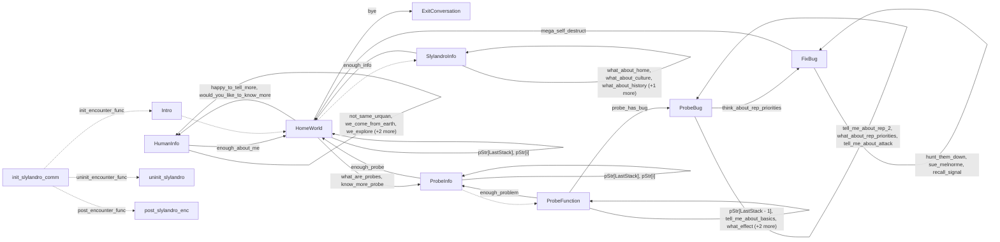

# Slylandro homeworld: existing conversation graph

> Generated by `tools/conversation_catalog.py`; do not edit this page by hand.

[Catalog and interpretation rules](../README.md) · [Proposed engine](../model.md)

Script: [slyhome.c](../../../../sc2/src/uqm/comm/slyhome/slyhome.c#L1). Phrase bank: [slylandro.txt](../../../../sc2/content/base/comm/slylandro/slylandro.txt#L1).

12 handler/helper nodes; 39 response registration sites; 3 direct local calls; 116 phrase records.

## Initialization and lifecycle

| Phase | Callback | Bound by | Conditions / source |
| --- | --- | --- | --- |
| <code>init_encounter_func</code> | [<code>Intro</code>](#node-intro) | <code>init_slylandro_comm</code> | No enclosing branch condition; [909](../../../../sc2/src/uqm/comm/slyhome/slyhome.c#L909) |
| <code>post_encounter_func</code> | [<code>post_slylandro_enc</code>](#node-post_slylandro_enc) | <code>init_slylandro_comm</code> | No enclosing branch condition; [910](../../../../sc2/src/uqm/comm/slyhome/slyhome.c#L910) |
| <code>uninit_encounter_func</code> | [<code>uninit_slylandro</code>](#node-uninit_slylandro) | <code>init_slylandro_comm</code> | No enclosing branch condition; [911](../../../../sc2/src/uqm/comm/slyhome/slyhome.c#L911) |

## Handler graph

Solid arrows are selectable responses; dashed arrows are direct C calls. Conditions, arguments, speech and effects are cataloged below. Parallel response sites are grouped only in this diagram.



## Condition catalog

Condition IDs describe enclosing source structure. Branch predicates combine with ∧; case labels mark source locations that can also be reached by fallthrough. Values refer to their original evaluation points. Local assignments and early control flow remain in the decision bodies.

| ID | Source expression / structural condition |
| --- | --- |
| <a id="condition-c1"></a>C1 | <code>switch (GET_GAME_STATE(SLYLANDRO_HOME_VISITS))</code> |
| <a id="condition-c2"></a>C2 | <code>case 1 (see source for fallthrough)</code> |
| <a id="condition-c3"></a>C3 | <code>default (see source for fallthrough)</code> |
| <a id="condition-c4"></a>C4 | <code>PLAYER_SAID(R, happy_to_tell_more)</code> |
| <a id="condition-c5"></a>C5 | <code>!(PLAYER_SAID(R, happy_to_tell_more))</code> |
| <a id="condition-c6"></a>C6 | <code>PLAYER_SAID(R, would_you_like_to_know_more)</code> |
| <a id="condition-c7"></a>C7 | <code>!(PLAYER_SAID(R, would_you_like_to_know_more))</code> |
| <a id="condition-c8"></a>C8 | <code>PLAYER_SAID(R, we_come_from_earth)</code> |
| <a id="condition-c9"></a>C9 | <code>!(PLAYER_SAID(R, we_come_from_earth))</code> |
| <a id="condition-c10"></a>C10 | <code>PLAYER_SAID(R, we_explore)</code> |
| <a id="condition-c11"></a>C11 | <code>!(PLAYER_SAID(R, we_explore))</code> |
| <a id="condition-c12"></a>C12 | <code>PLAYER_SAID(R, we_fight_urquan)</code> |
| <a id="condition-c13"></a>C13 | <code>!(PLAYER_SAID(R, we_fight_urquan))</code> |
| <a id="condition-c14"></a>C14 | <code>PLAYER_SAID(R, not_same_urquan)</code> |
| <a id="condition-c15"></a>C15 | <code>!(PLAYER_SAID(R, not_same_urquan))</code> |
| <a id="condition-c16"></a>C16 | <code>PLAYER_SAID(R, we_gather)</code> |
| <a id="condition-c17"></a>C17 | <code>GET_GAME_STATE(SLYLANDRO_KNOW_URQUAN) == 1</code> |
| <a id="condition-c18"></a>C18 | <code>!GET_GAME_STATE(SLYLANDRO_KNOW_EARTH)</code> |
| <a id="condition-c19"></a>C19 | <code>!GET_GAME_STATE(SLYLANDRO_KNOW_EXPLORE)</code> |
| <a id="condition-c20"></a>C20 | <code>!GET_GAME_STATE(SLYLANDRO_KNOW_URQUAN)</code> |
| <a id="condition-c21"></a>C21 | <code>!GET_GAME_STATE(SLYLANDRO_KNOW_GATHER)</code> |
| <a id="condition-c22"></a>C22 | <code>!InfoLeft</code> |
| <a id="condition-c23"></a>C23 | <code>PLAYER_SAID(R, like_more_about_you)</code> |
| <a id="condition-c24"></a>C24 | <code>!(PLAYER_SAID(R, like_more_about_you))</code> |
| <a id="condition-c25"></a>C25 | <code>PLAYER_SAID(R, what_about_home)</code> |
| <a id="condition-c26"></a>C26 | <code>!(PLAYER_SAID(R, what_about_home))</code> |
| <a id="condition-c27"></a>C27 | <code>PLAYER_SAID(R, what_about_culture)</code> |
| <a id="condition-c28"></a>C28 | <code>!(PLAYER_SAID(R, what_about_culture))</code> |
| <a id="condition-c29"></a>C29 | <code>PLAYER_SAID(R, what_about_history)</code> |
| <a id="condition-c30"></a>C30 | <code>!(PLAYER_SAID(R, what_about_history))</code> |
| <a id="condition-c31"></a>C31 | <code>PLAYER_SAID(R, what_about_biology)</code> |
| <a id="condition-c32"></a>C32 | <code>PHRASE_ENABLED(what_about_home)</code> |
| <a id="condition-c33"></a>C33 | <code>PHRASE_ENABLED(what_about_culture)</code> |
| <a id="condition-c34"></a>C34 | <code>PHRASE_ENABLED(what_about_history)</code> |
| <a id="condition-c35"></a>C35 | <code>PHRASE_ENABLED(what_about_biology)</code> |
| <a id="condition-c36"></a>C36 | <code>PLAYER_SAID(R, think_about_rep_priorities)</code> |
| <a id="condition-c37"></a>C37 | <code>!(PLAYER_SAID(R, think_about_rep_priorities))</code> |
| <a id="condition-c38"></a>C38 | <code>PLAYER_SAID(R, hunt_them_down)</code> |
| <a id="condition-c39"></a>C39 | <code>!(PLAYER_SAID(R, hunt_them_down))</code> |
| <a id="condition-c40"></a>C40 | <code>PLAYER_SAID(R, sue_melnorme)</code> |
| <a id="condition-c41"></a>C41 | <code>!(PLAYER_SAID(R, sue_melnorme))</code> |
| <a id="condition-c42"></a>C42 | <code>PLAYER_SAID(R, recall_signal)</code> |
| <a id="condition-c43"></a>C43 | <code>PHRASE_ENABLED(hunt_them_down)</code> |
| <a id="condition-c44"></a>C44 | <code>PHRASE_ENABLED(sue_melnorme)</code> |
| <a id="condition-c45"></a>C45 | <code>PHRASE_ENABLED(recall_signal)</code> |
| <a id="condition-c46"></a>C46 | <code>PLAYER_SAID(R, probe_has_bug)</code> |
| <a id="condition-c47"></a>C47 | <code>!(PLAYER_SAID(R, probe_has_bug))</code> |
| <a id="condition-c48"></a>C48 | <code>PLAYER_SAID(R, tell_me_about_rep_2)</code> |
| <a id="condition-c49"></a>C49 | <code>!(PLAYER_SAID(R, tell_me_about_rep_2))</code> |
| <a id="condition-c50"></a>C50 | <code>PLAYER_SAID(R, what_about_rep_priorities)</code> |
| <a id="condition-c51"></a>C51 | <code>!(PLAYER_SAID(R, what_about_rep_priorities))</code> |
| <a id="condition-c52"></a>C52 | <code>PLAYER_SAID(R, tell_me_about_attack)</code> |
| <a id="condition-c53"></a>C53 | <code>PHRASE_ENABLED(tell_me_about_rep_2)</code> |
| <a id="condition-c54"></a>C54 | <code>!(PHRASE_ENABLED(tell_me_about_rep_2))</code> |
| <a id="condition-c55"></a>C55 | <code>PHRASE_ENABLED(what_about_rep_priorities)</code> |
| <a id="condition-c56"></a>C56 | <code>!(PHRASE_ENABLED(what_about_rep_priorities))</code> |
| <a id="condition-c57"></a>C57 | <code>PHRASE_ENABLED(tell_me_about_attack)</code> |
| <a id="condition-c58"></a>C58 | <code>PLAYER_SAID(R, talk_more_probe_attack)</code> |
| <a id="condition-c59"></a>C59 | <code>!(PLAYER_SAID(R, talk_more_probe_attack))</code> |
| <a id="condition-c60"></a>C60 | <code>PLAYER_SAID(R, tell_me_about_basics)</code> |
| <a id="condition-c61"></a>C61 | <code>!(PLAYER_SAID(R, tell_me_about_basics))</code> |
| <a id="condition-c62"></a>C62 | <code>PLAYER_SAID(R, tell_basics_again)</code> |
| <a id="condition-c63"></a>C63 | <code>!(PLAYER_SAID(R, tell_basics_again))</code> |
| <a id="condition-c64"></a>C64 | <code>PLAYER_SAID(R, what_effect)</code> |
| <a id="condition-c65"></a>C65 | <code>!(PLAYER_SAID(R, what_effect))</code> |
| <a id="condition-c66"></a>C66 | <code>PLAYER_SAID(R, tell_me_about_rep_1)</code> |
| <a id="condition-c67"></a>C67 | <code>!(PLAYER_SAID(R, tell_me_about_rep_1))</code> |
| <a id="condition-c68"></a>C68 | <code>PLAYER_SAID(R, what_set_priority)</code> |
| <a id="condition-c69"></a>C69 | <code>!(PLAYER_SAID(R, what_set_priority))</code> |
| <a id="condition-c70"></a>C70 | <code>PLAYER_SAID(R, how_does_probe_defend)</code> |
| <a id="condition-c71"></a>C71 | <code>!(PLAYER_SAID(R, how_does_probe_defend))</code> |
| <a id="condition-c72"></a>C72 | <code>PLAYER_SAID(R, combat_behavior)</code> |
| <a id="condition-c73"></a>C73 | <code>!(PLAYER_SAID(R, combat_behavior))</code> |
| <a id="condition-c74"></a>C74 | <code>PLAYER_SAID(R, what_missile_batteries)</code> |
| <a id="condition-c75"></a>C75 | <code>switch (GET_GAME_STATE(SLYLANDRO_STACK9))</code> |
| <a id="condition-c76"></a>C76 | <code>case 0 (see source for fallthrough)</code> |
| <a id="condition-c77"></a>C77 | <code>case 2 (see source for fallthrough)</code> |
| <a id="condition-c78"></a>C78 | <code>switch (GET_GAME_STATE(SLYLANDRO_STACK8))</code> |
| <a id="condition-c79"></a>C79 | <code>case 3 (see source for fallthrough)</code> |
| <a id="condition-c80"></a>C80 | <code>PHRASE_ENABLED(what_set_priority)</code> |
| <a id="condition-c81"></a>C81 | <code>LastStack &amp;&amp; pStr[LastStack - 1]</code> |
| <a id="condition-c82"></a>C82 | <code>!GET_GAME_STATE(PLAYER_KNOWS_PROGRAM)</code> |
| <a id="condition-c83"></a>C83 | <code>!(!GET_GAME_STATE(PLAYER_KNOWS_PROGRAM))</code> |
| <a id="condition-c84"></a>C84 | <code>GET_GAME_STATE(PLAYER_KNOWS_PRIORITY)</code> |
| <a id="condition-c85"></a>C85 | <code>GET_GAME_STATE(PLAYER_KNOWS_EFFECTS)</code> |
| <a id="condition-c86"></a>C86 | <code>PHRASE_ENABLED(what_effect)</code> |
| <a id="condition-c87"></a>C87 | <code>PHRASE_ENABLED(tell_basics_again)</code> |
| <a id="condition-c88"></a>C88 | <code>LastStack == 0</code> |
| <a id="condition-c89"></a>C89 | <code>do / repeat while ((++LastStack) &lt; 2)</code> |
| <a id="condition-c90"></a>C90 | <code>pStr[LastStack]</code> |
| <a id="condition-c91"></a>C91 | <code>!(LastStack == 0)</code> |
| <a id="condition-c92"></a>C92 | <code>PLAYER_SAID(R, what_are_probes)</code> |
| <a id="condition-c93"></a>C93 | <code>!(PLAYER_SAID(R, what_are_probes))</code> |
| <a id="condition-c94"></a>C94 | <code>PLAYER_SAID(R, know_more_probe)</code> |
| <a id="condition-c95"></a>C95 | <code>!(PLAYER_SAID(R, know_more_probe))</code> |
| <a id="condition-c96"></a>C96 | <code>PLAYER_SAID(R, why_probe_always_attack)</code> |
| <a id="condition-c97"></a>C97 | <code>!(PLAYER_SAID(R, why_probe_always_attack))</code> |
| <a id="condition-c98"></a>C98 | <code>PLAYER_SAID(R, where_probes_from)</code> |
| <a id="condition-c99"></a>C99 | <code>!(PLAYER_SAID(R, where_probes_from))</code> |
| <a id="condition-c100"></a>C100 | <code>PLAYER_SAID(R, why_sell)</code> |
| <a id="condition-c101"></a>C101 | <code>!(PLAYER_SAID(R, why_sell))</code> |
| <a id="condition-c102"></a>C102 | <code>PLAYER_SAID(R, how_long_ago)</code> |
| <a id="condition-c103"></a>C103 | <code>!(PLAYER_SAID(R, how_long_ago))</code> |
| <a id="condition-c104"></a>C104 | <code>PLAYER_SAID(R, whats_probes_mission)</code> |
| <a id="condition-c105"></a>C105 | <code>!(PLAYER_SAID(R, whats_probes_mission))</code> |
| <a id="condition-c106"></a>C106 | <code>PLAYER_SAID(R, if_only_one)</code> |
| <a id="condition-c107"></a>C107 | <code>!(PLAYER_SAID(R, if_only_one))</code> |
| <a id="condition-c108"></a>C108 | <code>PLAYER_SAID(R, enough_problem)</code> |
| <a id="condition-c109"></a>C109 | <code>!GET_GAME_STATE(SLYLANDRO_KNOW_BROKEN)</code> |
| <a id="condition-c110"></a>C110 | <code>(!GET_GAME_STATE(SLYLANDRO_KNOW_BROKEN)) &amp;&amp; GET_GAME_STATE(PROBE_EXHIBITED_BUG)</code> |
| <a id="condition-c111"></a>C111 | <code>switch (GET_GAME_STATE(SLYLANDRO_STACK6))</code> |
| <a id="condition-c112"></a>C112 | <code>switch (GET_GAME_STATE(SLYLANDRO_STACK7))</code> |
| <a id="condition-c113"></a>C113 | <code>for (i = 0; i &lt; 3; ++i)</code> |
| <a id="condition-c114"></a>C114 | <code>(i != LastStack) &amp;&amp; pStr[i]</code> |
| <a id="condition-c115"></a>C115 | <code>PLAYER_SAID(R, we_are_us0)</code> |
| <a id="condition-c116"></a>C116 | <code>!(PLAYER_SAID(R, we_are_us0))</code> |
| <a id="condition-c117"></a>C117 | <code>PLAYER_SAID(R, what_other_visitors)</code> |
| <a id="condition-c118"></a>C118 | <code>!(PLAYER_SAID(R, what_other_visitors))</code> |
| <a id="condition-c119"></a>C119 | <code>PLAYER_SAID(R, any_other_visitors)</code> |
| <a id="condition-c120"></a>C120 | <code>!(PLAYER_SAID(R, any_other_visitors))</code> |
| <a id="condition-c121"></a>C121 | <code>PLAYER_SAID(R, what_about_sentient_milieu)</code> |
| <a id="condition-c122"></a>C122 | <code>!(PLAYER_SAID(R, what_about_sentient_milieu))</code> |
| <a id="condition-c123"></a>C123 | <code>PLAYER_SAID(R, who_else)</code> |
| <a id="condition-c124"></a>C124 | <code>!(PLAYER_SAID(R, who_else))</code> |
| <a id="condition-c125"></a>C125 | <code>PLAYER_SAID(R, precursors_yow)</code> |
| <a id="condition-c126"></a>C126 | <code>!(PLAYER_SAID(R, precursors_yow))</code> |
| <a id="condition-c127"></a>C127 | <code>PLAYER_SAID(R, must_know_more)</code> |
| <a id="condition-c128"></a>C128 | <code>!(PLAYER_SAID(R, must_know_more))</code> |
| <a id="condition-c129"></a>C129 | <code>PLAYER_SAID(R, who_are_you)</code> |
| <a id="condition-c130"></a>C130 | <code>!(PLAYER_SAID(R, who_are_you))</code> |
| <a id="condition-c131"></a>C131 | <code>PLAYER_SAID(R, where_are_you)</code> |
| <a id="condition-c132"></a>C132 | <code>!(PLAYER_SAID(R, where_are_you))</code> |
| <a id="condition-c133"></a>C133 | <code>PLAYER_SAID(R, thats_impossible_1)</code> |
| <a id="condition-c134"></a>C134 | <code>!(PLAYER_SAID(R, thats_impossible_1))</code> |
| <a id="condition-c135"></a>C135 | <code>PLAYER_SAID(R, thats_impossible_2)</code> |
| <a id="condition-c136"></a>C136 | <code>!(PLAYER_SAID(R, thats_impossible_2))</code> |
| <a id="condition-c137"></a>C137 | <code>PLAYER_SAID(R, enough_about_me)</code> |
| <a id="condition-c138"></a>C138 | <code>!(PLAYER_SAID(R, enough_about_me))</code> |
| <a id="condition-c139"></a>C139 | <code>PLAYER_SAID(R, enough_info)</code> |
| <a id="condition-c140"></a>C140 | <code>!(PLAYER_SAID(R, enough_info))</code> |
| <a id="condition-c141"></a>C141 | <code>PLAYER_SAID(R, enough_probe)</code> |
| <a id="condition-c142"></a>C142 | <code>!(PLAYER_SAID(R, enough_probe))</code> |
| <a id="condition-c143"></a>C143 | <code>PLAYER_SAID(R, mega_self_destruct)</code> |
| <a id="condition-c144"></a>C144 | <code>switch (GET_GAME_STATE(SLYLANDRO_STACK1))</code> |
| <a id="condition-c145"></a>C145 | <code>case 4 (see source for fallthrough)</code> |
| <a id="condition-c146"></a>C146 | <code>case 5 (see source for fallthrough)</code> |
| <a id="condition-c147"></a>C147 | <code>case 6 (see source for fallthrough)</code> |
| <a id="condition-c148"></a>C148 | <code>switch (GET_GAME_STATE(SLYLANDRO_STACK2))</code> |
| <a id="condition-c149"></a>C149 | <code>PHRASE_ENABLED(like_more_about_you)</code> |
| <a id="condition-c150"></a>C150 | <code>switch (GET_GAME_STATE(SLYLANDRO_STACK3))</code> |
| <a id="condition-c151"></a>C151 | <code>pStr[LastStack] != we_are_us0</code> |
| <a id="condition-c152"></a>C152 | <code>!(pStr[LastStack] != we_are_us0)</code> |
| <a id="condition-c153"></a>C153 | <code>pStr[i] != we_are_us0</code> |
| <a id="condition-c154"></a>C154 | <code>!(pStr[i] != we_are_us0)</code> |
| <a id="condition-c155"></a>C155 | <code>GET_GAME_STATE(SLYLANDRO_STACK1)</code> |
| <a id="condition-c156"></a>C156 | <code>switch (GET_GAME_STATE(SLYLANDRO_STACK4))</code> |
| <a id="condition-c157"></a>C157 | <code>GET_GAME_STATE(PLAYER_KNOWS_PROBE)</code> |
| <a id="condition-c158"></a>C158 | <code>GET_GAME_STATE(PLAYER_KNOWS_PROBE) &amp;&amp; (!GET_GAME_STATE(SLYLANDRO_KNOW_BROKEN))</code> |
| <a id="condition-c159"></a>C159 | <code>switch (GET_GAME_STATE(SLYLANDRO_STACK5))</code> |
| <a id="condition-c160"></a>C160 | <code>PHRASE_ENABLED(know_more_probe)</code> |
| <a id="condition-c161"></a>C161 | <code>GET_GAME_STATE(SLYLANDRO_KNOW_BROKEN)</code> |
| <a id="condition-c162"></a>C162 | <code>GET_GAME_STATE(SLYLANDRO_KNOW_BROKEN) &amp;&amp; ((NumVisits = GET_GAME_STATE(RECALL_VISITS)) == 0)</code> |
| <a id="condition-c163"></a>C163 | <code>!(GET_GAME_STATE(SLYLANDRO_KNOW_BROKEN) &amp;&amp; ((NumVisits = GET_GAME_STATE(RECALL_VISITS)) == 0))</code> |
| <a id="condition-c164"></a>C164 | <code>switch (NumVisits++)</code> |

## Script-scope state and lookup tables

These declarations supply shared local state, computed phrase alternatives, number speech, or lookup data used by the nodes. LOCDATA presentation defaults are linked separately in the source.

Presentation descriptor <code>slylandro_desc</code>: [source](../../../../sc2/src/uqm/comm/slyhome/slyhome.c#L26).

## Node catalog

<a id="node-exitconversation"></a>

### ExitConversation

<code>static void ExitConversation(RESPONSE_REF R)</code> — [source](../../../../sc2/src/uqm/comm/slyhome/slyhome.c#L175).

Incoming player-response variants: [<code>bye</code>](#phrase-bye).

#### Dialogue / audio emissions

| Phrase or expression | Enclosing conditions | Source |
| --- | --- | --- |
| [<code>GOODBYE_1</code>](#phrase-goodbye_1)<br><code>NPCPhrase(GOODBYE_1)</code> | [C1](#condition-c1) ∧ [C2](#condition-c2) | [183](../../../../sc2/src/uqm/comm/slyhome/slyhome.c#L183) |
| [<code>GOODBYE_2</code>](#phrase-goodbye_2)<br><code>NPCPhrase(GOODBYE_2)</code> | [C1](#condition-c1) ∧ [C3](#condition-c3) | [186](../../../../sc2/src/uqm/comm/slyhome/slyhome.c#L186) |

#### Actions, queries, local updates, and control flow

Calls are listed without assuming they are pure or mutating. Local updates are retained because they determine dynamic menus and counter-selected speech.

| Kind | Operation | Enclosing conditions | Source |
| --- | --- | --- | --- |
| call | <code>setSegue(Segue_peace)</code> | No enclosing branch condition | [178](../../../../sc2/src/uqm/comm/slyhome/slyhome.c#L178) |
| call | <code>GET_GAME_STATE(SLYLANDRO_HOME_VISITS)</code> | No enclosing branch condition | [180](../../../../sc2/src/uqm/comm/slyhome/slyhome.c#L180) |
| flow | <code>break;</code> | [C1](#condition-c1) ∧ [C2](#condition-c2) | [184](../../../../sc2/src/uqm/comm/slyhome/slyhome.c#L184) |
| flow | <code>break;</code> | [C1](#condition-c1) ∧ [C3](#condition-c3) | [187](../../../../sc2/src/uqm/comm/slyhome/slyhome.c#L187) |

<details>
<summary>Exact decision body (local calculations, early returns, fallthrough and ordering)</summary>

```c
{
	(void) R;  // ignored
	setSegue (Segue_peace);

	switch (GET_GAME_STATE (SLYLANDRO_HOME_VISITS))
	{
		case 1:
			NPCPhrase (GOODBYE_1);
			break;
		default:
			NPCPhrase (GOODBYE_2);
			break;
	}
}
```

</details>

<a id="node-humaninfo"></a>

### HumanInfo

<code>static void HumanInfo(RESPONSE_REF R)</code> — [source](../../../../sc2/src/uqm/comm/slyhome/slyhome.c#L194).

Incoming player-response variants: [<code>not_same_urquan</code>](#phrase-not_same_urquan), [<code>we_come_from_earth</code>](#phrase-we_come_from_earth), [<code>we_explore</code>](#phrase-we_explore), [<code>we_fight_urquan</code>](#phrase-we_fight_urquan), [<code>we_gather</code>](#phrase-we_gather), [<code>happy_to_tell_more</code>](#phrase-happy_to_tell_more), [<code>would_you_like_to_know_more</code>](#phrase-would_you_like_to_know_more).

#### Dialogue / audio emissions

| Phrase or expression | Enclosing conditions | Source |
| --- | --- | --- |
| [<code>TELL_MORE</code>](#phrase-tell_more)<br><code>NPCPhrase(TELL_MORE)</code> | [C4](#condition-c4) | [200](../../../../sc2/src/uqm/comm/slyhome/slyhome.c#L200) |
| [<code>YES_TELL_MORE</code>](#phrase-yes_tell_more)<br><code>NPCPhrase(YES_TELL_MORE)</code> | [C5](#condition-c5) ∧ [C6](#condition-c6) | [206](../../../../sc2/src/uqm/comm/slyhome/slyhome.c#L206) |
| [<code>OK_EARTH</code>](#phrase-ok_earth)<br><code>NPCPhrase(OK_EARTH)</code> | [C5](#condition-c5) ∧ [C7](#condition-c7) ∧ [C8](#condition-c8) | [210](../../../../sc2/src/uqm/comm/slyhome/slyhome.c#L210) |
| [<code>OK_EXPLORE</code>](#phrase-ok_explore)<br><code>NPCPhrase(OK_EXPLORE)</code> | [C5](#condition-c5) ∧ [C7](#condition-c7) ∧ [C9](#condition-c9) ∧ [C10](#condition-c10) | [216](../../../../sc2/src/uqm/comm/slyhome/slyhome.c#L216) |
| [<code>URQUAN_NICE_GUYS</code>](#phrase-urquan_nice_guys)<br><code>NPCPhrase(URQUAN_NICE_GUYS)</code> | [C5](#condition-c5) ∧ [C7](#condition-c7) ∧ [C9](#condition-c9) ∧ [C11](#condition-c11) ∧ [C12](#condition-c12) | [222](../../../../sc2/src/uqm/comm/slyhome/slyhome.c#L222) |
| [<code>PERSONALITY_CHANGE</code>](#phrase-personality_change)<br><code>NPCPhrase(PERSONALITY_CHANGE)</code> | [C5](#condition-c5) ∧ [C7](#condition-c7) ∧ [C9](#condition-c9) ∧ [C11](#condition-c11) ∧ [C13](#condition-c13) ∧ [C14](#condition-c14) | [228](../../../../sc2/src/uqm/comm/slyhome/slyhome.c#L228) |
| [<code>MAYBE_INTERESTED</code>](#phrase-maybe_interested)<br><code>NPCPhrase(MAYBE_INTERESTED)</code> | [C5](#condition-c5) ∧ [C7](#condition-c7) ∧ [C9](#condition-c9) ∧ [C11](#condition-c11) ∧ [C13](#condition-c13) ∧ [C15](#condition-c15) ∧ [C16](#condition-c16) | [234](../../../../sc2/src/uqm/comm/slyhome/slyhome.c#L234) |

#### Response edges

| Player response | Destination on selection | Enclosing availability conditions | Source |
| --- | --- | --- | --- |
| [<code>not_same_urquan</code>](#phrase-not_same_urquan)<br>I think you are confused. Those aren&#x27;t the Ur-Quan we&#x27;re talking about. Ours are green. | [<code>HumanInfo</code>](#node-humaninfo) | [C17](#condition-c17) | [243](../../../../sc2/src/uqm/comm/slyhome/slyhome.c#L243) |
| [<code>we_come_from_earth</code>](#phrase-we_come_from_earth)<br>Most of us come from a large, rocky world called Earth. | [<code>HumanInfo</code>](#node-humaninfo) | [C18](#condition-c18) | [248](../../../../sc2/src/uqm/comm/slyhome/slyhome.c#L248) |
| [<code>we_explore</code>](#phrase-we_explore)<br>We travel the galaxy in starships, seeking knowledge and contact with other sentients. | [<code>HumanInfo</code>](#node-humaninfo) | [C19](#condition-c19) | [253](../../../../sc2/src/uqm/comm/slyhome/slyhome.c#L253) |
| [<code>we_fight_urquan</code>](#phrase-we_fight_urquan)<br>Our primary objective right now is to free ourselves from the Evil Ur-Quan. | [<code>HumanInfo</code>](#node-humaninfo) | [C20](#condition-c20) | [258](../../../../sc2/src/uqm/comm/slyhome/slyhome.c#L258) |
| [<code>we_gather</code>](#phrase-we_gather)<br>We are particularly interested in studying unusual planets and life forms. | [<code>HumanInfo</code>](#node-humaninfo) | [C21](#condition-c21) | [263](../../../../sc2/src/uqm/comm/slyhome/slyhome.c#L263) |
| [<code>enough_about_me</code>](#phrase-enough_about_me)<br>That&#x27;s enough about us, for now. | [<code>HomeWorld</code>](#node-homeworld) | No enclosing branch condition | [266](../../../../sc2/src/uqm/comm/slyhome/slyhome.c#L266) |

#### Actions, queries, local updates, and control flow

Calls are listed without assuming they are pure or mutating. Local updates are retained because they determine dynamic menus and counter-selected speech.

| Kind | Operation | Enclosing conditions | Source |
| --- | --- | --- | --- |
| call | <code>PLAYER_SAID(R, happy_to_tell_more)</code> | No enclosing branch condition | [198](../../../../sc2/src/uqm/comm/slyhome/slyhome.c#L198) |
| call | <code>SET_GAME_STATE(SLYLANDRO_STACK4, 1)</code> | [C4](#condition-c4) | [202](../../../../sc2/src/uqm/comm/slyhome/slyhome.c#L202) |
| call | <code>PLAYER_SAID(R, would_you_like_to_know_more)</code> | [C5](#condition-c5) | [204](../../../../sc2/src/uqm/comm/slyhome/slyhome.c#L204) |
| call | <code>PLAYER_SAID(R, we_come_from_earth)</code> | [C5](#condition-c5) ∧ [C7](#condition-c7) | [208](../../../../sc2/src/uqm/comm/slyhome/slyhome.c#L208) |
| call | <code>SET_GAME_STATE(SLYLANDRO_KNOW_EARTH, 1)</code> | [C5](#condition-c5) ∧ [C7](#condition-c7) ∧ [C8](#condition-c8) | [212](../../../../sc2/src/uqm/comm/slyhome/slyhome.c#L212) |
| call | <code>PLAYER_SAID(R, we_explore)</code> | [C5](#condition-c5) ∧ [C7](#condition-c7) ∧ [C9](#condition-c9) | [214](../../../../sc2/src/uqm/comm/slyhome/slyhome.c#L214) |
| call | <code>SET_GAME_STATE(SLYLANDRO_KNOW_EXPLORE, 1)</code> | [C5](#condition-c5) ∧ [C7](#condition-c7) ∧ [C9](#condition-c9) ∧ [C10](#condition-c10) | [218](../../../../sc2/src/uqm/comm/slyhome/slyhome.c#L218) |
| call | <code>PLAYER_SAID(R, we_fight_urquan)</code> | [C5](#condition-c5) ∧ [C7](#condition-c7) ∧ [C9](#condition-c9) ∧ [C11](#condition-c11) | [220](../../../../sc2/src/uqm/comm/slyhome/slyhome.c#L220) |
| call | <code>SET_GAME_STATE(SLYLANDRO_KNOW_URQUAN, 1)</code> | [C5](#condition-c5) ∧ [C7](#condition-c7) ∧ [C9](#condition-c9) ∧ [C11](#condition-c11) ∧ [C12](#condition-c12) | [224](../../../../sc2/src/uqm/comm/slyhome/slyhome.c#L224) |
| call | <code>PLAYER_SAID(R, not_same_urquan)</code> | [C5](#condition-c5) ∧ [C7](#condition-c7) ∧ [C9](#condition-c9) ∧ [C11](#condition-c11) ∧ [C13](#condition-c13) | [226](../../../../sc2/src/uqm/comm/slyhome/slyhome.c#L226) |
| call | <code>SET_GAME_STATE(SLYLANDRO_KNOW_URQUAN, 2)</code> | [C5](#condition-c5) ∧ [C7](#condition-c7) ∧ [C9](#condition-c9) ∧ [C11](#condition-c11) ∧ [C13](#condition-c13) ∧ [C14](#condition-c14) | [230](../../../../sc2/src/uqm/comm/slyhome/slyhome.c#L230) |
| call | <code>PLAYER_SAID(R, we_gather)</code> | [C5](#condition-c5) ∧ [C7](#condition-c7) ∧ [C9](#condition-c9) ∧ [C11](#condition-c11) ∧ [C13](#condition-c13) ∧ [C15](#condition-c15) | [232](../../../../sc2/src/uqm/comm/slyhome/slyhome.c#L232) |
| call | <code>SET_GAME_STATE(SLYLANDRO_KNOW_GATHER, 1)</code> | [C5](#condition-c5) ∧ [C7](#condition-c7) ∧ [C9](#condition-c9) ∧ [C11](#condition-c11) ∧ [C13](#condition-c13) ∧ [C15](#condition-c15) ∧ [C16](#condition-c16) | [236](../../../../sc2/src/uqm/comm/slyhome/slyhome.c#L236) |
| update | <code>InfoLeft = FALSE</code> | No enclosing branch condition | [239](../../../../sc2/src/uqm/comm/slyhome/slyhome.c#L239) |
| call | <code>GET_GAME_STATE(SLYLANDRO_KNOW_URQUAN)</code> | No enclosing branch condition | [240](../../../../sc2/src/uqm/comm/slyhome/slyhome.c#L240) |
| update | <code>InfoLeft = TRUE</code> | [C17](#condition-c17) | [242](../../../../sc2/src/uqm/comm/slyhome/slyhome.c#L242) |
| call | <code>GET_GAME_STATE(SLYLANDRO_KNOW_EARTH)</code> | No enclosing branch condition | [245](../../../../sc2/src/uqm/comm/slyhome/slyhome.c#L245) |
| update | <code>InfoLeft = TRUE</code> | [C18](#condition-c18) | [247](../../../../sc2/src/uqm/comm/slyhome/slyhome.c#L247) |
| call | <code>GET_GAME_STATE(SLYLANDRO_KNOW_EXPLORE)</code> | No enclosing branch condition | [250](../../../../sc2/src/uqm/comm/slyhome/slyhome.c#L250) |
| update | <code>InfoLeft = TRUE</code> | [C19](#condition-c19) | [252](../../../../sc2/src/uqm/comm/slyhome/slyhome.c#L252) |
| call | <code>GET_GAME_STATE(SLYLANDRO_KNOW_URQUAN)</code> | No enclosing branch condition | [255](../../../../sc2/src/uqm/comm/slyhome/slyhome.c#L255) |
| update | <code>InfoLeft = TRUE</code> | [C20](#condition-c20) | [257](../../../../sc2/src/uqm/comm/slyhome/slyhome.c#L257) |
| call | <code>GET_GAME_STATE(SLYLANDRO_KNOW_GATHER)</code> | No enclosing branch condition | [260](../../../../sc2/src/uqm/comm/slyhome/slyhome.c#L260) |
| update | <code>InfoLeft = TRUE</code> | [C21](#condition-c21) | [262](../../../../sc2/src/uqm/comm/slyhome/slyhome.c#L262) |
| call | <code>SET_GAME_STATE(SLYLANDRO_STACK4, 2)</code> | [C22](#condition-c22) | [269](../../../../sc2/src/uqm/comm/slyhome/slyhome.c#L269) |

<details>
<summary>Exact decision body (local calculations, early returns, fallthrough and ordering)</summary>

```c
{
	BYTE InfoLeft;

	if (PLAYER_SAID (R, happy_to_tell_more))
	{
		NPCPhrase (TELL_MORE);

		SET_GAME_STATE (SLYLANDRO_STACK4, 1);
	}
	else if (PLAYER_SAID (R, would_you_like_to_know_more))
	{
		NPCPhrase (YES_TELL_MORE);
	}
	else if (PLAYER_SAID (R, we_come_from_earth))
	{
		NPCPhrase (OK_EARTH);

		SET_GAME_STATE (SLYLANDRO_KNOW_EARTH, 1);
	}
	else if (PLAYER_SAID (R, we_explore))
	{
		NPCPhrase (OK_EXPLORE);

		SET_GAME_STATE (SLYLANDRO_KNOW_EXPLORE, 1);
	}
	else if (PLAYER_SAID (R, we_fight_urquan))
	{
		NPCPhrase (URQUAN_NICE_GUYS);

		SET_GAME_STATE (SLYLANDRO_KNOW_URQUAN, 1);
	}
	else if (PLAYER_SAID (R, not_same_urquan))
	{
		NPCPhrase (PERSONALITY_CHANGE);

		SET_GAME_STATE (SLYLANDRO_KNOW_URQUAN, 2);
	}
	else if (PLAYER_SAID (R, we_gather))
	{
		NPCPhrase (MAYBE_INTERESTED);

		SET_GAME_STATE (SLYLANDRO_KNOW_GATHER, 1);
	}

	InfoLeft = FALSE;
	if (GET_GAME_STATE (SLYLANDRO_KNOW_URQUAN) == 1)
	{
		InfoLeft = TRUE;
		Response (not_same_urquan, HumanInfo);
	}
	if (!GET_GAME_STATE (SLYLANDRO_KNOW_EARTH))
	{
		InfoLeft = TRUE;
		Response (we_come_from_earth, HumanInfo);
	}
	if (!GET_GAME_STATE (SLYLANDRO_KNOW_EXPLORE))
	{
		InfoLeft = TRUE;
		Response (we_explore, HumanInfo);
	}
	if (!GET_GAME_STATE (SLYLANDRO_KNOW_URQUAN))
	{
		InfoLeft = TRUE;
		Response (we_fight_urquan, HumanInfo);
	}
	if (!GET_GAME_STATE (SLYLANDRO_KNOW_GATHER))
	{
		InfoLeft = TRUE;
		Response (we_gather, HumanInfo);
	}

	Response (enough_about_me, HomeWorld);
	if (!InfoLeft)
	{
		SET_GAME_STATE (SLYLANDRO_STACK4, 2);
	}
}
```

</details>

<a id="node-slylandroinfo"></a>

### SlylandroInfo

<code>static void SlylandroInfo(RESPONSE_REF R)</code> — [source](../../../../sc2/src/uqm/comm/slyhome/slyhome.c#L274).

Incoming player-response variants: [<code>what_about_home</code>](#phrase-what_about_home), [<code>what_about_culture</code>](#phrase-what_about_culture), [<code>what_about_history</code>](#phrase-what_about_history), [<code>what_about_biology</code>](#phrase-what_about_biology).

Also called directly by: [<code>HomeWorld</code>](#node-homeworld) ([735](../../../../sc2/src/uqm/comm/slyhome/slyhome.c#L735)).

#### Dialogue / audio emissions

| Phrase or expression | Enclosing conditions | Source |
| --- | --- | --- |
| [<code>SURE_KNOW_WHAT</code>](#phrase-sure_know_what)<br><code>NPCPhrase(SURE_KNOW_WHAT)</code> | [C23](#condition-c23) | [280](../../../../sc2/src/uqm/comm/slyhome/slyhome.c#L280) |
| [<code>ABOUT_HOME</code>](#phrase-about_home)<br><code>NPCPhrase(ABOUT_HOME)</code> | [C24](#condition-c24) ∧ [C25](#condition-c25) | [284](../../../../sc2/src/uqm/comm/slyhome/slyhome.c#L284) |
| [<code>ABOUT_CULTURE</code>](#phrase-about_culture)<br><code>NPCPhrase(ABOUT_CULTURE)</code> | [C24](#condition-c24) ∧ [C26](#condition-c26) ∧ [C27](#condition-c27) | [290](../../../../sc2/src/uqm/comm/slyhome/slyhome.c#L290) |
| [<code>ABOUT_HISTORY</code>](#phrase-about_history)<br><code>NPCPhrase(ABOUT_HISTORY)</code> | [C24](#condition-c24) ∧ [C26](#condition-c26) ∧ [C28](#condition-c28) ∧ [C29](#condition-c29) | [296](../../../../sc2/src/uqm/comm/slyhome/slyhome.c#L296) |
| [<code>ABOUT_BIOLOGY</code>](#phrase-about_biology)<br><code>NPCPhrase(ABOUT_BIOLOGY)</code> | [C24](#condition-c24) ∧ [C26](#condition-c26) ∧ [C28](#condition-c28) ∧ [C30](#condition-c30) ∧ [C31](#condition-c31) | [302](../../../../sc2/src/uqm/comm/slyhome/slyhome.c#L302) |

#### Response edges

| Player response | Destination on selection | Enclosing availability conditions | Source |
| --- | --- | --- | --- |
| [<code>what_about_home</code>](#phrase-what_about_home)<br>Tell us about your home... this gas giant planet. | [<code>SlylandroInfo</code>](#node-slylandroinfo) | [C32](#condition-c32) | [311](../../../../sc2/src/uqm/comm/slyhome/slyhome.c#L311) |
| [<code>what_about_culture</code>](#phrase-what_about_culture)<br>What can you tell us about your culture? | [<code>SlylandroInfo</code>](#node-slylandroinfo) | [C33](#condition-c33) | [316](../../../../sc2/src/uqm/comm/slyhome/slyhome.c#L316) |
| [<code>what_about_history</code>](#phrase-what_about_history)<br>What about your history? | [<code>SlylandroInfo</code>](#node-slylandroinfo) | [C34](#condition-c34) | [321](../../../../sc2/src/uqm/comm/slyhome/slyhome.c#L321) |
| [<code>what_about_biology</code>](#phrase-what_about_biology)<br>Tell us about your biology. | [<code>SlylandroInfo</code>](#node-slylandroinfo) | [C35](#condition-c35) | [326](../../../../sc2/src/uqm/comm/slyhome/slyhome.c#L326) |
| [<code>enough_info</code>](#phrase-enough_info)<br>Thank you. That&#x27;s sufficient for now. | [<code>HomeWorld</code>](#node-homeworld) | No enclosing branch condition | [329](../../../../sc2/src/uqm/comm/slyhome/slyhome.c#L329) |

#### Actions, queries, local updates, and control flow

Calls are listed without assuming they are pure or mutating. Local updates are retained because they determine dynamic menus and counter-selected speech.

| Kind | Operation | Enclosing conditions | Source |
| --- | --- | --- | --- |
| call | <code>PLAYER_SAID(R, like_more_about_you)</code> | No enclosing branch condition | [278](../../../../sc2/src/uqm/comm/slyhome/slyhome.c#L278) |
| call | <code>PLAYER_SAID(R, what_about_home)</code> | [C24](#condition-c24) | [282](../../../../sc2/src/uqm/comm/slyhome/slyhome.c#L282) |
| call | <code>DISABLE_PHRASE(what_about_home)</code> | [C24](#condition-c24) ∧ [C25](#condition-c25) | [286](../../../../sc2/src/uqm/comm/slyhome/slyhome.c#L286) |
| call | <code>PLAYER_SAID(R, what_about_culture)</code> | [C24](#condition-c24) ∧ [C26](#condition-c26) | [288](../../../../sc2/src/uqm/comm/slyhome/slyhome.c#L288) |
| call | <code>DISABLE_PHRASE(what_about_culture)</code> | [C24](#condition-c24) ∧ [C26](#condition-c26) ∧ [C27](#condition-c27) | [292](../../../../sc2/src/uqm/comm/slyhome/slyhome.c#L292) |
| call | <code>PLAYER_SAID(R, what_about_history)</code> | [C24](#condition-c24) ∧ [C26](#condition-c26) ∧ [C28](#condition-c28) | [294](../../../../sc2/src/uqm/comm/slyhome/slyhome.c#L294) |
| call | <code>DISABLE_PHRASE(what_about_history)</code> | [C24](#condition-c24) ∧ [C26](#condition-c26) ∧ [C28](#condition-c28) ∧ [C29](#condition-c29) | [298](../../../../sc2/src/uqm/comm/slyhome/slyhome.c#L298) |
| call | <code>PLAYER_SAID(R, what_about_biology)</code> | [C24](#condition-c24) ∧ [C26](#condition-c26) ∧ [C28](#condition-c28) ∧ [C30](#condition-c30) | [300](../../../../sc2/src/uqm/comm/slyhome/slyhome.c#L300) |
| call | <code>DISABLE_PHRASE(what_about_biology)</code> | [C24](#condition-c24) ∧ [C26](#condition-c26) ∧ [C28](#condition-c28) ∧ [C30](#condition-c30) ∧ [C31](#condition-c31) | [304](../../../../sc2/src/uqm/comm/slyhome/slyhome.c#L304) |
| update | <code>InfoLeft = FALSE</code> | No enclosing branch condition | [307](../../../../sc2/src/uqm/comm/slyhome/slyhome.c#L307) |
| call | <code>PHRASE_ENABLED(what_about_home)</code> | No enclosing branch condition | [308](../../../../sc2/src/uqm/comm/slyhome/slyhome.c#L308) |
| update | <code>InfoLeft = TRUE</code> | [C32](#condition-c32) | [310](../../../../sc2/src/uqm/comm/slyhome/slyhome.c#L310) |
| call | <code>PHRASE_ENABLED(what_about_culture)</code> | No enclosing branch condition | [313](../../../../sc2/src/uqm/comm/slyhome/slyhome.c#L313) |
| update | <code>InfoLeft = TRUE</code> | [C33](#condition-c33) | [315](../../../../sc2/src/uqm/comm/slyhome/slyhome.c#L315) |
| call | <code>PHRASE_ENABLED(what_about_history)</code> | No enclosing branch condition | [318](../../../../sc2/src/uqm/comm/slyhome/slyhome.c#L318) |
| update | <code>InfoLeft = TRUE</code> | [C34](#condition-c34) | [320](../../../../sc2/src/uqm/comm/slyhome/slyhome.c#L320) |
| call | <code>PHRASE_ENABLED(what_about_biology)</code> | No enclosing branch condition | [323](../../../../sc2/src/uqm/comm/slyhome/slyhome.c#L323) |
| update | <code>InfoLeft = TRUE</code> | [C35](#condition-c35) | [325](../../../../sc2/src/uqm/comm/slyhome/slyhome.c#L325) |
| call | <code>DISABLE_PHRASE(like_more_about_you)</code> | [C22](#condition-c22) | [332](../../../../sc2/src/uqm/comm/slyhome/slyhome.c#L332) |

<details>
<summary>Exact decision body (local calculations, early returns, fallthrough and ordering)</summary>

```c
{
	BYTE InfoLeft;

	if (PLAYER_SAID (R, like_more_about_you))
	{
		NPCPhrase (SURE_KNOW_WHAT);
	}
	else if (PLAYER_SAID (R, what_about_home))
	{
		NPCPhrase (ABOUT_HOME);

		DISABLE_PHRASE (what_about_home);
	}
	else if (PLAYER_SAID (R, what_about_culture))
	{
		NPCPhrase (ABOUT_CULTURE);

		DISABLE_PHRASE (what_about_culture);
	}
	else if (PLAYER_SAID (R, what_about_history))
	{
		NPCPhrase (ABOUT_HISTORY);

		DISABLE_PHRASE (what_about_history);
	}
	else if (PLAYER_SAID (R, what_about_biology))
	{
		NPCPhrase (ABOUT_BIOLOGY);

		DISABLE_PHRASE (what_about_biology);
	}

	InfoLeft = FALSE;
	if (PHRASE_ENABLED (what_about_home))
	{
		InfoLeft = TRUE;
		Response (what_about_home, SlylandroInfo);
	}
	if (PHRASE_ENABLED (what_about_culture))
	{
		InfoLeft = TRUE;
		Response (what_about_culture, SlylandroInfo);
	}
	if (PHRASE_ENABLED (what_about_history))
	{
		InfoLeft = TRUE;
		Response (what_about_history, SlylandroInfo);
	}
	if (PHRASE_ENABLED (what_about_biology))
	{
		InfoLeft = TRUE;
		Response (what_about_biology, SlylandroInfo);
	}

	Response (enough_info, HomeWorld);
	if (!InfoLeft)
	{
		DISABLE_PHRASE (like_more_about_you);
	}
}
```

</details>

<a id="node-fixbug"></a>

### FixBug

<code>static void FixBug(RESPONSE_REF R)</code> — [source](../../../../sc2/src/uqm/comm/slyhome/slyhome.c#L337).

Incoming player-response variants: [<code>hunt_them_down</code>](#phrase-hunt_them_down), [<code>sue_melnorme</code>](#phrase-sue_melnorme), [<code>recall_signal</code>](#phrase-recall_signal), [<code>think_about_rep_priorities</code>](#phrase-think_about_rep_priorities).

#### Dialogue / audio emissions

| Phrase or expression | Enclosing conditions | Source |
| --- | --- | --- |
| [<code>UH_OH</code>](#phrase-uh_oh)<br><code>NPCPhrase(UH_OH)</code> | [C36](#condition-c36) | [340](../../../../sc2/src/uqm/comm/slyhome/slyhome.c#L340) |
| [<code>GROW_TOO_FAST</code>](#phrase-grow_too_fast)<br><code>NPCPhrase(GROW_TOO_FAST)</code> | [C37](#condition-c37) ∧ [C38](#condition-c38) | [343](../../../../sc2/src/uqm/comm/slyhome/slyhome.c#L343) |
| [<code>SIGNED_WAIVER</code>](#phrase-signed_waiver)<br><code>NPCPhrase(SIGNED_WAIVER)</code> | [C37](#condition-c37) ∧ [C39](#condition-c39) ∧ [C40](#condition-c40) | [349](../../../../sc2/src/uqm/comm/slyhome/slyhome.c#L349) |
| [<code>NOT_THIS_MODEL</code>](#phrase-not_this_model)<br><code>NPCPhrase(NOT_THIS_MODEL)</code> | [C37](#condition-c37) ∧ [C39](#condition-c39) ∧ [C41](#condition-c41) ∧ [C42](#condition-c42) | [355](../../../../sc2/src/uqm/comm/slyhome/slyhome.c#L355) |

#### Response edges

| Player response | Destination on selection | Enclosing availability conditions | Source |
| --- | --- | --- | --- |
| [<code>hunt_them_down</code>](#phrase-hunt_them_down)<br>Someone is going to have to hunt them all down and destroy them. | [<code>FixBug</code>](#node-fixbug) | [C43](#condition-c43) | [361](../../../../sc2/src/uqm/comm/slyhome/slyhome.c#L361) |
| [<code>sue_melnorme</code>](#phrase-sue_melnorme)<br>Well to begin with, if I were you, I&#x27;d sue the Melnorme. | [<code>FixBug</code>](#node-fixbug) | [C44](#condition-c44) | [363](../../../../sc2/src/uqm/comm/slyhome/slyhome.c#L363) |
| [<code>recall_signal</code>](#phrase-recall_signal)<br>Couldn&#x27;t you broadcast some kind of recall signal? | [<code>FixBug</code>](#node-fixbug) | [C45](#condition-c45) | [365](../../../../sc2/src/uqm/comm/slyhome/slyhome.c#L365) |
| [<code>mega_self_destruct</code>](#phrase-mega_self_destruct)<br>I don&#x27;t suppose you have some kind of Mega-Self-Destruct Code, or something? | [<code>HomeWorld</code>](#node-homeworld) | No enclosing branch condition | [366](../../../../sc2/src/uqm/comm/slyhome/slyhome.c#L366) |

#### Actions, queries, local updates, and control flow

Calls are listed without assuming they are pure or mutating. Local updates are retained because they determine dynamic menus and counter-selected speech.

| Kind | Operation | Enclosing conditions | Source |
| --- | --- | --- | --- |
| call | <code>PLAYER_SAID(R, think_about_rep_priorities)</code> | No enclosing branch condition | [339](../../../../sc2/src/uqm/comm/slyhome/slyhome.c#L339) |
| call | <code>PLAYER_SAID(R, hunt_them_down)</code> | [C37](#condition-c37) | [341](../../../../sc2/src/uqm/comm/slyhome/slyhome.c#L341) |
| call | <code>DISABLE_PHRASE(hunt_them_down)</code> | [C37](#condition-c37) ∧ [C38](#condition-c38) | [345](../../../../sc2/src/uqm/comm/slyhome/slyhome.c#L345) |
| call | <code>PLAYER_SAID(R, sue_melnorme)</code> | [C37](#condition-c37) ∧ [C39](#condition-c39) | [347](../../../../sc2/src/uqm/comm/slyhome/slyhome.c#L347) |
| call | <code>DISABLE_PHRASE(sue_melnorme)</code> | [C37](#condition-c37) ∧ [C39](#condition-c39) ∧ [C40](#condition-c40) | [351](../../../../sc2/src/uqm/comm/slyhome/slyhome.c#L351) |
| call | <code>PLAYER_SAID(R, recall_signal)</code> | [C37](#condition-c37) ∧ [C39](#condition-c39) ∧ [C41](#condition-c41) | [353](../../../../sc2/src/uqm/comm/slyhome/slyhome.c#L353) |
| call | <code>DISABLE_PHRASE(recall_signal)</code> | [C37](#condition-c37) ∧ [C39](#condition-c39) ∧ [C41](#condition-c41) ∧ [C42](#condition-c42) | [357](../../../../sc2/src/uqm/comm/slyhome/slyhome.c#L357) |
| call | <code>PHRASE_ENABLED(hunt_them_down)</code> | No enclosing branch condition | [360](../../../../sc2/src/uqm/comm/slyhome/slyhome.c#L360) |
| call | <code>PHRASE_ENABLED(sue_melnorme)</code> | No enclosing branch condition | [362](../../../../sc2/src/uqm/comm/slyhome/slyhome.c#L362) |
| call | <code>PHRASE_ENABLED(recall_signal)</code> | No enclosing branch condition | [364](../../../../sc2/src/uqm/comm/slyhome/slyhome.c#L364) |

<details>
<summary>Exact decision body (local calculations, early returns, fallthrough and ordering)</summary>

```c
{
	if (PLAYER_SAID (R, think_about_rep_priorities))
		NPCPhrase (UH_OH);
	else if (PLAYER_SAID (R, hunt_them_down))
	{
		NPCPhrase (GROW_TOO_FAST);

		DISABLE_PHRASE (hunt_them_down);
	}
	else if (PLAYER_SAID (R, sue_melnorme))
	{
		NPCPhrase (SIGNED_WAIVER);

		DISABLE_PHRASE (sue_melnorme);
	}
	else if (PLAYER_SAID (R, recall_signal))
	{
		NPCPhrase (NOT_THIS_MODEL);

		DISABLE_PHRASE (recall_signal);
	}

	if (PHRASE_ENABLED (hunt_them_down))
		Response (hunt_them_down, FixBug);
	if (PHRASE_ENABLED (sue_melnorme))
		Response (sue_melnorme, FixBug);
	if (PHRASE_ENABLED (recall_signal))
		Response (recall_signal, FixBug);
	Response (mega_self_destruct, HomeWorld);
}
```

</details>

<a id="node-probebug"></a>

### ProbeBug

<code>static void ProbeBug(RESPONSE_REF R)</code> — [source](../../../../sc2/src/uqm/comm/slyhome/slyhome.c#L370).

Incoming player-response variants: [<code>tell_me_about_rep_2</code>](#phrase-tell_me_about_rep_2), [<code>what_about_rep_priorities</code>](#phrase-what_about_rep_priorities), [<code>tell_me_about_attack</code>](#phrase-tell_me_about_attack), [<code>probe_has_bug</code>](#phrase-probe_has_bug).

#### Dialogue / audio emissions

| Phrase or expression | Enclosing conditions | Source |
| --- | --- | --- |
| [<code>NO_IT_DOESNT</code>](#phrase-no_it_doesnt)<br><code>NPCPhrase(NO_IT_DOESNT)</code> | [C46](#condition-c46) | [373](../../../../sc2/src/uqm/comm/slyhome/slyhome.c#L373) |
| [<code>REP_NO_PROBLEM</code>](#phrase-rep_no_problem)<br><code>NPCPhrase(REP_NO_PROBLEM)</code> | [C47](#condition-c47) ∧ [C48](#condition-c48) | [376](../../../../sc2/src/uqm/comm/slyhome/slyhome.c#L376) |
| [<code>MAXIMUM_SO_WHAT</code>](#phrase-maximum_so_what)<br><code>NPCPhrase(MAXIMUM_SO_WHAT)</code> | [C47](#condition-c47) ∧ [C49](#condition-c49) ∧ [C50](#condition-c50) | [382](../../../../sc2/src/uqm/comm/slyhome/slyhome.c#L382) |
| [<code>ATTACK_NO_PROBLEM</code>](#phrase-attack_no_problem)<br><code>NPCPhrase(ATTACK_NO_PROBLEM)</code> | [C47](#condition-c47) ∧ [C49](#condition-c49) ∧ [C51](#condition-c51) ∧ [C52](#condition-c52) | [388](../../../../sc2/src/uqm/comm/slyhome/slyhome.c#L388) |

#### Response edges

| Player response | Destination on selection | Enclosing availability conditions | Source |
| --- | --- | --- | --- |
| [<code>tell_me_about_rep_2</code>](#phrase-tell_me_about_rep_2)<br>Think about a probe&#x27;s Replication behavior. | [<code>ProbeBug</code>](#node-probebug) | [C53](#condition-c53) | [394](../../../../sc2/src/uqm/comm/slyhome/slyhome.c#L394) |
| [<code>what_about_rep_priorities</code>](#phrase-what_about_rep_priorities)<br>Think about the effect of changing the replication behavior&#x27;s priority. | [<code>ProbeBug</code>](#node-probebug) | [C54](#condition-c54) ∧ [C55](#condition-c55) | [396](../../../../sc2/src/uqm/comm/slyhome/slyhome.c#L396) |
| [<code>think_about_rep_priorities</code>](#phrase-think_about_rep_priorities)<br>Now, what will it do to a ship, given that its Replication priority is set to maximum? | [<code>FixBug</code>](#node-fixbug) | [C54](#condition-c54) ∧ [C56](#condition-c56) | [399](../../../../sc2/src/uqm/comm/slyhome/slyhome.c#L399) |
| [<code>tell_me_about_attack</code>](#phrase-tell_me_about_attack)<br>Think about what a probe does when it meets a ship. | [<code>ProbeBug</code>](#node-probebug) | [C57](#condition-c57) | [402](../../../../sc2/src/uqm/comm/slyhome/slyhome.c#L402) |

#### Actions, queries, local updates, and control flow

Calls are listed without assuming they are pure or mutating. Local updates are retained because they determine dynamic menus and counter-selected speech.

| Kind | Operation | Enclosing conditions | Source |
| --- | --- | --- | --- |
| call | <code>PLAYER_SAID(R, probe_has_bug)</code> | No enclosing branch condition | [372](../../../../sc2/src/uqm/comm/slyhome/slyhome.c#L372) |
| call | <code>PLAYER_SAID(R, tell_me_about_rep_2)</code> | [C47](#condition-c47) | [374](../../../../sc2/src/uqm/comm/slyhome/slyhome.c#L374) |
| call | <code>DISABLE_PHRASE(tell_me_about_rep_2)</code> | [C47](#condition-c47) ∧ [C48](#condition-c48) | [378](../../../../sc2/src/uqm/comm/slyhome/slyhome.c#L378) |
| call | <code>PLAYER_SAID(R, what_about_rep_priorities)</code> | [C47](#condition-c47) ∧ [C49](#condition-c49) | [380](../../../../sc2/src/uqm/comm/slyhome/slyhome.c#L380) |
| call | <code>DISABLE_PHRASE(what_about_rep_priorities)</code> | [C47](#condition-c47) ∧ [C49](#condition-c49) ∧ [C50](#condition-c50) | [384](../../../../sc2/src/uqm/comm/slyhome/slyhome.c#L384) |
| call | <code>PLAYER_SAID(R, tell_me_about_attack)</code> | [C47](#condition-c47) ∧ [C49](#condition-c49) ∧ [C51](#condition-c51) | [386](../../../../sc2/src/uqm/comm/slyhome/slyhome.c#L386) |
| call | <code>DISABLE_PHRASE(tell_me_about_attack)</code> | [C47](#condition-c47) ∧ [C49](#condition-c49) ∧ [C51](#condition-c51) ∧ [C52](#condition-c52) | [390](../../../../sc2/src/uqm/comm/slyhome/slyhome.c#L390) |
| call | <code>PHRASE_ENABLED(tell_me_about_rep_2)</code> | No enclosing branch condition | [393](../../../../sc2/src/uqm/comm/slyhome/slyhome.c#L393) |
| call | <code>PHRASE_ENABLED(what_about_rep_priorities)</code> | [C54](#condition-c54) | [395](../../../../sc2/src/uqm/comm/slyhome/slyhome.c#L395) |
| call | <code>PHRASE_ENABLED(tell_me_about_attack)</code> | No enclosing branch condition | [401](../../../../sc2/src/uqm/comm/slyhome/slyhome.c#L401) |

<details>
<summary>Exact decision body (local calculations, early returns, fallthrough and ordering)</summary>

```c
{
	if (PLAYER_SAID (R, probe_has_bug))
		NPCPhrase (NO_IT_DOESNT);
	else if (PLAYER_SAID (R, tell_me_about_rep_2))
	{
		NPCPhrase (REP_NO_PROBLEM);

		DISABLE_PHRASE (tell_me_about_rep_2);
	}
	else if (PLAYER_SAID (R, what_about_rep_priorities))
	{
		NPCPhrase (MAXIMUM_SO_WHAT);

		DISABLE_PHRASE (what_about_rep_priorities);
	}
	else if (PLAYER_SAID (R, tell_me_about_attack))
	{
		NPCPhrase (ATTACK_NO_PROBLEM);

		DISABLE_PHRASE (tell_me_about_attack);
	}

	if (PHRASE_ENABLED (tell_me_about_rep_2))
		Response (tell_me_about_rep_2, ProbeBug);
	else if (PHRASE_ENABLED (what_about_rep_priorities))
		Response (what_about_rep_priorities, ProbeBug);
	else
	{
		Response (think_about_rep_priorities, FixBug);
	}
	if (PHRASE_ENABLED (tell_me_about_attack))
		Response (tell_me_about_attack, ProbeBug);
}
```

</details>

<a id="node-probefunction"></a>

### ProbeFunction

<code>static void ProbeFunction(RESPONSE_REF R)</code> — [source](../../../../sc2/src/uqm/comm/slyhome/slyhome.c#L408).

Incoming player-response variants: <code>pStr[LastStack - 1]</code>, [<code>tell_me_about_basics</code>](#phrase-tell_me_about_basics), [<code>what_effect</code>](#phrase-what_effect), [<code>tell_basics_again</code>](#phrase-tell_basics_again), <code>pStr[LastStack]</code>.

Also called directly by: [<code>ProbeInfo</code>](#node-probeinfo) ([557](../../../../sc2/src/uqm/comm/slyhome/slyhome.c#L557)).

#### Dialogue / audio emissions

| Phrase or expression | Enclosing conditions | Source |
| --- | --- | --- |
| [<code>NO_PROBLEM_BUT_SURE</code>](#phrase-no_problem_but_sure)<br><code>NPCPhrase(NO_PROBLEM_BUT_SURE)</code> | [C58](#condition-c58) | [417](../../../../sc2/src/uqm/comm/slyhome/slyhome.c#L417) |
| [<code>BASIC_COMMANDS</code>](#phrase-basic_commands)<br><code>NPCPhrase(BASIC_COMMANDS)</code> | [C59](#condition-c59) ∧ [C60](#condition-c60) | [421](../../../../sc2/src/uqm/comm/slyhome/slyhome.c#L421) |
| [<code>OK_BASICS_AGAIN</code>](#phrase-ok_basics_again)<br><code>NPCPhrase(OK_BASICS_AGAIN)</code> | [C59](#condition-c59) ∧ [C61](#condition-c61) ∧ [C62](#condition-c62) | [428](../../../../sc2/src/uqm/comm/slyhome/slyhome.c#L428) |
| [<code>AFFECTS_BEHAVIOR</code>](#phrase-affects_behavior)<br><code>NPCPhrase(AFFECTS_BEHAVIOR)</code> | [C59](#condition-c59) ∧ [C61](#condition-c61) ∧ [C63](#condition-c63) ∧ [C64](#condition-c64) | [434](../../../../sc2/src/uqm/comm/slyhome/slyhome.c#L434) |
| [<code>ABOUT_REP</code>](#phrase-about_rep)<br><code>NPCPhrase(ABOUT_REP)</code> | [C59](#condition-c59) ∧ [C61](#condition-c61) ∧ [C63](#condition-c63) ∧ [C65](#condition-c65) ∧ [C66](#condition-c66) | [441](../../../../sc2/src/uqm/comm/slyhome/slyhome.c#L441) |
| [<code>MAXIMUM</code>](#phrase-maximum)<br><code>NPCPhrase(MAXIMUM)</code> | [C59](#condition-c59) ∧ [C61](#condition-c61) ∧ [C63](#condition-c63) ∧ [C65](#condition-c65) ∧ [C67](#condition-c67) ∧ [C68](#condition-c68) | [448](../../../../sc2/src/uqm/comm/slyhome/slyhome.c#L448) |
| [<code>ONLY_SELF_DEFENSE</code>](#phrase-only_self_defense)<br><code>NPCPhrase(ONLY_SELF_DEFENSE)</code> | [C59](#condition-c59) ∧ [C61](#condition-c61) ∧ [C63](#condition-c63) ∧ [C65](#condition-c65) ∧ [C67](#condition-c67) ∧ [C69](#condition-c69) ∧ [C70](#condition-c70) | [455](../../../../sc2/src/uqm/comm/slyhome/slyhome.c#L455) |
| [<code>MISSILE_BATTERIES</code>](#phrase-missile_batteries)<br><code>NPCPhrase(MISSILE_BATTERIES)</code> | [C59](#condition-c59) ∧ [C61](#condition-c61) ∧ [C63](#condition-c63) ∧ [C65](#condition-c65) ∧ [C67](#condition-c67) ∧ [C69](#condition-c69) ∧ [C71](#condition-c71) ∧ [C72](#condition-c72) | [462](../../../../sc2/src/uqm/comm/slyhome/slyhome.c#L462) |
| [<code>LIGHTNING_ONLY_FOR_HARVESTING</code>](#phrase-lightning_only_for_harvesting)<br><code>NPCPhrase(LIGHTNING_ONLY_FOR_HARVESTING)</code> | [C59](#condition-c59) ∧ [C61](#condition-c61) ∧ [C63](#condition-c63) ∧ [C65](#condition-c65) ∧ [C67](#condition-c67) ∧ [C69](#condition-c69) ∧ [C71](#condition-c71) ∧ [C73](#condition-c73) ∧ [C74](#condition-c74) | [469](../../../../sc2/src/uqm/comm/slyhome/slyhome.c#L469) |

#### Response edges

| Player response | Destination on selection | Enclosing availability conditions | Source |
| --- | --- | --- | --- |
| <code>pStr[LastStack - 1]</code><br>Computed phrase: resolve using the local updates / decision body below. | [<code>ProbeFunction</code>](#node-probefunction) | [C81](#condition-c81) | [498](../../../../sc2/src/uqm/comm/slyhome/slyhome.c#L498) |
| [<code>tell_me_about_basics</code>](#phrase-tell_me_about_basics)<br>Would you explain the general outline of the probe&#x27;s program? | [<code>ProbeFunction</code>](#node-probefunction) | [C82](#condition-c82) | [500](../../../../sc2/src/uqm/comm/slyhome/slyhome.c#L500) |
| [<code>probe_has_bug</code>](#phrase-probe_has_bug)<br>Your probe DOES destroy ships and I can prove it! | [<code>ProbeBug</code>](#node-probebug) | [C83](#condition-c83) ∧ [C84](#condition-c84) ∧ [C85](#condition-c85) | [507](../../../../sc2/src/uqm/comm/slyhome/slyhome.c#L507) |
| [<code>what_effect</code>](#phrase-what_effect)<br>What is the effect of the Priority Settings on Behavior? | [<code>ProbeFunction</code>](#node-probefunction) | [C83](#condition-c83) ∧ [C84](#condition-c84) ∧ [C86](#condition-c86) | [510](../../../../sc2/src/uqm/comm/slyhome/slyhome.c#L510) |
| [<code>tell_basics_again</code>](#phrase-tell_basics_again)<br>What&#x27;s the general outline of the probe&#x27;s program again? | [<code>ProbeFunction</code>](#node-probefunction) | [C83](#condition-c83) ∧ [C87](#condition-c87) | [513](../../../../sc2/src/uqm/comm/slyhome/slyhome.c#L513) |
| <code>pStr[LastStack]</code><br>Computed phrase: resolve using the local updates / decision body below. | [<code>ProbeFunction</code>](#node-probefunction) | [C88](#condition-c88) ∧ [C89](#condition-c89) ∧ [C90](#condition-c90) | [520](../../../../sc2/src/uqm/comm/slyhome/slyhome.c#L520) |
| <code>pStr[LastStack]</code><br>Computed phrase: resolve using the local updates / decision body below. | [<code>ProbeFunction</code>](#node-probefunction) | [C91](#condition-c91) ∧ [C90](#condition-c90) | [527](../../../../sc2/src/uqm/comm/slyhome/slyhome.c#L527) |
| [<code>enough_problem</code>](#phrase-enough_problem)<br>Let&#x27;s talk more about this later on. | [<code>ProbeInfo</code>](#node-probeinfo) | No enclosing branch condition | [530](../../../../sc2/src/uqm/comm/slyhome/slyhome.c#L530) |

#### Actions, queries, local updates, and control flow

Calls are listed without assuming they are pure or mutating. Local updates are retained because they determine dynamic menus and counter-selected speech.

| Kind | Operation | Enclosing conditions | Source |
| --- | --- | --- | --- |
| update | <code>LastStack = 0</code> | No enclosing branch condition | [413](../../../../sc2/src/uqm/comm/slyhome/slyhome.c#L413) |
| update | <code>pStr[0] = (pStr[1] = 0)</code> | No enclosing branch condition | [414](../../../../sc2/src/uqm/comm/slyhome/slyhome.c#L414) |
| update | <code>pStr[1] = 0</code> | No enclosing branch condition | [414](../../../../sc2/src/uqm/comm/slyhome/slyhome.c#L414) |
| call | <code>PLAYER_SAID(R, talk_more_probe_attack)</code> | No enclosing branch condition | [415](../../../../sc2/src/uqm/comm/slyhome/slyhome.c#L415) |
| call | <code>PLAYER_SAID(R, tell_me_about_basics)</code> | [C59](#condition-c59) | [419](../../../../sc2/src/uqm/comm/slyhome/slyhome.c#L419) |
| call | <code>SET_GAME_STATE(PLAYER_KNOWS_PROGRAM, 1)</code> | [C59](#condition-c59) ∧ [C60](#condition-c60) | [423](../../../../sc2/src/uqm/comm/slyhome/slyhome.c#L423) |
| call | <code>DISABLE_PHRASE(tell_basics_again)</code> | [C59](#condition-c59) ∧ [C60](#condition-c60) | [424](../../../../sc2/src/uqm/comm/slyhome/slyhome.c#L424) |
| call | <code>PLAYER_SAID(R, tell_basics_again)</code> | [C59](#condition-c59) ∧ [C61](#condition-c61) | [426](../../../../sc2/src/uqm/comm/slyhome/slyhome.c#L426) |
| call | <code>DISABLE_PHRASE(tell_basics_again)</code> | [C59](#condition-c59) ∧ [C61](#condition-c61) ∧ [C62](#condition-c62) | [430](../../../../sc2/src/uqm/comm/slyhome/slyhome.c#L430) |
| call | <code>PLAYER_SAID(R, what_effect)</code> | [C59](#condition-c59) ∧ [C61](#condition-c61) ∧ [C63](#condition-c63) | [432](../../../../sc2/src/uqm/comm/slyhome/slyhome.c#L432) |
| call | <code>SET_GAME_STATE(PLAYER_KNOWS_EFFECTS, 1)</code> | [C59](#condition-c59) ∧ [C61](#condition-c61) ∧ [C63](#condition-c63) ∧ [C64](#condition-c64) | [436](../../../../sc2/src/uqm/comm/slyhome/slyhome.c#L436) |
| call | <code>DISABLE_PHRASE(what_effect)</code> | [C59](#condition-c59) ∧ [C61](#condition-c61) ∧ [C63](#condition-c63) ∧ [C64](#condition-c64) | [437](../../../../sc2/src/uqm/comm/slyhome/slyhome.c#L437) |
| call | <code>PLAYER_SAID(R, tell_me_about_rep_1)</code> | [C59](#condition-c59) ∧ [C61](#condition-c61) ∧ [C63](#condition-c63) ∧ [C65](#condition-c65) | [439](../../../../sc2/src/uqm/comm/slyhome/slyhome.c#L439) |
| update | <code>LastStack = 2</code> | [C59](#condition-c59) ∧ [C61](#condition-c61) ∧ [C63](#condition-c63) ∧ [C65](#condition-c65) ∧ [C66](#condition-c66) | [443](../../../../sc2/src/uqm/comm/slyhome/slyhome.c#L443) |
| call | <code>SET_GAME_STATE(SLYLANDRO_STACK8, 3)</code> | [C59](#condition-c59) ∧ [C61](#condition-c61) ∧ [C63](#condition-c63) ∧ [C65](#condition-c65) ∧ [C66](#condition-c66) | [444](../../../../sc2/src/uqm/comm/slyhome/slyhome.c#L444) |
| call | <code>PLAYER_SAID(R, what_set_priority)</code> | [C59](#condition-c59) ∧ [C61](#condition-c61) ∧ [C63](#condition-c63) ∧ [C65](#condition-c65) ∧ [C67](#condition-c67) | [446](../../../../sc2/src/uqm/comm/slyhome/slyhome.c#L446) |
| call | <code>SET_GAME_STATE(PLAYER_KNOWS_PRIORITY, 1)</code> | [C59](#condition-c59) ∧ [C61](#condition-c61) ∧ [C63](#condition-c63) ∧ [C65](#condition-c65) ∧ [C67](#condition-c67) ∧ [C68](#condition-c68) | [450](../../../../sc2/src/uqm/comm/slyhome/slyhome.c#L450) |
| call | <code>DISABLE_PHRASE(what_set_priority)</code> | [C59](#condition-c59) ∧ [C61](#condition-c61) ∧ [C63](#condition-c63) ∧ [C65](#condition-c65) ∧ [C67](#condition-c67) ∧ [C68](#condition-c68) | [451](../../../../sc2/src/uqm/comm/slyhome/slyhome.c#L451) |
| call | <code>PLAYER_SAID(R, how_does_probe_defend)</code> | [C59](#condition-c59) ∧ [C61](#condition-c61) ∧ [C63](#condition-c63) ∧ [C65](#condition-c65) ∧ [C67](#condition-c67) ∧ [C69](#condition-c69) | [453](../../../../sc2/src/uqm/comm/slyhome/slyhome.c#L453) |
| update | <code>LastStack = 1</code> | [C59](#condition-c59) ∧ [C61](#condition-c61) ∧ [C63](#condition-c63) ∧ [C65](#condition-c65) ∧ [C67](#condition-c67) ∧ [C69](#condition-c69) ∧ [C70](#condition-c70) | [457](../../../../sc2/src/uqm/comm/slyhome/slyhome.c#L457) |
| call | <code>SET_GAME_STATE(SLYLANDRO_STACK9, 1)</code> | [C59](#condition-c59) ∧ [C61](#condition-c61) ∧ [C63](#condition-c63) ∧ [C65](#condition-c65) ∧ [C67](#condition-c67) ∧ [C69](#condition-c69) ∧ [C70](#condition-c70) | [458](../../../../sc2/src/uqm/comm/slyhome/slyhome.c#L458) |
| call | <code>PLAYER_SAID(R, combat_behavior)</code> | [C59](#condition-c59) ∧ [C61](#condition-c61) ∧ [C63](#condition-c63) ∧ [C65](#condition-c65) ∧ [C67](#condition-c67) ∧ [C69](#condition-c69) ∧ [C71](#condition-c71) | [460](../../../../sc2/src/uqm/comm/slyhome/slyhome.c#L460) |
| update | <code>LastStack = 1</code> | [C59](#condition-c59) ∧ [C61](#condition-c61) ∧ [C63](#condition-c63) ∧ [C65](#condition-c65) ∧ [C67](#condition-c67) ∧ [C69](#condition-c69) ∧ [C71](#condition-c71) ∧ [C72](#condition-c72) | [464](../../../../sc2/src/uqm/comm/slyhome/slyhome.c#L464) |
| call | <code>SET_GAME_STATE(SLYLANDRO_STACK9, 2)</code> | [C59](#condition-c59) ∧ [C61](#condition-c61) ∧ [C63](#condition-c63) ∧ [C65](#condition-c65) ∧ [C67](#condition-c67) ∧ [C69](#condition-c69) ∧ [C71](#condition-c71) ∧ [C72](#condition-c72) | [465](../../../../sc2/src/uqm/comm/slyhome/slyhome.c#L465) |
| call | <code>PLAYER_SAID(R, what_missile_batteries)</code> | [C59](#condition-c59) ∧ [C61](#condition-c61) ∧ [C63](#condition-c63) ∧ [C65](#condition-c65) ∧ [C67](#condition-c67) ∧ [C69](#condition-c69) ∧ [C71](#condition-c71) ∧ [C73](#condition-c73) | [467](../../../../sc2/src/uqm/comm/slyhome/slyhome.c#L467) |
| call | <code>SET_GAME_STATE(SLYLANDRO_STACK9, 3)</code> | [C59](#condition-c59) ∧ [C61](#condition-c61) ∧ [C63](#condition-c63) ∧ [C65](#condition-c65) ∧ [C67](#condition-c67) ∧ [C69](#condition-c69) ∧ [C71](#condition-c71) ∧ [C73](#condition-c73) ∧ [C74](#condition-c74) | [471](../../../../sc2/src/uqm/comm/slyhome/slyhome.c#L471) |
| call | <code>GET_GAME_STATE(SLYLANDRO_STACK9)</code> | No enclosing branch condition | [474](../../../../sc2/src/uqm/comm/slyhome/slyhome.c#L474) |
| update | <code>pStr[0] = how_does_probe_defend</code> | [C75](#condition-c75) ∧ [C76](#condition-c76) | [477](../../../../sc2/src/uqm/comm/slyhome/slyhome.c#L477) |
| flow | <code>break;</code> | [C75](#condition-c75) ∧ [C76](#condition-c76) | [478](../../../../sc2/src/uqm/comm/slyhome/slyhome.c#L478) |
| update | <code>pStr[0] = combat_behavior</code> | [C75](#condition-c75) ∧ [C2](#condition-c2) | [480](../../../../sc2/src/uqm/comm/slyhome/slyhome.c#L480) |
| flow | <code>break;</code> | [C75](#condition-c75) ∧ [C2](#condition-c2) | [481](../../../../sc2/src/uqm/comm/slyhome/slyhome.c#L481) |
| update | <code>pStr[0] = what_missile_batteries</code> | [C75](#condition-c75) ∧ [C77](#condition-c77) | [483](../../../../sc2/src/uqm/comm/slyhome/slyhome.c#L483) |
| flow | <code>break;</code> | [C75](#condition-c75) ∧ [C77](#condition-c77) | [484](../../../../sc2/src/uqm/comm/slyhome/slyhome.c#L484) |
| call | <code>GET_GAME_STATE(SLYLANDRO_STACK8)</code> | No enclosing branch condition | [486](../../../../sc2/src/uqm/comm/slyhome/slyhome.c#L486) |
| update | <code>pStr[1] = tell_me_about_rep_1</code> | [C78](#condition-c78) ∧ [C77](#condition-c77) | [489](../../../../sc2/src/uqm/comm/slyhome/slyhome.c#L489) |
| flow | <code>break;</code> | [C78](#condition-c78) ∧ [C77](#condition-c77) | [490](../../../../sc2/src/uqm/comm/slyhome/slyhome.c#L490) |
| call | <code>PHRASE_ENABLED(what_set_priority)</code> | [C78](#condition-c78) ∧ [C79](#condition-c79) | [492](../../../../sc2/src/uqm/comm/slyhome/slyhome.c#L492) |
| update | <code>pStr[1] = what_set_priority</code> | [C78](#condition-c78) ∧ [C79](#condition-c79) ∧ [C80](#condition-c80) | [493](../../../../sc2/src/uqm/comm/slyhome/slyhome.c#L493) |
| flow | <code>break;</code> | [C78](#condition-c78) ∧ [C79](#condition-c79) | [494](../../../../sc2/src/uqm/comm/slyhome/slyhome.c#L494) |
| call | <code>GET_GAME_STATE(PLAYER_KNOWS_PROGRAM)</code> | No enclosing branch condition | [499](../../../../sc2/src/uqm/comm/slyhome/slyhome.c#L499) |
| call | <code>GET_GAME_STATE(PLAYER_KNOWS_PRIORITY)</code> | [C83](#condition-c83) | [503](../../../../sc2/src/uqm/comm/slyhome/slyhome.c#L503) |
| call | <code>GET_GAME_STATE(PLAYER_KNOWS_EFFECTS)</code> | [C83](#condition-c83) ∧ [C84](#condition-c84) | [505](../../../../sc2/src/uqm/comm/slyhome/slyhome.c#L505) |
| call | <code>PHRASE_ENABLED(what_effect)</code> | [C83](#condition-c83) ∧ [C84](#condition-c84) | [509](../../../../sc2/src/uqm/comm/slyhome/slyhome.c#L509) |
| call | <code>PHRASE_ENABLED(tell_basics_again)</code> | [C83](#condition-c83) | [512](../../../../sc2/src/uqm/comm/slyhome/slyhome.c#L512) |
| update | <code>++LastStack</code> | [C88](#condition-c88) | [521](../../../../sc2/src/uqm/comm/slyhome/slyhome.c#L521) |
| update | <code>LastStack = (LastStack - 1) ^ 1</code> | [C91](#condition-c91) | [525](../../../../sc2/src/uqm/comm/slyhome/slyhome.c#L525) |

<details>
<summary>Exact decision body (local calculations, early returns, fallthrough and ordering)</summary>

```c
{
	BYTE LastStack;
	RESPONSE_REF pStr[2];

	LastStack = 0;
	pStr[0] = pStr[1] = 0;
	if (PLAYER_SAID (R, talk_more_probe_attack))
	{
		NPCPhrase (NO_PROBLEM_BUT_SURE);
	}
	else if (PLAYER_SAID (R, tell_me_about_basics))
	{
		NPCPhrase (BASIC_COMMANDS);

		SET_GAME_STATE (PLAYER_KNOWS_PROGRAM, 1);
		DISABLE_PHRASE (tell_basics_again);
	}
	else if (PLAYER_SAID (R, tell_basics_again))
	{
		NPCPhrase (OK_BASICS_AGAIN);

		DISABLE_PHRASE (tell_basics_again);
	}
	else if (PLAYER_SAID (R, what_effect))
	{
		NPCPhrase (AFFECTS_BEHAVIOR);

		SET_GAME_STATE (PLAYER_KNOWS_EFFECTS, 1);
		DISABLE_PHRASE (what_effect);
	}
	else if (PLAYER_SAID (R, tell_me_about_rep_1))
	{
		NPCPhrase (ABOUT_REP);

		LastStack = 2;
		SET_GAME_STATE (SLYLANDRO_STACK8, 3);
	}
	else if (PLAYER_SAID (R, what_set_priority))
	{
		NPCPhrase (MAXIMUM);

		SET_GAME_STATE (PLAYER_KNOWS_PRIORITY, 1);
		DISABLE_PHRASE (what_set_priority);
	}
	else if (PLAYER_SAID (R, how_does_probe_defend))
	{
		NPCPhrase (ONLY_SELF_DEFENSE);

		LastStack = 1;
		SET_GAME_STATE (SLYLANDRO_STACK9, 1);
	}
	else if (PLAYER_SAID (R, combat_behavior))
	{
		NPCPhrase (MISSILE_BATTERIES);

		LastStack = 1;
		SET_GAME_STATE (SLYLANDRO_STACK9, 2);
	}
	else if (PLAYER_SAID (R, what_missile_batteries))
	{
		NPCPhrase (LIGHTNING_ONLY_FOR_HARVESTING);

		SET_GAME_STATE (SLYLANDRO_STACK9, 3);
	}

	switch (GET_GAME_STATE (SLYLANDRO_STACK9))
	{
		case 0:
			pStr[0] = how_does_probe_defend;
			break;
		case 1:
			pStr[0] = combat_behavior;
			break;
		case 2:
			pStr[0] = what_missile_batteries;
			break;
	}
	switch (GET_GAME_STATE (SLYLANDRO_STACK8))
	{
		case 2:
			pStr[1] = tell_me_about_rep_1;
			break;
		case 3:
			if (PHRASE_ENABLED (what_set_priority))
				pStr[1] = what_set_priority;
			break;
	}

	if (LastStack && pStr[LastStack - 1])
		Response (pStr[LastStack - 1], ProbeFunction);
	if (!GET_GAME_STATE (PLAYER_KNOWS_PROGRAM))
		Response (tell_me_about_basics, ProbeFunction);
	else
	{
		if (GET_GAME_STATE (PLAYER_KNOWS_PRIORITY))
		{
			if (GET_GAME_STATE (PLAYER_KNOWS_EFFECTS))
			{
				Response (probe_has_bug, ProbeBug);
			}
			if (PHRASE_ENABLED (what_effect))
				Response (what_effect, ProbeFunction);
		}
		if (PHRASE_ENABLED (tell_basics_again))
			Response (tell_basics_again, ProbeFunction);
	}
	if (LastStack == 0)
	{
		do
		{
			if (pStr[LastStack])
				Response (pStr[LastStack], ProbeFunction);
		} while (++LastStack < 2);
	}
	else
	{
		LastStack = (LastStack - 1) ^ 1;
		if (pStr[LastStack])
			Response (pStr[LastStack], ProbeFunction);
	}

	Response (enough_problem, ProbeInfo);
}
```

</details>

<a id="node-probeinfo"></a>

### ProbeInfo

<code>static void ProbeInfo(RESPONSE_REF R)</code> — [source](../../../../sc2/src/uqm/comm/slyhome/slyhome.c#L534).

Incoming player-response variants: [<code>enough_problem</code>](#phrase-enough_problem), <code>pStr[LastStack]</code>, <code>pStr[i]</code>, [<code>what_are_probes</code>](#phrase-what_are_probes), [<code>know_more_probe</code>](#phrase-know_more_probe).

#### Dialogue / audio emissions

| Phrase or expression | Enclosing conditions | Source |
| --- | --- | --- |
| [<code>PROBES_ARE</code>](#phrase-probes_are)<br><code>NPCPhrase(PROBES_ARE)</code> | [C92](#condition-c92) | [543](../../../../sc2/src/uqm/comm/slyhome/slyhome.c#L543) |
| [<code>OK_WHAT_MORE_PROBE</code>](#phrase-ok_what_more_probe)<br><code>NPCPhrase(OK_WHAT_MORE_PROBE)</code> | [C93](#condition-c93) ∧ [C94](#condition-c94) | [548](../../../../sc2/src/uqm/comm/slyhome/slyhome.c#L548) |
| [<code>ONLY_DEFEND</code>](#phrase-only_defend)<br><code>NPCPhrase(ONLY_DEFEND)</code> | [C93](#condition-c93) ∧ [C95](#condition-c95) ∧ [C96](#condition-c96) | [551](../../../../sc2/src/uqm/comm/slyhome/slyhome.c#L551) |
| [<code>PROBES_FROM_MELNORME</code>](#phrase-probes_from_melnorme)<br><code>NPCPhrase(PROBES_FROM_MELNORME)</code> | [C93](#condition-c93) ∧ [C95](#condition-c95) ∧ [C97](#condition-c97) ∧ [C59](#condition-c59) ∧ [C98](#condition-c98) | [562](../../../../sc2/src/uqm/comm/slyhome/slyhome.c#L562) |
| [<code>SELL_FOR_INFO</code>](#phrase-sell_for_info)<br><code>NPCPhrase(SELL_FOR_INFO)</code> | [C93](#condition-c93) ∧ [C95](#condition-c95) ∧ [C97](#condition-c97) ∧ [C59](#condition-c59) ∧ [C99](#condition-c99) ∧ [C100](#condition-c100) | [569](../../../../sc2/src/uqm/comm/slyhome/slyhome.c#L569) |
| [<code>FIFTY_THOUSAND_ROTATIONS</code>](#phrase-fifty_thousand_rotations)<br><code>NPCPhrase(FIFTY_THOUSAND_ROTATIONS)</code> | [C93](#condition-c93) ∧ [C95](#condition-c95) ∧ [C97](#condition-c97) ∧ [C59](#condition-c59) ∧ [C99](#condition-c99) ∧ [C101](#condition-c101) ∧ [C102](#condition-c102) | [576](../../../../sc2/src/uqm/comm/slyhome/slyhome.c#L576) |
| [<code>SEEK_OUT_NEW_LIFE</code>](#phrase-seek_out_new_life)<br><code>NPCPhrase(SEEK_OUT_NEW_LIFE)</code> | [C93](#condition-c93) ∧ [C95](#condition-c95) ∧ [C97](#condition-c97) ∧ [C59](#condition-c59) ∧ [C99](#condition-c99) ∧ [C101](#condition-c101) ∧ [C103](#condition-c103) ∧ [C104](#condition-c104) | [582](../../../../sc2/src/uqm/comm/slyhome/slyhome.c#L582) |
| [<code>THEY_REPLICATE</code>](#phrase-they_replicate)<br><code>NPCPhrase(THEY_REPLICATE)</code> | [C93](#condition-c93) ∧ [C95](#condition-c95) ∧ [C97](#condition-c97) ∧ [C59](#condition-c59) ∧ [C99](#condition-c99) ∧ [C101](#condition-c101) ∧ [C103](#condition-c103) ∧ [C105](#condition-c105) ∧ [C106](#condition-c106) | [589](../../../../sc2/src/uqm/comm/slyhome/slyhome.c#L589) |
| [<code>OK_ENOUGH_PROBLEM</code>](#phrase-ok_enough_problem)<br><code>NPCPhrase(OK_ENOUGH_PROBLEM)</code> | [C93](#condition-c93) ∧ [C95](#condition-c95) ∧ [C97](#condition-c97) ∧ [C59](#condition-c59) ∧ [C99](#condition-c99) ∧ [C101](#condition-c101) ∧ [C103](#condition-c103) ∧ [C105](#condition-c105) ∧ [C107](#condition-c107) ∧ [C108](#condition-c108) | [594](../../../../sc2/src/uqm/comm/slyhome/slyhome.c#L594) |

#### Response edges

| Player response | Destination on selection | Enclosing availability conditions | Source |
| --- | --- | --- | --- |
| <code>pStr[LastStack]</code><br>Computed phrase: resolve using the local updates / decision body below. | [<code>ProbeInfo</code>](#node-probeinfo) | [C90](#condition-c90) | [635](../../../../sc2/src/uqm/comm/slyhome/slyhome.c#L635) |
| <code>pStr[i]</code><br>Computed phrase: resolve using the local updates / decision body below. | [<code>ProbeInfo</code>](#node-probeinfo) | [C113](#condition-c113) ∧ [C114](#condition-c114) | [642](../../../../sc2/src/uqm/comm/slyhome/slyhome.c#L642) |
| [<code>enough_probe</code>](#phrase-enough_probe)<br>I&#x27;ve heard enough, thanks. | [<code>HomeWorld</code>](#node-homeworld) | No enclosing branch condition | [646](../../../../sc2/src/uqm/comm/slyhome/slyhome.c#L646) |

#### Actions, queries, local updates, and control flow

Calls are listed without assuming they are pure or mutating. Local updates are retained because they determine dynamic menus and counter-selected speech.

| Kind | Operation | Enclosing conditions | Source |
| --- | --- | --- | --- |
| update | <code>LastStack = 0</code> | No enclosing branch condition | [539](../../../../sc2/src/uqm/comm/slyhome/slyhome.c#L539) |
| update | <code>pStr[0] = (pStr[1] = (pStr[2] = 0))</code> | No enclosing branch condition | [540](../../../../sc2/src/uqm/comm/slyhome/slyhome.c#L540) |
| update | <code>pStr[1] = (pStr[2] = 0)</code> | No enclosing branch condition | [540](../../../../sc2/src/uqm/comm/slyhome/slyhome.c#L540) |
| update | <code>pStr[2] = 0</code> | No enclosing branch condition | [540](../../../../sc2/src/uqm/comm/slyhome/slyhome.c#L540) |
| call | <code>PLAYER_SAID(R, what_are_probes)</code> | No enclosing branch condition | [541](../../../../sc2/src/uqm/comm/slyhome/slyhome.c#L541) |
| call | <code>SET_GAME_STATE(SLYLANDRO_STACK5, 1)</code> | [C92](#condition-c92) | [545](../../../../sc2/src/uqm/comm/slyhome/slyhome.c#L545) |
| call | <code>PLAYER_SAID(R, know_more_probe)</code> | [C93](#condition-c93) | [547](../../../../sc2/src/uqm/comm/slyhome/slyhome.c#L547) |
| call | <code>PLAYER_SAID(R, why_probe_always_attack)</code> | [C93](#condition-c93) ∧ [C95](#condition-c95) | [549](../../../../sc2/src/uqm/comm/slyhome/slyhome.c#L549) |
| call | <code>SET_GAME_STATE(SLYLANDRO_STACK6, 1)</code> | [C93](#condition-c93) ∧ [C95](#condition-c95) ∧ [C96](#condition-c96) | [553](../../../../sc2/src/uqm/comm/slyhome/slyhome.c#L553) |
| call | <code>PLAYER_SAID(R, talk_more_probe_attack)</code> | [C93](#condition-c93) ∧ [C95](#condition-c95) ∧ [C97](#condition-c97) | [555](../../../../sc2/src/uqm/comm/slyhome/slyhome.c#L555) |
| call | <code>ProbeFunction(R)</code> → [<code>ProbeFunction</code>](#node-probefunction) | [C93](#condition-c93) ∧ [C95](#condition-c95) ∧ [C97](#condition-c97) ∧ [C58](#condition-c58) | [557](../../../../sc2/src/uqm/comm/slyhome/slyhome.c#L557) |
| flow | <code>return;</code> | [C93](#condition-c93) ∧ [C95](#condition-c95) ∧ [C97](#condition-c97) ∧ [C58](#condition-c58) | [558](../../../../sc2/src/uqm/comm/slyhome/slyhome.c#L558) |
| call | <code>PLAYER_SAID(R, where_probes_from)</code> | [C93](#condition-c93) ∧ [C95](#condition-c95) ∧ [C97](#condition-c97) ∧ [C59](#condition-c59) | [560](../../../../sc2/src/uqm/comm/slyhome/slyhome.c#L560) |
| update | <code>LastStack = 1</code> | [C93](#condition-c93) ∧ [C95](#condition-c95) ∧ [C97](#condition-c97) ∧ [C59](#condition-c59) ∧ [C98](#condition-c98) | [564](../../../../sc2/src/uqm/comm/slyhome/slyhome.c#L564) |
| call | <code>SET_GAME_STATE(SLYLANDRO_STACK7, 1)</code> | [C93](#condition-c93) ∧ [C95](#condition-c95) ∧ [C97](#condition-c97) ∧ [C59](#condition-c59) ∧ [C98](#condition-c98) | [565](../../../../sc2/src/uqm/comm/slyhome/slyhome.c#L565) |
| call | <code>PLAYER_SAID(R, why_sell)</code> | [C93](#condition-c93) ∧ [C95](#condition-c95) ∧ [C97](#condition-c97) ∧ [C59](#condition-c59) ∧ [C99](#condition-c99) | [567](../../../../sc2/src/uqm/comm/slyhome/slyhome.c#L567) |
| update | <code>LastStack = 1</code> | [C93](#condition-c93) ∧ [C95](#condition-c95) ∧ [C97](#condition-c97) ∧ [C59](#condition-c59) ∧ [C99](#condition-c99) ∧ [C100](#condition-c100) | [571](../../../../sc2/src/uqm/comm/slyhome/slyhome.c#L571) |
| call | <code>SET_GAME_STATE(SLYLANDRO_STACK7, 2)</code> | [C93](#condition-c93) ∧ [C95](#condition-c95) ∧ [C97](#condition-c97) ∧ [C59](#condition-c59) ∧ [C99](#condition-c99) ∧ [C100](#condition-c100) | [572](../../../../sc2/src/uqm/comm/slyhome/slyhome.c#L572) |
| call | <code>PLAYER_SAID(R, how_long_ago)</code> | [C93](#condition-c93) ∧ [C95](#condition-c95) ∧ [C97](#condition-c97) ∧ [C59](#condition-c59) ∧ [C99](#condition-c99) ∧ [C101](#condition-c101) | [574](../../../../sc2/src/uqm/comm/slyhome/slyhome.c#L574) |
| call | <code>SET_GAME_STATE(SLYLANDRO_STACK7, 3)</code> | [C93](#condition-c93) ∧ [C95](#condition-c95) ∧ [C97](#condition-c97) ∧ [C59](#condition-c59) ∧ [C99](#condition-c99) ∧ [C101](#condition-c101) ∧ [C102](#condition-c102) | [578](../../../../sc2/src/uqm/comm/slyhome/slyhome.c#L578) |
| call | <code>PLAYER_SAID(R, whats_probes_mission)</code> | [C93](#condition-c93) ∧ [C95](#condition-c95) ∧ [C97](#condition-c97) ∧ [C59](#condition-c59) ∧ [C99](#condition-c99) ∧ [C101](#condition-c101) ∧ [C103](#condition-c103) | [580](../../../../sc2/src/uqm/comm/slyhome/slyhome.c#L580) |
| update | <code>LastStack = 2</code> | [C93](#condition-c93) ∧ [C95](#condition-c95) ∧ [C97](#condition-c97) ∧ [C59](#condition-c59) ∧ [C99](#condition-c99) ∧ [C101](#condition-c101) ∧ [C103](#condition-c103) ∧ [C104](#condition-c104) | [584](../../../../sc2/src/uqm/comm/slyhome/slyhome.c#L584) |
| call | <code>SET_GAME_STATE(SLYLANDRO_STACK8, 1)</code> | [C93](#condition-c93) ∧ [C95](#condition-c95) ∧ [C97](#condition-c97) ∧ [C59](#condition-c59) ∧ [C99](#condition-c99) ∧ [C101](#condition-c101) ∧ [C103](#condition-c103) ∧ [C104](#condition-c104) | [585](../../../../sc2/src/uqm/comm/slyhome/slyhome.c#L585) |
| call | <code>PLAYER_SAID(R, if_only_one)</code> | [C93](#condition-c93) ∧ [C95](#condition-c95) ∧ [C97](#condition-c97) ∧ [C59](#condition-c59) ∧ [C99](#condition-c99) ∧ [C101](#condition-c101) ∧ [C103](#condition-c103) ∧ [C105](#condition-c105) | [587](../../../../sc2/src/uqm/comm/slyhome/slyhome.c#L587) |
| call | <code>SET_GAME_STATE(SLYLANDRO_STACK8, 2)</code> | [C93](#condition-c93) ∧ [C95](#condition-c95) ∧ [C97](#condition-c97) ∧ [C59](#condition-c59) ∧ [C99](#condition-c99) ∧ [C101](#condition-c101) ∧ [C103](#condition-c103) ∧ [C105](#condition-c105) ∧ [C106](#condition-c106) | [591](../../../../sc2/src/uqm/comm/slyhome/slyhome.c#L591) |
| call | <code>PLAYER_SAID(R, enough_problem)</code> | [C93](#condition-c93) ∧ [C95](#condition-c95) ∧ [C97](#condition-c97) ∧ [C59](#condition-c59) ∧ [C99](#condition-c99) ∧ [C101](#condition-c101) ∧ [C103](#condition-c103) ∧ [C105](#condition-c105) ∧ [C107](#condition-c107) | [593](../../../../sc2/src/uqm/comm/slyhome/slyhome.c#L593) |
| call | <code>GET_GAME_STATE(SLYLANDRO_KNOW_BROKEN)</code> | No enclosing branch condition | [596](../../../../sc2/src/uqm/comm/slyhome/slyhome.c#L596) |
| call | <code>GET_GAME_STATE(PROBE_EXHIBITED_BUG)</code> | [C109](#condition-c109) | [597](../../../../sc2/src/uqm/comm/slyhome/slyhome.c#L597) |
| call | <code>GET_GAME_STATE(SLYLANDRO_STACK6)</code> | [C110](#condition-c110) | [599](../../../../sc2/src/uqm/comm/slyhome/slyhome.c#L599) |
| update | <code>pStr[0] = why_probe_always_attack</code> | [C110](#condition-c110) ∧ [C111](#condition-c111) ∧ [C76](#condition-c76) | [602](../../../../sc2/src/uqm/comm/slyhome/slyhome.c#L602) |
| flow | <code>break;</code> | [C110](#condition-c110) ∧ [C111](#condition-c111) ∧ [C76](#condition-c76) | [603](../../../../sc2/src/uqm/comm/slyhome/slyhome.c#L603) |
| update | <code>pStr[0] = talk_more_probe_attack</code> | [C110](#condition-c110) ∧ [C111](#condition-c111) ∧ [C2](#condition-c2) | [605](../../../../sc2/src/uqm/comm/slyhome/slyhome.c#L605) |
| flow | <code>break;</code> | [C110](#condition-c110) ∧ [C111](#condition-c111) ∧ [C2](#condition-c2) | [606](../../../../sc2/src/uqm/comm/slyhome/slyhome.c#L606) |
| call | <code>GET_GAME_STATE(SLYLANDRO_STACK7)</code> | No enclosing branch condition | [609](../../../../sc2/src/uqm/comm/slyhome/slyhome.c#L609) |
| update | <code>pStr[1] = where_probes_from</code> | [C112](#condition-c112) ∧ [C76](#condition-c76) | [612](../../../../sc2/src/uqm/comm/slyhome/slyhome.c#L612) |
| flow | <code>break;</code> | [C112](#condition-c112) ∧ [C76](#condition-c76) | [613](../../../../sc2/src/uqm/comm/slyhome/slyhome.c#L613) |
| update | <code>pStr[1] = why_sell</code> | [C112](#condition-c112) ∧ [C2](#condition-c2) | [615](../../../../sc2/src/uqm/comm/slyhome/slyhome.c#L615) |
| flow | <code>break;</code> | [C112](#condition-c112) ∧ [C2](#condition-c2) | [616](../../../../sc2/src/uqm/comm/slyhome/slyhome.c#L616) |
| update | <code>pStr[1] = how_long_ago</code> | [C112](#condition-c112) ∧ [C77](#condition-c77) | [618](../../../../sc2/src/uqm/comm/slyhome/slyhome.c#L618) |
| flow | <code>break;</code> | [C112](#condition-c112) ∧ [C77](#condition-c77) | [619](../../../../sc2/src/uqm/comm/slyhome/slyhome.c#L619) |
| call | <code>GET_GAME_STATE(SLYLANDRO_STACK8)</code> | No enclosing branch condition | [621](../../../../sc2/src/uqm/comm/slyhome/slyhome.c#L621) |
| update | <code>pStr[2] = whats_probes_mission</code> | [C78](#condition-c78) ∧ [C76](#condition-c76) | [624](../../../../sc2/src/uqm/comm/slyhome/slyhome.c#L624) |
| flow | <code>break;</code> | [C78](#condition-c78) ∧ [C76](#condition-c76) | [625](../../../../sc2/src/uqm/comm/slyhome/slyhome.c#L625) |
| update | <code>pStr[2] = if_only_one</code> | [C78](#condition-c78) ∧ [C2](#condition-c2) | [627](../../../../sc2/src/uqm/comm/slyhome/slyhome.c#L627) |
| flow | <code>break;</code> | [C78](#condition-c78) ∧ [C2](#condition-c2) | [628](../../../../sc2/src/uqm/comm/slyhome/slyhome.c#L628) |
| update | <code>InfoLeft = FALSE</code> | No enclosing branch condition | [631](../../../../sc2/src/uqm/comm/slyhome/slyhome.c#L631) |
| update | <code>InfoLeft = TRUE</code> | [C90](#condition-c90) | [634](../../../../sc2/src/uqm/comm/slyhome/slyhome.c#L634) |
| update | <code>i = 0</code> | No enclosing branch condition | [637](../../../../sc2/src/uqm/comm/slyhome/slyhome.c#L637) |
| update | <code>++i</code> | [C113](#condition-c113) | [637](../../../../sc2/src/uqm/comm/slyhome/slyhome.c#L637) |
| update | <code>InfoLeft = TRUE</code> | [C113](#condition-c113) ∧ [C114](#condition-c114) | [641](../../../../sc2/src/uqm/comm/slyhome/slyhome.c#L641) |
| call | <code>DISABLE_PHRASE(know_more_probe)</code> | [C22](#condition-c22) | [649](../../../../sc2/src/uqm/comm/slyhome/slyhome.c#L649) |

<details>
<summary>Exact decision body (local calculations, early returns, fallthrough and ordering)</summary>

```c
{
	BYTE i, LastStack, InfoLeft;
	RESPONSE_REF pStr[3];

	LastStack = 0;
	pStr[0] = pStr[1] = pStr[2] = 0;
	if (PLAYER_SAID (R, what_are_probes))
	{
		NPCPhrase (PROBES_ARE);

		SET_GAME_STATE (SLYLANDRO_STACK5, 1);
	}
	else if (PLAYER_SAID (R, know_more_probe))
		NPCPhrase (OK_WHAT_MORE_PROBE);
	else if (PLAYER_SAID (R, why_probe_always_attack))
	{
		NPCPhrase (ONLY_DEFEND);

		SET_GAME_STATE (SLYLANDRO_STACK6, 1);
	}
	else if (PLAYER_SAID (R, talk_more_probe_attack))
	{
		ProbeFunction (R);
		return;
	}
	else if (PLAYER_SAID (R, where_probes_from))
	{
		NPCPhrase (PROBES_FROM_MELNORME);

		LastStack = 1;
		SET_GAME_STATE (SLYLANDRO_STACK7, 1);
	}
	else if (PLAYER_SAID (R, why_sell))
	{
		NPCPhrase (SELL_FOR_INFO);

		LastStack = 1;
		SET_GAME_STATE (SLYLANDRO_STACK7, 2);
	}
	else if (PLAYER_SAID (R, how_long_ago))
	{
		NPCPhrase (FIFTY_THOUSAND_ROTATIONS);

		SET_GAME_STATE (SLYLANDRO_STACK7, 3);
	}
	else if (PLAYER_SAID (R, whats_probes_mission))
	{
		NPCPhrase (SEEK_OUT_NEW_LIFE);

		LastStack = 2;
		SET_GAME_STATE (SLYLANDRO_STACK8, 1);
	}
	else if (PLAYER_SAID (R, if_only_one))
	{
		NPCPhrase (THEY_REPLICATE);

		SET_GAME_STATE (SLYLANDRO_STACK8, 2);
	}
	else if (PLAYER_SAID (R, enough_problem))
		NPCPhrase (OK_ENOUGH_PROBLEM);

	if (!GET_GAME_STATE (SLYLANDRO_KNOW_BROKEN)
			&& GET_GAME_STATE (PROBE_EXHIBITED_BUG))
	{
		switch (GET_GAME_STATE (SLYLANDRO_STACK6))
		{
			case 0:
				pStr[0] = why_probe_always_attack;
				break;
			case 1:
				pStr[0] = talk_more_probe_attack;
				break;
		}
	}
	switch (GET_GAME_STATE (SLYLANDRO_STACK7))
	{
		case 0:
			pStr[1] = where_probes_from;
			break;
		case 1:
			pStr[1] = why_sell;
			break;
		case 2:
			pStr[1] = how_long_ago;
			break;
	}
	switch (GET_GAME_STATE (SLYLANDRO_STACK8))
	{
		case 0:
			pStr[2] = whats_probes_mission;
			break;
		case 1:
			pStr[2] = if_only_one;
			break;
	}

	InfoLeft = FALSE;
	if (pStr[LastStack])
	{
		InfoLeft = TRUE;
		Response (pStr[LastStack], ProbeInfo);
	}
	for (i = 0; i < 3; ++i)
	{
		if (i != LastStack && pStr[i])
		{
			InfoLeft = TRUE;
			Response (pStr[i], ProbeInfo);
		}
	}

	Response (enough_probe, HomeWorld);
	if (!InfoLeft)
	{
		DISABLE_PHRASE (know_more_probe);
	}
}
```

</details>

<a id="node-homeworld"></a>

### HomeWorld

<code>static void HomeWorld(RESPONSE_REF R)</code> — [source](../../../../sc2/src/uqm/comm/slyhome/slyhome.c#L654).

Incoming player-response variants: [<code>enough_about_me</code>](#phrase-enough_about_me), [<code>enough_info</code>](#phrase-enough_info), [<code>mega_self_destruct</code>](#phrase-mega_self_destruct), [<code>enough_probe</code>](#phrase-enough_probe), <code>pStr[LastStack]</code>, <code>pStr[i]</code>.

Also called directly by: [<code>Intro</code>](#node-intro) ([889](../../../../sc2/src/uqm/comm/slyhome/slyhome.c#L889)).

#### Dialogue / audio emissions

| Phrase or expression | Enclosing conditions | Source |
| --- | --- | --- |
| [<code>TERRIBLY_EXCITING</code>](#phrase-terribly_exciting)<br><code>NPCPhrase(TERRIBLY_EXCITING)</code> | [C115](#condition-c115) | [663](../../../../sc2/src/uqm/comm/slyhome/slyhome.c#L663) |
| [<code>VISITORS</code>](#phrase-visitors)<br><code>NPCPhrase(VISITORS)</code> | [C116](#condition-c116) ∧ [C117](#condition-c117) | [670](../../../../sc2/src/uqm/comm/slyhome/slyhome.c#L670) |
| [<code>LONG_AGO</code>](#phrase-long_ago)<br><code>NPCPhrase(LONG_AGO)</code> | [C116](#condition-c116) ∧ [C118](#condition-c118) ∧ [C119](#condition-c119) | [677](../../../../sc2/src/uqm/comm/slyhome/slyhome.c#L677) |
| [<code>MET_TAALO_THEY_ARE_FROM</code>](#phrase-met_taalo_they_are_from)<br><code>NPCPhrase(MET_TAALO_THEY_ARE_FROM)</code> | [C116](#condition-c116) ∧ [C118](#condition-c118) ∧ [C120](#condition-c120) ∧ [C121](#condition-c121) | [683](../../../../sc2/src/uqm/comm/slyhome/slyhome.c#L683) |
| [<code>PRECURSORS</code>](#phrase-precursors)<br><code>NPCPhrase(PRECURSORS)</code> | [C116](#condition-c116) ∧ [C118](#condition-c118) ∧ [C120](#condition-c120) ∧ [C122](#condition-c122) ∧ [C123](#condition-c123) | [689](../../../../sc2/src/uqm/comm/slyhome/slyhome.c#L689) |
| [<code>ABOUT_PRECURSORS</code>](#phrase-about_precursors)<br><code>NPCPhrase(ABOUT_PRECURSORS)</code> | [C116](#condition-c116) ∧ [C118](#condition-c118) ∧ [C120](#condition-c120) ∧ [C122](#condition-c122) ∧ [C124](#condition-c124) ∧ [C125](#condition-c125) | [695](../../../../sc2/src/uqm/comm/slyhome/slyhome.c#L695) |
| [<code>ALL_WE_KNOW</code>](#phrase-all_we_know)<br><code>NPCPhrase(ALL_WE_KNOW)</code> | [C116](#condition-c116) ∧ [C118](#condition-c118) ∧ [C120](#condition-c120) ∧ [C122](#condition-c122) ∧ [C124](#condition-c124) ∧ [C126](#condition-c126) ∧ [C127](#condition-c127) | [701](../../../../sc2/src/uqm/comm/slyhome/slyhome.c#L701) |
| [<code>WE_ARE_SLY</code>](#phrase-we_are_sly)<br><code>NPCPhrase(WE_ARE_SLY)</code> | [C116](#condition-c116) ∧ [C118](#condition-c118) ∧ [C120](#condition-c120) ∧ [C122](#condition-c122) ∧ [C124](#condition-c124) ∧ [C126](#condition-c126) ∧ [C128](#condition-c128) ∧ [C129](#condition-c129) | [707](../../../../sc2/src/uqm/comm/slyhome/slyhome.c#L707) |
| [<code>DOWN_HERE</code>](#phrase-down_here)<br><code>NPCPhrase(DOWN_HERE)</code> | [C116](#condition-c116) ∧ [C118](#condition-c118) ∧ [C120](#condition-c120) ∧ [C122](#condition-c122) ∧ [C124](#condition-c124) ∧ [C126](#condition-c126) ∧ [C128](#condition-c128) ∧ [C130](#condition-c130) ∧ [C131](#condition-c131) | [714](../../../../sc2/src/uqm/comm/slyhome/slyhome.c#L714) |
| [<code>NO_ITS_NOT_1</code>](#phrase-no_its_not_1)<br><code>NPCPhrase(NO_ITS_NOT_1)</code> | [C116](#condition-c116) ∧ [C118](#condition-c118) ∧ [C120](#condition-c120) ∧ [C122](#condition-c122) ∧ [C124](#condition-c124) ∧ [C126](#condition-c126) ∧ [C128](#condition-c128) ∧ [C130](#condition-c130) ∧ [C132](#condition-c132) ∧ [C133](#condition-c133) | [721](../../../../sc2/src/uqm/comm/slyhome/slyhome.c#L721) |
| [<code>NO_ITS_NOT_2</code>](#phrase-no_its_not_2)<br><code>NPCPhrase(NO_ITS_NOT_2)</code> | [C116](#condition-c116) ∧ [C118](#condition-c118) ∧ [C120](#condition-c120) ∧ [C122](#condition-c122) ∧ [C124](#condition-c124) ∧ [C126](#condition-c126) ∧ [C128](#condition-c128) ∧ [C130](#condition-c130) ∧ [C132](#condition-c132) ∧ [C134](#condition-c134) ∧ [C135](#condition-c135) | [728](../../../../sc2/src/uqm/comm/slyhome/slyhome.c#L728) |
| [<code>OK_ENOUGH_YOU</code>](#phrase-ok_enough_you)<br><code>NPCPhrase(OK_ENOUGH_YOU)</code> | [C116](#condition-c116) ∧ [C118](#condition-c118) ∧ [C120](#condition-c120) ∧ [C122](#condition-c122) ∧ [C124](#condition-c124) ∧ [C126](#condition-c126) ∧ [C128](#condition-c128) ∧ [C130](#condition-c130) ∧ [C132](#condition-c132) ∧ [C134](#condition-c134) ∧ [C136](#condition-c136) ∧ [C24](#condition-c24) ∧ [C137](#condition-c137) | [739](../../../../sc2/src/uqm/comm/slyhome/slyhome.c#L739) |
| [<code>OK_ENOUGH_INFO</code>](#phrase-ok_enough_info)<br><code>NPCPhrase(OK_ENOUGH_INFO)</code> | [C116](#condition-c116) ∧ [C118](#condition-c118) ∧ [C120](#condition-c120) ∧ [C122](#condition-c122) ∧ [C124](#condition-c124) ∧ [C126](#condition-c126) ∧ [C128](#condition-c128) ∧ [C130](#condition-c130) ∧ [C132](#condition-c132) ∧ [C134](#condition-c134) ∧ [C136](#condition-c136) ∧ [C24](#condition-c24) ∧ [C138](#condition-c138) ∧ [C139](#condition-c139) | [741](../../../../sc2/src/uqm/comm/slyhome/slyhome.c#L741) |
| [<code>OK_ENOUGH_PROBE</code>](#phrase-ok_enough_probe)<br><code>NPCPhrase(OK_ENOUGH_PROBE)</code> | [C116](#condition-c116) ∧ [C118](#condition-c118) ∧ [C120](#condition-c120) ∧ [C122](#condition-c122) ∧ [C124](#condition-c124) ∧ [C126](#condition-c126) ∧ [C128](#condition-c128) ∧ [C130](#condition-c130) ∧ [C132](#condition-c132) ∧ [C134](#condition-c134) ∧ [C136](#condition-c136) ∧ [C24](#condition-c24) ∧ [C138](#condition-c138) ∧ [C140](#condition-c140) ∧ [C141](#condition-c141) | [743](../../../../sc2/src/uqm/comm/slyhome/slyhome.c#L743) |
| [<code>WHY_YES_THERE_IS</code>](#phrase-why_yes_there_is)<br><code>NPCPhrase(WHY_YES_THERE_IS)</code> | [C116](#condition-c116) ∧ [C118](#condition-c118) ∧ [C120](#condition-c120) ∧ [C122](#condition-c122) ∧ [C124](#condition-c124) ∧ [C126](#condition-c126) ∧ [C128](#condition-c128) ∧ [C130](#condition-c130) ∧ [C132](#condition-c132) ∧ [C134](#condition-c134) ∧ [C136](#condition-c136) ∧ [C24](#condition-c24) ∧ [C138](#condition-c138) ∧ [C140](#condition-c140) ∧ [C142](#condition-c142) ∧ [C143](#condition-c143) | [746](../../../../sc2/src/uqm/comm/slyhome/slyhome.c#L746) |

#### Response edges

| Player response | Destination on selection | Enclosing availability conditions | Source |
| --- | --- | --- | --- |
| <code>pStr[LastStack]</code><br>Computed phrase: resolve using the local updates / decision body below. | [<code>HomeWorld</code>](#node-homeworld) | [C90](#condition-c90) ∧ [C151](#condition-c151) | [812](../../../../sc2/src/uqm/comm/slyhome/slyhome.c#L812) |
| <code>pStr[LastStack]</code><br>Computed phrase: resolve using the local updates / decision body below.<br><code>DoResponsePhrase(pStr[LastStack], HomeWorld, GetConversationPhraseBuffer())</code> | [<code>HomeWorld</code>](#node-homeworld) | [C90](#condition-c90) ∧ [C152](#condition-c152) | [814](../../../../sc2/src/uqm/comm/slyhome/slyhome.c#L814) |
| <code>pStr[i]</code><br>Computed phrase: resolve using the local updates / decision body below. | [<code>HomeWorld</code>](#node-homeworld) | [C113](#condition-c113) ∧ [C114](#condition-c114) ∧ [C153](#condition-c153) | [821](../../../../sc2/src/uqm/comm/slyhome/slyhome.c#L821) |
| <code>pStr[i]</code><br>Computed phrase: resolve using the local updates / decision body below.<br><code>DoResponsePhrase(pStr[i], HomeWorld, GetConversationPhraseBuffer())</code> | [<code>HomeWorld</code>](#node-homeworld) | [C113](#condition-c113) ∧ [C114](#condition-c114) ∧ [C154](#condition-c154) | [823](../../../../sc2/src/uqm/comm/slyhome/slyhome.c#L823) |
| [<code>happy_to_tell_more</code>](#phrase-happy_to_tell_more)<br>Exactly how long is a `Drahn&#x27;? | [<code>HumanInfo</code>](#node-humaninfo) | [C155](#condition-c155) ∧ [C156](#condition-c156) ∧ [C76](#condition-c76) | [831](../../../../sc2/src/uqm/comm/slyhome/slyhome.c#L831) |
| [<code>would_you_like_to_know_more</code>](#phrase-would_you_like_to_know_more)<br>We would be happy to tell you more about our people. | [<code>HumanInfo</code>](#node-humaninfo) | [C155](#condition-c155) ∧ [C156](#condition-c156) ∧ [C2](#condition-c2) | [834](../../../../sc2/src/uqm/comm/slyhome/slyhome.c#L834) |
| [<code>what_are_probes</code>](#phrase-what_are_probes)<br>Can you give me details about your probes? | [<code>ProbeInfo</code>](#node-probeinfo) | [C158](#condition-c158) ∧ [C159](#condition-c159) ∧ [C76](#condition-c76) | [844](../../../../sc2/src/uqm/comm/slyhome/slyhome.c#L844) |
| [<code>know_more_probe</code>](#phrase-know_more_probe)<br>Is that it? The probe can&#x27;t do anything else? | [<code>ProbeInfo</code>](#node-probeinfo) | [C158](#condition-c158) ∧ [C159](#condition-c159) ∧ [C2](#condition-c2) ∧ [C160](#condition-c160) | [848](../../../../sc2/src/uqm/comm/slyhome/slyhome.c#L848) |
| [<code>bye</code>](#phrase-bye)<br>Goodbye Slylandro gas bags. | [<code>ExitConversation</code>](#node-exitconversation) | No enclosing branch condition | [852](../../../../sc2/src/uqm/comm/slyhome/slyhome.c#L852) |

#### Actions, queries, local updates, and control flow

Calls are listed without assuming they are pure or mutating. Local updates are retained because they determine dynamic menus and counter-selected speech.

| Kind | Operation | Enclosing conditions | Source |
| --- | --- | --- | --- |
| update | <code>LastStack = 0</code> | No enclosing branch condition | [659](../../../../sc2/src/uqm/comm/slyhome/slyhome.c#L659) |
| update | <code>pStr[0] = (pStr[1] = (pStr[2] = 0))</code> | No enclosing branch condition | [660](../../../../sc2/src/uqm/comm/slyhome/slyhome.c#L660) |
| update | <code>pStr[1] = (pStr[2] = 0)</code> | No enclosing branch condition | [660](../../../../sc2/src/uqm/comm/slyhome/slyhome.c#L660) |
| update | <code>pStr[2] = 0</code> | No enclosing branch condition | [660](../../../../sc2/src/uqm/comm/slyhome/slyhome.c#L660) |
| call | <code>PLAYER_SAID(R, we_are_us0)</code> | No enclosing branch condition | [661](../../../../sc2/src/uqm/comm/slyhome/slyhome.c#L661) |
| call | <code>SET_GAME_STATE(SLYLANDRO_STACK1, 1)</code> | [C115](#condition-c115) | [665](../../../../sc2/src/uqm/comm/slyhome/slyhome.c#L665) |
| call | <code>DISABLE_PHRASE(we_are_us0)</code> | [C115](#condition-c115) | [666](../../../../sc2/src/uqm/comm/slyhome/slyhome.c#L666) |
| call | <code>PLAYER_SAID(R, what_other_visitors)</code> | [C116](#condition-c116) | [668](../../../../sc2/src/uqm/comm/slyhome/slyhome.c#L668) |
| call | <code>SET_GAME_STATE(PLAYER_KNOWS_PROBE, 1)</code> | [C116](#condition-c116) ∧ [C117](#condition-c117) | [672](../../../../sc2/src/uqm/comm/slyhome/slyhome.c#L672) |
| call | <code>SET_GAME_STATE(SLYLANDRO_STACK1, 2)</code> | [C116](#condition-c116) ∧ [C117](#condition-c117) | [673](../../../../sc2/src/uqm/comm/slyhome/slyhome.c#L673) |
| call | <code>PLAYER_SAID(R, any_other_visitors)</code> | [C116](#condition-c116) ∧ [C118](#condition-c118) | [675](../../../../sc2/src/uqm/comm/slyhome/slyhome.c#L675) |
| call | <code>SET_GAME_STATE(SLYLANDRO_STACK1, 3)</code> | [C116](#condition-c116) ∧ [C118](#condition-c118) ∧ [C119](#condition-c119) | [679](../../../../sc2/src/uqm/comm/slyhome/slyhome.c#L679) |
| call | <code>PLAYER_SAID(R, what_about_sentient_milieu)</code> | [C116](#condition-c116) ∧ [C118](#condition-c118) ∧ [C120](#condition-c120) | [681](../../../../sc2/src/uqm/comm/slyhome/slyhome.c#L681) |
| call | <code>SET_GAME_STATE(SLYLANDRO_STACK1, 4)</code> | [C116](#condition-c116) ∧ [C118](#condition-c118) ∧ [C120](#condition-c120) ∧ [C121](#condition-c121) | [685](../../../../sc2/src/uqm/comm/slyhome/slyhome.c#L685) |
| call | <code>PLAYER_SAID(R, who_else)</code> | [C116](#condition-c116) ∧ [C118](#condition-c118) ∧ [C120](#condition-c120) ∧ [C122](#condition-c122) | [687](../../../../sc2/src/uqm/comm/slyhome/slyhome.c#L687) |
| call | <code>SET_GAME_STATE(SLYLANDRO_STACK1, 5)</code> | [C116](#condition-c116) ∧ [C118](#condition-c118) ∧ [C120](#condition-c120) ∧ [C122](#condition-c122) ∧ [C123](#condition-c123) | [691](../../../../sc2/src/uqm/comm/slyhome/slyhome.c#L691) |
| call | <code>PLAYER_SAID(R, precursors_yow)</code> | [C116](#condition-c116) ∧ [C118](#condition-c118) ∧ [C120](#condition-c120) ∧ [C122](#condition-c122) ∧ [C124](#condition-c124) | [693](../../../../sc2/src/uqm/comm/slyhome/slyhome.c#L693) |
| call | <code>SET_GAME_STATE(SLYLANDRO_STACK1, 6)</code> | [C116](#condition-c116) ∧ [C118](#condition-c118) ∧ [C120](#condition-c120) ∧ [C122](#condition-c122) ∧ [C124](#condition-c124) ∧ [C125](#condition-c125) | [697](../../../../sc2/src/uqm/comm/slyhome/slyhome.c#L697) |
| call | <code>PLAYER_SAID(R, must_know_more)</code> | [C116](#condition-c116) ∧ [C118](#condition-c118) ∧ [C120](#condition-c120) ∧ [C122](#condition-c122) ∧ [C124](#condition-c124) ∧ [C126](#condition-c126) | [699](../../../../sc2/src/uqm/comm/slyhome/slyhome.c#L699) |
| call | <code>SET_GAME_STATE(SLYLANDRO_STACK1, 7)</code> | [C116](#condition-c116) ∧ [C118](#condition-c118) ∧ [C120](#condition-c120) ∧ [C122](#condition-c122) ∧ [C124](#condition-c124) ∧ [C126](#condition-c126) ∧ [C127](#condition-c127) | [703](../../../../sc2/src/uqm/comm/slyhome/slyhome.c#L703) |
| call | <code>PLAYER_SAID(R, who_are_you)</code> | [C116](#condition-c116) ∧ [C118](#condition-c118) ∧ [C120](#condition-c120) ∧ [C122](#condition-c122) ∧ [C124](#condition-c124) ∧ [C126](#condition-c126) ∧ [C128](#condition-c128) | [705](../../../../sc2/src/uqm/comm/slyhome/slyhome.c#L705) |
| update | <code>LastStack = 1</code> | [C116](#condition-c116) ∧ [C118](#condition-c118) ∧ [C120](#condition-c120) ∧ [C122](#condition-c122) ∧ [C124](#condition-c124) ∧ [C126](#condition-c126) ∧ [C128](#condition-c128) ∧ [C129](#condition-c129) | [709](../../../../sc2/src/uqm/comm/slyhome/slyhome.c#L709) |
| call | <code>SET_GAME_STATE(SLYLANDRO_STACK2, 1)</code> | [C116](#condition-c116) ∧ [C118](#condition-c118) ∧ [C120](#condition-c120) ∧ [C122](#condition-c122) ∧ [C124](#condition-c124) ∧ [C126](#condition-c126) ∧ [C128](#condition-c128) ∧ [C129](#condition-c129) | [710](../../../../sc2/src/uqm/comm/slyhome/slyhome.c#L710) |
| call | <code>PLAYER_SAID(R, where_are_you)</code> | [C116](#condition-c116) ∧ [C118](#condition-c118) ∧ [C120](#condition-c120) ∧ [C122](#condition-c122) ∧ [C124](#condition-c124) ∧ [C126](#condition-c126) ∧ [C128](#condition-c128) ∧ [C130](#condition-c130) | [712](../../../../sc2/src/uqm/comm/slyhome/slyhome.c#L712) |
| update | <code>LastStack = 2</code> | [C116](#condition-c116) ∧ [C118](#condition-c118) ∧ [C120](#condition-c120) ∧ [C122](#condition-c122) ∧ [C124](#condition-c124) ∧ [C126](#condition-c126) ∧ [C128](#condition-c128) ∧ [C130](#condition-c130) ∧ [C131](#condition-c131) | [716](../../../../sc2/src/uqm/comm/slyhome/slyhome.c#L716) |
| call | <code>SET_GAME_STATE(SLYLANDRO_STACK3, 1)</code> | [C116](#condition-c116) ∧ [C118](#condition-c118) ∧ [C120](#condition-c120) ∧ [C122](#condition-c122) ∧ [C124](#condition-c124) ∧ [C126](#condition-c126) ∧ [C128](#condition-c128) ∧ [C130](#condition-c130) ∧ [C131](#condition-c131) | [717](../../../../sc2/src/uqm/comm/slyhome/slyhome.c#L717) |
| call | <code>PLAYER_SAID(R, thats_impossible_1)</code> | [C116](#condition-c116) ∧ [C118](#condition-c118) ∧ [C120](#condition-c120) ∧ [C122](#condition-c122) ∧ [C124](#condition-c124) ∧ [C126](#condition-c126) ∧ [C128](#condition-c128) ∧ [C130](#condition-c130) ∧ [C132](#condition-c132) | [719](../../../../sc2/src/uqm/comm/slyhome/slyhome.c#L719) |
| update | <code>LastStack = 2</code> | [C116](#condition-c116) ∧ [C118](#condition-c118) ∧ [C120](#condition-c120) ∧ [C122](#condition-c122) ∧ [C124](#condition-c124) ∧ [C126](#condition-c126) ∧ [C128](#condition-c128) ∧ [C130](#condition-c130) ∧ [C132](#condition-c132) ∧ [C133](#condition-c133) | [723](../../../../sc2/src/uqm/comm/slyhome/slyhome.c#L723) |
| call | <code>SET_GAME_STATE(SLYLANDRO_STACK3, 2)</code> | [C116](#condition-c116) ∧ [C118](#condition-c118) ∧ [C120](#condition-c120) ∧ [C122](#condition-c122) ∧ [C124](#condition-c124) ∧ [C126](#condition-c126) ∧ [C128](#condition-c128) ∧ [C130](#condition-c130) ∧ [C132](#condition-c132) ∧ [C133](#condition-c133) | [724](../../../../sc2/src/uqm/comm/slyhome/slyhome.c#L724) |
| call | <code>PLAYER_SAID(R, thats_impossible_2)</code> | [C116](#condition-c116) ∧ [C118](#condition-c118) ∧ [C120](#condition-c120) ∧ [C122](#condition-c122) ∧ [C124](#condition-c124) ∧ [C126](#condition-c126) ∧ [C128](#condition-c128) ∧ [C130](#condition-c130) ∧ [C132](#condition-c132) ∧ [C134](#condition-c134) | [726](../../../../sc2/src/uqm/comm/slyhome/slyhome.c#L726) |
| update | <code>LastStack = 2</code> | [C116](#condition-c116) ∧ [C118](#condition-c118) ∧ [C120](#condition-c120) ∧ [C122](#condition-c122) ∧ [C124](#condition-c124) ∧ [C126](#condition-c126) ∧ [C128](#condition-c128) ∧ [C130](#condition-c130) ∧ [C132](#condition-c132) ∧ [C134](#condition-c134) ∧ [C135](#condition-c135) | [730](../../../../sc2/src/uqm/comm/slyhome/slyhome.c#L730) |
| call | <code>SET_GAME_STATE(SLYLANDRO_STACK3, 3)</code> | [C116](#condition-c116) ∧ [C118](#condition-c118) ∧ [C120](#condition-c120) ∧ [C122](#condition-c122) ∧ [C124](#condition-c124) ∧ [C126](#condition-c126) ∧ [C128](#condition-c128) ∧ [C130](#condition-c130) ∧ [C132](#condition-c132) ∧ [C134](#condition-c134) ∧ [C135](#condition-c135) | [731](../../../../sc2/src/uqm/comm/slyhome/slyhome.c#L731) |
| call | <code>PLAYER_SAID(R, like_more_about_you)</code> | [C116](#condition-c116) ∧ [C118](#condition-c118) ∧ [C120](#condition-c120) ∧ [C122](#condition-c122) ∧ [C124](#condition-c124) ∧ [C126](#condition-c126) ∧ [C128](#condition-c128) ∧ [C130](#condition-c130) ∧ [C132](#condition-c132) ∧ [C134](#condition-c134) ∧ [C136](#condition-c136) | [733](../../../../sc2/src/uqm/comm/slyhome/slyhome.c#L733) |
| call | <code>SlylandroInfo(R)</code> → [<code>SlylandroInfo</code>](#node-slylandroinfo) | [C116](#condition-c116) ∧ [C118](#condition-c118) ∧ [C120](#condition-c120) ∧ [C122](#condition-c122) ∧ [C124](#condition-c124) ∧ [C126](#condition-c126) ∧ [C128](#condition-c128) ∧ [C130](#condition-c130) ∧ [C132](#condition-c132) ∧ [C134](#condition-c134) ∧ [C136](#condition-c136) ∧ [C23](#condition-c23) | [735](../../../../sc2/src/uqm/comm/slyhome/slyhome.c#L735) |
| flow | <code>return;</code> | [C116](#condition-c116) ∧ [C118](#condition-c118) ∧ [C120](#condition-c120) ∧ [C122](#condition-c122) ∧ [C124](#condition-c124) ∧ [C126](#condition-c126) ∧ [C128](#condition-c128) ∧ [C130](#condition-c130) ∧ [C132](#condition-c132) ∧ [C134](#condition-c134) ∧ [C136](#condition-c136) ∧ [C23](#condition-c23) | [736](../../../../sc2/src/uqm/comm/slyhome/slyhome.c#L736) |
| call | <code>PLAYER_SAID(R, enough_about_me)</code> | [C116](#condition-c116) ∧ [C118](#condition-c118) ∧ [C120](#condition-c120) ∧ [C122](#condition-c122) ∧ [C124](#condition-c124) ∧ [C126](#condition-c126) ∧ [C128](#condition-c128) ∧ [C130](#condition-c130) ∧ [C132](#condition-c132) ∧ [C134](#condition-c134) ∧ [C136](#condition-c136) ∧ [C24](#condition-c24) | [738](../../../../sc2/src/uqm/comm/slyhome/slyhome.c#L738) |
| call | <code>PLAYER_SAID(R, enough_info)</code> | [C116](#condition-c116) ∧ [C118](#condition-c118) ∧ [C120](#condition-c120) ∧ [C122](#condition-c122) ∧ [C124](#condition-c124) ∧ [C126](#condition-c126) ∧ [C128](#condition-c128) ∧ [C130](#condition-c130) ∧ [C132](#condition-c132) ∧ [C134](#condition-c134) ∧ [C136](#condition-c136) ∧ [C24](#condition-c24) ∧ [C138](#condition-c138) | [740](../../../../sc2/src/uqm/comm/slyhome/slyhome.c#L740) |
| call | <code>PLAYER_SAID(R, enough_probe)</code> | [C116](#condition-c116) ∧ [C118](#condition-c118) ∧ [C120](#condition-c120) ∧ [C122](#condition-c122) ∧ [C124](#condition-c124) ∧ [C126](#condition-c126) ∧ [C128](#condition-c128) ∧ [C130](#condition-c130) ∧ [C132](#condition-c132) ∧ [C134](#condition-c134) ∧ [C136](#condition-c136) ∧ [C24](#condition-c24) ∧ [C138](#condition-c138) ∧ [C140](#condition-c140) | [742](../../../../sc2/src/uqm/comm/slyhome/slyhome.c#L742) |
| call | <code>PLAYER_SAID(R, mega_self_destruct)</code> | [C116](#condition-c116) ∧ [C118](#condition-c118) ∧ [C120](#condition-c120) ∧ [C122](#condition-c122) ∧ [C124](#condition-c124) ∧ [C126](#condition-c126) ∧ [C128](#condition-c128) ∧ [C130](#condition-c130) ∧ [C132](#condition-c132) ∧ [C134](#condition-c134) ∧ [C136](#condition-c136) ∧ [C24](#condition-c24) ∧ [C138](#condition-c138) ∧ [C140](#condition-c140) ∧ [C142](#condition-c142) | [744](../../../../sc2/src/uqm/comm/slyhome/slyhome.c#L744) |
| call | <code>SET_GAME_STATE(SLYLANDRO_KNOW_BROKEN, 1)</code> | [C116](#condition-c116) ∧ [C118](#condition-c118) ∧ [C120](#condition-c120) ∧ [C122](#condition-c122) ∧ [C124](#condition-c124) ∧ [C126](#condition-c126) ∧ [C128](#condition-c128) ∧ [C130](#condition-c130) ∧ [C132](#condition-c132) ∧ [C134](#condition-c134) ∧ [C136](#condition-c136) ∧ [C24](#condition-c24) ∧ [C138](#condition-c138) ∧ [C140](#condition-c140) ∧ [C142](#condition-c142) ∧ [C143](#condition-c143) | [748](../../../../sc2/src/uqm/comm/slyhome/slyhome.c#L748) |
| call | <code>SET_GAME_STATE(DESTRUCT_CODE_ON_SHIP, 1)</code> | [C116](#condition-c116) ∧ [C118](#condition-c118) ∧ [C120](#condition-c120) ∧ [C122](#condition-c122) ∧ [C124](#condition-c124) ∧ [C126](#condition-c126) ∧ [C128](#condition-c128) ∧ [C130](#condition-c130) ∧ [C132](#condition-c132) ∧ [C134](#condition-c134) ∧ [C136](#condition-c136) ∧ [C24](#condition-c24) ∧ [C138](#condition-c138) ∧ [C140](#condition-c140) ∧ [C142](#condition-c142) ∧ [C143](#condition-c143) | [749](../../../../sc2/src/uqm/comm/slyhome/slyhome.c#L749) |
| update | <code>i = GET_GAME_STATE(SLYLANDRO_MULTIPLIER) + 1</code> | [C116](#condition-c116) ∧ [C118](#condition-c118) ∧ [C120](#condition-c120) ∧ [C122](#condition-c122) ∧ [C124](#condition-c124) ∧ [C126](#condition-c126) ∧ [C128](#condition-c128) ∧ [C130](#condition-c130) ∧ [C132](#condition-c132) ∧ [C134](#condition-c134) ∧ [C136](#condition-c136) ∧ [C24](#condition-c24) ∧ [C138](#condition-c138) ∧ [C140](#condition-c140) ∧ [C142](#condition-c142) ∧ [C143](#condition-c143) | [750](../../../../sc2/src/uqm/comm/slyhome/slyhome.c#L750) |
| call | <code>GET_GAME_STATE(SLYLANDRO_MULTIPLIER)</code> | [C116](#condition-c116) ∧ [C118](#condition-c118) ∧ [C120](#condition-c120) ∧ [C122](#condition-c122) ∧ [C124](#condition-c124) ∧ [C126](#condition-c126) ∧ [C128](#condition-c128) ∧ [C130](#condition-c130) ∧ [C132](#condition-c132) ∧ [C134](#condition-c134) ∧ [C136](#condition-c136) ∧ [C24](#condition-c24) ∧ [C138](#condition-c138) ∧ [C140](#condition-c140) ∧ [C142](#condition-c142) ∧ [C143](#condition-c143) | [750](../../../../sc2/src/uqm/comm/slyhome/slyhome.c#L750) |
| call | <code>SET_GAME_STATE(SLYLANDRO_MULTIPLIER, i)</code> | [C116](#condition-c116) ∧ [C118](#condition-c118) ∧ [C120](#condition-c120) ∧ [C122](#condition-c122) ∧ [C124](#condition-c124) ∧ [C126](#condition-c126) ∧ [C128](#condition-c128) ∧ [C130](#condition-c130) ∧ [C132](#condition-c132) ∧ [C134](#condition-c134) ∧ [C136](#condition-c136) ∧ [C24](#condition-c24) ∧ [C138](#condition-c138) ∧ [C140](#condition-c140) ∧ [C142](#condition-c142) ∧ [C143](#condition-c143) | [751](../../../../sc2/src/uqm/comm/slyhome/slyhome.c#L751) |
| call | <code>AddEvent(RELATIVE_EVENT, 0, 0, 0, SLYLANDRO_RAMP_DOWN)</code> | [C116](#condition-c116) ∧ [C118](#condition-c118) ∧ [C120](#condition-c120) ∧ [C122](#condition-c122) ∧ [C124](#condition-c124) ∧ [C126](#condition-c126) ∧ [C128](#condition-c128) ∧ [C130](#condition-c130) ∧ [C132](#condition-c132) ∧ [C134](#condition-c134) ∧ [C136](#condition-c136) ∧ [C24](#condition-c24) ∧ [C138](#condition-c138) ∧ [C140](#condition-c140) ∧ [C142](#condition-c142) ∧ [C143](#condition-c143) | [752](../../../../sc2/src/uqm/comm/slyhome/slyhome.c#L752) |
| call | <code>GET_GAME_STATE(SLYLANDRO_STACK1)</code> | No enclosing branch condition | [755](../../../../sc2/src/uqm/comm/slyhome/slyhome.c#L755) |
| call | <code>construct_response(GetConversationPhraseBuffer(), we_are_us0, GLOBAL_SIS(CommanderName), we_are_us1, GLOBAL_SIS(ShipName), we_are_us2, (UNICODE *) NULL)</code> | [C144](#condition-c144) ∧ [C76](#condition-c76) | [758](../../../../sc2/src/uqm/comm/slyhome/slyhome.c#L758) |
| call | <code>GetConversationPhraseBuffer()</code> | [C144](#condition-c144) ∧ [C76](#condition-c76) | [758](../../../../sc2/src/uqm/comm/slyhome/slyhome.c#L758) |
| call | <code>GLOBAL_SIS(CommanderName)</code> | [C144](#condition-c144) ∧ [C76](#condition-c76) | [760](../../../../sc2/src/uqm/comm/slyhome/slyhome.c#L760) |
| call | <code>GLOBAL_SIS(ShipName)</code> | [C144](#condition-c144) ∧ [C76](#condition-c76) | [762](../../../../sc2/src/uqm/comm/slyhome/slyhome.c#L762) |
| update | <code>pStr[0] = we_are_us0</code> | [C144](#condition-c144) ∧ [C76](#condition-c76) | [765](../../../../sc2/src/uqm/comm/slyhome/slyhome.c#L765) |
| flow | <code>break;</code> | [C144](#condition-c144) ∧ [C76](#condition-c76) | [766](../../../../sc2/src/uqm/comm/slyhome/slyhome.c#L766) |
| update | <code>pStr[0] = what_other_visitors</code> | [C144](#condition-c144) ∧ [C2](#condition-c2) | [768](../../../../sc2/src/uqm/comm/slyhome/slyhome.c#L768) |
| flow | <code>break;</code> | [C144](#condition-c144) ∧ [C2](#condition-c2) | [769](../../../../sc2/src/uqm/comm/slyhome/slyhome.c#L769) |
| update | <code>pStr[0] = any_other_visitors</code> | [C144](#condition-c144) ∧ [C77](#condition-c77) | [771](../../../../sc2/src/uqm/comm/slyhome/slyhome.c#L771) |
| flow | <code>break;</code> | [C144](#condition-c144) ∧ [C77](#condition-c77) | [772](../../../../sc2/src/uqm/comm/slyhome/slyhome.c#L772) |
| update | <code>pStr[0] = what_about_sentient_milieu</code> | [C144](#condition-c144) ∧ [C79](#condition-c79) | [774](../../../../sc2/src/uqm/comm/slyhome/slyhome.c#L774) |
| flow | <code>break;</code> | [C144](#condition-c144) ∧ [C79](#condition-c79) | [775](../../../../sc2/src/uqm/comm/slyhome/slyhome.c#L775) |
| update | <code>pStr[0] = who_else</code> | [C144](#condition-c144) ∧ [C145](#condition-c145) | [777](../../../../sc2/src/uqm/comm/slyhome/slyhome.c#L777) |
| flow | <code>break;</code> | [C144](#condition-c144) ∧ [C145](#condition-c145) | [778](../../../../sc2/src/uqm/comm/slyhome/slyhome.c#L778) |
| update | <code>pStr[0] = precursors_yow</code> | [C144](#condition-c144) ∧ [C146](#condition-c146) | [780](../../../../sc2/src/uqm/comm/slyhome/slyhome.c#L780) |
| flow | <code>break;</code> | [C144](#condition-c144) ∧ [C146](#condition-c146) | [781](../../../../sc2/src/uqm/comm/slyhome/slyhome.c#L781) |
| update | <code>pStr[0] = must_know_more</code> | [C144](#condition-c144) ∧ [C147](#condition-c147) | [783](../../../../sc2/src/uqm/comm/slyhome/slyhome.c#L783) |
| flow | <code>break;</code> | [C144](#condition-c144) ∧ [C147](#condition-c147) | [784](../../../../sc2/src/uqm/comm/slyhome/slyhome.c#L784) |
| call | <code>GET_GAME_STATE(SLYLANDRO_STACK2)</code> | No enclosing branch condition | [786](../../../../sc2/src/uqm/comm/slyhome/slyhome.c#L786) |
| update | <code>pStr[1] = who_are_you</code> | [C148](#condition-c148) ∧ [C76](#condition-c76) | [789](../../../../sc2/src/uqm/comm/slyhome/slyhome.c#L789) |
| flow | <code>break;</code> | [C148](#condition-c148) ∧ [C76](#condition-c76) | [790](../../../../sc2/src/uqm/comm/slyhome/slyhome.c#L790) |
| call | <code>PHRASE_ENABLED(like_more_about_you)</code> | [C148](#condition-c148) ∧ [C2](#condition-c2) | [792](../../../../sc2/src/uqm/comm/slyhome/slyhome.c#L792) |
| update | <code>pStr[1] = like_more_about_you</code> | [C148](#condition-c148) ∧ [C2](#condition-c2) ∧ [C149](#condition-c149) | [793](../../../../sc2/src/uqm/comm/slyhome/slyhome.c#L793) |
| flow | <code>break;</code> | [C148](#condition-c148) ∧ [C2](#condition-c2) | [794](../../../../sc2/src/uqm/comm/slyhome/slyhome.c#L794) |
| call | <code>GET_GAME_STATE(SLYLANDRO_STACK3)</code> | No enclosing branch condition | [796](../../../../sc2/src/uqm/comm/slyhome/slyhome.c#L796) |
| update | <code>pStr[2] = where_are_you</code> | [C150](#condition-c150) ∧ [C76](#condition-c76) | [799](../../../../sc2/src/uqm/comm/slyhome/slyhome.c#L799) |
| flow | <code>break;</code> | [C150](#condition-c150) ∧ [C76](#condition-c76) | [800](../../../../sc2/src/uqm/comm/slyhome/slyhome.c#L800) |
| update | <code>pStr[2] = thats_impossible_1</code> | [C150](#condition-c150) ∧ [C2](#condition-c2) | [802](../../../../sc2/src/uqm/comm/slyhome/slyhome.c#L802) |
| flow | <code>break;</code> | [C150](#condition-c150) ∧ [C2](#condition-c2) | [803](../../../../sc2/src/uqm/comm/slyhome/slyhome.c#L803) |
| update | <code>pStr[2] = thats_impossible_2</code> | [C150](#condition-c150) ∧ [C77](#condition-c77) | [805](../../../../sc2/src/uqm/comm/slyhome/slyhome.c#L805) |
| flow | <code>break;</code> | [C150](#condition-c150) ∧ [C77](#condition-c77) | [806](../../../../sc2/src/uqm/comm/slyhome/slyhome.c#L806) |
| call | <code>GetConversationPhraseBuffer()</code> | [C90](#condition-c90) ∧ [C152](#condition-c152) | [814](../../../../sc2/src/uqm/comm/slyhome/slyhome.c#L814) |
| update | <code>i = 0</code> | No enclosing branch condition | [816](../../../../sc2/src/uqm/comm/slyhome/slyhome.c#L816) |
| update | <code>++i</code> | [C113](#condition-c113) | [816](../../../../sc2/src/uqm/comm/slyhome/slyhome.c#L816) |
| call | <code>GetConversationPhraseBuffer()</code> | [C113](#condition-c113) ∧ [C114](#condition-c114) ∧ [C154](#condition-c154) | [823](../../../../sc2/src/uqm/comm/slyhome/slyhome.c#L823) |
| call | <code>GET_GAME_STATE(SLYLANDRO_STACK1)</code> | No enclosing branch condition | [826](../../../../sc2/src/uqm/comm/slyhome/slyhome.c#L826) |
| call | <code>GET_GAME_STATE(SLYLANDRO_STACK4)</code> | [C155](#condition-c155) | [828](../../../../sc2/src/uqm/comm/slyhome/slyhome.c#L828) |
| flow | <code>break;</code> | [C155](#condition-c155) ∧ [C156](#condition-c156) ∧ [C76](#condition-c76) | [832](../../../../sc2/src/uqm/comm/slyhome/slyhome.c#L832) |
| flow | <code>break;</code> | [C155](#condition-c155) ∧ [C156](#condition-c156) ∧ [C2](#condition-c2) | [835](../../../../sc2/src/uqm/comm/slyhome/slyhome.c#L835) |
| call | <code>GET_GAME_STATE(PLAYER_KNOWS_PROBE)</code> | No enclosing branch condition | [838](../../../../sc2/src/uqm/comm/slyhome/slyhome.c#L838) |
| call | <code>GET_GAME_STATE(SLYLANDRO_KNOW_BROKEN)</code> | [C157](#condition-c157) | [839](../../../../sc2/src/uqm/comm/slyhome/slyhome.c#L839) |
| call | <code>GET_GAME_STATE(SLYLANDRO_STACK5)</code> | [C158](#condition-c158) | [841](../../../../sc2/src/uqm/comm/slyhome/slyhome.c#L841) |
| flow | <code>break;</code> | [C158](#condition-c158) ∧ [C159](#condition-c159) ∧ [C76](#condition-c76) | [845](../../../../sc2/src/uqm/comm/slyhome/slyhome.c#L845) |
| call | <code>PHRASE_ENABLED(know_more_probe)</code> | [C158](#condition-c158) ∧ [C159](#condition-c159) ∧ [C2](#condition-c2) | [847](../../../../sc2/src/uqm/comm/slyhome/slyhome.c#L847) |
| flow | <code>break;</code> | [C158](#condition-c158) ∧ [C159](#condition-c159) ∧ [C2](#condition-c2) | [849](../../../../sc2/src/uqm/comm/slyhome/slyhome.c#L849) |

<details>
<summary>Exact decision body (local calculations, early returns, fallthrough and ordering)</summary>

```c
{
	BYTE i, LastStack;
	RESPONSE_REF pStr[3];

	LastStack = 0;
	pStr[0] = pStr[1] = pStr[2] = 0;
	if (PLAYER_SAID (R, we_are_us0))
	{
		NPCPhrase (TERRIBLY_EXCITING);

		SET_GAME_STATE (SLYLANDRO_STACK1, 1);
		DISABLE_PHRASE (we_are_us0);
	}
	else if (PLAYER_SAID (R, what_other_visitors))
	{
		NPCPhrase (VISITORS);

		SET_GAME_STATE (PLAYER_KNOWS_PROBE, 1);
		SET_GAME_STATE (SLYLANDRO_STACK1, 2);
	}
	else if (PLAYER_SAID (R, any_other_visitors))
	{
		NPCPhrase (LONG_AGO);

		SET_GAME_STATE (SLYLANDRO_STACK1, 3);
	}
	else if (PLAYER_SAID (R, what_about_sentient_milieu))
	{
		NPCPhrase (MET_TAALO_THEY_ARE_FROM);

		SET_GAME_STATE (SLYLANDRO_STACK1, 4);
	}
	else if (PLAYER_SAID (R, who_else))
	{
		NPCPhrase (PRECURSORS);

		SET_GAME_STATE (SLYLANDRO_STACK1, 5);
	}
	else if (PLAYER_SAID (R, precursors_yow))
	{
		NPCPhrase (ABOUT_PRECURSORS);

		SET_GAME_STATE (SLYLANDRO_STACK1, 6);
	}
	else if (PLAYER_SAID (R, must_know_more))
	{
		NPCPhrase (ALL_WE_KNOW);

		SET_GAME_STATE (SLYLANDRO_STACK1, 7);
	}
	else if (PLAYER_SAID (R, who_are_you))
	{
		NPCPhrase (WE_ARE_SLY);

		LastStack = 1;
		SET_GAME_STATE (SLYLANDRO_STACK2, 1);
	}
	else if (PLAYER_SAID (R, where_are_you))
	{
		NPCPhrase (DOWN_HERE);

		LastStack = 2;
		SET_GAME_STATE (SLYLANDRO_STACK3, 1);
	}
	else if (PLAYER_SAID (R, thats_impossible_1))
	{
		NPCPhrase (NO_ITS_NOT_1);

		LastStack = 2;
		SET_GAME_STATE (SLYLANDRO_STACK3, 2);
	}
	else if (PLAYER_SAID (R, thats_impossible_2))
	{
		NPCPhrase (NO_ITS_NOT_2);

		LastStack = 2;
		SET_GAME_STATE (SLYLANDRO_STACK3, 3);
	}
	else if (PLAYER_SAID (R, like_more_about_you))
	{
		SlylandroInfo (R);
		return;
	}
	else if (PLAYER_SAID (R, enough_about_me))
		NPCPhrase (OK_ENOUGH_YOU);
	else if (PLAYER_SAID (R, enough_info))
		NPCPhrase (OK_ENOUGH_INFO);
	else if (PLAYER_SAID (R, enough_probe))
		NPCPhrase (OK_ENOUGH_PROBE);
	else if (PLAYER_SAID (R, mega_self_destruct))
	{
		NPCPhrase (WHY_YES_THERE_IS);

		SET_GAME_STATE (SLYLANDRO_KNOW_BROKEN, 1);
		SET_GAME_STATE (DESTRUCT_CODE_ON_SHIP, 1);
		i = GET_GAME_STATE (SLYLANDRO_MULTIPLIER) + 1;
		SET_GAME_STATE (SLYLANDRO_MULTIPLIER, i);
		AddEvent (RELATIVE_EVENT, 0, 0, 0, SLYLANDRO_RAMP_DOWN);
	}

	switch (GET_GAME_STATE (SLYLANDRO_STACK1))
	{
		case 0:
			construct_response (GetConversationPhraseBuffer(),
					we_are_us0,
					GLOBAL_SIS (CommanderName),
					we_are_us1,
					GLOBAL_SIS (ShipName),
					we_are_us2,
					(UNICODE*)NULL);
			pStr[0] = we_are_us0;
			break;
		case 1:
			pStr[0] = what_other_visitors;
			break;
		case 2:
			pStr[0] = any_other_visitors;
			break;
		case 3:
			pStr[0] = what_about_sentient_milieu;
			break;
		case 4:
			pStr[0] = who_else;
			break;
		case 5:
			pStr[0] = precursors_yow;
			break;
		case 6:
			pStr[0] = must_know_more;
			break;
	}
	switch (GET_GAME_STATE (SLYLANDRO_STACK2))
	{
		case 0:
			pStr[1] = who_are_you;
			break;
		case 1:
			if (PHRASE_ENABLED (like_more_about_you))
				pStr[1] = like_more_about_you;
			break;
	}
	switch (GET_GAME_STATE (SLYLANDRO_STACK3))
	{
		case 0:
			pStr[2] = where_are_you;
			break;
		case 1:
			pStr[2] = thats_impossible_1;
			break;
		case 2:
			pStr[2] = thats_impossible_2;
			break;
	}

	if (pStr[LastStack])
	{
		if (pStr[LastStack] != we_are_us0)
			Response (pStr[LastStack], HomeWorld);
		else
			DoResponsePhrase (pStr[LastStack], HomeWorld, GetConversationPhraseBuffer());
	}
	for (i = 0; i < 3; ++i)
	{
		if (i != LastStack && pStr[i])
		{
			if (pStr[i] != we_are_us0)
				Response (pStr[i], HomeWorld);
			else
				DoResponsePhrase (pStr[i], HomeWorld, GetConversationPhraseBuffer());
		}
	}
	if (GET_GAME_STATE (SLYLANDRO_STACK1))
	{
		switch (GET_GAME_STATE (SLYLANDRO_STACK4))
		{
			case 0:
				Response (happy_to_tell_more, HumanInfo);
				break;
			case 1:
				Response (would_you_like_to_know_more, HumanInfo);
				break;
		}
	}
	if (GET_GAME_STATE (PLAYER_KNOWS_PROBE)
			&& !GET_GAME_STATE (SLYLANDRO_KNOW_BROKEN))
	{
		switch (GET_GAME_STATE (SLYLANDRO_STACK5))
		{
			case 0:
				Response (what_are_probes, ProbeInfo);
				break;
			case 1:
				if (PHRASE_ENABLED (know_more_probe))
					Response (know_more_probe, ProbeInfo);
				break;
		}
	}
	Response (bye, ExitConversation);
}
```

</details>

<a id="node-intro"></a>

### Intro

<code>static void Intro(void)</code> — [source](../../../../sc2/src/uqm/comm/slyhome/slyhome.c#L856).

#### Dialogue / audio emissions

| Phrase or expression | Enclosing conditions | Source |
| --- | --- | --- |
| [<code>RECALL_PROGRAM_1</code>](#phrase-recall_program_1)<br><code>NPCPhrase(RECALL_PROGRAM_1)</code> | [C162](#condition-c162) | [863](../../../../sc2/src/uqm/comm/slyhome/slyhome.c#L863) |
| [<code>HELLO_1</code>](#phrase-hello_1)<br><code>NPCPhrase(HELLO_1)</code> | [C163](#condition-c163) ∧ [C164](#condition-c164) ∧ [C76](#condition-c76) | [873](../../../../sc2/src/uqm/comm/slyhome/slyhome.c#L873) |
| [<code>HELLO_2</code>](#phrase-hello_2)<br><code>NPCPhrase(HELLO_2)</code> | [C163](#condition-c163) ∧ [C164](#condition-c164) ∧ [C2](#condition-c2) | [876](../../../../sc2/src/uqm/comm/slyhome/slyhome.c#L876) |
| [<code>HELLO_3</code>](#phrase-hello_3)<br><code>NPCPhrase(HELLO_3)</code> | [C163](#condition-c163) ∧ [C164](#condition-c164) ∧ [C77](#condition-c77) | [879](../../../../sc2/src/uqm/comm/slyhome/slyhome.c#L879) |
| [<code>HELLO_4</code>](#phrase-hello_4)<br><code>NPCPhrase(HELLO_4)</code> | [C163](#condition-c163) ∧ [C164](#condition-c164) ∧ [C79](#condition-c79) | [882](../../../../sc2/src/uqm/comm/slyhome/slyhome.c#L882) |

#### Actions, queries, local updates, and control flow

Calls are listed without assuming they are pure or mutating. Local updates are retained because they determine dynamic menus and counter-selected speech.

| Kind | Operation | Enclosing conditions | Source |
| --- | --- | --- | --- |
| call | <code>GET_GAME_STATE(SLYLANDRO_KNOW_BROKEN)</code> | No enclosing branch condition | [860](../../../../sc2/src/uqm/comm/slyhome/slyhome.c#L860) |
| update | <code>NumVisits = GET_GAME_STATE(RECALL_VISITS)</code> | [C161](#condition-c161) | [861](../../../../sc2/src/uqm/comm/slyhome/slyhome.c#L861) |
| call | <code>GET_GAME_STATE(RECALL_VISITS)</code> | [C161](#condition-c161) | [861](../../../../sc2/src/uqm/comm/slyhome/slyhome.c#L861) |
| update | <code>++NumVisits</code> | [C162](#condition-c162) | [864](../../../../sc2/src/uqm/comm/slyhome/slyhome.c#L864) |
| call | <code>SET_GAME_STATE(RECALL_VISITS, NumVisits)</code> | [C162](#condition-c162) | [865](../../../../sc2/src/uqm/comm/slyhome/slyhome.c#L865) |
| update | <code>NumVisits = GET_GAME_STATE(SLYLANDRO_HOME_VISITS)</code> | [C163](#condition-c163) | [869](../../../../sc2/src/uqm/comm/slyhome/slyhome.c#L869) |
| call | <code>GET_GAME_STATE(SLYLANDRO_HOME_VISITS)</code> | [C163](#condition-c163) | [869](../../../../sc2/src/uqm/comm/slyhome/slyhome.c#L869) |
| update | <code>NumVisits++</code> | [C163](#condition-c163) | [870](../../../../sc2/src/uqm/comm/slyhome/slyhome.c#L870) |
| flow | <code>break;</code> | [C163](#condition-c163) ∧ [C164](#condition-c164) ∧ [C76](#condition-c76) | [874](../../../../sc2/src/uqm/comm/slyhome/slyhome.c#L874) |
| flow | <code>break;</code> | [C163](#condition-c163) ∧ [C164](#condition-c164) ∧ [C2](#condition-c2) | [877](../../../../sc2/src/uqm/comm/slyhome/slyhome.c#L877) |
| flow | <code>break;</code> | [C163](#condition-c163) ∧ [C164](#condition-c164) ∧ [C77](#condition-c77) | [880](../../../../sc2/src/uqm/comm/slyhome/slyhome.c#L880) |
| update | <code>--NumVisits</code> | [C163](#condition-c163) ∧ [C164](#condition-c164) ∧ [C79](#condition-c79) | [883](../../../../sc2/src/uqm/comm/slyhome/slyhome.c#L883) |
| flow | <code>break;</code> | [C163](#condition-c163) ∧ [C164](#condition-c164) ∧ [C79](#condition-c79) | [884](../../../../sc2/src/uqm/comm/slyhome/slyhome.c#L884) |
| call | <code>SET_GAME_STATE(SLYLANDRO_HOME_VISITS, NumVisits)</code> | [C163](#condition-c163) | [886](../../../../sc2/src/uqm/comm/slyhome/slyhome.c#L886) |
| call | <code>HomeWorld((RESPONSE_REF) 0)</code> → [<code>HomeWorld</code>](#node-homeworld) | No enclosing branch condition | [889](../../../../sc2/src/uqm/comm/slyhome/slyhome.c#L889) |

<details>
<summary>Exact decision body (local calculations, early returns, fallthrough and ordering)</summary>

```c
{
	BYTE NumVisits;

	if (GET_GAME_STATE (SLYLANDRO_KNOW_BROKEN)
			&& (NumVisits = GET_GAME_STATE (RECALL_VISITS)) == 0)
	{
		NPCPhrase (RECALL_PROGRAM_1);
		++NumVisits;
		SET_GAME_STATE (RECALL_VISITS, NumVisits);
	}
	else
	{
		NumVisits = GET_GAME_STATE (SLYLANDRO_HOME_VISITS);
		switch (NumVisits++)
		{
			case 0:
				NPCPhrase (HELLO_1);
				break;
			case 1:
				NPCPhrase (HELLO_2);
				break;
			case 2:
				NPCPhrase (HELLO_3);
				break;
			case 3:
				NPCPhrase (HELLO_4);
				--NumVisits;
				break;
		}
		SET_GAME_STATE (SLYLANDRO_HOME_VISITS, NumVisits);
	}

	HomeWorld ((RESPONSE_REF)0);
}
```

</details>

<a id="node-uninit_slylandro"></a>

### uninit_slylandro

<code>static COUNT uninit_slylandro(void)</code> — [source](../../../../sc2/src/uqm/comm/slyhome/slyhome.c#L893).

#### Actions, queries, local updates, and control flow

Calls are listed without assuming they are pure or mutating. Local updates are retained because they determine dynamic menus and counter-selected speech.

| Kind | Operation | Enclosing conditions | Source |
| --- | --- | --- | --- |
| flow | <code>return 0;</code> | No enclosing branch condition | [895](../../../../sc2/src/uqm/comm/slyhome/slyhome.c#L895) |

<details>
<summary>Exact decision body (local calculations, early returns, fallthrough and ordering)</summary>

```c
{
	return (0);
}
```

</details>

<a id="node-post_slylandro_enc"></a>

### post_slylandro_enc

<code>static void post_slylandro_enc(void)</code> — [source](../../../../sc2/src/uqm/comm/slyhome/slyhome.c#L899).

<details>
<summary>Exact decision body (local calculations, early returns, fallthrough and ordering)</summary>

```c
{
	// nothing defined so far
}
```

</details>

<a id="node-init_slylandro_comm"></a>

### init_slylandro_comm

<code>LOCDATA *init_slylandro_comm(void)</code> — [source](../../../../sc2/src/uqm/comm/slyhome/slyhome.c#L905).

#### Actions, queries, local updates, and control flow

Calls are listed without assuming they are pure or mutating. Local updates are retained because they determine dynamic menus and counter-selected speech.

| Kind | Operation | Enclosing conditions | Source |
| --- | --- | --- | --- |
| update | <code>slylandro_desc.init_encounter_func = Intro</code> | No enclosing branch condition | [909](../../../../sc2/src/uqm/comm/slyhome/slyhome.c#L909) |
| update | <code>slylandro_desc.post_encounter_func = post_slylandro_enc</code> | No enclosing branch condition | [910](../../../../sc2/src/uqm/comm/slyhome/slyhome.c#L910) |
| update | <code>slylandro_desc.uninit_encounter_func = uninit_slylandro</code> | No enclosing branch condition | [911](../../../../sc2/src/uqm/comm/slyhome/slyhome.c#L911) |
| update | <code>slylandro_desc.AlienTextBaseline.x = TEXT_X_OFFS + (SIS_TEXT_WIDTH &gt;&gt; 1)</code> | No enclosing branch condition | [913](../../../../sc2/src/uqm/comm/slyhome/slyhome.c#L913) |
| update | <code>slylandro_desc.AlienTextBaseline.y = 0</code> | No enclosing branch condition | [914](../../../../sc2/src/uqm/comm/slyhome/slyhome.c#L914) |
| update | <code>slylandro_desc.AlienTextWidth = SIS_TEXT_WIDTH</code> | No enclosing branch condition | [915](../../../../sc2/src/uqm/comm/slyhome/slyhome.c#L915) |
| call | <code>setSegue(Segue_peace)</code> | No enclosing branch condition | [917](../../../../sc2/src/uqm/comm/slyhome/slyhome.c#L917) |
| update | <code>retval = &amp;slylandro_desc</code> | No enclosing branch condition | [918](../../../../sc2/src/uqm/comm/slyhome/slyhome.c#L918) |
| flow | <code>return retval;</code> | No enclosing branch condition | [920](../../../../sc2/src/uqm/comm/slyhome/slyhome.c#L920) |

<details>
<summary>Exact decision body (local calculations, early returns, fallthrough and ordering)</summary>

```c
{
	LOCDATA *retval;

	slylandro_desc.init_encounter_func = Intro;
	slylandro_desc.post_encounter_func = post_slylandro_enc;
	slylandro_desc.uninit_encounter_func = uninit_slylandro;

	slylandro_desc.AlienTextBaseline.x = TEXT_X_OFFS + (SIS_TEXT_WIDTH >> 1);
	slylandro_desc.AlienTextBaseline.y = 0;
	slylandro_desc.AlienTextWidth = SIS_TEXT_WIDTH;

	setSegue (Segue_peace);
	retval = &slylandro_desc;

	return (retval);
}
```

</details>

## Phrase catalog

Full base-content text, keyed by the symbols used above. Voice filenames are resource metadata; playback also depends on installed addons and settings. Dynamic insertions retain their original placeholders.

<a id="phrase-hello_1"></a>

<details>
<summary>HELLO_1 — slylandro-000.ogg</summary>

[Text source](../../../../sc2/content/base/comm/slylandro/slylandro.txt#L1)

<pre>Hello visitor!
We are the Slylandro. I am Content To Hover
a Slylandro Speaker.
Your presence here fills us with excitement!
We have gotten so few visitors over these many Drahn.
We hope you can stay to talk with us for a time.</pre>

</details>

<a id="phrase-hello_2"></a>

<details>
<summary>HELLO_2 — slylandro-001.ogg</summary>

[Text source](../../../../sc2/content/base/comm/slylandro/slylandro.txt#L9)

<pre>You return with great speed.
In the last five Drahn, we have had only one visitor.
and now you have come twice in but a single Drahnasa.
How wonderful!</pre>

</details>

<a id="phrase-hello_3"></a>

<details>
<summary>HELLO_3 — slylandro-002.ogg</summary>

[Text source](../../../../sc2/content/base/comm/slylandro/slylandro.txt#L15)

<pre>Welcome back human Traveller!
We hope your journeys have brought you new insights
that you will share with us.</pre>

</details>

<a id="phrase-hello_4"></a>

<details>
<summary>HELLO_4 — slylandro-003.ogg</summary>

[Text source](../../../../sc2/content/base/comm/slylandro/slylandro.txt#L20)

<pre>Welcome back human Traveller!
We hope your journeys have brought you new insights
that you will share with us.</pre>

</details>

<a id="phrase-recall_program_1"></a>

<details>
<summary>RECALL_PROGRAM_1 — slylandro-004.ogg</summary>

[Text source](../../../../sc2/content/base/comm/slylandro/slylandro.txt#L25)

<pre>Ah! human Traveller. We have news.
One of our probes finally returned home
and we have been able to reconfigure it
so that it will seek other probes and broadcast the destruct code sequence.
We expect the population of probes will decline swiftly.
Thank you so much for showing us our error.
We feel very badly about the inconvenience it has caused others.</pre>

</details>

<a id="phrase-we_are_us0"></a>

<details>
<summary>we_are_us0</summary>

[Text source](../../../../sc2/content/base/comm/slylandro/slylandro.txt#L34)

<pre>I am</pre>

</details>

<a id="phrase-we_are_us1"></a>

<details>
<summary>we_are_us1</summary>

[Text source](../../../../sc2/content/base/comm/slylandro/slylandro.txt#L36)

<pre>, Captain of the Earth starship</pre>

</details>

<a id="phrase-we_are_us2"></a>

<details>
<summary>we_are_us2</summary>

[Text source](../../../../sc2/content/base/comm/slylandro/slylandro.txt#L38)

<pre>. What the heck are you?</pre>

</details>

<a id="phrase-terribly_exciting"></a>

<details>
<summary>TERRIBLY_EXCITING — slylandro-005.ogg</summary>

[Text source](../../../../sc2/content/base/comm/slylandro/slylandro.txt#L41)

<pre>Oh, this is terribly exciting!
We will be happy to tell you about ourselves
if you will please, please do the same.
You see, we Slylandro have been extremely interested in learning about the galaxy
but our physique makes us incapable of leaving our gas giant home.
Therefore, we are totally reliant on our infrequent visitors
to keep us informed about events outside this planetary system.
And visitors usually only show up every few Drahn.
We hope that our newly deployed exploration probe fleet
will not only gather information for us
but inform other races of our presence here as well!</pre>

</details>

<a id="phrase-happy_to_tell_more"></a>

<details>
<summary>happy_to_tell_more</summary>

[Text source](../../../../sc2/content/base/comm/slylandro/slylandro.txt#L54)

<pre>Exactly how long is a `Drahn&#x27;?</pre>

</details>

<a id="phrase-tell_more"></a>

<details>
<summary>TELL_MORE — slylandro-006.ogg</summary>

[Text source](../../../../sc2/content/base/comm/slylandro/slylandro.txt#L57)

<pre>The Drahn is our primary unit of time.
It lasts for an interval equivalent to
four million rotations of our planet.
A Drahn is subdivided into two-thousand Drahnasa.
Now please... our turn! Will you tell us about yourselves?!</pre>

</details>

<a id="phrase-would_you_like_to_know_more"></a>

<details>
<summary>would_you_like_to_know_more</summary>

[Text source](../../../../sc2/content/base/comm/slylandro/slylandro.txt#L64)

<pre>We would be happy to tell you more about our people.</pre>

</details>

<a id="phrase-yes_tell_more"></a>

<details>
<summary>YES_TELL_MORE — slylandro-007.ogg</summary>

[Text source](../../../../sc2/content/base/comm/slylandro/slylandro.txt#L67)

<pre>Yes! Yes! Please do!
Who ARE you?! Where are you from? Why have you come here?
Do you know of any other intelligent races?
Please! Tell us everything, EVERYTHING!</pre>

</details>

<a id="phrase-we_come_from_earth"></a>

<details>
<summary>we_come_from_earth</summary>

[Text source](../../../../sc2/content/base/comm/slylandro/slylandro.txt#L73)

<pre>Most of us come from a large, rocky world called Earth.</pre>

</details>

<a id="phrase-ok_earth"></a>

<details>
<summary>OK_EARTH — slylandro-008.ogg</summary>

[Text source](../../../../sc2/content/base/comm/slylandro/slylandro.txt#L76)

<pre>Yes! That seems to be the pattern.
Just about everyone who comes by here
says they developed on a world a lot like that.
As far as we know, we&#x27;re the only sentient species
who&#x27;s ever evolved in the atmosphere of a gas giant.
Of course, from what we know, most Travellers like yourselves
don&#x27;t have much interest in gas giants
so maybe there are others like us Slylandro out there somewhere.</pre>

</details>

<a id="phrase-we_explore"></a>

<details>
<summary>we_explore</summary>

[Text source](../../../../sc2/content/base/comm/slylandro/slylandro.txt#L86)

<pre>We travel the galaxy in starships, seeking knowledge and contact with other sentients.</pre>

</details>

<a id="phrase-ok_explore"></a>

<details>
<summary>OK_EXPLORE — slylandro-009.ogg</summary>

[Text source](../../../../sc2/content/base/comm/slylandro/slylandro.txt#L89)

<pre>That must be great! To leave your planet, and roam the stars!
You don&#x27;t know how monotonous living on a gas giant for three or four Drahn can be.
Clouds, clouds, clouds. Wind. Lightning. Clouds, clouds, clouds. That&#x27;s it!
We know A LOT about clouds. If you&#x27;ve got any cloud questions, ask us.
We have over eight hundred different symbolic references just to describe them!
Most of the time, when we aren&#x27;t eating
we hover around and talk about what the clouds look like.
Of course, the only things we know about are clouds, food and other Slylandro
so generally, that&#x27;s what we think the clouds look like.</pre>

</details>

<a id="phrase-we_fight_urquan"></a>

<details>
<summary>we_fight_urquan</summary>

[Text source](../../../../sc2/content/base/comm/slylandro/slylandro.txt#L100)

<pre>Our primary objective right now is to free ourselves from the Evil Ur-Quan.</pre>

</details>

<a id="phrase-urquan_nice_guys"></a>

<details>
<summary>URQUAN_NICE_GUYS — slylandro-010.ogg</summary>

[Text source](../../../../sc2/content/base/comm/slylandro/slylandro.txt#L103)

<pre>The Ur-Quan?! The long brownish guys from the Milieu with all the eyes and arms?
They used to come visit us regularly about three Drahns ago.
They told us about all the interesting things they found from their scouting missions.
They were really nice! Why do you fight with them?</pre>

</details>

<a id="phrase-not_same_urquan"></a>

<details>
<summary>not_same_urquan</summary>

[Text source](../../../../sc2/content/base/comm/slylandro/slylandro.txt#L109)

<pre>I think you are confused. Those aren&#x27;t the Ur-Quan we&#x27;re talking about. Ours are green.</pre>

</details>

<a id="phrase-personality_change"></a>

<details>
<summary>PERSONALITY_CHANGE — slylandro-011.ogg</summary>

[Text source](../../../../sc2/content/base/comm/slylandro/slylandro.txt#L112)

<pre>But the Ur-Quan were such good guys!
They had lots of interesting things to tell us about
and they never got impatient with our questions.
Hmmm. Well, I guess a lot can happen to a species in three Drahn
like turning green and evil.</pre>

</details>

<a id="phrase-we_gather"></a>

<details>
<summary>we_gather</summary>

[Text source](../../../../sc2/content/base/comm/slylandro/slylandro.txt#L119)

<pre>We are particularly interested in studying unusual planets and life forms.</pre>

</details>

<a id="phrase-maybe_interested"></a>

<details>
<summary>MAYBE_INTERESTED — slylandro-012.ogg</summary>

[Text source](../../../../sc2/content/base/comm/slylandro/slylandro.txt#L122)

<pre>Oh! Then you should go check out a planet orbiting a blue star not too far from here.
I think there is another blue star right next to it.
We can&#x27;t desribe exactly where it is, but the people who told us about it
the Ur-Quan, I think, said that it was one of the rarest worlds in space
and that as far as they knew
there were only ten of the planets in this part of the galaxy.</pre>

</details>

<a id="phrase-enough_about_me"></a>

<details>
<summary>enough_about_me</summary>

[Text source](../../../../sc2/content/base/comm/slylandro/slylandro.txt#L130)

<pre>That&#x27;s enough about us, for now.</pre>

</details>

<a id="phrase-ok_enough_you"></a>

<details>
<summary>OK_ENOUGH_YOU — slylandro-013.ogg</summary>

[Text source](../../../../sc2/content/base/comm/slylandro/slylandro.txt#L133)

<pre>Okay, but please, can we talk about you some more later?</pre>

</details>

<a id="phrase-what_other_visitors"></a>

<details>
<summary>what_other_visitors</summary>

[Text source](../../../../sc2/content/base/comm/slylandro/slylandro.txt#L136)

<pre>Probes? What probes are you talking about?</pre>

</details>

<a id="phrase-visitors"></a>

<details>
<summary>VISITORS — slylandro-014.ogg</summary>

[Text source](../../../../sc2/content/base/comm/slylandro/slylandro.txt#L139)

<pre>You know, it&#x27;s funny. We hadn&#x27;t heard from the outside galaxy in a whole Drahnasa
and then the Melnorme come by and sell us a probe
and just a few hundred rotations later, YOU show up!
Oh! The probes? Right.
Well like we said, just a short time ago, a race called the Melnorme stopped by.
They said they had acquired some information revealing our existence
and they wanted to study us, if we didn&#x27;t mind.
In fact, the Melnorme said they would PAY us for the right to do so.
I guess they are biology nuts, or something
anyway, in exchange for our information, they gave us a probe vessel.</pre>

</details>

<a id="phrase-any_other_visitors"></a>

<details>
<summary>any_other_visitors</summary>

[Text source](../../../../sc2/content/base/comm/slylandro/slylandro.txt#L151)

<pre>Tell me about the other races who have visited you over the years.</pre>

</details>

<a id="phrase-long_ago"></a>

<details>
<summary>LONG_AGO — slylandro-015.ogg</summary>

[Text source](../../../../sc2/content/base/comm/slylandro/slylandro.txt#L154)

<pre>Years? Oh.. you mean Drahn.
Well, let&#x27;s see... there was the Melnorme just a few rotations back
then we go all the way back over three Drahn ago to the Ur-Quan
and the other Milieu guys... the Yuli and the Drall, I think.</pre>

</details>

<a id="phrase-what_about_sentient_milieu"></a>

<details>
<summary>what_about_sentient_milieu</summary>

[Text source](../../../../sc2/content/base/comm/slylandro/slylandro.txt#L160)

<pre>Milieu? What is the Milieu and who are the Yuli and the Drall?</pre>

</details>

<a id="phrase-met_taalo_they_are_from"></a>

<details>
<summary>MET_TAALO_THEY_ARE_FROM — slylandro-016.ogg</summary>

[Text source](../../../../sc2/content/base/comm/slylandro/slylandro.txt#L163)

<pre>Hmmm... let me remember... that was a long, long time ago... I was only a nymph then
ah, yes... that&#x27;s it!
The Sentient Milieu was a cooperative association of sentient alien species
The Yuli, the Drall, the Taalo, the Mael-Num, the Faz and the Ur-Quan
who lived across a wide section of the galaxy.
They talked with us fairly frequently for almost half a Drahn
then suddenly the visits stopped and we haven&#x27;t heard from them since.</pre>

</details>

<a id="phrase-who_else"></a>

<details>
<summary>who_else</summary>

[Text source](../../../../sc2/content/base/comm/slylandro/slylandro.txt#L172)

<pre>Were there any other visitors here besides the Melnorme and Milieu races?</pre>

</details>

<a id="phrase-precursors"></a>

<details>
<summary>PRECURSORS — slylandro-017.ogg</summary>

[Text source](../../../../sc2/content/base/comm/slylandro/slylandro.txt#L175)

<pre>Yes, there was another race... a highly sophisticated species of shaggy giants
who made repeated trips to our world over a period of several Drahn.
They even installed a broadcasting satellite in orbit around our world
which let us talk with them whenever we wanted. They were called the
the
I&#x27;m sorry, I can&#x27;t remember their names. It was a long long time ago.</pre>

</details>

<a id="phrase-precursors_yow"></a>

<details>
<summary>precursors_yow</summary>

[Text source](../../../../sc2/content/base/comm/slylandro/slylandro.txt#L183)

<pre>Yow! That sounds like the Precursors! What else can you tell us about this race?</pre>

</details>

<a id="phrase-about_precursors"></a>

<details>
<summary>ABOUT_PRECURSORS — slylandro-018.ogg</summary>

[Text source](../../../../sc2/content/base/comm/slylandro/slylandro.txt#L186)

<pre>I wish I knew more of the information you seek, Traveller
but we last saw the Shaggy Ones just over 39 Drahn ago
and very little from that era has remained intact in our history chants.
Hold on a minute, let me consult with associates Joyous Lifting and Sullen Plummet.
Joyous Lifting, who has a better memory than I
recalls that the Shaggy Ones were described as being... worried.
They were always hurrying from place to place, seeking knowledge
as though they were in a desperate search for some important secret
some answer to a question that they never shared with us.
Sullen Plummet remembers that the last time the Shaggy Ones visited our world
they came aboard a great circular starship, one even larger than your own.
They had discovered their Answer and were leaving to go somewhere
and they didn&#x27;t tell us exactly where `somewhere&#x27; was.</pre>

</details>

<a id="phrase-must_know_more"></a>

<details>
<summary>must_know_more</summary>

[Text source](../../../../sc2/content/base/comm/slylandro/slylandro.txt#L201)

<pre>This is EXTREMELY important to us! Don&#x27;t you know any more?</pre>

</details>

<a id="phrase-all_we_know"></a>

<details>
<summary>ALL_WE_KNOW — slylandro-019.ogg</summary>

[Text source](../../../../sc2/content/base/comm/slylandro/slylandro.txt#L204)

<pre>No, I have told you... one moment, Joyous Lifting transmits.

Joyous Lifting has remembered something else
though it does not relate to the Shaggy Ones&#x27; Question, Answer, or Departure Destination.
What my associate communicates is the description of a set of ten worlds, unlike all others.
The Shaggy Ones either discovered these planets or... this is garbled.. assembled them?
We were told the planets were... again this is confusing... organized (?) in some pattern
which in some way alluded to the Shaggy Ones&#x27; ultimate fate.
One of the worlds was described as orbiting one of a pair of blue stars not far from here.
Another of these worlds circled a large white sun.
That is all we can remember.</pre>

</details>

<a id="phrase-who_are_you"></a>

<details>
<summary>who_are_you</summary>

[Text source](../../../../sc2/content/base/comm/slylandro/slylandro.txt#L217)

<pre>Pardon me, but who exactly are you again?</pre>

</details>

<a id="phrase-we_are_sly"></a>

<details>
<summary>WE_ARE_SLY — slylandro-020.ogg</summary>

[Text source](../../../../sc2/content/base/comm/slylandro/slylandro.txt#L220)

<pre>We are the Slylandro, a race of kind, curious gas bag people.</pre>

</details>

<a id="phrase-like_more_about_you"></a>

<details>
<summary>like_more_about_you</summary>

[Text source](../../../../sc2/content/base/comm/slylandro/slylandro.txt#L223)

<pre>Hmmm. Sounds interesting! Tell us more.</pre>

</details>

<a id="phrase-sure_know_what"></a>

<details>
<summary>SURE_KNOW_WHAT — slylandro-021.ogg</summary>

[Text source](../../../../sc2/content/base/comm/slylandro/slylandro.txt#L226)

<pre>Certainly, provided you share with us similar information.
What would you like to know?</pre>

</details>

<a id="phrase-what_about_home"></a>

<details>
<summary>what_about_home</summary>

[Text source](../../../../sc2/content/base/comm/slylandro/slylandro.txt#L230)

<pre>Tell us about your home... this gas giant planet.</pre>

</details>

<a id="phrase-about_home"></a>

<details>
<summary>ABOUT_HOME — slylandro-022.ogg</summary>

[Text source](../../../../sc2/content/base/comm/slylandro/slylandro.txt#L233)

<pre>Our planet, which we call Source, has no solid surface as yours likely does.
Our `world&#x27; is the five hundred kilometer band of atmosphere in which we can survive.
Below this are the Depths... a dark, hostile region
which grows increasingly darker, and more hostile, the farther one goes.
A typical feat of courage for Slylandro juveniles is to sink far enough into the Depths
so that the juvenile&#x27;s gas bag is almost ruptured by the pressure.
The tissue scars left by the trip last many rotations
and are thought to attract comely mates.
Above our world is Void. When we travel up too far into Void
we grow giddy and behave inappropriately.</pre>

</details>

<a id="phrase-what_about_culture"></a>

<details>
<summary>what_about_culture</summary>

[Text source](../../../../sc2/content/base/comm/slylandro/slylandro.txt#L245)

<pre>What can you tell us about your culture?</pre>

</details>

<a id="phrase-about_culture"></a>

<details>
<summary>ABOUT_CULTURE — slylandro-023.ogg</summary>

[Text source](../../../../sc2/content/base/comm/slylandro/slylandro.txt#L248)

<pre>We have an egalitarian society here. All are equal.
Of course, that doesn&#x27;t stop some people from being stupid fools or jerks.
But on a world as huge as Source, where there are no barriers to restrict your travel
if someone is bothering you, you simply go somewhere else.
As you might have guessed, we have no physical technology.
In our long history, several of our people have tried to work with objects
constructing weapons and other tools from the carcasses of dead beasts
but eventually, whatever it was they were building got too heavy
and dragged them down to the Depths.</pre>

</details>

<a id="phrase-what_about_history"></a>

<details>
<summary>what_about_history</summary>

[Text source](../../../../sc2/content/base/comm/slylandro/slylandro.txt#L259)

<pre>What about your history?</pre>

</details>

<a id="phrase-about_history"></a>

<details>
<summary>ABOUT_HISTORY — slylandro-024.ogg</summary>

[Text source](../../../../sc2/content/base/comm/slylandro/slylandro.txt#L262)

<pre>Since we possess no technology, we have no permanent way to record the passing of events.
Instead we use the History Chants... long songs whose rhythms and patterns
help prevent the introduction of error into the record.
When the Shaggy Ones first arrived over 41 Drahns ago
we had no words for aliens or ships, for stars or planets.
Our skies are an opaque swirl of colors. We knew nothing of the universe outside Source.
The Shaggy Ones taught us most of the New Words
and after they departed we remembered them for the many long Drahn
until ships from the Sentient Milieu arrived.</pre>

</details>

<a id="phrase-what_about_biology"></a>

<details>
<summary>what_about_biology</summary>

[Text source](../../../../sc2/content/base/comm/slylandro/slylandro.txt#L273)

<pre>Tell us about your biology.</pre>

</details>

<a id="phrase-about_biology"></a>

<details>
<summary>ABOUT_BIOLOGY — slylandro-025.ogg</summary>

[Text source](../../../../sc2/content/base/comm/slylandro/slylandro.txt#L276)

<pre>Our world, which we call Source, has been home to our species for many thousands of Drahn.
We evolved from simpler, unimodular beings who thrive in atmospheric convection cells.
At first, we were little more than mindless consumers
who glided at the edge of windwalls straining the air for small animalcules.
But even then we were social creatures, who invented language
so that we could better cooperate when herding food into dense concentrations.
There are many hundreds of species here in Source
producers, consumers, hunters and parasites, but so far
we are the only species here to achieve intelligence.</pre>

</details>

<a id="phrase-enough_info"></a>

<details>
<summary>enough_info</summary>

[Text source](../../../../sc2/content/base/comm/slylandro/slylandro.txt#L287)

<pre>Thank you. That&#x27;s sufficient for now.</pre>

</details>

<a id="phrase-ok_enough_info"></a>

<details>
<summary>OK_ENOUGH_INFO — slylandro-026.ogg</summary>

[Text source](../../../../sc2/content/base/comm/slylandro/slylandro.txt#L290)

<pre>My pleasure. Now let&#x27;s talk about you and your peoples.</pre>

</details>

<a id="phrase-where_are_you"></a>

<details>
<summary>where_are_you</summary>

[Text source](../../../../sc2/content/base/comm/slylandro/slylandro.txt#L293)

<pre>What are those glowy bits inside of you?</pre>

</details>

<a id="phrase-down_here"></a>

<details>
<summary>DOWN_HERE — slylandro-027.ogg</summary>

[Text source](../../../../sc2/content/base/comm/slylandro/slylandro.txt#L296)

<pre>OH MY! I forgot! You creatures see in the visual range and can see our...
well our, er... well, WE can&#x27;t see them
Ehhh... Ahem... What I mean to say is... they are...
well we use them for when the male and the female... ahem
Look, I&#x27;d rather if you didn&#x27;t ask about them, okay?
(especially not if front of Sullen Plummet... she&#x27;s shy.)</pre>

</details>

<a id="phrase-thats_impossible_1"></a>

<details>
<summary>thats_impossible_1</summary>

[Text source](../../../../sc2/content/base/comm/slylandro/slylandro.txt#L304)

<pre>I said... WHAT ARE THOSE GLOWY THINGS INSIDE OF YOU?!</pre>

</details>

<a id="phrase-no_its_not_1"></a>

<details>
<summary>NO_ITS_NOT_1 — slylandro-028.ogg</summary>

[Text source](../../../../sc2/content/base/comm/slylandro/slylandro.txt#L307)

<pre>Great. Now you&#x27;ve done it! Just look at Sullen Plummet.
You&#x27;ve embarrassed her so badly that she can&#x27;t even regulate her ballast.</pre>

</details>

<a id="phrase-thats_impossible_2"></a>

<details>
<summary>thats_impossible_2</summary>

[Text source](../../../../sc2/content/base/comm/slylandro/slylandro.txt#L311)

<pre>Look, I&#x27;m sorry I asked about your... glowy bits.</pre>

</details>

<a id="phrase-no_its_not_2"></a>

<details>
<summary>NO_ITS_NOT_2 — slylandro-029.ogg</summary>

[Text source](../../../../sc2/content/base/comm/slylandro/slylandro.txt#L314)

<pre>That&#x27;s okay. Actually, your explicit questions
have put Sullen Plummet in an unusual and intriguing mood.
I will explore this change more fully when this conversation is over.</pre>

</details>

<a id="phrase-bye"></a>

<details>
<summary>bye</summary>

[Text source](../../../../sc2/content/base/comm/slylandro/slylandro.txt#L319)

<pre>Goodbye Slylandro gas bags.</pre>

</details>

<a id="phrase-goodbye_1"></a>

<details>
<summary>GOODBYE_1 — slylandro-030.ogg</summary>

[Text source](../../../../sc2/content/base/comm/slylandro/slylandro.txt#L322)

<pre>Goodbye human fluid sack!</pre>

</details>

<a id="phrase-goodbye_2"></a>

<details>
<summary>GOODBYE_2 — slylandro-031.ogg</summary>

[Text source](../../../../sc2/content/base/comm/slylandro/slylandro.txt#L325)

<pre>Goodbye human fluid sack!</pre>

</details>

<a id="phrase-what_are_probes"></a>

<details>
<summary>what_are_probes</summary>

[Text source](../../../../sc2/content/base/comm/slylandro/slylandro.txt#L328)

<pre>Can you give me details about your probes?</pre>

</details>

<a id="phrase-probes_are"></a>

<details>
<summary>PROBES_ARE — slylandro-032.ogg</summary>

[Text source](../../../../sc2/content/base/comm/slylandro/slylandro.txt#L331)

<pre>Sure, if you are interested. In exchange for information about the life on Source
the Melnorme offered to give us a remote exploration probe.
It would roam the galaxy gathering information and contacting alien races
and when it had filled its data storage units, it would return here
and reveal to us everything it had learned!</pre>

</details>

<a id="phrase-know_more_probe"></a>

<details>
<summary>know_more_probe</summary>

[Text source](../../../../sc2/content/base/comm/slylandro/slylandro.txt#L338)

<pre>Is that it? The probe can&#x27;t do anything else?</pre>

</details>

<a id="phrase-ok_what_more_probe"></a>

<details>
<summary>OK_WHAT_MORE_PROBE — slylandro-033.ogg</summary>

[Text source](../../../../sc2/content/base/comm/slylandro/slylandro.txt#L341)

<pre>Oh yeah! How could I forget... this is the REALLY neat part!
The probe was self-replicating!
When it wasn&#x27;t recording data, it would pulverize rocks and stuff
then suck in the debris. When it had enough raw materials
it would fabricate a duplicate of itself which could self-replicate too!
We expect the first probe to return in a few hundred rotations
and then we should see an increasing number thereafter.</pre>

</details>

<a id="phrase-where_probes_from"></a>

<details>
<summary>where_probes_from</summary>

[Text source](../../../../sc2/content/base/comm/slylandro/slylandro.txt#L350)

<pre>Where exactly did you say you got your probe from?</pre>

</details>

<a id="phrase-probes_from_melnorme"></a>

<details>
<summary>PROBES_FROM_MELNORME — slylandro-034.ogg</summary>

[Text source](../../../../sc2/content/base/comm/slylandro/slylandro.txt#L353)

<pre>From the Melnorme Traveller-Traders.
It was catalog item 2418... Remote Self-Replicating Robot Explorer Probe
the economy model.</pre>

</details>

<a id="phrase-why_sell"></a>

<details>
<summary>why_sell</summary>

[Text source](../../../../sc2/content/base/comm/slylandro/slylandro.txt#L358)

<pre>Why did the Melnorme sell it to you?</pre>

</details>

<a id="phrase-sell_for_info"></a>

<details>
<summary>SELL_FOR_INFO — slylandro-035.ogg</summary>

[Text source](../../../../sc2/content/base/comm/slylandro/slylandro.txt#L361)

<pre>The Melnorme traded it to us for data on the life on Source.
They said the information was unique, and was worth
oh, I don&#x27;t really understand their units of exchange
something like 10,000 Gree-dots... or something like that.
Fortunately, that was EXACTLY the price of their catalog item 2418
Remote Self-Replicating Robot Explorer Probe.</pre>

</details>

<a id="phrase-how_long_ago"></a>

<details>
<summary>how_long_ago</summary>

[Text source](../../../../sc2/content/base/comm/slylandro/slylandro.txt#L369)

<pre>How long ago did you get the probe?</pre>

</details>

<a id="phrase-fifty_thousand_rotations"></a>

<details>
<summary>FIFTY_THOUSAND_ROTATIONS — slylandro-036.ogg</summary>

[Text source](../../../../sc2/content/base/comm/slylandro/slylandro.txt#L372)

<pre>Two or three hundred rotations, I guess.</pre>

</details>

<a id="phrase-whats_probes_mission"></a>

<details>
<summary>whats_probes_mission</summary>

[Text source](../../../../sc2/content/base/comm/slylandro/slylandro.txt#L375)

<pre>What was the probe&#x27;s program?</pre>

</details>

<a id="phrase-seek_out_new_life"></a>

<details>
<summary>SEEK_OUT_NEW_LIFE — slylandro-037.ogg</summary>

[Text source](../../../../sc2/content/base/comm/slylandro/slylandro.txt#L378)

<pre>It was sent on a 500 rotation mission!...
...to seek out new life and new civilizations...to boldly go where no
catalog item 2418... Remote Self-Replicating Robot Explorer Probe
had gone before!</pre>

</details>

<a id="phrase-if_only_one"></a>

<details>
<summary>if_only_one</summary>

[Text source](../../../../sc2/content/base/comm/slylandro/slylandro.txt#L384)

<pre>Can you explain the probe&#x27;s replication ability?</pre>

</details>

<a id="phrase-they_replicate"></a>

<details>
<summary>THEY_REPLICATE — slylandro-038.ogg</summary>

[Text source](../../../../sc2/content/base/comm/slylandro/slylandro.txt#L387)

<pre>Well, we&#x27;re not hardware people, so we only know the theory.
What happens is that while the probe is exploring space
whenever it&#x27;s not doing something more important
it hunts for asteroids and similar space junk
zaps it into its component parts, absorbs the debris
and when it has enough raw materials stored inside
it manufactures a perfect replica of itself.
So even though we only bought one probe
by now there should be hundreds of probes, maybe even thousands!</pre>

</details>

<a id="phrase-enough_probe"></a>

<details>
<summary>enough_probe</summary>

[Text source](../../../../sc2/content/base/comm/slylandro/slylandro.txt#L398)

<pre>I&#x27;ve heard enough, thanks.</pre>

</details>

<a id="phrase-ok_enough_probe"></a>

<details>
<summary>OK_ENOUGH_PROBE — slylandro-039.ogg</summary>

[Text source](../../../../sc2/content/base/comm/slylandro/slylandro.txt#L401)

<pre>Okay, what else can we talk about?</pre>

</details>

<a id="phrase-why_probe_always_attack"></a>

<details>
<summary>why_probe_always_attack</summary>

[Text source](../../../../sc2/content/base/comm/slylandro/slylandro.txt#L404)

<pre>Well why then do your probes attack our ships?</pre>

</details>

<a id="phrase-only_defend"></a>

<details>
<summary>ONLY_DEFEND — slylandro-040.ogg</summary>

[Text source](../../../../sc2/content/base/comm/slylandro/slylandro.txt#L407)

<pre>Our probes DO NOT attack!
They have only defensive capabilities.
Offensive behavior is NOT part of the instructions we programmed into the probe.
To do so would be reprehensible!</pre>

</details>

<a id="phrase-talk_more_probe_attack"></a>

<details>
<summary>talk_more_probe_attack</summary>

[Text source](../../../../sc2/content/base/comm/slylandro/slylandro.txt#L413)

<pre>Can we talk a little bit more about the probe&#x27;s program?</pre>

</details>

<a id="phrase-no_problem_but_sure"></a>

<details>
<summary>NO_PROBLEM_BUT_SURE — slylandro-041.ogg</summary>

[Text source](../../../../sc2/content/base/comm/slylandro/slylandro.txt#L416)

<pre>Sure. What would you like to know?</pre>

</details>

<a id="phrase-tell_me_about_basics"></a>

<details>
<summary>tell_me_about_basics</summary>

[Text source](../../../../sc2/content/base/comm/slylandro/slylandro.txt#L419)

<pre>Would you explain the general outline of the probe&#x27;s program?</pre>

</details>

<a id="phrase-basic_commands"></a>

<details>
<summary>BASIC_COMMANDS — slylandro-042.ogg</summary>

[Text source](../../../../sc2/content/base/comm/slylandro/slylandro.txt#L422)

<pre>Sure. It was a difficult task for us, since we&#x27;d never done anything like that before
but for the most part we just adjusted its standard program which went something like:
    SCAN (for targets, as defined in Target List).
    IF (no current target).
    THEN (select New target from Current Targets list, using specified priorities).
    IF (Current Position is AT Current Target).
    THEN (Set Current Behavior to New Behavior, based on Behavior Priority Settings).
    PERFORM (Current Behavior).
Okay, that&#x27;s the basic program... I said it was simple
and here are the tables used by the program:
    TARGET LIST (with associated Target Priority).
        Space Vessel (5).
        Transmission Source (4).
        Astronomical Anomaly (3).
        Planet Bearing Life Signature (2).
        Raw Replication Materials (1).
    PROBE BEHAVIORS (With assigned priorities).
        Communicate (5).
        Record Data (4).
        Analyze Data (3).
        Seek Replication Materials (999).
        Move to Current Target (1).
That&#x27;s it.</pre>

</details>

<a id="phrase-tell_basics_again"></a>

<details>
<summary>tell_basics_again</summary>

[Text source](../../../../sc2/content/base/comm/slylandro/slylandro.txt#L447)

<pre>What&#x27;s the general outline of the probe&#x27;s program again?</pre>

</details>

<a id="phrase-ok_basics_again"></a>

<details>
<summary>OK_BASICS_AGAIN — slylandro-043.ogg</summary>

[Text source](../../../../sc2/content/base/comm/slylandro/slylandro.txt#L450)

<pre>The program was:
    SCAN (for targets, as defined in Target List).
    IF (no current target).
    THEN (select New target from Current Targets list, using specified priorities).
    IF (Current Position is AT Current Target).
    THEN (Set Current Behavior to New Behavior, based on Behavior Priority Settings).
    PERFORM (Current Behavior).
Okay, that&#x27;s the basic program... I said it was simple
and here are the tables used by the program:
    TARGET LIST (with associated Target Priority).
        Space Vessel (5).
        Transmission Source (4).
        Astronomical Anomaly (3).
        Planet Bearing Life Signature (2).
        Raw Replication Materials (1).
    PROBE BEHAVIORS (With target requirements - Default priorities).
        Communicate (Space Vessel OR Transmission Source) - (5).
        Record Data (Any target) - (4).
        Analyze Data (Unanalyzed data in queue) - (3).
        Prepare Replication Materials (Any Target) - (2).
        Move to Current Target (Any target) - (1).</pre>

</details>

<a id="phrase-what_effect"></a>

<details>
<summary>what_effect</summary>

[Text source](../../../../sc2/content/base/comm/slylandro/slylandro.txt#L473)

<pre>What is the effect of the Priority Settings on Behavior?</pre>

</details>

<a id="phrase-affects_behavior"></a>

<details>
<summary>AFFECTS_BEHAVIOR — slylandro-044.ogg</summary>

[Text source](../../../../sc2/content/base/comm/slylandro/slylandro.txt#L476)

<pre>I&#x27;m pretty sure the way it works is that every time a behavior is completed or interrupted
the program selects a new behavior based on the defined Behavior Target Priorities
and what kind of Target is currently selected... I think.
A really high priority would cause a probe to focus its attention on that behavior.</pre>

</details>

<a id="phrase-how_does_probe_defend"></a>

<details>
<summary>how_does_probe_defend</summary>

[Text source](../../../../sc2/content/base/comm/slylandro/slylandro.txt#L482)

<pre>You mentioned the probe&#x27;s defensive capabilities. Elaborate.</pre>

</details>

<a id="phrase-only_self_defense"></a>

<details>
<summary>ONLY_SELF_DEFENSE — slylandro-045.ogg</summary>

[Text source](../../../../sc2/content/base/comm/slylandro/slylandro.txt#L485)

<pre>That behavior was hard-coded by the Melnorme.
We couldn&#x27;t mess with it.
Essentially, the probe will only fire its weapons if it has been attacked
and cannot communicate with the attacker.</pre>

</details>

<a id="phrase-combat_behavior"></a>

<details>
<summary>combat_behavior</summary>

[Text source](../../../../sc2/content/base/comm/slylandro/slylandro.txt#L491)

<pre>And when defending itself, it uses its lightning weapon?</pre>

</details>

<a id="phrase-missile_batteries"></a>

<details>
<summary>MISSILE_BATTERIES — slylandro-046.ogg</summary>

[Text source](../../../../sc2/content/base/comm/slylandro/slylandro.txt#L494)

<pre>No. The probe is armed with a battery of missiles.
It doesn&#x27;t use its electrical discharge device in combat.</pre>

</details>

<a id="phrase-what_missile_batteries"></a>

<details>
<summary>what_missile_batteries</summary>

[Text source](../../../../sc2/content/base/comm/slylandro/slylandro.txt#L498)

<pre>What missile batteries? It always attacked us with lightning bolts!</pre>

</details>

<a id="phrase-lightning_only_for_harvesting"></a>

<details>
<summary>LIGHTNING_ONLY_FOR_HARVESTING — slylandro-047.ogg</summary>

[Text source](../../../../sc2/content/base/comm/slylandro/slylandro.txt#L501)

<pre>That&#x27;s impossible! It&#x27;s inconceivable!
The electrical discharge device is used only for breaking down raw replication materials
into their component compounds for easy gathering.</pre>

</details>

<a id="phrase-tell_me_about_rep_1"></a>

<details>
<summary>tell_me_about_rep_1</summary>

[Text source](../../../../sc2/content/base/comm/slylandro/slylandro.txt#L506)

<pre>Would you tell me about the `Replication&#x27; behavior?</pre>

</details>

<a id="phrase-about_rep"></a>

<details>
<summary>ABOUT_REP — slylandro-048.ogg</summary>

[Text source](../../../../sc2/content/base/comm/slylandro/slylandro.txt#L509)

<pre>I&#x27;d be glad to! You see, the probe has the capability
to seek out raw materials, process the raw materials into component compounds
collect the compounds, and then when it has a sufficient supply
it can build a duplicate of itself.
We decided that since we had only one probe, we should change the Replication priority
and crank it up so that there would be more probes sooner.</pre>

</details>

<a id="phrase-what_set_priority"></a>

<details>
<summary>what_set_priority</summary>

[Text source](../../../../sc2/content/base/comm/slylandro/slylandro.txt#L517)

<pre>Uh... what priority did you assign to replication?</pre>

</details>

<a id="phrase-maximum"></a>

<details>
<summary>MAXIMUM — slylandro-049.ogg</summary>

[Text source](../../../../sc2/content/base/comm/slylandro/slylandro.txt#L520)

<pre>Well, the factory setting was two, in between Movement at one
and Analyze Data at three. I told Joyous Lifting to set it a bit higher
let me ask him what he set it to...
Oh! My! That was a bit extreme, wasn&#x27;t it?
Joyous Lifting told me he changed it to nine hundred ninety-nine
the highest setting on the dial.</pre>

</details>

<a id="phrase-enough_problem"></a>

<details>
<summary>enough_problem</summary>

[Text source](../../../../sc2/content/base/comm/slylandro/slylandro.txt#L528)

<pre>Let&#x27;s talk more about this later on.</pre>

</details>

<a id="phrase-ok_enough_problem"></a>

<details>
<summary>OK_ENOUGH_PROBLEM — slylandro-050.ogg</summary>

[Text source](../../../../sc2/content/base/comm/slylandro/slylandro.txt#L531)

<pre>Okay.</pre>

</details>

<a id="phrase-probe_has_bug"></a>

<details>
<summary>probe_has_bug</summary>

[Text source](../../../../sc2/content/base/comm/slylandro/slylandro.txt#L534)

<pre>Your probe DOES destroy ships and I can prove it!</pre>

</details>

<a id="phrase-no_it_doesnt"></a>

<details>
<summary>NO_IT_DOESNT — slylandro-051.ogg</summary>

[Text source](../../../../sc2/content/base/comm/slylandro/slylandro.txt#L537)

<pre>No! It cannot! It is not programmed for hostile behavior!
What is your reasoning?!</pre>

</details>

<a id="phrase-tell_me_about_attack"></a>

<details>
<summary>tell_me_about_attack</summary>

[Text source](../../../../sc2/content/base/comm/slylandro/slylandro.txt#L541)

<pre>Think about what a probe does when it meets a ship.</pre>

</details>

<a id="phrase-attack_no_problem"></a>

<details>
<summary>ATTACK_NO_PROBLEM — slylandro-052.ogg</summary>

[Text source](../../../../sc2/content/base/comm/slylandro/slylandro.txt#L544)

<pre>Space ships are the probe&#x27;s highest priority
because we want more than anything to make friendly contact with alien races.</pre>

</details>

<a id="phrase-tell_me_about_rep_2"></a>

<details>
<summary>tell_me_about_rep_2</summary>

[Text source](../../../../sc2/content/base/comm/slylandro/slylandro.txt#L548)

<pre>Think about a probe&#x27;s Replication behavior.</pre>

</details>

<a id="phrase-rep_no_problem"></a>

<details>
<summary>REP_NO_PROBLEM — slylandro-053.ogg</summary>

[Text source](../../../../sc2/content/base/comm/slylandro/slylandro.txt#L551)

<pre>The probe seeks raw materials, and processes them in preparation for Replication.</pre>

</details>

<a id="phrase-what_about_rep_priorities"></a>

<details>
<summary>what_about_rep_priorities</summary>

[Text source](../../../../sc2/content/base/comm/slylandro/slylandro.txt#L554)

<pre>Think about the effect of changing the replication behavior&#x27;s priority.</pre>

</details>

<a id="phrase-maximum_so_what"></a>

<details>
<summary>MAXIMUM_SO_WHAT — slylandro-054.ogg</summary>

[Text source](../../../../sc2/content/base/comm/slylandro/slylandro.txt#L557)

<pre>The answer is simple... it would spend more of its time seeking raw materials
for its replication process. So what?</pre>

</details>

<a id="phrase-think_about_rep_priorities"></a>

<details>
<summary>think_about_rep_priorities</summary>

[Text source](../../../../sc2/content/base/comm/slylandro/slylandro.txt#L561)

<pre>Now, what will it do to a ship, given that its Replication priority is set to maximum?</pre>

</details>

<a id="phrase-uh_oh"></a>

<details>
<summary>UH_OH — slylandro-055.ogg</summary>

[Text source](../../../../sc2/content/base/comm/slylandro/slylandro.txt#L564)

<pre>I don&#x27;t see what you are getting at, but I&#x27;ll play along with you.
Like I said, alien ships are THE top priority target.
Once a probe scanned a ship, it would instantly move toward it.
Then, when it got to the ship, it would initiate communication automatically.
When communications were terminated, a new behavior would be selected, and...
Uh-oh.
A new behavior would be selected, and since the Replication setting was set to maximum
the probe wouldn&#x27;t get time to pick a new target... it would use the current target
the ship
for raw Replication materials
it would process the ship
break it into component compounds
with electrical discharges.
Oh no!
what have we done?
Traveller! You must tell us what we can do!
How can we stop the probes from destroying all life in the galaxy?!</pre>

</details>

<a id="phrase-hunt_them_down"></a>

<details>
<summary>hunt_them_down</summary>

[Text source](../../../../sc2/content/base/comm/slylandro/slylandro.txt#L583)

<pre>Someone is going to have to hunt them all down and destroy them.</pre>

</details>

<a id="phrase-grow_too_fast"></a>

<details>
<summary>GROW_TOO_FAST — slylandro-056.ogg</summary>

[Text source](../../../../sc2/content/base/comm/slylandro/slylandro.txt#L586)

<pre>No, that would never work!
The probes will replicate too fast!
As soon as you destroyed one, two would take its place!</pre>

</details>

<a id="phrase-sue_melnorme"></a>

<details>
<summary>sue_melnorme</summary>

[Text source](../../../../sc2/content/base/comm/slylandro/slylandro.txt#L591)

<pre>Well to begin with, if I were you, I&#x27;d sue the Melnorme.</pre>

</details>

<a id="phrase-signed_waiver"></a>

<details>
<summary>SIGNED_WAIVER — slylandro-057.ogg</summary>

[Text source](../../../../sc2/content/base/comm/slylandro/slylandro.txt#L594)

<pre>Sorry. The Melnorme made us agree to a formal Waiver of Damages
in case something like this happened.</pre>

</details>

<a id="phrase-recall_signal"></a>

<details>
<summary>recall_signal</summary>

[Text source](../../../../sc2/content/base/comm/slylandro/slylandro.txt#L598)

<pre>Couldn&#x27;t you broadcast some kind of recall signal?</pre>

</details>

<a id="phrase-not_this_model"></a>

<details>
<summary>NOT_THIS_MODEL — slylandro-058.ogg</summary>

[Text source](../../../../sc2/content/base/comm/slylandro/slylandro.txt#L601)

<pre>No, not catalog item 2418
(Remote Self-Replicating Robot Explorer Probe).
The model with the recall transmitter was catalog item 2419
and the Melnorme said it was out of stock.</pre>

</details>

<a id="phrase-mega_self_destruct"></a>

<details>
<summary>mega_self_destruct</summary>

[Text source](../../../../sc2/content/base/comm/slylandro/slylandro.txt#L607)

<pre>I don&#x27;t suppose you have some kind of Mega-Self-Destruct Code, or something?</pre>

</details>

<a id="phrase-why_yes_there_is"></a>

<details>
<summary>WHY_YES_THERE_IS — slylandro-059.ogg</summary>

[Text source](../../../../sc2/content/base/comm/slylandro/slylandro.txt#L610)

<pre>WHY YES, THERE IS!
You&#x27;re a genius, Traveller! Why didn&#x27;t we remember that!?
Oh... there&#x27;s a problem though! How are we going to transmit the code?
Well, while we ponder that problem, at least we can give you the code sequence.
That way, if you run into a probe, you can destroy it without getting shot at.</pre>

</details>
