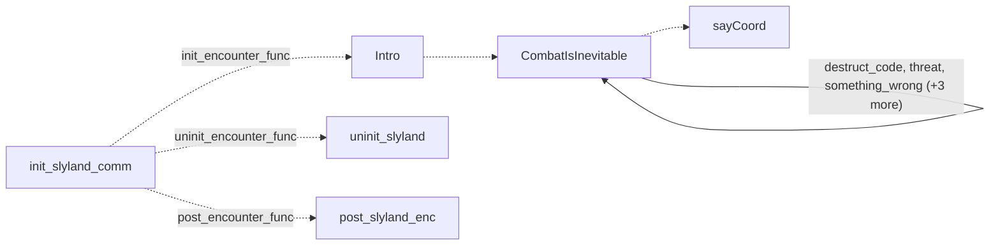

# Slylandro probe: existing conversation graph

> Generated by `tools/conversation_catalog.py`; do not edit this page by hand.

[Catalog and interpretation rules](../README.md) · [Proposed engine](../model.md)

Script: [slyland.c](../../../../sc2/src/uqm/comm/slyland/slyland.c#L1). Phrase bank: [probe.txt](../../../../sc2/content/base/comm/probe/probe.txt#L1).

6 handler/helper nodes; 6 response registration sites; 3 direct local calls; 86 phrase records.

## Initialization and lifecycle

| Phase | Callback | Bound by | Conditions / source |
| --- | --- | --- | --- |
| <code>init_encounter_func</code> | [<code>Intro</code>](#node-intro) | <code>init_slyland_comm</code> | No enclosing branch condition; [505](../../../../sc2/src/uqm/comm/slyland/slyland.c#L505) |
| <code>post_encounter_func</code> | [<code>post_slyland_enc</code>](#node-post_slyland_enc) | <code>init_slyland_comm</code> | No enclosing branch condition; [506](../../../../sc2/src/uqm/comm/slyland/slyland.c#L506) |
| <code>uninit_encounter_func</code> | [<code>uninit_slyland</code>](#node-uninit_slyland) | <code>init_slyland_comm</code> | No enclosing branch condition; [507](../../../../sc2/src/uqm/comm/slyland/slyland.c#L507) |

## Handler graph

Solid arrows are selectable responses; dashed arrows are direct C calls. Conditions, arguments, speech and effects are cataloged below. Parallel response sites are grouped only in this diagram.



## Condition catalog

Condition IDs describe enclosing source structure. Branch predicates combine with ∧; case labels mark source locations that can also be reached by fallthrough. Values refer to their original evaluation points. Local assignments and early control flow remain in the decision bodies.

| ID | Source expression / structural condition |
| --- | --- |
| <a id="condition-c1"></a>C1 | <code>R == 0</code> |
| <a id="condition-c2"></a>C2 | <code>GET_GAME_STATE(DESTRUCT_CODE_ON_SHIP)</code> |
| <a id="condition-c3"></a>C3 | <code>switch (GET_GAME_STATE(SLYLANDRO_PROBE_THREAT))</code> |
| <a id="condition-c4"></a>C4 | <code>case 0 (see source for fallthrough)</code> |
| <a id="condition-c5"></a>C5 | <code>case 1 (see source for fallthrough)</code> |
| <a id="condition-c6"></a>C6 | <code>case 2 (see source for fallthrough)</code> |
| <a id="condition-c7"></a>C7 | <code>default (see source for fallthrough)</code> |
| <a id="condition-c8"></a>C8 | <code>switch (GET_GAME_STATE(SLYLANDRO_PROBE_WRONG))</code> |
| <a id="condition-c9"></a>C9 | <code>switch (GET_GAME_STATE(SLYLANDRO_PROBE_ID))</code> |
| <a id="condition-c10"></a>C10 | <code>switch (GET_GAME_STATE(SLYLANDRO_PROBE_INFO))</code> |
| <a id="condition-c11"></a>C11 | <code>switch (GET_GAME_STATE(SLYLANDRO_PROBE_EXIT))</code> |
| <a id="condition-c12"></a>C12 | <code>!(R == 0)</code> |
| <a id="condition-c13"></a>C13 | <code>PLAYER_SAID(R, destruct_code)</code> |
| <a id="condition-c14"></a>C14 | <code>!(PLAYER_SAID(R, destruct_code))</code> |
| <a id="condition-c15"></a>C15 | <code>PLAYER_SAID(R, threat)</code> |
| <a id="condition-c16"></a>C16 | <code>switch (NumVisits++)</code> |
| <a id="condition-c17"></a>C17 | <code>case 3 (see source for fallthrough)</code> |
| <a id="condition-c18"></a>C18 | <code>!(PLAYER_SAID(R, threat))</code> |
| <a id="condition-c19"></a>C19 | <code>PLAYER_SAID(R, something_wrong)</code> |
| <a id="condition-c20"></a>C20 | <code>!(PLAYER_SAID(R, something_wrong))</code> |
| <a id="condition-c21"></a>C21 | <code>PLAYER_SAID(R, we_are_us)</code> |
| <a id="condition-c22"></a>C22 | <code>!(PLAYER_SAID(R, we_are_us))</code> |
| <a id="condition-c23"></a>C23 | <code>PLAYER_SAID(R, why_attack)</code> |
| <a id="condition-c24"></a>C24 | <code>!(PLAYER_SAID(R, why_attack))</code> |
| <a id="condition-c25"></a>C25 | <code>PLAYER_SAID(R, bye)</code> |
| <a id="condition-c26"></a>C26 | <code>case 4 (see source for fallthrough)</code> |
| <a id="condition-c27"></a>C27 | <code>case 5 (see source for fallthrough)</code> |
| <a id="condition-c28"></a>C28 | <code>case 6 (see source for fallthrough)</code> |
| <a id="condition-c29"></a>C29 | <code>case 7 (see source for fallthrough)</code> |

## Script-scope state and lookup tables

These declarations supply shared local state, computed phrase alternatives, number speech, or lookup data used by the nodes. LOCDATA presentation defaults are linked separately in the source.

<details>
<summary>probe_numbers_english</summary>

[Source](../../../../sc2/src/uqm/comm/slyland/slyland.c#L29)

```c
static const NUMBER_SPEECH_DESC probe_numbers_english;
```

</details>

Presentation descriptor <code>slylandro_desc</code>: [source](../../../../sc2/src/uqm/comm/slyland/slyland.c#L31).

<details>
<summary>probe_digit_names</summary>

[Source](../../../../sc2/src/uqm/comm/slyland/slyland.c#L123)

```c
static COUNT probe_digit_names[] = {ENUMERATE_ZERO, ENUMERATE_ONE, ENUMERATE_TWO, ENUMERATE_THREE, ENUMERATE_FOUR, ENUMERATE_FIVE, ENUMERATE_SIX, ENUMERATE_SEVEN, ENUMERATE_EIGHT, ENUMERATE_NINE};
```

</details>

<details>
<summary>probe_teen_names</summary>

[Source](../../../../sc2/src/uqm/comm/slyland/slyland.c#L137)

```c
static COUNT probe_teen_names[] = {ENUMERATE_TEN, ENUMERATE_ELEVEN, ENUMERATE_TWELVE, ENUMERATE_THIRTEEN, ENUMERATE_FOURTEEN, ENUMERATE_FIFTEEN, ENUMERATE_SIXTEEN, ENUMERATE_SEVENTEEN, ENUMERATE_EIGHTEEN, ENUMERATE_NINETEEN};
```

</details>

<details>
<summary>probe_tens_names</summary>

[Source](../../../../sc2/src/uqm/comm/slyland/slyland.c#L151)

```c
static COUNT probe_tens_names[] = {0, 0, ENUMERATE_TWENTY, ENUMERATE_THIRTY, ENUMERATE_FOURTY, ENUMERATE_FIFTY, ENUMERATE_SIXTY, ENUMERATE_SEVENTY, ENUMERATE_EIGHTY, ENUMERATE_NINETY};
```

</details>

<details>
<summary>probe_numbers_english</summary>

[Source](../../../../sc2/src/uqm/comm/slyland/slyland.c#L165)

```c
static const NUMBER_SPEECH_DESC probe_numbers_english = {5, {{1000, 0, NULL, NULL, ENUMERATE_THOUSAND}, {100, 0, probe_digit_names, NULL, ENUMERATE_HUNDRED}, {10, 0, probe_tens_names, NULL, 0}, {1, 10, probe_teen_names, NULL, 0}, {1, 0, probe_digit_names, NULL, 0}}};
```

</details>

<details>
<summary>threat</summary>

[Source](../../../../sc2/src/uqm/comm/slyland/slyland.c#L207)

```c
static RESPONSE_REF threat;
```

</details>

<details>
<summary>something_wrong</summary>

[Source](../../../../sc2/src/uqm/comm/slyland/slyland.c#L208)

```c
static RESPONSE_REF something_wrong;
```

</details>

<details>
<summary>we_are_us</summary>

[Source](../../../../sc2/src/uqm/comm/slyland/slyland.c#L209)

```c
static RESPONSE_REF we_are_us;
```

</details>

<details>
<summary>why_attack</summary>

[Source](../../../../sc2/src/uqm/comm/slyland/slyland.c#L210)

```c
static RESPONSE_REF why_attack;
```

</details>

<details>
<summary>bye</summary>

[Source](../../../../sc2/src/uqm/comm/slyland/slyland.c#L211)

```c
static RESPONSE_REF bye;
```

</details>

## Node catalog

<a id="node-saycoord"></a>

### sayCoord

<code>static void sayCoord(int coord)</code> — [source](../../../../sc2/src/uqm/comm/slyland/slyland.c#L214).

Also called directly by: [<code>CombatIsInevitable</code>](#node-combatisinevitable) ([388](../../../../sc2/src/uqm/comm/slyland/slyland.c#L388)), [<code>CombatIsInevitable</code>](#node-combatisinevitable) ([390](../../../../sc2/src/uqm/comm/slyland/slyland.c#L390)).

#### Dialogue / audio emissions

| Phrase or expression | Enclosing conditions | Source |
| --- | --- | --- |
| <code>(coord &lt; 0) ? (COORD_MINUS) : (COORD_PLUS)</code><br><code>NPCPhrase_splice((coord &lt; 0) ? (COORD_MINUS) : (COORD_PLUS))</code> | No enclosing branch condition | [220](../../../../sc2/src/uqm/comm/slyland/slyland.c#L220) |
| <code>ac / 10</code><br><code>NPCNumber(ac / 10, &quot;%03d&quot;)</code> | No enclosing branch condition | [221](../../../../sc2/src/uqm/comm/slyland/slyland.c#L221) |
| [<code>COORD_POINT</code>](#phrase-coord_point)<br><code>NPCPhrase_splice(COORD_POINT)</code> | No enclosing branch condition | [222](../../../../sc2/src/uqm/comm/slyland/slyland.c#L222) |
| <code>ac % 10</code><br><code>NPCNumber(ac % 10, NULL)</code> | No enclosing branch condition | [223](../../../../sc2/src/uqm/comm/slyland/slyland.c#L223) |

#### Actions, queries, local updates, and control flow

Calls are listed without assuming they are pure or mutating. Local updates are retained because they determine dynamic menus and counter-selected speech.

| Kind | Operation | Enclosing conditions | Source |
| --- | --- | --- | --- |
| update | <code>ac = abs(coord)</code> | No enclosing branch condition | [218](../../../../sc2/src/uqm/comm/slyland/slyland.c#L218) |
| call | <code>abs(coord)</code> | No enclosing branch condition | [218](../../../../sc2/src/uqm/comm/slyland/slyland.c#L218) |

<details>
<summary>Exact decision body (local calculations, early returns, fallthrough and ordering)</summary>

```c
{
	int ac;

	ac = abs (coord);

	NPCPhrase_splice (coord < 0 ? COORD_MINUS : COORD_PLUS);
	NPCNumber (ac / 10, "%03d");
	NPCPhrase_splice (COORD_POINT);
	NPCNumber (ac % 10, NULL);
}
```

</details>

<a id="node-combatisinevitable"></a>

### CombatIsInevitable

<code>static void CombatIsInevitable(RESPONSE_REF R)</code> — [source](../../../../sc2/src/uqm/comm/slyland/slyland.c#L227).

Incoming player-response variants: [<code>destruct_code</code>](#phrase-destruct_code), <code>threat</code>, <code>something_wrong</code>, <code>we_are_us</code>, <code>why_attack</code>, <code>bye</code>.

Also called directly by: [<code>Intro</code>](#node-intro) ([485](../../../../sc2/src/uqm/comm/slyland/slyland.c#L485)).

#### Dialogue / audio emissions

| Phrase or expression | Enclosing conditions | Source |
| --- | --- | --- |
| [<code>DESTRUCT_SEQUENCE</code>](#phrase-destruct_sequence)<br><code>NPCPhrase(DESTRUCT_SEQUENCE)</code> | [C12](#condition-c12) ∧ [C13](#condition-c13) | [316](../../../../sc2/src/uqm/comm/slyland/slyland.c#L316) |
| [<code>PROGRAMMED_TO_DEFEND_1</code>](#phrase-programmed_to_defend_1)<br><code>NPCPhrase(PROGRAMMED_TO_DEFEND_1)</code> | [C12](#condition-c12) ∧ [C14](#condition-c14) ∧ [C15](#condition-c15) ∧ [C16](#condition-c16) ∧ [C4](#condition-c4) | [329](../../../../sc2/src/uqm/comm/slyland/slyland.c#L329) |
| [<code>PROGRAMMED_TO_DEFEND_2</code>](#phrase-programmed_to_defend_2)<br><code>NPCPhrase(PROGRAMMED_TO_DEFEND_2)</code> | [C12](#condition-c12) ∧ [C14](#condition-c14) ∧ [C15](#condition-c15) ∧ [C16](#condition-c16) ∧ [C5](#condition-c5) | [332](../../../../sc2/src/uqm/comm/slyland/slyland.c#L332) |
| [<code>PROGRAMMED_TO_DEFEND_3</code>](#phrase-programmed_to_defend_3)<br><code>NPCPhrase(PROGRAMMED_TO_DEFEND_3)</code> | [C12](#condition-c12) ∧ [C14](#condition-c14) ∧ [C15](#condition-c15) ∧ [C16](#condition-c16) ∧ [C6](#condition-c6) | [335](../../../../sc2/src/uqm/comm/slyland/slyland.c#L335) |
| [<code>PROGRAMMED_TO_DEFEND_4</code>](#phrase-programmed_to_defend_4)<br><code>NPCPhrase(PROGRAMMED_TO_DEFEND_4)</code> | [C12](#condition-c12) ∧ [C14](#condition-c14) ∧ [C15](#condition-c15) ∧ [C16](#condition-c16) ∧ [C17](#condition-c17) | [338](../../../../sc2/src/uqm/comm/slyland/slyland.c#L338) |
| [<code>NOMINAL_FUNCTION_1</code>](#phrase-nominal_function_1)<br><code>NPCPhrase(NOMINAL_FUNCTION_1)</code> | [C12](#condition-c12) ∧ [C14](#condition-c14) ∧ [C18](#condition-c18) ∧ [C19](#condition-c19) ∧ [C16](#condition-c16) ∧ [C4](#condition-c4) | [350](../../../../sc2/src/uqm/comm/slyland/slyland.c#L350) |
| [<code>NOMINAL_FUNCTION_2</code>](#phrase-nominal_function_2)<br><code>NPCPhrase(NOMINAL_FUNCTION_2)</code> | [C12](#condition-c12) ∧ [C14](#condition-c14) ∧ [C18](#condition-c18) ∧ [C19](#condition-c19) ∧ [C16](#condition-c16) ∧ [C5](#condition-c5) | [353](../../../../sc2/src/uqm/comm/slyland/slyland.c#L353) |
| [<code>NOMINAL_FUNCTION_3</code>](#phrase-nominal_function_3)<br><code>NPCPhrase(NOMINAL_FUNCTION_3)</code> | [C12](#condition-c12) ∧ [C14](#condition-c14) ∧ [C18](#condition-c18) ∧ [C19](#condition-c19) ∧ [C16](#condition-c16) ∧ [C6](#condition-c6) | [356](../../../../sc2/src/uqm/comm/slyland/slyland.c#L356) |
| [<code>NOMINAL_FUNCTION_4</code>](#phrase-nominal_function_4)<br><code>NPCPhrase(NOMINAL_FUNCTION_4)</code> | [C12](#condition-c12) ∧ [C14](#condition-c14) ∧ [C18](#condition-c18) ∧ [C19](#condition-c19) ∧ [C16](#condition-c16) ∧ [C17](#condition-c17) | [359](../../../../sc2/src/uqm/comm/slyland/slyland.c#L359) |
| [<code>THIS_IS_PROBE_1</code>](#phrase-this_is_probe_1)<br><code>NPCPhrase(THIS_IS_PROBE_1)</code> | [C12](#condition-c12) ∧ [C14](#condition-c14) ∧ [C18](#condition-c18) ∧ [C20](#condition-c20) ∧ [C21](#condition-c21) ∧ [C16](#condition-c16) ∧ [C4](#condition-c4) | [371](../../../../sc2/src/uqm/comm/slyland/slyland.c#L371) |
| [<code>THIS_IS_PROBE_2</code>](#phrase-this_is_probe_2)<br><code>NPCPhrase(THIS_IS_PROBE_2)</code> | [C12](#condition-c12) ∧ [C14](#condition-c14) ∧ [C18](#condition-c18) ∧ [C20](#condition-c20) ∧ [C21](#condition-c21) ∧ [C16](#condition-c16) ∧ [C5](#condition-c5) | [374](../../../../sc2/src/uqm/comm/slyland/slyland.c#L374) |
| [<code>THIS_IS_PROBE_3</code>](#phrase-this_is_probe_3)<br><code>NPCPhrase(THIS_IS_PROBE_3)</code> | [C12](#condition-c12) ∧ [C14](#condition-c14) ∧ [C18](#condition-c18) ∧ [C20](#condition-c20) ∧ [C21](#condition-c21) ∧ [C16](#condition-c16) ∧ [C6](#condition-c6) | [377](../../../../sc2/src/uqm/comm/slyland/slyland.c#L377) |
| [<code>THIS_IS_PROBE_40</code>](#phrase-this_is_probe_40)<br><code>NPCPhrase(THIS_IS_PROBE_40)</code> | [C12](#condition-c12) ∧ [C14](#condition-c14) ∧ [C18](#condition-c18) ∧ [C20](#condition-c20) ∧ [C21](#condition-c21) ∧ [C16](#condition-c16) ∧ [C17](#condition-c17) | [387](../../../../sc2/src/uqm/comm/slyland/slyland.c#L387) |
| [<code>THIS_IS_PROBE_41</code>](#phrase-this_is_probe_41)<br><code>NPCPhrase_splice(THIS_IS_PROBE_41)</code> | [C12](#condition-c12) ∧ [C14](#condition-c14) ∧ [C18](#condition-c18) ∧ [C20](#condition-c20) ∧ [C21](#condition-c21) ∧ [C16](#condition-c16) ∧ [C17](#condition-c17) | [389](../../../../sc2/src/uqm/comm/slyland/slyland.c#L389) |
| [<code>THIS_IS_PROBE_42</code>](#phrase-this_is_probe_42)<br><code>NPCPhrase(THIS_IS_PROBE_42)</code> | [C12](#condition-c12) ∧ [C14](#condition-c14) ∧ [C18](#condition-c18) ∧ [C20](#condition-c20) ∧ [C21](#condition-c21) ∧ [C16](#condition-c16) ∧ [C17](#condition-c17) | [391](../../../../sc2/src/uqm/comm/slyland/slyland.c#L391) |
| [<code>PEACEFUL_MISSION_1</code>](#phrase-peaceful_mission_1)<br><code>NPCPhrase(PEACEFUL_MISSION_1)</code> | [C12](#condition-c12) ∧ [C14](#condition-c14) ∧ [C18](#condition-c18) ∧ [C20](#condition-c20) ∧ [C22](#condition-c22) ∧ [C23](#condition-c23) ∧ [C16](#condition-c16) ∧ [C4](#condition-c4) | [405](../../../../sc2/src/uqm/comm/slyland/slyland.c#L405) |
| [<code>PEACEFUL_MISSION_2</code>](#phrase-peaceful_mission_2)<br><code>NPCPhrase(PEACEFUL_MISSION_2)</code> | [C12](#condition-c12) ∧ [C14](#condition-c14) ∧ [C18](#condition-c18) ∧ [C20](#condition-c20) ∧ [C22](#condition-c22) ∧ [C23](#condition-c23) ∧ [C16](#condition-c16) ∧ [C5](#condition-c5) | [408](../../../../sc2/src/uqm/comm/slyland/slyland.c#L408) |
| [<code>PEACEFUL_MISSION_3</code>](#phrase-peaceful_mission_3)<br><code>NPCPhrase(PEACEFUL_MISSION_3)</code> | [C12](#condition-c12) ∧ [C14](#condition-c14) ∧ [C18](#condition-c18) ∧ [C20](#condition-c20) ∧ [C22](#condition-c22) ∧ [C23](#condition-c23) ∧ [C16](#condition-c16) ∧ [C6](#condition-c6) | [411](../../../../sc2/src/uqm/comm/slyland/slyland.c#L411) |
| [<code>PEACEFUL_MISSION_4</code>](#phrase-peaceful_mission_4)<br><code>NPCPhrase(PEACEFUL_MISSION_4)</code> | [C12](#condition-c12) ∧ [C14](#condition-c14) ∧ [C18](#condition-c18) ∧ [C20](#condition-c20) ∧ [C22](#condition-c22) ∧ [C23](#condition-c23) ∧ [C16](#condition-c16) ∧ [C17](#condition-c17) | [414](../../../../sc2/src/uqm/comm/slyland/slyland.c#L414) |
| [<code>GOODBYE_1</code>](#phrase-goodbye_1)<br><code>NPCPhrase(GOODBYE_1)</code> | [C12](#condition-c12) ∧ [C14](#condition-c14) ∧ [C18](#condition-c18) ∧ [C20](#condition-c20) ∧ [C22](#condition-c22) ∧ [C24](#condition-c24) ∧ [C25](#condition-c25) ∧ [C16](#condition-c16) ∧ [C4](#condition-c4) | [426](../../../../sc2/src/uqm/comm/slyland/slyland.c#L426) |
| [<code>GOODBYE_2</code>](#phrase-goodbye_2)<br><code>NPCPhrase(GOODBYE_2)</code> | [C12](#condition-c12) ∧ [C14](#condition-c14) ∧ [C18](#condition-c18) ∧ [C20](#condition-c20) ∧ [C22](#condition-c22) ∧ [C24](#condition-c24) ∧ [C25](#condition-c25) ∧ [C16](#condition-c16) ∧ [C5](#condition-c5) | [429](../../../../sc2/src/uqm/comm/slyland/slyland.c#L429) |
| [<code>GOODBYE_3</code>](#phrase-goodbye_3)<br><code>NPCPhrase(GOODBYE_3)</code> | [C12](#condition-c12) ∧ [C14](#condition-c14) ∧ [C18](#condition-c18) ∧ [C20](#condition-c20) ∧ [C22](#condition-c22) ∧ [C24](#condition-c24) ∧ [C25](#condition-c25) ∧ [C16](#condition-c16) ∧ [C6](#condition-c6) | [432](../../../../sc2/src/uqm/comm/slyland/slyland.c#L432) |
| [<code>GOODBYE_4</code>](#phrase-goodbye_4)<br><code>NPCPhrase(GOODBYE_4)</code> | [C12](#condition-c12) ∧ [C14](#condition-c14) ∧ [C18](#condition-c18) ∧ [C20](#condition-c20) ∧ [C22](#condition-c22) ∧ [C24](#condition-c24) ∧ [C25](#condition-c25) ∧ [C16](#condition-c16) ∧ [C17](#condition-c17) | [435](../../../../sc2/src/uqm/comm/slyland/slyland.c#L435) |
| [<code>HOSTILE</code>](#phrase-hostile)<br><code>NPCPhrase(HOSTILE)</code> | [C12](#condition-c12) ∧ [C14](#condition-c14) | [442](../../../../sc2/src/uqm/comm/slyland/slyland.c#L442) |

#### Response edges

| Player response | Destination on selection | Enclosing availability conditions | Source |
| --- | --- | --- | --- |
| [<code>destruct_code</code>](#phrase-destruct_code)<br>Transmit destruct sequence! | [<code>CombatIsInevitable</code>](#node-combatisinevitable) | [C1](#condition-c1) ∧ [C2](#condition-c2) | [232](../../../../sc2/src/uqm/comm/slyland/slyland.c#L232) |
| <code>threat</code><br>Computed phrase: resolve using the local updates / decision body below. | [<code>CombatIsInevitable</code>](#node-combatisinevitable) | [C1](#condition-c1) | [248](../../../../sc2/src/uqm/comm/slyland/slyland.c#L248) |
| <code>something_wrong</code><br>Computed phrase: resolve using the local updates / decision body below. | [<code>CombatIsInevitable</code>](#node-combatisinevitable) | [C1](#condition-c1) | [264](../../../../sc2/src/uqm/comm/slyland/slyland.c#L264) |
| <code>we_are_us</code><br>Computed phrase: resolve using the local updates / decision body below. | [<code>CombatIsInevitable</code>](#node-combatisinevitable) | [C1](#condition-c1) | [280](../../../../sc2/src/uqm/comm/slyland/slyland.c#L280) |
| <code>why_attack</code><br>Computed phrase: resolve using the local updates / decision body below. | [<code>CombatIsInevitable</code>](#node-combatisinevitable) | [C1](#condition-c1) | [296](../../../../sc2/src/uqm/comm/slyland/slyland.c#L296) |
| <code>bye</code><br>Computed phrase: resolve using the local updates / decision body below. | [<code>CombatIsInevitable</code>](#node-combatisinevitable) | [C1](#condition-c1) | [312](../../../../sc2/src/uqm/comm/slyland/slyland.c#L312) |

#### Actions, queries, local updates, and control flow

Calls are listed without assuming they are pure or mutating. Local updates are retained because they determine dynamic menus and counter-selected speech.

| Kind | Operation | Enclosing conditions | Source |
| --- | --- | --- | --- |
| call | <code>GET_GAME_STATE(DESTRUCT_CODE_ON_SHIP)</code> | [C1](#condition-c1) | [231](../../../../sc2/src/uqm/comm/slyland/slyland.c#L231) |
| call | <code>GET_GAME_STATE(SLYLANDRO_PROBE_THREAT)</code> | [C1](#condition-c1) | [233](../../../../sc2/src/uqm/comm/slyland/slyland.c#L233) |
| update | <code>threat = threat_1</code> | [C1](#condition-c1) ∧ [C3](#condition-c3) ∧ [C4](#condition-c4) | [236](../../../../sc2/src/uqm/comm/slyland/slyland.c#L236) |
| flow | <code>break;</code> | [C1](#condition-c1) ∧ [C3](#condition-c3) ∧ [C4](#condition-c4) | [237](../../../../sc2/src/uqm/comm/slyland/slyland.c#L237) |
| update | <code>threat = threat_2</code> | [C1](#condition-c1) ∧ [C3](#condition-c3) ∧ [C5](#condition-c5) | [239](../../../../sc2/src/uqm/comm/slyland/slyland.c#L239) |
| flow | <code>break;</code> | [C1](#condition-c1) ∧ [C3](#condition-c3) ∧ [C5](#condition-c5) | [240](../../../../sc2/src/uqm/comm/slyland/slyland.c#L240) |
| update | <code>threat = threat_3</code> | [C1](#condition-c1) ∧ [C3](#condition-c3) ∧ [C6](#condition-c6) | [242](../../../../sc2/src/uqm/comm/slyland/slyland.c#L242) |
| flow | <code>break;</code> | [C1](#condition-c1) ∧ [C3](#condition-c3) ∧ [C6](#condition-c6) | [243](../../../../sc2/src/uqm/comm/slyland/slyland.c#L243) |
| update | <code>threat = threat_4</code> | [C1](#condition-c1) ∧ [C3](#condition-c3) ∧ [C7](#condition-c7) | [245](../../../../sc2/src/uqm/comm/slyland/slyland.c#L245) |
| flow | <code>break;</code> | [C1](#condition-c1) ∧ [C3](#condition-c3) ∧ [C7](#condition-c7) | [246](../../../../sc2/src/uqm/comm/slyland/slyland.c#L246) |
| call | <code>GET_GAME_STATE(SLYLANDRO_PROBE_WRONG)</code> | [C1](#condition-c1) | [249](../../../../sc2/src/uqm/comm/slyland/slyland.c#L249) |
| update | <code>something_wrong = something_wrong_1</code> | [C1](#condition-c1) ∧ [C8](#condition-c8) ∧ [C4](#condition-c4) | [252](../../../../sc2/src/uqm/comm/slyland/slyland.c#L252) |
| flow | <code>break;</code> | [C1](#condition-c1) ∧ [C8](#condition-c8) ∧ [C4](#condition-c4) | [253](../../../../sc2/src/uqm/comm/slyland/slyland.c#L253) |
| update | <code>something_wrong = something_wrong_2</code> | [C1](#condition-c1) ∧ [C8](#condition-c8) ∧ [C5](#condition-c5) | [255](../../../../sc2/src/uqm/comm/slyland/slyland.c#L255) |
| flow | <code>break;</code> | [C1](#condition-c1) ∧ [C8](#condition-c8) ∧ [C5](#condition-c5) | [256](../../../../sc2/src/uqm/comm/slyland/slyland.c#L256) |
| update | <code>something_wrong = something_wrong_3</code> | [C1](#condition-c1) ∧ [C8](#condition-c8) ∧ [C6](#condition-c6) | [258](../../../../sc2/src/uqm/comm/slyland/slyland.c#L258) |
| flow | <code>break;</code> | [C1](#condition-c1) ∧ [C8](#condition-c8) ∧ [C6](#condition-c6) | [259](../../../../sc2/src/uqm/comm/slyland/slyland.c#L259) |
| update | <code>something_wrong = something_wrong_4</code> | [C1](#condition-c1) ∧ [C8](#condition-c8) ∧ [C7](#condition-c7) | [261](../../../../sc2/src/uqm/comm/slyland/slyland.c#L261) |
| flow | <code>break;</code> | [C1](#condition-c1) ∧ [C8](#condition-c8) ∧ [C7](#condition-c7) | [262](../../../../sc2/src/uqm/comm/slyland/slyland.c#L262) |
| call | <code>GET_GAME_STATE(SLYLANDRO_PROBE_ID)</code> | [C1](#condition-c1) | [265](../../../../sc2/src/uqm/comm/slyland/slyland.c#L265) |
| update | <code>we_are_us = we_are_us_1</code> | [C1](#condition-c1) ∧ [C9](#condition-c9) ∧ [C4](#condition-c4) | [268](../../../../sc2/src/uqm/comm/slyland/slyland.c#L268) |
| flow | <code>break;</code> | [C1](#condition-c1) ∧ [C9](#condition-c9) ∧ [C4](#condition-c4) | [269](../../../../sc2/src/uqm/comm/slyland/slyland.c#L269) |
| update | <code>we_are_us = we_are_us_2</code> | [C1](#condition-c1) ∧ [C9](#condition-c9) ∧ [C5](#condition-c5) | [271](../../../../sc2/src/uqm/comm/slyland/slyland.c#L271) |
| flow | <code>break;</code> | [C1](#condition-c1) ∧ [C9](#condition-c9) ∧ [C5](#condition-c5) | [272](../../../../sc2/src/uqm/comm/slyland/slyland.c#L272) |
| update | <code>we_are_us = we_are_us_3</code> | [C1](#condition-c1) ∧ [C9](#condition-c9) ∧ [C6](#condition-c6) | [274](../../../../sc2/src/uqm/comm/slyland/slyland.c#L274) |
| flow | <code>break;</code> | [C1](#condition-c1) ∧ [C9](#condition-c9) ∧ [C6](#condition-c6) | [275](../../../../sc2/src/uqm/comm/slyland/slyland.c#L275) |
| update | <code>we_are_us = we_are_us_4</code> | [C1](#condition-c1) ∧ [C9](#condition-c9) ∧ [C7](#condition-c7) | [277](../../../../sc2/src/uqm/comm/slyland/slyland.c#L277) |
| flow | <code>break;</code> | [C1](#condition-c1) ∧ [C9](#condition-c9) ∧ [C7](#condition-c7) | [278](../../../../sc2/src/uqm/comm/slyland/slyland.c#L278) |
| call | <code>GET_GAME_STATE(SLYLANDRO_PROBE_INFO)</code> | [C1](#condition-c1) | [281](../../../../sc2/src/uqm/comm/slyland/slyland.c#L281) |
| update | <code>why_attack = why_attack_1</code> | [C1](#condition-c1) ∧ [C10](#condition-c10) ∧ [C4](#condition-c4) | [284](../../../../sc2/src/uqm/comm/slyland/slyland.c#L284) |
| flow | <code>break;</code> | [C1](#condition-c1) ∧ [C10](#condition-c10) ∧ [C4](#condition-c4) | [285](../../../../sc2/src/uqm/comm/slyland/slyland.c#L285) |
| update | <code>why_attack = why_attack_2</code> | [C1](#condition-c1) ∧ [C10](#condition-c10) ∧ [C5](#condition-c5) | [287](../../../../sc2/src/uqm/comm/slyland/slyland.c#L287) |
| flow | <code>break;</code> | [C1](#condition-c1) ∧ [C10](#condition-c10) ∧ [C5](#condition-c5) | [288](../../../../sc2/src/uqm/comm/slyland/slyland.c#L288) |
| update | <code>why_attack = why_attack_3</code> | [C1](#condition-c1) ∧ [C10](#condition-c10) ∧ [C6](#condition-c6) | [290](../../../../sc2/src/uqm/comm/slyland/slyland.c#L290) |
| flow | <code>break;</code> | [C1](#condition-c1) ∧ [C10](#condition-c10) ∧ [C6](#condition-c6) | [291](../../../../sc2/src/uqm/comm/slyland/slyland.c#L291) |
| update | <code>why_attack = why_attack_4</code> | [C1](#condition-c1) ∧ [C10](#condition-c10) ∧ [C7](#condition-c7) | [293](../../../../sc2/src/uqm/comm/slyland/slyland.c#L293) |
| flow | <code>break;</code> | [C1](#condition-c1) ∧ [C10](#condition-c10) ∧ [C7](#condition-c7) | [294](../../../../sc2/src/uqm/comm/slyland/slyland.c#L294) |
| call | <code>GET_GAME_STATE(SLYLANDRO_PROBE_EXIT)</code> | [C1](#condition-c1) | [297](../../../../sc2/src/uqm/comm/slyland/slyland.c#L297) |
| update | <code>bye = bye_1</code> | [C1](#condition-c1) ∧ [C11](#condition-c11) ∧ [C4](#condition-c4) | [300](../../../../sc2/src/uqm/comm/slyland/slyland.c#L300) |
| flow | <code>break;</code> | [C1](#condition-c1) ∧ [C11](#condition-c11) ∧ [C4](#condition-c4) | [301](../../../../sc2/src/uqm/comm/slyland/slyland.c#L301) |
| update | <code>bye = bye_2</code> | [C1](#condition-c1) ∧ [C11](#condition-c11) ∧ [C5](#condition-c5) | [303](../../../../sc2/src/uqm/comm/slyland/slyland.c#L303) |
| flow | <code>break;</code> | [C1](#condition-c1) ∧ [C11](#condition-c11) ∧ [C5](#condition-c5) | [304](../../../../sc2/src/uqm/comm/slyland/slyland.c#L304) |
| update | <code>bye = bye_3</code> | [C1](#condition-c1) ∧ [C11](#condition-c11) ∧ [C6](#condition-c6) | [306](../../../../sc2/src/uqm/comm/slyland/slyland.c#L306) |
| flow | <code>break;</code> | [C1](#condition-c1) ∧ [C11](#condition-c11) ∧ [C6](#condition-c6) | [307](../../../../sc2/src/uqm/comm/slyland/slyland.c#L307) |
| update | <code>bye = bye_4</code> | [C1](#condition-c1) ∧ [C11](#condition-c11) ∧ [C7](#condition-c7) | [309](../../../../sc2/src/uqm/comm/slyland/slyland.c#L309) |
| flow | <code>break;</code> | [C1](#condition-c1) ∧ [C11](#condition-c11) ∧ [C7](#condition-c7) | [310](../../../../sc2/src/uqm/comm/slyland/slyland.c#L310) |
| call | <code>PLAYER_SAID(R, destruct_code)</code> | [C12](#condition-c12) | [314](../../../../sc2/src/uqm/comm/slyland/slyland.c#L314) |
| call | <code>setSegue(Segue_victory)</code> | [C12](#condition-c12) ∧ [C13](#condition-c13) | [317](../../../../sc2/src/uqm/comm/slyland/slyland.c#L317) |
| call | <code>PLAYER_SAID(R, threat)</code> | [C12](#condition-c12) ∧ [C14](#condition-c14) | [323](../../../../sc2/src/uqm/comm/slyland/slyland.c#L323) |
| update | <code>NumVisits = GET_GAME_STATE(SLYLANDRO_PROBE_THREAT)</code> | [C12](#condition-c12) ∧ [C14](#condition-c14) ∧ [C15](#condition-c15) | [325](../../../../sc2/src/uqm/comm/slyland/slyland.c#L325) |
| call | <code>GET_GAME_STATE(SLYLANDRO_PROBE_THREAT)</code> | [C12](#condition-c12) ∧ [C14](#condition-c14) ∧ [C15](#condition-c15) | [325](../../../../sc2/src/uqm/comm/slyland/slyland.c#L325) |
| update | <code>NumVisits++</code> | [C12](#condition-c12) ∧ [C14](#condition-c14) ∧ [C15](#condition-c15) | [326](../../../../sc2/src/uqm/comm/slyland/slyland.c#L326) |
| flow | <code>break;</code> | [C12](#condition-c12) ∧ [C14](#condition-c14) ∧ [C15](#condition-c15) ∧ [C16](#condition-c16) ∧ [C4](#condition-c4) | [330](../../../../sc2/src/uqm/comm/slyland/slyland.c#L330) |
| flow | <code>break;</code> | [C12](#condition-c12) ∧ [C14](#condition-c14) ∧ [C15](#condition-c15) ∧ [C16](#condition-c16) ∧ [C5](#condition-c5) | [333](../../../../sc2/src/uqm/comm/slyland/slyland.c#L333) |
| flow | <code>break;</code> | [C12](#condition-c12) ∧ [C14](#condition-c14) ∧ [C15](#condition-c15) ∧ [C16](#condition-c16) ∧ [C6](#condition-c6) | [336](../../../../sc2/src/uqm/comm/slyland/slyland.c#L336) |
| update | <code>--NumVisits</code> | [C12](#condition-c12) ∧ [C14](#condition-c14) ∧ [C15](#condition-c15) ∧ [C16](#condition-c16) ∧ [C17](#condition-c17) | [339](../../../../sc2/src/uqm/comm/slyland/slyland.c#L339) |
| flow | <code>break;</code> | [C12](#condition-c12) ∧ [C14](#condition-c14) ∧ [C15](#condition-c15) ∧ [C16](#condition-c16) ∧ [C17](#condition-c17) | [340](../../../../sc2/src/uqm/comm/slyland/slyland.c#L340) |
| call | <code>SET_GAME_STATE(SLYLANDRO_PROBE_THREAT, NumVisits)</code> | [C12](#condition-c12) ∧ [C14](#condition-c14) ∧ [C15](#condition-c15) | [342](../../../../sc2/src/uqm/comm/slyland/slyland.c#L342) |
| call | <code>PLAYER_SAID(R, something_wrong)</code> | [C12](#condition-c12) ∧ [C14](#condition-c14) ∧ [C18](#condition-c18) | [344](../../../../sc2/src/uqm/comm/slyland/slyland.c#L344) |
| update | <code>NumVisits = GET_GAME_STATE(SLYLANDRO_PROBE_WRONG)</code> | [C12](#condition-c12) ∧ [C14](#condition-c14) ∧ [C18](#condition-c18) ∧ [C19](#condition-c19) | [346](../../../../sc2/src/uqm/comm/slyland/slyland.c#L346) |
| call | <code>GET_GAME_STATE(SLYLANDRO_PROBE_WRONG)</code> | [C12](#condition-c12) ∧ [C14](#condition-c14) ∧ [C18](#condition-c18) ∧ [C19](#condition-c19) | [346](../../../../sc2/src/uqm/comm/slyland/slyland.c#L346) |
| update | <code>NumVisits++</code> | [C12](#condition-c12) ∧ [C14](#condition-c14) ∧ [C18](#condition-c18) ∧ [C19](#condition-c19) | [347](../../../../sc2/src/uqm/comm/slyland/slyland.c#L347) |
| flow | <code>break;</code> | [C12](#condition-c12) ∧ [C14](#condition-c14) ∧ [C18](#condition-c18) ∧ [C19](#condition-c19) ∧ [C16](#condition-c16) ∧ [C4](#condition-c4) | [351](../../../../sc2/src/uqm/comm/slyland/slyland.c#L351) |
| flow | <code>break;</code> | [C12](#condition-c12) ∧ [C14](#condition-c14) ∧ [C18](#condition-c18) ∧ [C19](#condition-c19) ∧ [C16](#condition-c16) ∧ [C5](#condition-c5) | [354](../../../../sc2/src/uqm/comm/slyland/slyland.c#L354) |
| flow | <code>break;</code> | [C12](#condition-c12) ∧ [C14](#condition-c14) ∧ [C18](#condition-c18) ∧ [C19](#condition-c19) ∧ [C16](#condition-c16) ∧ [C6](#condition-c6) | [357](../../../../sc2/src/uqm/comm/slyland/slyland.c#L357) |
| update | <code>--NumVisits</code> | [C12](#condition-c12) ∧ [C14](#condition-c14) ∧ [C18](#condition-c18) ∧ [C19](#condition-c19) ∧ [C16](#condition-c16) ∧ [C17](#condition-c17) | [360](../../../../sc2/src/uqm/comm/slyland/slyland.c#L360) |
| flow | <code>break;</code> | [C12](#condition-c12) ∧ [C14](#condition-c14) ∧ [C18](#condition-c18) ∧ [C19](#condition-c19) ∧ [C16](#condition-c16) ∧ [C17](#condition-c17) | [361](../../../../sc2/src/uqm/comm/slyland/slyland.c#L361) |
| call | <code>SET_GAME_STATE(SLYLANDRO_PROBE_WRONG, NumVisits)</code> | [C12](#condition-c12) ∧ [C14](#condition-c14) ∧ [C18](#condition-c18) ∧ [C19](#condition-c19) | [363](../../../../sc2/src/uqm/comm/slyland/slyland.c#L363) |
| call | <code>PLAYER_SAID(R, we_are_us)</code> | [C12](#condition-c12) ∧ [C14](#condition-c14) ∧ [C18](#condition-c18) ∧ [C20](#condition-c20) | [365](../../../../sc2/src/uqm/comm/slyland/slyland.c#L365) |
| update | <code>NumVisits = GET_GAME_STATE(SLYLANDRO_PROBE_ID)</code> | [C12](#condition-c12) ∧ [C14](#condition-c14) ∧ [C18](#condition-c18) ∧ [C20](#condition-c20) ∧ [C21](#condition-c21) | [367](../../../../sc2/src/uqm/comm/slyland/slyland.c#L367) |
| call | <code>GET_GAME_STATE(SLYLANDRO_PROBE_ID)</code> | [C12](#condition-c12) ∧ [C14](#condition-c14) ∧ [C18](#condition-c18) ∧ [C20](#condition-c20) ∧ [C21](#condition-c21) | [367](../../../../sc2/src/uqm/comm/slyland/slyland.c#L367) |
| update | <code>NumVisits++</code> | [C12](#condition-c12) ∧ [C14](#condition-c14) ∧ [C18](#condition-c18) ∧ [C20](#condition-c20) ∧ [C21](#condition-c21) | [368](../../../../sc2/src/uqm/comm/slyland/slyland.c#L368) |
| flow | <code>break;</code> | [C12](#condition-c12) ∧ [C14](#condition-c14) ∧ [C18](#condition-c18) ∧ [C20](#condition-c20) ∧ [C21](#condition-c21) ∧ [C16](#condition-c16) ∧ [C4](#condition-c4) | [372](../../../../sc2/src/uqm/comm/slyland/slyland.c#L372) |
| flow | <code>break;</code> | [C12](#condition-c12) ∧ [C14](#condition-c14) ∧ [C18](#condition-c18) ∧ [C20](#condition-c20) ∧ [C21](#condition-c21) ∧ [C16](#condition-c16) ∧ [C5](#condition-c5) | [375](../../../../sc2/src/uqm/comm/slyland/slyland.c#L375) |
| flow | <code>break;</code> | [C12](#condition-c12) ∧ [C14](#condition-c14) ∧ [C18](#condition-c18) ∧ [C20](#condition-c20) ∧ [C21](#condition-c21) ∧ [C16](#condition-c16) ∧ [C6](#condition-c6) | [378](../../../../sc2/src/uqm/comm/slyland/slyland.c#L378) |
| update | <code>dx = LOGX_TO_UNIVERSE(GetPlayerTravelPosition()-&gt;position.x) - 333</code> | [C12](#condition-c12) ∧ [C14](#condition-c14) ∧ [C18](#condition-c18) ∧ [C20](#condition-c20) ∧ [C21](#condition-c21) ∧ [C16](#condition-c16) ∧ [C17](#condition-c17) | [384](../../../../sc2/src/uqm/comm/slyland/slyland.c#L384) |
| call | <code>LOGX_TO_UNIVERSE(GetPlayerTravelPosition()-&gt;position.x)</code> | [C12](#condition-c12) ∧ [C14](#condition-c14) ∧ [C18](#condition-c18) ∧ [C20](#condition-c20) ∧ [C21](#condition-c21) ∧ [C16](#condition-c16) ∧ [C17](#condition-c17) | [384](../../../../sc2/src/uqm/comm/slyland/slyland.c#L384) |
| call | <code>GetPlayerTravelPosition()</code> | [C12](#condition-c12) ∧ [C14](#condition-c14) ∧ [C18](#condition-c18) ∧ [C20](#condition-c20) ∧ [C21](#condition-c21) ∧ [C16](#condition-c16) ∧ [C17](#condition-c17) | [384](../../../../sc2/src/uqm/comm/slyland/slyland.c#L384) |
| update | <code>dy = 9812 - LOGY_TO_UNIVERSE(GetPlayerTravelPosition()-&gt;position.y)</code> | [C12](#condition-c12) ∧ [C14](#condition-c14) ∧ [C18](#condition-c18) ∧ [C20](#condition-c20) ∧ [C21](#condition-c21) ∧ [C16](#condition-c16) ∧ [C17](#condition-c17) | [385](../../../../sc2/src/uqm/comm/slyland/slyland.c#L385) |
| call | <code>LOGY_TO_UNIVERSE(GetPlayerTravelPosition()-&gt;position.y)</code> | [C12](#condition-c12) ∧ [C14](#condition-c14) ∧ [C18](#condition-c18) ∧ [C20](#condition-c20) ∧ [C21](#condition-c21) ∧ [C16](#condition-c16) ∧ [C17](#condition-c17) | [385](../../../../sc2/src/uqm/comm/slyland/slyland.c#L385) |
| call | <code>GetPlayerTravelPosition()</code> | [C12](#condition-c12) ∧ [C14](#condition-c14) ∧ [C18](#condition-c18) ∧ [C20](#condition-c20) ∧ [C21](#condition-c21) ∧ [C16](#condition-c16) ∧ [C17](#condition-c17) | [385](../../../../sc2/src/uqm/comm/slyland/slyland.c#L385) |
| call | <code>sayCoord(dy)</code> → [<code>sayCoord</code>](#node-saycoord) | [C12](#condition-c12) ∧ [C14](#condition-c14) ∧ [C18](#condition-c18) ∧ [C20](#condition-c20) ∧ [C21](#condition-c21) ∧ [C16](#condition-c16) ∧ [C17](#condition-c17) | [388](../../../../sc2/src/uqm/comm/slyland/slyland.c#L388) |
| call | <code>sayCoord(dx)</code> → [<code>sayCoord</code>](#node-saycoord) | [C12](#condition-c12) ∧ [C14](#condition-c14) ∧ [C18](#condition-c18) ∧ [C20](#condition-c20) ∧ [C21](#condition-c21) ∧ [C16](#condition-c16) ∧ [C17](#condition-c17) | [390](../../../../sc2/src/uqm/comm/slyland/slyland.c#L390) |
| update | <code>--NumVisits</code> | [C12](#condition-c12) ∧ [C14](#condition-c14) ∧ [C18](#condition-c18) ∧ [C20](#condition-c20) ∧ [C21](#condition-c21) ∧ [C16](#condition-c16) ∧ [C17](#condition-c17) | [393](../../../../sc2/src/uqm/comm/slyland/slyland.c#L393) |
| flow | <code>break;</code> | [C12](#condition-c12) ∧ [C14](#condition-c14) ∧ [C18](#condition-c18) ∧ [C20](#condition-c20) ∧ [C21](#condition-c21) ∧ [C16](#condition-c16) ∧ [C17](#condition-c17) | [394](../../../../sc2/src/uqm/comm/slyland/slyland.c#L394) |
| call | <code>SET_GAME_STATE(SLYLANDRO_PROBE_ID, NumVisits)</code> | [C12](#condition-c12) ∧ [C14](#condition-c14) ∧ [C18](#condition-c18) ∧ [C20](#condition-c20) ∧ [C21](#condition-c21) | [397](../../../../sc2/src/uqm/comm/slyland/slyland.c#L397) |
| call | <code>PLAYER_SAID(R, why_attack)</code> | [C12](#condition-c12) ∧ [C14](#condition-c14) ∧ [C18](#condition-c18) ∧ [C20](#condition-c20) ∧ [C22](#condition-c22) | [399](../../../../sc2/src/uqm/comm/slyland/slyland.c#L399) |
| update | <code>NumVisits = GET_GAME_STATE(SLYLANDRO_PROBE_INFO)</code> | [C12](#condition-c12) ∧ [C14](#condition-c14) ∧ [C18](#condition-c18) ∧ [C20](#condition-c20) ∧ [C22](#condition-c22) ∧ [C23](#condition-c23) | [401](../../../../sc2/src/uqm/comm/slyland/slyland.c#L401) |
| call | <code>GET_GAME_STATE(SLYLANDRO_PROBE_INFO)</code> | [C12](#condition-c12) ∧ [C14](#condition-c14) ∧ [C18](#condition-c18) ∧ [C20](#condition-c20) ∧ [C22](#condition-c22) ∧ [C23](#condition-c23) | [401](../../../../sc2/src/uqm/comm/slyland/slyland.c#L401) |
| update | <code>NumVisits++</code> | [C12](#condition-c12) ∧ [C14](#condition-c14) ∧ [C18](#condition-c18) ∧ [C20](#condition-c20) ∧ [C22](#condition-c22) ∧ [C23](#condition-c23) | [402](../../../../sc2/src/uqm/comm/slyland/slyland.c#L402) |
| flow | <code>break;</code> | [C12](#condition-c12) ∧ [C14](#condition-c14) ∧ [C18](#condition-c18) ∧ [C20](#condition-c20) ∧ [C22](#condition-c22) ∧ [C23](#condition-c23) ∧ [C16](#condition-c16) ∧ [C4](#condition-c4) | [406](../../../../sc2/src/uqm/comm/slyland/slyland.c#L406) |
| flow | <code>break;</code> | [C12](#condition-c12) ∧ [C14](#condition-c14) ∧ [C18](#condition-c18) ∧ [C20](#condition-c20) ∧ [C22](#condition-c22) ∧ [C23](#condition-c23) ∧ [C16](#condition-c16) ∧ [C5](#condition-c5) | [409](../../../../sc2/src/uqm/comm/slyland/slyland.c#L409) |
| flow | <code>break;</code> | [C12](#condition-c12) ∧ [C14](#condition-c14) ∧ [C18](#condition-c18) ∧ [C20](#condition-c20) ∧ [C22](#condition-c22) ∧ [C23](#condition-c23) ∧ [C16](#condition-c16) ∧ [C6](#condition-c6) | [412](../../../../sc2/src/uqm/comm/slyland/slyland.c#L412) |
| update | <code>--NumVisits</code> | [C12](#condition-c12) ∧ [C14](#condition-c14) ∧ [C18](#condition-c18) ∧ [C20](#condition-c20) ∧ [C22](#condition-c22) ∧ [C23](#condition-c23) ∧ [C16](#condition-c16) ∧ [C17](#condition-c17) | [415](../../../../sc2/src/uqm/comm/slyland/slyland.c#L415) |
| flow | <code>break;</code> | [C12](#condition-c12) ∧ [C14](#condition-c14) ∧ [C18](#condition-c18) ∧ [C20](#condition-c20) ∧ [C22](#condition-c22) ∧ [C23](#condition-c23) ∧ [C16](#condition-c16) ∧ [C17](#condition-c17) | [416](../../../../sc2/src/uqm/comm/slyland/slyland.c#L416) |
| call | <code>SET_GAME_STATE(SLYLANDRO_PROBE_INFO, NumVisits)</code> | [C12](#condition-c12) ∧ [C14](#condition-c14) ∧ [C18](#condition-c18) ∧ [C20](#condition-c20) ∧ [C22](#condition-c22) ∧ [C23](#condition-c23) | [418](../../../../sc2/src/uqm/comm/slyland/slyland.c#L418) |
| call | <code>PLAYER_SAID(R, bye)</code> | [C12](#condition-c12) ∧ [C14](#condition-c14) ∧ [C18](#condition-c18) ∧ [C20](#condition-c20) ∧ [C22](#condition-c22) ∧ [C24](#condition-c24) | [420](../../../../sc2/src/uqm/comm/slyland/slyland.c#L420) |
| update | <code>NumVisits = GET_GAME_STATE(SLYLANDRO_PROBE_EXIT)</code> | [C12](#condition-c12) ∧ [C14](#condition-c14) ∧ [C18](#condition-c18) ∧ [C20](#condition-c20) ∧ [C22](#condition-c22) ∧ [C24](#condition-c24) ∧ [C25](#condition-c25) | [422](../../../../sc2/src/uqm/comm/slyland/slyland.c#L422) |
| call | <code>GET_GAME_STATE(SLYLANDRO_PROBE_EXIT)</code> | [C12](#condition-c12) ∧ [C14](#condition-c14) ∧ [C18](#condition-c18) ∧ [C20](#condition-c20) ∧ [C22](#condition-c22) ∧ [C24](#condition-c24) ∧ [C25](#condition-c25) | [422](../../../../sc2/src/uqm/comm/slyland/slyland.c#L422) |
| update | <code>NumVisits++</code> | [C12](#condition-c12) ∧ [C14](#condition-c14) ∧ [C18](#condition-c18) ∧ [C20](#condition-c20) ∧ [C22](#condition-c22) ∧ [C24](#condition-c24) ∧ [C25](#condition-c25) | [423](../../../../sc2/src/uqm/comm/slyland/slyland.c#L423) |
| flow | <code>break;</code> | [C12](#condition-c12) ∧ [C14](#condition-c14) ∧ [C18](#condition-c18) ∧ [C20](#condition-c20) ∧ [C22](#condition-c22) ∧ [C24](#condition-c24) ∧ [C25](#condition-c25) ∧ [C16](#condition-c16) ∧ [C4](#condition-c4) | [427](../../../../sc2/src/uqm/comm/slyland/slyland.c#L427) |
| flow | <code>break;</code> | [C12](#condition-c12) ∧ [C14](#condition-c14) ∧ [C18](#condition-c18) ∧ [C20](#condition-c20) ∧ [C22](#condition-c22) ∧ [C24](#condition-c24) ∧ [C25](#condition-c25) ∧ [C16](#condition-c16) ∧ [C5](#condition-c5) | [430](../../../../sc2/src/uqm/comm/slyland/slyland.c#L430) |
| flow | <code>break;</code> | [C12](#condition-c12) ∧ [C14](#condition-c14) ∧ [C18](#condition-c18) ∧ [C20](#condition-c20) ∧ [C22](#condition-c22) ∧ [C24](#condition-c24) ∧ [C25](#condition-c25) ∧ [C16](#condition-c16) ∧ [C6](#condition-c6) | [433](../../../../sc2/src/uqm/comm/slyland/slyland.c#L433) |
| update | <code>--NumVisits</code> | [C12](#condition-c12) ∧ [C14](#condition-c14) ∧ [C18](#condition-c18) ∧ [C20](#condition-c20) ∧ [C22](#condition-c22) ∧ [C24](#condition-c24) ∧ [C25](#condition-c25) ∧ [C16](#condition-c16) ∧ [C17](#condition-c17) | [436](../../../../sc2/src/uqm/comm/slyland/slyland.c#L436) |
| flow | <code>break;</code> | [C12](#condition-c12) ∧ [C14](#condition-c14) ∧ [C18](#condition-c18) ∧ [C20](#condition-c20) ∧ [C22](#condition-c22) ∧ [C24](#condition-c24) ∧ [C25](#condition-c25) ∧ [C16](#condition-c16) ∧ [C17](#condition-c17) | [437](../../../../sc2/src/uqm/comm/slyland/slyland.c#L437) |
| call | <code>SET_GAME_STATE(SLYLANDRO_PROBE_EXIT, NumVisits)</code> | [C12](#condition-c12) ∧ [C14](#condition-c14) ∧ [C18](#condition-c18) ∧ [C20](#condition-c20) ∧ [C22](#condition-c22) ∧ [C24](#condition-c24) ∧ [C25](#condition-c25) | [439](../../../../sc2/src/uqm/comm/slyland/slyland.c#L439) |
| call | <code>SET_GAME_STATE(PROBE_EXHIBITED_BUG, 1)</code> | [C12](#condition-c12) ∧ [C14](#condition-c14) | [444](../../../../sc2/src/uqm/comm/slyland/slyland.c#L444) |
| call | <code>setSegue(Segue_hostile)</code> | [C12](#condition-c12) ∧ [C14](#condition-c14) | [445](../../../../sc2/src/uqm/comm/slyland/slyland.c#L445) |

<details>
<summary>Exact decision body (local calculations, early returns, fallthrough and ordering)</summary>

```c
{
	if (R == 0)
	{
		if (GET_GAME_STATE (DESTRUCT_CODE_ON_SHIP))
			Response (destruct_code, CombatIsInevitable);
		switch (GET_GAME_STATE (SLYLANDRO_PROBE_THREAT))
		{
			case 0:
				threat = threat_1;
				break;
			case 1:
				threat = threat_2;
				break;
			case 2:
				threat = threat_3;
				break;
			default:
				threat = threat_4;
				break;
		}
		Response (threat, CombatIsInevitable);
		switch (GET_GAME_STATE (SLYLANDRO_PROBE_WRONG))
		{
			case 0:
				something_wrong = something_wrong_1;
				break;
			case 1:
				something_wrong = something_wrong_2;
				break;
			case 2:
				something_wrong = something_wrong_3;
				break;
			default:
				something_wrong = something_wrong_4;
				break;
		}
		Response (something_wrong, CombatIsInevitable);
		switch (GET_GAME_STATE (SLYLANDRO_PROBE_ID))
		{
			case 0:
				we_are_us = we_are_us_1;
				break;
			case 1:
				we_are_us = we_are_us_2;
				break;
			case 2:
				we_are_us = we_are_us_3;
				break;
			default:
				we_are_us = we_are_us_4;
				break;
		}
		Response (we_are_us, CombatIsInevitable);
		switch (GET_GAME_STATE (SLYLANDRO_PROBE_INFO))
		{
			case 0:
				why_attack = why_attack_1;
				break;
			case 1:
				why_attack = why_attack_2;
				break;
			case 2:
				why_attack = why_attack_3;
				break;
			default:
				why_attack = why_attack_4;
				break;
		}
		Response (why_attack, CombatIsInevitable);
		switch (GET_GAME_STATE (SLYLANDRO_PROBE_EXIT))
		{
			case 0:
				bye = bye_1;
				break;
			case 1:
				bye = bye_2;
				break;
			case 2:
				bye = bye_3;
				break;
			default:
				bye = bye_4;
				break;
		}
		Response (bye, CombatIsInevitable);
	}
	else if (PLAYER_SAID (R, destruct_code))
	{
		NPCPhrase (DESTRUCT_SEQUENCE);
		setSegue (Segue_victory);
	}
	else
	{
		BYTE NumVisits;

		if (PLAYER_SAID (R, threat))
		{
			NumVisits = GET_GAME_STATE (SLYLANDRO_PROBE_THREAT);
			switch (NumVisits++)
			{
				case 0:
					NPCPhrase (PROGRAMMED_TO_DEFEND_1);
					break;
				case 1:
					NPCPhrase (PROGRAMMED_TO_DEFEND_2);
					break;
				case 2:
					NPCPhrase (PROGRAMMED_TO_DEFEND_3);
					break;
				case 3:
					NPCPhrase (PROGRAMMED_TO_DEFEND_4);
					--NumVisits;
					break;
			}
			SET_GAME_STATE (SLYLANDRO_PROBE_THREAT, NumVisits);
		}
		else if (PLAYER_SAID (R, something_wrong))
		{
			NumVisits = GET_GAME_STATE (SLYLANDRO_PROBE_WRONG);
			switch (NumVisits++)
			{
				case 0:
					NPCPhrase (NOMINAL_FUNCTION_1);
					break;
				case 1:
					NPCPhrase (NOMINAL_FUNCTION_2);
					break;
				case 2:
					NPCPhrase (NOMINAL_FUNCTION_3);
					break;
				case 3:
					NPCPhrase (NOMINAL_FUNCTION_4);
					--NumVisits;
					break;
			}
			SET_GAME_STATE (SLYLANDRO_PROBE_WRONG, NumVisits);
		}
		else if (PLAYER_SAID (R, we_are_us))
		{
			NumVisits = GET_GAME_STATE (SLYLANDRO_PROBE_ID);
			switch (NumVisits++)
			{
				case 0:
					NPCPhrase (THIS_IS_PROBE_1);
					break;
				case 1:
					NPCPhrase (THIS_IS_PROBE_2);
					break;
				case 2:
					NPCPhrase (THIS_IS_PROBE_3);
					break;
				case 3:
				{
					SIZE dx, dy;

					// Probe's coordinate system is {-Y,X} relative to B Corvi
					dx = LOGX_TO_UNIVERSE (GetPlayerTravelPosition()->position.x) - 333;
					dy = 9812 - LOGY_TO_UNIVERSE (GetPlayerTravelPosition()->position.y);

					NPCPhrase (THIS_IS_PROBE_40);
					sayCoord (dy);
					NPCPhrase_splice (THIS_IS_PROBE_41);
					sayCoord (dx);
					NPCPhrase (THIS_IS_PROBE_42);

					--NumVisits;
					break;
				}
			}
			SET_GAME_STATE (SLYLANDRO_PROBE_ID, NumVisits);
		}
		else if (PLAYER_SAID (R, why_attack))
		{
			NumVisits = GET_GAME_STATE (SLYLANDRO_PROBE_INFO);
			switch (NumVisits++)
			{
				case 0:
					NPCPhrase (PEACEFUL_MISSION_1);
					break;
				case 1:
					NPCPhrase (PEACEFUL_MISSION_2);
					break;
				case 2:
					NPCPhrase (PEACEFUL_MISSION_3);
					break;
				case 3:
					NPCPhrase (PEACEFUL_MISSION_4);
					--NumVisits;
					break;
			}
			SET_GAME_STATE (SLYLANDRO_PROBE_INFO, NumVisits);
		}
		else if (PLAYER_SAID (R, bye))
		{
			NumVisits = GET_GAME_STATE (SLYLANDRO_PROBE_EXIT);
			switch (NumVisits++)
			{
				case 0:
					NPCPhrase (GOODBYE_1);
					break;
				case 1:
					NPCPhrase (GOODBYE_2);
					break;
				case 2:
					NPCPhrase (GOODBYE_3);
					break;
				case 3:
					NPCPhrase (GOODBYE_4);
					--NumVisits;
					break;
			}
			SET_GAME_STATE (SLYLANDRO_PROBE_EXIT, NumVisits);
		}

		NPCPhrase (HOSTILE);

		SET_GAME_STATE (PROBE_EXHIBITED_BUG, 1);
		setSegue (Segue_hostile);
	}
}
```

</details>

<a id="node-intro"></a>

### Intro

<code>static void Intro(void)</code> — [source](../../../../sc2/src/uqm/comm/slyland/slyland.c#L450).

#### Dialogue / audio emissions

| Phrase or expression | Enclosing conditions | Source |
| --- | --- | --- |
| [<code>WE_COME_IN_PEACE_1</code>](#phrase-we_come_in_peace_1)<br><code>NPCPhrase(WE_COME_IN_PEACE_1)</code> | [C16](#condition-c16) ∧ [C4](#condition-c4) | [458](../../../../sc2/src/uqm/comm/slyland/slyland.c#L458) |
| [<code>WE_COME_IN_PEACE_2</code>](#phrase-we_come_in_peace_2)<br><code>NPCPhrase(WE_COME_IN_PEACE_2)</code> | [C16](#condition-c16) ∧ [C5](#condition-c5) | [461](../../../../sc2/src/uqm/comm/slyland/slyland.c#L461) |
| [<code>WE_COME_IN_PEACE_3</code>](#phrase-we_come_in_peace_3)<br><code>NPCPhrase(WE_COME_IN_PEACE_3)</code> | [C16](#condition-c16) ∧ [C6](#condition-c6) | [464](../../../../sc2/src/uqm/comm/slyland/slyland.c#L464) |
| [<code>WE_COME_IN_PEACE_4</code>](#phrase-we_come_in_peace_4)<br><code>NPCPhrase(WE_COME_IN_PEACE_4)</code> | [C16](#condition-c16) ∧ [C17](#condition-c17) | [467](../../../../sc2/src/uqm/comm/slyland/slyland.c#L467) |
| [<code>WE_COME_IN_PEACE_5</code>](#phrase-we_come_in_peace_5)<br><code>NPCPhrase(WE_COME_IN_PEACE_5)</code> | [C16](#condition-c16) ∧ [C26](#condition-c26) | [470](../../../../sc2/src/uqm/comm/slyland/slyland.c#L470) |
| [<code>WE_COME_IN_PEACE_6</code>](#phrase-we_come_in_peace_6)<br><code>NPCPhrase(WE_COME_IN_PEACE_6)</code> | [C16](#condition-c16) ∧ [C27](#condition-c27) | [473](../../../../sc2/src/uqm/comm/slyland/slyland.c#L473) |
| [<code>WE_COME_IN_PEACE_7</code>](#phrase-we_come_in_peace_7)<br><code>NPCPhrase(WE_COME_IN_PEACE_7)</code> | [C16](#condition-c16) ∧ [C28](#condition-c28) | [476](../../../../sc2/src/uqm/comm/slyland/slyland.c#L476) |
| [<code>WE_COME_IN_PEACE_8</code>](#phrase-we_come_in_peace_8)<br><code>NPCPhrase(WE_COME_IN_PEACE_8)</code> | [C16](#condition-c16) ∧ [C29](#condition-c29) | [479](../../../../sc2/src/uqm/comm/slyland/slyland.c#L479) |

#### Actions, queries, local updates, and control flow

Calls are listed without assuming they are pure or mutating. Local updates are retained because they determine dynamic menus and counter-selected speech.

| Kind | Operation | Enclosing conditions | Source |
| --- | --- | --- | --- |
| update | <code>NumVisits = GET_GAME_STATE(SLYLANDRO_PROBE_VISITS)</code> | No enclosing branch condition | [454](../../../../sc2/src/uqm/comm/slyland/slyland.c#L454) |
| call | <code>GET_GAME_STATE(SLYLANDRO_PROBE_VISITS)</code> | No enclosing branch condition | [454](../../../../sc2/src/uqm/comm/slyland/slyland.c#L454) |
| update | <code>NumVisits++</code> | No enclosing branch condition | [455](../../../../sc2/src/uqm/comm/slyland/slyland.c#L455) |
| flow | <code>break;</code> | [C16](#condition-c16) ∧ [C4](#condition-c4) | [459](../../../../sc2/src/uqm/comm/slyland/slyland.c#L459) |
| flow | <code>break;</code> | [C16](#condition-c16) ∧ [C5](#condition-c5) | [462](../../../../sc2/src/uqm/comm/slyland/slyland.c#L462) |
| flow | <code>break;</code> | [C16](#condition-c16) ∧ [C6](#condition-c6) | [465](../../../../sc2/src/uqm/comm/slyland/slyland.c#L465) |
| flow | <code>break;</code> | [C16](#condition-c16) ∧ [C17](#condition-c17) | [468](../../../../sc2/src/uqm/comm/slyland/slyland.c#L468) |
| flow | <code>break;</code> | [C16](#condition-c16) ∧ [C26](#condition-c26) | [471](../../../../sc2/src/uqm/comm/slyland/slyland.c#L471) |
| flow | <code>break;</code> | [C16](#condition-c16) ∧ [C27](#condition-c27) | [474](../../../../sc2/src/uqm/comm/slyland/slyland.c#L474) |
| flow | <code>break;</code> | [C16](#condition-c16) ∧ [C28](#condition-c28) | [477](../../../../sc2/src/uqm/comm/slyland/slyland.c#L477) |
| update | <code>--NumVisits</code> | [C16](#condition-c16) ∧ [C29](#condition-c29) | [480](../../../../sc2/src/uqm/comm/slyland/slyland.c#L480) |
| flow | <code>break;</code> | [C16](#condition-c16) ∧ [C29](#condition-c29) | [481](../../../../sc2/src/uqm/comm/slyland/slyland.c#L481) |
| call | <code>SET_GAME_STATE(SLYLANDRO_PROBE_VISITS, NumVisits)</code> | No enclosing branch condition | [483](../../../../sc2/src/uqm/comm/slyland/slyland.c#L483) |
| call | <code>CombatIsInevitable((RESPONSE_REF) 0)</code> → [<code>CombatIsInevitable</code>](#node-combatisinevitable) | No enclosing branch condition | [485](../../../../sc2/src/uqm/comm/slyland/slyland.c#L485) |

<details>
<summary>Exact decision body (local calculations, early returns, fallthrough and ordering)</summary>

```c
{
	BYTE  NumVisits;

	NumVisits = GET_GAME_STATE (SLYLANDRO_PROBE_VISITS);
	switch (NumVisits++)
	{
		case 0:
			NPCPhrase (WE_COME_IN_PEACE_1);
			break;
		case 1:
			NPCPhrase (WE_COME_IN_PEACE_2);
			break;
		case 2:
			NPCPhrase (WE_COME_IN_PEACE_3);
			break;
		case 3:
			NPCPhrase (WE_COME_IN_PEACE_4);
			break;
		case 4:
			NPCPhrase (WE_COME_IN_PEACE_5);
			break;
		case 5:
			NPCPhrase (WE_COME_IN_PEACE_6);
			break;
		case 6:
			NPCPhrase (WE_COME_IN_PEACE_7);
			break;
		case 7:
			NPCPhrase (WE_COME_IN_PEACE_8);
			--NumVisits;
			break;
	}
	SET_GAME_STATE (SLYLANDRO_PROBE_VISITS, NumVisits);

	CombatIsInevitable ((RESPONSE_REF)0);
}
```

</details>

<a id="node-uninit_slyland"></a>

### uninit_slyland

<code>static COUNT uninit_slyland(void)</code> — [source](../../../../sc2/src/uqm/comm/slyland/slyland.c#L489).

#### Actions, queries, local updates, and control flow

Calls are listed without assuming they are pure or mutating. Local updates are retained because they determine dynamic menus and counter-selected speech.

| Kind | Operation | Enclosing conditions | Source |
| --- | --- | --- | --- |
| flow | <code>return 0;</code> | No enclosing branch condition | [491](../../../../sc2/src/uqm/comm/slyland/slyland.c#L491) |

<details>
<summary>Exact decision body (local calculations, early returns, fallthrough and ordering)</summary>

```c
{
	return (0);
}
```

</details>

<a id="node-post_slyland_enc"></a>

### post_slyland_enc

<code>static void post_slyland_enc(void)</code> — [source](../../../../sc2/src/uqm/comm/slyland/slyland.c#L495).

<details>
<summary>Exact decision body (local calculations, early returns, fallthrough and ordering)</summary>

```c
{
	// nothing defined so far
}
```

</details>

<a id="node-init_slyland_comm"></a>

### init_slyland_comm

<code>LOCDATA *init_slyland_comm(void)</code> — [source](../../../../sc2/src/uqm/comm/slyland/slyland.c#L501).

#### Actions, queries, local updates, and control flow

Calls are listed without assuming they are pure or mutating. Local updates are retained because they determine dynamic menus and counter-selected speech.

| Kind | Operation | Enclosing conditions | Source |
| --- | --- | --- | --- |
| update | <code>slylandro_desc.init_encounter_func = Intro</code> | No enclosing branch condition | [505](../../../../sc2/src/uqm/comm/slyland/slyland.c#L505) |
| update | <code>slylandro_desc.post_encounter_func = post_slyland_enc</code> | No enclosing branch condition | [506](../../../../sc2/src/uqm/comm/slyland/slyland.c#L506) |
| update | <code>slylandro_desc.uninit_encounter_func = uninit_slyland</code> | No enclosing branch condition | [507](../../../../sc2/src/uqm/comm/slyland/slyland.c#L507) |
| update | <code>slylandro_desc.AlienTextBaseline.x = TEXT_X_OFFS + (SIS_TEXT_WIDTH &gt;&gt; 1)</code> | No enclosing branch condition | [509](../../../../sc2/src/uqm/comm/slyland/slyland.c#L509) |
| update | <code>slylandro_desc.AlienTextBaseline.y = 0</code> | No enclosing branch condition | [510](../../../../sc2/src/uqm/comm/slyland/slyland.c#L510) |
| update | <code>slylandro_desc.AlienTextWidth = SIS_TEXT_WIDTH - 16</code> | No enclosing branch condition | [511](../../../../sc2/src/uqm/comm/slyland/slyland.c#L511) |
| call | <code>setSegue(Segue_hostile)</code> | No enclosing branch condition | [513](../../../../sc2/src/uqm/comm/slyland/slyland.c#L513) |
| update | <code>retval = &amp;slylandro_desc</code> | No enclosing branch condition | [514](../../../../sc2/src/uqm/comm/slyland/slyland.c#L514) |
| flow | <code>return retval;</code> | No enclosing branch condition | [516](../../../../sc2/src/uqm/comm/slyland/slyland.c#L516) |

<details>
<summary>Exact decision body (local calculations, early returns, fallthrough and ordering)</summary>

```c
{
	LOCDATA *retval;

	slylandro_desc.init_encounter_func = Intro;
	slylandro_desc.post_encounter_func = post_slyland_enc;
	slylandro_desc.uninit_encounter_func = uninit_slyland;

	slylandro_desc.AlienTextBaseline.x = TEXT_X_OFFS + (SIS_TEXT_WIDTH >> 1);
	slylandro_desc.AlienTextBaseline.y = 0;
	slylandro_desc.AlienTextWidth = SIS_TEXT_WIDTH - 16;

	setSegue (Segue_hostile);
	retval = &slylandro_desc;

	return (retval);
}
```

</details>

## Phrase catalog

Full base-content text, keyed by the symbols used above. Voice filenames are resource metadata; playback also depends on installed addons and settings. Dynamic insertions retain their original placeholders.

<a id="phrase-we_come_in_peace_1"></a>

<details>
<summary>WE_COME_IN_PEACE_1 — probe-000.ogg</summary>

[Text source](../../../../sc2/content/base/comm/probe/probe.txt#L1)

<pre>WE COME IN PEACE.</pre>

</details>

<a id="phrase-we_come_in_peace_2"></a>

<details>
<summary>WE_COME_IN_PEACE_2 — probe-001.ogg</summary>

[Text source](../../../../sc2/content/base/comm/probe/probe.txt#L4)

<pre>WE BRING GREETINGS FROM A FRIENDLY SPECIES.</pre>

</details>

<a id="phrase-we_come_in_peace_3"></a>

<details>
<summary>WE_COME_IN_PEACE_3 — probe-002.ogg</summary>

[Text source](../../../../sc2/content/base/comm/probe/probe.txt#L7)

<pre>DO NOT FEAR. WE SHALL NOT HARM YOU.</pre>

</details>

<a id="phrase-we_come_in_peace_4"></a>

<details>
<summary>WE_COME_IN_PEACE_4 — probe-003.ogg</summary>

[Text source](../../../../sc2/content/base/comm/probe/probe.txt#L10)

<pre>THIS IS PROBE 2418-B, ON A PEACEFUL MISSION.</pre>

</details>

<a id="phrase-we_come_in_peace_5"></a>

<details>
<summary>WE_COME_IN_PEACE_5 — probe-004.ogg</summary>

[Text source](../../../../sc2/content/base/comm/probe/probe.txt#L13)

<pre>WE ARE NOT HOSTILE AND SEEK TO ESTABLISH FRIENDLY RELATIONS WITH YOUR SPECIES.</pre>

</details>

<a id="phrase-we_come_in_peace_6"></a>

<details>
<summary>WE_COME_IN_PEACE_6 — probe-005.ogg</summary>

[Text source](../../../../sc2/content/base/comm/probe/probe.txt#L16)

<pre>WE WISH TO LEARN MORE ABOUT YOU. PLEASE TRANSMIT DATA.</pre>

</details>

<a id="phrase-we_come_in_peace_7"></a>

<details>
<summary>WE_COME_IN_PEACE_7 — probe-006.ogg</summary>

[Text source](../../../../sc2/content/base/comm/probe/probe.txt#L19)

<pre>THIS PROBE IS NOT HOSTILE. DO NOT ATTACK.</pre>

</details>

<a id="phrase-we_come_in_peace_8"></a>

<details>
<summary>WE_COME_IN_PEACE_8 — probe-007.ogg</summary>

[Text source](../../../../sc2/content/base/comm/probe/probe.txt#L22)

<pre>WE COME IN PEACE.</pre>

</details>

<a id="phrase-threat_1"></a>

<details>
<summary>threat_1</summary>

[Text source](../../../../sc2/content/base/comm/probe/probe.txt#L25)

<pre>Submit or be destroyed!</pre>

</details>

<a id="phrase-threat_2"></a>

<details>
<summary>threat_2</summary>

[Text source](../../../../sc2/content/base/comm/probe/probe.txt#L28)

<pre>Attention alien probe. You must cease hostilities or face our wrath.</pre>

</details>

<a id="phrase-threat_3"></a>

<details>
<summary>threat_3</summary>

[Text source](../../../../sc2/content/base/comm/probe/probe.txt#L31)

<pre>Look here, probe! We have tried to be nice, but you keep shooting at us. So now, we fight!</pre>

</details>

<a id="phrase-threat_4"></a>

<details>
<summary>threat_4</summary>

[Text source](../../../../sc2/content/base/comm/probe/probe.txt#L34)

<pre>Prepare to be annihilated!</pre>

</details>

<a id="phrase-programmed_to_defend_1"></a>

<details>
<summary>PROGRAMMED_TO_DEFEND_1 — probe-008.ogg</summary>

[Text source](../../../../sc2/content/base/comm/probe/probe.txt#L37)

<pre>THIS PROBE IS PROGRAMMED TO DEFEND AGAINST HOSTILE BEHAVIOR.</pre>

</details>

<a id="phrase-programmed_to_defend_2"></a>

<details>
<summary>PROGRAMMED_TO_DEFEND_2 — probe-009.ogg</summary>

[Text source](../../../../sc2/content/base/comm/probe/probe.txt#L40)

<pre>SURVIVAL SYSTEM SUBROUTINE HAS BEEN ACTIVATED. WEAPONS ENGAGED.</pre>

</details>

<a id="phrase-programmed_to_defend_3"></a>

<details>
<summary>PROGRAMMED_TO_DEFEND_3 — probe-010.ogg</summary>

[Text source](../../../../sc2/content/base/comm/probe/probe.txt#L43)

<pre>ENACTING THIRD LAW.</pre>

</details>

<a id="phrase-programmed_to_defend_4"></a>

<details>
<summary>PROGRAMMED_TO_DEFEND_4 — probe-011.ogg</summary>

[Text source](../../../../sc2/content/base/comm/probe/probe.txt#L46)

<pre>DEFENSE SYSTEM HAS BEEN ENGAGED. HOSTILITIES COMMENCE.</pre>

</details>

<a id="phrase-something_wrong_1"></a>

<details>
<summary>something_wrong_1</summary>

[Text source](../../../../sc2/content/base/comm/probe/probe.txt#L49)

<pre>What can you tell me about your species?</pre>

</details>

<a id="phrase-something_wrong_2"></a>

<details>
<summary>something_wrong_2</summary>

[Text source](../../../../sc2/content/base/comm/probe/probe.txt#L52)

<pre>Is there something wrong? We seem to be miscommunicating.</pre>

</details>

<a id="phrase-something_wrong_3"></a>

<details>
<summary>something_wrong_3</summary>

[Text source](../../../../sc2/content/base/comm/probe/probe.txt#L55)

<pre>Look, try to understand. We mean you no harm!</pre>

</details>

<a id="phrase-something_wrong_4"></a>

<details>
<summary>something_wrong_4</summary>

[Text source](../../../../sc2/content/base/comm/probe/probe.txt#L58)

<pre>I am having a lot of trouble dealing with this. What&#x27;s your problem?</pre>

</details>

<a id="phrase-nominal_function_1"></a>

<details>
<summary>NOMINAL_FUNCTION_1 — probe-012.ogg</summary>

[Text source](../../../../sc2/content/base/comm/probe/probe.txt#L61)

<pre>REMOTE PROBE PROGRAMMED TO REPLICATE - RECORD DATA - CONTACT ALIEN SPECIES.</pre>

</details>

<a id="phrase-nominal_function_2"></a>

<details>
<summary>NOMINAL_FUNCTION_2 — probe-013.ogg</summary>

[Text source](../../../../sc2/content/base/comm/probe/probe.txt#L64)

<pre>ACCORDING TO INTERNAL MONITORS THERE ARE NO MALFUNCTIONS.</pre>

</details>

<a id="phrase-nominal_function_3"></a>

<details>
<summary>NOMINAL_FUNCTION_3 — probe-014.ogg</summary>

[Text source](../../../../sc2/content/base/comm/probe/probe.txt#L67)

<pre>I WILL INITIATE SYSTEMS CHECK LEVEL FOUR.
CHECKING... CHECKING... CHECKING...
SYSTEMS CHECK LEVEL FOUR REPORTS NO ABNORMALITIES OR MALFUNCTIONS.</pre>

</details>

<a id="phrase-nominal_function_4"></a>

<details>
<summary>NOMINAL_FUNCTION_4 — probe-015.ogg</summary>

[Text source](../../../../sc2/content/base/comm/probe/probe.txt#L72)

<pre>ALL SYSTEMS REPORT NOMINAL FUNCTION.</pre>

</details>

<a id="phrase-we_are_us_1"></a>

<details>
<summary>we_are_us_1</summary>

[Text source](../../../../sc2/content/base/comm/probe/probe.txt#L75)

<pre>We are from Earth, on a mission of peace.</pre>

</details>

<a id="phrase-we_are_us_2"></a>

<details>
<summary>we_are_us_2</summary>

[Text source](../../../../sc2/content/base/comm/probe/probe.txt#L78)

<pre>We too come in peace, please believe us!</pre>

</details>

<a id="phrase-we_are_us_3"></a>

<details>
<summary>we_are_us_3</summary>

[Text source](../../../../sc2/content/base/comm/probe/probe.txt#L81)

<pre>Hmmm.. maybe reverse psychology would work. Er... Die alien scum!</pre>

</details>

<a id="phrase-we_are_us_4"></a>

<details>
<summary>we_are_us_4</summary>

[Text source](../../../../sc2/content/base/comm/probe/probe.txt#L84)

<pre>In case you don&#x27;t already know, we are the nice people from Earth who you keep attacking.</pre>

</details>

<a id="phrase-this_is_probe_1"></a>

<details>
<summary>THIS_IS_PROBE_1 — probe-016.ogg</summary>

[Text source](../../../../sc2/content/base/comm/probe/probe.txt#L87)

<pre>THIS IS PROBE 2418-B. WE ARE ON A PEACEFUL MISSION OF EXPLORATION.</pre>

</details>

<a id="phrase-this_is_probe_2"></a>

<details>
<summary>THIS_IS_PROBE_2 — probe-017.ogg</summary>

[Text source](../../../../sc2/content/base/comm/probe/probe.txt#L90)

<pre>THIS IS PROBE 2418-B. WE SEEK TO MAKE FRIENDLY CONTACT WITH ALIEN LIFE FORMS.</pre>

</details>

<a id="phrase-this_is_probe_3"></a>

<details>
<summary>THIS_IS_PROBE_3 — probe-018.ogg</summary>

[Text source](../../../../sc2/content/base/comm/probe/probe.txt#L93)

<pre>THIS IS PROBE 2418-B. WE REPLICATE SO THAT WE MAY EXPAND THE SCOPE OF MISSION.</pre>

</details>

<a id="phrase-this_is_probe_40"></a>

<details>
<summary>THIS_IS_PROBE_40 — probe-019.ogg</summary>

[Text source](../../../../sc2/content/base/comm/probe/probe.txt#L96)

<pre>THIS IS PROBE 2418-B. COORDINATES ARE:</pre>

</details>

<a id="phrase-this_is_probe_41"></a>

<details>
<summary>THIS_IS_PROBE_41 — probe-030.ogg</summary>

[Text source](../../../../sc2/content/base/comm/probe/probe.txt#L99)

<pre>,</pre>

</details>

<a id="phrase-this_is_probe_42"></a>

<details>
<summary>THIS_IS_PROBE_42 — probe-031.ogg</summary>

[Text source](../../../../sc2/content/base/comm/probe/probe.txt#L102)

<pre>.</pre>

</details>

<a id="phrase-why_attack_1"></a>

<details>
<summary>why_attack_1</summary>

[Text source](../../../../sc2/content/base/comm/probe/probe.txt#L105)

<pre>We reach out our appendage in friendship. What is your response?</pre>

</details>

<a id="phrase-why_attack_2"></a>

<details>
<summary>why_attack_2</summary>

[Text source](../../../../sc2/content/base/comm/probe/probe.txt#L108)

<pre>Why do you attack us? We are not hostile to your life form.</pre>

</details>

<a id="phrase-why_attack_3"></a>

<details>
<summary>why_attack_3</summary>

[Text source](../../../../sc2/content/base/comm/probe/probe.txt#L111)

<pre>You misinterpret our intentions. Please do not attack!</pre>

</details>

<a id="phrase-why_attack_4"></a>

<details>
<summary>why_attack_4</summary>

[Text source](../../../../sc2/content/base/comm/probe/probe.txt#L114)

<pre>What&#x27;s the use? I bet regardless what I say, you&#x27;ll just attack.</pre>

</details>

<a id="phrase-peaceful_mission_1"></a>

<details>
<summary>PEACEFUL_MISSION_1 — probe-020.ogg</summary>

[Text source](../../../../sc2/content/base/comm/probe/probe.txt#L117)

<pre>MISSION DESCRIPTION FOLLOWS:
TRAVERSE SPACE RECORDING DATA
SEEK MATERIALS FOR REPLICATION
REPLICATE TO EXPAND SCOPE OF MISSION
CONTACT LIFE FORMS IN PEACEFUL MANNER
AFTER TEN REPLICATIONS, RETURN TO POINT OF ORIGIN
END OF MISSION DESCRIPTION.</pre>

</details>

<a id="phrase-peaceful_mission_2"></a>

<details>
<summary>PEACEFUL_MISSION_2 — probe-021.ogg</summary>

[Text source](../../../../sc2/content/base/comm/probe/probe.txt#L126)

<pre>BEHAVIOR FOLLOWS DICTATED PRIORITIES
REPLICATION
DATA GATHERING
CONTACTING ALIEN LIFE FORMS IN PEACEFUL MANNER.</pre>

</details>

<a id="phrase-peaceful_mission_3"></a>

<details>
<summary>PEACEFUL_MISSION_3 — probe-022.ogg</summary>

[Text source](../../../../sc2/content/base/comm/probe/probe.txt#L132)

<pre>REPLICATION STATUS
EIGHT REPLICATIONS
NEXT REPLICATION 85 PERCENT COMPLETE
ESTIMATED REPLICATIONS SINCE DEPARTURE FROM POINT OF ORIGIN
583 REPLICATIONS.
ESTIMATED REPLICATIONS PROJECTED ONE YEAR FROM THIS DATE
14,784 REPLICATIONS.
ESTIMATED REPLICATIONS PROJECTED FIVE YEARS FROM THIS DATE
45,786,412 REPLICATIONS.</pre>

</details>

<a id="phrase-peaceful_mission_4"></a>

<details>
<summary>PEACEFUL_MISSION_4 — probe-023.ogg</summary>

[Text source](../../../../sc2/content/base/comm/probe/probe.txt#L143)

<pre>PRIORITIES SET AT POINT OF ORIGIN.
BEHAVIOR FOLLOWS DICTATED PRIORITIES</pre>

</details>

<a id="phrase-bye_1"></a>

<details>
<summary>bye_1</summary>

[Text source](../../../../sc2/content/base/comm/probe/probe.txt#L147)

<pre>Goodbye probe.</pre>

</details>

<a id="phrase-bye_2"></a>

<details>
<summary>bye_2</summary>

[Text source](../../../../sc2/content/base/comm/probe/probe.txt#L150)

<pre>Goodbye probe.</pre>

</details>

<a id="phrase-bye_3"></a>

<details>
<summary>bye_3</summary>

[Text source](../../../../sc2/content/base/comm/probe/probe.txt#L153)

<pre>Goodbye and good riddance.</pre>

</details>

<a id="phrase-bye_4"></a>

<details>
<summary>bye_4</summary>

[Text source](../../../../sc2/content/base/comm/probe/probe.txt#L156)

<pre>Are you going to let me leave in peace this time?</pre>

</details>

<a id="phrase-goodbye_1"></a>

<details>
<summary>GOODBYE_1 — probe-024.ogg</summary>

[Text source](../../../../sc2/content/base/comm/probe/probe.txt#L159)

<pre>ENDING ALIEN CONTACT SUBROUTINE.</pre>

</details>

<a id="phrase-goodbye_2"></a>

<details>
<summary>GOODBYE_2 — probe-025.ogg</summary>

[Text source](../../../../sc2/content/base/comm/probe/probe.txt#L162)

<pre>ENDING ALIEN CONTACT SUBROUTINE.</pre>

</details>

<a id="phrase-goodbye_3"></a>

<details>
<summary>GOODBYE_3 — probe-026.ogg</summary>

[Text source](../../../../sc2/content/base/comm/probe/probe.txt#L165)

<pre>ENDING ALIEN CONTACT SUBROUTINE.</pre>

</details>

<a id="phrase-goodbye_4"></a>

<details>
<summary>GOODBYE_4 — probe-027.ogg</summary>

[Text source](../../../../sc2/content/base/comm/probe/probe.txt#L168)

<pre>ENDING ALIEN CONTACT SUBROUTINE.</pre>

</details>

<a id="phrase-hostile"></a>

<details>
<summary>HOSTILE — probe-028.ogg</summary>

[Text source](../../../../sc2/content/base/comm/probe/probe.txt#L171)

<pre>PRIORITY OVER-RIDE. NEW BEHAVIOR DICTATED.
MUST BREAK TARGET INTO COMPONENT MATERIALS.</pre>

</details>

<a id="phrase-destruct_sequence"></a>

<details>
<summary>DESTRUCT_SEQUENCE — probe-029.ogg</summary>

[Text source](../../../../sc2/content/base/comm/probe/probe.txt#L175)

<pre>ENGAGING SELF-DESTRUCTION CIRCUITRY.</pre>

</details>

<a id="phrase-destruct_code"></a>

<details>
<summary>destruct_code</summary>

[Text source](../../../../sc2/content/base/comm/probe/probe.txt#L178)

<pre>Transmit destruct sequence!</pre>

</details>

<a id="phrase-coord_plus"></a>

<details>
<summary>COORD_PLUS — probe-032.ogg</summary>

[Text source](../../../../sc2/content/base/comm/probe/probe.txt#L181)

<pre>+</pre>

</details>

<a id="phrase-coord_minus"></a>

<details>
<summary>COORD_MINUS — probe-033.ogg</summary>

[Text source](../../../../sc2/content/base/comm/probe/probe.txt#L184)

<pre>-</pre>

</details>

<a id="phrase-coord_point"></a>

<details>
<summary>COORD_POINT — probe-034.ogg</summary>

[Text source](../../../../sc2/content/base/comm/probe/probe.txt#L187)

<pre>.</pre>

</details>

<a id="phrase-enumerate_hundred"></a>

<details>
<summary>ENUMERATE_HUNDRED — probe-035.ogg</summary>

[Text source](../../../../sc2/content/base/comm/probe/probe.txt#L190)

<pre>hundred</pre>

</details>

<a id="phrase-enumerate_thousand"></a>

<details>
<summary>ENUMERATE_THOUSAND — probe-036.ogg</summary>

[Text source](../../../../sc2/content/base/comm/probe/probe.txt#L193)

<pre>thousand</pre>

</details>

<a id="phrase-enumerate_zero"></a>

<details>
<summary>ENUMERATE_ZERO — probe-037.ogg</summary>

[Text source](../../../../sc2/content/base/comm/probe/probe.txt#L196)

<pre>zero</pre>

</details>

<a id="phrase-enumerate_one"></a>

<details>
<summary>ENUMERATE_ONE — probe-038.ogg</summary>

[Text source](../../../../sc2/content/base/comm/probe/probe.txt#L199)

<pre>one</pre>

</details>

<a id="phrase-enumerate_two"></a>

<details>
<summary>ENUMERATE_TWO — probe-039.ogg</summary>

[Text source](../../../../sc2/content/base/comm/probe/probe.txt#L202)

<pre>two</pre>

</details>

<a id="phrase-enumerate_three"></a>

<details>
<summary>ENUMERATE_THREE — probe-040.ogg</summary>

[Text source](../../../../sc2/content/base/comm/probe/probe.txt#L205)

<pre>three</pre>

</details>

<a id="phrase-enumerate_four"></a>

<details>
<summary>ENUMERATE_FOUR — probe-041.ogg</summary>

[Text source](../../../../sc2/content/base/comm/probe/probe.txt#L208)

<pre>four</pre>

</details>

<a id="phrase-enumerate_five"></a>

<details>
<summary>ENUMERATE_FIVE — probe-042.ogg</summary>

[Text source](../../../../sc2/content/base/comm/probe/probe.txt#L211)

<pre>five</pre>

</details>

<a id="phrase-enumerate_six"></a>

<details>
<summary>ENUMERATE_SIX — probe-043.ogg</summary>

[Text source](../../../../sc2/content/base/comm/probe/probe.txt#L214)

<pre>six</pre>

</details>

<a id="phrase-enumerate_seven"></a>

<details>
<summary>ENUMERATE_SEVEN — probe-044.ogg</summary>

[Text source](../../../../sc2/content/base/comm/probe/probe.txt#L217)

<pre>seven</pre>

</details>

<a id="phrase-enumerate_eight"></a>

<details>
<summary>ENUMERATE_EIGHT — probe-045.ogg</summary>

[Text source](../../../../sc2/content/base/comm/probe/probe.txt#L220)

<pre>eight</pre>

</details>

<a id="phrase-enumerate_nine"></a>

<details>
<summary>ENUMERATE_NINE — probe-046.ogg</summary>

[Text source](../../../../sc2/content/base/comm/probe/probe.txt#L223)

<pre>nine</pre>

</details>

<a id="phrase-enumerate_ten"></a>

<details>
<summary>ENUMERATE_TEN — probe-047.ogg</summary>

[Text source](../../../../sc2/content/base/comm/probe/probe.txt#L226)

<pre>ten</pre>

</details>

<a id="phrase-enumerate_eleven"></a>

<details>
<summary>ENUMERATE_ELEVEN — probe-048.ogg</summary>

[Text source](../../../../sc2/content/base/comm/probe/probe.txt#L229)

<pre>eleven</pre>

</details>

<a id="phrase-enumerate_twelve"></a>

<details>
<summary>ENUMERATE_TWELVE — probe-049.ogg</summary>

[Text source](../../../../sc2/content/base/comm/probe/probe.txt#L232)

<pre>twelve</pre>

</details>

<a id="phrase-enumerate_thirteen"></a>

<details>
<summary>ENUMERATE_THIRTEEN — probe-050.ogg</summary>

[Text source](../../../../sc2/content/base/comm/probe/probe.txt#L235)

<pre>thirteen</pre>

</details>

<a id="phrase-enumerate_fourteen"></a>

<details>
<summary>ENUMERATE_FOURTEEN — probe-051.ogg</summary>

[Text source](../../../../sc2/content/base/comm/probe/probe.txt#L238)

<pre>fourteen</pre>

</details>

<a id="phrase-enumerate_fifteen"></a>

<details>
<summary>ENUMERATE_FIFTEEN — probe-052.ogg</summary>

[Text source](../../../../sc2/content/base/comm/probe/probe.txt#L241)

<pre>fifteen</pre>

</details>

<a id="phrase-enumerate_sixteen"></a>

<details>
<summary>ENUMERATE_SIXTEEN — probe-053.ogg</summary>

[Text source](../../../../sc2/content/base/comm/probe/probe.txt#L244)

<pre>sixteen</pre>

</details>

<a id="phrase-enumerate_seventeen"></a>

<details>
<summary>ENUMERATE_SEVENTEEN — probe-054.ogg</summary>

[Text source](../../../../sc2/content/base/comm/probe/probe.txt#L247)

<pre>seventeen</pre>

</details>

<a id="phrase-enumerate_eighteen"></a>

<details>
<summary>ENUMERATE_EIGHTEEN — probe-055.ogg</summary>

[Text source](../../../../sc2/content/base/comm/probe/probe.txt#L250)

<pre>eighteen</pre>

</details>

<a id="phrase-enumerate_nineteen"></a>

<details>
<summary>ENUMERATE_NINETEEN — probe-056.ogg</summary>

[Text source](../../../../sc2/content/base/comm/probe/probe.txt#L253)

<pre>nineteen</pre>

</details>

<a id="phrase-enumerate_twenty"></a>

<details>
<summary>ENUMERATE_TWENTY — probe-057.ogg</summary>

[Text source](../../../../sc2/content/base/comm/probe/probe.txt#L256)

<pre>twenty</pre>

</details>

<a id="phrase-enumerate_thirty"></a>

<details>
<summary>ENUMERATE_THIRTY — probe-058.ogg</summary>

[Text source](../../../../sc2/content/base/comm/probe/probe.txt#L259)

<pre>thirty</pre>

</details>

<a id="phrase-enumerate_fourty"></a>

<details>
<summary>ENUMERATE_FOURTY — probe-059.ogg</summary>

[Text source](../../../../sc2/content/base/comm/probe/probe.txt#L262)

<pre>fourty</pre>

</details>

<a id="phrase-enumerate_fifty"></a>

<details>
<summary>ENUMERATE_FIFTY — probe-060.ogg</summary>

[Text source](../../../../sc2/content/base/comm/probe/probe.txt#L265)

<pre>fifty</pre>

</details>

<a id="phrase-enumerate_sixty"></a>

<details>
<summary>ENUMERATE_SIXTY — probe-061.ogg</summary>

[Text source](../../../../sc2/content/base/comm/probe/probe.txt#L268)

<pre>sixty</pre>

</details>

<a id="phrase-enumerate_seventy"></a>

<details>
<summary>ENUMERATE_SEVENTY — probe-062.ogg</summary>

[Text source](../../../../sc2/content/base/comm/probe/probe.txt#L271)

<pre>seventy</pre>

</details>

<a id="phrase-enumerate_eighty"></a>

<details>
<summary>ENUMERATE_EIGHTY — probe-063.ogg</summary>

[Text source](../../../../sc2/content/base/comm/probe/probe.txt#L274)

<pre>eighty</pre>

</details>

<a id="phrase-enumerate_ninety"></a>

<details>
<summary>ENUMERATE_NINETY — probe-064.ogg</summary>

[Text source](../../../../sc2/content/base/comm/probe/probe.txt#L277)

<pre>ninety</pre>

</details>
