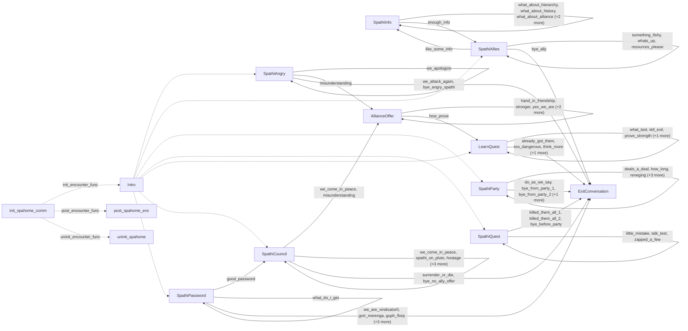

# Spathi Safe Ones: existing conversation graph

> Generated by `tools/conversation_catalog.py`; do not edit this page by hand.

[Catalog and interpretation rules](../README.md) · [Proposed engine](../model.md)

Script: [spahome.c](../../../../sc2/src/uqm/comm/spahome/spahome.c#L1). Phrase bank: [safeones.txt](../../../../sc2/content/base/comm/safeones/safeones.txt#L1).

14 handler/helper nodes; 64 response registration sites; 7 direct local calls; 145 phrase records.

## Initialization and lifecycle

| Phase | Callback | Bound by | Conditions / source |
| --- | --- | --- | --- |
| <code>init_encounter_func</code> | [<code>Intro</code>](#node-intro) | <code>init_spahome_comm</code> | No enclosing branch condition; [994](../../../../sc2/src/uqm/comm/spahome/spahome.c#L994) |
| <code>post_encounter_func</code> | [<code>post_spahome_enc</code>](#node-post_spahome_enc) | <code>init_spahome_comm</code> | No enclosing branch condition; [995](../../../../sc2/src/uqm/comm/spahome/spahome.c#L995) |
| <code>uninit_encounter_func</code> | [<code>uninit_spahome</code>](#node-uninit_spahome) | <code>init_spahome_comm</code> | No enclosing branch condition; [996](../../../../sc2/src/uqm/comm/spahome/spahome.c#L996) |

## Handler graph

Solid arrows are selectable responses; dashed arrows are direct C calls. Conditions, arguments, speech and effects are cataloged below. Parallel response sites are grouped only in this diagram.



## Condition catalog

Condition IDs describe enclosing source structure. Branch predicates combine with ∧; case labels mark source locations that can also be reached by fallthrough. Values refer to their original evaluation points. Local assignments and early control flow remain in the decision bodies.

| ID | Source expression / structural condition |
| --- | --- |
| <a id="condition-c1"></a>C1 | <code>PLAYER_SAID(R, we_attack_again)</code> |
| <a id="condition-c2"></a>C2 | <code>!(PLAYER_SAID(R, we_attack_again))</code> |
| <a id="condition-c3"></a>C3 | <code>PLAYER_SAID(R, surrender_or_die)</code> |
| <a id="condition-c4"></a>C4 | <code>!(PLAYER_SAID(R, surrender_or_die))</code> |
| <a id="condition-c5"></a>C5 | <code>PLAYER_SAID(R, we_are_vindicator0)</code> |
| <a id="condition-c6"></a>C6 | <code>!(PLAYER_SAID(R, we_are_vindicator0))</code> |
| <a id="condition-c7"></a>C7 | <code>!(PLAYER_SAID(R, gort_merenga))</code> |
| <a id="condition-c8"></a>C8 | <code>!(PLAYER_SAID(R, gort_merenga) &#124;&#124; PLAYER_SAID(R, guph_florp))</code> |
| <a id="condition-c9"></a>C9 | <code>!((PLAYER_SAID(R, gort_merenga) &#124;&#124; PLAYER_SAID(R, guph_florp)) &#124;&#124; PLAYER_SAID(R, wagngl_fthagn))</code> |
| <a id="condition-c10"></a>C10 | <code>((PLAYER_SAID(R, gort_merenga) &#124;&#124; PLAYER_SAID(R, guph_florp)) &#124;&#124; PLAYER_SAID(R, wagngl_fthagn)) &#124;&#124; PLAYER_SAID(R, pleeese)</code> |
| <a id="condition-c11"></a>C11 | <code>!(((PLAYER_SAID(R, gort_merenga) &#124;&#124; PLAYER_SAID(R, guph_florp)) &#124;&#124; PLAYER_SAID(R, wagngl_fthagn)) &#124;&#124; PLAYER_SAID(R, pleeese))</code> |
| <a id="condition-c12"></a>C12 | <code>PLAYER_SAID(R, screw_password)</code> |
| <a id="condition-c13"></a>C13 | <code>!(PLAYER_SAID(R, screw_password))</code> |
| <a id="condition-c14"></a>C14 | <code>PLAYER_SAID(R, bye_no_ally_offer)</code> |
| <a id="condition-c15"></a>C15 | <code>!(PLAYER_SAID(R, bye_no_ally_offer))</code> |
| <a id="condition-c16"></a>C16 | <code>PLAYER_SAID(R, bye_angry_spathi)</code> |
| <a id="condition-c17"></a>C17 | <code>!(PLAYER_SAID(R, bye_angry_spathi))</code> |
| <a id="condition-c18"></a>C18 | <code>PLAYER_SAID(R, bye_ally)</code> |
| <a id="condition-c19"></a>C19 | <code>!(PLAYER_SAID(R, bye_ally))</code> |
| <a id="condition-c20"></a>C20 | <code>PLAYER_SAID(R, already_got_them)</code> |
| <a id="condition-c21"></a>C21 | <code>!(PLAYER_SAID(R, already_got_them))</code> |
| <a id="condition-c22"></a>C22 | <code>PLAYER_SAID(R, too_dangerous)</code> |
| <a id="condition-c23"></a>C23 | <code>!(PLAYER_SAID(R, too_dangerous))</code> |
| <a id="condition-c24"></a>C24 | <code>PLAYER_SAID(R, think_more)</code> |
| <a id="condition-c25"></a>C25 | <code>!(PLAYER_SAID(R, think_more))</code> |
| <a id="condition-c26"></a>C26 | <code>PLAYER_SAID(R, i_accept)</code> |
| <a id="condition-c27"></a>C27 | <code>!(PLAYER_SAID(R, i_accept))</code> |
| <a id="condition-c28"></a>C28 | <code>PLAYER_SAID(R, do_as_we_say)</code> |
| <a id="condition-c29"></a>C29 | <code>!(PLAYER_SAID(R, do_as_we_say))</code> |
| <a id="condition-c30"></a>C30 | <code>PLAYER_SAID(R, killed_them_all_1)</code> |
| <a id="condition-c31"></a>C31 | <code>!GET_GAME_STATE(SPATHI_CREATURES_ELIMINATED)</code> |
| <a id="condition-c32"></a>C32 | <code>!(!GET_GAME_STATE(SPATHI_CREATURES_ELIMINATED))</code> |
| <a id="condition-c33"></a>C33 | <code>!(PLAYER_SAID(R, killed_them_all_1))</code> |
| <a id="condition-c34"></a>C34 | <code>PLAYER_SAID(R, killed_them_all_2)</code> |
| <a id="condition-c35"></a>C35 | <code>!(PLAYER_SAID(R, killed_them_all_2))</code> |
| <a id="condition-c36"></a>C36 | <code>PLAYER_SAID(R, bye_before_party)</code> |
| <a id="condition-c37"></a>C37 | <code>!(PLAYER_SAID(R, bye_before_party))</code> |
| <a id="condition-c38"></a>C38 | <code>!(PLAYER_SAID(R, bye_from_party_1))</code> |
| <a id="condition-c39"></a>C39 | <code>!(PLAYER_SAID(R, bye_from_party_1) &#124;&#124; PLAYER_SAID(R, bye_from_party_2))</code> |
| <a id="condition-c40"></a>C40 | <code>(PLAYER_SAID(R, bye_from_party_1) &#124;&#124; PLAYER_SAID(R, bye_from_party_2)) &#124;&#124; PLAYER_SAID(R, bye_from_party_3)</code> |
| <a id="condition-c41"></a>C41 | <code>PLAYER_SAID(R, like_some_info)</code> |
| <a id="condition-c42"></a>C42 | <code>!(PLAYER_SAID(R, like_some_info))</code> |
| <a id="condition-c43"></a>C43 | <code>PLAYER_SAID(R, what_about_hierarchy)</code> |
| <a id="condition-c44"></a>C44 | <code>!(PLAYER_SAID(R, what_about_hierarchy))</code> |
| <a id="condition-c45"></a>C45 | <code>PLAYER_SAID(R, what_about_history)</code> |
| <a id="condition-c46"></a>C46 | <code>!(PLAYER_SAID(R, what_about_history))</code> |
| <a id="condition-c47"></a>C47 | <code>PLAYER_SAID(R, what_about_alliance)</code> |
| <a id="condition-c48"></a>C48 | <code>!(PLAYER_SAID(R, what_about_alliance))</code> |
| <a id="condition-c49"></a>C49 | <code>PLAYER_SAID(R, what_about_other)</code> |
| <a id="condition-c50"></a>C50 | <code>!(PLAYER_SAID(R, what_about_other))</code> |
| <a id="condition-c51"></a>C51 | <code>PLAYER_SAID(R, what_about_precursors)</code> |
| <a id="condition-c52"></a>C52 | <code>PHRASE_ENABLED(what_about_hierarchy)</code> |
| <a id="condition-c53"></a>C53 | <code>PHRASE_ENABLED(what_about_history)</code> |
| <a id="condition-c54"></a>C54 | <code>PHRASE_ENABLED(what_about_alliance)</code> |
| <a id="condition-c55"></a>C55 | <code>PHRASE_ENABLED(what_about_other)</code> |
| <a id="condition-c56"></a>C56 | <code>PHRASE_ENABLED(what_about_precursors)</code> |
| <a id="condition-c57"></a>C57 | <code>!InfoLeft</code> |
| <a id="condition-c58"></a>C58 | <code>R == 0</code> |
| <a id="condition-c59"></a>C59 | <code>switch (NumVisits++)</code> |
| <a id="condition-c60"></a>C60 | <code>case 0 (see source for fallthrough)</code> |
| <a id="condition-c61"></a>C61 | <code>case 1 (see source for fallthrough)</code> |
| <a id="condition-c62"></a>C62 | <code>case 2 (see source for fallthrough)</code> |
| <a id="condition-c63"></a>C63 | <code>!(R == 0)</code> |
| <a id="condition-c64"></a>C64 | <code>PLAYER_SAID(R, whats_up)</code> |
| <a id="condition-c65"></a>C65 | <code>case 3 (see source for fallthrough)</code> |
| <a id="condition-c66"></a>C66 | <code>case 4 (see source for fallthrough)</code> |
| <a id="condition-c67"></a>C67 | <code>case 5 (see source for fallthrough)</code> |
| <a id="condition-c68"></a>C68 | <code>!(PLAYER_SAID(R, whats_up))</code> |
| <a id="condition-c69"></a>C69 | <code>PLAYER_SAID(R, resources_please)</code> |
| <a id="condition-c70"></a>C70 | <code>!(PLAYER_SAID(R, resources_please))</code> |
| <a id="condition-c71"></a>C71 | <code>PLAYER_SAID(R, something_fishy)</code> |
| <a id="condition-c72"></a>C72 | <code>!(PLAYER_SAID(R, something_fishy))</code> |
| <a id="condition-c73"></a>C73 | <code>PLAYER_SAID(R, enough_info)</code> |
| <a id="condition-c74"></a>C74 | <code>GET_GAME_STATE(SPATHI_INFO) == 4</code> |
| <a id="condition-c75"></a>C75 | <code>PHRASE_ENABLED(whats_up)</code> |
| <a id="condition-c76"></a>C76 | <code>PHRASE_ENABLED(resources_please)</code> |
| <a id="condition-c77"></a>C77 | <code>PHRASE_ENABLED(like_some_info)</code> |
| <a id="condition-c78"></a>C78 | <code>!GET_GAME_STATE(LIED_ABOUT_CREATURES)</code> |
| <a id="condition-c79"></a>C79 | <code>!(!GET_GAME_STATE(LIED_ABOUT_CREATURES))</code> |
| <a id="condition-c80"></a>C80 | <code>PLAYER_SAID(R, little_mistake)</code> |
| <a id="condition-c81"></a>C81 | <code>!(PLAYER_SAID(R, little_mistake))</code> |
| <a id="condition-c82"></a>C82 | <code>PLAYER_SAID(R, talk_test)</code> |
| <a id="condition-c83"></a>C83 | <code>!(PLAYER_SAID(R, talk_test))</code> |
| <a id="condition-c84"></a>C84 | <code>PLAYER_SAID(R, zapped_a_few)</code> |
| <a id="condition-c85"></a>C85 | <code>PHRASE_ENABLED(little_mistake)</code> |
| <a id="condition-c86"></a>C86 | <code>PHRASE_ENABLED(talk_test)</code> |
| <a id="condition-c87"></a>C87 | <code>PHRASE_ENABLED(zapped_a_few)</code> |
| <a id="condition-c88"></a>C88 | <code>PHRASE_ENABLED(zapped_a_few) &amp;&amp; GET_GAME_STATE(SPATHI_CREATURES_EXAMINED)</code> |
| <a id="condition-c89"></a>C89 | <code>GET_GAME_STATE(KNOW_SPATHI_EVIL)</code> |
| <a id="condition-c90"></a>C90 | <code>PLAYER_SAID(R, how_prove)</code> |
| <a id="condition-c91"></a>C91 | <code>!(PLAYER_SAID(R, how_prove))</code> |
| <a id="condition-c92"></a>C92 | <code>PLAYER_SAID(R, what_test)</code> |
| <a id="condition-c93"></a>C93 | <code>!(PLAYER_SAID(R, what_test))</code> |
| <a id="condition-c94"></a>C94 | <code>PLAYER_SAID(R, tell_evil)</code> |
| <a id="condition-c95"></a>C95 | <code>!(PLAYER_SAID(R, tell_evil))</code> |
| <a id="condition-c96"></a>C96 | <code>PLAYER_SAID(R, prove_strength)</code> |
| <a id="condition-c97"></a>C97 | <code>!(PLAYER_SAID(R, prove_strength))</code> |
| <a id="condition-c98"></a>C98 | <code>PLAYER_SAID(R, why_dont_you_do_it)</code> |
| <a id="condition-c99"></a>C99 | <code>PHRASE_ENABLED(what_test)</code> |
| <a id="condition-c100"></a>C100 | <code>!(PHRASE_ENABLED(what_test))</code> |
| <a id="condition-c101"></a>C101 | <code>GET_GAME_STATE(SPATHI_CREATURES_ELIMINATED)</code> |
| <a id="condition-c102"></a>C102 | <code>!(GET_GAME_STATE(SPATHI_CREATURES_ELIMINATED))</code> |
| <a id="condition-c103"></a>C103 | <code>PHRASE_ENABLED(tell_evil)</code> |
| <a id="condition-c104"></a>C104 | <code>!(PHRASE_ENABLED(tell_evil))</code> |
| <a id="condition-c105"></a>C105 | <code>PHRASE_ENABLED(prove_strength)</code> |
| <a id="condition-c106"></a>C106 | <code>PHRASE_ENABLED(prove_strength) &amp;&amp; (!GET_GAME_STATE(KNOW_SPATHI_QUEST))</code> |
| <a id="condition-c107"></a>C107 | <code>PHRASE_ENABLED(why_dont_you_do_it)</code> |
| <a id="condition-c108"></a>C108 | <code>PLAYER_SAID(R, misunderstanding)</code> |
| <a id="condition-c109"></a>C109 | <code>!(PLAYER_SAID(R, misunderstanding))</code> |
| <a id="condition-c110"></a>C110 | <code>PLAYER_SAID(R, we_come_in_peace)</code> |
| <a id="condition-c111"></a>C111 | <code>!(PLAYER_SAID(R, we_come_in_peace))</code> |
| <a id="condition-c112"></a>C112 | <code>PLAYER_SAID(R, hand_in_friendship)</code> |
| <a id="condition-c113"></a>C113 | <code>!(PLAYER_SAID(R, hand_in_friendship))</code> |
| <a id="condition-c114"></a>C114 | <code>PLAYER_SAID(R, stronger)</code> |
| <a id="condition-c115"></a>C115 | <code>!(PLAYER_SAID(R, stronger))</code> |
| <a id="condition-c116"></a>C116 | <code>PLAYER_SAID(R, yes_we_are)</code> |
| <a id="condition-c117"></a>C117 | <code>!(PLAYER_SAID(R, yes_we_are))</code> |
| <a id="condition-c118"></a>C118 | <code>PLAYER_SAID(R, share_info)</code> |
| <a id="condition-c119"></a>C119 | <code>!(PLAYER_SAID(R, share_info))</code> |
| <a id="condition-c120"></a>C120 | <code>PLAYER_SAID(R, give_us_resources)</code> |
| <a id="condition-c121"></a>C121 | <code>PHRASE_ENABLED(hand_in_friendship)</code> |
| <a id="condition-c122"></a>C122 | <code>!(PHRASE_ENABLED(hand_in_friendship))</code> |
| <a id="condition-c123"></a>C123 | <code>PHRASE_ENABLED(stronger)</code> |
| <a id="condition-c124"></a>C124 | <code>!(PHRASE_ENABLED(stronger))</code> |
| <a id="condition-c125"></a>C125 | <code>PHRASE_ENABLED(yes_we_are)</code> |
| <a id="condition-c126"></a>C126 | <code>!(PHRASE_ENABLED(yes_we_are))</code> |
| <a id="condition-c127"></a>C127 | <code>PHRASE_ENABLED(share_info)</code> |
| <a id="condition-c128"></a>C128 | <code>PHRASE_ENABLED(give_us_resources)</code> |
| <a id="condition-c129"></a>C129 | <code>PLAYER_SAID(R, deals_a_deal)</code> |
| <a id="condition-c130"></a>C130 | <code>!(PLAYER_SAID(R, deals_a_deal))</code> |
| <a id="condition-c131"></a>C131 | <code>PLAYER_SAID(R, how_long)</code> |
| <a id="condition-c132"></a>C132 | <code>!(PLAYER_SAID(R, how_long))</code> |
| <a id="condition-c133"></a>C133 | <code>PLAYER_SAID(R, reneging)</code> |
| <a id="condition-c134"></a>C134 | <code>!(PLAYER_SAID(R, reneging))</code> |
| <a id="condition-c135"></a>C135 | <code>PLAYER_SAID(R, return_beasts)</code> |
| <a id="condition-c136"></a>C136 | <code>!(PLAYER_SAID(R, return_beasts))</code> |
| <a id="condition-c137"></a>C137 | <code>PLAYER_SAID(R, minds_and_might)</code> |
| <a id="condition-c138"></a>C138 | <code>!(PLAYER_SAID(R, minds_and_might))</code> |
| <a id="condition-c139"></a>C139 | <code>PLAYER_SAID(R, fellowship)</code> |
| <a id="condition-c140"></a>C140 | <code>PHRASE_ENABLED(deals_a_deal)</code> |
| <a id="condition-c141"></a>C141 | <code>!(PHRASE_ENABLED(deals_a_deal))</code> |
| <a id="condition-c142"></a>C142 | <code>PHRASE_ENABLED(how_long)</code> |
| <a id="condition-c143"></a>C143 | <code>!(PHRASE_ENABLED(how_long))</code> |
| <a id="condition-c144"></a>C144 | <code>PHRASE_ENABLED(reneging)</code> |
| <a id="condition-c145"></a>C145 | <code>!(PHRASE_ENABLED(reneging))</code> |
| <a id="condition-c146"></a>C146 | <code>PHRASE_ENABLED(return_beasts)</code> |
| <a id="condition-c147"></a>C147 | <code>!(PHRASE_ENABLED(return_beasts))</code> |
| <a id="condition-c148"></a>C148 | <code>PHRASE_ENABLED(minds_and_might)</code> |
| <a id="condition-c149"></a>C149 | <code>PHRASE_ENABLED(fellowship)</code> |
| <a id="condition-c150"></a>C150 | <code>switch (GET_GAME_STATE(SPATHI_HOME_VISITS) - 1)</code> |
| <a id="condition-c151"></a>C151 | <code>default (see source for fallthrough)</code> |
| <a id="condition-c152"></a>C152 | <code>PLAYER_SAID(R, good_password)</code> |
| <a id="condition-c153"></a>C153 | <code>!(PLAYER_SAID(R, good_password))</code> |
| <a id="condition-c154"></a>C154 | <code>PLAYER_SAID(R, spathi_on_pluto)</code> |
| <a id="condition-c155"></a>C155 | <code>!(PLAYER_SAID(R, spathi_on_pluto))</code> |
| <a id="condition-c156"></a>C156 | <code>PLAYER_SAID(R, hostage)</code> |
| <a id="condition-c157"></a>C157 | <code>!(PLAYER_SAID(R, hostage))</code> |
| <a id="condition-c158"></a>C158 | <code>PLAYER_SAID(R, killed_fwiffo)</code> |
| <a id="condition-c159"></a>C159 | <code>!(PLAYER_SAID(R, killed_fwiffo))</code> |
| <a id="condition-c160"></a>C160 | <code>PLAYER_SAID(R, fwiffo_fine)</code> |
| <a id="condition-c161"></a>C161 | <code>!(PLAYER_SAID(R, fwiffo_fine))</code> |
| <a id="condition-c162"></a>C162 | <code>PLAYER_SAID(R, surrender)</code> |
| <a id="condition-c163"></a>C163 | <code>GET_GAME_STATE(SPATHI_MANNER) == 0</code> |
| <a id="condition-c164"></a>C164 | <code>!(GET_GAME_STATE(SPATHI_MANNER) == 0)</code> |
| <a id="condition-c165"></a>C165 | <code>PHRASE_ENABLED(we_come_in_peace)</code> |
| <a id="condition-c166"></a>C166 | <code>!(PHRASE_ENABLED(we_come_in_peace))</code> |
| <a id="condition-c167"></a>C167 | <code>GET_GAME_STATE(FOUND_PLUTO_SPATHI)</code> |
| <a id="condition-c168"></a>C168 | <code>GET_GAME_STATE(FOUND_PLUTO_SPATHI) &amp;&amp; (GET_GAME_STATE(FOUND_PLUTO_SPATHI) &lt; 3)</code> |
| <a id="condition-c169"></a>C169 | <code>PHRASE_ENABLED(spathi_on_pluto)</code> |
| <a id="condition-c170"></a>C170 | <code>!(PHRASE_ENABLED(spathi_on_pluto))</code> |
| <a id="condition-c171"></a>C171 | <code>HaveEscortShip(SPATHI_SHIP)</code> |
| <a id="condition-c172"></a>C172 | <code>PHRASE_ENABLED(hostage)</code> |
| <a id="condition-c173"></a>C173 | <code>!(HaveEscortShip(SPATHI_SHIP))</code> |
| <a id="condition-c174"></a>C174 | <code>PHRASE_ENABLED(killed_fwiffo)</code> |
| <a id="condition-c175"></a>C175 | <code>PHRASE_ENABLED(fwiffo_fine)</code> |
| <a id="condition-c176"></a>C176 | <code>PHRASE_ENABLED(surrender)</code> |
| <a id="condition-c177"></a>C177 | <code>!(PHRASE_ENABLED(surrender))</code> |
| <a id="condition-c178"></a>C178 | <code>PLAYER_SAID(R, what_do_i_get)</code> |
| <a id="condition-c179"></a>C179 | <code>!(GET_GAME_STATE(FOUND_PLUTO_SPATHI))</code> |
| <a id="condition-c180"></a>C180 | <code>GET_GAME_STATE(FOUND_PLUTO_SPATHI) &#124;&#124; GET_GAME_STATE(KNOW_SPATHI_PASSWORD)</code> |
| <a id="condition-c181"></a>C181 | <code>PHRASE_ENABLED(what_do_i_get)</code> |
| <a id="condition-c182"></a>C182 | <code>!(GET_GAME_STATE(FOUND_PLUTO_SPATHI) &#124;&#124; GET_GAME_STATE(KNOW_SPATHI_PASSWORD))</code> |
| <a id="condition-c183"></a>C183 | <code>Manner == 2</code> |
| <a id="condition-c184"></a>C184 | <code>!(Manner == 2)</code> |
| <a id="condition-c185"></a>C185 | <code>Manner == 1</code> |
| <a id="condition-c186"></a>C186 | <code>(Manner == 1) &amp;&amp; GET_GAME_STATE(KNOW_SPATHI_PASSWORD)</code> |
| <a id="condition-c187"></a>C187 | <code>((Manner == 1) &amp;&amp; GET_GAME_STATE(KNOW_SPATHI_PASSWORD)) &amp;&amp; (GET_GAME_STATE(FOUND_PLUTO_SPATHI) &#124;&#124; (GET_GAME_STATE(SPATHI_HOME_VISITS) != 7))</code> |
| <a id="condition-c188"></a>C188 | <code>!(((Manner == 1) &amp;&amp; GET_GAME_STATE(KNOW_SPATHI_PASSWORD)) &amp;&amp; (GET_GAME_STATE(FOUND_PLUTO_SPATHI) &#124;&#124; (GET_GAME_STATE(SPATHI_HOME_VISITS) != 7)))</code> |
| <a id="condition-c189"></a>C189 | <code>CheckAlliance(SPATHI_SHIP) == GOOD_GUY</code> |
| <a id="condition-c190"></a>C190 | <code>!(CheckAlliance(SPATHI_SHIP) == GOOD_GUY)</code> |
| <a id="condition-c191"></a>C191 | <code>GET_GAME_STATE(SPATHI_PARTY)</code> |
| <a id="condition-c192"></a>C192 | <code>!(GET_GAME_STATE(SPATHI_PARTY))</code> |
| <a id="condition-c193"></a>C193 | <code>GET_GAME_STATE(SPATHI_QUEST)</code> |
| <a id="condition-c194"></a>C194 | <code>GET_GAME_STATE(LIED_ABOUT_CREATURES) &lt; 2</code> |
| <a id="condition-c195"></a>C195 | <code>!(GET_GAME_STATE(LIED_ABOUT_CREATURES) &lt; 2)</code> |
| <a id="condition-c196"></a>C196 | <code>!(GET_GAME_STATE(SPATHI_QUEST))</code> |
| <a id="condition-c197"></a>C197 | <code>GET_GAME_STATE(KNOW_SPATHI_QUEST)</code> |
| <a id="condition-c198"></a>C198 | <code>!(GET_GAME_STATE(KNOW_SPATHI_QUEST))</code> |
| <a id="condition-c199"></a>C199 | <code>GET_GAME_STATE(KNOW_SPATHI_PASSWORD)</code> |
| <a id="condition-c200"></a>C200 | <code>GET_GAME_STATE(KNOW_SPATHI_PASSWORD) &amp;&amp; (GET_GAME_STATE(FOUND_PLUTO_SPATHI) &#124;&#124; (GET_GAME_STATE(SPATHI_HOME_VISITS) != 7))</code> |
| <a id="condition-c201"></a>C201 | <code>!(GET_GAME_STATE(KNOW_SPATHI_PASSWORD) &amp;&amp; (GET_GAME_STATE(FOUND_PLUTO_SPATHI) &#124;&#124; (GET_GAME_STATE(SPATHI_HOME_VISITS) != 7)))</code> |
| <a id="condition-c202"></a>C202 | <code>getSegue() == Segue_hostile</code> |
| <a id="condition-c203"></a>C203 | <code>(getSegue() == Segue_hostile) &amp;&amp; ((Manner = GET_GAME_STATE(SPATHI_MANNER)) != 2)</code> |
| <a id="condition-c204"></a>C204 | <code>Manner != 1</code> |
| <a id="condition-c205"></a>C205 | <code>GET_GAME_STATE(SPATHI_MANNER) == 3</code> |
| <a id="condition-c206"></a>C206 | <code>!(GET_GAME_STATE(SPATHI_MANNER) == 3)</code> |

## Script-scope state and lookup tables

These declarations supply shared local state, computed phrase alternatives, number speech, or lookup data used by the nodes. LOCDATA presentation defaults are linked separately in the source.

Presentation descriptor <code>spahome_desc</code>: [source](../../../../sc2/src/uqm/comm/spahome/spahome.c#L27).

## Node catalog

<a id="node-exitconversation"></a>

### ExitConversation

<code>static void ExitConversation(RESPONSE_REF R)</code> — [source](../../../../sc2/src/uqm/comm/spahome/spahome.c#L187).

Incoming player-response variants: [<code>bye_ally</code>](#phrase-bye_ally), [<code>killed_them_all_1</code>](#phrase-killed_them_all_1), [<code>killed_them_all_2</code>](#phrase-killed_them_all_2), [<code>bye_before_party</code>](#phrase-bye_before_party), [<code>already_got_them</code>](#phrase-already_got_them), [<code>too_dangerous</code>](#phrase-too_dangerous), [<code>think_more</code>](#phrase-think_more), [<code>i_accept</code>](#phrase-i_accept), [<code>we_attack_again</code>](#phrase-we_attack_again), [<code>bye_angry_spathi</code>](#phrase-bye_angry_spathi), [<code>do_as_we_say</code>](#phrase-do_as_we_say), [<code>bye_from_party_1</code>](#phrase-bye_from_party_1), [<code>bye_from_party_2</code>](#phrase-bye_from_party_2), [<code>bye_from_party_3</code>](#phrase-bye_from_party_3), [<code>surrender_or_die</code>](#phrase-surrender_or_die), [<code>bye_no_ally_offer</code>](#phrase-bye_no_ally_offer), [<code>we_are_vindicator0</code>](#phrase-we_are_vindicator0), [<code>gort_merenga</code>](#phrase-gort_merenga), [<code>guph_florp</code>](#phrase-guph_florp), [<code>wagngl_fthagn</code>](#phrase-wagngl_fthagn), [<code>pleeese</code>](#phrase-pleeese), [<code>screw_password</code>](#phrase-screw_password).

#### Dialogue / audio emissions

| Phrase or expression | Enclosing conditions | Source |
| --- | --- | --- |
| [<code>WE_FIGHT_AGAIN</code>](#phrase-we_fight_again)<br><code>NPCPhrase(WE_FIGHT_AGAIN)</code> | [C1](#condition-c1) | [192](../../../../sc2/src/uqm/comm/spahome/spahome.c#L192) |
| [<code>DEFEND_OURSELVES</code>](#phrase-defend_ourselves)<br><code>NPCPhrase(DEFEND_OURSELVES)</code> | [C2](#condition-c2) ∧ [C3](#condition-c3) | [198](../../../../sc2/src/uqm/comm/spahome/spahome.c#L198) |
| [<code>NO_PASSWORD</code>](#phrase-no_password)<br><code>NPCPhrase(NO_PASSWORD)</code> | [C2](#condition-c2) ∧ [C4](#condition-c4) ∧ [C5](#condition-c5) | [204](../../../../sc2/src/uqm/comm/spahome/spahome.c#L204) |
| [<code>WRONG_PASSWORD</code>](#phrase-wrong_password)<br><code>NPCPhrase(WRONG_PASSWORD)</code> | [C2](#condition-c2) ∧ [C4](#condition-c4) ∧ [C6](#condition-c6) ∧ [C10](#condition-c10) | [213](../../../../sc2/src/uqm/comm/spahome/spahome.c#L213) |
| [<code>NO_PASSWORD</code>](#phrase-no_password)<br><code>NPCPhrase(NO_PASSWORD)</code> | [C2](#condition-c2) ∧ [C4](#condition-c4) ∧ [C6](#condition-c6) ∧ [C11](#condition-c11) ∧ [C12](#condition-c12) | [219](../../../../sc2/src/uqm/comm/spahome/spahome.c#L219) |
| [<code>GOODBYE_NO_ALLY_OFFER</code>](#phrase-goodbye_no_ally_offer)<br><code>NPCPhrase(GOODBYE_NO_ALLY_OFFER)</code> | [C2](#condition-c2) ∧ [C4](#condition-c4) ∧ [C6](#condition-c6) ∧ [C11](#condition-c11) ∧ [C13](#condition-c13) ∧ [C14](#condition-c14) | [224](../../../../sc2/src/uqm/comm/spahome/spahome.c#L224) |
| [<code>GOODBYE_ANGRY_SPATHI</code>](#phrase-goodbye_angry_spathi)<br><code>NPCPhrase(GOODBYE_ANGRY_SPATHI)</code> | [C2](#condition-c2) ∧ [C4](#condition-c4) ∧ [C6](#condition-c6) ∧ [C11](#condition-c11) ∧ [C13](#condition-c13) ∧ [C15](#condition-c15) ∧ [C16](#condition-c16) | [226](../../../../sc2/src/uqm/comm/spahome/spahome.c#L226) |
| [<code>GOODBYE_ALLY</code>](#phrase-goodbye_ally)<br><code>NPCPhrase(GOODBYE_ALLY)</code> | [C2](#condition-c2) ∧ [C4](#condition-c4) ∧ [C6](#condition-c6) ∧ [C11](#condition-c11) ∧ [C13](#condition-c13) ∧ [C15](#condition-c15) ∧ [C17](#condition-c17) ∧ [C18](#condition-c18) | [228](../../../../sc2/src/uqm/comm/spahome/spahome.c#L228) |
| [<code>EARLY_BIRD_CHECK</code>](#phrase-early_bird_check)<br><code>NPCPhrase(EARLY_BIRD_CHECK)</code> | [C2](#condition-c2) ∧ [C4](#condition-c4) ∧ [C6](#condition-c6) ∧ [C11](#condition-c11) ∧ [C13](#condition-c13) ∧ [C15](#condition-c15) ∧ [C17](#condition-c17) ∧ [C19](#condition-c19) ∧ [C20](#condition-c20) | [231](../../../../sc2/src/uqm/comm/spahome/spahome.c#L231) |
| [<code>WE_AGREE</code>](#phrase-we_agree)<br><code>NPCPhrase(WE_AGREE)</code> | [C2](#condition-c2) ∧ [C4](#condition-c4) ∧ [C6](#condition-c6) ∧ [C11](#condition-c11) ∧ [C13](#condition-c13) ∧ [C15](#condition-c15) ∧ [C17](#condition-c17) ∧ [C19](#condition-c19) ∧ [C21](#condition-c21) ∧ [C22](#condition-c22) | [239](../../../../sc2/src/uqm/comm/spahome/spahome.c#L239) |
| [<code>COWARD</code>](#phrase-coward)<br><code>NPCPhrase(COWARD)</code> | [C2](#condition-c2) ∧ [C4](#condition-c4) ∧ [C6](#condition-c6) ∧ [C11](#condition-c11) ∧ [C13](#condition-c13) ∧ [C15](#condition-c15) ∧ [C17](#condition-c17) ∧ [C19](#condition-c19) ∧ [C21](#condition-c21) ∧ [C23](#condition-c23) ∧ [C24](#condition-c24) | [241](../../../../sc2/src/uqm/comm/spahome/spahome.c#L241) |
| [<code>AWAIT_RETURN</code>](#phrase-await_return)<br><code>NPCPhrase(AWAIT_RETURN)</code> | [C2](#condition-c2) ∧ [C4](#condition-c4) ∧ [C6](#condition-c6) ∧ [C11](#condition-c11) ∧ [C13](#condition-c13) ∧ [C15](#condition-c15) ∧ [C17](#condition-c17) ∧ [C19](#condition-c19) ∧ [C21](#condition-c21) ∧ [C23](#condition-c23) ∧ [C25](#condition-c25) ∧ [C26](#condition-c26) | [244](../../../../sc2/src/uqm/comm/spahome/spahome.c#L244) |
| [<code>DEPART_FOR_EARTH</code>](#phrase-depart_for_earth)<br><code>NPCPhrase(DEPART_FOR_EARTH)</code> | [C2](#condition-c2) ∧ [C4](#condition-c4) ∧ [C6](#condition-c6) ∧ [C11](#condition-c11) ∧ [C13](#condition-c13) ∧ [C15](#condition-c15) ∧ [C17](#condition-c17) ∧ [C19](#condition-c19) ∧ [C21](#condition-c21) ∧ [C23](#condition-c23) ∧ [C25](#condition-c25) ∧ [C27](#condition-c27) ∧ [C28](#condition-c28) | [252](../../../../sc2/src/uqm/comm/spahome/spahome.c#L252) |
| [<code>WILL_CHECK_1</code>](#phrase-will_check_1)<br><code>NPCPhrase(WILL_CHECK_1)</code> | [C2](#condition-c2) ∧ [C4](#condition-c4) ∧ [C6](#condition-c6) ∧ [C11](#condition-c11) ∧ [C13](#condition-c13) ∧ [C15](#condition-c15) ∧ [C17](#condition-c17) ∧ [C19](#condition-c19) ∧ [C21](#condition-c21) ∧ [C23](#condition-c23) ∧ [C25](#condition-c25) ∧ [C27](#condition-c27) ∧ [C29](#condition-c29) ∧ [C30](#condition-c30) | [261](../../../../sc2/src/uqm/comm/spahome/spahome.c#L261) |
| [<code>WILL_CHECK_2</code>](#phrase-will_check_2)<br><code>NPCPhrase(WILL_CHECK_2)</code> | [C2](#condition-c2) ∧ [C4](#condition-c4) ∧ [C6](#condition-c6) ∧ [C11](#condition-c11) ∧ [C13](#condition-c13) ∧ [C15](#condition-c15) ∧ [C17](#condition-c17) ∧ [C19](#condition-c19) ∧ [C21](#condition-c21) ∧ [C23](#condition-c23) ∧ [C25](#condition-c25) ∧ [C27](#condition-c27) ∧ [C29](#condition-c29) ∧ [C33](#condition-c33) ∧ [C34](#condition-c34) | [277](../../../../sc2/src/uqm/comm/spahome/spahome.c#L277) |
| [<code>GOODBYE_BEFORE_PARTY</code>](#phrase-goodbye_before_party)<br><code>NPCPhrase(GOODBYE_BEFORE_PARTY)</code> | [C2](#condition-c2) ∧ [C4](#condition-c4) ∧ [C6](#condition-c6) ∧ [C11](#condition-c11) ∧ [C13](#condition-c13) ∧ [C15](#condition-c15) ∧ [C17](#condition-c17) ∧ [C19](#condition-c19) ∧ [C21](#condition-c21) ∧ [C23](#condition-c23) ∧ [C25](#condition-c25) ∧ [C27](#condition-c27) ∧ [C29](#condition-c29) ∧ [C33](#condition-c33) ∧ [C35](#condition-c35) ∧ [C36](#condition-c36) | [293](../../../../sc2/src/uqm/comm/spahome/spahome.c#L293) |
| [<code>GOODBYE_FROM_PARTY</code>](#phrase-goodbye_from_party)<br><code>NPCPhrase(GOODBYE_FROM_PARTY)</code> | [C2](#condition-c2) ∧ [C4](#condition-c4) ∧ [C6](#condition-c6) ∧ [C11](#condition-c11) ∧ [C13](#condition-c13) ∧ [C15](#condition-c15) ∧ [C17](#condition-c17) ∧ [C19](#condition-c19) ∧ [C21](#condition-c21) ∧ [C23](#condition-c23) ∧ [C25](#condition-c25) ∧ [C27](#condition-c27) ∧ [C29](#condition-c29) ∧ [C33](#condition-c33) ∧ [C35](#condition-c35) ∧ [C37](#condition-c37) ∧ [C40](#condition-c40) | [299](../../../../sc2/src/uqm/comm/spahome/spahome.c#L299) |

#### Actions, queries, local updates, and control flow

Calls are listed without assuming they are pure or mutating. Local updates are retained because they determine dynamic menus and counter-selected speech.

| Kind | Operation | Enclosing conditions | Source |
| --- | --- | --- | --- |
| call | <code>setSegue(Segue_peace)</code> | No enclosing branch condition | [189](../../../../sc2/src/uqm/comm/spahome/spahome.c#L189) |
| call | <code>PLAYER_SAID(R, we_attack_again)</code> | No enclosing branch condition | [190](../../../../sc2/src/uqm/comm/spahome/spahome.c#L190) |
| call | <code>setSegue(Segue_hostile)</code> | [C1](#condition-c1) | [194](../../../../sc2/src/uqm/comm/spahome/spahome.c#L194) |
| call | <code>PLAYER_SAID(R, surrender_or_die)</code> | [C2](#condition-c2) | [196](../../../../sc2/src/uqm/comm/spahome/spahome.c#L196) |
| call | <code>setSegue(Segue_hostile)</code> | [C2](#condition-c2) ∧ [C3](#condition-c3) | [200](../../../../sc2/src/uqm/comm/spahome/spahome.c#L200) |
| call | <code>PLAYER_SAID(R, we_are_vindicator0)</code> | [C2](#condition-c2) ∧ [C4](#condition-c4) | [202](../../../../sc2/src/uqm/comm/spahome/spahome.c#L202) |
| call | <code>setSegue(Segue_hostile)</code> | [C2](#condition-c2) ∧ [C4](#condition-c4) ∧ [C5](#condition-c5) | [206](../../../../sc2/src/uqm/comm/spahome/spahome.c#L206) |
| call | <code>PLAYER_SAID(R, gort_merenga)</code> | [C2](#condition-c2) ∧ [C4](#condition-c4) ∧ [C6](#condition-c6) | [208](../../../../sc2/src/uqm/comm/spahome/spahome.c#L208) |
| call | <code>PLAYER_SAID(R, guph_florp)</code> | [C2](#condition-c2) ∧ [C4](#condition-c4) ∧ [C6](#condition-c6) ∧ [C7](#condition-c7) | [209](../../../../sc2/src/uqm/comm/spahome/spahome.c#L209) |
| call | <code>PLAYER_SAID(R, wagngl_fthagn)</code> | [C2](#condition-c2) ∧ [C4](#condition-c4) ∧ [C6](#condition-c6) ∧ [C8](#condition-c8) | [210](../../../../sc2/src/uqm/comm/spahome/spahome.c#L210) |
| call | <code>PLAYER_SAID(R, pleeese)</code> | [C2](#condition-c2) ∧ [C4](#condition-c4) ∧ [C6](#condition-c6) ∧ [C9](#condition-c9) | [211](../../../../sc2/src/uqm/comm/spahome/spahome.c#L211) |
| call | <code>setSegue(Segue_hostile)</code> | [C2](#condition-c2) ∧ [C4](#condition-c4) ∧ [C6](#condition-c6) ∧ [C10](#condition-c10) | [215](../../../../sc2/src/uqm/comm/spahome/spahome.c#L215) |
| call | <code>PLAYER_SAID(R, screw_password)</code> | [C2](#condition-c2) ∧ [C4](#condition-c4) ∧ [C6](#condition-c6) ∧ [C11](#condition-c11) | [217](../../../../sc2/src/uqm/comm/spahome/spahome.c#L217) |
| call | <code>setSegue(Segue_hostile)</code> | [C2](#condition-c2) ∧ [C4](#condition-c4) ∧ [C6](#condition-c6) ∧ [C11](#condition-c11) ∧ [C12](#condition-c12) | [221](../../../../sc2/src/uqm/comm/spahome/spahome.c#L221) |
| call | <code>PLAYER_SAID(R, bye_no_ally_offer)</code> | [C2](#condition-c2) ∧ [C4](#condition-c4) ∧ [C6](#condition-c6) ∧ [C11](#condition-c11) ∧ [C13](#condition-c13) | [223](../../../../sc2/src/uqm/comm/spahome/spahome.c#L223) |
| call | <code>PLAYER_SAID(R, bye_angry_spathi)</code> | [C2](#condition-c2) ∧ [C4](#condition-c4) ∧ [C6](#condition-c6) ∧ [C11](#condition-c11) ∧ [C13](#condition-c13) ∧ [C15](#condition-c15) | [225](../../../../sc2/src/uqm/comm/spahome/spahome.c#L225) |
| call | <code>PLAYER_SAID(R, bye_ally)</code> | [C2](#condition-c2) ∧ [C4](#condition-c4) ∧ [C6](#condition-c6) ∧ [C11](#condition-c11) ∧ [C13](#condition-c13) ∧ [C15](#condition-c15) ∧ [C17](#condition-c17) | [227](../../../../sc2/src/uqm/comm/spahome/spahome.c#L227) |
| call | <code>PLAYER_SAID(R, already_got_them)</code> | [C2](#condition-c2) ∧ [C4](#condition-c4) ∧ [C6](#condition-c6) ∧ [C11](#condition-c11) ∧ [C13](#condition-c13) ∧ [C15](#condition-c15) ∧ [C17](#condition-c17) ∧ [C19](#condition-c19) | [229](../../../../sc2/src/uqm/comm/spahome/spahome.c#L229) |
| call | <code>SET_GAME_STATE(SPATHI_HOME_VISITS, 0)</code> | [C2](#condition-c2) ∧ [C4](#condition-c4) ∧ [C6](#condition-c6) ∧ [C11](#condition-c11) ∧ [C13](#condition-c13) ∧ [C15](#condition-c15) ∧ [C17](#condition-c17) ∧ [C19](#condition-c19) ∧ [C20](#condition-c20) | [233](../../../../sc2/src/uqm/comm/spahome/spahome.c#L233) |
| call | <code>SET_GAME_STATE(SPATHI_VISITS, 0)</code> | [C2](#condition-c2) ∧ [C4](#condition-c4) ∧ [C6](#condition-c6) ∧ [C11](#condition-c11) ∧ [C13](#condition-c13) ∧ [C15](#condition-c15) ∧ [C17](#condition-c17) ∧ [C19](#condition-c19) ∧ [C20](#condition-c20) | [234](../../../../sc2/src/uqm/comm/spahome/spahome.c#L234) |
| call | <code>SET_GAME_STATE(SPATHI_PARTY, 1)</code> | [C2](#condition-c2) ∧ [C4](#condition-c4) ∧ [C6](#condition-c6) ∧ [C11](#condition-c11) ∧ [C13](#condition-c13) ∧ [C15](#condition-c15) ∧ [C17](#condition-c17) ∧ [C19](#condition-c19) ∧ [C20](#condition-c20) | [235](../../../../sc2/src/uqm/comm/spahome/spahome.c#L235) |
| call | <code>SET_GAME_STATE(SPATHI_MANNER, 3)</code> | [C2](#condition-c2) ∧ [C4](#condition-c4) ∧ [C6](#condition-c6) ∧ [C11](#condition-c11) ∧ [C13](#condition-c13) ∧ [C15](#condition-c15) ∧ [C17](#condition-c17) ∧ [C19](#condition-c19) ∧ [C20](#condition-c20) | [236](../../../../sc2/src/uqm/comm/spahome/spahome.c#L236) |
| call | <code>PLAYER_SAID(R, too_dangerous)</code> | [C2](#condition-c2) ∧ [C4](#condition-c4) ∧ [C6](#condition-c6) ∧ [C11](#condition-c11) ∧ [C13](#condition-c13) ∧ [C15](#condition-c15) ∧ [C17](#condition-c17) ∧ [C19](#condition-c19) ∧ [C21](#condition-c21) | [238](../../../../sc2/src/uqm/comm/spahome/spahome.c#L238) |
| call | <code>PLAYER_SAID(R, think_more)</code> | [C2](#condition-c2) ∧ [C4](#condition-c4) ∧ [C6](#condition-c6) ∧ [C11](#condition-c11) ∧ [C13](#condition-c13) ∧ [C15](#condition-c15) ∧ [C17](#condition-c17) ∧ [C19](#condition-c19) ∧ [C21](#condition-c21) ∧ [C23](#condition-c23) | [240](../../../../sc2/src/uqm/comm/spahome/spahome.c#L240) |
| call | <code>PLAYER_SAID(R, i_accept)</code> | [C2](#condition-c2) ∧ [C4](#condition-c4) ∧ [C6](#condition-c6) ∧ [C11](#condition-c11) ∧ [C13](#condition-c13) ∧ [C15](#condition-c15) ∧ [C17](#condition-c17) ∧ [C19](#condition-c19) ∧ [C21](#condition-c21) ∧ [C23](#condition-c23) ∧ [C25](#condition-c25) | [242](../../../../sc2/src/uqm/comm/spahome/spahome.c#L242) |
| call | <code>SET_GAME_STATE(SPATHI_QUEST, 1)</code> | [C2](#condition-c2) ∧ [C4](#condition-c4) ∧ [C6](#condition-c6) ∧ [C11](#condition-c11) ∧ [C13](#condition-c13) ∧ [C15](#condition-c15) ∧ [C17](#condition-c17) ∧ [C19](#condition-c19) ∧ [C21](#condition-c21) ∧ [C23](#condition-c23) ∧ [C25](#condition-c25) ∧ [C26](#condition-c26) | [246](../../../../sc2/src/uqm/comm/spahome/spahome.c#L246) |
| call | <code>SET_GAME_STATE(SPATHI_MANNER, 3)</code> | [C2](#condition-c2) ∧ [C4](#condition-c4) ∧ [C6](#condition-c6) ∧ [C11](#condition-c11) ∧ [C13](#condition-c13) ∧ [C15](#condition-c15) ∧ [C17](#condition-c17) ∧ [C19](#condition-c19) ∧ [C21](#condition-c21) ∧ [C23](#condition-c23) ∧ [C25](#condition-c25) ∧ [C26](#condition-c26) | [247](../../../../sc2/src/uqm/comm/spahome/spahome.c#L247) |
| call | <code>SET_GAME_STATE(SPATHI_VISITS, 0)</code> | [C2](#condition-c2) ∧ [C4](#condition-c4) ∧ [C6](#condition-c6) ∧ [C11](#condition-c11) ∧ [C13](#condition-c13) ∧ [C15](#condition-c15) ∧ [C17](#condition-c17) ∧ [C19](#condition-c19) ∧ [C21](#condition-c21) ∧ [C23](#condition-c23) ∧ [C25](#condition-c25) ∧ [C26](#condition-c26) | [248](../../../../sc2/src/uqm/comm/spahome/spahome.c#L248) |
| call | <code>PLAYER_SAID(R, do_as_we_say)</code> | [C2](#condition-c2) ∧ [C4](#condition-c4) ∧ [C6](#condition-c6) ∧ [C11](#condition-c11) ∧ [C13](#condition-c13) ∧ [C15](#condition-c15) ∧ [C17](#condition-c17) ∧ [C19](#condition-c19) ∧ [C21](#condition-c21) ∧ [C23](#condition-c23) ∧ [C25](#condition-c25) ∧ [C27](#condition-c27) | [250](../../../../sc2/src/uqm/comm/spahome/spahome.c#L250) |
| call | <code>SetRaceAllied(SPATHI_SHIP, TRUE)</code> | [C2](#condition-c2) ∧ [C4](#condition-c4) ∧ [C6](#condition-c6) ∧ [C11](#condition-c11) ∧ [C13](#condition-c13) ∧ [C15](#condition-c15) ∧ [C17](#condition-c17) ∧ [C19](#condition-c19) ∧ [C21](#condition-c21) ∧ [C23](#condition-c23) ∧ [C25](#condition-c25) ∧ [C27](#condition-c27) ∧ [C28](#condition-c28) | [254](../../../../sc2/src/uqm/comm/spahome/spahome.c#L254) |
| call | <code>AddEvent(RELATIVE_EVENT, 6, 0, 0, SPATHI_SHIELD_EVENT)</code> | [C2](#condition-c2) ∧ [C4](#condition-c4) ∧ [C6](#condition-c6) ∧ [C11](#condition-c11) ∧ [C13](#condition-c13) ∧ [C15](#condition-c15) ∧ [C17](#condition-c17) ∧ [C19](#condition-c19) ∧ [C21](#condition-c21) ∧ [C23](#condition-c23) ∧ [C25](#condition-c25) ∧ [C27](#condition-c27) ∧ [C28](#condition-c28) | [255](../../../../sc2/src/uqm/comm/spahome/spahome.c#L255) |
| call | <code>SET_GAME_STATE(SPATHI_HOME_VISITS, 0)</code> | [C2](#condition-c2) ∧ [C4](#condition-c4) ∧ [C6](#condition-c6) ∧ [C11](#condition-c11) ∧ [C13](#condition-c13) ∧ [C15](#condition-c15) ∧ [C17](#condition-c17) ∧ [C19](#condition-c19) ∧ [C21](#condition-c21) ∧ [C23](#condition-c23) ∧ [C25](#condition-c25) ∧ [C27](#condition-c27) ∧ [C28](#condition-c28) | [256](../../../../sc2/src/uqm/comm/spahome/spahome.c#L256) |
| call | <code>SET_GAME_STATE(SPATHI_VISITS, 0)</code> | [C2](#condition-c2) ∧ [C4](#condition-c4) ∧ [C6](#condition-c6) ∧ [C11](#condition-c11) ∧ [C13](#condition-c13) ∧ [C15](#condition-c15) ∧ [C17](#condition-c17) ∧ [C19](#condition-c19) ∧ [C21](#condition-c21) ∧ [C23](#condition-c23) ∧ [C25](#condition-c25) ∧ [C27](#condition-c27) ∧ [C28](#condition-c28) | [257](../../../../sc2/src/uqm/comm/spahome/spahome.c#L257) |
| call | <code>PLAYER_SAID(R, killed_them_all_1)</code> | [C2](#condition-c2) ∧ [C4](#condition-c4) ∧ [C6](#condition-c6) ∧ [C11](#condition-c11) ∧ [C13](#condition-c13) ∧ [C15](#condition-c15) ∧ [C17](#condition-c17) ∧ [C19](#condition-c19) ∧ [C21](#condition-c21) ∧ [C23](#condition-c23) ∧ [C25](#condition-c25) ∧ [C27](#condition-c27) ∧ [C29](#condition-c29) | [259](../../../../sc2/src/uqm/comm/spahome/spahome.c#L259) |
| call | <code>GET_GAME_STATE(SPATHI_CREATURES_ELIMINATED)</code> | [C2](#condition-c2) ∧ [C4](#condition-c4) ∧ [C6](#condition-c6) ∧ [C11](#condition-c11) ∧ [C13](#condition-c13) ∧ [C15](#condition-c15) ∧ [C17](#condition-c17) ∧ [C19](#condition-c19) ∧ [C21](#condition-c21) ∧ [C23](#condition-c23) ∧ [C25](#condition-c25) ∧ [C27](#condition-c27) ∧ [C29](#condition-c29) ∧ [C30](#condition-c30) | [263](../../../../sc2/src/uqm/comm/spahome/spahome.c#L263) |
| call | <code>SET_GAME_STATE(LIED_ABOUT_CREATURES, 1)</code> | [C2](#condition-c2) ∧ [C4](#condition-c4) ∧ [C6](#condition-c6) ∧ [C11](#condition-c11) ∧ [C13](#condition-c13) ∧ [C15](#condition-c15) ∧ [C17](#condition-c17) ∧ [C19](#condition-c19) ∧ [C21](#condition-c21) ∧ [C23](#condition-c23) ∧ [C25](#condition-c25) ∧ [C27](#condition-c27) ∧ [C29](#condition-c29) ∧ [C30](#condition-c30) ∧ [C31](#condition-c31) | [265](../../../../sc2/src/uqm/comm/spahome/spahome.c#L265) |
| call | <code>SET_GAME_STATE(SPATHI_HOME_VISITS, 0)</code> | [C2](#condition-c2) ∧ [C4](#condition-c4) ∧ [C6](#condition-c6) ∧ [C11](#condition-c11) ∧ [C13](#condition-c13) ∧ [C15](#condition-c15) ∧ [C17](#condition-c17) ∧ [C19](#condition-c19) ∧ [C21](#condition-c21) ∧ [C23](#condition-c23) ∧ [C25](#condition-c25) ∧ [C27](#condition-c27) ∧ [C29](#condition-c29) ∧ [C30](#condition-c30) ∧ [C32](#condition-c32) | [269](../../../../sc2/src/uqm/comm/spahome/spahome.c#L269) |
| call | <code>SET_GAME_STATE(SPATHI_VISITS, 0)</code> | [C2](#condition-c2) ∧ [C4](#condition-c4) ∧ [C6](#condition-c6) ∧ [C11](#condition-c11) ∧ [C13](#condition-c13) ∧ [C15](#condition-c15) ∧ [C17](#condition-c17) ∧ [C19](#condition-c19) ∧ [C21](#condition-c21) ∧ [C23](#condition-c23) ∧ [C25](#condition-c25) ∧ [C27](#condition-c27) ∧ [C29](#condition-c29) ∧ [C30](#condition-c30) ∧ [C32](#condition-c32) | [270](../../../../sc2/src/uqm/comm/spahome/spahome.c#L270) |
| call | <code>SET_GAME_STATE(SPATHI_PARTY, 1)</code> | [C2](#condition-c2) ∧ [C4](#condition-c4) ∧ [C6](#condition-c6) ∧ [C11](#condition-c11) ∧ [C13](#condition-c13) ∧ [C15](#condition-c15) ∧ [C17](#condition-c17) ∧ [C19](#condition-c19) ∧ [C21](#condition-c21) ∧ [C23](#condition-c23) ∧ [C25](#condition-c25) ∧ [C27](#condition-c27) ∧ [C29](#condition-c29) ∧ [C30](#condition-c30) ∧ [C32](#condition-c32) | [271](../../../../sc2/src/uqm/comm/spahome/spahome.c#L271) |
| call | <code>SET_GAME_STATE(SPATHI_MANNER, 3)</code> | [C2](#condition-c2) ∧ [C4](#condition-c4) ∧ [C6](#condition-c6) ∧ [C11](#condition-c11) ∧ [C13](#condition-c13) ∧ [C15](#condition-c15) ∧ [C17](#condition-c17) ∧ [C19](#condition-c19) ∧ [C21](#condition-c21) ∧ [C23](#condition-c23) ∧ [C25](#condition-c25) ∧ [C27](#condition-c27) ∧ [C29](#condition-c29) ∧ [C30](#condition-c30) ∧ [C32](#condition-c32) | [272](../../../../sc2/src/uqm/comm/spahome/spahome.c#L272) |
| call | <code>PLAYER_SAID(R, killed_them_all_2)</code> | [C2](#condition-c2) ∧ [C4](#condition-c4) ∧ [C6](#condition-c6) ∧ [C11](#condition-c11) ∧ [C13](#condition-c13) ∧ [C15](#condition-c15) ∧ [C17](#condition-c17) ∧ [C19](#condition-c19) ∧ [C21](#condition-c21) ∧ [C23](#condition-c23) ∧ [C25](#condition-c25) ∧ [C27](#condition-c27) ∧ [C29](#condition-c29) ∧ [C33](#condition-c33) | [275](../../../../sc2/src/uqm/comm/spahome/spahome.c#L275) |
| call | <code>GET_GAME_STATE(SPATHI_CREATURES_ELIMINATED)</code> | [C2](#condition-c2) ∧ [C4](#condition-c4) ∧ [C6](#condition-c6) ∧ [C11](#condition-c11) ∧ [C13](#condition-c13) ∧ [C15](#condition-c15) ∧ [C17](#condition-c17) ∧ [C19](#condition-c19) ∧ [C21](#condition-c21) ∧ [C23](#condition-c23) ∧ [C25](#condition-c25) ∧ [C27](#condition-c27) ∧ [C29](#condition-c29) ∧ [C33](#condition-c33) ∧ [C34](#condition-c34) | [279](../../../../sc2/src/uqm/comm/spahome/spahome.c#L279) |
| call | <code>SET_GAME_STATE(LIED_ABOUT_CREATURES, 2)</code> | [C2](#condition-c2) ∧ [C4](#condition-c4) ∧ [C6](#condition-c6) ∧ [C11](#condition-c11) ∧ [C13](#condition-c13) ∧ [C15](#condition-c15) ∧ [C17](#condition-c17) ∧ [C19](#condition-c19) ∧ [C21](#condition-c21) ∧ [C23](#condition-c23) ∧ [C25](#condition-c25) ∧ [C27](#condition-c27) ∧ [C29](#condition-c29) ∧ [C33](#condition-c33) ∧ [C34](#condition-c34) ∧ [C31](#condition-c31) | [281](../../../../sc2/src/uqm/comm/spahome/spahome.c#L281) |
| call | <code>SET_GAME_STATE(SPATHI_HOME_VISITS, 0)</code> | [C2](#condition-c2) ∧ [C4](#condition-c4) ∧ [C6](#condition-c6) ∧ [C11](#condition-c11) ∧ [C13](#condition-c13) ∧ [C15](#condition-c15) ∧ [C17](#condition-c17) ∧ [C19](#condition-c19) ∧ [C21](#condition-c21) ∧ [C23](#condition-c23) ∧ [C25](#condition-c25) ∧ [C27](#condition-c27) ∧ [C29](#condition-c29) ∧ [C33](#condition-c33) ∧ [C34](#condition-c34) ∧ [C32](#condition-c32) | [285](../../../../sc2/src/uqm/comm/spahome/spahome.c#L285) |
| call | <code>SET_GAME_STATE(SPATHI_VISITS, 0)</code> | [C2](#condition-c2) ∧ [C4](#condition-c4) ∧ [C6](#condition-c6) ∧ [C11](#condition-c11) ∧ [C13](#condition-c13) ∧ [C15](#condition-c15) ∧ [C17](#condition-c17) ∧ [C19](#condition-c19) ∧ [C21](#condition-c21) ∧ [C23](#condition-c23) ∧ [C25](#condition-c25) ∧ [C27](#condition-c27) ∧ [C29](#condition-c29) ∧ [C33](#condition-c33) ∧ [C34](#condition-c34) ∧ [C32](#condition-c32) | [286](../../../../sc2/src/uqm/comm/spahome/spahome.c#L286) |
| call | <code>SET_GAME_STATE(SPATHI_PARTY, 1)</code> | [C2](#condition-c2) ∧ [C4](#condition-c4) ∧ [C6](#condition-c6) ∧ [C11](#condition-c11) ∧ [C13](#condition-c13) ∧ [C15](#condition-c15) ∧ [C17](#condition-c17) ∧ [C19](#condition-c19) ∧ [C21](#condition-c21) ∧ [C23](#condition-c23) ∧ [C25](#condition-c25) ∧ [C27](#condition-c27) ∧ [C29](#condition-c29) ∧ [C33](#condition-c33) ∧ [C34](#condition-c34) ∧ [C32](#condition-c32) | [287](../../../../sc2/src/uqm/comm/spahome/spahome.c#L287) |
| call | <code>SET_GAME_STATE(SPATHI_MANNER, 3)</code> | [C2](#condition-c2) ∧ [C4](#condition-c4) ∧ [C6](#condition-c6) ∧ [C11](#condition-c11) ∧ [C13](#condition-c13) ∧ [C15](#condition-c15) ∧ [C17](#condition-c17) ∧ [C19](#condition-c19) ∧ [C21](#condition-c21) ∧ [C23](#condition-c23) ∧ [C25](#condition-c25) ∧ [C27](#condition-c27) ∧ [C29](#condition-c29) ∧ [C33](#condition-c33) ∧ [C34](#condition-c34) ∧ [C32](#condition-c32) | [288](../../../../sc2/src/uqm/comm/spahome/spahome.c#L288) |
| call | <code>PLAYER_SAID(R, bye_before_party)</code> | [C2](#condition-c2) ∧ [C4](#condition-c4) ∧ [C6](#condition-c6) ∧ [C11](#condition-c11) ∧ [C13](#condition-c13) ∧ [C15](#condition-c15) ∧ [C17](#condition-c17) ∧ [C19](#condition-c19) ∧ [C21](#condition-c21) ∧ [C23](#condition-c23) ∧ [C25](#condition-c25) ∧ [C27](#condition-c27) ∧ [C29](#condition-c29) ∧ [C33](#condition-c33) ∧ [C35](#condition-c35) | [291](../../../../sc2/src/uqm/comm/spahome/spahome.c#L291) |
| call | <code>PLAYER_SAID(R, bye_from_party_1)</code> | [C2](#condition-c2) ∧ [C4](#condition-c4) ∧ [C6](#condition-c6) ∧ [C11](#condition-c11) ∧ [C13](#condition-c13) ∧ [C15](#condition-c15) ∧ [C17](#condition-c17) ∧ [C19](#condition-c19) ∧ [C21](#condition-c21) ∧ [C23](#condition-c23) ∧ [C25](#condition-c25) ∧ [C27](#condition-c27) ∧ [C29](#condition-c29) ∧ [C33](#condition-c33) ∧ [C35](#condition-c35) ∧ [C37](#condition-c37) | [295](../../../../sc2/src/uqm/comm/spahome/spahome.c#L295) |
| call | <code>PLAYER_SAID(R, bye_from_party_2)</code> | [C2](#condition-c2) ∧ [C4](#condition-c4) ∧ [C6](#condition-c6) ∧ [C11](#condition-c11) ∧ [C13](#condition-c13) ∧ [C15](#condition-c15) ∧ [C17](#condition-c17) ∧ [C19](#condition-c19) ∧ [C21](#condition-c21) ∧ [C23](#condition-c23) ∧ [C25](#condition-c25) ∧ [C27](#condition-c27) ∧ [C29](#condition-c29) ∧ [C33](#condition-c33) ∧ [C35](#condition-c35) ∧ [C37](#condition-c37) ∧ [C38](#condition-c38) | [296](../../../../sc2/src/uqm/comm/spahome/spahome.c#L296) |
| call | <code>PLAYER_SAID(R, bye_from_party_3)</code> | [C2](#condition-c2) ∧ [C4](#condition-c4) ∧ [C6](#condition-c6) ∧ [C11](#condition-c11) ∧ [C13](#condition-c13) ∧ [C15](#condition-c15) ∧ [C17](#condition-c17) ∧ [C19](#condition-c19) ∧ [C21](#condition-c21) ∧ [C23](#condition-c23) ∧ [C25](#condition-c25) ∧ [C27](#condition-c27) ∧ [C29](#condition-c29) ∧ [C33](#condition-c33) ∧ [C35](#condition-c35) ∧ [C37](#condition-c37) ∧ [C39](#condition-c39) | [297](../../../../sc2/src/uqm/comm/spahome/spahome.c#L297) |

<details>
<summary>Exact decision body (local calculations, early returns, fallthrough and ordering)</summary>

```c
{
	setSegue (Segue_peace);
	if (PLAYER_SAID (R, we_attack_again))
	{
		NPCPhrase (WE_FIGHT_AGAIN);

		setSegue (Segue_hostile);
	}
	else if (PLAYER_SAID (R, surrender_or_die))
	{
		NPCPhrase (DEFEND_OURSELVES);

		setSegue (Segue_hostile);
	}
	else if (PLAYER_SAID (R, we_are_vindicator0))
	{
		NPCPhrase (NO_PASSWORD);

		setSegue (Segue_hostile);
	}
	else if (PLAYER_SAID (R, gort_merenga)
			|| PLAYER_SAID (R, guph_florp)
			|| PLAYER_SAID (R, wagngl_fthagn)
			|| PLAYER_SAID (R, pleeese))
	{
		NPCPhrase (WRONG_PASSWORD);

		setSegue (Segue_hostile);
	}
	else if (PLAYER_SAID (R, screw_password))
	{
		NPCPhrase (NO_PASSWORD);

		setSegue (Segue_hostile);
	}
	else if (PLAYER_SAID (R, bye_no_ally_offer))
		NPCPhrase (GOODBYE_NO_ALLY_OFFER);
	else if (PLAYER_SAID (R, bye_angry_spathi))
		NPCPhrase (GOODBYE_ANGRY_SPATHI);
	else if (PLAYER_SAID (R, bye_ally))
		NPCPhrase (GOODBYE_ALLY);
	else if (PLAYER_SAID (R, already_got_them))
	{
		NPCPhrase (EARLY_BIRD_CHECK);

		SET_GAME_STATE (SPATHI_HOME_VISITS, 0);
		SET_GAME_STATE (SPATHI_VISITS, 0);
		SET_GAME_STATE (SPATHI_PARTY, 1);
		SET_GAME_STATE (SPATHI_MANNER, 3);
	}
	else if (PLAYER_SAID (R, too_dangerous))
		NPCPhrase (WE_AGREE);
	else if (PLAYER_SAID (R, think_more))
		NPCPhrase (COWARD);
	else if (PLAYER_SAID (R, i_accept))
	{
		NPCPhrase (AWAIT_RETURN);

		SET_GAME_STATE (SPATHI_QUEST, 1);
		SET_GAME_STATE (SPATHI_MANNER, 3);
		SET_GAME_STATE (SPATHI_VISITS, 0);
	}
	else if (PLAYER_SAID (R, do_as_we_say))
	{
		NPCPhrase (DEPART_FOR_EARTH);

		SetRaceAllied (SPATHI_SHIP, TRUE);
		AddEvent (RELATIVE_EVENT, 6, 0, 0, SPATHI_SHIELD_EVENT);
		SET_GAME_STATE (SPATHI_HOME_VISITS, 0);
		SET_GAME_STATE (SPATHI_VISITS, 0);
	}
	else if (PLAYER_SAID (R, killed_them_all_1))
	{
		NPCPhrase (WILL_CHECK_1);

		if (!GET_GAME_STATE (SPATHI_CREATURES_ELIMINATED))
		{
			SET_GAME_STATE (LIED_ABOUT_CREATURES, 1);
		}
		else
		{
			SET_GAME_STATE (SPATHI_HOME_VISITS, 0);
			SET_GAME_STATE (SPATHI_VISITS, 0);
			SET_GAME_STATE (SPATHI_PARTY, 1);
			SET_GAME_STATE (SPATHI_MANNER, 3);
		}
	}
	else if (PLAYER_SAID (R, killed_them_all_2))
	{
		NPCPhrase (WILL_CHECK_2);

		if (!GET_GAME_STATE (SPATHI_CREATURES_ELIMINATED))
		{
			SET_GAME_STATE (LIED_ABOUT_CREATURES, 2);
		}
		else
		{
			SET_GAME_STATE (SPATHI_HOME_VISITS, 0);
			SET_GAME_STATE (SPATHI_VISITS, 0);
			SET_GAME_STATE (SPATHI_PARTY, 1);
			SET_GAME_STATE (SPATHI_MANNER, 3);
		}
	}
	else if (PLAYER_SAID (R, bye_before_party))
	{
		NPCPhrase (GOODBYE_BEFORE_PARTY);
	}
	else if (PLAYER_SAID (R, bye_from_party_1)
		   || PLAYER_SAID (R, bye_from_party_2)
		   || PLAYER_SAID (R, bye_from_party_3))
	{
		NPCPhrase (GOODBYE_FROM_PARTY);
	}
}
```

</details>

<a id="node-spathiinfo"></a>

### SpathiInfo

<code>static void SpathiInfo(RESPONSE_REF R)</code> — [source](../../../../sc2/src/uqm/comm/spahome/spahome.c#L306).

Incoming player-response variants: [<code>what_about_hierarchy</code>](#phrase-what_about_hierarchy), [<code>what_about_history</code>](#phrase-what_about_history), [<code>what_about_alliance</code>](#phrase-what_about_alliance), [<code>what_about_other</code>](#phrase-what_about_other), [<code>what_about_precursors</code>](#phrase-what_about_precursors), [<code>like_some_info</code>](#phrase-like_some_info).

#### Dialogue / audio emissions

| Phrase or expression | Enclosing conditions | Source |
| --- | --- | --- |
| [<code>WHAT_ABOUT</code>](#phrase-what_about)<br><code>NPCPhrase(WHAT_ABOUT)</code> | [C41](#condition-c41) | [312](../../../../sc2/src/uqm/comm/spahome/spahome.c#L312) |
| [<code>ABOUT_HIERARCHY</code>](#phrase-about_hierarchy)<br><code>NPCPhrase(ABOUT_HIERARCHY)</code> | [C42](#condition-c42) ∧ [C43](#condition-c43) | [315](../../../../sc2/src/uqm/comm/spahome/spahome.c#L315) |
| [<code>ABOUT_HISTORY</code>](#phrase-about_history)<br><code>NPCPhrase(ABOUT_HISTORY)</code> | [C42](#condition-c42) ∧ [C44](#condition-c44) ∧ [C45](#condition-c45) | [321](../../../../sc2/src/uqm/comm/spahome/spahome.c#L321) |
| [<code>ABOUT_ALLIANCE</code>](#phrase-about_alliance)<br><code>NPCPhrase(ABOUT_ALLIANCE)</code> | [C42](#condition-c42) ∧ [C44](#condition-c44) ∧ [C46](#condition-c46) ∧ [C47](#condition-c47) | [327](../../../../sc2/src/uqm/comm/spahome/spahome.c#L327) |
| [<code>ABOUT_OTHER</code>](#phrase-about_other)<br><code>NPCPhrase(ABOUT_OTHER)</code> | [C42](#condition-c42) ∧ [C44](#condition-c44) ∧ [C46](#condition-c46) ∧ [C48](#condition-c48) ∧ [C49](#condition-c49) | [333](../../../../sc2/src/uqm/comm/spahome/spahome.c#L333) |
| [<code>ABOUT_PRECURSORS</code>](#phrase-about_precursors)<br><code>NPCPhrase(ABOUT_PRECURSORS)</code> | [C42](#condition-c42) ∧ [C44](#condition-c44) ∧ [C46](#condition-c46) ∧ [C48](#condition-c48) ∧ [C50](#condition-c50) ∧ [C51](#condition-c51) | [339](../../../../sc2/src/uqm/comm/spahome/spahome.c#L339) |

#### Response edges

| Player response | Destination on selection | Enclosing availability conditions | Source |
| --- | --- | --- | --- |
| [<code>what_about_hierarchy</code>](#phrase-what_about_hierarchy)<br>What can you tell me about the Ur-Quan Hierarchy? | [<code>SpathiInfo</code>](#node-spathiinfo) | [C52](#condition-c52) | [347](../../../../sc2/src/uqm/comm/spahome/spahome.c#L347) |
| [<code>what_about_history</code>](#phrase-what_about_history)<br>What do you know about ancient history? | [<code>SpathiInfo</code>](#node-spathiinfo) | [C53](#condition-c53) | [352](../../../../sc2/src/uqm/comm/spahome/spahome.c#L352) |
| [<code>what_about_alliance</code>](#phrase-what_about_alliance)<br>Do you know anything about the old Alliance races? | [<code>SpathiInfo</code>](#node-spathiinfo) | [C54](#condition-c54) | [357](../../../../sc2/src/uqm/comm/spahome/spahome.c#L357) |
| [<code>what_about_other</code>](#phrase-what_about_other)<br>Are you aware of any other alien cultures? | [<code>SpathiInfo</code>](#node-spathiinfo) | [C55](#condition-c55) | [362](../../../../sc2/src/uqm/comm/spahome/spahome.c#L362) |
| [<code>what_about_precursors</code>](#phrase-what_about_precursors)<br>Do you have any information on the Precursors? | [<code>SpathiInfo</code>](#node-spathiinfo) | [C56](#condition-c56) | [367](../../../../sc2/src/uqm/comm/spahome/spahome.c#L367) |
| [<code>enough_info</code>](#phrase-enough_info)<br>That&#x27;s enough info for now. | [<code>SpathiAllies</code>](#node-spathiallies) | No enclosing branch condition | [369](../../../../sc2/src/uqm/comm/spahome/spahome.c#L369) |

#### Actions, queries, local updates, and control flow

Calls are listed without assuming they are pure or mutating. Local updates are retained because they determine dynamic menus and counter-selected speech.

| Kind | Operation | Enclosing conditions | Source |
| --- | --- | --- | --- |
| update | <code>InfoLeft = FALSE</code> | No enclosing branch condition | [310](../../../../sc2/src/uqm/comm/spahome/spahome.c#L310) |
| call | <code>PLAYER_SAID(R, like_some_info)</code> | No enclosing branch condition | [311](../../../../sc2/src/uqm/comm/spahome/spahome.c#L311) |
| call | <code>PLAYER_SAID(R, what_about_hierarchy)</code> | [C42](#condition-c42) | [313](../../../../sc2/src/uqm/comm/spahome/spahome.c#L313) |
| call | <code>DISABLE_PHRASE(what_about_hierarchy)</code> | [C42](#condition-c42) ∧ [C43](#condition-c43) | [317](../../../../sc2/src/uqm/comm/spahome/spahome.c#L317) |
| call | <code>PLAYER_SAID(R, what_about_history)</code> | [C42](#condition-c42) ∧ [C44](#condition-c44) | [319](../../../../sc2/src/uqm/comm/spahome/spahome.c#L319) |
| call | <code>DISABLE_PHRASE(what_about_history)</code> | [C42](#condition-c42) ∧ [C44](#condition-c44) ∧ [C45](#condition-c45) | [323](../../../../sc2/src/uqm/comm/spahome/spahome.c#L323) |
| call | <code>PLAYER_SAID(R, what_about_alliance)</code> | [C42](#condition-c42) ∧ [C44](#condition-c44) ∧ [C46](#condition-c46) | [325](../../../../sc2/src/uqm/comm/spahome/spahome.c#L325) |
| call | <code>DISABLE_PHRASE(what_about_alliance)</code> | [C42](#condition-c42) ∧ [C44](#condition-c44) ∧ [C46](#condition-c46) ∧ [C47](#condition-c47) | [329](../../../../sc2/src/uqm/comm/spahome/spahome.c#L329) |
| call | <code>PLAYER_SAID(R, what_about_other)</code> | [C42](#condition-c42) ∧ [C44](#condition-c44) ∧ [C46](#condition-c46) ∧ [C48](#condition-c48) | [331](../../../../sc2/src/uqm/comm/spahome/spahome.c#L331) |
| call | <code>DISABLE_PHRASE(what_about_other)</code> | [C42](#condition-c42) ∧ [C44](#condition-c44) ∧ [C46](#condition-c46) ∧ [C48](#condition-c48) ∧ [C49](#condition-c49) | [335](../../../../sc2/src/uqm/comm/spahome/spahome.c#L335) |
| call | <code>PLAYER_SAID(R, what_about_precursors)</code> | [C42](#condition-c42) ∧ [C44](#condition-c44) ∧ [C46](#condition-c46) ∧ [C48](#condition-c48) ∧ [C50](#condition-c50) | [337](../../../../sc2/src/uqm/comm/spahome/spahome.c#L337) |
| call | <code>DISABLE_PHRASE(what_about_precursors)</code> | [C42](#condition-c42) ∧ [C44](#condition-c44) ∧ [C46](#condition-c46) ∧ [C48](#condition-c48) ∧ [C50](#condition-c50) ∧ [C51](#condition-c51) | [341](../../../../sc2/src/uqm/comm/spahome/spahome.c#L341) |
| call | <code>PHRASE_ENABLED(what_about_hierarchy)</code> | No enclosing branch condition | [344](../../../../sc2/src/uqm/comm/spahome/spahome.c#L344) |
| update | <code>InfoLeft = TRUE</code> | [C52](#condition-c52) | [346](../../../../sc2/src/uqm/comm/spahome/spahome.c#L346) |
| call | <code>PHRASE_ENABLED(what_about_history)</code> | No enclosing branch condition | [349](../../../../sc2/src/uqm/comm/spahome/spahome.c#L349) |
| update | <code>InfoLeft = TRUE</code> | [C53](#condition-c53) | [351](../../../../sc2/src/uqm/comm/spahome/spahome.c#L351) |
| call | <code>PHRASE_ENABLED(what_about_alliance)</code> | No enclosing branch condition | [354](../../../../sc2/src/uqm/comm/spahome/spahome.c#L354) |
| update | <code>InfoLeft = TRUE</code> | [C54](#condition-c54) | [356](../../../../sc2/src/uqm/comm/spahome/spahome.c#L356) |
| call | <code>PHRASE_ENABLED(what_about_other)</code> | No enclosing branch condition | [359](../../../../sc2/src/uqm/comm/spahome/spahome.c#L359) |
| update | <code>InfoLeft = TRUE</code> | [C55](#condition-c55) | [361](../../../../sc2/src/uqm/comm/spahome/spahome.c#L361) |
| call | <code>PHRASE_ENABLED(what_about_precursors)</code> | No enclosing branch condition | [364](../../../../sc2/src/uqm/comm/spahome/spahome.c#L364) |
| update | <code>InfoLeft = TRUE</code> | [C56](#condition-c56) | [366](../../../../sc2/src/uqm/comm/spahome/spahome.c#L366) |
| call | <code>DISABLE_PHRASE(like_some_info)</code> | [C57](#condition-c57) | [373](../../../../sc2/src/uqm/comm/spahome/spahome.c#L373) |

<details>
<summary>Exact decision body (local calculations, early returns, fallthrough and ordering)</summary>

```c
{
	BYTE InfoLeft;

	InfoLeft = FALSE;
	if (PLAYER_SAID (R, like_some_info))
		NPCPhrase (WHAT_ABOUT);
	else if (PLAYER_SAID (R, what_about_hierarchy))
	{
		NPCPhrase (ABOUT_HIERARCHY);

		DISABLE_PHRASE (what_about_hierarchy);
	}
	else if (PLAYER_SAID (R, what_about_history))
	{
		NPCPhrase (ABOUT_HISTORY);

		DISABLE_PHRASE (what_about_history);
	}
	else if (PLAYER_SAID (R, what_about_alliance))
	{
		NPCPhrase (ABOUT_ALLIANCE);

		DISABLE_PHRASE (what_about_alliance);
	}
	else if (PLAYER_SAID (R, what_about_other))
	{
		NPCPhrase (ABOUT_OTHER);

		DISABLE_PHRASE (what_about_other);
	}
	else if (PLAYER_SAID (R, what_about_precursors))
	{
		NPCPhrase (ABOUT_PRECURSORS);

		DISABLE_PHRASE (what_about_precursors);
	}

	if (PHRASE_ENABLED (what_about_hierarchy))
	{
		InfoLeft = TRUE;
		Response (what_about_hierarchy, SpathiInfo);
	}
	if (PHRASE_ENABLED (what_about_history))
	{
		InfoLeft = TRUE;
		Response (what_about_history, SpathiInfo);
	}
	if (PHRASE_ENABLED (what_about_alliance))
	{
		InfoLeft = TRUE;
		Response (what_about_alliance, SpathiInfo);
	}
	if (PHRASE_ENABLED (what_about_other))
	{
		InfoLeft = TRUE;
		Response (what_about_other, SpathiInfo);
	}
	if (PHRASE_ENABLED (what_about_precursors))
	{
		InfoLeft = TRUE;
		Response (what_about_precursors, SpathiInfo);
	}
	Response (enough_info, SpathiAllies);

	if (!InfoLeft)
	{
		DISABLE_PHRASE (like_some_info);
	}
}
```

</details>

<a id="node-spathiallies"></a>

### SpathiAllies

<code>static void SpathiAllies(RESPONSE_REF R)</code> — [source](../../../../sc2/src/uqm/comm/spahome/spahome.c#L378).

Incoming player-response variants: [<code>enough_info</code>](#phrase-enough_info), [<code>something_fishy</code>](#phrase-something_fishy), [<code>whats_up</code>](#phrase-whats_up), [<code>resources_please</code>](#phrase-resources_please).

Also called directly by: [<code>Intro</code>](#node-intro) ([922](../../../../sc2/src/uqm/comm/spahome/spahome.c#L922)).

#### Dialogue / audio emissions

| Phrase or expression | Enclosing conditions | Source |
| --- | --- | --- |
| [<code>HELLO_ALLIES_1</code>](#phrase-hello_allies_1)<br><code>NPCPhrase(HELLO_ALLIES_1)</code> | [C58](#condition-c58) ∧ [C59](#condition-c59) ∧ [C60](#condition-c60) | [388](../../../../sc2/src/uqm/comm/spahome/spahome.c#L388) |
| [<code>HELLO_ALLIES_2</code>](#phrase-hello_allies_2)<br><code>NPCPhrase(HELLO_ALLIES_2)</code> | [C58](#condition-c58) ∧ [C59](#condition-c59) ∧ [C61](#condition-c61) | [391](../../../../sc2/src/uqm/comm/spahome/spahome.c#L391) |
| [<code>HELLO_ALLIES_3</code>](#phrase-hello_allies_3)<br><code>NPCPhrase(HELLO_ALLIES_3)</code> | [C58](#condition-c58) ∧ [C59](#condition-c59) ∧ [C62](#condition-c62) | [394](../../../../sc2/src/uqm/comm/spahome/spahome.c#L394) |
| [<code>GENERAL_INFO_1</code>](#phrase-general_info_1)<br><code>NPCPhrase(GENERAL_INFO_1)</code> | [C63](#condition-c63) ∧ [C64](#condition-c64) ∧ [C59](#condition-c59) ∧ [C60](#condition-c60) | [406](../../../../sc2/src/uqm/comm/spahome/spahome.c#L406) |
| [<code>GENERAL_INFO_2</code>](#phrase-general_info_2)<br><code>NPCPhrase(GENERAL_INFO_2)</code> | [C63](#condition-c63) ∧ [C64](#condition-c64) ∧ [C59](#condition-c59) ∧ [C61](#condition-c61) | [409](../../../../sc2/src/uqm/comm/spahome/spahome.c#L409) |
| [<code>GENERAL_INFO_3</code>](#phrase-general_info_3)<br><code>NPCPhrase(GENERAL_INFO_3)</code> | [C63](#condition-c63) ∧ [C64](#condition-c64) ∧ [C59](#condition-c59) ∧ [C62](#condition-c62) | [412](../../../../sc2/src/uqm/comm/spahome/spahome.c#L412) |
| [<code>GENERAL_INFO_4</code>](#phrase-general_info_4)<br><code>NPCPhrase(GENERAL_INFO_4)</code> | [C63](#condition-c63) ∧ [C64](#condition-c64) ∧ [C59](#condition-c59) ∧ [C65](#condition-c65) | [417](../../../../sc2/src/uqm/comm/spahome/spahome.c#L417) |
| [<code>GENERAL_INFO_5</code>](#phrase-general_info_5)<br><code>NPCPhrase(GENERAL_INFO_5)</code> | [C63](#condition-c63) ∧ [C64](#condition-c64) ∧ [C59](#condition-c59) ∧ [C66](#condition-c66) | [420](../../../../sc2/src/uqm/comm/spahome/spahome.c#L420) |
| [<code>GENERAL_INFO_5</code>](#phrase-general_info_5)<br><code>NPCPhrase(GENERAL_INFO_5)</code> | [C63](#condition-c63) ∧ [C64](#condition-c64) ∧ [C59](#condition-c59) ∧ [C67](#condition-c67) | [424](../../../../sc2/src/uqm/comm/spahome/spahome.c#L424) |
| [<code>SORRY_NO_RESOURCES</code>](#phrase-sorry_no_resources)<br><code>NPCPhrase(SORRY_NO_RESOURCES)</code> | [C63](#condition-c63) ∧ [C68](#condition-c68) ∧ [C69](#condition-c69) | [434](../../../../sc2/src/uqm/comm/spahome/spahome.c#L434) |
| [<code>NOTHING_FISHY</code>](#phrase-nothing_fishy)<br><code>NPCPhrase(NOTHING_FISHY)</code> | [C63](#condition-c63) ∧ [C68](#condition-c68) ∧ [C70](#condition-c70) ∧ [C71](#condition-c71) | [440](../../../../sc2/src/uqm/comm/spahome/spahome.c#L440) |
| [<code>OK_ENOUGH_INFO</code>](#phrase-ok_enough_info)<br><code>NPCPhrase(OK_ENOUGH_INFO)</code> | [C63](#condition-c63) ∧ [C68](#condition-c68) ∧ [C70](#condition-c70) ∧ [C72](#condition-c72) ∧ [C73](#condition-c73) | [445](../../../../sc2/src/uqm/comm/spahome/spahome.c#L445) |

#### Response edges

| Player response | Destination on selection | Enclosing availability conditions | Source |
| --- | --- | --- | --- |
| [<code>something_fishy</code>](#phrase-something_fishy)<br>Hey, are you up to something fishy? | [<code>SpathiAllies</code>](#node-spathiallies) | [C74](#condition-c74) | [448](../../../../sc2/src/uqm/comm/spahome/spahome.c#L448) |
| [<code>whats_up</code>](#phrase-whats_up)<br>Have there been any developments of significance? | [<code>SpathiAllies</code>](#node-spathiallies) | [C75](#condition-c75) | [450](../../../../sc2/src/uqm/comm/spahome/spahome.c#L450) |
| [<code>resources_please</code>](#phrase-resources_please)<br>Now that our alliance is firmly established, could you please transport large quantities of valuable minerals to our ship? | [<code>SpathiAllies</code>](#node-spathiallies) | [C76](#condition-c76) | [452](../../../../sc2/src/uqm/comm/spahome/spahome.c#L452) |
| [<code>like_some_info</code>](#phrase-like_some_info)<br>Would you supply us with certain specific bits of information? | [<code>SpathiInfo</code>](#node-spathiinfo) | [C77](#condition-c77) | [454](../../../../sc2/src/uqm/comm/spahome/spahome.c#L454) |
| [<code>bye_ally</code>](#phrase-bye_ally)<br>Goodbye Council members. | [<code>ExitConversation</code>](#node-exitconversation) | No enclosing branch condition | [455](../../../../sc2/src/uqm/comm/spahome/spahome.c#L455) |

#### Actions, queries, local updates, and control flow

Calls are listed without assuming they are pure or mutating. Local updates are retained because they determine dynamic menus and counter-selected speech.

| Kind | Operation | Enclosing conditions | Source |
| --- | --- | --- | --- |
| update | <code>NumVisits = GET_GAME_STATE(SPATHI_HOME_VISITS)</code> | [C58](#condition-c58) | [384](../../../../sc2/src/uqm/comm/spahome/spahome.c#L384) |
| call | <code>GET_GAME_STATE(SPATHI_HOME_VISITS)</code> | [C58](#condition-c58) | [384](../../../../sc2/src/uqm/comm/spahome/spahome.c#L384) |
| update | <code>NumVisits++</code> | [C58](#condition-c58) | [385](../../../../sc2/src/uqm/comm/spahome/spahome.c#L385) |
| flow | <code>break;</code> | [C58](#condition-c58) ∧ [C59](#condition-c59) ∧ [C60](#condition-c60) | [389](../../../../sc2/src/uqm/comm/spahome/spahome.c#L389) |
| flow | <code>break;</code> | [C58](#condition-c58) ∧ [C59](#condition-c59) ∧ [C61](#condition-c61) | [392](../../../../sc2/src/uqm/comm/spahome/spahome.c#L392) |
| update | <code>--NumVisits</code> | [C58](#condition-c58) ∧ [C59](#condition-c59) ∧ [C62](#condition-c62) | [395](../../../../sc2/src/uqm/comm/spahome/spahome.c#L395) |
| flow | <code>break;</code> | [C58](#condition-c58) ∧ [C59](#condition-c59) ∧ [C62](#condition-c62) | [396](../../../../sc2/src/uqm/comm/spahome/spahome.c#L396) |
| call | <code>SET_GAME_STATE(SPATHI_HOME_VISITS, NumVisits)</code> | [C58](#condition-c58) | [398](../../../../sc2/src/uqm/comm/spahome/spahome.c#L398) |
| call | <code>PLAYER_SAID(R, whats_up)</code> | [C63](#condition-c63) | [400](../../../../sc2/src/uqm/comm/spahome/spahome.c#L400) |
| update | <code>NumVisits = GET_GAME_STATE(SPATHI_INFO)</code> | [C63](#condition-c63) ∧ [C64](#condition-c64) | [402](../../../../sc2/src/uqm/comm/spahome/spahome.c#L402) |
| call | <code>GET_GAME_STATE(SPATHI_INFO)</code> | [C63](#condition-c63) ∧ [C64](#condition-c64) | [402](../../../../sc2/src/uqm/comm/spahome/spahome.c#L402) |
| update | <code>NumVisits++</code> | [C63](#condition-c63) ∧ [C64](#condition-c64) | [403](../../../../sc2/src/uqm/comm/spahome/spahome.c#L403) |
| flow | <code>break;</code> | [C63](#condition-c63) ∧ [C64](#condition-c64) ∧ [C59](#condition-c59) ∧ [C60](#condition-c60) | [407](../../../../sc2/src/uqm/comm/spahome/spahome.c#L407) |
| flow | <code>break;</code> | [C63](#condition-c63) ∧ [C64](#condition-c64) ∧ [C59](#condition-c59) ∧ [C61](#condition-c61) | [410](../../../../sc2/src/uqm/comm/spahome/spahome.c#L410) |
| call | <code>SET_GAME_STATE(KNOW_URQUAN_STORY, 1)</code> | [C63](#condition-c63) ∧ [C64](#condition-c64) ∧ [C59](#condition-c59) ∧ [C62](#condition-c62) | [413](../../../../sc2/src/uqm/comm/spahome/spahome.c#L413) |
| call | <code>SET_GAME_STATE(KNOW_KOHR_AH_STORY, 1)</code> | [C63](#condition-c63) ∧ [C64](#condition-c64) ∧ [C59](#condition-c59) ∧ [C62](#condition-c62) | [414](../../../../sc2/src/uqm/comm/spahome/spahome.c#L414) |
| flow | <code>break;</code> | [C63](#condition-c63) ∧ [C64](#condition-c64) ∧ [C59](#condition-c59) ∧ [C62](#condition-c62) | [415](../../../../sc2/src/uqm/comm/spahome/spahome.c#L415) |
| flow | <code>break;</code> | [C63](#condition-c63) ∧ [C64](#condition-c64) ∧ [C59](#condition-c59) ∧ [C65](#condition-c65) | [418](../../../../sc2/src/uqm/comm/spahome/spahome.c#L418) |
| update | <code>--NumVisits</code> | [C63](#condition-c63) ∧ [C64](#condition-c64) ∧ [C59](#condition-c59) ∧ [C66](#condition-c66) | [421](../../../../sc2/src/uqm/comm/spahome/spahome.c#L421) |
| flow | <code>break;</code> | [C63](#condition-c63) ∧ [C64](#condition-c64) ∧ [C59](#condition-c59) ∧ [C66](#condition-c66) | [422](../../../../sc2/src/uqm/comm/spahome/spahome.c#L422) |
| update | <code>--NumVisits</code> | [C63](#condition-c63) ∧ [C64](#condition-c64) ∧ [C59](#condition-c59) ∧ [C67](#condition-c67) | [425](../../../../sc2/src/uqm/comm/spahome/spahome.c#L425) |
| flow | <code>break;</code> | [C63](#condition-c63) ∧ [C64](#condition-c64) ∧ [C59](#condition-c59) ∧ [C67](#condition-c67) | [426](../../../../sc2/src/uqm/comm/spahome/spahome.c#L426) |
| call | <code>SET_GAME_STATE(SPATHI_INFO, NumVisits)</code> | [C63](#condition-c63) ∧ [C64](#condition-c64) | [428](../../../../sc2/src/uqm/comm/spahome/spahome.c#L428) |
| call | <code>DISABLE_PHRASE(whats_up)</code> | [C63](#condition-c63) ∧ [C64](#condition-c64) | [430](../../../../sc2/src/uqm/comm/spahome/spahome.c#L430) |
| call | <code>PLAYER_SAID(R, resources_please)</code> | [C63](#condition-c63) ∧ [C68](#condition-c68) | [432](../../../../sc2/src/uqm/comm/spahome/spahome.c#L432) |
| call | <code>DISABLE_PHRASE(resources_please)</code> | [C63](#condition-c63) ∧ [C68](#condition-c68) ∧ [C69](#condition-c69) | [436](../../../../sc2/src/uqm/comm/spahome/spahome.c#L436) |
| call | <code>PLAYER_SAID(R, something_fishy)</code> | [C63](#condition-c63) ∧ [C68](#condition-c68) ∧ [C70](#condition-c70) | [438](../../../../sc2/src/uqm/comm/spahome/spahome.c#L438) |
| call | <code>SET_GAME_STATE(SPATHI_INFO, 5)</code> | [C63](#condition-c63) ∧ [C68](#condition-c68) ∧ [C70](#condition-c70) ∧ [C71](#condition-c71) | [442](../../../../sc2/src/uqm/comm/spahome/spahome.c#L442) |
| call | <code>PLAYER_SAID(R, enough_info)</code> | [C63](#condition-c63) ∧ [C68](#condition-c68) ∧ [C70](#condition-c70) ∧ [C72](#condition-c72) | [444](../../../../sc2/src/uqm/comm/spahome/spahome.c#L444) |
| call | <code>GET_GAME_STATE(SPATHI_INFO)</code> | No enclosing branch condition | [447](../../../../sc2/src/uqm/comm/spahome/spahome.c#L447) |
| call | <code>PHRASE_ENABLED(whats_up)</code> | No enclosing branch condition | [449](../../../../sc2/src/uqm/comm/spahome/spahome.c#L449) |
| call | <code>PHRASE_ENABLED(resources_please)</code> | No enclosing branch condition | [451](../../../../sc2/src/uqm/comm/spahome/spahome.c#L451) |
| call | <code>PHRASE_ENABLED(like_some_info)</code> | No enclosing branch condition | [453](../../../../sc2/src/uqm/comm/spahome/spahome.c#L453) |

<details>
<summary>Exact decision body (local calculations, early returns, fallthrough and ordering)</summary>

```c
{
	BYTE NumVisits;

	if (R == 0)
	{
		NumVisits = GET_GAME_STATE (SPATHI_HOME_VISITS);
		switch (NumVisits++)
		{
			case 0:
				NPCPhrase (HELLO_ALLIES_1);
				break;
			case 1:
				NPCPhrase (HELLO_ALLIES_2);
				break;
			case 2:
				NPCPhrase (HELLO_ALLIES_3);
				--NumVisits;
				break;
		}
		SET_GAME_STATE (SPATHI_HOME_VISITS, NumVisits);
	}
	else if (PLAYER_SAID (R, whats_up))
	{
		NumVisits = GET_GAME_STATE (SPATHI_INFO);
		switch (NumVisits++)
		{
			case 0:
				NPCPhrase (GENERAL_INFO_1);
				break;
			case 1:
				NPCPhrase (GENERAL_INFO_2);
				break;
			case 2:
				NPCPhrase (GENERAL_INFO_3);
				SET_GAME_STATE (KNOW_URQUAN_STORY, 1);
				SET_GAME_STATE (KNOW_KOHR_AH_STORY, 1);
				break;
			case 3:
				NPCPhrase (GENERAL_INFO_4);
				break;
			case 4:
				NPCPhrase (GENERAL_INFO_5);
				--NumVisits;
				break;
			case 5:
				NPCPhrase (GENERAL_INFO_5);
				--NumVisits;
				break;
		}
		SET_GAME_STATE (SPATHI_INFO, NumVisits);

		DISABLE_PHRASE (whats_up);
	}
	else if (PLAYER_SAID (R, resources_please))
	{
		NPCPhrase (SORRY_NO_RESOURCES);

		DISABLE_PHRASE (resources_please);
	}
	else if (PLAYER_SAID (R, something_fishy))
	{
		NPCPhrase (NOTHING_FISHY);

		SET_GAME_STATE (SPATHI_INFO, 5);
	}
	else if (PLAYER_SAID (R, enough_info))
		NPCPhrase (OK_ENOUGH_INFO);

	if (GET_GAME_STATE (SPATHI_INFO) == 4)
		Response (something_fishy, SpathiAllies);
	if (PHRASE_ENABLED (whats_up))
		Response (whats_up, SpathiAllies);
	if (PHRASE_ENABLED (resources_please))
		Response (resources_please, SpathiAllies);
	if (PHRASE_ENABLED (like_some_info))
		Response (like_some_info, SpathiInfo);
	Response (bye_ally, ExitConversation);
}
```

</details>

<a id="node-spathiquest"></a>

### SpathiQuest

<code>static void SpathiQuest(RESPONSE_REF R)</code> — [source](../../../../sc2/src/uqm/comm/spahome/spahome.c#L459).

Incoming player-response variants: [<code>little_mistake</code>](#phrase-little_mistake), [<code>talk_test</code>](#phrase-talk_test), [<code>zapped_a_few</code>](#phrase-zapped_a_few).

Also called directly by: [<code>Intro</code>](#node-intro) ([936](../../../../sc2/src/uqm/comm/spahome/spahome.c#L936)).

#### Dialogue / audio emissions

| Phrase or expression | Enclosing conditions | Source |
| --- | --- | --- |
| [<code>HOW_GO_EFFORTS</code>](#phrase-how_go_efforts)<br><code>NPCPhrase(HOW_GO_EFFORTS)</code> | [C58](#condition-c58) ∧ [C78](#condition-c78) | [464](../../../../sc2/src/uqm/comm/spahome/spahome.c#L464) |
| [<code>YOU_LIED_1</code>](#phrase-you_lied_1)<br><code>NPCPhrase(YOU_LIED_1)</code> | [C58](#condition-c58) ∧ [C79](#condition-c79) | [466](../../../../sc2/src/uqm/comm/spahome/spahome.c#L466) |
| [<code>BIG_MISTAKE</code>](#phrase-big_mistake)<br><code>NPCPhrase(BIG_MISTAKE)</code> | [C63](#condition-c63) ∧ [C80](#condition-c80) | [470](../../../../sc2/src/uqm/comm/spahome/spahome.c#L470) |
| [<code>TEST_AGAIN</code>](#phrase-test_again)<br><code>NPCPhrase(TEST_AGAIN)</code> | [C63](#condition-c63) ∧ [C81](#condition-c81) ∧ [C82](#condition-c82) | [476](../../../../sc2/src/uqm/comm/spahome/spahome.c#L476) |
| [<code>YOU_FORTUNATE</code>](#phrase-you_fortunate)<br><code>NPCPhrase(YOU_FORTUNATE)</code> | [C63](#condition-c63) ∧ [C81](#condition-c81) ∧ [C83](#condition-c83) ∧ [C84](#condition-c84) | [482](../../../../sc2/src/uqm/comm/spahome/spahome.c#L482) |

#### Response edges

| Player response | Destination on selection | Enclosing availability conditions | Source |
| --- | --- | --- | --- |
| [<code>killed_them_all_1</code>](#phrase-killed_them_all_1)<br>Although we lost many crew, we have eliminated the scourge. | [<code>ExitConversation</code>](#node-exitconversation) | [C78](#condition-c78) | [488](../../../../sc2/src/uqm/comm/spahome/spahome.c#L488) |
| [<code>little_mistake</code>](#phrase-little_mistake)<br>Uh... sorry about that little mistake... we thought we had gotten all of those creatures. | [<code>SpathiQuest</code>](#node-spathiquest) | [C79](#condition-c79) ∧ [C85](#condition-c85) | [493](../../../../sc2/src/uqm/comm/spahome/spahome.c#L493) |
| [<code>killed_them_all_2</code>](#phrase-killed_them_all_2)<br>We killed them all, yup we sure did. | [<code>ExitConversation</code>](#node-exitconversation) | [C79](#condition-c79) | [495](../../../../sc2/src/uqm/comm/spahome/spahome.c#L495) |
| [<code>talk_test</code>](#phrase-talk_test)<br>Can we talk about that test again? | [<code>SpathiQuest</code>](#node-spathiquest) | [C31](#condition-c31) ∧ [C86](#condition-c86) | [501](../../../../sc2/src/uqm/comm/spahome/spahome.c#L501) |
| [<code>zapped_a_few</code>](#phrase-zapped_a_few)<br>Well, we zapped a few of them, but some got away. | [<code>SpathiQuest</code>](#node-spathiquest) | [C31](#condition-c31) ∧ [C88](#condition-c88) | [506](../../../../sc2/src/uqm/comm/spahome/spahome.c#L506) |
| [<code>bye_before_party</code>](#phrase-bye_before_party)<br>We shall return after we have completed the quest. | [<code>ExitConversation</code>](#node-exitconversation) | [C31](#condition-c31) | [508](../../../../sc2/src/uqm/comm/spahome/spahome.c#L508) |

#### Actions, queries, local updates, and control flow

Calls are listed without assuming they are pure or mutating. Local updates are retained because they determine dynamic menus and counter-selected speech.

| Kind | Operation | Enclosing conditions | Source |
| --- | --- | --- | --- |
| call | <code>GET_GAME_STATE(LIED_ABOUT_CREATURES)</code> | [C58](#condition-c58) | [463](../../../../sc2/src/uqm/comm/spahome/spahome.c#L463) |
| call | <code>PLAYER_SAID(R, little_mistake)</code> | [C63](#condition-c63) | [468](../../../../sc2/src/uqm/comm/spahome/spahome.c#L468) |
| call | <code>DISABLE_PHRASE(little_mistake)</code> | [C63](#condition-c63) ∧ [C80](#condition-c80) | [472](../../../../sc2/src/uqm/comm/spahome/spahome.c#L472) |
| call | <code>PLAYER_SAID(R, talk_test)</code> | [C63](#condition-c63) ∧ [C81](#condition-c81) | [474](../../../../sc2/src/uqm/comm/spahome/spahome.c#L474) |
| call | <code>DISABLE_PHRASE(talk_test)</code> | [C63](#condition-c63) ∧ [C81](#condition-c81) ∧ [C82](#condition-c82) | [478](../../../../sc2/src/uqm/comm/spahome/spahome.c#L478) |
| call | <code>PLAYER_SAID(R, zapped_a_few)</code> | [C63](#condition-c63) ∧ [C81](#condition-c81) ∧ [C83](#condition-c83) | [480](../../../../sc2/src/uqm/comm/spahome/spahome.c#L480) |
| call | <code>DISABLE_PHRASE(zapped_a_few)</code> | [C63](#condition-c63) ∧ [C81](#condition-c81) ∧ [C83](#condition-c83) ∧ [C84](#condition-c84) | [484](../../../../sc2/src/uqm/comm/spahome/spahome.c#L484) |
| call | <code>GET_GAME_STATE(LIED_ABOUT_CREATURES)</code> | No enclosing branch condition | [487](../../../../sc2/src/uqm/comm/spahome/spahome.c#L487) |
| call | <code>PHRASE_ENABLED(little_mistake)</code> | [C79](#condition-c79) | [491](../../../../sc2/src/uqm/comm/spahome/spahome.c#L491) |
| call | <code>GET_GAME_STATE(SPATHI_CREATURES_ELIMINATED)</code> | No enclosing branch condition | [497](../../../../sc2/src/uqm/comm/spahome/spahome.c#L497) |
| call | <code>PHRASE_ENABLED(talk_test)</code> | [C31](#condition-c31) | [499](../../../../sc2/src/uqm/comm/spahome/spahome.c#L499) |
| call | <code>PHRASE_ENABLED(zapped_a_few)</code> | [C31](#condition-c31) | [503](../../../../sc2/src/uqm/comm/spahome/spahome.c#L503) |
| call | <code>GET_GAME_STATE(SPATHI_CREATURES_EXAMINED)</code> | [C31](#condition-c31) ∧ [C87](#condition-c87) | [504](../../../../sc2/src/uqm/comm/spahome/spahome.c#L504) |

<details>
<summary>Exact decision body (local calculations, early returns, fallthrough and ordering)</summary>

```c
{
	if (R == 0)
	{
		if (!GET_GAME_STATE (LIED_ABOUT_CREATURES))
			NPCPhrase (HOW_GO_EFFORTS);
		else
			NPCPhrase (YOU_LIED_1);
	}
	else if (PLAYER_SAID (R, little_mistake))
	{
		NPCPhrase (BIG_MISTAKE);

		DISABLE_PHRASE (little_mistake);
	}
	else if (PLAYER_SAID (R, talk_test))
	{
		NPCPhrase (TEST_AGAIN);

		DISABLE_PHRASE (talk_test);
	}
	else if (PLAYER_SAID (R, zapped_a_few))
	{
		NPCPhrase (YOU_FORTUNATE);

		DISABLE_PHRASE (zapped_a_few);
	}

	if (!GET_GAME_STATE (LIED_ABOUT_CREATURES))
		Response (killed_them_all_1, ExitConversation);
	else
	{
		if (PHRASE_ENABLED (little_mistake))
		{
			Response (little_mistake, SpathiQuest);
		}
		Response (killed_them_all_2, ExitConversation);
	}
	if (!GET_GAME_STATE (SPATHI_CREATURES_ELIMINATED))
	{
		if (PHRASE_ENABLED (talk_test))
		{
			Response (talk_test, SpathiQuest);
		}
		if (PHRASE_ENABLED (zapped_a_few)
				&& GET_GAME_STATE (SPATHI_CREATURES_EXAMINED))
		{
			Response (zapped_a_few, SpathiQuest);
		}
		Response (bye_before_party, ExitConversation);
	}
}
```

</details>

<a id="node-learnquest"></a>

### LearnQuest

<code>static void LearnQuest(RESPONSE_REF R)</code> — [source](../../../../sc2/src/uqm/comm/spahome/spahome.c#L513).

Incoming player-response variants: [<code>what_test</code>](#phrase-what_test), [<code>tell_evil</code>](#phrase-tell_evil), [<code>prove_strength</code>](#phrase-prove_strength), [<code>why_dont_you_do_it</code>](#phrase-why_dont_you_do_it), [<code>how_prove</code>](#phrase-how_prove).

Also called directly by: [<code>Intro</code>](#node-intro) ([950](../../../../sc2/src/uqm/comm/spahome/spahome.c#L950)).

#### Dialogue / audio emissions

| Phrase or expression | Enclosing conditions | Source |
| --- | --- | --- |
| [<code>QUEST_AGAIN</code>](#phrase-quest_again)<br><code>NPCPhrase(QUEST_AGAIN)</code> | [C58](#condition-c58) | [517](../../../../sc2/src/uqm/comm/spahome/spahome.c#L517) |
| [<code>BETTER_IDEA</code>](#phrase-better_idea)<br><code>NPCPhrase(BETTER_IDEA)</code> | [C63](#condition-c63) ∧ [C90](#condition-c90) | [526](../../../../sc2/src/uqm/comm/spahome/spahome.c#L526) |
| [<code>WIPE_EVIL</code>](#phrase-wipe_evil)<br><code>NPCPhrase(WIPE_EVIL)</code> | [C63](#condition-c63) ∧ [C91](#condition-c91) ∧ [C92](#condition-c92) | [529](../../../../sc2/src/uqm/comm/spahome/spahome.c#L529) |
| [<code>BEFORE_ACCEPT</code>](#phrase-before_accept)<br><code>NPCPhrase(BEFORE_ACCEPT)</code> | [C63](#condition-c63) ∧ [C91](#condition-c91) ∧ [C93](#condition-c93) ∧ [C94](#condition-c94) | [536](../../../../sc2/src/uqm/comm/spahome/spahome.c#L536) |
| [<code>YOUR_BEHAVIOR</code>](#phrase-your_behavior)<br><code>NPCPhrase(YOUR_BEHAVIOR)</code> | [C63](#condition-c63) ∧ [C91](#condition-c91) ∧ [C93](#condition-c93) ∧ [C95](#condition-c95) ∧ [C96](#condition-c96) | [544](../../../../sc2/src/uqm/comm/spahome/spahome.c#L544) |
| [<code>WE_WONT_BECAUSE</code>](#phrase-we_wont_because)<br><code>NPCPhrase(WE_WONT_BECAUSE)</code> | [C63](#condition-c63) ∧ [C91](#condition-c91) ∧ [C93](#condition-c93) ∧ [C95](#condition-c95) ∧ [C97](#condition-c97) ∧ [C98](#condition-c98) | [550](../../../../sc2/src/uqm/comm/spahome/spahome.c#L550) |

#### Response edges

| Player response | Destination on selection | Enclosing availability conditions | Source |
| --- | --- | --- | --- |
| [<code>what_test</code>](#phrase-what_test)<br>Well, what kind of test do you have in mind? | [<code>LearnQuest</code>](#node-learnquest) | [C99](#condition-c99) | [556](../../../../sc2/src/uqm/comm/spahome/spahome.c#L556) |
| [<code>already_got_them</code>](#phrase-already_got_them)<br>What a coincidence! It&#x27;s your lucky day -- we just eliminated all of those guys! | [<code>ExitConversation</code>](#node-exitconversation) | [C100](#condition-c100) ∧ [C101](#condition-c101) | [559](../../../../sc2/src/uqm/comm/spahome/spahome.c#L559) |
| [<code>too_dangerous</code>](#phrase-too_dangerous)<br>Nah, this sounds too dangerous. | [<code>ExitConversation</code>](#node-exitconversation) | [C100](#condition-c100) ∧ [C102](#condition-c102) ∧ [C103](#condition-c103) | [563](../../../../sc2/src/uqm/comm/spahome/spahome.c#L563) |
| [<code>tell_evil</code>](#phrase-tell_evil)<br>Tell me more about these Evil Ones. | [<code>LearnQuest</code>](#node-learnquest) | [C100](#condition-c100) ∧ [C102](#condition-c102) ∧ [C103](#condition-c103) | [564](../../../../sc2/src/uqm/comm/spahome/spahome.c#L564) |
| [<code>too_dangerous</code>](#phrase-too_dangerous)<br>Nah, this sounds too dangerous. | [<code>ExitConversation</code>](#node-exitconversation) | [C100](#condition-c100) ∧ [C102](#condition-c102) ∧ [C104](#condition-c104) | [568](../../../../sc2/src/uqm/comm/spahome/spahome.c#L568) |
| [<code>think_more</code>](#phrase-think_more)<br>Gee, I&#x27;d like to think about this some more before making any commitments. | [<code>ExitConversation</code>](#node-exitconversation) | [C100](#condition-c100) ∧ [C102](#condition-c102) ∧ [C104](#condition-c104) | [569](../../../../sc2/src/uqm/comm/spahome/spahome.c#L569) |
| [<code>i_accept</code>](#phrase-i_accept)<br>Ok, I accept! Start packing your bags, eyeball dudes, you&#x27;ll be home in no time. | [<code>ExitConversation</code>](#node-exitconversation) | [C100](#condition-c100) ∧ [C102](#condition-c102) ∧ [C104](#condition-c104) | [570](../../../../sc2/src/uqm/comm/spahome/spahome.c#L570) |
| [<code>prove_strength</code>](#phrase-prove_strength)<br>Ok, to prove our strength and bravery we will perform this test without even knowing what it is! | [<code>LearnQuest</code>](#node-learnquest) | [C106](#condition-c106) | [573](../../../../sc2/src/uqm/comm/spahome/spahome.c#L573) |
| [<code>why_dont_you_do_it</code>](#phrase-why_dont_you_do_it)<br>Why don&#x27;t you do it? | [<code>LearnQuest</code>](#node-learnquest) | [C107](#condition-c107) | [575](../../../../sc2/src/uqm/comm/spahome/spahome.c#L575) |

#### Actions, queries, local updates, and control flow

Calls are listed without assuming they are pure or mutating. Local updates are retained because they determine dynamic menus and counter-selected speech.

| Kind | Operation | Enclosing conditions | Source |
| --- | --- | --- | --- |
| call | <code>DISABLE_PHRASE(what_test)</code> | [C58](#condition-c58) | [519](../../../../sc2/src/uqm/comm/spahome/spahome.c#L519) |
| call | <code>GET_GAME_STATE(KNOW_SPATHI_EVIL)</code> | [C58](#condition-c58) | [520](../../../../sc2/src/uqm/comm/spahome/spahome.c#L520) |
| call | <code>DISABLE_PHRASE(tell_evil)</code> | [C58](#condition-c58) ∧ [C89](#condition-c89) | [522](../../../../sc2/src/uqm/comm/spahome/spahome.c#L522) |
| call | <code>PLAYER_SAID(R, how_prove)</code> | [C63](#condition-c63) | [525](../../../../sc2/src/uqm/comm/spahome/spahome.c#L525) |
| call | <code>PLAYER_SAID(R, what_test)</code> | [C63](#condition-c63) ∧ [C91](#condition-c91) | [527](../../../../sc2/src/uqm/comm/spahome/spahome.c#L527) |
| call | <code>SET_GAME_STATE(KNOW_SPATHI_QUEST, 1)</code> | [C63](#condition-c63) ∧ [C91](#condition-c91) ∧ [C92](#condition-c92) | [531](../../../../sc2/src/uqm/comm/spahome/spahome.c#L531) |
| call | <code>DISABLE_PHRASE(what_test)</code> | [C63](#condition-c63) ∧ [C91](#condition-c91) ∧ [C92](#condition-c92) | [532](../../../../sc2/src/uqm/comm/spahome/spahome.c#L532) |
| call | <code>PLAYER_SAID(R, tell_evil)</code> | [C63](#condition-c63) ∧ [C91](#condition-c91) ∧ [C93](#condition-c93) | [534](../../../../sc2/src/uqm/comm/spahome/spahome.c#L534) |
| call | <code>SET_GAME_STATE(KNOW_SPATHI_EVIL, 1)</code> | [C63](#condition-c63) ∧ [C91](#condition-c91) ∧ [C93](#condition-c93) ∧ [C94](#condition-c94) | [538](../../../../sc2/src/uqm/comm/spahome/spahome.c#L538) |
| call | <code>DISABLE_PHRASE(tell_evil)</code> | [C63](#condition-c63) ∧ [C91](#condition-c91) ∧ [C93](#condition-c93) ∧ [C94](#condition-c94) | [539](../../../../sc2/src/uqm/comm/spahome/spahome.c#L539) |
| call | <code>DISABLE_PHRASE(prove_strength)</code> | [C63](#condition-c63) ∧ [C91](#condition-c91) ∧ [C93](#condition-c93) ∧ [C94](#condition-c94) | [540](../../../../sc2/src/uqm/comm/spahome/spahome.c#L540) |
| call | <code>PLAYER_SAID(R, prove_strength)</code> | [C63](#condition-c63) ∧ [C91](#condition-c91) ∧ [C93](#condition-c93) ∧ [C95](#condition-c95) | [542](../../../../sc2/src/uqm/comm/spahome/spahome.c#L542) |
| call | <code>DISABLE_PHRASE(prove_strength)</code> | [C63](#condition-c63) ∧ [C91](#condition-c91) ∧ [C93](#condition-c93) ∧ [C95](#condition-c95) ∧ [C96](#condition-c96) | [546](../../../../sc2/src/uqm/comm/spahome/spahome.c#L546) |
| call | <code>PLAYER_SAID(R, why_dont_you_do_it)</code> | [C63](#condition-c63) ∧ [C91](#condition-c91) ∧ [C93](#condition-c93) ∧ [C95](#condition-c95) ∧ [C97](#condition-c97) | [548](../../../../sc2/src/uqm/comm/spahome/spahome.c#L548) |
| call | <code>DISABLE_PHRASE(why_dont_you_do_it)</code> | [C63](#condition-c63) ∧ [C91](#condition-c91) ∧ [C93](#condition-c93) ∧ [C95](#condition-c95) ∧ [C97](#condition-c97) ∧ [C98](#condition-c98) | [552](../../../../sc2/src/uqm/comm/spahome/spahome.c#L552) |
| call | <code>PHRASE_ENABLED(what_test)</code> | No enclosing branch condition | [555](../../../../sc2/src/uqm/comm/spahome/spahome.c#L555) |
| call | <code>GET_GAME_STATE(SPATHI_CREATURES_ELIMINATED)</code> | [C100](#condition-c100) | [557](../../../../sc2/src/uqm/comm/spahome/spahome.c#L557) |
| call | <code>PHRASE_ENABLED(tell_evil)</code> | [C100](#condition-c100) ∧ [C102](#condition-c102) | [561](../../../../sc2/src/uqm/comm/spahome/spahome.c#L561) |
| call | <code>PHRASE_ENABLED(prove_strength)</code> | No enclosing branch condition | [572](../../../../sc2/src/uqm/comm/spahome/spahome.c#L572) |
| call | <code>GET_GAME_STATE(KNOW_SPATHI_QUEST)</code> | [C105](#condition-c105) | [572](../../../../sc2/src/uqm/comm/spahome/spahome.c#L572) |
| call | <code>PHRASE_ENABLED(why_dont_you_do_it)</code> | No enclosing branch condition | [574](../../../../sc2/src/uqm/comm/spahome/spahome.c#L574) |

<details>
<summary>Exact decision body (local calculations, early returns, fallthrough and ordering)</summary>

```c
{
	if (R == 0)
	{
		NPCPhrase (QUEST_AGAIN);

		DISABLE_PHRASE (what_test);
		if (GET_GAME_STATE (KNOW_SPATHI_EVIL))
		{
			DISABLE_PHRASE (tell_evil);
		}
	}
	else if (PLAYER_SAID (R, how_prove))
		NPCPhrase (BETTER_IDEA);
	else if (PLAYER_SAID (R, what_test))
	{
		NPCPhrase (WIPE_EVIL);

		SET_GAME_STATE (KNOW_SPATHI_QUEST, 1);
		DISABLE_PHRASE (what_test);
	}
	else if (PLAYER_SAID (R, tell_evil))
	{
		NPCPhrase (BEFORE_ACCEPT);

		SET_GAME_STATE (KNOW_SPATHI_EVIL, 1);
		DISABLE_PHRASE (tell_evil);
		DISABLE_PHRASE (prove_strength);
	}
	else if (PLAYER_SAID (R, prove_strength))
	{
		NPCPhrase (YOUR_BEHAVIOR);

		DISABLE_PHRASE (prove_strength);
	}
	else if (PLAYER_SAID (R, why_dont_you_do_it))
	{
		NPCPhrase (WE_WONT_BECAUSE);

		DISABLE_PHRASE (why_dont_you_do_it);
	}

	if (PHRASE_ENABLED (what_test))
		Response (what_test, LearnQuest);
	else if (GET_GAME_STATE (SPATHI_CREATURES_ELIMINATED))
	{
		Response (already_got_them, ExitConversation);
	}
	else if (PHRASE_ENABLED (tell_evil))
	{
		Response (too_dangerous, ExitConversation);
		Response (tell_evil, LearnQuest);
	}
	else
	{
		Response (too_dangerous, ExitConversation);
		Response (think_more, ExitConversation);
		Response (i_accept, ExitConversation);
	}
	if (PHRASE_ENABLED (prove_strength) && !GET_GAME_STATE (KNOW_SPATHI_QUEST))
		Response (prove_strength, LearnQuest);
	if (PHRASE_ENABLED (why_dont_you_do_it))
		Response (why_dont_you_do_it, LearnQuest);
}
```

</details>

<a id="node-allianceoffer"></a>

### AllianceOffer

<code>static void AllianceOffer(RESPONSE_REF R)</code> — [source](../../../../sc2/src/uqm/comm/spahome/spahome.c#L579).

Incoming player-response variants: [<code>hand_in_friendship</code>](#phrase-hand_in_friendship), [<code>stronger</code>](#phrase-stronger), [<code>yes_we_are</code>](#phrase-yes_we_are), [<code>share_info</code>](#phrase-share_info), [<code>give_us_resources</code>](#phrase-give_us_resources), [<code>misunderstanding</code>](#phrase-misunderstanding), [<code>we_come_in_peace</code>](#phrase-we_come_in_peace).

#### Dialogue / audio emissions

| Phrase or expression | Enclosing conditions | Source |
| --- | --- | --- |
| [<code>JUST_MISUNDERSTANDING</code>](#phrase-just_misunderstanding)<br><code>NPCPhrase(JUST_MISUNDERSTANDING)</code> | [C108](#condition-c108) | [583](../../../../sc2/src/uqm/comm/spahome/spahome.c#L583) |
| [<code>OF_COURSE</code>](#phrase-of_course)<br><code>NPCPhrase(OF_COURSE)</code> | [C109](#condition-c109) ∧ [C110](#condition-c110) | [592](../../../../sc2/src/uqm/comm/spahome/spahome.c#L592) |
| [<code>TOO_AFRAID</code>](#phrase-too_afraid)<br><code>NPCPhrase(TOO_AFRAID)</code> | [C109](#condition-c109) ∧ [C111](#condition-c111) ∧ [C112](#condition-c112) | [595](../../../../sc2/src/uqm/comm/spahome/spahome.c#L595) |
| [<code>YOURE_NOT</code>](#phrase-youre_not)<br><code>NPCPhrase(YOURE_NOT)</code> | [C109](#condition-c109) ∧ [C111](#condition-c111) ∧ [C113](#condition-c113) ∧ [C114](#condition-c114) | [601](../../../../sc2/src/uqm/comm/spahome/spahome.c#L601) |
| [<code>NO_YOURE_NOT</code>](#phrase-no_youre_not)<br><code>NPCPhrase(NO_YOURE_NOT)</code> | [C109](#condition-c109) ∧ [C111](#condition-c111) ∧ [C113](#condition-c113) ∧ [C115](#condition-c115) ∧ [C116](#condition-c116) | [607](../../../../sc2/src/uqm/comm/spahome/spahome.c#L607) |
| [<code>NO_INFO</code>](#phrase-no_info)<br><code>NPCPhrase(NO_INFO)</code> | [C109](#condition-c109) ∧ [C111](#condition-c111) ∧ [C113](#condition-c113) ∧ [C115](#condition-c115) ∧ [C117](#condition-c117) ∧ [C118](#condition-c118) | [613](../../../../sc2/src/uqm/comm/spahome/spahome.c#L613) |
| [<code>NO_RESOURCES</code>](#phrase-no_resources)<br><code>NPCPhrase(NO_RESOURCES)</code> | [C109](#condition-c109) ∧ [C111](#condition-c111) ∧ [C113](#condition-c113) ∧ [C115](#condition-c115) ∧ [C117](#condition-c117) ∧ [C119](#condition-c119) ∧ [C120](#condition-c120) | [619](../../../../sc2/src/uqm/comm/spahome/spahome.c#L619) |

#### Response edges

| Player response | Destination on selection | Enclosing availability conditions | Source |
| --- | --- | --- | --- |
| [<code>hand_in_friendship</code>](#phrase-hand_in_friendship)<br>We offer our hand in friendship. Join us and our many allies. | [<code>AllianceOffer</code>](#node-allianceoffer) | [C121](#condition-c121) | [625](../../../../sc2/src/uqm/comm/spahome/spahome.c#L625) |
| [<code>stronger</code>](#phrase-stronger)<br>We&#x27;re stronger than the Ur-Quan. You&#x27;re better off with us. | [<code>AllianceOffer</code>](#node-allianceoffer) | [C122](#condition-c122) ∧ [C123](#condition-c123) | [627](../../../../sc2/src/uqm/comm/spahome/spahome.c#L627) |
| [<code>yes_we_are</code>](#phrase-yes_we_are)<br>Yes we ARE strong enough! Look at our Precursor vessel. Is it not unique? | [<code>AllianceOffer</code>](#node-allianceoffer) | [C122](#condition-c122) ∧ [C124](#condition-c124) ∧ [C125](#condition-c125) | [629](../../../../sc2/src/uqm/comm/spahome/spahome.c#L629) |
| [<code>how_prove</code>](#phrase-how_prove)<br>Look, what do I have to do to prove this to you - destroy your entire star fleet? | [<code>LearnQuest</code>](#node-learnquest) | [C122](#condition-c122) ∧ [C124](#condition-c124) ∧ [C126](#condition-c126) | [632](../../../../sc2/src/uqm/comm/spahome/spahome.c#L632) |
| [<code>share_info</code>](#phrase-share_info)<br>Would you be willing to share some information with us? | [<code>AllianceOffer</code>](#node-allianceoffer) | [C127](#condition-c127) | [635](../../../../sc2/src/uqm/comm/spahome/spahome.c#L635) |
| [<code>give_us_resources</code>](#phrase-give_us_resources)<br>As a gesture of good will, could you spare some mineral resources? | [<code>AllianceOffer</code>](#node-allianceoffer) | [C128](#condition-c128) | [637](../../../../sc2/src/uqm/comm/spahome/spahome.c#L637) |

#### Actions, queries, local updates, and control flow

Calls are listed without assuming they are pure or mutating. Local updates are retained because they determine dynamic menus and counter-selected speech.

| Kind | Operation | Enclosing conditions | Source |
| --- | --- | --- | --- |
| call | <code>PLAYER_SAID(R, misunderstanding)</code> | No enclosing branch condition | [581](../../../../sc2/src/uqm/comm/spahome/spahome.c#L581) |
| call | <code>XFormColorMap(GetColorMapAddress(SetAbsColorMapIndex(GetConversationData()-&gt;AlienColorMap, 1)), ONE_SECOND / 4)</code> | [C108](#condition-c108) | [584](../../../../sc2/src/uqm/comm/spahome/spahome.c#L584) |
| call | <code>GetColorMapAddress(SetAbsColorMapIndex(GetConversationData()-&gt;AlienColorMap, 1))</code> | [C108](#condition-c108) | [584](../../../../sc2/src/uqm/comm/spahome/spahome.c#L584) |
| call | <code>SetAbsColorMapIndex(GetConversationData()-&gt;AlienColorMap, 1)</code> | [C108](#condition-c108) | [585](../../../../sc2/src/uqm/comm/spahome/spahome.c#L585) |
| call | <code>GetConversationData()</code> | [C108](#condition-c108) | [585](../../../../sc2/src/uqm/comm/spahome/spahome.c#L585) |
| call | <code>SET_GAME_STATE(SPATHI_MANNER, 3)</code> | [C108](#condition-c108) | [588](../../../../sc2/src/uqm/comm/spahome/spahome.c#L588) |
| call | <code>SET_GAME_STATE(SPATHI_VISITS, 0)</code> | [C108](#condition-c108) | [589](../../../../sc2/src/uqm/comm/spahome/spahome.c#L589) |
| call | <code>PLAYER_SAID(R, we_come_in_peace)</code> | [C109](#condition-c109) | [591](../../../../sc2/src/uqm/comm/spahome/spahome.c#L591) |
| call | <code>PLAYER_SAID(R, hand_in_friendship)</code> | [C109](#condition-c109) ∧ [C111](#condition-c111) | [593](../../../../sc2/src/uqm/comm/spahome/spahome.c#L593) |
| call | <code>DISABLE_PHRASE(hand_in_friendship)</code> | [C109](#condition-c109) ∧ [C111](#condition-c111) ∧ [C112](#condition-c112) | [597](../../../../sc2/src/uqm/comm/spahome/spahome.c#L597) |
| call | <code>PLAYER_SAID(R, stronger)</code> | [C109](#condition-c109) ∧ [C111](#condition-c111) ∧ [C113](#condition-c113) | [599](../../../../sc2/src/uqm/comm/spahome/spahome.c#L599) |
| call | <code>DISABLE_PHRASE(stronger)</code> | [C109](#condition-c109) ∧ [C111](#condition-c111) ∧ [C113](#condition-c113) ∧ [C114](#condition-c114) | [603](../../../../sc2/src/uqm/comm/spahome/spahome.c#L603) |
| call | <code>PLAYER_SAID(R, yes_we_are)</code> | [C109](#condition-c109) ∧ [C111](#condition-c111) ∧ [C113](#condition-c113) ∧ [C115](#condition-c115) | [605](../../../../sc2/src/uqm/comm/spahome/spahome.c#L605) |
| call | <code>DISABLE_PHRASE(yes_we_are)</code> | [C109](#condition-c109) ∧ [C111](#condition-c111) ∧ [C113](#condition-c113) ∧ [C115](#condition-c115) ∧ [C116](#condition-c116) | [609](../../../../sc2/src/uqm/comm/spahome/spahome.c#L609) |
| call | <code>PLAYER_SAID(R, share_info)</code> | [C109](#condition-c109) ∧ [C111](#condition-c111) ∧ [C113](#condition-c113) ∧ [C115](#condition-c115) ∧ [C117](#condition-c117) | [611](../../../../sc2/src/uqm/comm/spahome/spahome.c#L611) |
| call | <code>DISABLE_PHRASE(share_info)</code> | [C109](#condition-c109) ∧ [C111](#condition-c111) ∧ [C113](#condition-c113) ∧ [C115](#condition-c115) ∧ [C117](#condition-c117) ∧ [C118](#condition-c118) | [615](../../../../sc2/src/uqm/comm/spahome/spahome.c#L615) |
| call | <code>PLAYER_SAID(R, give_us_resources)</code> | [C109](#condition-c109) ∧ [C111](#condition-c111) ∧ [C113](#condition-c113) ∧ [C115](#condition-c115) ∧ [C117](#condition-c117) ∧ [C119](#condition-c119) | [617](../../../../sc2/src/uqm/comm/spahome/spahome.c#L617) |
| call | <code>DISABLE_PHRASE(give_us_resources)</code> | [C109](#condition-c109) ∧ [C111](#condition-c111) ∧ [C113](#condition-c113) ∧ [C115](#condition-c115) ∧ [C117](#condition-c117) ∧ [C119](#condition-c119) ∧ [C120](#condition-c120) | [621](../../../../sc2/src/uqm/comm/spahome/spahome.c#L621) |
| call | <code>PHRASE_ENABLED(hand_in_friendship)</code> | No enclosing branch condition | [624](../../../../sc2/src/uqm/comm/spahome/spahome.c#L624) |
| call | <code>PHRASE_ENABLED(stronger)</code> | [C122](#condition-c122) | [626](../../../../sc2/src/uqm/comm/spahome/spahome.c#L626) |
| call | <code>PHRASE_ENABLED(yes_we_are)</code> | [C122](#condition-c122) ∧ [C124](#condition-c124) | [628](../../../../sc2/src/uqm/comm/spahome/spahome.c#L628) |
| call | <code>PHRASE_ENABLED(share_info)</code> | No enclosing branch condition | [634](../../../../sc2/src/uqm/comm/spahome/spahome.c#L634) |
| call | <code>PHRASE_ENABLED(give_us_resources)</code> | No enclosing branch condition | [636](../../../../sc2/src/uqm/comm/spahome/spahome.c#L636) |

<details>
<summary>Exact decision body (local calculations, early returns, fallthrough and ordering)</summary>

```c
{
	if (PLAYER_SAID (R, misunderstanding))
	{
		NPCPhrase (JUST_MISUNDERSTANDING);
		XFormColorMap (GetColorMapAddress (
				SetAbsColorMapIndex (GetConversationData()->AlienColorMap, 1)
				), ONE_SECOND / 4);

		SET_GAME_STATE (SPATHI_MANNER, 3);
		SET_GAME_STATE (SPATHI_VISITS, 0);
	}
	else if (PLAYER_SAID (R, we_come_in_peace))
		NPCPhrase (OF_COURSE);
	else if (PLAYER_SAID (R, hand_in_friendship))
	{
		NPCPhrase (TOO_AFRAID);

		DISABLE_PHRASE (hand_in_friendship);
	}
	else if (PLAYER_SAID (R, stronger))
	{
		NPCPhrase (YOURE_NOT);

		DISABLE_PHRASE (stronger);
	}
	else if (PLAYER_SAID (R, yes_we_are))
	{
		NPCPhrase (NO_YOURE_NOT);

		DISABLE_PHRASE (yes_we_are);
	}
	else if (PLAYER_SAID (R, share_info))
	{
		NPCPhrase (NO_INFO);

		DISABLE_PHRASE (share_info);
	}
	else if (PLAYER_SAID (R, give_us_resources))
	{
		NPCPhrase (NO_RESOURCES);

		DISABLE_PHRASE (give_us_resources);
	}

	if (PHRASE_ENABLED (hand_in_friendship))
		Response (hand_in_friendship, AllianceOffer);
	else if (PHRASE_ENABLED (stronger))
		Response (stronger, AllianceOffer);
	else if (PHRASE_ENABLED (yes_we_are))
		Response (yes_we_are, AllianceOffer);
	else
	{
		Response (how_prove, LearnQuest);
	}
	if (PHRASE_ENABLED (share_info))
		Response (share_info, AllianceOffer);
	if (PHRASE_ENABLED (give_us_resources))
		Response (give_us_resources, AllianceOffer);
}
```

</details>

<a id="node-spathiangry"></a>

### SpathiAngry

<code>static void SpathiAngry(RESPONSE_REF R)</code> — [source](../../../../sc2/src/uqm/comm/spahome/spahome.c#L641).

Incoming player-response variants: [<code>we_apologize</code>](#phrase-we_apologize).

Also called directly by: [<code>Intro</code>](#node-intro) ([916](../../../../sc2/src/uqm/comm/spahome/spahome.c#L916)).

#### Dialogue / audio emissions

| Phrase or expression | Enclosing conditions | Source |
| --- | --- | --- |
| [<code>MEAN_GUYS_RETURN</code>](#phrase-mean_guys_return)<br><code>NPCPhrase(MEAN_GUYS_RETURN)</code> | [C58](#condition-c58) | [645](../../../../sc2/src/uqm/comm/spahome/spahome.c#L645) |
| [<code>DONT_BELIEVE</code>](#phrase-dont_believe)<br><code>NPCPhrase(DONT_BELIEVE)</code> | [C63](#condition-c63) | [651](../../../../sc2/src/uqm/comm/spahome/spahome.c#L651) |

#### Response edges

| Player response | Destination on selection | Enclosing availability conditions | Source |
| --- | --- | --- | --- |
| [<code>we_apologize</code>](#phrase-we_apologize)<br>We regret our past deeds, so why dwell on the past? Let&#x27;s look forward to a bright new future, together! | [<code>SpathiAngry</code>](#node-spathiangry) | [C58](#condition-c58) | [647](../../../../sc2/src/uqm/comm/spahome/spahome.c#L647) |
| [<code>misunderstanding</code>](#phrase-misunderstanding)<br>Uh, that was just kind of a misunderstanding. | [<code>AllianceOffer</code>](#node-allianceoffer) | [C63](#condition-c63) | [653](../../../../sc2/src/uqm/comm/spahome/spahome.c#L653) |
| [<code>we_attack_again</code>](#phrase-we_attack_again)<br>Our new course of action involves combat. | [<code>ExitConversation</code>](#node-exitconversation) | No enclosing branch condition | [656](../../../../sc2/src/uqm/comm/spahome/spahome.c#L656) |
| [<code>bye_angry_spathi</code>](#phrase-bye_angry_spathi)<br>I can tell you are upset, and so we shall leave. | [<code>ExitConversation</code>](#node-exitconversation) | No enclosing branch condition | [657](../../../../sc2/src/uqm/comm/spahome/spahome.c#L657) |

<details>
<summary>Exact decision body (local calculations, early returns, fallthrough and ordering)</summary>

```c
{
	if (R == 0)
	{
		NPCPhrase (MEAN_GUYS_RETURN);

		Response (we_apologize, SpathiAngry);
	}
	else /* if (R == we_apologize) */
	{
		NPCPhrase (DONT_BELIEVE);

		Response (misunderstanding, AllianceOffer);
	}

	Response (we_attack_again, ExitConversation);
	Response (bye_angry_spathi, ExitConversation);
}
```

</details>

<a id="node-spathiparty"></a>

### SpathiParty

<code>static void SpathiParty(RESPONSE_REF R)</code> — [source](../../../../sc2/src/uqm/comm/spahome/spahome.c#L661).

Incoming player-response variants: [<code>deals_a_deal</code>](#phrase-deals_a_deal), [<code>how_long</code>](#phrase-how_long), [<code>reneging</code>](#phrase-reneging), [<code>return_beasts</code>](#phrase-return_beasts), [<code>minds_and_might</code>](#phrase-minds_and_might), [<code>fellowship</code>](#phrase-fellowship).

Also called directly by: [<code>Intro</code>](#node-intro) ([928](../../../../sc2/src/uqm/comm/spahome/spahome.c#L928)).

#### Dialogue / audio emissions

| Phrase or expression | Enclosing conditions | Source |
| --- | --- | --- |
| [<code>MUST_PARTY_1</code>](#phrase-must_party_1)<br><code>NPCPhrase(MUST_PARTY_1)</code> | [C58](#condition-c58) ∧ [C59](#condition-c59) ∧ [C60](#condition-c60) | [671](../../../../sc2/src/uqm/comm/spahome/spahome.c#L671) |
| [<code>MUST_PARTY_2</code>](#phrase-must_party_2)<br><code>NPCPhrase(MUST_PARTY_2)</code> | [C58](#condition-c58) ∧ [C59](#condition-c59) ∧ [C61](#condition-c61) | [674](../../../../sc2/src/uqm/comm/spahome/spahome.c#L674) |
| [<code>MUST_PARTY_3</code>](#phrase-must_party_3)<br><code>NPCPhrase(MUST_PARTY_3)</code> | [C58](#condition-c58) ∧ [C59](#condition-c59) ∧ [C62](#condition-c62) | [677](../../../../sc2/src/uqm/comm/spahome/spahome.c#L677) |
| [<code>WAIT_A_WHILE</code>](#phrase-wait_a_while)<br><code>NPCPhrase(WAIT_A_WHILE)</code> | [C63](#condition-c63) ∧ [C129](#condition-c129) | [685](../../../../sc2/src/uqm/comm/spahome/spahome.c#L685) |
| [<code>TEN_YEARS</code>](#phrase-ten_years)<br><code>NPCPhrase(TEN_YEARS)</code> | [C63](#condition-c63) ∧ [C130](#condition-c130) ∧ [C131](#condition-c131) | [691](../../../../sc2/src/uqm/comm/spahome/spahome.c#L691) |
| [<code>ADULT_VIEW</code>](#phrase-adult_view)<br><code>NPCPhrase(ADULT_VIEW)</code> | [C63](#condition-c63) ∧ [C130](#condition-c130) ∧ [C132](#condition-c132) ∧ [C133](#condition-c133) | [697](../../../../sc2/src/uqm/comm/spahome/spahome.c#L697) |
| [<code>WHAT_RELATIONSHIP</code>](#phrase-what_relationship)<br><code>NPCPhrase(WHAT_RELATIONSHIP)</code> | [C63](#condition-c63) ∧ [C130](#condition-c130) ∧ [C132](#condition-c132) ∧ [C134](#condition-c134) ∧ [C135](#condition-c135) | [703](../../../../sc2/src/uqm/comm/spahome/spahome.c#L703) |
| [<code>HUH</code>](#phrase-huh)<br><code>NPCPhrase(HUH)</code> | [C63](#condition-c63) ∧ [C130](#condition-c130) ∧ [C132](#condition-c132) ∧ [C134](#condition-c134) ∧ [C136](#condition-c136) ∧ [C137](#condition-c137) | [709](../../../../sc2/src/uqm/comm/spahome/spahome.c#L709) |
| [<code>WHAT</code>](#phrase-what)<br><code>NPCPhrase(WHAT)</code> | [C63](#condition-c63) ∧ [C130](#condition-c130) ∧ [C132](#condition-c132) ∧ [C134](#condition-c134) ∧ [C136](#condition-c136) ∧ [C138](#condition-c138) ∧ [C139](#condition-c139) | [715](../../../../sc2/src/uqm/comm/spahome/spahome.c#L715) |

#### Response edges

| Player response | Destination on selection | Enclosing availability conditions | Source |
| --- | --- | --- | --- |
| [<code>deals_a_deal</code>](#phrase-deals_a_deal)<br>Hey! A deal&#x27;s a deal! What about our alliance? | [<code>SpathiParty</code>](#node-spathiparty) | [C140](#condition-c140) | [721](../../../../sc2/src/uqm/comm/spahome/spahome.c#L721) |
| [<code>how_long</code>](#phrase-how_long)<br>How long do you expect this to take? | [<code>SpathiParty</code>](#node-spathiparty) | [C141](#condition-c141) ∧ [C142](#condition-c142) | [723](../../../../sc2/src/uqm/comm/spahome/spahome.c#L723) |
| [<code>reneging</code>](#phrase-reneging)<br>Am I correct in understanding that you refuse to live up to your end of the bargain? | [<code>SpathiParty</code>](#node-spathiparty) | [C141](#condition-c141) ∧ [C143](#condition-c143) ∧ [C144](#condition-c144) | [725](../../../../sc2/src/uqm/comm/spahome/spahome.c#L725) |
| [<code>return_beasts</code>](#phrase-return_beasts)<br>You know, those creatures aren&#x27;t dead. We have them in suspended animation. How would you like us to return them to the surface? | [<code>SpathiParty</code>](#node-spathiparty) | [C141](#condition-c141) ∧ [C143](#condition-c143) ∧ [C145](#condition-c145) ∧ [C146](#condition-c146) | [727](../../../../sc2/src/uqm/comm/spahome/spahome.c#L727) |
| [<code>minds_and_might</code>](#phrase-minds_and_might)<br>A mutually beneficial alliance of minds and might. | [<code>SpathiParty</code>](#node-spathiparty) | [C141](#condition-c141) ∧ [C143](#condition-c143) ∧ [C145](#condition-c145) ∧ [C147](#condition-c147) ∧ [C148](#condition-c148) | [731](../../../../sc2/src/uqm/comm/spahome/spahome.c#L731) |
| [<code>fellowship</code>](#phrase-fellowship)<br>An egalitarian fellowship of sentient lifeforms. | [<code>SpathiParty</code>](#node-spathiparty) | [C141](#condition-c141) ∧ [C143](#condition-c143) ∧ [C145](#condition-c145) ∧ [C147](#condition-c147) ∧ [C149](#condition-c149) | [733](../../../../sc2/src/uqm/comm/spahome/spahome.c#L733) |
| [<code>do_as_we_say</code>](#phrase-do_as_we_say)<br>The kind where you do everything EXACTLY as we say. | [<code>ExitConversation</code>](#node-exitconversation) | [C141](#condition-c141) ∧ [C143](#condition-c143) ∧ [C145](#condition-c145) ∧ [C147](#condition-c147) | [734](../../../../sc2/src/uqm/comm/spahome/spahome.c#L734) |
| [<code>bye_from_party_1</code>](#phrase-bye_from_party_1)<br>Sure, I&#x27;d hate to spoil your party. See ya! | [<code>ExitConversation</code>](#node-exitconversation) | [C150](#condition-c150) ∧ [C60](#condition-c60) | [741](../../../../sc2/src/uqm/comm/spahome/spahome.c#L741) |
| [<code>bye_from_party_2</code>](#phrase-bye_from_party_2)<br>No sweat. We&#x27;ll return later, when you have more time for us. | [<code>ExitConversation</code>](#node-exitconversation) | [C150](#condition-c150) ∧ [C61](#condition-c61) | [744](../../../../sc2/src/uqm/comm/spahome/spahome.c#L744) |
| [<code>bye_from_party_3</code>](#phrase-bye_from_party_3)<br>Hey, I can understand your excitement, so I&#x27;ll just come back in a while. | [<code>ExitConversation</code>](#node-exitconversation) | [C150](#condition-c150) ∧ [C151](#condition-c151) | [747](../../../../sc2/src/uqm/comm/spahome/spahome.c#L747) |

#### Actions, queries, local updates, and control flow

Calls are listed without assuming they are pure or mutating. Local updates are retained because they determine dynamic menus and counter-selected speech.

| Kind | Operation | Enclosing conditions | Source |
| --- | --- | --- | --- |
| update | <code>NumVisits = GET_GAME_STATE(SPATHI_HOME_VISITS)</code> | [C58](#condition-c58) | [667](../../../../sc2/src/uqm/comm/spahome/spahome.c#L667) |
| call | <code>GET_GAME_STATE(SPATHI_HOME_VISITS)</code> | [C58](#condition-c58) | [667](../../../../sc2/src/uqm/comm/spahome/spahome.c#L667) |
| update | <code>NumVisits++</code> | [C58](#condition-c58) | [668](../../../../sc2/src/uqm/comm/spahome/spahome.c#L668) |
| flow | <code>break;</code> | [C58](#condition-c58) ∧ [C59](#condition-c59) ∧ [C60](#condition-c60) | [672](../../../../sc2/src/uqm/comm/spahome/spahome.c#L672) |
| flow | <code>break;</code> | [C58](#condition-c58) ∧ [C59](#condition-c59) ∧ [C61](#condition-c61) | [675](../../../../sc2/src/uqm/comm/spahome/spahome.c#L675) |
| update | <code>--NumVisits</code> | [C58](#condition-c58) ∧ [C59](#condition-c59) ∧ [C62](#condition-c62) | [678](../../../../sc2/src/uqm/comm/spahome/spahome.c#L678) |
| flow | <code>break;</code> | [C58](#condition-c58) ∧ [C59](#condition-c59) ∧ [C62](#condition-c62) | [679](../../../../sc2/src/uqm/comm/spahome/spahome.c#L679) |
| call | <code>SET_GAME_STATE(SPATHI_HOME_VISITS, NumVisits)</code> | [C58](#condition-c58) | [681](../../../../sc2/src/uqm/comm/spahome/spahome.c#L681) |
| call | <code>PLAYER_SAID(R, deals_a_deal)</code> | [C63](#condition-c63) | [683](../../../../sc2/src/uqm/comm/spahome/spahome.c#L683) |
| call | <code>DISABLE_PHRASE(deals_a_deal)</code> | [C63](#condition-c63) ∧ [C129](#condition-c129) | [687](../../../../sc2/src/uqm/comm/spahome/spahome.c#L687) |
| call | <code>PLAYER_SAID(R, how_long)</code> | [C63](#condition-c63) ∧ [C130](#condition-c130) | [689](../../../../sc2/src/uqm/comm/spahome/spahome.c#L689) |
| call | <code>DISABLE_PHRASE(how_long)</code> | [C63](#condition-c63) ∧ [C130](#condition-c130) ∧ [C131](#condition-c131) | [693](../../../../sc2/src/uqm/comm/spahome/spahome.c#L693) |
| call | <code>PLAYER_SAID(R, reneging)</code> | [C63](#condition-c63) ∧ [C130](#condition-c130) ∧ [C132](#condition-c132) | [695](../../../../sc2/src/uqm/comm/spahome/spahome.c#L695) |
| call | <code>DISABLE_PHRASE(reneging)</code> | [C63](#condition-c63) ∧ [C130](#condition-c130) ∧ [C132](#condition-c132) ∧ [C133](#condition-c133) | [699](../../../../sc2/src/uqm/comm/spahome/spahome.c#L699) |
| call | <code>PLAYER_SAID(R, return_beasts)</code> | [C63](#condition-c63) ∧ [C130](#condition-c130) ∧ [C132](#condition-c132) ∧ [C134](#condition-c134) | [701](../../../../sc2/src/uqm/comm/spahome/spahome.c#L701) |
| call | <code>DISABLE_PHRASE(return_beasts)</code> | [C63](#condition-c63) ∧ [C130](#condition-c130) ∧ [C132](#condition-c132) ∧ [C134](#condition-c134) ∧ [C135](#condition-c135) | [705](../../../../sc2/src/uqm/comm/spahome/spahome.c#L705) |
| call | <code>PLAYER_SAID(R, minds_and_might)</code> | [C63](#condition-c63) ∧ [C130](#condition-c130) ∧ [C132](#condition-c132) ∧ [C134](#condition-c134) ∧ [C136](#condition-c136) | [707](../../../../sc2/src/uqm/comm/spahome/spahome.c#L707) |
| call | <code>DISABLE_PHRASE(minds_and_might)</code> | [C63](#condition-c63) ∧ [C130](#condition-c130) ∧ [C132](#condition-c132) ∧ [C134](#condition-c134) ∧ [C136](#condition-c136) ∧ [C137](#condition-c137) | [711](../../../../sc2/src/uqm/comm/spahome/spahome.c#L711) |
| call | <code>PLAYER_SAID(R, fellowship)</code> | [C63](#condition-c63) ∧ [C130](#condition-c130) ∧ [C132](#condition-c132) ∧ [C134](#condition-c134) ∧ [C136](#condition-c136) ∧ [C138](#condition-c138) | [713](../../../../sc2/src/uqm/comm/spahome/spahome.c#L713) |
| call | <code>DISABLE_PHRASE(fellowship)</code> | [C63](#condition-c63) ∧ [C130](#condition-c130) ∧ [C132](#condition-c132) ∧ [C134](#condition-c134) ∧ [C136](#condition-c136) ∧ [C138](#condition-c138) ∧ [C139](#condition-c139) | [717](../../../../sc2/src/uqm/comm/spahome/spahome.c#L717) |
| call | <code>PHRASE_ENABLED(deals_a_deal)</code> | No enclosing branch condition | [720](../../../../sc2/src/uqm/comm/spahome/spahome.c#L720) |
| call | <code>PHRASE_ENABLED(how_long)</code> | [C141](#condition-c141) | [722](../../../../sc2/src/uqm/comm/spahome/spahome.c#L722) |
| call | <code>PHRASE_ENABLED(reneging)</code> | [C141](#condition-c141) ∧ [C143](#condition-c143) | [724](../../../../sc2/src/uqm/comm/spahome/spahome.c#L724) |
| call | <code>PHRASE_ENABLED(return_beasts)</code> | [C141](#condition-c141) ∧ [C143](#condition-c143) ∧ [C145](#condition-c145) | [726](../../../../sc2/src/uqm/comm/spahome/spahome.c#L726) |
| call | <code>PHRASE_ENABLED(minds_and_might)</code> | [C141](#condition-c141) ∧ [C143](#condition-c143) ∧ [C145](#condition-c145) ∧ [C147](#condition-c147) | [730](../../../../sc2/src/uqm/comm/spahome/spahome.c#L730) |
| call | <code>PHRASE_ENABLED(fellowship)</code> | [C141](#condition-c141) ∧ [C143](#condition-c143) ∧ [C145](#condition-c145) ∧ [C147](#condition-c147) | [732](../../../../sc2/src/uqm/comm/spahome/spahome.c#L732) |
| flow | <code>return;</code> | [C141](#condition-c141) ∧ [C143](#condition-c143) ∧ [C145](#condition-c145) ∧ [C147](#condition-c147) | [736](../../../../sc2/src/uqm/comm/spahome/spahome.c#L736) |
| call | <code>GET_GAME_STATE(SPATHI_HOME_VISITS)</code> | No enclosing branch condition | [738](../../../../sc2/src/uqm/comm/spahome/spahome.c#L738) |
| flow | <code>break;</code> | [C150](#condition-c150) ∧ [C60](#condition-c60) | [742](../../../../sc2/src/uqm/comm/spahome/spahome.c#L742) |
| flow | <code>break;</code> | [C150](#condition-c150) ∧ [C61](#condition-c61) | [745](../../../../sc2/src/uqm/comm/spahome/spahome.c#L745) |
| flow | <code>break;</code> | [C150](#condition-c150) ∧ [C151](#condition-c151) | [748](../../../../sc2/src/uqm/comm/spahome/spahome.c#L748) |

<details>
<summary>Exact decision body (local calculations, early returns, fallthrough and ordering)</summary>

```c
{
	if (R == 0)
	{
		BYTE NumVisits;

		NumVisits = GET_GAME_STATE (SPATHI_HOME_VISITS);
		switch (NumVisits++)
		{
			case 0:
				NPCPhrase (MUST_PARTY_1);
				break;
			case 1:
				NPCPhrase (MUST_PARTY_2);
				break;
			case 2:
				NPCPhrase (MUST_PARTY_3);
				--NumVisits;
				break;
		}
		SET_GAME_STATE (SPATHI_HOME_VISITS, NumVisits);
	}
	else if (PLAYER_SAID (R, deals_a_deal))
	{
		NPCPhrase (WAIT_A_WHILE);

		DISABLE_PHRASE (deals_a_deal);
	}
	else if (PLAYER_SAID (R, how_long))
	{
		NPCPhrase (TEN_YEARS);

		DISABLE_PHRASE (how_long);
	}
	else if (PLAYER_SAID (R, reneging))
	{
		NPCPhrase (ADULT_VIEW);

		DISABLE_PHRASE (reneging);
	}
	else if (PLAYER_SAID (R, return_beasts))
	{
		NPCPhrase (WHAT_RELATIONSHIP);

		DISABLE_PHRASE (return_beasts);
	}
	else if (PLAYER_SAID (R, minds_and_might))
	{
		NPCPhrase (HUH);

		DISABLE_PHRASE (minds_and_might);
	}
	else if (PLAYER_SAID (R, fellowship))
	{
		NPCPhrase (WHAT);

		DISABLE_PHRASE (fellowship);
	}

	if (PHRASE_ENABLED (deals_a_deal))
		Response (deals_a_deal, SpathiParty);
	else if (PHRASE_ENABLED (how_long))
		Response (how_long, SpathiParty);
	else if (PHRASE_ENABLED (reneging))
		Response (reneging, SpathiParty);
	else if (PHRASE_ENABLED (return_beasts))
		Response (return_beasts, SpathiParty);
	else
	{
		if (PHRASE_ENABLED (minds_and_might))
			Response (minds_and_might, SpathiParty);
		if (PHRASE_ENABLED (fellowship))
			Response (fellowship, SpathiParty);
		Response (do_as_we_say, ExitConversation);

		return;
	}
	switch (GET_GAME_STATE (SPATHI_HOME_VISITS) - 1)
	{
		case 0:
			Response (bye_from_party_1, ExitConversation);
			break;
		case 1:
			Response (bye_from_party_2, ExitConversation);
			break;
		default:
			Response (bye_from_party_3, ExitConversation);
			break;
	}
}
```

</details>

<a id="node-spathicouncil"></a>

### SpathiCouncil

<code>static void SpathiCouncil(RESPONSE_REF R)</code> — [source](../../../../sc2/src/uqm/comm/spahome/spahome.c#L753).

Incoming player-response variants: [<code>we_come_in_peace</code>](#phrase-we_come_in_peace), [<code>spathi_on_pluto</code>](#phrase-spathi_on_pluto), [<code>hostage</code>](#phrase-hostage), [<code>killed_fwiffo</code>](#phrase-killed_fwiffo), [<code>fwiffo_fine</code>](#phrase-fwiffo_fine), [<code>surrender</code>](#phrase-surrender), [<code>good_password</code>](#phrase-good_password).

Also called directly by: [<code>Intro</code>](#node-intro) ([958](../../../../sc2/src/uqm/comm/spahome/spahome.c#L958)).

#### Dialogue / audio emissions

| Phrase or expression | Enclosing conditions | Source |
| --- | --- | --- |
| [<code>HELLO_AGAIN</code>](#phrase-hello_again)<br><code>NPCPhrase(HELLO_AGAIN)</code> | [C58](#condition-c58) | [756](../../../../sc2/src/uqm/comm/spahome/spahome.c#L756) |
| [<code>YES_GOOD_PASSWORD</code>](#phrase-yes_good_password)<br><code>NPCPhrase(YES_GOOD_PASSWORD)</code> | [C63](#condition-c63) ∧ [C152](#condition-c152) | [759](../../../../sc2/src/uqm/comm/spahome/spahome.c#L759) |
| [<code>KILLED_SPATHI</code>](#phrase-killed_spathi)<br><code>NPCPhrase(KILLED_SPATHI)</code> | [C63](#condition-c63) ∧ [C153](#condition-c153) ∧ [C110](#condition-c110) | [769](../../../../sc2/src/uqm/comm/spahome/spahome.c#L769) |
| [<code>WHERE_SPATHI</code>](#phrase-where_spathi)<br><code>NPCPhrase(WHERE_SPATHI)</code> | [C63](#condition-c63) ∧ [C153](#condition-c153) ∧ [C111](#condition-c111) ∧ [C154](#condition-c154) | [775](../../../../sc2/src/uqm/comm/spahome/spahome.c#L775) |
| [<code>GUN_TO_HEAD</code>](#phrase-gun_to_head)<br><code>NPCPhrase(GUN_TO_HEAD)</code> | [C63](#condition-c63) ∧ [C153](#condition-c153) ∧ [C111](#condition-c111) ∧ [C155](#condition-c155) ∧ [C156](#condition-c156) | [781](../../../../sc2/src/uqm/comm/spahome/spahome.c#L781) |
| [<code>POOR_FWIFFO</code>](#phrase-poor_fwiffo)<br><code>NPCPhrase(POOR_FWIFFO)</code> | [C63](#condition-c63) ∧ [C153](#condition-c153) ∧ [C111](#condition-c111) ∧ [C155](#condition-c155) ∧ [C157](#condition-c157) ∧ [C158](#condition-c158) | [788](../../../../sc2/src/uqm/comm/spahome/spahome.c#L788) |
| [<code>NOT_LIKELY</code>](#phrase-not_likely)<br><code>NPCPhrase(NOT_LIKELY)</code> | [C63](#condition-c63) ∧ [C153](#condition-c153) ∧ [C111](#condition-c111) ∧ [C155](#condition-c155) ∧ [C157](#condition-c157) ∧ [C159](#condition-c159) ∧ [C160](#condition-c160) | [795](../../../../sc2/src/uqm/comm/spahome/spahome.c#L795) |
| [<code>NO_SURRENDER</code>](#phrase-no_surrender)<br><code>NPCPhrase(NO_SURRENDER)</code> | [C63](#condition-c63) ∧ [C153](#condition-c153) ∧ [C111](#condition-c111) ∧ [C155](#condition-c155) ∧ [C157](#condition-c157) ∧ [C159](#condition-c159) ∧ [C161](#condition-c161) ∧ [C162](#condition-c162) | [802](../../../../sc2/src/uqm/comm/spahome/spahome.c#L802) |

#### Response edges

| Player response | Destination on selection | Enclosing availability conditions | Source |
| --- | --- | --- | --- |
| [<code>we_come_in_peace</code>](#phrase-we_come_in_peace)<br>We come in peace, and with good will. | [<code>AllianceOffer</code>](#node-allianceoffer) | [C163](#condition-c163) | [809](../../../../sc2/src/uqm/comm/spahome/spahome.c#L809) |
| [<code>we_come_in_peace</code>](#phrase-we_come_in_peace)<br>We come in peace, and with good will. | [<code>SpathiCouncil</code>](#node-spathicouncil) | [C164](#condition-c164) ∧ [C165](#condition-c165) | [813](../../../../sc2/src/uqm/comm/spahome/spahome.c#L813) |
| [<code>misunderstanding</code>](#phrase-misunderstanding)<br>Uh, that was just kind of a misunderstanding. | [<code>AllianceOffer</code>](#node-allianceoffer) | [C164](#condition-c164) ∧ [C166](#condition-c166) | [817](../../../../sc2/src/uqm/comm/spahome/spahome.c#L817) |
| [<code>spathi_on_pluto</code>](#phrase-spathi_on_pluto)<br>We met a Spathi on Pluto... uh, we became good friends! | [<code>SpathiCouncil</code>](#node-spathicouncil) | [C168](#condition-c168) ∧ [C169](#condition-c169) | [823](../../../../sc2/src/uqm/comm/spahome/spahome.c#L823) |
| [<code>hostage</code>](#phrase-hostage)<br>We have Fwiffo on board. He can vouch for our good intentions! | [<code>SpathiCouncil</code>](#node-spathicouncil) | [C168](#condition-c168) ∧ [C170](#condition-c170) ∧ [C171](#condition-c171) ∧ [C172](#condition-c172) | [827](../../../../sc2/src/uqm/comm/spahome/spahome.c#L827) |
| [<code>killed_fwiffo</code>](#phrase-killed_fwiffo)<br>I am afraid Fwiffo is no longer with the living. | [<code>SpathiCouncil</code>](#node-spathicouncil) | [C168](#condition-c168) ∧ [C170](#condition-c170) ∧ [C173](#condition-c173) ∧ [C174](#condition-c174) | [831](../../../../sc2/src/uqm/comm/spahome/spahome.c#L831) |
| [<code>fwiffo_fine</code>](#phrase-fwiffo_fine)<br>What Fwiffo? Oh, he&#x27;s fine, just great. Really! Doing swell. | [<code>SpathiCouncil</code>](#node-spathicouncil) | [C168](#condition-c168) ∧ [C170](#condition-c170) ∧ [C173](#condition-c173) ∧ [C174](#condition-c174) ∧ [C175](#condition-c175) | [833](../../../../sc2/src/uqm/comm/spahome/spahome.c#L833) |
| [<code>surrender</code>](#phrase-surrender)<br>We demand an immediate surrender! | [<code>SpathiCouncil</code>](#node-spathicouncil) | [C176](#condition-c176) | [837](../../../../sc2/src/uqm/comm/spahome/spahome.c#L837) |
| [<code>surrender_or_die</code>](#phrase-surrender_or_die)<br>If you won&#x27;t surrender, we must destroy you. | [<code>ExitConversation</code>](#node-exitconversation) | [C177](#condition-c177) | [840](../../../../sc2/src/uqm/comm/spahome/spahome.c#L840) |
| [<code>bye_no_ally_offer</code>](#phrase-bye_no_ally_offer)<br>We must go, but we shall return soon. | [<code>ExitConversation</code>](#node-exitconversation) | No enclosing branch condition | [842](../../../../sc2/src/uqm/comm/spahome/spahome.c#L842) |

#### Actions, queries, local updates, and control flow

Calls are listed without assuming they are pure or mutating. Local updates are retained because they determine dynamic menus and counter-selected speech.

| Kind | Operation | Enclosing conditions | Source |
| --- | --- | --- | --- |
| call | <code>PLAYER_SAID(R, good_password)</code> | [C63](#condition-c63) | [757](../../../../sc2/src/uqm/comm/spahome/spahome.c#L757) |
| call | <code>XFormColorMap(GetColorMapAddress(SetAbsColorMapIndex(GetConversationData()-&gt;AlienColorMap, 1)), ONE_SECOND / 4)</code> | [C63](#condition-c63) ∧ [C152](#condition-c152) | [760](../../../../sc2/src/uqm/comm/spahome/spahome.c#L760) |
| call | <code>GetColorMapAddress(SetAbsColorMapIndex(GetConversationData()-&gt;AlienColorMap, 1))</code> | [C63](#condition-c63) ∧ [C152](#condition-c152) | [760](../../../../sc2/src/uqm/comm/spahome/spahome.c#L760) |
| call | <code>SetAbsColorMapIndex(GetConversationData()-&gt;AlienColorMap, 1)</code> | [C63](#condition-c63) ∧ [C152](#condition-c152) | [761](../../../../sc2/src/uqm/comm/spahome/spahome.c#L761) |
| call | <code>GetConversationData()</code> | [C63](#condition-c63) ∧ [C152](#condition-c152) | [761](../../../../sc2/src/uqm/comm/spahome/spahome.c#L761) |
| call | <code>SET_GAME_STATE(KNOW_SPATHI_PASSWORD, 1)</code> | [C63](#condition-c63) ∧ [C152](#condition-c152) | [764](../../../../sc2/src/uqm/comm/spahome/spahome.c#L764) |
| call | <code>SET_GAME_STATE(SPATHI_HOME_VISITS, 0)</code> | [C63](#condition-c63) ∧ [C152](#condition-c152) | [765](../../../../sc2/src/uqm/comm/spahome/spahome.c#L765) |
| call | <code>PLAYER_SAID(R, we_come_in_peace)</code> | [C63](#condition-c63) ∧ [C153](#condition-c153) | [767](../../../../sc2/src/uqm/comm/spahome/spahome.c#L767) |
| call | <code>DISABLE_PHRASE(we_come_in_peace)</code> | [C63](#condition-c63) ∧ [C153](#condition-c153) ∧ [C110](#condition-c110) | [771](../../../../sc2/src/uqm/comm/spahome/spahome.c#L771) |
| call | <code>PLAYER_SAID(R, spathi_on_pluto)</code> | [C63](#condition-c63) ∧ [C153](#condition-c153) ∧ [C111](#condition-c111) | [773](../../../../sc2/src/uqm/comm/spahome/spahome.c#L773) |
| call | <code>DISABLE_PHRASE(spathi_on_pluto)</code> | [C63](#condition-c63) ∧ [C153](#condition-c153) ∧ [C111](#condition-c111) ∧ [C154](#condition-c154) | [777](../../../../sc2/src/uqm/comm/spahome/spahome.c#L777) |
| call | <code>PLAYER_SAID(R, hostage)</code> | [C63](#condition-c63) ∧ [C153](#condition-c153) ∧ [C111](#condition-c111) ∧ [C155](#condition-c155) | [779](../../../../sc2/src/uqm/comm/spahome/spahome.c#L779) |
| call | <code>SET_GAME_STATE(FOUND_PLUTO_SPATHI, 3)</code> | [C63](#condition-c63) ∧ [C153](#condition-c153) ∧ [C111](#condition-c111) ∧ [C155](#condition-c155) ∧ [C156](#condition-c156) | [783](../../../../sc2/src/uqm/comm/spahome/spahome.c#L783) |
| call | <code>DISABLE_PHRASE(hostage)</code> | [C63](#condition-c63) ∧ [C153](#condition-c153) ∧ [C111](#condition-c111) ∧ [C155](#condition-c155) ∧ [C156](#condition-c156) | [784](../../../../sc2/src/uqm/comm/spahome/spahome.c#L784) |
| call | <code>PLAYER_SAID(R, killed_fwiffo)</code> | [C63](#condition-c63) ∧ [C153](#condition-c153) ∧ [C111](#condition-c111) ∧ [C155](#condition-c155) ∧ [C157](#condition-c157) | [786](../../../../sc2/src/uqm/comm/spahome/spahome.c#L786) |
| call | <code>SET_GAME_STATE(FOUND_PLUTO_SPATHI, 3)</code> | [C63](#condition-c63) ∧ [C153](#condition-c153) ∧ [C111](#condition-c111) ∧ [C155](#condition-c155) ∧ [C157](#condition-c157) ∧ [C158](#condition-c158) | [790](../../../../sc2/src/uqm/comm/spahome/spahome.c#L790) |
| call | <code>DISABLE_PHRASE(killed_fwiffo)</code> | [C63](#condition-c63) ∧ [C153](#condition-c153) ∧ [C111](#condition-c111) ∧ [C155](#condition-c155) ∧ [C157](#condition-c157) ∧ [C158](#condition-c158) | [791](../../../../sc2/src/uqm/comm/spahome/spahome.c#L791) |
| call | <code>PLAYER_SAID(R, fwiffo_fine)</code> | [C63](#condition-c63) ∧ [C153](#condition-c153) ∧ [C111](#condition-c111) ∧ [C155](#condition-c155) ∧ [C157](#condition-c157) ∧ [C159](#condition-c159) | [793](../../../../sc2/src/uqm/comm/spahome/spahome.c#L793) |
| update | <code>R = killed_fwiffo</code> | [C63](#condition-c63) ∧ [C153](#condition-c153) ∧ [C111](#condition-c111) ∧ [C155](#condition-c155) ∧ [C157](#condition-c157) ∧ [C159](#condition-c159) ∧ [C160](#condition-c160) | [797](../../../../sc2/src/uqm/comm/spahome/spahome.c#L797) |
| call | <code>DISABLE_PHRASE(fwiffo_fine)</code> | [C63](#condition-c63) ∧ [C153](#condition-c153) ∧ [C111](#condition-c111) ∧ [C155](#condition-c155) ∧ [C157](#condition-c157) ∧ [C159](#condition-c159) ∧ [C160](#condition-c160) | [798](../../../../sc2/src/uqm/comm/spahome/spahome.c#L798) |
| call | <code>PLAYER_SAID(R, surrender)</code> | [C63](#condition-c63) ∧ [C153](#condition-c153) ∧ [C111](#condition-c111) ∧ [C155](#condition-c155) ∧ [C157](#condition-c157) ∧ [C159](#condition-c159) ∧ [C161](#condition-c161) | [800](../../../../sc2/src/uqm/comm/spahome/spahome.c#L800) |
| call | <code>DISABLE_PHRASE(surrender)</code> | [C63](#condition-c63) ∧ [C153](#condition-c153) ∧ [C111](#condition-c111) ∧ [C155](#condition-c155) ∧ [C157](#condition-c157) ∧ [C159](#condition-c159) ∧ [C161](#condition-c161) ∧ [C162](#condition-c162) | [804](../../../../sc2/src/uqm/comm/spahome/spahome.c#L804) |
| call | <code>GET_GAME_STATE(SPATHI_MANNER)</code> | No enclosing branch condition | [807](../../../../sc2/src/uqm/comm/spahome/spahome.c#L807) |
| call | <code>PHRASE_ENABLED(we_come_in_peace)</code> | [C164](#condition-c164) | [811](../../../../sc2/src/uqm/comm/spahome/spahome.c#L811) |
| call | <code>GET_GAME_STATE(FOUND_PLUTO_SPATHI)</code> | No enclosing branch condition | [819](../../../../sc2/src/uqm/comm/spahome/spahome.c#L819) |
| call | <code>GET_GAME_STATE(FOUND_PLUTO_SPATHI)</code> | [C167](#condition-c167) | [820](../../../../sc2/src/uqm/comm/spahome/spahome.c#L820) |
| call | <code>PHRASE_ENABLED(spathi_on_pluto)</code> | [C168](#condition-c168) | [822](../../../../sc2/src/uqm/comm/spahome/spahome.c#L822) |
| call | <code>HaveEscortShip(SPATHI_SHIP)</code> | [C168](#condition-c168) ∧ [C170](#condition-c170) | [824](../../../../sc2/src/uqm/comm/spahome/spahome.c#L824) |
| call | <code>PHRASE_ENABLED(hostage)</code> | [C168](#condition-c168) ∧ [C170](#condition-c170) ∧ [C171](#condition-c171) | [826](../../../../sc2/src/uqm/comm/spahome/spahome.c#L826) |
| call | <code>PHRASE_ENABLED(killed_fwiffo)</code> | [C168](#condition-c168) ∧ [C170](#condition-c170) ∧ [C173](#condition-c173) | [829](../../../../sc2/src/uqm/comm/spahome/spahome.c#L829) |
| call | <code>PHRASE_ENABLED(fwiffo_fine)</code> | [C168](#condition-c168) ∧ [C170](#condition-c170) ∧ [C173](#condition-c173) ∧ [C174](#condition-c174) | [832](../../../../sc2/src/uqm/comm/spahome/spahome.c#L832) |
| call | <code>PHRASE_ENABLED(surrender)</code> | No enclosing branch condition | [836](../../../../sc2/src/uqm/comm/spahome/spahome.c#L836) |

<details>
<summary>Exact decision body (local calculations, early returns, fallthrough and ordering)</summary>

```c
{
	if (R == 0)
		NPCPhrase (HELLO_AGAIN);
	else if (PLAYER_SAID (R, good_password))
	{
		NPCPhrase (YES_GOOD_PASSWORD);
		XFormColorMap (GetColorMapAddress (
				SetAbsColorMapIndex (GetConversationData()->AlienColorMap, 1)
				), ONE_SECOND / 4);

		SET_GAME_STATE (KNOW_SPATHI_PASSWORD, 1);
		SET_GAME_STATE (SPATHI_HOME_VISITS, 0);
	}
	else if (PLAYER_SAID (R, we_come_in_peace))
	{
		NPCPhrase (KILLED_SPATHI);

		DISABLE_PHRASE (we_come_in_peace);
	}
	else if (PLAYER_SAID (R, spathi_on_pluto))
	{
		NPCPhrase (WHERE_SPATHI);

		DISABLE_PHRASE (spathi_on_pluto);
	}
	else if (PLAYER_SAID (R, hostage))
	{
		NPCPhrase (GUN_TO_HEAD);

		SET_GAME_STATE (FOUND_PLUTO_SPATHI, 3);
		DISABLE_PHRASE (hostage);
	}
	else if (PLAYER_SAID (R, killed_fwiffo))
	{
		NPCPhrase (POOR_FWIFFO);

		SET_GAME_STATE (FOUND_PLUTO_SPATHI, 3);
		DISABLE_PHRASE (killed_fwiffo);
	}
	else if (PLAYER_SAID (R, fwiffo_fine))
	{
		NPCPhrase (NOT_LIKELY);

		R = killed_fwiffo;
		DISABLE_PHRASE (fwiffo_fine);
	}
	else if (PLAYER_SAID (R, surrender))
	{
		NPCPhrase (NO_SURRENDER);

		DISABLE_PHRASE (surrender);
	}

	if (GET_GAME_STATE (SPATHI_MANNER) == 0)
	{
		Response (we_come_in_peace, AllianceOffer);
	}
	else if (PHRASE_ENABLED (we_come_in_peace))
	{
		Response (we_come_in_peace, SpathiCouncil);
	}
	else
	{
		Response (misunderstanding, AllianceOffer);
	}
	if (GET_GAME_STATE (FOUND_PLUTO_SPATHI)
			&& GET_GAME_STATE (FOUND_PLUTO_SPATHI) < 3)
	{
		if (PHRASE_ENABLED (spathi_on_pluto))
			Response (spathi_on_pluto, SpathiCouncil);
		else if (HaveEscortShip (SPATHI_SHIP))
		{
			if (PHRASE_ENABLED (hostage))
				Response (hostage, SpathiCouncil);
		}
		else if (PHRASE_ENABLED (killed_fwiffo))
		{
			Response (killed_fwiffo, SpathiCouncil);
			if (PHRASE_ENABLED (fwiffo_fine))
				Response (fwiffo_fine, SpathiCouncil);
		}
	}
	if (PHRASE_ENABLED (surrender))
		Response (surrender, SpathiCouncil);
	else
	{
		Response (surrender_or_die, ExitConversation);
	}
	Response (bye_no_ally_offer, ExitConversation);
}
```

</details>

<a id="node-spathipassword"></a>

### SpathiPassword

<code>static void SpathiPassword(RESPONSE_REF R)</code> — [source](../../../../sc2/src/uqm/comm/spahome/spahome.c#L846).

Incoming player-response variants: [<code>what_do_i_get</code>](#phrase-what_do_i_get).

Also called directly by: [<code>Intro</code>](#node-intro) ([962](../../../../sc2/src/uqm/comm/spahome/spahome.c#L962)).

#### Dialogue / audio emissions

| Phrase or expression | Enclosing conditions | Source |
| --- | --- | --- |
| [<code>WHAT_IS_PASSWORD</code>](#phrase-what_is_password)<br><code>NPCPhrase(WHAT_IS_PASSWORD)</code> | [C58](#condition-c58) ∧ [C59](#condition-c59) ∧ [C151](#condition-c151) | [856](../../../../sc2/src/uqm/comm/spahome/spahome.c#L856) |
| [<code>WHAT_IS_PASSWORD_AGAIN</code>](#phrase-what_is_password_again)<br><code>NPCPhrase(WHAT_IS_PASSWORD_AGAIN)</code> | [C58](#condition-c58) ∧ [C59](#condition-c59) ∧ [C61](#condition-c61) | [860](../../../../sc2/src/uqm/comm/spahome/spahome.c#L860) |
| [<code>YOU_GET_TO_LIVE</code>](#phrase-you_get_to_live)<br><code>NPCPhrase(YOU_GET_TO_LIVE)</code> | [C63](#condition-c63) ∧ [C178](#condition-c178) | [868](../../../../sc2/src/uqm/comm/spahome/spahome.c#L868) |

#### Response edges

| Player response | Destination on selection | Enclosing availability conditions | Source |
| --- | --- | --- | --- |
| [<code>good_password</code>](#phrase-good_password)<br>Huffi-Muffi-Guffi. | [<code>SpathiCouncil</code>](#node-spathicouncil) | [C180](#condition-c180) | [876](../../../../sc2/src/uqm/comm/spahome/spahome.c#L876) |
| [<code>what_do_i_get</code>](#phrase-what_do_i_get)<br>Once I&#x27;ve given you the Cypher, what do I get? | [<code>SpathiPassword</code>](#node-spathipassword) | [C180](#condition-c180) ∧ [C181](#condition-c181) | [879](../../../../sc2/src/uqm/comm/spahome/spahome.c#L879) |
| [<code>we_are_vindicator0</code>](#phrase-we_are_vindicator0)<br>Attention aliens: I am<br><code>DoResponsePhrase(we_are_vindicator0, ExitConversation, GetConversationPhraseBuffer())</code> | [<code>ExitConversation</code>](#node-exitconversation) | [C182](#condition-c182) | [891](../../../../sc2/src/uqm/comm/spahome/spahome.c#L891) |
| [<code>gort_merenga</code>](#phrase-gort_merenga)<br>Uh... Gort, merenga! | [<code>ExitConversation</code>](#node-exitconversation) | [C182](#condition-c182) | [892](../../../../sc2/src/uqm/comm/spahome/spahome.c#L892) |
| [<code>guph_florp</code>](#phrase-guph_florp)<br>Er... florp blurt a-ruppa-tuppa? | [<code>ExitConversation</code>](#node-exitconversation) | [C182](#condition-c182) | [893](../../../../sc2/src/uqm/comm/spahome/spahome.c#L893) |
| [<code>wagngl_fthagn</code>](#phrase-wagngl_fthagn)<br>Wagh-nagl Fthagn? | [<code>ExitConversation</code>](#node-exitconversation) | [C182](#condition-c182) | [894](../../../../sc2/src/uqm/comm/spahome/spahome.c#L894) |
| [<code>pleeese</code>](#phrase-pleeese)<br>How about `Pleeeeeze!&#x27; | [<code>ExitConversation</code>](#node-exitconversation) | [C182](#condition-c182) | [895](../../../../sc2/src/uqm/comm/spahome/spahome.c#L895) |
| [<code>screw_password</code>](#phrase-screw_password)<br>Screw this Cypher business -- can&#x27;t we just talk? | [<code>ExitConversation</code>](#node-exitconversation) | [C182](#condition-c182) | [896](../../../../sc2/src/uqm/comm/spahome/spahome.c#L896) |

#### Actions, queries, local updates, and control flow

Calls are listed without assuming they are pure or mutating. Local updates are retained because they determine dynamic menus and counter-selected speech.

| Kind | Operation | Enclosing conditions | Source |
| --- | --- | --- | --- |
| update | <code>NumVisits = GET_GAME_STATE(SPATHI_HOME_VISITS)</code> | [C58](#condition-c58) | [852](../../../../sc2/src/uqm/comm/spahome/spahome.c#L852) |
| call | <code>GET_GAME_STATE(SPATHI_HOME_VISITS)</code> | [C58](#condition-c58) | [852](../../../../sc2/src/uqm/comm/spahome/spahome.c#L852) |
| update | <code>NumVisits++</code> | [C58](#condition-c58) | [853](../../../../sc2/src/uqm/comm/spahome/spahome.c#L853) |
| update | <code>NumVisits = 1</code> | [C58](#condition-c58) ∧ [C59](#condition-c59) ∧ [C151](#condition-c151) | [857](../../../../sc2/src/uqm/comm/spahome/spahome.c#L857) |
| flow | <code>break;</code> | [C58](#condition-c58) ∧ [C59](#condition-c59) ∧ [C151](#condition-c151) | [858](../../../../sc2/src/uqm/comm/spahome/spahome.c#L858) |
| update | <code>--NumVisits</code> | [C58](#condition-c58) ∧ [C59](#condition-c59) ∧ [C61](#condition-c61) | [861](../../../../sc2/src/uqm/comm/spahome/spahome.c#L861) |
| flow | <code>break;</code> | [C58](#condition-c58) ∧ [C59](#condition-c59) ∧ [C61](#condition-c61) | [862](../../../../sc2/src/uqm/comm/spahome/spahome.c#L862) |
| call | <code>SET_GAME_STATE(SPATHI_HOME_VISITS, NumVisits)</code> | [C58](#condition-c58) | [864](../../../../sc2/src/uqm/comm/spahome/spahome.c#L864) |
| call | <code>PLAYER_SAID(R, what_do_i_get)</code> | [C63](#condition-c63) | [866](../../../../sc2/src/uqm/comm/spahome/spahome.c#L866) |
| call | <code>DISABLE_PHRASE(what_do_i_get)</code> | [C63](#condition-c63) ∧ [C178](#condition-c178) | [870](../../../../sc2/src/uqm/comm/spahome/spahome.c#L870) |
| call | <code>GET_GAME_STATE(FOUND_PLUTO_SPATHI)</code> | No enclosing branch condition | [873](../../../../sc2/src/uqm/comm/spahome/spahome.c#L873) |
| call | <code>GET_GAME_STATE(KNOW_SPATHI_PASSWORD)</code> | [C179](#condition-c179) | [874](../../../../sc2/src/uqm/comm/spahome/spahome.c#L874) |
| call | <code>PHRASE_ENABLED(what_do_i_get)</code> | [C180](#condition-c180) | [877](../../../../sc2/src/uqm/comm/spahome/spahome.c#L877) |
| call | <code>construct_response(GetConversationPhraseBuffer(), we_are_vindicator0, GLOBAL_SIS(CommanderName), we_are_vindicator1, GLOBAL_SIS(ShipName), we_are_vindicator2, (UNICODE *) NULL)</code> | [C182](#condition-c182) | [884](../../../../sc2/src/uqm/comm/spahome/spahome.c#L884) |
| call | <code>GetConversationPhraseBuffer()</code> | [C182](#condition-c182) | [884](../../../../sc2/src/uqm/comm/spahome/spahome.c#L884) |
| call | <code>GLOBAL_SIS(CommanderName)</code> | [C182](#condition-c182) | [886](../../../../sc2/src/uqm/comm/spahome/spahome.c#L886) |
| call | <code>GLOBAL_SIS(ShipName)</code> | [C182](#condition-c182) | [888](../../../../sc2/src/uqm/comm/spahome/spahome.c#L888) |
| call | <code>GetConversationPhraseBuffer()</code> | [C182](#condition-c182) | [891](../../../../sc2/src/uqm/comm/spahome/spahome.c#L891) |

<details>
<summary>Exact decision body (local calculations, early returns, fallthrough and ordering)</summary>

```c
{
	if (R == 0)
	{
		BYTE NumVisits;

		NumVisits = GET_GAME_STATE (SPATHI_HOME_VISITS);
		switch (NumVisits++)
		{
			default:
				NPCPhrase (WHAT_IS_PASSWORD);
				NumVisits = 1;
				break;
			case 1:
				NPCPhrase (WHAT_IS_PASSWORD_AGAIN);
				--NumVisits;
				break;
		}
		SET_GAME_STATE (SPATHI_HOME_VISITS, NumVisits);
	}
	else if (PLAYER_SAID (R, what_do_i_get))
	{
		NPCPhrase (YOU_GET_TO_LIVE);

		DISABLE_PHRASE (what_do_i_get);
	}

	if (GET_GAME_STATE (FOUND_PLUTO_SPATHI)
			|| GET_GAME_STATE (KNOW_SPATHI_PASSWORD))
	{
		Response (good_password, SpathiCouncil);
		if (PHRASE_ENABLED (what_do_i_get))
		{
			Response (what_do_i_get, SpathiPassword);
		}
	}
	else
	{
		construct_response (GetConversationPhraseBuffer(),
				we_are_vindicator0,
				GLOBAL_SIS (CommanderName),
				we_are_vindicator1,
				GLOBAL_SIS (ShipName),
				we_are_vindicator2,
				(UNICODE*)NULL);
		DoResponsePhrase (we_are_vindicator0, ExitConversation, GetConversationPhraseBuffer());
		Response (gort_merenga, ExitConversation);
		Response (guph_florp, ExitConversation);
		Response (wagngl_fthagn, ExitConversation);
		Response (pleeese, ExitConversation);
		Response (screw_password, ExitConversation);
	}
}
```

</details>

<a id="node-intro"></a>

### Intro

<code>static void Intro(void)</code> — [source](../../../../sc2/src/uqm/comm/spahome/spahome.c#L901).

#### Dialogue / audio emissions

| Phrase or expression | Enclosing conditions | Source |
| --- | --- | --- |
| [<code>HATE_YOU_FOREVER</code>](#phrase-hate_you_forever)<br><code>NPCPhrase(HATE_YOU_FOREVER)</code> | [C183](#condition-c183) | [908](../../../../sc2/src/uqm/comm/spahome/spahome.c#L908) |
| [<code>YOU_LIED_2</code>](#phrase-you_lied_2)<br><code>NPCPhrase(YOU_LIED_2)</code> | [C184](#condition-c184) ∧ [C188](#condition-c188) ∧ [C190](#condition-c190) ∧ [C192](#condition-c192) ∧ [C193](#condition-c193) ∧ [C195](#condition-c195) | [940](../../../../sc2/src/uqm/comm/spahome/spahome.c#L940) |

#### Actions, queries, local updates, and control flow

Calls are listed without assuming they are pure or mutating. Local updates are retained because they determine dynamic menus and counter-selected speech.

| Kind | Operation | Enclosing conditions | Source |
| --- | --- | --- | --- |
| update | <code>Manner = GET_GAME_STATE(SPATHI_MANNER)</code> | No enclosing branch condition | [905](../../../../sc2/src/uqm/comm/spahome/spahome.c#L905) |
| call | <code>GET_GAME_STATE(SPATHI_MANNER)</code> | No enclosing branch condition | [905](../../../../sc2/src/uqm/comm/spahome/spahome.c#L905) |
| call | <code>setSegue(Segue_hostile)</code> | [C183](#condition-c183) | [909](../../../../sc2/src/uqm/comm/spahome/spahome.c#L909) |
| call | <code>GET_GAME_STATE(KNOW_SPATHI_PASSWORD)</code> | [C184](#condition-c184) ∧ [C185](#condition-c185) | [912](../../../../sc2/src/uqm/comm/spahome/spahome.c#L912) |
| call | <code>GET_GAME_STATE(FOUND_PLUTO_SPATHI)</code> | [C184](#condition-c184) ∧ [C186](#condition-c186) | [913](../../../../sc2/src/uqm/comm/spahome/spahome.c#L913) |
| call | <code>GET_GAME_STATE(SPATHI_HOME_VISITS)</code> | [C184](#condition-c184) ∧ [C186](#condition-c186) ∧ [C179](#condition-c179) | [914](../../../../sc2/src/uqm/comm/spahome/spahome.c#L914) |
| call | <code>SpathiAngry((RESPONSE_REF) 0)</code> → [<code>SpathiAngry</code>](#node-spathiangry) | [C184](#condition-c184) ∧ [C187](#condition-c187) | [916](../../../../sc2/src/uqm/comm/spahome/spahome.c#L916) |
| call | <code>CheckAlliance(SPATHI_SHIP)</code> | [C184](#condition-c184) ∧ [C188](#condition-c188) | [918](../../../../sc2/src/uqm/comm/spahome/spahome.c#L918) |
| update | <code>GetConversationData()-&gt;AlienColorMap = SetAbsColorMapIndex(GetConversationData()-&gt;AlienColorMap, 1)</code> | [C184](#condition-c184) ∧ [C188](#condition-c188) ∧ [C189](#condition-c189) | [920](../../../../sc2/src/uqm/comm/spahome/spahome.c#L920) |
| call | <code>GetConversationData()</code> | [C184](#condition-c184) ∧ [C188](#condition-c188) ∧ [C189](#condition-c189) | [920](../../../../sc2/src/uqm/comm/spahome/spahome.c#L920) |
| call | <code>SetAbsColorMapIndex(GetConversationData()-&gt;AlienColorMap, 1)</code> | [C184](#condition-c184) ∧ [C188](#condition-c188) ∧ [C189](#condition-c189) | [921](../../../../sc2/src/uqm/comm/spahome/spahome.c#L921) |
| call | <code>GetConversationData()</code> | [C184](#condition-c184) ∧ [C188](#condition-c188) ∧ [C189](#condition-c189) | [921](../../../../sc2/src/uqm/comm/spahome/spahome.c#L921) |
| call | <code>SpathiAllies((RESPONSE_REF) 0)</code> → [<code>SpathiAllies</code>](#node-spathiallies) | [C184](#condition-c184) ∧ [C188](#condition-c188) ∧ [C189](#condition-c189) | [922](../../../../sc2/src/uqm/comm/spahome/spahome.c#L922) |
| call | <code>GET_GAME_STATE(SPATHI_PARTY)</code> | [C184](#condition-c184) ∧ [C188](#condition-c188) ∧ [C190](#condition-c190) | [924](../../../../sc2/src/uqm/comm/spahome/spahome.c#L924) |
| update | <code>GetConversationData()-&gt;AlienColorMap = SetAbsColorMapIndex(GetConversationData()-&gt;AlienColorMap, 1)</code> | [C184](#condition-c184) ∧ [C188](#condition-c188) ∧ [C190](#condition-c190) ∧ [C191](#condition-c191) | [926](../../../../sc2/src/uqm/comm/spahome/spahome.c#L926) |
| call | <code>GetConversationData()</code> | [C184](#condition-c184) ∧ [C188](#condition-c188) ∧ [C190](#condition-c190) ∧ [C191](#condition-c191) | [926](../../../../sc2/src/uqm/comm/spahome/spahome.c#L926) |
| call | <code>SetAbsColorMapIndex(GetConversationData()-&gt;AlienColorMap, 1)</code> | [C184](#condition-c184) ∧ [C188](#condition-c188) ∧ [C190](#condition-c190) ∧ [C191](#condition-c191) | [927](../../../../sc2/src/uqm/comm/spahome/spahome.c#L927) |
| call | <code>GetConversationData()</code> | [C184](#condition-c184) ∧ [C188](#condition-c188) ∧ [C190](#condition-c190) ∧ [C191](#condition-c191) | [927](../../../../sc2/src/uqm/comm/spahome/spahome.c#L927) |
| call | <code>SpathiParty((RESPONSE_REF) 0)</code> → [<code>SpathiParty</code>](#node-spathiparty) | [C184](#condition-c184) ∧ [C188](#condition-c188) ∧ [C190](#condition-c190) ∧ [C191](#condition-c191) | [928](../../../../sc2/src/uqm/comm/spahome/spahome.c#L928) |
| call | <code>GET_GAME_STATE(SPATHI_QUEST)</code> | [C184](#condition-c184) ∧ [C188](#condition-c188) ∧ [C190](#condition-c190) ∧ [C192](#condition-c192) | [930](../../../../sc2/src/uqm/comm/spahome/spahome.c#L930) |
| call | <code>GET_GAME_STATE(LIED_ABOUT_CREATURES)</code> | [C184](#condition-c184) ∧ [C188](#condition-c188) ∧ [C190](#condition-c190) ∧ [C192](#condition-c192) ∧ [C193](#condition-c193) | [932](../../../../sc2/src/uqm/comm/spahome/spahome.c#L932) |
| update | <code>GetConversationData()-&gt;AlienColorMap = SetAbsColorMapIndex(GetConversationData()-&gt;AlienColorMap, 1)</code> | [C184](#condition-c184) ∧ [C188](#condition-c188) ∧ [C190](#condition-c190) ∧ [C192](#condition-c192) ∧ [C193](#condition-c193) ∧ [C194](#condition-c194) | [934](../../../../sc2/src/uqm/comm/spahome/spahome.c#L934) |
| call | <code>GetConversationData()</code> | [C184](#condition-c184) ∧ [C188](#condition-c188) ∧ [C190](#condition-c190) ∧ [C192](#condition-c192) ∧ [C193](#condition-c193) ∧ [C194](#condition-c194) | [934](../../../../sc2/src/uqm/comm/spahome/spahome.c#L934) |
| call | <code>SetAbsColorMapIndex(GetConversationData()-&gt;AlienColorMap, 1)</code> | [C184](#condition-c184) ∧ [C188](#condition-c188) ∧ [C190](#condition-c190) ∧ [C192](#condition-c192) ∧ [C193](#condition-c193) ∧ [C194](#condition-c194) | [935](../../../../sc2/src/uqm/comm/spahome/spahome.c#L935) |
| call | <code>GetConversationData()</code> | [C184](#condition-c184) ∧ [C188](#condition-c188) ∧ [C190](#condition-c190) ∧ [C192](#condition-c192) ∧ [C193](#condition-c193) ∧ [C194](#condition-c194) | [935](../../../../sc2/src/uqm/comm/spahome/spahome.c#L935) |
| call | <code>SpathiQuest((RESPONSE_REF) 0)</code> → [<code>SpathiQuest</code>](#node-spathiquest) | [C184](#condition-c184) ∧ [C188](#condition-c188) ∧ [C190](#condition-c190) ∧ [C192](#condition-c192) ∧ [C193](#condition-c193) ∧ [C194](#condition-c194) | [936](../../../../sc2/src/uqm/comm/spahome/spahome.c#L936) |
| call | <code>SET_GAME_STATE(SPATHI_MANNER, 2)</code> | [C184](#condition-c184) ∧ [C188](#condition-c188) ∧ [C190](#condition-c190) ∧ [C192](#condition-c192) ∧ [C193](#condition-c193) ∧ [C195](#condition-c195) | [942](../../../../sc2/src/uqm/comm/spahome/spahome.c#L942) |
| call | <code>setSegue(Segue_hostile)</code> | [C184](#condition-c184) ∧ [C188](#condition-c188) ∧ [C190](#condition-c190) ∧ [C192](#condition-c192) ∧ [C193](#condition-c193) ∧ [C195](#condition-c195) | [943](../../../../sc2/src/uqm/comm/spahome/spahome.c#L943) |
| call | <code>GET_GAME_STATE(KNOW_SPATHI_QUEST)</code> | [C184](#condition-c184) ∧ [C188](#condition-c188) ∧ [C190](#condition-c190) ∧ [C192](#condition-c192) ∧ [C196](#condition-c196) | [946](../../../../sc2/src/uqm/comm/spahome/spahome.c#L946) |
| update | <code>GetConversationData()-&gt;AlienColorMap = SetAbsColorMapIndex(GetConversationData()-&gt;AlienColorMap, 1)</code> | [C184](#condition-c184) ∧ [C188](#condition-c188) ∧ [C190](#condition-c190) ∧ [C192](#condition-c192) ∧ [C196](#condition-c196) ∧ [C197](#condition-c197) | [948](../../../../sc2/src/uqm/comm/spahome/spahome.c#L948) |
| call | <code>GetConversationData()</code> | [C184](#condition-c184) ∧ [C188](#condition-c188) ∧ [C190](#condition-c190) ∧ [C192](#condition-c192) ∧ [C196](#condition-c196) ∧ [C197](#condition-c197) | [948](../../../../sc2/src/uqm/comm/spahome/spahome.c#L948) |
| call | <code>SetAbsColorMapIndex(GetConversationData()-&gt;AlienColorMap, 1)</code> | [C184](#condition-c184) ∧ [C188](#condition-c188) ∧ [C190](#condition-c190) ∧ [C192](#condition-c192) ∧ [C196](#condition-c196) ∧ [C197](#condition-c197) | [949](../../../../sc2/src/uqm/comm/spahome/spahome.c#L949) |
| call | <code>GetConversationData()</code> | [C184](#condition-c184) ∧ [C188](#condition-c188) ∧ [C190](#condition-c190) ∧ [C192](#condition-c192) ∧ [C196](#condition-c196) ∧ [C197](#condition-c197) | [949](../../../../sc2/src/uqm/comm/spahome/spahome.c#L949) |
| call | <code>LearnQuest((RESPONSE_REF) 0)</code> → [<code>LearnQuest</code>](#node-learnquest) | [C184](#condition-c184) ∧ [C188](#condition-c188) ∧ [C190](#condition-c190) ∧ [C192](#condition-c192) ∧ [C196](#condition-c196) ∧ [C197](#condition-c197) | [950](../../../../sc2/src/uqm/comm/spahome/spahome.c#L950) |
| call | <code>GET_GAME_STATE(KNOW_SPATHI_PASSWORD)</code> | [C184](#condition-c184) ∧ [C188](#condition-c188) ∧ [C190](#condition-c190) ∧ [C192](#condition-c192) ∧ [C196](#condition-c196) ∧ [C198](#condition-c198) | [952](../../../../sc2/src/uqm/comm/spahome/spahome.c#L952) |
| call | <code>GET_GAME_STATE(FOUND_PLUTO_SPATHI)</code> | [C184](#condition-c184) ∧ [C188](#condition-c188) ∧ [C190](#condition-c190) ∧ [C192](#condition-c192) ∧ [C196](#condition-c196) ∧ [C198](#condition-c198) ∧ [C199](#condition-c199) | [953](../../../../sc2/src/uqm/comm/spahome/spahome.c#L953) |
| call | <code>GET_GAME_STATE(SPATHI_HOME_VISITS)</code> | [C184](#condition-c184) ∧ [C188](#condition-c188) ∧ [C190](#condition-c190) ∧ [C192](#condition-c192) ∧ [C196](#condition-c196) ∧ [C198](#condition-c198) ∧ [C199](#condition-c199) ∧ [C179](#condition-c179) | [954](../../../../sc2/src/uqm/comm/spahome/spahome.c#L954) |
| update | <code>GetConversationData()-&gt;AlienColorMap = SetAbsColorMapIndex(GetConversationData()-&gt;AlienColorMap, 1)</code> | [C184](#condition-c184) ∧ [C188](#condition-c188) ∧ [C190](#condition-c190) ∧ [C192](#condition-c192) ∧ [C196](#condition-c196) ∧ [C198](#condition-c198) ∧ [C200](#condition-c200) | [956](../../../../sc2/src/uqm/comm/spahome/spahome.c#L956) |
| call | <code>GetConversationData()</code> | [C184](#condition-c184) ∧ [C188](#condition-c188) ∧ [C190](#condition-c190) ∧ [C192](#condition-c192) ∧ [C196](#condition-c196) ∧ [C198](#condition-c198) ∧ [C200](#condition-c200) | [956](../../../../sc2/src/uqm/comm/spahome/spahome.c#L956) |
| call | <code>SetAbsColorMapIndex(GetConversationData()-&gt;AlienColorMap, 1)</code> | [C184](#condition-c184) ∧ [C188](#condition-c188) ∧ [C190](#condition-c190) ∧ [C192](#condition-c192) ∧ [C196](#condition-c196) ∧ [C198](#condition-c198) ∧ [C200](#condition-c200) | [957](../../../../sc2/src/uqm/comm/spahome/spahome.c#L957) |
| call | <code>GetConversationData()</code> | [C184](#condition-c184) ∧ [C188](#condition-c188) ∧ [C190](#condition-c190) ∧ [C192](#condition-c192) ∧ [C196](#condition-c196) ∧ [C198](#condition-c198) ∧ [C200](#condition-c200) | [957](../../../../sc2/src/uqm/comm/spahome/spahome.c#L957) |
| call | <code>SpathiCouncil((RESPONSE_REF) 0)</code> → [<code>SpathiCouncil</code>](#node-spathicouncil) | [C184](#condition-c184) ∧ [C188](#condition-c188) ∧ [C190](#condition-c190) ∧ [C192](#condition-c192) ∧ [C196](#condition-c196) ∧ [C198](#condition-c198) ∧ [C200](#condition-c200) | [958](../../../../sc2/src/uqm/comm/spahome/spahome.c#L958) |
| call | <code>SpathiPassword((RESPONSE_REF) 0)</code> → [<code>SpathiPassword</code>](#node-spathipassword) | [C184](#condition-c184) ∧ [C188](#condition-c188) ∧ [C190](#condition-c190) ∧ [C192](#condition-c192) ∧ [C196](#condition-c196) ∧ [C198](#condition-c198) ∧ [C201](#condition-c201) | [962](../../../../sc2/src/uqm/comm/spahome/spahome.c#L962) |

<details>
<summary>Exact decision body (local calculations, early returns, fallthrough and ordering)</summary>

```c
{
	BYTE Manner;

	Manner = GET_GAME_STATE (SPATHI_MANNER);
	if (Manner == 2)
	{
		NPCPhrase (HATE_YOU_FOREVER);
		setSegue (Segue_hostile);
	}
	else if (Manner == 1
			&& GET_GAME_STATE (KNOW_SPATHI_PASSWORD)
			&& (GET_GAME_STATE (FOUND_PLUTO_SPATHI)
			|| GET_GAME_STATE (SPATHI_HOME_VISITS) != 7))
	{
		SpathiAngry ((RESPONSE_REF)0);
	}
	else if (CheckAlliance (SPATHI_SHIP) == GOOD_GUY)
	{
		GetConversationData()->AlienColorMap =
				SetAbsColorMapIndex (GetConversationData()->AlienColorMap, 1);
		SpathiAllies ((RESPONSE_REF)0);
	}
	else if (GET_GAME_STATE (SPATHI_PARTY))
	{
		GetConversationData()->AlienColorMap =
				SetAbsColorMapIndex (GetConversationData()->AlienColorMap, 1);
		SpathiParty ((RESPONSE_REF)0);
	}
	else if (GET_GAME_STATE (SPATHI_QUEST))
	{
		if (GET_GAME_STATE (LIED_ABOUT_CREATURES) < 2)
		{
			GetConversationData()->AlienColorMap =
					SetAbsColorMapIndex (GetConversationData()->AlienColorMap, 1);
			SpathiQuest ((RESPONSE_REF)0);
		}
		else
		{
			NPCPhrase (YOU_LIED_2);

			SET_GAME_STATE (SPATHI_MANNER, 2);
			setSegue (Segue_hostile);
		}
	}
	else if (GET_GAME_STATE (KNOW_SPATHI_QUEST))
	{
		GetConversationData()->AlienColorMap =
				SetAbsColorMapIndex (GetConversationData()->AlienColorMap, 1);
		LearnQuest ((RESPONSE_REF)0);
	}
	else if (GET_GAME_STATE (KNOW_SPATHI_PASSWORD)
			&& (GET_GAME_STATE (FOUND_PLUTO_SPATHI)
			|| GET_GAME_STATE (SPATHI_HOME_VISITS) != 7))
	{
		GetConversationData()->AlienColorMap =
				SetAbsColorMapIndex (GetConversationData()->AlienColorMap, 1);
		SpathiCouncil ((RESPONSE_REF)0);
	}
	else
	{
		SpathiPassword ((RESPONSE_REF)0);
	}
}
```

</details>

<a id="node-uninit_spahome"></a>

### uninit_spahome

<code>static COUNT uninit_spahome(void)</code> — [source](../../../../sc2/src/uqm/comm/spahome/spahome.c#L967).

#### Actions, queries, local updates, and control flow

Calls are listed without assuming they are pure or mutating. Local updates are retained because they determine dynamic menus and counter-selected speech.

| Kind | Operation | Enclosing conditions | Source |
| --- | --- | --- | --- |
| flow | <code>return 0;</code> | No enclosing branch condition | [969](../../../../sc2/src/uqm/comm/spahome/spahome.c#L969) |

<details>
<summary>Exact decision body (local calculations, early returns, fallthrough and ordering)</summary>

```c
{
	return (0);
}
```

</details>

<a id="node-post_spahome_enc"></a>

### post_spahome_enc

<code>static void post_spahome_enc(void)</code> — [source](../../../../sc2/src/uqm/comm/spahome/spahome.c#L973).

#### Actions, queries, local updates, and control flow

Calls are listed without assuming they are pure or mutating. Local updates are retained because they determine dynamic menus and counter-selected speech.

| Kind | Operation | Enclosing conditions | Source |
| --- | --- | --- | --- |
| call | <code>getSegue()</code> | No enclosing branch condition | [977](../../../../sc2/src/uqm/comm/spahome/spahome.c#L977) |
| update | <code>Manner = GET_GAME_STATE(SPATHI_MANNER)</code> | [C202](#condition-c202) | [978](../../../../sc2/src/uqm/comm/spahome/spahome.c#L978) |
| call | <code>GET_GAME_STATE(SPATHI_MANNER)</code> | [C202](#condition-c202) | [978](../../../../sc2/src/uqm/comm/spahome/spahome.c#L978) |
| call | <code>SET_GAME_STATE(SPATHI_MANNER, 1)</code> | [C203](#condition-c203) | [980](../../../../sc2/src/uqm/comm/spahome/spahome.c#L980) |
| call | <code>SET_GAME_STATE(SPATHI_VISITS, 0)</code> | [C203](#condition-c203) ∧ [C204](#condition-c204) | [983](../../../../sc2/src/uqm/comm/spahome/spahome.c#L983) |
| call | <code>SET_GAME_STATE(SPATHI_HOME_VISITS, 0)</code> | [C203](#condition-c203) ∧ [C204](#condition-c204) | [984](../../../../sc2/src/uqm/comm/spahome/spahome.c#L984) |

<details>
<summary>Exact decision body (local calculations, early returns, fallthrough and ordering)</summary>

```c
{
	BYTE Manner;

	if (getSegue () == Segue_hostile
			&& (Manner = GET_GAME_STATE (SPATHI_MANNER)) != 2)
	{
		SET_GAME_STATE (SPATHI_MANNER, 1);
		if (Manner != 1)
		{
			SET_GAME_STATE (SPATHI_VISITS, 0);
			SET_GAME_STATE (SPATHI_HOME_VISITS, 0);
		}
	}
}
```

</details>

<a id="node-init_spahome_comm"></a>

### init_spahome_comm

<code>LOCDATA *init_spahome_comm()</code> — [source](../../../../sc2/src/uqm/comm/spahome/spahome.c#L990).

#### Actions, queries, local updates, and control flow

Calls are listed without assuming they are pure or mutating. Local updates are retained because they determine dynamic menus and counter-selected speech.

| Kind | Operation | Enclosing conditions | Source |
| --- | --- | --- | --- |
| update | <code>spahome_desc.init_encounter_func = Intro</code> | No enclosing branch condition | [994](../../../../sc2/src/uqm/comm/spahome/spahome.c#L994) |
| update | <code>spahome_desc.post_encounter_func = post_spahome_enc</code> | No enclosing branch condition | [995](../../../../sc2/src/uqm/comm/spahome/spahome.c#L995) |
| update | <code>spahome_desc.uninit_encounter_func = uninit_spahome</code> | No enclosing branch condition | [996](../../../../sc2/src/uqm/comm/spahome/spahome.c#L996) |
| update | <code>spahome_desc.AlienTextBaseline.x = TEXT_X_OFFS + (SIS_TEXT_WIDTH &gt;&gt; 1)</code> | No enclosing branch condition | [998](../../../../sc2/src/uqm/comm/spahome/spahome.c#L998) |
| update | <code>spahome_desc.AlienTextBaseline.y = 0</code> | No enclosing branch condition | [999](../../../../sc2/src/uqm/comm/spahome/spahome.c#L999) |
| update | <code>spahome_desc.AlienTextWidth = SIS_TEXT_WIDTH - 16</code> | No enclosing branch condition | [1000](../../../../sc2/src/uqm/comm/spahome/spahome.c#L1000) |
| update | <code>spahome_desc.AlienAltSongRes = SPAHOME_MUSIC</code> | No enclosing branch condition | [1003](../../../../sc2/src/uqm/comm/spahome/spahome.c#L1003) |
| update | <code>spahome_desc.AlienSongFlags &#124;= LDASF_USE_ALTERNATE</code> | No enclosing branch condition | [1004](../../../../sc2/src/uqm/comm/spahome/spahome.c#L1004) |
| call | <code>GET_GAME_STATE(SPATHI_MANNER)</code> | No enclosing branch condition | [1006](../../../../sc2/src/uqm/comm/spahome/spahome.c#L1006) |
| call | <code>setSegue(Segue_peace)</code> | [C205](#condition-c205) | [1008](../../../../sc2/src/uqm/comm/spahome/spahome.c#L1008) |
| call | <code>setSegue(Segue_hostile)</code> | [C206](#condition-c206) | [1012](../../../../sc2/src/uqm/comm/spahome/spahome.c#L1012) |
| update | <code>retval = &amp;spahome_desc</code> | No enclosing branch condition | [1015](../../../../sc2/src/uqm/comm/spahome/spahome.c#L1015) |
| flow | <code>return retval;</code> | No enclosing branch condition | [1017](../../../../sc2/src/uqm/comm/spahome/spahome.c#L1017) |

<details>
<summary>Exact decision body (local calculations, early returns, fallthrough and ordering)</summary>

```c
{
	LOCDATA *retval;

	spahome_desc.init_encounter_func = Intro;
	spahome_desc.post_encounter_func = post_spahome_enc;
	spahome_desc.uninit_encounter_func = uninit_spahome;

	spahome_desc.AlienTextBaseline.x = TEXT_X_OFFS + (SIS_TEXT_WIDTH >> 1);
	spahome_desc.AlienTextBaseline.y = 0;
	spahome_desc.AlienTextWidth = SIS_TEXT_WIDTH - 16;

	// use alternate "Safe Ones" track if available
	spahome_desc.AlienAltSongRes = SPAHOME_MUSIC;
	spahome_desc.AlienSongFlags |= LDASF_USE_ALTERNATE;

	if (GET_GAME_STATE (SPATHI_MANNER) == 3)
	{
		setSegue (Segue_peace);
	}
	else
	{
		setSegue (Segue_hostile);
	}

	retval = &spahome_desc;

	return (retval);
}
```

</details>

## Phrase catalog

Full base-content text, keyed by the symbols used above. Voice filenames are resource metadata; playback also depends on installed addons and settings. Dynamic insertions retain their original placeholders.

<a id="phrase-killed_fwiffo"></a>

<details>
<summary>killed_fwiffo</summary>

[Text source](../../../../sc2/content/base/comm/safeones/safeones.txt#L1)

<pre>I am afraid Fwiffo is no longer with the living.</pre>

</details>

<a id="phrase-poor_fwiffo"></a>

<details>
<summary>POOR_FWIFFO — safeones-000.ogg</summary>

[Text source](../../../../sc2/content/base/comm/safeones/safeones.txt#L4)

<pre>Somehow, Captain, we are not surprised.</pre>

</details>

<a id="phrase-fwiffo_fine"></a>

<details>
<summary>fwiffo_fine</summary>

[Text source](../../../../sc2/content/base/comm/safeones/safeones.txt#L7)

<pre>What Fwiffo? Oh, he&#x27;s fine, just great. Really! Doing swell.</pre>

</details>

<a id="phrase-not_likely"></a>

<details>
<summary>NOT_LIKELY — safeones-001.ogg</summary>

[Text source](../../../../sc2/content/base/comm/safeones/safeones.txt#L10)

<pre>Well then, surely you would have no trouble letting Fwiffo approach the viewscreen for a little chat
would you, Captain?
We thought not.</pre>

</details>

<a id="phrase-we_attack_again"></a>

<details>
<summary>we_attack_again</summary>

[Text source](../../../../sc2/content/base/comm/safeones/safeones.txt#L15)

<pre>Our new course of action involves combat.</pre>

</details>

<a id="phrase-we_fight_again"></a>

<details>
<summary>WE_FIGHT_AGAIN — safeones-002.ogg</summary>

[Text source](../../../../sc2/content/base/comm/safeones/safeones.txt#L18)

<pre>New? New!? This is not a new thing. Your violent ways are, as they say in your language, as old as the hats.</pre>

</details>

<a id="phrase-bye_no_ally_offer"></a>

<details>
<summary>bye_no_ally_offer</summary>

[Text source](../../../../sc2/content/base/comm/safeones/safeones.txt#L21)

<pre>We must go, but we shall return soon.</pre>

</details>

<a id="phrase-goodbye_no_ally_offer"></a>

<details>
<summary>GOODBYE_NO_ALLY_OFFER — safeones-003.ogg</summary>

[Text source](../../../../sc2/content/base/comm/safeones/safeones.txt#L24)

<pre>Please don&#x27;t hurry on our account.</pre>

</details>

<a id="phrase-bye_angry_spathi"></a>

<details>
<summary>bye_angry_spathi</summary>

[Text source](../../../../sc2/content/base/comm/safeones/safeones.txt#L27)

<pre>I can tell you are upset, and so we shall leave.</pre>

</details>

<a id="phrase-goodbye_angry_spathi"></a>

<details>
<summary>GOODBYE_ANGRY_SPATHI — safeones-004.ogg</summary>

[Text source](../../../../sc2/content/base/comm/safeones/safeones.txt#L30)

<pre>Suddenly we grow less upset.</pre>

</details>

<a id="phrase-why_dont_you_do_it"></a>

<details>
<summary>why_dont_you_do_it</summary>

[Text source](../../../../sc2/content/base/comm/safeones/safeones.txt#L33)

<pre>Why don&#x27;t you do it?</pre>

</details>

<a id="phrase-we_wont_because"></a>

<details>
<summary>WE_WONT_BECAUSE — safeones-005.ogg</summary>

[Text source](../../../../sc2/content/base/comm/safeones/safeones.txt#L36)

<pre>Two reasons.
Firstly, we have an unreasoning fear that the Evil Ones will devour us all painfully.
Secondly, in the rare cases where we have overcome our fear, and ventured to Spathiwa&#x27;s surface
the Spathi who landed were all devoured painfully.</pre>

</details>

<a id="phrase-mean_guys_return"></a>

<details>
<summary>MEAN_GUYS_RETURN — safeones-006.ogg</summary>

[Text source](../../../../sc2/content/base/comm/safeones/safeones.txt#L42)

<pre>Look, look everyone! It&#x27;s the violent creature from Earth.
I wonder how many of our encrustlings it wants to devour today?</pre>

</details>

<a id="phrase-we_apologize"></a>

<details>
<summary>we_apologize</summary>

[Text source](../../../../sc2/content/base/comm/safeones/safeones.txt#L46)

<pre>We regret our past deeds, so why dwell on the past? Let&#x27;s look forward to a bright new future, together!</pre>

</details>

<a id="phrase-dont_believe"></a>

<details>
<summary>DONT_BELIEVE — safeones-007.ogg</summary>

[Text source](../../../../sc2/content/base/comm/safeones/safeones.txt#L49)

<pre>I am probably just an old stick-in-the-mud, Captain, but I just can&#x27;t let go of the idea
that this is all part of some devious trick of yours to torture and kill my species.</pre>

</details>

<a id="phrase-hello_again"></a>

<details>
<summary>HELLO_AGAIN — safeones-008.ogg</summary>

[Text source](../../../../sc2/content/base/comm/safeones/safeones.txt#L53)

<pre>We did not expect to see you again so soon, Hunam!
Our prognosticators had indicated that you would not return for at least 30 years
and now I fear, they will lose their tenure as a consequence.
How sad. I expect each had thousands of encrustlings to feed who will now go hungry.
Here&#x27;s an idea! Leave now and do not return until the appointed time.
This premature visit shall remain our little secret, eh?</pre>

</details>

<a id="phrase-hate_you_forever"></a>

<details>
<summary>HATE_YOU_FOREVER — safeones-009.ogg</summary>

[Text source](../../../../sc2/content/base/comm/safeones/safeones.txt#L61)

<pre>We, the High Ruling Council of Spathiwa have just passed a new law.
Your continued existence is now a crime!
With the authority of justice, we attack!</pre>

</details>

<a id="phrase-what_is_password"></a>

<details>
<summary>WHAT_IS_PASSWORD — safeones-010.ogg</summary>

[Text source](../../../../sc2/content/base/comm/safeones/safeones.txt#L66)

<pre>What is the Secret Cypher?</pre>

</details>

<a id="phrase-what_is_password_again"></a>

<details>
<summary>WHAT_IS_PASSWORD_AGAIN — safeones-011.ogg</summary>

[Text source](../../../../sc2/content/base/comm/safeones/safeones.txt#L69)

<pre>We&#x27;ll give you just one more chance.
What is the Cypher?</pre>

</details>

<a id="phrase-we_are_vindicator0"></a>

<details>
<summary>we_are_vindicator0</summary>

[Text source](../../../../sc2/content/base/comm/safeones/safeones.txt#L73)

<pre>Attention aliens: I am</pre>

</details>

<a id="phrase-we_are_vindicator1"></a>

<details>
<summary>we_are_vindicator1</summary>

[Text source](../../../../sc2/content/base/comm/safeones/safeones.txt#L75)

<pre>acting Captain of the starship</pre>

</details>

<a id="phrase-we_are_vindicator2"></a>

<details>
<summary>we_are_vindicator2</summary>

[Text source](../../../../sc2/content/base/comm/safeones/safeones.txt#L77)

<pre>. Please Respond.</pre>

</details>

<a id="phrase-gort_merenga"></a>

<details>
<summary>gort_merenga</summary>

[Text source](../../../../sc2/content/base/comm/safeones/safeones.txt#L80)

<pre>Uh... Gort, merenga!</pre>

</details>

<a id="phrase-guph_florp"></a>

<details>
<summary>guph_florp</summary>

[Text source](../../../../sc2/content/base/comm/safeones/safeones.txt#L83)

<pre>Er... florp blurt a-ruppa-tuppa?</pre>

</details>

<a id="phrase-pleeese"></a>

<details>
<summary>pleeese</summary>

[Text source](../../../../sc2/content/base/comm/safeones/safeones.txt#L86)

<pre>How about `Pleeeeeze!&#x27;</pre>

</details>

<a id="phrase-wagngl_fthagn"></a>

<details>
<summary>wagngl_fthagn</summary>

[Text source](../../../../sc2/content/base/comm/safeones/safeones.txt#L89)

<pre>Wagh-nagl Fthagn?</pre>

</details>

<a id="phrase-screw_password"></a>

<details>
<summary>screw_password</summary>

[Text source](../../../../sc2/content/base/comm/safeones/safeones.txt#L92)

<pre>Screw this Cypher business -- can&#x27;t we just talk?</pre>

</details>

<a id="phrase-good_password"></a>

<details>
<summary>good_password</summary>

[Text source](../../../../sc2/content/base/comm/safeones/safeones.txt#L95)

<pre>Huffi-Muffi-Guffi.</pre>

</details>

<a id="phrase-wrong_password"></a>

<details>
<summary>WRONG_PASSWORD — safeones-012.ogg</summary>

[Text source](../../../../sc2/content/base/comm/safeones/safeones.txt#L98)

<pre>You do not know the Secret Cypher!
Therefore, you must be an evil, dangerous alien invader
intent on killing all of us in some horrible fashion!
We have every right to prevent this.</pre>

</details>

<a id="phrase-no_password"></a>

<details>
<summary>NO_PASSWORD — safeones-013.ogg</summary>

[Text source](../../../../sc2/content/base/comm/safeones/safeones.txt#L104)

<pre>You have tried to trick us with a clever deception
however, we are ever wary and have uncovered your evil scheme!
While we abhor violence, we have found that under circumstances like this
the best course of action is to attack suddenly with overwhelming force.
Like so.</pre>

</details>

<a id="phrase-what_do_i_get"></a>

<details>
<summary>what_do_i_get</summary>

[Text source](../../../../sc2/content/base/comm/safeones/safeones.txt#L111)

<pre>Once I&#x27;ve given you the Cypher, what do I get?</pre>

</details>

<a id="phrase-you_get_to_live"></a>

<details>
<summary>YOU_GET_TO_LIVE — safeones-014.ogg</summary>

[Text source](../../../../sc2/content/base/comm/safeones/safeones.txt#L114)

<pre>You get to live a bit longer.</pre>

</details>

<a id="phrase-yes_good_password"></a>

<details>
<summary>YES_GOOD_PASSWORD — safeones-015.ogg</summary>

[Text source](../../../../sc2/content/base/comm/safeones/safeones.txt#L117)

<pre>We are The Safe Ones -- the Spathi High Council.
You have given us the correct Cypher and so you will not be destroyed immediately.
Now, if you please, tell us how you acquired our most Secret Spathi Cypher
which every Spathi swears never, never to reveal
even when threatened with considerable pain.</pre>

</details>

<a id="phrase-spathi_on_pluto"></a>

<details>
<summary>spathi_on_pluto</summary>

[Text source](../../../../sc2/content/base/comm/safeones/safeones.txt#L124)

<pre>We met a Spathi on Pluto... uh, we became good friends!</pre>

</details>

<a id="phrase-where_spathi"></a>

<details>
<summary>WHERE_SPATHI — safeones-016.ogg</summary>

[Text source](../../../../sc2/content/base/comm/safeones/safeones.txt#L127)

<pre>And just where is this Spathi `friend&#x27; now?
Never mind -- the answer is all too obvious in your tiny, dry eyes.</pre>

</details>

<a id="phrase-hostage"></a>

<details>
<summary>hostage</summary>

[Text source](../../../../sc2/content/base/comm/safeones/safeones.txt#L131)

<pre>We have Fwiffo on board. He can vouch for our good intentions!</pre>

</details>

<a id="phrase-gun_to_head"></a>

<details>
<summary>GUN_TO_HEAD — safeones-017.ogg</summary>

[Text source](../../../../sc2/content/base/comm/safeones/safeones.txt#L134)

<pre>If you held a weapon to Fwiffo&#x27;s head, he would say anything you wanted him to say.
In fact, if you held a vegetable to his head
he would probably say anything you wanted him to say.</pre>

</details>

<a id="phrase-we_come_in_peace"></a>

<details>
<summary>we_come_in_peace</summary>

[Text source](../../../../sc2/content/base/comm/safeones/safeones.txt#L139)

<pre>We come in peace, and with good will.</pre>

</details>

<a id="phrase-of_course"></a>

<details>
<summary>OF_COURSE — safeones-018.ogg</summary>

[Text source](../../../../sc2/content/base/comm/safeones/safeones.txt#L142)

<pre>No doubt.</pre>

</details>

<a id="phrase-killed_spathi"></a>

<details>
<summary>KILLED_SPATHI — safeones-019.ogg</summary>

[Text source](../../../../sc2/content/base/comm/safeones/safeones.txt#L145)

<pre>No, you ARRIVED in peace.
You CAME in a somewhat more violent manner
as indicated by this report from the Spathi patrol vessel you attacked.</pre>

</details>

<a id="phrase-misunderstanding"></a>

<details>
<summary>misunderstanding</summary>

[Text source](../../../../sc2/content/base/comm/safeones/safeones.txt#L150)

<pre>Uh, that was just kind of a misunderstanding.</pre>

</details>

<a id="phrase-just_misunderstanding"></a>

<details>
<summary>JUST_MISUNDERSTANDING — safeones-020.ogg</summary>

[Text source](../../../../sc2/content/base/comm/safeones/safeones.txt#L153)

<pre>Of course Captain, we realize that misunderstandings happen... occasionally.
Let us just hope that no similar `misunderstanding&#x27; causes us to open fire on you
with our planetary defense batteries.</pre>

</details>

<a id="phrase-give_us_resources"></a>

<details>
<summary>give_us_resources</summary>

[Text source](../../../../sc2/content/base/comm/safeones/safeones.txt#L158)

<pre>As a gesture of good will, could you spare some mineral resources?</pre>

</details>

<a id="phrase-no_resources"></a>

<details>
<summary>NO_RESOURCES — safeones-021.ogg</summary>

[Text source](../../../../sc2/content/base/comm/safeones/safeones.txt#L161)

<pre>No.</pre>

</details>

<a id="phrase-resources_please"></a>

<details>
<summary>resources_please</summary>

[Text source](../../../../sc2/content/base/comm/safeones/safeones.txt#L164)

<pre>Now that our alliance is firmly established, could you please transport large quantities of valuable minerals to our ship?</pre>

</details>

<a id="phrase-sorry_no_resources"></a>

<details>
<summary>SORRY_NO_RESOURCES — safeones-022.ogg</summary>

[Text source](../../../../sc2/content/base/comm/safeones/safeones.txt#L167)

<pre>No.</pre>

</details>

<a id="phrase-bye_ally"></a>

<details>
<summary>bye_ally</summary>

[Text source](../../../../sc2/content/base/comm/safeones/safeones.txt#L170)

<pre>Goodbye Council members.</pre>

</details>

<a id="phrase-goodbye_ally"></a>

<details>
<summary>GOODBYE_ALLY — safeones-023.ogg</summary>

[Text source](../../../../sc2/content/base/comm/safeones/safeones.txt#L173)

<pre>Goodbye hunam.</pre>

</details>

<a id="phrase-what_about_hierarchy"></a>

<details>
<summary>what_about_hierarchy</summary>

[Text source](../../../../sc2/content/base/comm/safeones/safeones.txt#L176)

<pre>What can you tell me about the Ur-Quan Hierarchy?</pre>

</details>

<a id="phrase-what_about_history"></a>

<details>
<summary>what_about_history</summary>

[Text source](../../../../sc2/content/base/comm/safeones/safeones.txt#L179)

<pre>What do you know about ancient history?</pre>

</details>

<a id="phrase-what_about_alliance"></a>

<details>
<summary>what_about_alliance</summary>

[Text source](../../../../sc2/content/base/comm/safeones/safeones.txt#L182)

<pre>Do you know anything about the old Alliance races?</pre>

</details>

<a id="phrase-what_about_other"></a>

<details>
<summary>what_about_other</summary>

[Text source](../../../../sc2/content/base/comm/safeones/safeones.txt#L185)

<pre>Are you aware of any other alien cultures?</pre>

</details>

<a id="phrase-what_about_precursors"></a>

<details>
<summary>what_about_precursors</summary>

[Text source](../../../../sc2/content/base/comm/safeones/safeones.txt#L188)

<pre>Do you have any information on the Precursors?</pre>

</details>

<a id="phrase-enough_info"></a>

<details>
<summary>enough_info</summary>

[Text source](../../../../sc2/content/base/comm/safeones/safeones.txt#L191)

<pre>That&#x27;s enough info for now.</pre>

</details>

<a id="phrase-ok_enough_info"></a>

<details>
<summary>OK_ENOUGH_INFO — safeones-024.ogg</summary>

[Text source](../../../../sc2/content/base/comm/safeones/safeones.txt#L194)

<pre>Good. I don&#x27;t feel much like talking about that anyway.</pre>

</details>

<a id="phrase-about_hierarchy"></a>

<details>
<summary>ABOUT_HIERARCHY — safeones-025.ogg</summary>

[Text source](../../../../sc2/content/base/comm/safeones/safeones.txt#L197)

<pre>Since we never wanted to be in the Hierarchy, and we&#x27;re afraid of all the other members
our knowledge on this subject is a bit limited, but I&#x27;ll tell you what I know.
The Hierarchy is the construct of the Ur-Quan. It exists to maintain their supreme authority
over all sentient lifeforms in the galaxy.
As far as we know, there are 6 other races active in the Hierarchy, including:
the gelatinous Umgah pranksters,
the multi-legged, super-violent Ilwrath who are fanatical in their worship of Dogar and Kazon,
the Thraddash - a weak and obnoxious race from the Draconis group of stars,
the humanoid clones you call Androsynth, though they have been strangely absent for some years,
the vain VUX, commanded by the brilliant and eccentric general ZEX,
and the mysterious Mycon, who ramble endlessly about people, places and events from long ago
as though they happened just today.
If there are other Hierarchy races, we are not aware of them.</pre>

</details>

<a id="phrase-about_history"></a>

<details>
<summary>ABOUT_HISTORY — safeones-026.ogg</summary>

[Text source](../../../../sc2/content/base/comm/safeones/safeones.txt#L212)

<pre>Before the Evil Ones appeared, we Spathi were a simple folk
we were content with our calm lives, our rude huts
and our coarse-woven turtle-neck sweaters.
I suppose we could have remained that way for eons
were it not for the sudden arrival of a million voracious monsters from hell!
We have never quite figured out where they, the Evil Ones, came from.
The few specimens we collected, who had mostly died of tooth decay from eating sweet Spathi flesh
were physiologically unlike any other species from Spathiwa.
It was as though they had arrived suddenly on the surface of our planet
transported there by some unknown agency... but that is nonsense
who could be so cruel?!</pre>

</details>

<a id="phrase-about_alliance"></a>

<details>
<summary>ABOUT_ALLIANCE — safeones-027.ogg</summary>

[Text source](../../../../sc2/content/base/comm/safeones/safeones.txt#L225)

<pre>You mean the one we helped demolish? That one?
Well, we had some contact with Alliance members before the Ur-Quan showed up.
Mostly with the Chenjesu, who stopped off here occasionally
when they were on their way to explore the galactic core.
Actually, their last visit was interesting. They were returning from the Tucanae Star systems
Where they said they had found a new alien race called the Fop-Dope-Bic...or something like that.
The only other race we ever dealt with was the Mmrnmhrm who once tried to colonize Beta Herculis
which we considered within our sphere of influence.
When we explained this to the Mmrnmhrm, they politely withdrew from the contested star system
and never bothered us again.</pre>

</details>

<a id="phrase-about_other"></a>

<details>
<summary>ABOUT_OTHER — safeones-028.ogg</summary>

[Text source](../../../../sc2/content/base/comm/safeones/safeones.txt#L237)

<pre>Since we tend to stay close to home -- preferably in the living room
we know little about other races beyond our neighbors, such as the Umgah.
Before being subjugated by the Ur-Quan, the Umgah were a contented and peaceable race
who inhabited the region of stars which you call `Orionis&#x27;.
They spent their time happily exploring and mining the nearby planetary systems
and engaging in elaborate, and to our way of thinking, cruel practical jokes.
One particularly nasty prank was the time they broadcast a trick message through space
declaring the arrival of the `Grand Master Planet Eaters&#x27; or some such nonsense.
This caused several alien cultures to go mad with panic
including, you might be surprised to know, ourselves.</pre>

</details>

<a id="phrase-about_precursors"></a>

<details>
<summary>ABOUT_PRECURSORS — safeones-029.ogg</summary>

[Text source](../../../../sc2/content/base/comm/safeones/safeones.txt#L249)

<pre>Like all other races, we have found evidence of the Precursors scattered throughout our space.
Our belief is that the Precursors are not really gone, they simply came to their senses one day
and used their superior technology to invent some kind of perfect invisibility shield
and remain alive and happy to this day. We hope to rediscover this secret someday
and disappear into similar obscurity.
One other thing
We haven&#x27;t been able to translate much of their writing, but we understand one fragment of text.
It mentions a sequence of 10 artificial `waste disposal sites&#x27; they built somewhere around here.
I suspect that even garbage from the Precursors would be of incredible value.</pre>

</details>

<a id="phrase-little_mistake"></a>

<details>
<summary>little_mistake</summary>

[Text source](../../../../sc2/content/base/comm/safeones/safeones.txt#L260)

<pre>Uh... sorry about that little mistake... we thought we had gotten all of those creatures.</pre>

</details>

<a id="phrase-big_mistake"></a>

<details>
<summary>BIG_MISTAKE — safeones-030.ogg</summary>

[Text source](../../../../sc2/content/base/comm/safeones/safeones.txt#L263)

<pre>That was not a LITTLE mistake.
A LITTLE mistake is leaving the top off the eye cream or forgetting to clean your lid in the morning.
Now on the other hand, a BIG mistake might be, say
telling your friends that a certain place is safe when in fact it is crawling with hideous, hungry beasts
who want nothing more than to feast on soft, Spathi flesh!
That&#x27;s a BIG mistake.</pre>

</details>

<a id="phrase-bye_before_party"></a>

<details>
<summary>bye_before_party</summary>

[Text source](../../../../sc2/content/base/comm/safeones/safeones.txt#L271)

<pre>We shall return after we have completed the quest.</pre>

</details>

<a id="phrase-quest_again"></a>

<details>
<summary>QUEST_AGAIN — safeones-031.ogg</summary>

[Text source](../../../../sc2/content/base/comm/safeones/safeones.txt#L274)

<pre>So... the hunam coward has returned.
You know, if the Ur-Quan discover we have been fraternizing with you
we&#x27;re going to be in serious trouble.
Perhaps it would be better if you just leave.
Unless you&#x27;re here to accept the quest, that is.</pre>

</details>

<a id="phrase-goodbye_before_party"></a>

<details>
<summary>GOODBYE_BEFORE_PARTY — safeones-032.ogg</summary>

[Text source](../../../../sc2/content/base/comm/safeones/safeones.txt#L281)

<pre>Unless you are killed and eaten, which is fairly likely.</pre>

</details>

<a id="phrase-good_start"></a>

<details>
<summary>GOOD_START — safeones-033.ogg</summary>

[Text source](../../../../sc2/content/base/comm/safeones/safeones.txt#L284)

<pre>You have made a good start and are to be commended.
Now go finish the job.</pre>

</details>

<a id="phrase-something_fishy"></a>

<details>
<summary>something_fishy</summary>

[Text source](../../../../sc2/content/base/comm/safeones/safeones.txt#L288)

<pre>Hey, are you up to something fishy?</pre>

</details>

<a id="phrase-nothing_fishy"></a>

<details>
<summary>NOTHING_FISHY — safeones-034.ogg</summary>

[Text source](../../../../sc2/content/base/comm/safeones/safeones.txt#L291)

<pre>Fishy! Fishy? What is this fishy?
No, nothing fishy here -- totally fishless.
There, now that that&#x27;s resolved
is there anything else you would like to talk about, Captain?</pre>

</details>

<a id="phrase-surrender"></a>

<details>
<summary>surrender</summary>

[Text source](../../../../sc2/content/base/comm/safeones/safeones.txt#L297)

<pre>We demand an immediate surrender!</pre>

</details>

<a id="phrase-no_surrender"></a>

<details>
<summary>NO_SURRENDER — safeones-035.ogg</summary>

[Text source](../../../../sc2/content/base/comm/safeones/safeones.txt#L300)

<pre>I&#x27;m sorry, I must have an embarrassing waxy build-up in my hearing hole.
What did you say?</pre>

</details>

<a id="phrase-surrender_or_die"></a>

<details>
<summary>surrender_or_die</summary>

[Text source](../../../../sc2/content/base/comm/safeones/safeones.txt#L304)

<pre>If you won&#x27;t surrender, we must destroy you.</pre>

</details>

<a id="phrase-defend_ourselves"></a>

<details>
<summary>DEFEND_OURSELVES — safeones-036.ogg</summary>

[Text source](../../../../sc2/content/base/comm/safeones/safeones.txt#L307)

<pre>There ARE other options you know, but if you insist...</pre>

</details>

<a id="phrase-hand_in_friendship"></a>

<details>
<summary>hand_in_friendship</summary>

[Text source](../../../../sc2/content/base/comm/safeones/safeones.txt#L310)

<pre>We offer our hand in friendship. Join us and our many allies.</pre>

</details>

<a id="phrase-too_afraid"></a>

<details>
<summary>TOO_AFRAID — safeones-037.ogg</summary>

[Text source](../../../../sc2/content/base/comm/safeones/safeones.txt#L313)

<pre>We are too afraid of the Ur-Quan to consider such an alliance.
They would most certainly punish us with extreme tortures.</pre>

</details>

<a id="phrase-stronger"></a>

<details>
<summary>stronger</summary>

[Text source](../../../../sc2/content/base/comm/safeones/safeones.txt#L317)

<pre>We&#x27;re stronger than the Ur-Quan. You&#x27;re better off with us.</pre>

</details>

<a id="phrase-youre_not"></a>

<details>
<summary>YOURE_NOT — safeones-038.ogg</summary>

[Text source](../../../../sc2/content/base/comm/safeones/safeones.txt#L320)

<pre>Hello! Hello! Awaken from your dreamy state Hunam!
Now is the time for realism, not wild fancy!</pre>

</details>

<a id="phrase-yes_we_are"></a>

<details>
<summary>yes_we_are</summary>

[Text source](../../../../sc2/content/base/comm/safeones/safeones.txt#L324)

<pre>Yes we ARE strong enough! Look at our Precursor vessel. Is it not unique?</pre>

</details>

<a id="phrase-no_youre_not"></a>

<details>
<summary>NO_YOURE_NOT — safeones-039.ogg</summary>

[Text source](../../../../sc2/content/base/comm/safeones/safeones.txt#L327)

<pre>Yes, your vessel is unique, and here is the crux of the problem.
A `Unique&#x27;, meaning singular, starship is not equal to the task of destroying the entire Ur-Quan armada.
If you had, say, ten thousand similar starships, we could take your boasts more seriously.</pre>

</details>

<a id="phrase-how_prove"></a>

<details>
<summary>how_prove</summary>

[Text source](../../../../sc2/content/base/comm/safeones/safeones.txt#L332)

<pre>Look, what do I have to do to prove this to you - destroy your entire star fleet?</pre>

</details>

<a id="phrase-better_idea"></a>

<details>
<summary>BETTER_IDEA — safeones-040.ogg</summary>

[Text source](../../../../sc2/content/base/comm/safeones/safeones.txt#L335)

<pre>Well, that would probably work
but I have a better idea -- a test
one of those questy kind of things.</pre>

</details>

<a id="phrase-share_info"></a>

<details>
<summary>share_info</summary>

[Text source](../../../../sc2/content/base/comm/safeones/safeones.txt#L340)

<pre>Would you be willing to share some information with us?</pre>

</details>

<a id="phrase-no_info"></a>

<details>
<summary>NO_INFO — safeones-041.ogg</summary>

[Text source](../../../../sc2/content/base/comm/safeones/safeones.txt#L343)

<pre>No.</pre>

</details>

<a id="phrase-we_understand"></a>

<details>
<summary>WE_UNDERSTAND — safeones-042.ogg</summary>

[Text source](../../../../sc2/content/base/comm/safeones/safeones.txt#L346)

<pre>We understand.
That&#x27;s why we live on this inhospitable moon, instead of our nice, warm home planet.</pre>

</details>

<a id="phrase-prove_strength"></a>

<details>
<summary>prove_strength</summary>

[Text source](../../../../sc2/content/base/comm/safeones/safeones.txt#L350)

<pre>Ok, to prove our strength and bravery we will perform this test without even knowing what it is!</pre>

</details>

<a id="phrase-your_behavior"></a>

<details>
<summary>YOUR_BEHAVIOR — safeones-043.ogg</summary>

[Text source](../../../../sc2/content/base/comm/safeones/safeones.txt#L353)

<pre>Your behavior makes clear the very slight distinction between bravery
and suicidal stupidity.</pre>

</details>

<a id="phrase-what_test"></a>

<details>
<summary>what_test</summary>

[Text source](../../../../sc2/content/base/comm/safeones/safeones.txt#L357)

<pre>Well, what kind of test do you have in mind?</pre>

</details>

<a id="phrase-before_accept"></a>

<details>
<summary>BEFORE_ACCEPT — safeones-044.ogg</summary>

[Text source](../../../../sc2/content/base/comm/safeones/safeones.txt#L360)

<pre>Let us explain the sad history of our species.
Once upon a time, many thousands of years ago
we inhabited the warm, safe surface of our home planet, Spathiwa.
We were happy and content. During those golden centuries, we evolved from a primitive nomadic culture
into a complex, agrarian society. We learned to write on clay tablets
and we were well on to being able to read those tablets
when the Darkness fell upon us
when the Evil Ones came!
Creatures from the darkest pits of hell they were.
They hunted our people -- devoured them like tasty nodules
and we had no defense against them.
Suddenly, our culture became once more nomadic.
We fled across the oceans, from continent to continent, but the evil ones always followed.
Spurred by our great need, we advanced from bronze to atomic technology in less than one of your centuries
but none of our innovations was a match for the Evil Ones&#x27; natural cunning and ferocity.
Finally, with no other option available, we fled our world and took up residence here on our own moon
where we have resided, most uncomfortably, for the last three hundred years.</pre>

</details>

<a id="phrase-wipe_evil"></a>

<details>
<summary>WIPE_EVIL — safeones-045.ogg</summary>

[Text source](../../../../sc2/content/base/comm/safeones/safeones.txt#L379)

<pre>You must wipe the Evil Ones from the face of Spathiwa!</pre>

</details>

<a id="phrase-think_more"></a>

<details>
<summary>think_more</summary>

[Text source](../../../../sc2/content/base/comm/safeones/safeones.txt#L382)

<pre>Gee, I&#x27;d like to think about this some more before making any commitments.</pre>

</details>

<a id="phrase-coward"></a>

<details>
<summary>COWARD — safeones-046.ogg</summary>

[Text source](../../../../sc2/content/base/comm/safeones/safeones.txt#L385)

<pre>Don&#x27;t feel bad about being a coward. It&#x27;s natural.</pre>

</details>

<a id="phrase-tell_evil"></a>

<details>
<summary>tell_evil</summary>

[Text source](../../../../sc2/content/base/comm/safeones/safeones.txt#L388)

<pre>Tell me more about these Evil Ones.</pre>

</details>

<a id="phrase-i_accept"></a>

<details>
<summary>i_accept</summary>

[Text source](../../../../sc2/content/base/comm/safeones/safeones.txt#L391)

<pre>Ok, I accept!  Start packing your bags, eyeball dudes, you&#x27;ll be home in no time.</pre>

</details>

<a id="phrase-await_return"></a>

<details>
<summary>AWAIT_RETURN — safeones-047.ogg</summary>

[Text source](../../../../sc2/content/base/comm/safeones/safeones.txt#L394)

<pre>We will await your return with great anticipation.
Simultaneously, we will prepare a short, poignant eulogy to mourn your demise.</pre>

</details>

<a id="phrase-talk_test"></a>

<details>
<summary>talk_test</summary>

[Text source](../../../../sc2/content/base/comm/safeones/safeones.txt#L398)

<pre>Can we talk about that test again?</pre>

</details>

<a id="phrase-already_got_them"></a>

<details>
<summary>already_got_them</summary>

[Text source](../../../../sc2/content/base/comm/safeones/safeones.txt#L401)

<pre>What a coincidence! It&#x27;s your lucky day -- we just eliminated all of those guys!</pre>

</details>

<a id="phrase-early_bird_check"></a>

<details>
<summary>EARLY_BIRD_CHECK — safeones-048.ogg</summary>

[Text source](../../../../sc2/content/base/comm/safeones/safeones.txt#L404)

<pre>What?! Can this be a true fact and not a false lie?
We will send an exploration team to investigate your claim.
If what you have said is true, we shall be forever... er
substantially in debt to you for a long, though unspecified, period of time.
Goodbye.</pre>

</details>

<a id="phrase-not_surprised"></a>

<details>
<summary>NOT_SURPRISED — safeones-049.ogg</summary>

[Text source](../../../../sc2/content/base/comm/safeones/safeones.txt#L411)

<pre>I&#x27;m not surprised. We certainly won&#x27;t go there.
Why should you be any less craven than ourselves?</pre>

</details>

<a id="phrase-test_again"></a>

<details>
<summary>TEST_AGAIN — safeones-050.ogg</summary>

[Text source](../../../../sc2/content/base/comm/safeones/safeones.txt#L415)

<pre>You must wipe the Evil Ones from the face of Spathiwa!
They are creatures from the darkest pits of hell
whose relentless passion for our fleshy parts
forced us to abandon our otherwise wonderful homeworld
and take up unhappy residence on this cold, airless moon.</pre>

</details>

<a id="phrase-too_dangerous"></a>

<details>
<summary>too_dangerous</summary>

[Text source](../../../../sc2/content/base/comm/safeones/safeones.txt#L422)

<pre>Nah, this sounds too dangerous.</pre>

</details>

<a id="phrase-we_agree"></a>

<details>
<summary>WE_AGREE — safeones-051.ogg</summary>

[Text source](../../../../sc2/content/base/comm/safeones/safeones.txt#L425)

<pre>You&#x27;re right. It is. Don&#x27;t even consider reconsidering.</pre>

</details>

<a id="phrase-how_go_efforts"></a>

<details>
<summary>HOW_GO_EFFORTS — safeones-052.ogg</summary>

[Text source](../../../../sc2/content/base/comm/safeones/safeones.txt#L428)

<pre>How go your foolishly courageous and noble efforts to rid the Evil Ones from our beloved Spathiwa?</pre>

</details>

<a id="phrase-killed_them_all_1"></a>

<details>
<summary>killed_them_all_1</summary>

[Text source](../../../../sc2/content/base/comm/safeones/safeones.txt#L431)

<pre>Although we lost many crew, we have eliminated the scourge.</pre>

</details>

<a id="phrase-killed_them_all_2"></a>

<details>
<summary>killed_them_all_2</summary>

[Text source](../../../../sc2/content/base/comm/safeones/safeones.txt#L434)

<pre>We killed them all, yup we sure did.</pre>

</details>

<a id="phrase-will_check_1"></a>

<details>
<summary>WILL_CHECK_1 — safeones-053.ogg</summary>

[Text source](../../../../sc2/content/base/comm/safeones/safeones.txt#L437)

<pre>This is wonderful -- too good to be true!
We will immediately begin transporting Spathi from this unpleasant moon down to the safe surface.
We shall send encrustlings and the infirm elderly first, as a special honor!
Please come back later to receive your accolades.</pre>

</details>

<a id="phrase-will_check_2"></a>

<details>
<summary>WILL_CHECK_2 — safeones-054.ogg</summary>

[Text source](../../../../sc2/content/base/comm/safeones/safeones.txt#L443)

<pre>Fool me once, shame on you.
Fool me twice, shame on...er
even MORE shame on you!
You lied to us before
but I suppose we&#x27;ll check again.</pre>

</details>

<a id="phrase-zapped_a_few"></a>

<details>
<summary>zapped_a_few</summary>

[Text source](../../../../sc2/content/base/comm/safeones/safeones.txt#L450)

<pre>Well, we zapped a few of them, but some got away.</pre>

</details>

<a id="phrase-return_complete"></a>

<details>
<summary>RETURN_COMPLETE — safeones-055.ogg</summary>

[Text source](../../../../sc2/content/base/comm/safeones/safeones.txt#L453)

<pre>Return when you have completed the job.</pre>

</details>

<a id="phrase-must_destroy_all"></a>

<details>
<summary>MUST_DESTROY_ALL — safeones-056.ogg</summary>

[Text source](../../../../sc2/content/base/comm/safeones/safeones.txt#L456)

<pre>You must destroy them all, and swiftly!
They breed like Shofixti, and will replenish their numbers in days.</pre>

</details>

<a id="phrase-no_landing"></a>

<details>
<summary>no_landing</summary>

[Text source](../../../../sc2/content/base/comm/safeones/safeones.txt#L460)

<pre>Well to be honest, we haven&#x27;t even landed there yet.</pre>

</details>

<a id="phrase-saw_creatures"></a>

<details>
<summary>saw_creatures</summary>

[Text source](../../../../sc2/content/base/comm/safeones/safeones.txt#L463)

<pre>We landed and saw the creatures but left right away.</pre>

</details>

<a id="phrase-you_fortunate"></a>

<details>
<summary>YOU_FORTUNATE — safeones-057.ogg</summary>

[Text source](../../../../sc2/content/base/comm/safeones/safeones.txt#L466)

<pre>You are fortunate to have survived
but to complete the quest, and earn our friendship
you must annihilate them all!</pre>

</details>

<a id="phrase-you_lied_1"></a>

<details>
<summary>YOU_LIED_1 — safeones-058.ogg</summary>

[Text source](../../../../sc2/content/base/comm/safeones/safeones.txt#L471)

<pre>You failed us!
There were creatures all over!
They attacked the unsuspecting Spathi the second our ships unloaded and took off.
The poor encrustlings were gobbled like popcorn!
We can only conclude, that in your eagerness to return us to our world
you neglected to eliminate ALL the Evil Ones from the surface.
The job is incomplete until their presence is scoured from the surface of Spathiwa!</pre>

</details>

<a id="phrase-you_lied_2"></a>

<details>
<summary>YOU_LIED_2 — safeones-059.ogg</summary>

[Text source](../../../../sc2/content/base/comm/safeones/safeones.txt#L480)

<pre>What kind of fools do you take us for?
Your lying is pointless.
From this day forward we are enemies forever!</pre>

</details>

<a id="phrase-bye_from_party_1"></a>

<details>
<summary>bye_from_party_1</summary>

[Text source](../../../../sc2/content/base/comm/safeones/safeones.txt#L485)

<pre>Sure, I&#x27;d hate to spoil your party. See ya!</pre>

</details>

<a id="phrase-bye_from_party_2"></a>

<details>
<summary>bye_from_party_2</summary>

[Text source](../../../../sc2/content/base/comm/safeones/safeones.txt#L488)

<pre>No sweat. We&#x27;ll return later, when you have more time for us.</pre>

</details>

<a id="phrase-bye_from_party_3"></a>

<details>
<summary>bye_from_party_3</summary>

[Text source](../../../../sc2/content/base/comm/safeones/safeones.txt#L491)

<pre>Hey, I can understand your excitement, so I&#x27;ll just come back in a while.</pre>

</details>

<a id="phrase-goodbye_from_party"></a>

<details>
<summary>GOODBYE_FROM_PARTY — safeones-060.ogg</summary>

[Text source](../../../../sc2/content/base/comm/safeones/safeones.txt#L494)

<pre>Goodbye.</pre>

</details>

<a id="phrase-must_party_1"></a>

<details>
<summary>MUST_PARTY_1 — safeones-061.ogg</summary>

[Text source](../../../../sc2/content/base/comm/safeones/safeones.txt#L497)

<pre>Oh joy! Oh happiness! We rejoice and make merry in celebration of our imminent return to our homeworld.
You are most heroic and helpful - thank you, thank you, thank you!
But now I must return to our festivities.
Please feel free to come back any time!</pre>

</details>

<a id="phrase-must_party_2"></a>

<details>
<summary>MUST_PARTY_2 — safeones-062.ogg</summary>

[Text source](../../../../sc2/content/base/comm/safeones/safeones.txt#L503)

<pre>Oh, you&#x27;re back
greeaat.
Um... our celebrations are still going on, can you come back later?</pre>

</details>

<a id="phrase-must_party_3"></a>

<details>
<summary>MUST_PARTY_3 — safeones-063.ogg</summary>

[Text source](../../../../sc2/content/base/comm/safeones/safeones.txt#L508)

<pre>Oh, hello Hunam. Your arrival is timed most poorly.
You called just when it was my turn at the Ja-ja pole
and now I have to wait in line all over again.
Do you think you could return at some point in the future?</pre>

</details>

<a id="phrase-deals_a_deal"></a>

<details>
<summary>deals_a_deal</summary>

[Text source](../../../../sc2/content/base/comm/safeones/safeones.txt#L514)

<pre>Hey! A deal&#x27;s a deal! What about our alliance?</pre>

</details>

<a id="phrase-wait_a_while"></a>

<details>
<summary>WAIT_A_WHILE — safeones-064.ogg</summary>

[Text source](../../../../sc2/content/base/comm/safeones/safeones.txt#L517)

<pre>Why don&#x27;t you just wait a while, until after we are resettled on our homeworld?
We can discuss details at that time.</pre>

</details>

<a id="phrase-how_long"></a>

<details>
<summary>how_long</summary>

[Text source](../../../../sc2/content/base/comm/safeones/safeones.txt#L521)

<pre>How long do you expect this to take?</pre>

</details>

<a id="phrase-ten_years"></a>

<details>
<summary>TEN_YEARS — safeones-065.ogg</summary>

[Text source](../../../../sc2/content/base/comm/safeones/safeones.txt#L524)

<pre>Ten, fifteen years tops.</pre>

</details>

<a id="phrase-reneging"></a>

<details>
<summary>reneging</summary>

[Text source](../../../../sc2/content/base/comm/safeones/safeones.txt#L527)

<pre>Am I correct in understanding that you refuse to live up to your end of the bargain?</pre>

</details>

<a id="phrase-adult_view"></a>

<details>
<summary>ADULT_VIEW — safeones-066.ogg</summary>

[Text source](../../../../sc2/content/base/comm/safeones/safeones.txt#L530)

<pre>No, no, no!
We are simply taking a more adult, `welcome to the real world&#x27; view of the situation.
We cannot simply say, `Hurrah!&#x27; and form an alliance with you this very moment.
Surely you see that?</pre>

</details>

<a id="phrase-return_beasts"></a>

<details>
<summary>return_beasts</summary>

[Text source](../../../../sc2/content/base/comm/safeones/safeones.txt#L536)

<pre>You know, those creatures aren&#x27;t dead. We have them in suspended animation.  How would you like us to return them to the surface?</pre>

</details>

<a id="phrase-what_relationship"></a>

<details>
<summary>WHAT_RELATIONSHIP — safeones-067.ogg</summary>

[Text source](../../../../sc2/content/base/comm/safeones/safeones.txt#L539)

<pre>NO!... er,... no... please!
(sigh)
exactly what kind of relationship were you thinking of?</pre>

</details>

<a id="phrase-minds_and_might"></a>

<details>
<summary>minds_and_might</summary>

[Text source](../../../../sc2/content/base/comm/safeones/safeones.txt#L544)

<pre>A mutually beneficial alliance of minds and might.</pre>

</details>

<a id="phrase-huh"></a>

<details>
<summary>HUH — safeones-068.ogg</summary>

[Text source](../../../../sc2/content/base/comm/safeones/safeones.txt#L547)

<pre>Huh?</pre>

</details>

<a id="phrase-fellowship"></a>

<details>
<summary>fellowship</summary>

[Text source](../../../../sc2/content/base/comm/safeones/safeones.txt#L550)

<pre>An egalitarian fellowship of sentient lifeforms.</pre>

</details>

<a id="phrase-what"></a>

<details>
<summary>WHAT — safeones-069.ogg</summary>

[Text source](../../../../sc2/content/base/comm/safeones/safeones.txt#L553)

<pre>What?</pre>

</details>

<a id="phrase-do_as_we_say"></a>

<details>
<summary>do_as_we_say</summary>

[Text source](../../../../sc2/content/base/comm/safeones/safeones.txt#L556)

<pre>The kind where you do everything EXACTLY as we say.</pre>

</details>

<a id="phrase-depart_for_earth"></a>

<details>
<summary>DEPART_FOR_EARTH — safeones-070.ogg</summary>

[Text source](../../../../sc2/content/base/comm/safeones/safeones.txt#L559)

<pre>Oh, ok... we&#x27;re quite familiar with that arrangement.
Very well... I&#x27;ll bet we will regret this decision later on, but you leave me with no choice.
We will comply with your needs.
A Spathi delegation will depart immediately for the planet Earth.</pre>

</details>

<a id="phrase-hello_allies_1"></a>

<details>
<summary>HELLO_ALLIES_1 — safeones-071.ogg</summary>

[Text source](../../../../sc2/content/base/comm/safeones/safeones.txt#L565)

<pre>Welcome back to Spathiwa, Captain.
We hope the material we provided your starbase engineers was sufficient for your needs.</pre>

</details>

<a id="phrase-hello_allies_2"></a>

<details>
<summary>HELLO_ALLIES_2 — safeones-072.ogg</summary>

[Text source](../../../../sc2/content/base/comm/safeones/safeones.txt#L569)

<pre>What can we, the High Spathi Ruling Council, do for you?</pre>

</details>

<a id="phrase-hello_allies_3"></a>

<details>
<summary>HELLO_ALLIES_3 — safeones-073.ogg</summary>

[Text source](../../../../sc2/content/base/comm/safeones/safeones.txt#L572)

<pre>Hello Captain, what brings you here today?</pre>

</details>

<a id="phrase-whats_up"></a>

<details>
<summary>whats_up</summary>

[Text source](../../../../sc2/content/base/comm/safeones/safeones.txt#L575)

<pre>Have there been any developments of significance?</pre>

</details>

<a id="phrase-general_info_1"></a>

<details>
<summary>GENERAL_INFO_1 — safeones-074.ogg</summary>

[Text source](../../../../sc2/content/base/comm/safeones/safeones.txt#L578)

<pre>Perhaps Captain. I will explain.
We have been investigating the &#x27;Caster which we took away from the Umgah
after the `Jud the Vug&#x27; scandal, 8 years ago.
We have uncovered evidence of something strange going on between the Umgah and the Ilwrath over the past many years.
We suspect that the Umgah were using the &#x27;Caster to pull off some kind of long-term joke on the Ilwrath
but we are unable to glean any more details.</pre>

</details>

<a id="phrase-general_info_2"></a>

<details>
<summary>GENERAL_INFO_2 — safeones-075.ogg</summary>

[Text source](../../../../sc2/content/base/comm/safeones/safeones.txt#L586)

<pre>Yes, and the news is not good.
As you know, Androsynth space borders our own, and while we never really liked the Androsynth
it seemed that they weren&#x27;t out to kill us as everyone else seems to be.
Imagine our shock when we learned that they had been invaded and eaten by those fish-folk, the Orz!
Well actually we don&#x27;t know if the Orz ate anybody, but we&#x27;re sure they did something creepy.
I sure hope you&#x27;re not considering an alliance with them, Captain, they are dangerous.</pre>

</details>

<a id="phrase-general_info_3"></a>

<details>
<summary>GENERAL_INFO_3 — safeones-076.ogg</summary>

[Text source](../../../../sc2/content/base/comm/safeones/safeones.txt#L594)

<pre>I guess we forgot to tell you this a while ago... sorry
but we&#x27;ve been so busy lately, working on the shie-- er... preparations for returning to Spathiwa
that I&#x27;m afraid it just slipped my mind.
Okay, that&#x27;s all.
Hey, I gave you an apology!
What more do you want?
Oh, right! The thing I forgot.
Yes, I remember now! It was something odd that happened to us when we first met the Ur-Quan.
We sent out a ship to meet the oncoming Dreadnoughts
we wanted to tell the Ur-Quan about the Evil Ones, so they could safely avoid our planet
but when we got close, the Ur-Quan started blasting out this overwhelming signal
`SENTIENT LIFE.  WE ARE THE UR-QUAN. INDEPENDENCE IS INTOLERABLE. BLAH, BLAH, BLAH.&#x27; -- you get the idea
anyway, in a moment of panicked genius, the Captain blurted out
`Hold! What you are doing to us is wrong! Why do you do this thing?&#x27;
To everyone&#x27;s amazement, the Ur-Quan fleet stopped dead in space.
The Ur-Quan fixed a tight communication beam on the ship
and the creature spoke a long while and with great passion
almost as though it were intoning a high ritual.
The words he spoke were of planet-shaking significance!
At least, we assume so. We can&#x27;t be really sure, because all of the Spathi on board at the time
were curled tightly in their shellcases, and couldn&#x27;t hear very well.
Maybe if you get the opportunity Captain, you can try to ask the question again.</pre>

</details>

<a id="phrase-general_info_4"></a>

<details>
<summary>GENERAL_INFO_4 — safeones-077.ogg</summary>

[Text source](../../../../sc2/content/base/comm/safeones/safeones.txt#L618)

<pre>Developments?! What developments!? Whatever are you talking about, Captain?
Are you implying we are up to something -- that we have some kind of secret plan!?
How wrong you are, Captain! Our feelings are injured by your unwarranted accusation.
Apologies would be appropriate at this time.</pre>

</details>

<a id="phrase-general_info_5"></a>

<details>
<summary>GENERAL_INFO_5 — safeones-078.ogg</summary>

[Text source](../../../../sc2/content/base/comm/safeones/safeones.txt#L624)

<pre>No Captain, no news.</pre>

</details>

<a id="phrase-like_some_info"></a>

<details>
<summary>like_some_info</summary>

[Text source](../../../../sc2/content/base/comm/safeones/safeones.txt#L627)

<pre>Would you supply us with certain specific bits of information?</pre>

</details>

<a id="phrase-what_about"></a>

<details>
<summary>WHAT_ABOUT — safeones-079.ogg</summary>

[Text source](../../../../sc2/content/base/comm/safeones/safeones.txt#L630)

<pre>Certainly, about what?</pre>

</details>
