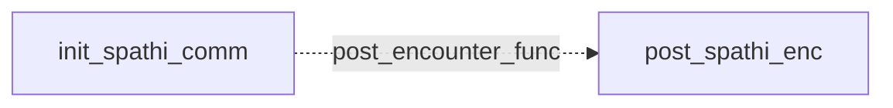

# Spathi / Fwiffo: existing conversation graph

> Generated by `tools/conversation_catalog.py`; do not edit this page by hand.

[Catalog and interpretation rules](../README.md) · [Proposed engine](../model.md)

Script: [spathic.c](../../../../sc2/src/uqm/comm/spathi/spathic.c#L1). Phrase bank: [spathi.txt](../../../../sc2/content/base/comm/spathi/spathi.txt#L1).

2 handler/helper nodes; 0 response registration sites; 0 direct local calls; 134 phrase records.

## Initialization and lifecycle

| Phase | Callback | Bound by | Conditions / source |
| --- | --- | --- | --- |
| <code>post_encounter_func</code> | [<code>post_spathi_enc</code>](#node-post_spathi_enc) | <code>init_spathi_comm</code> | No enclosing branch condition; [179](../../../../sc2/src/uqm/comm/spathi/spathic.c#L179) |

## Handler graph

Solid arrows are selectable responses; dashed arrows are direct C calls. Conditions, arguments, speech and effects are cataloged below. Parallel response sites are grouped only in this diagram.



## Condition catalog

Condition IDs describe enclosing source structure. Branch predicates combine with ∧; case labels mark source locations that can also be reached by fallthrough. Values refer to their original evaluation points. Local assignments and early control flow remain in the decision bodies.

| ID | Source expression / structural condition |
| --- | --- |
| <a id="condition-c1"></a>C1 | <code>GET_GAME_STATE(FOUND_PLUTO_SPATHI) == 1</code> |
| <a id="condition-c2"></a>C2 | <code>!(GET_GAME_STATE(FOUND_PLUTO_SPATHI) == 1)</code> |
| <a id="condition-c3"></a>C3 | <code>getSegue() == Segue_hostile</code> |
| <a id="condition-c4"></a>C4 | <code>(getSegue() == Segue_hostile) &amp;&amp; ((Manner = GET_GAME_STATE(SPATHI_MANNER)) != 2)</code> |
| <a id="condition-c5"></a>C5 | <code>Manner != 1</code> |
| <a id="condition-c6"></a>C6 | <code>GET_GAME_STATE(SPATHI_HOME_VISITS) != 7</code> |
| <a id="condition-c7"></a>C7 | <code>!((GET_GAME_STATE(FOUND_PLUTO_SPATHI) == 1) &#124;&#124; (GET_GAME_STATE(SPATHI_MANNER) == 3))</code> |
| <a id="condition-c8"></a>C8 | <code>((GET_GAME_STATE(FOUND_PLUTO_SPATHI) == 1) &#124;&#124; (GET_GAME_STATE(SPATHI_MANNER) == 3)) &#124;&#124; (LOBYTE(GLOBAL(CurrentActivity)) == WON_LAST_BATTLE)</code> |
| <a id="condition-c9"></a>C9 | <code>!(((GET_GAME_STATE(FOUND_PLUTO_SPATHI) == 1) &#124;&#124; (GET_GAME_STATE(SPATHI_MANNER) == 3)) &#124;&#124; (LOBYTE(GLOBAL(CurrentActivity)) == WON_LAST_BATTLE))</code> |

## Script-scope state and lookup tables

These declarations supply shared local state, computed phrase alternatives, number speech, or lookup data used by the nodes. LOCDATA presentation defaults are linked separately in the source.

Presentation descriptor <code>spathi_desc</code>: [source](../../../../sc2/src/uqm/comm/spathi/spathic.c#L26).

## Node catalog

<a id="node-post_spathi_enc"></a>

### post_spathi_enc

<code>static void post_spathi_enc(void)</code> — [source](../../../../sc2/src/uqm/comm/spathi/spathic.c#L150).

#### Actions, queries, local updates, and control flow

Calls are listed without assuming they are pure or mutating. Local updates are retained because they determine dynamic menus and counter-selected speech.

| Kind | Operation | Enclosing conditions | Source |
| --- | --- | --- | --- |
| call | <code>GET_GAME_STATE(FOUND_PLUTO_SPATHI)</code> | No enclosing branch condition | [154](../../../../sc2/src/uqm/comm/spathi/spathic.c#L154) |
| call | <code>SET_GAME_STATE(FOUND_PLUTO_SPATHI, 2)</code> | [C1](#condition-c1) | [156](../../../../sc2/src/uqm/comm/spathi/spathic.c#L156) |
| call | <code>getSegue()</code> | [C2](#condition-c2) | [158](../../../../sc2/src/uqm/comm/spathi/spathic.c#L158) |
| update | <code>Manner = GET_GAME_STATE(SPATHI_MANNER)</code> | [C2](#condition-c2) ∧ [C3](#condition-c3) | [159](../../../../sc2/src/uqm/comm/spathi/spathic.c#L159) |
| call | <code>GET_GAME_STATE(SPATHI_MANNER)</code> | [C2](#condition-c2) ∧ [C3](#condition-c3) | [159](../../../../sc2/src/uqm/comm/spathi/spathic.c#L159) |
| call | <code>SET_GAME_STATE(SPATHI_MANNER, 1)</code> | [C2](#condition-c2) ∧ [C4](#condition-c4) | [161](../../../../sc2/src/uqm/comm/spathi/spathic.c#L161) |
| call | <code>SET_GAME_STATE(SPATHI_VISITS, 0)</code> | [C2](#condition-c2) ∧ [C4](#condition-c4) ∧ [C5](#condition-c5) | [164](../../../../sc2/src/uqm/comm/spathi/spathic.c#L164) |
| call | <code>GET_GAME_STATE(SPATHI_HOME_VISITS)</code> | [C2](#condition-c2) ∧ [C4](#condition-c4) ∧ [C5](#condition-c5) | [166](../../../../sc2/src/uqm/comm/spathi/spathic.c#L166) |
| call | <code>SET_GAME_STATE(SPATHI_HOME_VISITS, 0)</code> | [C2](#condition-c2) ∧ [C4](#condition-c4) ∧ [C5](#condition-c5) ∧ [C6](#condition-c6) | [168](../../../../sc2/src/uqm/comm/spathi/spathic.c#L168) |

<details>
<summary>Exact decision body (local calculations, early returns, fallthrough and ordering)</summary>

```c
{
	BYTE Manner;

	if (GET_GAME_STATE (FOUND_PLUTO_SPATHI) == 1)
	{
		SET_GAME_STATE (FOUND_PLUTO_SPATHI, 2);
	}
	else if (getSegue () == Segue_hostile
			&& (Manner = GET_GAME_STATE (SPATHI_MANNER)) != 2)
	{
		SET_GAME_STATE (SPATHI_MANNER, 1);
		if (Manner != 1)
		{
			SET_GAME_STATE (SPATHI_VISITS, 0);
			/* if don't know about Spathi via Melnorme . . . */
			if (GET_GAME_STATE (SPATHI_HOME_VISITS) != 7)
			{
				SET_GAME_STATE (SPATHI_HOME_VISITS, 0);
			}
		}
	}
}
```

</details>

<a id="node-init_spathi_comm"></a>

### init_spathi_comm

<code>LOCDATA *init_spathi_comm(void)</code> — [source](../../../../sc2/src/uqm/comm/spathi/spathic.c#L175).

#### Actions, queries, local updates, and control flow

Calls are listed without assuming they are pure or mutating. Local updates are retained because they determine dynamic menus and counter-selected speech.

| Kind | Operation | Enclosing conditions | Source |
| --- | --- | --- | --- |
| update | <code>spathi_desc.post_encounter_func = post_spathi_enc</code> | No enclosing branch condition | [179](../../../../sc2/src/uqm/comm/spathi/spathic.c#L179) |
| update | <code>spathi_desc.AlienTextBaseline.x = TEXT_X_OFFS + (SIS_TEXT_WIDTH &gt;&gt; 1)</code> | No enclosing branch condition | [181](../../../../sc2/src/uqm/comm/spathi/spathic.c#L181) |
| update | <code>spathi_desc.AlienTextBaseline.y = 0</code> | No enclosing branch condition | [182](../../../../sc2/src/uqm/comm/spathi/spathic.c#L182) |
| update | <code>spathi_desc.AlienTextWidth = SIS_TEXT_WIDTH - 16</code> | No enclosing branch condition | [183](../../../../sc2/src/uqm/comm/spathi/spathic.c#L183) |
| call | <code>GET_GAME_STATE(FOUND_PLUTO_SPATHI)</code> | No enclosing branch condition | [185](../../../../sc2/src/uqm/comm/spathi/spathic.c#L185) |
| update | <code>spathi_desc.AlienAltSongRes = FWIFFO_MUSIC</code> | [C1](#condition-c1) | [187](../../../../sc2/src/uqm/comm/spathi/spathic.c#L187) |
| update | <code>spathi_desc.AlienSongFlags &#124;= LDASF_USE_ALTERNATE</code> | [C1](#condition-c1) | [188](../../../../sc2/src/uqm/comm/spathi/spathic.c#L188) |
| update | <code>spathi_desc.AlienSongFlags &amp;= ~LDASF_USE_ALTERNATE</code> | [C2](#condition-c2) | [192](../../../../sc2/src/uqm/comm/spathi/spathic.c#L192) |
| call | <code>GET_GAME_STATE(FOUND_PLUTO_SPATHI)</code> | No enclosing branch condition | [195](../../../../sc2/src/uqm/comm/spathi/spathic.c#L195) |
| call | <code>GET_GAME_STATE(SPATHI_MANNER)</code> | [C2](#condition-c2) | [196](../../../../sc2/src/uqm/comm/spathi/spathic.c#L196) |
| call | <code>LOBYTE(GLOBAL(CurrentActivity))</code> | [C7](#condition-c7) | [197](../../../../sc2/src/uqm/comm/spathi/spathic.c#L197) |
| call | <code>GLOBAL(CurrentActivity)</code> | [C7](#condition-c7) | [197](../../../../sc2/src/uqm/comm/spathi/spathic.c#L197) |
| call | <code>setSegue(Segue_peace)</code> | [C8](#condition-c8) | [199](../../../../sc2/src/uqm/comm/spathi/spathic.c#L199) |
| call | <code>setSegue(Segue_hostile)</code> | [C9](#condition-c9) | [203](../../../../sc2/src/uqm/comm/spathi/spathic.c#L203) |
| update | <code>retval = &amp;spathi_desc</code> | No enclosing branch condition | [205](../../../../sc2/src/uqm/comm/spathi/spathic.c#L205) |
| flow | <code>return retval;</code> | No enclosing branch condition | [207](../../../../sc2/src/uqm/comm/spathi/spathic.c#L207) |

<details>
<summary>Exact decision body (local calculations, early returns, fallthrough and ordering)</summary>

```c
{
	LOCDATA *retval;

	spathi_desc.post_encounter_func = post_spathi_enc;

	spathi_desc.AlienTextBaseline.x = TEXT_X_OFFS + (SIS_TEXT_WIDTH >> 1);
	spathi_desc.AlienTextBaseline.y = 0;
	spathi_desc.AlienTextWidth = SIS_TEXT_WIDTH - 16;

	if (GET_GAME_STATE (FOUND_PLUTO_SPATHI) == 1)
	{	// use alternate Fwiffo track if available
		spathi_desc.AlienAltSongRes = FWIFFO_MUSIC;
		spathi_desc.AlienSongFlags |= LDASF_USE_ALTERNATE;
	}
	else
	{	// regular track -- let's make sure
		spathi_desc.AlienSongFlags &= ~LDASF_USE_ALTERNATE;
	}

	if (GET_GAME_STATE (FOUND_PLUTO_SPATHI) == 1
			|| GET_GAME_STATE (SPATHI_MANNER) == 3
			|| LOBYTE (GLOBAL (CurrentActivity)) == WON_LAST_BATTLE)
	{
		setSegue (Segue_peace);
	}
	else
	{
		setSegue (Segue_hostile);
	}
	retval = &spathi_desc;

	return (retval);
}
```

</details>

## Phrase catalog

Full base-content text, keyed by the symbols used above. Voice filenames are resource metadata; playback also depends on installed addons and settings. Dynamic insertions retain their original placeholders.

<a id="phrase-sorry_about_that"></a>

<details>
<summary>SORRY_ABOUT_THAT — spathi-000.ogg</summary>

[Text source](../../../../sc2/content/base/comm/spathi/spathi.txt#L1)

<pre>Attention big, mean, hostile alien vessel hovering overhead in an obvious attack posture:
This is Spathi Captain Fwiffo.
I know you are going to torture me, so let&#x27;s just get this over with right now.
The coordinates of my homeworld, Spathiwa, are 241.6, 368.7
and the ultra-secret Spathi Cypher, which is known only by me and several billion other Spathi
is `Huffi-Muffi-Guffi&#x27;.
Sorry about that little mistake with your landing vehicle!
I was so startled when it approached my vessel in a threatening manner that
er
my automated defense systems fired on it when it got too close.
I hope nobody got hurt!</pre>

</details>

<a id="phrase-identify"></a>

<details>
<summary>identify</summary>

[Text source](../../../../sc2/content/base/comm/spathi/spathi.txt#L14)

<pre>Attention alien vessel: Identify yourself or be destroyed!</pre>

</details>

<a id="phrase-i_fwiffo"></a>

<details>
<summary>I_FWIFFO — spathi-001.ogg</summary>

[Text source](../../../../sc2/content/base/comm/spathi/spathi.txt#L17)

<pre>Of course, of course!
As I said, I am Captain Fwiffo of the Spathi voidship StarRunner.
Our sensors have tracked your entry into this system
which you are no doubt here to conquer
and while you are certainly welcome to do so we would be greatly appreciative
if you would please just go away and forget this star system ever existed.
If you don&#x27;t go, it will greatly complicate our master-slave relationship with the Ur-Quan
who stationed us here to watch over the Earthlings.</pre>

</details>

<a id="phrase-hi_there"></a>

<details>
<summary>hi_there</summary>

[Text source](../../../../sc2/content/base/comm/spathi/spathi.txt#L27)

<pre>Hi there friend! We come in peace and mean you no harm.</pre>

</details>

<a id="phrase-are_you_sure"></a>

<details>
<summary>ARE_YOU_SURE — spathi-002.ogg</summary>

[Text source](../../../../sc2/content/base/comm/spathi/spathi.txt#L30)

<pre>Are you sure?
Because your statement is often just a more polite way of saying
`Attention alien vessel: Identify yourself or be destroyed.&#x27;
In any event, I am Spathi Captain Fwiffo of the voidship StarRunner
placed here in this planetary system as part of the powerful Earthguard star force
which our masters the Ur-Quan established here to make sure the Earthlings don&#x27;t do anything tricky.</pre>

</details>

<a id="phrase-dont_kill"></a>

<details>
<summary>dont_kill</summary>

[Text source](../../../../sc2/content/base/comm/spathi/spathi.txt#L38)

<pre>Don&#x27;t kill us!</pre>

</details>

<a id="phrase-we_fight_1"></a>

<details>
<summary>we_fight_1</summary>

[Text source](../../../../sc2/content/base/comm/spathi/spathi.txt#L41)

<pre>You attacked our lander -- killed our crew! Prepare to die.</pre>

</details>

<a id="phrase-we_fight_2"></a>

<details>
<summary>we_fight_2</summary>

[Text source](../../../../sc2/content/base/comm/spathi/spathi.txt#L44)

<pre>Enough of your slimy yammering. We fight!</pre>

</details>

<a id="phrase-ok_wont"></a>

<details>
<summary>OK_WONT — spathi-003.ogg</summary>

[Text source](../../../../sc2/content/base/comm/spathi/spathi.txt#L47)

<pre>Uh, okay... sure, we won&#x27;t!
Just remember though -- this offer may be revoked at any time.</pre>

</details>

<a id="phrase-do_cultural"></a>

<details>
<summary>do_cultural</summary>

[Text source](../../../../sc2/content/base/comm/spathi/spathi.txt#L51)

<pre>We suggest you immediately perform whatever cultural practices are customary to your species preceding death.</pre>

</details>

<a id="phrase-wezzy_wezzah"></a>

<details>
<summary>WEZZY_WEZZAH — spathi-004.ogg</summary>

[Text source](../../../../sc2/content/base/comm/spathi/spathi.txt#L54)

<pre>Certainly, most gracious destroyer, as is well known, before departing this mortal helix
all Spathi must complete the short, poignant ritual of Wezzy-Wezzah to be assured of a secure afterlife
and by allowing us to fulfill this requirement, you too shall be granted immortality in our beautiful afterworld
which is absolutely guaranteed to be free of similarly immortal monsters who would otherwise eat the both of us.</pre>

</details>

<a id="phrase-die_slugboy"></a>

<details>
<summary>die_slugboy</summary>

[Text source](../../../../sc2/content/base/comm/spathi/spathi.txt#L60)

<pre>Die slugboy!</pre>

</details>

<a id="phrase-begin_ritual"></a>

<details>
<summary>begin_ritual</summary>

[Text source](../../../../sc2/content/base/comm/spathi/spathi.txt#L63)

<pre>You may begin your ritual, and if I might make a small suggestion: be done in less than 2 minutes.</pre>

</details>

<a id="phrase-must_do_ritual_at_home"></a>

<details>
<summary>MUST_DO_RITUAL_AT_HOME — spathi-005.ogg</summary>

[Text source](../../../../sc2/content/base/comm/spathi/spathi.txt#L66)

<pre>Grief and woe -- certainly a destroyer of innocents as well-travelled as yourself
must know that the formalities of Wezzy-Wezzah are invalid unless
performed on the large moon orbiting our homeworld, Spathiwa
which is only 143 light years distant, and, if I remember correctly,
is especially beautiful this time of year.
Shall we go now there?</pre>

</details>

<a id="phrase-you_wont_die_yet"></a>

<details>
<summary>you_wont_die_yet</summary>

[Text source](../../../../sc2/content/base/comm/spathi/spathi.txt#L74)

<pre>Because I am compassionate, you will not die until you have exhausted your usefulness.</pre>

</details>

<a id="phrase-eternal_gratitude"></a>

<details>
<summary>ETERNAL_GRATITUDE — spathi-006.ogg</summary>

[Text source](../../../../sc2/content/base/comm/spathi/spathi.txt#L77)

<pre>My eternal gratitude is yours, oh devastator of helpless beings.
It&#x27;s times like these that I am forced to feel almost, though not quite, sorry
that the Ur-Quan so thoroughly defeated and humiliated your species.</pre>

</details>

<a id="phrase-we_fight"></a>

<details>
<summary>we_fight</summary>

[Text source](../../../../sc2/content/base/comm/spathi/spathi.txt#L82)

<pre>We fight!</pre>

</details>

<a id="phrase-pay_for_crimes"></a>

<details>
<summary>pay_for_crimes</summary>

[Text source](../../../../sc2/content/base/comm/spathi/spathi.txt#L85)

<pre>Now you must pay for the crimes of your craven masters, the evil Ur-Quan.</pre>

</details>

<a id="phrase-clutch_maven"></a>

<details>
<summary>CLUTCH_MAVEN — spathi-007.ogg</summary>

[Text source](../../../../sc2/content/base/comm/spathi/spathi.txt#L88)

<pre>In this difficult situation I am reminded of what my clutch maven once said to me before my first molting.
`Sometimes the enemy is so swift and the path so treacherous that you can run no further.
It is then that you must turn and resolve to fight
and in all likelihood die horribly
but you never know when you are going to get lucky, so go for it!&#x27;</pre>

</details>

<a id="phrase-you_may_live"></a>

<details>
<summary>you_may_live</summary>

[Text source](../../../../sc2/content/base/comm/spathi/spathi.txt#L95)

<pre>I find myself moved by your deep commitment to your rituals and ancestral ways. You may live.</pre>

</details>

<a id="phrase-honest_and_friendly"></a>

<details>
<summary>HONEST_AND_FRIENDLY — spathi-008.ogg</summary>

[Text source](../../../../sc2/content/base/comm/spathi/spathi.txt#L98)

<pre>That settles it, for now I am certain that you are an honest and friendly being
who is forced entirely through unfortunate circumstance - the unreasonable hostility of the Universe
to travel the galaxy in a ship which, according to my sensors
is best suited to conducting planetary-scale genocide.</pre>

</details>

<a id="phrase-what_are_coordinates"></a>

<details>
<summary>what_are_coordinates</summary>

[Text source](../../../../sc2/content/base/comm/spathi/spathi.txt#L104)

<pre>We&#x27;d be delighted to accompany you to your homeworld. What are its HyperSpace coordinates?</pre>

</details>

<a id="phrase-coordinates_are"></a>

<details>
<summary>COORDINATES_ARE — spathi-009.ogg</summary>

[Text source](../../../../sc2/content/base/comm/spathi/spathi.txt#L107)

<pre>My most wonderful planet Spathiwa circles a safe distance from the orange giant star Yuffo
which is at HyperSpace coordinates
hey -- wait a minute!
Is this some kind of Homosap trick to get the location of my homeworld
so that you can visit it with devastation?!</pre>

</details>

<a id="phrase-tell_me_coordinates"></a>

<details>
<summary>tell_me_coordinates</summary>

[Text source](../../../../sc2/content/base/comm/spathi/spathi.txt#L114)

<pre>Just tell me the coordinates, alien dog-slime!</pre>

</details>

<a id="phrase-fake_coordinates"></a>

<details>
<summary>FAKE_COORDINATES — spathi-010.ogg</summary>

[Text source](../../../../sc2/content/base/comm/spathi/spathi.txt#L117)

<pre>Hmmm... I see
Very well then, your threats have convinced me to reveal this secret.
Spathiwa is the 1st planet out from the star at HyperSpace (570.4, 979.5)</pre>

</details>

<a id="phrase-too_scary"></a>

<details>
<summary>TOO_SCARY — spathi-011.ogg</summary>

[Text source](../../../../sc2/content/base/comm/spathi/spathi.txt#L122)

<pre>You&#x27;ve got so many ships in your fleet, that instead of joining you
I think I&#x27;ll just run away.</pre>

</details>

<a id="phrase-youve_got_me_all_wrong"></a>

<details>
<summary>youve_got_me_all_wrong</summary>

[Text source](../../../../sc2/content/base/comm/spathi/spathi.txt#L126)

<pre>No, no, no! You&#x27;ve got me all wrong. I promise I&#x27;ll be nice.</pre>

</details>

<a id="phrase-sorry_no_coords"></a>

<details>
<summary>SORRY_NO_COORDS — spathi-012.ogg</summary>

[Text source](../../../../sc2/content/base/comm/spathi/spathi.txt#L129)

<pre>Er... I just don&#x27;t know.
I want to believe you, I really do, but the risk to my people is just too great.
Anyway I think I just forgot the coordinates -- let me see if I can remember them
nope!
I&#x27;m afraid they&#x27;re gone forever, so torturing me would just be a waste of your time.</pre>

</details>

<a id="phrase-what_doing_on_pluto_1"></a>

<details>
<summary>what_doing_on_pluto_1</summary>

[Text source](../../../../sc2/content/base/comm/spathi/spathi.txt#L136)

<pre>What are you doing here on Pluto?</pre>

</details>

<a id="phrase-about_20_years_ago"></a>

<details>
<summary>ABOUT_20_YEARS_AGO — spathi-013.ogg</summary>

[Text source](../../../../sc2/content/base/comm/spathi/spathi.txt#L139)

<pre>About 20 years ago, this region of space was dominated by a loose confederation known as the Alliance of Free Stars,
which was composed of the aliens native to these parts who didn&#x27;t want to be enslaved.
They made a valiant effort against the superior Ur-Quan forces
and it even looked like they might miraculously defeat the combined Ur-Quan armada
right up to the point at which the Ur-Quan totally defeated - indeed, annihilated them.</pre>

</details>

<a id="phrase-what_doing_on_pluto_2"></a>

<details>
<summary>what_doing_on_pluto_2</summary>

[Text source](../../../../sc2/content/base/comm/spathi/spathi.txt#L146)

<pre>So, what ARE you doing here on Pluto?</pre>

</details>

<a id="phrase-when_urquan_arrived"></a>

<details>
<summary>WHEN_URQUAN_ARRIVED — spathi-014.ogg</summary>

[Text source](../../../../sc2/content/base/comm/spathi/spathi.txt#L149)

<pre>When the Ur-Quan armada entered this system to subjugate formally the Earthlings,
the Ur-Quan presented the humans with the standard slave options:
join the Hierarchy as combat thralls, and retain some autonomy, including the right to travel through space
or become a `fallow&#x27; species and return to pre-atomic savagery on the surface of their homeworld
encased for all time beneath an impenetrable force shield.
The Humans chose the latter option, and so were swiftly imprisoned on the surface of Earth
but the Ur-Quan didn&#x27;t trust them to obey the restrictions...so
they chose a small group of Hierarchy combat starships from the Ilwrath and Spathi fleets
to create the so-called Earthguard, and stationed them at a base on Earth&#x27;s moon.</pre>

</details>

<a id="phrase-where_are_urquan"></a>

<details>
<summary>where_are_urquan</summary>

[Text source](../../../../sc2/content/base/comm/spathi/spathi.txt#L160)

<pre>Where are the Ur-Quan now?</pre>

</details>

<a id="phrase-urquan_left"></a>

<details>
<summary>URQUAN_LEFT — spathi-015.ogg</summary>

[Text source](../../../../sc2/content/base/comm/spathi/spathi.txt#L163)

<pre>Our masters don&#x27;t really keep us very well informed about their goings on
so all that we know is that immediately after the subjugation of the last Alliance race
the Yehat, I think
the Ur-Quan gathered their dreadnoughts and departed towards the edge of the galaxy
commanding us to obey the slave laws or face their wrath when they returned.</pre>

</details>

<a id="phrase-what_about_other_races"></a>

<details>
<summary>what_about_other_races</summary>

[Text source](../../../../sc2/content/base/comm/spathi/spathi.txt#L170)

<pre>Do you know anything about other alien races?</pre>

</details>

<a id="phrase-about_other_races"></a>

<details>
<summary>ABOUT_OTHER_RACES — spathi-016.ogg</summary>

[Text source](../../../../sc2/content/base/comm/spathi/spathi.txt#L173)

<pre>We know only bits and pieces of what happened to each race; for instance,
when defeated, the Yehat joined the Hierarchy as combat thralls,
while the Syreen chose to be slave shielded on a planet in the BugSquirt star system.
No, that&#x27;s not right -- I forget its name, anyway where was I?
Oh yes, the Shofixti! They were utterly wiped out in a gigantic `blaze of glory&#x27;.</pre>

</details>

<a id="phrase-what_doing_on_pluto_3"></a>

<details>
<summary>what_doing_on_pluto_3</summary>

[Text source](../../../../sc2/content/base/comm/spathi/spathi.txt#L180)

<pre>TELL ME what you are doing on Pluto, NOW!</pre>

</details>

<a id="phrase-what_about_yourself"></a>

<details>
<summary>what_about_yourself</summary>

[Text source](../../../../sc2/content/base/comm/spathi/spathi.txt#L183)

<pre>What about yourself, Fwiffo?</pre>

</details>

<a id="phrase-about_myself"></a>

<details>
<summary>ABOUT_MYSELF — spathi-017.ogg</summary>

[Text source](../../../../sc2/content/base/comm/spathi/spathi.txt#L186)

<pre>Me? You mean me, personally? How nice of you to ask!
I was born a poor, green encrustling, the youngest child of a family of 18,487.
My male parent had to work hard to support us, very hard
but each of my brothers and sisters and I tried to help out to make ends meet.
The female parent was kind and sweet to all of us.
Why, she once even called me by NAME; she said
`Fwiffo! Fwiffo darling! Would you please answer the door? I think someone&#x27;s there.&#x27;
What a treat! A golden memory.
I swiftly matured into a fine example of my species, and with my parents&#x27; assistance, achieved independence.
Specifically, they pried me from the doorjamb, and rolled me into the street.
Thus prepared, I set out to make my fortune.
I had great dreams in those days, yes, great dreams!
I knew that someday I would be vastly rich, wealthy enough to afford a large, well-fortified mansion.
Surrounding my mansion would be vast tracts of land, through which I could slide at any time I wished!
Of course, one can never be too sure that there aren&#x27;t monsters hiding just behind the next bush
so I would plant trees to climb at regular, easy to reach intervals.
And being a Spathi of the World, I would know that some monsters climb trees, though often not well
so I would have my servants place in each tree a basket of perfect stones
not too heavy, not too light -- just the right size for throwing at monsters.
I was thinking about what color the stones would be painted (aqua, mauve or magenta)
when a vegetable cart came careening down the street outside my house, and knocked me unconscious.
When I awoke, I was aboard the voidship StarRunner, headed for Earth.
Apparently I had been out of my head for quite some time after the accident
and with the assistance of some kind strangers
had been relieved of my funds and convinced to join the navy
where I have been unpleasantly employed for the last 25 years.</pre>

</details>

<a id="phrase-stationed_on_earth_moon"></a>

<details>
<summary>STATIONED_ON_EARTH_MOON — spathi-018.ogg</summary>

[Text source](../../../../sc2/content/base/comm/spathi/spathi.txt#L214)

<pre>Originally, we were stationed on Earth&#x27;s moon, which made us Spathi a bit uneasy
because with each passing day we grew more and more worried about the sneaky Earthlings making a surprise attack
though the Ilwrath kept telling us that was impossible
since the Earthlings had no ships or weapons whatsoever.
That made us feel a bit better, but when the Ilwrath left, again we grew fearful
and decided to make a strategic redeployment to Mars.
Later on we decided it would be prudent to relocate to Jupiter&#x27;s moon, Ganymede
then later Saturn&#x27;s moon, Titan
and finally here to Pluto.</pre>

</details>

<a id="phrase-what_blaze_of_glory"></a>

<details>
<summary>what_blaze_of_glory</summary>

[Text source](../../../../sc2/content/base/comm/spathi/spathi.txt#L225)

<pre>What do you mean, `blaze of glory&#x27;? What happened to the Shofixti?</pre>

</details>

<a id="phrase-blaze_is"></a>

<details>
<summary>BLAZE_IS — spathi-019.ogg</summary>

[Text source](../../../../sc2/content/base/comm/spathi/spathi.txt#L228)

<pre>The Shofixti were half feral, as you know, having been uplifted by the Yehat
just a few decades before the start of the war.
Given their habit of detonating those suicidal, so-called `Glory Devices&#x27; in combat
it came as no particular surprise to me when, upon the arrival of the Ur-Quan primary task force at their homeworld
the Shofixti caused their sun to explode in a colossal supernova
destroying the entire planetary system, and not incidentally dozens of Ur-Quan Dreadnoughts!
(Snork-snork-snork!)</pre>

</details>

<a id="phrase-what_about_moonbase"></a>

<details>
<summary>what_about_moonbase</summary>

[Text source](../../../../sc2/content/base/comm/spathi/spathi.txt#L237)

<pre>What is happening at the base on Luna then?</pre>

</details>

<a id="phrase-set_up_base"></a>

<details>
<summary>SET_UP_BASE — spathi-020.ogg</summary>

[Text source](../../../../sc2/content/base/comm/spathi/spathi.txt#L240)

<pre>We decided that if the Earthlings figured out we had abandoned the base on Luna
they would be more likely to try something sneaky.
So we rigged up some old service androids and ordered them to drive around on the lunar surface in bulldozers,
endlessly pushing around the same piles of dirt.
In addition, we connected the base&#x27;s local radio transmitter to an audio Melnorme FunRom
called `Winky&#x27;s Happy Night&#x27;, hoping that they would think we were still there.</pre>

</details>

<a id="phrase-what_about_ilwrath"></a>

<details>
<summary>what_about_ilwrath</summary>

[Text source](../../../../sc2/content/base/comm/spathi/spathi.txt#L248)

<pre>What happened to the Ilwrath stationed in this system?</pre>

</details>

<a id="phrase-about_ilwrath"></a>

<details>
<summary>ABOUT_ILWRATH — spathi-021.ogg</summary>

[Text source](../../../../sc2/content/base/comm/spathi/spathi.txt#L251)

<pre>The Ilwrath contingent were supposed to be the toughest ridge-crest, er
the most rigid flipper, no
ah yes - the BACKBONE of the Earthguard force; but they departed the system en masse
not long after the last Ur-Quan Dreadnought vanished from this region of space.
They claimed to have received a direct order from their Gods of Evil and Darkness,
who had grown dissatisfied with the Ilwraths&#x27; passivity
and wanted them to kill or at least torture someone soon.
Personally, I believe they just got bored and went off to have some fun.</pre>

</details>

<a id="phrase-what_about_other_spathi"></a>

<details>
<summary>what_about_other_spathi</summary>

[Text source](../../../../sc2/content/base/comm/spathi/spathi.txt#L261)

<pre>What happened to the other Spathi ships?</pre>

</details>

<a id="phrase-really_thousands"></a>

<details>
<summary>really_thousands</summary>

[Text source](../../../../sc2/content/base/comm/spathi/spathi.txt#L264)

<pre>Hundreds? Come on.</pre>

</details>

<a id="phrase-spathi_are"></a>

<details>
<summary>SPATHI_ARE — spathi-022.ogg</summary>

[Text source](../../../../sc2/content/base/comm/spathi/spathi.txt#L267)

<pre>Over the past years, it became necessary to redeploy strategically some of our Earthguard forces
to our homeworld in case of a sudden surprise attack by a vicious, unrelenting alien race which we Spathi call
The Ultimate Evil!</pre>

</details>

<a id="phrase-what_enemy"></a>

<details>
<summary>what_enemy</summary>

[Text source](../../../../sc2/content/base/comm/spathi/spathi.txt#L272)

<pre>Who or what is this `Ultimate Evil&#x27;?</pre>

</details>

<a id="phrase-enemy_is"></a>

<details>
<summary>ENEMY_IS — spathi-023.ogg</summary>

[Text source](../../../../sc2/content/base/comm/spathi/spathi.txt#L275)

<pre>As yet, the Ultimate Evil remains largely unmanifest, and its powers and exact intentions are still a bit obscure
since it lurks just outside the range of even the most sensitive, long-range detectors
which we feel gives conclusive evidence as to The Ultimate Evil&#x27;s nefarious intent.</pre>

</details>

<a id="phrase-when_ilwrath"></a>

<details>
<summary>when_ilwrath</summary>

[Text source](../../../../sc2/content/base/comm/spathi/spathi.txt#L280)

<pre>When do you expect the Ilwrath to return?</pre>

</details>

<a id="phrase-then_ilwrath"></a>

<details>
<summary>THEN_ILWRATH — spathi-024.ogg</summary>

[Text source](../../../../sc2/content/base/comm/spathi/spathi.txt#L283)

<pre>Well, when they were pushing up into HyperSpace 18 years ago, we asked them that very question
and I think they said something to the effect of
`Real Soon&#x27;.</pre>

</details>

<a id="phrase-why_you_here"></a>

<details>
<summary>why_you_here</summary>

[Text source](../../../../sc2/content/base/comm/spathi/spathi.txt#L288)

<pre>Why are you still here, Captain Fwiffo?</pre>

</details>

<a id="phrase-drew_short_straw"></a>

<details>
<summary>DREW_SHORT_STRAW — spathi-025.ogg</summary>

[Text source](../../../../sc2/content/base/comm/spathi/spathi.txt#L291)

<pre>Since it was our most powerful and unforgiving masters, the Ur-Quan, who stationed us here
we knew it would be grossly stupid to disobey them completely
but we decided that it would be okay to send just one ship home.
We used one of our most ancient and solemn rituals, Puun-Taffy, to pick the lucky ship.
Then... some months later, we decided that it wouldn&#x27;t REALLY hurt if we sent one more ship home
and then later we sent another, and then another... well, you get the idea.
Alas, as fate would have it, when the final ritual was performed
I, Fwiffo, was left here alone, for as even the most immature encrustling knows
there must always be one Spathi who picks the short Ta Puun stick.</pre>

</details>

<a id="phrase-how_many_crew"></a>

<details>
<summary>how_many_crew</summary>

[Text source](../../../../sc2/content/base/comm/spathi/spathi.txt#L302)

<pre>How many crew do you have aboard?</pre>

</details>

<a id="phrase-just_me"></a>

<details>
<summary>JUST_ME — spathi-026.ogg</summary>

[Text source](../../../../sc2/content/base/comm/spathi/spathi.txt#L305)

<pre>I am undone! You are far too clever for a poor Spathi like me
and now I must submit to your superior, alien intellect.
I guess I am not revealing any truly important secrets if I tell you
that each of my species&#x27; Eluder-class Voidships typically holds 30 Spathi crewmen
though at present my vessel, the StarRunner, is not up to full complement
due to the needs of my homeworld in their resistance against the Ultimate Evil
and in fact my vessel is somewhat understaffed right now
seeing as how I am the only Spathi on board, which is a bit frightening as I am sure you can understand.</pre>

</details>

<a id="phrase-thousands"></a>

<details>
<summary>THOUSANDS — spathi-027.ogg</summary>

[Text source](../../../../sc2/content/base/comm/spathi/spathi.txt#L315)

<pre>Dozens -- that is to say, scores and perhaps even hundreds of my brethren stride through the corridors
of this specially modified, super-efficient, mass-destruction-oriented starship
which could lay siege to an entire planetary system should we choose to do so
which, fortunately for you, we have decided not to do, today.</pre>

</details>

<a id="phrase-full_of_monsters"></a>

<details>
<summary>full_of_monsters</summary>

[Text source](../../../../sc2/content/base/comm/spathi/spathi.txt#L321)

<pre>The galaxy teems with threatening monsters. Are you happy here -- alone and vulnerable?</pre>

</details>

<a id="phrase-how_true"></a>

<details>
<summary>HOW_TRUE — spathi-028.ogg</summary>

[Text source](../../../../sc2/content/base/comm/spathi/spathi.txt#L324)

<pre>How true, Captain, how true!
In truth, just between us, during the past seven years, I have been quite ill at ease
and yet now I find myself enjoying your company, this witty dialog
and the presence of your huge, powerful, death-dealing starship which being my friend
you would certainly feel compelled to use in order to save me from any hostile lifeforms
who threatened me with death.</pre>

</details>

<a id="phrase-join_us"></a>

<details>
<summary>join_us</summary>

[Text source](../../../../sc2/content/base/comm/spathi/spathi.txt#L332)

<pre>I&#x27;m sure you&#x27;d feel a lot safer if you were with us. Come on, Fwiffo, join our fleet!</pre>

</details>

<a id="phrase-will_join"></a>

<details>
<summary>WILL_JOIN — spathi-029.ogg</summary>

[Text source](../../../../sc2/content/base/comm/spathi/spathi.txt#L335)

<pre>Happy days and jubilation!
I discard all prejudice and hesitations and accept and celebrate your offer of protection
and your undying commitment to my well-being!
I must wax melancholy for just a moment though
and make sure you understand that any other Spathi ships we meet at large in the galaxy
are not going to be quite so responsive to your friendly gestures as myself
since they bear more heavily the yoke of Ur-Quan enslavement
and are also apt to talk themselves out of allying with a totally unknown alien
which I, having been left here alone, cannot do.
Welcome me aboard, captain!</pre>

</details>

<a id="phrase-wont_join_1"></a>

<details>
<summary>WONT_JOIN_1 — spathi-030.ogg</summary>

[Text source](../../../../sc2/content/base/comm/spathi/spathi.txt#L347)

<pre>Well... I really want to
but I am just not sure that under the present circumstances
joining you in your exciting and also dangerous space-adventures would be the best course of action right now
because the Ur-Quan could return at any minute and the punishment they would bestow on me for such treason
would make any other horrible death seem like big fun by comparison.
Thanks for the offer, though.</pre>

</details>

<a id="phrase-give_ship_or_die"></a>

<details>
<summary>give_ship_or_die</summary>

[Text source](../../../../sc2/content/base/comm/spathi/spathi.txt#L355)

<pre>Give us your ship or you will be destroyed!</pre>

</details>

<a id="phrase-wont_join_2"></a>

<details>
<summary>WONT_JOIN_2 — spathi-031.ogg</summary>

[Text source](../../../../sc2/content/base/comm/spathi/spathi.txt#L358)

<pre>You build a strong case, Captain.
Here I am, alone and undefended on the surface of a hostile alien world.
Above me you hover in orbit, encrusted with beam guns, missile launchers and other, more dreadful weapons.
So I think to myself: Fwiffo, is it prudent to remain here, as vulnerable as a moltling on a skillet?
`NO&#x27;, I answer myself, `JOIN THE HUMAN - HE IS KIND AND GOOD!&#x27;
But then a wicked voice whispers:
`beware... the human is tricking you! If you join him, you will die alone, in the cold of space.&#x27;
And for reasons beyond my understanding, Captain, this voice overwhelms the other
and so I must remain here...largely against my will.</pre>

</details>

<a id="phrase-wont_join_3"></a>

<details>
<summary>WONT_JOIN_3 — spathi-032.ogg</summary>

[Text source](../../../../sc2/content/base/comm/spathi/spathi.txt#L369)

<pre>Twice before you have asked this question, Captain. Will the third time be the charm?
Alas, I fear not.</pre>

</details>

<a id="phrase-gee_thanks"></a>

<details>
<summary>GEE_THANKS — spathi-033.ogg</summary>

[Text source](../../../../sc2/content/base/comm/spathi/spathi.txt#L373)

<pre>Gee, thanks.</pre>

</details>

<a id="phrase-changed_mind"></a>

<details>
<summary>changed_mind</summary>

[Text source](../../../../sc2/content/base/comm/spathi/spathi.txt#L376)

<pre>I&#x27;ve changed my mind. We&#x27;ll attack you.</pre>

</details>

<a id="phrase-youre_forgiven"></a>

<details>
<summary>youre_forgiven</summary>

[Text source](../../../../sc2/content/base/comm/spathi/spathi.txt#L379)

<pre>We understand that sometimes these tragic misunderstandings happen. We grieve, but are not bitter.</pre>

</details>

<a id="phrase-thanks_for_forgiveness"></a>

<details>
<summary>THANKS_FOR_FORGIVENESS — spathi-034.ogg</summary>

[Text source](../../../../sc2/content/base/comm/spathi/spathi.txt#L382)

<pre>Whew, thanks! For a minute there, I thought you were going to kill me!</pre>

</details>

<a id="phrase-hate_you_forever_space"></a>

<details>
<summary>HATE_YOU_FOREVER_SPACE — spathi-035.ogg</summary>

[Text source](../../../../sc2/content/base/comm/spathi/spathi.txt#L385)

<pre>I fear to face you in combat, but I know if I do not, you will just grow stronger with each passing week.
Therefore I must face you now.
I set the thrusters to maximum, close my eye, and begin pressing the fire stud wildly.</pre>

</details>

<a id="phrase-init_angry_hello_space"></a>

<details>
<summary>INIT_ANGRY_HELLO_SPACE — spathi-036.ogg</summary>

[Text source](../../../../sc2/content/base/comm/spathi/spathi.txt#L390)

<pre>You are mean, cruel and deceitful. I suspect you are an Ilwrath in ape&#x27;s clothing.
What do you want?</pre>

</details>

<a id="phrase-subsequent_angry_hello_space"></a>

<details>
<summary>SUBSEQUENT_ANGRY_HELLO_SPACE — spathi-037.ogg</summary>

[Text source](../../../../sc2/content/base/comm/spathi/spathi.txt#L394)

<pre>Ah, Mister Nasty is back. I wonder what he wants today? Peace, Happiness, Joy for all?
No, I fear, death and unmitigated destruction is his traditional fare.
Am I correct?</pre>

</details>

<a id="phrase-init_neutral_hello_space"></a>

<details>
<summary>INIT_NEUTRAL_HELLO_SPACE — spathi-038.ogg</summary>

[Text source](../../../../sc2/content/base/comm/spathi/spathi.txt#L399)

<pre>Surprise and Terror!
I am greeted by the smooth and hostile face of our old enemy, the Hootmans
no... the Huge-glands, no, I remember, the Hunams!</pre>

</details>

<a id="phrase-subsequent_neutral_hello_space"></a>

<details>
<summary>SUBSEQUENT_NEUTRAL_HELLO_SPACE — spathi-039.ogg</summary>

[Text source](../../../../sc2/content/base/comm/spathi/spathi.txt#L404)

<pre>Hello, Hunam, what would you like to threaten me about today?</pre>

</details>

<a id="phrase-init_friendly_hello_space"></a>

<details>
<summary>INIT_FRIENDLY_HELLO_SPACE — spathi-040.ogg</summary>

[Text source](../../../../sc2/content/base/comm/spathi/spathi.txt#L407)

<pre>Hello friend Hunam! How nice to see you again. Kill anyone today?</pre>

</details>

<a id="phrase-subsequent_friendly_hello_space"></a>

<details>
<summary>SUBSEQUENT_FRIENDLY_HELLO_SPACE — spathi-041.ogg</summary>

[Text source](../../../../sc2/content/base/comm/spathi/spathi.txt#L410)

<pre>...No! No! Weapons Officer, don&#x27;t fire! It&#x27;s the Hunam again, you idiot!
What! The viewscreen? What are you...oh.
Hello Friend Hunam! How are you? We are just fine, real swell.
No problems at all! Just fine. No problems at all!</pre>

</details>

<a id="phrase-init_allied_hello_space"></a>

<details>
<summary>INIT_ALLIED_HELLO_SPACE — spathi-042.ogg</summary>

[Text source](../../../../sc2/content/base/comm/spathi/spathi.txt#L416)

<pre>Hello Captain Ally Hunam! We are here in this place at this time
just like you -- how wonderful.</pre>

</details>

<a id="phrase-subsequent_allied_hello_space"></a>

<details>
<summary>SUBSEQUENT_ALLIED_HELLO_SPACE — spathi-043.ogg</summary>

[Text source](../../../../sc2/content/base/comm/spathi/spathi.txt#L420)

<pre>Ah, Hunam! I was just wondering... is Tuffa-Yuf still alive?
Have you seen him, is he well?
He was sent to your Earth Starbase a while ago
to captain an Eluder vessel as part of our mutual assistance pact.
Rest assured, he will be an excellent addition to your elite force.
Those weeks of intense training always result in an officer of the highest caliber.
If you see him, please let him know
that I still consider his debt valid, and expect prompt payment.
Thank you.</pre>

</details>

<a id="phrase-give_info_space"></a>

<details>
<summary>give_info_space</summary>

[Text source](../../../../sc2/content/base/comm/spathi/spathi.txt#L431)

<pre>Spathi - though we are not on the best of terms, would you please give me some information?</pre>

</details>

<a id="phrase-heres_some_info"></a>

<details>
<summary>HERES_SOME_INFO — spathi-044.ogg</summary>

[Text source](../../../../sc2/content/base/comm/spathi/spathi.txt#L434)

<pre>Gladly, and here it is - now listen carefully for I will only say it once.
Do not ask favors of people you routinely ambush and murder.</pre>

</details>

<a id="phrase-we_sorry_space"></a>

<details>
<summary>we_sorry_space</summary>

[Text source](../../../../sc2/content/base/comm/spathi/spathi.txt#L438)

<pre>Hey, look. We&#x27;ve made mistakes, I admit it! But we&#x27;ll just be friends, hmmm?</pre>

</details>

<a id="phrase-apologize_at_homeworld"></a>

<details>
<summary>APOLOGIZE_AT_HOMEWORLD — spathi-045.ogg</summary>

[Text source](../../../../sc2/content/base/comm/spathi/spathi.txt#L441)

<pre>My soul is warmed by your sincere and heartfelt words.
It is decided -- we shall be friends forever.
However, I soon must go about my duties, and sadly we may never see each other again.
I will remember you forever, Captain.
And as your new friend, I can confide that should you decide to make a more general plea to the Spathi
say for your past deeds of thuggery
you would be well advised to seek the High Ruling Council at Spathiwa.
Goodbye...friend.</pre>

</details>

<a id="phrase-we_fight_again_space"></a>

<details>
<summary>we_fight_again_space</summary>

[Text source](../../../../sc2/content/base/comm/spathi/spathi.txt#L451)

<pre>This battle stuff is fun! Let&#x27;s do some more of it!</pre>

</details>

<a id="phrase-ok_fight_again_space"></a>

<details>
<summary>OK_FIGHT_AGAIN_SPACE — spathi-046.ogg</summary>

[Text source](../../../../sc2/content/base/comm/spathi/spathi.txt#L454)

<pre>Aghk! You are twisted and perverse! You deserve to die.</pre>

</details>

<a id="phrase-bye_angry_space"></a>

<details>
<summary>bye_angry_space</summary>

[Text source](../../../../sc2/content/base/comm/spathi/spathi.txt#L457)

<pre>Don&#x27;t go away mad, Spathi. Just go away.</pre>

</details>

<a id="phrase-goodbye_angry_space"></a>

<details>
<summary>GOODBYE_ANGRY_SPACE — spathi-047.ogg</summary>

[Text source](../../../../sc2/content/base/comm/spathi/spathi.txt#L460)

<pre>I would like to suggest a new plan for you, Hunam:
depart this region of space, and never return.</pre>

</details>

<a id="phrase-look_weird"></a>

<details>
<summary>look_weird</summary>

[Text source](../../../../sc2/content/base/comm/spathi/spathi.txt#L464)

<pre>Man! You look weird -- all those claws and your gooey eyeball. Yuck!</pre>

</details>

<a id="phrase-you_look_weird"></a>

<details>
<summary>YOU_LOOK_WEIRD — spathi-048.ogg</summary>

[Text source](../../../../sc2/content/base/comm/spathi/spathi.txt#L467)

<pre>Beauty is in the eye of the beholder.</pre>

</details>

<a id="phrase-no_look_really_weird"></a>

<details>
<summary>no_look_really_weird</summary>

[Text source](../../../../sc2/content/base/comm/spathi/spathi.txt#L470)

<pre>No, it&#x27;s not. You are plain, dog ugly.</pre>

</details>

<a id="phrase-no_you_look_really_weird"></a>

<details>
<summary>NO_YOU_LOOK_REALLY_WEIRD — spathi-049.ogg</summary>

[Text source](../../../../sc2/content/base/comm/spathi/spathi.txt#L473)

<pre>Oh yeah? Oh YEAH!?
Well...
You are too.</pre>

</details>

<a id="phrase-come_in_peace"></a>

<details>
<summary>come_in_peace</summary>

[Text source](../../../../sc2/content/base/comm/spathi/spathi.txt#L478)

<pre>We are on a peaceful mission through the Cosmos.</pre>

</details>

<a id="phrase-against_nature"></a>

<details>
<summary>AGAINST_NATURE — spathi-050.ogg</summary>

[Text source](../../../../sc2/content/base/comm/spathi/spathi.txt#L481)

<pre>Two aspects of your last statement defy the course of nature as I know it.
First
`Peace&#x27; as you call it, is an illusion.
If you have `Peace&#x27;, you simply haven&#x27;t yet seen the thing that&#x27;s trying to kill you.
Second
Peaceful missions through the Cosmos rarely require weapons large enough to punch holes through a small moon.</pre>

</details>

<a id="phrase-prepare_to_die"></a>

<details>
<summary>prepare_to_die</summary>

[Text source](../../../../sc2/content/base/comm/spathi/spathi.txt#L489)

<pre>Are you prepared to die today, Spathi?</pre>

</details>

<a id="phrase-always_prepared"></a>

<details>
<summary>ALWAYS_PREPARED — spathi-051.ogg</summary>

[Text source](../../../../sc2/content/base/comm/spathi/spathi.txt#L492)

<pre>We Spathi are always prepared to die, we know just what to do.
It goes something like this
AIEEEE! No! Please be merciful! Not my claw! Please, no! I beg of you! The Pain! NO!</pre>

</details>

<a id="phrase-since_friendly_give_stuff"></a>

<details>
<summary>since_friendly_give_stuff</summary>

[Text source](../../../../sc2/content/base/comm/spathi/spathi.txt#L497)

<pre>Since we are now friends, it is customary for you to give us things.</pre>

</details>

<a id="phrase-give_advice"></a>

<details>
<summary>GIVE_ADVICE — spathi-052.ogg</summary>

[Text source](../../../../sc2/content/base/comm/spathi/spathi.txt#L500)

<pre>Certainly, perhaps beginning with some advice.
Don&#x27;t presume we are stupid.</pre>

</details>

<a id="phrase-whats_up_space_1"></a>

<details>
<summary>whats_up_space_1</summary>

[Text source](../../../../sc2/content/base/comm/spathi/spathi.txt#L504)

<pre>Friend Spathi, what important facts can you relate?</pre>

</details>

<a id="phrase-general_info_space_1"></a>

<details>
<summary>GENERAL_INFO_SPACE_1 — spathi-053.ogg</summary>

[Text source](../../../../sc2/content/base/comm/spathi/spathi.txt#L507)

<pre>I guess the only event of importance I know about concerns the low and stupid Umgah
whose pranks we must suffer on a regular basis.
At least we have removed one source of their annoying jokes -- an unusually strong HyperWave &#x27;Caster
which they used on several occasions to impersonate such frightening characters as
the Grand Master Planet Eaters
Jud the Ineffable Vug
and Killmaster 18.
Needless to say, we did not fall for any of their high jinks.
In fact, we succeeded in taking from the Umgah their precious &#x27;Caster,
thus ending their attempts at sick levity.</pre>

</details>

<a id="phrase-bye_friendly_space"></a>

<details>
<summary>bye_friendly_space</summary>

[Text source](../../../../sc2/content/base/comm/spathi/spathi.txt#L519)

<pre>Goodbye, Spathi, I hope you remain well.</pre>

</details>

<a id="phrase-goodbye_friendly_space"></a>

<details>
<summary>GOODBYE_FRIENDLY_SPACE — spathi-054.ogg</summary>

[Text source](../../../../sc2/content/base/comm/spathi/spathi.txt#L522)

<pre>Goodbye, Hunam, I hope you aren&#x27;t eaten by monsters.</pre>

</details>

<a id="phrase-looking_for_a_few_good_squids"></a>

<details>
<summary>looking_for_a_few_good_squids</summary>

[Text source](../../../../sc2/content/base/comm/spathi/spathi.txt#L525)

<pre>Let me be frank. We seek allies.</pre>

</details>

<a id="phrase-urquan_slaves"></a>

<details>
<summary>URQUAN_SLAVES — spathi-055.ogg</summary>

[Text source](../../../../sc2/content/base/comm/spathi/spathi.txt#L528)

<pre>In case you have not forgotten, we are bonded to the Ur-Quan as slaves.
The punishment for the plan you propose can be described as `Death&#x27;.</pre>

</details>

<a id="phrase-why_slaves"></a>

<details>
<summary>why_slaves</summary>

[Text source](../../../../sc2/content/base/comm/spathi/spathi.txt#L532)

<pre>That brings up a good point. If you are such cowards, why do you fight for the Ur-Quan?</pre>

</details>

<a id="phrase-umgah_trick"></a>

<details>
<summary>UMGAH_TRICK — spathi-056.ogg</summary>

[Text source](../../../../sc2/content/base/comm/spathi/spathi.txt#L535)

<pre>This is a sad tale, so do not even try to contain your tears.
After the Ur-Quan demolished the Ilwrath, they turned the force of their Armada against us Spathi.
The term `rapidly subjugated&#x27; would best describe what happened next.
When the Ur-Quan arrived at Spathiwa, there was a great ceremony.
Part of that ceremony involved blasting portions of our planet&#x27;s surface into radioactive dust
and this part we did not enjoy.
But the worst was yet to come.
Our leaders were called into the command chamber of Ur-Quan Lord 1&#x27;s dreadnought
where they were read a long and complicated document explaining the choices given new slaves.
When our leaders heard the term `forever encased&#x27; and `impenetrable shield&#x27;
they grew over-excited, I&#x27;m afraid, and made a fatal error.
The decision was to be transmitted to the Ur-Quan via one of two rods, one colored black, the other white.
Our leader handed the white rod to one of the Ur-Quan&#x27;s servants, signifying `Fallow Slavery&#x27;,
but the servant somehow exchanged rods and handed the Ur-Quan Lord a black rod
indicating our desire to become fighting slaves!
By the time we learned of the switch, it was too late -- the Ur-Quan would not permit a change in status.
Following that most tragic day, we were forced to assume the role of an Ur-Quan star-thug.
We tried to avoid combat, but the Ur-Quan gave us three warnings, each more strident than the last.
When we learned that there would be no fourth warning, simply annihilation
we attended to our new role with improved vigor.
Oh, and perhaps you have already guessed -- the Ur-Quan&#x27;s servant who made the switch
was an Umgah.</pre>

</details>

<a id="phrase-tell_us_about_you"></a>

<details>
<summary>tell_us_about_you</summary>

[Text source](../../../../sc2/content/base/comm/spathi/spathi.txt#L559)

<pre>What can you tell us of your species?</pre>

</details>

<a id="phrase-about_us"></a>

<details>
<summary>ABOUT_US — spathi-057.ogg</summary>

[Text source](../../../../sc2/content/base/comm/spathi/spathi.txt#L562)

<pre>We can best be described as `Meta-Mollusks&#x27;
possessing the best qualities of both the clam and the Dravatz, which is not native to your world.
We are intelligent and clever, though you would never call us cunning.
Each day when we awaken we call forth the traditional Spathi prayer
`Oh God...Please don&#x27;t let me die today! Tomorrow would be so much better!&#x27;</pre>

</details>

<a id="phrase-what_you_really_want"></a>

<details>
<summary>what_you_really_want</summary>

[Text source](../../../../sc2/content/base/comm/spathi/spathi.txt#L569)

<pre>But what do you really want out of this great mystery called `Life&#x27;?</pre>

</details>

<a id="phrase-want_this"></a>

<details>
<summary>WANT_THIS — spathi-058.ogg</summary>

[Text source](../../../../sc2/content/base/comm/spathi/spathi.txt#L572)

<pre>I want to live forever, with no pain whatsoever, owning vast personal property plus a company of nubiles.
If this is in your power to give, I beg of you to do so.</pre>

</details>

<a id="phrase-how_about_alliance"></a>

<details>
<summary>how_about_alliance</summary>

[Text source](../../../../sc2/content/base/comm/spathi/spathi.txt#L576)

<pre>Under the circumstances, I think it would be best if you allied with Earth immediately.</pre>

</details>

<a id="phrase-sure"></a>

<details>
<summary>SURE — spathi-059.ogg</summary>

[Text source](../../../../sc2/content/base/comm/spathi/spathi.txt#L579)

<pre>Sure, consider it done. Allies to the bitter end.
NOT!</pre>

</details>

<a id="phrase-part_in_peace"></a>

<details>
<summary>part_in_peace</summary>

[Text source](../../../../sc2/content/base/comm/spathi/spathi.txt#L583)

<pre>We leave as we came, in peace.</pre>

</details>

<a id="phrase-keep_it_secret"></a>

<details>
<summary>KEEP_IT_SECRET — spathi-060.ogg</summary>

[Text source](../../../../sc2/content/base/comm/spathi/spathi.txt#L586)

<pre>Look, can we keep this as a secret between the two of us?
It&#x27;s really rather embarrassing.</pre>

</details>

<a id="phrase-heard_youre_cowards"></a>

<details>
<summary>heard_youre_cowards</summary>

[Text source](../../../../sc2/content/base/comm/spathi/spathi.txt#L590)

<pre>We have heard that you are a race of cowards. Is this true?</pre>

</details>

<a id="phrase-darn_tootin"></a>

<details>
<summary>DARN_TOOTIN — spathi-061.ogg</summary>

[Text source](../../../../sc2/content/base/comm/spathi/spathi.txt#L593)

<pre>Yes, absolutely, and with no qualifications.
This system has kept us alive for millennia, and we see no reason to change it now.</pre>

</details>

<a id="phrase-wanna_fight"></a>

<details>
<summary>wanna_fight</summary>

[Text source](../../../../sc2/content/base/comm/spathi/spathi.txt#L597)

<pre>Wanna fight?</pre>

</details>

<a id="phrase-yes_we_do"></a>

<details>
<summary>YES_WE_DO — spathi-062.ogg</summary>

[Text source](../../../../sc2/content/base/comm/spathi/spathi.txt#L600)

<pre>Er... Yeah, we do.</pre>

</details>

<a id="phrase-so_lets_fight"></a>

<details>
<summary>so_lets_fight</summary>

[Text source](../../../../sc2/content/base/comm/spathi/spathi.txt#L603)

<pre>So let us fight.</pre>

</details>

<a id="phrase-ok_lets_fight"></a>

<details>
<summary>OK_LETS_FIGHT — spathi-063.ogg</summary>

[Text source](../../../../sc2/content/base/comm/spathi/spathi.txt#L606)

<pre>Okay, let&#x27;s fight. Here we go. We&#x27;re rarin&#x27; to fight.</pre>

</details>

<a id="phrase-so_lets_fight_already"></a>

<details>
<summary>so_lets_fight_already</summary>

[Text source](../../../../sc2/content/base/comm/spathi/spathi.txt#L609)

<pre>So let&#x27;s fight, already!</pre>

</details>

<a id="phrase-dont_really_want_to_fight"></a>

<details>
<summary>DONT_REALLY_WANT_TO_FIGHT — spathi-064.ogg</summary>

[Text source](../../../../sc2/content/base/comm/spathi/spathi.txt#L612)

<pre>Oh! Um... we changed our minds. We don&#x27;t want to. Sorry.
(Pwappy, you idiot! I told you that wouldn&#x27;t work!)</pre>

</details>

<a id="phrase-attack_you_now"></a>

<details>
<summary>attack_you_now</summary>

[Text source](../../../../sc2/content/base/comm/spathi/spathi.txt#L616)

<pre>Evil squid -- Prepare to Die!</pre>

</details>

<a id="phrase-yipes"></a>

<details>
<summary>YIPES — spathi-065.ogg</summary>

[Text source](../../../../sc2/content/base/comm/spathi/spathi.txt#L619)

<pre>I can&#x27;t believe this!
Not only is the Hunam alien unreasonably hostile but he doesn&#x27;t even know his biological analogs!
We are much more closely related to Earth clams and
what was that, Weapons Officer? His ship approaches with shields up and weapons armed...
Yipes!</pre>

</details>

<a id="phrase-whats_up_space_2"></a>

<details>
<summary>whats_up_space_2</summary>

[Text source](../../../../sc2/content/base/comm/spathi/spathi.txt#L626)

<pre>Hi folks, what&#x27;s new?</pre>

</details>

<a id="phrase-general_info_space_2"></a>

<details>
<summary>GENERAL_INFO_SPACE_2 — spathi-066.ogg</summary>

[Text source](../../../../sc2/content/base/comm/spathi/spathi.txt#L629)

<pre>Very little, I&#x27;m afraid. We&#x27;ve just been watching the stars.
You know, actually there was something that happened
last month on the 17th; we saw a new star appear between the Circini and Chandrasekhar star clusters.
We watched it and watched it -- for three days, we just watched it
Then it went away, vanished, just like that.
I hope it comes back.</pre>

</details>

<a id="phrase-give_us_info_from_space"></a>

<details>
<summary>give_us_info_from_space</summary>

[Text source](../../../../sc2/content/base/comm/spathi/spathi.txt#L637)

<pre>Allies, grant us the boon of your wisdom.</pre>

</details>

<a id="phrase-get_info_from_spathiwa"></a>

<details>
<summary>GET_INFO_FROM_SPATHIWA — spathi-067.ogg</summary>

[Text source](../../../../sc2/content/base/comm/spathi/spathi.txt#L640)

<pre>Stuck as we are, here out in deep space, we learn little of interest.
I suggest you consult the more interesting folk at Spathiwa.</pre>

</details>

<a id="phrase-give_us_resources_space"></a>

<details>
<summary>give_us_resources_space</summary>

[Text source](../../../../sc2/content/base/comm/spathi/spathi.txt#L644)

<pre>Please share your mineral wealth with us, as allies.</pre>

</details>

<a id="phrase-get_resources_from_spathiwa"></a>

<details>
<summary>GET_RESOURCES_FROM_SPATHIWA — spathi-068.ogg</summary>

[Text source](../../../../sc2/content/base/comm/spathi/spathi.txt#L647)

<pre>As you wish. Our waste recycling unit is at your disposal.
There you will find quantities of methane, sulfurous gas, and some interesting organic compounds.
Feel free, take all you want.</pre>

</details>

<a id="phrase-what_do_for_fun"></a>

<details>
<summary>what_do_for_fun</summary>

[Text source](../../../../sc2/content/base/comm/spathi/spathi.txt#L652)

<pre>What do you guys do for fun out here in deep space?</pre>

</details>

<a id="phrase-do_this_for_fun"></a>

<details>
<summary>DO_THIS_FOR_FUN — spathi-069.ogg</summary>

[Text source](../../../../sc2/content/base/comm/spathi/spathi.txt#L655)

<pre>We used to be bored, but then we bought this cool entertainment product.
It simulated a grand adventure through a thousand parsecs of hostile space
where we met interesting aliens, uncovered the secrets of a long-lost superior race
and eventually, to save our world from destruction, we had to face the dread...
never mind, I can tell you aren&#x27;t really interested.</pre>

</details>

<a id="phrase-bye_ally_space"></a>

<details>
<summary>bye_ally_space</summary>

[Text source](../../../../sc2/content/base/comm/spathi/spathi.txt#L662)

<pre>Goodbye, Friend Spathi. I hope your journey is a safe one.</pre>

</details>

<a id="phrase-goodbye_ally_space"></a>

<details>
<summary>GOODBYE_ALLY_SPACE — spathi-070.ogg</summary>

[Text source](../../../../sc2/content/base/comm/spathi/spathi.txt#L665)

<pre>Same to you.</pre>

</details>

<a id="phrase-ok_we_fight_at_pluto"></a>

<details>
<summary>OK_WE_FIGHT_AT_PLUTO — spathi-071.ogg</summary>

[Text source](../../../../sc2/content/base/comm/spathi/spathi.txt#L668)

<pre>My ichors pulse through my body with unusual ferocity!
Your arrogance has whipped me into a violent frenzy
and I am compelled to engage you in a preemptive-defensive action.
Now you shall never learn my important secrets
such as the location of the Orange Giant star around which my home planet orbits
oops -- dang! -- you made me give that away!
Captain, if you somehow survive my attack, I have one sincere hope
that you may soon be devoured slowly by an ugly, flat-toothed herbivore!</pre>

</details>

## Inactive source

`#if 0` and `#ifdef NEVER` branches are excluded from the graph and operation tables. Exact decision bodies retain those directives for context. Nonblank inactive source lines: 122, 123, 124, 125, 126, 127, 128, 129.
