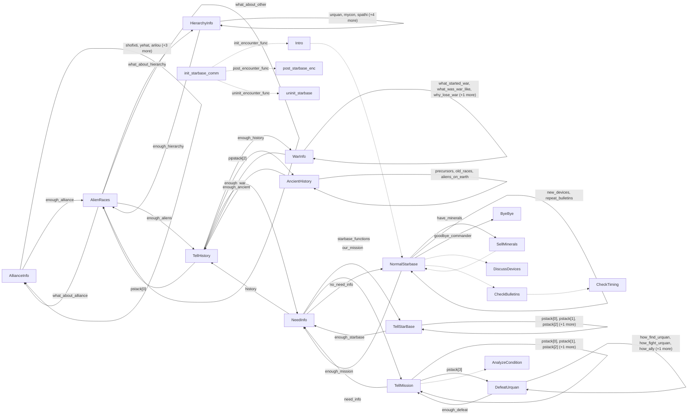

# Commander Hayes: starbase: existing conversation graph

> Generated by `tools/conversation_catalog.py`; do not edit this page by hand.

[Catalog and interpretation rules](../README.md) · [Proposed engine](../model.md)

Script: [starbas.c](../../../../sc2/src/uqm/comm/starbas/starbas.c#L1). Phrase bank: [starbase.txt](../../../../sc2/content/base/comm/starbase/starbase.txt#L1).

21 handler/helper nodes; 57 response registration sites; 13 direct local calls; 300 phrase records.

## Initialization and lifecycle

| Phase | Callback | Bound by | Conditions / source |
| --- | --- | --- | --- |
| <code>init_encounter_func</code> | [<code>Intro</code>](#node-intro) | <code>init_starbase_comm</code> | No enclosing branch condition; [1944](../../../../sc2/src/uqm/comm/starbas/starbas.c#L1944) |
| <code>post_encounter_func</code> | [<code>post_starbase_enc</code>](#node-post_starbase_enc) | <code>init_starbase_comm</code> | No enclosing branch condition; [1945](../../../../sc2/src/uqm/comm/starbas/starbas.c#L1945) |
| <code>uninit_encounter_func</code> | [<code>uninit_starbase</code>](#node-uninit_starbase) | <code>init_starbase_comm</code> | No enclosing branch condition; [1946](../../../../sc2/src/uqm/comm/starbas/starbas.c#L1946) |

## Handler graph

Solid arrows are selectable responses; dashed arrows are direct C calls. Conditions, arguments, speech and effects are cataloged below. Parallel response sites are grouped only in this diagram.



## Condition catalog

Condition IDs describe enclosing source structure. Branch predicates combine with ∧; case labels mark source locations that can also be reached by fallthrough. Values refer to their original evaluation points. Local assignments and early control flow remain in the decision bodies.

| ID | Source expression / structural condition |
| --- | --- |
| <a id="condition-c1"></a>C1 | <code>GET_GAME_STATE(CHMMR_BOMB_STATE) &gt;= 2</code> |
| <a id="condition-c2"></a>C2 | <code>!(GET_GAME_STATE(CHMMR_BOMB_STATE) &gt;= 2)</code> |
| <a id="condition-c3"></a>C3 | <code>switch (((BYTE) TFB_Random()) &amp; 7)</code> |
| <a id="condition-c4"></a>C4 | <code>case 0 (see source for fallthrough)</code> |
| <a id="condition-c5"></a>C5 | <code>case 1 (see source for fallthrough)</code> |
| <a id="condition-c6"></a>C6 | <code>case 2 (see source for fallthrough)</code> |
| <a id="condition-c7"></a>C7 | <code>case 3 (see source for fallthrough)</code> |
| <a id="condition-c8"></a>C8 | <code>case 4 (see source for fallthrough)</code> |
| <a id="condition-c9"></a>C9 | <code>case 5 (see source for fallthrough)</code> |
| <a id="condition-c10"></a>C10 | <code>case 6 (see source for fallthrough)</code> |
| <a id="condition-c11"></a>C11 | <code>case 7 (see source for fallthrough)</code> |
| <a id="condition-c12"></a>C12 | <code>!usingSpeech</code> |
| <a id="condition-c13"></a>C13 | <code>PLAYER_SAID(R, what_about_alliance)</code> |
| <a id="condition-c14"></a>C14 | <code>!(PLAYER_SAID(R, what_about_alliance))</code> |
| <a id="condition-c15"></a>C15 | <code>PLAYER_SAID(R, shofixti)</code> |
| <a id="condition-c16"></a>C16 | <code>!(PLAYER_SAID(R, shofixti))</code> |
| <a id="condition-c17"></a>C17 | <code>PLAYER_SAID(R, yehat)</code> |
| <a id="condition-c18"></a>C18 | <code>!(PLAYER_SAID(R, yehat))</code> |
| <a id="condition-c19"></a>C19 | <code>PLAYER_SAID(R, arilou)</code> |
| <a id="condition-c20"></a>C20 | <code>!(PLAYER_SAID(R, arilou))</code> |
| <a id="condition-c21"></a>C21 | <code>PLAYER_SAID(R, chenjesu)</code> |
| <a id="condition-c22"></a>C22 | <code>!(PLAYER_SAID(R, chenjesu))</code> |
| <a id="condition-c23"></a>C23 | <code>PLAYER_SAID(R, mmrnmhrm)</code> |
| <a id="condition-c24"></a>C24 | <code>!(PLAYER_SAID(R, mmrnmhrm))</code> |
| <a id="condition-c25"></a>C25 | <code>PLAYER_SAID(R, syreen)</code> |
| <a id="condition-c26"></a>C26 | <code>!(AllianceMask &amp; ALLIANCE_SHOFIXTI)</code> |
| <a id="condition-c27"></a>C27 | <code>!(AllianceMask &amp; ALLIANCE_YEHAT)</code> |
| <a id="condition-c28"></a>C28 | <code>!(AllianceMask &amp; ALLIANCE_ARILOU)</code> |
| <a id="condition-c29"></a>C29 | <code>!(AllianceMask &amp; ALLIANCE_CHENJESU)</code> |
| <a id="condition-c30"></a>C30 | <code>!(AllianceMask &amp; ALLIANCE_MMRNMHRM)</code> |
| <a id="condition-c31"></a>C31 | <code>!(AllianceMask &amp; ALLIANCE_SYREEN)</code> |
| <a id="condition-c32"></a>C32 | <code>PLAYER_SAID(R, what_about_hierarchy)</code> |
| <a id="condition-c33"></a>C33 | <code>!(PLAYER_SAID(R, what_about_hierarchy))</code> |
| <a id="condition-c34"></a>C34 | <code>PLAYER_SAID(R, urquan)</code> |
| <a id="condition-c35"></a>C35 | <code>!(PLAYER_SAID(R, urquan))</code> |
| <a id="condition-c36"></a>C36 | <code>PLAYER_SAID(R, mycon)</code> |
| <a id="condition-c37"></a>C37 | <code>!(PLAYER_SAID(R, mycon))</code> |
| <a id="condition-c38"></a>C38 | <code>PLAYER_SAID(R, spathi)</code> |
| <a id="condition-c39"></a>C39 | <code>!(PLAYER_SAID(R, spathi))</code> |
| <a id="condition-c40"></a>C40 | <code>PLAYER_SAID(R, umgah)</code> |
| <a id="condition-c41"></a>C41 | <code>!(PLAYER_SAID(R, umgah))</code> |
| <a id="condition-c42"></a>C42 | <code>PLAYER_SAID(R, androsynth)</code> |
| <a id="condition-c43"></a>C43 | <code>!(PLAYER_SAID(R, androsynth))</code> |
| <a id="condition-c44"></a>C44 | <code>PLAYER_SAID(R, ilwrath)</code> |
| <a id="condition-c45"></a>C45 | <code>!(PLAYER_SAID(R, ilwrath))</code> |
| <a id="condition-c46"></a>C46 | <code>PLAYER_SAID(R, vux)</code> |
| <a id="condition-c47"></a>C47 | <code>!(HierarchyMask &amp; HIERARCHY_URQUAN)</code> |
| <a id="condition-c48"></a>C48 | <code>!(HierarchyMask &amp; HIERARCHY_MYCON)</code> |
| <a id="condition-c49"></a>C49 | <code>!(HierarchyMask &amp; HIERARCHY_SPATHI)</code> |
| <a id="condition-c50"></a>C50 | <code>!(HierarchyMask &amp; HIERARCHY_UMGAH)</code> |
| <a id="condition-c51"></a>C51 | <code>!(HierarchyMask &amp; HIERARCHY_ANDROSYNTH)</code> |
| <a id="condition-c52"></a>C52 | <code>!(HierarchyMask &amp; HIERARCHY_ILWRATH)</code> |
| <a id="condition-c53"></a>C53 | <code>!(HierarchyMask &amp; HIERARCHY_VUX)</code> |
| <a id="condition-c54"></a>C54 | <code>PLAYER_SAID(R, alien_races)</code> |
| <a id="condition-c55"></a>C55 | <code>!(PLAYER_SAID(R, alien_races))</code> |
| <a id="condition-c56"></a>C56 | <code>PLAYER_SAID(R, enough_alliance)</code> |
| <a id="condition-c57"></a>C57 | <code>!(PLAYER_SAID(R, enough_alliance))</code> |
| <a id="condition-c58"></a>C58 | <code>PLAYER_SAID(R, enough_hierarchy)</code> |
| <a id="condition-c59"></a>C59 | <code>!(PLAYER_SAID(R, enough_hierarchy))</code> |
| <a id="condition-c60"></a>C60 | <code>PLAYER_SAID(R, what_about_other)</code> |
| <a id="condition-c61"></a>C61 | <code>!(RacesMask &amp; RACES_ALLIANCE)</code> |
| <a id="condition-c62"></a>C62 | <code>!(RacesMask &amp; RACES_HIERARCHY)</code> |
| <a id="condition-c63"></a>C63 | <code>!(RacesMask &amp; RACES_OTHER)</code> |
| <a id="condition-c64"></a>C64 | <code>PLAYER_SAID(R, the_war)</code> |
| <a id="condition-c65"></a>C65 | <code>!(PLAYER_SAID(R, the_war))</code> |
| <a id="condition-c66"></a>C66 | <code>PLAYER_SAID(R, what_started_war)</code> |
| <a id="condition-c67"></a>C67 | <code>!(PLAYER_SAID(R, what_started_war))</code> |
| <a id="condition-c68"></a>C68 | <code>PLAYER_SAID(R, what_was_war_like)</code> |
| <a id="condition-c69"></a>C69 | <code>!(PLAYER_SAID(R, what_was_war_like))</code> |
| <a id="condition-c70"></a>C70 | <code>PLAYER_SAID(R, why_lose_war)</code> |
| <a id="condition-c71"></a>C71 | <code>!(PLAYER_SAID(R, why_lose_war))</code> |
| <a id="condition-c72"></a>C72 | <code>PLAYER_SAID(R, what_after_war)</code> |
| <a id="condition-c73"></a>C73 | <code>!(WarMask &amp; WAR_STARTED)</code> |
| <a id="condition-c74"></a>C74 | <code>!(WarMask &amp; WAR_WAS_LIKE)</code> |
| <a id="condition-c75"></a>C75 | <code>!(WarMask &amp; WAR_LOST)</code> |
| <a id="condition-c76"></a>C76 | <code>!(WarMask &amp; WAR_AFTERMATH)</code> |
| <a id="condition-c77"></a>C77 | <code>PLAYER_SAID(R, ancient_history)</code> |
| <a id="condition-c78"></a>C78 | <code>!(PLAYER_SAID(R, ancient_history))</code> |
| <a id="condition-c79"></a>C79 | <code>PLAYER_SAID(R, precursors)</code> |
| <a id="condition-c80"></a>C80 | <code>!(PLAYER_SAID(R, precursors))</code> |
| <a id="condition-c81"></a>C81 | <code>PLAYER_SAID(R, old_races)</code> |
| <a id="condition-c82"></a>C82 | <code>!(PLAYER_SAID(R, old_races))</code> |
| <a id="condition-c83"></a>C83 | <code>PLAYER_SAID(R, aliens_on_earth)</code> |
| <a id="condition-c84"></a>C84 | <code>!(AncientMask &amp; ANCIENT_PRECURSORS)</code> |
| <a id="condition-c85"></a>C85 | <code>!(AncientMask &amp; ANCIENT_RACES)</code> |
| <a id="condition-c86"></a>C86 | <code>!(AncientMask &amp; ANCIENT_EARTH)</code> |
| <a id="condition-c87"></a>C87 | <code>PLAYER_SAID(R, history)</code> |
| <a id="condition-c88"></a>C88 | <code>!(PLAYER_SAID(R, history))</code> |
| <a id="condition-c89"></a>C89 | <code>PLAYER_SAID(R, enough_aliens)</code> |
| <a id="condition-c90"></a>C90 | <code>!(PLAYER_SAID(R, enough_aliens))</code> |
| <a id="condition-c91"></a>C91 | <code>PLAYER_SAID(R, enough_war)</code> |
| <a id="condition-c92"></a>C92 | <code>!(PLAYER_SAID(R, enough_war))</code> |
| <a id="condition-c93"></a>C93 | <code>PLAYER_SAID(R, enough_ancient)</code> |
| <a id="condition-c94"></a>C94 | <code>switch (stack0)</code> |
| <a id="condition-c95"></a>C95 | <code>default (see source for fallthrough)</code> |
| <a id="condition-c96"></a>C96 | <code>switch (stack1)</code> |
| <a id="condition-c97"></a>C97 | <code>switch (stack2)</code> |
| <a id="condition-c98"></a>C98 | <code>pstack[0]</code> |
| <a id="condition-c99"></a>C99 | <code>pstack[1]</code> |
| <a id="condition-c100"></a>C100 | <code>pstack[2]</code> |
| <a id="condition-c101"></a>C101 | <code>PLAYER_SAID(R, how_defeat)</code> |
| <a id="condition-c102"></a>C102 | <code>!(PLAYER_SAID(R, how_defeat))</code> |
| <a id="condition-c103"></a>C103 | <code>PLAYER_SAID(R, how_find_urquan)</code> |
| <a id="condition-c104"></a>C104 | <code>!(PLAYER_SAID(R, how_find_urquan))</code> |
| <a id="condition-c105"></a>C105 | <code>PLAYER_SAID(R, how_fight_urquan)</code> |
| <a id="condition-c106"></a>C106 | <code>!(PLAYER_SAID(R, how_fight_urquan))</code> |
| <a id="condition-c107"></a>C107 | <code>PLAYER_SAID(R, how_ally)</code> |
| <a id="condition-c108"></a>C108 | <code>!(PLAYER_SAID(R, how_ally))</code> |
| <a id="condition-c109"></a>C109 | <code>PLAYER_SAID(R, how_get_strong)</code> |
| <a id="condition-c110"></a>C110 | <code>!(DefeatMask &amp; HOW_FIND_URQUAN)</code> |
| <a id="condition-c111"></a>C111 | <code>!(DefeatMask &amp; HOW_FIGHT_URQUAN)</code> |
| <a id="condition-c112"></a>C112 | <code>!(DefeatMask &amp; HOW_ALLY_AGAINST_URQUAN)</code> |
| <a id="condition-c113"></a>C113 | <code>!(DefeatMask &amp; HOW_STRONG_AGAINST_URQUAN)</code> |
| <a id="condition-c114"></a>C114 | <code>for (i = 0; i &lt; NUM_DRIVE_SLOTS; ++i)</code> |
| <a id="condition-c115"></a>C115 | <code>GLOBAL_SIS(DriveSlots[i]) &lt; EMPTY_SLOT</code> |
| <a id="condition-c116"></a>C116 | <code>for (i = 0; i &lt; NUM_JET_SLOTS; ++i)</code> |
| <a id="condition-c117"></a>C117 | <code>GLOBAL_SIS(JetSlots[i]) &lt; EMPTY_SLOT</code> |
| <a id="condition-c118"></a>C118 | <code>for (i = 0; i &lt; NUM_MODULE_SLOTS; ++i)</code> |
| <a id="condition-c119"></a>C119 | <code>switch (which_piece = GLOBAL_SIS(ModuleSlots[i]))</code> |
| <a id="condition-c120"></a>C120 | <code>case STORAGE_BAY (see source for fallthrough)</code> |
| <a id="condition-c121"></a>C121 | <code>case SHIVA_FURNACE (see source for fallthrough)</code> |
| <a id="condition-c122"></a>C122 | <code>case CANNON_WEAPON (see source for fallthrough)</code> |
| <a id="condition-c123"></a>C123 | <code>case TRACKING_SYSTEM (see source for fallthrough)</code> |
| <a id="condition-c124"></a>C124 | <code>case ANTIMISSILE_DEFENSE (see source for fallthrough)</code> |
| <a id="condition-c125"></a>C125 | <code>num_track &amp;&amp; num_guns</code> |
| <a id="condition-c126"></a>C126 | <code>(num_thrusters &gt;= 7) &amp;&amp; (num_jets &gt;= 5)</code> |
| <a id="condition-c127"></a>C127 | <code>((num_thrusters &gt;= 7) &amp;&amp; (num_jets &gt;= 5)) &amp;&amp; (GLOBAL_SIS(CrewEnlisted) &gt;= CREW_POD_CAPACITY)</code> |
| <a id="condition-c128"></a>C128 | <code>((((num_thrusters &gt;= 7) &amp;&amp; (num_jets &gt;= 5)) &amp;&amp; (GLOBAL_SIS(CrewEnlisted) &gt;= CREW_POD_CAPACITY)) &amp;&amp; (GLOBAL_SIS(FuelOnBoard) &gt;= FUEL_TANK_CAPACITY)) &amp;&amp; (num_bays &gt;= 1)</code> |
| <a id="condition-c129"></a>C129 | <code>!HasMinimum</code> |
| <a id="condition-c130"></a>C130 | <code>(!HasMinimum) &amp;&amp; (GET_GAME_STATE(CHMMR_BOMB_STATE) &lt; 2)</code> |
| <a id="condition-c131"></a>C131 | <code>num_thrusters &lt; 7</code> |
| <a id="condition-c132"></a>C132 | <code>num_jets &lt; 5</code> |
| <a id="condition-c133"></a>C133 | <code>num_guns &lt; 2</code> |
| <a id="condition-c134"></a>C134 | <code>GLOBAL_SIS(CrewEnlisted) &lt; CREW_POD_CAPACITY</code> |
| <a id="condition-c135"></a>C135 | <code>GLOBAL_SIS(FuelOnBoard) &lt; FUEL_TANK_CAPACITY</code> |
| <a id="condition-c136"></a>C136 | <code>num_bays &lt; 1</code> |
| <a id="condition-c137"></a>C137 | <code>GLOBAL_SIS(NumLanders) == 0</code> |
| <a id="condition-c138"></a>C138 | <code>num_batts &lt; 1</code> |
| <a id="condition-c139"></a>C139 | <code>GLOBAL_SIS(ResUnits) &gt;= 3000</code> |
| <a id="condition-c140"></a>C140 | <code>!(GLOBAL_SIS(ResUnits) &gt;= 3000)</code> |
| <a id="condition-c141"></a>C141 | <code>!((!HasMinimum) &amp;&amp; (GET_GAME_STATE(CHMMR_BOMB_STATE) &lt; 2))</code> |
| <a id="condition-c142"></a>C142 | <code>for (i = 0; i &lt; NUM_AVAILABLE_RACES; ++i)</code> |
| <a id="condition-c143"></a>C143 | <code>i != HUMAN_SHIP</code> |
| <a id="condition-c144"></a>C144 | <code>(i != HUMAN_SHIP) &amp;&amp; (CheckAlliance(i) == GOOD_GUY)</code> |
| <a id="condition-c145"></a>C145 | <code>(num_thrusters == NUM_DRIVE_SLOTS) &amp;&amp; (num_jets == NUM_JET_SLOTS)</code> |
| <a id="condition-c146"></a>C146 | <code>((num_thrusters == NUM_DRIVE_SLOTS) &amp;&amp; (num_jets == NUM_JET_SLOTS)) &amp;&amp; (GLOBAL_SIS(CrewEnlisted) &gt;= (CREW_POD_CAPACITY * 3))</code> |
| <a id="condition-c147"></a>C147 | <code>(((num_thrusters == NUM_DRIVE_SLOTS) &amp;&amp; (num_jets == NUM_JET_SLOTS)) &amp;&amp; (GLOBAL_SIS(CrewEnlisted) &gt;= (CREW_POD_CAPACITY * 3))) &amp;&amp; (GLOBAL_SIS(FuelOnBoard) &gt;= (FUEL_TANK_CAPACITY * 3))</code> |
| <a id="condition-c148"></a>C148 | <code>!HasMaximum</code> |
| <a id="condition-c149"></a>C149 | <code>(!HasMaximum) &amp;&amp; (GET_GAME_STATE(CHMMR_BOMB_STATE) &lt; 2)</code> |
| <a id="condition-c150"></a>C150 | <code>!((!HasMaximum) &amp;&amp; (GET_GAME_STATE(CHMMR_BOMB_STATE) &lt; 2))</code> |
| <a id="condition-c151"></a>C151 | <code>FleetStrength &lt; 20000</code> |
| <a id="condition-c152"></a>C152 | <code>!(FleetStrength &lt; 20000)</code> |
| <a id="condition-c153"></a>C153 | <code>!GET_GAME_STATE(TALKING_PET_ON_SHIP)</code> |
| <a id="condition-c154"></a>C154 | <code>!(!GET_GAME_STATE(TALKING_PET_ON_SHIP))</code> |
| <a id="condition-c155"></a>C155 | <code>num_aliens &lt; 2</code> |
| <a id="condition-c156"></a>C156 | <code>!(num_aliens &lt; 2)</code> |
| <a id="condition-c157"></a>C157 | <code>FleetStrength &lt; 6000</code> |
| <a id="condition-c158"></a>C158 | <code>!(FleetStrength &lt; 6000)</code> |
| <a id="condition-c159"></a>C159 | <code>num_thrusters &lt; NUM_DRIVE_SLOTS</code> |
| <a id="condition-c160"></a>C160 | <code>num_jets &lt; NUM_JET_SLOTS</code> |
| <a id="condition-c161"></a>C161 | <code>num_guns &lt; 7</code> |
| <a id="condition-c162"></a>C162 | <code>GLOBAL_SIS(CrewEnlisted) &lt; (CREW_POD_CAPACITY * 3)</code> |
| <a id="condition-c163"></a>C163 | <code>GLOBAL_SIS(FuelOnBoard) &lt; (FUEL_TANK_CAPACITY * 3)</code> |
| <a id="condition-c164"></a>C164 | <code>GLOBAL_SIS(NumLanders) &lt; 3</code> |
| <a id="condition-c165"></a>C165 | <code>num_batts &lt; 4</code> |
| <a id="condition-c166"></a>C166 | <code>num_defense &lt; 2</code> |
| <a id="condition-c167"></a>C167 | <code>!(!HasMaximum)</code> |
| <a id="condition-c168"></a>C168 | <code>!GET_GAME_STATE(AWARE_OF_SAMATRA)</code> |
| <a id="condition-c169"></a>C169 | <code>!(!GET_GAME_STATE(AWARE_OF_SAMATRA))</code> |
| <a id="condition-c170"></a>C170 | <code>!GET_GAME_STATE(UTWIG_BOMB)</code> |
| <a id="condition-c171"></a>C171 | <code>!(!GET_GAME_STATE(UTWIG_BOMB))</code> |
| <a id="condition-c172"></a>C172 | <code>GET_GAME_STATE(UTWIG_BOMB_ON_SHIP)</code> |
| <a id="condition-c173"></a>C173 | <code>PLAYER_SAID(R, our_mission)</code> |
| <a id="condition-c174"></a>C174 | <code>!(PLAYER_SAID(R, our_mission))</code> |
| <a id="condition-c175"></a>C175 | <code>PLAYER_SAID(R, where_get_minerals)</code> |
| <a id="condition-c176"></a>C176 | <code>!(PLAYER_SAID(R, where_get_minerals))</code> |
| <a id="condition-c177"></a>C177 | <code>PLAYER_SAID(R, what_about_aliens)</code> |
| <a id="condition-c178"></a>C178 | <code>!(PLAYER_SAID(R, what_about_aliens))</code> |
| <a id="condition-c179"></a>C179 | <code>PLAYER_SAID(R, what_do_now)</code> |
| <a id="condition-c180"></a>C180 | <code>!(PLAYER_SAID(R, what_do_now))</code> |
| <a id="condition-c181"></a>C181 | <code>PLAYER_SAID(R, what_about_urquan)</code> |
| <a id="condition-c182"></a>C182 | <code>!(PLAYER_SAID(R, what_about_urquan))</code> |
| <a id="condition-c183"></a>C183 | <code>PLAYER_SAID(R, enough_defeat)</code> |
| <a id="condition-c184"></a>C184 | <code>switch (stack3)</code> |
| <a id="condition-c185"></a>C185 | <code>pstack[3]</code> |
| <a id="condition-c186"></a>C186 | <code>stack3 == 1</code> |
| <a id="condition-c187"></a>C187 | <code>!(stack3 == 1)</code> |
| <a id="condition-c188"></a>C188 | <code>PLAYER_SAID(R, starbase_functions)</code> |
| <a id="condition-c189"></a>C189 | <code>!(PLAYER_SAID(R, starbase_functions))</code> |
| <a id="condition-c190"></a>C190 | <code>PLAYER_SAID(R, tell_me_about_fuel0)</code> |
| <a id="condition-c191"></a>C191 | <code>!(PLAYER_SAID(R, tell_me_about_fuel0))</code> |
| <a id="condition-c192"></a>C192 | <code>PLAYER_SAID(R, tell_me_about_crew)</code> |
| <a id="condition-c193"></a>C193 | <code>usingSpeech</code> |
| <a id="condition-c194"></a>C194 | <code>!(usingSpeech)</code> |
| <a id="condition-c195"></a>C195 | <code>!(PLAYER_SAID(R, tell_me_about_crew))</code> |
| <a id="condition-c196"></a>C196 | <code>PLAYER_SAID(R, tell_me_about_modules0)</code> |
| <a id="condition-c197"></a>C197 | <code>!(PLAYER_SAID(R, tell_me_about_modules0))</code> |
| <a id="condition-c198"></a>C198 | <code>PLAYER_SAID(R, tell_me_about_ships)</code> |
| <a id="condition-c199"></a>C199 | <code>!(PLAYER_SAID(R, tell_me_about_ships))</code> |
| <a id="condition-c200"></a>C200 | <code>PLAYER_SAID(R, tell_me_about_ru)</code> |
| <a id="condition-c201"></a>C201 | <code>!(PLAYER_SAID(R, tell_me_about_ru))</code> |
| <a id="condition-c202"></a>C202 | <code>PLAYER_SAID(R, tell_me_about_minerals)</code> |
| <a id="condition-c203"></a>C203 | <code>!(PLAYER_SAID(R, tell_me_about_minerals))</code> |
| <a id="condition-c204"></a>C204 | <code>PLAYER_SAID(R, tell_me_about_life)</code> |
| <a id="condition-c205"></a>C205 | <code>PLAYER_SAID(R, need_info)</code> |
| <a id="condition-c206"></a>C206 | <code>!(PLAYER_SAID(R, need_info))</code> |
| <a id="condition-c207"></a>C207 | <code>PLAYER_SAID(R, enough_starbase)</code> |
| <a id="condition-c208"></a>C208 | <code>!(PLAYER_SAID(R, enough_starbase))</code> |
| <a id="condition-c209"></a>C209 | <code>PLAYER_SAID(R, enough_history)</code> |
| <a id="condition-c210"></a>C210 | <code>!(PLAYER_SAID(R, enough_history))</code> |
| <a id="condition-c211"></a>C211 | <code>PLAYER_SAID(R, enough_mission)</code> |
| <a id="condition-c212"></a>C212 | <code>TalkAbout</code> |
| <a id="condition-c213"></a>C213 | <code>for (i = 0; i &lt; NUM_DEVICES; ++i)</code> |
| <a id="condition-c214"></a>C214 | <code>switch (i)</code> |
| <a id="condition-c215"></a>C215 | <code>case ROSY_SPHERE_DEVICE (see source for fallthrough)</code> |
| <a id="condition-c216"></a>C216 | <code>GET_GAME_STATE(ROSY_SPHERE_ON_SHIP)</code> |
| <a id="condition-c217"></a>C217 | <code>GET_GAME_STATE(ROSY_SPHERE_ON_SHIP) &amp;&amp; (!GET_GAME_STATE(DISCUSSED_ROSY_SPHERE))</code> |
| <a id="condition-c218"></a>C218 | <code>case ARTIFACT_2_DEVICE (see source for fallthrough)</code> |
| <a id="condition-c219"></a>C219 | <code>GET_GAME_STATE(ARTIFACT_2_ON_SHIP)</code> |
| <a id="condition-c220"></a>C220 | <code>GET_GAME_STATE(ARTIFACT_2_ON_SHIP) &amp;&amp; (!GET_GAME_STATE(DISCUSSED_ARTIFACT_2))</code> |
| <a id="condition-c221"></a>C221 | <code>case ARTIFACT_3_DEVICE (see source for fallthrough)</code> |
| <a id="condition-c222"></a>C222 | <code>GET_GAME_STATE(ARTIFACT_3_ON_SHIP)</code> |
| <a id="condition-c223"></a>C223 | <code>GET_GAME_STATE(ARTIFACT_3_ON_SHIP) &amp;&amp; (!GET_GAME_STATE(DISCUSSED_ARTIFACT_3))</code> |
| <a id="condition-c224"></a>C224 | <code>case SUN_EFFICIENCY_DEVICE (see source for fallthrough)</code> |
| <a id="condition-c225"></a>C225 | <code>GET_GAME_STATE(SUN_DEVICE_ON_SHIP)</code> |
| <a id="condition-c226"></a>C226 | <code>GET_GAME_STATE(SUN_DEVICE_ON_SHIP) &amp;&amp; (!GET_GAME_STATE(DISCUSSED_SUN_EFFICIENCY))</code> |
| <a id="condition-c227"></a>C227 | <code>case UTWIG_BOMB_DEVICE (see source for fallthrough)</code> |
| <a id="condition-c228"></a>C228 | <code>GET_GAME_STATE(UTWIG_BOMB_ON_SHIP) &amp;&amp; (!GET_GAME_STATE(DISCUSSED_UTWIG_BOMB))</code> |
| <a id="condition-c229"></a>C229 | <code>case ULTRON_0_DEVICE (see source for fallthrough)</code> |
| <a id="condition-c230"></a>C230 | <code>GET_GAME_STATE(ULTRON_CONDITION) == 1</code> |
| <a id="condition-c231"></a>C231 | <code>(GET_GAME_STATE(ULTRON_CONDITION) == 1) &amp;&amp; (!GET_GAME_STATE(DISCUSSED_ULTRON))</code> |
| <a id="condition-c232"></a>C232 | <code>case ULTRON_1_DEVICE (see source for fallthrough)</code> |
| <a id="condition-c233"></a>C233 | <code>GET_GAME_STATE(ULTRON_CONDITION) == 2</code> |
| <a id="condition-c234"></a>C234 | <code>(GET_GAME_STATE(ULTRON_CONDITION) == 2) &amp;&amp; (!GET_GAME_STATE(DISCUSSED_ULTRON))</code> |
| <a id="condition-c235"></a>C235 | <code>case ULTRON_2_DEVICE (see source for fallthrough)</code> |
| <a id="condition-c236"></a>C236 | <code>GET_GAME_STATE(ULTRON_CONDITION) == 3</code> |
| <a id="condition-c237"></a>C237 | <code>(GET_GAME_STATE(ULTRON_CONDITION) == 3) &amp;&amp; (!GET_GAME_STATE(DISCUSSED_ULTRON))</code> |
| <a id="condition-c238"></a>C238 | <code>case ULTRON_3_DEVICE (see source for fallthrough)</code> |
| <a id="condition-c239"></a>C239 | <code>GET_GAME_STATE(ULTRON_CONDITION) == 4</code> |
| <a id="condition-c240"></a>C240 | <code>(GET_GAME_STATE(ULTRON_CONDITION) == 4) &amp;&amp; (!GET_GAME_STATE(DISCUSSED_ULTRON))</code> |
| <a id="condition-c241"></a>C241 | <code>case MAIDENS_DEVICE (see source for fallthrough)</code> |
| <a id="condition-c242"></a>C242 | <code>GET_GAME_STATE(MAIDENS_ON_SHIP)</code> |
| <a id="condition-c243"></a>C243 | <code>GET_GAME_STATE(MAIDENS_ON_SHIP) &amp;&amp; (!GET_GAME_STATE(DISCUSSED_MAIDENS))</code> |
| <a id="condition-c244"></a>C244 | <code>case TALKING_PET_DEVICE (see source for fallthrough)</code> |
| <a id="condition-c245"></a>C245 | <code>GET_GAME_STATE(TALKING_PET_ON_SHIP)</code> |
| <a id="condition-c246"></a>C246 | <code>GET_GAME_STATE(TALKING_PET_ON_SHIP) &amp;&amp; (!GET_GAME_STATE(DISCUSSED_TALKING_PET))</code> |
| <a id="condition-c247"></a>C247 | <code>case AQUA_HELIX_DEVICE (see source for fallthrough)</code> |
| <a id="condition-c248"></a>C248 | <code>GET_GAME_STATE(AQUA_HELIX_ON_SHIP)</code> |
| <a id="condition-c249"></a>C249 | <code>GET_GAME_STATE(AQUA_HELIX_ON_SHIP) &amp;&amp; (!GET_GAME_STATE(DISCUSSED_AQUA_HELIX))</code> |
| <a id="condition-c250"></a>C250 | <code>case CLEAR_SPINDLE_DEVICE (see source for fallthrough)</code> |
| <a id="condition-c251"></a>C251 | <code>GET_GAME_STATE(CLEAR_SPINDLE_ON_SHIP)</code> |
| <a id="condition-c252"></a>C252 | <code>GET_GAME_STATE(CLEAR_SPINDLE_ON_SHIP) &amp;&amp; (!GET_GAME_STATE(DISCUSSED_CLEAR_SPINDLE))</code> |
| <a id="condition-c253"></a>C253 | <code>case UMGAH_HYPERWAVE_DEVICE (see source for fallthrough)</code> |
| <a id="condition-c254"></a>C254 | <code>GET_GAME_STATE(UMGAH_BROADCASTERS_ON_SHIP)</code> |
| <a id="condition-c255"></a>C255 | <code>GET_GAME_STATE(UMGAH_BROADCASTERS_ON_SHIP) &amp;&amp; (!GET_GAME_STATE(DISCUSSED_UMGAH_HYPERWAVE))</code> |
| <a id="condition-c256"></a>C256 | <code>case TAALO_PROTECTOR_DEVICE (see source for fallthrough)</code> |
| <a id="condition-c257"></a>C257 | <code>GET_GAME_STATE(TAALO_PROTECTOR_ON_SHIP)</code> |
| <a id="condition-c258"></a>C258 | <code>GET_GAME_STATE(TAALO_PROTECTOR_ON_SHIP) &amp;&amp; (!GET_GAME_STATE(DISCUSSED_TAALO_PROTECTOR))</code> |
| <a id="condition-c259"></a>C259 | <code>case EGG_CASING0_DEVICE (see source for fallthrough)</code> |
| <a id="condition-c260"></a>C260 | <code>GET_GAME_STATE(EGG_CASE0_ON_SHIP)</code> |
| <a id="condition-c261"></a>C261 | <code>GET_GAME_STATE(EGG_CASE0_ON_SHIP) &amp;&amp; (!GET_GAME_STATE(DISCUSSED_EGG_CASING0))</code> |
| <a id="condition-c262"></a>C262 | <code>case EGG_CASING1_DEVICE (see source for fallthrough)</code> |
| <a id="condition-c263"></a>C263 | <code>GET_GAME_STATE(EGG_CASE1_ON_SHIP)</code> |
| <a id="condition-c264"></a>C264 | <code>GET_GAME_STATE(EGG_CASE1_ON_SHIP) &amp;&amp; (!GET_GAME_STATE(DISCUSSED_EGG_CASING1))</code> |
| <a id="condition-c265"></a>C265 | <code>case EGG_CASING2_DEVICE (see source for fallthrough)</code> |
| <a id="condition-c266"></a>C266 | <code>GET_GAME_STATE(EGG_CASE2_ON_SHIP)</code> |
| <a id="condition-c267"></a>C267 | <code>GET_GAME_STATE(EGG_CASE2_ON_SHIP) &amp;&amp; (!GET_GAME_STATE(DISCUSSED_EGG_CASING2))</code> |
| <a id="condition-c268"></a>C268 | <code>case SYREEN_SHUTTLE_DEVICE (see source for fallthrough)</code> |
| <a id="condition-c269"></a>C269 | <code>GET_GAME_STATE(SYREEN_SHUTTLE_ON_SHIP)</code> |
| <a id="condition-c270"></a>C270 | <code>GET_GAME_STATE(SYREEN_SHUTTLE_ON_SHIP) &amp;&amp; (!GET_GAME_STATE(DISCUSSED_SYREEN_SHUTTLE))</code> |
| <a id="condition-c271"></a>C271 | <code>case VUX_BEAST_DEVICE (see source for fallthrough)</code> |
| <a id="condition-c272"></a>C272 | <code>GET_GAME_STATE(VUX_BEAST_ON_SHIP)</code> |
| <a id="condition-c273"></a>C273 | <code>GET_GAME_STATE(VUX_BEAST_ON_SHIP) &amp;&amp; (!GET_GAME_STATE(DISCUSSED_VUX_BEAST))</code> |
| <a id="condition-c274"></a>C274 | <code>case DESTRUCT_CODE_DEVICE (see source for fallthrough)</code> |
| <a id="condition-c275"></a>C275 | <code>GET_GAME_STATE(DESTRUCT_CODE_ON_SHIP)</code> |
| <a id="condition-c276"></a>C276 | <code>GET_GAME_STATE(DESTRUCT_CODE_ON_SHIP) &amp;&amp; (!GET_GAME_STATE(DISCUSSED_DESTRUCT_CODE))</code> |
| <a id="condition-c277"></a>C277 | <code>case PORTAL_SPAWNER_DEVICE (see source for fallthrough)</code> |
| <a id="condition-c278"></a>C278 | <code>GET_GAME_STATE(PORTAL_SPAWNER_ON_SHIP)</code> |
| <a id="condition-c279"></a>C279 | <code>GET_GAME_STATE(PORTAL_SPAWNER_ON_SHIP) &amp;&amp; (!GET_GAME_STATE(DISCUSSED_PORTAL_SPAWNER))</code> |
| <a id="condition-c280"></a>C280 | <code>case URQUAN_WARP_DEVICE (see source for fallthrough)</code> |
| <a id="condition-c281"></a>C281 | <code>GET_GAME_STATE(PORTAL_KEY_ON_SHIP)</code> |
| <a id="condition-c282"></a>C282 | <code>GET_GAME_STATE(PORTAL_KEY_ON_SHIP) &amp;&amp; (!GET_GAME_STATE(DISCUSSED_URQUAN_WARP))</code> |
| <a id="condition-c283"></a>C283 | <code>case BURVIX_HYPERWAVE_DEVICE (see source for fallthrough)</code> |
| <a id="condition-c284"></a>C284 | <code>GET_GAME_STATE(BURV_BROADCASTERS_ON_SHIP)</code> |
| <a id="condition-c285"></a>C285 | <code>GET_GAME_STATE(BURV_BROADCASTERS_ON_SHIP) &amp;&amp; (!GET_GAME_STATE(DISCUSSED_BURVIX_HYPERWAVE))</code> |
| <a id="condition-c286"></a>C286 | <code>pStr</code> |
| <a id="condition-c287"></a>C287 | <code>PhraseIndex &gt; 2</code> |
| <a id="condition-c288"></a>C288 | <code>pStr == ABOUT_VUXBEAST0</code> |
| <a id="condition-c289"></a>C289 | <code>VuxBeastIndex</code> |
| <a id="condition-c290"></a>C290 | <code>while (day_index &gt; days_in_month[mi - 1])</code> |
| <a id="condition-c291"></a>C291 | <code>(++mi) &gt; 12</code> |
| <a id="condition-c292"></a>C292 | <code>!(year_index &lt; GLOBAL(GameClock.year_index))</code> |
| <a id="condition-c293"></a>C293 | <code>year_index == GLOBAL(GameClock.year_index)</code> |
| <a id="condition-c294"></a>C294 | <code>!(month_index &lt; GLOBAL(GameClock.month_index))</code> |
| <a id="condition-c295"></a>C295 | <code>month_index == GLOBAL(GameClock.month_index)</code> |
| <a id="condition-c296"></a>C296 | <code>Repeat</code> |
| <a id="condition-c297"></a>C297 | <code>!(Repeat)</code> |
| <a id="condition-c298"></a>C298 | <code>for (b0 = 0; b0 &lt; 32; ++b0)</code> |
| <a id="condition-c299"></a>C299 | <code>!(BulletinMask &amp; (1L &lt;&lt; b0))</code> |
| <a id="condition-c300"></a>C300 | <code>switch (b0)</code> |
| <a id="condition-c301"></a>C301 | <code>CheckAlliance(SPATHI_SHIP) == GOOD_GUY</code> |
| <a id="condition-c302"></a>C302 | <code>CheckAlliance(ZOQFOTPIK_SHIP) == GOOD_GUY</code> |
| <a id="condition-c303"></a>C303 | <code>CheckAlliance(SUPOX_SHIP) == GOOD_GUY</code> |
| <a id="condition-c304"></a>C304 | <code>CheckAlliance(UTWIG_SHIP) == GOOD_GUY</code> |
| <a id="condition-c305"></a>C305 | <code>CheckAlliance(ORZ_SHIP) == GOOD_GUY</code> |
| <a id="condition-c306"></a>C306 | <code>GET_GAME_STATE(ARILOU_MANNER) == 2</code> |
| <a id="condition-c307"></a>C307 | <code>!(GET_GAME_STATE(ARILOU_MANNER) == 2)</code> |
| <a id="condition-c308"></a>C308 | <code>GET_GAME_STATE(PORTAL_SPAWNER)</code> |
| <a id="condition-c309"></a>C309 | <code>GET_GAME_STATE(PORTAL_SPAWNER) &amp;&amp; (Repeat &#124;&#124; EscortFeasibilityStudy(ARILOU_SHIP))</code> |
| <a id="condition-c310"></a>C310 | <code>!Repeat</code> |
| <a id="condition-c311"></a>C311 | <code>GET_GAME_STATE(ZOQFOT_DISTRESS) == 1</code> |
| <a id="condition-c312"></a>C312 | <code>GET_GAME_STATE(MET_MELNORME)</code> |
| <a id="condition-c313"></a>C313 | <code>!(GET_GAME_STATE(MET_MELNORME))</code> |
| <a id="condition-c314"></a>C314 | <code>CheckTiming(3, 0)</code> |
| <a id="condition-c315"></a>C315 | <code>case 8 (see source for fallthrough)</code> |
| <a id="condition-c316"></a>C316 | <code>CheckTiming(6, 0)</code> |
| <a id="condition-c317"></a>C317 | <code>case 9 (see source for fallthrough)</code> |
| <a id="condition-c318"></a>C318 | <code>GET_GAME_STATE(FOUND_PLUTO_SPATHI)</code> |
| <a id="condition-c319"></a>C319 | <code>!(GET_GAME_STATE(FOUND_PLUTO_SPATHI))</code> |
| <a id="condition-c320"></a>C320 | <code>CheckTiming(0, 7)</code> |
| <a id="condition-c321"></a>C321 | <code>case 10 (see source for fallthrough)</code> |
| <a id="condition-c322"></a>C322 | <code>GET_GAME_STATE(SPATHI_SHIELDED_SELVES)</code> |
| <a id="condition-c323"></a>C323 | <code>case 11 (see source for fallthrough)</code> |
| <a id="condition-c324"></a>C324 | <code>!(GET_GAME_STATE(ZOQFOT_HOME_VISITS))</code> |
| <a id="condition-c325"></a>C325 | <code>GET_GAME_STATE(ZOQFOT_HOME_VISITS) &#124;&#124; GET_GAME_STATE_32(ZOQFOT_GRPOFFS0)</code> |
| <a id="condition-c326"></a>C326 | <code>!(GET_GAME_STATE(ZOQFOT_HOME_VISITS) &#124;&#124; GET_GAME_STATE_32(ZOQFOT_GRPOFFS0))</code> |
| <a id="condition-c327"></a>C327 | <code>CheckTiming(0, 42)</code> |
| <a id="condition-c328"></a>C328 | <code>case 12 (see source for fallthrough)</code> |
| <a id="condition-c329"></a>C329 | <code>CheckAlliance(CHMMR_SHIP) == GOOD_GUY</code> |
| <a id="condition-c330"></a>C330 | <code>case 13 (see source for fallthrough)</code> |
| <a id="condition-c331"></a>C331 | <code>CheckAlliance(SHOFIXTI_SHIP) == GOOD_GUY</code> |
| <a id="condition-c332"></a>C332 | <code>case 14 (see source for fallthrough)</code> |
| <a id="condition-c333"></a>C333 | <code>GET_GAME_STATE(PKUNK_MISSION)</code> |
| <a id="condition-c334"></a>C334 | <code>case 15 (see source for fallthrough)</code> |
| <a id="condition-c335"></a>C335 | <code>!(GET_GAME_STATE(DESTRUCT_CODE_ON_SHIP))</code> |
| <a id="condition-c336"></a>C336 | <code>CheckTiming(7, 0)</code> |
| <a id="condition-c337"></a>C337 | <code>case 16 (see source for fallthrough)</code> |
| <a id="condition-c338"></a>C338 | <code>case 17 (see source for fallthrough)</code> |
| <a id="condition-c339"></a>C339 | <code>GET_GAME_STATE(YEHAT_ABSORBED_PKUNK)</code> |
| <a id="condition-c340"></a>C340 | <code>case 18 (see source for fallthrough)</code> |
| <a id="condition-c341"></a>C341 | <code>GET_GAME_STATE(CHMMR_BOMB_STATE) == 2</code> |
| <a id="condition-c342"></a>C342 | <code>case 19 (see source for fallthrough)</code> |
| <a id="condition-c343"></a>C343 | <code>case 20 (see source for fallthrough)</code> |
| <a id="condition-c344"></a>C344 | <code>case 21 (see source for fallthrough)</code> |
| <a id="condition-c345"></a>C345 | <code>GET_GAME_STATE(ZOQFOT_DISTRESS) == 2</code> |
| <a id="condition-c346"></a>C346 | <code>case 22 (see source for fallthrough)</code> |
| <a id="condition-c347"></a>C347 | <code>case 23 (see source for fallthrough)</code> |
| <a id="condition-c348"></a>C348 | <code>case 24 (see source for fallthrough)</code> |
| <a id="condition-c349"></a>C349 | <code>case 25 (see source for fallthrough)</code> |
| <a id="condition-c350"></a>C350 | <code>case 26 (see source for fallthrough)</code> |
| <a id="condition-c351"></a>C351 | <code>crew_sold &gt; 100</code> |
| <a id="condition-c352"></a>C352 | <code>!(crew_sold &gt; 100)</code> |
| <a id="condition-c353"></a>C353 | <code>crew_sold</code> |
| <a id="condition-c354"></a>C354 | <code>case 27 (see source for fallthrough)</code> |
| <a id="condition-c355"></a>C355 | <code>crew_sold &gt; 250</code> |
| <a id="condition-c356"></a>C356 | <code>!(crew_sold &gt; 250)</code> |
| <a id="condition-c357"></a>C357 | <code>case 28 (see source for fallthrough)</code> |
| <a id="condition-c358"></a>C358 | <code>crew_bought &gt;= CREW_EXPENSE_THRESHOLD</code> |
| <a id="condition-c359"></a>C359 | <code>case 29 (see source for fallthrough)</code> |
| <a id="condition-c360"></a>C360 | <code>MAKE_WORD(GET_GAME_STATE(CREW_SOLD_TO_DRUUGE0), GET_GAME_STATE(CREW_SOLD_TO_DRUUGE1)) &gt; 250</code> |
| <a id="condition-c361"></a>C361 | <code>case 30 (see source for fallthrough)</code> |
| <a id="condition-c362"></a>C362 | <code>case 31 (see source for fallthrough)</code> |
| <a id="condition-c363"></a>C363 | <code>pIntro</code> |
| <a id="condition-c364"></a>C364 | <code>!(pIntro)</code> |
| <a id="condition-c365"></a>C365 | <code>switch (((BYTE) TFB_Random()) % 7)</code> |
| <a id="condition-c366"></a>C366 | <code>pIntro == 0</code> |
| <a id="condition-c367"></a>C367 | <code>(pIntro == 0) &amp;&amp; GET_GAME_STATE(STARBASE_VISITED)</code> |
| <a id="condition-c368"></a>C368 | <code>!((pIntro == 0) &amp;&amp; GET_GAME_STATE(STARBASE_VISITED))</code> |
| <a id="condition-c369"></a>C369 | <code>PLAYER_SAID(R, no_need_info)</code> |
| <a id="condition-c370"></a>C370 | <code>!(PLAYER_SAID(R, no_need_info))</code> |
| <a id="condition-c371"></a>C371 | <code>PLAYER_SAID(R, new_devices)</code> |
| <a id="condition-c372"></a>C372 | <code>!(PLAYER_SAID(R, new_devices))</code> |
| <a id="condition-c373"></a>C373 | <code>PLAYER_SAID(R, repeat_bulletins)</code> |
| <a id="condition-c374"></a>C374 | <code>!(PLAYER_SAID(R, repeat_bulletins))</code> |
| <a id="condition-c375"></a>C375 | <code>R == 0</code> |
| <a id="condition-c376"></a>C376 | <code>GET_GAME_STATE(MOONBASE_ON_SHIP)</code> |
| <a id="condition-c377"></a>C377 | <code>!(GET_GAME_STATE(MOONBASE_ON_SHIP))</code> |
| <a id="condition-c378"></a>C378 | <code>GET_GAME_STATE(STARBASE_VISITED)</code> |
| <a id="condition-c379"></a>C379 | <code>!(GET_GAME_STATE(STARBASE_VISITED))</code> |
| <a id="condition-c380"></a>C380 | <code>GLOBAL_SIS(TotalElementMass)</code> |
| <a id="condition-c381"></a>C381 | <code>DiscussDevices(FALSE)</code> |
| <a id="condition-c382"></a>C382 | <code>CurBulletinMask</code> |
| <a id="condition-c383"></a>C383 | <code>for (i = 0; i &lt; NUM_ELEMENT_CATEGORIES; ++i)</code> |
| <a id="condition-c384"></a>C384 | <code>i == 0</code> |
| <a id="condition-c385"></a>C385 | <code>!(i == 0)</code> |
| <a id="condition-c386"></a>C386 | <code>Sleepy</code> |
| <a id="condition-c387"></a>C387 | <code>(amount = GLOBAL_SIS(ElementAmounts[i])) != 0</code> |
| <a id="condition-c388"></a>C388 | <code>do / repeat while (--amount)</code> |
| <a id="condition-c389"></a>C389 | <code>!(!Sleepy)</code> |
| <a id="condition-c390"></a>C390 | <code>!((!Sleepy) &#124;&#124; AnyButtonPress(TRUE))</code> |
| <a id="condition-c391"></a>C391 | <code>((!Sleepy) &#124;&#124; AnyButtonPress(TRUE)) &#124;&#124; (GLOBAL(CurrentActivity) &amp; CHECK_ABORT)</code> |
| <a id="condition-c392"></a>C392 | <code>total &lt; 1000</code> |
| <a id="condition-c393"></a>C393 | <code>switch (total++)</code> |
| <a id="condition-c394"></a>C394 | <code>!(total &lt; 1000)</code> |
| <a id="condition-c395"></a>C395 | <code>total &lt; 2500</code> |
| <a id="condition-c396"></a>C396 | <code>!(total &lt; 2500)</code> |

## Script-scope state and lookup tables

These declarations supply shared local state, computed phrase alternatives, number speech, or lookup data used by the nodes. LOCDATA presentation defaults are linked separately in the source.

Presentation descriptor <code>commander_desc</code>: [source](../../../../sc2/src/uqm/comm/starbas/starbas.c#L37).

<details>
<summary>CurBulletinMask</summary>

[Source](../../../../sc2/src/uqm/comm/starbas/starbas.c#L161)

```c
static DWORD CurBulletinMask;
```

</details>

<details>
<summary>stack0</summary>

[Source](../../../../sc2/src/uqm/comm/starbas/starbas.c#L229)

```c
static BYTE stack0;
```

</details>

<details>
<summary>stack1</summary>

[Source](../../../../sc2/src/uqm/comm/starbas/starbas.c#L230)

```c
static BYTE stack1;
```

</details>

<details>
<summary>stack2</summary>

[Source](../../../../sc2/src/uqm/comm/starbas/starbas.c#L231)

```c
static BYTE stack2;
```

</details>

<details>
<summary>stack3</summary>

[Source](../../../../sc2/src/uqm/comm/starbas/starbas.c#L232)

```c
static BYTE stack3;
```

</details>

## Node catalog

<a id="node-byebye"></a>

### ByeBye

<code>static void ByeBye(RESPONSE_REF R)</code> — [source](../../../../sc2/src/uqm/comm/starbas/starbas.c#L164).

Incoming player-response variants: [<code>goodbye_commander</code>](#phrase-goodbye_commander).

#### Dialogue / audio emissions

| Phrase or expression | Enclosing conditions | Source |
| --- | --- | --- |
| [<code>GOOD_LUCK_AGAIN</code>](#phrase-good_luck_again)<br><code>NPCPhrase(GOOD_LUCK_AGAIN)</code> | [C1](#condition-c1) | [173](../../../../sc2/src/uqm/comm/starbas/starbas.c#L173) |
| <code>pStr0</code><br><code>NPCPhrase(pStr0)</code> | [C2](#condition-c2) | [215](../../../../sc2/src/uqm/comm/starbas/starbas.c#L215) |
| [<code>SPACE</code>](#phrase-space)<br><code>NPCPhrase(SPACE)</code> | [C2](#condition-c2) ∧ [C12](#condition-c12) | [218](../../../../sc2/src/uqm/comm/starbas/starbas.c#L218) |
| <code>GLOBAL_PLAYER_NAME</code><br><code>NPCPhrase(GLOBAL_PLAYER_NAME)</code> | [C2](#condition-c2) ∧ [C12](#condition-c12) | [219](../../../../sc2/src/uqm/comm/starbas/starbas.c#L219) |
| <code>pStr1</code><br><code>NPCPhrase(pStr1)</code> | [C2](#condition-c2) | [221](../../../../sc2/src/uqm/comm/starbas/starbas.c#L221) |

#### Actions, queries, local updates, and control flow

Calls are listed without assuming they are pure or mutating. Local updates are retained because they determine dynamic menus and counter-selected speech.

| Kind | Operation | Enclosing conditions | Source |
| --- | --- | --- | --- |
| update | <code>CurBulletinMask &#124;= GET_GAME_STATE_32(STARBASE_BULLETS0)</code> | No enclosing branch condition | [168](../../../../sc2/src/uqm/comm/starbas/starbas.c#L168) |
| call | <code>GET_GAME_STATE_32(STARBASE_BULLETS0)</code> | No enclosing branch condition | [168](../../../../sc2/src/uqm/comm/starbas/starbas.c#L168) |
| call | <code>SET_GAME_STATE_32(STARBASE_BULLETS0, CurBulletinMask)</code> | No enclosing branch condition | [169](../../../../sc2/src/uqm/comm/starbas/starbas.c#L169) |
| call | <code>GET_GAME_STATE(CHMMR_BOMB_STATE)</code> | No enclosing branch condition | [172](../../../../sc2/src/uqm/comm/starbas/starbas.c#L172) |
| local | <code>RESPONSE_REF pStr0 = 0</code> | [C2](#condition-c2) | [176](../../../../sc2/src/uqm/comm/starbas/starbas.c#L176) |
| local | <code>RESPONSE_REF pStr1 = 0</code> | [C2](#condition-c2) | [177](../../../../sc2/src/uqm/comm/starbas/starbas.c#L177) |
| call | <code>TFB_Random()</code> | [C2](#condition-c2) | [179](../../../../sc2/src/uqm/comm/starbas/starbas.c#L179) |
| update | <code>pStr0 = NORMAL_GOODBYE_A0</code> | [C2](#condition-c2) ∧ [C3](#condition-c3) ∧ [C4](#condition-c4) | [182](../../../../sc2/src/uqm/comm/starbas/starbas.c#L182) |
| update | <code>pStr1 = NORMAL_GOODBYE_A1</code> | [C2](#condition-c2) ∧ [C3](#condition-c3) ∧ [C4](#condition-c4) | [183](../../../../sc2/src/uqm/comm/starbas/starbas.c#L183) |
| flow | <code>break;</code> | [C2](#condition-c2) ∧ [C3](#condition-c3) ∧ [C4](#condition-c4) | [184](../../../../sc2/src/uqm/comm/starbas/starbas.c#L184) |
| update | <code>pStr0 = NORMAL_GOODBYE_B0</code> | [C2](#condition-c2) ∧ [C3](#condition-c3) ∧ [C5](#condition-c5) | [186](../../../../sc2/src/uqm/comm/starbas/starbas.c#L186) |
| update | <code>pStr1 = NORMAL_GOODBYE_B1</code> | [C2](#condition-c2) ∧ [C3](#condition-c3) ∧ [C5](#condition-c5) | [187](../../../../sc2/src/uqm/comm/starbas/starbas.c#L187) |
| flow | <code>break;</code> | [C2](#condition-c2) ∧ [C3](#condition-c3) ∧ [C5](#condition-c5) | [188](../../../../sc2/src/uqm/comm/starbas/starbas.c#L188) |
| update | <code>pStr0 = NORMAL_GOODBYE_C0</code> | [C2](#condition-c2) ∧ [C3](#condition-c3) ∧ [C6](#condition-c6) | [190](../../../../sc2/src/uqm/comm/starbas/starbas.c#L190) |
| update | <code>pStr1 = NORMAL_GOODBYE_C1</code> | [C2](#condition-c2) ∧ [C3](#condition-c3) ∧ [C6](#condition-c6) | [191](../../../../sc2/src/uqm/comm/starbas/starbas.c#L191) |
| flow | <code>break;</code> | [C2](#condition-c2) ∧ [C3](#condition-c3) ∧ [C6](#condition-c6) | [192](../../../../sc2/src/uqm/comm/starbas/starbas.c#L192) |
| update | <code>pStr0 = NORMAL_GOODBYE_D0</code> | [C2](#condition-c2) ∧ [C3](#condition-c3) ∧ [C7](#condition-c7) | [194](../../../../sc2/src/uqm/comm/starbas/starbas.c#L194) |
| update | <code>pStr1 = NORMAL_GOODBYE_D1</code> | [C2](#condition-c2) ∧ [C3](#condition-c3) ∧ [C7](#condition-c7) | [195](../../../../sc2/src/uqm/comm/starbas/starbas.c#L195) |
| flow | <code>break;</code> | [C2](#condition-c2) ∧ [C3](#condition-c3) ∧ [C7](#condition-c7) | [196](../../../../sc2/src/uqm/comm/starbas/starbas.c#L196) |
| update | <code>pStr0 = NORMAL_GOODBYE_E0</code> | [C2](#condition-c2) ∧ [C3](#condition-c3) ∧ [C8](#condition-c8) | [198](../../../../sc2/src/uqm/comm/starbas/starbas.c#L198) |
| update | <code>pStr1 = NORMAL_GOODBYE_E1</code> | [C2](#condition-c2) ∧ [C3](#condition-c3) ∧ [C8](#condition-c8) | [199](../../../../sc2/src/uqm/comm/starbas/starbas.c#L199) |
| flow | <code>break;</code> | [C2](#condition-c2) ∧ [C3](#condition-c3) ∧ [C8](#condition-c8) | [200](../../../../sc2/src/uqm/comm/starbas/starbas.c#L200) |
| update | <code>pStr0 = NORMAL_GOODBYE_F0</code> | [C2](#condition-c2) ∧ [C3](#condition-c3) ∧ [C9](#condition-c9) | [202](../../../../sc2/src/uqm/comm/starbas/starbas.c#L202) |
| update | <code>pStr1 = NORMAL_GOODBYE_F1</code> | [C2](#condition-c2) ∧ [C3](#condition-c3) ∧ [C9](#condition-c9) | [203](../../../../sc2/src/uqm/comm/starbas/starbas.c#L203) |
| flow | <code>break;</code> | [C2](#condition-c2) ∧ [C3](#condition-c3) ∧ [C9](#condition-c9) | [204](../../../../sc2/src/uqm/comm/starbas/starbas.c#L204) |
| update | <code>pStr0 = NORMAL_GOODBYE_G0</code> | [C2](#condition-c2) ∧ [C3](#condition-c3) ∧ [C10](#condition-c10) | [206](../../../../sc2/src/uqm/comm/starbas/starbas.c#L206) |
| update | <code>pStr1 = NORMAL_GOODBYE_G1</code> | [C2](#condition-c2) ∧ [C3](#condition-c3) ∧ [C10](#condition-c10) | [207](../../../../sc2/src/uqm/comm/starbas/starbas.c#L207) |
| flow | <code>break;</code> | [C2](#condition-c2) ∧ [C3](#condition-c3) ∧ [C10](#condition-c10) | [208](../../../../sc2/src/uqm/comm/starbas/starbas.c#L208) |
| update | <code>pStr0 = NORMAL_GOODBYE_H0</code> | [C2](#condition-c2) ∧ [C3](#condition-c3) ∧ [C11](#condition-c11) | [210](../../../../sc2/src/uqm/comm/starbas/starbas.c#L210) |
| update | <code>pStr1 = NORMAL_GOODBYE_H1</code> | [C2](#condition-c2) ∧ [C3](#condition-c3) ∧ [C11](#condition-c11) | [211](../../../../sc2/src/uqm/comm/starbas/starbas.c#L211) |
| flow | <code>break;</code> | [C2](#condition-c2) ∧ [C3](#condition-c3) ∧ [C11](#condition-c11) | [212](../../../../sc2/src/uqm/comm/starbas/starbas.c#L212) |

<details>
<summary>Exact decision body (local calculations, early returns, fallthrough and ordering)</summary>

```c
{
	(void) R;  // ignored

	CurBulletinMask |= GET_GAME_STATE_32 (STARBASE_BULLETS0);
	SET_GAME_STATE_32 (STARBASE_BULLETS0, CurBulletinMask);

	/* if (R == goodbye_starbase_commander) */
	if (GET_GAME_STATE (CHMMR_BOMB_STATE) >= 2)
		NPCPhrase (GOOD_LUCK_AGAIN);
	else
	{
		RESPONSE_REF pStr0 = 0;
		RESPONSE_REF pStr1 = 0;

		switch ((BYTE)TFB_Random () & 7)
		{
			case 0:
				pStr0 = NORMAL_GOODBYE_A0;
				pStr1 = NORMAL_GOODBYE_A1;
				break;
			case 1:
				pStr0 = NORMAL_GOODBYE_B0;
				pStr1 = NORMAL_GOODBYE_B1;
				break;
			case 2:
				pStr0 = NORMAL_GOODBYE_C0;
				pStr1 = NORMAL_GOODBYE_C1;
				break;
			case 3:
				pStr0 = NORMAL_GOODBYE_D0;
				pStr1 = NORMAL_GOODBYE_D1;
				break;
			case 4:
				pStr0 = NORMAL_GOODBYE_E0;
				pStr1 = NORMAL_GOODBYE_E1;
				break;
			case 5:
				pStr0 = NORMAL_GOODBYE_F0;
				pStr1 = NORMAL_GOODBYE_F1;
				break;
			case 6:
				pStr0 = NORMAL_GOODBYE_G0;
				pStr1 = NORMAL_GOODBYE_G1;
				break;
			case 7:
				pStr0 = NORMAL_GOODBYE_H0;
				pStr1 = NORMAL_GOODBYE_H1;
				break;
		}

		NPCPhrase (pStr0);
		if (!usingSpeech)
		{
			NPCPhrase (SPACE);
			NPCPhrase (GLOBAL_PLAYER_NAME);
		}
		NPCPhrase (pStr1);
	}
}
```

</details>

<a id="node-allianceinfo"></a>

### AllianceInfo

<code>static void AllianceInfo(RESPONSE_REF R)</code> — [source](../../../../sc2/src/uqm/comm/starbas/starbas.c#L235).

Incoming player-response variants: [<code>shofixti</code>](#phrase-shofixti), [<code>yehat</code>](#phrase-yehat), [<code>arilou</code>](#phrase-arilou), [<code>chenjesu</code>](#phrase-chenjesu), [<code>mmrnmhrm</code>](#phrase-mmrnmhrm), [<code>syreen</code>](#phrase-syreen), [<code>what_about_alliance</code>](#phrase-what_about_alliance).

#### Dialogue / audio emissions

| Phrase or expression | Enclosing conditions | Source |
| --- | --- | --- |
| [<code>WHICH_ALLIANCE</code>](#phrase-which_alliance)<br><code>NPCPhrase(WHICH_ALLIANCE)</code> | [C13](#condition-c13) | [247](../../../../sc2/src/uqm/comm/starbas/starbas.c#L247) |
| [<code>ABOUT_SHOFIXTI</code>](#phrase-about_shofixti)<br><code>NPCPhrase(ABOUT_SHOFIXTI)</code> | [C14](#condition-c14) ∧ [C15](#condition-c15) | [252](../../../../sc2/src/uqm/comm/starbas/starbas.c#L252) |
| [<code>ABOUT_YEHAT</code>](#phrase-about_yehat)<br><code>NPCPhrase(ABOUT_YEHAT)</code> | [C14](#condition-c14) ∧ [C16](#condition-c16) ∧ [C17](#condition-c17) | [257](../../../../sc2/src/uqm/comm/starbas/starbas.c#L257) |
| [<code>ABOUT_ARILOU</code>](#phrase-about_arilou)<br><code>NPCPhrase(ABOUT_ARILOU)</code> | [C14](#condition-c14) ∧ [C16](#condition-c16) ∧ [C18](#condition-c18) ∧ [C19](#condition-c19) | [262](../../../../sc2/src/uqm/comm/starbas/starbas.c#L262) |
| [<code>ABOUT_CHENJESU</code>](#phrase-about_chenjesu)<br><code>NPCPhrase(ABOUT_CHENJESU)</code> | [C14](#condition-c14) ∧ [C16](#condition-c16) ∧ [C18](#condition-c18) ∧ [C20](#condition-c20) ∧ [C21](#condition-c21) | [267](../../../../sc2/src/uqm/comm/starbas/starbas.c#L267) |
| [<code>ABOUT_MMRNMHRM</code>](#phrase-about_mmrnmhrm)<br><code>NPCPhrase(ABOUT_MMRNMHRM)</code> | [C14](#condition-c14) ∧ [C16](#condition-c16) ∧ [C18](#condition-c18) ∧ [C20](#condition-c20) ∧ [C22](#condition-c22) ∧ [C23](#condition-c23) | [272](../../../../sc2/src/uqm/comm/starbas/starbas.c#L272) |
| [<code>ABOUT_SYREEN</code>](#phrase-about_syreen)<br><code>NPCPhrase(ABOUT_SYREEN)</code> | [C14](#condition-c14) ∧ [C16](#condition-c16) ∧ [C18](#condition-c18) ∧ [C20](#condition-c20) ∧ [C22](#condition-c22) ∧ [C24](#condition-c24) ∧ [C25](#condition-c25) | [277](../../../../sc2/src/uqm/comm/starbas/starbas.c#L277) |

#### Response edges

| Player response | Destination on selection | Enclosing availability conditions | Source |
| --- | --- | --- | --- |
| [<code>shofixti</code>](#phrase-shofixti)<br>The Shofixti. | [<code>AllianceInfo</code>](#node-allianceinfo) | [C26](#condition-c26) | [282](../../../../sc2/src/uqm/comm/starbas/starbas.c#L282) |
| [<code>yehat</code>](#phrase-yehat)<br>The Yehat. | [<code>AllianceInfo</code>](#node-allianceinfo) | [C27](#condition-c27) | [284](../../../../sc2/src/uqm/comm/starbas/starbas.c#L284) |
| [<code>arilou</code>](#phrase-arilou)<br>The Arilou. | [<code>AllianceInfo</code>](#node-allianceinfo) | [C28](#condition-c28) | [286](../../../../sc2/src/uqm/comm/starbas/starbas.c#L286) |
| [<code>chenjesu</code>](#phrase-chenjesu)<br>The Chenjesu. | [<code>AllianceInfo</code>](#node-allianceinfo) | [C29](#condition-c29) | [288](../../../../sc2/src/uqm/comm/starbas/starbas.c#L288) |
| [<code>mmrnmhrm</code>](#phrase-mmrnmhrm)<br>The Mmrnmhrm. | [<code>AllianceInfo</code>](#node-allianceinfo) | [C30](#condition-c30) | [290](../../../../sc2/src/uqm/comm/starbas/starbas.c#L290) |
| [<code>syreen</code>](#phrase-syreen)<br>The Syreen. | [<code>AllianceInfo</code>](#node-allianceinfo) | [C31](#condition-c31) | [292](../../../../sc2/src/uqm/comm/starbas/starbas.c#L292) |
| [<code>enough_alliance</code>](#phrase-enough_alliance)<br>That is enough about the Alliance for now. | [<code>AlienRaces</code>](#node-alienraces) | No enclosing branch condition | [293](../../../../sc2/src/uqm/comm/starbas/starbas.c#L293) |

#### Actions, queries, local updates, and control flow

Calls are listed without assuming they are pure or mutating. Local updates are retained because they determine dynamic menus and counter-selected speech.

| Kind | Operation | Enclosing conditions | Source |
| --- | --- | --- | --- |
| local | <code>static BYTE AllianceMask = 0</code> | No enclosing branch condition | [243](../../../../sc2/src/uqm/comm/starbas/starbas.c#L243) |
| call | <code>PLAYER_SAID(R, what_about_alliance)</code> | No enclosing branch condition | [245](../../../../sc2/src/uqm/comm/starbas/starbas.c#L245) |
| update | <code>AllianceMask = 0</code> | [C13](#condition-c13) | [248](../../../../sc2/src/uqm/comm/starbas/starbas.c#L248) |
| call | <code>PLAYER_SAID(R, shofixti)</code> | [C14](#condition-c14) | [250](../../../../sc2/src/uqm/comm/starbas/starbas.c#L250) |
| update | <code>AllianceMask &#124;= ALLIANCE_SHOFIXTI</code> | [C14](#condition-c14) ∧ [C15](#condition-c15) | [253](../../../../sc2/src/uqm/comm/starbas/starbas.c#L253) |
| call | <code>PLAYER_SAID(R, yehat)</code> | [C14](#condition-c14) ∧ [C16](#condition-c16) | [255](../../../../sc2/src/uqm/comm/starbas/starbas.c#L255) |
| update | <code>AllianceMask &#124;= ALLIANCE_YEHAT</code> | [C14](#condition-c14) ∧ [C16](#condition-c16) ∧ [C17](#condition-c17) | [258](../../../../sc2/src/uqm/comm/starbas/starbas.c#L258) |
| call | <code>PLAYER_SAID(R, arilou)</code> | [C14](#condition-c14) ∧ [C16](#condition-c16) ∧ [C18](#condition-c18) | [260](../../../../sc2/src/uqm/comm/starbas/starbas.c#L260) |
| update | <code>AllianceMask &#124;= ALLIANCE_ARILOU</code> | [C14](#condition-c14) ∧ [C16](#condition-c16) ∧ [C18](#condition-c18) ∧ [C19](#condition-c19) | [263](../../../../sc2/src/uqm/comm/starbas/starbas.c#L263) |
| call | <code>PLAYER_SAID(R, chenjesu)</code> | [C14](#condition-c14) ∧ [C16](#condition-c16) ∧ [C18](#condition-c18) ∧ [C20](#condition-c20) | [265](../../../../sc2/src/uqm/comm/starbas/starbas.c#L265) |
| update | <code>AllianceMask &#124;= ALLIANCE_CHENJESU</code> | [C14](#condition-c14) ∧ [C16](#condition-c16) ∧ [C18](#condition-c18) ∧ [C20](#condition-c20) ∧ [C21](#condition-c21) | [268](../../../../sc2/src/uqm/comm/starbas/starbas.c#L268) |
| call | <code>PLAYER_SAID(R, mmrnmhrm)</code> | [C14](#condition-c14) ∧ [C16](#condition-c16) ∧ [C18](#condition-c18) ∧ [C20](#condition-c20) ∧ [C22](#condition-c22) | [270](../../../../sc2/src/uqm/comm/starbas/starbas.c#L270) |
| update | <code>AllianceMask &#124;= ALLIANCE_MMRNMHRM</code> | [C14](#condition-c14) ∧ [C16](#condition-c16) ∧ [C18](#condition-c18) ∧ [C20](#condition-c20) ∧ [C22](#condition-c22) ∧ [C23](#condition-c23) | [273](../../../../sc2/src/uqm/comm/starbas/starbas.c#L273) |
| call | <code>PLAYER_SAID(R, syreen)</code> | [C14](#condition-c14) ∧ [C16](#condition-c16) ∧ [C18](#condition-c18) ∧ [C20](#condition-c20) ∧ [C22](#condition-c22) ∧ [C24](#condition-c24) | [275](../../../../sc2/src/uqm/comm/starbas/starbas.c#L275) |
| update | <code>AllianceMask &#124;= ALLIANCE_SYREEN</code> | [C14](#condition-c14) ∧ [C16](#condition-c16) ∧ [C18](#condition-c18) ∧ [C20](#condition-c20) ∧ [C22](#condition-c22) ∧ [C24](#condition-c24) ∧ [C25](#condition-c25) | [278](../../../../sc2/src/uqm/comm/starbas/starbas.c#L278) |

<details>
<summary>Exact decision body (local calculations, early returns, fallthrough and ordering)</summary>

```c
{
#define ALLIANCE_SHOFIXTI (1 << 0)
#define ALLIANCE_YEHAT (1 << 1)
#define ALLIANCE_ARILOU (1 << 2)
#define ALLIANCE_CHENJESU (1 << 3)
#define ALLIANCE_MMRNMHRM (1 << 4)
#define ALLIANCE_SYREEN (1 << 5)
	static BYTE AllianceMask = 0;

	if (PLAYER_SAID (R, what_about_alliance))
	{
		NPCPhrase (WHICH_ALLIANCE);
		AllianceMask = 0;
	}
	else if (PLAYER_SAID (R, shofixti))
	{
		NPCPhrase (ABOUT_SHOFIXTI);
		AllianceMask |= ALLIANCE_SHOFIXTI;
	}
	else if (PLAYER_SAID (R, yehat))
	{
		NPCPhrase (ABOUT_YEHAT);
		AllianceMask |= ALLIANCE_YEHAT;
	}
	else if (PLAYER_SAID (R, arilou))
	{
		NPCPhrase (ABOUT_ARILOU);
		AllianceMask |= ALLIANCE_ARILOU;
	}
	else if (PLAYER_SAID (R, chenjesu))
	{
		NPCPhrase (ABOUT_CHENJESU);
		AllianceMask |= ALLIANCE_CHENJESU;
	}
	else if (PLAYER_SAID (R, mmrnmhrm))
	{
		NPCPhrase (ABOUT_MMRNMHRM);
		AllianceMask |= ALLIANCE_MMRNMHRM;
	}
	else if (PLAYER_SAID (R, syreen))
	{
		NPCPhrase (ABOUT_SYREEN);
		AllianceMask |= ALLIANCE_SYREEN;
	}

	if (!(AllianceMask & ALLIANCE_SHOFIXTI))
		Response (shofixti, AllianceInfo);
	if (!(AllianceMask & ALLIANCE_YEHAT))
		Response (yehat, AllianceInfo);
	if (!(AllianceMask & ALLIANCE_ARILOU))
		Response (arilou, AllianceInfo);
	if (!(AllianceMask & ALLIANCE_CHENJESU))
		Response (chenjesu, AllianceInfo);
	if (!(AllianceMask & ALLIANCE_MMRNMHRM))
		Response (mmrnmhrm, AllianceInfo);
	if (!(AllianceMask & ALLIANCE_SYREEN))
		Response (syreen, AllianceInfo);
	Response (enough_alliance, AlienRaces);
}
```

</details>

<a id="node-hierarchyinfo"></a>

### HierarchyInfo

<code>static void HierarchyInfo(RESPONSE_REF R)</code> — [source](../../../../sc2/src/uqm/comm/starbas/starbas.c#L297).

Incoming player-response variants: [<code>urquan</code>](#phrase-urquan), [<code>mycon</code>](#phrase-mycon), [<code>spathi</code>](#phrase-spathi), [<code>umgah</code>](#phrase-umgah), [<code>androsynth</code>](#phrase-androsynth), [<code>ilwrath</code>](#phrase-ilwrath), [<code>vux</code>](#phrase-vux), [<code>what_about_hierarchy</code>](#phrase-what_about_hierarchy).

#### Dialogue / audio emissions

| Phrase or expression | Enclosing conditions | Source |
| --- | --- | --- |
| [<code>WHICH_HIERARCHY</code>](#phrase-which_hierarchy)<br><code>NPCPhrase(WHICH_HIERARCHY)</code> | [C32](#condition-c32) | [310](../../../../sc2/src/uqm/comm/starbas/starbas.c#L310) |
| [<code>ABOUT_URQUAN</code>](#phrase-about_urquan)<br><code>NPCPhrase(ABOUT_URQUAN)</code> | [C33](#condition-c33) ∧ [C34](#condition-c34) | [315](../../../../sc2/src/uqm/comm/starbas/starbas.c#L315) |
| [<code>ABOUT_MYCON</code>](#phrase-about_mycon)<br><code>NPCPhrase(ABOUT_MYCON)</code> | [C33](#condition-c33) ∧ [C35](#condition-c35) ∧ [C36](#condition-c36) | [320](../../../../sc2/src/uqm/comm/starbas/starbas.c#L320) |
| [<code>ABOUT_SPATHI</code>](#phrase-about_spathi)<br><code>NPCPhrase(ABOUT_SPATHI)</code> | [C33](#condition-c33) ∧ [C35](#condition-c35) ∧ [C37](#condition-c37) ∧ [C38](#condition-c38) | [325](../../../../sc2/src/uqm/comm/starbas/starbas.c#L325) |
| [<code>ABOUT_UMGAH</code>](#phrase-about_umgah)<br><code>NPCPhrase(ABOUT_UMGAH)</code> | [C33](#condition-c33) ∧ [C35](#condition-c35) ∧ [C37](#condition-c37) ∧ [C39](#condition-c39) ∧ [C40](#condition-c40) | [330](../../../../sc2/src/uqm/comm/starbas/starbas.c#L330) |
| [<code>ABOUT_ANDROSYNTH</code>](#phrase-about_androsynth)<br><code>NPCPhrase(ABOUT_ANDROSYNTH)</code> | [C33](#condition-c33) ∧ [C35](#condition-c35) ∧ [C37](#condition-c37) ∧ [C39](#condition-c39) ∧ [C41](#condition-c41) ∧ [C42](#condition-c42) | [335](../../../../sc2/src/uqm/comm/starbas/starbas.c#L335) |
| [<code>ABOUT_ILWRATH</code>](#phrase-about_ilwrath)<br><code>NPCPhrase(ABOUT_ILWRATH)</code> | [C33](#condition-c33) ∧ [C35](#condition-c35) ∧ [C37](#condition-c37) ∧ [C39](#condition-c39) ∧ [C41](#condition-c41) ∧ [C43](#condition-c43) ∧ [C44](#condition-c44) | [340](../../../../sc2/src/uqm/comm/starbas/starbas.c#L340) |
| [<code>ABOUT_VUX</code>](#phrase-about_vux)<br><code>NPCPhrase(ABOUT_VUX)</code> | [C33](#condition-c33) ∧ [C35](#condition-c35) ∧ [C37](#condition-c37) ∧ [C39](#condition-c39) ∧ [C41](#condition-c41) ∧ [C43](#condition-c43) ∧ [C45](#condition-c45) ∧ [C46](#condition-c46) | [345](../../../../sc2/src/uqm/comm/starbas/starbas.c#L345) |

#### Response edges

| Player response | Destination on selection | Enclosing availability conditions | Source |
| --- | --- | --- | --- |
| [<code>urquan</code>](#phrase-urquan)<br>The Ur-Quan. | [<code>HierarchyInfo</code>](#node-hierarchyinfo) | [C47](#condition-c47) | [350](../../../../sc2/src/uqm/comm/starbas/starbas.c#L350) |
| [<code>mycon</code>](#phrase-mycon)<br>The Mycon. | [<code>HierarchyInfo</code>](#node-hierarchyinfo) | [C48](#condition-c48) | [352](../../../../sc2/src/uqm/comm/starbas/starbas.c#L352) |
| [<code>spathi</code>](#phrase-spathi)<br>The Spathi. | [<code>HierarchyInfo</code>](#node-hierarchyinfo) | [C49](#condition-c49) | [354](../../../../sc2/src/uqm/comm/starbas/starbas.c#L354) |
| [<code>umgah</code>](#phrase-umgah)<br>The Umgah. | [<code>HierarchyInfo</code>](#node-hierarchyinfo) | [C50](#condition-c50) | [356](../../../../sc2/src/uqm/comm/starbas/starbas.c#L356) |
| [<code>androsynth</code>](#phrase-androsynth)<br>The Androsynth. | [<code>HierarchyInfo</code>](#node-hierarchyinfo) | [C51](#condition-c51) | [358](../../../../sc2/src/uqm/comm/starbas/starbas.c#L358) |
| [<code>ilwrath</code>](#phrase-ilwrath)<br>The Ilwrath. | [<code>HierarchyInfo</code>](#node-hierarchyinfo) | [C52](#condition-c52) | [360](../../../../sc2/src/uqm/comm/starbas/starbas.c#L360) |
| [<code>vux</code>](#phrase-vux)<br>The VUX. | [<code>HierarchyInfo</code>](#node-hierarchyinfo) | [C53](#condition-c53) | [362](../../../../sc2/src/uqm/comm/starbas/starbas.c#L362) |
| [<code>enough_hierarchy</code>](#phrase-enough_hierarchy)<br>That&#x27;s enough information about the Hierarchy. | [<code>AlienRaces</code>](#node-alienraces) | No enclosing branch condition | [363](../../../../sc2/src/uqm/comm/starbas/starbas.c#L363) |

#### Actions, queries, local updates, and control flow

Calls are listed without assuming they are pure or mutating. Local updates are retained because they determine dynamic menus and counter-selected speech.

| Kind | Operation | Enclosing conditions | Source |
| --- | --- | --- | --- |
| local | <code>static BYTE HierarchyMask = 0</code> | No enclosing branch condition | [306](../../../../sc2/src/uqm/comm/starbas/starbas.c#L306) |
| call | <code>PLAYER_SAID(R, what_about_hierarchy)</code> | No enclosing branch condition | [308](../../../../sc2/src/uqm/comm/starbas/starbas.c#L308) |
| update | <code>HierarchyMask = 0</code> | [C32](#condition-c32) | [311](../../../../sc2/src/uqm/comm/starbas/starbas.c#L311) |
| call | <code>PLAYER_SAID(R, urquan)</code> | [C33](#condition-c33) | [313](../../../../sc2/src/uqm/comm/starbas/starbas.c#L313) |
| update | <code>HierarchyMask &#124;= HIERARCHY_URQUAN</code> | [C33](#condition-c33) ∧ [C34](#condition-c34) | [316](../../../../sc2/src/uqm/comm/starbas/starbas.c#L316) |
| call | <code>PLAYER_SAID(R, mycon)</code> | [C33](#condition-c33) ∧ [C35](#condition-c35) | [318](../../../../sc2/src/uqm/comm/starbas/starbas.c#L318) |
| update | <code>HierarchyMask &#124;= HIERARCHY_MYCON</code> | [C33](#condition-c33) ∧ [C35](#condition-c35) ∧ [C36](#condition-c36) | [321](../../../../sc2/src/uqm/comm/starbas/starbas.c#L321) |
| call | <code>PLAYER_SAID(R, spathi)</code> | [C33](#condition-c33) ∧ [C35](#condition-c35) ∧ [C37](#condition-c37) | [323](../../../../sc2/src/uqm/comm/starbas/starbas.c#L323) |
| update | <code>HierarchyMask &#124;= HIERARCHY_SPATHI</code> | [C33](#condition-c33) ∧ [C35](#condition-c35) ∧ [C37](#condition-c37) ∧ [C38](#condition-c38) | [326](../../../../sc2/src/uqm/comm/starbas/starbas.c#L326) |
| call | <code>PLAYER_SAID(R, umgah)</code> | [C33](#condition-c33) ∧ [C35](#condition-c35) ∧ [C37](#condition-c37) ∧ [C39](#condition-c39) | [328](../../../../sc2/src/uqm/comm/starbas/starbas.c#L328) |
| update | <code>HierarchyMask &#124;= HIERARCHY_UMGAH</code> | [C33](#condition-c33) ∧ [C35](#condition-c35) ∧ [C37](#condition-c37) ∧ [C39](#condition-c39) ∧ [C40](#condition-c40) | [331](../../../../sc2/src/uqm/comm/starbas/starbas.c#L331) |
| call | <code>PLAYER_SAID(R, androsynth)</code> | [C33](#condition-c33) ∧ [C35](#condition-c35) ∧ [C37](#condition-c37) ∧ [C39](#condition-c39) ∧ [C41](#condition-c41) | [333](../../../../sc2/src/uqm/comm/starbas/starbas.c#L333) |
| update | <code>HierarchyMask &#124;= HIERARCHY_ANDROSYNTH</code> | [C33](#condition-c33) ∧ [C35](#condition-c35) ∧ [C37](#condition-c37) ∧ [C39](#condition-c39) ∧ [C41](#condition-c41) ∧ [C42](#condition-c42) | [336](../../../../sc2/src/uqm/comm/starbas/starbas.c#L336) |
| call | <code>PLAYER_SAID(R, ilwrath)</code> | [C33](#condition-c33) ∧ [C35](#condition-c35) ∧ [C37](#condition-c37) ∧ [C39](#condition-c39) ∧ [C41](#condition-c41) ∧ [C43](#condition-c43) | [338](../../../../sc2/src/uqm/comm/starbas/starbas.c#L338) |
| update | <code>HierarchyMask &#124;= HIERARCHY_ILWRATH</code> | [C33](#condition-c33) ∧ [C35](#condition-c35) ∧ [C37](#condition-c37) ∧ [C39](#condition-c39) ∧ [C41](#condition-c41) ∧ [C43](#condition-c43) ∧ [C44](#condition-c44) | [341](../../../../sc2/src/uqm/comm/starbas/starbas.c#L341) |
| call | <code>PLAYER_SAID(R, vux)</code> | [C33](#condition-c33) ∧ [C35](#condition-c35) ∧ [C37](#condition-c37) ∧ [C39](#condition-c39) ∧ [C41](#condition-c41) ∧ [C43](#condition-c43) ∧ [C45](#condition-c45) | [343](../../../../sc2/src/uqm/comm/starbas/starbas.c#L343) |
| update | <code>HierarchyMask &#124;= HIERARCHY_VUX</code> | [C33](#condition-c33) ∧ [C35](#condition-c35) ∧ [C37](#condition-c37) ∧ [C39](#condition-c39) ∧ [C41](#condition-c41) ∧ [C43](#condition-c43) ∧ [C45](#condition-c45) ∧ [C46](#condition-c46) | [346](../../../../sc2/src/uqm/comm/starbas/starbas.c#L346) |

<details>
<summary>Exact decision body (local calculations, early returns, fallthrough and ordering)</summary>

```c
{
#define HIERARCHY_MYCON (1 << 0)
#define HIERARCHY_SPATHI (1 << 1)
#define HIERARCHY_UMGAH (1 << 2)
#define HIERARCHY_ANDROSYNTH (1 << 3)
#define HIERARCHY_ILWRATH (1 << 4)
#define HIERARCHY_VUX (1 << 5)
#define HIERARCHY_URQUAN (1 << 6)
	static BYTE HierarchyMask = 0;

	if (PLAYER_SAID (R, what_about_hierarchy))
	{
		NPCPhrase (WHICH_HIERARCHY);
		HierarchyMask = 0;
	}
	else if (PLAYER_SAID (R, urquan))
	{
		NPCPhrase (ABOUT_URQUAN);
		HierarchyMask |= HIERARCHY_URQUAN;
	}
	else if (PLAYER_SAID (R, mycon))
	{
		NPCPhrase (ABOUT_MYCON);
		HierarchyMask |= HIERARCHY_MYCON;
	}
	else if (PLAYER_SAID (R, spathi))
	{
		NPCPhrase (ABOUT_SPATHI);
		HierarchyMask |= HIERARCHY_SPATHI;
	}
	else if (PLAYER_SAID (R, umgah))
	{
		NPCPhrase (ABOUT_UMGAH);
		HierarchyMask |= HIERARCHY_UMGAH;
	}
	else if (PLAYER_SAID (R, androsynth))
	{
		NPCPhrase (ABOUT_ANDROSYNTH);
		HierarchyMask |= HIERARCHY_ANDROSYNTH;
	}
	else if (PLAYER_SAID (R, ilwrath))
	{
		NPCPhrase (ABOUT_ILWRATH);
		HierarchyMask |= HIERARCHY_ILWRATH;
	}
	else if (PLAYER_SAID (R, vux))
	{
		NPCPhrase (ABOUT_VUX);
		HierarchyMask |= HIERARCHY_VUX;
	}

	if (!(HierarchyMask & HIERARCHY_URQUAN))
		Response (urquan, HierarchyInfo);
	if (!(HierarchyMask & HIERARCHY_MYCON))
		Response (mycon, HierarchyInfo);
	if (!(HierarchyMask & HIERARCHY_SPATHI))
		Response (spathi, HierarchyInfo);
	if (!(HierarchyMask & HIERARCHY_UMGAH))
		Response (umgah, HierarchyInfo);
	if (!(HierarchyMask & HIERARCHY_ANDROSYNTH))
		Response (androsynth, HierarchyInfo);
	if (!(HierarchyMask & HIERARCHY_ILWRATH))
		Response (ilwrath, HierarchyInfo);
	if (!(HierarchyMask & HIERARCHY_VUX))
		Response (vux, HierarchyInfo);
	Response (enough_hierarchy, AlienRaces);
}
```

</details>

<a id="node-alienraces"></a>

### AlienRaces

<code>static void AlienRaces(RESPONSE_REF R)</code> — [source](../../../../sc2/src/uqm/comm/starbas/starbas.c#L367).

Incoming player-response variants: [<code>enough_alliance</code>](#phrase-enough_alliance), [<code>enough_hierarchy</code>](#phrase-enough_hierarchy), [<code>what_about_other</code>](#phrase-what_about_other), <code>pstack[0]</code>.

#### Dialogue / audio emissions

| Phrase or expression | Enclosing conditions | Source |
| --- | --- | --- |
| [<code>WHICH_ALIEN</code>](#phrase-which_alien)<br><code>NPCPhrase(WHICH_ALIEN)</code> | [C54](#condition-c54) | [376](../../../../sc2/src/uqm/comm/starbas/starbas.c#L376) |
| [<code>OK_ENOUGH_ALLIANCE</code>](#phrase-ok_enough_alliance)<br><code>NPCPhrase(OK_ENOUGH_ALLIANCE)</code> | [C55](#condition-c55) ∧ [C56](#condition-c56) | [381](../../../../sc2/src/uqm/comm/starbas/starbas.c#L381) |
| [<code>OK_ENOUGH_HIERARCHY</code>](#phrase-ok_enough_hierarchy)<br><code>NPCPhrase(OK_ENOUGH_HIERARCHY)</code> | [C55](#condition-c55) ∧ [C57](#condition-c57) ∧ [C58](#condition-c58) | [386](../../../../sc2/src/uqm/comm/starbas/starbas.c#L386) |
| [<code>ABOUT_OTHER</code>](#phrase-about_other)<br><code>NPCPhrase(ABOUT_OTHER)</code> | [C55](#condition-c55) ∧ [C57](#condition-c57) ∧ [C59](#condition-c59) ∧ [C60](#condition-c60) | [391](../../../../sc2/src/uqm/comm/starbas/starbas.c#L391) |

#### Response edges

| Player response | Destination on selection | Enclosing availability conditions | Source |
| --- | --- | --- | --- |
| [<code>what_about_alliance</code>](#phrase-what_about_alliance)<br>The members of the old Alliance. | [<code>AllianceInfo</code>](#node-allianceinfo) | [C61](#condition-c61) | [397](../../../../sc2/src/uqm/comm/starbas/starbas.c#L397) |
| [<code>what_about_hierarchy</code>](#phrase-what_about_hierarchy)<br>The Hierarchy and their battle thralls. | [<code>HierarchyInfo</code>](#node-hierarchyinfo) | [C62](#condition-c62) | [401](../../../../sc2/src/uqm/comm/starbas/starbas.c#L401) |
| [<code>what_about_other</code>](#phrase-what_about_other)<br>Were there any alien races who weren&#x27;t in the War? | [<code>AlienRaces</code>](#node-alienraces) | [C63](#condition-c63) | [405](../../../../sc2/src/uqm/comm/starbas/starbas.c#L405) |
| [<code>enough_aliens</code>](#phrase-enough_aliens)<br>I have sufficient information on this subject. | [<code>TellHistory</code>](#node-tellhistory) | No enclosing branch condition | [407](../../../../sc2/src/uqm/comm/starbas/starbas.c#L407) |

#### Actions, queries, local updates, and control flow

Calls are listed without assuming they are pure or mutating. Local updates are retained because they determine dynamic menus and counter-selected speech.

| Kind | Operation | Enclosing conditions | Source |
| --- | --- | --- | --- |
| local | <code>static BYTE RacesMask = 0</code> | No enclosing branch condition | [372](../../../../sc2/src/uqm/comm/starbas/starbas.c#L372) |
| call | <code>PLAYER_SAID(R, alien_races)</code> | No enclosing branch condition | [374](../../../../sc2/src/uqm/comm/starbas/starbas.c#L374) |
| update | <code>RacesMask = 0</code> | [C54](#condition-c54) | [377](../../../../sc2/src/uqm/comm/starbas/starbas.c#L377) |
| call | <code>PLAYER_SAID(R, enough_alliance)</code> | [C55](#condition-c55) | [379](../../../../sc2/src/uqm/comm/starbas/starbas.c#L379) |
| update | <code>RacesMask &#124;= RACES_ALLIANCE</code> | [C55](#condition-c55) ∧ [C56](#condition-c56) | [382](../../../../sc2/src/uqm/comm/starbas/starbas.c#L382) |
| call | <code>PLAYER_SAID(R, enough_hierarchy)</code> | [C55](#condition-c55) ∧ [C57](#condition-c57) | [384](../../../../sc2/src/uqm/comm/starbas/starbas.c#L384) |
| update | <code>RacesMask &#124;= RACES_HIERARCHY</code> | [C55](#condition-c55) ∧ [C57](#condition-c57) ∧ [C58](#condition-c58) | [387](../../../../sc2/src/uqm/comm/starbas/starbas.c#L387) |
| call | <code>PLAYER_SAID(R, what_about_other)</code> | [C55](#condition-c55) ∧ [C57](#condition-c57) ∧ [C59](#condition-c59) | [389](../../../../sc2/src/uqm/comm/starbas/starbas.c#L389) |
| update | <code>RacesMask &#124;= RACES_OTHER</code> | [C55](#condition-c55) ∧ [C57](#condition-c57) ∧ [C59](#condition-c59) ∧ [C60](#condition-c60) | [392](../../../../sc2/src/uqm/comm/starbas/starbas.c#L392) |

<details>
<summary>Exact decision body (local calculations, early returns, fallthrough and ordering)</summary>

```c
{
#define RACES_ALLIANCE (1 << 0)
#define RACES_HIERARCHY (1 << 1)
#define RACES_OTHER (1 << 2)
	static BYTE RacesMask = 0;

	if (PLAYER_SAID (R, alien_races))
	{
		NPCPhrase (WHICH_ALIEN);
		RacesMask = 0;
	}
	else if (PLAYER_SAID (R, enough_alliance))
	{
		NPCPhrase (OK_ENOUGH_ALLIANCE);
		RacesMask |= RACES_ALLIANCE;
	}
	else if (PLAYER_SAID (R, enough_hierarchy))
	{
		NPCPhrase (OK_ENOUGH_HIERARCHY);
		RacesMask |= RACES_HIERARCHY;
	}
	else if (PLAYER_SAID (R, what_about_other))
	{
		NPCPhrase (ABOUT_OTHER);
		RacesMask |= RACES_OTHER;
	}

	if (!(RacesMask & RACES_ALLIANCE))
	{
		Response (what_about_alliance, AllianceInfo);
	}
	if (!(RacesMask & RACES_HIERARCHY))
	{
		Response (what_about_hierarchy, HierarchyInfo);
	}
	if (!(RacesMask & RACES_OTHER))
	{
		Response (what_about_other, AlienRaces);
	}
	Response (enough_aliens, TellHistory);
}
```

</details>

<a id="node-warinfo"></a>

### WarInfo

<code>static void WarInfo(RESPONSE_REF R)</code> — [source](../../../../sc2/src/uqm/comm/starbas/starbas.c#L411).

Incoming player-response variants: [<code>what_started_war</code>](#phrase-what_started_war), [<code>what_was_war_like</code>](#phrase-what_was_war_like), [<code>why_lose_war</code>](#phrase-why_lose_war), [<code>what_after_war</code>](#phrase-what_after_war), <code>pstack[1]</code>.

#### Dialogue / audio emissions

| Phrase or expression | Enclosing conditions | Source |
| --- | --- | --- |
| [<code>WHICH_WAR</code>](#phrase-which_war)<br><code>NPCPhrase(WHICH_WAR)</code> | [C64](#condition-c64) | [421](../../../../sc2/src/uqm/comm/starbas/starbas.c#L421) |
| [<code>URQUAN_STARTED_WAR</code>](#phrase-urquan_started_war)<br><code>NPCPhrase(URQUAN_STARTED_WAR)</code> | [C65](#condition-c65) ∧ [C66](#condition-c66) | [426](../../../../sc2/src/uqm/comm/starbas/starbas.c#L426) |
| [<code>WAR_WAS_LIKE_SO</code>](#phrase-war_was_like_so)<br><code>NPCPhrase(WAR_WAS_LIKE_SO)</code> | [C65](#condition-c65) ∧ [C67](#condition-c67) ∧ [C68](#condition-c68) | [431](../../../../sc2/src/uqm/comm/starbas/starbas.c#L431) |
| [<code>LOST_WAR_BECAUSE</code>](#phrase-lost_war_because)<br><code>NPCPhrase(LOST_WAR_BECAUSE)</code> | [C65](#condition-c65) ∧ [C67](#condition-c67) ∧ [C69](#condition-c69) ∧ [C70](#condition-c70) | [436](../../../../sc2/src/uqm/comm/starbas/starbas.c#L436) |
| [<code>AFTER_WAR</code>](#phrase-after_war)<br><code>NPCPhrase(AFTER_WAR)</code> | [C65](#condition-c65) ∧ [C67](#condition-c67) ∧ [C69](#condition-c69) ∧ [C71](#condition-c71) ∧ [C72](#condition-c72) | [441](../../../../sc2/src/uqm/comm/starbas/starbas.c#L441) |

#### Response edges

| Player response | Destination on selection | Enclosing availability conditions | Source |
| --- | --- | --- | --- |
| [<code>what_started_war</code>](#phrase-what_started_war)<br>How did the War with the Ur-Quan start? | [<code>WarInfo</code>](#node-warinfo) | [C73](#condition-c73) | [446](../../../../sc2/src/uqm/comm/starbas/starbas.c#L446) |
| [<code>what_was_war_like</code>](#phrase-what_was_war_like)<br>What happened during the War? | [<code>WarInfo</code>](#node-warinfo) | [C74](#condition-c74) | [448](../../../../sc2/src/uqm/comm/starbas/starbas.c#L448) |
| [<code>why_lose_war</code>](#phrase-why_lose_war)<br>How did the War end, Commander? | [<code>WarInfo</code>](#node-warinfo) | [C75](#condition-c75) | [450](../../../../sc2/src/uqm/comm/starbas/starbas.c#L450) |
| [<code>what_after_war</code>](#phrase-what_after_war)<br>What happened after the War? | [<code>WarInfo</code>](#node-warinfo) | [C76](#condition-c76) | [452](../../../../sc2/src/uqm/comm/starbas/starbas.c#L452) |
| [<code>enough_war</code>](#phrase-enough_war)<br>Thanks, Commander, for the briefing. | [<code>TellHistory</code>](#node-tellhistory) | No enclosing branch condition | [453](../../../../sc2/src/uqm/comm/starbas/starbas.c#L453) |

#### Actions, queries, local updates, and control flow

Calls are listed without assuming they are pure or mutating. Local updates are retained because they determine dynamic menus and counter-selected speech.

| Kind | Operation | Enclosing conditions | Source |
| --- | --- | --- | --- |
| local | <code>static BYTE WarMask = 0</code> | No enclosing branch condition | [417](../../../../sc2/src/uqm/comm/starbas/starbas.c#L417) |
| call | <code>PLAYER_SAID(R, the_war)</code> | No enclosing branch condition | [419](../../../../sc2/src/uqm/comm/starbas/starbas.c#L419) |
| update | <code>WarMask = 0</code> | [C64](#condition-c64) | [422](../../../../sc2/src/uqm/comm/starbas/starbas.c#L422) |
| call | <code>PLAYER_SAID(R, what_started_war)</code> | [C65](#condition-c65) | [424](../../../../sc2/src/uqm/comm/starbas/starbas.c#L424) |
| update | <code>WarMask &#124;= WAR_STARTED</code> | [C65](#condition-c65) ∧ [C66](#condition-c66) | [427](../../../../sc2/src/uqm/comm/starbas/starbas.c#L427) |
| call | <code>PLAYER_SAID(R, what_was_war_like)</code> | [C65](#condition-c65) ∧ [C67](#condition-c67) | [429](../../../../sc2/src/uqm/comm/starbas/starbas.c#L429) |
| update | <code>WarMask &#124;= WAR_WAS_LIKE</code> | [C65](#condition-c65) ∧ [C67](#condition-c67) ∧ [C68](#condition-c68) | [432](../../../../sc2/src/uqm/comm/starbas/starbas.c#L432) |
| call | <code>PLAYER_SAID(R, why_lose_war)</code> | [C65](#condition-c65) ∧ [C67](#condition-c67) ∧ [C69](#condition-c69) | [434](../../../../sc2/src/uqm/comm/starbas/starbas.c#L434) |
| update | <code>WarMask &#124;= WAR_LOST</code> | [C65](#condition-c65) ∧ [C67](#condition-c67) ∧ [C69](#condition-c69) ∧ [C70](#condition-c70) | [437](../../../../sc2/src/uqm/comm/starbas/starbas.c#L437) |
| call | <code>PLAYER_SAID(R, what_after_war)</code> | [C65](#condition-c65) ∧ [C67](#condition-c67) ∧ [C69](#condition-c69) ∧ [C71](#condition-c71) | [439](../../../../sc2/src/uqm/comm/starbas/starbas.c#L439) |
| update | <code>WarMask &#124;= WAR_AFTERMATH</code> | [C65](#condition-c65) ∧ [C67](#condition-c67) ∧ [C69](#condition-c69) ∧ [C71](#condition-c71) ∧ [C72](#condition-c72) | [442](../../../../sc2/src/uqm/comm/starbas/starbas.c#L442) |

<details>
<summary>Exact decision body (local calculations, early returns, fallthrough and ordering)</summary>

```c
{
#define WAR_STARTED (1 << 0)
#define WAR_WAS_LIKE (1 << 1)
#define WAR_LOST (1 << 2)
#define WAR_AFTERMATH (1 << 3)
	static BYTE WarMask = 0;

	if (PLAYER_SAID (R, the_war))
	{
		NPCPhrase (WHICH_WAR);
		WarMask = 0;
	}
	else if (PLAYER_SAID (R, what_started_war))
	{
		NPCPhrase (URQUAN_STARTED_WAR);
		WarMask |= WAR_STARTED;
	}
	else if (PLAYER_SAID (R, what_was_war_like))
	{
		NPCPhrase (WAR_WAS_LIKE_SO);
		WarMask |= WAR_WAS_LIKE;
	}
	else if (PLAYER_SAID (R, why_lose_war))
	{
		NPCPhrase (LOST_WAR_BECAUSE);
		WarMask |= WAR_LOST;
	}
	else if (PLAYER_SAID (R, what_after_war))
	{
		NPCPhrase (AFTER_WAR);
		WarMask |= WAR_AFTERMATH;
	}

	if (!(WarMask & WAR_STARTED))
		Response (what_started_war, WarInfo);
	if (!(WarMask & WAR_WAS_LIKE))
		Response (what_was_war_like, WarInfo);
	if (!(WarMask & WAR_LOST))
		Response (why_lose_war, WarInfo);
	if (!(WarMask & WAR_AFTERMATH))
		Response (what_after_war, WarInfo);
	Response (enough_war, TellHistory);
}
```

</details>

<a id="node-ancienthistory"></a>

### AncientHistory

<code>static void AncientHistory(RESPONSE_REF R)</code> — [source](../../../../sc2/src/uqm/comm/starbas/starbas.c#L457).

Incoming player-response variants: [<code>precursors</code>](#phrase-precursors), [<code>old_races</code>](#phrase-old_races), [<code>aliens_on_earth</code>](#phrase-aliens_on_earth), <code>pstack[2]</code>.

#### Dialogue / audio emissions

| Phrase or expression | Enclosing conditions | Source |
| --- | --- | --- |
| [<code>WHICH_ANCIENT</code>](#phrase-which_ancient)<br><code>NPCPhrase(WHICH_ANCIENT)</code> | [C77](#condition-c77) | [466](../../../../sc2/src/uqm/comm/starbas/starbas.c#L466) |
| [<code>ABOUT_PRECURSORS</code>](#phrase-about_precursors)<br><code>NPCPhrase(ABOUT_PRECURSORS)</code> | [C78](#condition-c78) ∧ [C79](#condition-c79) | [471](../../../../sc2/src/uqm/comm/starbas/starbas.c#L471) |
| [<code>ABOUT_OLD_RACES</code>](#phrase-about_old_races)<br><code>NPCPhrase(ABOUT_OLD_RACES)</code> | [C78](#condition-c78) ∧ [C80](#condition-c80) ∧ [C81](#condition-c81) | [476](../../../../sc2/src/uqm/comm/starbas/starbas.c#L476) |
| [<code>ABOUT_ALIENS_ON_EARTH</code>](#phrase-about_aliens_on_earth)<br><code>NPCPhrase(ABOUT_ALIENS_ON_EARTH)</code> | [C78](#condition-c78) ∧ [C80](#condition-c80) ∧ [C82](#condition-c82) ∧ [C83](#condition-c83) | [481](../../../../sc2/src/uqm/comm/starbas/starbas.c#L481) |

#### Response edges

| Player response | Destination on selection | Enclosing availability conditions | Source |
| --- | --- | --- | --- |
| [<code>precursors</code>](#phrase-precursors)<br>What can you tell me about the Precursors | [<code>AncientHistory</code>](#node-ancienthistory) | [C84](#condition-c84) | [486](../../../../sc2/src/uqm/comm/starbas/starbas.c#L486) |
| [<code>old_races</code>](#phrase-old_races)<br>What about other races from the ancient past? | [<code>AncientHistory</code>](#node-ancienthistory) | [C85](#condition-c85) | [488](../../../../sc2/src/uqm/comm/starbas/starbas.c#L488) |
| [<code>aliens_on_earth</code>](#phrase-aliens_on_earth)<br>Is there any indication that aliens visited Earth in the past? | [<code>AncientHistory</code>](#node-ancienthistory) | [C86](#condition-c86) | [490](../../../../sc2/src/uqm/comm/starbas/starbas.c#L490) |
| [<code>enough_ancient</code>](#phrase-enough_ancient)<br>This is fascinating, but I must move on. | [<code>TellHistory</code>](#node-tellhistory) | No enclosing branch condition | [491](../../../../sc2/src/uqm/comm/starbas/starbas.c#L491) |

#### Actions, queries, local updates, and control flow

Calls are listed without assuming they are pure or mutating. Local updates are retained because they determine dynamic menus and counter-selected speech.

| Kind | Operation | Enclosing conditions | Source |
| --- | --- | --- | --- |
| local | <code>static BYTE AncientMask = 0</code> | No enclosing branch condition | [462](../../../../sc2/src/uqm/comm/starbas/starbas.c#L462) |
| call | <code>PLAYER_SAID(R, ancient_history)</code> | No enclosing branch condition | [464](../../../../sc2/src/uqm/comm/starbas/starbas.c#L464) |
| update | <code>AncientMask = 0</code> | [C77](#condition-c77) | [467](../../../../sc2/src/uqm/comm/starbas/starbas.c#L467) |
| call | <code>PLAYER_SAID(R, precursors)</code> | [C78](#condition-c78) | [469](../../../../sc2/src/uqm/comm/starbas/starbas.c#L469) |
| update | <code>AncientMask &#124;= ANCIENT_PRECURSORS</code> | [C78](#condition-c78) ∧ [C79](#condition-c79) | [472](../../../../sc2/src/uqm/comm/starbas/starbas.c#L472) |
| call | <code>PLAYER_SAID(R, old_races)</code> | [C78](#condition-c78) ∧ [C80](#condition-c80) | [474](../../../../sc2/src/uqm/comm/starbas/starbas.c#L474) |
| update | <code>AncientMask &#124;= ANCIENT_RACES</code> | [C78](#condition-c78) ∧ [C80](#condition-c80) ∧ [C81](#condition-c81) | [477](../../../../sc2/src/uqm/comm/starbas/starbas.c#L477) |
| call | <code>PLAYER_SAID(R, aliens_on_earth)</code> | [C78](#condition-c78) ∧ [C80](#condition-c80) ∧ [C82](#condition-c82) | [479](../../../../sc2/src/uqm/comm/starbas/starbas.c#L479) |
| update | <code>AncientMask &#124;= ANCIENT_EARTH</code> | [C78](#condition-c78) ∧ [C80](#condition-c80) ∧ [C82](#condition-c82) ∧ [C83](#condition-c83) | [482](../../../../sc2/src/uqm/comm/starbas/starbas.c#L482) |

<details>
<summary>Exact decision body (local calculations, early returns, fallthrough and ordering)</summary>

```c
{
#define ANCIENT_PRECURSORS (1 << 0)
#define ANCIENT_RACES (1 << 1)
#define ANCIENT_EARTH (1 << 2)
	static BYTE AncientMask = 0;

	if (PLAYER_SAID (R, ancient_history))
	{
		NPCPhrase (WHICH_ANCIENT);
		AncientMask = 0;
	}
	else if (PLAYER_SAID (R, precursors))
	{
		NPCPhrase (ABOUT_PRECURSORS);
		AncientMask |= ANCIENT_PRECURSORS;
	}
	else if (PLAYER_SAID (R, old_races))
	{
		NPCPhrase (ABOUT_OLD_RACES);
		AncientMask |= ANCIENT_RACES;
	}
	else if (PLAYER_SAID (R, aliens_on_earth))
	{
		NPCPhrase (ABOUT_ALIENS_ON_EARTH);
		AncientMask |= ANCIENT_EARTH;
	}

	if (!(AncientMask & ANCIENT_PRECURSORS))
		Response (precursors, AncientHistory);
	if (!(AncientMask & ANCIENT_RACES))
		Response (old_races, AncientHistory);
	if (!(AncientMask & ANCIENT_EARTH))
		Response (aliens_on_earth, AncientHistory);
	Response (enough_ancient, TellHistory);
}
```

</details>

<a id="node-tellhistory"></a>

### TellHistory

<code>static void TellHistory(RESPONSE_REF R)</code> — [source](../../../../sc2/src/uqm/comm/starbas/starbas.c#L495).

Incoming player-response variants: [<code>enough_aliens</code>](#phrase-enough_aliens), [<code>enough_war</code>](#phrase-enough_war), [<code>enough_ancient</code>](#phrase-enough_ancient), [<code>history</code>](#phrase-history).

#### Dialogue / audio emissions

| Phrase or expression | Enclosing conditions | Source |
| --- | --- | --- |
| [<code>WHICH_HISTORY</code>](#phrase-which_history)<br><code>NPCPhrase(WHICH_HISTORY)</code> | [C87](#condition-c87) | [501](../../../../sc2/src/uqm/comm/starbas/starbas.c#L501) |
| [<code>OK_ENOUGH_ALIENS</code>](#phrase-ok_enough_aliens)<br><code>NPCPhrase(OK_ENOUGH_ALIENS)</code> | [C88](#condition-c88) ∧ [C89](#condition-c89) | [508](../../../../sc2/src/uqm/comm/starbas/starbas.c#L508) |
| [<code>OK_ENOUGH_WAR</code>](#phrase-ok_enough_war)<br><code>NPCPhrase(OK_ENOUGH_WAR)</code> | [C88](#condition-c88) ∧ [C90](#condition-c90) ∧ [C91](#condition-c91) | [514](../../../../sc2/src/uqm/comm/starbas/starbas.c#L514) |
| [<code>OK_ENOUGH_ANCIENT</code>](#phrase-ok_enough_ancient)<br><code>NPCPhrase(OK_ENOUGH_ANCIENT)</code> | [C88](#condition-c88) ∧ [C90](#condition-c90) ∧ [C92](#condition-c92) ∧ [C93](#condition-c93) | [520](../../../../sc2/src/uqm/comm/starbas/starbas.c#L520) |

#### Response edges

| Player response | Destination on selection | Enclosing availability conditions | Source |
| --- | --- | --- | --- |
| <code>pstack[0]</code><br>Computed phrase: resolve using the local updates / decision body below. | [<code>AlienRaces</code>](#node-alienraces) | [C98](#condition-c98) | [555](../../../../sc2/src/uqm/comm/starbas/starbas.c#L555) |
| <code>pstack[1]</code><br>Computed phrase: resolve using the local updates / decision body below. | [<code>WarInfo</code>](#node-warinfo) | [C99](#condition-c99) | [559](../../../../sc2/src/uqm/comm/starbas/starbas.c#L559) |
| <code>pstack[2]</code><br>Computed phrase: resolve using the local updates / decision body below. | [<code>AncientHistory</code>](#node-ancienthistory) | [C100](#condition-c100) | [563](../../../../sc2/src/uqm/comm/starbas/starbas.c#L563) |
| [<code>enough_history</code>](#phrase-enough_history)<br>No more history, thank you. | [<code>NeedInfo</code>](#node-needinfo) | No enclosing branch condition | [565](../../../../sc2/src/uqm/comm/starbas/starbas.c#L565) |

#### Actions, queries, local updates, and control flow

Calls are listed without assuming they are pure or mutating. Local updates are retained because they determine dynamic menus and counter-selected speech.

| Kind | Operation | Enclosing conditions | Source |
| --- | --- | --- | --- |
| call | <code>PLAYER_SAID(R, history)</code> | No enclosing branch condition | [499](../../../../sc2/src/uqm/comm/starbas/starbas.c#L499) |
| update | <code>stack0 = 0</code> | [C87](#condition-c87) | [502](../../../../sc2/src/uqm/comm/starbas/starbas.c#L502) |
| update | <code>stack1 = 0</code> | [C87](#condition-c87) | [503](../../../../sc2/src/uqm/comm/starbas/starbas.c#L503) |
| update | <code>stack2 = 0</code> | [C87](#condition-c87) | [504](../../../../sc2/src/uqm/comm/starbas/starbas.c#L504) |
| call | <code>PLAYER_SAID(R, enough_aliens)</code> | [C88](#condition-c88) | [506](../../../../sc2/src/uqm/comm/starbas/starbas.c#L506) |
| update | <code>stack0 = 1</code> | [C88](#condition-c88) ∧ [C89](#condition-c89) | [510](../../../../sc2/src/uqm/comm/starbas/starbas.c#L510) |
| call | <code>PLAYER_SAID(R, enough_war)</code> | [C88](#condition-c88) ∧ [C90](#condition-c90) | [512](../../../../sc2/src/uqm/comm/starbas/starbas.c#L512) |
| update | <code>stack1 = 1</code> | [C88](#condition-c88) ∧ [C90](#condition-c90) ∧ [C91](#condition-c91) | [516](../../../../sc2/src/uqm/comm/starbas/starbas.c#L516) |
| call | <code>PLAYER_SAID(R, enough_ancient)</code> | [C88](#condition-c88) ∧ [C90](#condition-c90) ∧ [C92](#condition-c92) | [518](../../../../sc2/src/uqm/comm/starbas/starbas.c#L518) |
| update | <code>stack2 = 1</code> | [C88](#condition-c88) ∧ [C90](#condition-c90) ∧ [C92](#condition-c92) ∧ [C93](#condition-c93) | [522](../../../../sc2/src/uqm/comm/starbas/starbas.c#L522) |
| update | <code>pstack[0] = alien_races</code> | [C94](#condition-c94) ∧ [C4](#condition-c4) | [528](../../../../sc2/src/uqm/comm/starbas/starbas.c#L528) |
| flow | <code>break;</code> | [C94](#condition-c94) ∧ [C4](#condition-c4) | [529](../../../../sc2/src/uqm/comm/starbas/starbas.c#L529) |
| update | <code>pstack[0] = 0</code> | [C94](#condition-c94) ∧ [C95](#condition-c95) | [531](../../../../sc2/src/uqm/comm/starbas/starbas.c#L531) |
| flow | <code>break;</code> | [C94](#condition-c94) ∧ [C95](#condition-c95) | [532](../../../../sc2/src/uqm/comm/starbas/starbas.c#L532) |
| update | <code>pstack[1] = the_war</code> | [C96](#condition-c96) ∧ [C4](#condition-c4) | [537](../../../../sc2/src/uqm/comm/starbas/starbas.c#L537) |
| flow | <code>break;</code> | [C96](#condition-c96) ∧ [C4](#condition-c4) | [538](../../../../sc2/src/uqm/comm/starbas/starbas.c#L538) |
| update | <code>pstack[1] = 0</code> | [C96](#condition-c96) ∧ [C95](#condition-c95) | [540](../../../../sc2/src/uqm/comm/starbas/starbas.c#L540) |
| flow | <code>break;</code> | [C96](#condition-c96) ∧ [C95](#condition-c95) | [541](../../../../sc2/src/uqm/comm/starbas/starbas.c#L541) |
| update | <code>pstack[2] = ancient_history</code> | [C97](#condition-c97) ∧ [C4](#condition-c4) | [546](../../../../sc2/src/uqm/comm/starbas/starbas.c#L546) |
| flow | <code>break;</code> | [C97](#condition-c97) ∧ [C4](#condition-c4) | [547](../../../../sc2/src/uqm/comm/starbas/starbas.c#L547) |
| update | <code>pstack[2] = 0</code> | [C97](#condition-c97) ∧ [C95](#condition-c95) | [549](../../../../sc2/src/uqm/comm/starbas/starbas.c#L549) |
| flow | <code>break;</code> | [C97](#condition-c97) ∧ [C95](#condition-c95) | [550](../../../../sc2/src/uqm/comm/starbas/starbas.c#L550) |

<details>
<summary>Exact decision body (local calculations, early returns, fallthrough and ordering)</summary>

```c
{
	RESPONSE_REF pstack[3];

	if (PLAYER_SAID (R, history))
	{
		NPCPhrase (WHICH_HISTORY);
		stack0 = 0;
		stack1 = 0;
		stack2 = 0;
	}
	else if (PLAYER_SAID (R, enough_aliens))
	{
		NPCPhrase (OK_ENOUGH_ALIENS);

		stack0 = 1;
	}
	else if (PLAYER_SAID (R, enough_war))
	{
		NPCPhrase (OK_ENOUGH_WAR);

		stack1 = 1;
	}
	else if (PLAYER_SAID (R, enough_ancient))
	{
		NPCPhrase (OK_ENOUGH_ANCIENT);

		stack2 = 1;
	}

	switch (stack0)
	{
		case 0:
			pstack[0] = alien_races;
			break;
		default:
			pstack[0] = 0;
			break;
	}
	switch (stack1)
	{
		case 0:
			pstack[1] = the_war;
			break;
		default:
			pstack[1] = 0;
			break;
	}
	switch (stack2)
	{
		case 0:
			pstack[2] = ancient_history;
			break;
		default:
			pstack[2] = 0;
			break;
	}

	if (pstack[0])
	{
		Response (pstack[0], AlienRaces);
	}
	if (pstack[1])
	{
		Response (pstack[1], WarInfo);
	}
	if (pstack[2])
	{
		Response (pstack[2], AncientHistory);
	}
	Response (enough_history, NeedInfo);
}
```

</details>

<a id="node-defeaturquan"></a>

### DefeatUrquan

<code>static void DefeatUrquan(RESPONSE_REF R)</code> — [source](../../../../sc2/src/uqm/comm/starbas/starbas.c#L569).

Incoming player-response variants: [<code>how_find_urquan</code>](#phrase-how_find_urquan), [<code>how_fight_urquan</code>](#phrase-how_fight_urquan), [<code>how_ally</code>](#phrase-how_ally), [<code>how_get_strong</code>](#phrase-how_get_strong), <code>pstack[3]</code>.

#### Dialogue / audio emissions

| Phrase or expression | Enclosing conditions | Source |
| --- | --- | --- |
| [<code>DEFEAT_LIKE_SO</code>](#phrase-defeat_like_so)<br><code>NPCPhrase(DEFEAT_LIKE_SO)</code> | [C101](#condition-c101) | [579](../../../../sc2/src/uqm/comm/starbas/starbas.c#L579) |
| [<code>FIND_URQUAN</code>](#phrase-find_urquan)<br><code>NPCPhrase(FIND_URQUAN)</code> | [C102](#condition-c102) ∧ [C103](#condition-c103) | [584](../../../../sc2/src/uqm/comm/starbas/starbas.c#L584) |
| [<code>FIGHT_URQUAN</code>](#phrase-fight_urquan)<br><code>NPCPhrase(FIGHT_URQUAN)</code> | [C102](#condition-c102) ∧ [C104](#condition-c104) ∧ [C105](#condition-c105) | [589](../../../../sc2/src/uqm/comm/starbas/starbas.c#L589) |
| [<code>ALLY_LIKE_SO</code>](#phrase-ally_like_so)<br><code>NPCPhrase(ALLY_LIKE_SO)</code> | [C102](#condition-c102) ∧ [C104](#condition-c104) ∧ [C106](#condition-c106) ∧ [C107](#condition-c107) | [594](../../../../sc2/src/uqm/comm/starbas/starbas.c#L594) |
| [<code>STRONG_LIKE_SO</code>](#phrase-strong_like_so)<br><code>NPCPhrase(STRONG_LIKE_SO)</code> | [C102](#condition-c102) ∧ [C104](#condition-c104) ∧ [C106](#condition-c106) ∧ [C108](#condition-c108) ∧ [C109](#condition-c109) | [599](../../../../sc2/src/uqm/comm/starbas/starbas.c#L599) |

#### Response edges

| Player response | Destination on selection | Enclosing availability conditions | Source |
| --- | --- | --- | --- |
| [<code>how_find_urquan</code>](#phrase-how_find_urquan)<br>How can I find the Ur-Quan? | [<code>DefeatUrquan</code>](#node-defeaturquan) | [C110](#condition-c110) | [604](../../../../sc2/src/uqm/comm/starbas/starbas.c#L604) |
| [<code>how_fight_urquan</code>](#phrase-how_fight_urquan)<br>How can we attack the Ur-Quan most effectively? | [<code>DefeatUrquan</code>](#node-defeaturquan) | [C111](#condition-c111) | [606](../../../../sc2/src/uqm/comm/starbas/starbas.c#L606) |
| [<code>how_ally</code>](#phrase-how_ally)<br>How can I make alliances and with whom? | [<code>DefeatUrquan</code>](#node-defeaturquan) | [C112](#condition-c112) | [608](../../../../sc2/src/uqm/comm/starbas/starbas.c#L608) |
| [<code>how_get_strong</code>](#phrase-how_get_strong)<br>What is the fastest way for us to build up our strength? | [<code>DefeatUrquan</code>](#node-defeaturquan) | [C113](#condition-c113) | [610](../../../../sc2/src/uqm/comm/starbas/starbas.c#L610) |
| [<code>enough_defeat</code>](#phrase-enough_defeat)<br>Let us move on to another topic. | [<code>TellMission</code>](#node-tellmission) | No enclosing branch condition | [611](../../../../sc2/src/uqm/comm/starbas/starbas.c#L611) |

#### Actions, queries, local updates, and control flow

Calls are listed without assuming they are pure or mutating. Local updates are retained because they determine dynamic menus and counter-selected speech.

| Kind | Operation | Enclosing conditions | Source |
| --- | --- | --- | --- |
| local | <code>static BYTE DefeatMask = 0</code> | No enclosing branch condition | [575](../../../../sc2/src/uqm/comm/starbas/starbas.c#L575) |
| call | <code>PLAYER_SAID(R, how_defeat)</code> | No enclosing branch condition | [577](../../../../sc2/src/uqm/comm/starbas/starbas.c#L577) |
| update | <code>DefeatMask = 0</code> | [C101](#condition-c101) | [580](../../../../sc2/src/uqm/comm/starbas/starbas.c#L580) |
| call | <code>PLAYER_SAID(R, how_find_urquan)</code> | [C102](#condition-c102) | [582](../../../../sc2/src/uqm/comm/starbas/starbas.c#L582) |
| update | <code>DefeatMask &#124;= HOW_FIND_URQUAN</code> | [C102](#condition-c102) ∧ [C103](#condition-c103) | [585](../../../../sc2/src/uqm/comm/starbas/starbas.c#L585) |
| call | <code>PLAYER_SAID(R, how_fight_urquan)</code> | [C102](#condition-c102) ∧ [C104](#condition-c104) | [587](../../../../sc2/src/uqm/comm/starbas/starbas.c#L587) |
| update | <code>DefeatMask &#124;= HOW_FIGHT_URQUAN</code> | [C102](#condition-c102) ∧ [C104](#condition-c104) ∧ [C105](#condition-c105) | [590](../../../../sc2/src/uqm/comm/starbas/starbas.c#L590) |
| call | <code>PLAYER_SAID(R, how_ally)</code> | [C102](#condition-c102) ∧ [C104](#condition-c104) ∧ [C106](#condition-c106) | [592](../../../../sc2/src/uqm/comm/starbas/starbas.c#L592) |
| update | <code>DefeatMask &#124;= HOW_ALLY_AGAINST_URQUAN</code> | [C102](#condition-c102) ∧ [C104](#condition-c104) ∧ [C106](#condition-c106) ∧ [C107](#condition-c107) | [595](../../../../sc2/src/uqm/comm/starbas/starbas.c#L595) |
| call | <code>PLAYER_SAID(R, how_get_strong)</code> | [C102](#condition-c102) ∧ [C104](#condition-c104) ∧ [C106](#condition-c106) ∧ [C108](#condition-c108) | [597](../../../../sc2/src/uqm/comm/starbas/starbas.c#L597) |
| update | <code>DefeatMask &#124;= HOW_STRONG_AGAINST_URQUAN</code> | [C102](#condition-c102) ∧ [C104](#condition-c104) ∧ [C106](#condition-c106) ∧ [C108](#condition-c108) ∧ [C109](#condition-c109) | [600](../../../../sc2/src/uqm/comm/starbas/starbas.c#L600) |

<details>
<summary>Exact decision body (local calculations, early returns, fallthrough and ordering)</summary>

```c
{
#define HOW_FIND_URQUAN (1 << 0)
#define HOW_FIGHT_URQUAN (1 << 1)
#define HOW_ALLY_AGAINST_URQUAN (1 << 2)
#define HOW_STRONG_AGAINST_URQUAN (1 << 3)
	static BYTE DefeatMask = 0;

	if (PLAYER_SAID (R, how_defeat))
	{
		NPCPhrase (DEFEAT_LIKE_SO);
		DefeatMask = 0;
	}
	else if (PLAYER_SAID (R, how_find_urquan))
	{
		NPCPhrase (FIND_URQUAN);
		DefeatMask |= HOW_FIND_URQUAN;
	}
	else if (PLAYER_SAID (R, how_fight_urquan))
	{
		NPCPhrase (FIGHT_URQUAN);
		DefeatMask |= HOW_FIGHT_URQUAN;
	}
	else if (PLAYER_SAID (R, how_ally))
	{
		NPCPhrase (ALLY_LIKE_SO);
		DefeatMask |= HOW_ALLY_AGAINST_URQUAN;
	}
	else if (PLAYER_SAID (R, how_get_strong))
	{
		NPCPhrase (STRONG_LIKE_SO);
		DefeatMask |= HOW_STRONG_AGAINST_URQUAN;
	}

	if (!(DefeatMask & HOW_FIND_URQUAN))
		Response (how_find_urquan, DefeatUrquan);
	if (!(DefeatMask & HOW_FIGHT_URQUAN))
		Response (how_fight_urquan, DefeatUrquan);
	if (!(DefeatMask & HOW_ALLY_AGAINST_URQUAN))
		Response (how_ally, DefeatUrquan);
	if (!(DefeatMask & HOW_STRONG_AGAINST_URQUAN))
		Response (how_get_strong, DefeatUrquan);
	Response (enough_defeat, TellMission);
}
```

</details>

<a id="node-analyzecondition"></a>

### AnalyzeCondition

<code>static void AnalyzeCondition(void)</code> — [source](../../../../sc2/src/uqm/comm/starbas/starbas.c#L615).

Also called directly by: [<code>TellMission</code>](#node-tellmission) ([812](../../../../sc2/src/uqm/comm/starbas/starbas.c#L812)).

#### Dialogue / audio emissions

| Phrase or expression | Enclosing conditions | Source |
| --- | --- | --- |
| [<code>LETS_SEE</code>](#phrase-lets_see)<br><code>NPCPhrase(LETS_SEE)</code> | No enclosing branch condition | [671](../../../../sc2/src/uqm/comm/starbas/starbas.c#L671) |
| [<code>IMPROVE_1</code>](#phrase-improve_1)<br><code>NPCPhrase(IMPROVE_1)</code> | [C130](#condition-c130) | [674](../../../../sc2/src/uqm/comm/starbas/starbas.c#L674) |
| [<code>NEED_THRUSTERS_1</code>](#phrase-need_thrusters_1)<br><code>NPCPhrase(NEED_THRUSTERS_1)</code> | [C130](#condition-c130) ∧ [C131](#condition-c131) | [676](../../../../sc2/src/uqm/comm/starbas/starbas.c#L676) |
| [<code>NEED_TURN_1</code>](#phrase-need_turn_1)<br><code>NPCPhrase(NEED_TURN_1)</code> | [C130](#condition-c130) ∧ [C132](#condition-c132) | [678](../../../../sc2/src/uqm/comm/starbas/starbas.c#L678) |
| [<code>NEED_GUNS_1</code>](#phrase-need_guns_1)<br><code>NPCPhrase(NEED_GUNS_1)</code> | [C130](#condition-c130) ∧ [C133](#condition-c133) | [680](../../../../sc2/src/uqm/comm/starbas/starbas.c#L680) |
| [<code>NEED_CREW_1</code>](#phrase-need_crew_1)<br><code>NPCPhrase(NEED_CREW_1)</code> | [C130](#condition-c130) ∧ [C134](#condition-c134) | [682](../../../../sc2/src/uqm/comm/starbas/starbas.c#L682) |
| [<code>NEED_FUEL_1</code>](#phrase-need_fuel_1)<br><code>NPCPhrase(NEED_FUEL_1)</code> | [C130](#condition-c130) ∧ [C135](#condition-c135) | [684](../../../../sc2/src/uqm/comm/starbas/starbas.c#L684) |
| [<code>NEED_STORAGE_1</code>](#phrase-need_storage_1)<br><code>NPCPhrase(NEED_STORAGE_1)</code> | [C130](#condition-c130) ∧ [C136](#condition-c136) | [686](../../../../sc2/src/uqm/comm/starbas/starbas.c#L686) |
| [<code>NEED_LANDERS_2</code>](#phrase-need_landers_2)<br><code>NPCPhrase(NEED_LANDERS_2)</code> | [C130](#condition-c130) ∧ [C137](#condition-c137) | [688](../../../../sc2/src/uqm/comm/starbas/starbas.c#L688) |
| [<code>NEED_DYNAMOS_1</code>](#phrase-need_dynamos_1)<br><code>NPCPhrase(NEED_DYNAMOS_1)</code> | [C130](#condition-c130) ∧ [C138](#condition-c138) | [690](../../../../sc2/src/uqm/comm/starbas/starbas.c#L690) |
| [<code>IMPROVE_FLAGSHIP_WITH_RU</code>](#phrase-improve_flagship_with_ru)<br><code>NPCPhrase(IMPROVE_FLAGSHIP_WITH_RU)</code> | [C130](#condition-c130) ∧ [C139](#condition-c139) | [693](../../../../sc2/src/uqm/comm/starbas/starbas.c#L693) |
| [<code>GO_GET_MINERALS</code>](#phrase-go_get_minerals)<br><code>NPCPhrase(GO_GET_MINERALS)</code> | [C130](#condition-c130) ∧ [C140](#condition-c140) | [695](../../../../sc2/src/uqm/comm/starbas/starbas.c#L695) |
| [<code>GOT_OK_FLAGSHIP</code>](#phrase-got_ok_flagship)<br><code>NPCPhrase(GOT_OK_FLAGSHIP)</code> | [C141](#condition-c141) ∧ [C149](#condition-c149) | [717](../../../../sc2/src/uqm/comm/starbas/starbas.c#L717) |
| [<code>GOT_AWESOME_FLAGSHIP</code>](#phrase-got_awesome_flagship)<br><code>NPCPhrase(GOT_AWESOME_FLAGSHIP)</code> | [C141](#condition-c141) ∧ [C150](#condition-c150) | [719](../../../../sc2/src/uqm/comm/starbas/starbas.c#L719) |
| [<code>CHMMR_IMPROVED_BOMB</code>](#phrase-chmmr_improved_bomb)<br><code>NPCPhrase(CHMMR_IMPROVED_BOMB)</code> | [C141](#condition-c141) ∧ [C1](#condition-c1) | [723](../../../../sc2/src/uqm/comm/starbas/starbas.c#L723) |
| [<code>MUST_ACQUIRE_AWESOME_FLEET</code>](#phrase-must_acquire_awesome_fleet)<br><code>NPCPhrase(MUST_ACQUIRE_AWESOME_FLEET)</code> | [C141](#condition-c141) ∧ [C1](#condition-c1) ∧ [C151](#condition-c151) | [725](../../../../sc2/src/uqm/comm/starbas/starbas.c#L725) |
| [<code>GOT_AWESOME_FLEET</code>](#phrase-got_awesome_fleet)<br><code>NPCPhrase(GOT_AWESOME_FLEET)</code> | [C141](#condition-c141) ∧ [C1](#condition-c1) ∧ [C152](#condition-c152) | [728](../../../../sc2/src/uqm/comm/starbas/starbas.c#L728) |
| [<code>MUST_ELIMINATE_URQUAN_GUARDS</code>](#phrase-must_eliminate_urquan_guards)<br><code>NPCPhrase(MUST_ELIMINATE_URQUAN_GUARDS)</code> | [C141](#condition-c141) ∧ [C1](#condition-c1) ∧ [C152](#condition-c152) ∧ [C153](#condition-c153) | [730](../../../../sc2/src/uqm/comm/starbas/starbas.c#L730) |
| [<code>GO_DESTROY_SAMATRA</code>](#phrase-go_destroy_samatra)<br><code>NPCPhrase(GO_DESTROY_SAMATRA)</code> | [C141](#condition-c141) ∧ [C1](#condition-c1) ∧ [C152](#condition-c152) ∧ [C154](#condition-c154) | [732](../../../../sc2/src/uqm/comm/starbas/starbas.c#L732) |
| [<code>GO_ALLY_WITH_ALIENS</code>](#phrase-go_ally_with_aliens)<br><code>NPCPhrase(GO_ALLY_WITH_ALIENS)</code> | [C141](#condition-c141) ∧ [C2](#condition-c2) ∧ [C155](#condition-c155) | [736](../../../../sc2/src/uqm/comm/starbas/starbas.c#L736) |
| [<code>MADE_SOME_ALLIES</code>](#phrase-made_some_allies)<br><code>NPCPhrase(MADE_SOME_ALLIES)</code> | [C141](#condition-c141) ∧ [C2](#condition-c2) ∧ [C156](#condition-c156) | [739](../../../../sc2/src/uqm/comm/starbas/starbas.c#L739) |
| [<code>BUY_COMBAT_SHIPS</code>](#phrase-buy_combat_ships)<br><code>NPCPhrase(BUY_COMBAT_SHIPS)</code> | [C141](#condition-c141) ∧ [C2](#condition-c2) ∧ [C156](#condition-c156) ∧ [C157](#condition-c157) ∧ [C139](#condition-c139) | [743](../../../../sc2/src/uqm/comm/starbas/starbas.c#L743) |
| [<code>GET_SHIPS_BY_MINING_OR_ALLIANCE</code>](#phrase-get_ships_by_mining_or_alliance)<br><code>NPCPhrase(GET_SHIPS_BY_MINING_OR_ALLIANCE)</code> | [C141](#condition-c141) ∧ [C2](#condition-c2) ∧ [C156](#condition-c156) ∧ [C157](#condition-c157) ∧ [C140](#condition-c140) | [745](../../../../sc2/src/uqm/comm/starbas/starbas.c#L745) |
| [<code>GOT_OK_FLEET</code>](#phrase-got_ok_fleet)<br><code>NPCPhrase(GOT_OK_FLEET)</code> | [C141](#condition-c141) ∧ [C2](#condition-c2) ∧ [C156](#condition-c156) ∧ [C158](#condition-c158) | [749](../../../../sc2/src/uqm/comm/starbas/starbas.c#L749) |
| [<code>IMPROVE_2</code>](#phrase-improve_2)<br><code>NPCPhrase(IMPROVE_2)</code> | [C141](#condition-c141) ∧ [C2](#condition-c2) ∧ [C156](#condition-c156) ∧ [C158](#condition-c158) ∧ [C148](#condition-c148) | [752](../../../../sc2/src/uqm/comm/starbas/starbas.c#L752) |
| [<code>NEED_THRUSTERS_2</code>](#phrase-need_thrusters_2)<br><code>NPCPhrase(NEED_THRUSTERS_2)</code> | [C141](#condition-c141) ∧ [C2](#condition-c2) ∧ [C156](#condition-c156) ∧ [C158](#condition-c158) ∧ [C148](#condition-c148) ∧ [C159](#condition-c159) | [754](../../../../sc2/src/uqm/comm/starbas/starbas.c#L754) |
| [<code>NEED_TURN_2</code>](#phrase-need_turn_2)<br><code>NPCPhrase(NEED_TURN_2)</code> | [C141](#condition-c141) ∧ [C2](#condition-c2) ∧ [C156](#condition-c156) ∧ [C158](#condition-c158) ∧ [C148](#condition-c148) ∧ [C160](#condition-c160) | [756](../../../../sc2/src/uqm/comm/starbas/starbas.c#L756) |
| [<code>NEED_GUNS_2</code>](#phrase-need_guns_2)<br><code>NPCPhrase(NEED_GUNS_2)</code> | [C141](#condition-c141) ∧ [C2](#condition-c2) ∧ [C156](#condition-c156) ∧ [C158](#condition-c158) ∧ [C148](#condition-c148) ∧ [C161](#condition-c161) | [758](../../../../sc2/src/uqm/comm/starbas/starbas.c#L758) |
| [<code>NEED_CREW_2</code>](#phrase-need_crew_2)<br><code>NPCPhrase(NEED_CREW_2)</code> | [C141](#condition-c141) ∧ [C2](#condition-c2) ∧ [C156](#condition-c156) ∧ [C158](#condition-c158) ∧ [C148](#condition-c148) ∧ [C162](#condition-c162) | [760](../../../../sc2/src/uqm/comm/starbas/starbas.c#L760) |
| [<code>NEED_FUEL_2</code>](#phrase-need_fuel_2)<br><code>NPCPhrase(NEED_FUEL_2)</code> | [C141](#condition-c141) ∧ [C2](#condition-c2) ∧ [C156](#condition-c156) ∧ [C158](#condition-c158) ∧ [C148](#condition-c148) ∧ [C163](#condition-c163) | [762](../../../../sc2/src/uqm/comm/starbas/starbas.c#L762) |
| [<code>NEED_LANDERS_1</code>](#phrase-need_landers_1)<br><code>NPCPhrase(NEED_LANDERS_1)</code> | [C141](#condition-c141) ∧ [C2](#condition-c2) ∧ [C156](#condition-c156) ∧ [C158](#condition-c158) ∧ [C148](#condition-c148) ∧ [C164](#condition-c164) | [764](../../../../sc2/src/uqm/comm/starbas/starbas.c#L764) |
| [<code>NEED_DYNAMOS_2</code>](#phrase-need_dynamos_2)<br><code>NPCPhrase(NEED_DYNAMOS_2)</code> | [C141](#condition-c141) ∧ [C2](#condition-c2) ∧ [C156](#condition-c156) ∧ [C158](#condition-c158) ∧ [C148](#condition-c148) ∧ [C165](#condition-c165) | [766](../../../../sc2/src/uqm/comm/starbas/starbas.c#L766) |
| [<code>NEED_POINT</code>](#phrase-need_point)<br><code>NPCPhrase(NEED_POINT)</code> | [C141](#condition-c141) ∧ [C2](#condition-c2) ∧ [C156](#condition-c156) ∧ [C158](#condition-c158) ∧ [C148](#condition-c148) ∧ [C166](#condition-c166) | [768](../../../../sc2/src/uqm/comm/starbas/starbas.c#L768) |
| [<code>GO_LEARN_ABOUT_URQUAN</code>](#phrase-go_learn_about_urquan)<br><code>NPCPhrase(GO_LEARN_ABOUT_URQUAN)</code> | [C141](#condition-c141) ∧ [C2](#condition-c2) ∧ [C156](#condition-c156) ∧ [C158](#condition-c158) ∧ [C167](#condition-c167) ∧ [C168](#condition-c168) | [771](../../../../sc2/src/uqm/comm/starbas/starbas.c#L771) |
| [<code>KNOW_ABOUT_SAMATRA</code>](#phrase-know_about_samatra)<br><code>NPCPhrase(KNOW_ABOUT_SAMATRA)</code> | [C141](#condition-c141) ∧ [C2](#condition-c2) ∧ [C156](#condition-c156) ∧ [C158](#condition-c158) ∧ [C167](#condition-c167) ∧ [C169](#condition-c169) | [774](../../../../sc2/src/uqm/comm/starbas/starbas.c#L774) |
| [<code>FIND_WAY_TO_DESTROY_SAMATRA</code>](#phrase-find_way_to_destroy_samatra)<br><code>NPCPhrase(FIND_WAY_TO_DESTROY_SAMATRA)</code> | [C141](#condition-c141) ∧ [C2](#condition-c2) ∧ [C156](#condition-c156) ∧ [C158](#condition-c158) ∧ [C167](#condition-c167) ∧ [C169](#condition-c169) ∧ [C170](#condition-c170) | [776](../../../../sc2/src/uqm/comm/starbas/starbas.c#L776) |
| [<code>MUST_INCREASE_BOMB_STRENGTH</code>](#phrase-must_increase_bomb_strength)<br><code>NPCPhrase(MUST_INCREASE_BOMB_STRENGTH)</code> | [C141](#condition-c141) ∧ [C2](#condition-c2) ∧ [C156](#condition-c156) ∧ [C158](#condition-c158) ∧ [C167](#condition-c167) ∧ [C169](#condition-c169) ∧ [C171](#condition-c171) ∧ [C172](#condition-c172) | [778](../../../../sc2/src/uqm/comm/starbas/starbas.c#L778) |

#### Actions, queries, local updates, and control flow

Calls are listed without assuming they are pure or mutating. Local updates are retained because they determine dynamic menus and counter-selected speech.

| Kind | Operation | Enclosing conditions | Source |
| --- | --- | --- | --- |
| local | <code>BYTE num_thrusters = 0</code> | No enclosing branch condition | [618](../../../../sc2/src/uqm/comm/starbas/starbas.c#L618) |
| local | <code>BYTE num_jets = 0</code> | No enclosing branch condition | [619](../../../../sc2/src/uqm/comm/starbas/starbas.c#L619) |
| local | <code>BYTE num_guns = 0</code> | No enclosing branch condition | [620](../../../../sc2/src/uqm/comm/starbas/starbas.c#L620) |
| local | <code>BYTE num_bays = 0</code> | No enclosing branch condition | [621](../../../../sc2/src/uqm/comm/starbas/starbas.c#L621) |
| local | <code>BYTE num_batts = 0</code> | No enclosing branch condition | [622](../../../../sc2/src/uqm/comm/starbas/starbas.c#L622) |
| local | <code>BYTE num_track = 0</code> | No enclosing branch condition | [623](../../../../sc2/src/uqm/comm/starbas/starbas.c#L623) |
| local | <code>BYTE num_defense = 0</code> | No enclosing branch condition | [624](../../../../sc2/src/uqm/comm/starbas/starbas.c#L624) |
| update | <code>i = 0</code> | No enclosing branch condition | [627](../../../../sc2/src/uqm/comm/starbas/starbas.c#L627) |
| update | <code>++i</code> | [C114](#condition-c114) | [627](../../../../sc2/src/uqm/comm/starbas/starbas.c#L627) |
| call | <code>GLOBAL_SIS(DriveSlots[i])</code> | [C114](#condition-c114) | [629](../../../../sc2/src/uqm/comm/starbas/starbas.c#L629) |
| update | <code>++num_thrusters</code> | [C114](#condition-c114) ∧ [C115](#condition-c115) | [630](../../../../sc2/src/uqm/comm/starbas/starbas.c#L630) |
| update | <code>i = 0</code> | No enclosing branch condition | [632](../../../../sc2/src/uqm/comm/starbas/starbas.c#L632) |
| update | <code>++i</code> | [C116](#condition-c116) | [632](../../../../sc2/src/uqm/comm/starbas/starbas.c#L632) |
| call | <code>GLOBAL_SIS(JetSlots[i])</code> | [C116](#condition-c116) | [634](../../../../sc2/src/uqm/comm/starbas/starbas.c#L634) |
| update | <code>++num_jets</code> | [C116](#condition-c116) ∧ [C117](#condition-c117) | [635](../../../../sc2/src/uqm/comm/starbas/starbas.c#L635) |
| update | <code>i = 0</code> | No enclosing branch condition | [637](../../../../sc2/src/uqm/comm/starbas/starbas.c#L637) |
| update | <code>++i</code> | [C118](#condition-c118) | [637](../../../../sc2/src/uqm/comm/starbas/starbas.c#L637) |
| update | <code>which_piece = GLOBAL_SIS(ModuleSlots[i])</code> | [C118](#condition-c118) | [641](../../../../sc2/src/uqm/comm/starbas/starbas.c#L641) |
| call | <code>GLOBAL_SIS(ModuleSlots[i])</code> | [C118](#condition-c118) | [641](../../../../sc2/src/uqm/comm/starbas/starbas.c#L641) |
| update | <code>++num_bays</code> | [C118](#condition-c118) ∧ [C119](#condition-c119) ∧ [C120](#condition-c120) | [644](../../../../sc2/src/uqm/comm/starbas/starbas.c#L644) |
| flow | <code>break;</code> | [C118](#condition-c118) ∧ [C119](#condition-c119) ∧ [C120](#condition-c120) | [645](../../../../sc2/src/uqm/comm/starbas/starbas.c#L645) |
| update | <code>num_batts += 1 + (which_piece - DYNAMO_UNIT)</code> | [C118](#condition-c118) ∧ [C119](#condition-c119) ∧ [C121](#condition-c121) | [648](../../../../sc2/src/uqm/comm/starbas/starbas.c#L648) |
| flow | <code>break;</code> | [C118](#condition-c118) ∧ [C119](#condition-c119) ∧ [C121](#condition-c121) | [649](../../../../sc2/src/uqm/comm/starbas/starbas.c#L649) |
| update | <code>num_guns += 1 + (which_piece - GUN_WEAPON)</code> | [C118](#condition-c118) ∧ [C119](#condition-c119) ∧ [C122](#condition-c122) | [653](../../../../sc2/src/uqm/comm/starbas/starbas.c#L653) |
| flow | <code>break;</code> | [C118](#condition-c118) ∧ [C119](#condition-c119) ∧ [C122](#condition-c122) | [654](../../../../sc2/src/uqm/comm/starbas/starbas.c#L654) |
| update | <code>++num_track</code> | [C118](#condition-c118) ∧ [C119](#condition-c119) ∧ [C123](#condition-c123) | [656](../../../../sc2/src/uqm/comm/starbas/starbas.c#L656) |
| flow | <code>break;</code> | [C118](#condition-c118) ∧ [C119](#condition-c119) ∧ [C123](#condition-c123) | [657](../../../../sc2/src/uqm/comm/starbas/starbas.c#L657) |
| update | <code>++num_defense</code> | [C118](#condition-c118) ∧ [C119](#condition-c119) ∧ [C124](#condition-c124) | [659](../../../../sc2/src/uqm/comm/starbas/starbas.c#L659) |
| flow | <code>break;</code> | [C118](#condition-c118) ∧ [C119](#condition-c119) ∧ [C124](#condition-c124) | [660](../../../../sc2/src/uqm/comm/starbas/starbas.c#L660) |
| update | <code>num_guns += 2</code> | [C125](#condition-c125) | [664](../../../../sc2/src/uqm/comm/starbas/starbas.c#L664) |
| update | <code>HasMinimum = (((((((num_thrusters &gt;= 7) &amp;&amp; (num_jets &gt;= 5)) &amp;&amp; (GLOBAL_SIS(CrewEnlisted) &gt;= CREW_POD_CAPACITY)) &amp;&amp; (GLOBAL_SIS(FuelOnBoard) &gt;= FUEL_TANK_CAPACITY)) &amp;&amp; (num_bays &gt;= 1)) &amp;&amp; GLOBAL_SIS(NumLanders)) &amp;&amp; (num_batts &gt;= 1)) &amp;&amp; (num_guns &gt;= 2)</code> | No enclosing branch condition | [666](../../../../sc2/src/uqm/comm/starbas/starbas.c#L666) |
| call | <code>GLOBAL_SIS(CrewEnlisted)</code> | [C126](#condition-c126) | [667](../../../../sc2/src/uqm/comm/starbas/starbas.c#L667) |
| call | <code>GLOBAL_SIS(FuelOnBoard)</code> | [C127](#condition-c127) | [668](../../../../sc2/src/uqm/comm/starbas/starbas.c#L668) |
| call | <code>GLOBAL_SIS(NumLanders)</code> | [C128](#condition-c128) | [669](../../../../sc2/src/uqm/comm/starbas/starbas.c#L669) |
| call | <code>GET_GAME_STATE(CHMMR_BOMB_STATE)</code> | [C129](#condition-c129) | [672](../../../../sc2/src/uqm/comm/starbas/starbas.c#L672) |
| call | <code>GLOBAL_SIS(CrewEnlisted)</code> | [C130](#condition-c130) | [681](../../../../sc2/src/uqm/comm/starbas/starbas.c#L681) |
| call | <code>GLOBAL_SIS(FuelOnBoard)</code> | [C130](#condition-c130) | [683](../../../../sc2/src/uqm/comm/starbas/starbas.c#L683) |
| call | <code>GLOBAL_SIS(NumLanders)</code> | [C130](#condition-c130) | [687](../../../../sc2/src/uqm/comm/starbas/starbas.c#L687) |
| call | <code>GLOBAL_SIS(ResUnits)</code> | [C130](#condition-c130) | [692](../../../../sc2/src/uqm/comm/starbas/starbas.c#L692) |
| local | <code>BYTE num_aliens = 0</code> | [C141](#condition-c141) | [699](../../../../sc2/src/uqm/comm/starbas/starbas.c#L699) |
| update | <code>FleetStrength = CalculateEscortsWorth()</code> | [C141](#condition-c141) | [703](../../../../sc2/src/uqm/comm/starbas/starbas.c#L703) |
| call | <code>CalculateEscortsWorth()</code> | [C141](#condition-c141) | [703](../../../../sc2/src/uqm/comm/starbas/starbas.c#L703) |
| update | <code>i = 0</code> | [C141](#condition-c141) | [704](../../../../sc2/src/uqm/comm/starbas/starbas.c#L704) |
| update | <code>++i</code> | [C141](#condition-c141) ∧ [C142](#condition-c142) | [704](../../../../sc2/src/uqm/comm/starbas/starbas.c#L704) |
| call | <code>CheckAlliance(i)</code> | [C141](#condition-c141) ∧ [C142](#condition-c142) ∧ [C143](#condition-c143) | [706](../../../../sc2/src/uqm/comm/starbas/starbas.c#L706) |
| update | <code>++num_aliens</code> | [C141](#condition-c141) ∧ [C142](#condition-c142) ∧ [C144](#condition-c144) | [707](../../../../sc2/src/uqm/comm/starbas/starbas.c#L707) |
| update | <code>HasMaximum = (((((((num_thrusters == NUM_DRIVE_SLOTS) &amp;&amp; (num_jets == NUM_JET_SLOTS)) &amp;&amp; (GLOBAL_SIS(CrewEnlisted) &gt;= (CREW_POD_CAPACITY * 3))) &amp;&amp; (GLOBAL_SIS(FuelOnBoard) &gt;= (FUEL_TANK_CAPACITY * 3))) &amp;&amp; (GLOBAL_SIS(NumLanders) &gt;= 3)) &amp;&amp; (num_batts &gt;= 4)) &amp;&amp; (num_guns &gt;= 7)) &amp;&amp; (num_defense &gt;= 2)</code> | [C141](#condition-c141) | [710](../../../../sc2/src/uqm/comm/starbas/starbas.c#L710) |
| call | <code>GLOBAL_SIS(CrewEnlisted)</code> | [C141](#condition-c141) ∧ [C145](#condition-c145) | [712](../../../../sc2/src/uqm/comm/starbas/starbas.c#L712) |
| call | <code>GLOBAL_SIS(FuelOnBoard)</code> | [C141](#condition-c141) ∧ [C146](#condition-c146) | [713](../../../../sc2/src/uqm/comm/starbas/starbas.c#L713) |
| call | <code>GLOBAL_SIS(NumLanders)</code> | [C141](#condition-c141) ∧ [C147](#condition-c147) | [714](../../../../sc2/src/uqm/comm/starbas/starbas.c#L714) |
| call | <code>GET_GAME_STATE(CHMMR_BOMB_STATE)</code> | [C141](#condition-c141) ∧ [C148](#condition-c148) | [716](../../../../sc2/src/uqm/comm/starbas/starbas.c#L716) |
| call | <code>GET_GAME_STATE(CHMMR_BOMB_STATE)</code> | [C141](#condition-c141) | [721](../../../../sc2/src/uqm/comm/starbas/starbas.c#L721) |
| call | <code>GET_GAME_STATE(TALKING_PET_ON_SHIP)</code> | [C141](#condition-c141) ∧ [C1](#condition-c1) ∧ [C152](#condition-c152) | [729](../../../../sc2/src/uqm/comm/starbas/starbas.c#L729) |
| call | <code>GLOBAL_SIS(ResUnits)</code> | [C141](#condition-c141) ∧ [C2](#condition-c2) ∧ [C156](#condition-c156) ∧ [C157](#condition-c157) | [742](../../../../sc2/src/uqm/comm/starbas/starbas.c#L742) |
| call | <code>GLOBAL_SIS(CrewEnlisted)</code> | [C141](#condition-c141) ∧ [C2](#condition-c2) ∧ [C156](#condition-c156) ∧ [C158](#condition-c158) ∧ [C148](#condition-c148) | [759](../../../../sc2/src/uqm/comm/starbas/starbas.c#L759) |
| call | <code>GLOBAL_SIS(FuelOnBoard)</code> | [C141](#condition-c141) ∧ [C2](#condition-c2) ∧ [C156](#condition-c156) ∧ [C158](#condition-c158) ∧ [C148](#condition-c148) | [761](../../../../sc2/src/uqm/comm/starbas/starbas.c#L761) |
| call | <code>GLOBAL_SIS(NumLanders)</code> | [C141](#condition-c141) ∧ [C2](#condition-c2) ∧ [C156](#condition-c156) ∧ [C158](#condition-c158) ∧ [C148](#condition-c148) | [763](../../../../sc2/src/uqm/comm/starbas/starbas.c#L763) |
| call | <code>GET_GAME_STATE(AWARE_OF_SAMATRA)</code> | [C141](#condition-c141) ∧ [C2](#condition-c2) ∧ [C156](#condition-c156) ∧ [C158](#condition-c158) ∧ [C167](#condition-c167) | [770](../../../../sc2/src/uqm/comm/starbas/starbas.c#L770) |
| call | <code>GET_GAME_STATE(UTWIG_BOMB)</code> | [C141](#condition-c141) ∧ [C2](#condition-c2) ∧ [C156](#condition-c156) ∧ [C158](#condition-c158) ∧ [C167](#condition-c167) ∧ [C169](#condition-c169) | [775](../../../../sc2/src/uqm/comm/starbas/starbas.c#L775) |
| call | <code>GET_GAME_STATE(UTWIG_BOMB_ON_SHIP)</code> | [C141](#condition-c141) ∧ [C2](#condition-c2) ∧ [C156](#condition-c156) ∧ [C158](#condition-c158) ∧ [C167](#condition-c167) ∧ [C169](#condition-c169) ∧ [C171](#condition-c171) | [777](../../../../sc2/src/uqm/comm/starbas/starbas.c#L777) |

<details>
<summary>Exact decision body (local calculations, early returns, fallthrough and ordering)</summary>

```c
{
	BYTE i;
	BYTE num_thrusters = 0,
				num_jets = 0,
				num_guns = 0,
				num_bays = 0,
				num_batts = 0,
				num_track = 0,
				num_defense = 0;
	BOOLEAN HasMinimum;

	for (i = 0; i < NUM_DRIVE_SLOTS; ++i)
	{
		if (GLOBAL_SIS (DriveSlots[i]) < EMPTY_SLOT)
			++num_thrusters;
	}
	for (i = 0; i < NUM_JET_SLOTS; ++i)
	{
		if (GLOBAL_SIS (JetSlots[i]) < EMPTY_SLOT)
			++num_jets;
	}
	for (i = 0; i < NUM_MODULE_SLOTS; ++i)
	{
		BYTE which_piece;

		switch (which_piece = GLOBAL_SIS (ModuleSlots[i]))
		{
			case STORAGE_BAY:
				++num_bays;
				break;
			case DYNAMO_UNIT:
			case SHIVA_FURNACE:
				num_batts += 1 + (which_piece - DYNAMO_UNIT);
				break;
			case GUN_WEAPON:
			case BLASTER_WEAPON:
			case CANNON_WEAPON:
				num_guns += 1 + (which_piece - GUN_WEAPON);
				break;
			case TRACKING_SYSTEM:
				++num_track;
				break;
			case ANTIMISSILE_DEFENSE:
				++num_defense;
				break;
		}
	}
	if (num_track && num_guns)
		num_guns += 2;

	HasMinimum = (num_thrusters >= 7 && num_jets >= 5
			&& GLOBAL_SIS (CrewEnlisted) >= CREW_POD_CAPACITY
			&& GLOBAL_SIS (FuelOnBoard) >= FUEL_TANK_CAPACITY
			&& num_bays >= 1 && GLOBAL_SIS (NumLanders)
			&& num_batts >= 1 && num_guns >= 2);
	NPCPhrase (LETS_SEE);
	if (!HasMinimum && GET_GAME_STATE (CHMMR_BOMB_STATE) < 2)
	{
		NPCPhrase (IMPROVE_1);
		if (num_thrusters < 7)
			NPCPhrase (NEED_THRUSTERS_1);
		if (num_jets < 5)
			NPCPhrase (NEED_TURN_1);
		if (num_guns < 2)
			NPCPhrase (NEED_GUNS_1);
		if (GLOBAL_SIS (CrewEnlisted) < CREW_POD_CAPACITY)
			NPCPhrase (NEED_CREW_1);
		if (GLOBAL_SIS (FuelOnBoard) < FUEL_TANK_CAPACITY)
			NPCPhrase (NEED_FUEL_1);
		if (num_bays < 1)
			NPCPhrase (NEED_STORAGE_1);
		if (GLOBAL_SIS (NumLanders) == 0)
			NPCPhrase (NEED_LANDERS_2);
		if (num_batts < 1)
			NPCPhrase (NEED_DYNAMOS_1);

		if (GLOBAL_SIS (ResUnits) >= 3000)
			NPCPhrase (IMPROVE_FLAGSHIP_WITH_RU);
		else
			NPCPhrase (GO_GET_MINERALS);
	}
	else
	{
		BYTE num_aliens = 0;
		COUNT FleetStrength;
		BOOLEAN HasMaximum;

		FleetStrength = CalculateEscortsWorth ();
		for (i = 0; i < NUM_AVAILABLE_RACES; ++i)
		{
			if (i != HUMAN_SHIP && CheckAlliance (i) == GOOD_GUY)
				++num_aliens;
		}

		HasMaximum = (num_thrusters == NUM_DRIVE_SLOTS
				&& num_jets == NUM_JET_SLOTS
				&& GLOBAL_SIS (CrewEnlisted) >= CREW_POD_CAPACITY * 3
				&& GLOBAL_SIS (FuelOnBoard) >= FUEL_TANK_CAPACITY * 3
				&& GLOBAL_SIS (NumLanders) >= 3
				&& num_batts >= 4 && num_guns >= 7 && num_defense >= 2);
		if (!HasMaximum && GET_GAME_STATE (CHMMR_BOMB_STATE) < 2)
			NPCPhrase (GOT_OK_FLAGSHIP);
		else
			NPCPhrase (GOT_AWESOME_FLAGSHIP);

		if (GET_GAME_STATE (CHMMR_BOMB_STATE) >= 2)
		{
			NPCPhrase (CHMMR_IMPROVED_BOMB);
			if (FleetStrength < 20000)
				NPCPhrase (MUST_ACQUIRE_AWESOME_FLEET);
			else
			{
				NPCPhrase (GOT_AWESOME_FLEET);
				if (!GET_GAME_STATE (TALKING_PET_ON_SHIP))
					NPCPhrase (MUST_ELIMINATE_URQUAN_GUARDS);
				else
					NPCPhrase (GO_DESTROY_SAMATRA);
			}
		}
		else if (num_aliens < 2)
			NPCPhrase (GO_ALLY_WITH_ALIENS);
		else
		{
			NPCPhrase (MADE_SOME_ALLIES);
			if (FleetStrength < 6000)
			{
				if (GLOBAL_SIS (ResUnits) >= 3000)
					NPCPhrase (BUY_COMBAT_SHIPS);
				else
					NPCPhrase (GET_SHIPS_BY_MINING_OR_ALLIANCE);
			}
			else
			{
				NPCPhrase (GOT_OK_FLEET);
				if (!HasMaximum)
				{
					NPCPhrase (IMPROVE_2);
					if (num_thrusters < NUM_DRIVE_SLOTS)
						NPCPhrase (NEED_THRUSTERS_2);
					if (num_jets < NUM_JET_SLOTS)
						NPCPhrase (NEED_TURN_2);
					if (num_guns < 7)
						NPCPhrase (NEED_GUNS_2);
					if (GLOBAL_SIS (CrewEnlisted) < CREW_POD_CAPACITY * 3)
						NPCPhrase (NEED_CREW_2);
					if (GLOBAL_SIS (FuelOnBoard) < FUEL_TANK_CAPACITY * 3)
						NPCPhrase (NEED_FUEL_2);
					if (GLOBAL_SIS (NumLanders) < 3)
						NPCPhrase (NEED_LANDERS_1);
					if (num_batts < 4)
						NPCPhrase (NEED_DYNAMOS_2);
					if (num_defense < 2)
						NPCPhrase (NEED_POINT);
				}
				else if (!GET_GAME_STATE (AWARE_OF_SAMATRA))
					NPCPhrase (GO_LEARN_ABOUT_URQUAN);
				else
				{
					NPCPhrase (KNOW_ABOUT_SAMATRA);
					if (!GET_GAME_STATE (UTWIG_BOMB))
						NPCPhrase (FIND_WAY_TO_DESTROY_SAMATRA);
					else if (GET_GAME_STATE (UTWIG_BOMB_ON_SHIP))
						NPCPhrase (MUST_INCREASE_BOMB_STRENGTH);
				}
			}
		}
	}
}
```

</details>

<a id="node-tellmission"></a>

### TellMission

<code>static void TellMission(RESPONSE_REF R)</code> — [source](../../../../sc2/src/uqm/comm/starbas/starbas.c#L786).

Incoming player-response variants: [<code>enough_defeat</code>](#phrase-enough_defeat), <code>pstack[0]</code>, <code>pstack[1]</code>, <code>pstack[2]</code>, <code>pstack[3]</code>, [<code>our_mission</code>](#phrase-our_mission).

#### Dialogue / audio emissions

| Phrase or expression | Enclosing conditions | Source |
| --- | --- | --- |
| [<code>WHICH_MISSION</code>](#phrase-which_mission)<br><code>NPCPhrase(WHICH_MISSION)</code> | [C173](#condition-c173) | [792](../../../../sc2/src/uqm/comm/starbas/starbas.c#L792) |
| [<code>GET_MINERALS</code>](#phrase-get_minerals)<br><code>NPCPhrase(GET_MINERALS)</code> | [C174](#condition-c174) ∧ [C175](#condition-c175) | [800](../../../../sc2/src/uqm/comm/starbas/starbas.c#L800) |
| [<code>ABOUT_ALIENS</code>](#phrase-about_aliens)<br><code>NPCPhrase(ABOUT_ALIENS)</code> | [C174](#condition-c174) ∧ [C176](#condition-c176) ∧ [C177](#condition-c177) | [806](../../../../sc2/src/uqm/comm/starbas/starbas.c#L806) |
| [<code>MUST_DEFEAT</code>](#phrase-must_defeat)<br><code>NPCPhrase(MUST_DEFEAT)</code> | [C174](#condition-c174) ∧ [C176](#condition-c176) ∧ [C178](#condition-c178) ∧ [C180](#condition-c180) ∧ [C181](#condition-c181) | [818](../../../../sc2/src/uqm/comm/starbas/starbas.c#L818) |
| [<code>OK_ENOUGH_DEFEAT</code>](#phrase-ok_enough_defeat)<br><code>NPCPhrase(OK_ENOUGH_DEFEAT)</code> | [C174](#condition-c174) ∧ [C176](#condition-c176) ∧ [C178](#condition-c178) ∧ [C180](#condition-c180) ∧ [C182](#condition-c182) ∧ [C183](#condition-c183) | [824](../../../../sc2/src/uqm/comm/starbas/starbas.c#L824) |

#### Response edges

| Player response | Destination on selection | Enclosing availability conditions | Source |
| --- | --- | --- | --- |
| <code>pstack[0]</code><br>Computed phrase: resolve using the local updates / decision body below. | [<code>TellMission</code>](#node-tellmission) | [C98](#condition-c98) | [870](../../../../sc2/src/uqm/comm/starbas/starbas.c#L870) |
| <code>pstack[1]</code><br>Computed phrase: resolve using the local updates / decision body below. | [<code>TellMission</code>](#node-tellmission) | [C99](#condition-c99) | [872](../../../../sc2/src/uqm/comm/starbas/starbas.c#L872) |
| <code>pstack[2]</code><br>Computed phrase: resolve using the local updates / decision body below. | [<code>TellMission</code>](#node-tellmission) | [C100](#condition-c100) | [874](../../../../sc2/src/uqm/comm/starbas/starbas.c#L874) |
| <code>pstack[3]</code><br>Computed phrase: resolve using the local updates / decision body below. | [<code>DefeatUrquan</code>](#node-defeaturquan) | [C185](#condition-c185) ∧ [C186](#condition-c186) | [878](../../../../sc2/src/uqm/comm/starbas/starbas.c#L878) |
| <code>pstack[3]</code><br>Computed phrase: resolve using the local updates / decision body below. | [<code>TellMission</code>](#node-tellmission) | [C185](#condition-c185) ∧ [C187](#condition-c187) | [880](../../../../sc2/src/uqm/comm/starbas/starbas.c#L880) |
| [<code>enough_mission</code>](#phrase-enough_mission)<br>I have learned what I need to know about this subject, for now. | [<code>NeedInfo</code>](#node-needinfo) | No enclosing branch condition | [883](../../../../sc2/src/uqm/comm/starbas/starbas.c#L883) |

#### Actions, queries, local updates, and control flow

Calls are listed without assuming they are pure or mutating. Local updates are retained because they determine dynamic menus and counter-selected speech.

| Kind | Operation | Enclosing conditions | Source |
| --- | --- | --- | --- |
| call | <code>PLAYER_SAID(R, our_mission)</code> | No enclosing branch condition | [790](../../../../sc2/src/uqm/comm/starbas/starbas.c#L790) |
| update | <code>stack0 = 0</code> | [C173](#condition-c173) | [793](../../../../sc2/src/uqm/comm/starbas/starbas.c#L793) |
| update | <code>stack1 = 0</code> | [C173](#condition-c173) | [794](../../../../sc2/src/uqm/comm/starbas/starbas.c#L794) |
| update | <code>stack2 = 0</code> | [C173](#condition-c173) | [795](../../../../sc2/src/uqm/comm/starbas/starbas.c#L795) |
| update | <code>stack3 = 0</code> | [C173](#condition-c173) | [796](../../../../sc2/src/uqm/comm/starbas/starbas.c#L796) |
| call | <code>PLAYER_SAID(R, where_get_minerals)</code> | [C174](#condition-c174) | [798](../../../../sc2/src/uqm/comm/starbas/starbas.c#L798) |
| update | <code>stack0 = 1</code> | [C174](#condition-c174) ∧ [C175](#condition-c175) | [802](../../../../sc2/src/uqm/comm/starbas/starbas.c#L802) |
| call | <code>PLAYER_SAID(R, what_about_aliens)</code> | [C174](#condition-c174) ∧ [C176](#condition-c176) | [804](../../../../sc2/src/uqm/comm/starbas/starbas.c#L804) |
| update | <code>stack1 = 1</code> | [C174](#condition-c174) ∧ [C176](#condition-c176) ∧ [C177](#condition-c177) | [808](../../../../sc2/src/uqm/comm/starbas/starbas.c#L808) |
| call | <code>PLAYER_SAID(R, what_do_now)</code> | [C174](#condition-c174) ∧ [C176](#condition-c176) ∧ [C178](#condition-c178) | [810](../../../../sc2/src/uqm/comm/starbas/starbas.c#L810) |
| call | <code>AnalyzeCondition()</code> → [<code>AnalyzeCondition</code>](#node-analyzecondition) | [C174](#condition-c174) ∧ [C176](#condition-c176) ∧ [C178](#condition-c178) ∧ [C179](#condition-c179) | [812](../../../../sc2/src/uqm/comm/starbas/starbas.c#L812) |
| update | <code>stack2 = 1</code> | [C174](#condition-c174) ∧ [C176](#condition-c176) ∧ [C178](#condition-c178) ∧ [C179](#condition-c179) | [814](../../../../sc2/src/uqm/comm/starbas/starbas.c#L814) |
| call | <code>PLAYER_SAID(R, what_about_urquan)</code> | [C174](#condition-c174) ∧ [C176](#condition-c176) ∧ [C178](#condition-c178) ∧ [C180](#condition-c180) | [816](../../../../sc2/src/uqm/comm/starbas/starbas.c#L816) |
| update | <code>stack3 = 1</code> | [C174](#condition-c174) ∧ [C176](#condition-c176) ∧ [C178](#condition-c178) ∧ [C180](#condition-c180) ∧ [C181](#condition-c181) | [820](../../../../sc2/src/uqm/comm/starbas/starbas.c#L820) |
| call | <code>PLAYER_SAID(R, enough_defeat)</code> | [C174](#condition-c174) ∧ [C176](#condition-c176) ∧ [C178](#condition-c178) ∧ [C180](#condition-c180) ∧ [C182](#condition-c182) | [822](../../../../sc2/src/uqm/comm/starbas/starbas.c#L822) |
| update | <code>stack3 = 2</code> | [C174](#condition-c174) ∧ [C176](#condition-c176) ∧ [C178](#condition-c178) ∧ [C180](#condition-c180) ∧ [C182](#condition-c182) ∧ [C183](#condition-c183) | [826](../../../../sc2/src/uqm/comm/starbas/starbas.c#L826) |
| update | <code>pstack[0] = where_get_minerals</code> | [C94](#condition-c94) ∧ [C4](#condition-c4) | [832](../../../../sc2/src/uqm/comm/starbas/starbas.c#L832) |
| flow | <code>break;</code> | [C94](#condition-c94) ∧ [C4](#condition-c4) | [833](../../../../sc2/src/uqm/comm/starbas/starbas.c#L833) |
| update | <code>pstack[0] = 0</code> | [C94](#condition-c94) ∧ [C95](#condition-c95) | [835](../../../../sc2/src/uqm/comm/starbas/starbas.c#L835) |
| flow | <code>break;</code> | [C94](#condition-c94) ∧ [C95](#condition-c95) | [836](../../../../sc2/src/uqm/comm/starbas/starbas.c#L836) |
| update | <code>pstack[1] = what_about_aliens</code> | [C96](#condition-c96) ∧ [C4](#condition-c4) | [841](../../../../sc2/src/uqm/comm/starbas/starbas.c#L841) |
| flow | <code>break;</code> | [C96](#condition-c96) ∧ [C4](#condition-c4) | [842](../../../../sc2/src/uqm/comm/starbas/starbas.c#L842) |
| update | <code>pstack[1] = 0</code> | [C96](#condition-c96) ∧ [C95](#condition-c95) | [844](../../../../sc2/src/uqm/comm/starbas/starbas.c#L844) |
| flow | <code>break;</code> | [C96](#condition-c96) ∧ [C95](#condition-c95) | [845](../../../../sc2/src/uqm/comm/starbas/starbas.c#L845) |
| update | <code>pstack[2] = what_do_now</code> | [C97](#condition-c97) ∧ [C4](#condition-c4) | [850](../../../../sc2/src/uqm/comm/starbas/starbas.c#L850) |
| flow | <code>break;</code> | [C97](#condition-c97) ∧ [C4](#condition-c4) | [851](../../../../sc2/src/uqm/comm/starbas/starbas.c#L851) |
| update | <code>pstack[2] = 0</code> | [C97](#condition-c97) ∧ [C95](#condition-c95) | [853](../../../../sc2/src/uqm/comm/starbas/starbas.c#L853) |
| flow | <code>break;</code> | [C97](#condition-c97) ∧ [C95](#condition-c95) | [854](../../../../sc2/src/uqm/comm/starbas/starbas.c#L854) |
| update | <code>pstack[3] = what_about_urquan</code> | [C184](#condition-c184) ∧ [C4](#condition-c4) | [859](../../../../sc2/src/uqm/comm/starbas/starbas.c#L859) |
| flow | <code>break;</code> | [C184](#condition-c184) ∧ [C4](#condition-c4) | [860](../../../../sc2/src/uqm/comm/starbas/starbas.c#L860) |
| update | <code>pstack[3] = how_defeat</code> | [C184](#condition-c184) ∧ [C5](#condition-c5) | [862](../../../../sc2/src/uqm/comm/starbas/starbas.c#L862) |
| flow | <code>break;</code> | [C184](#condition-c184) ∧ [C5](#condition-c5) | [863](../../../../sc2/src/uqm/comm/starbas/starbas.c#L863) |
| update | <code>pstack[3] = 0</code> | [C184](#condition-c184) ∧ [C95](#condition-c95) | [865](../../../../sc2/src/uqm/comm/starbas/starbas.c#L865) |
| flow | <code>break;</code> | [C184](#condition-c184) ∧ [C95](#condition-c95) | [866](../../../../sc2/src/uqm/comm/starbas/starbas.c#L866) |

<details>
<summary>Exact decision body (local calculations, early returns, fallthrough and ordering)</summary>

```c
{
	RESPONSE_REF pstack[4];

	if (PLAYER_SAID (R, our_mission))
	{
		NPCPhrase (WHICH_MISSION);
		stack0 = 0;
		stack1 = 0;
		stack2 = 0;
		stack3 = 0;
	}
	else if (PLAYER_SAID (R, where_get_minerals))
	{
		NPCPhrase (GET_MINERALS);

		stack0 = 1;
	}
	else if (PLAYER_SAID (R, what_about_aliens))
	{
		NPCPhrase (ABOUT_ALIENS);

		stack1 = 1;
	}
	else if (PLAYER_SAID (R, what_do_now))
	{
		AnalyzeCondition ();

		stack2 = 1;
	}
	else if (PLAYER_SAID (R, what_about_urquan))
	{
		NPCPhrase (MUST_DEFEAT);

		stack3 = 1;
	}
	else if (PLAYER_SAID (R, enough_defeat))
	{
		NPCPhrase (OK_ENOUGH_DEFEAT);

		stack3 = 2;
	}

	switch (stack0)
	{
		case 0:
			pstack[0] = where_get_minerals;
			break;
		default:
			pstack[0] = 0;
			break;
	}
	switch (stack1)
	{
		case 0:
			pstack[1] = what_about_aliens;
			break;
		default:
			pstack[1] = 0;
			break;
	}
	switch (stack2)
	{
		case 0:
			pstack[2] = what_do_now;
			break;
		default:
			pstack[2] = 0;
			break;
	}
	switch (stack3)
	{
		case 0:
			pstack[3] = what_about_urquan;
			break;
		case 1:
			pstack[3] = how_defeat;
			break;
		default:
			pstack[3] = 0;
			break;
	}

	if (pstack[0])
		Response (pstack[0], TellMission);
	if (pstack[1])
		Response (pstack[1], TellMission);
	if (pstack[2])
		Response (pstack[2], TellMission);
	if (pstack[3])
	{
		if (stack3 == 1)
			Response (pstack[3], DefeatUrquan);
		else
			Response (pstack[3], TellMission);
	}

	Response (enough_mission, NeedInfo);
}
```

</details>

<a id="node-tellstarbase"></a>

### TellStarBase

<code>static void TellStarBase(RESPONSE_REF R)</code> — [source](../../../../sc2/src/uqm/comm/starbas/starbas.c#L887).

Incoming player-response variants: <code>pstack[0]</code>, <code>pstack[1]</code>, <code>pstack[2]</code>, <code>pstack[3]</code>, [<code>starbase_functions</code>](#phrase-starbase_functions).

#### Dialogue / audio emissions

| Phrase or expression | Enclosing conditions | Source |
| --- | --- | --- |
| [<code>WHICH_FUNCTION</code>](#phrase-which_function)<br><code>NPCPhrase(WHICH_FUNCTION)</code> | [C188](#condition-c188) | [894](../../../../sc2/src/uqm/comm/starbas/starbas.c#L894) |
| [<code>ABOUT_FUEL</code>](#phrase-about_fuel)<br><code>NPCPhrase(ABOUT_FUEL)</code> | [C189](#condition-c189) ∧ [C190](#condition-c190) | [902](../../../../sc2/src/uqm/comm/starbas/starbas.c#L902) |
| [<code>ABOUT_CREW0</code>](#phrase-about_crew0)<br><code>NPCPhrase(ABOUT_CREW0)</code> | [C189](#condition-c189) ∧ [C191](#condition-c191) ∧ [C192](#condition-c192) | [908](../../../../sc2/src/uqm/comm/starbas/starbas.c#L908) |
| [<code>YOUR_FLAGSHIP_3DO2</code>](#phrase-your_flagship_3do2)<br><code>NPCPhrase(YOUR_FLAGSHIP_3DO2)</code> | [C189](#condition-c189) ∧ [C191](#condition-c191) ∧ [C192](#condition-c192) ∧ [C193](#condition-c193) | [910](../../../../sc2/src/uqm/comm/starbas/starbas.c#L910) |
| [<code>YOUR_FLAGSHIP_PC</code>](#phrase-your_flagship_pc)<br><code>NPCPhrase(YOUR_FLAGSHIP_PC)</code> | [C189](#condition-c189) ∧ [C191](#condition-c191) ∧ [C192](#condition-c192) ∧ [C194](#condition-c194) | [912](../../../../sc2/src/uqm/comm/starbas/starbas.c#L912) |
| <code>GLOBAL_SHIP_NAME</code><br><code>NPCPhrase(GLOBAL_SHIP_NAME)</code> | [C189](#condition-c189) ∧ [C191](#condition-c191) ∧ [C192](#condition-c192) ∧ [C194](#condition-c194) | [913](../../../../sc2/src/uqm/comm/starbas/starbas.c#L913) |
| [<code>ABOUT_CREW1</code>](#phrase-about_crew1)<br><code>NPCPhrase(ABOUT_CREW1)</code> | [C189](#condition-c189) ∧ [C191](#condition-c191) ∧ [C192](#condition-c192) | [915](../../../../sc2/src/uqm/comm/starbas/starbas.c#L915) |
| [<code>ABOUT_MODULES</code>](#phrase-about_modules)<br><code>NPCPhrase(ABOUT_MODULES)</code> | [C189](#condition-c189) ∧ [C191](#condition-c191) ∧ [C195](#condition-c195) ∧ [C196](#condition-c196) | [921](../../../../sc2/src/uqm/comm/starbas/starbas.c#L921) |
| [<code>ABOUT_SHIPS</code>](#phrase-about_ships)<br><code>NPCPhrase(ABOUT_SHIPS)</code> | [C189](#condition-c189) ∧ [C191](#condition-c191) ∧ [C195](#condition-c195) ∧ [C197](#condition-c197) ∧ [C198](#condition-c198) | [927](../../../../sc2/src/uqm/comm/starbas/starbas.c#L927) |
| [<code>ABOUT_RU</code>](#phrase-about_ru)<br><code>NPCPhrase(ABOUT_RU)</code> | [C189](#condition-c189) ∧ [C191](#condition-c191) ∧ [C195](#condition-c195) ∧ [C197](#condition-c197) ∧ [C199](#condition-c199) ∧ [C200](#condition-c200) | [933](../../../../sc2/src/uqm/comm/starbas/starbas.c#L933) |
| [<code>ABOUT_MINERALS</code>](#phrase-about_minerals)<br><code>NPCPhrase(ABOUT_MINERALS)</code> | [C189](#condition-c189) ∧ [C191](#condition-c191) ∧ [C195](#condition-c195) ∧ [C197](#condition-c197) ∧ [C199](#condition-c199) ∧ [C201](#condition-c201) ∧ [C202](#condition-c202) | [939](../../../../sc2/src/uqm/comm/starbas/starbas.c#L939) |
| [<code>ABOUT_LIFE</code>](#phrase-about_life)<br><code>NPCPhrase(ABOUT_LIFE)</code> | [C189](#condition-c189) ∧ [C191](#condition-c191) ∧ [C195](#condition-c195) ∧ [C197](#condition-c197) ∧ [C199](#condition-c199) ∧ [C201](#condition-c201) ∧ [C203](#condition-c203) ∧ [C204](#condition-c204) | [945](../../../../sc2/src/uqm/comm/starbas/starbas.c#L945) |

#### Response edges

| Player response | Destination on selection | Enclosing availability conditions | Source |
| --- | --- | --- | --- |
| <code>pstack[0]</code><br>Computed phrase: resolve using the local updates / decision body below.<br><code>DoResponsePhrase(pstack[0], TellStarBase, buf0)</code> | [<code>TellStarBase</code>](#node-tellstarbase) | [C98](#condition-c98) | [1009](../../../../sc2/src/uqm/comm/starbas/starbas.c#L1009) |
| <code>pstack[1]</code><br>Computed phrase: resolve using the local updates / decision body below.<br><code>DoResponsePhrase(pstack[1], TellStarBase, GetConversationPhraseBuffer())</code> | [<code>TellStarBase</code>](#node-tellstarbase) | [C99](#condition-c99) | [1011](../../../../sc2/src/uqm/comm/starbas/starbas.c#L1011) |
| <code>pstack[2]</code><br>Computed phrase: resolve using the local updates / decision body below. | [<code>TellStarBase</code>](#node-tellstarbase) | [C100](#condition-c100) | [1013](../../../../sc2/src/uqm/comm/starbas/starbas.c#L1013) |
| <code>pstack[3]</code><br>Computed phrase: resolve using the local updates / decision body below. | [<code>TellStarBase</code>](#node-tellstarbase) | [C185](#condition-c185) | [1015](../../../../sc2/src/uqm/comm/starbas/starbas.c#L1015) |
| [<code>enough_starbase</code>](#phrase-enough_starbase)<br>You have answered my questions on this topic. | [<code>NeedInfo</code>](#node-needinfo) | No enclosing branch condition | [1017](../../../../sc2/src/uqm/comm/starbas/starbas.c#L1017) |

#### Actions, queries, local updates, and control flow

Calls are listed without assuming they are pure or mutating. Local updates are retained because they determine dynamic menus and counter-selected speech.

| Kind | Operation | Enclosing conditions | Source |
| --- | --- | --- | --- |
| call | <code>PLAYER_SAID(R, starbase_functions)</code> | No enclosing branch condition | [892](../../../../sc2/src/uqm/comm/starbas/starbas.c#L892) |
| update | <code>stack0 = 0</code> | [C188](#condition-c188) | [895](../../../../sc2/src/uqm/comm/starbas/starbas.c#L895) |
| update | <code>stack1 = 0</code> | [C188](#condition-c188) | [896](../../../../sc2/src/uqm/comm/starbas/starbas.c#L896) |
| update | <code>stack2 = 0</code> | [C188](#condition-c188) | [897](../../../../sc2/src/uqm/comm/starbas/starbas.c#L897) |
| update | <code>stack3 = 0</code> | [C188](#condition-c188) | [898](../../../../sc2/src/uqm/comm/starbas/starbas.c#L898) |
| call | <code>PLAYER_SAID(R, tell_me_about_fuel0)</code> | [C189](#condition-c189) | [900](../../../../sc2/src/uqm/comm/starbas/starbas.c#L900) |
| update | <code>stack1 = 1</code> | [C189](#condition-c189) ∧ [C190](#condition-c190) | [904](../../../../sc2/src/uqm/comm/starbas/starbas.c#L904) |
| call | <code>PLAYER_SAID(R, tell_me_about_crew)</code> | [C189](#condition-c189) ∧ [C191](#condition-c191) | [906](../../../../sc2/src/uqm/comm/starbas/starbas.c#L906) |
| update | <code>stack2 = 2</code> | [C189](#condition-c189) ∧ [C191](#condition-c191) ∧ [C192](#condition-c192) | [917](../../../../sc2/src/uqm/comm/starbas/starbas.c#L917) |
| call | <code>PLAYER_SAID(R, tell_me_about_modules0)</code> | [C189](#condition-c189) ∧ [C191](#condition-c191) ∧ [C195](#condition-c195) | [919](../../../../sc2/src/uqm/comm/starbas/starbas.c#L919) |
| update | <code>stack0 = 1</code> | [C189](#condition-c189) ∧ [C191](#condition-c191) ∧ [C195](#condition-c195) ∧ [C196](#condition-c196) | [923](../../../../sc2/src/uqm/comm/starbas/starbas.c#L923) |
| call | <code>PLAYER_SAID(R, tell_me_about_ships)</code> | [C189](#condition-c189) ∧ [C191](#condition-c191) ∧ [C195](#condition-c195) ∧ [C197](#condition-c197) | [925](../../../../sc2/src/uqm/comm/starbas/starbas.c#L925) |
| update | <code>stack2 = 1</code> | [C189](#condition-c189) ∧ [C191](#condition-c191) ∧ [C195](#condition-c195) ∧ [C197](#condition-c197) ∧ [C198](#condition-c198) | [929](../../../../sc2/src/uqm/comm/starbas/starbas.c#L929) |
| call | <code>PLAYER_SAID(R, tell_me_about_ru)</code> | [C189](#condition-c189) ∧ [C191](#condition-c191) ∧ [C195](#condition-c195) ∧ [C197](#condition-c197) ∧ [C199](#condition-c199) | [931](../../../../sc2/src/uqm/comm/starbas/starbas.c#L931) |
| update | <code>stack3 = 1</code> | [C189](#condition-c189) ∧ [C191](#condition-c191) ∧ [C195](#condition-c195) ∧ [C197](#condition-c197) ∧ [C199](#condition-c199) ∧ [C200](#condition-c200) | [935](../../../../sc2/src/uqm/comm/starbas/starbas.c#L935) |
| call | <code>PLAYER_SAID(R, tell_me_about_minerals)</code> | [C189](#condition-c189) ∧ [C191](#condition-c191) ∧ [C195](#condition-c195) ∧ [C197](#condition-c197) ∧ [C199](#condition-c199) ∧ [C201](#condition-c201) | [937](../../../../sc2/src/uqm/comm/starbas/starbas.c#L937) |
| update | <code>stack3 = 2</code> | [C189](#condition-c189) ∧ [C191](#condition-c191) ∧ [C195](#condition-c195) ∧ [C197](#condition-c197) ∧ [C199](#condition-c199) ∧ [C201](#condition-c201) ∧ [C202](#condition-c202) | [941](../../../../sc2/src/uqm/comm/starbas/starbas.c#L941) |
| call | <code>PLAYER_SAID(R, tell_me_about_life)</code> | [C189](#condition-c189) ∧ [C191](#condition-c191) ∧ [C195](#condition-c195) ∧ [C197](#condition-c197) ∧ [C199](#condition-c199) ∧ [C201](#condition-c201) ∧ [C203](#condition-c203) | [943](../../../../sc2/src/uqm/comm/starbas/starbas.c#L943) |
| update | <code>stack3 = 3</code> | [C189](#condition-c189) ∧ [C191](#condition-c191) ∧ [C195](#condition-c195) ∧ [C197](#condition-c197) ∧ [C199](#condition-c199) ∧ [C201](#condition-c201) ∧ [C203](#condition-c203) ∧ [C204](#condition-c204) | [947](../../../../sc2/src/uqm/comm/starbas/starbas.c#L947) |
| call | <code>construct_response(buf0, tell_me_about_modules0, GLOBAL_SIS(ShipName), tell_me_about_modules1, (UNICODE *) NULL)</code> | [C94](#condition-c94) ∧ [C4](#condition-c4) | [953](../../../../sc2/src/uqm/comm/starbas/starbas.c#L953) |
| call | <code>GLOBAL_SIS(ShipName)</code> | [C94](#condition-c94) ∧ [C4](#condition-c4) | [956](../../../../sc2/src/uqm/comm/starbas/starbas.c#L956) |
| update | <code>pstack[0] = tell_me_about_modules0</code> | [C94](#condition-c94) ∧ [C4](#condition-c4) | [959](../../../../sc2/src/uqm/comm/starbas/starbas.c#L959) |
| flow | <code>break;</code> | [C94](#condition-c94) ∧ [C4](#condition-c4) | [960](../../../../sc2/src/uqm/comm/starbas/starbas.c#L960) |
| update | <code>pstack[0] = 0</code> | [C94](#condition-c94) ∧ [C95](#condition-c95) | [962](../../../../sc2/src/uqm/comm/starbas/starbas.c#L962) |
| flow | <code>break;</code> | [C94](#condition-c94) ∧ [C95](#condition-c95) | [963](../../../../sc2/src/uqm/comm/starbas/starbas.c#L963) |
| call | <code>construct_response(GetConversationPhraseBuffer(), tell_me_about_fuel0, GLOBAL_SIS(ShipName), tell_me_about_fuel1, (UNICODE *) NULL)</code> | [C96](#condition-c96) ∧ [C4](#condition-c4) | [968](../../../../sc2/src/uqm/comm/starbas/starbas.c#L968) |
| call | <code>GetConversationPhraseBuffer()</code> | [C96](#condition-c96) ∧ [C4](#condition-c4) | [969](../../../../sc2/src/uqm/comm/starbas/starbas.c#L969) |
| call | <code>GLOBAL_SIS(ShipName)</code> | [C96](#condition-c96) ∧ [C4](#condition-c4) | [971](../../../../sc2/src/uqm/comm/starbas/starbas.c#L971) |
| update | <code>pstack[1] = tell_me_about_fuel0</code> | [C96](#condition-c96) ∧ [C4](#condition-c4) | [974](../../../../sc2/src/uqm/comm/starbas/starbas.c#L974) |
| flow | <code>break;</code> | [C96](#condition-c96) ∧ [C4](#condition-c4) | [975](../../../../sc2/src/uqm/comm/starbas/starbas.c#L975) |
| update | <code>pstack[1] = 0</code> | [C96](#condition-c96) ∧ [C95](#condition-c95) | [977](../../../../sc2/src/uqm/comm/starbas/starbas.c#L977) |
| flow | <code>break;</code> | [C96](#condition-c96) ∧ [C95](#condition-c95) | [978](../../../../sc2/src/uqm/comm/starbas/starbas.c#L978) |
| update | <code>pstack[2] = tell_me_about_ships</code> | [C97](#condition-c97) ∧ [C4](#condition-c4) | [983](../../../../sc2/src/uqm/comm/starbas/starbas.c#L983) |
| flow | <code>break;</code> | [C97](#condition-c97) ∧ [C4](#condition-c4) | [984](../../../../sc2/src/uqm/comm/starbas/starbas.c#L984) |
| update | <code>pstack[2] = tell_me_about_crew</code> | [C97](#condition-c97) ∧ [C5](#condition-c5) | [986](../../../../sc2/src/uqm/comm/starbas/starbas.c#L986) |
| flow | <code>break;</code> | [C97](#condition-c97) ∧ [C5](#condition-c5) | [987](../../../../sc2/src/uqm/comm/starbas/starbas.c#L987) |
| update | <code>pstack[2] = 0</code> | [C97](#condition-c97) ∧ [C95](#condition-c95) | [989](../../../../sc2/src/uqm/comm/starbas/starbas.c#L989) |
| flow | <code>break;</code> | [C97](#condition-c97) ∧ [C95](#condition-c95) | [990](../../../../sc2/src/uqm/comm/starbas/starbas.c#L990) |
| update | <code>pstack[3] = tell_me_about_ru</code> | [C184](#condition-c184) ∧ [C4](#condition-c4) | [995](../../../../sc2/src/uqm/comm/starbas/starbas.c#L995) |
| flow | <code>break;</code> | [C184](#condition-c184) ∧ [C4](#condition-c4) | [996](../../../../sc2/src/uqm/comm/starbas/starbas.c#L996) |
| update | <code>pstack[3] = tell_me_about_minerals</code> | [C184](#condition-c184) ∧ [C5](#condition-c5) | [998](../../../../sc2/src/uqm/comm/starbas/starbas.c#L998) |
| flow | <code>break;</code> | [C184](#condition-c184) ∧ [C5](#condition-c5) | [999](../../../../sc2/src/uqm/comm/starbas/starbas.c#L999) |
| update | <code>pstack[3] = tell_me_about_life</code> | [C184](#condition-c184) ∧ [C6](#condition-c6) | [1001](../../../../sc2/src/uqm/comm/starbas/starbas.c#L1001) |
| flow | <code>break;</code> | [C184](#condition-c184) ∧ [C6](#condition-c6) | [1002](../../../../sc2/src/uqm/comm/starbas/starbas.c#L1002) |
| update | <code>pstack[3] = 0</code> | [C184](#condition-c184) ∧ [C95](#condition-c95) | [1004](../../../../sc2/src/uqm/comm/starbas/starbas.c#L1004) |
| flow | <code>break;</code> | [C184](#condition-c184) ∧ [C95](#condition-c95) | [1005](../../../../sc2/src/uqm/comm/starbas/starbas.c#L1005) |
| call | <code>GetConversationPhraseBuffer()</code> | [C99](#condition-c99) | [1011](../../../../sc2/src/uqm/comm/starbas/starbas.c#L1011) |

<details>
<summary>Exact decision body (local calculations, early returns, fallthrough and ordering)</summary>

```c
{
	RESPONSE_REF pstack[4];
	static UNICODE buf0[80];

	if (PLAYER_SAID (R, starbase_functions))
	{
		NPCPhrase (WHICH_FUNCTION);
		stack0 = 0;
		stack1 = 0;
		stack2 = 0;
		stack3 = 0;
	}
	else if (PLAYER_SAID (R, tell_me_about_fuel0))
	{
		NPCPhrase (ABOUT_FUEL);

		stack1 = 1;
	}
	else if (PLAYER_SAID (R, tell_me_about_crew))
	{
		NPCPhrase (ABOUT_CREW0);
		if (usingSpeech)
			NPCPhrase (YOUR_FLAGSHIP_3DO2);
		else {
			NPCPhrase (YOUR_FLAGSHIP_PC);
			NPCPhrase (GLOBAL_SHIP_NAME);
		}
		NPCPhrase (ABOUT_CREW1);

		stack2 = 2;
	}
	else if (PLAYER_SAID (R, tell_me_about_modules0))
	{
		NPCPhrase (ABOUT_MODULES);

		stack0 = 1;
	}
	else if (PLAYER_SAID (R, tell_me_about_ships))
	{
		NPCPhrase (ABOUT_SHIPS);

		stack2 = 1;
	}
	else if (PLAYER_SAID (R, tell_me_about_ru))
	{
		NPCPhrase (ABOUT_RU);

		stack3 = 1;
	}
	else if (PLAYER_SAID (R, tell_me_about_minerals))
	{
		NPCPhrase (ABOUT_MINERALS);

		stack3 = 2;
	}
	else if (PLAYER_SAID (R, tell_me_about_life))
	{
		NPCPhrase (ABOUT_LIFE);

		stack3 = 3;
	}

	switch (stack0)
	{
		case 0:
			construct_response (
					buf0,
					tell_me_about_modules0,
					GLOBAL_SIS (ShipName),
					tell_me_about_modules1,
					(UNICODE*)NULL);
			pstack[0] = tell_me_about_modules0;
			break;
		default:
			pstack[0] = 0;
			break;
	}
	switch (stack1)
	{
		case 0:
			construct_response (
					GetConversationPhraseBuffer(),
					tell_me_about_fuel0,
					GLOBAL_SIS (ShipName),
					tell_me_about_fuel1,
					(UNICODE*)NULL);
			pstack[1] = tell_me_about_fuel0;
			break;
		default:
			pstack[1] = 0;
			break;
	}
	switch (stack2)
	{
		case 0:
			pstack[2] = tell_me_about_ships;
			break;
		case 1:
			pstack[2] = tell_me_about_crew;
			break;
		default:
			pstack[2] = 0;
			break;
	}
	switch (stack3)
	{
		case 0:
			pstack[3] = tell_me_about_ru;
			break;
		case 1:
			pstack[3] = tell_me_about_minerals;
			break;
		case 2:
			pstack[3] = tell_me_about_life;
			break;
		default:
			pstack[3] = 0;
			break;
	}

	if (pstack[0])
		DoResponsePhrase (pstack[0], TellStarBase, buf0);
	if (pstack[1])
		DoResponsePhrase (pstack[1], TellStarBase, GetConversationPhraseBuffer());
	if (pstack[2])
		Response (pstack[2], TellStarBase);
	if (pstack[3])
		Response (pstack[3], TellStarBase);

	Response (enough_starbase, NeedInfo);
}
```

</details>

<a id="node-needinfo"></a>

### NeedInfo

<code>static void NeedInfo(RESPONSE_REF R)</code> — [source](../../../../sc2/src/uqm/comm/starbas/starbas.c#L1023).

Incoming player-response variants: [<code>enough_history</code>](#phrase-enough_history), [<code>enough_mission</code>](#phrase-enough_mission), [<code>enough_starbase</code>](#phrase-enough_starbase), [<code>need_info</code>](#phrase-need_info).

#### Dialogue / audio emissions

| Phrase or expression | Enclosing conditions | Source |
| --- | --- | --- |
| [<code>WHAT_KIND_OF_INFO</code>](#phrase-what_kind_of_info)<br><code>NPCPhrase(WHAT_KIND_OF_INFO)</code> | [C205](#condition-c205) | [1026](../../../../sc2/src/uqm/comm/starbas/starbas.c#L1026) |
| [<code>OK_ENOUGH_STARBASE</code>](#phrase-ok_enough_starbase)<br><code>NPCPhrase(OK_ENOUGH_STARBASE)</code> | [C206](#condition-c206) ∧ [C207](#condition-c207) | [1028](../../../../sc2/src/uqm/comm/starbas/starbas.c#L1028) |
| [<code>OK_ENOUGH_HISTORY</code>](#phrase-ok_enough_history)<br><code>NPCPhrase(OK_ENOUGH_HISTORY)</code> | [C206](#condition-c206) ∧ [C208](#condition-c208) ∧ [C209](#condition-c209) | [1030](../../../../sc2/src/uqm/comm/starbas/starbas.c#L1030) |
| [<code>OK_ENOUGH_MISSION</code>](#phrase-ok_enough_mission)<br><code>NPCPhrase(OK_ENOUGH_MISSION)</code> | [C206](#condition-c206) ∧ [C208](#condition-c208) ∧ [C210](#condition-c210) ∧ [C211](#condition-c211) | [1032](../../../../sc2/src/uqm/comm/starbas/starbas.c#L1032) |

#### Response edges

| Player response | Destination on selection | Enclosing availability conditions | Source |
| --- | --- | --- | --- |
| [<code>starbase_functions</code>](#phrase-starbase_functions)<br>Would you elaborate on your facilities here at the starbase? | [<code>TellStarBase</code>](#node-tellstarbase) | No enclosing branch condition | [1034](../../../../sc2/src/uqm/comm/starbas/starbas.c#L1034) |
| [<code>history</code>](#phrase-history)<br>I would like some historical data. | [<code>TellHistory</code>](#node-tellhistory) | No enclosing branch condition | [1035](../../../../sc2/src/uqm/comm/starbas/starbas.c#L1035) |
| [<code>our_mission</code>](#phrase-our_mission)<br>I would like your input on how we can defeat the Ur-Quan. | [<code>TellMission</code>](#node-tellmission) | No enclosing branch condition | [1036](../../../../sc2/src/uqm/comm/starbas/starbas.c#L1036) |
| [<code>no_need_info</code>](#phrase-no_need_info)<br>I do not require additional information. | [<code>NormalStarbase</code>](#node-normalstarbase) | No enclosing branch condition | [1037](../../../../sc2/src/uqm/comm/starbas/starbas.c#L1037) |

#### Actions, queries, local updates, and control flow

Calls are listed without assuming they are pure or mutating. Local updates are retained because they determine dynamic menus and counter-selected speech.

| Kind | Operation | Enclosing conditions | Source |
| --- | --- | --- | --- |
| call | <code>PLAYER_SAID(R, need_info)</code> | No enclosing branch condition | [1025](../../../../sc2/src/uqm/comm/starbas/starbas.c#L1025) |
| call | <code>PLAYER_SAID(R, enough_starbase)</code> | [C206](#condition-c206) | [1027](../../../../sc2/src/uqm/comm/starbas/starbas.c#L1027) |
| call | <code>PLAYER_SAID(R, enough_history)</code> | [C206](#condition-c206) ∧ [C208](#condition-c208) | [1029](../../../../sc2/src/uqm/comm/starbas/starbas.c#L1029) |
| call | <code>PLAYER_SAID(R, enough_mission)</code> | [C206](#condition-c206) ∧ [C208](#condition-c208) ∧ [C210](#condition-c210) | [1031](../../../../sc2/src/uqm/comm/starbas/starbas.c#L1031) |

<details>
<summary>Exact decision body (local calculations, early returns, fallthrough and ordering)</summary>

```c
{
	if (PLAYER_SAID (R, need_info))
		NPCPhrase (WHAT_KIND_OF_INFO);
	else if (PLAYER_SAID (R, enough_starbase))
		NPCPhrase (OK_ENOUGH_STARBASE);
	else if (PLAYER_SAID (R, enough_history))
		NPCPhrase (OK_ENOUGH_HISTORY);
	else if (PLAYER_SAID (R, enough_mission))
		NPCPhrase (OK_ENOUGH_MISSION);

	Response (starbase_functions, TellStarBase);
	Response (history, TellHistory);
	Response (our_mission, TellMission);
	Response (no_need_info, NormalStarbase);
}
```

</details>

<a id="node-discussdevices"></a>

### DiscussDevices

<code>static BOOLEAN DiscussDevices(BOOLEAN TalkAbout)</code> — [source](../../../../sc2/src/uqm/comm/starbas/starbas.c#L1041).

Also called directly by: [<code>NormalStarbase</code>](#node-normalstarbase) ([1639](../../../../sc2/src/uqm/comm/starbas/starbas.c#L1639)), [<code>NormalStarbase</code>](#node-normalstarbase) ([1724](../../../../sc2/src/uqm/comm/starbas/starbas.c#L1724)).

#### Dialogue / audio emissions

| Phrase or expression | Enclosing conditions | Source |
| --- | --- | --- |
| [<code>DEVICE_HEAD</code>](#phrase-device_head)<br><code>NPCPhrase(DEVICE_HEAD)</code> | [C212](#condition-c212) | [1047](../../../../sc2/src/uqm/comm/starbas/starbas.c#L1047) |
| [<code>BETWEEN_DEVICES</code>](#phrase-between_devices)<br><code>NPCPhrase(BETWEEN_DEVICES)</code> | [C213](#condition-c213) ∧ [C286](#condition-c286) ∧ [C212](#condition-c212) ∧ [C287](#condition-c287) | [1290](../../../../sc2/src/uqm/comm/starbas/starbas.c#L1290) |
| <code>pStr</code><br><code>NPCPhrase(pStr)</code> | [C213](#condition-c213) ∧ [C286](#condition-c286) ∧ [C212](#condition-c212) | [1291](../../../../sc2/src/uqm/comm/starbas/starbas.c#L1291) |
| [<code>ABOUT_VUXBEAST1</code>](#phrase-about_vuxbeast1)<br><code>NPCPhrase(ABOUT_VUXBEAST1)</code> | [C213](#condition-c213) ∧ [C286](#condition-c286) ∧ [C212](#condition-c212) ∧ [C288](#condition-c288) | [1295](../../../../sc2/src/uqm/comm/starbas/starbas.c#L1295) |
| [<code>DEVICE_TAIL</code>](#phrase-device_tail)<br><code>NPCPhrase(DEVICE_TAIL)</code> | [C212](#condition-c212) | [1304](../../../../sc2/src/uqm/comm/starbas/starbas.c#L1304) |

#### Actions, queries, local updates, and control flow

Calls are listed without assuming they are pure or mutating. Local updates are retained because they determine dynamic menus and counter-selected speech.

| Kind | Operation | Enclosing conditions | Source |
| --- | --- | --- | --- |
| update | <code>PhraseIndex = 2</code> | No enclosing branch condition | [1048](../../../../sc2/src/uqm/comm/starbas/starbas.c#L1048) |
| update | <code>VuxBeastIndex = 0</code> | No enclosing branch condition | [1050](../../../../sc2/src/uqm/comm/starbas/starbas.c#L1050) |
| update | <code>Undiscussed = FALSE</code> | No enclosing branch condition | [1051](../../../../sc2/src/uqm/comm/starbas/starbas.c#L1051) |
| update | <code>i = 0</code> | No enclosing branch condition | [1052](../../../../sc2/src/uqm/comm/starbas/starbas.c#L1052) |
| update | <code>++i</code> | [C213](#condition-c213) | [1052](../../../../sc2/src/uqm/comm/starbas/starbas.c#L1052) |
| update | <code>pStr = 0</code> | [C213](#condition-c213) | [1056](../../../../sc2/src/uqm/comm/starbas/starbas.c#L1056) |
| call | <code>GET_GAME_STATE(ROSY_SPHERE_ON_SHIP)</code> | [C213](#condition-c213) ∧ [C214](#condition-c214) ∧ [C215](#condition-c215) | [1060](../../../../sc2/src/uqm/comm/starbas/starbas.c#L1060) |
| call | <code>GET_GAME_STATE(DISCUSSED_ROSY_SPHERE)</code> | [C213](#condition-c213) ∧ [C214](#condition-c214) ∧ [C215](#condition-c215) ∧ [C216](#condition-c216) | [1061](../../../../sc2/src/uqm/comm/starbas/starbas.c#L1061) |
| update | <code>pStr = ABOUT_SPHERE</code> | [C213](#condition-c213) ∧ [C214](#condition-c214) ∧ [C215](#condition-c215) ∧ [C217](#condition-c217) | [1063](../../../../sc2/src/uqm/comm/starbas/starbas.c#L1063) |
| call | <code>SET_GAME_STATE(DISCUSSED_ROSY_SPHERE, TalkAbout)</code> | [C213](#condition-c213) ∧ [C214](#condition-c214) ∧ [C215](#condition-c215) ∧ [C217](#condition-c217) | [1064](../../../../sc2/src/uqm/comm/starbas/starbas.c#L1064) |
| flow | <code>break;</code> | [C213](#condition-c213) ∧ [C214](#condition-c214) ∧ [C215](#condition-c215) | [1066](../../../../sc2/src/uqm/comm/starbas/starbas.c#L1066) |
| call | <code>GET_GAME_STATE(ARTIFACT_2_ON_SHIP)</code> | [C213](#condition-c213) ∧ [C214](#condition-c214) ∧ [C218](#condition-c218) | [1068](../../../../sc2/src/uqm/comm/starbas/starbas.c#L1068) |
| call | <code>GET_GAME_STATE(DISCUSSED_ARTIFACT_2)</code> | [C213](#condition-c213) ∧ [C214](#condition-c214) ∧ [C218](#condition-c218) ∧ [C219](#condition-c219) | [1069](../../../../sc2/src/uqm/comm/starbas/starbas.c#L1069) |
| update | <code>pStr = ABOUT_ARTIFACT_2</code> | [C213](#condition-c213) ∧ [C214](#condition-c214) ∧ [C218](#condition-c218) ∧ [C220](#condition-c220) | [1071](../../../../sc2/src/uqm/comm/starbas/starbas.c#L1071) |
| call | <code>SET_GAME_STATE(DISCUSSED_ARTIFACT_2, TalkAbout)</code> | [C213](#condition-c213) ∧ [C214](#condition-c214) ∧ [C218](#condition-c218) ∧ [C220](#condition-c220) | [1072](../../../../sc2/src/uqm/comm/starbas/starbas.c#L1072) |
| flow | <code>break;</code> | [C213](#condition-c213) ∧ [C214](#condition-c214) ∧ [C218](#condition-c218) | [1074](../../../../sc2/src/uqm/comm/starbas/starbas.c#L1074) |
| call | <code>GET_GAME_STATE(ARTIFACT_3_ON_SHIP)</code> | [C213](#condition-c213) ∧ [C214](#condition-c214) ∧ [C221](#condition-c221) | [1076](../../../../sc2/src/uqm/comm/starbas/starbas.c#L1076) |
| call | <code>GET_GAME_STATE(DISCUSSED_ARTIFACT_3)</code> | [C213](#condition-c213) ∧ [C214](#condition-c214) ∧ [C221](#condition-c221) ∧ [C222](#condition-c222) | [1077](../../../../sc2/src/uqm/comm/starbas/starbas.c#L1077) |
| update | <code>pStr = ABOUT_ARTIFACT_3</code> | [C213](#condition-c213) ∧ [C214](#condition-c214) ∧ [C221](#condition-c221) ∧ [C223](#condition-c223) | [1079](../../../../sc2/src/uqm/comm/starbas/starbas.c#L1079) |
| call | <code>SET_GAME_STATE(DISCUSSED_ARTIFACT_3, TalkAbout)</code> | [C213](#condition-c213) ∧ [C214](#condition-c214) ∧ [C221](#condition-c221) ∧ [C223](#condition-c223) | [1080](../../../../sc2/src/uqm/comm/starbas/starbas.c#L1080) |
| flow | <code>break;</code> | [C213](#condition-c213) ∧ [C214](#condition-c214) ∧ [C221](#condition-c221) | [1082](../../../../sc2/src/uqm/comm/starbas/starbas.c#L1082) |
| call | <code>GET_GAME_STATE(SUN_DEVICE_ON_SHIP)</code> | [C213](#condition-c213) ∧ [C214](#condition-c214) ∧ [C224](#condition-c224) | [1084](../../../../sc2/src/uqm/comm/starbas/starbas.c#L1084) |
| call | <code>GET_GAME_STATE(DISCUSSED_SUN_EFFICIENCY)</code> | [C213](#condition-c213) ∧ [C214](#condition-c214) ∧ [C224](#condition-c224) ∧ [C225](#condition-c225) | [1085](../../../../sc2/src/uqm/comm/starbas/starbas.c#L1085) |
| update | <code>pStr = ABOUT_SUN</code> | [C213](#condition-c213) ∧ [C214](#condition-c214) ∧ [C224](#condition-c224) ∧ [C226](#condition-c226) | [1087](../../../../sc2/src/uqm/comm/starbas/starbas.c#L1087) |
| call | <code>SET_GAME_STATE(DISCUSSED_SUN_EFFICIENCY, TalkAbout)</code> | [C213](#condition-c213) ∧ [C214](#condition-c214) ∧ [C224](#condition-c224) ∧ [C226](#condition-c226) | [1088](../../../../sc2/src/uqm/comm/starbas/starbas.c#L1088) |
| flow | <code>break;</code> | [C213](#condition-c213) ∧ [C214](#condition-c214) ∧ [C224](#condition-c224) | [1090](../../../../sc2/src/uqm/comm/starbas/starbas.c#L1090) |
| call | <code>GET_GAME_STATE(UTWIG_BOMB_ON_SHIP)</code> | [C213](#condition-c213) ∧ [C214](#condition-c214) ∧ [C227](#condition-c227) | [1092](../../../../sc2/src/uqm/comm/starbas/starbas.c#L1092) |
| call | <code>GET_GAME_STATE(DISCUSSED_UTWIG_BOMB)</code> | [C213](#condition-c213) ∧ [C214](#condition-c214) ∧ [C227](#condition-c227) ∧ [C172](#condition-c172) | [1093](../../../../sc2/src/uqm/comm/starbas/starbas.c#L1093) |
| update | <code>pStr = ABOUT_BOMB</code> | [C213](#condition-c213) ∧ [C214](#condition-c214) ∧ [C227](#condition-c227) ∧ [C228](#condition-c228) | [1095](../../../../sc2/src/uqm/comm/starbas/starbas.c#L1095) |
| call | <code>SET_GAME_STATE(DISCUSSED_UTWIG_BOMB, TalkAbout)</code> | [C213](#condition-c213) ∧ [C214](#condition-c214) ∧ [C227](#condition-c227) ∧ [C228](#condition-c228) | [1096](../../../../sc2/src/uqm/comm/starbas/starbas.c#L1096) |
| flow | <code>break;</code> | [C213](#condition-c213) ∧ [C214](#condition-c214) ∧ [C227](#condition-c227) | [1098](../../../../sc2/src/uqm/comm/starbas/starbas.c#L1098) |
| call | <code>GET_GAME_STATE(ULTRON_CONDITION)</code> | [C213](#condition-c213) ∧ [C214](#condition-c214) ∧ [C229](#condition-c229) | [1100](../../../../sc2/src/uqm/comm/starbas/starbas.c#L1100) |
| call | <code>GET_GAME_STATE(DISCUSSED_ULTRON)</code> | [C213](#condition-c213) ∧ [C214](#condition-c214) ∧ [C229](#condition-c229) ∧ [C230](#condition-c230) | [1101](../../../../sc2/src/uqm/comm/starbas/starbas.c#L1101) |
| update | <code>pStr = ABOUT_ULTRON_0</code> | [C213](#condition-c213) ∧ [C214](#condition-c214) ∧ [C229](#condition-c229) ∧ [C231](#condition-c231) | [1103](../../../../sc2/src/uqm/comm/starbas/starbas.c#L1103) |
| call | <code>SET_GAME_STATE(DISCUSSED_ULTRON, TalkAbout)</code> | [C213](#condition-c213) ∧ [C214](#condition-c214) ∧ [C229](#condition-c229) ∧ [C231](#condition-c231) | [1104](../../../../sc2/src/uqm/comm/starbas/starbas.c#L1104) |
| flow | <code>break;</code> | [C213](#condition-c213) ∧ [C214](#condition-c214) ∧ [C229](#condition-c229) | [1106](../../../../sc2/src/uqm/comm/starbas/starbas.c#L1106) |
| call | <code>GET_GAME_STATE(ULTRON_CONDITION)</code> | [C213](#condition-c213) ∧ [C214](#condition-c214) ∧ [C232](#condition-c232) | [1108](../../../../sc2/src/uqm/comm/starbas/starbas.c#L1108) |
| call | <code>GET_GAME_STATE(DISCUSSED_ULTRON)</code> | [C213](#condition-c213) ∧ [C214](#condition-c214) ∧ [C232](#condition-c232) ∧ [C233](#condition-c233) | [1109](../../../../sc2/src/uqm/comm/starbas/starbas.c#L1109) |
| update | <code>pStr = ABOUT_ULTRON_1</code> | [C213](#condition-c213) ∧ [C214](#condition-c214) ∧ [C232](#condition-c232) ∧ [C234](#condition-c234) | [1111](../../../../sc2/src/uqm/comm/starbas/starbas.c#L1111) |
| call | <code>SET_GAME_STATE(DISCUSSED_ULTRON, TalkAbout)</code> | [C213](#condition-c213) ∧ [C214](#condition-c214) ∧ [C232](#condition-c232) ∧ [C234](#condition-c234) | [1112](../../../../sc2/src/uqm/comm/starbas/starbas.c#L1112) |
| flow | <code>break;</code> | [C213](#condition-c213) ∧ [C214](#condition-c214) ∧ [C232](#condition-c232) | [1114](../../../../sc2/src/uqm/comm/starbas/starbas.c#L1114) |
| call | <code>GET_GAME_STATE(ULTRON_CONDITION)</code> | [C213](#condition-c213) ∧ [C214](#condition-c214) ∧ [C235](#condition-c235) | [1116](../../../../sc2/src/uqm/comm/starbas/starbas.c#L1116) |
| call | <code>GET_GAME_STATE(DISCUSSED_ULTRON)</code> | [C213](#condition-c213) ∧ [C214](#condition-c214) ∧ [C235](#condition-c235) ∧ [C236](#condition-c236) | [1117](../../../../sc2/src/uqm/comm/starbas/starbas.c#L1117) |
| update | <code>pStr = ABOUT_ULTRON_2</code> | [C213](#condition-c213) ∧ [C214](#condition-c214) ∧ [C235](#condition-c235) ∧ [C237](#condition-c237) | [1119](../../../../sc2/src/uqm/comm/starbas/starbas.c#L1119) |
| call | <code>SET_GAME_STATE(DISCUSSED_ULTRON, TalkAbout)</code> | [C213](#condition-c213) ∧ [C214](#condition-c214) ∧ [C235](#condition-c235) ∧ [C237](#condition-c237) | [1120](../../../../sc2/src/uqm/comm/starbas/starbas.c#L1120) |
| flow | <code>break;</code> | [C213](#condition-c213) ∧ [C214](#condition-c214) ∧ [C235](#condition-c235) | [1122](../../../../sc2/src/uqm/comm/starbas/starbas.c#L1122) |
| call | <code>GET_GAME_STATE(ULTRON_CONDITION)</code> | [C213](#condition-c213) ∧ [C214](#condition-c214) ∧ [C238](#condition-c238) | [1124](../../../../sc2/src/uqm/comm/starbas/starbas.c#L1124) |
| call | <code>GET_GAME_STATE(DISCUSSED_ULTRON)</code> | [C213](#condition-c213) ∧ [C214](#condition-c214) ∧ [C238](#condition-c238) ∧ [C239](#condition-c239) | [1125](../../../../sc2/src/uqm/comm/starbas/starbas.c#L1125) |
| update | <code>pStr = ABOUT_ULTRON_3</code> | [C213](#condition-c213) ∧ [C214](#condition-c214) ∧ [C238](#condition-c238) ∧ [C240](#condition-c240) | [1127](../../../../sc2/src/uqm/comm/starbas/starbas.c#L1127) |
| call | <code>SET_GAME_STATE(DISCUSSED_ULTRON, TalkAbout)</code> | [C213](#condition-c213) ∧ [C214](#condition-c214) ∧ [C238](#condition-c238) ∧ [C240](#condition-c240) | [1128](../../../../sc2/src/uqm/comm/starbas/starbas.c#L1128) |
| flow | <code>break;</code> | [C213](#condition-c213) ∧ [C214](#condition-c214) ∧ [C238](#condition-c238) | [1130](../../../../sc2/src/uqm/comm/starbas/starbas.c#L1130) |
| call | <code>GET_GAME_STATE(MAIDENS_ON_SHIP)</code> | [C213](#condition-c213) ∧ [C214](#condition-c214) ∧ [C241](#condition-c241) | [1132](../../../../sc2/src/uqm/comm/starbas/starbas.c#L1132) |
| call | <code>GET_GAME_STATE(DISCUSSED_MAIDENS)</code> | [C213](#condition-c213) ∧ [C214](#condition-c214) ∧ [C241](#condition-c241) ∧ [C242](#condition-c242) | [1133](../../../../sc2/src/uqm/comm/starbas/starbas.c#L1133) |
| update | <code>pStr = ABOUT_MAIDENS</code> | [C213](#condition-c213) ∧ [C214](#condition-c214) ∧ [C241](#condition-c241) ∧ [C243](#condition-c243) | [1135](../../../../sc2/src/uqm/comm/starbas/starbas.c#L1135) |
| call | <code>SET_GAME_STATE(DISCUSSED_MAIDENS, TalkAbout)</code> | [C213](#condition-c213) ∧ [C214](#condition-c214) ∧ [C241](#condition-c241) ∧ [C243](#condition-c243) | [1136](../../../../sc2/src/uqm/comm/starbas/starbas.c#L1136) |
| flow | <code>break;</code> | [C213](#condition-c213) ∧ [C214](#condition-c214) ∧ [C241](#condition-c241) | [1138](../../../../sc2/src/uqm/comm/starbas/starbas.c#L1138) |
| call | <code>GET_GAME_STATE(TALKING_PET_ON_SHIP)</code> | [C213](#condition-c213) ∧ [C214](#condition-c214) ∧ [C244](#condition-c244) | [1140](../../../../sc2/src/uqm/comm/starbas/starbas.c#L1140) |
| call | <code>GET_GAME_STATE(DISCUSSED_TALKING_PET)</code> | [C213](#condition-c213) ∧ [C214](#condition-c214) ∧ [C244](#condition-c244) ∧ [C245](#condition-c245) | [1141](../../../../sc2/src/uqm/comm/starbas/starbas.c#L1141) |
| update | <code>pStr = ABOUT_TALKPET</code> | [C213](#condition-c213) ∧ [C214](#condition-c214) ∧ [C244](#condition-c244) ∧ [C246](#condition-c246) | [1143](../../../../sc2/src/uqm/comm/starbas/starbas.c#L1143) |
| call | <code>SET_GAME_STATE(DISCUSSED_TALKING_PET, TalkAbout)</code> | [C213](#condition-c213) ∧ [C214](#condition-c214) ∧ [C244](#condition-c244) ∧ [C246](#condition-c246) | [1144](../../../../sc2/src/uqm/comm/starbas/starbas.c#L1144) |
| flow | <code>break;</code> | [C213](#condition-c213) ∧ [C214](#condition-c214) ∧ [C244](#condition-c244) | [1146](../../../../sc2/src/uqm/comm/starbas/starbas.c#L1146) |
| call | <code>GET_GAME_STATE(AQUA_HELIX_ON_SHIP)</code> | [C213](#condition-c213) ∧ [C214](#condition-c214) ∧ [C247](#condition-c247) | [1148](../../../../sc2/src/uqm/comm/starbas/starbas.c#L1148) |
| call | <code>GET_GAME_STATE(DISCUSSED_AQUA_HELIX)</code> | [C213](#condition-c213) ∧ [C214](#condition-c214) ∧ [C247](#condition-c247) ∧ [C248](#condition-c248) | [1149](../../../../sc2/src/uqm/comm/starbas/starbas.c#L1149) |
| update | <code>pStr = ABOUT_HELIX</code> | [C213](#condition-c213) ∧ [C214](#condition-c214) ∧ [C247](#condition-c247) ∧ [C249](#condition-c249) | [1151](../../../../sc2/src/uqm/comm/starbas/starbas.c#L1151) |
| call | <code>SET_GAME_STATE(DISCUSSED_AQUA_HELIX, TalkAbout)</code> | [C213](#condition-c213) ∧ [C214](#condition-c214) ∧ [C247](#condition-c247) ∧ [C249](#condition-c249) | [1152](../../../../sc2/src/uqm/comm/starbas/starbas.c#L1152) |
| flow | <code>break;</code> | [C213](#condition-c213) ∧ [C214](#condition-c214) ∧ [C247](#condition-c247) | [1154](../../../../sc2/src/uqm/comm/starbas/starbas.c#L1154) |
| call | <code>GET_GAME_STATE(CLEAR_SPINDLE_ON_SHIP)</code> | [C213](#condition-c213) ∧ [C214](#condition-c214) ∧ [C250](#condition-c250) | [1156](../../../../sc2/src/uqm/comm/starbas/starbas.c#L1156) |
| call | <code>GET_GAME_STATE(DISCUSSED_CLEAR_SPINDLE)</code> | [C213](#condition-c213) ∧ [C214](#condition-c214) ∧ [C250](#condition-c250) ∧ [C251](#condition-c251) | [1157](../../../../sc2/src/uqm/comm/starbas/starbas.c#L1157) |
| update | <code>pStr = ABOUT_SPINDLE</code> | [C213](#condition-c213) ∧ [C214](#condition-c214) ∧ [C250](#condition-c250) ∧ [C252](#condition-c252) | [1159](../../../../sc2/src/uqm/comm/starbas/starbas.c#L1159) |
| call | <code>SET_GAME_STATE(DISCUSSED_CLEAR_SPINDLE, TalkAbout)</code> | [C213](#condition-c213) ∧ [C214](#condition-c214) ∧ [C250](#condition-c250) ∧ [C252](#condition-c252) | [1160](../../../../sc2/src/uqm/comm/starbas/starbas.c#L1160) |
| flow | <code>break;</code> | [C213](#condition-c213) ∧ [C214](#condition-c214) ∧ [C250](#condition-c250) | [1162](../../../../sc2/src/uqm/comm/starbas/starbas.c#L1162) |
| call | <code>GET_GAME_STATE(UMGAH_BROADCASTERS_ON_SHIP)</code> | [C213](#condition-c213) ∧ [C214](#condition-c214) ∧ [C253](#condition-c253) | [1164](../../../../sc2/src/uqm/comm/starbas/starbas.c#L1164) |
| call | <code>GET_GAME_STATE(DISCUSSED_UMGAH_HYPERWAVE)</code> | [C213](#condition-c213) ∧ [C214](#condition-c214) ∧ [C253](#condition-c253) ∧ [C254](#condition-c254) | [1165](../../../../sc2/src/uqm/comm/starbas/starbas.c#L1165) |
| update | <code>pStr = ABOUT_UCASTER</code> | [C213](#condition-c213) ∧ [C214](#condition-c214) ∧ [C253](#condition-c253) ∧ [C255](#condition-c255) | [1167](../../../../sc2/src/uqm/comm/starbas/starbas.c#L1167) |
| call | <code>SET_GAME_STATE(DISCUSSED_UMGAH_HYPERWAVE, TalkAbout)</code> | [C213](#condition-c213) ∧ [C214](#condition-c214) ∧ [C253](#condition-c253) ∧ [C255](#condition-c255) | [1168](../../../../sc2/src/uqm/comm/starbas/starbas.c#L1168) |
| flow | <code>break;</code> | [C213](#condition-c213) ∧ [C214](#condition-c214) ∧ [C253](#condition-c253) | [1170](../../../../sc2/src/uqm/comm/starbas/starbas.c#L1170) |
| call | <code>GET_GAME_STATE(TAALO_PROTECTOR_ON_SHIP)</code> | [C213](#condition-c213) ∧ [C214](#condition-c214) ∧ [C256](#condition-c256) | [1198](../../../../sc2/src/uqm/comm/starbas/starbas.c#L1198) |
| call | <code>GET_GAME_STATE(DISCUSSED_TAALO_PROTECTOR)</code> | [C213](#condition-c213) ∧ [C214](#condition-c214) ∧ [C256](#condition-c256) ∧ [C257](#condition-c257) | [1199](../../../../sc2/src/uqm/comm/starbas/starbas.c#L1199) |
| update | <code>pStr = ABOUT_SHIELD</code> | [C213](#condition-c213) ∧ [C214](#condition-c214) ∧ [C256](#condition-c256) ∧ [C258](#condition-c258) | [1201](../../../../sc2/src/uqm/comm/starbas/starbas.c#L1201) |
| call | <code>SET_GAME_STATE(DISCUSSED_TAALO_PROTECTOR, TalkAbout)</code> | [C213](#condition-c213) ∧ [C214](#condition-c214) ∧ [C256](#condition-c256) ∧ [C258](#condition-c258) | [1202](../../../../sc2/src/uqm/comm/starbas/starbas.c#L1202) |
| flow | <code>break;</code> | [C213](#condition-c213) ∧ [C214](#condition-c214) ∧ [C256](#condition-c256) | [1204](../../../../sc2/src/uqm/comm/starbas/starbas.c#L1204) |
| call | <code>GET_GAME_STATE(EGG_CASE0_ON_SHIP)</code> | [C213](#condition-c213) ∧ [C214](#condition-c214) ∧ [C259](#condition-c259) | [1206](../../../../sc2/src/uqm/comm/starbas/starbas.c#L1206) |
| call | <code>GET_GAME_STATE(DISCUSSED_EGG_CASING0)</code> | [C213](#condition-c213) ∧ [C214](#condition-c214) ∧ [C259](#condition-c259) ∧ [C260](#condition-c260) | [1207](../../../../sc2/src/uqm/comm/starbas/starbas.c#L1207) |
| update | <code>pStr = ABOUT_EGGCASE_0</code> | [C213](#condition-c213) ∧ [C214](#condition-c214) ∧ [C259](#condition-c259) ∧ [C261](#condition-c261) | [1209](../../../../sc2/src/uqm/comm/starbas/starbas.c#L1209) |
| call | <code>SET_GAME_STATE(DISCUSSED_EGG_CASING0, TalkAbout)</code> | [C213](#condition-c213) ∧ [C214](#condition-c214) ∧ [C259](#condition-c259) ∧ [C261](#condition-c261) | [1210](../../../../sc2/src/uqm/comm/starbas/starbas.c#L1210) |
| call | <code>SET_GAME_STATE(DISCUSSED_EGG_CASING1, TalkAbout)</code> | [C213](#condition-c213) ∧ [C214](#condition-c214) ∧ [C259](#condition-c259) ∧ [C261](#condition-c261) | [1211](../../../../sc2/src/uqm/comm/starbas/starbas.c#L1211) |
| call | <code>SET_GAME_STATE(DISCUSSED_EGG_CASING2, TalkAbout)</code> | [C213](#condition-c213) ∧ [C214](#condition-c214) ∧ [C259](#condition-c259) ∧ [C261](#condition-c261) | [1212](../../../../sc2/src/uqm/comm/starbas/starbas.c#L1212) |
| flow | <code>break;</code> | [C213](#condition-c213) ∧ [C214](#condition-c214) ∧ [C259](#condition-c259) | [1214](../../../../sc2/src/uqm/comm/starbas/starbas.c#L1214) |
| call | <code>GET_GAME_STATE(EGG_CASE1_ON_SHIP)</code> | [C213](#condition-c213) ∧ [C214](#condition-c214) ∧ [C262](#condition-c262) | [1216](../../../../sc2/src/uqm/comm/starbas/starbas.c#L1216) |
| call | <code>GET_GAME_STATE(DISCUSSED_EGG_CASING1)</code> | [C213](#condition-c213) ∧ [C214](#condition-c214) ∧ [C262](#condition-c262) ∧ [C263](#condition-c263) | [1217](../../../../sc2/src/uqm/comm/starbas/starbas.c#L1217) |
| update | <code>pStr = ABOUT_EGGCASE_0</code> | [C213](#condition-c213) ∧ [C214](#condition-c214) ∧ [C262](#condition-c262) ∧ [C264](#condition-c264) | [1219](../../../../sc2/src/uqm/comm/starbas/starbas.c#L1219) |
| call | <code>SET_GAME_STATE(DISCUSSED_EGG_CASING0, TalkAbout)</code> | [C213](#condition-c213) ∧ [C214](#condition-c214) ∧ [C262](#condition-c262) ∧ [C264](#condition-c264) | [1220](../../../../sc2/src/uqm/comm/starbas/starbas.c#L1220) |
| call | <code>SET_GAME_STATE(DISCUSSED_EGG_CASING1, TalkAbout)</code> | [C213](#condition-c213) ∧ [C214](#condition-c214) ∧ [C262](#condition-c262) ∧ [C264](#condition-c264) | [1221](../../../../sc2/src/uqm/comm/starbas/starbas.c#L1221) |
| call | <code>SET_GAME_STATE(DISCUSSED_EGG_CASING2, TalkAbout)</code> | [C213](#condition-c213) ∧ [C214](#condition-c214) ∧ [C262](#condition-c262) ∧ [C264](#condition-c264) | [1222](../../../../sc2/src/uqm/comm/starbas/starbas.c#L1222) |
| flow | <code>break;</code> | [C213](#condition-c213) ∧ [C214](#condition-c214) ∧ [C262](#condition-c262) | [1224](../../../../sc2/src/uqm/comm/starbas/starbas.c#L1224) |
| call | <code>GET_GAME_STATE(EGG_CASE2_ON_SHIP)</code> | [C213](#condition-c213) ∧ [C214](#condition-c214) ∧ [C265](#condition-c265) | [1226](../../../../sc2/src/uqm/comm/starbas/starbas.c#L1226) |
| call | <code>GET_GAME_STATE(DISCUSSED_EGG_CASING2)</code> | [C213](#condition-c213) ∧ [C214](#condition-c214) ∧ [C265](#condition-c265) ∧ [C266](#condition-c266) | [1227](../../../../sc2/src/uqm/comm/starbas/starbas.c#L1227) |
| update | <code>pStr = ABOUT_EGGCASE_0</code> | [C213](#condition-c213) ∧ [C214](#condition-c214) ∧ [C265](#condition-c265) ∧ [C267](#condition-c267) | [1229](../../../../sc2/src/uqm/comm/starbas/starbas.c#L1229) |
| call | <code>SET_GAME_STATE(DISCUSSED_EGG_CASING0, TalkAbout)</code> | [C213](#condition-c213) ∧ [C214](#condition-c214) ∧ [C265](#condition-c265) ∧ [C267](#condition-c267) | [1230](../../../../sc2/src/uqm/comm/starbas/starbas.c#L1230) |
| call | <code>SET_GAME_STATE(DISCUSSED_EGG_CASING1, TalkAbout)</code> | [C213](#condition-c213) ∧ [C214](#condition-c214) ∧ [C265](#condition-c265) ∧ [C267](#condition-c267) | [1231](../../../../sc2/src/uqm/comm/starbas/starbas.c#L1231) |
| call | <code>SET_GAME_STATE(DISCUSSED_EGG_CASING2, TalkAbout)</code> | [C213](#condition-c213) ∧ [C214](#condition-c214) ∧ [C265](#condition-c265) ∧ [C267](#condition-c267) | [1232](../../../../sc2/src/uqm/comm/starbas/starbas.c#L1232) |
| flow | <code>break;</code> | [C213](#condition-c213) ∧ [C214](#condition-c214) ∧ [C265](#condition-c265) | [1234](../../../../sc2/src/uqm/comm/starbas/starbas.c#L1234) |
| call | <code>GET_GAME_STATE(SYREEN_SHUTTLE_ON_SHIP)</code> | [C213](#condition-c213) ∧ [C214](#condition-c214) ∧ [C268](#condition-c268) | [1236](../../../../sc2/src/uqm/comm/starbas/starbas.c#L1236) |
| call | <code>GET_GAME_STATE(DISCUSSED_SYREEN_SHUTTLE)</code> | [C213](#condition-c213) ∧ [C214](#condition-c214) ∧ [C268](#condition-c268) ∧ [C269](#condition-c269) | [1237](../../../../sc2/src/uqm/comm/starbas/starbas.c#L1237) |
| update | <code>pStr = ABOUT_SHUTTLE</code> | [C213](#condition-c213) ∧ [C214](#condition-c214) ∧ [C268](#condition-c268) ∧ [C270](#condition-c270) | [1239](../../../../sc2/src/uqm/comm/starbas/starbas.c#L1239) |
| call | <code>SET_GAME_STATE(DISCUSSED_SYREEN_SHUTTLE, TalkAbout)</code> | [C213](#condition-c213) ∧ [C214](#condition-c214) ∧ [C268](#condition-c268) ∧ [C270](#condition-c270) | [1240](../../../../sc2/src/uqm/comm/starbas/starbas.c#L1240) |
| flow | <code>break;</code> | [C213](#condition-c213) ∧ [C214](#condition-c214) ∧ [C268](#condition-c268) | [1242](../../../../sc2/src/uqm/comm/starbas/starbas.c#L1242) |
| call | <code>GET_GAME_STATE(VUX_BEAST_ON_SHIP)</code> | [C213](#condition-c213) ∧ [C214](#condition-c214) ∧ [C271](#condition-c271) | [1244](../../../../sc2/src/uqm/comm/starbas/starbas.c#L1244) |
| call | <code>GET_GAME_STATE(DISCUSSED_VUX_BEAST)</code> | [C213](#condition-c213) ∧ [C214](#condition-c214) ∧ [C271](#condition-c271) ∧ [C272](#condition-c272) | [1245](../../../../sc2/src/uqm/comm/starbas/starbas.c#L1245) |
| update | <code>pStr = ABOUT_VUXBEAST0</code> | [C213](#condition-c213) ∧ [C214](#condition-c214) ∧ [C271](#condition-c271) ∧ [C273](#condition-c273) | [1247](../../../../sc2/src/uqm/comm/starbas/starbas.c#L1247) |
| call | <code>SET_GAME_STATE(DISCUSSED_VUX_BEAST, TalkAbout)</code> | [C213](#condition-c213) ∧ [C214](#condition-c214) ∧ [C271](#condition-c271) ∧ [C273](#condition-c273) | [1248](../../../../sc2/src/uqm/comm/starbas/starbas.c#L1248) |
| flow | <code>break;</code> | [C213](#condition-c213) ∧ [C214](#condition-c214) ∧ [C271](#condition-c271) | [1250](../../../../sc2/src/uqm/comm/starbas/starbas.c#L1250) |
| call | <code>GET_GAME_STATE(DESTRUCT_CODE_ON_SHIP)</code> | [C213](#condition-c213) ∧ [C214](#condition-c214) ∧ [C274](#condition-c274) | [1252](../../../../sc2/src/uqm/comm/starbas/starbas.c#L1252) |
| call | <code>GET_GAME_STATE(DISCUSSED_DESTRUCT_CODE)</code> | [C213](#condition-c213) ∧ [C214](#condition-c214) ∧ [C274](#condition-c274) ∧ [C275](#condition-c275) | [1253](../../../../sc2/src/uqm/comm/starbas/starbas.c#L1253) |
| update | <code>pStr = ABOUT_DESTRUCT</code> | [C213](#condition-c213) ∧ [C214](#condition-c214) ∧ [C274](#condition-c274) ∧ [C276](#condition-c276) | [1255](../../../../sc2/src/uqm/comm/starbas/starbas.c#L1255) |
| call | <code>SET_GAME_STATE(DISCUSSED_DESTRUCT_CODE, TalkAbout)</code> | [C213](#condition-c213) ∧ [C214](#condition-c214) ∧ [C274](#condition-c274) ∧ [C276](#condition-c276) | [1256](../../../../sc2/src/uqm/comm/starbas/starbas.c#L1256) |
| flow | <code>break;</code> | [C213](#condition-c213) ∧ [C214](#condition-c214) ∧ [C274](#condition-c274) | [1258](../../../../sc2/src/uqm/comm/starbas/starbas.c#L1258) |
| call | <code>GET_GAME_STATE(PORTAL_SPAWNER_ON_SHIP)</code> | [C213](#condition-c213) ∧ [C214](#condition-c214) ∧ [C277](#condition-c277) | [1260](../../../../sc2/src/uqm/comm/starbas/starbas.c#L1260) |
| call | <code>GET_GAME_STATE(DISCUSSED_PORTAL_SPAWNER)</code> | [C213](#condition-c213) ∧ [C214](#condition-c214) ∧ [C277](#condition-c277) ∧ [C278](#condition-c278) | [1261](../../../../sc2/src/uqm/comm/starbas/starbas.c#L1261) |
| update | <code>pStr = ABOUT_PORTAL</code> | [C213](#condition-c213) ∧ [C214](#condition-c214) ∧ [C277](#condition-c277) ∧ [C279](#condition-c279) | [1263](../../../../sc2/src/uqm/comm/starbas/starbas.c#L1263) |
| call | <code>SET_GAME_STATE(DISCUSSED_PORTAL_SPAWNER, TalkAbout)</code> | [C213](#condition-c213) ∧ [C214](#condition-c214) ∧ [C277](#condition-c277) ∧ [C279](#condition-c279) | [1264](../../../../sc2/src/uqm/comm/starbas/starbas.c#L1264) |
| flow | <code>break;</code> | [C213](#condition-c213) ∧ [C214](#condition-c214) ∧ [C277](#condition-c277) | [1266](../../../../sc2/src/uqm/comm/starbas/starbas.c#L1266) |
| call | <code>GET_GAME_STATE(PORTAL_KEY_ON_SHIP)</code> | [C213](#condition-c213) ∧ [C214](#condition-c214) ∧ [C280](#condition-c280) | [1268](../../../../sc2/src/uqm/comm/starbas/starbas.c#L1268) |
| call | <code>GET_GAME_STATE(DISCUSSED_URQUAN_WARP)</code> | [C213](#condition-c213) ∧ [C214](#condition-c214) ∧ [C280](#condition-c280) ∧ [C281](#condition-c281) | [1269](../../../../sc2/src/uqm/comm/starbas/starbas.c#L1269) |
| update | <code>pStr = ABOUT_WARPPOD</code> | [C213](#condition-c213) ∧ [C214](#condition-c214) ∧ [C280](#condition-c280) ∧ [C282](#condition-c282) | [1271](../../../../sc2/src/uqm/comm/starbas/starbas.c#L1271) |
| call | <code>SET_GAME_STATE(DISCUSSED_URQUAN_WARP, TalkAbout)</code> | [C213](#condition-c213) ∧ [C214](#condition-c214) ∧ [C280](#condition-c280) ∧ [C282](#condition-c282) | [1272](../../../../sc2/src/uqm/comm/starbas/starbas.c#L1272) |
| flow | <code>break;</code> | [C213](#condition-c213) ∧ [C214](#condition-c214) ∧ [C280](#condition-c280) | [1274](../../../../sc2/src/uqm/comm/starbas/starbas.c#L1274) |
| call | <code>GET_GAME_STATE(BURV_BROADCASTERS_ON_SHIP)</code> | [C213](#condition-c213) ∧ [C214](#condition-c214) ∧ [C283](#condition-c283) | [1276](../../../../sc2/src/uqm/comm/starbas/starbas.c#L1276) |
| call | <code>GET_GAME_STATE(DISCUSSED_BURVIX_HYPERWAVE)</code> | [C213](#condition-c213) ∧ [C214](#condition-c214) ∧ [C283](#condition-c283) ∧ [C284](#condition-c284) | [1277](../../../../sc2/src/uqm/comm/starbas/starbas.c#L1277) |
| update | <code>pStr = ABOUT_BCASTER</code> | [C213](#condition-c213) ∧ [C214](#condition-c214) ∧ [C283](#condition-c283) ∧ [C285](#condition-c285) | [1279](../../../../sc2/src/uqm/comm/starbas/starbas.c#L1279) |
| call | <code>SET_GAME_STATE(DISCUSSED_BURVIX_HYPERWAVE, TalkAbout)</code> | [C213](#condition-c213) ∧ [C214](#condition-c214) ∧ [C283](#condition-c283) ∧ [C285](#condition-c285) | [1280](../../../../sc2/src/uqm/comm/starbas/starbas.c#L1280) |
| flow | <code>break;</code> | [C213](#condition-c213) ∧ [C214](#condition-c214) ∧ [C283](#condition-c283) | [1282](../../../../sc2/src/uqm/comm/starbas/starbas.c#L1282) |
| update | <code>VuxBeastIndex = ++PhraseIndex</code> | [C213](#condition-c213) ∧ [C286](#condition-c286) ∧ [C212](#condition-c212) ∧ [C288](#condition-c288) | [1294](../../../../sc2/src/uqm/comm/starbas/starbas.c#L1294) |
| update | <code>++PhraseIndex</code> | [C213](#condition-c213) ∧ [C286](#condition-c286) ∧ [C212](#condition-c212) ∧ [C288](#condition-c288) | [1294](../../../../sc2/src/uqm/comm/starbas/starbas.c#L1294) |
| update | <code>PhraseIndex += 2</code> | [C213](#condition-c213) ∧ [C286](#condition-c286) | [1298](../../../../sc2/src/uqm/comm/starbas/starbas.c#L1298) |
| call | <code>AlienTalkSegue(VuxBeastIndex - 1)</code> | [C212](#condition-c212) ∧ [C289](#condition-c289) | [1309](../../../../sc2/src/uqm/comm/starbas/starbas.c#L1309) |
| call | <code>EnableTalkingAnim(FALSE)</code> | [C212](#condition-c212) ∧ [C289](#condition-c289) | [1311](../../../../sc2/src/uqm/comm/starbas/starbas.c#L1311) |
| call | <code>AlienTalkSegue(VuxBeastIndex)</code> | [C212](#condition-c212) ∧ [C289](#condition-c289) | [1312](../../../../sc2/src/uqm/comm/starbas/starbas.c#L1312) |
| call | <code>EnableTalkingAnim(TRUE)</code> | [C212](#condition-c212) ∧ [C289](#condition-c289) | [1314](../../../../sc2/src/uqm/comm/starbas/starbas.c#L1314) |
| call | <code>AlienTalkSegue((COUNT) (~0))</code> | [C212](#condition-c212) ∧ [C289](#condition-c289) | [1315](../../../../sc2/src/uqm/comm/starbas/starbas.c#L1315) |
| flow | <code>return PhraseIndex &gt; 2;</code> | No enclosing branch condition | [1319](../../../../sc2/src/uqm/comm/starbas/starbas.c#L1319) |

<details>
<summary>Exact decision body (local calculations, early returns, fallthrough and ordering)</summary>

```c
{
	COUNT i, VuxBeastIndex, PhraseIndex;
	BOOLEAN Undiscussed;

	if (TalkAbout)
		NPCPhrase (DEVICE_HEAD);
	PhraseIndex = 2;

	VuxBeastIndex = 0;
	Undiscussed = FALSE;
	for (i = 0; i < NUM_DEVICES; ++i)
	{
		RESPONSE_REF pStr;

		pStr = 0;
		switch (i)
		{
			case ROSY_SPHERE_DEVICE:
				if (GET_GAME_STATE (ROSY_SPHERE_ON_SHIP)
						&& !GET_GAME_STATE (DISCUSSED_ROSY_SPHERE))
				{
					pStr = ABOUT_SPHERE;
					SET_GAME_STATE (DISCUSSED_ROSY_SPHERE, TalkAbout);
				}
				break;
			case ARTIFACT_2_DEVICE:
				if (GET_GAME_STATE (ARTIFACT_2_ON_SHIP)
						&& !GET_GAME_STATE (DISCUSSED_ARTIFACT_2))
				{
					pStr = ABOUT_ARTIFACT_2;
					SET_GAME_STATE (DISCUSSED_ARTIFACT_2, TalkAbout);
				}
				break;
			case ARTIFACT_3_DEVICE:
				if (GET_GAME_STATE (ARTIFACT_3_ON_SHIP)
						&& !GET_GAME_STATE (DISCUSSED_ARTIFACT_3))
				{
					pStr = ABOUT_ARTIFACT_3;
					SET_GAME_STATE (DISCUSSED_ARTIFACT_3, TalkAbout);
				}
				break;
			case SUN_EFFICIENCY_DEVICE:
				if (GET_GAME_STATE (SUN_DEVICE_ON_SHIP)
						&& !GET_GAME_STATE (DISCUSSED_SUN_EFFICIENCY))
				{
					pStr = ABOUT_SUN;
					SET_GAME_STATE (DISCUSSED_SUN_EFFICIENCY, TalkAbout);
				}
				break;
			case UTWIG_BOMB_DEVICE:
				if (GET_GAME_STATE (UTWIG_BOMB_ON_SHIP)
						&& !GET_GAME_STATE (DISCUSSED_UTWIG_BOMB))
				{
					pStr = ABOUT_BOMB;
					SET_GAME_STATE (DISCUSSED_UTWIG_BOMB, TalkAbout);
				}
				break;
			case ULTRON_0_DEVICE:
				if (GET_GAME_STATE (ULTRON_CONDITION) == 1
						&& !GET_GAME_STATE (DISCUSSED_ULTRON))
				{
					pStr = ABOUT_ULTRON_0;
					SET_GAME_STATE (DISCUSSED_ULTRON, TalkAbout);
				}
				break;
			case ULTRON_1_DEVICE:
				if (GET_GAME_STATE (ULTRON_CONDITION) == 2
						&& !GET_GAME_STATE (DISCUSSED_ULTRON))
				{
					pStr = ABOUT_ULTRON_1;
					SET_GAME_STATE (DISCUSSED_ULTRON, TalkAbout);
				}
				break;
			case ULTRON_2_DEVICE:
				if (GET_GAME_STATE (ULTRON_CONDITION) == 3
						&& !GET_GAME_STATE (DISCUSSED_ULTRON))
				{
					pStr = ABOUT_ULTRON_2;
					SET_GAME_STATE (DISCUSSED_ULTRON, TalkAbout);
				}
				break;
			case ULTRON_3_DEVICE:
				if (GET_GAME_STATE (ULTRON_CONDITION) == 4
						&& !GET_GAME_STATE (DISCUSSED_ULTRON))
				{
					pStr = ABOUT_ULTRON_3;
					SET_GAME_STATE (DISCUSSED_ULTRON, TalkAbout);
				}
				break;
			case MAIDENS_DEVICE:
				if (GET_GAME_STATE (MAIDENS_ON_SHIP)
						&& !GET_GAME_STATE (DISCUSSED_MAIDENS))
				{
					pStr = ABOUT_MAIDENS;
					SET_GAME_STATE (DISCUSSED_MAIDENS, TalkAbout);
				}
				break;
			case TALKING_PET_DEVICE:
				if (GET_GAME_STATE (TALKING_PET_ON_SHIP)
						&& !GET_GAME_STATE (DISCUSSED_TALKING_PET))
				{
					pStr = ABOUT_TALKPET;
					SET_GAME_STATE (DISCUSSED_TALKING_PET, TalkAbout);
				}
				break;
			case AQUA_HELIX_DEVICE:
				if (GET_GAME_STATE (AQUA_HELIX_ON_SHIP)
						&& !GET_GAME_STATE (DISCUSSED_AQUA_HELIX))
				{
					pStr = ABOUT_HELIX;
					SET_GAME_STATE (DISCUSSED_AQUA_HELIX, TalkAbout);
				}
				break;
			case CLEAR_SPINDLE_DEVICE:
				if (GET_GAME_STATE (CLEAR_SPINDLE_ON_SHIP)
						&& !GET_GAME_STATE (DISCUSSED_CLEAR_SPINDLE))
				{
					pStr = ABOUT_SPINDLE;
					SET_GAME_STATE (DISCUSSED_CLEAR_SPINDLE, TalkAbout);
				}
				break;
			case UMGAH_HYPERWAVE_DEVICE:
				if (GET_GAME_STATE (UMGAH_BROADCASTERS_ON_SHIP)
						&& !GET_GAME_STATE (DISCUSSED_UMGAH_HYPERWAVE))
				{
					pStr = ABOUT_UCASTER;
					SET_GAME_STATE (DISCUSSED_UMGAH_HYPERWAVE, TalkAbout);
				}
				break;
#ifdef NEVER
			case DATA_PLATE_1_DEVICE:
				if (GET_GAME_STATE (DATA_PLATE_1_ON_SHIP)
						&& !GET_GAME_STATE (DISCUSSED_DATA_PLATE_1))
				{
					pStr = ABOUT_DATAPLATE_1;
					SET_GAME_STATE (DISCUSSED_DATA_PLATE_1, TalkAbout);
				}
				break;
			case DATA_PLATE_2_DEVICE:
				if (GET_GAME_STATE (DATA_PLATE_2_ON_SHIP)
						&& !GET_GAME_STATE (DISCUSSED_DATA_PLATE_2))
				{
					pStr = ABOUT_DATAPLATE_2;
					SET_GAME_STATE (DISCUSSED_DATA_PLATE_2, TalkAbout);
				}
				break;
			case DATA_PLATE_3_DEVICE:
				if (GET_GAME_STATE (DATA_PLATE_3_ON_SHIP)
						&& !GET_GAME_STATE (DISCUSSED_DATA_PLATE_3))
				{
					pStr = ABOUT_DATAPLATE_3;
					SET_GAME_STATE (DISCUSSED_DATA_PLATE_3, TalkAbout);
				}
				break;
#endif /* NEVER */
			case TAALO_PROTECTOR_DEVICE:
				if (GET_GAME_STATE (TAALO_PROTECTOR_ON_SHIP)
						&& !GET_GAME_STATE (DISCUSSED_TAALO_PROTECTOR))
				{
					pStr = ABOUT_SHIELD;
					SET_GAME_STATE (DISCUSSED_TAALO_PROTECTOR, TalkAbout);
				}
				break;
			case EGG_CASING0_DEVICE:
				if (GET_GAME_STATE (EGG_CASE0_ON_SHIP)
						&& !GET_GAME_STATE (DISCUSSED_EGG_CASING0))
				{
					pStr = ABOUT_EGGCASE_0;
					SET_GAME_STATE (DISCUSSED_EGG_CASING0, TalkAbout);
					SET_GAME_STATE (DISCUSSED_EGG_CASING1, TalkAbout);
					SET_GAME_STATE (DISCUSSED_EGG_CASING2, TalkAbout);
				}
				break;
			case EGG_CASING1_DEVICE:
				if (GET_GAME_STATE (EGG_CASE1_ON_SHIP)
						&& !GET_GAME_STATE (DISCUSSED_EGG_CASING1))
				{
					pStr = ABOUT_EGGCASE_0;
					SET_GAME_STATE (DISCUSSED_EGG_CASING0, TalkAbout);
					SET_GAME_STATE (DISCUSSED_EGG_CASING1, TalkAbout);
					SET_GAME_STATE (DISCUSSED_EGG_CASING2, TalkAbout);
				}
				break;
			case EGG_CASING2_DEVICE:
				if (GET_GAME_STATE (EGG_CASE2_ON_SHIP)
						&& !GET_GAME_STATE (DISCUSSED_EGG_CASING2))
				{
					pStr = ABOUT_EGGCASE_0;
					SET_GAME_STATE (DISCUSSED_EGG_CASING0, TalkAbout);
					SET_GAME_STATE (DISCUSSED_EGG_CASING1, TalkAbout);
					SET_GAME_STATE (DISCUSSED_EGG_CASING2, TalkAbout);
				}
				break;
			case SYREEN_SHUTTLE_DEVICE:
				if (GET_GAME_STATE (SYREEN_SHUTTLE_ON_SHIP)
						&& !GET_GAME_STATE (DISCUSSED_SYREEN_SHUTTLE))
				{
					pStr = ABOUT_SHUTTLE;
					SET_GAME_STATE (DISCUSSED_SYREEN_SHUTTLE, TalkAbout);
				}
				break;
			case VUX_BEAST_DEVICE:
				if (GET_GAME_STATE (VUX_BEAST_ON_SHIP)
						&& !GET_GAME_STATE (DISCUSSED_VUX_BEAST))
				{
					pStr = ABOUT_VUXBEAST0;
					SET_GAME_STATE (DISCUSSED_VUX_BEAST, TalkAbout);
				}
				break;
			case DESTRUCT_CODE_DEVICE:
				if (GET_GAME_STATE (DESTRUCT_CODE_ON_SHIP)
						&& !GET_GAME_STATE (DISCUSSED_DESTRUCT_CODE))
				{
					pStr = ABOUT_DESTRUCT;
					SET_GAME_STATE (DISCUSSED_DESTRUCT_CODE, TalkAbout);
				}
				break;
			case PORTAL_SPAWNER_DEVICE:
				if (GET_GAME_STATE (PORTAL_SPAWNER_ON_SHIP)
						&& !GET_GAME_STATE (DISCUSSED_PORTAL_SPAWNER))
				{
					pStr = ABOUT_PORTAL;
					SET_GAME_STATE (DISCUSSED_PORTAL_SPAWNER, TalkAbout);
				}
				break;
			case URQUAN_WARP_DEVICE:
				if (GET_GAME_STATE (PORTAL_KEY_ON_SHIP)
						&& !GET_GAME_STATE (DISCUSSED_URQUAN_WARP))
				{
					pStr = ABOUT_WARPPOD;
					SET_GAME_STATE (DISCUSSED_URQUAN_WARP, TalkAbout);
				}
				break;
			case BURVIX_HYPERWAVE_DEVICE:
				if (GET_GAME_STATE (BURV_BROADCASTERS_ON_SHIP)
						&& !GET_GAME_STATE (DISCUSSED_BURVIX_HYPERWAVE))
				{
					pStr = ABOUT_BCASTER;
					SET_GAME_STATE (DISCUSSED_BURVIX_HYPERWAVE, TalkAbout);
				}
				break;
		}

		if (pStr)
		{
			if (TalkAbout)
			{
				if (PhraseIndex > 2)
					NPCPhrase (BETWEEN_DEVICES);
				NPCPhrase (pStr);
				if (pStr == ABOUT_VUXBEAST0)
				{
					VuxBeastIndex = ++PhraseIndex;
					NPCPhrase (ABOUT_VUXBEAST1);
				}
			}
			PhraseIndex += 2;
		}
	}

	if (TalkAbout)
	{
		NPCPhrase (DEVICE_TAIL);

		if (VuxBeastIndex)
		{
			// Run all tracks upto the Vux Beast scientist's report
			AlienTalkSegue (VuxBeastIndex - 1);
			// Disable Commander's speech animation and run the report
			EnableTalkingAnim (FALSE);
			AlienTalkSegue (VuxBeastIndex);
			// Enable Commander's speech animation and run the rest
			EnableTalkingAnim (TRUE);
			AlienTalkSegue ((COUNT)~0);
		}
	}

	return (PhraseIndex > 2);
}
```

</details>

<a id="node-checktiming"></a>

### CheckTiming

<code>static BOOLEAN CheckTiming(COUNT month_index, COUNT day_index)</code> — [source](../../../../sc2/src/uqm/comm/starbas/starbas.c#L1323).

Also called directly by: [<code>CheckBulletins</code>](#node-checkbulletins) ([1430](../../../../sc2/src/uqm/comm/starbas/starbas.c#L1430)), [<code>CheckBulletins</code>](#node-checkbulletins) ([1438](../../../../sc2/src/uqm/comm/starbas/starbas.c#L1438)), [<code>CheckBulletins</code>](#node-checkbulletins) ([1446](../../../../sc2/src/uqm/comm/starbas/starbas.c#L1446)), [<code>CheckBulletins</code>](#node-checkbulletins) ([1461](../../../../sc2/src/uqm/comm/starbas/starbas.c#L1461)), [<code>CheckBulletins</code>](#node-checkbulletins) ([1487](../../../../sc2/src/uqm/comm/starbas/starbas.c#L1487)).

#### Actions, queries, local updates, and control flow

Calls are listed without assuming they are pure or mutating. Local updates are retained because they determine dynamic menus and counter-selected speech.

| Kind | Operation | Enclosing conditions | Source |
| --- | --- | --- | --- |
| local | <code>BYTE days_in_month[12] = {31, 28, 31, 30, 31, 30, 31, 31, 30, 31, 30, 31}</code> | No enclosing branch condition | [1326](../../../../sc2/src/uqm/comm/starbas/starbas.c#L1326) |
| update | <code>mi = GET_GAME_STATE(STARBASE_MONTH)</code> | No enclosing branch condition | [1331](../../../../sc2/src/uqm/comm/starbas/starbas.c#L1331) |
| call | <code>GET_GAME_STATE(STARBASE_MONTH)</code> | No enclosing branch condition | [1331](../../../../sc2/src/uqm/comm/starbas/starbas.c#L1331) |
| update | <code>year_index = START_YEAR</code> | No enclosing branch condition | [1332](../../../../sc2/src/uqm/comm/starbas/starbas.c#L1332) |
| update | <code>day_index += GET_GAME_STATE(STARBASE_DAY)</code> | No enclosing branch condition | [1334](../../../../sc2/src/uqm/comm/starbas/starbas.c#L1334) |
| call | <code>GET_GAME_STATE(STARBASE_DAY)</code> | No enclosing branch condition | [1334](../../../../sc2/src/uqm/comm/starbas/starbas.c#L1334) |
| update | <code>day_index -= days_in_month[mi - 1]</code> | [C290](#condition-c290) | [1337](../../../../sc2/src/uqm/comm/starbas/starbas.c#L1337) |
| update | <code>++mi</code> | [C290](#condition-c290) | [1338](../../../../sc2/src/uqm/comm/starbas/starbas.c#L1338) |
| update | <code>mi = 1</code> | [C290](#condition-c290) ∧ [C291](#condition-c291) | [1340](../../../../sc2/src/uqm/comm/starbas/starbas.c#L1340) |
| update | <code>++year_index</code> | [C290](#condition-c290) ∧ [C291](#condition-c291) | [1341](../../../../sc2/src/uqm/comm/starbas/starbas.c#L1341) |
| update | <code>month_index += mi</code> | No enclosing branch condition | [1345](../../../../sc2/src/uqm/comm/starbas/starbas.c#L1345) |
| update | <code>year_index += (month_index - 1) / 12</code> | No enclosing branch condition | [1346](../../../../sc2/src/uqm/comm/starbas/starbas.c#L1346) |
| update | <code>month_index = ((month_index - 1) % 12) + 1</code> | No enclosing branch condition | [1347](../../../../sc2/src/uqm/comm/starbas/starbas.c#L1347) |
| flow | <code>return (year_index &lt; GLOBAL(GameClock.year_index)) &#124;&#124; ((year_index == GLOBAL(GameClock.year_index)) &amp;&amp; ((month_index &lt; GLOBAL(GameClock.month_index)) &#124;&#124; ((month_index == GLOBAL(GameClock.month_index)) &amp;&amp; (day_index &lt; GLOBAL(GameClock.day_index)))));</code> | No enclosing branch condition | [1349](../../../../sc2/src/uqm/comm/starbas/starbas.c#L1349) |
| call | <code>GLOBAL(GameClock.year_index)</code> | No enclosing branch condition | [1349](../../../../sc2/src/uqm/comm/starbas/starbas.c#L1349) |
| call | <code>GLOBAL(GameClock.year_index)</code> | [C292](#condition-c292) | [1350](../../../../sc2/src/uqm/comm/starbas/starbas.c#L1350) |
| call | <code>GLOBAL(GameClock.month_index)</code> | [C292](#condition-c292) ∧ [C293](#condition-c293) | [1351](../../../../sc2/src/uqm/comm/starbas/starbas.c#L1351) |
| call | <code>GLOBAL(GameClock.month_index)</code> | [C292](#condition-c292) ∧ [C293](#condition-c293) ∧ [C294](#condition-c294) | [1352](../../../../sc2/src/uqm/comm/starbas/starbas.c#L1352) |
| call | <code>GLOBAL(GameClock.day_index)</code> | [C292](#condition-c292) ∧ [C293](#condition-c293) ∧ [C294](#condition-c294) ∧ [C295](#condition-c295) | [1353](../../../../sc2/src/uqm/comm/starbas/starbas.c#L1353) |

<details>
<summary>Exact decision body (local calculations, early returns, fallthrough and ordering)</summary>

```c
{
	COUNT mi, year_index;
	BYTE days_in_month[12] =
	{
		31, 28, 31, 30, 31, 30, 31, 31, 30, 31, 30, 31,
	};

	mi = GET_GAME_STATE (STARBASE_MONTH);
	year_index = START_YEAR;

	day_index += GET_GAME_STATE (STARBASE_DAY);
	while (day_index > days_in_month[mi - 1])
	{
		day_index -= days_in_month[mi - 1];
		if (++mi > 12)
		{
			mi = 1;
			++year_index;
		}
	}

	month_index += mi;
	year_index += (month_index - 1) / 12;
	month_index = ((month_index - 1) % 12) + 1;

	return (year_index < GLOBAL (GameClock.year_index)
			|| (year_index == GLOBAL (GameClock.year_index)
			&& (month_index < GLOBAL (GameClock.month_index)
			|| (month_index == GLOBAL (GameClock.month_index)
			&& day_index < GLOBAL (GameClock.day_index)))));
}
```

</details>

<a id="node-checkbulletins"></a>

### CheckBulletins

<code>static void CheckBulletins(BOOLEAN Repeat)</code> — [source](../../../../sc2/src/uqm/comm/starbas/starbas.c#L1357).

Also called directly by: [<code>NormalStarbase</code>](#node-normalstarbase) ([1641](../../../../sc2/src/uqm/comm/starbas/starbas.c#L1641)), [<code>NormalStarbase</code>](#node-normalstarbase) ([1667](../../../../sc2/src/uqm/comm/starbas/starbas.c#L1667)), [<code>NormalStarbase</code>](#node-normalstarbase) ([1716](../../../../sc2/src/uqm/comm/starbas/starbas.c#L1716)).

#### Dialogue / audio emissions

| Phrase or expression | Enclosing conditions | Source |
| --- | --- | --- |
| [<code>BETWEEN_BULLETINS</code>](#phrase-between_bulletins)<br><code>NPCPhrase(BETWEEN_BULLETINS)</code> | [C298](#condition-c298) ∧ [C299](#condition-c299) ∧ [C286](#condition-c286) ∧ [C363](#condition-c363) | [1588](../../../../sc2/src/uqm/comm/starbas/starbas.c#L1588) |
| <code>pIntro</code><br><code>NPCPhrase(pIntro)</code> | [C298](#condition-c298) ∧ [C299](#condition-c299) ∧ [C286](#condition-c286) ∧ [C364](#condition-c364) ∧ [C297](#condition-c297) | [1618](../../../../sc2/src/uqm/comm/starbas/starbas.c#L1618) |
| <code>pStr</code><br><code>NPCPhrase(pStr)</code> | [C298](#condition-c298) ∧ [C299](#condition-c299) ∧ [C286](#condition-c286) | [1621](../../../../sc2/src/uqm/comm/starbas/starbas.c#L1621) |
| [<code>RETURN_HELLO</code>](#phrase-return_hello)<br><code>NPCPhrase(RETURN_HELLO)</code> | [C367](#condition-c367) | [1628](../../../../sc2/src/uqm/comm/starbas/starbas.c#L1628) |

#### Actions, queries, local updates, and control flow

Calls are listed without assuming they are pure or mutating. Local updates are retained because they determine dynamic menus and counter-selected speech.

| Kind | Operation | Enclosing conditions | Source |
| --- | --- | --- | --- |
| update | <code>BulletinMask = CurBulletinMask ^ 0xFFFFFFFFL</code> | [C296](#condition-c296) | [1364](../../../../sc2/src/uqm/comm/starbas/starbas.c#L1364) |
| update | <code>BulletinMask = GET_GAME_STATE_32(STARBASE_BULLETS0)</code> | [C297](#condition-c297) | [1366](../../../../sc2/src/uqm/comm/starbas/starbas.c#L1366) |
| call | <code>GET_GAME_STATE_32(STARBASE_BULLETS0)</code> | [C297](#condition-c297) | [1366](../../../../sc2/src/uqm/comm/starbas/starbas.c#L1366) |
| update | <code>pIntro = 0</code> | No enclosing branch condition | [1368](../../../../sc2/src/uqm/comm/starbas/starbas.c#L1368) |
| update | <code>b0 = 0</code> | No enclosing branch condition | [1369](../../../../sc2/src/uqm/comm/starbas/starbas.c#L1369) |
| update | <code>++b0</code> | [C298](#condition-c298) | [1369](../../../../sc2/src/uqm/comm/starbas/starbas.c#L1369) |
| update | <code>pStr = 0</code> | [C298](#condition-c298) ∧ [C299](#condition-c299) | [1375](../../../../sc2/src/uqm/comm/starbas/starbas.c#L1375) |
| call | <code>CheckAlliance(SPATHI_SHIP)</code> | [C298](#condition-c298) ∧ [C299](#condition-c299) ∧ [C300](#condition-c300) ∧ [C4](#condition-c4) | [1379](../../../../sc2/src/uqm/comm/starbas/starbas.c#L1379) |
| update | <code>pStr = STARBASE_BULLETIN_1</code> | [C298](#condition-c298) ∧ [C299](#condition-c299) ∧ [C300](#condition-c300) ∧ [C4](#condition-c4) ∧ [C301](#condition-c301) | [1381](../../../../sc2/src/uqm/comm/starbas/starbas.c#L1381) |
| flow | <code>break;</code> | [C298](#condition-c298) ∧ [C299](#condition-c299) ∧ [C300](#condition-c300) ∧ [C4](#condition-c4) | [1383](../../../../sc2/src/uqm/comm/starbas/starbas.c#L1383) |
| call | <code>CheckAlliance(ZOQFOTPIK_SHIP)</code> | [C298](#condition-c298) ∧ [C299](#condition-c299) ∧ [C300](#condition-c300) ∧ [C5](#condition-c5) | [1385](../../../../sc2/src/uqm/comm/starbas/starbas.c#L1385) |
| update | <code>pStr = STARBASE_BULLETIN_2</code> | [C298](#condition-c298) ∧ [C299](#condition-c299) ∧ [C300](#condition-c300) ∧ [C5](#condition-c5) ∧ [C302](#condition-c302) | [1387](../../../../sc2/src/uqm/comm/starbas/starbas.c#L1387) |
| flow | <code>break;</code> | [C298](#condition-c298) ∧ [C299](#condition-c299) ∧ [C300](#condition-c300) ∧ [C5](#condition-c5) | [1389](../../../../sc2/src/uqm/comm/starbas/starbas.c#L1389) |
| call | <code>CheckAlliance(SUPOX_SHIP)</code> | [C298](#condition-c298) ∧ [C299](#condition-c299) ∧ [C300](#condition-c300) ∧ [C6](#condition-c6) | [1391](../../../../sc2/src/uqm/comm/starbas/starbas.c#L1391) |
| update | <code>pStr = STARBASE_BULLETIN_3</code> | [C298](#condition-c298) ∧ [C299](#condition-c299) ∧ [C300](#condition-c300) ∧ [C6](#condition-c6) ∧ [C303](#condition-c303) | [1393](../../../../sc2/src/uqm/comm/starbas/starbas.c#L1393) |
| flow | <code>break;</code> | [C298](#condition-c298) ∧ [C299](#condition-c299) ∧ [C300](#condition-c300) ∧ [C6](#condition-c6) | [1395](../../../../sc2/src/uqm/comm/starbas/starbas.c#L1395) |
| call | <code>CheckAlliance(UTWIG_SHIP)</code> | [C298](#condition-c298) ∧ [C299](#condition-c299) ∧ [C300](#condition-c300) ∧ [C7](#condition-c7) | [1397](../../../../sc2/src/uqm/comm/starbas/starbas.c#L1397) |
| update | <code>pStr = STARBASE_BULLETIN_4</code> | [C298](#condition-c298) ∧ [C299](#condition-c299) ∧ [C300](#condition-c300) ∧ [C7](#condition-c7) ∧ [C304](#condition-c304) | [1399](../../../../sc2/src/uqm/comm/starbas/starbas.c#L1399) |
| flow | <code>break;</code> | [C298](#condition-c298) ∧ [C299](#condition-c299) ∧ [C300](#condition-c300) ∧ [C7](#condition-c7) | [1401](../../../../sc2/src/uqm/comm/starbas/starbas.c#L1401) |
| call | <code>CheckAlliance(ORZ_SHIP)</code> | [C298](#condition-c298) ∧ [C299](#condition-c299) ∧ [C300](#condition-c300) ∧ [C8](#condition-c8) | [1403](../../../../sc2/src/uqm/comm/starbas/starbas.c#L1403) |
| update | <code>pStr = STARBASE_BULLETIN_5</code> | [C298](#condition-c298) ∧ [C299](#condition-c299) ∧ [C300](#condition-c300) ∧ [C8](#condition-c8) ∧ [C305](#condition-c305) | [1405](../../../../sc2/src/uqm/comm/starbas/starbas.c#L1405) |
| flow | <code>break;</code> | [C298](#condition-c298) ∧ [C299](#condition-c299) ∧ [C300](#condition-c300) ∧ [C8](#condition-c8) | [1407](../../../../sc2/src/uqm/comm/starbas/starbas.c#L1407) |
| call | <code>GET_GAME_STATE(ARILOU_MANNER)</code> | [C298](#condition-c298) ∧ [C299](#condition-c299) ∧ [C300](#condition-c300) ∧ [C9](#condition-c9) | [1409](../../../../sc2/src/uqm/comm/starbas/starbas.c#L1409) |
| update | <code>BulletinMask &#124;= 1L &lt;&lt; b0</code> | [C298](#condition-c298) ∧ [C299](#condition-c299) ∧ [C300](#condition-c300) ∧ [C9](#condition-c9) ∧ [C306](#condition-c306) | [1410](../../../../sc2/src/uqm/comm/starbas/starbas.c#L1410) |
| call | <code>GET_GAME_STATE(PORTAL_SPAWNER)</code> | [C298](#condition-c298) ∧ [C299](#condition-c299) ∧ [C300](#condition-c300) ∧ [C9](#condition-c9) ∧ [C307](#condition-c307) | [1411](../../../../sc2/src/uqm/comm/starbas/starbas.c#L1411) |
| call | <code>EscortFeasibilityStudy(ARILOU_SHIP)</code> | [C298](#condition-c298) ∧ [C299](#condition-c299) ∧ [C300](#condition-c300) ∧ [C9](#condition-c9) ∧ [C307](#condition-c307) ∧ [C308](#condition-c308) ∧ [C297](#condition-c297) | [1412](../../../../sc2/src/uqm/comm/starbas/starbas.c#L1412) |
| update | <code>pStr = STARBASE_BULLETIN_6</code> | [C298](#condition-c298) ∧ [C299](#condition-c299) ∧ [C300](#condition-c300) ∧ [C9](#condition-c9) ∧ [C307](#condition-c307) ∧ [C309](#condition-c309) | [1416](../../../../sc2/src/uqm/comm/starbas/starbas.c#L1416) |
| call | <code>AddEscortShips(ARILOU_SHIP, NUM_GIFT_ARILOUS)</code> | [C298](#condition-c298) ∧ [C299](#condition-c299) ∧ [C300](#condition-c300) ∧ [C9](#condition-c9) ∧ [C307](#condition-c307) ∧ [C309](#condition-c309) ∧ [C310](#condition-c310) | [1418](../../../../sc2/src/uqm/comm/starbas/starbas.c#L1418) |
| flow | <code>break;</code> | [C298](#condition-c298) ∧ [C299](#condition-c299) ∧ [C300](#condition-c300) ∧ [C9](#condition-c9) | [1420](../../../../sc2/src/uqm/comm/starbas/starbas.c#L1420) |
| call | <code>GET_GAME_STATE(ZOQFOT_DISTRESS)</code> | [C298](#condition-c298) ∧ [C299](#condition-c299) ∧ [C300](#condition-c300) ∧ [C10](#condition-c10) | [1422](../../../../sc2/src/uqm/comm/starbas/starbas.c#L1422) |
| update | <code>pStr = STARBASE_BULLETIN_7</code> | [C298](#condition-c298) ∧ [C299](#condition-c299) ∧ [C300](#condition-c300) ∧ [C10](#condition-c10) ∧ [C311](#condition-c311) | [1424](../../../../sc2/src/uqm/comm/starbas/starbas.c#L1424) |
| flow | <code>break;</code> | [C298](#condition-c298) ∧ [C299](#condition-c299) ∧ [C300](#condition-c300) ∧ [C10](#condition-c10) | [1426](../../../../sc2/src/uqm/comm/starbas/starbas.c#L1426) |
| call | <code>GET_GAME_STATE(MET_MELNORME)</code> | [C298](#condition-c298) ∧ [C299](#condition-c299) ∧ [C300](#condition-c300) ∧ [C11](#condition-c11) | [1428](../../../../sc2/src/uqm/comm/starbas/starbas.c#L1428) |
| update | <code>BulletinMask &#124;= 1L &lt;&lt; b0</code> | [C298](#condition-c298) ∧ [C299](#condition-c299) ∧ [C300](#condition-c300) ∧ [C11](#condition-c11) ∧ [C312](#condition-c312) | [1429](../../../../sc2/src/uqm/comm/starbas/starbas.c#L1429) |
| call | <code>CheckTiming(3, 0)</code> → [<code>CheckTiming</code>](#node-checktiming) | [C298](#condition-c298) ∧ [C299](#condition-c299) ∧ [C300](#condition-c300) ∧ [C11](#condition-c11) ∧ [C313](#condition-c313) | [1430](../../../../sc2/src/uqm/comm/starbas/starbas.c#L1430) |
| update | <code>pStr = STARBASE_BULLETIN_8</code> | [C298](#condition-c298) ∧ [C299](#condition-c299) ∧ [C300](#condition-c300) ∧ [C11](#condition-c11) ∧ [C313](#condition-c313) ∧ [C314](#condition-c314) | [1432](../../../../sc2/src/uqm/comm/starbas/starbas.c#L1432) |
| flow | <code>break;</code> | [C298](#condition-c298) ∧ [C299](#condition-c299) ∧ [C300](#condition-c300) ∧ [C11](#condition-c11) | [1434](../../../../sc2/src/uqm/comm/starbas/starbas.c#L1434) |
| call | <code>GET_GAME_STATE(MET_MELNORME)</code> | [C298](#condition-c298) ∧ [C299](#condition-c299) ∧ [C300](#condition-c300) ∧ [C315](#condition-c315) | [1436](../../../../sc2/src/uqm/comm/starbas/starbas.c#L1436) |
| update | <code>BulletinMask &#124;= 1L &lt;&lt; b0</code> | [C298](#condition-c298) ∧ [C299](#condition-c299) ∧ [C300](#condition-c300) ∧ [C315](#condition-c315) ∧ [C312](#condition-c312) | [1437](../../../../sc2/src/uqm/comm/starbas/starbas.c#L1437) |
| call | <code>CheckTiming(6, 0)</code> → [<code>CheckTiming</code>](#node-checktiming) | [C298](#condition-c298) ∧ [C299](#condition-c299) ∧ [C300](#condition-c300) ∧ [C315](#condition-c315) ∧ [C313](#condition-c313) | [1438](../../../../sc2/src/uqm/comm/starbas/starbas.c#L1438) |
| update | <code>pStr = STARBASE_BULLETIN_9</code> | [C298](#condition-c298) ∧ [C299](#condition-c299) ∧ [C300](#condition-c300) ∧ [C315](#condition-c315) ∧ [C313](#condition-c313) ∧ [C316](#condition-c316) | [1440](../../../../sc2/src/uqm/comm/starbas/starbas.c#L1440) |
| flow | <code>break;</code> | [C298](#condition-c298) ∧ [C299](#condition-c299) ∧ [C300](#condition-c300) ∧ [C315](#condition-c315) | [1442](../../../../sc2/src/uqm/comm/starbas/starbas.c#L1442) |
| call | <code>GET_GAME_STATE(FOUND_PLUTO_SPATHI)</code> | [C298](#condition-c298) ∧ [C299](#condition-c299) ∧ [C300](#condition-c300) ∧ [C317](#condition-c317) | [1444](../../../../sc2/src/uqm/comm/starbas/starbas.c#L1444) |
| update | <code>BulletinMask &#124;= 1L &lt;&lt; b0</code> | [C298](#condition-c298) ∧ [C299](#condition-c299) ∧ [C300](#condition-c300) ∧ [C317](#condition-c317) ∧ [C318](#condition-c318) | [1445](../../../../sc2/src/uqm/comm/starbas/starbas.c#L1445) |
| call | <code>CheckTiming(0, 7)</code> → [<code>CheckTiming</code>](#node-checktiming) | [C298](#condition-c298) ∧ [C299](#condition-c299) ∧ [C300](#condition-c300) ∧ [C317](#condition-c317) ∧ [C319](#condition-c319) | [1446](../../../../sc2/src/uqm/comm/starbas/starbas.c#L1446) |
| update | <code>pStr = STARBASE_BULLETIN_10</code> | [C298](#condition-c298) ∧ [C299](#condition-c299) ∧ [C300](#condition-c300) ∧ [C317](#condition-c317) ∧ [C319](#condition-c319) ∧ [C320](#condition-c320) | [1448](../../../../sc2/src/uqm/comm/starbas/starbas.c#L1448) |
| flow | <code>break;</code> | [C298](#condition-c298) ∧ [C299](#condition-c299) ∧ [C300](#condition-c300) ∧ [C317](#condition-c317) | [1450](../../../../sc2/src/uqm/comm/starbas/starbas.c#L1450) |
| call | <code>GET_GAME_STATE(SPATHI_SHIELDED_SELVES)</code> | [C298](#condition-c298) ∧ [C299](#condition-c299) ∧ [C300](#condition-c300) ∧ [C321](#condition-c321) | [1452](../../../../sc2/src/uqm/comm/starbas/starbas.c#L1452) |
| update | <code>pStr = STARBASE_BULLETIN_11</code> | [C298](#condition-c298) ∧ [C299](#condition-c299) ∧ [C300](#condition-c300) ∧ [C321](#condition-c321) ∧ [C322](#condition-c322) | [1454](../../../../sc2/src/uqm/comm/starbas/starbas.c#L1454) |
| flow | <code>break;</code> | [C298](#condition-c298) ∧ [C299](#condition-c299) ∧ [C300](#condition-c300) ∧ [C321](#condition-c321) | [1456](../../../../sc2/src/uqm/comm/starbas/starbas.c#L1456) |
| call | <code>GET_GAME_STATE(ZOQFOT_HOME_VISITS)</code> | [C298](#condition-c298) ∧ [C299](#condition-c299) ∧ [C300](#condition-c300) ∧ [C323](#condition-c323) | [1458](../../../../sc2/src/uqm/comm/starbas/starbas.c#L1458) |
| call | <code>GET_GAME_STATE_32(ZOQFOT_GRPOFFS0)</code> | [C298](#condition-c298) ∧ [C299](#condition-c299) ∧ [C300](#condition-c300) ∧ [C323](#condition-c323) ∧ [C324](#condition-c324) | [1459](../../../../sc2/src/uqm/comm/starbas/starbas.c#L1459) |
| update | <code>BulletinMask &#124;= 1L &lt;&lt; b0</code> | [C298](#condition-c298) ∧ [C299](#condition-c299) ∧ [C300](#condition-c300) ∧ [C323](#condition-c323) ∧ [C325](#condition-c325) | [1460](../../../../sc2/src/uqm/comm/starbas/starbas.c#L1460) |
| call | <code>CheckTiming(0, 42)</code> → [<code>CheckTiming</code>](#node-checktiming) | [C298](#condition-c298) ∧ [C299](#condition-c299) ∧ [C300](#condition-c300) ∧ [C323](#condition-c323) ∧ [C326](#condition-c326) | [1461](../../../../sc2/src/uqm/comm/starbas/starbas.c#L1461) |
| update | <code>pStr = STARBASE_BULLETIN_12</code> | [C298](#condition-c298) ∧ [C299](#condition-c299) ∧ [C300](#condition-c300) ∧ [C323](#condition-c323) ∧ [C326](#condition-c326) ∧ [C327](#condition-c327) | [1463](../../../../sc2/src/uqm/comm/starbas/starbas.c#L1463) |
| flow | <code>break;</code> | [C298](#condition-c298) ∧ [C299](#condition-c299) ∧ [C300](#condition-c300) ∧ [C323](#condition-c323) | [1465](../../../../sc2/src/uqm/comm/starbas/starbas.c#L1465) |
| call | <code>CheckAlliance(CHMMR_SHIP)</code> | [C298](#condition-c298) ∧ [C299](#condition-c299) ∧ [C300](#condition-c300) ∧ [C328](#condition-c328) | [1467](../../../../sc2/src/uqm/comm/starbas/starbas.c#L1467) |
| update | <code>pStr = STARBASE_BULLETIN_13</code> | [C298](#condition-c298) ∧ [C299](#condition-c299) ∧ [C300](#condition-c300) ∧ [C328](#condition-c328) ∧ [C329](#condition-c329) | [1469](../../../../sc2/src/uqm/comm/starbas/starbas.c#L1469) |
| flow | <code>break;</code> | [C298](#condition-c298) ∧ [C299](#condition-c299) ∧ [C300](#condition-c300) ∧ [C328](#condition-c328) | [1471](../../../../sc2/src/uqm/comm/starbas/starbas.c#L1471) |
| call | <code>CheckAlliance(SHOFIXTI_SHIP)</code> | [C298](#condition-c298) ∧ [C299](#condition-c299) ∧ [C300](#condition-c300) ∧ [C330](#condition-c330) | [1473](../../../../sc2/src/uqm/comm/starbas/starbas.c#L1473) |
| update | <code>pStr = STARBASE_BULLETIN_14</code> | [C298](#condition-c298) ∧ [C299](#condition-c299) ∧ [C300](#condition-c300) ∧ [C330](#condition-c330) ∧ [C331](#condition-c331) | [1475](../../../../sc2/src/uqm/comm/starbas/starbas.c#L1475) |
| flow | <code>break;</code> | [C298](#condition-c298) ∧ [C299](#condition-c299) ∧ [C300](#condition-c300) ∧ [C330](#condition-c330) | [1477](../../../../sc2/src/uqm/comm/starbas/starbas.c#L1477) |
| call | <code>GET_GAME_STATE(PKUNK_MISSION)</code> | [C298](#condition-c298) ∧ [C299](#condition-c299) ∧ [C300](#condition-c300) ∧ [C332](#condition-c332) | [1479](../../../../sc2/src/uqm/comm/starbas/starbas.c#L1479) |
| update | <code>pStr = STARBASE_BULLETIN_15</code> | [C298](#condition-c298) ∧ [C299](#condition-c299) ∧ [C300](#condition-c300) ∧ [C332](#condition-c332) ∧ [C333](#condition-c333) | [1481](../../../../sc2/src/uqm/comm/starbas/starbas.c#L1481) |
| flow | <code>break;</code> | [C298](#condition-c298) ∧ [C299](#condition-c299) ∧ [C300](#condition-c300) ∧ [C332](#condition-c332) | [1483](../../../../sc2/src/uqm/comm/starbas/starbas.c#L1483) |
| call | <code>GET_GAME_STATE(DESTRUCT_CODE_ON_SHIP)</code> | [C298](#condition-c298) ∧ [C299](#condition-c299) ∧ [C300](#condition-c300) ∧ [C334](#condition-c334) | [1485](../../../../sc2/src/uqm/comm/starbas/starbas.c#L1485) |
| update | <code>BulletinMask &#124;= 1L &lt;&lt; b0</code> | [C298](#condition-c298) ∧ [C299](#condition-c299) ∧ [C300](#condition-c300) ∧ [C334](#condition-c334) ∧ [C275](#condition-c275) | [1486](../../../../sc2/src/uqm/comm/starbas/starbas.c#L1486) |
| call | <code>CheckTiming(7, 0)</code> → [<code>CheckTiming</code>](#node-checktiming) | [C298](#condition-c298) ∧ [C299](#condition-c299) ∧ [C300](#condition-c300) ∧ [C334](#condition-c334) ∧ [C335](#condition-c335) | [1487](../../../../sc2/src/uqm/comm/starbas/starbas.c#L1487) |
| update | <code>pStr = STARBASE_BULLETIN_16</code> | [C298](#condition-c298) ∧ [C299](#condition-c299) ∧ [C300](#condition-c300) ∧ [C334](#condition-c334) ∧ [C335](#condition-c335) ∧ [C336](#condition-c336) | [1489](../../../../sc2/src/uqm/comm/starbas/starbas.c#L1489) |
| flow | <code>break;</code> | [C298](#condition-c298) ∧ [C299](#condition-c299) ∧ [C300](#condition-c300) ∧ [C334](#condition-c334) | [1491](../../../../sc2/src/uqm/comm/starbas/starbas.c#L1491) |
| flow | <code>break;</code> | [C298](#condition-c298) ∧ [C299](#condition-c299) ∧ [C300](#condition-c300) ∧ [C337](#condition-c337) | [1493](../../../../sc2/src/uqm/comm/starbas/starbas.c#L1493) |
| call | <code>GET_GAME_STATE(YEHAT_ABSORBED_PKUNK)</code> | [C298](#condition-c298) ∧ [C299](#condition-c299) ∧ [C300](#condition-c300) ∧ [C338](#condition-c338) | [1495](../../../../sc2/src/uqm/comm/starbas/starbas.c#L1495) |
| update | <code>pStr = STARBASE_BULLETIN_18</code> | [C298](#condition-c298) ∧ [C299](#condition-c299) ∧ [C300](#condition-c300) ∧ [C338](#condition-c338) ∧ [C339](#condition-c339) | [1497](../../../../sc2/src/uqm/comm/starbas/starbas.c#L1497) |
| flow | <code>break;</code> | [C298](#condition-c298) ∧ [C299](#condition-c299) ∧ [C300](#condition-c300) ∧ [C338](#condition-c338) | [1499](../../../../sc2/src/uqm/comm/starbas/starbas.c#L1499) |
| call | <code>GET_GAME_STATE(CHMMR_BOMB_STATE)</code> | [C298](#condition-c298) ∧ [C299](#condition-c299) ∧ [C300](#condition-c300) ∧ [C340](#condition-c340) | [1501](../../../../sc2/src/uqm/comm/starbas/starbas.c#L1501) |
| update | <code>pStr = STARBASE_BULLETIN_19</code> | [C298](#condition-c298) ∧ [C299](#condition-c299) ∧ [C300](#condition-c300) ∧ [C340](#condition-c340) ∧ [C341](#condition-c341) | [1503](../../../../sc2/src/uqm/comm/starbas/starbas.c#L1503) |
| flow | <code>break;</code> | [C298](#condition-c298) ∧ [C299](#condition-c299) ∧ [C300](#condition-c300) ∧ [C340](#condition-c340) | [1505](../../../../sc2/src/uqm/comm/starbas/starbas.c#L1505) |
| flow | <code>break;</code> | [C298](#condition-c298) ∧ [C299](#condition-c299) ∧ [C300](#condition-c300) ∧ [C342](#condition-c342) | [1507](../../../../sc2/src/uqm/comm/starbas/starbas.c#L1507) |
| flow | <code>break;</code> | [C298](#condition-c298) ∧ [C299](#condition-c299) ∧ [C300](#condition-c300) ∧ [C343](#condition-c343) | [1509](../../../../sc2/src/uqm/comm/starbas/starbas.c#L1509) |
| call | <code>GET_GAME_STATE(ZOQFOT_DISTRESS)</code> | [C298](#condition-c298) ∧ [C299](#condition-c299) ∧ [C300](#condition-c300) ∧ [C344](#condition-c344) | [1511](../../../../sc2/src/uqm/comm/starbas/starbas.c#L1511) |
| update | <code>pStr = STARBASE_BULLETIN_22</code> | [C298](#condition-c298) ∧ [C299](#condition-c299) ∧ [C300](#condition-c300) ∧ [C344](#condition-c344) ∧ [C345](#condition-c345) | [1513](../../../../sc2/src/uqm/comm/starbas/starbas.c#L1513) |
| flow | <code>break;</code> | [C298](#condition-c298) ∧ [C299](#condition-c299) ∧ [C300](#condition-c300) ∧ [C344](#condition-c344) | [1515](../../../../sc2/src/uqm/comm/starbas/starbas.c#L1515) |
| flow | <code>break;</code> | [C298](#condition-c298) ∧ [C299](#condition-c299) ∧ [C300](#condition-c300) ∧ [C346](#condition-c346) | [1517](../../../../sc2/src/uqm/comm/starbas/starbas.c#L1517) |
| flow | <code>break;</code> | [C298](#condition-c298) ∧ [C299](#condition-c299) ∧ [C300](#condition-c300) ∧ [C347](#condition-c347) | [1519](../../../../sc2/src/uqm/comm/starbas/starbas.c#L1519) |
| flow | <code>break;</code> | [C298](#condition-c298) ∧ [C299](#condition-c299) ∧ [C300](#condition-c300) ∧ [C348](#condition-c348) | [1521](../../../../sc2/src/uqm/comm/starbas/starbas.c#L1521) |
| flow | <code>break;</code> | [C298](#condition-c298) ∧ [C299](#condition-c299) ∧ [C300](#condition-c300) ∧ [C349](#condition-c349) | [1523](../../../../sc2/src/uqm/comm/starbas/starbas.c#L1523) |
| update | <code>crew_sold = MAKE_WORD(GET_GAME_STATE(CREW_SOLD_TO_DRUUGE0), GET_GAME_STATE(CREW_SOLD_TO_DRUUGE1))</code> | [C298](#condition-c298) ∧ [C299](#condition-c299) ∧ [C300](#condition-c300) ∧ [C350](#condition-c350) | [1528](../../../../sc2/src/uqm/comm/starbas/starbas.c#L1528) |
| call | <code>MAKE_WORD(GET_GAME_STATE(CREW_SOLD_TO_DRUUGE0), GET_GAME_STATE(CREW_SOLD_TO_DRUUGE1))</code> | [C298](#condition-c298) ∧ [C299](#condition-c299) ∧ [C300](#condition-c300) ∧ [C350](#condition-c350) | [1528](../../../../sc2/src/uqm/comm/starbas/starbas.c#L1528) |
| call | <code>GET_GAME_STATE(CREW_SOLD_TO_DRUUGE0)</code> | [C298](#condition-c298) ∧ [C299](#condition-c299) ∧ [C300](#condition-c300) ∧ [C350](#condition-c350) | [1529](../../../../sc2/src/uqm/comm/starbas/starbas.c#L1529) |
| call | <code>GET_GAME_STATE(CREW_SOLD_TO_DRUUGE1)</code> | [C298](#condition-c298) ∧ [C299](#condition-c299) ∧ [C300](#condition-c300) ∧ [C350](#condition-c350) | [1530](../../../../sc2/src/uqm/comm/starbas/starbas.c#L1530) |
| update | <code>BulletinMask &#124;= 1L &lt;&lt; b0</code> | [C298](#condition-c298) ∧ [C299](#condition-c299) ∧ [C300](#condition-c300) ∧ [C350](#condition-c350) ∧ [C351](#condition-c351) | [1533](../../../../sc2/src/uqm/comm/starbas/starbas.c#L1533) |
| update | <code>pStr = STARBASE_BULLETIN_27</code> | [C298](#condition-c298) ∧ [C299](#condition-c299) ∧ [C300](#condition-c300) ∧ [C350](#condition-c350) ∧ [C352](#condition-c352) ∧ [C353](#condition-c353) | [1536](../../../../sc2/src/uqm/comm/starbas/starbas.c#L1536) |
| flow | <code>break;</code> | [C298](#condition-c298) ∧ [C299](#condition-c299) ∧ [C300](#condition-c300) ∧ [C350](#condition-c350) | [1538](../../../../sc2/src/uqm/comm/starbas/starbas.c#L1538) |
| update | <code>crew_sold = MAKE_WORD(GET_GAME_STATE(CREW_SOLD_TO_DRUUGE0), GET_GAME_STATE(CREW_SOLD_TO_DRUUGE1))</code> | [C298](#condition-c298) ∧ [C299](#condition-c299) ∧ [C300](#condition-c300) ∧ [C354](#condition-c354) | [1544](../../../../sc2/src/uqm/comm/starbas/starbas.c#L1544) |
| call | <code>MAKE_WORD(GET_GAME_STATE(CREW_SOLD_TO_DRUUGE0), GET_GAME_STATE(CREW_SOLD_TO_DRUUGE1))</code> | [C298](#condition-c298) ∧ [C299](#condition-c299) ∧ [C300](#condition-c300) ∧ [C354](#condition-c354) | [1544](../../../../sc2/src/uqm/comm/starbas/starbas.c#L1544) |
| call | <code>GET_GAME_STATE(CREW_SOLD_TO_DRUUGE0)</code> | [C298](#condition-c298) ∧ [C299](#condition-c299) ∧ [C300](#condition-c300) ∧ [C354](#condition-c354) | [1545](../../../../sc2/src/uqm/comm/starbas/starbas.c#L1545) |
| call | <code>GET_GAME_STATE(CREW_SOLD_TO_DRUUGE1)</code> | [C298](#condition-c298) ∧ [C299](#condition-c299) ∧ [C300](#condition-c300) ∧ [C354](#condition-c354) | [1546](../../../../sc2/src/uqm/comm/starbas/starbas.c#L1546) |
| update | <code>BulletinMask &#124;= 1L &lt;&lt; b0</code> | [C298](#condition-c298) ∧ [C299](#condition-c299) ∧ [C300](#condition-c300) ∧ [C354](#condition-c354) ∧ [C355](#condition-c355) | [1549](../../../../sc2/src/uqm/comm/starbas/starbas.c#L1549) |
| update | <code>pStr = STARBASE_BULLETIN_28</code> | [C298](#condition-c298) ∧ [C299](#condition-c299) ∧ [C300](#condition-c300) ∧ [C354](#condition-c354) ∧ [C356](#condition-c356) ∧ [C351](#condition-c351) | [1552](../../../../sc2/src/uqm/comm/starbas/starbas.c#L1552) |
| flow | <code>break;</code> | [C298](#condition-c298) ∧ [C299](#condition-c299) ∧ [C300](#condition-c300) ∧ [C354](#condition-c354) | [1554](../../../../sc2/src/uqm/comm/starbas/starbas.c#L1554) |
| update | <code>crew_bought = MAKE_WORD(GET_GAME_STATE(CREW_PURCHASED0), GET_GAME_STATE(CREW_PURCHASED1))</code> | [C298](#condition-c298) ∧ [C299](#condition-c299) ∧ [C300](#condition-c300) ∧ [C357](#condition-c357) | [1560](../../../../sc2/src/uqm/comm/starbas/starbas.c#L1560) |
| call | <code>MAKE_WORD(GET_GAME_STATE(CREW_PURCHASED0), GET_GAME_STATE(CREW_PURCHASED1))</code> | [C298](#condition-c298) ∧ [C299](#condition-c299) ∧ [C300](#condition-c300) ∧ [C357](#condition-c357) | [1560](../../../../sc2/src/uqm/comm/starbas/starbas.c#L1560) |
| call | <code>GET_GAME_STATE(CREW_PURCHASED0)</code> | [C298](#condition-c298) ∧ [C299](#condition-c299) ∧ [C300](#condition-c300) ∧ [C357](#condition-c357) | [1561](../../../../sc2/src/uqm/comm/starbas/starbas.c#L1561) |
| call | <code>GET_GAME_STATE(CREW_PURCHASED1)</code> | [C298](#condition-c298) ∧ [C299](#condition-c299) ∧ [C300](#condition-c300) ∧ [C357](#condition-c357) | [1562](../../../../sc2/src/uqm/comm/starbas/starbas.c#L1562) |
| update | <code>pStr = STARBASE_BULLETIN_29</code> | [C298](#condition-c298) ∧ [C299](#condition-c299) ∧ [C300](#condition-c300) ∧ [C357](#condition-c357) ∧ [C358](#condition-c358) | [1566](../../../../sc2/src/uqm/comm/starbas/starbas.c#L1566) |
| flow | <code>break;</code> | [C298](#condition-c298) ∧ [C299](#condition-c299) ∧ [C300](#condition-c300) ∧ [C357](#condition-c357) | [1568](../../../../sc2/src/uqm/comm/starbas/starbas.c#L1568) |
| call | <code>MAKE_WORD(GET_GAME_STATE(CREW_SOLD_TO_DRUUGE0), GET_GAME_STATE(CREW_SOLD_TO_DRUUGE1))</code> | [C298](#condition-c298) ∧ [C299](#condition-c299) ∧ [C300](#condition-c300) ∧ [C359](#condition-c359) | [1571](../../../../sc2/src/uqm/comm/starbas/starbas.c#L1571) |
| call | <code>GET_GAME_STATE(CREW_SOLD_TO_DRUUGE0)</code> | [C298](#condition-c298) ∧ [C299](#condition-c299) ∧ [C300](#condition-c300) ∧ [C359](#condition-c359) | [1572](../../../../sc2/src/uqm/comm/starbas/starbas.c#L1572) |
| call | <code>GET_GAME_STATE(CREW_SOLD_TO_DRUUGE1)</code> | [C298](#condition-c298) ∧ [C299](#condition-c299) ∧ [C300](#condition-c300) ∧ [C359](#condition-c359) | [1573](../../../../sc2/src/uqm/comm/starbas/starbas.c#L1573) |
| update | <code>pStr = STARBASE_BULLETIN_30</code> | [C298](#condition-c298) ∧ [C299](#condition-c299) ∧ [C300](#condition-c300) ∧ [C359](#condition-c359) ∧ [C360](#condition-c360) | [1576](../../../../sc2/src/uqm/comm/starbas/starbas.c#L1576) |
| flow | <code>break;</code> | [C298](#condition-c298) ∧ [C299](#condition-c299) ∧ [C300](#condition-c300) ∧ [C359](#condition-c359) | [1578](../../../../sc2/src/uqm/comm/starbas/starbas.c#L1578) |
| flow | <code>break;</code> | [C298](#condition-c298) ∧ [C299](#condition-c299) ∧ [C300](#condition-c300) ∧ [C361](#condition-c361) | [1580](../../../../sc2/src/uqm/comm/starbas/starbas.c#L1580) |
| flow | <code>break;</code> | [C298](#condition-c298) ∧ [C299](#condition-c299) ∧ [C300](#condition-c300) ∧ [C362](#condition-c362) | [1582](../../../../sc2/src/uqm/comm/starbas/starbas.c#L1582) |
| update | <code>pIntro = BEFORE_WE_GO_ON_1</code> | [C298](#condition-c298) ∧ [C299](#condition-c299) ∧ [C286](#condition-c286) ∧ [C364](#condition-c364) ∧ [C296](#condition-c296) | [1590](../../../../sc2/src/uqm/comm/starbas/starbas.c#L1590) |
| call | <code>TFB_Random()</code> | [C298](#condition-c298) ∧ [C299](#condition-c299) ∧ [C286](#condition-c286) ∧ [C364](#condition-c364) ∧ [C297](#condition-c297) | [1593](../../../../sc2/src/uqm/comm/starbas/starbas.c#L1593) |
| update | <code>pIntro = BEFORE_WE_GO_ON_1</code> | [C298](#condition-c298) ∧ [C299](#condition-c299) ∧ [C286](#condition-c286) ∧ [C364](#condition-c364) ∧ [C297](#condition-c297) ∧ [C365](#condition-c365) ∧ [C4](#condition-c4) | [1596](../../../../sc2/src/uqm/comm/starbas/starbas.c#L1596) |
| flow | <code>break;</code> | [C298](#condition-c298) ∧ [C299](#condition-c299) ∧ [C286](#condition-c286) ∧ [C364](#condition-c364) ∧ [C297](#condition-c297) ∧ [C365](#condition-c365) ∧ [C4](#condition-c4) | [1597](../../../../sc2/src/uqm/comm/starbas/starbas.c#L1597) |
| update | <code>pIntro = BEFORE_WE_GO_ON_2</code> | [C298](#condition-c298) ∧ [C299](#condition-c299) ∧ [C286](#condition-c286) ∧ [C364](#condition-c364) ∧ [C297](#condition-c297) ∧ [C365](#condition-c365) ∧ [C5](#condition-c5) | [1599](../../../../sc2/src/uqm/comm/starbas/starbas.c#L1599) |
| flow | <code>break;</code> | [C298](#condition-c298) ∧ [C299](#condition-c299) ∧ [C286](#condition-c286) ∧ [C364](#condition-c364) ∧ [C297](#condition-c297) ∧ [C365](#condition-c365) ∧ [C5](#condition-c5) | [1600](../../../../sc2/src/uqm/comm/starbas/starbas.c#L1600) |
| update | <code>pIntro = BEFORE_WE_GO_ON_3</code> | [C298](#condition-c298) ∧ [C299](#condition-c299) ∧ [C286](#condition-c286) ∧ [C364](#condition-c364) ∧ [C297](#condition-c297) ∧ [C365](#condition-c365) ∧ [C6](#condition-c6) | [1602](../../../../sc2/src/uqm/comm/starbas/starbas.c#L1602) |
| flow | <code>break;</code> | [C298](#condition-c298) ∧ [C299](#condition-c299) ∧ [C286](#condition-c286) ∧ [C364](#condition-c364) ∧ [C297](#condition-c297) ∧ [C365](#condition-c365) ∧ [C6](#condition-c6) | [1603](../../../../sc2/src/uqm/comm/starbas/starbas.c#L1603) |
| update | <code>pIntro = BEFORE_WE_GO_ON_4</code> | [C298](#condition-c298) ∧ [C299](#condition-c299) ∧ [C286](#condition-c286) ∧ [C364](#condition-c364) ∧ [C297](#condition-c297) ∧ [C365](#condition-c365) ∧ [C7](#condition-c7) | [1605](../../../../sc2/src/uqm/comm/starbas/starbas.c#L1605) |
| flow | <code>break;</code> | [C298](#condition-c298) ∧ [C299](#condition-c299) ∧ [C286](#condition-c286) ∧ [C364](#condition-c364) ∧ [C297](#condition-c297) ∧ [C365](#condition-c365) ∧ [C7](#condition-c7) | [1606](../../../../sc2/src/uqm/comm/starbas/starbas.c#L1606) |
| update | <code>pIntro = BEFORE_WE_GO_ON_5</code> | [C298](#condition-c298) ∧ [C299](#condition-c299) ∧ [C286](#condition-c286) ∧ [C364](#condition-c364) ∧ [C297](#condition-c297) ∧ [C365](#condition-c365) ∧ [C8](#condition-c8) | [1608](../../../../sc2/src/uqm/comm/starbas/starbas.c#L1608) |
| flow | <code>break;</code> | [C298](#condition-c298) ∧ [C299](#condition-c299) ∧ [C286](#condition-c286) ∧ [C364](#condition-c364) ∧ [C297](#condition-c297) ∧ [C365](#condition-c365) ∧ [C8](#condition-c8) | [1609](../../../../sc2/src/uqm/comm/starbas/starbas.c#L1609) |
| update | <code>pIntro = BEFORE_WE_GO_ON_6</code> | [C298](#condition-c298) ∧ [C299](#condition-c299) ∧ [C286](#condition-c286) ∧ [C364](#condition-c364) ∧ [C297](#condition-c297) ∧ [C365](#condition-c365) ∧ [C9](#condition-c9) | [1611](../../../../sc2/src/uqm/comm/starbas/starbas.c#L1611) |
| flow | <code>break;</code> | [C298](#condition-c298) ∧ [C299](#condition-c299) ∧ [C286](#condition-c286) ∧ [C364](#condition-c364) ∧ [C297](#condition-c297) ∧ [C365](#condition-c365) ∧ [C9](#condition-c9) | [1612](../../../../sc2/src/uqm/comm/starbas/starbas.c#L1612) |
| update | <code>pIntro = BEFORE_WE_GO_ON_7</code> | [C298](#condition-c298) ∧ [C299](#condition-c299) ∧ [C286](#condition-c286) ∧ [C364](#condition-c364) ∧ [C297](#condition-c297) ∧ [C365](#condition-c365) ∧ [C95](#condition-c95) | [1614](../../../../sc2/src/uqm/comm/starbas/starbas.c#L1614) |
| flow | <code>break;</code> | [C298](#condition-c298) ∧ [C299](#condition-c299) ∧ [C286](#condition-c286) ∧ [C364](#condition-c364) ∧ [C297](#condition-c297) ∧ [C365](#condition-c365) ∧ [C95](#condition-c95) | [1615](../../../../sc2/src/uqm/comm/starbas/starbas.c#L1615) |
| update | <code>CurBulletinMask &#124;= 1L &lt;&lt; b0</code> | [C298](#condition-c298) ∧ [C299](#condition-c299) ∧ [C286](#condition-c286) | [1622](../../../../sc2/src/uqm/comm/starbas/starbas.c#L1622) |
| call | <code>GET_GAME_STATE(STARBASE_VISITED)</code> | [C366](#condition-c366) | [1627](../../../../sc2/src/uqm/comm/starbas/starbas.c#L1627) |
| call | <code>SET_GAME_STATE_32(STARBASE_BULLETS0, BulletinMask)</code> | [C368](#condition-c368) ∧ [C310](#condition-c310) | [1630](../../../../sc2/src/uqm/comm/starbas/starbas.c#L1630) |

<details>
<summary>Exact decision body (local calculations, early returns, fallthrough and ordering)</summary>

```c
{
	RESPONSE_REF pIntro;
	BYTE b0;
	DWORD BulletinMask;

	if (Repeat)
		BulletinMask = CurBulletinMask ^ 0xFFFFFFFFL;
	else
		BulletinMask = GET_GAME_STATE_32 (STARBASE_BULLETS0);

	pIntro = 0;
	for (b0 = 0; b0 < 32; ++b0)
	{
		if (!(BulletinMask & (1L << b0)))
		{
			RESPONSE_REF pStr;

			pStr = 0;
			switch (b0)
			{
				case 0:
					if (CheckAlliance (SPATHI_SHIP) == GOOD_GUY)
					{
						pStr = STARBASE_BULLETIN_1;
					}
					break;
				case 1:
					if (CheckAlliance (ZOQFOTPIK_SHIP) == GOOD_GUY)
					{
						pStr = STARBASE_BULLETIN_2;
					}
					break;
				case 2:
					if (CheckAlliance (SUPOX_SHIP) == GOOD_GUY)
					{
						pStr = STARBASE_BULLETIN_3;
					}
					break;
				case 3:
					if (CheckAlliance (UTWIG_SHIP) == GOOD_GUY)
					{
						pStr = STARBASE_BULLETIN_4;
					}
					break;
				case 4:
					if (CheckAlliance (ORZ_SHIP) == GOOD_GUY)
					{
						pStr = STARBASE_BULLETIN_5;
					}
					break;
				case 5:
					if (GET_GAME_STATE (ARILOU_MANNER) == 2)
						BulletinMask |= 1L << b0;
					else if (GET_GAME_STATE (PORTAL_SPAWNER)
							&& (Repeat || EscortFeasibilityStudy (
									ARILOU_SHIP)))
					{
#define NUM_GIFT_ARILOUS 3
						pStr = STARBASE_BULLETIN_6;
						if (!Repeat)
							AddEscortShips (ARILOU_SHIP, NUM_GIFT_ARILOUS);
					}
					break;
				case 6:
					if (GET_GAME_STATE (ZOQFOT_DISTRESS) == 1)
					{
						pStr = STARBASE_BULLETIN_7;
					}
					break;
				case 7:
					if (GET_GAME_STATE (MET_MELNORME))
						BulletinMask |= 1L << b0;
					else if (CheckTiming (3, 0))
					{
						pStr = STARBASE_BULLETIN_8;
					}
					break;
				case 8:
					if (GET_GAME_STATE (MET_MELNORME))
						BulletinMask |= 1L << b0;
					else if (CheckTiming (6, 0))
					{
						pStr = STARBASE_BULLETIN_9;
					}
					break;
				case 9:
					if (GET_GAME_STATE (FOUND_PLUTO_SPATHI))
						BulletinMask |= 1L << b0;
					else if (CheckTiming (0, 7))
					{
						pStr = STARBASE_BULLETIN_10;
					}
					break;
				case 10:
					if (GET_GAME_STATE (SPATHI_SHIELDED_SELVES))
					{
						pStr = STARBASE_BULLETIN_11;
					}
					break;
				case 11:
					if (GET_GAME_STATE (ZOQFOT_HOME_VISITS)
							|| GET_GAME_STATE_32 (ZOQFOT_GRPOFFS0))
						BulletinMask |= 1L << b0;
					else if (CheckTiming (0, 42))
					{
						pStr = STARBASE_BULLETIN_12;
					}
					break;
				case 12:
					if (CheckAlliance (CHMMR_SHIP) == GOOD_GUY)
					{
						pStr = STARBASE_BULLETIN_13;
					}
					break;
				case 13:
					if (CheckAlliance (SHOFIXTI_SHIP) == GOOD_GUY)
					{
						pStr = STARBASE_BULLETIN_14;
					}
					break;
				case 14:
					if (GET_GAME_STATE (PKUNK_MISSION))
					{
						pStr = STARBASE_BULLETIN_15;
					}
					break;
				case 15:
					if (GET_GAME_STATE (DESTRUCT_CODE_ON_SHIP))
						BulletinMask |= 1L << b0;
					else if (CheckTiming (7, 0))
					{
						pStr = STARBASE_BULLETIN_16;
					}
					break;
				case 16:
					break;
				case 17:
					if (GET_GAME_STATE (YEHAT_ABSORBED_PKUNK))
					{
						pStr = STARBASE_BULLETIN_18;
					}
					break;
				case 18:
					if (GET_GAME_STATE (CHMMR_BOMB_STATE) == 2)
					{
						pStr = STARBASE_BULLETIN_19;
					}
					break;
				case 19:
					break;
				case 20:
					break;
				case 21:
					if (GET_GAME_STATE (ZOQFOT_DISTRESS) == 2)
					{
						pStr = STARBASE_BULLETIN_22;
					}
					break;
				case 22:
					break;
				case 23:
					break;
				case 24:
					break;
				case 25:
					break;
				case 26:
				{
					COUNT crew_sold;

					crew_sold = MAKE_WORD (
							GET_GAME_STATE (CREW_SOLD_TO_DRUUGE0),
							GET_GAME_STATE (CREW_SOLD_TO_DRUUGE1)
							);
					if (crew_sold > 100)
						BulletinMask |= 1L << b0;
					else if (crew_sold)
					{
						pStr = STARBASE_BULLETIN_27;
					}
					break;
				}
				case 27:
				{
					COUNT crew_sold;

					crew_sold = MAKE_WORD (
							GET_GAME_STATE (CREW_SOLD_TO_DRUUGE0),
							GET_GAME_STATE (CREW_SOLD_TO_DRUUGE1)
							);
					if (crew_sold > 250)
						BulletinMask |= 1L << b0;
					else if (crew_sold > 100)
					{
						pStr = STARBASE_BULLETIN_28;
					}
					break;
				}
				case 28:
				{
					COUNT crew_bought;

					crew_bought = MAKE_WORD (
							GET_GAME_STATE (CREW_PURCHASED0),
							GET_GAME_STATE (CREW_PURCHASED1)
							);
					if (crew_bought >= CREW_EXPENSE_THRESHOLD)
					{
						pStr = STARBASE_BULLETIN_29;
					}
					break;
				}
				case 29:
					if (MAKE_WORD (
							GET_GAME_STATE (CREW_SOLD_TO_DRUUGE0),
							GET_GAME_STATE (CREW_SOLD_TO_DRUUGE1)
							) > 250)
					{
						pStr = STARBASE_BULLETIN_30;
					}
					break;
				case 30:
					break;
				case 31:
					break;
			}

			if (pStr)
			{
				if (pIntro)
					NPCPhrase (BETWEEN_BULLETINS);
				else if (Repeat)
					pIntro = BEFORE_WE_GO_ON_1;
				else
				{
					switch ((BYTE)TFB_Random () % 7)
					{
						case 0:
							pIntro = BEFORE_WE_GO_ON_1;
							break;
						case 1:
							pIntro = BEFORE_WE_GO_ON_2;
							break;
						case 2:
							pIntro = BEFORE_WE_GO_ON_3;
							break;
						case 3:
							pIntro = BEFORE_WE_GO_ON_4;
							break;
						case 4:
							pIntro = BEFORE_WE_GO_ON_5;
							break;
						case 5:
							pIntro = BEFORE_WE_GO_ON_6;
							break;
						default:
							pIntro = BEFORE_WE_GO_ON_7;
							break;
					}

					NPCPhrase (pIntro);
				}

				NPCPhrase (pStr);
				CurBulletinMask |= 1L << b0;
			}
		}
	}

	if (pIntro == 0 && GET_GAME_STATE (STARBASE_VISITED))
		NPCPhrase (RETURN_HELLO);
	else if (!Repeat)
		SET_GAME_STATE_32 (STARBASE_BULLETS0, BulletinMask);
}
```

</details>

<a id="node-normalstarbase"></a>

### NormalStarbase

<code>static void NormalStarbase(RESPONSE_REF R)</code> — [source](../../../../sc2/src/uqm/comm/starbas/starbas.c#L1634).

Incoming player-response variants: [<code>no_need_info</code>](#phrase-no_need_info), [<code>new_devices</code>](#phrase-new_devices), [<code>repeat_bulletins</code>](#phrase-repeat_bulletins).

Also called directly by: [<code>SellMinerals</code>](#node-sellminerals) ([1914](../../../../sc2/src/uqm/comm/starbas/starbas.c#L1914)), [<code>Intro</code>](#node-intro) ([1920](../../../../sc2/src/uqm/comm/starbas/starbas.c#L1920)).

#### Dialogue / audio emissions

| Phrase or expression | Enclosing conditions | Source |
| --- | --- | --- |
| [<code>OK_NO_NEED_INFO</code>](#phrase-ok_no_need_info)<br><code>NPCPhrase(OK_NO_NEED_INFO)</code> | [C369](#condition-c369) | [1637](../../../../sc2/src/uqm/comm/starbas/starbas.c#L1637) |
| [<code>STARBASE_IS_READY_A</code>](#phrase-starbase_is_ready_a)<br><code>NPCPhrase(STARBASE_IS_READY_A)</code> | [C370](#condition-c370) ∧ [C372](#condition-c372) ∧ [C374](#condition-c374) ∧ [C375](#condition-c375) ∧ [C376](#condition-c376) | [1646](../../../../sc2/src/uqm/comm/starbas/starbas.c#L1646) |
| [<code>YOUR_FLAGSHIP_3DO1</code>](#phrase-your_flagship_3do1)<br><code>NPCPhrase(YOUR_FLAGSHIP_3DO1)</code> | [C370](#condition-c370) ∧ [C372](#condition-c372) ∧ [C374](#condition-c374) ∧ [C375](#condition-c375) ∧ [C376](#condition-c376) ∧ [C193](#condition-c193) | [1648](../../../../sc2/src/uqm/comm/starbas/starbas.c#L1648) |
| [<code>YOUR_FLAGSHIP_PC</code>](#phrase-your_flagship_pc)<br><code>NPCPhrase(YOUR_FLAGSHIP_PC)</code> | [C370](#condition-c370) ∧ [C372](#condition-c372) ∧ [C374](#condition-c374) ∧ [C375](#condition-c375) ∧ [C376](#condition-c376) ∧ [C194](#condition-c194) | [1650](../../../../sc2/src/uqm/comm/starbas/starbas.c#L1650) |
| <code>GLOBAL_SHIP_NAME</code><br><code>NPCPhrase(GLOBAL_SHIP_NAME)</code> | [C370](#condition-c370) ∧ [C372](#condition-c372) ∧ [C374](#condition-c374) ∧ [C375](#condition-c375) ∧ [C376](#condition-c376) ∧ [C194](#condition-c194) | [1651](../../../../sc2/src/uqm/comm/starbas/starbas.c#L1651) |
| [<code>STARBASE_IS_READY_B</code>](#phrase-starbase_is_ready_b)<br><code>NPCPhrase(STARBASE_IS_READY_B)</code> | [C370](#condition-c370) ∧ [C372](#condition-c372) ∧ [C374](#condition-c374) ∧ [C375](#condition-c375) ∧ [C376](#condition-c376) | [1653](../../../../sc2/src/uqm/comm/starbas/starbas.c#L1653) |
| [<code>YOUR_FLAGSHIP_3DO0</code>](#phrase-your_flagship_3do0)<br><code>NPCPhrase(YOUR_FLAGSHIP_3DO0)</code> | [C370](#condition-c370) ∧ [C372](#condition-c372) ∧ [C374](#condition-c374) ∧ [C375](#condition-c375) ∧ [C376](#condition-c376) ∧ [C193](#condition-c193) | [1655](../../../../sc2/src/uqm/comm/starbas/starbas.c#L1655) |
| <code>GLOBAL_SHIP_NAME</code><br><code>NPCPhrase(GLOBAL_SHIP_NAME)</code> | [C370](#condition-c370) ∧ [C372](#condition-c372) ∧ [C374](#condition-c374) ∧ [C375](#condition-c375) ∧ [C376](#condition-c376) ∧ [C194](#condition-c194) | [1657](../../../../sc2/src/uqm/comm/starbas/starbas.c#L1657) |
| [<code>STARBASE_IS_READY_C</code>](#phrase-starbase_is_ready_c)<br><code>NPCPhrase(STARBASE_IS_READY_C)</code> | [C370](#condition-c370) ∧ [C372](#condition-c372) ∧ [C374](#condition-c374) ∧ [C375](#condition-c375) ∧ [C376](#condition-c376) | [1658](../../../../sc2/src/uqm/comm/starbas/starbas.c#L1658) |
| <code>pStr0</code><br><code>NPCPhrase(pStr0)</code> | [C370](#condition-c370) ∧ [C372](#condition-c372) ∧ [C374](#condition-c374) ∧ [C375](#condition-c375) ∧ [C377](#condition-c377) ∧ [C379](#condition-c379) | [1709](../../../../sc2/src/uqm/comm/starbas/starbas.c#L1709) |
| [<code>SPACE</code>](#phrase-space)<br><code>NPCPhrase(SPACE)</code> | [C370](#condition-c370) ∧ [C372](#condition-c372) ∧ [C374](#condition-c374) ∧ [C375](#condition-c375) ∧ [C377](#condition-c377) ∧ [C379](#condition-c379) ∧ [C12](#condition-c12) | [1712](../../../../sc2/src/uqm/comm/starbas/starbas.c#L1712) |
| <code>GLOBAL_PLAYER_NAME</code><br><code>NPCPhrase(GLOBAL_PLAYER_NAME)</code> | [C370](#condition-c370) ∧ [C372](#condition-c372) ∧ [C374](#condition-c374) ∧ [C375](#condition-c375) ∧ [C377](#condition-c377) ∧ [C379](#condition-c379) ∧ [C12](#condition-c12) | [1713](../../../../sc2/src/uqm/comm/starbas/starbas.c#L1713) |
| <code>pStr1</code><br><code>NPCPhrase(pStr1)</code> | [C370](#condition-c370) ∧ [C372](#condition-c372) ∧ [C374](#condition-c374) ∧ [C375](#condition-c375) ∧ [C377](#condition-c377) ∧ [C379](#condition-c379) | [1715](../../../../sc2/src/uqm/comm/starbas/starbas.c#L1715) |

#### Response edges

| Player response | Destination on selection | Enclosing availability conditions | Source |
| --- | --- | --- | --- |
| [<code>have_minerals</code>](#phrase-have_minerals)<br>Commander, I have minerals to offload. | [<code>SellMinerals</code>](#node-sellminerals) | [C380](#condition-c380) | [1723](../../../../sc2/src/uqm/comm/starbas/starbas.c#L1723) |
| [<code>new_devices</code>](#phrase-new_devices)<br>Can your scientists analyze what I have acquired since my last visit? | [<code>NormalStarbase</code>](#node-normalstarbase) | [C381](#condition-c381) | [1725](../../../../sc2/src/uqm/comm/starbas/starbas.c#L1725) |
| [<code>repeat_bulletins</code>](#phrase-repeat_bulletins)<br>Commander, would you repeat what you told me when we began this conversation? | [<code>NormalStarbase</code>](#node-normalstarbase) | [C382](#condition-c382) | [1727](../../../../sc2/src/uqm/comm/starbas/starbas.c#L1727) |
| [<code>need_info</code>](#phrase-need_info)<br>Before proceeding I need some additional background information. | [<code>NeedInfo</code>](#node-needinfo) | No enclosing branch condition | [1728](../../../../sc2/src/uqm/comm/starbas/starbas.c#L1728) |
| [<code>goodbye_commander</code>](#phrase-goodbye_commander)<br>Goodbye, Commander. | [<code>ByeBye</code>](#node-byebye) | No enclosing branch condition | [1729](../../../../sc2/src/uqm/comm/starbas/starbas.c#L1729) |

#### Actions, queries, local updates, and control flow

Calls are listed without assuming they are pure or mutating. Local updates are retained because they determine dynamic menus and counter-selected speech.

| Kind | Operation | Enclosing conditions | Source |
| --- | --- | --- | --- |
| call | <code>PLAYER_SAID(R, no_need_info)</code> | No enclosing branch condition | [1636](../../../../sc2/src/uqm/comm/starbas/starbas.c#L1636) |
| call | <code>PLAYER_SAID(R, new_devices)</code> | [C370](#condition-c370) | [1638](../../../../sc2/src/uqm/comm/starbas/starbas.c#L1638) |
| call | <code>DiscussDevices(TRUE)</code> → [<code>DiscussDevices</code>](#node-discussdevices) | [C370](#condition-c370) ∧ [C371](#condition-c371) | [1639](../../../../sc2/src/uqm/comm/starbas/starbas.c#L1639) |
| call | <code>PLAYER_SAID(R, repeat_bulletins)</code> | [C370](#condition-c370) ∧ [C372](#condition-c372) | [1640](../../../../sc2/src/uqm/comm/starbas/starbas.c#L1640) |
| call | <code>CheckBulletins(TRUE)</code> → [<code>CheckBulletins</code>](#node-checkbulletins) | [C370](#condition-c370) ∧ [C372](#condition-c372) ∧ [C373](#condition-c373) | [1641](../../../../sc2/src/uqm/comm/starbas/starbas.c#L1641) |
| call | <code>GET_GAME_STATE(MOONBASE_ON_SHIP)</code> | [C370](#condition-c370) ∧ [C372](#condition-c372) ∧ [C374](#condition-c374) ∧ [C375](#condition-c375) | [1644](../../../../sc2/src/uqm/comm/starbas/starbas.c#L1644) |
| call | <code>DeltaSISGauges(0, 0, 2500)</code> | [C370](#condition-c370) ∧ [C372](#condition-c372) ∧ [C374](#condition-c374) ∧ [C375](#condition-c375) ∧ [C376](#condition-c376) | [1659](../../../../sc2/src/uqm/comm/starbas/starbas.c#L1659) |
| call | <code>SET_GAME_STATE(STARBASE_MONTH, GLOBAL(GameClock.month_index))</code> | [C370](#condition-c370) ∧ [C372](#condition-c372) ∧ [C374](#condition-c374) ∧ [C375](#condition-c375) ∧ [C376](#condition-c376) | [1660](../../../../sc2/src/uqm/comm/starbas/starbas.c#L1660) |
| call | <code>GLOBAL(GameClock.month_index)</code> | [C370](#condition-c370) ∧ [C372](#condition-c372) ∧ [C374](#condition-c374) ∧ [C375](#condition-c375) ∧ [C376](#condition-c376) | [1661](../../../../sc2/src/uqm/comm/starbas/starbas.c#L1661) |
| call | <code>SET_GAME_STATE(STARBASE_DAY, GLOBAL(GameClock.day_index))</code> | [C370](#condition-c370) ∧ [C372](#condition-c372) ∧ [C374](#condition-c374) ∧ [C375](#condition-c375) ∧ [C376](#condition-c376) | [1662](../../../../sc2/src/uqm/comm/starbas/starbas.c#L1662) |
| call | <code>GLOBAL(GameClock.day_index)</code> | [C370](#condition-c370) ∧ [C372](#condition-c372) ∧ [C374](#condition-c374) ∧ [C375](#condition-c375) ∧ [C376](#condition-c376) | [1663](../../../../sc2/src/uqm/comm/starbas/starbas.c#L1663) |
| call | <code>GET_GAME_STATE(STARBASE_VISITED)</code> | [C370](#condition-c370) ∧ [C372](#condition-c372) ∧ [C374](#condition-c374) ∧ [C375](#condition-c375) ∧ [C377](#condition-c377) | [1665](../../../../sc2/src/uqm/comm/starbas/starbas.c#L1665) |
| call | <code>CheckBulletins(FALSE)</code> → [<code>CheckBulletins</code>](#node-checkbulletins) | [C370](#condition-c370) ∧ [C372](#condition-c372) ∧ [C374](#condition-c374) ∧ [C375](#condition-c375) ∧ [C377](#condition-c377) ∧ [C378](#condition-c378) | [1667](../../../../sc2/src/uqm/comm/starbas/starbas.c#L1667) |
| local | <code>RESPONSE_REF pStr0 = 0</code> | [C370](#condition-c370) ∧ [C372](#condition-c372) ∧ [C374](#condition-c374) ∧ [C375](#condition-c375) ∧ [C377](#condition-c377) ∧ [C379](#condition-c379) | [1671](../../../../sc2/src/uqm/comm/starbas/starbas.c#L1671) |
| local | <code>RESPONSE_REF pStr1 = 0</code> | [C370](#condition-c370) ∧ [C372](#condition-c372) ∧ [C374](#condition-c374) ∧ [C375](#condition-c375) ∧ [C377](#condition-c377) ∧ [C379](#condition-c379) | [1672](../../../../sc2/src/uqm/comm/starbas/starbas.c#L1672) |
| call | <code>TFB_Random()</code> | [C370](#condition-c370) ∧ [C372](#condition-c372) ∧ [C374](#condition-c374) ∧ [C375](#condition-c375) ∧ [C377](#condition-c377) ∧ [C379](#condition-c379) | [1674](../../../../sc2/src/uqm/comm/starbas/starbas.c#L1674) |
| update | <code>pStr0 = NORMAL_HELLO_A0</code> | [C370](#condition-c370) ∧ [C372](#condition-c372) ∧ [C374](#condition-c374) ∧ [C375](#condition-c375) ∧ [C377](#condition-c377) ∧ [C379](#condition-c379) ∧ [C3](#condition-c3) ∧ [C4](#condition-c4) | [1677](../../../../sc2/src/uqm/comm/starbas/starbas.c#L1677) |
| update | <code>pStr1 = NORMAL_HELLO_A1</code> | [C370](#condition-c370) ∧ [C372](#condition-c372) ∧ [C374](#condition-c374) ∧ [C375](#condition-c375) ∧ [C377](#condition-c377) ∧ [C379](#condition-c379) ∧ [C3](#condition-c3) ∧ [C4](#condition-c4) | [1678](../../../../sc2/src/uqm/comm/starbas/starbas.c#L1678) |
| flow | <code>break;</code> | [C370](#condition-c370) ∧ [C372](#condition-c372) ∧ [C374](#condition-c374) ∧ [C375](#condition-c375) ∧ [C377](#condition-c377) ∧ [C379](#condition-c379) ∧ [C3](#condition-c3) ∧ [C4](#condition-c4) | [1679](../../../../sc2/src/uqm/comm/starbas/starbas.c#L1679) |
| update | <code>pStr0 = NORMAL_HELLO_B0</code> | [C370](#condition-c370) ∧ [C372](#condition-c372) ∧ [C374](#condition-c374) ∧ [C375](#condition-c375) ∧ [C377](#condition-c377) ∧ [C379](#condition-c379) ∧ [C3](#condition-c3) ∧ [C5](#condition-c5) | [1681](../../../../sc2/src/uqm/comm/starbas/starbas.c#L1681) |
| update | <code>pStr1 = NORMAL_HELLO_B1</code> | [C370](#condition-c370) ∧ [C372](#condition-c372) ∧ [C374](#condition-c374) ∧ [C375](#condition-c375) ∧ [C377](#condition-c377) ∧ [C379](#condition-c379) ∧ [C3](#condition-c3) ∧ [C5](#condition-c5) | [1682](../../../../sc2/src/uqm/comm/starbas/starbas.c#L1682) |
| flow | <code>break;</code> | [C370](#condition-c370) ∧ [C372](#condition-c372) ∧ [C374](#condition-c374) ∧ [C375](#condition-c375) ∧ [C377](#condition-c377) ∧ [C379](#condition-c379) ∧ [C3](#condition-c3) ∧ [C5](#condition-c5) | [1683](../../../../sc2/src/uqm/comm/starbas/starbas.c#L1683) |
| update | <code>pStr0 = NORMAL_HELLO_C0</code> | [C370](#condition-c370) ∧ [C372](#condition-c372) ∧ [C374](#condition-c374) ∧ [C375](#condition-c375) ∧ [C377](#condition-c377) ∧ [C379](#condition-c379) ∧ [C3](#condition-c3) ∧ [C6](#condition-c6) | [1685](../../../../sc2/src/uqm/comm/starbas/starbas.c#L1685) |
| update | <code>pStr1 = NORMAL_HELLO_C1</code> | [C370](#condition-c370) ∧ [C372](#condition-c372) ∧ [C374](#condition-c374) ∧ [C375](#condition-c375) ∧ [C377](#condition-c377) ∧ [C379](#condition-c379) ∧ [C3](#condition-c3) ∧ [C6](#condition-c6) | [1686](../../../../sc2/src/uqm/comm/starbas/starbas.c#L1686) |
| flow | <code>break;</code> | [C370](#condition-c370) ∧ [C372](#condition-c372) ∧ [C374](#condition-c374) ∧ [C375](#condition-c375) ∧ [C377](#condition-c377) ∧ [C379](#condition-c379) ∧ [C3](#condition-c3) ∧ [C6](#condition-c6) | [1687](../../../../sc2/src/uqm/comm/starbas/starbas.c#L1687) |
| update | <code>pStr0 = NORMAL_HELLO_D0</code> | [C370](#condition-c370) ∧ [C372](#condition-c372) ∧ [C374](#condition-c374) ∧ [C375](#condition-c375) ∧ [C377](#condition-c377) ∧ [C379](#condition-c379) ∧ [C3](#condition-c3) ∧ [C7](#condition-c7) | [1689](../../../../sc2/src/uqm/comm/starbas/starbas.c#L1689) |
| update | <code>pStr1 = NORMAL_HELLO_D1</code> | [C370](#condition-c370) ∧ [C372](#condition-c372) ∧ [C374](#condition-c374) ∧ [C375](#condition-c375) ∧ [C377](#condition-c377) ∧ [C379](#condition-c379) ∧ [C3](#condition-c3) ∧ [C7](#condition-c7) | [1690](../../../../sc2/src/uqm/comm/starbas/starbas.c#L1690) |
| flow | <code>break;</code> | [C370](#condition-c370) ∧ [C372](#condition-c372) ∧ [C374](#condition-c374) ∧ [C375](#condition-c375) ∧ [C377](#condition-c377) ∧ [C379](#condition-c379) ∧ [C3](#condition-c3) ∧ [C7](#condition-c7) | [1691](../../../../sc2/src/uqm/comm/starbas/starbas.c#L1691) |
| update | <code>pStr0 = NORMAL_HELLO_E0</code> | [C370](#condition-c370) ∧ [C372](#condition-c372) ∧ [C374](#condition-c374) ∧ [C375](#condition-c375) ∧ [C377](#condition-c377) ∧ [C379](#condition-c379) ∧ [C3](#condition-c3) ∧ [C8](#condition-c8) | [1693](../../../../sc2/src/uqm/comm/starbas/starbas.c#L1693) |
| update | <code>pStr1 = NORMAL_HELLO_E1</code> | [C370](#condition-c370) ∧ [C372](#condition-c372) ∧ [C374](#condition-c374) ∧ [C375](#condition-c375) ∧ [C377](#condition-c377) ∧ [C379](#condition-c379) ∧ [C3](#condition-c3) ∧ [C8](#condition-c8) | [1694](../../../../sc2/src/uqm/comm/starbas/starbas.c#L1694) |
| flow | <code>break;</code> | [C370](#condition-c370) ∧ [C372](#condition-c372) ∧ [C374](#condition-c374) ∧ [C375](#condition-c375) ∧ [C377](#condition-c377) ∧ [C379](#condition-c379) ∧ [C3](#condition-c3) ∧ [C8](#condition-c8) | [1695](../../../../sc2/src/uqm/comm/starbas/starbas.c#L1695) |
| update | <code>pStr0 = NORMAL_HELLO_F0</code> | [C370](#condition-c370) ∧ [C372](#condition-c372) ∧ [C374](#condition-c374) ∧ [C375](#condition-c375) ∧ [C377](#condition-c377) ∧ [C379](#condition-c379) ∧ [C3](#condition-c3) ∧ [C9](#condition-c9) | [1697](../../../../sc2/src/uqm/comm/starbas/starbas.c#L1697) |
| update | <code>pStr1 = NORMAL_HELLO_F1</code> | [C370](#condition-c370) ∧ [C372](#condition-c372) ∧ [C374](#condition-c374) ∧ [C375](#condition-c375) ∧ [C377](#condition-c377) ∧ [C379](#condition-c379) ∧ [C3](#condition-c3) ∧ [C9](#condition-c9) | [1698](../../../../sc2/src/uqm/comm/starbas/starbas.c#L1698) |
| flow | <code>break;</code> | [C370](#condition-c370) ∧ [C372](#condition-c372) ∧ [C374](#condition-c374) ∧ [C375](#condition-c375) ∧ [C377](#condition-c377) ∧ [C379](#condition-c379) ∧ [C3](#condition-c3) ∧ [C9](#condition-c9) | [1699](../../../../sc2/src/uqm/comm/starbas/starbas.c#L1699) |
| update | <code>pStr0 = NORMAL_HELLO_G0</code> | [C370](#condition-c370) ∧ [C372](#condition-c372) ∧ [C374](#condition-c374) ∧ [C375](#condition-c375) ∧ [C377](#condition-c377) ∧ [C379](#condition-c379) ∧ [C3](#condition-c3) ∧ [C10](#condition-c10) | [1701](../../../../sc2/src/uqm/comm/starbas/starbas.c#L1701) |
| update | <code>pStr1 = NORMAL_HELLO_G1</code> | [C370](#condition-c370) ∧ [C372](#condition-c372) ∧ [C374](#condition-c374) ∧ [C375](#condition-c375) ∧ [C377](#condition-c377) ∧ [C379](#condition-c379) ∧ [C3](#condition-c3) ∧ [C10](#condition-c10) | [1702](../../../../sc2/src/uqm/comm/starbas/starbas.c#L1702) |
| flow | <code>break;</code> | [C370](#condition-c370) ∧ [C372](#condition-c372) ∧ [C374](#condition-c374) ∧ [C375](#condition-c375) ∧ [C377](#condition-c377) ∧ [C379](#condition-c379) ∧ [C3](#condition-c3) ∧ [C10](#condition-c10) | [1703](../../../../sc2/src/uqm/comm/starbas/starbas.c#L1703) |
| update | <code>pStr0 = NORMAL_HELLO_H0</code> | [C370](#condition-c370) ∧ [C372](#condition-c372) ∧ [C374](#condition-c374) ∧ [C375](#condition-c375) ∧ [C377](#condition-c377) ∧ [C379](#condition-c379) ∧ [C3](#condition-c3) ∧ [C11](#condition-c11) | [1705](../../../../sc2/src/uqm/comm/starbas/starbas.c#L1705) |
| update | <code>pStr1 = NORMAL_HELLO_H1</code> | [C370](#condition-c370) ∧ [C372](#condition-c372) ∧ [C374](#condition-c374) ∧ [C375](#condition-c375) ∧ [C377](#condition-c377) ∧ [C379](#condition-c379) ∧ [C3](#condition-c3) ∧ [C11](#condition-c11) | [1706](../../../../sc2/src/uqm/comm/starbas/starbas.c#L1706) |
| flow | <code>break;</code> | [C370](#condition-c370) ∧ [C372](#condition-c372) ∧ [C374](#condition-c374) ∧ [C375](#condition-c375) ∧ [C377](#condition-c377) ∧ [C379](#condition-c379) ∧ [C3](#condition-c3) ∧ [C11](#condition-c11) | [1707](../../../../sc2/src/uqm/comm/starbas/starbas.c#L1707) |
| call | <code>CheckBulletins(FALSE)</code> → [<code>CheckBulletins</code>](#node-checkbulletins) | [C370](#condition-c370) ∧ [C372](#condition-c372) ∧ [C374](#condition-c374) ∧ [C375](#condition-c375) ∧ [C377](#condition-c377) ∧ [C379](#condition-c379) | [1716](../../../../sc2/src/uqm/comm/starbas/starbas.c#L1716) |
| call | <code>SET_GAME_STATE(STARBASE_VISITED, 1)</code> | [C370](#condition-c370) ∧ [C372](#condition-c372) ∧ [C374](#condition-c374) ∧ [C375](#condition-c375) | [1719](../../../../sc2/src/uqm/comm/starbas/starbas.c#L1719) |
| call | <code>GLOBAL_SIS(TotalElementMass)</code> | No enclosing branch condition | [1722](../../../../sc2/src/uqm/comm/starbas/starbas.c#L1722) |
| call | <code>DiscussDevices(FALSE)</code> → [<code>DiscussDevices</code>](#node-discussdevices) | No enclosing branch condition | [1724](../../../../sc2/src/uqm/comm/starbas/starbas.c#L1724) |

<details>
<summary>Exact decision body (local calculations, early returns, fallthrough and ordering)</summary>

```c
{
	if (PLAYER_SAID (R, no_need_info))
		NPCPhrase (OK_NO_NEED_INFO);
	else if (PLAYER_SAID (R, new_devices))
		DiscussDevices (TRUE);
	else if (PLAYER_SAID (R, repeat_bulletins))
		CheckBulletins (TRUE);
	else if (R == 0)
	{
		if (GET_GAME_STATE (MOONBASE_ON_SHIP))
		{
			NPCPhrase (STARBASE_IS_READY_A);
			if (usingSpeech)
				NPCPhrase (YOUR_FLAGSHIP_3DO1);
			else {
				NPCPhrase (YOUR_FLAGSHIP_PC);
				NPCPhrase (GLOBAL_SHIP_NAME);
			}
			NPCPhrase (STARBASE_IS_READY_B);
			if (usingSpeech)
				NPCPhrase (YOUR_FLAGSHIP_3DO0);
			else
				NPCPhrase (GLOBAL_SHIP_NAME);
			NPCPhrase (STARBASE_IS_READY_C);
			DeltaSISGauges (0, 0, 2500);
			SET_GAME_STATE (STARBASE_MONTH,
					GLOBAL (GameClock.month_index));
			SET_GAME_STATE (STARBASE_DAY,
					GLOBAL (GameClock.day_index));
		}
		else if (GET_GAME_STATE (STARBASE_VISITED))
		{
			CheckBulletins (FALSE);
		}
		else
		{
			RESPONSE_REF pStr0 = 0;
			RESPONSE_REF pStr1 = 0;

			switch ((BYTE)TFB_Random () & 7)
			{
				case 0:
					pStr0 = NORMAL_HELLO_A0;
					pStr1 = NORMAL_HELLO_A1;
					break;
				case 1:
					pStr0 = NORMAL_HELLO_B0;
					pStr1 = NORMAL_HELLO_B1;
					break;
				case 2:
					pStr0 = NORMAL_HELLO_C0;
					pStr1 = NORMAL_HELLO_C1;
					break;
				case 3:
					pStr0 = NORMAL_HELLO_D0;
					pStr1 = NORMAL_HELLO_D1;
					break;
				case 4:
					pStr0 = NORMAL_HELLO_E0;
					pStr1 = NORMAL_HELLO_E1;
					break;
				case 5:
					pStr0 = NORMAL_HELLO_F0;
					pStr1 = NORMAL_HELLO_F1;
					break;
				case 6:
					pStr0 = NORMAL_HELLO_G0;
					pStr1 = NORMAL_HELLO_G1;
					break;
				case 7:
					pStr0 = NORMAL_HELLO_H0;
					pStr1 = NORMAL_HELLO_H1;
					break;
			}
			NPCPhrase (pStr0);
			if (!usingSpeech)
			{
				NPCPhrase (SPACE);
				NPCPhrase (GLOBAL_PLAYER_NAME);
			}
			NPCPhrase (pStr1);
			CheckBulletins (FALSE);
		}

		SET_GAME_STATE (STARBASE_VISITED, 1);
	}

	if (GLOBAL_SIS (TotalElementMass))
		Response (have_minerals, SellMinerals);
	if (DiscussDevices (FALSE))
		Response (new_devices, NormalStarbase);
	if (CurBulletinMask)
		Response (repeat_bulletins, NormalStarbase);
	Response (need_info, NeedInfo);
	Response (goodbye_commander, ByeBye);
}
```

</details>

<a id="node-sellminerals"></a>

### SellMinerals

<code>static void SellMinerals(RESPONSE_REF R)</code> — [source](../../../../sc2/src/uqm/comm/starbas/starbas.c#L1733).

Incoming player-response variants: [<code>have_minerals</code>](#phrase-have_minerals).

#### Dialogue / audio emissions

| Phrase or expression | Enclosing conditions | Source |
| --- | --- | --- |
| <code>pStr1</code><br><code>NPCPhrase(pStr1)</code> | No enclosing branch condition | [1906](../../../../sc2/src/uqm/comm/starbas/starbas.c#L1906) |
| [<code>SPACE</code>](#phrase-space)<br><code>NPCPhrase(SPACE)</code> | [C12](#condition-c12) | [1909](../../../../sc2/src/uqm/comm/starbas/starbas.c#L1909) |
| <code>GLOBAL_PLAYER_NAME</code><br><code>NPCPhrase(GLOBAL_PLAYER_NAME)</code> | [C12](#condition-c12) | [1910](../../../../sc2/src/uqm/comm/starbas/starbas.c#L1910) |
| <code>pStr2</code><br><code>NPCPhrase(pStr2)</code> | No enclosing branch condition | [1912](../../../../sc2/src/uqm/comm/starbas/starbas.c#L1912) |

#### Actions, queries, local updates, and control flow

Calls are listed without assuming they are pure or mutating. Local updates are retained because they determine dynamic menus and counter-selected speech.

| Kind | Operation | Enclosing conditions | Source |
| --- | --- | --- | --- |
| local | <code>RESPONSE_REF pStr1 = 0</code> | No enclosing branch condition | [1737](../../../../sc2/src/uqm/comm/starbas/starbas.c#L1737) |
| local | <code>RESPONSE_REF pStr2 = 0</code> | No enclosing branch condition | [1738](../../../../sc2/src/uqm/comm/starbas/starbas.c#L1738) |
| update | <code>total = 0</code> | No enclosing branch condition | [1740](../../../../sc2/src/uqm/comm/starbas/starbas.c#L1740) |
| update | <code>Sleepy = TRUE</code> | No enclosing branch condition | [1741](../../../../sc2/src/uqm/comm/starbas/starbas.c#L1741) |
| update | <code>i = 0</code> | No enclosing branch condition | [1742](../../../../sc2/src/uqm/comm/starbas/starbas.c#L1742) |
| update | <code>++i</code> | [C383](#condition-c383) | [1742](../../../../sc2/src/uqm/comm/starbas/starbas.c#L1742) |
| local | <code>DWORD TimeIn = 0</code> | [C383](#condition-c383) | [1745](../../../../sc2/src/uqm/comm/starbas/starbas.c#L1745) |
| call | <code>DrawCargoStrings((BYTE) (~0), (BYTE) (~0))</code> | [C383](#condition-c383) ∧ [C384](#condition-c384) | [1749](../../../../sc2/src/uqm/comm/starbas/starbas.c#L1749) |
| call | <code>SleepThread(ONE_SECOND / 2)</code> | [C383](#condition-c383) ∧ [C384](#condition-c384) | [1750](../../../../sc2/src/uqm/comm/starbas/starbas.c#L1750) |
| update | <code>TimeIn = GetTimeCounter()</code> | [C383](#condition-c383) ∧ [C384](#condition-c384) | [1751](../../../../sc2/src/uqm/comm/starbas/starbas.c#L1751) |
| call | <code>GetTimeCounter()</code> | [C383](#condition-c383) ∧ [C384](#condition-c384) | [1751](../../../../sc2/src/uqm/comm/starbas/starbas.c#L1751) |
| call | <code>DrawCargoStrings((BYTE) 0, (BYTE) 0)</code> | [C383](#condition-c383) ∧ [C384](#condition-c384) | [1752](../../../../sc2/src/uqm/comm/starbas/starbas.c#L1752) |
| call | <code>DrawCargoStrings((BYTE) (i - 1), (BYTE) i)</code> | [C383](#condition-c383) ∧ [C385](#condition-c385) ∧ [C386](#condition-c386) | [1756](../../../../sc2/src/uqm/comm/starbas/starbas.c#L1756) |
| update | <code>TimeIn = GetTimeCounter()</code> | [C383](#condition-c383) ∧ [C385](#condition-c385) ∧ [C386](#condition-c386) | [1757](../../../../sc2/src/uqm/comm/starbas/starbas.c#L1757) |
| call | <code>GetTimeCounter()</code> | [C383](#condition-c383) ∧ [C385](#condition-c385) ∧ [C386](#condition-c386) | [1757](../../../../sc2/src/uqm/comm/starbas/starbas.c#L1757) |
| update | <code>amount = GLOBAL_SIS(ElementAmounts[i])</code> | [C383](#condition-c383) | [1760](../../../../sc2/src/uqm/comm/starbas/starbas.c#L1760) |
| call | <code>GLOBAL_SIS(ElementAmounts[i])</code> | [C383](#condition-c383) | [1760](../../../../sc2/src/uqm/comm/starbas/starbas.c#L1760) |
| update | <code>total += amount * GLOBAL(ElementWorth[i])</code> | [C383](#condition-c383) ∧ [C387](#condition-c387) | [1762](../../../../sc2/src/uqm/comm/starbas/starbas.c#L1762) |
| call | <code>GLOBAL(ElementWorth[i])</code> | [C383](#condition-c383) ∧ [C387](#condition-c387) | [1762](../../../../sc2/src/uqm/comm/starbas/starbas.c#L1762) |
| call | <code>AnyButtonPress(TRUE)</code> | [C383](#condition-c383) ∧ [C387](#condition-c387) ∧ [C388](#condition-c388) ∧ [C389](#condition-c389) | [1765](../../../../sc2/src/uqm/comm/starbas/starbas.c#L1765) |
| call | <code>GLOBAL(CurrentActivity)</code> | [C383](#condition-c383) ∧ [C387](#condition-c387) ∧ [C388](#condition-c388) ∧ [C390](#condition-c390) | [1766](../../../../sc2/src/uqm/comm/starbas/starbas.c#L1766) |
| update | <code>Sleepy = FALSE</code> | [C383](#condition-c383) ∧ [C387](#condition-c387) ∧ [C388](#condition-c388) ∧ [C391](#condition-c391) | [1768](../../../../sc2/src/uqm/comm/starbas/starbas.c#L1768) |
| update | <code>GLOBAL_SIS(ElementAmounts[i]) = 0</code> | [C383](#condition-c383) ∧ [C387](#condition-c387) ∧ [C388](#condition-c388) ∧ [C391](#condition-c391) | [1769](../../../../sc2/src/uqm/comm/starbas/starbas.c#L1769) |
| call | <code>GLOBAL_SIS(ElementAmounts[i])</code> | [C383](#condition-c383) ∧ [C387](#condition-c387) ∧ [C388](#condition-c388) ∧ [C391](#condition-c391) | [1769](../../../../sc2/src/uqm/comm/starbas/starbas.c#L1769) |
| update | <code>GLOBAL_SIS(TotalElementMass) -= amount</code> | [C383](#condition-c383) ∧ [C387](#condition-c387) ∧ [C388](#condition-c388) ∧ [C391](#condition-c391) | [1770](../../../../sc2/src/uqm/comm/starbas/starbas.c#L1770) |
| call | <code>GLOBAL_SIS(TotalElementMass)</code> | [C383](#condition-c383) ∧ [C387](#condition-c387) ∧ [C388](#condition-c388) ∧ [C391](#condition-c391) | [1770](../../../../sc2/src/uqm/comm/starbas/starbas.c#L1770) |
| call | <code>DeltaSISGauges(0, 0, amount * GLOBAL(ElementWorth[i]))</code> | [C383](#condition-c383) ∧ [C387](#condition-c387) ∧ [C388](#condition-c388) ∧ [C391](#condition-c391) | [1771](../../../../sc2/src/uqm/comm/starbas/starbas.c#L1771) |
| call | <code>GLOBAL(ElementWorth[i])</code> | [C383](#condition-c383) ∧ [C387](#condition-c387) ∧ [C388](#condition-c388) ∧ [C391](#condition-c391) | [1771](../../../../sc2/src/uqm/comm/starbas/starbas.c#L1771) |
| flow | <code>break;</code> | [C383](#condition-c383) ∧ [C387](#condition-c387) ∧ [C388](#condition-c388) ∧ [C391](#condition-c391) | [1772](../../../../sc2/src/uqm/comm/starbas/starbas.c#L1772) |
| update | <code>--GLOBAL_SIS(ElementAmounts[i])</code> | [C383](#condition-c383) ∧ [C387](#condition-c387) ∧ [C388](#condition-c388) | [1775](../../../../sc2/src/uqm/comm/starbas/starbas.c#L1775) |
| call | <code>GLOBAL_SIS(ElementAmounts[i])</code> | [C383](#condition-c383) ∧ [C387](#condition-c387) ∧ [C388](#condition-c388) | [1775](../../../../sc2/src/uqm/comm/starbas/starbas.c#L1775) |
| update | <code>--GLOBAL_SIS(TotalElementMass)</code> | [C383](#condition-c383) ∧ [C387](#condition-c387) ∧ [C388](#condition-c388) | [1776](../../../../sc2/src/uqm/comm/starbas/starbas.c#L1776) |
| call | <code>GLOBAL_SIS(TotalElementMass)</code> | [C383](#condition-c383) ∧ [C387](#condition-c387) ∧ [C388](#condition-c388) | [1776](../../../../sc2/src/uqm/comm/starbas/starbas.c#L1776) |
| call | <code>TaskSwitch()</code> | [C383](#condition-c383) ∧ [C387](#condition-c387) ∧ [C388](#condition-c388) | [1777](../../../../sc2/src/uqm/comm/starbas/starbas.c#L1777) |
| update | <code>TimeIn = GetTimeCounter()</code> | [C383](#condition-c383) ∧ [C387](#condition-c387) ∧ [C388](#condition-c388) | [1778](../../../../sc2/src/uqm/comm/starbas/starbas.c#L1778) |
| call | <code>GetTimeCounter()</code> | [C383](#condition-c383) ∧ [C387](#condition-c387) ∧ [C388](#condition-c388) | [1778](../../../../sc2/src/uqm/comm/starbas/starbas.c#L1778) |
| call | <code>DrawCargoStrings((BYTE) i, (BYTE) i)</code> | [C383](#condition-c383) ∧ [C387](#condition-c387) ∧ [C388](#condition-c388) | [1779](../../../../sc2/src/uqm/comm/starbas/starbas.c#L1779) |
| call | <code>ShowRemainingCapacity()</code> | [C383](#condition-c383) ∧ [C387](#condition-c387) ∧ [C388](#condition-c388) | [1780](../../../../sc2/src/uqm/comm/starbas/starbas.c#L1780) |
| call | <code>DeltaSISGauges(0, 0, GLOBAL(ElementWorth[i]))</code> | [C383](#condition-c383) ∧ [C387](#condition-c387) ∧ [C388](#condition-c388) | [1781](../../../../sc2/src/uqm/comm/starbas/starbas.c#L1781) |
| call | <code>GLOBAL(ElementWorth[i])</code> | [C383](#condition-c383) ∧ [C387](#condition-c387) ∧ [C388](#condition-c388) | [1781](../../../../sc2/src/uqm/comm/starbas/starbas.c#L1781) |
| update | <code>--amount</code> | [C383](#condition-c383) ∧ [C387](#condition-c387) | [1782](../../../../sc2/src/uqm/comm/starbas/starbas.c#L1782) |
| call | <code>SleepThreadUntil(TimeIn + (ONE_SECOND / 4))</code> | [C383](#condition-c383) ∧ [C386](#condition-c386) | [1785](../../../../sc2/src/uqm/comm/starbas/starbas.c#L1785) |
| update | <code>TimeIn = GetTimeCounter()</code> | [C383](#condition-c383) ∧ [C386](#condition-c386) | [1786](../../../../sc2/src/uqm/comm/starbas/starbas.c#L1786) |
| call | <code>GetTimeCounter()</code> | [C383](#condition-c383) ∧ [C386](#condition-c386) | [1786](../../../../sc2/src/uqm/comm/starbas/starbas.c#L1786) |
| call | <code>SleepThread(ONE_SECOND / 2)</code> | No enclosing branch condition | [1789](../../../../sc2/src/uqm/comm/starbas/starbas.c#L1789) |
| call | <code>ClearSISRect(DRAW_SIS_DISPLAY)</code> | No enclosing branch condition | [1791](../../../../sc2/src/uqm/comm/starbas/starbas.c#L1791) |
| update | <code>total = GET_GAME_STATE(LIGHT_MINERAL_LOAD)</code> | [C392](#condition-c392) | [1796](../../../../sc2/src/uqm/comm/starbas/starbas.c#L1796) |
| call | <code>GET_GAME_STATE(LIGHT_MINERAL_LOAD)</code> | [C392](#condition-c392) | [1796](../../../../sc2/src/uqm/comm/starbas/starbas.c#L1796) |
| update | <code>total++</code> | [C392](#condition-c392) | [1797](../../../../sc2/src/uqm/comm/starbas/starbas.c#L1797) |
| update | <code>pStr1 = LIGHT_LOAD_A0</code> | [C392](#condition-c392) ∧ [C393](#condition-c393) ∧ [C4](#condition-c4) | [1800](../../../../sc2/src/uqm/comm/starbas/starbas.c#L1800) |
| update | <code>pStr2 = LIGHT_LOAD_A1</code> | [C392](#condition-c392) ∧ [C393](#condition-c393) ∧ [C4](#condition-c4) | [1801](../../../../sc2/src/uqm/comm/starbas/starbas.c#L1801) |
| flow | <code>break;</code> | [C392](#condition-c392) ∧ [C393](#condition-c393) ∧ [C4](#condition-c4) | [1802](../../../../sc2/src/uqm/comm/starbas/starbas.c#L1802) |
| update | <code>pStr1 = LIGHT_LOAD_B0</code> | [C392](#condition-c392) ∧ [C393](#condition-c393) ∧ [C5](#condition-c5) | [1804](../../../../sc2/src/uqm/comm/starbas/starbas.c#L1804) |
| update | <code>pStr2 = LIGHT_LOAD_B1</code> | [C392](#condition-c392) ∧ [C393](#condition-c393) ∧ [C5](#condition-c5) | [1805](../../../../sc2/src/uqm/comm/starbas/starbas.c#L1805) |
| flow | <code>break;</code> | [C392](#condition-c392) ∧ [C393](#condition-c393) ∧ [C5](#condition-c5) | [1806](../../../../sc2/src/uqm/comm/starbas/starbas.c#L1806) |
| update | <code>pStr1 = LIGHT_LOAD_C0</code> | [C392](#condition-c392) ∧ [C393](#condition-c393) ∧ [C6](#condition-c6) | [1808](../../../../sc2/src/uqm/comm/starbas/starbas.c#L1808) |
| update | <code>pStr2 = LIGHT_LOAD_C1</code> | [C392](#condition-c392) ∧ [C393](#condition-c393) ∧ [C6](#condition-c6) | [1809](../../../../sc2/src/uqm/comm/starbas/starbas.c#L1809) |
| flow | <code>break;</code> | [C392](#condition-c392) ∧ [C393](#condition-c393) ∧ [C6](#condition-c6) | [1810](../../../../sc2/src/uqm/comm/starbas/starbas.c#L1810) |
| update | <code>pStr1 = LIGHT_LOAD_D0</code> | [C392](#condition-c392) ∧ [C393](#condition-c393) ∧ [C7](#condition-c7) | [1812](../../../../sc2/src/uqm/comm/starbas/starbas.c#L1812) |
| update | <code>pStr2 = LIGHT_LOAD_D1</code> | [C392](#condition-c392) ∧ [C393](#condition-c393) ∧ [C7](#condition-c7) | [1813](../../../../sc2/src/uqm/comm/starbas/starbas.c#L1813) |
| flow | <code>break;</code> | [C392](#condition-c392) ∧ [C393](#condition-c393) ∧ [C7](#condition-c7) | [1814](../../../../sc2/src/uqm/comm/starbas/starbas.c#L1814) |
| update | <code>pStr1 = LIGHT_LOAD_E0</code> | [C392](#condition-c392) ∧ [C393](#condition-c393) ∧ [C8](#condition-c8) | [1816](../../../../sc2/src/uqm/comm/starbas/starbas.c#L1816) |
| update | <code>pStr2 = LIGHT_LOAD_E1</code> | [C392](#condition-c392) ∧ [C393](#condition-c393) ∧ [C8](#condition-c8) | [1817](../../../../sc2/src/uqm/comm/starbas/starbas.c#L1817) |
| flow | <code>break;</code> | [C392](#condition-c392) ∧ [C393](#condition-c393) ∧ [C8](#condition-c8) | [1818](../../../../sc2/src/uqm/comm/starbas/starbas.c#L1818) |
| update | <code>pStr1 = LIGHT_LOAD_F0</code> | [C392](#condition-c392) ∧ [C393](#condition-c393) ∧ [C9](#condition-c9) | [1820](../../../../sc2/src/uqm/comm/starbas/starbas.c#L1820) |
| update | <code>pStr2 = LIGHT_LOAD_F1</code> | [C392](#condition-c392) ∧ [C393](#condition-c393) ∧ [C9](#condition-c9) | [1821](../../../../sc2/src/uqm/comm/starbas/starbas.c#L1821) |
| flow | <code>break;</code> | [C392](#condition-c392) ∧ [C393](#condition-c393) ∧ [C9](#condition-c9) | [1822](../../../../sc2/src/uqm/comm/starbas/starbas.c#L1822) |
| update | <code>--total</code> | [C392](#condition-c392) ∧ [C393](#condition-c393) ∧ [C10](#condition-c10) | [1824](../../../../sc2/src/uqm/comm/starbas/starbas.c#L1824) |
| update | <code>pStr1 = LIGHT_LOAD_G0</code> | [C392](#condition-c392) ∧ [C393](#condition-c393) ∧ [C10](#condition-c10) | [1825](../../../../sc2/src/uqm/comm/starbas/starbas.c#L1825) |
| update | <code>pStr2 = LIGHT_LOAD_G1</code> | [C392](#condition-c392) ∧ [C393](#condition-c393) ∧ [C10](#condition-c10) | [1826](../../../../sc2/src/uqm/comm/starbas/starbas.c#L1826) |
| flow | <code>break;</code> | [C392](#condition-c392) ∧ [C393](#condition-c393) ∧ [C10](#condition-c10) | [1827](../../../../sc2/src/uqm/comm/starbas/starbas.c#L1827) |
| call | <code>SET_GAME_STATE(LIGHT_MINERAL_LOAD, total)</code> | [C392](#condition-c392) | [1829](../../../../sc2/src/uqm/comm/starbas/starbas.c#L1829) |
| update | <code>total = GET_GAME_STATE(MEDIUM_MINERAL_LOAD)</code> | [C394](#condition-c394) ∧ [C395](#condition-c395) | [1833](../../../../sc2/src/uqm/comm/starbas/starbas.c#L1833) |
| call | <code>GET_GAME_STATE(MEDIUM_MINERAL_LOAD)</code> | [C394](#condition-c394) ∧ [C395](#condition-c395) | [1833](../../../../sc2/src/uqm/comm/starbas/starbas.c#L1833) |
| update | <code>total++</code> | [C394](#condition-c394) ∧ [C395](#condition-c395) | [1834](../../../../sc2/src/uqm/comm/starbas/starbas.c#L1834) |
| update | <code>pStr1 = MEDIUM_LOAD_A0</code> | [C394](#condition-c394) ∧ [C395](#condition-c395) ∧ [C393](#condition-c393) ∧ [C4](#condition-c4) | [1837](../../../../sc2/src/uqm/comm/starbas/starbas.c#L1837) |
| update | <code>pStr2 = MEDIUM_LOAD_A1</code> | [C394](#condition-c394) ∧ [C395](#condition-c395) ∧ [C393](#condition-c393) ∧ [C4](#condition-c4) | [1838](../../../../sc2/src/uqm/comm/starbas/starbas.c#L1838) |
| flow | <code>break;</code> | [C394](#condition-c394) ∧ [C395](#condition-c395) ∧ [C393](#condition-c393) ∧ [C4](#condition-c4) | [1839](../../../../sc2/src/uqm/comm/starbas/starbas.c#L1839) |
| update | <code>pStr1 = MEDIUM_LOAD_B0</code> | [C394](#condition-c394) ∧ [C395](#condition-c395) ∧ [C393](#condition-c393) ∧ [C5](#condition-c5) | [1841](../../../../sc2/src/uqm/comm/starbas/starbas.c#L1841) |
| update | <code>pStr2 = MEDIUM_LOAD_B1</code> | [C394](#condition-c394) ∧ [C395](#condition-c395) ∧ [C393](#condition-c393) ∧ [C5](#condition-c5) | [1842](../../../../sc2/src/uqm/comm/starbas/starbas.c#L1842) |
| flow | <code>break;</code> | [C394](#condition-c394) ∧ [C395](#condition-c395) ∧ [C393](#condition-c393) ∧ [C5](#condition-c5) | [1843](../../../../sc2/src/uqm/comm/starbas/starbas.c#L1843) |
| update | <code>pStr1 = MEDIUM_LOAD_C0</code> | [C394](#condition-c394) ∧ [C395](#condition-c395) ∧ [C393](#condition-c393) ∧ [C6](#condition-c6) | [1845](../../../../sc2/src/uqm/comm/starbas/starbas.c#L1845) |
| update | <code>pStr2 = MEDIUM_LOAD_C1</code> | [C394](#condition-c394) ∧ [C395](#condition-c395) ∧ [C393](#condition-c393) ∧ [C6](#condition-c6) | [1846](../../../../sc2/src/uqm/comm/starbas/starbas.c#L1846) |
| flow | <code>break;</code> | [C394](#condition-c394) ∧ [C395](#condition-c395) ∧ [C393](#condition-c393) ∧ [C6](#condition-c6) | [1847](../../../../sc2/src/uqm/comm/starbas/starbas.c#L1847) |
| update | <code>pStr1 = MEDIUM_LOAD_D0</code> | [C394](#condition-c394) ∧ [C395](#condition-c395) ∧ [C393](#condition-c393) ∧ [C7](#condition-c7) | [1849](../../../../sc2/src/uqm/comm/starbas/starbas.c#L1849) |
| update | <code>pStr2 = MEDIUM_LOAD_D1</code> | [C394](#condition-c394) ∧ [C395](#condition-c395) ∧ [C393](#condition-c393) ∧ [C7](#condition-c7) | [1850](../../../../sc2/src/uqm/comm/starbas/starbas.c#L1850) |
| flow | <code>break;</code> | [C394](#condition-c394) ∧ [C395](#condition-c395) ∧ [C393](#condition-c393) ∧ [C7](#condition-c7) | [1851](../../../../sc2/src/uqm/comm/starbas/starbas.c#L1851) |
| update | <code>pStr1 = MEDIUM_LOAD_E0</code> | [C394](#condition-c394) ∧ [C395](#condition-c395) ∧ [C393](#condition-c393) ∧ [C8](#condition-c8) | [1853](../../../../sc2/src/uqm/comm/starbas/starbas.c#L1853) |
| update | <code>pStr2 = MEDIUM_LOAD_E1</code> | [C394](#condition-c394) ∧ [C395](#condition-c395) ∧ [C393](#condition-c393) ∧ [C8](#condition-c8) | [1854](../../../../sc2/src/uqm/comm/starbas/starbas.c#L1854) |
| flow | <code>break;</code> | [C394](#condition-c394) ∧ [C395](#condition-c395) ∧ [C393](#condition-c393) ∧ [C8](#condition-c8) | [1855](../../../../sc2/src/uqm/comm/starbas/starbas.c#L1855) |
| update | <code>pStr1 = MEDIUM_LOAD_F0</code> | [C394](#condition-c394) ∧ [C395](#condition-c395) ∧ [C393](#condition-c393) ∧ [C9](#condition-c9) | [1857](../../../../sc2/src/uqm/comm/starbas/starbas.c#L1857) |
| update | <code>pStr2 = MEDIUM_LOAD_F1</code> | [C394](#condition-c394) ∧ [C395](#condition-c395) ∧ [C393](#condition-c393) ∧ [C9](#condition-c9) | [1858](../../../../sc2/src/uqm/comm/starbas/starbas.c#L1858) |
| flow | <code>break;</code> | [C394](#condition-c394) ∧ [C395](#condition-c395) ∧ [C393](#condition-c393) ∧ [C9](#condition-c9) | [1859](../../../../sc2/src/uqm/comm/starbas/starbas.c#L1859) |
| update | <code>--total</code> | [C394](#condition-c394) ∧ [C395](#condition-c395) ∧ [C393](#condition-c393) ∧ [C10](#condition-c10) | [1861](../../../../sc2/src/uqm/comm/starbas/starbas.c#L1861) |
| update | <code>pStr1 = MEDIUM_LOAD_G0</code> | [C394](#condition-c394) ∧ [C395](#condition-c395) ∧ [C393](#condition-c393) ∧ [C10](#condition-c10) | [1862](../../../../sc2/src/uqm/comm/starbas/starbas.c#L1862) |
| update | <code>pStr2 = MEDIUM_LOAD_G1</code> | [C394](#condition-c394) ∧ [C395](#condition-c395) ∧ [C393](#condition-c393) ∧ [C10](#condition-c10) | [1863](../../../../sc2/src/uqm/comm/starbas/starbas.c#L1863) |
| flow | <code>break;</code> | [C394](#condition-c394) ∧ [C395](#condition-c395) ∧ [C393](#condition-c393) ∧ [C10](#condition-c10) | [1864](../../../../sc2/src/uqm/comm/starbas/starbas.c#L1864) |
| call | <code>SET_GAME_STATE(MEDIUM_MINERAL_LOAD, total)</code> | [C394](#condition-c394) ∧ [C395](#condition-c395) | [1866](../../../../sc2/src/uqm/comm/starbas/starbas.c#L1866) |
| update | <code>total = GET_GAME_STATE(HEAVY_MINERAL_LOAD)</code> | [C394](#condition-c394) ∧ [C396](#condition-c396) | [1870](../../../../sc2/src/uqm/comm/starbas/starbas.c#L1870) |
| call | <code>GET_GAME_STATE(HEAVY_MINERAL_LOAD)</code> | [C394](#condition-c394) ∧ [C396](#condition-c396) | [1870](../../../../sc2/src/uqm/comm/starbas/starbas.c#L1870) |
| update | <code>total++</code> | [C394](#condition-c394) ∧ [C396](#condition-c396) | [1871](../../../../sc2/src/uqm/comm/starbas/starbas.c#L1871) |
| update | <code>pStr1 = HEAVY_LOAD_A0</code> | [C394](#condition-c394) ∧ [C396](#condition-c396) ∧ [C393](#condition-c393) ∧ [C4](#condition-c4) | [1874](../../../../sc2/src/uqm/comm/starbas/starbas.c#L1874) |
| update | <code>pStr2 = HEAVY_LOAD_A1</code> | [C394](#condition-c394) ∧ [C396](#condition-c396) ∧ [C393](#condition-c393) ∧ [C4](#condition-c4) | [1875](../../../../sc2/src/uqm/comm/starbas/starbas.c#L1875) |
| flow | <code>break;</code> | [C394](#condition-c394) ∧ [C396](#condition-c396) ∧ [C393](#condition-c393) ∧ [C4](#condition-c4) | [1876](../../../../sc2/src/uqm/comm/starbas/starbas.c#L1876) |
| update | <code>pStr1 = HEAVY_LOAD_B0</code> | [C394](#condition-c394) ∧ [C396](#condition-c396) ∧ [C393](#condition-c393) ∧ [C5](#condition-c5) | [1878](../../../../sc2/src/uqm/comm/starbas/starbas.c#L1878) |
| update | <code>pStr2 = HEAVY_LOAD_B1</code> | [C394](#condition-c394) ∧ [C396](#condition-c396) ∧ [C393](#condition-c393) ∧ [C5](#condition-c5) | [1879](../../../../sc2/src/uqm/comm/starbas/starbas.c#L1879) |
| flow | <code>break;</code> | [C394](#condition-c394) ∧ [C396](#condition-c396) ∧ [C393](#condition-c393) ∧ [C5](#condition-c5) | [1880](../../../../sc2/src/uqm/comm/starbas/starbas.c#L1880) |
| update | <code>pStr1 = HEAVY_LOAD_C0</code> | [C394](#condition-c394) ∧ [C396](#condition-c396) ∧ [C393](#condition-c393) ∧ [C6](#condition-c6) | [1882](../../../../sc2/src/uqm/comm/starbas/starbas.c#L1882) |
| update | <code>pStr2 = HEAVY_LOAD_C1</code> | [C394](#condition-c394) ∧ [C396](#condition-c396) ∧ [C393](#condition-c393) ∧ [C6](#condition-c6) | [1883](../../../../sc2/src/uqm/comm/starbas/starbas.c#L1883) |
| flow | <code>break;</code> | [C394](#condition-c394) ∧ [C396](#condition-c396) ∧ [C393](#condition-c393) ∧ [C6](#condition-c6) | [1884](../../../../sc2/src/uqm/comm/starbas/starbas.c#L1884) |
| update | <code>pStr1 = HEAVY_LOAD_D0</code> | [C394](#condition-c394) ∧ [C396](#condition-c396) ∧ [C393](#condition-c393) ∧ [C7](#condition-c7) | [1886](../../../../sc2/src/uqm/comm/starbas/starbas.c#L1886) |
| update | <code>pStr2 = HEAVY_LOAD_D1</code> | [C394](#condition-c394) ∧ [C396](#condition-c396) ∧ [C393](#condition-c393) ∧ [C7](#condition-c7) | [1887](../../../../sc2/src/uqm/comm/starbas/starbas.c#L1887) |
| flow | <code>break;</code> | [C394](#condition-c394) ∧ [C396](#condition-c396) ∧ [C393](#condition-c393) ∧ [C7](#condition-c7) | [1888](../../../../sc2/src/uqm/comm/starbas/starbas.c#L1888) |
| update | <code>pStr1 = HEAVY_LOAD_E0</code> | [C394](#condition-c394) ∧ [C396](#condition-c396) ∧ [C393](#condition-c393) ∧ [C8](#condition-c8) | [1890](../../../../sc2/src/uqm/comm/starbas/starbas.c#L1890) |
| update | <code>pStr2 = HEAVY_LOAD_E1</code> | [C394](#condition-c394) ∧ [C396](#condition-c396) ∧ [C393](#condition-c393) ∧ [C8](#condition-c8) | [1891](../../../../sc2/src/uqm/comm/starbas/starbas.c#L1891) |
| flow | <code>break;</code> | [C394](#condition-c394) ∧ [C396](#condition-c396) ∧ [C393](#condition-c393) ∧ [C8](#condition-c8) | [1892](../../../../sc2/src/uqm/comm/starbas/starbas.c#L1892) |
| update | <code>pStr1 = HEAVY_LOAD_F0</code> | [C394](#condition-c394) ∧ [C396](#condition-c396) ∧ [C393](#condition-c393) ∧ [C9](#condition-c9) | [1894](../../../../sc2/src/uqm/comm/starbas/starbas.c#L1894) |
| update | <code>pStr2 = HEAVY_LOAD_F1</code> | [C394](#condition-c394) ∧ [C396](#condition-c396) ∧ [C393](#condition-c393) ∧ [C9](#condition-c9) | [1895](../../../../sc2/src/uqm/comm/starbas/starbas.c#L1895) |
| flow | <code>break;</code> | [C394](#condition-c394) ∧ [C396](#condition-c396) ∧ [C393](#condition-c393) ∧ [C9](#condition-c9) | [1896](../../../../sc2/src/uqm/comm/starbas/starbas.c#L1896) |
| update | <code>--total</code> | [C394](#condition-c394) ∧ [C396](#condition-c396) ∧ [C393](#condition-c393) ∧ [C10](#condition-c10) | [1898](../../../../sc2/src/uqm/comm/starbas/starbas.c#L1898) |
| update | <code>pStr1 = HEAVY_LOAD_G0</code> | [C394](#condition-c394) ∧ [C396](#condition-c396) ∧ [C393](#condition-c393) ∧ [C10](#condition-c10) | [1899](../../../../sc2/src/uqm/comm/starbas/starbas.c#L1899) |
| update | <code>pStr2 = HEAVY_LOAD_G1</code> | [C394](#condition-c394) ∧ [C396](#condition-c396) ∧ [C393](#condition-c393) ∧ [C10](#condition-c10) | [1900](../../../../sc2/src/uqm/comm/starbas/starbas.c#L1900) |
| flow | <code>break;</code> | [C394](#condition-c394) ∧ [C396](#condition-c396) ∧ [C393](#condition-c393) ∧ [C10](#condition-c10) | [1901](../../../../sc2/src/uqm/comm/starbas/starbas.c#L1901) |
| call | <code>SET_GAME_STATE(HEAVY_MINERAL_LOAD, total)</code> | [C394](#condition-c394) ∧ [C396](#condition-c396) | [1903](../../../../sc2/src/uqm/comm/starbas/starbas.c#L1903) |
| call | <code>NormalStarbase(R)</code> → [<code>NormalStarbase</code>](#node-normalstarbase) | No enclosing branch condition | [1914](../../../../sc2/src/uqm/comm/starbas/starbas.c#L1914) |

<details>
<summary>Exact decision body (local calculations, early returns, fallthrough and ordering)</summary>

```c
{
	COUNT i, total;
	BOOLEAN Sleepy;
	RESPONSE_REF pStr1 = 0;
	RESPONSE_REF pStr2 = 0;

	total = 0;
	Sleepy = TRUE;
	for (i = 0; i < NUM_ELEMENT_CATEGORIES; ++i)
	{
		COUNT amount;
		DWORD TimeIn = 0;

		if (i == 0)
		{
			DrawCargoStrings ((BYTE)~0, (BYTE)~0);
			SleepThread (ONE_SECOND / 2);
			TimeIn = GetTimeCounter ();
			DrawCargoStrings ((BYTE)0, (BYTE)0);
		}
		else if (Sleepy)
		{
			DrawCargoStrings ((BYTE)(i - 1), (BYTE)i);
			TimeIn = GetTimeCounter ();
		}

		if ((amount = GLOBAL_SIS (ElementAmounts[i])) != 0)
		{
			total += amount * GLOBAL (ElementWorth[i]);
			do
			{
				if (!Sleepy || AnyButtonPress (TRUE) ||
						(GLOBAL (CurrentActivity) & CHECK_ABORT))
				{
					Sleepy = FALSE;
					GLOBAL_SIS (ElementAmounts[i]) = 0;
					GLOBAL_SIS (TotalElementMass) -= amount;
					DeltaSISGauges (0, 0, amount * GLOBAL (ElementWorth[i]));
					break;
				}

				--GLOBAL_SIS (ElementAmounts[i]);
				--GLOBAL_SIS (TotalElementMass);
				TaskSwitch ();
				TimeIn = GetTimeCounter ();
				DrawCargoStrings ((BYTE)i, (BYTE)i);
				ShowRemainingCapacity ();
				DeltaSISGauges (0, 0, GLOBAL (ElementWorth[i]));
			} while (--amount);
		}
		if (Sleepy) {
			SleepThreadUntil (TimeIn + (ONE_SECOND / 4));
			TimeIn = GetTimeCounter ();
		}
	}
	SleepThread (ONE_SECOND / 2);

	ClearSISRect (DRAW_SIS_DISPLAY);
// DrawStorageBays (FALSE);

	if (total < 1000)
	{
		total = GET_GAME_STATE (LIGHT_MINERAL_LOAD);
		switch (total++)
		{
			case 0:
				pStr1 = LIGHT_LOAD_A0;
				pStr2 = LIGHT_LOAD_A1;
				break;
			case 1:
				pStr1 = LIGHT_LOAD_B0;
				pStr2 = LIGHT_LOAD_B1;
				break;
			case 2:
				pStr1 = LIGHT_LOAD_C0;
				pStr2 = LIGHT_LOAD_C1;
				break;
			case 3:
				pStr1 = LIGHT_LOAD_D0;
				pStr2 = LIGHT_LOAD_D1;
				break;
			case 4:
				pStr1 = LIGHT_LOAD_E0;
				pStr2 = LIGHT_LOAD_E1;
				break;
			case 5:
				pStr1 = LIGHT_LOAD_F0;
				pStr2 = LIGHT_LOAD_F1;
				break;
			case 6:
				--total;
				pStr1 = LIGHT_LOAD_G0;
				pStr2 = LIGHT_LOAD_G1;
				break;
		}
		SET_GAME_STATE (LIGHT_MINERAL_LOAD, total);
	}
	else if (total < 2500)
	{
		total = GET_GAME_STATE (MEDIUM_MINERAL_LOAD);
		switch (total++)
		{
			case 0:
				pStr1 = MEDIUM_LOAD_A0;
				pStr2 = MEDIUM_LOAD_A1;
				break;
			case 1:
				pStr1 = MEDIUM_LOAD_B0;
				pStr2 = MEDIUM_LOAD_B1;
				break;
			case 2:
				pStr1 = MEDIUM_LOAD_C0;
				pStr2 = MEDIUM_LOAD_C1;
				break;
			case 3:
				pStr1 = MEDIUM_LOAD_D0;
				pStr2 = MEDIUM_LOAD_D1;
				break;
			case 4:
				pStr1 = MEDIUM_LOAD_E0;
				pStr2 = MEDIUM_LOAD_E1;
				break;
			case 5:
				pStr1 = MEDIUM_LOAD_F0;
				pStr2 = MEDIUM_LOAD_F1;
				break;
			case 6:
				--total;
				pStr1 = MEDIUM_LOAD_G0;
				pStr2 = MEDIUM_LOAD_G1;
				break;
		}
		SET_GAME_STATE (MEDIUM_MINERAL_LOAD, total);
	}
	else
	{
		total = GET_GAME_STATE (HEAVY_MINERAL_LOAD);
		switch (total++)
		{
			case 0:
				pStr1 = HEAVY_LOAD_A0;
				pStr2 = HEAVY_LOAD_A1;
				break;
			case 1:
				pStr1 = HEAVY_LOAD_B0;
				pStr2 = HEAVY_LOAD_B1;
				break;
			case 2:
				pStr1 = HEAVY_LOAD_C0;
				pStr2 = HEAVY_LOAD_C1;
				break;
			case 3:
				pStr1 = HEAVY_LOAD_D0;
				pStr2 = HEAVY_LOAD_D1;
				break;
			case 4:
				pStr1 = HEAVY_LOAD_E0;
				pStr2 = HEAVY_LOAD_E1;
				break;
			case 5:
				pStr1 = HEAVY_LOAD_F0;
				pStr2 = HEAVY_LOAD_F1;
				break;
			case 6:
				--total;
				pStr1 = HEAVY_LOAD_G0;
				pStr2 = HEAVY_LOAD_G1;
				break;
		}
		SET_GAME_STATE (HEAVY_MINERAL_LOAD, total);
	}

	NPCPhrase (pStr1);
	if (!usingSpeech)
	{
		NPCPhrase (SPACE);
		NPCPhrase (GLOBAL_PLAYER_NAME);
	}
	NPCPhrase (pStr2);

	NormalStarbase (R);
}
```

</details>

<a id="node-intro"></a>

### Intro

<code>static void Intro(void)</code> — [source](../../../../sc2/src/uqm/comm/starbas/starbas.c#L1918).

#### Actions, queries, local updates, and control flow

Calls are listed without assuming they are pure or mutating. Local updates are retained because they determine dynamic menus and counter-selected speech.

| Kind | Operation | Enclosing conditions | Source |
| --- | --- | --- | --- |
| call | <code>NormalStarbase(0)</code> → [<code>NormalStarbase</code>](#node-normalstarbase) | No enclosing branch condition | [1920](../../../../sc2/src/uqm/comm/starbas/starbas.c#L1920) |

<details>
<summary>Exact decision body (local calculations, early returns, fallthrough and ordering)</summary>

```c
{
	NormalStarbase (0);
}
```

</details>

<a id="node-uninit_starbase"></a>

### uninit_starbase

<code>static COUNT uninit_starbase(void)</code> — [source](../../../../sc2/src/uqm/comm/starbas/starbas.c#L1924).

#### Actions, queries, local updates, and control flow

Calls are listed without assuming they are pure or mutating. Local updates are retained because they determine dynamic menus and counter-selected speech.

| Kind | Operation | Enclosing conditions | Source |
| --- | --- | --- | --- |
| flow | <code>return 0;</code> | No enclosing branch condition | [1926](../../../../sc2/src/uqm/comm/starbas/starbas.c#L1926) |

<details>
<summary>Exact decision body (local calculations, early returns, fallthrough and ordering)</summary>

```c
{
	return (0);
}
```

</details>

<a id="node-post_starbase_enc"></a>

### post_starbase_enc

<code>static void post_starbase_enc(void)</code> — [source](../../../../sc2/src/uqm/comm/starbas/starbas.c#L1930).

#### Actions, queries, local updates, and control flow

Calls are listed without assuming they are pure or mutating. Local updates are retained because they determine dynamic menus and counter-selected speech.

| Kind | Operation | Enclosing conditions | Source |
| --- | --- | --- | --- |
| call | <code>SET_GAME_STATE(MOONBASE_ON_SHIP, 0)</code> | No enclosing branch condition | [1932](../../../../sc2/src/uqm/comm/starbas/starbas.c#L1932) |
| call | <code>GET_GAME_STATE(CHMMR_BOMB_STATE)</code> | No enclosing branch condition | [1933](../../../../sc2/src/uqm/comm/starbas/starbas.c#L1933) |
| call | <code>SET_GAME_STATE(CHMMR_BOMB_STATE, 3)</code> | [C341](#condition-c341) | [1935](../../../../sc2/src/uqm/comm/starbas/starbas.c#L1935) |

<details>
<summary>Exact decision body (local calculations, early returns, fallthrough and ordering)</summary>

```c
{
	SET_GAME_STATE (MOONBASE_ON_SHIP, 0);
	if (GET_GAME_STATE (CHMMR_BOMB_STATE) == 2)
	{
		SET_GAME_STATE (CHMMR_BOMB_STATE, 3);
	}
}
```

</details>

<a id="node-init_starbase_comm"></a>

### init_starbase_comm

<code>LOCDATA *init_starbase_comm()</code> — [source](../../../../sc2/src/uqm/comm/starbas/starbas.c#L1940).

#### Actions, queries, local updates, and control flow

Calls are listed without assuming they are pure or mutating. Local updates are retained because they determine dynamic menus and counter-selected speech.

| Kind | Operation | Enclosing conditions | Source |
| --- | --- | --- | --- |
| update | <code>commander_desc.init_encounter_func = Intro</code> | No enclosing branch condition | [1944](../../../../sc2/src/uqm/comm/starbas/starbas.c#L1944) |
| update | <code>commander_desc.post_encounter_func = post_starbase_enc</code> | No enclosing branch condition | [1945](../../../../sc2/src/uqm/comm/starbas/starbas.c#L1945) |
| update | <code>commander_desc.uninit_encounter_func = uninit_starbase</code> | No enclosing branch condition | [1946](../../../../sc2/src/uqm/comm/starbas/starbas.c#L1946) |
| update | <code>commander_desc.AlienTextWidth = 143</code> | No enclosing branch condition | [1948](../../../../sc2/src/uqm/comm/starbas/starbas.c#L1948) |
| update | <code>commander_desc.AlienTextBaseline.x = 164</code> | No enclosing branch condition | [1949](../../../../sc2/src/uqm/comm/starbas/starbas.c#L1949) |
| update | <code>commander_desc.AlienTextBaseline.y = 20</code> | No enclosing branch condition | [1950](../../../../sc2/src/uqm/comm/starbas/starbas.c#L1950) |
| update | <code>commander_desc.AlienAltSongRes = STARBASE_ALT_MUSIC</code> | No enclosing branch condition | [1953](../../../../sc2/src/uqm/comm/starbas/starbas.c#L1953) |
| update | <code>commander_desc.AlienSongFlags &#124;= LDASF_USE_ALTERNATE</code> | No enclosing branch condition | [1954](../../../../sc2/src/uqm/comm/starbas/starbas.c#L1954) |
| update | <code>CurBulletinMask = 0</code> | No enclosing branch condition | [1956](../../../../sc2/src/uqm/comm/starbas/starbas.c#L1956) |
| call | <code>setSegue(Segue_peace)</code> | No enclosing branch condition | [1957](../../../../sc2/src/uqm/comm/starbas/starbas.c#L1957) |
| update | <code>retval = &amp;commander_desc</code> | No enclosing branch condition | [1958](../../../../sc2/src/uqm/comm/starbas/starbas.c#L1958) |
| flow | <code>return retval;</code> | No enclosing branch condition | [1960](../../../../sc2/src/uqm/comm/starbas/starbas.c#L1960) |

<details>
<summary>Exact decision body (local calculations, early returns, fallthrough and ordering)</summary>

```c
{
	LOCDATA *retval;

	commander_desc.init_encounter_func = Intro;
	commander_desc.post_encounter_func = post_starbase_enc;
	commander_desc.uninit_encounter_func = uninit_starbase;

	commander_desc.AlienTextWidth = 143;
	commander_desc.AlienTextBaseline.x = 164;
	commander_desc.AlienTextBaseline.y = 20;

	// use alternate Starbase track if available
	commander_desc.AlienAltSongRes = STARBASE_ALT_MUSIC;
	commander_desc.AlienSongFlags |= LDASF_USE_ALTERNATE;

	CurBulletinMask = 0;
	setSegue (Segue_peace);
	retval = &commander_desc;

	return (retval);
}
```

</details>

## Phrase catalog

Full base-content text, keyed by the symbols used above. Voice filenames are resource metadata; playback also depends on installed addons and settings. Dynamic insertions retain their original placeholders.

<a id="phrase-before_we_go_on_1"></a>

<details>
<summary>BEFORE_WE_GO_ON_1 — starbase-000.ogg</summary>

[Text source](../../../../sc2/content/base/comm/starbase/starbase.txt#L1)

<pre>Before we go on, I have something important to tell you.</pre>

</details>

<a id="phrase-before_we_go_on_2"></a>

<details>
<summary>BEFORE_WE_GO_ON_2 — starbase-001.ogg</summary>

[Text source](../../../../sc2/content/base/comm/starbase/starbase.txt#L3)

<pre>There is something I think you should know.</pre>

</details>

<a id="phrase-before_we_go_on_3"></a>

<details>
<summary>BEFORE_WE_GO_ON_3 — starbase-002.ogg</summary>

[Text source](../../../../sc2/content/base/comm/starbase/starbase.txt#L5)

<pre>By the way, I thought you should know.</pre>

</details>

<a id="phrase-before_we_go_on_4"></a>

<details>
<summary>BEFORE_WE_GO_ON_4 — starbase-003.ogg</summary>

[Text source](../../../../sc2/content/base/comm/starbase/starbase.txt#L7)

<pre>Before we proceed, I wanted you to know.</pre>

</details>

<a id="phrase-before_we_go_on_5"></a>

<details>
<summary>BEFORE_WE_GO_ON_5 — starbase-004.ogg</summary>

[Text source](../../../../sc2/content/base/comm/starbase/starbase.txt#L9)

<pre>I have some information I think you should hear.</pre>

</details>

<a id="phrase-before_we_go_on_6"></a>

<details>
<summary>BEFORE_WE_GO_ON_6 — starbase-005.ogg</summary>

[Text source](../../../../sc2/content/base/comm/starbase/starbase.txt#L11)

<pre>I&#x27;ve been waiting to inform you of a new situation.</pre>

</details>

<a id="phrase-before_we_go_on_7"></a>

<details>
<summary>BEFORE_WE_GO_ON_7 — starbase-006.ogg</summary>

[Text source](../../../../sc2/content/base/comm/starbase/starbase.txt#L13)

<pre>I know you&#x27;re busy, but I&#x27;ve got some news.</pre>

</details>

<a id="phrase-normal_hello_a0"></a>

<details>
<summary>NORMAL_HELLO_A0 — starbase-007.ogg</summary>

[Text source](../../../../sc2/content/base/comm/starbase/starbase.txt#L16)

<pre>Welcome back, Captain</pre>

</details>

<a id="phrase-normal_hello_a1"></a>

<details>
<summary>NORMAL_HELLO_A1</summary>

[Text source](../../../../sc2/content/base/comm/starbase/starbase.txt#L18)

<pre>.</pre>

</details>

<a id="phrase-normal_hello_b0"></a>

<details>
<summary>NORMAL_HELLO_B0 — starbase-008.ogg</summary>

[Text source](../../../../sc2/content/base/comm/starbase/starbase.txt#L21)

<pre>Greetings, Captain</pre>

</details>

<a id="phrase-normal_hello_b1"></a>

<details>
<summary>NORMAL_HELLO_B1</summary>

[Text source](../../../../sc2/content/base/comm/starbase/starbase.txt#L23)

<pre>. I am ready to assist you.</pre>

</details>

<a id="phrase-normal_hello_c0"></a>

<details>
<summary>NORMAL_HELLO_C0 — starbase-009.ogg</summary>

[Text source](../../../../sc2/content/base/comm/starbase/starbase.txt#L26)

<pre>It&#x27;s good to see you again, Captain</pre>

</details>

<a id="phrase-normal_hello_c1"></a>

<details>
<summary>NORMAL_HELLO_C1</summary>

[Text source](../../../../sc2/content/base/comm/starbase/starbase.txt#L28)

<pre>.</pre>

</details>

<a id="phrase-normal_hello_d0"></a>

<details>
<summary>NORMAL_HELLO_D0 — starbase-010.ogg</summary>

[Text source](../../../../sc2/content/base/comm/starbase/starbase.txt#L31)

<pre>Ah, Captain</pre>

</details>

<a id="phrase-normal_hello_d1"></a>

<details>
<summary>NORMAL_HELLO_D1</summary>

[Text source](../../../../sc2/content/base/comm/starbase/starbase.txt#L33)

<pre>, I&#x27;m glad you&#x27;re back.</pre>

</details>

<a id="phrase-normal_hello_e0"></a>

<details>
<summary>NORMAL_HELLO_E0 — starbase-011.ogg</summary>

[Text source](../../../../sc2/content/base/comm/starbase/starbase.txt#L36)

<pre>Hello Captain</pre>

</details>

<a id="phrase-normal_hello_e1"></a>

<details>
<summary>NORMAL_HELLO_E1</summary>

[Text source](../../../../sc2/content/base/comm/starbase/starbase.txt#L38)

<pre>.</pre>

</details>

<a id="phrase-normal_hello_f0"></a>

<details>
<summary>NORMAL_HELLO_F0 — starbase-012.ogg</summary>

[Text source](../../../../sc2/content/base/comm/starbase/starbase.txt#L41)

<pre>I am at your disposal, Captain</pre>

</details>

<a id="phrase-normal_hello_f1"></a>

<details>
<summary>NORMAL_HELLO_F1</summary>

[Text source](../../../../sc2/content/base/comm/starbase/starbase.txt#L43)

<pre>.</pre>

</details>

<a id="phrase-normal_hello_g0"></a>

<details>
<summary>NORMAL_HELLO_G0 — starbase-013.ogg</summary>

[Text source](../../../../sc2/content/base/comm/starbase/starbase.txt#L46)

<pre>Captain</pre>

</details>

<a id="phrase-normal_hello_g1"></a>

<details>
<summary>NORMAL_HELLO_G1</summary>

[Text source](../../../../sc2/content/base/comm/starbase/starbase.txt#L48)

<pre>. I&#x27;m glad you made it back in one piece.</pre>

</details>

<a id="phrase-normal_hello_h0"></a>

<details>
<summary>NORMAL_HELLO_H0 — starbase-014.ogg</summary>

[Text source](../../../../sc2/content/base/comm/starbase/starbase.txt#L51)

<pre>I hope the battle fares well, Captain</pre>

</details>

<a id="phrase-normal_hello_h1"></a>

<details>
<summary>NORMAL_HELLO_H1</summary>

[Text source](../../../../sc2/content/base/comm/starbase/starbase.txt#L53)

<pre>.</pre>

</details>

<a id="phrase-return_hello"></a>

<details>
<summary>RETURN_HELLO — starbase-015.ogg</summary>

[Text source](../../../../sc2/content/base/comm/starbase/starbase.txt#L56)

<pre>Yes, Captain?</pre>

</details>

<a id="phrase-normal_hello_tail"></a>

<details>
<summary>NORMAL_HELLO_TAIL</summary>

[Text source](../../../../sc2/content/base/comm/starbase/starbase.txt#L59)

<pre></pre>

</details>

<a id="phrase-normal_goodbye_a0"></a>

<details>
<summary>NORMAL_GOODBYE_A0 — starbase-016.ogg</summary>

[Text source](../../../../sc2/content/base/comm/starbase/starbase.txt#L62)

<pre>Goodbye, Captain</pre>

</details>

<a id="phrase-normal_goodbye_a1"></a>

<details>
<summary>NORMAL_GOODBYE_A1</summary>

[Text source](../../../../sc2/content/base/comm/starbase/starbase.txt#L64)

<pre>.</pre>

</details>

<a id="phrase-normal_goodbye_b0"></a>

<details>
<summary>NORMAL_GOODBYE_B0 — starbase-017.ogg</summary>

[Text source](../../../../sc2/content/base/comm/starbase/starbase.txt#L66)

<pre>Bring back lots of minerals, Captain</pre>

</details>

<a id="phrase-normal_goodbye_b1"></a>

<details>
<summary>NORMAL_GOODBYE_B1</summary>

[Text source](../../../../sc2/content/base/comm/starbase/starbase.txt#L68)

<pre>.</pre>

</details>

<a id="phrase-normal_goodbye_c0"></a>

<details>
<summary>NORMAL_GOODBYE_C0 — starbase-018.ogg</summary>

[Text source](../../../../sc2/content/base/comm/starbase/starbase.txt#L70)

<pre>Return soon, Captain</pre>

</details>

<a id="phrase-normal_goodbye_c1"></a>

<details>
<summary>NORMAL_GOODBYE_C1</summary>

[Text source](../../../../sc2/content/base/comm/starbase/starbase.txt#L72)

<pre>.</pre>

</details>

<a id="phrase-normal_goodbye_d0"></a>

<details>
<summary>NORMAL_GOODBYE_D0 — starbase-019.ogg</summary>

[Text source](../../../../sc2/content/base/comm/starbase/starbase.txt#L74)

<pre>Farewell Captain</pre>

</details>

<a id="phrase-normal_goodbye_d1"></a>

<details>
<summary>NORMAL_GOODBYE_D1</summary>

[Text source](../../../../sc2/content/base/comm/starbase/starbase.txt#L76)

<pre>.</pre>

</details>

<a id="phrase-normal_goodbye_e0"></a>

<details>
<summary>NORMAL_GOODBYE_E0 — starbase-020.ogg</summary>

[Text source](../../../../sc2/content/base/comm/starbase/starbase.txt#L78)

<pre>Try to avoid getting gruesomely killed, Captain</pre>

</details>

<a id="phrase-normal_goodbye_e1"></a>

<details>
<summary>NORMAL_GOODBYE_E1</summary>

[Text source](../../../../sc2/content/base/comm/starbase/starbase.txt#L80)

<pre>.</pre>

</details>

<a id="phrase-normal_goodbye_f0"></a>

<details>
<summary>NORMAL_GOODBYE_F0 — starbase-021.ogg</summary>

[Text source](../../../../sc2/content/base/comm/starbase/starbase.txt#L82)

<pre>We shall await your return, Captain</pre>

</details>

<a id="phrase-normal_goodbye_f1"></a>

<details>
<summary>NORMAL_GOODBYE_F1</summary>

[Text source](../../../../sc2/content/base/comm/starbase/starbase.txt#L84)

<pre>.</pre>

</details>

<a id="phrase-normal_goodbye_g0"></a>

<details>
<summary>NORMAL_GOODBYE_G0 — starbase-022.ogg</summary>

[Text source](../../../../sc2/content/base/comm/starbase/starbase.txt#L86)

<pre>Blow up an Ur-Quan for me, Captain</pre>

</details>

<a id="phrase-normal_goodbye_g1"></a>

<details>
<summary>NORMAL_GOODBYE_G1</summary>

[Text source](../../../../sc2/content/base/comm/starbase/starbase.txt#L88)

<pre>.</pre>

</details>

<a id="phrase-normal_goodbye_h0"></a>

<details>
<summary>NORMAL_GOODBYE_H0 — starbase-023.ogg</summary>

[Text source](../../../../sc2/content/base/comm/starbase/starbase.txt#L90)

<pre>Be careful out there, Captain</pre>

</details>

<a id="phrase-normal_goodbye_h1"></a>

<details>
<summary>NORMAL_GOODBYE_H1</summary>

[Text source](../../../../sc2/content/base/comm/starbase/starbase.txt#L92)

<pre>.</pre>

</details>

<a id="phrase-light_load_a0"></a>

<details>
<summary>LIGHT_LOAD_A0 — starbase-024.ogg</summary>

[Text source](../../../../sc2/content/base/comm/starbase/starbase.txt#L95)

<pre>The more minerals you bring us, Captain</pre>

</details>

<a id="phrase-light_load_a1"></a>

<details>
<summary>LIGHT_LOAD_A1</summary>

[Text source](../../../../sc2/content/base/comm/starbase/starbase.txt#L97)

<pre>, the faster we&#x27;ll be able to tackle the Ur-Quan.</pre>

</details>

<a id="phrase-light_load_b0"></a>

<details>
<summary>LIGHT_LOAD_B0 — starbase-025.ogg</summary>

[Text source](../../../../sc2/content/base/comm/starbase/starbase.txt#L100)

<pre>Light load this time, Captain</pre>

</details>

<a id="phrase-light_load_b1"></a>

<details>
<summary>LIGHT_LOAD_B1</summary>

[Text source](../../../../sc2/content/base/comm/starbase/starbase.txt#L102)

<pre>.</pre>

</details>

<a id="phrase-light_load_c0"></a>

<details>
<summary>LIGHT_LOAD_C0 — starbase-026.ogg</summary>

[Text source](../../../../sc2/content/base/comm/starbase/starbase.txt#L105)

<pre>Another small load, Captain</pre>

</details>

<a id="phrase-light_load_c1"></a>

<details>
<summary>LIGHT_LOAD_C1 — starbase-027.ogg</summary>

[Text source](../../../../sc2/content/base/comm/starbase/starbase.txt#L108)

<pre>. Well, I suppose something is better than nothing.</pre>

</details>

<a id="phrase-light_load_d0"></a>

<details>
<summary>LIGHT_LOAD_D0 — starbase-028.ogg</summary>

[Text source](../../../../sc2/content/base/comm/starbase/starbase.txt#L111)

<pre>I don&#x27;t mean to criticize, Captain</pre>

</details>

<a id="phrase-light_load_d1"></a>

<details>
<summary>LIGHT_LOAD_D1</summary>

[Text source](../../../../sc2/content/base/comm/starbase/starbase.txt#L113)

<pre>, but, uh, wouldn&#x27;t it be more efficient if you could return with larger loads?</pre>

</details>

<a id="phrase-light_load_e0"></a>

<details>
<summary>LIGHT_LOAD_E0 — starbase-029.ogg</summary>

[Text source](../../../../sc2/content/base/comm/starbase/starbase.txt#L116)

<pre>Pretty small amounts, Captain</pre>

</details>

<a id="phrase-light_load_e1"></a>

<details>
<summary>LIGHT_LOAD_E1</summary>

[Text source](../../../../sc2/content/base/comm/starbase/starbase.txt#L118)

<pre>.  Bringing those small amounts of minerals is not cost-effective. Try getting larger loads.</pre>

</details>

<a id="phrase-light_load_f0"></a>

<details>
<summary>LIGHT_LOAD_F0 — starbase-030.ogg</summary>

[Text source](../../../../sc2/content/base/comm/starbase/starbase.txt#L121)

<pre>Not too much today, Captain</pre>

</details>

<a id="phrase-light_load_f1"></a>

<details>
<summary>LIGHT_LOAD_F1</summary>

[Text source](../../../../sc2/content/base/comm/starbase/starbase.txt#L123)

<pre>. I hope you have better luck next time.</pre>

</details>

<a id="phrase-light_load_g0"></a>

<details>
<summary>LIGHT_LOAD_G0 — starbase-030.ogg</summary>

[Text source](../../../../sc2/content/base/comm/starbase/starbase.txt#L126)

<pre>Not too much today, Captain</pre>

</details>

<a id="phrase-light_load_g1"></a>

<details>
<summary>LIGHT_LOAD_G1</summary>

[Text source](../../../../sc2/content/base/comm/starbase/starbase.txt#L128)

<pre>. I hope you have better luck next time.</pre>

</details>

<a id="phrase-medium_load_a0"></a>

<details>
<summary>MEDIUM_LOAD_A0 — starbase-031.ogg</summary>

[Text source](../../../../sc2/content/base/comm/starbase/starbase.txt#L131)

<pre>Not a bad job, Captain</pre>

</details>

<a id="phrase-medium_load_a1"></a>

<details>
<summary>MEDIUM_LOAD_A1</summary>

[Text source](../../../../sc2/content/base/comm/starbase/starbase.txt#L133)

<pre>.</pre>

</details>

<a id="phrase-medium_load_b0"></a>

<details>
<summary>MEDIUM_LOAD_B0 — starbase-032.ogg</summary>

[Text source](../../../../sc2/content/base/comm/starbase/starbase.txt#L136)

<pre>Good work, Captain</pre>

</details>

<a id="phrase-medium_load_b1"></a>

<details>
<summary>MEDIUM_LOAD_B1</summary>

[Text source](../../../../sc2/content/base/comm/starbase/starbase.txt#L138)

<pre>.</pre>

</details>

<a id="phrase-medium_load_c0"></a>

<details>
<summary>MEDIUM_LOAD_C0 — starbase-033.ogg</summary>

[Text source](../../../../sc2/content/base/comm/starbase/starbase.txt#L141)

<pre>Thanks, Captain</pre>

</details>

<a id="phrase-medium_load_c1"></a>

<details>
<summary>MEDIUM_LOAD_C1</summary>

[Text source](../../../../sc2/content/base/comm/starbase/starbase.txt#L143)

<pre>.</pre>

</details>

<a id="phrase-medium_load_d0"></a>

<details>
<summary>MEDIUM_LOAD_D0 — starbase-034.ogg</summary>

[Text source](../../../../sc2/content/base/comm/starbase/starbase.txt#L146)

<pre>Keep it coming, Captain</pre>

</details>

<a id="phrase-medium_load_d1"></a>

<details>
<summary>MEDIUM_LOAD_D1</summary>

[Text source](../../../../sc2/content/base/comm/starbase/starbase.txt#L148)

<pre>.</pre>

</details>

<a id="phrase-medium_load_e0"></a>

<details>
<summary>MEDIUM_LOAD_E0 — starbase-035.ogg</summary>

[Text source](../../../../sc2/content/base/comm/starbase/starbase.txt#L151)

<pre>Pretty fair load, Captain</pre>

</details>

<a id="phrase-medium_load_e1"></a>

<details>
<summary>MEDIUM_LOAD_E1</summary>

[Text source](../../../../sc2/content/base/comm/starbase/starbase.txt#L153)

<pre>. Can you do better next time?</pre>

</details>

<a id="phrase-medium_load_f0"></a>

<details>
<summary>MEDIUM_LOAD_F0 — starbase-036.ogg</summary>

[Text source](../../../../sc2/content/base/comm/starbase/starbase.txt#L156)

<pre>Don&#x27;t stop now, Captain</pre>

</details>

<a id="phrase-medium_load_f1"></a>

<details>
<summary>MEDIUM_LOAD_F1</summary>

[Text source](../../../../sc2/content/base/comm/starbase/starbase.txt#L158)

<pre>. We can use every bit you bring us.</pre>

</details>

<a id="phrase-medium_load_g0"></a>

<details>
<summary>MEDIUM_LOAD_G0 — starbase-037.ogg</summary>

[Text source](../../../../sc2/content/base/comm/starbase/starbase.txt#L161)

<pre>A fair haul, Captain</pre>

</details>

<a id="phrase-medium_load_g1"></a>

<details>
<summary>MEDIUM_LOAD_G1</summary>

[Text source](../../../../sc2/content/base/comm/starbase/starbase.txt#L163)

<pre>. Maybe you should consider adding a storage bay so you can gather larger loads.</pre>

</details>

<a id="phrase-heavy_load_a0"></a>

<details>
<summary>HEAVY_LOAD_A0 — starbase-038.ogg</summary>

[Text source](../../../../sc2/content/base/comm/starbase/starbase.txt#L166)

<pre>Excellent work, Captain</pre>

</details>

<a id="phrase-heavy_load_a1"></a>

<details>
<summary>HEAVY_LOAD_A1</summary>

[Text source](../../../../sc2/content/base/comm/starbase/starbase.txt#L168)

<pre>!</pre>

</details>

<a id="phrase-heavy_load_b0"></a>

<details>
<summary>HEAVY_LOAD_B0 — starbase-039.ogg</summary>

[Text source](../../../../sc2/content/base/comm/starbase/starbase.txt#L171)

<pre>This will really help, Captain</pre>

</details>

<a id="phrase-heavy_load_b1"></a>

<details>
<summary>HEAVY_LOAD_B1</summary>

[Text source](../../../../sc2/content/base/comm/starbase/starbase.txt#L173)

<pre>.</pre>

</details>

<a id="phrase-heavy_load_c0"></a>

<details>
<summary>HEAVY_LOAD_C0 — starbase-040.ogg</summary>

[Text source](../../../../sc2/content/base/comm/starbase/starbase.txt#L176)

<pre>A fine job, Captain</pre>

</details>

<a id="phrase-heavy_load_c1"></a>

<details>
<summary>HEAVY_LOAD_C1</summary>

[Text source](../../../../sc2/content/base/comm/starbase/starbase.txt#L178)

<pre>!</pre>

</details>

<a id="phrase-heavy_load_d0"></a>

<details>
<summary>HEAVY_LOAD_D0 — starbase-041.ogg</summary>

[Text source](../../../../sc2/content/base/comm/starbase/starbase.txt#L181)

<pre>Wow,</pre>

</details>

<a id="phrase-heavy_load_d1"></a>

<details>
<summary>HEAVY_LOAD_D1</summary>

[Text source](../../../../sc2/content/base/comm/starbase/starbase.txt#L183)

<pre>, you really hit the mother lode this time!</pre>

</details>

<a id="phrase-heavy_load_e0"></a>

<details>
<summary>HEAVY_LOAD_E0 — starbase-042.ogg</summary>

[Text source](../../../../sc2/content/base/comm/starbase/starbase.txt#L186)

<pre>If you can keep this up,</pre>

</details>

<a id="phrase-heavy_load_e1"></a>

<details>
<summary>HEAVY_LOAD_E1</summary>

[Text source](../../../../sc2/content/base/comm/starbase/starbase.txt#L188)

<pre>, we&#x27;ll turn that flagship of yours into a genuine Dreadnought-Killer.</pre>

</details>

<a id="phrase-heavy_load_f0"></a>

<details>
<summary>HEAVY_LOAD_F0 — starbase-043.ogg</summary>

[Text source](../../../../sc2/content/base/comm/starbase/starbase.txt#L191)

<pre>Captain</pre>

</details>

<a id="phrase-heavy_load_f1"></a>

<details>
<summary>HEAVY_LOAD_F1</summary>

[Text source](../../../../sc2/content/base/comm/starbase/starbase.txt#L193)

<pre>, you are to be commended. Keep up the good work!</pre>

</details>

<a id="phrase-heavy_load_g0"></a>

<details>
<summary>HEAVY_LOAD_G0 — starbase-044.ogg</summary>

[Text source](../../../../sc2/content/base/comm/starbase/starbase.txt#L196)

<pre>More fuel for the fire, eh, Captain</pre>

</details>

<a id="phrase-heavy_load_g1"></a>

<details>
<summary>HEAVY_LOAD_G1</summary>

[Text source](../../../../sc2/content/base/comm/starbase/starbase.txt#L198)

<pre>?  That last load should keep it blazing!</pre>

</details>

<a id="phrase-starbase_is_ready_a"></a>

<details>
<summary>STARBASE_IS_READY_A — starbase-045.ogg</summary>

[Text source](../../../../sc2/content/base/comm/starbase/starbase.txt#L201)

<pre>I have good news to report, Captain.
We have successfully integrated the Precursor technology from your ship into our fabricator system
and as you can see, we have already begun minor repairs on</pre>

</details>

<a id="phrase-starbase_is_ready_b"></a>

<details>
<summary>STARBASE_IS_READY_B</summary>

[Text source](../../../../sc2/content/base/comm/starbase/starbase.txt#L206)

<pre>, patching up some of the micro-meteorite holes.
We noticed that your ship does not have an emergency warp escape unit
So our engineers rigged up some for you and each of your escorts.
Now you should be able to escape from a bad situation
with the touch of a button.  But there is a cost, however
The unit gulps up five fuel units each time your Precursor ship uses it.
Also, we now have a limited capacity to make modifications to your ship
to refine starship fuel, to build additional combat ships
and to train new members of your crew for the</pre>

</details>

<a id="phrase-starbase_is_ready_c"></a>

<details>
<summary>STARBASE_IS_READY_C</summary>

[Text source](../../../../sc2/content/base/comm/starbase/starbase.txt#L217)

<pre>and any ships you acquire for your fleet.
Captain, I know you&#x27;re eager to get to work, so I&#x27;ll be brief.
If you have any questions -- how this Starbase works, what resources we need
or just some background information on the galaxy -- don&#x27;t hesitate to ask.</pre>

</details>

<a id="phrase-what_kind_of_info"></a>

<details>
<summary>WHAT_KIND_OF_INFO — starbase-046.ogg</summary>

[Text source](../../../../sc2/content/base/comm/starbase/starbase.txt#L223)

<pre>Certainly, Captain. What do you need to know?</pre>

</details>

<a id="phrase-which_function"></a>

<details>
<summary>WHICH_FUNCTION — starbase-047.ogg</summary>

[Text source](../../../../sc2/content/base/comm/starbase/starbase.txt#L226)

<pre>We can modify your Precursor ship, build additional combat vessels
and supply you with fuel and crew.</pre>

</details>

<a id="phrase-which_history"></a>

<details>
<summary>WHICH_HISTORY — starbase-048.ogg</summary>

[Text source](../../../../sc2/content/base/comm/starbase/starbase.txt#L230)

<pre>What aspect of history, Captain?</pre>

</details>

<a id="phrase-which_mission"></a>

<details>
<summary>WHICH_MISSION — starbase-049.ogg</summary>

[Text source](../../../../sc2/content/base/comm/starbase/starbase.txt#L233)

<pre>Can you be more specific?</pre>

</details>

<a id="phrase-ok_no_need_info"></a>

<details>
<summary>OK_NO_NEED_INFO — starbase-050.ogg</summary>

[Text source](../../../../sc2/content/base/comm/starbase/starbase.txt#L236)

<pre>Fine. Is there anything else you need?</pre>

</details>

<a id="phrase-about_fuel"></a>

<details>
<summary>ABOUT_FUEL — starbase-051.ogg</summary>

[Text source](../../../../sc2/content/base/comm/starbase/starbase.txt#L239)

<pre>This base is designed to service Hierarchy ships.
Fortunately, your flagship uses the same stabilized antimatter technology as Hierarchy vessels
and we&#x27;ll be able to synthesize what you need.
However, due to the size of your ship, we&#x27;ll have to produce vast quantities of fuel
which will be a substantial drain on our resources.</pre>

</details>

<a id="phrase-about_modules"></a>

<details>
<summary>ABOUT_MODULES — starbase-052.ogg</summary>

[Text source](../../../../sc2/content/base/comm/starbase/starbase.txt#L246)

<pre>Our engineers and Precursor specialists agree with the scientists from your world
that your starship was designed to be a `workhorse&#x27; vehicle
which can be easily reconfigured for different missions
by adding or swapping self-contained equipment packs which we call `modules&#x27;.
The modules we can build right now are:
Thruster units which make your ship move faster
Attitude Jets which allow you to rotate the ship more quickly
Crew Pods which provide life-support facilities for up to 50 additional crew members
Storage Bays which increase your ship&#x27;s cargo capacity for mineral resources
Fuel Tanks which hold an additional 50 units of fuel
Dynamos which feed energy into your combat energy batteries, improving your weapons&#x27; rate of fire.
And last but not least
Ion-Bolt Guns - combat weaponry, the exact function of which depends on its location aboard the ship
when put in the first, or front module slot, it fires a single shot forward
when put in the second slot, it fires two shots spread to the left and right of center
when put in the third slot, it fires two shots directly left and right
and when put in the last or rear slot, it fires a single shot straight backwards.</pre>

</details>

<a id="phrase-about_crew0"></a>

<details>
<summary>ABOUT_CREW0 — starbase-053.ogg</summary>

[Text source](../../../../sc2/content/base/comm/starbase/starbase.txt#L265)

<pre>We have almost 2000 highly-motivated, skilled professionals aboard this starbase
and every single one of them wants a berth aboard</pre>

</details>

<a id="phrase-about_crew1"></a>

<details>
<summary>ABOUT_CREW1</summary>

[Text source](../../../../sc2/content/base/comm/starbase/starbase.txt#L268)

<pre>. However, each hand we lose to your ship means less manpower here at the starbase
and this is reflected in the Crew RU cost.
As long as you don&#x27;t lose too many crew members to combat or planet exploration
the RU cost will remain static; but we have only so many warm bodies on this starbase
and if your needs for crew grow beyond a certain point
the cost could increase dramatically.</pre>

</details>

<a id="phrase-about_ships"></a>

<details>
<summary>ABOUT_SHIPS — starbase-054.ogg</summary>

[Text source](../../../../sc2/content/base/comm/starbase/starbase.txt#L276)

<pre>Our shipyard facilities are sophisticated and fully automated,
permitting a handful of starbase personnel to do the same job
as five-hundred, vac-suited construction workers.
However, the only designs that we had in our computers were incomplete, Hierarchy ship designs.
Things looked grim until one of the officers came forward with an amazing story.
Even though the Ur-Quan destroyed every Earthling Cruiser in the fleet nearly 20 years ago
one of my maintenance engineers was a starship production assistant at the Detroit shipyards.
When Earth was conquered, she was ordered to destroy all ship-construction databases;
but she secretly made copies of the blueprint disks, and then kept them with her ever since.
These disks contain all the data we need to build as many Earthling Cruisers as you want
provided you, Captain, can supply the large amounts of mineral resources required to build those vessels.
In theory, Captain, we could build alien starships here if we had designs for them; however,
it&#x27;s a well known fact that alien vessels just can&#x27;t be flown in combat
without native starship captains at the helm.</pre>

</details>

<a id="phrase-about_ru"></a>

<details>
<summary>ABOUT_RU — starbase-055.ogg</summary>

[Text source](../../../../sc2/content/base/comm/starbase/starbase.txt#L292)

<pre>As you know, Captain, we&#x27;ve committed the entire output of this station
to building your flagship and your battle fleet into the strongest force possible.
However, our resources are very limited, and we feel YOU must decide
how we are to spend our effort and materials.
To aid you in making these decisions, we have implemented a resource allocation scheme.
We provide you with a numerical assessment of the station&#x27;s resources
and ascribe a cost to each task we can perform and each device we can build.
It&#x27;s up to you to decide how you are going to `spend&#x27; your resource units or `RU&#x27; as we call them.
To acquire more RU, you must bring resources back to the starbase.
These resources can be either in the form of mineral ores gathered from planet surfaces
or already-refined metals and other valuable materials from the wreckage of enemy starships.</pre>

</details>

<a id="phrase-about_minerals"></a>

<details>
<summary>ABOUT_MINERALS — starbase-056.ogg</summary>

[Text source](../../../../sc2/content/base/comm/starbase/starbase.txt#L305)

<pre>The most straightforward way you can accumulate Resource Units
is to bring mineral ores back to this starbase.
There are probably enough resources in just the nearby dozen stars
to build your ship into a powerful battleship, or
to create a strong task force of combat vessels.
I would also recommend that you build several additional Storage Bays.
When gathering minerals, focus on `cleaning-out&#x27; one star system at a time.
This way, you minimize the cost of travel through HyperSpace.</pre>

</details>

<a id="phrase-about_life"></a>

<details>
<summary>ABOUT_LIFE — starbase-057.ogg</summary>

[Text source](../../../../sc2/content/base/comm/starbase/starbase.txt#L315)

<pre>While I respect your search for abstract knowledge
frankly, Captain, in our present circumstances I see little use for such data here.
Perhaps you can make use of biological information elsewhere.</pre>

</details>

<a id="phrase-ok_enough_starbase"></a>

<details>
<summary>OK_ENOUGH_STARBASE — starbase-058.ogg</summary>

[Text source](../../../../sc2/content/base/comm/starbase/starbase.txt#L320)

<pre>What else can I tell you?</pre>

</details>

<a id="phrase-ok_enough_mission"></a>

<details>
<summary>OK_ENOUGH_MISSION — starbase-059.ogg</summary>

[Text source](../../../../sc2/content/base/comm/starbase/starbase.txt#L323)

<pre>What else can I tell you?</pre>

</details>

<a id="phrase-get_minerals"></a>

<details>
<summary>GET_MINERALS — starbase-060.ogg</summary>

[Text source](../../../../sc2/content/base/comm/starbase/starbase.txt#L326)

<pre>If you have the patience, I would recommend you spend several months
or even a year gathering mineral resources.
You can find such minerals on almost any planet surface,
but the quality and density will vary depending on the type of planet you&#x27;re on.
Base metals are probably the most common materials you&#x27;ll find, but they aren&#x27;t particularly valuable.
You can find rarer precious and radioactive elements on metal-rich worlds such as Mercury.
An old miner once told me that you could tell the relative quality of a planet&#x27;s minerals
based on the planet&#x27;s color as seen from space.
To remember the color sequence from good to bad
The miner had a mnemonic which went something like
`Very Young Orangutans Could Grow Bananas, Perhaps Rather Well&#x27;.
It is also the case that mineral yields will be better at hotter stars.
Temperature is related to the size and color of a star
Red stars are the coolest, then orange, yellow, green, blue
And the hottest stars are white.</pre>

</details>

<a id="phrase-about_aliens"></a>

<details>
<summary>ABOUT_ALIENS — starbase-061.ogg</summary>

[Text source](../../../../sc2/content/base/comm/starbase/starbase.txt#L343)

<pre>That all depends on whom you meet, doesn&#x27;t it, Captain?
Well, in all seriousness, if you encounter the Ilwrath, VUX, Androsynth, or other Hierarchy battle thralls
I wouldn&#x27;t hold out much hope for a peaceful encounter.
So if you feel you have the advantage, attack!
The resources you will scavenge from the enemies&#x27; wreckage are well worth the effort.
If you can find Alliance races who are in a position to help us
then you MUST convince them to join with us!
Their assistance may be crucial to our success.</pre>

</details>

<a id="phrase-must_defeat"></a>

<details>
<summary>MUST_DEFEAT — starbase-062.ogg</summary>

[Text source](../../../../sc2/content/base/comm/starbase/starbase.txt#L353)

<pre>Captain, I wish I had an easy answer, but I don&#x27;t.
The only way I can see of liberating Earth, as well as the Alliance allies
is to destroy the Ur-Quan and their armada of battle thralls entirely.</pre>

</details>

<a id="phrase-defeat_like_so"></a>

<details>
<summary>DEFEAT_LIKE_SO — starbase-063.ogg</summary>

[Text source](../../../../sc2/content/base/comm/starbase/starbase.txt#L358)

<pre>To defeat our enemies, we will need awesome strength, both in your flagship and the fleet
as well as the assistance of powerful new allies.
Though combat will be unavoidable, and sometimes necessary to achieve our goals
I am certain your wits will be at least as important as your weapons.
You will need to explore this region of space, gathering resources and information wherever you go.</pre>

</details>

<a id="phrase-find_urquan"></a>

<details>
<summary>FIND_URQUAN — starbase-064.ogg</summary>

[Text source](../../../../sc2/content/base/comm/starbase/starbase.txt#L365)

<pre>I don&#x27;t know, Captain,
but I suspect their battle thralls know more than we do;
so I suggest you try to gather information from them, perhaps by force.</pre>

</details>

<a id="phrase-fight_urquan"></a>

<details>
<summary>FIGHT_URQUAN — starbase-065.ogg</summary>

[Text source](../../../../sc2/content/base/comm/starbase/starbase.txt#L370)

<pre>At first, your ship will be far too vulnerable to permit frontal assaults on the Ur-Quan.
Even when your ship is at full power, we are faced with the reality
that the Hierarchy has THOUSANDS of ships
You cannot win the fight alone, Captain. You need allies.
Also, towards the end of the War, when the Hierarchy broke through the coreward front,
we heard rumors that the Ur-Quan had unleashed some kind of super-weapon
which was unstoppable by normal means.
You need to find out if that rumor was true, Captain
because if the Ur-Quan do have such a weapon, we&#x27;ll have to find some way to stop it
or all our efforts are for naught.</pre>

</details>

<a id="phrase-ally_like_so"></a>

<details>
<summary>ALLY_LIKE_SO — starbase-066.ogg</summary>

[Text source](../../../../sc2/content/base/comm/starbase/starbase.txt#L382)

<pre>If you encounter an unknown alien race, proceed carefully and diplomatically --
-- we need all the friends we can get, and we certainly can&#x27;t afford any more enemies.
Remember, Captain, with your Precursor starship, you hold awesome power
but there will be situations when dealing with an alien race
where a `carrot&#x27; will serve better than a `stick&#x27;.
But first you must determine what `carrot&#x27; the alien wants.</pre>

</details>

<a id="phrase-strong_like_so"></a>

<details>
<summary>STRONG_LIKE_SO — starbase-067.ogg</summary>

[Text source](../../../../sc2/content/base/comm/starbase/starbase.txt#L390)

<pre>You need to accumulate enough resources so that we can build up your flagship
and assemble a strong fleet. I&#x27;d also recommend
that you acquire blueprints for other, more powerful ships than our trusty Cruiser.
I suspect that aliens will not give you such `prints unless you form an alliance with them.</pre>

</details>

<a id="phrase-ok_enough_defeat"></a>

<details>
<summary>OK_ENOUGH_DEFEAT — starbase-068.ogg</summary>

[Text source](../../../../sc2/content/base/comm/starbase/starbase.txt#L396)

<pre>What else can we discuss?</pre>

</details>

<a id="phrase-which_alien"></a>

<details>
<summary>WHICH_ALIEN — starbase-069.ogg</summary>

[Text source](../../../../sc2/content/base/comm/starbase/starbase.txt#L399)

<pre>Which group of aliens?</pre>

</details>

<a id="phrase-which_war"></a>

<details>
<summary>WHICH_WAR — starbase-070.ogg</summary>

[Text source](../../../../sc2/content/base/comm/starbase/starbase.txt#L402)

<pre>What about the War?</pre>

</details>

<a id="phrase-which_ancient"></a>

<details>
<summary>WHICH_ANCIENT — starbase-071.ogg</summary>

[Text source](../../../../sc2/content/base/comm/starbase/starbase.txt#L405)

<pre>We have some data on this subject.  What do you want to know about?</pre>

</details>

<a id="phrase-ok_enough_history"></a>

<details>
<summary>OK_ENOUGH_HISTORY — starbase-072.ogg</summary>

[Text source](../../../../sc2/content/base/comm/starbase/starbase.txt#L408)

<pre>Sure. Anything else?</pre>

</details>

<a id="phrase-which_alliance"></a>

<details>
<summary>WHICH_ALLIANCE — starbase-073.ogg</summary>

[Text source](../../../../sc2/content/base/comm/starbase/starbase.txt#L411)

<pre>Okay, which race?</pre>

</details>

<a id="phrase-which_hierarchy"></a>

<details>
<summary>WHICH_HIERARCHY — starbase-074.ogg</summary>

[Text source](../../../../sc2/content/base/comm/starbase/starbase.txt#L414)

<pre>Which species?</pre>

</details>

<a id="phrase-about_other"></a>

<details>
<summary>ABOUT_OTHER — starbase-075.ogg</summary>

[Text source](../../../../sc2/content/base/comm/starbase/starbase.txt#L417)

<pre>None that we had made formal contact with.
The Chenjesu implied that they had met 2 other starfaring species
one near the Giclas constellation, and the other directly coreward from Procyon.
The Ariloulaleelay once mentioned having `some fun&#x27; with an alien race in Draconis
but like so much else with the Arilou, they never revealed the whole story.
I am sure there are hundreds more alien races in our galaxy,
but beyond what I&#x27;ve told you, your guess is as good as mine.</pre>

</details>

<a id="phrase-ok_enough_aliens"></a>

<details>
<summary>OK_ENOUGH_ALIENS — starbase-076.ogg</summary>

[Text source](../../../../sc2/content/base/comm/starbase/starbase.txt#L426)

<pre>Would you like information on any other aspect of history?</pre>

</details>

<a id="phrase-about_shofixti"></a>

<details>
<summary>ABOUT_SHOFIXTI — starbase-077.ogg</summary>

[Text source](../../../../sc2/content/base/comm/starbase/starbase.txt#L429)

<pre>The Shofixti are a race of intelligent marsupials who had been `civilized&#x27; for only a few decades when the War began.
They were discovered in the Delta Gorno star system by the Yehat
who adopted and then `uplifted&#x27; the Shofixti, giving them advanced technology and cultural definition.
Shofixti are noble and fearless Warriors, Captain. In addition, their incredible fecundity and rapid maturation rate
kept Alliance ranks solid even at the worst part of the War.
You know, I once flew as a observer aboard one of their ships
on routine patrol, we never saw the enemy
but I could never stop thinking about the `Glory Device&#x27; it had strapped to the bottom of its hull.</pre>

</details>

<a id="phrase-about_yehat"></a>

<details>
<summary>ABOUT_YEHAT — starbase-078.ogg</summary>

[Text source](../../../../sc2/content/base/comm/starbase/starbase.txt#L439)

<pre>The Yehat are a race of ancient warrior clans that have been traveling the stars for many centuries.
The clans are highly competitive and sometimes even wage war on each other;
but the clans are all loyal to the Queen and her royal family, known as the Veep-Zeeps.
The Veep-Zeeps have been in power for over 2,000 years, and it is said that during their rule
the Yehat never lost a battle.</pre>

</details>

<a id="phrase-about_arilou"></a>

<details>
<summary>ABOUT_ARILOU — starbase-079.ogg</summary>

[Text source](../../../../sc2/content/base/comm/starbase/starbase.txt#L446)

<pre>I&#x27;d like to think I&#x27;m not a bigoted person, Captain, especially when it comes to allies
but there is just something about those Arilou that gives me the creeps.
One thing I&#x27;ll say for them, though
they possess some technique for moving REALLY fast through HyperSpace.
They never let us know what it was, but it sure beats the pants off our fastest ships.</pre>

</details>

<a id="phrase-about_chenjesu"></a>

<details>
<summary>ABOUT_CHENJESU — starbase-080.ogg</summary>

[Text source](../../../../sc2/content/base/comm/starbase/starbase.txt#L453)

<pre>The Chenjesu were leaders of the Alliance, even though they refused to accept formally the title.
I don&#x27;t know if their silicon-based biology is just plain superior to our old carbon models
or if their fantastic intellects were the product of an ancient, peaceful culture.
Whatever the reason, I&#x27;d rather be taking orders from a Chenjesu than any other lifeform, absolutely.
One of the more amazing things about them was that they never used HyperWave communicators.
They could send messages naturally
And their natural HyperWave receptors were much more sensitive than even our best units.</pre>

</details>

<a id="phrase-about_mmrnmhrm"></a>

<details>
<summary>ABOUT_MMRNMHRM — starbase-081.ogg</summary>

[Text source](../../../../sc2/content/base/comm/starbase/starbase.txt#L462)

<pre>We didn&#x27;t really get much of a chance to learn about those mechanical beings,
but I&#x27;ll tell you what I know.
They are the product of a distant, unknown culture
who sent a giant Factory-Ark into our region of space many centuries ago.
The Mother-Ark (that&#x27;s what the Earth press called it) churned out millions of robots and finally broke down.
I don&#x27;t know why the Mmrnmhrm didn&#x27;t repair the Mother-Ark, maybe they can&#x27;t.
My personal guess as to why they were sent here is that they&#x27;re on the leading edge of a colonization project
and once the Mmrnmhrm have tamed enough new worlds, the genuine colonists -- whoever they are
will arrive and claim their due.</pre>

</details>

<a id="phrase-about_syreen"></a>

<details>
<summary>ABOUT_SYREEN — starbase-082.ogg</summary>

[Text source](../../../../sc2/content/base/comm/starbase/starbase.txt#L473)

<pre>Most raw recruits saw the Syreen as nothing more than warm, breathing pin-ups.
Warm they are, and yes, they do breathe most magnificently
but Captain, they are far more than simple joy units.
Their history shows that the Syreen established and maintained a peaceful culture
from their Bronze Age through their discovery of starflight.
Before their planet was destroyed in a horrible cataclysm, their world was an Eden.</pre>

</details>

<a id="phrase-ok_enough_alliance"></a>

<details>
<summary>OK_ENOUGH_ALLIANCE — starbase-083.ogg</summary>

[Text source](../../../../sc2/content/base/comm/starbase/starbase.txt#L481)

<pre>What other group of aliens are you interested in?</pre>

</details>

<a id="phrase-about_urquan"></a>

<details>
<summary>ABOUT_URQUAN — starbase-084.ogg</summary>

[Text source](../../../../sc2/content/base/comm/starbase/starbase.txt#L484)

<pre>Our enemy is cunning, relentless and possesses technology superior to all but, perhaps
that found aboard your starship.
The Ur-Quan are born, live and die for one purpose only:
the subjugation of all other intelligent life in the galaxy.
Why? I don&#x27;t know.
They&#x27;d probably have an easier time just destroying intelligence
but they are very careful not to use more force than is necessary to achieve their victim&#x27;s submission.
I&#x27;d sure like to know what made those wormy bastards as twisted as they are
and I&#x27;d like to know why they keep on the move, never stopping longer than it takes
to enslave whomever they find.</pre>

</details>

<a id="phrase-about_mycon"></a>

<details>
<summary>ABOUT_MYCON — starbase-085.ogg</summary>

[Text source](../../../../sc2/content/base/comm/starbase/starbase.txt#L496)

<pre>The Mycons are hard to get a handle on.
In fact, I&#x27;m not sure any human has ever had a real conversation with a Mycon.
What we know of them we have learned from their corpses, which, I may add
have a nasty habit of coming back to life when thawed out from a decompression quick-freeze.
Mycon ships seem to expend a significant amount of energy on life support.
This is probably because the Mycon only thrive in temperatures close to the melting point of lead.
As far as we know, the Mycon are the only race to actively seek out the Ur-Quan
in order to become combat slaves.</pre>

</details>

<a id="phrase-about_spathi"></a>

<details>
<summary>ABOUT_SPATHI — starbase-086.ogg</summary>

[Text source](../../../../sc2/content/base/comm/starbase/starbase.txt#L506)

<pre>Imagine facing a cowardly, mobile clam armed with a howitzer
and you&#x27;ve got good idea of what it&#x27;s like dealing with a Spathi.
Although they tend to avoid battles as much as their masters will allow
Once in battle, a Spathi Eluder is one tough cookie.
I once heard a rumor, though I don&#x27;t like to believe in it myself,
that a rogue band of courageous Spathi broke away from the main starfleet,
painted their ships black with bright red stripes
and formed the `Black Spathi Squadron&#x27;, dedicated to performing brave and hostile deeds.
Like I said, I&#x27;d have to see it to believe it.</pre>

</details>

<a id="phrase-about_umgah"></a>

<details>
<summary>ABOUT_UMGAH — starbase-087.ogg</summary>

[Text source](../../../../sc2/content/base/comm/starbase/starbase.txt#L517)

<pre>It&#x27;s unfortunate that the Umgah fell to the Ur-Quan so early in the War
because I suspect we would have gotten along well with those big blob creatures;
at the very least it would have been entertaining.
We know them a bit better than most races, because they were eager to talk with our ships
before, after, and during battle.
The Arilou intimated that they had a relationship with the Umgah before the Ur-Quan arrived
but I don&#x27;t know any details.</pre>

</details>

<a id="phrase-about_androsynth"></a>

<details>
<summary>ABOUT_ANDROSYNTH — starbase-088.ogg</summary>

[Text source](../../../../sc2/content/base/comm/starbase/starbase.txt#L526)

<pre>When I was flying combat missions along the Coreward Front
there was nothing we feared more than the Androsynth Hit-And-Run Squadron.
Their Blazer ships were more than a match for our Cruisers
so we stayed clear of Eta Vulpeculae, their home star.
In addition, I think each of us aboard the ship knew deep down in our hearts
that the Androsynth had a damn good reason for hating us.
Our grandparents had kept them as slaves for nearly 50 years.</pre>

</details>

<a id="phrase-about_vux"></a>

<details>
<summary>ABOUT_VUX — starbase-089.ogg</summary>

[Text source](../../../../sc2/content/base/comm/starbase/starbase.txt#L535)

<pre>The starship Far Voyager, under the command of Captain Jeffry L. Rand, encountered the VUX near Beta Mira.
Although the details are hazy, it is generally accepted that Rand offended the VUX starship Commander
with an inadvertent insult.</pre>

</details>

<a id="phrase-about_ilwrath"></a>

<details>
<summary>ABOUT_ILWRATH — starbase-090.ogg</summary>

[Text source](../../../../sc2/content/base/comm/starbase/starbase.txt#L540)

<pre>I still have nightmares about those spiders
taking me prisoner -- using me as one of their sick sacrifices to Dogar and Kazon
their twin gods of destruction and torment.
Those guys were almost as scary as the Androsynth to those of us in deep-space patrol.
Their Avenger ships could appear out of nowhere and melt a Cruiser down to slag in seconds.
Luckily for us, the bulk of the Ilwrath fleet was thrown against the Chenjesu and the Mmrnmhrm.</pre>

</details>

<a id="phrase-ok_enough_hierarchy"></a>

<details>
<summary>OK_ENOUGH_HIERARCHY — starbase-091.ogg</summary>

[Text source](../../../../sc2/content/base/comm/starbase/starbase.txt#L548)

<pre>What other group of aliens are you interested in?</pre>

</details>

<a id="phrase-about_precursors"></a>

<details>
<summary>ABOUT_PRECURSORS — starbase-092.ogg</summary>

[Text source](../../../../sc2/content/base/comm/starbase/starbase.txt#L551)

<pre>Hell, you probably know more about them than I do, but here goes... about 200,000 years ago
when our great-to-the-nth-grandparents were just starting to play with stone knives and bearskins
a starfaring species suddenly appeared on the galactic scene and spread like wildfire.
We&#x27;ve found evidence of their presence just about everywhere
from an orbital platform in Alpha Centauri, to a stack of DataPlates in a cave on Pluto
to some nameless widget found in a voodoo shop in New Orleans.
Though we&#x27;ve never found a Precursor body, or even a picture of one
we can conjecture what they looked like by examining the scale and layout of their equipment.
Such an analysis indicates they were giants, say 5 to 8 meters tall, and twice as wide.
I don&#x27;t know if they looked more like a brontosaur or an elephant.
Anyway, about three thousand years after the Precursors made their dramatic appearance
they vanished, poof! As far as we can tell, it took less than a decade to happen.</pre>

</details>

<a id="phrase-about_old_races"></a>

<details>
<summary>ABOUT_OLD_RACES — starbase-093.ogg</summary>

[Text source](../../../../sc2/content/base/comm/starbase/starbase.txt#L565)

<pre>You mean besides the Precursors? Well, the only information we have is second-hand
based on some research by a Chenjesu historian that I read at the Academy.
Tzzz-Tzer-Tzak, the historian, found some evidence that there was a group of alien races
who formed an interstellar empire not too far from here about 22,000 years ago.
The only species in this empire actually lived in our region of space
was a race of rocklike creatures who lived in the Vulpeculae constellation.
The presence of the hostile Androsynth in that part of space
severely limited Tzzz-Tzer-Tzak&#x27;s research.
He never even found out the race&#x27;s name.</pre>

</details>

<a id="phrase-about_aliens_on_earth"></a>

<details>
<summary>ABOUT_ALIENS_ON_EARTH — starbase-094.ogg</summary>

[Text source](../../../../sc2/content/base/comm/starbase/starbase.txt#L576)

<pre>Yes, there is.
Aside from the Precursor relics we have found on Earth --
-- often in museums, mislabeled as `modern art&#x27; --
-- we have discovered disturbing evidence of much more recent visitations.
Perhaps you are already aware that during the mid-to-late 20th century
there were uncountable UFO sightings, as well as dozens of reported `encounters&#x27; with alien life forms.
Although we can discount many of the reports as wishful fabrication or traumatic-translation
the military authorities of that time kept a secret record of the `incidents&#x27; which were legitimate.
In each such case, the aliens are almost identical in appearance.
They have white skin and minimal facial features, except for huge, almond-shaped eyes
which are often described as `glowing&#x27; or `luminescent&#x27;.
This description fits, almost perfectly, the Ariloulaleelay.
In most of the legitimate encounters
the people involved described being physically examined or modified by the aliens.
In some cases, unusual pregnancies occurred, and in almost every instance, there were repeat visitations
as though the Ariloulaleelay were doing `check-ups&#x27; on their subjects.
We never got the chance to confront the Ariloulaleelay about what they did to us and why.
I wonder if we ever will?</pre>

</details>

<a id="phrase-ok_enough_ancient"></a>

<details>
<summary>OK_ENOUGH_ANCIENT — starbase-095.ogg</summary>

[Text source](../../../../sc2/content/base/comm/starbase/starbase.txt#L596)

<pre>Would you like information on any other aspect of history?</pre>

</details>

<a id="phrase-urquan_started_war"></a>

<details>
<summary>URQUAN_STARTED_WAR — starbase-096.ogg</summary>

[Text source](../../../../sc2/content/base/comm/starbase/starbase.txt#L599)

<pre>Earth got involved late in the game, in 2112, when the Chenjesu arrived in our solar system for the first time
so let&#x27;s back up a few years to 2098
when the Chenjesu&#x27;s super-sensitive receivers detected a strange signal from the Ophiuchi constellation.
Though even the Chenjesu didn&#x27;t know it, it was the first sign of the Ur-Quan&#x27;s arrival.
The Ur-Quan, having detected the presence of many sentient species, were beaming out an exulting hunting cry.
The first direct evidence of the Ur-Quan&#x27;s intent
was the sudden conquest of the Umgah, a solitary, though not unfriendly, species in the Orionis constellation.
The Chenjesu, distraught by the invasion, were further angered when the Ur-Quan
turned their fleets on the hostile but weak Ilwrath race.
A hastily assembled defense force of Mmrnmhrm and Chenjesu vessels turned the Ur-Quan fleet aside
but the invader moved into Spathi space, rapidly subjugating that race.
With each new conquest, the Ur-Quan fleet grew larger as it added slave vessels to its ranks.
Earth joined the Chenjesu to form the Alliance of Free Stars at about the same time as
the Androsynth stars fell to the Ur-Quan armada.
Before the ink was dry on our agreement with the Chenjesu in 2116
a new race appeared in orbit around the moon and asked for admittance to the Alliance
it was the Ariloulaleelay.
The timing seemed unusual and the Arilou were definitely weird, looking like Saucer Men from Mars
but we were too busy cranking up our moth-balled heavy industry
that we didn&#x27;t really pay it much attention at the time.</pre>

</details>

<a id="phrase-war_was_like_so"></a>

<details>
<summary>WAR_WAS_LIKE_SO — starbase-097.ogg</summary>

[Text source](../../../../sc2/content/base/comm/starbase/starbase.txt#L621)

<pre>At the start of the war, here on Earth we were working like crazy
churning out hundreds of heavy Cruisers and smaller support vehicles.
The Ur-Quan were busy too.  Unbeknownst to us, they had moved down toward the Luyten star group
and were attacking the VUX, who only the Yehat knew existed.
Our botched first contact with the VUX took place in 2119, and it was the biggest single mistake we made during the War.
After defeating the VUX, the Ur-Quan fleets ran smack into the combined might of the Yehat and Shofixti
supported by the first wave of our cruisers.
Again the Ur-Quan turned away from the hard spot to attack the weak, though we just thought they were running away.
In fact, the Ur-Quan had found another independent alien race, the Mycon, in the Brahe constellation.
The Mycon&#x27;s voluntary submission to the Ur-Quan
brought the return of the Ur-Quan fleets, now swollen with a hundred devastating Mycon Podships.
The last entrants to the conflict were the Syreen, a race of space gypsies
who had escaped the Hierarchy by moving their vast fleet of slow-moving habitats into human space.
With the sides set, the last Ur-Quan offensive began.</pre>

</details>

<a id="phrase-lost_war_because"></a>

<details>
<summary>LOST_WAR_BECAUSE — starbase-098.ogg</summary>

[Text source](../../../../sc2/content/base/comm/starbase/starbase.txt#L637)

<pre>The Ur-Quan came roaring through VUX space, and tried to push past the Indi and Mira star systems.
Their onslaught was barely repulsed and our counter-attack made hardly a dent in the Hierarchy forces
but we held the line -- The Coreward front remained intact.
Over the following ten years, there were many great battles between the combined Alliance starfleet
and the Ur-Quan and their Hierarchy of Battle Thralls.
Then, in 2134, a dramatic shift in the balance of power took place --
-- this must have been about the time the science research mission was sent to the planet at Vela --
-- our fleets were pushed back from the Indi-Mira line to beyond Raynet.
Holding Rigel cost grievously in Chenjesu forces and the Ur-Quan, recognizing this weakness
shifted to focus the brunt of their forces on Procyon.
That was the last we heard from the Chenjesu and the Mmrnmhrm.
A few weeks later, waves of ships hit us from all directions.
When Ceres Station, our outpost in the Asteroid belt, fell to the Hierarchy, we knew we were beaten
but we fought on anyway.
Three days later the Ur-Quan vaporized our last remaining laser-forts on the moon
and the Dreadnoughts took up geo-synchronous position above Rome
Moscow, Beijing, Tokyo, London, Buenos Aires, and Washington.
We&#x27;d lost the War and we knew it, but the Ur-Quan decided to make it real clear --
-- and that&#x27;s why if you check any of our most recent maps, you won&#x27;t find Buenos Aires.</pre>

</details>

<a id="phrase-after_war"></a>

<details>
<summary>AFTER_WAR — starbase-099.ogg</summary>

[Text source](../../../../sc2/content/base/comm/starbase/starbase.txt#L658)

<pre>After the UN submitted their formal surrender
we were given a week to decide the nature of our servitude.
The Ur-Quan demanded that the decision be made through popular vote.
When all the votes were tallied, Earth had chosen not to fight for the Ur-Quan
we had become a fallow slave world.
We were given a month to withdraw all of our people and equipment to Earth.
Anyone or anything we left off-planet would be destroyed after the shield went up.
Then the Ur-Quan broadcast an odd message
all objects of human construction more than 500 years old were `to be abandoned&#x27;.
We didn&#x27;t know what the Ur-Quan meant until they moved their Dreadnoughts to new orbital positions
and opened fire on the surface with their fusion weapons.
In seconds, large sections of London, Paris, and other European cities were incinerated.
At first we thought they were going to annihilate us after all
and we noticed that they were also striking such targets as the Giza Pyramids
the Parthenon in Athens, and Stonehenge. Curiously, The United States was almost untouched.
The flaming rain lasted 40 hellish hours.
It took days after we crawled from our smoldering shelters to realize what the Ur-Quan had done.
Our new masters had targeted every building, monument or other manmade construction older than 500 years
and destroyed it.
In those two days, we lost most of the history of Mankind.
In some cases, the Ur-Quan destroyed places
we did not even suspect were significant.
From their positions in orbit, the Dreadnoughts blew away a kilometer of land in central Iraq
vaporized several targets in the Amazon rain forest
punched a big hole through the Antarctic icecap to destroy something deep under the surface
and melted a broad swath of the ocean floor in the south-eastern Atlantic.
Then, just a couple of days later, the shield went up
and our contact with the outside world stopped.
The next time I saw the stars was 8 years ago,
when I was transferred up here to be the new commander of this starbase.</pre>

</details>

<a id="phrase-ok_enough_war"></a>

<details>
<summary>OK_ENOUGH_WAR — starbase-100.ogg</summary>

[Text source](../../../../sc2/content/base/comm/starbase/starbase.txt#L690)

<pre>Would you like any information on any other aspect of history?</pre>

</details>

<a id="phrase-starbase_bulletin_tail"></a>

<details>
<summary>STARBASE_BULLETIN_TAIL — starbase-101.ogg</summary>

[Text source](../../../../sc2/content/base/comm/starbase/starbase.txt#L693)

<pre>That&#x27;s all for now, Captain.</pre>

</details>

<a id="phrase-between_bulletins"></a>

<details>
<summary>BETWEEN_BULLETINS — starbase-102.ogg</summary>

[Text source](../../../../sc2/content/base/comm/starbase/starbase.txt#L696)

<pre>also</pre>

</details>

<a id="phrase-starbase_bulletin_1"></a>

<details>
<summary>STARBASE_BULLETIN_1 — starbase-103.ogg</summary>

[Text source](../../../../sc2/content/base/comm/starbase/starbase.txt#L699)

<pre>Captain, a delegation of Spathi has just arrived here under orders from their High Council
to form an alliance and assist you against the Hierarchy!
They have provided fabricator blueprint data for their `Eluder&#x27; spacecraft
and promise a steady supply of captains for as many ships as we build.
Excellent work, Captain!</pre>

</details>

<a id="phrase-starbase_bulletin_2"></a>

<details>
<summary>STARBASE_BULLETIN_2 — starbase-104.ogg</summary>

[Text source](../../../../sc2/content/base/comm/starbase/starbase.txt#L706)

<pre>It would appear that your diplomatic efforts have struck gold, Captain.
We have been contacted by a race called the Zoq-Fot-Pik,
who wish to fulfill their part of `the Unification&#x27; --
-- something you have arranged with them, I gather.
They have sent us specifications for their Stinger-class attack vessels
as well as a large number of Zoq-Fot-Pik commanding officers.
You&#x27;re doing a fine job, Captain.</pre>

</details>

<a id="phrase-starbase_bulletin_3"></a>

<details>
<summary>STARBASE_BULLETIN_3 — starbase-105.ogg</summary>

[Text source](../../../../sc2/content/base/comm/starbase/starbase.txt#L715)

<pre>A race of plant creatures called the Supox have arrived in your absence, Captain.
They offered use of their ship designs and will supply you as many starship captains as we require.
I, of course, accepted their offer immediately.</pre>

</details>

<a id="phrase-starbase_bulletin_4"></a>

<details>
<summary>STARBASE_BULLETIN_4 — starbase-106.ogg</summary>

[Text source](../../../../sc2/content/base/comm/starbase/starbase.txt#L720)

<pre>A small contingent of Utwig has visited.
After spending a few days setting up our fabricators to build their Jugger starships
and providing us with a few capable commanders, they departed.
Captain, if you continue to build such strong alliances
we will surely win our battle against the Ur-Quan!</pre>

</details>

<a id="phrase-starbase_bulletin_5"></a>

<details>
<summary>STARBASE_BULLETIN_5 — starbase-107.ogg</summary>

[Text source](../../../../sc2/content/base/comm/starbase/starbase.txt#L727)

<pre>We have been invaded by an alien race calling themselves the `Orz&#x27;, though so far the invasion is a friendly one.
The fishlike creatures have been stomping around the base in their robotic walking exoskeletons
which look like combat vac-suits, if you ask me.
Based on the summary reports I&#x27;ve seen on their `Nemesis&#x27; ship design, I have but a single comment:
I like it!
I&#x27;d say we have quite a nasty little surprise in store for the Ur-Quan the next time you tangle with them.</pre>

</details>

<a id="phrase-starbase_bulletin_6"></a>

<details>
<summary>STARBASE_BULLETIN_6 — starbase-108.ogg</summary>

[Text source](../../../../sc2/content/base/comm/starbase/starbase.txt#L735)

<pre>Good news, Captain!
With no announcement, a small fleet of Ariloulaleelay popped into space adjacent to our starbase
scaring the hell out of the Deep-Radar operator
but right now I could kiss every one of those pale little weirdoes
because they gave us three Skiff vessels!</pre>

</details>

<a id="phrase-starbase_bulletin_7"></a>

<details>
<summary>STARBASE_BULLETIN_7 — starbase-109.ogg</summary>

[Text source](../../../../sc2/content/base/comm/starbase/starbase.txt#L742)

<pre>We are receiving a priority distress call from the Zoq-Fot Homeworld at Alpha Tucanae.
The signal was urgent but extremely weak. The only portions of the transmission that we can be sure of are:
`HELP!&#x27;
`BLACK DESTROYER!&#x27;
`PLANET UNDER ATTACK!&#x27;
`HELP!&#x27;
`WORSE THAN ZEBRANKY!&#x27; (whatever that means)
and finally
`HELP!&#x27;</pre>

</details>

<a id="phrase-starbase_bulletin_8"></a>

<details>
<summary>STARBASE_BULLETIN_8 — starbase-110.ogg</summary>

[Text source](../../../../sc2/content/base/comm/starbase/starbase.txt#L753)

<pre>A previously unknown alien race has recently made contact with our base.
They call themselves the Melnorme, and they are anxious to initiate trading relations with us.
If we are interested, they suggest making a rendezvous at Alpha Centauri.</pre>

</details>

<a id="phrase-starbase_bulletin_9"></a>

<details>
<summary>STARBASE_BULLETIN_9 — starbase-111.ogg</summary>

[Text source](../../../../sc2/content/base/comm/starbase/starbase.txt#L758)

<pre>The Melnorme have returned, wondering when you want to meet them.
They seemed friendly but are unwilling to deal with us,
claiming that we have no data they consider valuable.
They said to make contact with them in any supergiant star system.</pre>

</details>

<a id="phrase-starbase_bulletin_10"></a>

<details>
<summary>STARBASE_BULLETIN_10 — starbase-112.ogg</summary>

[Text source](../../../../sc2/content/base/comm/starbase/starbase.txt#L764)

<pre>Our deep-space monitoring team has detected faint alien signals coming from
Uranus
or somewhere in that general direction.
The emanations are definitely being generated from within the solar system
and could represent the presence of a Hierarchy spy.</pre>

</details>

<a id="phrase-starbase_bulletin_11"></a>

<details>
<summary>STARBASE_BULLETIN_11 — starbase-113.ogg</summary>

[Text source](../../../../sc2/content/base/comm/starbase/starbase.txt#L771)

<pre>We have a major situation Captain!
As of a few days ago, all Spathi starship captains have vanished from our starbase.
We don&#x27;t know how or why, but until we receive replacements from Spathiwa
you will be unable to commission any additional Spathi Eluder vessels for your fleet.</pre>

</details>

<a id="phrase-starbase_bulletin_12"></a>

<details>
<summary>STARBASE_BULLETIN_12 — starbase-114.ogg</summary>

[Text source](../../../../sc2/content/base/comm/starbase/starbase.txt#L777)

<pre>We are being bathed in broad-beam HyperWave transmission from the direction of the Rigel star system.
Due to the broadcast&#x27;s wide dispersion, we cannot discern its content.</pre>

</details>

<a id="phrase-starbase_bulletin_13"></a>

<details>
<summary>STARBASE_BULLETIN_13 — starbase-115.ogg</summary>

[Text source](../../../../sc2/content/base/comm/starbase/starbase.txt#L781)

<pre>We have made a formal alliance with the Chmmr.
Their ships can now be built in our shipyards.</pre>

</details>

<a id="phrase-starbase_bulletin_14"></a>

<details>
<summary>STARBASE_BULLETIN_14 — starbase-116.ogg</summary>

[Text source](../../../../sc2/content/base/comm/starbase/starbase.txt#L785)

<pre>The Shofixti have returned!
Their ships can now be built in our shipyards.
With their vast numbers swelling our ranks
we won&#x27;t have to worry about running out of able-bodied crew
and I&#x27;m sure their volunteers will reduce the cost for new crew.</pre>

</details>

<a id="phrase-starbase_bulletin_15"></a>

<details>
<summary>STARBASE_BULLETIN_15 — starbase-117.ogg</summary>

[Text source](../../../../sc2/content/base/comm/starbase/starbase.txt#L792)

<pre>We have detected a minute but measurable disturbance in the InterSpace fabric
at approximate TrueSpace coordinate 100:50.
Our scientists speculate that this disturbance may be caused by many thousands of HyperWarp penetrations
all in phase -- as though a huge fleet of ships were on the move.</pre>

</details>

<a id="phrase-starbase_bulletin_16"></a>

<details>
<summary>STARBASE_BULLETIN_16 — starbase-118.ogg</summary>

[Text source](../../../../sc2/content/base/comm/starbase/starbase.txt#L798)

<pre>In the log of your voyage from Unzervalt, I read that you encountered a tumbling,
red probe that attacked the Tobermoon, killing Captain Burton.
Over the past few months we have monitored an increasing number of these probes entering the system,
and I&#x27;m afraid their population seems to be growing geometrically.
If this continues, in a year space will be crawling with these things!
I recommend you treat this as a serious problem now, before it becomes a disaster.
Discover who is producing these probes and stop them from creating any more.</pre>

</details>

<a id="phrase-starbase_bulletin_18"></a>

<details>
<summary>STARBASE_BULLETIN_18 — starbase-119.ogg</summary>

[Text source](../../../../sc2/content/base/comm/starbase/starbase.txt#L807)

<pre>This seems strange to me, and I considered not bringing it up
but not long ago, six of my people fell unconscious simultaneously for no apparent reason.
When they awoke hours later, they reported being overwhelmed by a feeling
of something VERY wrong that had taken place.
The Med Techs couldn&#x27;t find anything wrong with these crew members, but they discovered one correlation.
All six of them have exceptionally high esper ratings.</pre>

</details>

<a id="phrase-starbase_bulletin_19"></a>

<details>
<summary>STARBASE_BULLETIN_19 — starbase-120.ogg</summary>

[Text source](../../../../sc2/content/base/comm/starbase/starbase.txt#L815)

<pre>In the two weeks that have passed since the Chmmr began to work on your vessel
they attached the Utwig bomb to your ship, and have also put in place
their own crystalline amplification devices to boost dramatically the power of the weapon.
This work is now complete, and your flagship is ready for whatever final modifications you desire.
The Chmmr technicians wanted me to explain to you that the bomb and its crystal power boosters
are fragile and cannot be moved from their positions at the back of your vehicle.
Now I have some bad news, and some good news.
The Chmmr had to remove all your main modules, weapons, crew pods, and the whole lot
including your emergency warp escape unit
so pick your engagements carefully, Captain.
In addition, their equipment now fills the rear ten slots leaving you only six for your own modules.
But here&#x27;s the good news
The Chmmr have provided us with an unbelievable wealth of minerals and other resources.
We no longer have limits on what we can build for your flagship, or your fleet.</pre>

</details>

<a id="phrase-starbase_bulletin_22"></a>

<details>
<summary>STARBASE_BULLETIN_22 — starbase-121.ogg</summary>

[Text source](../../../../sc2/content/base/comm/starbase/starbase.txt#L831)

<pre>I have some somber news.
For weeks now we have been scanning space in the direction of the Tucanae stars
hoping to hear some word from our Zoq-Fot-Pik allies,
with no success. We must assume that something grave has happened to them.
We did receive an alien broadcast however -- it rang through space like an electronic howl.
I think the best way to describe it would be
`exultant&#x27;.</pre>

</details>

<a id="phrase-starbase_bulletin_27"></a>

<details>
<summary>STARBASE_BULLETIN_27 — starbase-122.ogg</summary>

[Text source](../../../../sc2/content/base/comm/starbase/starbase.txt#L840)

<pre>Captain, I have an unpleasant topic to discuss with you, but this needs to be resolved right away.
There is some kind of wild rumor blowing around the starbase
that you have sold your own crew to the Druuge as slaves.
Pretty crazy, eh?
Look Captain, I know you would never do anything like that, and I&#x27;m sorry I even had to mention this
but now I can assure everyone that this is just one of those damn fool lies that gets spread during wartime.
Thank you for your patience, Captain.</pre>

</details>

<a id="phrase-starbase_bulletin_28"></a>

<details>
<summary>STARBASE_BULLETIN_28 — starbase-123.ogg</summary>

[Text source](../../../../sc2/content/base/comm/starbase/starbase.txt#L849)

<pre>I have just received incontrovertible evidence
that you HAVE been selling members of your own crew to the Druuge.
Captain, how could you!? Don&#x27;t you know what the Druuge will use those men and women for?
Cannon-fodder, plain and simple. They are probably already dead, thanks to you.
It&#x27;s a crime, Captain, a heinous crime -- even during wartime.
You must assure me that you will NEVER do this again!
Even with that assurance, great damage has been done.
With the word out on what you have done, it&#x27;s going to be pretty damn hard to recruit volunteers
for your next trip.
I expect the RU cost for crew will sky-rocket.</pre>

</details>

<a id="phrase-starbase_bulletin_29"></a>

<details>
<summary>STARBASE_BULLETIN_29 — starbase-124.ogg</summary>

[Text source](../../../../sc2/content/base/comm/starbase/starbase.txt#L861)

<pre>Well Captain, we have another problem.
Your efforts on our behalf have been amazing, I truly believe we may win this struggle
but these achievements have not been gained without a price.
Over a thousand of my people have gone away with you on your ship
and not returned.
A THOUSAND, Captain!
Crew are quickly becoming a valuable commodity
and I expect their RU cost will reflect this.</pre>

</details>

<a id="phrase-starbase_bulletin_30"></a>

<details>
<summary>STARBASE_BULLETIN_30 — starbase-125.ogg</summary>

[Text source](../../../../sc2/content/base/comm/starbase/starbase.txt#L871)

<pre>I can&#x27;t believe what I&#x27;ve just heard!
Captain, you&#x27;re a heinous slave-trader!
Your exchanges with the Druuge have become a horror story throughout the entire starbase.
If anyone here is stupid enough to join your crew, I expect the RU cost will be sky high.
If you weren&#x27;t our only hope for freedom, Captain, I&#x27;d kill you where you stand.
As it is, expect me to bring charges against you when this is all over.</pre>

</details>

<a id="phrase-device_head"></a>

<details>
<summary>DEVICE_HEAD — starbase-126.ogg</summary>

[Text source](../../../../sc2/content/base/comm/starbase/starbase.txt#L879)

<pre>The analysis reads as follows:</pre>

</details>

<a id="phrase-between_devices"></a>

<details>
<summary>BETWEEN_DEVICES — starbase-127.ogg</summary>

[Text source](../../../../sc2/content/base/comm/starbase/starbase.txt#L882)

<pre>The next entry in the analysis is:</pre>

</details>

<a id="phrase-device_tail"></a>

<details>
<summary>DEVICE_TAIL — starbase-128.ogg</summary>

[Text source](../../../../sc2/content/base/comm/starbase/starbase.txt#L885)

<pre>That&#x27;s the end of our scientists&#x27; report.</pre>

</details>

<a id="phrase-about_portal"></a>

<details>
<summary>ABOUT_PORTAL — starbase-129.ogg</summary>

[Text source](../../../../sc2/content/base/comm/starbase/starbase.txt#L888)

<pre>SUBJECT: QuasiSpace Portal Spawner.
DATA: Device is a hybrid of different alien technologies, including Arilou and Ur-Quan elements.
Our tests show that this device temporarily creates a weakness in the fabric between HyperSpace
and a different, unidentified dimension. The energy cost for this process is extreme
and since the unit&#x27;s power supply is self-contained, we cannot estimate how long it will remain functional.
SUMMARY: Use of this device will permit a starship to make transit to a different dimension.
The hazards and benefits of this process are impossible to gauge without field study.</pre>

</details>

<a id="phrase-about_talkpet"></a>

<details>
<summary>ABOUT_TALKPET — starbase-130.ogg</summary>

[Text source](../../../../sc2/content/base/comm/starbase/starbase.txt#L897)

<pre>SUBJECT: Talking Pet Lifeform.
DATA: This creature is physiologically identical to the so-called Ur-Quan `Talking Pet&#x27;, with one notable exception:
It is highly intelligent, and evidences strong psychic capabilities.
Initial AIQR tests rated it well above human super-genius
though immediately after we made this shocking assessment
its scores dropped to the normal-sub-normal range.
Interviews with the subject have shown it to be cooperative
though a class-IV pan-species psychological profile places the creature far into the `Furtive-Hateful&#x27; domain.
There were also some disturbing incidents where
we talked about roses, daisies, and other pretty flowers!
SUMMARY: Everything&#x27;s okay! Nothing to worry about with this cuddly little guy.
Not one thing!</pre>

</details>

<a id="phrase-about_bomb"></a>

<details>
<summary>ABOUT_BOMB — starbase-131.ogg</summary>

[Text source](../../../../sc2/content/base/comm/starbase/starbase.txt#L911)

<pre>SUBJECT: Utwig Bomb Device.
DATA: Analysis has yielded little information about this device
largely because of our technicians&#x27; unwillingness to open it, or even remove the bomb from your ship.
That aside, here&#x27;s what we know so far:
The device is correctly defined as a Bomb... one of enormous destructive potential
but it is not of Utwig origin -- nothing about it relates to the technology we see in the Jugger ship.
We believe it to be of late Precursor origin
though it somewhat resembles certain Chenjesu technology.
Its original function? -- Probably a planeteering tool for dispersing unwanted moons.
SUMMARY: Unless there is a strong reason to do otherwise
DO NOT ACTIVATE THIS DEVICE! LEAVE IT ALONE!
Any experimentation should be conducted AT LEAST 12 AU from this starbase
and preferably a bit further.</pre>

</details>

<a id="phrase-about_sun"></a>

<details>
<summary>ABOUT_SUN — starbase-132.ogg</summary>

[Text source](../../../../sc2/content/base/comm/starbase/starbase.txt#L926)

<pre>SUBJECT: Sun Device.
DATA: The unit contains a power generator whose output magnitude is simply mind-croggling.
When activated, the device radiates energy equivalent to less than 1/100 of 1% of our sun
however, when placed close to a planet, perhaps in orbit, its output would rival Sol&#x27;s.
SUMMARY: Another Precursor tool, the energy output of which can replace or augment a sun&#x27;s radiance.</pre>

</details>

<a id="phrase-about_maidens"></a>

<details>
<summary>ABOUT_MAIDENS — starbase-133.ogg</summary>

[Text source](../../../../sc2/content/base/comm/starbase/starbase.txt#L933)

<pre>SUBJECT: Shofixti Maidens.
DATA: Subjects appear to be 16 Shofixti females, all in young adulthood.
Subjects appear to be in good condition, with little or no freezer burn or other degeneration.
Hibernation maintenance units are functioning normally, and resuscitation equipment is easily activated.
SUMMARY: We can wake them, but why? What shall we tell them? That they are an extinct species?
Until such a time as we feel we can induce artificial parthenogenesis
or otherwise give the Shofixti sexual viability, our recommendation is to keep them as they are
asleep.</pre>

</details>

<a id="phrase-about_sphere"></a>

<details>
<summary>ABOUT_SPHERE — starbase-134.ogg</summary>

[Text source](../../../../sc2/content/base/comm/starbase/starbase.txt#L943)

<pre>SUBJECT: Rosy Sphere Device.
DATA: The specimen is 5 centimeters in diameter, perfectly smooth
and composed of a blood-red translucent substance.
Tests show that it has atypical ferro-magnetic properties, but is utterly non-conductive.
SUMMARY: Probably a Precursor tool -- function unknown.</pre>

</details>

<a id="phrase-about_helix"></a>

<details>
<summary>ABOUT_HELIX — starbase-135.ogg</summary>

[Text source](../../../../sc2/content/base/comm/starbase/starbase.txt#L950)

<pre>SUBJECT: Aqua Helix Device.
DATA: This device is composed of a light blue, super-hard substance which rates Mohs-13.
The object is composed of a flat ribbon of homogenous material approximately 1 meter in length
and it is twisted in a perfect helix.
Focused ion and nucleo-magnetic scans reveal little about its interior.
SUMMARY: Unknown design. Unknown origin. Unknown function.</pre>

</details>

<a id="phrase-about_spindle"></a>

<details>
<summary>ABOUT_SPINDLE — starbase-136.ogg</summary>

[Text source](../../../../sc2/content/base/comm/starbase/starbase.txt#L958)

<pre>SUBJECT: Clear Spindle Device.
DATA: The object in question has no clear use or means of activation
but does have super-conductive characteristics between 18 and 22 degrees C.
We suspect that it is of Precursor manufacture, but we cannot be certain without extended study.
SUMMARY: In all likelihood, this object is a part of a larger device whose capabilities remain unknown.</pre>

</details>

<a id="phrase-about_ultron_0"></a>

<details>
<summary>ABOUT_ULTRON_0 — starbase-137.ogg</summary>

[Text source](../../../../sc2/content/base/comm/starbase/starbase.txt#L965)

<pre>SUBJECT: Ultron Device.
We put this thing through every test we&#x27;ve got, and came up with the same results as if we&#x27;d used a fork
nothing, zero, zip.
If this thing ever functioned -- which we doubt -- it certainly won&#x27;t now.
Age and physical stress have long since robbed it of whatever `mystical powers&#x27; it might have once had.
SUMMARY: In the future, please don&#x27;t waste our valuable time on junk like this so-called `Ultron.&#x27;</pre>

</details>

<a id="phrase-about_ultron_1"></a>

<details>
<summary>ABOUT_ULTRON_1 — starbase-138.ogg</summary>

[Text source](../../../../sc2/content/base/comm/starbase/starbase.txt#L973)

<pre>SUBJECT: Ultron Device.
DATA: At first we thought this was a piece of junk -- in fact it may still be just that
but when you submitted it to us, we infused it with gamma radiation
and found that the scatter signature was identical to the patterns
recorded from the `Empties&#x27;, the `Singing Hoops&#x27;, and `the Big Dud&#x27;
which were all found in Precursor burrows on Procyon.
SUMMARY: We are now convinced that this is a Precursor tool, but it remains dysfunctional.</pre>

</details>

<a id="phrase-about_ultron_2"></a>

<details>
<summary>ABOUT_ULTRON_2 — starbase-139.ogg</summary>

[Text source](../../../../sc2/content/base/comm/starbase/starbase.txt#L982)

<pre>SUBJECT: Ultron Device.
DATA: The Ultron is partially functional, and we can detect energy emission from the device.
We suspect that the unit requires additional minor repairs before achieving full functionality
and at this time, we cannot make an assessment of its capabilities.
SUMMARY: A single additional replacement part should bring the Ultron to life.</pre>

</details>

<a id="phrase-about_ultron_3"></a>

<details>
<summary>ABOUT_ULTRON_3 — starbase-140.ogg</summary>

[Text source](../../../../sc2/content/base/comm/starbase/starbase.txt#L989)

<pre>SUBJECT: Ultron.
DATA: We have determined that the so-called `Ultron&#x27; is in fact the `Appendages of Dawn&#x27;
described in the Precursor fragment found on Rigel in 2123.
In the partially translated Precursor text, the device is described as a `Mental Amplifier&#x27;
which focuses mental energies of the holder `for the purpose of discreet change&#x27;.
Unfortunately, human brain emanations do not seem compatible with the Ultron
nor do those of the allied species we have tested.
SUMMARY: Perhaps the Utwig, who claim to understand this device, can shed some light
on its true function and power.</pre>

</details>

<a id="phrase-about_ucaster"></a>

<details>
<summary>ABOUT_UCASTER — starbase-141.ogg</summary>

[Text source](../../../../sc2/content/base/comm/starbase/starbase.txt#L1000)

<pre>SUBJECT: HyperWave Broadcaster - Umgah Design.
DATA: This unit is capable of generating extremely intense HyperWave transmissions
though it is otherwise similar to our own &#x27;Casters.
SUMMARY: This thing would be great for practical jokes. You could scream `Boo!&#x27; from an Oort Cloud
and scare the pants, or whatever, off everyone in the system.
If you used it in HyperSpace, there&#x27;s no telling who might hear you and come running.</pre>

</details>

<a id="phrase-about_bcaster"></a>

<details>
<summary>ABOUT_BCASTER — starbase-142.ogg</summary>

[Text source](../../../../sc2/content/base/comm/starbase/starbase.txt#L1008)

<pre>SUBJECT: HyperWave Broadcaster - Unknown Design.
DATA: This technology is new to us, but though a bit primitive by Alliance standards
is capable of generating a VERY strong signal.
SUMMARY: Should you wish to call someone in HyperSpace, or send a message through a mile of steel
this baby will do just fine.</pre>

</details>

<a id="phrase-about_shield"></a>

<details>
<summary>ABOUT_SHIELD — starbase-143.ogg</summary>

[Text source](../../../../sc2/content/base/comm/starbase/starbase.txt#L1015)

<pre>SUBJECT: Taalo Device.
DATA: Whoever the Taalo were, they were clever -- way past us, probably even beyond the Chenjesu.
As far as I can tell, with all our equipment, this thing is a rock.
Just a rock; nothing but a rock. However,
if you feed a current into it, anywhere along its surface
everyone on board this starbase who has esper potential gets a bad headache.
Well we checked a bit more into that, and when the Taalo thing is active
all evidence of psychon interaction is flatlined -- nothing gets through.
SUMMARY: If you keep this Taalo rock device thing on board your vessel
I&#x27;ll bet you are immune to any form of psychic attack
or at least mostly immune.</pre>

</details>

<a id="phrase-about_eggcase_0"></a>

<details>
<summary>ABOUT_EGGCASE_0 — starbase-144.ogg</summary>

[Text source](../../../../sc2/content/base/comm/starbase/starbase.txt#L1028)

<pre>SUBJECT: Mycon Egg Case.
DATA: We really didn&#x27;t know Mycon came from eggs, but our analysis of this sheath
shows that it has been subjected to phenomenal temperatures and pressures.
The most unusual aspect of the egg case is its size
we know Mycons range in height from .5 to 3.5 meters
but our reconstruction of the whole egg case shows it to be over 25 meters high!
SUMMARY: If a Mycon came out of this, it&#x27;s gotta be really big.</pre>

</details>

<a id="phrase-about_shuttle"></a>

<details>
<summary>ABOUT_SHUTTLE — starbase-145.ogg</summary>

[Text source](../../../../sc2/content/base/comm/starbase/starbase.txt#L1037)

<pre>SUBJECT: Syreen Pilot Shuttle.
DATA: As yet, the field research team has failed to report back to their group leaders.
When we called them, they described being deep in study
and wished to attend to a few important details before returning to the base.
SUMMARY: Several group leaders have volunteered to assist the team to `help them where they can.&#x27;</pre>

</details>

<a id="phrase-about_vuxbeast0"></a>

<details>
<summary>ABOUT_VUXBEAST0 — starbase-146.ogg</summary>

[Text source](../../../../sc2/content/base/comm/starbase/starbase.txt#L1044)

<pre>SUBJECT: Hostile Alien Creature.</pre>

</details>

<a id="phrase-about_vuxbeast1"></a>

<details>
<summary>ABOUT_VUXBEAST1 — starbase-191.ogg</summary>

[Text source](../../../../sc2/content/base/comm/starbase/starbase.txt#L1047)

<pre>DATA: This is newly-promoted, junior scientist Hawkins reporting.
Dr. Chu -- y&#x27;know, he&#x27;s the leader of this section -- he&#x27;s still in sick bay.
He&#x27;s been there ever since that thing took a swipe at him and he got too close to the cage.
I guess it&#x27;s got like, triple-jointed arms or something... with spikes and razor-plates all over.
Uh... data? Oh yeah, right, right
Subject is a Xenoteratomorph -- a big honkin&#x27; one, I might add.
It eats everything -- plants, animal tissue, wood
ceramics, plastics, asbestos fibers
several types of metal
chairs, a desk and about half of everything a security officer wears.
What is doesn&#x27;t eat, it chews, and what it doesn&#x27;t chew
well, it breaks up into tiny little pieces.
What... summary? Oh, oh yeah
SUMMARY: The sooner you get that thing off this starbase
the less likely it is that that thing will get loose and kill us all.
Uh... I, uh, I guess that&#x27;s it.</pre>

</details>

<a id="phrase-about_destruct"></a>

<details>
<summary>ABOUT_DESTRUCT — starbase-147.ogg</summary>

[Text source](../../../../sc2/content/base/comm/starbase/starbase.txt#L1065)

<pre>SUBJECT: Slylandro Probe Destruct Code Sequence.
DATA: This is a complex sequence of program instructions
using an encryption sequence similar in some ways to the Rolling-Phung algorithm.
SUMMARY: When a Slylandro Probe approaches, open a hailing frequency, wait for a response
and then transmit the code.</pre>

</details>

<a id="phrase-about_warppod"></a>

<details>
<summary>ABOUT_WARPPOD — starbase-148.ogg</summary>

[Text source](../../../../sc2/content/base/comm/starbase/starbase.txt#L1072)

<pre>SUBJECT: Ur-Quan Warp Pod.
DATA: This unit appears to be the core for the starboard warp pod of an Ur-Quan Dreadnought.
It is surprisingly similar to our own warp cores
but it generates a much stronger, tighter field than the equipment we have on our Cruisers.
SUMMARY: For us, the Warp Pod is little more than a curiosity
though you may find some useful application for it in the future.</pre>

</details>

<a id="phrase-about_artifact_2"></a>

<details>
<summary>ABOUT_ARTIFACT_2 — starbase-149.ogg</summary>

[Text source](../../../../sc2/content/base/comm/starbase/starbase.txt#L1080)

<pre>SUBJECT: Wimbli&#x27;s Trident Device.
DATA: I presume this device is named `Wimbli&#x27;s Trident&#x27;
because of the name, `Wimbli&#x27;, crudely etched into its base.
SUMMARY: To be honest, Captain, I believe that the Druuge robbed you blind.</pre>

</details>

<a id="phrase-about_artifact_3"></a>

<details>
<summary>ABOUT_ARTIFACT_3 — starbase-150.ogg</summary>

[Text source](../../../../sc2/content/base/comm/starbase/starbase.txt#L1086)

<pre>SUBJECT: Glowing Rod Device.
DATA: We had high hopes for this device, Captain, because of the constant, pulsing aura it generated.
However, I am afraid after investigating the object, and locating its concealed batteries slot
we had to conclude that this was nothing more than a well-crafted toy.
SUMMARY: In the future, Captain, I would be very careful of what I bought from the Druuge.</pre>

</details>

<a id="phrase-lets_see"></a>

<details>
<summary>LETS_SEE — starbase-151.ogg</summary>

[Text source](../../../../sc2/content/base/comm/starbase/starbase.txt#L1093)

<pre>Hmm... let&#x27;s see...</pre>

</details>

<a id="phrase-go_get_minerals"></a>

<details>
<summary>GO_GET_MINERALS — starbase-152.ogg</summary>

[Text source](../../../../sc2/content/base/comm/starbase/starbase.txt#L1096)

<pre>I guess I&#x27;d gather more minerals to build up a good supply of resource units.</pre>

</details>

<a id="phrase-improve_flagship_with_ru"></a>

<details>
<summary>IMPROVE_FLAGSHIP_WITH_RU — starbase-153.ogg</summary>

[Text source](../../../../sc2/content/base/comm/starbase/starbase.txt#L1099)

<pre>Use the Resource Units you have accumulated to improve your flagship.</pre>

</details>

<a id="phrase-got_ok_flagship"></a>

<details>
<summary>GOT_OK_FLAGSHIP — starbase-154.ogg</summary>

[Text source](../../../../sc2/content/base/comm/starbase/starbase.txt#L1102)

<pre>Your flagship is in pretty good shape.</pre>

</details>

<a id="phrase-go_ally_with_aliens"></a>

<details>
<summary>GO_ALLY_WITH_ALIENS — starbase-155.ogg</summary>

[Text source](../../../../sc2/content/base/comm/starbase/starbase.txt#L1105)

<pre>You should investigate building alliances with non-hostile alien races.
Their assistance is crucial to our success.</pre>

</details>

<a id="phrase-made_some_allies"></a>

<details>
<summary>MADE_SOME_ALLIES — starbase-156.ogg</summary>

[Text source](../../../../sc2/content/base/comm/starbase/starbase.txt#L1109)

<pre>You have established several successful alliances with alien races.</pre>

</details>

<a id="phrase-get_ships_by_mining_or_alliance"></a>

<details>
<summary>GET_SHIPS_BY_MINING_OR_ALLIANCE — starbase-157.ogg</summary>

[Text source](../../../../sc2/content/base/comm/starbase/starbase.txt#L1112)

<pre>Build up your fleet of combat vessels.
Their additional strength and the flexibility granted by their various powers
will greatly enhance your ability to survive in space.</pre>

</details>

<a id="phrase-got_ok_fleet"></a>

<details>
<summary>GOT_OK_FLEET — starbase-158.ogg</summary>

[Text source](../../../../sc2/content/base/comm/starbase/starbase.txt#L1117)

<pre>You&#x27;ve assembled a good-sized fleet of combat ships.</pre>

</details>

<a id="phrase-buy_combat_ships"></a>

<details>
<summary>BUY_COMBAT_SHIPS — starbase-159.ogg</summary>

[Text source](../../../../sc2/content/base/comm/starbase/starbase.txt#L1120)

<pre>You need to build combat escorts and assemble a fleet to accompany you through space.</pre>

</details>

<a id="phrase-go_learn_about_urquan"></a>

<details>
<summary>GO_LEARN_ABOUT_URQUAN — starbase-160.ogg</summary>

[Text source](../../../../sc2/content/base/comm/starbase/starbase.txt#L1123)

<pre>We must find a chink in the Ur-Quan&#x27;s armor --
-- a weakness that will allow us to focus our strength in such a way
that we can destroy their entire empire in a single, bold stroke.</pre>

</details>

<a id="phrase-make_flagship_awesome"></a>

<details>
<summary>MAKE_FLAGSHIP_AWESOME — starbase-161.ogg</summary>

[Text source](../../../../sc2/content/base/comm/starbase/starbase.txt#L1128)

<pre>My guess is you need to upgrade further your flagship
to make it more than a match for any enemy ship you might encounter.
You know the Ur-Quan&#x27;s Achilles&#x27; heel -- their Sa-Matra super-starship.</pre>

</details>

<a id="phrase-know_about_samatra"></a>

<details>
<summary>KNOW_ABOUT_SAMATRA — starbase-162.ogg</summary>

[Text source](../../../../sc2/content/base/comm/starbase/starbase.txt#L1133)

<pre>You know the Ur-Quan&#x27;s Achilles&#x27; heel -- their Sa-Matra super-starship.</pre>

</details>

<a id="phrase-got_awesome_flagship"></a>

<details>
<summary>GOT_AWESOME_FLAGSHIP — starbase-163.ogg</summary>

[Text source](../../../../sc2/content/base/comm/starbase/starbase.txt#L1136)

<pre>You have constructed a flagship of unrivaled power.</pre>

</details>

<a id="phrase-got_bomb"></a>

<details>
<summary>GOT_BOMB — starbase-164.ogg</summary>

[Text source](../../../../sc2/content/base/comm/starbase/starbase.txt#L1139)

<pre>You&#x27;ve got the bomb from the Utwig.</pre>

</details>

<a id="phrase-find_way_to_destroy_samatra"></a>

<details>
<summary>FIND_WAY_TO_DESTROY_SAMATRA — starbase-165.ogg</summary>

[Text source](../../../../sc2/content/base/comm/starbase/starbase.txt#L1142)

<pre>You must find some way to destroy the Ur-Quan supership, the Sa-Matra.</pre>

</details>

<a id="phrase-must_increase_bomb_strength"></a>

<details>
<summary>MUST_INCREASE_BOMB_STRENGTH — starbase-166.ogg</summary>

[Text source](../../../../sc2/content/base/comm/starbase/starbase.txt#L1145)

<pre>Although the bomb you got from the Utwig is horrendously powerful,
I&#x27;m afraid our computer projections show that the explosion will not be sufficient
to break through the Sa-Matra&#x27;s defenses.
You must find some way to increase the energy output of the weapon.
Perhaps the Chenjesu and their superior scientific knowledge could have done this,
but unfortunately, we do not currently possess the technology to achieve this modification.</pre>

</details>

<a id="phrase-must_acquire_awesome_fleet"></a>

<details>
<summary>MUST_ACQUIRE_AWESOME_FLEET — starbase-167.ogg</summary>

[Text source](../../../../sc2/content/base/comm/starbase/starbase.txt#L1153)

<pre>I&#x27;m certain we need to assemble a more powerful fleet of combat ships before you face the Sa-Matra.</pre>

</details>

<a id="phrase-must_eliminate_urquan_guards"></a>

<details>
<summary>MUST_ELIMINATE_URQUAN_GUARDS — starbase-168.ogg</summary>

[Text source](../../../../sc2/content/base/comm/starbase/starbase.txt#L1156)

<pre>You must figure out how to eliminate or destroy the Ur-Quan and Kohr-Ah ships guarding the Sa-Matra.</pre>

</details>

<a id="phrase-chmmr_improved_bomb"></a>

<details>
<summary>CHMMR_IMPROVED_BOMB — starbase-169.ogg</summary>

[Text source](../../../../sc2/content/base/comm/starbase/starbase.txt#L1159)

<pre>The Chmmr have modified your ship to route its weapon power through the Utwig bomb.</pre>

</details>

<a id="phrase-got_awesome_fleet"></a>

<details>
<summary>GOT_AWESOME_FLEET — starbase-170.ogg</summary>

[Text source](../../../../sc2/content/base/comm/starbase/starbase.txt#L1162)

<pre>You have amassed a powerful fleet of combat ships.</pre>

</details>

<a id="phrase-go_destroy_samatra"></a>

<details>
<summary>GO_DESTROY_SAMATRA — starbase-171.ogg</summary>

[Text source](../../../../sc2/content/base/comm/starbase/starbase.txt#L1165)

<pre>Go attack the Ur-Quan Sa-Matra vessel!
Although I&#x27;m sure it will be a difficult battle,
you have everything you need to achieve victory.</pre>

</details>

<a id="phrase-good_luck_again"></a>

<details>
<summary>GOOD_LUCK_AGAIN — starbase-172.ogg</summary>

[Text source](../../../../sc2/content/base/comm/starbase/starbase.txt#L1170)

<pre>We&#x27;re all depending on you.  Goodbye, and good luck.</pre>

</details>

<a id="phrase-improve_1"></a>

<details>
<summary>IMPROVE_1 — starbase-173.ogg</summary>

[Text source](../../../../sc2/content/base/comm/starbase/starbase.txt#L1173)

<pre>You need to build up and balance the strength of your flagship.</pre>

</details>

<a id="phrase-improve_2"></a>

<details>
<summary>IMPROVE_2 — starbase-174.ogg</summary>

[Text source](../../../../sc2/content/base/comm/starbase/starbase.txt#L1176)

<pre>My guess is you need to upgrade your flagship
to make it more than a match for any enemy ship you might encounter.</pre>

</details>

<a id="phrase-need_thrusters_1"></a>

<details>
<summary>NEED_THRUSTERS_1 — starbase-175.ogg</summary>

[Text source](../../../../sc2/content/base/comm/starbase/starbase.txt#L1180)

<pre>I would add thrusters up to say, 5 or 6.
Speed is essential in combat, but it would also pay off over the long haul in HyperSpace
and if you prefer to avoid confrontation, nothing beats a great pair of legs.</pre>

</details>

<a id="phrase-need_thrusters_2"></a>

<details>
<summary>NEED_THRUSTERS_2 — starbase-176.ogg</summary>

[Text source](../../../../sc2/content/base/comm/starbase/starbase.txt#L1185)

<pre>I would maximize your ship&#x27;s thrusters. You will need speed when you confront the Ur-Quan.</pre>

</details>

<a id="phrase-need_turn_1"></a>

<details>
<summary>NEED_TURN_1 — starbase-177.ogg</summary>

[Text source](../../../../sc2/content/base/comm/starbase/starbase.txt#L1188)

<pre>I would add turning jets for increased maneuverability.</pre>

</details>

<a id="phrase-need_turn_2"></a>

<details>
<summary>NEED_TURN_2 — starbase-178.ogg</summary>

[Text source](../../../../sc2/content/base/comm/starbase/starbase.txt#L1191)

<pre>I would maximize rotation speed by filling your turning jet slots.</pre>

</details>

<a id="phrase-need_guns_1"></a>

<details>
<summary>NEED_GUNS_1 — starbase-179.ogg</summary>

[Text source](../../../../sc2/content/base/comm/starbase/starbase.txt#L1194)

<pre>I would add enough weapons to defend yourself if you are caught without escort ships.</pre>

</details>

<a id="phrase-need_guns_2"></a>

<details>
<summary>NEED_GUNS_2 — starbase-180.ogg</summary>

[Text source](../../../../sc2/content/base/comm/starbase/starbase.txt#L1197)

<pre>I would take advantage of your ship&#x27;s capacity for combat by increasing its firepower.
Add more weaponry.</pre>

</details>

<a id="phrase-need_crew_1"></a>

<details>
<summary>NEED_CREW_1 — starbase-181.ogg</summary>

[Text source](../../../../sc2/content/base/comm/starbase/starbase.txt#L1201)

<pre>You need more crew, at least 50, to make productive voyages into space.</pre>

</details>

<a id="phrase-need_crew_2"></a>

<details>
<summary>NEED_CREW_2 — starbase-182.ogg</summary>

[Text source](../../../../sc2/content/base/comm/starbase/starbase.txt#L1204)

<pre>You need even more crew, perhaps as many as 200, to face the challenges ahead.</pre>

</details>

<a id="phrase-need_fuel_1"></a>

<details>
<summary>NEED_FUEL_1 — starbase-183.ogg</summary>

[Text source](../../../../sc2/content/base/comm/starbase/starbase.txt#L1207)

<pre>You need additional fuel, at least 50 units.</pre>

</details>

<a id="phrase-need_fuel_2"></a>

<details>
<summary>NEED_FUEL_2 — starbase-184.ogg</summary>

[Text source](../../../../sc2/content/base/comm/starbase/starbase.txt#L1210)

<pre>You need large quantities of fuel, at least 150 units.</pre>

</details>

<a id="phrase-need_storage_1"></a>

<details>
<summary>NEED_STORAGE_1 — starbase-185.ogg</summary>

[Text source](../../../../sc2/content/base/comm/starbase/starbase.txt#L1213)

<pre>Increase your cargo capacity by adding more Storage Bays to your flagship.</pre>

</details>

<a id="phrase-need_landers_2"></a>

<details>
<summary>NEED_LANDERS_2 — starbase-186.ogg</summary>

[Text source](../../../../sc2/content/base/comm/starbase/starbase.txt#L1216)

<pre>You need at least one lander.</pre>

</details>

<a id="phrase-need_landers_1"></a>

<details>
<summary>NEED_LANDERS_1 — starbase-187.ogg</summary>

[Text source](../../../../sc2/content/base/comm/starbase/starbase.txt#L1219)

<pre>Build more landers.</pre>

</details>

<a id="phrase-need_dynamos_1"></a>

<details>
<summary>NEED_DYNAMOS_1 — starbase-188.ogg</summary>

[Text source](../../../../sc2/content/base/comm/starbase/starbase.txt#L1222)

<pre>Your weapons will be underpowered in combat if you don&#x27;t have at least 1 dynamo.</pre>

</details>

<a id="phrase-need_dynamos_2"></a>

<details>
<summary>NEED_DYNAMOS_2 — starbase-189.ogg</summary>

[Text source](../../../../sc2/content/base/comm/starbase/starbase.txt#L1225)

<pre>You need more dynamo power;
otherwise your weapon re-energizing delays will be your undoing in combat.</pre>

</details>

<a id="phrase-need_point"></a>

<details>
<summary>NEED_POINT — starbase-190.ogg</summary>

[Text source](../../../../sc2/content/base/comm/starbase/starbase.txt#L1229)

<pre>I suggest you invest in one or more point-defense laser systems.</pre>

</details>

<a id="phrase-have_minerals"></a>

<details>
<summary>have_minerals</summary>

[Text source](../../../../sc2/content/base/comm/starbase/starbase.txt#L1232)

<pre>Commander, I have minerals to offload.</pre>

</details>

<a id="phrase-goodbye_commander"></a>

<details>
<summary>goodbye_commander</summary>

[Text source](../../../../sc2/content/base/comm/starbase/starbase.txt#L1235)

<pre>Goodbye, Commander.</pre>

</details>

<a id="phrase-repeat_bulletins"></a>

<details>
<summary>repeat_bulletins</summary>

[Text source](../../../../sc2/content/base/comm/starbase/starbase.txt#L1238)

<pre>Commander, would you repeat what you told me when we began this conversation?</pre>

</details>

<a id="phrase-need_info"></a>

<details>
<summary>need_info</summary>

[Text source](../../../../sc2/content/base/comm/starbase/starbase.txt#L1241)

<pre>Before proceeding I need some additional background information.</pre>

</details>

<a id="phrase-starbase_functions"></a>

<details>
<summary>starbase_functions</summary>

[Text source](../../../../sc2/content/base/comm/starbase/starbase.txt#L1244)

<pre>Would you elaborate on your facilities here at the starbase?</pre>

</details>

<a id="phrase-history"></a>

<details>
<summary>history</summary>

[Text source](../../../../sc2/content/base/comm/starbase/starbase.txt#L1247)

<pre>I would like some historical data.</pre>

</details>

<a id="phrase-our_mission"></a>

<details>
<summary>our_mission</summary>

[Text source](../../../../sc2/content/base/comm/starbase/starbase.txt#L1250)

<pre>I would like your input on how we can defeat the Ur-Quan.</pre>

</details>

<a id="phrase-no_need_info"></a>

<details>
<summary>no_need_info</summary>

[Text source](../../../../sc2/content/base/comm/starbase/starbase.txt#L1253)

<pre>I do not require additional information.</pre>

</details>

<a id="phrase-enough_starbase"></a>

<details>
<summary>enough_starbase</summary>

[Text source](../../../../sc2/content/base/comm/starbase/starbase.txt#L1256)

<pre>You have answered my questions on this topic.</pre>

</details>

<a id="phrase-enough_mission"></a>

<details>
<summary>enough_mission</summary>

[Text source](../../../../sc2/content/base/comm/starbase/starbase.txt#L1259)

<pre>I have learned what I need to know about this subject, for now.</pre>

</details>

<a id="phrase-tell_me_about_fuel0"></a>

<details>
<summary>tell_me_about_fuel0</summary>

[Text source](../../../../sc2/content/base/comm/starbase/starbase.txt#L1262)

<pre>How will I get fuel for the</pre>

</details>

<a id="phrase-tell_me_about_fuel1"></a>

<details>
<summary>tell_me_about_fuel1</summary>

[Text source](../../../../sc2/content/base/comm/starbase/starbase.txt#L1264)

<pre>?</pre>

</details>

<a id="phrase-tell_me_about_modules0"></a>

<details>
<summary>tell_me_about_modules0</summary>

[Text source](../../../../sc2/content/base/comm/starbase/starbase.txt#L1267)

<pre>What can you do to enhance and modify the</pre>

</details>

<a id="phrase-tell_me_about_modules1"></a>

<details>
<summary>tell_me_about_modules1</summary>

[Text source](../../../../sc2/content/base/comm/starbase/starbase.txt#L1269)

<pre>?</pre>

</details>

<a id="phrase-tell_me_about_crew"></a>

<details>
<summary>tell_me_about_crew</summary>

[Text source](../../../../sc2/content/base/comm/starbase/starbase.txt#L1272)

<pre>How will we acquire additional personnel for my ship?</pre>

</details>

<a id="phrase-tell_me_about_ships"></a>

<details>
<summary>tell_me_about_ships</summary>

[Text source](../../../../sc2/content/base/comm/starbase/starbase.txt#L1275)

<pre>How can I assemble a fleet of fighting ships?</pre>

</details>

<a id="phrase-tell_me_about_ru"></a>

<details>
<summary>tell_me_about_ru</summary>

[Text source](../../../../sc2/content/base/comm/starbase/starbase.txt#L1278)

<pre>Would you please explain your resource allocation system?</pre>

</details>

<a id="phrase-tell_me_about_minerals"></a>

<details>
<summary>tell_me_about_minerals</summary>

[Text source](../../../../sc2/content/base/comm/starbase/starbase.txt#L1281)

<pre>What kind of resources are most useful to our mission?</pre>

</details>

<a id="phrase-tell_me_about_life"></a>

<details>
<summary>tell_me_about_life</summary>

[Text source](../../../../sc2/content/base/comm/starbase/starbase.txt#L1284)

<pre>What use are our planet landers&#x27; sophisticated lifeform analysis features?</pre>

</details>

<a id="phrase-where_get_minerals"></a>

<details>
<summary>where_get_minerals</summary>

[Text source](../../../../sc2/content/base/comm/starbase/starbase.txt#L1287)

<pre>Where can I find the most useful, plentiful mineral resources?</pre>

</details>

<a id="phrase-what_about_aliens"></a>

<details>
<summary>what_about_aliens</summary>

[Text source](../../../../sc2/content/base/comm/starbase/starbase.txt#L1290)

<pre>How should I deal with aliens I meet in space?</pre>

</details>

<a id="phrase-what_about_urquan"></a>

<details>
<summary>what_about_urquan</summary>

[Text source](../../../../sc2/content/base/comm/starbase/starbase.txt#L1293)

<pre>How can we deal with the Ur-Quan?</pre>

</details>

<a id="phrase-how_defeat"></a>

<details>
<summary>how_defeat</summary>

[Text source](../../../../sc2/content/base/comm/starbase/starbase.txt#L1296)

<pre>Commander, do you have any long range plans to defeat the Ur-Quan Hierarchy?</pre>

</details>

<a id="phrase-how_find_urquan"></a>

<details>
<summary>how_find_urquan</summary>

[Text source](../../../../sc2/content/base/comm/starbase/starbase.txt#L1299)

<pre>How can I find the Ur-Quan?</pre>

</details>

<a id="phrase-how_fight_urquan"></a>

<details>
<summary>how_fight_urquan</summary>

[Text source](../../../../sc2/content/base/comm/starbase/starbase.txt#L1302)

<pre>How can we attack the Ur-Quan most effectively?</pre>

</details>

<a id="phrase-how_ally"></a>

<details>
<summary>how_ally</summary>

[Text source](../../../../sc2/content/base/comm/starbase/starbase.txt#L1305)

<pre>How can I make alliances and with whom?</pre>

</details>

<a id="phrase-enough_defeat"></a>

<details>
<summary>enough_defeat</summary>

[Text source](../../../../sc2/content/base/comm/starbase/starbase.txt#L1308)

<pre>Let us move on to another topic.</pre>

</details>

<a id="phrase-alien_races"></a>

<details>
<summary>alien_races</summary>

[Text source](../../../../sc2/content/base/comm/starbase/starbase.txt#L1311)

<pre>I would like to know about the other starfaring races.</pre>

</details>

<a id="phrase-the_war"></a>

<details>
<summary>the_war</summary>

[Text source](../../../../sc2/content/base/comm/starbase/starbase.txt#L1314)

<pre>I am interested in the War against the Hierarchy.</pre>

</details>

<a id="phrase-ancient_history"></a>

<details>
<summary>ancient_history</summary>

[Text source](../../../../sc2/content/base/comm/starbase/starbase.txt#L1317)

<pre>I need some information on ancient galactic history.</pre>

</details>

<a id="phrase-enough_history"></a>

<details>
<summary>enough_history</summary>

[Text source](../../../../sc2/content/base/comm/starbase/starbase.txt#L1320)

<pre>No more history, thank you.</pre>

</details>

<a id="phrase-what_about_alliance"></a>

<details>
<summary>what_about_alliance</summary>

[Text source](../../../../sc2/content/base/comm/starbase/starbase.txt#L1323)

<pre>The members of the old Alliance.</pre>

</details>

<a id="phrase-what_about_hierarchy"></a>

<details>
<summary>what_about_hierarchy</summary>

[Text source](../../../../sc2/content/base/comm/starbase/starbase.txt#L1326)

<pre>The Hierarchy and their battle thralls.</pre>

</details>

<a id="phrase-what_about_other"></a>

<details>
<summary>what_about_other</summary>

[Text source](../../../../sc2/content/base/comm/starbase/starbase.txt#L1329)

<pre>Were there any alien races who weren&#x27;t in the War?</pre>

</details>

<a id="phrase-enough_aliens"></a>

<details>
<summary>enough_aliens</summary>

[Text source](../../../../sc2/content/base/comm/starbase/starbase.txt#L1332)

<pre>I have sufficient information on this subject.</pre>

</details>

<a id="phrase-shofixti"></a>

<details>
<summary>shofixti</summary>

[Text source](../../../../sc2/content/base/comm/starbase/starbase.txt#L1335)

<pre>The Shofixti.</pre>

</details>

<a id="phrase-yehat"></a>

<details>
<summary>yehat</summary>

[Text source](../../../../sc2/content/base/comm/starbase/starbase.txt#L1338)

<pre>The Yehat.</pre>

</details>

<a id="phrase-arilou"></a>

<details>
<summary>arilou</summary>

[Text source](../../../../sc2/content/base/comm/starbase/starbase.txt#L1341)

<pre>The Arilou.</pre>

</details>

<a id="phrase-chenjesu"></a>

<details>
<summary>chenjesu</summary>

[Text source](../../../../sc2/content/base/comm/starbase/starbase.txt#L1344)

<pre>The Chenjesu.</pre>

</details>

<a id="phrase-mmrnmhrm"></a>

<details>
<summary>mmrnmhrm</summary>

[Text source](../../../../sc2/content/base/comm/starbase/starbase.txt#L1347)

<pre>The Mmrnmhrm.</pre>

</details>

<a id="phrase-syreen"></a>

<details>
<summary>syreen</summary>

[Text source](../../../../sc2/content/base/comm/starbase/starbase.txt#L1350)

<pre>The Syreen.</pre>

</details>

<a id="phrase-enough_alliance"></a>

<details>
<summary>enough_alliance</summary>

[Text source](../../../../sc2/content/base/comm/starbase/starbase.txt#L1353)

<pre>That is enough about the Alliance for now.</pre>

</details>

<a id="phrase-urquan"></a>

<details>
<summary>urquan</summary>

[Text source](../../../../sc2/content/base/comm/starbase/starbase.txt#L1356)

<pre>The Ur-Quan.</pre>

</details>

<a id="phrase-mycon"></a>

<details>
<summary>mycon</summary>

[Text source](../../../../sc2/content/base/comm/starbase/starbase.txt#L1359)

<pre>The Mycon.</pre>

</details>

<a id="phrase-spathi"></a>

<details>
<summary>spathi</summary>

[Text source](../../../../sc2/content/base/comm/starbase/starbase.txt#L1362)

<pre>The Spathi.</pre>

</details>

<a id="phrase-umgah"></a>

<details>
<summary>umgah</summary>

[Text source](../../../../sc2/content/base/comm/starbase/starbase.txt#L1365)

<pre>The Umgah.</pre>

</details>

<a id="phrase-androsynth"></a>

<details>
<summary>androsynth</summary>

[Text source](../../../../sc2/content/base/comm/starbase/starbase.txt#L1368)

<pre>The Androsynth.</pre>

</details>

<a id="phrase-vux"></a>

<details>
<summary>vux</summary>

[Text source](../../../../sc2/content/base/comm/starbase/starbase.txt#L1371)

<pre>The VUX.</pre>

</details>

<a id="phrase-ilwrath"></a>

<details>
<summary>ilwrath</summary>

[Text source](../../../../sc2/content/base/comm/starbase/starbase.txt#L1374)

<pre>The Ilwrath.</pre>

</details>

<a id="phrase-enough_hierarchy"></a>

<details>
<summary>enough_hierarchy</summary>

[Text source](../../../../sc2/content/base/comm/starbase/starbase.txt#L1377)

<pre>That&#x27;s enough information about the Hierarchy.</pre>

</details>

<a id="phrase-precursors"></a>

<details>
<summary>precursors</summary>

[Text source](../../../../sc2/content/base/comm/starbase/starbase.txt#L1380)

<pre>What can you tell me about the Precursors</pre>

</details>

<a id="phrase-old_races"></a>

<details>
<summary>old_races</summary>

[Text source](../../../../sc2/content/base/comm/starbase/starbase.txt#L1383)

<pre>What about other races from the ancient past?</pre>

</details>

<a id="phrase-aliens_on_earth"></a>

<details>
<summary>aliens_on_earth</summary>

[Text source](../../../../sc2/content/base/comm/starbase/starbase.txt#L1386)

<pre>Is there any indication that aliens visited Earth in the past?</pre>

</details>

<a id="phrase-enough_ancient"></a>

<details>
<summary>enough_ancient</summary>

[Text source](../../../../sc2/content/base/comm/starbase/starbase.txt#L1389)

<pre>This is fascinating, but I must move on.</pre>

</details>

<a id="phrase-what_started_war"></a>

<details>
<summary>what_started_war</summary>

[Text source](../../../../sc2/content/base/comm/starbase/starbase.txt#L1392)

<pre>How did the War with the Ur-Quan start?</pre>

</details>

<a id="phrase-what_was_war_like"></a>

<details>
<summary>what_was_war_like</summary>

[Text source](../../../../sc2/content/base/comm/starbase/starbase.txt#L1395)

<pre>What happened during the War?</pre>

</details>

<a id="phrase-why_lose_war"></a>

<details>
<summary>why_lose_war</summary>

[Text source](../../../../sc2/content/base/comm/starbase/starbase.txt#L1398)

<pre>How did the War end, Commander?</pre>

</details>

<a id="phrase-what_after_war"></a>

<details>
<summary>what_after_war</summary>

[Text source](../../../../sc2/content/base/comm/starbase/starbase.txt#L1401)

<pre>What happened after the War?</pre>

</details>

<a id="phrase-enough_war"></a>

<details>
<summary>enough_war</summary>

[Text source](../../../../sc2/content/base/comm/starbase/starbase.txt#L1404)

<pre>Thanks, Commander, for the briefing.</pre>

</details>

<a id="phrase-new_devices"></a>

<details>
<summary>new_devices</summary>

[Text source](../../../../sc2/content/base/comm/starbase/starbase.txt#L1407)

<pre>Can your scientists analyze what I have acquired since my last visit?</pre>

</details>

<a id="phrase-how_get_strong"></a>

<details>
<summary>how_get_strong</summary>

[Text source](../../../../sc2/content/base/comm/starbase/starbase.txt#L1410)

<pre>What is the fastest way for us to build up our strength?</pre>

</details>

<a id="phrase-what_do_now"></a>

<details>
<summary>what_do_now</summary>

[Text source](../../../../sc2/content/base/comm/starbase/starbase.txt#L1413)

<pre>If you were in my shoes, what would you do now?</pre>

</details>

<a id="phrase-your_flagship_pc"></a>

<details>
<summary>YOUR_FLAGSHIP_PC</summary>

[Text source](../../../../sc2/content/base/comm/starbase/starbase.txt#L1416)

<pre>the</pre>

</details>

<a id="phrase-your_flagship_3do0"></a>

<details>
<summary>YOUR_FLAGSHIP_3DO0</summary>

[Text source](../../../../sc2/content/base/comm/starbase/starbase.txt#L1418)

<pre>flagship</pre>

</details>

<a id="phrase-your_flagship_3do1"></a>

<details>
<summary>YOUR_FLAGSHIP_3DO1</summary>

[Text source](../../../../sc2/content/base/comm/starbase/starbase.txt#L1420)

<pre>your ship</pre>

</details>

<a id="phrase-your_flagship_3do2"></a>

<details>
<summary>YOUR_FLAGSHIP_3DO2</summary>

[Text source](../../../../sc2/content/base/comm/starbase/starbase.txt#L1422)

<pre>your starship</pre>

</details>

<a id="phrase-space"></a>

<details>
<summary>SPACE</summary>

[Text source](../../../../sc2/content/base/comm/starbase/starbase.txt#L1424)

<pre></pre>

</details>

## Inactive source

`#if 0` and `#ifdef NEVER` branches are excluded from the graph and operation tables. Exact decision bodies retain those directives for context. Nonblank inactive source lines: 1172, 1173, 1174, 1175, 1176, 1177, 1178, 1179, 1180, 1181, 1182, 1183, 1184, 1185, 1186, 1187, 1188, 1189, 1190, 1191, 1192, 1193, 1194, 1195.
