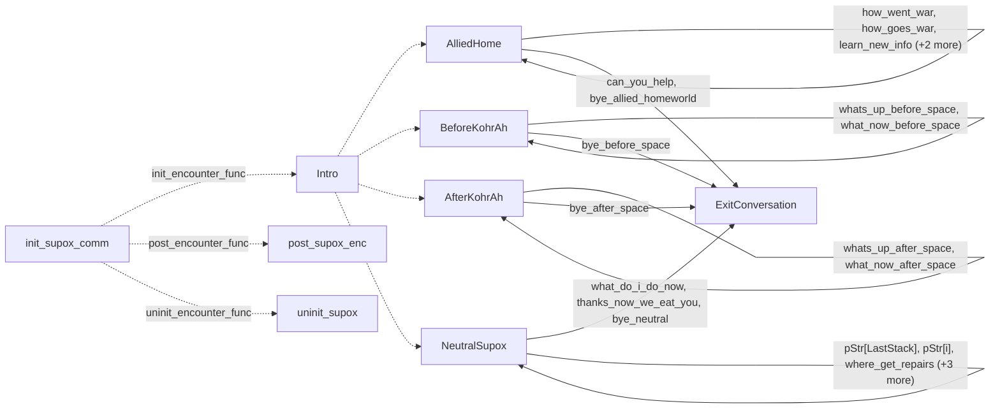

# Supox: existing conversation graph

> Generated by `tools/conversation_catalog.py`; do not edit this page by hand.

[Catalog and interpretation rules](../README.md) · [Proposed engine](../model.md)

Script: [supoxc.c](../../../../sc2/src/uqm/comm/supox/supoxc.c#L1). Phrase bank: [supox.txt](../../../../sc2/content/base/comm/supox/supox.txt#L1).

9 handler/helper nodes; 24 response registration sites; 4 direct local calls; 97 phrase records.

## Initialization and lifecycle

| Phase | Callback | Bound by | Conditions / source |
| --- | --- | --- | --- |
| <code>init_encounter_func</code> | [<code>Intro</code>](#node-intro) | <code>init_supox_comm</code> | No enclosing branch condition; [688](../../../../sc2/src/uqm/comm/supox/supoxc.c#L688) |
| <code>post_encounter_func</code> | [<code>post_supox_enc</code>](#node-post_supox_enc) | <code>init_supox_comm</code> | No enclosing branch condition; [689](../../../../sc2/src/uqm/comm/supox/supoxc.c#L689) |
| <code>uninit_encounter_func</code> | [<code>uninit_supox</code>](#node-uninit_supox) | <code>init_supox_comm</code> | No enclosing branch condition; [690](../../../../sc2/src/uqm/comm/supox/supoxc.c#L690) |

## Handler graph

Solid arrows are selectable responses; dashed arrows are direct C calls. Conditions, arguments, speech and effects are cataloged below. Parallel response sites are grouped only in this diagram.



## Condition catalog

Condition IDs describe enclosing source structure. Branch predicates combine with ∧; case labels mark source locations that can also be reached by fallthrough. Values refer to their original evaluation points. Local assignments and early control flow remain in the decision bodies.

| ID | Source expression / structural condition |
| --- | --- |
| <a id="condition-c1"></a>C1 | <code>PLAYER_SAID(R, bye_neutral)</code> |
| <a id="condition-c2"></a>C2 | <code>!(PLAYER_SAID(R, bye_neutral))</code> |
| <a id="condition-c3"></a>C3 | <code>PLAYER_SAID(R, what_do_i_do_now)</code> |
| <a id="condition-c4"></a>C4 | <code>!(PLAYER_SAID(R, what_do_i_do_now))</code> |
| <a id="condition-c5"></a>C5 | <code>PLAYER_SAID(R, thanks_now_we_eat_you)</code> |
| <a id="condition-c6"></a>C6 | <code>!(PLAYER_SAID(R, thanks_now_we_eat_you))</code> |
| <a id="condition-c7"></a>C7 | <code>PLAYER_SAID(R, bye_after_space)</code> |
| <a id="condition-c8"></a>C8 | <code>!(PLAYER_SAID(R, bye_after_space))</code> |
| <a id="condition-c9"></a>C9 | <code>PLAYER_SAID(R, bye_before_space)</code> |
| <a id="condition-c10"></a>C10 | <code>!(PLAYER_SAID(R, bye_before_space))</code> |
| <a id="condition-c11"></a>C11 | <code>PLAYER_SAID(R, bye_allied_homeworld)</code> |
| <a id="condition-c12"></a>C12 | <code>!(PLAYER_SAID(R, bye_allied_homeworld))</code> |
| <a id="condition-c13"></a>C13 | <code>PLAYER_SAID(R, can_you_help)</code> |
| <a id="condition-c14"></a>C14 | <code>EscortFeasibilityStudy(SUPOX_SHIP) == 0</code> |
| <a id="condition-c15"></a>C15 | <code>!(EscortFeasibilityStudy(SUPOX_SHIP) == 0)</code> |
| <a id="condition-c16"></a>C16 | <code>PLAYER_SAID(R, how_went_war)</code> |
| <a id="condition-c17"></a>C17 | <code>!(PLAYER_SAID(R, how_went_war))</code> |
| <a id="condition-c18"></a>C18 | <code>PLAYER_SAID(R, how_goes_war)</code> |
| <a id="condition-c19"></a>C19 | <code>NumVisits == 1</code> |
| <a id="condition-c20"></a>C20 | <code>!(NumVisits == 1)</code> |
| <a id="condition-c21"></a>C21 | <code>switch (GET_GAME_STATE(SUPOX_WAR_NEWS))</code> |
| <a id="condition-c22"></a>C22 | <code>case 0 (see source for fallthrough)</code> |
| <a id="condition-c23"></a>C23 | <code>case 1 (see source for fallthrough)</code> |
| <a id="condition-c24"></a>C24 | <code>!(PLAYER_SAID(R, how_goes_war))</code> |
| <a id="condition-c25"></a>C25 | <code>PLAYER_SAID(R, learn_new_info)</code> |
| <a id="condition-c26"></a>C26 | <code>NumVisits &lt; 5</code> |
| <a id="condition-c27"></a>C27 | <code>!(NumVisits &lt; 5)</code> |
| <a id="condition-c28"></a>C28 | <code>!(PLAYER_SAID(R, learn_new_info))</code> |
| <a id="condition-c29"></a>C29 | <code>PLAYER_SAID(R, what_now_homeworld)</code> |
| <a id="condition-c30"></a>C30 | <code>!(PLAYER_SAID(R, what_now_homeworld))</code> |
| <a id="condition-c31"></a>C31 | <code>PLAYER_SAID(R, how_is_ultron)</code> |
| <a id="condition-c32"></a>C32 | <code>NumVisits &gt;= 5</code> |
| <a id="condition-c33"></a>C33 | <code>!(News &amp; (1 &lt;&lt; 0))</code> |
| <a id="condition-c34"></a>C34 | <code>!(NumVisits &gt;= 5)</code> |
| <a id="condition-c35"></a>C35 | <code>PHRASE_ENABLED(how_goes_war) &amp;&amp; (((NumVisits == 1) &amp;&amp; (News == 0)) &#124;&#124; (NumVisits &amp;&amp; (News &lt; 2)))</code> |
| <a id="condition-c36"></a>C36 | <code>PHRASE_ENABLED(learn_new_info)</code> |
| <a id="condition-c37"></a>C37 | <code>PHRASE_ENABLED(what_now_homeworld)</code> |
| <a id="condition-c38"></a>C38 | <code>PHRASE_ENABLED(how_is_ultron)</code> |
| <a id="condition-c39"></a>C39 | <code>NumVisits == 0</code> |
| <a id="condition-c40"></a>C40 | <code>PLAYER_SAID(R, whats_up_before_space)</code> |
| <a id="condition-c41"></a>C41 | <code>switch (NumVisits++)</code> |
| <a id="condition-c42"></a>C42 | <code>!(PLAYER_SAID(R, whats_up_before_space))</code> |
| <a id="condition-c43"></a>C43 | <code>PLAYER_SAID(R, what_now_before_space)</code> |
| <a id="condition-c44"></a>C44 | <code>PHRASE_ENABLED(whats_up_before_space)</code> |
| <a id="condition-c45"></a>C45 | <code>PHRASE_ENABLED(what_now_before_space)</code> |
| <a id="condition-c46"></a>C46 | <code>PLAYER_SAID(R, whats_up_after_space)</code> |
| <a id="condition-c47"></a>C47 | <code>!(PLAYER_SAID(R, whats_up_after_space))</code> |
| <a id="condition-c48"></a>C48 | <code>PLAYER_SAID(R, what_now_after_space)</code> |
| <a id="condition-c49"></a>C49 | <code>PHRASE_ENABLED(whats_up_after_space)</code> |
| <a id="condition-c50"></a>C50 | <code>PHRASE_ENABLED(what_now_after_space)</code> |
| <a id="condition-c51"></a>C51 | <code>PLAYER_SAID(R, i_am0)</code> |
| <a id="condition-c52"></a>C52 | <code>!(PLAYER_SAID(R, i_am0))</code> |
| <a id="condition-c53"></a>C53 | <code>PLAYER_SAID(R, my_ship0)</code> |
| <a id="condition-c54"></a>C54 | <code>!(PLAYER_SAID(R, my_ship0))</code> |
| <a id="condition-c55"></a>C55 | <code>PLAYER_SAID(R, from_alliance0)</code> |
| <a id="condition-c56"></a>C56 | <code>!(PLAYER_SAID(R, from_alliance0))</code> |
| <a id="condition-c57"></a>C57 | <code>PLAYER_SAID(R, are_you_copying)</code> |
| <a id="condition-c58"></a>C58 | <code>!(PLAYER_SAID(R, are_you_copying))</code> |
| <a id="condition-c59"></a>C59 | <code>PLAYER_SAID(R, why_copy)</code> |
| <a id="condition-c60"></a>C60 | <code>!(PLAYER_SAID(R, why_copy))</code> |
| <a id="condition-c61"></a>C61 | <code>PLAYER_SAID(R, tell_us_of_your_species)</code> |
| <a id="condition-c62"></a>C62 | <code>!(PLAYER_SAID(R, tell_us_of_your_species))</code> |
| <a id="condition-c63"></a>C63 | <code>PLAYER_SAID(R, plants_arent_intelligent)</code> |
| <a id="condition-c64"></a>C64 | <code>!(PLAYER_SAID(R, plants_arent_intelligent))</code> |
| <a id="condition-c65"></a>C65 | <code>PLAYER_SAID(R, anyone_around_here)</code> |
| <a id="condition-c66"></a>C66 | <code>!(PLAYER_SAID(R, anyone_around_here))</code> |
| <a id="condition-c67"></a>C67 | <code>PLAYER_SAID(R, what_relation_to_utwig)</code> |
| <a id="condition-c68"></a>C68 | <code>!(PLAYER_SAID(R, what_relation_to_utwig))</code> |
| <a id="condition-c69"></a>C69 | <code>PLAYER_SAID(R, whats_wrong_with_utwig)</code> |
| <a id="condition-c70"></a>C70 | <code>!(PLAYER_SAID(R, whats_wrong_with_utwig))</code> |
| <a id="condition-c71"></a>C71 | <code>PLAYER_SAID(R, whats_ultron)</code> |
| <a id="condition-c72"></a>C72 | <code>!(PLAYER_SAID(R, whats_ultron))</code> |
| <a id="condition-c73"></a>C73 | <code>PLAYER_SAID(R, got_fixed_ultron)</code> |
| <a id="condition-c74"></a>C74 | <code>!(PLAYER_SAID(R, got_fixed_ultron))</code> |
| <a id="condition-c75"></a>C75 | <code>PLAYER_SAID(R, look_i_repaired_lots)</code> |
| <a id="condition-c76"></a>C76 | <code>!(PLAYER_SAID(R, look_i_repaired_lots))</code> |
| <a id="condition-c77"></a>C77 | <code>PLAYER_SAID(R, look_i_slightly_repaired)</code> |
| <a id="condition-c78"></a>C78 | <code>!(PLAYER_SAID(R, look_i_slightly_repaired))</code> |
| <a id="condition-c79"></a>C79 | <code>PLAYER_SAID(R, where_get_repairs)</code> |
| <a id="condition-c80"></a>C80 | <code>switch (GET_GAME_STATE(SUPOX_STACK2))</code> |
| <a id="condition-c81"></a>C81 | <code>switch (GET_GAME_STATE(SUPOX_STACK1))</code> |
| <a id="condition-c82"></a>C82 | <code>case 2 (see source for fallthrough)</code> |
| <a id="condition-c83"></a>C83 | <code>case 3 (see source for fallthrough)</code> |
| <a id="condition-c84"></a>C84 | <code>case 4 (see source for fallthrough)</code> |
| <a id="condition-c85"></a>C85 | <code>!(GET_GAME_STATE(UTWIG_VISITS))</code> |
| <a id="condition-c86"></a>C86 | <code>!(GET_GAME_STATE(UTWIG_VISITS) &#124;&#124; GET_GAME_STATE(UTWIG_HOME_VISITS))</code> |
| <a id="condition-c87"></a>C87 | <code>(GET_GAME_STATE(UTWIG_VISITS) &#124;&#124; GET_GAME_STATE(UTWIG_HOME_VISITS)) &#124;&#124; GET_GAME_STATE(BOMB_VISITS)</code> |
| <a id="condition-c88"></a>C88 | <code>!((GET_GAME_STATE(UTWIG_VISITS) &#124;&#124; GET_GAME_STATE(UTWIG_HOME_VISITS)) &#124;&#124; GET_GAME_STATE(BOMB_VISITS))</code> |
| <a id="condition-c89"></a>C89 | <code>pStr[LastStack]</code> |
| <a id="condition-c90"></a>C90 | <code>!(LastStack != 0)</code> |
| <a id="condition-c91"></a>C91 | <code>(LastStack != 0) &#124;&#124; (GET_GAME_STATE(SUPOX_STACK1) &gt; 2)</code> |
| <a id="condition-c92"></a>C92 | <code>!((LastStack != 0) &#124;&#124; (GET_GAME_STATE(SUPOX_STACK1) &gt; 2))</code> |
| <a id="condition-c93"></a>C93 | <code>for (i = 0; i &lt; 3; ++i)</code> |
| <a id="condition-c94"></a>C94 | <code>(i != LastStack) &amp;&amp; pStr[i]</code> |
| <a id="condition-c95"></a>C95 | <code>!(i != 0)</code> |
| <a id="condition-c96"></a>C96 | <code>(i != 0) &#124;&#124; (GET_GAME_STATE(SUPOX_STACK1) &gt; 2)</code> |
| <a id="condition-c97"></a>C97 | <code>!((i != 0) &#124;&#124; (GET_GAME_STATE(SUPOX_STACK1) &gt; 2))</code> |
| <a id="condition-c98"></a>C98 | <code>!GET_GAME_STATE(SUPOX_ULTRON_HELP)</code> |
| <a id="condition-c99"></a>C99 | <code>switch (NumVisits)</code> |
| <a id="condition-c100"></a>C100 | <code>LOBYTE(GLOBAL(CurrentActivity)) == WON_LAST_BATTLE</code> |
| <a id="condition-c101"></a>C101 | <code>GET_GAME_STATE(SUPOX_HOSTILE)</code> |
| <a id="condition-c102"></a>C102 | <code>!(GET_GAME_STATE(SUPOX_HOSTILE))</code> |
| <a id="condition-c103"></a>C103 | <code>CheckAlliance(SUPOX_SHIP) == GOOD_GUY</code> |
| <a id="condition-c104"></a>C104 | <code>GET_GAME_STATE(GLOBAL_FLAGS_AND_DATA) &amp; (1 &lt;&lt; 7)</code> |
| <a id="condition-c105"></a>C105 | <code>!(GET_GAME_STATE(GLOBAL_FLAGS_AND_DATA) &amp; (1 &lt;&lt; 7))</code> |
| <a id="condition-c106"></a>C106 | <code>!(CheckAlliance(SUPOX_SHIP) == GOOD_GUY)</code> |
| <a id="condition-c107"></a>C107 | <code>!(!GET_GAME_STATE(SUPOX_HOSTILE))</code> |
| <a id="condition-c108"></a>C108 | <code>(!GET_GAME_STATE(SUPOX_HOSTILE)) &#124;&#124; (LOBYTE(GLOBAL(CurrentActivity)) == WON_LAST_BATTLE)</code> |
| <a id="condition-c109"></a>C109 | <code>!((!GET_GAME_STATE(SUPOX_HOSTILE)) &#124;&#124; (LOBYTE(GLOBAL(CurrentActivity)) == WON_LAST_BATTLE))</code> |

## Script-scope state and lookup tables

These declarations supply shared local state, computed phrase alternatives, number speech, or lookup data used by the nodes. LOCDATA presentation defaults are linked separately in the source.

Presentation descriptor <code>supox_desc</code>: [source](../../../../sc2/src/uqm/comm/supox/supoxc.c#L26).

## Node catalog

<a id="node-exitconversation"></a>

### ExitConversation

<code>static void ExitConversation(RESPONSE_REF R)</code> — [source](../../../../sc2/src/uqm/comm/supox/supoxc.c#L104).

Incoming player-response variants: [<code>can_you_help</code>](#phrase-can_you_help), [<code>bye_allied_homeworld</code>](#phrase-bye_allied_homeworld), [<code>bye_before_space</code>](#phrase-bye_before_space), [<code>bye_after_space</code>](#phrase-bye_after_space), [<code>what_do_i_do_now</code>](#phrase-what_do_i_do_now), [<code>thanks_now_we_eat_you</code>](#phrase-thanks_now_we_eat_you), [<code>bye_neutral</code>](#phrase-bye_neutral).

#### Dialogue / audio emissions

| Phrase or expression | Enclosing conditions | Source |
| --- | --- | --- |
| [<code>GOODBYE_NEUTRAL</code>](#phrase-goodbye_neutral)<br><code>NPCPhrase(GOODBYE_NEUTRAL)</code> | [C1](#condition-c1) | [109](../../../../sc2/src/uqm/comm/supox/supoxc.c#L109) |
| [<code>FIX_IT</code>](#phrase-fix_it)<br><code>NPCPhrase(FIX_IT)</code> | [C2](#condition-c2) ∧ [C3](#condition-c3) | [111](../../../../sc2/src/uqm/comm/supox/supoxc.c#L111) |
| [<code>HIDEOUS_MONSTERS</code>](#phrase-hideous_monsters)<br><code>NPCPhrase(HIDEOUS_MONSTERS)</code> | [C2](#condition-c2) ∧ [C4](#condition-c4) ∧ [C5](#condition-c5) | [114](../../../../sc2/src/uqm/comm/supox/supoxc.c#L114) |
| [<code>GOODBYE_AFTER_SPACE</code>](#phrase-goodbye_after_space)<br><code>NPCPhrase(GOODBYE_AFTER_SPACE)</code> | [C2](#condition-c2) ∧ [C4](#condition-c4) ∧ [C6](#condition-c6) ∧ [C7](#condition-c7) | [121](../../../../sc2/src/uqm/comm/supox/supoxc.c#L121) |
| [<code>GOODBYE_BEFORE_SPACE</code>](#phrase-goodbye_before_space)<br><code>NPCPhrase(GOODBYE_BEFORE_SPACE)</code> | [C2](#condition-c2) ∧ [C4](#condition-c4) ∧ [C6](#condition-c6) ∧ [C8](#condition-c8) ∧ [C9](#condition-c9) | [123](../../../../sc2/src/uqm/comm/supox/supoxc.c#L123) |
| [<code>GOODBYE_ALLIED_HOMEWORLD</code>](#phrase-goodbye_allied_homeworld)<br><code>NPCPhrase(GOODBYE_ALLIED_HOMEWORLD)</code> | [C2](#condition-c2) ∧ [C4](#condition-c4) ∧ [C6](#condition-c6) ∧ [C8](#condition-c8) ∧ [C10](#condition-c10) ∧ [C11](#condition-c11) | [125](../../../../sc2/src/uqm/comm/supox/supoxc.c#L125) |
| [<code>HOW_HELP</code>](#phrase-how_help)<br><code>NPCPhrase(HOW_HELP)</code> | [C2](#condition-c2) ∧ [C4](#condition-c4) ∧ [C6](#condition-c6) ∧ [C8](#condition-c8) ∧ [C10](#condition-c10) ∧ [C12](#condition-c12) ∧ [C13](#condition-c13) | [128](../../../../sc2/src/uqm/comm/supox/supoxc.c#L128) |
| [<code>DONT_NEED</code>](#phrase-dont_need)<br><code>NPCPhrase(DONT_NEED)</code> | [C2](#condition-c2) ∧ [C4](#condition-c4) ∧ [C6](#condition-c6) ∧ [C8](#condition-c8) ∧ [C10](#condition-c10) ∧ [C12](#condition-c12) ∧ [C13](#condition-c13) ∧ [C14](#condition-c14) | [130](../../../../sc2/src/uqm/comm/supox/supoxc.c#L130) |
| [<code>HAVE_4_SHIPS</code>](#phrase-have_4_ships)<br><code>NPCPhrase(HAVE_4_SHIPS)</code> | [C2](#condition-c2) ∧ [C4](#condition-c4) ∧ [C6](#condition-c6) ∧ [C8](#condition-c8) ∧ [C10](#condition-c10) ∧ [C12](#condition-c12) ∧ [C13](#condition-c13) ∧ [C15](#condition-c15) | [133](../../../../sc2/src/uqm/comm/supox/supoxc.c#L133) |

#### Actions, queries, local updates, and control flow

Calls are listed without assuming they are pure or mutating. Local updates are retained because they determine dynamic menus and counter-selected speech.

| Kind | Operation | Enclosing conditions | Source |
| --- | --- | --- | --- |
| call | <code>setSegue(Segue_peace)</code> | No enclosing branch condition | [106](../../../../sc2/src/uqm/comm/supox/supoxc.c#L106) |
| call | <code>PLAYER_SAID(R, bye_neutral)</code> | No enclosing branch condition | [108](../../../../sc2/src/uqm/comm/supox/supoxc.c#L108) |
| call | <code>PLAYER_SAID(R, what_do_i_do_now)</code> | [C2](#condition-c2) | [110](../../../../sc2/src/uqm/comm/supox/supoxc.c#L110) |
| call | <code>PLAYER_SAID(R, thanks_now_we_eat_you)</code> | [C2](#condition-c2) ∧ [C4](#condition-c4) | [112](../../../../sc2/src/uqm/comm/supox/supoxc.c#L112) |
| call | <code>SET_GAME_STATE(SUPOX_HOSTILE, 1)</code> | [C2](#condition-c2) ∧ [C4](#condition-c4) ∧ [C5](#condition-c5) | [116](../../../../sc2/src/uqm/comm/supox/supoxc.c#L116) |
| call | <code>SET_GAME_STATE(SUPOX_HOME_VISITS, 0)</code> | [C2](#condition-c2) ∧ [C4](#condition-c4) ∧ [C5](#condition-c5) | [117](../../../../sc2/src/uqm/comm/supox/supoxc.c#L117) |
| call | <code>SET_GAME_STATE(SUPOX_VISITS, 0)</code> | [C2](#condition-c2) ∧ [C4](#condition-c4) ∧ [C5](#condition-c5) | [118](../../../../sc2/src/uqm/comm/supox/supoxc.c#L118) |
| call | <code>PLAYER_SAID(R, bye_after_space)</code> | [C2](#condition-c2) ∧ [C4](#condition-c4) ∧ [C6](#condition-c6) | [120](../../../../sc2/src/uqm/comm/supox/supoxc.c#L120) |
| call | <code>PLAYER_SAID(R, bye_before_space)</code> | [C2](#condition-c2) ∧ [C4](#condition-c4) ∧ [C6](#condition-c6) ∧ [C8](#condition-c8) | [122](../../../../sc2/src/uqm/comm/supox/supoxc.c#L122) |
| call | <code>PLAYER_SAID(R, bye_allied_homeworld)</code> | [C2](#condition-c2) ∧ [C4](#condition-c4) ∧ [C6](#condition-c6) ∧ [C8](#condition-c8) ∧ [C10](#condition-c10) | [124](../../../../sc2/src/uqm/comm/supox/supoxc.c#L124) |
| call | <code>PLAYER_SAID(R, can_you_help)</code> | [C2](#condition-c2) ∧ [C4](#condition-c4) ∧ [C6](#condition-c6) ∧ [C8](#condition-c8) ∧ [C10](#condition-c10) ∧ [C12](#condition-c12) | [126](../../../../sc2/src/uqm/comm/supox/supoxc.c#L126) |
| call | <code>EscortFeasibilityStudy(SUPOX_SHIP)</code> | [C2](#condition-c2) ∧ [C4](#condition-c4) ∧ [C6](#condition-c6) ∧ [C8](#condition-c8) ∧ [C10](#condition-c10) ∧ [C12](#condition-c12) ∧ [C13](#condition-c13) | [129](../../../../sc2/src/uqm/comm/supox/supoxc.c#L129) |
| call | <code>AlienTalkSegue((COUNT) (~0))</code> | [C2](#condition-c2) ∧ [C4](#condition-c4) ∧ [C6](#condition-c6) ∧ [C8](#condition-c8) ∧ [C10](#condition-c10) ∧ [C12](#condition-c12) ∧ [C13](#condition-c13) ∧ [C15](#condition-c15) | [135](../../../../sc2/src/uqm/comm/supox/supoxc.c#L135) |
| call | <code>AddEscortShips(SUPOX_SHIP, 4)</code> | [C2](#condition-c2) ∧ [C4](#condition-c4) ∧ [C6](#condition-c6) ∧ [C8](#condition-c8) ∧ [C10](#condition-c10) ∧ [C12](#condition-c12) ∧ [C13](#condition-c13) ∧ [C15](#condition-c15) | [136](../../../../sc2/src/uqm/comm/supox/supoxc.c#L136) |

<details>
<summary>Exact decision body (local calculations, early returns, fallthrough and ordering)</summary>

```c
{
	setSegue (Segue_peace);

	if (PLAYER_SAID (R, bye_neutral))
		NPCPhrase (GOODBYE_NEUTRAL);
	else if (PLAYER_SAID (R, what_do_i_do_now))
		NPCPhrase (FIX_IT);
	else if (PLAYER_SAID (R, thanks_now_we_eat_you))
	{
		NPCPhrase (HIDEOUS_MONSTERS);

		SET_GAME_STATE (SUPOX_HOSTILE, 1);
		SET_GAME_STATE (SUPOX_HOME_VISITS, 0);
		SET_GAME_STATE (SUPOX_VISITS, 0);
	}
	else if (PLAYER_SAID (R, bye_after_space))
		NPCPhrase (GOODBYE_AFTER_SPACE);
	else if (PLAYER_SAID (R, bye_before_space))
		NPCPhrase (GOODBYE_BEFORE_SPACE);
	else if (PLAYER_SAID (R, bye_allied_homeworld))
		NPCPhrase (GOODBYE_ALLIED_HOMEWORLD);
	else if (PLAYER_SAID (R, can_you_help))
	{
		NPCPhrase (HOW_HELP);
		if (EscortFeasibilityStudy (SUPOX_SHIP) == 0)
			NPCPhrase (DONT_NEED);
		else
		{
			NPCPhrase (HAVE_4_SHIPS);

			AlienTalkSegue ((COUNT)~0);
			AddEscortShips (SUPOX_SHIP, 4);
		}
	}
}
```

</details>

<a id="node-alliedhome"></a>

### AlliedHome

<code>static void AlliedHome(RESPONSE_REF R)</code> — [source](../../../../sc2/src/uqm/comm/supox/supoxc.c#L144).

Incoming player-response variants: [<code>how_went_war</code>](#phrase-how_went_war), [<code>how_goes_war</code>](#phrase-how_goes_war), [<code>learn_new_info</code>](#phrase-learn_new_info), [<code>what_now_homeworld</code>](#phrase-what_now_homeworld), [<code>how_is_ultron</code>](#phrase-how_is_ultron).

Also called directly by: [<code>Intro</code>](#node-intro) ([578](../../../../sc2/src/uqm/comm/supox/supoxc.c#L578)).

#### Dialogue / audio emissions

| Phrase or expression | Enclosing conditions | Source |
| --- | --- | --- |
| [<code>ABOUT_BATTLE</code>](#phrase-about_battle)<br><code>NPCPhrase(ABOUT_BATTLE)</code> | [C16](#condition-c16) | [152](../../../../sc2/src/uqm/comm/supox/supoxc.c#L152) |
| [<code>FLEET_ON_WAY</code>](#phrase-fleet_on_way)<br><code>NPCPhrase(FLEET_ON_WAY)</code> | [C17](#condition-c17) ∧ [C18](#condition-c18) ∧ [C19](#condition-c19) | [160](../../../../sc2/src/uqm/comm/supox/supoxc.c#L160) |
| [<code>BATTLE_HAPPENS_1</code>](#phrase-battle_happens_1)<br><code>NPCPhrase(BATTLE_HAPPENS_1)</code> | [C17](#condition-c17) ∧ [C18](#condition-c18) ∧ [C20](#condition-c20) ∧ [C21](#condition-c21) ∧ [C22](#condition-c22) | [167](../../../../sc2/src/uqm/comm/supox/supoxc.c#L167) |
| [<code>BATTLE_HAPPENS_2</code>](#phrase-battle_happens_2)<br><code>NPCPhrase(BATTLE_HAPPENS_2)</code> | [C17](#condition-c17) ∧ [C18](#condition-c18) ∧ [C20](#condition-c20) ∧ [C21](#condition-c21) ∧ [C23](#condition-c23) | [171](../../../../sc2/src/uqm/comm/supox/supoxc.c#L171) |
| [<code>NO_NEW_INFO</code>](#phrase-no_new_info)<br><code>NPCPhrase(NO_NEW_INFO)</code> | [C17](#condition-c17) ∧ [C24](#condition-c24) ∧ [C25](#condition-c25) ∧ [C26](#condition-c26) | [181](../../../../sc2/src/uqm/comm/supox/supoxc.c#L181) |
| [<code>SAMATRA</code>](#phrase-samatra)<br><code>NPCPhrase(SAMATRA)</code> | [C17](#condition-c17) ∧ [C24](#condition-c24) ∧ [C25](#condition-c25) ∧ [C27](#condition-c27) | [184](../../../../sc2/src/uqm/comm/supox/supoxc.c#L184) |
| [<code>UP_TO_YOU</code>](#phrase-up_to_you)<br><code>NPCPhrase(UP_TO_YOU)</code> | [C17](#condition-c17) ∧ [C24](#condition-c24) ∧ [C28](#condition-c28) ∧ [C29](#condition-c29) ∧ [C26](#condition-c26) | [194](../../../../sc2/src/uqm/comm/supox/supoxc.c#L194) |
| [<code>HOPE_KILL_EACH_OTHER</code>](#phrase-hope_kill_each_other)<br><code>NPCPhrase(HOPE_KILL_EACH_OTHER)</code> | [C17](#condition-c17) ∧ [C24](#condition-c24) ∧ [C28](#condition-c28) ∧ [C29](#condition-c29) ∧ [C27](#condition-c27) | [196](../../../../sc2/src/uqm/comm/supox/supoxc.c#L196) |
| [<code>ULTRON_IS_GREAT</code>](#phrase-ultron_is_great)<br><code>NPCPhrase(ULTRON_IS_GREAT)</code> | [C17](#condition-c17) ∧ [C24](#condition-c24) ∧ [C28](#condition-c28) ∧ [C30](#condition-c30) ∧ [C31](#condition-c31) | [202](../../../../sc2/src/uqm/comm/supox/supoxc.c#L202) |

#### Response edges

| Player response | Destination on selection | Enclosing availability conditions | Source |
| --- | --- | --- | --- |
| [<code>how_went_war</code>](#phrase-how_went_war)<br>What happened at Antares? Describe the struggle. | [<code>AlliedHome</code>](#node-alliedhome) | [C32](#condition-c32) ∧ [C33](#condition-c33) | [211](../../../../sc2/src/uqm/comm/supox/supoxc.c#L211) |
| [<code>how_goes_war</code>](#phrase-how_goes_war)<br>How fares the battle against the Kohr-Ah? | [<code>AlliedHome</code>](#node-alliedhome) | [C34](#condition-c34) ∧ [C35](#condition-c35) | [216](../../../../sc2/src/uqm/comm/supox/supoxc.c#L216) |
| [<code>learn_new_info</code>](#phrase-learn_new_info)<br>Have your fighting forces learned anything I should know? | [<code>AlliedHome</code>](#node-alliedhome) | [C36](#condition-c36) | [218](../../../../sc2/src/uqm/comm/supox/supoxc.c#L218) |
| [<code>what_now_homeworld</code>](#phrase-what_now_homeworld)<br>So now what do we do? | [<code>AlliedHome</code>](#node-alliedhome) | [C37](#condition-c37) | [220](../../../../sc2/src/uqm/comm/supox/supoxc.c#L220) |
| [<code>how_is_ultron</code>](#phrase-how_is_ultron)<br>So how are the Utwig liking their Ultron? | [<code>AlliedHome</code>](#node-alliedhome) | [C38](#condition-c38) | [222](../../../../sc2/src/uqm/comm/supox/supoxc.c#L222) |
| [<code>can_you_help</code>](#phrase-can_you_help)<br>Two leaves pull water from the same root. | [<code>ExitConversation</code>](#node-exitconversation) | [C39](#condition-c39) | [224](../../../../sc2/src/uqm/comm/supox/supoxc.c#L224) |
| [<code>bye_allied_homeworld</code>](#phrase-bye_allied_homeworld)<br>Goodbye Leafy Ones. | [<code>ExitConversation</code>](#node-exitconversation) | No enclosing branch condition | [225](../../../../sc2/src/uqm/comm/supox/supoxc.c#L225) |

#### Actions, queries, local updates, and control flow

Calls are listed without assuming they are pure or mutating. Local updates are retained because they determine dynamic menus and counter-selected speech.

| Kind | Operation | Enclosing conditions | Source |
| --- | --- | --- | --- |
| update | <code>News = GET_GAME_STATE(SUPOX_WAR_NEWS)</code> | No enclosing branch condition | [148](../../../../sc2/src/uqm/comm/supox/supoxc.c#L148) |
| call | <code>GET_GAME_STATE(SUPOX_WAR_NEWS)</code> | No enclosing branch condition | [148](../../../../sc2/src/uqm/comm/supox/supoxc.c#L148) |
| update | <code>NumVisits = GET_GAME_STATE(UTWIG_SUPOX_MISSION)</code> | No enclosing branch condition | [149](../../../../sc2/src/uqm/comm/supox/supoxc.c#L149) |
| call | <code>GET_GAME_STATE(UTWIG_SUPOX_MISSION)</code> | No enclosing branch condition | [149](../../../../sc2/src/uqm/comm/supox/supoxc.c#L149) |
| call | <code>PLAYER_SAID(R, how_went_war)</code> | No enclosing branch condition | [150](../../../../sc2/src/uqm/comm/supox/supoxc.c#L150) |
| update | <code>News &#124;= 1 &lt;&lt; 0</code> | [C16](#condition-c16) | [154](../../../../sc2/src/uqm/comm/supox/supoxc.c#L154) |
| call | <code>PLAYER_SAID(R, how_goes_war)</code> | [C17](#condition-c17) | [156](../../../../sc2/src/uqm/comm/supox/supoxc.c#L156) |
| call | <code>SET_GAME_STATE(SUPOX_WAR_NEWS, 1)</code> | [C17](#condition-c17) ∧ [C18](#condition-c18) ∧ [C19](#condition-c19) | [162](../../../../sc2/src/uqm/comm/supox/supoxc.c#L162) |
| call | <code>GET_GAME_STATE(SUPOX_WAR_NEWS)</code> | [C17](#condition-c17) ∧ [C18](#condition-c18) ∧ [C20](#condition-c20) | [164](../../../../sc2/src/uqm/comm/supox/supoxc.c#L164) |
| update | <code>News = 1</code> | [C17](#condition-c17) ∧ [C18](#condition-c18) ∧ [C20](#condition-c20) ∧ [C21](#condition-c21) ∧ [C22](#condition-c22) | [168](../../../../sc2/src/uqm/comm/supox/supoxc.c#L168) |
| flow | <code>break;</code> | [C17](#condition-c17) ∧ [C18](#condition-c18) ∧ [C20](#condition-c20) ∧ [C21](#condition-c21) ∧ [C22](#condition-c22) | [169](../../../../sc2/src/uqm/comm/supox/supoxc.c#L169) |
| update | <code>News = 2</code> | [C17](#condition-c17) ∧ [C18](#condition-c18) ∧ [C20](#condition-c20) ∧ [C21](#condition-c21) ∧ [C23](#condition-c23) | [172](../../../../sc2/src/uqm/comm/supox/supoxc.c#L172) |
| flow | <code>break;</code> | [C17](#condition-c17) ∧ [C18](#condition-c18) ∧ [C20](#condition-c20) ∧ [C21](#condition-c21) ∧ [C23](#condition-c23) | [173](../../../../sc2/src/uqm/comm/supox/supoxc.c#L173) |
| call | <code>DISABLE_PHRASE(how_goes_war)</code> | [C17](#condition-c17) ∧ [C18](#condition-c18) | [176](../../../../sc2/src/uqm/comm/supox/supoxc.c#L176) |
| call | <code>PLAYER_SAID(R, learn_new_info)</code> | [C17](#condition-c17) ∧ [C24](#condition-c24) | [178](../../../../sc2/src/uqm/comm/supox/supoxc.c#L178) |
| update | <code>News &#124;= 1 &lt;&lt; 1</code> | [C17](#condition-c17) ∧ [C24](#condition-c24) ∧ [C25](#condition-c25) ∧ [C27](#condition-c27) | [186](../../../../sc2/src/uqm/comm/supox/supoxc.c#L186) |
| call | <code>DISABLE_PHRASE(learn_new_info)</code> | [C17](#condition-c17) ∧ [C24](#condition-c24) ∧ [C25](#condition-c25) | [189](../../../../sc2/src/uqm/comm/supox/supoxc.c#L189) |
| call | <code>PLAYER_SAID(R, what_now_homeworld)</code> | [C17](#condition-c17) ∧ [C24](#condition-c24) ∧ [C28](#condition-c28) | [191](../../../../sc2/src/uqm/comm/supox/supoxc.c#L191) |
| call | <code>DISABLE_PHRASE(what_now_homeworld)</code> | [C17](#condition-c17) ∧ [C24](#condition-c24) ∧ [C28](#condition-c28) ∧ [C29](#condition-c29) | [198](../../../../sc2/src/uqm/comm/supox/supoxc.c#L198) |
| call | <code>PLAYER_SAID(R, how_is_ultron)</code> | [C17](#condition-c17) ∧ [C24](#condition-c24) ∧ [C28](#condition-c28) ∧ [C30](#condition-c30) | [200](../../../../sc2/src/uqm/comm/supox/supoxc.c#L200) |
| call | <code>DISABLE_PHRASE(how_is_ultron)</code> | [C17](#condition-c17) ∧ [C24](#condition-c24) ∧ [C28](#condition-c28) ∧ [C30](#condition-c30) ∧ [C31](#condition-c31) | [204](../../../../sc2/src/uqm/comm/supox/supoxc.c#L204) |
| call | <code>SET_GAME_STATE(SUPOX_WAR_NEWS, News)</code> | No enclosing branch condition | [206](../../../../sc2/src/uqm/comm/supox/supoxc.c#L206) |
| call | <code>PHRASE_ENABLED(how_goes_war)</code> | [C34](#condition-c34) | [213](../../../../sc2/src/uqm/comm/supox/supoxc.c#L213) |
| call | <code>PHRASE_ENABLED(learn_new_info)</code> | No enclosing branch condition | [217](../../../../sc2/src/uqm/comm/supox/supoxc.c#L217) |
| call | <code>PHRASE_ENABLED(what_now_homeworld)</code> | No enclosing branch condition | [219](../../../../sc2/src/uqm/comm/supox/supoxc.c#L219) |
| call | <code>PHRASE_ENABLED(how_is_ultron)</code> | No enclosing branch condition | [221](../../../../sc2/src/uqm/comm/supox/supoxc.c#L221) |

<details>
<summary>Exact decision body (local calculations, early returns, fallthrough and ordering)</summary>

```c
{
	BYTE NumVisits, News;

	News = GET_GAME_STATE (SUPOX_WAR_NEWS);
	NumVisits = GET_GAME_STATE (UTWIG_SUPOX_MISSION);
	if (PLAYER_SAID (R, how_went_war))
	{
		NPCPhrase (ABOUT_BATTLE);

		News |= (1 << 0);
	}
	else if (PLAYER_SAID (R, how_goes_war))
	{
		if (NumVisits == 1)
		{
			NPCPhrase (FLEET_ON_WAY);

			SET_GAME_STATE (SUPOX_WAR_NEWS, 1);
		}
		else switch (GET_GAME_STATE (SUPOX_WAR_NEWS))
		{
			case 0:
				NPCPhrase (BATTLE_HAPPENS_1);
				News = 1;
				break;
			case 1:
				NPCPhrase (BATTLE_HAPPENS_2);
				News = 2;
				break;
		}

		DISABLE_PHRASE (how_goes_war);
	}
	else if (PLAYER_SAID (R, learn_new_info))
	{
		if (NumVisits < 5)
			NPCPhrase (NO_NEW_INFO);
		else
		{
			NPCPhrase (SAMATRA);

			News |= (1 << 1);
		}

		DISABLE_PHRASE (learn_new_info);
	}
	else if (PLAYER_SAID (R, what_now_homeworld))
	{
		if (NumVisits < 5)
			NPCPhrase (UP_TO_YOU);
		else
			NPCPhrase (HOPE_KILL_EACH_OTHER);

		DISABLE_PHRASE (what_now_homeworld);
	}
	else if (PLAYER_SAID (R, how_is_ultron))
	{
		NPCPhrase (ULTRON_IS_GREAT);

		DISABLE_PHRASE (how_is_ultron);
	}
	SET_GAME_STATE (SUPOX_WAR_NEWS, News);

	if (NumVisits >= 5)
	{
		if (!(News & (1 << 0)))
			Response (how_went_war, AlliedHome);
	}
	else if (PHRASE_ENABLED (how_goes_war)
			&& ((NumVisits == 1 && News == 0)
			|| (NumVisits && News < 2)))
		Response (how_goes_war, AlliedHome);
	if (PHRASE_ENABLED (learn_new_info))
		Response (learn_new_info, AlliedHome);
	if (PHRASE_ENABLED (what_now_homeworld))
		Response (what_now_homeworld, AlliedHome);
	if (PHRASE_ENABLED (how_is_ultron))
		Response (how_is_ultron, AlliedHome);
	if (NumVisits == 0)
		Response (can_you_help, ExitConversation);
	Response (bye_allied_homeworld, ExitConversation);
}
```

</details>

<a id="node-beforekohrah"></a>

### BeforeKohrAh

<code>static void BeforeKohrAh(RESPONSE_REF R)</code> — [source](../../../../sc2/src/uqm/comm/supox/supoxc.c#L229).

Incoming player-response variants: [<code>whats_up_before_space</code>](#phrase-whats_up_before_space), [<code>what_now_before_space</code>](#phrase-what_now_before_space).

Also called directly by: [<code>Intro</code>](#node-intro) ([598](../../../../sc2/src/uqm/comm/supox/supoxc.c#L598)).

#### Dialogue / audio emissions

| Phrase or expression | Enclosing conditions | Source |
| --- | --- | --- |
| [<code>GENERAL_INFO_BEFORE_SPACE_1</code>](#phrase-general_info_before_space_1)<br><code>NPCPhrase(GENERAL_INFO_BEFORE_SPACE_1)</code> | [C40](#condition-c40) ∧ [C41](#condition-c41) ∧ [C22](#condition-c22) | [239](../../../../sc2/src/uqm/comm/supox/supoxc.c#L239) |
| [<code>GENERAL_INFO_BEFORE_SPACE_2</code>](#phrase-general_info_before_space_2)<br><code>NPCPhrase(GENERAL_INFO_BEFORE_SPACE_2)</code> | [C40](#condition-c40) ∧ [C41](#condition-c41) ∧ [C23](#condition-c23) | [242](../../../../sc2/src/uqm/comm/supox/supoxc.c#L242) |
| [<code>DO_THIS_BEFORE_SPACE</code>](#phrase-do_this_before_space)<br><code>NPCPhrase(DO_THIS_BEFORE_SPACE)</code> | [C42](#condition-c42) ∧ [C43](#condition-c43) | [252](../../../../sc2/src/uqm/comm/supox/supoxc.c#L252) |

#### Response edges

| Player response | Destination on selection | Enclosing availability conditions | Source |
| --- | --- | --- | --- |
| [<code>whats_up_before_space</code>](#phrase-whats_up_before_space)<br>So what are you doing? | [<code>BeforeKohrAh</code>](#node-beforekohrah) | [C44](#condition-c44) | [258](../../../../sc2/src/uqm/comm/supox/supoxc.c#L258) |
| [<code>what_now_before_space</code>](#phrase-what_now_before_space)<br>So what should we do now? | [<code>BeforeKohrAh</code>](#node-beforekohrah) | [C45](#condition-c45) | [260](../../../../sc2/src/uqm/comm/supox/supoxc.c#L260) |
| [<code>bye_before_space</code>](#phrase-bye_before_space)<br>G&#x27;bye plant dudes. | [<code>ExitConversation</code>](#node-exitconversation) | No enclosing branch condition | [261](../../../../sc2/src/uqm/comm/supox/supoxc.c#L261) |

#### Actions, queries, local updates, and control flow

Calls are listed without assuming they are pure or mutating. Local updates are retained because they determine dynamic menus and counter-selected speech.

| Kind | Operation | Enclosing conditions | Source |
| --- | --- | --- | --- |
| call | <code>PLAYER_SAID(R, whats_up_before_space)</code> | No enclosing branch condition | [233](../../../../sc2/src/uqm/comm/supox/supoxc.c#L233) |
| update | <code>NumVisits = GET_GAME_STATE(SUPOX_INFO)</code> | [C40](#condition-c40) | [235](../../../../sc2/src/uqm/comm/supox/supoxc.c#L235) |
| call | <code>GET_GAME_STATE(SUPOX_INFO)</code> | [C40](#condition-c40) | [235](../../../../sc2/src/uqm/comm/supox/supoxc.c#L235) |
| update | <code>NumVisits++</code> | [C40](#condition-c40) | [236](../../../../sc2/src/uqm/comm/supox/supoxc.c#L236) |
| flow | <code>break;</code> | [C40](#condition-c40) ∧ [C41](#condition-c41) ∧ [C22](#condition-c22) | [240](../../../../sc2/src/uqm/comm/supox/supoxc.c#L240) |
| update | <code>--NumVisits</code> | [C40](#condition-c40) ∧ [C41](#condition-c41) ∧ [C23](#condition-c23) | [243](../../../../sc2/src/uqm/comm/supox/supoxc.c#L243) |
| flow | <code>break;</code> | [C40](#condition-c40) ∧ [C41](#condition-c41) ∧ [C23](#condition-c23) | [244](../../../../sc2/src/uqm/comm/supox/supoxc.c#L244) |
| call | <code>SET_GAME_STATE(SUPOX_INFO, NumVisits)</code> | [C40](#condition-c40) | [246](../../../../sc2/src/uqm/comm/supox/supoxc.c#L246) |
| call | <code>DISABLE_PHRASE(whats_up_before_space)</code> | [C40](#condition-c40) | [248](../../../../sc2/src/uqm/comm/supox/supoxc.c#L248) |
| call | <code>PLAYER_SAID(R, what_now_before_space)</code> | [C42](#condition-c42) | [250](../../../../sc2/src/uqm/comm/supox/supoxc.c#L250) |
| call | <code>DISABLE_PHRASE(what_now_before_space)</code> | [C42](#condition-c42) ∧ [C43](#condition-c43) | [254](../../../../sc2/src/uqm/comm/supox/supoxc.c#L254) |
| call | <code>PHRASE_ENABLED(whats_up_before_space)</code> | No enclosing branch condition | [257](../../../../sc2/src/uqm/comm/supox/supoxc.c#L257) |
| call | <code>PHRASE_ENABLED(what_now_before_space)</code> | No enclosing branch condition | [259](../../../../sc2/src/uqm/comm/supox/supoxc.c#L259) |

<details>
<summary>Exact decision body (local calculations, early returns, fallthrough and ordering)</summary>

```c
{
	BYTE NumVisits;

	if (PLAYER_SAID (R, whats_up_before_space))
	{
		NumVisits = GET_GAME_STATE (SUPOX_INFO);
		switch (NumVisits++)
		{
			case 0:
				NPCPhrase (GENERAL_INFO_BEFORE_SPACE_1);
				break;
			case 1:
				NPCPhrase (GENERAL_INFO_BEFORE_SPACE_2);
				--NumVisits;
				break;
		}
		SET_GAME_STATE (SUPOX_INFO, NumVisits);

		DISABLE_PHRASE (whats_up_before_space);
	}
	else if (PLAYER_SAID (R, what_now_before_space))
	{
		NPCPhrase (DO_THIS_BEFORE_SPACE);

		DISABLE_PHRASE (what_now_before_space);
	}

	if (PHRASE_ENABLED (whats_up_before_space))
		Response (whats_up_before_space, BeforeKohrAh);
	if (PHRASE_ENABLED (what_now_before_space))
		Response (what_now_before_space, BeforeKohrAh);
	Response (bye_before_space, ExitConversation);
}
```

</details>

<a id="node-afterkohrah"></a>

### AfterKohrAh

<code>static void AfterKohrAh(RESPONSE_REF R)</code> — [source](../../../../sc2/src/uqm/comm/supox/supoxc.c#L265).

Incoming player-response variants: [<code>whats_up_after_space</code>](#phrase-whats_up_after_space), [<code>what_now_after_space</code>](#phrase-what_now_after_space).

Also called directly by: [<code>Intro</code>](#node-intro) ([630](../../../../sc2/src/uqm/comm/supox/supoxc.c#L630)).

#### Dialogue / audio emissions

| Phrase or expression | Enclosing conditions | Source |
| --- | --- | --- |
| [<code>GENERAL_INFO_AFTER_SPACE_1</code>](#phrase-general_info_after_space_1)<br><code>NPCPhrase(GENERAL_INFO_AFTER_SPACE_1)</code> | [C46](#condition-c46) ∧ [C41](#condition-c41) ∧ [C22](#condition-c22) | [275](../../../../sc2/src/uqm/comm/supox/supoxc.c#L275) |
| [<code>GENERAL_INFO_AFTER_SPACE_2</code>](#phrase-general_info_after_space_2)<br><code>NPCPhrase(GENERAL_INFO_AFTER_SPACE_2)</code> | [C46](#condition-c46) ∧ [C41](#condition-c41) ∧ [C23](#condition-c23) | [278](../../../../sc2/src/uqm/comm/supox/supoxc.c#L278) |
| [<code>DO_THIS_AFTER_SPACE</code>](#phrase-do_this_after_space)<br><code>NPCPhrase(DO_THIS_AFTER_SPACE)</code> | [C47](#condition-c47) ∧ [C48](#condition-c48) | [288](../../../../sc2/src/uqm/comm/supox/supoxc.c#L288) |

#### Response edges

| Player response | Destination on selection | Enclosing availability conditions | Source |
| --- | --- | --- | --- |
| [<code>whats_up_after_space</code>](#phrase-whats_up_after_space)<br>Tell me more about the battle with the Kohr-Ah. | [<code>AfterKohrAh</code>](#node-afterkohrah) | [C49](#condition-c49) | [294](../../../../sc2/src/uqm/comm/supox/supoxc.c#L294) |
| [<code>what_now_after_space</code>](#phrase-what_now_after_space)<br>What do you think we should do now? | [<code>AfterKohrAh</code>](#node-afterkohrah) | [C50](#condition-c50) | [296](../../../../sc2/src/uqm/comm/supox/supoxc.c#L296) |
| [<code>bye_after_space</code>](#phrase-bye_after_space)<br>Goodbye Supox. Thanks for everything. | [<code>ExitConversation</code>](#node-exitconversation) | No enclosing branch condition | [297](../../../../sc2/src/uqm/comm/supox/supoxc.c#L297) |

#### Actions, queries, local updates, and control flow

Calls are listed without assuming they are pure or mutating. Local updates are retained because they determine dynamic menus and counter-selected speech.

| Kind | Operation | Enclosing conditions | Source |
| --- | --- | --- | --- |
| call | <code>PLAYER_SAID(R, whats_up_after_space)</code> | No enclosing branch condition | [269](../../../../sc2/src/uqm/comm/supox/supoxc.c#L269) |
| update | <code>NumVisits = GET_GAME_STATE(SUPOX_INFO)</code> | [C46](#condition-c46) | [271](../../../../sc2/src/uqm/comm/supox/supoxc.c#L271) |
| call | <code>GET_GAME_STATE(SUPOX_INFO)</code> | [C46](#condition-c46) | [271](../../../../sc2/src/uqm/comm/supox/supoxc.c#L271) |
| update | <code>NumVisits++</code> | [C46](#condition-c46) | [272](../../../../sc2/src/uqm/comm/supox/supoxc.c#L272) |
| flow | <code>break;</code> | [C46](#condition-c46) ∧ [C41](#condition-c41) ∧ [C22](#condition-c22) | [276](../../../../sc2/src/uqm/comm/supox/supoxc.c#L276) |
| update | <code>--NumVisits</code> | [C46](#condition-c46) ∧ [C41](#condition-c41) ∧ [C23](#condition-c23) | [279](../../../../sc2/src/uqm/comm/supox/supoxc.c#L279) |
| flow | <code>break;</code> | [C46](#condition-c46) ∧ [C41](#condition-c41) ∧ [C23](#condition-c23) | [280](../../../../sc2/src/uqm/comm/supox/supoxc.c#L280) |
| call | <code>SET_GAME_STATE(SUPOX_INFO, NumVisits)</code> | [C46](#condition-c46) | [282](../../../../sc2/src/uqm/comm/supox/supoxc.c#L282) |
| call | <code>DISABLE_PHRASE(whats_up_after_space)</code> | [C46](#condition-c46) | [284](../../../../sc2/src/uqm/comm/supox/supoxc.c#L284) |
| call | <code>PLAYER_SAID(R, what_now_after_space)</code> | [C47](#condition-c47) | [286](../../../../sc2/src/uqm/comm/supox/supoxc.c#L286) |
| call | <code>DISABLE_PHRASE(what_now_after_space)</code> | [C47](#condition-c47) ∧ [C48](#condition-c48) | [290](../../../../sc2/src/uqm/comm/supox/supoxc.c#L290) |
| call | <code>PHRASE_ENABLED(whats_up_after_space)</code> | No enclosing branch condition | [293](../../../../sc2/src/uqm/comm/supox/supoxc.c#L293) |
| call | <code>PHRASE_ENABLED(what_now_after_space)</code> | No enclosing branch condition | [295](../../../../sc2/src/uqm/comm/supox/supoxc.c#L295) |

<details>
<summary>Exact decision body (local calculations, early returns, fallthrough and ordering)</summary>

```c
{
	BYTE NumVisits;

	if (PLAYER_SAID (R, whats_up_after_space))
	{
		NumVisits = GET_GAME_STATE (SUPOX_INFO);
		switch (NumVisits++)
		{
			case 0:
				NPCPhrase (GENERAL_INFO_AFTER_SPACE_1);
				break;
			case 1:
				NPCPhrase (GENERAL_INFO_AFTER_SPACE_2);
				--NumVisits;
				break;
		}
		SET_GAME_STATE (SUPOX_INFO, NumVisits);

		DISABLE_PHRASE (whats_up_after_space);
	}
	else if (PLAYER_SAID (R, what_now_after_space))
	{
		NPCPhrase (DO_THIS_AFTER_SPACE);

		DISABLE_PHRASE (what_now_after_space);
	}

	if (PHRASE_ENABLED (whats_up_after_space))
		Response (whats_up_after_space, AfterKohrAh);
	if (PHRASE_ENABLED (what_now_after_space))
		Response (what_now_after_space, AfterKohrAh);
	Response (bye_after_space, ExitConversation);
}
```

</details>

<a id="node-neutralsupox"></a>

### NeutralSupox

<code>static void NeutralSupox(RESPONSE_REF R)</code> — [source](../../../../sc2/src/uqm/comm/supox/supoxc.c#L301).

Incoming player-response variants: <code>pStr[LastStack]</code>, <code>pStr[i]</code>, [<code>where_get_repairs</code>](#phrase-where_get_repairs), [<code>look_i_slightly_repaired</code>](#phrase-look_i_slightly_repaired), [<code>look_i_repaired_lots</code>](#phrase-look_i_repaired_lots), [<code>got_fixed_ultron</code>](#phrase-got_fixed_ultron).

Also called directly by: [<code>Intro</code>](#node-intro) ([667](../../../../sc2/src/uqm/comm/supox/supoxc.c#L667)).

#### Dialogue / audio emissions

| Phrase or expression | Enclosing conditions | Source |
| --- | --- | --- |
| [<code>WE_ARE_SUPOX</code>](#phrase-we_are_supox)<br><code>NPCPhrase(WE_ARE_SUPOX)</code> | [C51](#condition-c51) | [310](../../../../sc2/src/uqm/comm/supox/supoxc.c#L310) |
| [<code>OUR_SHIP</code>](#phrase-our_ship)<br><code>NPCPhrase(OUR_SHIP)</code> | [C52](#condition-c52) ∧ [C53](#condition-c53) | [317](../../../../sc2/src/uqm/comm/supox/supoxc.c#L317) |
| [<code>FROM_SUPOX</code>](#phrase-from_supox)<br><code>NPCPhrase(FROM_SUPOX)</code> | [C52](#condition-c52) ∧ [C54](#condition-c54) ∧ [C55](#condition-c55) | [324](../../../../sc2/src/uqm/comm/supox/supoxc.c#L324) |
| [<code>YEAH_SORRY</code>](#phrase-yeah_sorry)<br><code>NPCPhrase(YEAH_SORRY)</code> | [C52](#condition-c52) ∧ [C54](#condition-c54) ∧ [C56](#condition-c56) ∧ [C57](#condition-c57) | [331](../../../../sc2/src/uqm/comm/supox/supoxc.c#L331) |
| [<code>SYMBIOTS</code>](#phrase-symbiots)<br><code>NPCPhrase(SYMBIOTS)</code> | [C52](#condition-c52) ∧ [C54](#condition-c54) ∧ [C56](#condition-c56) ∧ [C58](#condition-c58) ∧ [C59](#condition-c59) | [337](../../../../sc2/src/uqm/comm/supox/supoxc.c#L337) |
| [<code>OUR_SPECIES</code>](#phrase-our_species)<br><code>NPCPhrase(OUR_SPECIES)</code> | [C52](#condition-c52) ∧ [C54](#condition-c54) ∧ [C56](#condition-c56) ∧ [C58](#condition-c58) ∧ [C60](#condition-c60) ∧ [C61](#condition-c61) | [343](../../../../sc2/src/uqm/comm/supox/supoxc.c#L343) |
| [<code>PROVES_WERE_SPECIAL</code>](#phrase-proves_were_special)<br><code>NPCPhrase(PROVES_WERE_SPECIAL)</code> | [C52](#condition-c52) ∧ [C54](#condition-c54) ∧ [C56](#condition-c56) ∧ [C58](#condition-c58) ∧ [C60](#condition-c60) ∧ [C62](#condition-c62) ∧ [C63](#condition-c63) | [350](../../../../sc2/src/uqm/comm/supox/supoxc.c#L350) |
| [<code>UTWIG_NEARBY</code>](#phrase-utwig_nearby)<br><code>NPCPhrase(UTWIG_NEARBY)</code> | [C52](#condition-c52) ∧ [C54](#condition-c54) ∧ [C56](#condition-c56) ∧ [C58](#condition-c58) ∧ [C60](#condition-c60) ∧ [C62](#condition-c62) ∧ [C64](#condition-c64) ∧ [C65](#condition-c65) | [356](../../../../sc2/src/uqm/comm/supox/supoxc.c#L356) |
| [<code>UTWIG_ALLIES</code>](#phrase-utwig_allies)<br><code>NPCPhrase(UTWIG_ALLIES)</code> | [C52](#condition-c52) ∧ [C54](#condition-c54) ∧ [C56](#condition-c56) ∧ [C58](#condition-c58) ∧ [C60](#condition-c60) ∧ [C62](#condition-c62) ∧ [C64](#condition-c64) ∧ [C66](#condition-c66) ∧ [C67](#condition-c67) | [364](../../../../sc2/src/uqm/comm/supox/supoxc.c#L364) |
| [<code>BROKE_ULTRON</code>](#phrase-broke_ultron)<br><code>NPCPhrase(BROKE_ULTRON)</code> | [C52](#condition-c52) ∧ [C54](#condition-c54) ∧ [C56](#condition-c56) ∧ [C58](#condition-c58) ∧ [C60](#condition-c60) ∧ [C62](#condition-c62) ∧ [C64](#condition-c64) ∧ [C66](#condition-c66) ∧ [C68](#condition-c68) ∧ [C69](#condition-c69) | [371](../../../../sc2/src/uqm/comm/supox/supoxc.c#L371) |
| [<code>TAKE_ULTRON</code>](#phrase-take_ultron)<br><code>NPCPhrase(TAKE_ULTRON)</code> | [C52](#condition-c52) ∧ [C54](#condition-c54) ∧ [C56](#condition-c56) ∧ [C58](#condition-c58) ∧ [C60](#condition-c60) ∧ [C62](#condition-c62) ∧ [C64](#condition-c64) ∧ [C66](#condition-c66) ∧ [C68](#condition-c68) ∧ [C70](#condition-c70) ∧ [C71](#condition-c71) | [378](../../../../sc2/src/uqm/comm/supox/supoxc.c#L378) |
| [<code>GOOD_GIVE_TO_UTWIG</code>](#phrase-good_give_to_utwig)<br><code>NPCPhrase(GOOD_GIVE_TO_UTWIG)</code> | [C52](#condition-c52) ∧ [C54](#condition-c54) ∧ [C56](#condition-c56) ∧ [C58](#condition-c58) ∧ [C60](#condition-c60) ∧ [C62](#condition-c62) ∧ [C64](#condition-c64) ∧ [C66](#condition-c66) ∧ [C68](#condition-c68) ∧ [C70](#condition-c70) ∧ [C72](#condition-c72) ∧ [C73](#condition-c73) | [390](../../../../sc2/src/uqm/comm/supox/supoxc.c#L390) |
| [<code>ALMOST_THERE</code>](#phrase-almost_there)<br><code>NPCPhrase(ALMOST_THERE)</code> | [C52](#condition-c52) ∧ [C54](#condition-c54) ∧ [C56](#condition-c56) ∧ [C58](#condition-c58) ∧ [C60](#condition-c60) ∧ [C62](#condition-c62) ∧ [C64](#condition-c64) ∧ [C66](#condition-c66) ∧ [C68](#condition-c68) ∧ [C70](#condition-c70) ∧ [C72](#condition-c72) ∧ [C74](#condition-c74) ∧ [C75](#condition-c75) | [396](../../../../sc2/src/uqm/comm/supox/supoxc.c#L396) |
| [<code>GREAT_DO_MORE</code>](#phrase-great_do_more)<br><code>NPCPhrase(GREAT_DO_MORE)</code> | [C52](#condition-c52) ∧ [C54](#condition-c54) ∧ [C56](#condition-c56) ∧ [C58](#condition-c58) ∧ [C60](#condition-c60) ∧ [C62](#condition-c62) ∧ [C64](#condition-c64) ∧ [C66](#condition-c66) ∧ [C68](#condition-c68) ∧ [C70](#condition-c70) ∧ [C72](#condition-c72) ∧ [C74](#condition-c74) ∧ [C76](#condition-c76) ∧ [C77](#condition-c77) | [402](../../../../sc2/src/uqm/comm/supox/supoxc.c#L402) |
| [<code>ANCIENT_RHYME</code>](#phrase-ancient_rhyme)<br><code>NPCPhrase(ANCIENT_RHYME)</code> | [C52](#condition-c52) ∧ [C54](#condition-c54) ∧ [C56](#condition-c56) ∧ [C58](#condition-c58) ∧ [C60](#condition-c60) ∧ [C62](#condition-c62) ∧ [C64](#condition-c64) ∧ [C66](#condition-c66) ∧ [C68](#condition-c68) ∧ [C70](#condition-c70) ∧ [C72](#condition-c72) ∧ [C74](#condition-c74) ∧ [C76](#condition-c76) ∧ [C78](#condition-c78) ∧ [C79](#condition-c79) | [408](../../../../sc2/src/uqm/comm/supox/supoxc.c#L408) |

#### Response edges

| Player response | Destination on selection | Enclosing availability conditions | Source |
| --- | --- | --- | --- |
| [<code>what_do_i_do_now</code>](#phrase-what_do_i_do_now)<br>Er, ah, thanks, I think. What do I do with it? | [<code>ExitConversation</code>](#node-exitconversation) | [C52](#condition-c52) ∧ [C54](#condition-c54) ∧ [C56](#condition-c56) ∧ [C58](#condition-c58) ∧ [C60](#condition-c60) ∧ [C62](#condition-c62) ∧ [C64](#condition-c64) ∧ [C66](#condition-c66) ∧ [C68](#condition-c68) ∧ [C70](#condition-c70) ∧ [C71](#condition-c71) | [383](../../../../sc2/src/uqm/comm/supox/supoxc.c#L383) |
| [<code>thanks_now_we_eat_you</code>](#phrase-thanks_now_we_eat_you)<br>Why thanks. You know you remind me of Broccoli, and I&#x27;m rather partial to Broccoli with a light cheese sauce. | [<code>ExitConversation</code>](#node-exitconversation) | [C52](#condition-c52) ∧ [C54](#condition-c54) ∧ [C56](#condition-c56) ∧ [C58](#condition-c58) ∧ [C60](#condition-c60) ∧ [C62](#condition-c62) ∧ [C64](#condition-c64) ∧ [C66](#condition-c66) ∧ [C68](#condition-c68) ∧ [C70](#condition-c70) ∧ [C71](#condition-c71) | [384](../../../../sc2/src/uqm/comm/supox/supoxc.c#L384) |
| <code>pStr[LastStack]</code><br>Computed phrase: resolve using the local updates / decision body below. | [<code>NeutralSupox</code>](#node-neutralsupox) | [C89](#condition-c89) ∧ [C91](#condition-c91) | [490](../../../../sc2/src/uqm/comm/supox/supoxc.c#L490) |
| <code>pStr[LastStack]</code><br>Computed phrase: resolve using the local updates / decision body below.<br><code>DoResponsePhrase(pStr[LastStack], NeutralSupox, GetConversationPhraseBuffer())</code> | [<code>NeutralSupox</code>](#node-neutralsupox) | [C89](#condition-c89) ∧ [C92](#condition-c92) | [492](../../../../sc2/src/uqm/comm/supox/supoxc.c#L492) |
| <code>pStr[i]</code><br>Computed phrase: resolve using the local updates / decision body below. | [<code>NeutralSupox</code>](#node-neutralsupox) | [C93](#condition-c93) ∧ [C94](#condition-c94) ∧ [C96](#condition-c96) | [499](../../../../sc2/src/uqm/comm/supox/supoxc.c#L499) |
| <code>pStr[i]</code><br>Computed phrase: resolve using the local updates / decision body below.<br><code>DoResponsePhrase(pStr[i], NeutralSupox, GetConversationPhraseBuffer())</code> | [<code>NeutralSupox</code>](#node-neutralsupox) | [C93](#condition-c93) ∧ [C94](#condition-c94) ∧ [C97](#condition-c97) | [501](../../../../sc2/src/uqm/comm/supox/supoxc.c#L501) |
| [<code>where_get_repairs</code>](#phrase-where_get_repairs)<br>Where do you think I can find repair materials for this `Ultron&#x27; thing? | [<code>NeutralSupox</code>](#node-neutralsupox) | [C98](#condition-c98) ∧ [C99](#condition-c99) ∧ [C23](#condition-c23) | [509](../../../../sc2/src/uqm/comm/supox/supoxc.c#L509) |
| [<code>look_i_slightly_repaired</code>](#phrase-look_i_slightly_repaired)<br>We have fixed the Ultron. | [<code>NeutralSupox</code>](#node-neutralsupox) | [C98](#condition-c98) ∧ [C99](#condition-c99) ∧ [C82](#condition-c82) | [512](../../../../sc2/src/uqm/comm/supox/supoxc.c#L512) |
| [<code>look_i_repaired_lots</code>](#phrase-look_i_repaired_lots)<br>We hope we have repaired the Ultron completely. | [<code>NeutralSupox</code>](#node-neutralsupox) | [C98](#condition-c98) ∧ [C99](#condition-c99) ∧ [C83](#condition-c83) | [515](../../../../sc2/src/uqm/comm/supox/supoxc.c#L515) |
| [<code>got_fixed_ultron</code>](#phrase-got_fixed_ultron)<br>This time we are sure we have repaired the Ultron completely. | [<code>NeutralSupox</code>](#node-neutralsupox) | [C98](#condition-c98) ∧ [C99](#condition-c99) ∧ [C84](#condition-c84) | [518](../../../../sc2/src/uqm/comm/supox/supoxc.c#L518) |
| [<code>bye_neutral</code>](#phrase-bye_neutral)<br>We&#x27;re off now! See you later, Supox friends. | [<code>ExitConversation</code>](#node-exitconversation) | No enclosing branch condition | [522](../../../../sc2/src/uqm/comm/supox/supoxc.c#L522) |

#### Actions, queries, local updates, and control flow

Calls are listed without assuming they are pure or mutating. Local updates are retained because they determine dynamic menus and counter-selected speech.

| Kind | Operation | Enclosing conditions | Source |
| --- | --- | --- | --- |
| update | <code>LastStack = 0</code> | No enclosing branch condition | [306](../../../../sc2/src/uqm/comm/supox/supoxc.c#L306) |
| update | <code>pStr[0] = (pStr[1] = (pStr[2] = 0))</code> | No enclosing branch condition | [307](../../../../sc2/src/uqm/comm/supox/supoxc.c#L307) |
| update | <code>pStr[1] = (pStr[2] = 0)</code> | No enclosing branch condition | [307](../../../../sc2/src/uqm/comm/supox/supoxc.c#L307) |
| update | <code>pStr[2] = 0</code> | No enclosing branch condition | [307](../../../../sc2/src/uqm/comm/supox/supoxc.c#L307) |
| call | <code>PLAYER_SAID(R, i_am0)</code> | No enclosing branch condition | [308](../../../../sc2/src/uqm/comm/supox/supoxc.c#L308) |
| call | <code>SET_GAME_STATE(SUPOX_STACK1, 1)</code> | [C51](#condition-c51) | [312](../../../../sc2/src/uqm/comm/supox/supoxc.c#L312) |
| call | <code>DISABLE_PHRASE(i_am0)</code> | [C51](#condition-c51) | [313](../../../../sc2/src/uqm/comm/supox/supoxc.c#L313) |
| call | <code>PLAYER_SAID(R, my_ship0)</code> | [C52](#condition-c52) | [315](../../../../sc2/src/uqm/comm/supox/supoxc.c#L315) |
| call | <code>SET_GAME_STATE(SUPOX_STACK1, 2)</code> | [C52](#condition-c52) ∧ [C53](#condition-c53) | [319](../../../../sc2/src/uqm/comm/supox/supoxc.c#L319) |
| call | <code>DISABLE_PHRASE(my_ship0)</code> | [C52](#condition-c52) ∧ [C53](#condition-c53) | [320](../../../../sc2/src/uqm/comm/supox/supoxc.c#L320) |
| call | <code>PLAYER_SAID(R, from_alliance0)</code> | [C52](#condition-c52) ∧ [C54](#condition-c54) | [322](../../../../sc2/src/uqm/comm/supox/supoxc.c#L322) |
| call | <code>SET_GAME_STATE(SUPOX_STACK1, 3)</code> | [C52](#condition-c52) ∧ [C54](#condition-c54) ∧ [C55](#condition-c55) | [326](../../../../sc2/src/uqm/comm/supox/supoxc.c#L326) |
| call | <code>DISABLE_PHRASE(from_alliance0)</code> | [C52](#condition-c52) ∧ [C54](#condition-c54) ∧ [C55](#condition-c55) | [327](../../../../sc2/src/uqm/comm/supox/supoxc.c#L327) |
| call | <code>PLAYER_SAID(R, are_you_copying)</code> | [C52](#condition-c52) ∧ [C54](#condition-c54) ∧ [C56](#condition-c56) | [329](../../../../sc2/src/uqm/comm/supox/supoxc.c#L329) |
| call | <code>SET_GAME_STATE(SUPOX_STACK1, 4)</code> | [C52](#condition-c52) ∧ [C54](#condition-c54) ∧ [C56](#condition-c56) ∧ [C57](#condition-c57) | [333](../../../../sc2/src/uqm/comm/supox/supoxc.c#L333) |
| call | <code>PLAYER_SAID(R, why_copy)</code> | [C52](#condition-c52) ∧ [C54](#condition-c54) ∧ [C56](#condition-c56) ∧ [C58](#condition-c58) | [335](../../../../sc2/src/uqm/comm/supox/supoxc.c#L335) |
| call | <code>SET_GAME_STATE(SUPOX_STACK1, 5)</code> | [C52](#condition-c52) ∧ [C54](#condition-c54) ∧ [C56](#condition-c56) ∧ [C58](#condition-c58) ∧ [C59](#condition-c59) | [339](../../../../sc2/src/uqm/comm/supox/supoxc.c#L339) |
| call | <code>PLAYER_SAID(R, tell_us_of_your_species)</code> | [C52](#condition-c52) ∧ [C54](#condition-c54) ∧ [C56](#condition-c56) ∧ [C58](#condition-c58) ∧ [C60](#condition-c60) | [341](../../../../sc2/src/uqm/comm/supox/supoxc.c#L341) |
| update | <code>LastStack = 1</code> | [C52](#condition-c52) ∧ [C54](#condition-c54) ∧ [C56](#condition-c56) ∧ [C58](#condition-c58) ∧ [C60](#condition-c60) ∧ [C61](#condition-c61) | [345](../../../../sc2/src/uqm/comm/supox/supoxc.c#L345) |
| call | <code>SET_GAME_STATE(SUPOX_STACK2, 1)</code> | [C52](#condition-c52) ∧ [C54](#condition-c54) ∧ [C56](#condition-c56) ∧ [C58](#condition-c58) ∧ [C60](#condition-c60) ∧ [C61](#condition-c61) | [346](../../../../sc2/src/uqm/comm/supox/supoxc.c#L346) |
| call | <code>PLAYER_SAID(R, plants_arent_intelligent)</code> | [C52](#condition-c52) ∧ [C54](#condition-c54) ∧ [C56](#condition-c56) ∧ [C58](#condition-c58) ∧ [C60](#condition-c60) ∧ [C62](#condition-c62) | [348](../../../../sc2/src/uqm/comm/supox/supoxc.c#L348) |
| call | <code>SET_GAME_STATE(SUPOX_STACK2, 2)</code> | [C52](#condition-c52) ∧ [C54](#condition-c54) ∧ [C56](#condition-c56) ∧ [C58](#condition-c58) ∧ [C60](#condition-c60) ∧ [C62](#condition-c62) ∧ [C63](#condition-c63) | [352](../../../../sc2/src/uqm/comm/supox/supoxc.c#L352) |
| call | <code>PLAYER_SAID(R, anyone_around_here)</code> | [C52](#condition-c52) ∧ [C54](#condition-c54) ∧ [C56](#condition-c56) ∧ [C58](#condition-c58) ∧ [C60](#condition-c60) ∧ [C62](#condition-c62) ∧ [C64](#condition-c64) | [354](../../../../sc2/src/uqm/comm/supox/supoxc.c#L354) |
| update | <code>LastStack = 2</code> | [C52](#condition-c52) ∧ [C54](#condition-c54) ∧ [C56](#condition-c56) ∧ [C58](#condition-c58) ∧ [C60](#condition-c60) ∧ [C62](#condition-c62) ∧ [C64](#condition-c64) ∧ [C65](#condition-c65) | [358](../../../../sc2/src/uqm/comm/supox/supoxc.c#L358) |
| call | <code>SET_GAME_STATE(SUPOX_WAR_NEWS, 1)</code> | [C52](#condition-c52) ∧ [C54](#condition-c54) ∧ [C56](#condition-c56) ∧ [C58](#condition-c58) ∧ [C60](#condition-c60) ∧ [C62](#condition-c62) ∧ [C64](#condition-c64) ∧ [C65](#condition-c65) | [359](../../../../sc2/src/uqm/comm/supox/supoxc.c#L359) |
| call | <code>StartSphereTracking(UTWIG_SHIP)</code> | [C52](#condition-c52) ∧ [C54](#condition-c54) ∧ [C56](#condition-c56) ∧ [C58](#condition-c58) ∧ [C60](#condition-c60) ∧ [C62](#condition-c62) ∧ [C64](#condition-c64) ∧ [C65](#condition-c65) | [360](../../../../sc2/src/uqm/comm/supox/supoxc.c#L360) |
| call | <code>PLAYER_SAID(R, what_relation_to_utwig)</code> | [C52](#condition-c52) ∧ [C54](#condition-c54) ∧ [C56](#condition-c56) ∧ [C58](#condition-c58) ∧ [C60](#condition-c60) ∧ [C62](#condition-c62) ∧ [C64](#condition-c64) ∧ [C66](#condition-c66) | [362](../../../../sc2/src/uqm/comm/supox/supoxc.c#L362) |
| update | <code>LastStack = 2</code> | [C52](#condition-c52) ∧ [C54](#condition-c54) ∧ [C56](#condition-c56) ∧ [C58](#condition-c58) ∧ [C60](#condition-c60) ∧ [C62](#condition-c62) ∧ [C64](#condition-c64) ∧ [C66](#condition-c66) ∧ [C67](#condition-c67) | [366](../../../../sc2/src/uqm/comm/supox/supoxc.c#L366) |
| call | <code>SET_GAME_STATE(SUPOX_WAR_NEWS, 1)</code> | [C52](#condition-c52) ∧ [C54](#condition-c54) ∧ [C56](#condition-c56) ∧ [C58](#condition-c58) ∧ [C60](#condition-c60) ∧ [C62](#condition-c62) ∧ [C64](#condition-c64) ∧ [C66](#condition-c66) ∧ [C67](#condition-c67) | [367](../../../../sc2/src/uqm/comm/supox/supoxc.c#L367) |
| call | <code>PLAYER_SAID(R, whats_wrong_with_utwig)</code> | [C52](#condition-c52) ∧ [C54](#condition-c54) ∧ [C56](#condition-c56) ∧ [C58](#condition-c58) ∧ [C60](#condition-c60) ∧ [C62](#condition-c62) ∧ [C64](#condition-c64) ∧ [C66](#condition-c66) ∧ [C68](#condition-c68) | [369](../../../../sc2/src/uqm/comm/supox/supoxc.c#L369) |
| update | <code>LastStack = 2</code> | [C52](#condition-c52) ∧ [C54](#condition-c54) ∧ [C56](#condition-c56) ∧ [C58](#condition-c58) ∧ [C60](#condition-c60) ∧ [C62](#condition-c62) ∧ [C64](#condition-c64) ∧ [C66](#condition-c66) ∧ [C68](#condition-c68) ∧ [C69](#condition-c69) | [373](../../../../sc2/src/uqm/comm/supox/supoxc.c#L373) |
| call | <code>SET_GAME_STATE(SUPOX_WAR_NEWS, 2)</code> | [C52](#condition-c52) ∧ [C54](#condition-c54) ∧ [C56](#condition-c56) ∧ [C58](#condition-c58) ∧ [C60](#condition-c60) ∧ [C62](#condition-c62) ∧ [C64](#condition-c64) ∧ [C66](#condition-c66) ∧ [C68](#condition-c68) ∧ [C69](#condition-c69) | [374](../../../../sc2/src/uqm/comm/supox/supoxc.c#L374) |
| call | <code>PLAYER_SAID(R, whats_ultron)</code> | [C52](#condition-c52) ∧ [C54](#condition-c54) ∧ [C56](#condition-c56) ∧ [C58](#condition-c58) ∧ [C60](#condition-c60) ∧ [C62](#condition-c62) ∧ [C64](#condition-c64) ∧ [C66](#condition-c66) ∧ [C68](#condition-c68) ∧ [C70](#condition-c70) | [376](../../../../sc2/src/uqm/comm/supox/supoxc.c#L376) |
| call | <code>SET_GAME_STATE(SUPOX_WAR_NEWS, 0)</code> | [C52](#condition-c52) ∧ [C54](#condition-c54) ∧ [C56](#condition-c56) ∧ [C58](#condition-c58) ∧ [C60](#condition-c60) ∧ [C62](#condition-c62) ∧ [C64](#condition-c64) ∧ [C66](#condition-c66) ∧ [C68](#condition-c68) ∧ [C70](#condition-c70) ∧ [C71](#condition-c71) | [380](../../../../sc2/src/uqm/comm/supox/supoxc.c#L380) |
| call | <code>SET_GAME_STATE(ULTRON_CONDITION, 1)</code> | [C52](#condition-c52) ∧ [C54](#condition-c54) ∧ [C56](#condition-c56) ∧ [C58](#condition-c58) ∧ [C60](#condition-c60) ∧ [C62](#condition-c62) ∧ [C64](#condition-c64) ∧ [C66](#condition-c66) ∧ [C68](#condition-c68) ∧ [C70](#condition-c70) ∧ [C71](#condition-c71) | [381](../../../../sc2/src/uqm/comm/supox/supoxc.c#L381) |
| flow | <code>return;</code> | [C52](#condition-c52) ∧ [C54](#condition-c54) ∧ [C56](#condition-c56) ∧ [C58](#condition-c58) ∧ [C60](#condition-c60) ∧ [C62](#condition-c62) ∧ [C64](#condition-c64) ∧ [C66](#condition-c66) ∧ [C68](#condition-c68) ∧ [C70](#condition-c70) ∧ [C71](#condition-c71) | [386](../../../../sc2/src/uqm/comm/supox/supoxc.c#L386) |
| call | <code>PLAYER_SAID(R, got_fixed_ultron)</code> | [C52](#condition-c52) ∧ [C54](#condition-c54) ∧ [C56](#condition-c56) ∧ [C58](#condition-c58) ∧ [C60](#condition-c60) ∧ [C62](#condition-c62) ∧ [C64](#condition-c64) ∧ [C66](#condition-c66) ∧ [C68](#condition-c68) ∧ [C70](#condition-c70) ∧ [C72](#condition-c72) | [388](../../../../sc2/src/uqm/comm/supox/supoxc.c#L388) |
| call | <code>SET_GAME_STATE(SUPOX_ULTRON_HELP, 1)</code> | [C52](#condition-c52) ∧ [C54](#condition-c54) ∧ [C56](#condition-c56) ∧ [C58](#condition-c58) ∧ [C60](#condition-c60) ∧ [C62](#condition-c62) ∧ [C64](#condition-c64) ∧ [C66](#condition-c66) ∧ [C68](#condition-c68) ∧ [C70](#condition-c70) ∧ [C72](#condition-c72) ∧ [C73](#condition-c73) | [392](../../../../sc2/src/uqm/comm/supox/supoxc.c#L392) |
| call | <code>PLAYER_SAID(R, look_i_repaired_lots)</code> | [C52](#condition-c52) ∧ [C54](#condition-c54) ∧ [C56](#condition-c56) ∧ [C58](#condition-c58) ∧ [C60](#condition-c60) ∧ [C62](#condition-c62) ∧ [C64](#condition-c64) ∧ [C66](#condition-c66) ∧ [C68](#condition-c68) ∧ [C70](#condition-c70) ∧ [C72](#condition-c72) ∧ [C74](#condition-c74) | [394](../../../../sc2/src/uqm/comm/supox/supoxc.c#L394) |
| call | <code>SET_GAME_STATE(SUPOX_ULTRON_HELP, 1)</code> | [C52](#condition-c52) ∧ [C54](#condition-c54) ∧ [C56](#condition-c56) ∧ [C58](#condition-c58) ∧ [C60](#condition-c60) ∧ [C62](#condition-c62) ∧ [C64](#condition-c64) ∧ [C66](#condition-c66) ∧ [C68](#condition-c68) ∧ [C70](#condition-c70) ∧ [C72](#condition-c72) ∧ [C74](#condition-c74) ∧ [C75](#condition-c75) | [398](../../../../sc2/src/uqm/comm/supox/supoxc.c#L398) |
| call | <code>PLAYER_SAID(R, look_i_slightly_repaired)</code> | [C52](#condition-c52) ∧ [C54](#condition-c54) ∧ [C56](#condition-c56) ∧ [C58](#condition-c58) ∧ [C60](#condition-c60) ∧ [C62](#condition-c62) ∧ [C64](#condition-c64) ∧ [C66](#condition-c66) ∧ [C68](#condition-c68) ∧ [C70](#condition-c70) ∧ [C72](#condition-c72) ∧ [C74](#condition-c74) ∧ [C76](#condition-c76) | [400](../../../../sc2/src/uqm/comm/supox/supoxc.c#L400) |
| call | <code>SET_GAME_STATE(SUPOX_ULTRON_HELP, 1)</code> | [C52](#condition-c52) ∧ [C54](#condition-c54) ∧ [C56](#condition-c56) ∧ [C58](#condition-c58) ∧ [C60](#condition-c60) ∧ [C62](#condition-c62) ∧ [C64](#condition-c64) ∧ [C66](#condition-c66) ∧ [C68](#condition-c68) ∧ [C70](#condition-c70) ∧ [C72](#condition-c72) ∧ [C74](#condition-c74) ∧ [C76](#condition-c76) ∧ [C77](#condition-c77) | [404](../../../../sc2/src/uqm/comm/supox/supoxc.c#L404) |
| call | <code>PLAYER_SAID(R, where_get_repairs)</code> | [C52](#condition-c52) ∧ [C54](#condition-c54) ∧ [C56](#condition-c56) ∧ [C58](#condition-c58) ∧ [C60](#condition-c60) ∧ [C62](#condition-c62) ∧ [C64](#condition-c64) ∧ [C66](#condition-c66) ∧ [C68](#condition-c68) ∧ [C70](#condition-c70) ∧ [C72](#condition-c72) ∧ [C74](#condition-c74) ∧ [C76](#condition-c76) ∧ [C78](#condition-c78) | [406](../../../../sc2/src/uqm/comm/supox/supoxc.c#L406) |
| call | <code>SET_GAME_STATE(SUPOX_ULTRON_HELP, 1)</code> | [C52](#condition-c52) ∧ [C54](#condition-c54) ∧ [C56](#condition-c56) ∧ [C58](#condition-c58) ∧ [C60](#condition-c60) ∧ [C62](#condition-c62) ∧ [C64](#condition-c64) ∧ [C66](#condition-c66) ∧ [C68](#condition-c68) ∧ [C70](#condition-c70) ∧ [C72](#condition-c72) ∧ [C74](#condition-c74) ∧ [C76](#condition-c76) ∧ [C78](#condition-c78) ∧ [C79](#condition-c79) | [410](../../../../sc2/src/uqm/comm/supox/supoxc.c#L410) |
| call | <code>GET_GAME_STATE(SUPOX_STACK2)</code> | No enclosing branch condition | [413](../../../../sc2/src/uqm/comm/supox/supoxc.c#L413) |
| update | <code>pStr[1] = tell_us_of_your_species</code> | [C80](#condition-c80) ∧ [C22](#condition-c22) | [416](../../../../sc2/src/uqm/comm/supox/supoxc.c#L416) |
| flow | <code>break;</code> | [C80](#condition-c80) ∧ [C22](#condition-c22) | [417](../../../../sc2/src/uqm/comm/supox/supoxc.c#L417) |
| update | <code>pStr[1] = plants_arent_intelligent</code> | [C80](#condition-c80) ∧ [C23](#condition-c23) | [419](../../../../sc2/src/uqm/comm/supox/supoxc.c#L419) |
| flow | <code>break;</code> | [C80](#condition-c80) ∧ [C23](#condition-c23) | [420](../../../../sc2/src/uqm/comm/supox/supoxc.c#L420) |
| call | <code>GET_GAME_STATE(SUPOX_STACK1)</code> | No enclosing branch condition | [422](../../../../sc2/src/uqm/comm/supox/supoxc.c#L422) |
| call | <code>construct_response(GetConversationPhraseBuffer(), i_am0, GLOBAL_SIS(CommanderName), i_am1, (UNICODE *) NULL)</code> | [C81](#condition-c81) ∧ [C22](#condition-c22) | [425](../../../../sc2/src/uqm/comm/supox/supoxc.c#L425) |
| call | <code>GetConversationPhraseBuffer()</code> | [C81](#condition-c81) ∧ [C22](#condition-c22) | [425](../../../../sc2/src/uqm/comm/supox/supoxc.c#L425) |
| call | <code>GLOBAL_SIS(CommanderName)</code> | [C81](#condition-c81) ∧ [C22](#condition-c22) | [427](../../../../sc2/src/uqm/comm/supox/supoxc.c#L427) |
| update | <code>pStr[0] = i_am0</code> | [C81](#condition-c81) ∧ [C22](#condition-c22) | [430](../../../../sc2/src/uqm/comm/supox/supoxc.c#L430) |
| update | <code>pStr[1] = 0</code> | [C81](#condition-c81) ∧ [C22](#condition-c22) | [431](../../../../sc2/src/uqm/comm/supox/supoxc.c#L431) |
| flow | <code>break;</code> | [C81](#condition-c81) ∧ [C22](#condition-c22) | [432](../../../../sc2/src/uqm/comm/supox/supoxc.c#L432) |
| call | <code>construct_response(GetConversationPhraseBuffer(), my_ship0, GLOBAL_SIS(ShipName), my_ship1, (UNICODE *) NULL)</code> | [C81](#condition-c81) ∧ [C23](#condition-c23) | [434](../../../../sc2/src/uqm/comm/supox/supoxc.c#L434) |
| call | <code>GetConversationPhraseBuffer()</code> | [C81](#condition-c81) ∧ [C23](#condition-c23) | [434](../../../../sc2/src/uqm/comm/supox/supoxc.c#L434) |
| call | <code>GLOBAL_SIS(ShipName)</code> | [C81](#condition-c81) ∧ [C23](#condition-c23) | [436](../../../../sc2/src/uqm/comm/supox/supoxc.c#L436) |
| update | <code>pStr[0] = my_ship0</code> | [C81](#condition-c81) ∧ [C23](#condition-c23) | [439](../../../../sc2/src/uqm/comm/supox/supoxc.c#L439) |
| update | <code>pStr[1] = 0</code> | [C81](#condition-c81) ∧ [C23](#condition-c23) | [440](../../../../sc2/src/uqm/comm/supox/supoxc.c#L440) |
| flow | <code>break;</code> | [C81](#condition-c81) ∧ [C23](#condition-c23) | [441](../../../../sc2/src/uqm/comm/supox/supoxc.c#L441) |
| call | <code>GetAllianceName(buf, name_1)</code> | [C81](#condition-c81) ∧ [C82](#condition-c82) | [446](../../../../sc2/src/uqm/comm/supox/supoxc.c#L446) |
| call | <code>construct_response(GetConversationPhraseBuffer(), from_alliance0, buf, from_alliance1, (UNICODE *) NULL)</code> | [C81](#condition-c81) ∧ [C82](#condition-c82) | [447](../../../../sc2/src/uqm/comm/supox/supoxc.c#L447) |
| call | <code>GetConversationPhraseBuffer()</code> | [C81](#condition-c81) ∧ [C82](#condition-c82) | [448](../../../../sc2/src/uqm/comm/supox/supoxc.c#L448) |
| update | <code>pStr[0] = from_alliance0</code> | [C81](#condition-c81) ∧ [C82](#condition-c82) | [454](../../../../sc2/src/uqm/comm/supox/supoxc.c#L454) |
| update | <code>pStr[1] = 0</code> | [C81](#condition-c81) ∧ [C82](#condition-c82) | [455](../../../../sc2/src/uqm/comm/supox/supoxc.c#L455) |
| flow | <code>break;</code> | [C81](#condition-c81) ∧ [C82](#condition-c82) | [456](../../../../sc2/src/uqm/comm/supox/supoxc.c#L456) |
| update | <code>pStr[0] = are_you_copying</code> | [C81](#condition-c81) ∧ [C83](#condition-c83) | [458](../../../../sc2/src/uqm/comm/supox/supoxc.c#L458) |
| update | <code>pStr[1] = 0</code> | [C81](#condition-c81) ∧ [C83](#condition-c83) | [459](../../../../sc2/src/uqm/comm/supox/supoxc.c#L459) |
| flow | <code>break;</code> | [C81](#condition-c81) ∧ [C83](#condition-c83) | [460](../../../../sc2/src/uqm/comm/supox/supoxc.c#L460) |
| update | <code>pStr[0] = why_copy</code> | [C81](#condition-c81) ∧ [C84](#condition-c84) | [462](../../../../sc2/src/uqm/comm/supox/supoxc.c#L462) |
| update | <code>pStr[1] = 0</code> | [C81](#condition-c81) ∧ [C84](#condition-c84) | [463](../../../../sc2/src/uqm/comm/supox/supoxc.c#L463) |
| flow | <code>break;</code> | [C81](#condition-c81) ∧ [C84](#condition-c84) | [464](../../../../sc2/src/uqm/comm/supox/supoxc.c#L464) |
| update | <code>NumVisits = GET_GAME_STATE(ULTRON_CONDITION)</code> | No enclosing branch condition | [466](../../../../sc2/src/uqm/comm/supox/supoxc.c#L466) |
| call | <code>GET_GAME_STATE(ULTRON_CONDITION)</code> | No enclosing branch condition | [466](../../../../sc2/src/uqm/comm/supox/supoxc.c#L466) |
| call | <code>GET_GAME_STATE(SUPOX_WAR_NEWS)</code> | [C39](#condition-c39) | [469](../../../../sc2/src/uqm/comm/supox/supoxc.c#L469) |
| call | <code>GET_GAME_STATE(UTWIG_VISITS)</code> | [C39](#condition-c39) ∧ [C21](#condition-c21) ∧ [C22](#condition-c22) | [472](../../../../sc2/src/uqm/comm/supox/supoxc.c#L472) |
| call | <code>GET_GAME_STATE(UTWIG_HOME_VISITS)</code> | [C39](#condition-c39) ∧ [C21](#condition-c21) ∧ [C22](#condition-c22) ∧ [C85](#condition-c85) | [473](../../../../sc2/src/uqm/comm/supox/supoxc.c#L473) |
| call | <code>GET_GAME_STATE(BOMB_VISITS)</code> | [C39](#condition-c39) ∧ [C21](#condition-c21) ∧ [C22](#condition-c22) ∧ [C86](#condition-c86) | [474](../../../../sc2/src/uqm/comm/supox/supoxc.c#L474) |
| update | <code>pStr[2] = what_relation_to_utwig</code> | [C39](#condition-c39) ∧ [C21](#condition-c21) ∧ [C22](#condition-c22) ∧ [C87](#condition-c87) | [475](../../../../sc2/src/uqm/comm/supox/supoxc.c#L475) |
| update | <code>pStr[2] = anyone_around_here</code> | [C39](#condition-c39) ∧ [C21](#condition-c21) ∧ [C22](#condition-c22) ∧ [C88](#condition-c88) | [477](../../../../sc2/src/uqm/comm/supox/supoxc.c#L477) |
| flow | <code>break;</code> | [C39](#condition-c39) ∧ [C21](#condition-c21) ∧ [C22](#condition-c22) | [478](../../../../sc2/src/uqm/comm/supox/supoxc.c#L478) |
| update | <code>pStr[2] = whats_wrong_with_utwig</code> | [C39](#condition-c39) ∧ [C21](#condition-c21) ∧ [C23](#condition-c23) | [480](../../../../sc2/src/uqm/comm/supox/supoxc.c#L480) |
| flow | <code>break;</code> | [C39](#condition-c39) ∧ [C21](#condition-c21) ∧ [C23](#condition-c23) | [481](../../../../sc2/src/uqm/comm/supox/supoxc.c#L481) |
| update | <code>pStr[2] = whats_ultron</code> | [C39](#condition-c39) ∧ [C21](#condition-c21) ∧ [C82](#condition-c82) | [483](../../../../sc2/src/uqm/comm/supox/supoxc.c#L483) |
| flow | <code>break;</code> | [C39](#condition-c39) ∧ [C21](#condition-c21) ∧ [C82](#condition-c82) | [484](../../../../sc2/src/uqm/comm/supox/supoxc.c#L484) |
| call | <code>GET_GAME_STATE(SUPOX_STACK1)</code> | [C89](#condition-c89) ∧ [C90](#condition-c90) | [489](../../../../sc2/src/uqm/comm/supox/supoxc.c#L489) |
| call | <code>GetConversationPhraseBuffer()</code> | [C89](#condition-c89) ∧ [C92](#condition-c92) | [492](../../../../sc2/src/uqm/comm/supox/supoxc.c#L492) |
| update | <code>i = 0</code> | No enclosing branch condition | [494](../../../../sc2/src/uqm/comm/supox/supoxc.c#L494) |
| update | <code>++i</code> | [C93](#condition-c93) | [494](../../../../sc2/src/uqm/comm/supox/supoxc.c#L494) |
| call | <code>GET_GAME_STATE(SUPOX_STACK1)</code> | [C93](#condition-c93) ∧ [C94](#condition-c94) ∧ [C95](#condition-c95) | [498](../../../../sc2/src/uqm/comm/supox/supoxc.c#L498) |
| call | <code>GetConversationPhraseBuffer()</code> | [C93](#condition-c93) ∧ [C94](#condition-c94) ∧ [C97](#condition-c97) | [501](../../../../sc2/src/uqm/comm/supox/supoxc.c#L501) |
| call | <code>GET_GAME_STATE(SUPOX_ULTRON_HELP)</code> | No enclosing branch condition | [504](../../../../sc2/src/uqm/comm/supox/supoxc.c#L504) |
| flow | <code>break;</code> | [C98](#condition-c98) ∧ [C99](#condition-c99) ∧ [C23](#condition-c23) | [510](../../../../sc2/src/uqm/comm/supox/supoxc.c#L510) |
| flow | <code>break;</code> | [C98](#condition-c98) ∧ [C99](#condition-c99) ∧ [C82](#condition-c82) | [513](../../../../sc2/src/uqm/comm/supox/supoxc.c#L513) |
| flow | <code>break;</code> | [C98](#condition-c98) ∧ [C99](#condition-c99) ∧ [C83](#condition-c83) | [516](../../../../sc2/src/uqm/comm/supox/supoxc.c#L516) |
| flow | <code>break;</code> | [C98](#condition-c98) ∧ [C99](#condition-c99) ∧ [C84](#condition-c84) | [519](../../../../sc2/src/uqm/comm/supox/supoxc.c#L519) |

<details>
<summary>Exact decision body (local calculations, early returns, fallthrough and ordering)</summary>

```c
{
	BYTE i, LastStack, NumVisits;
	RESPONSE_REF pStr[3];

	LastStack = 0;
	pStr[0] = pStr[1] = pStr[2] = 0;
	if (PLAYER_SAID (R, i_am0))
	{
		NPCPhrase (WE_ARE_SUPOX);

		SET_GAME_STATE (SUPOX_STACK1, 1);
		DISABLE_PHRASE (i_am0);
	}
	else if (PLAYER_SAID (R, my_ship0))
	{
		NPCPhrase (OUR_SHIP);

		SET_GAME_STATE (SUPOX_STACK1, 2);
		DISABLE_PHRASE (my_ship0);
	}
	else if (PLAYER_SAID (R, from_alliance0))
	{
		NPCPhrase (FROM_SUPOX);

		SET_GAME_STATE (SUPOX_STACK1, 3);
		DISABLE_PHRASE (from_alliance0);
	}
	else if (PLAYER_SAID (R, are_you_copying))
	{
		NPCPhrase (YEAH_SORRY);

		SET_GAME_STATE (SUPOX_STACK1, 4);
	}
	else if (PLAYER_SAID (R, why_copy))
	{
		NPCPhrase (SYMBIOTS);

		SET_GAME_STATE (SUPOX_STACK1, 5);
	}
	else if (PLAYER_SAID (R, tell_us_of_your_species))
	{
		NPCPhrase (OUR_SPECIES);

		LastStack = 1;
		SET_GAME_STATE (SUPOX_STACK2, 1);
	}
	else if (PLAYER_SAID (R, plants_arent_intelligent))
	{
		NPCPhrase (PROVES_WERE_SPECIAL);

		SET_GAME_STATE (SUPOX_STACK2, 2);
	}
	else if (PLAYER_SAID (R, anyone_around_here))
	{
		NPCPhrase (UTWIG_NEARBY);

		LastStack = 2;
		SET_GAME_STATE (SUPOX_WAR_NEWS, 1);
		StartSphereTracking (UTWIG_SHIP);
	}
	else if (PLAYER_SAID (R, what_relation_to_utwig))
	{
		NPCPhrase (UTWIG_ALLIES);

		LastStack = 2;
		SET_GAME_STATE (SUPOX_WAR_NEWS, 1);
	}
	else if (PLAYER_SAID (R, whats_wrong_with_utwig))
	{
		NPCPhrase (BROKE_ULTRON);

		LastStack = 2;
		SET_GAME_STATE (SUPOX_WAR_NEWS, 2);
	}
	else if (PLAYER_SAID (R, whats_ultron))
	{
		NPCPhrase (TAKE_ULTRON);

		SET_GAME_STATE (SUPOX_WAR_NEWS, 0);
		SET_GAME_STATE (ULTRON_CONDITION, 1);

		Response (what_do_i_do_now, ExitConversation);
		Response (thanks_now_we_eat_you, ExitConversation);

		return;
	}
	else if (PLAYER_SAID (R, got_fixed_ultron))
	{
		NPCPhrase (GOOD_GIVE_TO_UTWIG);

		SET_GAME_STATE (SUPOX_ULTRON_HELP, 1);
	}
	else if (PLAYER_SAID (R, look_i_repaired_lots))
	{
		NPCPhrase (ALMOST_THERE);

		SET_GAME_STATE (SUPOX_ULTRON_HELP, 1);
	}
	else if (PLAYER_SAID (R, look_i_slightly_repaired))
	{
		NPCPhrase (GREAT_DO_MORE);

		SET_GAME_STATE (SUPOX_ULTRON_HELP, 1);
	}
	else if (PLAYER_SAID (R, where_get_repairs))
	{
		NPCPhrase (ANCIENT_RHYME);

		SET_GAME_STATE (SUPOX_ULTRON_HELP, 1);
	}

	switch (GET_GAME_STATE (SUPOX_STACK2))
	{
		case 0:
			pStr[1] = tell_us_of_your_species;
			break;
		case 1:
			pStr[1] = plants_arent_intelligent;
			break;
	}
	switch (GET_GAME_STATE (SUPOX_STACK1))
	{
		case 0:
			construct_response (GetConversationPhraseBuffer(),
					i_am0,
					GLOBAL_SIS (CommanderName),
					i_am1,
					(UNICODE*)NULL);
			pStr[0] = i_am0;
			pStr[1] = 0;
			break;
		case 1:
			construct_response (GetConversationPhraseBuffer(),
					my_ship0,
					GLOBAL_SIS (ShipName),
					my_ship1,
					(UNICODE*)NULL);
			pStr[0] = my_ship0;
			pStr[1] = 0;
			break;
		case 2:
			{
				UNICODE buf[ALLIANCE_NAME_BUFSIZE];

				GetAllianceName (buf, name_1);
				construct_response (
						GetConversationPhraseBuffer(),
						from_alliance0,
						buf,
						from_alliance1,
						(UNICODE*)NULL);
			}
			pStr[0] = from_alliance0;
			pStr[1] = 0;
			break;
		case 3:
			pStr[0] = are_you_copying;
			pStr[1] = 0;
			break;
		case 4:
			pStr[0] = why_copy;
			pStr[1] = 0;
			break;
	}
	NumVisits = GET_GAME_STATE (ULTRON_CONDITION);
	if (NumVisits == 0)
	{
		switch (GET_GAME_STATE (SUPOX_WAR_NEWS))
		{
			case 0:
				if (GET_GAME_STATE (UTWIG_VISITS)
						|| GET_GAME_STATE (UTWIG_HOME_VISITS)
						|| GET_GAME_STATE (BOMB_VISITS))
					pStr[2] = what_relation_to_utwig;
				else
					pStr[2] = anyone_around_here;
				break;
			case 1:
				pStr[2] = whats_wrong_with_utwig;
				break;
			case 2:
				pStr[2] = whats_ultron;
				break;
		}
	}
	if (pStr[LastStack])
	{
		if (LastStack != 0 || GET_GAME_STATE (SUPOX_STACK1) > 2)
			Response (pStr[LastStack], NeutralSupox);
		else
			DoResponsePhrase (pStr[LastStack], NeutralSupox, GetConversationPhraseBuffer());
	}
	for (i = 0; i < 3; ++i)
	{
		if (i != LastStack && pStr[i])
		{
			if (i != 0 || GET_GAME_STATE (SUPOX_STACK1) > 2)
				Response (pStr[i], NeutralSupox);
			else
				DoResponsePhrase (pStr[i], NeutralSupox, GetConversationPhraseBuffer());
		}
	}
	if (!GET_GAME_STATE (SUPOX_ULTRON_HELP))
	{
		switch (NumVisits)
		{
			case 1:
				Response (where_get_repairs, NeutralSupox);
				break;
			case 2:
				Response (look_i_slightly_repaired, NeutralSupox);
				break;
			case 3:
				Response (look_i_repaired_lots, NeutralSupox);
				break;
			case 4:
				Response (got_fixed_ultron, NeutralSupox);
				break;
		}
	}
	Response (bye_neutral, ExitConversation);
}
```

</details>

<a id="node-intro"></a>

### Intro

<code>static void Intro(void)</code> — [source](../../../../sc2/src/uqm/comm/supox/supoxc.c#L526).

#### Dialogue / audio emissions

| Phrase or expression | Enclosing conditions | Source |
| --- | --- | --- |
| [<code>OUT_TAKES</code>](#phrase-out_takes)<br><code>NPCPhrase(OUT_TAKES)</code> | [C100](#condition-c100) | [532](../../../../sc2/src/uqm/comm/supox/supoxc.c#L532) |
| [<code>HOSTILE_SPACE_HELLO_1</code>](#phrase-hostile_space_hello_1)<br><code>NPCPhrase(HOSTILE_SPACE_HELLO_1)</code> | [C101](#condition-c101) ∧ [C41](#condition-c41) ∧ [C22](#condition-c22) | [544](../../../../sc2/src/uqm/comm/supox/supoxc.c#L544) |
| [<code>HOSTILE_SPACE_HELLO_2</code>](#phrase-hostile_space_hello_2)<br><code>NPCPhrase(HOSTILE_SPACE_HELLO_2)</code> | [C101](#condition-c101) ∧ [C41](#condition-c41) ∧ [C23](#condition-c23) | [547](../../../../sc2/src/uqm/comm/supox/supoxc.c#L547) |
| [<code>ALLIED_HOMEWORLD_HELLO_1</code>](#phrase-allied_homeworld_hello_1)<br><code>NPCPhrase(ALLIED_HOMEWORLD_HELLO_1)</code> | [C102](#condition-c102) ∧ [C103](#condition-c103) ∧ [C104](#condition-c104) ∧ [C41](#condition-c41) ∧ [C22](#condition-c22) | [563](../../../../sc2/src/uqm/comm/supox/supoxc.c#L563) |
| [<code>ALLIED_HOMEWORLD_HELLO_2</code>](#phrase-allied_homeworld_hello_2)<br><code>NPCPhrase(ALLIED_HOMEWORLD_HELLO_2)</code> | [C102](#condition-c102) ∧ [C103](#condition-c103) ∧ [C104](#condition-c104) ∧ [C41](#condition-c41) ∧ [C23](#condition-c23) | [566](../../../../sc2/src/uqm/comm/supox/supoxc.c#L566) |
| [<code>ALLIED_HOMEWORLD_HELLO_3</code>](#phrase-allied_homeworld_hello_3)<br><code>NPCPhrase(ALLIED_HOMEWORLD_HELLO_3)</code> | [C102](#condition-c102) ∧ [C103](#condition-c103) ∧ [C104](#condition-c104) ∧ [C41](#condition-c41) ∧ [C82](#condition-c82) | [569](../../../../sc2/src/uqm/comm/supox/supoxc.c#L569) |
| [<code>ALLIED_HOMEWORLD_HELLO_4</code>](#phrase-allied_homeworld_hello_4)<br><code>NPCPhrase(ALLIED_HOMEWORLD_HELLO_4)</code> | [C102](#condition-c102) ∧ [C103](#condition-c103) ∧ [C104](#condition-c104) ∧ [C41](#condition-c41) ∧ [C83](#condition-c83) | [572](../../../../sc2/src/uqm/comm/supox/supoxc.c#L572) |
| [<code>HELLO_BEFORE_KOHRAH_SPACE_1</code>](#phrase-hello_before_kohrah_space_1)<br><code>NPCPhrase(HELLO_BEFORE_KOHRAH_SPACE_1)</code> | [C102](#condition-c102) ∧ [C103](#condition-c103) ∧ [C105](#condition-c105) ∧ [C19](#condition-c19) ∧ [C41](#condition-c41) ∧ [C22](#condition-c22) | [589](../../../../sc2/src/uqm/comm/supox/supoxc.c#L589) |
| [<code>HELLO_BEFORE_KOHRAH_SPACE_2</code>](#phrase-hello_before_kohrah_space_2)<br><code>NPCPhrase(HELLO_BEFORE_KOHRAH_SPACE_2)</code> | [C102](#condition-c102) ∧ [C103](#condition-c103) ∧ [C105](#condition-c105) ∧ [C19](#condition-c19) ∧ [C41](#condition-c41) ∧ [C23](#condition-c23) | [592](../../../../sc2/src/uqm/comm/supox/supoxc.c#L592) |
| [<code>HELLO_DURING_KOHRAH_SPACE_1</code>](#phrase-hello_during_kohrah_space_1)<br><code>NPCPhrase(HELLO_DURING_KOHRAH_SPACE_1)</code> | [C102](#condition-c102) ∧ [C103](#condition-c103) ∧ [C105](#condition-c105) ∧ [C20](#condition-c20) ∧ [C26](#condition-c26) ∧ [C41](#condition-c41) ∧ [C22](#condition-c22) | [606](../../../../sc2/src/uqm/comm/supox/supoxc.c#L606) |
| [<code>HELLO_DURING_KOHRAH_SPACE_2</code>](#phrase-hello_during_kohrah_space_2)<br><code>NPCPhrase(HELLO_DURING_KOHRAH_SPACE_2)</code> | [C102](#condition-c102) ∧ [C103](#condition-c103) ∧ [C105](#condition-c105) ∧ [C20](#condition-c20) ∧ [C26](#condition-c26) ∧ [C41](#condition-c41) ∧ [C23](#condition-c23) | [609](../../../../sc2/src/uqm/comm/supox/supoxc.c#L609) |
| [<code>HELLO_AFTER_KOHRAH_SPACE_1</code>](#phrase-hello_after_kohrah_space_1)<br><code>NPCPhrase(HELLO_AFTER_KOHRAH_SPACE_1)</code> | [C102](#condition-c102) ∧ [C103](#condition-c103) ∧ [C105](#condition-c105) ∧ [C20](#condition-c20) ∧ [C27](#condition-c27) ∧ [C41](#condition-c41) ∧ [C22](#condition-c22) | [621](../../../../sc2/src/uqm/comm/supox/supoxc.c#L621) |
| [<code>HELLO_AFTER_KOHRAH_SPACE_2</code>](#phrase-hello_after_kohrah_space_2)<br><code>NPCPhrase(HELLO_AFTER_KOHRAH_SPACE_2)</code> | [C102](#condition-c102) ∧ [C103](#condition-c103) ∧ [C105](#condition-c105) ∧ [C20](#condition-c20) ∧ [C27](#condition-c27) ∧ [C41](#condition-c41) ∧ [C23](#condition-c23) | [624](../../../../sc2/src/uqm/comm/supox/supoxc.c#L624) |
| [<code>NEUTRAL_HOMEWORLD_HELLO_1</code>](#phrase-neutral_homeworld_hello_1)<br><code>NPCPhrase(NEUTRAL_HOMEWORLD_HELLO_1)</code> | [C102](#condition-c102) ∧ [C106](#condition-c106) ∧ [C104](#condition-c104) ∧ [C41](#condition-c41) ∧ [C22](#condition-c22) | [642](../../../../sc2/src/uqm/comm/supox/supoxc.c#L642) |
| [<code>NEUTRAL_HOMEWORLD_HELLO_2</code>](#phrase-neutral_homeworld_hello_2)<br><code>NPCPhrase(NEUTRAL_HOMEWORLD_HELLO_2)</code> | [C102](#condition-c102) ∧ [C106](#condition-c106) ∧ [C104](#condition-c104) ∧ [C41](#condition-c41) ∧ [C23](#condition-c23) | [645](../../../../sc2/src/uqm/comm/supox/supoxc.c#L645) |
| [<code>NEUTRAL_SPACE_HELLO_1</code>](#phrase-neutral_space_hello_1)<br><code>NPCPhrase(NEUTRAL_SPACE_HELLO_1)</code> | [C102](#condition-c102) ∧ [C106](#condition-c106) ∧ [C105](#condition-c105) ∧ [C41](#condition-c41) ∧ [C22](#condition-c22) | [657](../../../../sc2/src/uqm/comm/supox/supoxc.c#L657) |
| [<code>NEUTRAL_SPACE_HELLO_2</code>](#phrase-neutral_space_hello_2)<br><code>NPCPhrase(NEUTRAL_SPACE_HELLO_2)</code> | [C102](#condition-c102) ∧ [C106](#condition-c106) ∧ [C105](#condition-c105) ∧ [C41](#condition-c41) ∧ [C23](#condition-c23) | [660](../../../../sc2/src/uqm/comm/supox/supoxc.c#L660) |

#### Actions, queries, local updates, and control flow

Calls are listed without assuming they are pure or mutating. Local updates are retained because they determine dynamic menus and counter-selected speech.

| Kind | Operation | Enclosing conditions | Source |
| --- | --- | --- | --- |
| call | <code>LOBYTE(GLOBAL(CurrentActivity))</code> | No enclosing branch condition | [530](../../../../sc2/src/uqm/comm/supox/supoxc.c#L530) |
| call | <code>GLOBAL(CurrentActivity)</code> | No enclosing branch condition | [530](../../../../sc2/src/uqm/comm/supox/supoxc.c#L530) |
| call | <code>setSegue(Segue_peace)</code> | [C100](#condition-c100) | [534](../../../../sc2/src/uqm/comm/supox/supoxc.c#L534) |
| flow | <code>return;</code> | [C100](#condition-c100) | [535](../../../../sc2/src/uqm/comm/supox/supoxc.c#L535) |
| call | <code>GET_GAME_STATE(SUPOX_HOSTILE)</code> | No enclosing branch condition | [538](../../../../sc2/src/uqm/comm/supox/supoxc.c#L538) |
| update | <code>NumVisits = GET_GAME_STATE(SUPOX_VISITS)</code> | [C101](#condition-c101) | [540](../../../../sc2/src/uqm/comm/supox/supoxc.c#L540) |
| call | <code>GET_GAME_STATE(SUPOX_VISITS)</code> | [C101](#condition-c101) | [540](../../../../sc2/src/uqm/comm/supox/supoxc.c#L540) |
| update | <code>NumVisits++</code> | [C101](#condition-c101) | [541](../../../../sc2/src/uqm/comm/supox/supoxc.c#L541) |
| flow | <code>break;</code> | [C101](#condition-c101) ∧ [C41](#condition-c41) ∧ [C22](#condition-c22) | [545](../../../../sc2/src/uqm/comm/supox/supoxc.c#L545) |
| update | <code>--NumVisits</code> | [C101](#condition-c101) ∧ [C41](#condition-c41) ∧ [C23](#condition-c23) | [548](../../../../sc2/src/uqm/comm/supox/supoxc.c#L548) |
| flow | <code>break;</code> | [C101](#condition-c101) ∧ [C41](#condition-c41) ∧ [C23](#condition-c23) | [549](../../../../sc2/src/uqm/comm/supox/supoxc.c#L549) |
| call | <code>SET_GAME_STATE(SUPOX_VISITS, NumVisits)</code> | [C101](#condition-c101) | [551](../../../../sc2/src/uqm/comm/supox/supoxc.c#L551) |
| call | <code>setSegue(Segue_peace)</code> | [C101](#condition-c101) | [553](../../../../sc2/src/uqm/comm/supox/supoxc.c#L553) |
| call | <code>CheckAlliance(SUPOX_SHIP)</code> | [C102](#condition-c102) | [555](../../../../sc2/src/uqm/comm/supox/supoxc.c#L555) |
| call | <code>GET_GAME_STATE(GLOBAL_FLAGS_AND_DATA)</code> | [C102](#condition-c102) ∧ [C103](#condition-c103) | [557](../../../../sc2/src/uqm/comm/supox/supoxc.c#L557) |
| update | <code>NumVisits = GET_GAME_STATE(SUPOX_HOME_VISITS)</code> | [C102](#condition-c102) ∧ [C103](#condition-c103) ∧ [C104](#condition-c104) | [559](../../../../sc2/src/uqm/comm/supox/supoxc.c#L559) |
| call | <code>GET_GAME_STATE(SUPOX_HOME_VISITS)</code> | [C102](#condition-c102) ∧ [C103](#condition-c103) ∧ [C104](#condition-c104) | [559](../../../../sc2/src/uqm/comm/supox/supoxc.c#L559) |
| update | <code>NumVisits++</code> | [C102](#condition-c102) ∧ [C103](#condition-c103) ∧ [C104](#condition-c104) | [560](../../../../sc2/src/uqm/comm/supox/supoxc.c#L560) |
| flow | <code>break;</code> | [C102](#condition-c102) ∧ [C103](#condition-c103) ∧ [C104](#condition-c104) ∧ [C41](#condition-c41) ∧ [C22](#condition-c22) | [564](../../../../sc2/src/uqm/comm/supox/supoxc.c#L564) |
| flow | <code>break;</code> | [C102](#condition-c102) ∧ [C103](#condition-c103) ∧ [C104](#condition-c104) ∧ [C41](#condition-c41) ∧ [C23](#condition-c23) | [567](../../../../sc2/src/uqm/comm/supox/supoxc.c#L567) |
| flow | <code>break;</code> | [C102](#condition-c102) ∧ [C103](#condition-c103) ∧ [C104](#condition-c104) ∧ [C41](#condition-c41) ∧ [C82](#condition-c82) | [570](../../../../sc2/src/uqm/comm/supox/supoxc.c#L570) |
| update | <code>--NumVisits</code> | [C102](#condition-c102) ∧ [C103](#condition-c103) ∧ [C104](#condition-c104) ∧ [C41](#condition-c41) ∧ [C83](#condition-c83) | [573](../../../../sc2/src/uqm/comm/supox/supoxc.c#L573) |
| flow | <code>break;</code> | [C102](#condition-c102) ∧ [C103](#condition-c103) ∧ [C104](#condition-c104) ∧ [C41](#condition-c41) ∧ [C83](#condition-c83) | [574](../../../../sc2/src/uqm/comm/supox/supoxc.c#L574) |
| call | <code>SET_GAME_STATE(SUPOX_HOME_VISITS, NumVisits)</code> | [C102](#condition-c102) ∧ [C103](#condition-c103) ∧ [C104](#condition-c104) | [576](../../../../sc2/src/uqm/comm/supox/supoxc.c#L576) |
| call | <code>AlliedHome((RESPONSE_REF) 0)</code> → [<code>AlliedHome</code>](#node-alliedhome) | [C102](#condition-c102) ∧ [C103](#condition-c103) ∧ [C104](#condition-c104) | [578](../../../../sc2/src/uqm/comm/supox/supoxc.c#L578) |
| update | <code>NumVisits = GET_GAME_STATE(UTWIG_SUPOX_MISSION)</code> | [C102](#condition-c102) ∧ [C103](#condition-c103) ∧ [C105](#condition-c105) | [582](../../../../sc2/src/uqm/comm/supox/supoxc.c#L582) |
| call | <code>GET_GAME_STATE(UTWIG_SUPOX_MISSION)</code> | [C102](#condition-c102) ∧ [C103](#condition-c103) ∧ [C105](#condition-c105) | [582](../../../../sc2/src/uqm/comm/supox/supoxc.c#L582) |
| update | <code>NumVisits = GET_GAME_STATE(SUPOX_VISITS)</code> | [C102](#condition-c102) ∧ [C103](#condition-c103) ∧ [C105](#condition-c105) ∧ [C19](#condition-c19) | [585](../../../../sc2/src/uqm/comm/supox/supoxc.c#L585) |
| call | <code>GET_GAME_STATE(SUPOX_VISITS)</code> | [C102](#condition-c102) ∧ [C103](#condition-c103) ∧ [C105](#condition-c105) ∧ [C19](#condition-c19) | [585](../../../../sc2/src/uqm/comm/supox/supoxc.c#L585) |
| update | <code>NumVisits++</code> | [C102](#condition-c102) ∧ [C103](#condition-c103) ∧ [C105](#condition-c105) ∧ [C19](#condition-c19) | [586](../../../../sc2/src/uqm/comm/supox/supoxc.c#L586) |
| flow | <code>break;</code> | [C102](#condition-c102) ∧ [C103](#condition-c103) ∧ [C105](#condition-c105) ∧ [C19](#condition-c19) ∧ [C41](#condition-c41) ∧ [C22](#condition-c22) | [590](../../../../sc2/src/uqm/comm/supox/supoxc.c#L590) |
| update | <code>--NumVisits</code> | [C102](#condition-c102) ∧ [C103](#condition-c103) ∧ [C105](#condition-c105) ∧ [C19](#condition-c19) ∧ [C41](#condition-c41) ∧ [C23](#condition-c23) | [593](../../../../sc2/src/uqm/comm/supox/supoxc.c#L593) |
| flow | <code>break;</code> | [C102](#condition-c102) ∧ [C103](#condition-c103) ∧ [C105](#condition-c105) ∧ [C19](#condition-c19) ∧ [C41](#condition-c41) ∧ [C23](#condition-c23) | [594](../../../../sc2/src/uqm/comm/supox/supoxc.c#L594) |
| call | <code>SET_GAME_STATE(SUPOX_VISITS, NumVisits)</code> | [C102](#condition-c102) ∧ [C103](#condition-c103) ∧ [C105](#condition-c105) ∧ [C19](#condition-c19) | [596](../../../../sc2/src/uqm/comm/supox/supoxc.c#L596) |
| call | <code>BeforeKohrAh((RESPONSE_REF) 0)</code> → [<code>BeforeKohrAh</code>](#node-beforekohrah) | [C102](#condition-c102) ∧ [C103](#condition-c103) ∧ [C105](#condition-c105) ∧ [C19](#condition-c19) | [598](../../../../sc2/src/uqm/comm/supox/supoxc.c#L598) |
| update | <code>NumVisits = GET_GAME_STATE(SUPOX_VISITS)</code> | [C102](#condition-c102) ∧ [C103](#condition-c103) ∧ [C105](#condition-c105) ∧ [C20](#condition-c20) ∧ [C26](#condition-c26) | [602](../../../../sc2/src/uqm/comm/supox/supoxc.c#L602) |
| call | <code>GET_GAME_STATE(SUPOX_VISITS)</code> | [C102](#condition-c102) ∧ [C103](#condition-c103) ∧ [C105](#condition-c105) ∧ [C20](#condition-c20) ∧ [C26](#condition-c26) | [602](../../../../sc2/src/uqm/comm/supox/supoxc.c#L602) |
| update | <code>NumVisits++</code> | [C102](#condition-c102) ∧ [C103](#condition-c103) ∧ [C105](#condition-c105) ∧ [C20](#condition-c20) ∧ [C26](#condition-c26) | [603](../../../../sc2/src/uqm/comm/supox/supoxc.c#L603) |
| flow | <code>break;</code> | [C102](#condition-c102) ∧ [C103](#condition-c103) ∧ [C105](#condition-c105) ∧ [C20](#condition-c20) ∧ [C26](#condition-c26) ∧ [C41](#condition-c41) ∧ [C22](#condition-c22) | [607](../../../../sc2/src/uqm/comm/supox/supoxc.c#L607) |
| update | <code>--NumVisits</code> | [C102](#condition-c102) ∧ [C103](#condition-c103) ∧ [C105](#condition-c105) ∧ [C20](#condition-c20) ∧ [C26](#condition-c26) ∧ [C41](#condition-c41) ∧ [C23](#condition-c23) | [610](../../../../sc2/src/uqm/comm/supox/supoxc.c#L610) |
| flow | <code>break;</code> | [C102](#condition-c102) ∧ [C103](#condition-c103) ∧ [C105](#condition-c105) ∧ [C20](#condition-c20) ∧ [C26](#condition-c26) ∧ [C41](#condition-c41) ∧ [C23](#condition-c23) | [611](../../../../sc2/src/uqm/comm/supox/supoxc.c#L611) |
| call | <code>SET_GAME_STATE(SUPOX_VISITS, NumVisits)</code> | [C102](#condition-c102) ∧ [C103](#condition-c103) ∧ [C105](#condition-c105) ∧ [C20](#condition-c20) ∧ [C26](#condition-c26) | [613](../../../../sc2/src/uqm/comm/supox/supoxc.c#L613) |
| update | <code>NumVisits = GET_GAME_STATE(SUPOX_VISITS)</code> | [C102](#condition-c102) ∧ [C103](#condition-c103) ∧ [C105](#condition-c105) ∧ [C20](#condition-c20) ∧ [C27](#condition-c27) | [617](../../../../sc2/src/uqm/comm/supox/supoxc.c#L617) |
| call | <code>GET_GAME_STATE(SUPOX_VISITS)</code> | [C102](#condition-c102) ∧ [C103](#condition-c103) ∧ [C105](#condition-c105) ∧ [C20](#condition-c20) ∧ [C27](#condition-c27) | [617](../../../../sc2/src/uqm/comm/supox/supoxc.c#L617) |
| update | <code>NumVisits++</code> | [C102](#condition-c102) ∧ [C103](#condition-c103) ∧ [C105](#condition-c105) ∧ [C20](#condition-c20) ∧ [C27](#condition-c27) | [618](../../../../sc2/src/uqm/comm/supox/supoxc.c#L618) |
| flow | <code>break;</code> | [C102](#condition-c102) ∧ [C103](#condition-c103) ∧ [C105](#condition-c105) ∧ [C20](#condition-c20) ∧ [C27](#condition-c27) ∧ [C41](#condition-c41) ∧ [C22](#condition-c22) | [622](../../../../sc2/src/uqm/comm/supox/supoxc.c#L622) |
| update | <code>--NumVisits</code> | [C102](#condition-c102) ∧ [C103](#condition-c103) ∧ [C105](#condition-c105) ∧ [C20](#condition-c20) ∧ [C27](#condition-c27) ∧ [C41](#condition-c41) ∧ [C23](#condition-c23) | [625](../../../../sc2/src/uqm/comm/supox/supoxc.c#L625) |
| flow | <code>break;</code> | [C102](#condition-c102) ∧ [C103](#condition-c103) ∧ [C105](#condition-c105) ∧ [C20](#condition-c20) ∧ [C27](#condition-c27) ∧ [C41](#condition-c41) ∧ [C23](#condition-c23) | [626](../../../../sc2/src/uqm/comm/supox/supoxc.c#L626) |
| call | <code>SET_GAME_STATE(SUPOX_VISITS, NumVisits)</code> | [C102](#condition-c102) ∧ [C103](#condition-c103) ∧ [C105](#condition-c105) ∧ [C20](#condition-c20) ∧ [C27](#condition-c27) | [628](../../../../sc2/src/uqm/comm/supox/supoxc.c#L628) |
| call | <code>AfterKohrAh((RESPONSE_REF) 0)</code> → [<code>AfterKohrAh</code>](#node-afterkohrah) | [C102](#condition-c102) ∧ [C103](#condition-c103) ∧ [C105](#condition-c105) ∧ [C20](#condition-c20) ∧ [C27](#condition-c27) | [630](../../../../sc2/src/uqm/comm/supox/supoxc.c#L630) |
| call | <code>GET_GAME_STATE(GLOBAL_FLAGS_AND_DATA)</code> | [C102](#condition-c102) ∧ [C106](#condition-c106) | [636](../../../../sc2/src/uqm/comm/supox/supoxc.c#L636) |
| update | <code>NumVisits = GET_GAME_STATE(SUPOX_HOME_VISITS)</code> | [C102](#condition-c102) ∧ [C106](#condition-c106) ∧ [C104](#condition-c104) | [638](../../../../sc2/src/uqm/comm/supox/supoxc.c#L638) |
| call | <code>GET_GAME_STATE(SUPOX_HOME_VISITS)</code> | [C102](#condition-c102) ∧ [C106](#condition-c106) ∧ [C104](#condition-c104) | [638](../../../../sc2/src/uqm/comm/supox/supoxc.c#L638) |
| update | <code>NumVisits++</code> | [C102](#condition-c102) ∧ [C106](#condition-c106) ∧ [C104](#condition-c104) | [639](../../../../sc2/src/uqm/comm/supox/supoxc.c#L639) |
| flow | <code>break;</code> | [C102](#condition-c102) ∧ [C106](#condition-c106) ∧ [C104](#condition-c104) ∧ [C41](#condition-c41) ∧ [C22](#condition-c22) | [643](../../../../sc2/src/uqm/comm/supox/supoxc.c#L643) |
| update | <code>--NumVisits</code> | [C102](#condition-c102) ∧ [C106](#condition-c106) ∧ [C104](#condition-c104) ∧ [C41](#condition-c41) ∧ [C23](#condition-c23) | [646](../../../../sc2/src/uqm/comm/supox/supoxc.c#L646) |
| flow | <code>break;</code> | [C102](#condition-c102) ∧ [C106](#condition-c106) ∧ [C104](#condition-c104) ∧ [C41](#condition-c41) ∧ [C23](#condition-c23) | [647](../../../../sc2/src/uqm/comm/supox/supoxc.c#L647) |
| call | <code>SET_GAME_STATE(SUPOX_HOME_VISITS, NumVisits)</code> | [C102](#condition-c102) ∧ [C106](#condition-c106) ∧ [C104](#condition-c104) | [649](../../../../sc2/src/uqm/comm/supox/supoxc.c#L649) |
| update | <code>NumVisits = GET_GAME_STATE(SUPOX_VISITS)</code> | [C102](#condition-c102) ∧ [C106](#condition-c106) ∧ [C105](#condition-c105) | [653](../../../../sc2/src/uqm/comm/supox/supoxc.c#L653) |
| call | <code>GET_GAME_STATE(SUPOX_VISITS)</code> | [C102](#condition-c102) ∧ [C106](#condition-c106) ∧ [C105](#condition-c105) | [653](../../../../sc2/src/uqm/comm/supox/supoxc.c#L653) |
| update | <code>NumVisits++</code> | [C102](#condition-c102) ∧ [C106](#condition-c106) ∧ [C105](#condition-c105) | [654](../../../../sc2/src/uqm/comm/supox/supoxc.c#L654) |
| flow | <code>break;</code> | [C102](#condition-c102) ∧ [C106](#condition-c106) ∧ [C105](#condition-c105) ∧ [C41](#condition-c41) ∧ [C22](#condition-c22) | [658](../../../../sc2/src/uqm/comm/supox/supoxc.c#L658) |
| update | <code>--NumVisits</code> | [C102](#condition-c102) ∧ [C106](#condition-c106) ∧ [C105](#condition-c105) ∧ [C41](#condition-c41) ∧ [C23](#condition-c23) | [661](../../../../sc2/src/uqm/comm/supox/supoxc.c#L661) |
| flow | <code>break;</code> | [C102](#condition-c102) ∧ [C106](#condition-c106) ∧ [C105](#condition-c105) ∧ [C41](#condition-c41) ∧ [C23](#condition-c23) | [662](../../../../sc2/src/uqm/comm/supox/supoxc.c#L662) |
| call | <code>SET_GAME_STATE(SUPOX_VISITS, NumVisits)</code> | [C102](#condition-c102) ∧ [C106](#condition-c106) ∧ [C105](#condition-c105) | [664](../../../../sc2/src/uqm/comm/supox/supoxc.c#L664) |
| call | <code>NeutralSupox((RESPONSE_REF) 0)</code> → [<code>NeutralSupox</code>](#node-neutralsupox) | [C102](#condition-c102) ∧ [C106](#condition-c106) | [667](../../../../sc2/src/uqm/comm/supox/supoxc.c#L667) |

<details>
<summary>Exact decision body (local calculations, early returns, fallthrough and ordering)</summary>

```c
{
	BYTE NumVisits;

	if (LOBYTE (GLOBAL (CurrentActivity)) == WON_LAST_BATTLE)
	{
		NPCPhrase (OUT_TAKES);

		setSegue (Segue_peace);
		return;
	}

	if (GET_GAME_STATE (SUPOX_HOSTILE))
	{
		NumVisits = GET_GAME_STATE (SUPOX_VISITS);
		switch (NumVisits++)
		{
			case 0:
				NPCPhrase (HOSTILE_SPACE_HELLO_1);
				break;
			case 1:
				NPCPhrase (HOSTILE_SPACE_HELLO_2);
				--NumVisits;
				break;
		}
		SET_GAME_STATE (SUPOX_VISITS, NumVisits);

		setSegue (Segue_peace);
	}
	else if (CheckAlliance (SUPOX_SHIP) == GOOD_GUY)
	{
		if (GET_GAME_STATE (GLOBAL_FLAGS_AND_DATA) & (1 << 7))
		{
			NumVisits = GET_GAME_STATE (SUPOX_HOME_VISITS);
			switch (NumVisits++)
			{
				case 0:
					NPCPhrase (ALLIED_HOMEWORLD_HELLO_1);
					break;
				case 1:
					NPCPhrase (ALLIED_HOMEWORLD_HELLO_2);
					break;
				case 2:
					NPCPhrase (ALLIED_HOMEWORLD_HELLO_3);
					break;
				case 3:
					NPCPhrase (ALLIED_HOMEWORLD_HELLO_4);
					--NumVisits;
					break;
			}
			SET_GAME_STATE (SUPOX_HOME_VISITS, NumVisits);

			AlliedHome ((RESPONSE_REF)0);
		}
		else
		{
			NumVisits = GET_GAME_STATE (UTWIG_SUPOX_MISSION);
			if (NumVisits == 1)
			{
				NumVisits = GET_GAME_STATE (SUPOX_VISITS);
				switch (NumVisits++)
				{
					case 0:
						NPCPhrase (HELLO_BEFORE_KOHRAH_SPACE_1);
						break;
					case 1:
						NPCPhrase (HELLO_BEFORE_KOHRAH_SPACE_2);
						--NumVisits;
						break;
				}
				SET_GAME_STATE (SUPOX_VISITS, NumVisits);

				BeforeKohrAh ((RESPONSE_REF)0);
			}
			else if (NumVisits < 5)
			{
				NumVisits = GET_GAME_STATE (SUPOX_VISITS);
				switch (NumVisits++)
				{
					case 0:
						NPCPhrase (HELLO_DURING_KOHRAH_SPACE_1);
						break;
					case 1:
						NPCPhrase (HELLO_DURING_KOHRAH_SPACE_2);
						--NumVisits;
						break;
				}
				SET_GAME_STATE (SUPOX_VISITS, NumVisits);
			}
			else
			{
				NumVisits = GET_GAME_STATE (SUPOX_VISITS);
				switch (NumVisits++)
				{
					case 0:
						NPCPhrase (HELLO_AFTER_KOHRAH_SPACE_1);
						break;
					case 1:
						NPCPhrase (HELLO_AFTER_KOHRAH_SPACE_2);
						--NumVisits;
						break;
				}
				SET_GAME_STATE (SUPOX_VISITS, NumVisits);

				AfterKohrAh ((RESPONSE_REF)0);
			}
		}
	}
	else
	{
		if (GET_GAME_STATE (GLOBAL_FLAGS_AND_DATA) & (1 << 7))
		{
			NumVisits = GET_GAME_STATE (SUPOX_HOME_VISITS);
			switch (NumVisits++)
			{
				case 0:
					NPCPhrase (NEUTRAL_HOMEWORLD_HELLO_1);
					break;
				case 1:
					NPCPhrase (NEUTRAL_HOMEWORLD_HELLO_2);
					--NumVisits;
					break;
			}
			SET_GAME_STATE (SUPOX_HOME_VISITS, NumVisits);
		}
		else
		{
			NumVisits = GET_GAME_STATE (SUPOX_VISITS);
			switch (NumVisits++)
			{
				case 0:
					NPCPhrase (NEUTRAL_SPACE_HELLO_1);
					break;
				case 1:
					NPCPhrase (NEUTRAL_SPACE_HELLO_2);
					--NumVisits;
					break;
			}
			SET_GAME_STATE (SUPOX_VISITS, NumVisits);
		}

		NeutralSupox ((RESPONSE_REF)0);
	}
}
```

</details>

<a id="node-uninit_supox"></a>

### uninit_supox

<code>static COUNT uninit_supox(void)</code> — [source](../../../../sc2/src/uqm/comm/supox/supoxc.c#L672).

#### Actions, queries, local updates, and control flow

Calls are listed without assuming they are pure or mutating. Local updates are retained because they determine dynamic menus and counter-selected speech.

| Kind | Operation | Enclosing conditions | Source |
| --- | --- | --- | --- |
| flow | <code>return 0;</code> | No enclosing branch condition | [674](../../../../sc2/src/uqm/comm/supox/supoxc.c#L674) |

<details>
<summary>Exact decision body (local calculations, early returns, fallthrough and ordering)</summary>

```c
{
	return (0);
}
```

</details>

<a id="node-post_supox_enc"></a>

### post_supox_enc

<code>static void post_supox_enc(void)</code> — [source](../../../../sc2/src/uqm/comm/supox/supoxc.c#L678).

<details>
<summary>Exact decision body (local calculations, early returns, fallthrough and ordering)</summary>

```c
{
	// nothing defined so far
}
```

</details>

<a id="node-init_supox_comm"></a>

### init_supox_comm

<code>LOCDATA *init_supox_comm(void)</code> — [source](../../../../sc2/src/uqm/comm/supox/supoxc.c#L684).

#### Actions, queries, local updates, and control flow

Calls are listed without assuming they are pure or mutating. Local updates are retained because they determine dynamic menus and counter-selected speech.

| Kind | Operation | Enclosing conditions | Source |
| --- | --- | --- | --- |
| update | <code>supox_desc.init_encounter_func = Intro</code> | No enclosing branch condition | [688](../../../../sc2/src/uqm/comm/supox/supoxc.c#L688) |
| update | <code>supox_desc.post_encounter_func = post_supox_enc</code> | No enclosing branch condition | [689](../../../../sc2/src/uqm/comm/supox/supoxc.c#L689) |
| update | <code>supox_desc.uninit_encounter_func = uninit_supox</code> | No enclosing branch condition | [690](../../../../sc2/src/uqm/comm/supox/supoxc.c#L690) |
| update | <code>supox_desc.AlienTextBaseline.x = TEXT_X_OFFS + (SIS_TEXT_WIDTH &gt;&gt; 1)</code> | No enclosing branch condition | [692](../../../../sc2/src/uqm/comm/supox/supoxc.c#L692) |
| update | <code>supox_desc.AlienTextBaseline.y = 0</code> | No enclosing branch condition | [693](../../../../sc2/src/uqm/comm/supox/supoxc.c#L693) |
| update | <code>supox_desc.AlienTextWidth = SIS_TEXT_WIDTH - 16</code> | No enclosing branch condition | [694](../../../../sc2/src/uqm/comm/supox/supoxc.c#L694) |
| call | <code>GET_GAME_STATE(SUPOX_HOSTILE)</code> | No enclosing branch condition | [696](../../../../sc2/src/uqm/comm/supox/supoxc.c#L696) |
| call | <code>LOBYTE(GLOBAL(CurrentActivity))</code> | [C107](#condition-c107) | [697](../../../../sc2/src/uqm/comm/supox/supoxc.c#L697) |
| call | <code>GLOBAL(CurrentActivity)</code> | [C107](#condition-c107) | [697](../../../../sc2/src/uqm/comm/supox/supoxc.c#L697) |
| call | <code>setSegue(Segue_peace)</code> | [C108](#condition-c108) | [699](../../../../sc2/src/uqm/comm/supox/supoxc.c#L699) |
| call | <code>setSegue(Segue_hostile)</code> | [C109](#condition-c109) | [703](../../../../sc2/src/uqm/comm/supox/supoxc.c#L703) |
| update | <code>retval = &amp;supox_desc</code> | No enclosing branch condition | [705](../../../../sc2/src/uqm/comm/supox/supoxc.c#L705) |
| flow | <code>return retval;</code> | No enclosing branch condition | [707](../../../../sc2/src/uqm/comm/supox/supoxc.c#L707) |

<details>
<summary>Exact decision body (local calculations, early returns, fallthrough and ordering)</summary>

```c
{
	LOCDATA *retval;

	supox_desc.init_encounter_func = Intro;
	supox_desc.post_encounter_func = post_supox_enc;
	supox_desc.uninit_encounter_func = uninit_supox;

	supox_desc.AlienTextBaseline.x = TEXT_X_OFFS + (SIS_TEXT_WIDTH >> 1);
	supox_desc.AlienTextBaseline.y = 0;
	supox_desc.AlienTextWidth = SIS_TEXT_WIDTH - 16;

	if (!GET_GAME_STATE (SUPOX_HOSTILE)
			|| LOBYTE (GLOBAL (CurrentActivity)) == WON_LAST_BATTLE)
	{
		setSegue (Segue_peace);
	}
	else
	{
		setSegue (Segue_hostile);
	}
	retval = &supox_desc;

	return (retval);
}
```

</details>

## Phrase catalog

Full base-content text, keyed by the symbols used above. Voice filenames are resource metadata; playback also depends on installed addons and settings. Dynamic insertions retain their original placeholders.

<a id="phrase-neutral_space_hello_1"></a>

<details>
<summary>NEUTRAL_SPACE_HELLO_1 — supox-000.ogg</summary>

[Text source](../../../../sc2/content/base/comm/supox/supox.txt#L1)

<pre>Greetings Fellow Carbon Creature, may your roots always be well watered.</pre>

</details>

<a id="phrase-neutral_space_hello_2"></a>

<details>
<summary>NEUTRAL_SPACE_HELLO_2 — supox-001.ogg</summary>

[Text source](../../../../sc2/content/base/comm/supox/supox.txt#L4)

<pre>Hello, Voyager. May the light always reach your leaves.</pre>

</details>

<a id="phrase-neutral_homeworld_hello_1"></a>

<details>
<summary>NEUTRAL_HOMEWORLD_HELLO_1 — supox-002.ogg</summary>

[Text source](../../../../sc2/content/base/comm/supox/supox.txt#L7)

<pre>Greetings Fellow Carbon Creature, may your roots always be well watered.</pre>

</details>

<a id="phrase-neutral_homeworld_hello_2"></a>

<details>
<summary>NEUTRAL_HOMEWORLD_HELLO_2 — supox-003.ogg</summary>

[Text source](../../../../sc2/content/base/comm/supox/supox.txt#L10)

<pre>Hello, Voyager. May the light always reach your leaves.</pre>

</details>

<a id="phrase-hostile_space_hello_1"></a>

<details>
<summary>HOSTILE_SPACE_HELLO_1 — supox-004.ogg</summary>

[Text source](../../../../sc2/content/base/comm/supox/supox.txt#L13)

<pre>So it is you, the blockers of the warm green sunlight
the water poisoners
the heinous uprooters of flowering shrubbery.
Begone before our wrath overcomes our peaceful nature.</pre>

</details>

<a id="phrase-hostile_space_hello_2"></a>

<details>
<summary>HOSTILE_SPACE_HELLO_2 — supox-005.ogg</summary>

[Text source](../../../../sc2/content/base/comm/supox/supox.txt#L19)

<pre>You diandrous malefic vegetarians!
Your visage darkens our skies.
May your rotting bodies provide our nutrients for kinder generations.
We ignore you, as we ignore the pale, tasteless light of your wan home star.</pre>

</details>

<a id="phrase-allied_homeworld_hello_1"></a>

<details>
<summary>ALLIED_HOMEWORLD_HELLO_1 — supox-006.ogg</summary>

[Text source](../../../../sc2/content/base/comm/supox/supox.txt#L25)

<pre>Hail Fellow and Well Met. We trust that your seed distributes widely.</pre>

</details>

<a id="phrase-allied_homeworld_hello_2"></a>

<details>
<summary>ALLIED_HOMEWORLD_HELLO_2 — supox-007.ogg</summary>

[Text source](../../../../sc2/content/base/comm/supox/supox.txt#L28)

<pre>Be Welcome Friendly Allies. We hope that the Good Green Sunlight warms you.</pre>

</details>

<a id="phrase-allied_homeworld_hello_3"></a>

<details>
<summary>ALLIED_HOMEWORLD_HELLO_3 — supox-008.ogg</summary>

[Text source](../../../../sc2/content/base/comm/supox/supox.txt#L31)

<pre>Greetings and Salutations. May fertilizer flow on your roots.</pre>

</details>

<a id="phrase-allied_homeworld_hello_4"></a>

<details>
<summary>ALLIED_HOMEWORLD_HELLO_4 — supox-009.ogg</summary>

[Text source](../../../../sc2/content/base/comm/supox/supox.txt#L34)

<pre>Hello there Good Folk. May your flowers always be pollinated.</pre>

</details>

<a id="phrase-i_am0"></a>

<details>
<summary>i_am0</summary>

[Text source](../../../../sc2/content/base/comm/supox/supox.txt#L37)

<pre>I am Captain</pre>

</details>

<a id="phrase-i_am1"></a>

<details>
<summary>i_am1</summary>

[Text source](../../../../sc2/content/base/comm/supox/supox.txt#L40)

<pre>from Earth. We come in peace.</pre>

</details>

<a id="phrase-we_are_supox"></a>

<details>
<summary>WE_ARE_SUPOX — supox-010.ogg</summary>

[Text source](../../../../sc2/content/base/comm/supox/supox.txt#L43)

<pre>I am Captain Ala-la&#x27;la. We come in peace.</pre>

</details>

<a id="phrase-my_ship0"></a>

<details>
<summary>my_ship0</summary>

[Text source](../../../../sc2/content/base/comm/supox/supox.txt#L46)

<pre>Our starship is called</pre>

</details>

<a id="phrase-my_ship1"></a>

<details>
<summary>my_ship1</summary>

[Text source](../../../../sc2/content/base/comm/supox/supox.txt#L49)

<pre>.</pre>

</details>

<a id="phrase-our_ship"></a>

<details>
<summary>OUR_SHIP — supox-011.ogg</summary>

[Text source](../../../../sc2/content/base/comm/supox/supox.txt#L52)

<pre>Our starship is called the Tender Shoot.</pre>

</details>

<a id="phrase-from_alliance0"></a>

<details>
<summary>from_alliance0</summary>

[Text source](../../../../sc2/content/base/comm/supox/supox.txt#L55)

<pre>We are</pre>

</details>

<a id="phrase-from_alliance1"></a>

<details>
<summary>from_alliance1</summary>

[Text source](../../../../sc2/content/base/comm/supox/supox.txt#L58)

<pre>From Earth.</pre>

</details>

<a id="phrase-from_supox"></a>

<details>
<summary>FROM_SUPOX — supox-012.ogg</summary>

[Text source](../../../../sc2/content/base/comm/supox/supox.txt#L61)

<pre>We are the Supox Utricularia from Earth.</pre>

</details>

<a id="phrase-are_you_copying"></a>

<details>
<summary>are_you_copying</summary>

[Text source](../../../../sc2/content/base/comm/supox/supox.txt#L64)

<pre>You&#x27;re from Earth??? Hey! Are you just copying whatever I say?</pre>

</details>

<a id="phrase-yeah_sorry"></a>

<details>
<summary>YEAH_SORRY — supox-013.ogg</summary>

[Text source](../../../../sc2/content/base/comm/supox/supox.txt#L67)

<pre>Oh yes, we apologize for the confusion, our homeworld is also called `Earth&#x27;,
or more properly `Vlik&#x27;, which means `Perfectly Good and Nutritious Dirt&#x27;.
`Earth&#x27; is pretty close, is it not?</pre>

</details>

<a id="phrase-why_copy"></a>

<details>
<summary>why_copy</summary>

[Text source](../../../../sc2/content/base/comm/supox/supox.txt#L72)

<pre>Why do you copy our speech and mannerisms?</pre>

</details>

<a id="phrase-symbiots"></a>

<details>
<summary>SYMBIOTS — supox-014.ogg</summary>

[Text source](../../../../sc2/content/base/comm/supox/supox.txt#L75)

<pre>We learn and we adapt. We are symbionts.
Our first step in making friends is always to copy them.
This is our idiom.</pre>

</details>

<a id="phrase-tell_us_of_your_species"></a>

<details>
<summary>tell_us_of_your_species</summary>

[Text source](../../../../sc2/content/base/comm/supox/supox.txt#L80)

<pre>Symbionts, how interesting! Please tell us more.</pre>

</details>

<a id="phrase-our_species"></a>

<details>
<summary>OUR_SPECIES — supox-015.ogg</summary>

[Text source](../../../../sc2/content/base/comm/supox/supox.txt#L83)

<pre>Our kind evolved on a beautiful planet orbiting the wonderfully green-hued star, Root.
From the canopy of the great jungles to the shores of the azure seas
Our species has flowered and grown well.
Early in our evolution, we adapted to exist in symbiosis with other, hardier life, both flora and fauna,
who supplied us with nutrients while we supplied them with reproductive assistance.</pre>

</details>

<a id="phrase-plants_arent_intelligent"></a>

<details>
<summary>plants_arent_intelligent</summary>

[Text source](../../../../sc2/content/base/comm/supox/supox.txt#L90)

<pre>C&#x27;mon, plants can&#x27;t be intelligent! Our top scientists and science fiction writers have proven it!</pre>

</details>

<a id="phrase-proves_were_special"></a>

<details>
<summary>PROVES_WERE_SPECIAL — supox-016.ogg</summary>

[Text source](../../../../sc2/content/base/comm/supox/supox.txt#L93)

<pre>Yes. This has been confirmed by our people as well. Strange, is it not?
Many of our people regard this inconsistency as proof of our divine origin.</pre>

</details>

<a id="phrase-anyone_around_here"></a>

<details>
<summary>anyone_around_here</summary>

[Text source](../../../../sc2/content/base/comm/supox/supox.txt#L97)

<pre>So this is your neighborhood, huh? Any other sentients nearby?</pre>

</details>

<a id="phrase-utwig_nearby"></a>

<details>
<summary>UTWIG_NEARBY — supox-017.ogg</summary>

[Text source](../../../../sc2/content/base/comm/supox/supox.txt#L100)

<pre>We share this region of space with the Utwig, the Wearers of Masks.
We have a strong cultural bond with the Utwig.
They have been the foundation around which we have grown our starfaring culture.
We are not only allies, but we are also friends.
You should go meet with them. They could use some excitement.
You see, they are a little depressed and morose right now.
Usually they are most festive and fun.</pre>

</details>

<a id="phrase-what_relation_to_utwig"></a>

<details>
<summary>what_relation_to_utwig</summary>

[Text source](../../../../sc2/content/base/comm/supox/supox.txt#L109)

<pre>Are the Utwig friends of yours?</pre>

</details>

<a id="phrase-utwig_allies"></a>

<details>
<summary>UTWIG_ALLIES — supox-018.ogg</summary>

[Text source](../../../../sc2/content/base/comm/supox/supox.txt#L112)

<pre>Oh yes, we have a strong cultural bond with the Utwig.
They have been the foundation around which we have grown our starfaring culture.
We are not only allies, but we are also friends.
You should go meet with them. They could use some excitement.
You see, they are a little depressed and morose right now.
Usually they are most festive and fun.</pre>

</details>

<a id="phrase-whats_wrong_with_utwig"></a>

<details>
<summary>whats_wrong_with_utwig</summary>

[Text source](../../../../sc2/content/base/comm/supox/supox.txt#L120)

<pre>Oh dear, what has caused the Utwig such distress?</pre>

</details>

<a id="phrase-broke_ultron"></a>

<details>
<summary>BROKE_ULTRON — supox-019.ogg</summary>

[Text source](../../../../sc2/content/base/comm/supox/supox.txt#L123)

<pre>They broke their Ultron.</pre>

</details>

<a id="phrase-whats_ultron"></a>

<details>
<summary>whats_ultron</summary>

[Text source](../../../../sc2/content/base/comm/supox/supox.txt#L126)

<pre>Ultron? What&#x27;s an Ultron?</pre>

</details>

<a id="phrase-take_ultron"></a>

<details>
<summary>TAKE_ULTRON — supox-020.ogg</summary>

[Text source](../../../../sc2/content/base/comm/supox/supox.txt#L129)

<pre>The Druuge, the cruel, sallow trading race who sold the device to the Utwig
called the device the `Ultron&#x27; and claimed that it would give the Utwig super-powers.
Unfortunately, the Utwig believed the Druuge and bought the Ultron.
However, the device DID make the Utwig very happy.
Of course, we didn&#x27;t tell them what we REALLY thought of the Ultron
that they were vapid fools to buy a piece of junk for a planet&#x27;s ransom.
We went along with the falsehood, and in doing so showed our own stupidity.
Then, one sad day a few years ago, the Utwig Proctor dropped the Ultron
during a particularly energetic and festive ritual.
Now the Utwig are morose and depressed.
They feel they cannot ever achieve greatness because they lost the powers of the Ultron.
They even gave the broken device to us, saying that they couldn&#x27;t stand the sight of it anymore.
We are worried that the Utwig are so depressed that they may use their Ultimate Weapon.
Here! You take the Ultron, maybe you can do something with it.</pre>

</details>

<a id="phrase-what_do_i_do_now"></a>

<details>
<summary>what_do_i_do_now</summary>

[Text source](../../../../sc2/content/base/comm/supox/supox.txt#L145)

<pre>Er, ah, thanks, I think. What do I do with it?</pre>

</details>

<a id="phrase-fix_it"></a>

<details>
<summary>FIX_IT — supox-021.ogg</summary>

[Text source](../../../../sc2/content/base/comm/supox/supox.txt#L148)

<pre>We thought that if we could get the Ultron working again, it would cheer them up.
So we tried to figure out how to fix the darn thing
or at least get some of the flashing bits working again.
But for all the Druuge&#x27;s falsehoods, the Ultron IS some kind of artifact
and we could not synthesize the necessary replacement parts.
Perhaps on your journeys you will find the elements necessary to repair the Ultron.
Then you could give it to the Utwig and maybe they wouldn&#x27;t be so depressed.</pre>

</details>

<a id="phrase-thanks_now_we_eat_you"></a>

<details>
<summary>thanks_now_we_eat_you</summary>

[Text source](../../../../sc2/content/base/comm/supox/supox.txt#L157)

<pre>Why thanks. You know you remind me of Broccoli, and I&#x27;m rather partial to Broccoli with a light cheese sauce.</pre>

</details>

<a id="phrase-hideous_monsters"></a>

<details>
<summary>HIDEOUS_MONSTERS — supox-022.ogg</summary>

[Text source](../../../../sc2/content/base/comm/supox/supox.txt#L160)

<pre>Arrgh, you hideous monsters, vegetarians, defilers of the leaf, uprooters.
Begone, or we shall uproot you!</pre>

</details>

<a id="phrase-got_fixed_ultron"></a>

<details>
<summary>got_fixed_ultron</summary>

[Text source](../../../../sc2/content/base/comm/supox/supox.txt#L164)

<pre>This time we are sure we have repaired the Ultron completely.</pre>

</details>

<a id="phrase-good_give_to_utwig"></a>

<details>
<summary>GOOD_GIVE_TO_UTWIG — supox-023.ogg</summary>

[Text source](../../../../sc2/content/base/comm/supox/supox.txt#L167)

<pre>Oh Wonderful, Oh Rapturous Light of the Green Sun!
Please convey it immediately to the Utwig, they will be elated!</pre>

</details>

<a id="phrase-look_i_repaired_lots"></a>

<details>
<summary>look_i_repaired_lots</summary>

[Text source](../../../../sc2/content/base/comm/supox/supox.txt#L171)

<pre>We hope we have repaired the Ultron completely.</pre>

</details>

<a id="phrase-almost_there"></a>

<details>
<summary>ALMOST_THERE — supox-024.ogg</summary>

[Text source](../../../../sc2/content/base/comm/supox/supox.txt#L174)

<pre>Yes! Yes!
But, but no... it is still not quite as brightly lit as it once was.
One more repair job should do it!</pre>

</details>

<a id="phrase-look_i_slightly_repaired"></a>

<details>
<summary>look_i_slightly_repaired</summary>

[Text source](../../../../sc2/content/base/comm/supox/supox.txt#L179)

<pre>We have fixed the Ultron.</pre>

</details>

<a id="phrase-great_do_more"></a>

<details>
<summary>GREAT_DO_MORE — supox-025.ogg</summary>

[Text source](../../../../sc2/content/base/comm/supox/supox.txt#L182)

<pre>Great! Great!
Oh, dear
It is true that you have repaired the Ultron... somewhat
but it is not yet in the condition which so enthralled the Utwig.
Your efforts are valid, merely incomplete.</pre>

</details>

<a id="phrase-where_get_repairs"></a>

<details>
<summary>where_get_repairs</summary>

[Text source](../../../../sc2/content/base/comm/supox/supox.txt#L189)

<pre>Where do you think I can find repair materials for this `Ultron&#x27; thing?</pre>

</details>

<a id="phrase-ancient_rhyme"></a>

<details>
<summary>ANCIENT_RHYME — supox-026.ogg</summary>

[Text source](../../../../sc2/content/base/comm/supox/supox.txt#L192)

<pre>Perhaps a good place to start would be the Druuge
since they were the ones who sold it to the Utwig in the first place.</pre>

</details>

<a id="phrase-bye_neutral"></a>

<details>
<summary>bye_neutral</summary>

[Text source](../../../../sc2/content/base/comm/supox/supox.txt#L196)

<pre>We&#x27;re off now! See you later, Supox friends.</pre>

</details>

<a id="phrase-goodbye_neutral"></a>

<details>
<summary>GOODBYE_NEUTRAL — supox-027.ogg</summary>

[Text source](../../../../sc2/content/base/comm/supox/supox.txt#L199)

<pre>May Sunlight and Water always fall upon you.</pre>

</details>

<a id="phrase-about_battle"></a>

<details>
<summary>ABOUT_BATTLE — supox-028.ogg</summary>

[Text source](../../../../sc2/content/base/comm/supox/supox.txt#L202)

<pre>Hello Captain.
We fought the Kohr-Ah; our buddies the Utwig did some pretty serious damage
to several fleets, but we mostly just watched helplessly.
The Ur-Quan did not seem to realize that we were helping them
and as often as not they attacked us too!
We may have delayed the outcome of the fight, but it still seems clear that the Kohr-Ah are winning.</pre>

</details>

<a id="phrase-hello_before_kohrah_space_1"></a>

<details>
<summary>HELLO_BEFORE_KOHRAH_SPACE_1 — supox-029.ogg</summary>

[Text source](../../../../sc2/content/base/comm/supox/supox.txt#L210)

<pre>Hello Fellow Warriors. We go to uproot our enemies!</pre>

</details>

<a id="phrase-hello_before_kohrah_space_2"></a>

<details>
<summary>HELLO_BEFORE_KOHRAH_SPACE_2 — supox-030.ogg</summary>

[Text source](../../../../sc2/content/base/comm/supox/supox.txt#L213)

<pre>Greetings Garden Guardians. We shall block the Kohr-Ah&#x27;s sunlight and frost their leaves!</pre>

</details>

<a id="phrase-hello_during_kohrah_space_1"></a>

<details>
<summary>HELLO_DURING_KOHRAH_SPACE_1 — supox-031.ogg</summary>

[Text source](../../../../sc2/content/base/comm/supox/supox.txt#L216)

<pre>Human! Your presence here is comforting, but perhaps you had better leave the area
our combat with the Kohr-Ah is fierce, and you could be destroyed.</pre>

</details>

<a id="phrase-hello_during_kohrah_space_2"></a>

<details>
<summary>HELLO_DURING_KOHRAH_SPACE_2 — supox-032.ogg</summary>

[Text source](../../../../sc2/content/base/comm/supox/supox.txt#L220)

<pre>Greetings again, Captain. We hope you thrive.
We fight on bravely, but the course of events does not appear to be moving in our favor.</pre>

</details>

<a id="phrase-hello_after_kohrah_space_1"></a>

<details>
<summary>HELLO_AFTER_KOHRAH_SPACE_1 — supox-033.ogg</summary>

[Text source](../../../../sc2/content/base/comm/supox/supox.txt#L224)

<pre>Ah, our human friend... we are so tired... the battle so difficult...</pre>

</details>

<a id="phrase-hello_after_kohrah_space_2"></a>

<details>
<summary>HELLO_AFTER_KOHRAH_SPACE_2 — supox-034.ogg</summary>

[Text source](../../../../sc2/content/base/comm/supox/supox.txt#L227)

<pre>Hello again faunal comrade. We are spent, and must grow new bark.</pre>

</details>

<a id="phrase-whats_up_after_space"></a>

<details>
<summary>whats_up_after_space</summary>

[Text source](../../../../sc2/content/base/comm/supox/supox.txt#L230)

<pre>Tell me more about the battle with the Kohr-Ah.</pre>

</details>

<a id="phrase-general_info_after_space_1"></a>

<details>
<summary>GENERAL_INFO_AFTER_SPACE_1 — supox-035.ogg</summary>

[Text source](../../../../sc2/content/base/comm/supox/supox.txt#L233)

<pre>We met the Kohr-Ah at the sides of our Utwig allies.
The destructive power of the black ships was greater than anticipated
however we did eventually develop tactics in conjunction with the Utwig
that were effective against them. We destroyed dozens of their battleships!
Alas, we lost many of our brothers to the spinning blades and the fiery ring.</pre>

</details>

<a id="phrase-general_info_after_space_2"></a>

<details>
<summary>GENERAL_INFO_AFTER_SPACE_2 — supox-036.ogg</summary>

[Text source](../../../../sc2/content/base/comm/supox/supox.txt#L240)

<pre>As dictated by the Utwig, our policy was to focus our weapons on the Kohr-Ah only.
In this way, we would reduce the strength of the black fleet, thus evening the balance of power
between the Ur-Quan and the Kohr-Ah. The plan worked well, save for one slight factor.
The green ships failed to notice our efforts on their behalf
and fired upon our vessels at every opportunity.</pre>

</details>

<a id="phrase-what_now_after_space"></a>

<details>
<summary>what_now_after_space</summary>

[Text source](../../../../sc2/content/base/comm/supox/supox.txt#L247)

<pre>What do you think we should do now?</pre>

</details>

<a id="phrase-do_this_after_space"></a>

<details>
<summary>DO_THIS_AFTER_SPACE — supox-037.ogg</summary>

[Text source](../../../../sc2/content/base/comm/supox/supox.txt#L250)

<pre>We are but humble plants, mere saplings in knowledge of such things.
If you seek wisdom, visit the Utwig Proctors.</pre>

</details>

<a id="phrase-bye_after_space"></a>

<details>
<summary>bye_after_space</summary>

[Text source](../../../../sc2/content/base/comm/supox/supox.txt#L254)

<pre>Goodbye Supox. Thanks for everything.</pre>

</details>

<a id="phrase-goodbye_after_space"></a>

<details>
<summary>GOODBYE_AFTER_SPACE — supox-038.ogg</summary>

[Text source](../../../../sc2/content/base/comm/supox/supox.txt#L257)

<pre>Fare thee well.</pre>

</details>

<a id="phrase-whats_up_before_space"></a>

<details>
<summary>whats_up_before_space</summary>

[Text source](../../../../sc2/content/base/comm/supox/supox.txt#L260)

<pre>So what are you doing?</pre>

</details>

<a id="phrase-general_info_before_space_1"></a>

<details>
<summary>GENERAL_INFO_BEFORE_SPACE_1 — supox-039.ogg</summary>

[Text source](../../../../sc2/content/base/comm/supox/supox.txt#L263)

<pre>Our Utwig allies have instructed us to prepare for combat, and so we make ready!
Our destination is Antares, where we shall face the Kohr-Ah in battle!</pre>

</details>

<a id="phrase-general_info_before_space_2"></a>

<details>
<summary>GENERAL_INFO_BEFORE_SPACE_2 — supox-040.ogg</summary>

[Text source](../../../../sc2/content/base/comm/supox/supox.txt#L267)

<pre>We make our way to an epic confrontation with the Kohr-Ah!</pre>

</details>

<a id="phrase-what_now_before_space"></a>

<details>
<summary>what_now_before_space</summary>

[Text source](../../../../sc2/content/base/comm/supox/supox.txt#L270)

<pre>So what should we do now?</pre>

</details>

<a id="phrase-do_this_before_space"></a>

<details>
<summary>DO_THIS_BEFORE_SPACE — supox-041.ogg</summary>

[Text source](../../../../sc2/content/base/comm/supox/supox.txt#L273)

<pre>We must defer to the Utwig, who have superior knowledge of such things.
They specifically instructed us to inform you
that you should NOT endanger yourself by joining us in this battle.
Your destiny lies along a more subtle though crucial course.</pre>

</details>

<a id="phrase-bye_before_space"></a>

<details>
<summary>bye_before_space</summary>

[Text source](../../../../sc2/content/base/comm/supox/supox.txt#L279)

<pre>G&#x27;bye plant dudes.</pre>

</details>

<a id="phrase-goodbye_before_space"></a>

<details>
<summary>GOODBYE_BEFORE_SPACE — supox-042.ogg</summary>

[Text source](../../../../sc2/content/base/comm/supox/supox.txt#L282)

<pre>Wish us luck, human.</pre>

</details>

<a id="phrase-how_went_war"></a>

<details>
<summary>how_went_war</summary>

[Text source](../../../../sc2/content/base/comm/supox/supox.txt#L285)

<pre>What happened at Antares? Describe the struggle.</pre>

</details>

<a id="phrase-how_goes_war"></a>

<details>
<summary>how_goes_war</summary>

[Text source](../../../../sc2/content/base/comm/supox/supox.txt#L288)

<pre>How fares the battle against the Kohr-Ah?</pre>

</details>

<a id="phrase-battle_happens_1"></a>

<details>
<summary>BATTLE_HAPPENS_1 — supox-043.ogg</summary>

[Text source](../../../../sc2/content/base/comm/supox/supox.txt#L291)

<pre>Fearsome, human, fearsome! We have not yet evolved tactics
which are useful against the Kohr-Ah Marauder vessels.
The dark ships launch spinning wheels of metal... we are mown down like
I don&#x27;t even want to say it... and if we are fortunate enough to close with the ships
ports open up around its perimeter, jetting forth gouts of flaming plasma.
Not only do these flames melt through our hulls like a scythe
but they are also an effective defense against our glob weapon.</pre>

</details>

<a id="phrase-battle_happens_2"></a>

<details>
<summary>BATTLE_HAPPENS_2 — supox-044.ogg</summary>

[Text source](../../../../sc2/content/base/comm/supox/supox.txt#L300)

<pre>We are having greater success, human, praise the light!
We have learned that we must work in tandem with our Utwig allies
letting them absorb the brunt of the Kohr-Ah firepower on their shields
while we play the role of opportunist, striking only when the Kohr-Ah is de-energized
and then retreating to permit our Utwig allies to renew the cycle.</pre>

</details>

<a id="phrase-fleet_on_way"></a>

<details>
<summary>FLEET_ON_WAY — supox-045.ogg</summary>

[Text source](../../../../sc2/content/base/comm/supox/supox.txt#L307)

<pre>Even as we speak, the Utwig and Supox fleets streak toward Horologii
where they hope to strike a major blow against the Kohr-Ah forces.</pre>

</details>

<a id="phrase-learn_new_info"></a>

<details>
<summary>learn_new_info</summary>

[Text source](../../../../sc2/content/base/comm/supox/supox.txt#L311)

<pre>Have your fighting forces learned anything I should know?</pre>

</details>

<a id="phrase-no_new_info"></a>

<details>
<summary>NO_NEW_INFO — supox-046.ogg</summary>

[Text source](../../../../sc2/content/base/comm/supox/supox.txt#L314)

<pre>No, not as yet. Although the region of space they are fighting in is new to us
our vessels are not engaging in any form of research
reducing the Kohr-Ah&#x27;s strength is their prime directive.</pre>

</details>

<a id="phrase-samatra"></a>

<details>
<summary>SAMATRA — supox-047.ogg</summary>

[Text source](../../../../sc2/content/base/comm/supox/supox.txt#L319)

<pre>During the battle, one of our ships intercepted a signal
from an Ur-Quan vessel to a Kohr-Ah ship.
The contents of the message was simple, `Sa-Matra&#x27;.
Immediately after receiving the broadcast, the Kohr-Ah vessel disengaged from combat
entered HyperSpace and sped off in the direction of the Crateris stars.</pre>

</details>

<a id="phrase-what_now_homeworld"></a>

<details>
<summary>what_now_homeworld</summary>

[Text source](../../../../sc2/content/base/comm/supox/supox.txt#L326)

<pre>So now what do we do?</pre>

</details>

<a id="phrase-hope_kill_each_other"></a>

<details>
<summary>HOPE_KILL_EACH_OTHER — supox-048.ogg</summary>

[Text source](../../../../sc2/content/base/comm/supox/supox.txt#L329)

<pre>We can only hope that the opposing forces of the Ur-Quan and Kohr-Ah
are sufficiently even in power, that they reduce each other to insignificance.</pre>

</details>

<a id="phrase-up_to_you"></a>

<details>
<summary>UP_TO_YOU — supox-049.ogg</summary>

[Text source](../../../../sc2/content/base/comm/supox/supox.txt#L333)

<pre>Our hopes that the Ur-Quan and Kohr-Ah would destroy each other have been in vain.
Once victorious, the Kohr-Ah will proceed on their grim cruise of destruction.
I believe you and your people are our only hope now.
You must find some way to stop the Kohr-Ah.</pre>

</details>

<a id="phrase-can_you_help"></a>

<details>
<summary>can_you_help</summary>

[Text source](../../../../sc2/content/base/comm/supox/supox.txt#L339)

<pre>Two leaves pull water from the same root.</pre>

</details>

<a id="phrase-how_help"></a>

<details>
<summary>HOW_HELP — supox-050.ogg</summary>

[Text source](../../../../sc2/content/base/comm/supox/supox.txt#L342)

<pre>Such wisdom! Your meanings run deep, we ponder their significance.
Ah, yes! You wish us to give you assistance... such as our fighting ships!</pre>

</details>

<a id="phrase-dont_need"></a>

<details>
<summary>DONT_NEED — supox-051.ogg</summary>

[Text source](../../../../sc2/content/base/comm/supox/supox.txt#L346)

<pre>Yet, you seem to possess a fleet in concert with your need.
We will reserve what few ships we have left for our final defense against the Kohr-Ah.</pre>

</details>

<a id="phrase-have_4_ships"></a>

<details>
<summary>HAVE_4_SHIPS — supox-052.ogg</summary>

[Text source](../../../../sc2/content/base/comm/supox/supox.txt#L350)

<pre>Your words have merit. We shall dispatch a pod of our starships to join your fleet.</pre>

</details>

<a id="phrase-give_info"></a>

<details>
<summary>give_info</summary>

[Text source](../../../../sc2/content/base/comm/supox/supox.txt#L353)

<pre>Is there any knowledge which you alone possess?</pre>

</details>

<a id="phrase-good_hints"></a>

<details>
<summary>GOOD_HINTS — supox-053.ogg</summary>

[Text source](../../../../sc2/content/base/comm/supox/supox.txt#L356)

<pre>Knowledge is the purview of the Utwig. We Supox are but the effectuators.
In truth though, we have learned a fact or two unknown to others.
We did not think anyone would care in the slightest, but since you ask, listen.
We have not fared far from our region of space, but we have explored this region thoroughly.
Of all the oddities we have found, from the firefalls of Nalnar to the servants of Mali
the truest mystery was the nature of a world we found at the orange star, Beta Leporis.
As a general rule, we prefer not to dwell in such long-wavelength regions
but we were on a mapping mission. That was when we found the planet.
At first we thought our scanners had failed, for they showed us a world of chromatic aspect.
Then we located the source of our malfunction... the planet itself!
Somehow the planet generates a field of unusual radiations which scramble delicate circuitry.
Though blazing hot, we attempted a landing. Before we were forced off the surface by the intense heat
we registered the presence of huge amounts of processed radioactives.
Strange, is it not?</pre>

</details>

<a id="phrase-how_is_ultron"></a>

<details>
<summary>how_is_ultron</summary>

[Text source](../../../../sc2/content/base/comm/supox/supox.txt#L372)

<pre>So how are the Utwig liking their Ultron?</pre>

</details>

<a id="phrase-ultron_is_great"></a>

<details>
<summary>ULTRON_IS_GREAT — supox-054.ogg</summary>

[Text source](../../../../sc2/content/base/comm/supox/supox.txt#L375)

<pre>They are beyond ecstatic, well into the range of rapture or perhaps even pegged on epiphany.
If you wish to learn the true depth of their joy, talk with them yourself.</pre>

</details>

<a id="phrase-bye_allied_homeworld"></a>

<details>
<summary>bye_allied_homeworld</summary>

[Text source](../../../../sc2/content/base/comm/supox/supox.txt#L379)

<pre>Goodbye Leafy Ones.</pre>

</details>

<a id="phrase-goodbye_allied_homeworld"></a>

<details>
<summary>GOODBYE_ALLIED_HOMEWORLD — supox-055.ogg</summary>

[Text source](../../../../sc2/content/base/comm/supox/supox.txt#L382)

<pre>Farewell Friendly Folk.</pre>

</details>

<a id="phrase-name_1"></a>

<details>
<summary>name_1</summary>

[Text source](../../../../sc2/content/base/comm/supox/supox.txt#L385)

<pre>The New Alliance of Free Stars</pre>

</details>

<a id="phrase-name_2"></a>

<details>
<summary>name_2</summary>

[Text source](../../../../sc2/content/base/comm/supox/supox.txt#L388)

<pre>The Concordance of Alien Nations</pre>

</details>

<a id="phrase-name_3"></a>

<details>
<summary>name_3</summary>

[Text source](../../../../sc2/content/base/comm/supox/supox.txt#L391)

<pre>The United Federation of Worlds</pre>

</details>

<a id="phrase-name_40"></a>

<details>
<summary>name_40</summary>

[Text source](../../../../sc2/content/base/comm/supox/supox.txt#L394)

<pre>The Empire of</pre>

</details>

<a id="phrase-name_41"></a>

<details>
<summary>name_41</summary>

[Text source](../../../../sc2/content/base/comm/supox/supox.txt#L396)

<pre></pre>

</details>

<a id="phrase-out_takes"></a>

<details>
<summary>OUT_TAKES — supox-056.ogg</summary>

[Text source](../../../../sc2/content/base/comm/supox/supox.txt#L399)

<pre>Whew! I&#x27;m glad that&#x27;s all over.
That was tough, playing second banana to the Utwig.
Now I&#x27;m hungry, but I&#x27;m sick and tired of sunlight, sunlight, sunlight!
I want some REAL food!!!
Like a hamburger or a steak... better yet
how about a dog!</pre>

</details>
