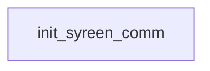

# Syreen: existing conversation graph

> Generated by `tools/conversation_catalog.py`; do not edit this page by hand.

[Catalog and interpretation rules](../README.md) · [Proposed engine](../model.md)

Script: [syreenc.c](../../../../sc2/src/uqm/comm/syreen/syreenc.c#L1). Phrase bank: [syreen.txt](../../../../sc2/content/base/comm/syreen/syreen.txt#L1).

1 handler/helper nodes; 0 response registration sites; 0 direct local calls; 131 phrase records.

## Initialization and lifecycle

| Phase | Callback | Bound by | Conditions / source |
| --- | --- | --- | --- |

## Handler graph

Solid arrows are selectable responses; dashed arrows are direct C calls. Conditions, arguments, speech and effects are cataloged below. Parallel response sites are grouped only in this diagram.



## Condition catalog

Condition IDs describe enclosing source structure. Branch predicates combine with ∧; case labels mark source locations that can also be reached by fallthrough. Values refer to their original evaluation points. Local assignments and early control flow remain in the decision bodies.

| ID | Source expression / structural condition |
| --- | --- |

## Script-scope state and lookup tables

These declarations supply shared local state, computed phrase alternatives, number speech, or lookup data used by the nodes. LOCDATA presentation defaults are linked separately in the source.

Presentation descriptor <code>syreen_desc</code>: [source](../../../../sc2/src/uqm/comm/syreen/syreenc.c#L27).

## Node catalog

<a id="node-init_syreen_comm"></a>

### init_syreen_comm

<code>LOCDATA *init_syreen_comm(void)</code> — [source](../../../../sc2/src/uqm/comm/syreen/syreenc.c#L196).

#### Actions, queries, local updates, and control flow

Calls are listed without assuming they are pure or mutating. Local updates are retained because they determine dynamic menus and counter-selected speech.

| Kind | Operation | Enclosing conditions | Source |
| --- | --- | --- | --- |
| update | <code>syreen_desc.AlienTextBaseline.x = TEXT_X_OFFS + (SIS_TEXT_WIDTH &gt;&gt; 1)</code> | No enclosing branch condition | [200](../../../../sc2/src/uqm/comm/syreen/syreenc.c#L200) |
| update | <code>syreen_desc.AlienTextBaseline.y = 0</code> | No enclosing branch condition | [201](../../../../sc2/src/uqm/comm/syreen/syreenc.c#L201) |
| update | <code>syreen_desc.AlienTextWidth = SIS_TEXT_WIDTH - 16</code> | No enclosing branch condition | [202](../../../../sc2/src/uqm/comm/syreen/syreenc.c#L202) |
| call | <code>setSegue(Segue_peace)</code> | No enclosing branch condition | [204](../../../../sc2/src/uqm/comm/syreen/syreenc.c#L204) |
| update | <code>retval = &amp;syreen_desc</code> | No enclosing branch condition | [205](../../../../sc2/src/uqm/comm/syreen/syreenc.c#L205) |
| flow | <code>return retval;</code> | No enclosing branch condition | [207](../../../../sc2/src/uqm/comm/syreen/syreenc.c#L207) |

<details>
<summary>Exact decision body (local calculations, early returns, fallthrough and ordering)</summary>

```c
{
	LOCDATA *retval;

	syreen_desc.AlienTextBaseline.x = TEXT_X_OFFS + (SIS_TEXT_WIDTH >> 1);
	syreen_desc.AlienTextBaseline.y = 0;
	syreen_desc.AlienTextWidth = SIS_TEXT_WIDTH - 16;

	setSegue (Segue_peace);
	retval = &syreen_desc;

	return (retval);
}
```

</details>

## Phrase catalog

Full base-content text, keyed by the symbols used above. Voice filenames are resource metadata; playback also depends on installed addons and settings. Dynamic insertions retain their original placeholders.

<a id="phrase-hello_before_ambush_1"></a>

<details>
<summary>HELLO_BEFORE_AMBUSH_1 — syreen-000.ogg</summary>

[Text source](../../../../sc2/content/base/comm/syreen/syreen.txt#L1)

<pre>Attention unidentified space vessel!
Be warned! This slave world and its inhabitants belong to the Ur-Quan.
I am Starbase Commander Talana of the slave planet Gaia.
Your ship is not responding to standard Hierarchy identification sequences.
You are therefore classed as Independent and... WHAT?!
Is my monitor display correct?!
Is that a human commanding that vessel?
Who are you?</pre>

</details>

<a id="phrase-hello_before_ambush_2"></a>

<details>
<summary>HELLO_BEFORE_AMBUSH_2 — syreen-001.ogg</summary>

[Text source](../../../../sc2/content/base/comm/syreen/syreen.txt#L11)

<pre>Hello again, pleasant Human.
It warms me to greet you again.</pre>

</details>

<a id="phrase-hello_before_ambush_3"></a>

<details>
<summary>HELLO_BEFORE_AMBUSH_3 — syreen-002.ogg</summary>

[Text source](../../../../sc2/content/base/comm/syreen/syreen.txt#L15)

<pre>Welcome back, Earthling.
What do you wish of us?</pre>

</details>

<a id="phrase-hello_before_ambush_4"></a>

<details>
<summary>HELLO_BEFORE_AMBUSH_4 — syreen-003.ogg</summary>

[Text source](../../../../sc2/content/base/comm/syreen/syreen.txt#L19)

<pre>Yes, Captain?</pre>

</details>

<a id="phrase-we_are_vice_squad"></a>

<details>
<summary>we_are_vice_squad</summary>

[Text source](../../../../sc2/content/base/comm/syreen/syreen.txt#L22)

<pre>We&#x27;re the Ethics Police. Justify that costume... Immediately!</pre>

</details>

<a id="phrase-ok_vice"></a>

<details>
<summary>OK_VICE — syreen-004.ogg</summary>

[Text source](../../../../sc2/content/base/comm/syreen/syreen.txt#L25)

<pre>Huh? What ARE you talking about?
This is the uniform of a Syreen Commander.
The climate aboard this starbase is maintained at a constant 22 degrees C.
What are we supposed to wear in here... parkas?</pre>

</details>

<a id="phrase-we_are_the_one_for_you_baby"></a>

<details>
<summary>we_are_the_one_for_you_baby</summary>

[Text source](../../../../sc2/content/base/comm/syreen/syreen.txt#L31)

<pre>I am the right one for you, baby!</pre>

</details>

<a id="phrase-maybe_captain"></a>

<details>
<summary>MAYBE_CAPTAIN — syreen-005.ogg</summary>

[Text source](../../../../sc2/content/base/comm/syreen/syreen.txt#L34)

<pre>Ah, yes... I had almost forgotten the sophistication of human social graces.
Manners were never the Earthlings&#x27; strong point, were they?
Your species&#x27; undeniable appeal can be found... elsewhere.</pre>

</details>

<a id="phrase-we_are_vindicator0"></a>

<details>
<summary>we_are_vindicator0</summary>

[Text source](../../../../sc2/content/base/comm/syreen/syreen.txt#L39)

<pre>I am Captain</pre>

</details>

<a id="phrase-we_are_vindicator1"></a>

<details>
<summary>we_are_vindicator1</summary>

[Text source](../../../../sc2/content/base/comm/syreen/syreen.txt#L42)

<pre>of the flagship</pre>

</details>

<a id="phrase-we_are_vindicator2"></a>

<details>
<summary>we_are_vindicator2</summary>

[Text source](../../../../sc2/content/base/comm/syreen/syreen.txt#L45)

<pre>.</pre>

</details>

<a id="phrase-welcome_vindicator0"></a>

<details>
<summary>WELCOME_VINDICATOR0 — syreen-006.ogg</summary>

[Text source](../../../../sc2/content/base/comm/syreen/syreen.txt#L48)

<pre>Hello, Captain</pre>

</details>

<a id="phrase-welcome_vindicator1"></a>

<details>
<summary>WELCOME_VINDICATOR1</summary>

[Text source](../../../../sc2/content/base/comm/syreen/syreen.txt#L51)

<pre>from the Starship</pre>

</details>

<a id="phrase-welcome_vindicator2"></a>

<details>
<summary>WELCOME_VINDICATOR2</summary>

[Text source](../../../../sc2/content/base/comm/syreen/syreen.txt#L54)

<pre>.</pre>

</details>

<a id="phrase-we_are_impressed"></a>

<details>
<summary>we_are_impressed</summary>

[Text source](../../../../sc2/content/base/comm/syreen/syreen.txt#L57)

<pre>We&#x27;re... we&#x27;re.. we&#x27;re greatly impressed!</pre>

</details>

<a id="phrase-so_am_i_captain"></a>

<details>
<summary>SO_AM_I_CAPTAIN — syreen-007.ogg</summary>

[Text source](../../../../sc2/content/base/comm/syreen/syreen.txt#L60)

<pre>So am I, Captain. So am I.
Earthlings are so... so... earthy!</pre>

</details>

<a id="phrase-how_can_you_be_here"></a>

<details>
<summary>HOW_CAN_YOU_BE_HERE — syreen-008.ogg</summary>

[Text source](../../../../sc2/content/base/comm/syreen/syreen.txt#L64)

<pre>But you haven&#x27;t answered my question fully.
Why are you here? Where are you from?
Has the slave shield been lifted from Earth?
Are the Ur-Quan finally defeated?
Simply put, Captain...what do you want from us?</pre>

</details>

<a id="phrase-we_here_to_help"></a>

<details>
<summary>we_here_to_help</summary>

[Text source](../../../../sc2/content/base/comm/syreen/syreen.txt#L71)

<pre>We have come here to free you from slavery to the Ur-Quan!</pre>

</details>

<a id="phrase-no_need_help"></a>

<details>
<summary>NO_NEED_HELP — syreen-009.ogg</summary>

[Text source](../../../../sc2/content/base/comm/syreen/syreen.txt#L74)

<pre>Look friend, I appreciate your offer, but we don&#x27;t want your help.
Why? I&#x27;ll tell you why
because we&#x27;re not going to do anything to antagonize the Ur-Quan. That&#x27;s why.
We may not like slavery, but it&#x27;s a damn sight better than our alternatives.
Below us we have a beautiful world... maybe it&#x27;s not Syra, but at least it&#x27;s a home.
That&#x27;s a lot more than we ever had before the War... before the Ur-Quan became our masters.</pre>

</details>

<a id="phrase-we_need_help"></a>

<details>
<summary>we_need_help</summary>

[Text source](../../../../sc2/content/base/comm/syreen/syreen.txt#L82)

<pre>To be honest, we need your help to destroy the Ur-Quan.</pre>

</details>

<a id="phrase-cant_give_help"></a>

<details>
<summary>CANT_GIVE_HELP — syreen-010.ogg</summary>

[Text source](../../../../sc2/content/base/comm/syreen/syreen.txt#L85)

<pre>Look Captain... I like you... even though you&#x27;re an obnoxious human... I like you.
In another time, we might have become good friends... perhaps more
but that&#x27;s a fantasy, and my job is dealing with reality.
We&#x27;re not going to do anything to jeopardize what we&#x27;ve got here.
We&#x27;ve come too far... lost too much, to ever risk losing Gaia, our new home.
Don&#x27;t get all judgmental on me, Captain... you don&#x27;t know what we&#x27;ve been through.</pre>

</details>

<a id="phrase-i_need_you"></a>

<details>
<summary>i_need_you</summary>

[Text source](../../../../sc2/content/base/comm/syreen/syreen.txt#L93)

<pre>Hey, baby... what I need is you!</pre>

</details>

<a id="phrase-ok_need"></a>

<details>
<summary>OK_NEED — syreen-011.ogg</summary>

[Text source](../../../../sc2/content/base/comm/syreen/syreen.txt#L96)

<pre>Look. Human. Get this through your head.
Under other circumstances, I might be interested in your antics, you&#x27;re kind of cute
but we&#x27;ve got a serious situation here and we don&#x27;t have time to fool around.
Our lives are at stake, and so are yours. If the Ur-Quan discover that you have been here
I don&#x27;t know what they will do to us... much less you!
Now get serious... please.</pre>

</details>

<a id="phrase-i_need_touch_o_vision"></a>

<details>
<summary>i_need_touch_o_vision</summary>

[Text source](../../../../sc2/content/base/comm/syreen/syreen.txt#L104)

<pre>What I need right now, is a Touch-o-Vision.</pre>

</details>

<a id="phrase-touch_o_vision"></a>

<details>
<summary>TOUCH_O_VISION — syreen-012.ogg</summary>

[Text source](../../../../sc2/content/base/comm/syreen/syreen.txt#L107)

<pre>Look. Human. Get this through your head.
Under other circumstances, I might be interested in your antics, you&#x27;re kind of cute
but we&#x27;ve got a serious situation here and we don&#x27;t have time to fool around.
Our lives are at stake, and so are yours. If the Ur-Quan discover that you have been here
I don&#x27;t know what they will do to us... much less to you!
Now get serious... please.</pre>

</details>

<a id="phrase-know_about_deep_children"></a>

<details>
<summary>know_about_deep_children</summary>

[Text source](../../../../sc2/content/base/comm/syreen/syreen.txt#L115)

<pre>Talana, have you ever heard of the `Deep Children?&#x27;</pre>

</details>

<a id="phrase-what_about_deep_children"></a>

<details>
<summary>WHAT_ABOUT_DEEP_CHILDREN — syreen-013.ogg</summary>

[Text source](../../../../sc2/content/base/comm/syreen/syreen.txt#L118)

<pre>Yes, I think so. Aren&#x27;t they part of the Mycon religion somehow?
We have recordings of Mycon HyperWave transmissions from the War... pretty weird stuff.
The Mycons just kind of.. rambled, never making much sense.
They talked a lot about `Deep Children&#x27;, and `Spears of Light&#x27;,
but we couldn&#x27;t ever understand what they were talking about.</pre>

</details>

<a id="phrase-mycons_involved"></a>

<details>
<summary>mycons_involved</summary>

[Text source](../../../../sc2/content/base/comm/syreen/syreen.txt#L125)

<pre>What if I told you that Mycon Deep Children shatter planet crusts... like your Syra?</pre>

</details>

<a id="phrase-what_proof"></a>

<details>
<summary>WHAT_PROOF — syreen-014.ogg</summary>

[Text source](../../../../sc2/content/base/comm/syreen/syreen.txt#L128)

<pre>What?! What did you say?!
Human, you had better not be joking. Syra is not a subject for Earth humor.
Now what do you mean, shatter planet crusts? How?
That IS what happened to Syra, yes, but we presumed it was a natural cataclysm... a meteor.
Do you have proof that it was something else... these Deep Children?</pre>

</details>

<a id="phrase-have_no_proof"></a>

<details>
<summary>have_no_proof</summary>

[Text source](../../../../sc2/content/base/comm/syreen/syreen.txt#L135)

<pre>I don&#x27;t have proof YET, but I am certain the Mycons destroyed your world.</pre>

</details>

<a id="phrase-need_proof"></a>

<details>
<summary>NEED_PROOF — syreen-015.ogg</summary>

[Text source](../../../../sc2/content/base/comm/syreen/syreen.txt#L138)

<pre>Captain, if what you say is true, it would turn my world upside down.
You have no sorrow to match what each of us Syreen feels every day of our lives
when we remember what we have lost... Syra... our Eden.
The very idea that the Mycons, or any alien race, may have been responsible for Syra&#x27;s destruction
fills me with BURNING RAGE!
If it were true, none of us here would rest until we had avenged ourselves on the perpetrators.
We would find some way to leave this starbase, locate our starships, and hunt down the evil monsters!
Captain, if you ever gather proof of what you say, you MUST inform us immediately.
But until then... do not mention the subject again. It is too painful.</pre>

</details>

<a id="phrase-have_proof"></a>

<details>
<summary>have_proof</summary>

[Text source](../../../../sc2/content/base/comm/syreen/syreen.txt#L149)

<pre>Talana. I have brought proof that the Mycon Deep Children destroyed your world Syra.</pre>

</details>

<a id="phrase-see_proof"></a>

<details>
<summary>SEE_PROOF — syreen-016.ogg</summary>

[Text source](../../../../sc2/content/base/comm/syreen/syreen.txt#L152)

<pre>Let me see this proof, Captain!</pre>

</details>

<a id="phrase-look_at_egg_sacks"></a>

<details>
<summary>look_at_egg_sacks</summary>

[Text source](../../../../sc2/content/base/comm/syreen/syreen.txt#L155)

<pre>Look at these fungal egg sacks. We found them near a crustal puncture on a shattered world.</pre>

</details>

<a id="phrase-horrible_truth"></a>

<details>
<summary>HORRIBLE_TRUTH — syreen-017.ogg</summary>

[Text source](../../../../sc2/content/base/comm/syreen/syreen.txt#L158)

<pre>Great gods! These fragments... they are IDENTICAL to the debris we found near the punctures on Syra!
We never guessed that the fragments might be organic!
To have survived re-entry!... nothing organic would remain!... unless
UNLESS, it was genetically constructed for this purpose!
AND ONLY THE MYCONS POSSESS THIS CAPABILITY!!
THE MYCONS WILL PAY DEARLY FOR THEIR CRIMES!!!
We will not sit here and do nothing while the Mycon fiends are free to roam the galaxy, perpetrating their evil.
You wanted our cooperation in fighting the Ur-Quan. You&#x27;ve got it...
provided you first help us seek our revenge against the Mycon race... help us to destroy them!</pre>

</details>

<a id="phrase-what_doing_here"></a>

<details>
<summary>what_doing_here</summary>

[Text source](../../../../sc2/content/base/comm/syreen/syreen.txt#L169)

<pre>So, Commander Talana, what are you doing here?</pre>

</details>

<a id="phrase-our_new_world"></a>

<details>
<summary>OUR_NEW_WORLD — syreen-018.ogg</summary>

[Text source](../../../../sc2/content/base/comm/syreen/syreen.txt#L172)

<pre>When the Ur-Quan conquered us, over twenty years ago
I was only a young girl living in Habitat Thirty-One.
My older sister, Diani, was a starship officer in the Space Patrol
she was part of the final defense at Raynet... she didn&#x27;t make it back.
When the Ur-Quan caught us in open space, we all thought we were going to die
but then, instead of killing us, the Ur-Quan offered us a choice:
we could join the ranks of their combat thralls, or we could be slave-shielded in our homeworld.
Like the people of Earth, we chose peace. We became fallow slaves.
When the Ur-Quan told us to return to our homeworld, we explained that we had none.
Ur-Quan Master Nine explained that they had encountered this situation before
and if we would provide them with a list of our requirements
they would use their extensive astronomical datastores to find a planet for us!
So we told them about Syra... about the color of its sky... about the abundant lifeforms,
about the fertility of the soil and seas.
Less than an hour later, we received a terse message from Master Nine
we were to proceed to these coordinates and disembark. This was to be our new home.
But our new world, Gaia, was everything we described.
We&#x27;d been searching for a home planet for seventy-five years
and in the end, it was our enemies who gave one to us.
I grew up on a small island off the main continent, and like all of my people
we lived each day under the sick, red glow of the slave shield.
When the Ur-Quan arrived seven years ago to refurbish and recrew this starbase
I was selected as the new commander.</pre>

</details>

<a id="phrase-what_about_war"></a>

<details>
<summary>what_about_war</summary>

[Text source](../../../../sc2/content/base/comm/syreen/syreen.txt#L197)

<pre>So what happened to you at the end of the war?</pre>

</details>

<a id="phrase-about_war"></a>

<details>
<summary>ABOUT_WAR — syreen-019.ogg</summary>

[Text source](../../../../sc2/content/base/comm/syreen/syreen.txt#L200)

<pre>When we first met your people, we&#x27;d been wandering through the stars for almost seventy-five years,
ever since the death of Syra... our home planet.
We joined your Alliance, and I use the word `joined&#x27; loosely, because we had no other choice.
The VUX were raiding our slow Habitat columns, and we had nowhere else to go.
We fought for survival, Captain. Nothing more.
When your people on Earth were defeated, the Alliance just plain fell apart.
The Yehat and Shofixti retreated to their native stars and didn&#x27;t want us to follow.
The Arilou, those creepy little weasels, just plain bugged out -- vanished
leaving us alone, with nowhere to go, smack in the path of the oncoming Ur-Quan Armada.
What were we supposed to do? Fight? Two-thirds of our Habitat fleet was unarmed!
Many aren&#x27;t even super-luminal.
We were going to be annihilated if we resisted, and we knew it.
When the Ur-Quan surrounded us and started giving orders that all ended with, `Or Die!&#x27;
we took them at face value. We obeyed.
In exchange they gave us Gaia, the planet below.
It&#x27;s a beautiful world, Captain. I wish I could show it to you.
So don&#x27;t misunderstand me. We love our freedom as much as anybody else
but we&#x27;ve got a good life here, and we don&#x27;t want to lose it.</pre>

</details>

<a id="phrase-help_us"></a>

<details>
<summary>help_us</summary>

[Text source](../../../../sc2/content/base/comm/syreen/syreen.txt#L220)

<pre>If you love freedom and hate the Ur-Quan, why won&#x27;t you help us?</pre>

</details>

<a id="phrase-wont_help"></a>

<details>
<summary>WONT_HELP — syreen-020.ogg</summary>

[Text source](../../../../sc2/content/base/comm/syreen/syreen.txt#L223)

<pre>Like I said before, Captain, we would like to help
but we are unwilling to risk losing Gaia.
Unless you can find a much more compelling reason for us to get involved
you are on your own.</pre>

</details>

<a id="phrase-what_about_history"></a>

<details>
<summary>what_about_history</summary>

[Text source](../../../../sc2/content/base/comm/syreen/syreen.txt#L229)

<pre>Would you tell me a bit about your people and your culture?</pre>

</details>

<a id="phrase-before_war"></a>

<details>
<summary>BEFORE_WAR — syreen-021.ogg</summary>

[Text source](../../../../sc2/content/base/comm/syreen/syreen.txt#L232)

<pre>Our species are almost identical, almost too close a match to be just a coincidence.
Our bodies are very similar, Captain.
Ha! ha! Except for... certain parts...
Our cultural development is also mostly parallel.
Like you Earthlings, we evolved a society from primitive tribes
whose main function were to protect themselves from the large reptiles native to our old world.
The main difference between our two sets of cultures... the split in the paths of our development
occurred in what would have been your prehistory, say 5000 BCE.
In your world, the agricultural communities were conquered by the more primitive but also more aggressive, migratory herding peoples.
This led to a particular kind of sexual and political dominance structure
which pervaded almost all of your Earth Cultures until the early Twenty First century.
On Syra, our only primitive migratory tribes were confined to our mountainous regions.
Their herd beasts, the Yma, did not do well in the agricultural basins and plains.
The two cultures were isolated until much later
when the technological superiority of the farmers curtailed any major conflict.</pre>

</details>

<a id="phrase-what_about_homeworld"></a>

<details>
<summary>what_about_homeworld</summary>

[Text source](../../../../sc2/content/base/comm/syreen/syreen.txt#L249)

<pre>What was Syra like?</pre>

</details>

<a id="phrase-about_homeworld"></a>

<details>
<summary>ABOUT_HOMEWORLD — syreen-022.ogg</summary>

[Text source](../../../../sc2/content/base/comm/syreen/syreen.txt#L252)

<pre>It was our paradise, Captain, our Eden.
You would call our world Beta Copernicus I... we called it Syra.
You may wonder about our relationship with the Mycon, who now control that area of space.
When we lived on Syra, their sphere of influence was much smaller.
We never laid eyes on a Mycon until we met them in combat during the War.
But back to our beloved Syra.
Earth is the only world we know of whose variety and richness of life even comes close to Syra.
Again, like so many other things about our two species, our worlds were very much the same
at least before you began encasing yours in concrete and plastic.
Syra&#x27;s gravity was a bit lighter than Earth&#x27;s, and its day was fifty percent longer.
Our diurnal cycle is therefore different from yours.
We spend twenty hours awake, followed by ten hours... horizontal.</pre>

</details>

<a id="phrase-what_happened"></a>

<details>
<summary>what_happened</summary>

[Text source](../../../../sc2/content/base/comm/syreen/syreen.txt#L266)

<pre>What happened to Syra?</pre>

</details>

<a id="phrase-dont_know_how"></a>

<details>
<summary>DONT_KNOW_HOW — syreen-023.ogg</summary>

[Text source](../../../../sc2/content/base/comm/syreen/syreen.txt#L269)

<pre>This subject is very difficult for us, Captain,
but I will try to recount those sad days.
Like your solar system, ours had a large population of comets and asteroids.
Large meteor impacts, though rare, were not unheard of on our planet.
So it was not a total shock when an asteroid penetrated our atmosphere and hit the surface.
What was odd was that unlike most other meteors, this one was not pulverized on impact.
It penetrated the crust, and indeed went all the way through to the mantle
causing a `super volcano&#x27;.
The earthquakes caused by the impact were severe.
The magma pumped out of the caldera wreaked significant damage on the nearby terrain
but within a few weeks, it had cooled, forming a solid rock bandage over the wound.
Within a few months we had cleaned up the mess, the caldera was calming down nicely
and things were pretty much back to normal.
Then, just over a year after the impact, all hell broke loose on the surface of Syra.
Huge calderas were opening all over... not just around the meteor impact, but everywhere!
The scope of the disaster is impossible to imagine
Entire cities sliding into oceans of molten lava
kilometer-wide sections of land pulverized by a cataclysmic explosion
and clouds of poison gas and superheated steam created a death shroud around Syra.</pre>

</details>

<a id="phrase-what_about_outfit"></a>

<details>
<summary>what_about_outfit</summary>

[Text source](../../../../sc2/content/base/comm/syreen/syreen.txt#L290)

<pre>Come on now, isn&#x27;t that outfit, knife included, a bit absurd?</pre>

</details>

<a id="phrase-hope_you_like_it"></a>

<details>
<summary>HOPE_YOU_LIKE_IT — syreen-024.ogg</summary>

[Text source](../../../../sc2/content/base/comm/syreen/syreen.txt#L293)

<pre>Maybe some other time, Captain, I can show you the hidden functionality of my uniform
knife included!</pre>

</details>

<a id="phrase-where_mates"></a>

<details>
<summary>where_mates</summary>

[Text source](../../../../sc2/content/base/comm/syreen/syreen.txt#L297)

<pre>What happened to the males of your species?</pre>

</details>

<a id="phrase-mates_killed"></a>

<details>
<summary>MATES_KILLED — syreen-025.ogg</summary>

[Text source](../../../../sc2/content/base/comm/syreen/syreen.txt#L300)

<pre>When Syra was destroyed, the only people who survived were in orbit
and most of them were members of our newly established, mostly female, Space Patrol.
From their ships, their orbital platforms and their lunar outposts they watched Syra die.
Within three days after the cataclysm began, the surface temperature of Syra had risen by almost 75 degrees
to above the boiling point of water.
It became clear that Syra, our paradise, our Eden, was gone.
The survivors spent years in orbit. They made a few missions to the surface
and actually found a handful of survivors, but their main activity was to make preparations for departure.
The Space Patrol fitted makeshift drive units to anything that could hold air:
orbital factories, research pods, even hotels. When the fleet was ready, they left orbit and never looked back.
The final population of our species was less than ten thousand, with only five hundred males
but they were the best and the brightest.
For the next seventy-five years, our people wandered at sub-light speed through the stars
looking for a new home.</pre>

</details>

<a id="phrase-get_lonely"></a>

<details>
<summary>get_lonely</summary>

[Text source](../../../../sc2/content/base/comm/syreen/syreen.txt#L316)

<pre>Don&#x27;t you ever get... lonely? Hmmm?</pre>

</details>

<a id="phrase-make_out_all_right"></a>

<details>
<summary>MAKE_OUT_ALL_RIGHT — syreen-026.ogg</summary>

[Text source](../../../../sc2/content/base/comm/syreen/syreen.txt#L319)

<pre>Ha! ha! ha! Don&#x27;t worry about us, Captain!
We make out all right.</pre>

</details>

<a id="phrase-bye"></a>

<details>
<summary>bye</summary>

[Text source](../../../../sc2/content/base/comm/syreen/syreen.txt#L323)

<pre>Goodbye, Commander Talana. I will be back.</pre>

</details>

<a id="phrase-goodbye"></a>

<details>
<summary>GOODBYE — syreen-027.ogg</summary>

[Text source](../../../../sc2/content/base/comm/syreen/syreen.txt#L326)

<pre>Until then, Earthling.</pre>

</details>

<a id="phrase-must_act"></a>

<details>
<summary>MUST_ACT</summary>

[Text source](../../../../sc2/content/base/comm/syreen/syreen.txt#L329)

<pre>Captain. The secret of the Mycon&#x27;s monstrous murder of our planet has changed the attitudes of many of my people.
We will not sit here and do nothing while the Mycon fiends are free to roam the galaxy, perpetrating their evil.
You wanted our cooperation in fighting the Ur-Quan. You&#x27;ve got it... provided
you first help us seek our revenge against the Mycon race... help us to destroy them!</pre>

</details>

<a id="phrase-whats_next_step"></a>

<details>
<summary>whats_next_step</summary>

[Text source](../../../../sc2/content/base/comm/syreen/syreen.txt#L335)

<pre>Okay. So what do you want us to do?</pre>

</details>

<a id="phrase-open_vault"></a>

<details>
<summary>OPEN_VAULT — syreen-028.ogg</summary>

[Text source](../../../../sc2/content/base/comm/syreen/syreen.txt#L338)

<pre>Our first step is to get some mobility.
We have some fine starship officers on board, and they are all eager to go after the Mycons,
but without our Penetrator starships, we&#x27;re totally ineffectual.
So our first step HAS to be recovering our Space Patrol combat fleet.
We know that the Ur-Quan didn&#x27;t destroy them... they never waste anything
but we believe they have sealed them in some kind of deep vault in the surface of an alien planet.</pre>

</details>

<a id="phrase-where_is_it"></a>

<details>
<summary>where_is_it</summary>

[Text source](../../../../sc2/content/base/comm/syreen/syreen.txt#L346)

<pre>Do you know where your ships are?</pre>

</details>

<a id="phrase-dont_know_where"></a>

<details>
<summary>DONT_KNOW_WHERE — syreen-029.ogg</summary>

[Text source](../../../../sc2/content/base/comm/syreen/syreen.txt#L349)

<pre>No, that&#x27;s your job.
But maybe we have some clues to help you find them.
The starship officers who flew the Penetrators to the vault did so with total sensor black-out.
The only thing they could use for navigation was the presence of the Dreadnought fleet surrounding them.
When they arrived at their destination and lowered their ships into the immense vault
they were transported to the Dreadnoughts and only caught a split-second glimpse of the outside world.
As far as they could tell, the sun was either red or orange. Based on their trip-time calculations
the farthest they could have travelled is about 200 HyperSpace distance units.</pre>

</details>

<a id="phrase-been_there"></a>

<details>
<summary>been_there</summary>

[Text source](../../../../sc2/content/base/comm/syreen/syreen.txt#L359)

<pre>I&#x27;ve already been there. The vault is on the moon of Epsilon Camelopardalis I, but I couldn&#x27;t open it.</pre>

</details>

<a id="phrase-great"></a>

<details>
<summary>GREAT — syreen-030.ogg</summary>

[Text source](../../../../sc2/content/base/comm/syreen/syreen.txt#L362)

<pre>Wonderful! Then the job is already almost complete!</pre>

</details>

<a id="phrase-give_shuttle"></a>

<details>
<summary>GIVE_SHUTTLE — syreen-031.ogg</summary>

[Text source](../../../../sc2/content/base/comm/syreen/syreen.txt#L365)

<pre>Captain! We have assembled a small team of our most skilled officers.
we will send them to your ship on board their own small shuttle.
We feel that in the interests of efficiency, we keep our officers away from your crew
at least until the mission is over.
As soon as you arrive at the vault, our people will take over, figure out a way to open the vault
and bring our Penetrators back here.</pre>

</details>

<a id="phrase-im_on_my_way"></a>

<details>
<summary>im_on_my_way</summary>

[Text source](../../../../sc2/content/base/comm/syreen/syreen.txt#L373)

<pre>Very well then, Commander Talana. I&#x27;m on my way.</pre>

</details>

<a id="phrase-doing_this_for_you"></a>

<details>
<summary>doing_this_for_you</summary>

[Text source](../../../../sc2/content/base/comm/syreen/syreen.txt#L376)

<pre>Just remember, I&#x27;m doing this for you Sweet Cakes!</pre>

</details>

<a id="phrase-if_i_die"></a>

<details>
<summary>if_i_die</summary>

[Text source](../../../../sc2/content/base/comm/syreen/syreen.txt#L379)

<pre>If I die... just remember that I... I... really like you!</pre>

</details>

<a id="phrase-good_luck"></a>

<details>
<summary>GOOD_LUCK — syreen-032.ogg</summary>

[Text source](../../../../sc2/content/base/comm/syreen/syreen.txt#L382)

<pre>Good luck, brave Earthling. When your mission is successful
maybe then we can... get to know each other better.</pre>

</details>

<a id="phrase-ok_found_vault"></a>

<details>
<summary>OK_FOUND_VAULT — syreen-033.ogg</summary>

[Text source](../../../../sc2/content/base/comm/syreen/syreen.txt#L386)

<pre>Good, now we can proceed with our plan for REVENGE against the Mycon!
From our analysis of the Deep Child fragments you showed to us
and a review of the recorded Mycon transmissions from the War
we have established the kind of world the Mycons desire for their hideous Deep Children.
They need a planet like your Earth... or our Syra... one rich in water and oxygen
and possessing a molten, active mantle.
Our plan is to lure the Mycons to such a planet, and then attack them when they least expect it.
We know of just such a world.
When the Ur-Quan were analyzing their mass of planetary data to find a new home for my people
one of the close candidates, ranked just below Gaia, was a blue world orbiting close to the star, Organon.
Captain, we need your services again. Here is what you must do.
You must go to the Mycon and tell them of this world.
They will find that the world is suitable, and when they go to Organon
we shall be there... waiting for them.
Then we shall destroy them!</pre>

</details>

<a id="phrase-what_now"></a>

<details>
<summary>what_now</summary>

[Text source](../../../../sc2/content/base/comm/syreen/syreen.txt#L403)

<pre>Are you sure the Mycon are going to fall for this? Why should they believe me?</pre>

</details>

<a id="phrase-heres_the_plan"></a>

<details>
<summary>HERES_THE_PLAN — syreen-034.ogg</summary>

[Text source](../../../../sc2/content/base/comm/syreen/syreen.txt#L406)

<pre>For all their evil, Captain, the Mycon are a naive race.
They have great difficulty understanding deception.
If you tell them what they wish to hear, they will believe you.</pre>

</details>

<a id="phrase-whats_my_reward"></a>

<details>
<summary>whats_my_reward</summary>

[Text source](../../../../sc2/content/base/comm/syreen/syreen.txt#L411)

<pre>So! What if I die doing all this dangerous stuff? What about... us?</pre>

</details>

<a id="phrase-heres_reward"></a>

<details>
<summary>HERES_REWARD — syreen-035.ogg</summary>

[Text source](../../../../sc2/content/base/comm/syreen/syreen.txt#L414)

<pre>I&#x27;m afraid BOTH our duties will be dangerous, Captain.
We may never see each other again.
But for now, at least, there&#x27;s this...</pre>

</details>

<a id="phrase-bye_after_vault"></a>

<details>
<summary>bye_after_vault</summary>

[Text source](../../../../sc2/content/base/comm/syreen/syreen.txt#L419)

<pre>I&#x27;ll miss you, Talana.</pre>

</details>

<a id="phrase-goodbye_after_vault"></a>

<details>
<summary>GOODBYE_AFTER_VAULT — syreen-036.ogg</summary>

[Text source](../../../../sc2/content/base/comm/syreen/syreen.txt#L422)

<pre>Don&#x27;t worry, my human. We will be together again... some day.</pre>

</details>

<a id="phrase-hello_after_ambush_1"></a>

<details>
<summary>HELLO_AFTER_AMBUSH_1 — syreen-037.ogg</summary>

[Text source](../../../../sc2/content/base/comm/syreen/syreen.txt#L425)

<pre>SUCCESS, Captain! The Mycons&#x27; fleet is in shambles!
JUSTICE IS OURS!
We have revenged ourselves against the heinous Mycons!
They fell for our trap so completely!
When they approached Organon I, we were hiding behind its moon.
As they approached, their ships broke combat formation
in preparation for their hideous implanting ceremony.
We waited until they were fully dispersed around the planet, then we attacked!
The standard Mycon tactic would have been to speed out of orbit using a gravity whip maneuver
but the Podships refused to abandon their slow-moving Deep Children spore pods.
They remained in the gravity well, and WE SLICED THEM TO RIBBONS!
They must have lost a dozen ships to their own stupidity... running into their own Plasmoids!
The rest?... well we took care of most of them... in our own special way.
and Captain, now that we have taken our revenge on the Mycon
we give you our starship officers and Penetrator designs so that you can add our ships
to your fleet.</pre>

</details>

<a id="phrase-hello_after_ambush_2"></a>

<details>
<summary>HELLO_AFTER_AMBUSH_2 — syreen-038.ogg</summary>

[Text source](../../../../sc2/content/base/comm/syreen/syreen.txt#L443)

<pre>Hello brave Earthling. Your return is welcome.
My people, the Syreen, shall be forever in your debt.
In fact, many of my officers wish to thank you... personally... for your efforts on our behalf.
I suggest you set aside a week sometime in the near future
so that you can properly receive your hero&#x27;s welcome aboard this starbase.</pre>

</details>

<a id="phrase-hello_after_ambush_3"></a>

<details>
<summary>HELLO_AFTER_AMBUSH_3 — syreen-039.ogg</summary>

[Text source](../../../../sc2/content/base/comm/syreen/syreen.txt#L450)

<pre>Oh, Captain! The flush of victory still has my body quivering!
For so many years we have dreamed of putting the death of our beloved homeworld behind us
and now this has finally come to pass!
We no longer live in the past... caught in memories of what COULD have been.
Now each of us plans for the future... toward the bright tomorrow!
And you know what, Captain?
I have plans... Plans you would be most interested in hearing
but I shall save them for later... when we can meet... privately.</pre>

</details>

<a id="phrase-hello_after_ambush_4"></a>

<details>
<summary>HELLO_AFTER_AMBUSH_4 — syreen-040.ogg</summary>

[Text source](../../../../sc2/content/base/comm/syreen/syreen.txt#L460)

<pre>Ah! My beautiful Captain from Earth!
What can I do for you... please tell me.</pre>

</details>

<a id="phrase-what_now_after_ambush"></a>

<details>
<summary>what_now_after_ambush</summary>

[Text source](../../../../sc2/content/base/comm/syreen/syreen.txt#L464)

<pre>Is there anything else I can do to you - um! - I mean, do FOR you.</pre>

</details>

<a id="phrase-do_this_after_ambush"></a>

<details>
<summary>DO_THIS_AFTER_AMBUSH — syreen-041.ogg</summary>

[Text source](../../../../sc2/content/base/comm/syreen/syreen.txt#L467)

<pre>Captain, the next step is to pull down the slave shield from our planet.
In my opinion, the only people who could do that are the Chenjesu
and as far as I know, they are under a shield of their own.
Actually... I&#x27;m just dodging the real issue, Captain.
Your agenda really has only one item... Destroy the Ur-Quan Hierarchy!
How to do that? I&#x27;m not sure
but I know you can&#x27;t take them head-on, even with that amazing ship of yours.
You will have to find their weak spot, and then strike it with everything you&#x27;ve got.</pre>

</details>

<a id="phrase-what_about_you"></a>

<details>
<summary>what_about_you</summary>

[Text source](../../../../sc2/content/base/comm/syreen/syreen.txt#L477)

<pre>So what happens to you now?</pre>

</details>

<a id="phrase-about_me"></a>

<details>
<summary>ABOUT_ME — syreen-042.ogg</summary>

[Text source](../../../../sc2/content/base/comm/syreen/syreen.txt#L480)

<pre>I expect I&#x27;m going to be pretty busy for the next few months
overseeing repairs to our fleet of Penetrator starships
and preparing some kind of defensive system for this starbase.
If and when the Ur-Quan return here, we want to have a little surprise ready for them.</pre>

</details>

<a id="phrase-whats_up_after_ambush"></a>

<details>
<summary>whats_up_after_ambush</summary>

[Text source](../../../../sc2/content/base/comm/syreen/syreen.txt#L486)

<pre>So, what&#x27;s new Talana?</pre>

</details>

<a id="phrase-general_info_after_ambush_1"></a>

<details>
<summary>GENERAL_INFO_AFTER_AMBUSH_1 — syreen-043.ogg</summary>

[Text source](../../../../sc2/content/base/comm/syreen/syreen.txt#L489)

<pre>Not a great deal, Captain. You seem to be the biggest source of excitement around here.
I&#x27;ve had requests from just about every officer under my command
to be transferred to your Earth Starbase to serve under you.
If I wasn&#x27;t running this Starbase, I&#x27;d be first in line.</pre>

</details>

<a id="phrase-general_info_after_ambush_2"></a>

<details>
<summary>GENERAL_INFO_AFTER_AMBUSH_2 — syreen-044.ogg</summary>

[Text source](../../../../sc2/content/base/comm/syreen/syreen.txt#L495)

<pre>We have been intercepting a concentration of Hierarchy broadcasts
but we cannot translate their content.
They all appear to be originating from the direction of the Horologii constellation.</pre>

</details>

<a id="phrase-general_info_after_ambush_3"></a>

<details>
<summary>GENERAL_INFO_AFTER_AMBUSH_3 — syreen-045.ogg</summary>

[Text source](../../../../sc2/content/base/comm/syreen/syreen.txt#L500)

<pre>Nothing new to report, Captain.</pre>

</details>

<a id="phrase-general_info_after_ambush_4"></a>

<details>
<summary>GENERAL_INFO_AFTER_AMBUSH_4 — syreen-046.ogg</summary>

[Text source](../../../../sc2/content/base/comm/syreen/syreen.txt#L503)

<pre>Nothing new to report, Captain.</pre>

</details>

<a id="phrase-bye_after_ambush"></a>

<details>
<summary>bye_after_ambush</summary>

[Text source](../../../../sc2/content/base/comm/syreen/syreen.txt#L506)

<pre>Goodbye Talana.</pre>

</details>

<a id="phrase-goodbye_after_ambush"></a>

<details>
<summary>GOODBYE_AFTER_AMBUSH — syreen-047.ogg</summary>

[Text source](../../../../sc2/content/base/comm/syreen/syreen.txt#L509)

<pre>Goodbye my human.</pre>

</details>

<a id="phrase-found_vault_yet_1"></a>

<details>
<summary>FOUND_VAULT_YET_1 — syreen-048.ogg</summary>

[Text source](../../../../sc2/content/base/comm/syreen/syreen.txt#L512)

<pre>Have you found the ship vault yet?</pre>

</details>

<a id="phrase-found_vault_yet_2"></a>

<details>
<summary>FOUND_VAULT_YET_2 — syreen-049.ogg</summary>

[Text source](../../../../sc2/content/base/comm/syreen/syreen.txt#L515)

<pre>Any success finding our ships, Captain?</pre>

</details>

<a id="phrase-vault_hint"></a>

<details>
<summary>vault_hint</summary>

[Text source](../../../../sc2/content/base/comm/syreen/syreen.txt#L518)

<pre>Er... no. Have you got any idea where it is, even a guess?</pre>

</details>

<a id="phrase-ok_hint"></a>

<details>
<summary>OK_HINT — syreen-050.ogg</summary>

[Text source](../../../../sc2/content/base/comm/syreen/syreen.txt#L521)

<pre>Only that the vault is at a red or maybe orange star, and not too far from our position.</pre>

</details>

<a id="phrase-found_vault"></a>

<details>
<summary>found_vault</summary>

[Text source](../../../../sc2/content/base/comm/syreen/syreen.txt#L524)

<pre>Yes! We found it on the moon of Epsilon Camelopardalis I.</pre>

</details>

<a id="phrase-bye_before_vault"></a>

<details>
<summary>bye_before_vault</summary>

[Text source](../../../../sc2/content/base/comm/syreen/syreen.txt#L527)

<pre>Goodbye, Talana. I&#x27;m off to find the vault!</pre>

</details>

<a id="phrase-goodbye_before_vault"></a>

<details>
<summary>GOODBYE_BEFORE_VAULT — syreen-051.ogg</summary>

[Text source](../../../../sc2/content/base/comm/syreen/syreen.txt#L530)

<pre>Good luck, Captain.</pre>

</details>

<a id="phrase-what_do_i_get_for_this"></a>

<details>
<summary>what_do_i_get_for_this</summary>

[Text source](../../../../sc2/content/base/comm/syreen/syreen.txt#L533)

<pre>So what do I get for this, eh? Hmm? Eh?</pre>

</details>

<a id="phrase-gratitude"></a>

<details>
<summary>GRATITUDE — syreen-052.ogg</summary>

[Text source](../../../../sc2/content/base/comm/syreen/syreen.txt#L536)

<pre>You will receive more gratitude than you know what to do with, Captain.</pre>

</details>

<a id="phrase-not_sure"></a>

<details>
<summary>not_sure</summary>

[Text source](../../../../sc2/content/base/comm/syreen/syreen.txt#L539)

<pre>Uh... I&#x27;m just not sure. This sounds dangerous.</pre>

</details>

<a id="phrase-please"></a>

<details>
<summary>PLEASE — syreen-053.ogg</summary>

[Text source](../../../../sc2/content/base/comm/syreen/syreen.txt#L542)

<pre>Please, Captain, we need your help!</pre>

</details>

<a id="phrase-ready_for_ambush"></a>

<details>
<summary>READY_FOR_AMBUSH — syreen-054.ogg</summary>

[Text source](../../../../sc2/content/base/comm/syreen/syreen.txt#L545)

<pre>We will wait here for the Mycons.</pre>

</details>

<a id="phrase-repeat_plan"></a>

<details>
<summary>repeat_plan</summary>

[Text source](../../../../sc2/content/base/comm/syreen/syreen.txt#L548)

<pre>Could you repeat the plan again?</pre>

</details>

<a id="phrase-ok_repeat_plan"></a>

<details>
<summary>OK_REPEAT_PLAN — syreen-055.ogg</summary>

[Text source](../../../../sc2/content/base/comm/syreen/syreen.txt#L551)

<pre>Ok, here&#x27;s the plan, again.
You must go to the Mycons and tell them about a world at the Organon star system.
Tell them that you have found the perfect world for their hideous Deep Children.
We will hide there and wait for them in ambush.
Then we shall destroy them.</pre>

</details>

<a id="phrase-bye_before_ambush"></a>

<details>
<summary>bye_before_ambush</summary>

[Text source](../../../../sc2/content/base/comm/syreen/syreen.txt#L558)

<pre>Good luck, Talana.</pre>

</details>

<a id="phrase-goodbye_before_ambush"></a>

<details>
<summary>GOODBYE_BEFORE_AMBUSH — syreen-056.ogg</summary>

[Text source](../../../../sc2/content/base/comm/syreen/syreen.txt#L561)

<pre>Same to you, my human.</pre>

</details>

<a id="phrase-what_about_us"></a>

<details>
<summary>what_about_us</summary>

[Text source](../../../../sc2/content/base/comm/syreen/syreen.txt#L564)

<pre>I guess what I mean is... What about us, Talana?</pre>

</details>

<a id="phrase-about_us"></a>

<details>
<summary>ABOUT_US — syreen-057.ogg</summary>

[Text source](../../../../sc2/content/base/comm/syreen/syreen.txt#L567)

<pre>I&#x27;m afraid our duties will keep us apart, Captain
But for now, at least, there&#x27;s this...</pre>

</details>

<a id="phrase-more_comfortable"></a>

<details>
<summary>MORE_COMFORTABLE — syreen-058.ogg</summary>

[Text source](../../../../sc2/content/base/comm/syreen/syreen.txt#L571)

<pre>That&#x27;s more like it... now
let me help you off with this
yes... now aren&#x27;t you a lot more comfortable?</pre>

</details>

<a id="phrase-in_the_spirit"></a>

<details>
<summary>in_the_spirit</summary>

[Text source](../../../../sc2/content/base/comm/syreen/syreen.txt#L576)

<pre>I see! Well, in the spirit of interspecies communication, let me just say, COWABUNGA!</pre>

</details>

<a id="phrase-ok_spirit"></a>

<details>
<summary>OK_SPIRIT — syreen-059.ogg</summary>

[Text source](../../../../sc2/content/base/comm/syreen/syreen.txt#L579)

<pre>Oooh! Say that word again!
It makes me feel so excited!
It makes me want to do something nice for you
like this...
and this...
and especially, this!</pre>

</details>

<a id="phrase-what_in_mind"></a>

<details>
<summary>what_in_mind</summary>

[Text source](../../../../sc2/content/base/comm/syreen/syreen.txt#L587)

<pre>Hey... what have you got in mind here?</pre>

</details>

<a id="phrase-something_like_this"></a>

<details>
<summary>SOMETHING_LIKE_THIS — syreen-060.ogg</summary>

[Text source](../../../../sc2/content/base/comm/syreen/syreen.txt#L590)

<pre>Well to start off, I thought we&#x27;d do something like this
unless your species isn&#x27;t limber enough
and then I thought we could move on to something a bit more like... Mmmm... this.
and after you have recovered, I thought this might be fun!
and if you&#x27;re still conscious, I thought we could try this
even though I&#x27;ve never done it before!</pre>

</details>

<a id="phrase-hands_off"></a>

<details>
<summary>hands_off</summary>

[Text source](../../../../sc2/content/base/comm/syreen/syreen.txt#L598)

<pre>Hey! Hands off lady! I&#x27;m not THAT kind of Captain.</pre>

</details>

<a id="phrase-ok_wont_use_hands"></a>

<details>
<summary>OK_WONT_USE_HANDS — syreen-061.ogg</summary>

[Text source](../../../../sc2/content/base/comm/syreen/syreen.txt#L601)

<pre>Oh, Captain... I would never think of doing something unpleasant to you
quite the opposite in fact.
But if you want me to keep my hands off... I can use other... things...
like this over here...
and this right here...
and this right about here.</pre>

</details>

<a id="phrase-why_lights_off"></a>

<details>
<summary>why_lights_off</summary>

[Text source](../../../../sc2/content/base/comm/syreen/syreen.txt#L609)

<pre>Ahh... why are the lights off?</pre>

</details>

<a id="phrase-lights_off_because"></a>

<details>
<summary>LIGHTS_OFF_BECAUSE — syreen-062.ogg</summary>

[Text source](../../../../sc2/content/base/comm/syreen/syreen.txt#L612)

<pre>Because, my darling, if the light was on, I couldn&#x27;t do this...
or this...
or this...
or, umm... this.</pre>

</details>

<a id="phrase-evil_monster"></a>

<details>
<summary>evil_monster</summary>

[Text source](../../../../sc2/content/base/comm/syreen/syreen.txt#L618)

<pre>You&#x27;re not going to turn into some weird alien monster now, and bite my head off, are you?</pre>

</details>

<a id="phrase-not_evil_monster"></a>

<details>
<summary>NOT_EVIL_MONSTER — syreen-063.ogg</summary>

[Text source](../../../../sc2/content/base/comm/syreen/syreen.txt#L621)

<pre>Ha!-ha!-ha! An alien monster? Me?
ME?! WHY CAAPTAIN! WHYEVER DOO YOOU SAAY THAAAT!!!
REEAARRGGGG!!!!
...just kidding!</pre>

</details>

<a id="phrase-disease"></a>

<details>
<summary>disease</summary>

[Text source](../../../../sc2/content/base/comm/syreen/syreen.txt#L627)

<pre>Very funny. Look, I&#x27;d be more comfortable if we just turned the lights back on.</pre>

</details>

<a id="phrase-just_relax"></a>

<details>
<summary>JUST_RELAX — syreen-064.ogg</summary>

[Text source](../../../../sc2/content/base/comm/syreen/syreen.txt#L630)

<pre>Just relax, my silly human Captain. Let me take care of everything.</pre>

</details>

<a id="phrase-what_happens_if_i_touch_this"></a>

<details>
<summary>what_happens_if_i_touch_this</summary>

[Text source](../../../../sc2/content/base/comm/syreen/syreen.txt#L633)

<pre>Hmmm... what happens if I do this?</pre>

</details>

<a id="phrase-this_happens"></a>

<details>
<summary>THIS_HAPPENS — syreen-065.ogg</summary>

[Text source](../../../../sc2/content/base/comm/syreen/syreen.txt#L636)

<pre>...mmm
MMMm!...
Ohh!...
...MMMMMmmmmmm!!!...
does that answer your question?</pre>

</details>

<a id="phrase-are_you_sure_this_is_ok"></a>

<details>
<summary>are_you_sure_this_is_ok</summary>

[Text source](../../../../sc2/content/base/comm/syreen/syreen.txt#L643)

<pre>Are you sure this is okay? I&#x27;m nervous.</pre>

</details>

<a id="phrase-yes_sure"></a>

<details>
<summary>YES_SURE — syreen-066.ogg</summary>

[Text source](../../../../sc2/content/base/comm/syreen/syreen.txt#L646)

<pre>Please don&#x27;t worry, my darling human
we have all the time in the world
and my door locks securely.</pre>

</details>

<a id="phrase-boy_they_never_taught"></a>

<details>
<summary>boy_they_never_taught</summary>

[Text source](../../../../sc2/content/base/comm/syreen/syreen.txt#L651)

<pre>Boy-oh-boy! They never taught me stuff like this back at Unzervalt!</pre>

</details>

<a id="phrase-then_let_me_teach"></a>

<details>
<summary>THEN_LET_ME_TEACH — syreen-067.ogg</summary>

[Text source](../../../../sc2/content/base/comm/syreen/syreen.txt#L654)

<pre>Then let me teach you what you need to know
we will begin with the fundamentals of basic Syreen physiology...</pre>

</details>

<a id="phrase-not_much_more_to_say"></a>

<details>
<summary>not_much_more_to_say</summary>

[Text source](../../../../sc2/content/base/comm/syreen/syreen.txt#L658)

<pre>Hmm, uh.. well, uh, I guess I don&#x27;t have much more to say, do I?</pre>

</details>

<a id="phrase-then_stop_talking"></a>

<details>
<summary>THEN_STOP_TALKING — syreen-068.ogg</summary>

[Text source](../../../../sc2/content/base/comm/syreen/syreen.txt#L661)

<pre>Then stop wasting your lips on words, you silly fool
and come here!...</pre>

</details>

<a id="phrase-later"></a>

<details>
<summary>LATER — syreen-069.ogg</summary>

[Text source](../../../../sc2/content/base/comm/syreen/syreen.txt#L665)

<pre>(...later...)
(...much later...)
(...quite a good bit later...)</pre>

</details>

<a id="phrase-sex_goodbye"></a>

<details>
<summary>SEX_GOODBYE — syreen-070.ogg</summary>

[Text source](../../../../sc2/content/base/comm/syreen/syreen.txt#L670)

<pre>Goodbye Captain, darling... we each have our jobs to do
now you must go!
But you will remain always in my mind and heart
and deep within me, I know that someday, when all this madness has come to an end
we will be together like this... again.</pre>

</details>

<a id="phrase-out_takes"></a>

<details>
<summary>OUT_TAKES — syreen-071.ogg</summary>

[Text source](../../../../sc2/content/base/comm/syreen/syreen.txt#L677)

<pre>In case you were wondering about me... don&#x27;t worry! I&#x27;m doing fine!
In fact, I just talked with the designers and they have assured me
that the sequel will be all about me! Isn&#x27;t that great!
They said they wanted to move away from the warrior mythos
and expand more into the healer cycle.
This may be my big chance!
The only thing I&#x27;m not sure about is the new costume they want me to wear.
They said this one would be REALLY revealing.</pre>

</details>
