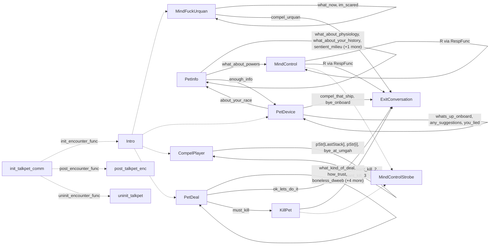

# Talking Pet: existing conversation graph

> Generated by `tools/conversation_catalog.py`; do not edit this page by hand.

[Catalog and interpretation rules](../README.md) · [Proposed engine](../model.md)

Script: [talkpet.c](../../../../sc2/src/uqm/comm/talkpet/talkpet.c#L1). Phrase bank: [talkingpet.txt](../../../../sc2/content/base/comm/talkingpet/talkingpet.txt#L1).

13 handler/helper nodes; 33 response registration sites; 6 direct local calls; 113 phrase records.

## Initialization and lifecycle

| Phase | Callback | Bound by | Conditions / source |
| --- | --- | --- | --- |
| <code>init_encounter_func</code> | [<code>Intro</code>](#node-intro) | <code>init_talkpet_comm</code> | No enclosing branch condition; [821](../../../../sc2/src/uqm/comm/talkpet/talkpet.c#L821) |
| <code>post_encounter_func</code> | [<code>post_talkpet_enc</code>](#node-post_talkpet_enc) | <code>init_talkpet_comm</code> | No enclosing branch condition; [822](../../../../sc2/src/uqm/comm/talkpet/talkpet.c#L822) |
| <code>uninit_encounter_func</code> | [<code>uninit_talkpet</code>](#node-uninit_talkpet) | <code>init_talkpet_comm</code> | No enclosing branch condition; [823](../../../../sc2/src/uqm/comm/talkpet/talkpet.c#L823) |

## Handler graph

Solid arrows are selectable responses; dashed arrows are direct C calls. Conditions, arguments, speech and effects are cataloged below. Parallel response sites are grouped only in this diagram.



## Condition catalog

Condition IDs describe enclosing source structure. Branch predicates combine with ∧; case labels mark source locations that can also be reached by fallthrough. Values refer to their original evaluation points. Local assignments and early control flow remain in the decision bodies.

| ID | Source expression / structural condition |
| --- | --- |
| <a id="condition-c1"></a>C1 | <code>PLAYER_SAID(R, compel_urquan)</code> |
| <a id="condition-c2"></a>C2 | <code>!(PLAYER_SAID(R, compel_urquan))</code> |
| <a id="condition-c3"></a>C3 | <code>PLAYER_SAID(R, wish_to_go_now)</code> |
| <a id="condition-c4"></a>C4 | <code>!(PLAYER_SAID(R, wish_to_go_now))</code> |
| <a id="condition-c5"></a>C5 | <code>PLAYER_SAID(R, bye_onboard)</code> |
| <a id="condition-c6"></a>C6 | <code>!(PLAYER_SAID(R, bye_onboard))</code> |
| <a id="condition-c7"></a>C7 | <code>PLAYER_SAID(R, compel_that_ship)</code> |
| <a id="condition-c8"></a>C8 | <code>!(PLAYER_SAID(R, compel_that_ship))</code> |
| <a id="condition-c9"></a>C9 | <code>!(PLAYER_SAID(R, ok_lets_do_it))</code> |
| <a id="condition-c10"></a>C10 | <code>!(PLAYER_SAID(R, ok_lets_do_it) &#124;&#124; PLAYER_SAID(R, want_kill_1))</code> |
| <a id="condition-c11"></a>C11 | <code>!((PLAYER_SAID(R, ok_lets_do_it) &#124;&#124; PLAYER_SAID(R, want_kill_1)) &#124;&#124; PLAYER_SAID(R, want_kill_2))</code> |
| <a id="condition-c12"></a>C12 | <code>((PLAYER_SAID(R, ok_lets_do_it) &#124;&#124; PLAYER_SAID(R, want_kill_1)) &#124;&#124; PLAYER_SAID(R, want_kill_2)) &#124;&#124; PLAYER_SAID(R, want_kill_3)</code> |
| <a id="condition-c13"></a>C13 | <code>PLAYER_SAID(R, ok_lets_do_it)</code> |
| <a id="condition-c14"></a>C14 | <code>PLAYER_SAID(R, what_now)</code> |
| <a id="condition-c15"></a>C15 | <code>!(PLAYER_SAID(R, what_now))</code> |
| <a id="condition-c16"></a>C16 | <code>PLAYER_SAID(R, im_scared)</code> |
| <a id="condition-c17"></a>C17 | <code>PHRASE_ENABLED(what_now)</code> |
| <a id="condition-c18"></a>C18 | <code>PHRASE_ENABLED(im_scared)</code> |
| <a id="condition-c19"></a>C19 | <code>PLAYER_SAID(R, what_about_powers)</code> |
| <a id="condition-c20"></a>C20 | <code>!(PLAYER_SAID(R, what_about_powers))</code> |
| <a id="condition-c21"></a>C21 | <code>PLAYER_SAID(R, about_your_race)</code> |
| <a id="condition-c22"></a>C22 | <code>!(PLAYER_SAID(R, about_your_race))</code> |
| <a id="condition-c23"></a>C23 | <code>PLAYER_SAID(R, what_about_physiology)</code> |
| <a id="condition-c24"></a>C24 | <code>!(PLAYER_SAID(R, what_about_physiology))</code> |
| <a id="condition-c25"></a>C25 | <code>PLAYER_SAID(R, what_about_your_history)</code> |
| <a id="condition-c26"></a>C26 | <code>!(PLAYER_SAID(R, what_about_your_history))</code> |
| <a id="condition-c27"></a>C27 | <code>PLAYER_SAID(R, sentient_milieu)</code> |
| <a id="condition-c28"></a>C28 | <code>!(PLAYER_SAID(R, sentient_milieu))</code> |
| <a id="condition-c29"></a>C29 | <code>PLAYER_SAID(R, what_about_war)</code> |
| <a id="condition-c30"></a>C30 | <code>PHRASE_ENABLED(what_about_physiology)</code> |
| <a id="condition-c31"></a>C31 | <code>!(PHRASE_ENABLED(what_about_physiology))</code> |
| <a id="condition-c32"></a>C32 | <code>PHRASE_ENABLED(what_about_your_history)</code> |
| <a id="condition-c33"></a>C33 | <code>!(PHRASE_ENABLED(what_about_your_history))</code> |
| <a id="condition-c34"></a>C34 | <code>PHRASE_ENABLED(sentient_milieu)</code> |
| <a id="condition-c35"></a>C35 | <code>!(PHRASE_ENABLED(sentient_milieu))</code> |
| <a id="condition-c36"></a>C36 | <code>PHRASE_ENABLED(what_about_war)</code> |
| <a id="condition-c37"></a>C37 | <code>PLAYER_SAID(R, whats_up_onboard)</code> |
| <a id="condition-c38"></a>C38 | <code>switch (NumVisits++)</code> |
| <a id="condition-c39"></a>C39 | <code>case 0 (see source for fallthrough)</code> |
| <a id="condition-c40"></a>C40 | <code>case 1 (see source for fallthrough)</code> |
| <a id="condition-c41"></a>C41 | <code>case 2 (see source for fallthrough)</code> |
| <a id="condition-c42"></a>C42 | <code>case 3 (see source for fallthrough)</code> |
| <a id="condition-c43"></a>C43 | <code>case 4 (see source for fallthrough)</code> |
| <a id="condition-c44"></a>C44 | <code>case 5 (see source for fallthrough)</code> |
| <a id="condition-c45"></a>C45 | <code>case 6 (see source for fallthrough)</code> |
| <a id="condition-c46"></a>C46 | <code>case 7 (see source for fallthrough)</code> |
| <a id="condition-c47"></a>C47 | <code>!(PLAYER_SAID(R, whats_up_onboard))</code> |
| <a id="condition-c48"></a>C48 | <code>PLAYER_SAID(R, any_suggestions)</code> |
| <a id="condition-c49"></a>C49 | <code>!(PLAYER_SAID(R, any_suggestions))</code> |
| <a id="condition-c50"></a>C50 | <code>PLAYER_SAID(R, enough_info)</code> |
| <a id="condition-c51"></a>C51 | <code>!(PLAYER_SAID(R, enough_info))</code> |
| <a id="condition-c52"></a>C52 | <code>PLAYER_SAID(R, you_lied)</code> |
| <a id="condition-c53"></a>C53 | <code>GET_GAME_STATE(SHIP_TO_COMPEL)</code> |
| <a id="condition-c54"></a>C54 | <code>PHRASE_ENABLED(whats_up_onboard)</code> |
| <a id="condition-c55"></a>C55 | <code>PHRASE_ENABLED(any_suggestions)</code> |
| <a id="condition-c56"></a>C56 | <code>GET_GAME_STATE(DNYARRI_LIED)</code> |
| <a id="condition-c57"></a>C57 | <code>GET_GAME_STATE(DNYARRI_LIED) &amp;&amp; GET_GAME_STATE(LEARNED_TALKING_PET)</code> |
| <a id="condition-c58"></a>C58 | <code>PLAYER_SAID(R, what_are_you)</code> |
| <a id="condition-c59"></a>C59 | <code>!(PLAYER_SAID(R, what_are_you))</code> |
| <a id="condition-c60"></a>C60 | <code>PLAYER_SAID(R, what_do_to_umgah)</code> |
| <a id="condition-c61"></a>C61 | <code>!(PLAYER_SAID(R, what_do_to_umgah))</code> |
| <a id="condition-c62"></a>C62 | <code>PLAYER_SAID(R, we_are_vindicator0)</code> |
| <a id="condition-c63"></a>C63 | <code>!(PLAYER_SAID(R, we_are_vindicator0))</code> |
| <a id="condition-c64"></a>C64 | <code>R != 0</code> |
| <a id="condition-c65"></a>C65 | <code>PLAYER_SAID(R, bye_at_umgah)</code> |
| <a id="condition-c66"></a>C66 | <code>!(PLAYER_SAID(R, bye_at_umgah))</code> |
| <a id="condition-c67"></a>C67 | <code>PLAYER_SAID(R, must_explain_presence)</code> |
| <a id="condition-c68"></a>C68 | <code>!(PLAYER_SAID(R, must_explain_presence))</code> |
| <a id="condition-c69"></a>C69 | <code>PLAYER_SAID(R, umgah_zombies)</code> |
| <a id="condition-c70"></a>C70 | <code>!(PLAYER_SAID(R, umgah_zombies))</code> |
| <a id="condition-c71"></a>C71 | <code>PLAYER_SAID(R, talking_pets_dumb)</code> |
| <a id="condition-c72"></a>C72 | <code>!GET_GAME_STATE(TAALO_PROTECTOR_ON_SHIP)</code> |
| <a id="condition-c73"></a>C73 | <code>!(!GET_GAME_STATE(TAALO_PROTECTOR_ON_SHIP))</code> |
| <a id="condition-c74"></a>C74 | <code>PHRASE_ENABLED(what_are_you)</code> |
| <a id="condition-c75"></a>C75 | <code>!(PHRASE_ENABLED(what_are_you))</code> |
| <a id="condition-c76"></a>C76 | <code>GET_GAME_STATE(KNOW_UMGAH_ZOMBIES)</code> |
| <a id="condition-c77"></a>C77 | <code>PHRASE_ENABLED(what_do_to_umgah)</code> |
| <a id="condition-c78"></a>C78 | <code>!(PHRASE_ENABLED(what_do_to_umgah))</code> |
| <a id="condition-c79"></a>C79 | <code>PHRASE_ENABLED(we_are_vindicator0)</code> |
| <a id="condition-c80"></a>C80 | <code>!(PHRASE_ENABLED(we_are_vindicator0))</code> |
| <a id="condition-c81"></a>C81 | <code>pStr[LastStack]</code> |
| <a id="condition-c82"></a>C82 | <code>pStr[LastStack] != we_are_vindicator0</code> |
| <a id="condition-c83"></a>C83 | <code>!(pStr[LastStack] != we_are_vindicator0)</code> |
| <a id="condition-c84"></a>C84 | <code>for (i = 0; i &lt; 3; ++i)</code> |
| <a id="condition-c85"></a>C85 | <code>(i != LastStack) &amp;&amp; pStr[i]</code> |
| <a id="condition-c86"></a>C86 | <code>pStr[i] != we_are_vindicator0</code> |
| <a id="condition-c87"></a>C87 | <code>!(pStr[i] != we_are_vindicator0)</code> |
| <a id="condition-c88"></a>C88 | <code>PLAYER_SAID(R, must_kill)</code> |
| <a id="condition-c89"></a>C89 | <code>PLAYER_SAID(R, what_kind_of_deal)</code> |
| <a id="condition-c90"></a>C90 | <code>!(PLAYER_SAID(R, what_kind_of_deal))</code> |
| <a id="condition-c91"></a>C91 | <code>PLAYER_SAID(R, how_trust)</code> |
| <a id="condition-c92"></a>C92 | <code>!(PLAYER_SAID(R, how_trust))</code> |
| <a id="condition-c93"></a>C93 | <code>PLAYER_SAID(R, boneless_dweeb)</code> |
| <a id="condition-c94"></a>C94 | <code>!(PLAYER_SAID(R, boneless_dweeb))</code> |
| <a id="condition-c95"></a>C95 | <code>PLAYER_SAID(R, what_are_you_really)</code> |
| <a id="condition-c96"></a>C96 | <code>!(PLAYER_SAID(R, what_are_you_really))</code> |
| <a id="condition-c97"></a>C97 | <code>PLAYER_SAID(R, hard_to_believe)</code> |
| <a id="condition-c98"></a>C98 | <code>!(PLAYER_SAID(R, hard_to_believe))</code> |
| <a id="condition-c99"></a>C99 | <code>PLAYER_SAID(R, bullshit)</code> |
| <a id="condition-c100"></a>C100 | <code>!(PLAYER_SAID(R, bullshit))</code> |
| <a id="condition-c101"></a>C101 | <code>PLAYER_SAID(R, kill_you)</code> |
| <a id="condition-c102"></a>C102 | <code>PHRASE_ENABLED(what_kind_of_deal)</code> |
| <a id="condition-c103"></a>C103 | <code>!(PHRASE_ENABLED(what_kind_of_deal))</code> |
| <a id="condition-c104"></a>C104 | <code>PHRASE_ENABLED(how_trust)</code> |
| <a id="condition-c105"></a>C105 | <code>!(PHRASE_ENABLED(how_trust))</code> |
| <a id="condition-c106"></a>C106 | <code>PHRASE_ENABLED(boneless_dweeb)</code> |
| <a id="condition-c107"></a>C107 | <code>PHRASE_ENABLED(what_are_you_really)</code> |
| <a id="condition-c108"></a>C108 | <code>!(PHRASE_ENABLED(what_are_you_really))</code> |
| <a id="condition-c109"></a>C109 | <code>PHRASE_ENABLED(hard_to_believe)</code> |
| <a id="condition-c110"></a>C110 | <code>PHRASE_ENABLED(hard_to_believe) &amp;&amp; (!GET_GAME_STATE(LEARNED_TALKING_PET))</code> |
| <a id="condition-c111"></a>C111 | <code>!(PHRASE_ENABLED(hard_to_believe) &amp;&amp; (!GET_GAME_STATE(LEARNED_TALKING_PET)))</code> |
| <a id="condition-c112"></a>C112 | <code>PHRASE_ENABLED(bullshit)</code> |
| <a id="condition-c113"></a>C113 | <code>PHRASE_ENABLED(bullshit) &amp;&amp; GET_GAME_STATE(LEARNED_TALKING_PET)</code> |
| <a id="condition-c114"></a>C114 | <code>PHRASE_ENABLED(kill_you)</code> |
| <a id="condition-c115"></a>C115 | <code>!(PHRASE_ENABLED(kill_you))</code> |
| <a id="condition-c116"></a>C116 | <code>PHRASE_ENABLED(must_kill)</code> |
| <a id="condition-c117"></a>C117 | <code>LOBYTE(GLOBAL(CurrentActivity)) == WON_LAST_BATTLE</code> |
| <a id="condition-c118"></a>C118 | <code>LOBYTE(GLOBAL(CurrentActivity)) == IN_LAST_BATTLE</code> |
| <a id="condition-c119"></a>C119 | <code>!(GLOBAL(glob_flags) &amp; CYBORG_ENABLED)</code> |
| <a id="condition-c120"></a>C120 | <code>!(!(GLOBAL(glob_flags) &amp; CYBORG_ENABLED))</code> |
| <a id="condition-c121"></a>C121 | <code>!(LOBYTE(GLOBAL(CurrentActivity)) == IN_LAST_BATTLE)</code> |
| <a id="condition-c122"></a>C122 | <code>GET_GAME_STATE(READY_TO_CONFUSE_URQUAN)</code> |
| <a id="condition-c123"></a>C123 | <code>GET_GAME_STATE(CHMMR_BOMB_STATE) != 3</code> |
| <a id="condition-c124"></a>C124 | <code>!GET_GAME_STATE(UTWIG_BOMB_ON_SHIP)</code> |
| <a id="condition-c125"></a>C125 | <code>!(!GET_GAME_STATE(UTWIG_BOMB_ON_SHIP))</code> |
| <a id="condition-c126"></a>C126 | <code>!(GET_GAME_STATE(CHMMR_BOMB_STATE) != 3)</code> |
| <a id="condition-c127"></a>C127 | <code>GET_GAME_STATE(URQUAN_MESSED_UP)</code> |
| <a id="condition-c128"></a>C128 | <code>!(GET_GAME_STATE(URQUAN_MESSED_UP))</code> |
| <a id="condition-c129"></a>C129 | <code>!(GET_GAME_STATE(READY_TO_CONFUSE_URQUAN))</code> |
| <a id="condition-c130"></a>C130 | <code>GET_GAME_STATE(TALKING_PET_ON_SHIP)</code> |
| <a id="condition-c131"></a>C131 | <code>(!GET_GAME_STATE(TAALO_PROTECTOR_ON_SHIP)) &amp;&amp; (NumVisits == 0)</code> |
| <a id="condition-c132"></a>C132 | <code>!(GET_GAME_STATE(TALKING_PET_ON_SHIP))</code> |
| <a id="condition-c133"></a>C133 | <code>GetHeadLink(&amp;GLOBAL(npc_built_ship_q))</code> |
| <a id="condition-c134"></a>C134 | <code>NumVisits == 1</code> |
| <a id="condition-c135"></a>C135 | <code>!(NumVisits == 1)</code> |
| <a id="condition-c136"></a>C136 | <code>!(GetHeadLink(&amp;GLOBAL(npc_built_ship_q)))</code> |
| <a id="condition-c137"></a>C137 | <code>StartSphereTracking(UMGAH_SHIP)</code> |
| <a id="condition-c138"></a>C138 | <code>!(StartSphereTracking(UMGAH_SHIP))</code> |
| <a id="condition-c139"></a>C139 | <code>!(GET_GAME_STATE(TALKING_PET_HOME_VISITS) == 0)</code> |
| <a id="condition-c140"></a>C140 | <code>(GET_GAME_STATE(TALKING_PET_HOME_VISITS) == 0) &#124;&#124; (!GET_GAME_STATE(TAALO_PROTECTOR_ON_SHIP))</code> |
| <a id="condition-c141"></a>C141 | <code>LOBYTE(GLOBAL(CurrentActivity)) != IN_LAST_BATTLE</code> |
| <a id="condition-c142"></a>C142 | <code>!(LOBYTE(GLOBAL(CurrentActivity)) != IN_LAST_BATTLE)</code> |

## Script-scope state and lookup tables

These declarations supply shared local state, computed phrase alternatives, number speech, or lookup data used by the nodes. LOCDATA presentation defaults are linked separately in the source.

Presentation descriptor <code>talkpet_desc</code>: [source](../../../../sc2/src/uqm/comm/talkpet/talkpet.c#L29).

## Node catalog

<a id="node-exitconversation"></a>

### ExitConversation

<code>static void ExitConversation(RESPONSE_REF R)</code> — [source](../../../../sc2/src/uqm/comm/talkpet/talkpet.c#L214).

Incoming player-response variants: [<code>compel_urquan</code>](#phrase-compel_urquan), <code>R</code>, [<code>compel_that_ship</code>](#phrase-compel_that_ship), [<code>bye_onboard</code>](#phrase-bye_onboard), [<code>want_kill_1</code>](#phrase-want_kill_1), [<code>want_kill_2</code>](#phrase-want_kill_2), [<code>want_kill_3</code>](#phrase-want_kill_3), [<code>ok_lets_do_it</code>](#phrase-ok_lets_do_it).

#### Dialogue / audio emissions

| Phrase or expression | Enclosing conditions | Source |
| --- | --- | --- |
| [<code>HERE_WE_GO</code>](#phrase-here_we_go)<br><code>NPCPhrase(HERE_WE_GO)</code> | [C1](#condition-c1) | [221](../../../../sc2/src/uqm/comm/talkpet/talkpet.c#L221) |
| [<code>EXCELLENT_IDEA</code>](#phrase-excellent_idea)<br><code>NPCPhrase(EXCELLENT_IDEA)</code> | [C2](#condition-c2) ∧ [C3](#condition-c3) | [226](../../../../sc2/src/uqm/comm/talkpet/talkpet.c#L226) |
| [<code>GOODBYE_ONBOARD</code>](#phrase-goodbye_onboard)<br><code>NPCPhrase(GOODBYE_ONBOARD)</code> | [C2](#condition-c2) ∧ [C4](#condition-c4) ∧ [C5](#condition-c5) | [228](../../../../sc2/src/uqm/comm/talkpet/talkpet.c#L228) |
| [<code>SAVING_MY_POWER</code>](#phrase-saving_my_power)<br><code>NPCPhrase(SAVING_MY_POWER)</code> | [C2](#condition-c2) ∧ [C4](#condition-c4) ∧ [C6](#condition-c6) ∧ [C7](#condition-c7) | [230](../../../../sc2/src/uqm/comm/talkpet/talkpet.c#L230) |
| [<code>COMING_ABOARD</code>](#phrase-coming_aboard)<br><code>NPCPhrase(COMING_ABOARD)</code> | [C2](#condition-c2) ∧ [C4](#condition-c4) ∧ [C6](#condition-c6) ∧ [C8](#condition-c8) ∧ [C12](#condition-c12) ∧ [C13](#condition-c13) | [237](../../../../sc2/src/uqm/comm/talkpet/talkpet.c#L237) |
| [<code>GLAD_YOU_WONT_KILL</code>](#phrase-glad_you_wont_kill)<br><code>NPCPhrase(GLAD_YOU_WONT_KILL)</code> | [C2](#condition-c2) ∧ [C4](#condition-c4) ∧ [C6](#condition-c6) ∧ [C8](#condition-c8) ∧ [C12](#condition-c12) ∧ [C9](#condition-c9) | [239](../../../../sc2/src/uqm/comm/talkpet/talkpet.c#L239) |

#### Actions, queries, local updates, and control flow

Calls are listed without assuming they are pure or mutating. Local updates are retained because they determine dynamic menus and counter-selected speech.

| Kind | Operation | Enclosing conditions | Source |
| --- | --- | --- | --- |
| call | <code>setSegue(Segue_peace)</code> | No enclosing branch condition | [216](../../../../sc2/src/uqm/comm/talkpet/talkpet.c#L216) |
| call | <code>SET_GAME_STATE(SHIP_TO_COMPEL, 0)</code> | No enclosing branch condition | [217](../../../../sc2/src/uqm/comm/talkpet/talkpet.c#L217) |
| call | <code>PLAYER_SAID(R, compel_urquan)</code> | No enclosing branch condition | [219](../../../../sc2/src/uqm/comm/talkpet/talkpet.c#L219) |
| call | <code>SET_GAME_STATE(URQUAN_MESSED_UP, 1)</code> | [C1](#condition-c1) | [223](../../../../sc2/src/uqm/comm/talkpet/talkpet.c#L223) |
| call | <code>PLAYER_SAID(R, wish_to_go_now)</code> | [C2](#condition-c2) | [225](../../../../sc2/src/uqm/comm/talkpet/talkpet.c#L225) |
| call | <code>PLAYER_SAID(R, bye_onboard)</code> | [C2](#condition-c2) ∧ [C4](#condition-c4) | [227](../../../../sc2/src/uqm/comm/talkpet/talkpet.c#L227) |
| call | <code>PLAYER_SAID(R, compel_that_ship)</code> | [C2](#condition-c2) ∧ [C4](#condition-c4) ∧ [C6](#condition-c6) | [229](../../../../sc2/src/uqm/comm/talkpet/talkpet.c#L229) |
| call | <code>PLAYER_SAID(R, ok_lets_do_it)</code> | [C2](#condition-c2) ∧ [C4](#condition-c4) ∧ [C6](#condition-c6) ∧ [C8](#condition-c8) | [231](../../../../sc2/src/uqm/comm/talkpet/talkpet.c#L231) |
| call | <code>PLAYER_SAID(R, want_kill_1)</code> | [C2](#condition-c2) ∧ [C4](#condition-c4) ∧ [C6](#condition-c6) ∧ [C8](#condition-c8) ∧ [C9](#condition-c9) | [232](../../../../sc2/src/uqm/comm/talkpet/talkpet.c#L232) |
| call | <code>PLAYER_SAID(R, want_kill_2)</code> | [C2](#condition-c2) ∧ [C4](#condition-c4) ∧ [C6](#condition-c6) ∧ [C8](#condition-c8) ∧ [C10](#condition-c10) | [233](../../../../sc2/src/uqm/comm/talkpet/talkpet.c#L233) |
| call | <code>PLAYER_SAID(R, want_kill_3)</code> | [C2](#condition-c2) ∧ [C4](#condition-c4) ∧ [C6](#condition-c6) ∧ [C8](#condition-c8) ∧ [C11](#condition-c11) | [234](../../../../sc2/src/uqm/comm/talkpet/talkpet.c#L234) |
| call | <code>PLAYER_SAID(R, ok_lets_do_it)</code> | [C2](#condition-c2) ∧ [C4](#condition-c4) ∧ [C6](#condition-c6) ∧ [C8](#condition-c8) ∧ [C12](#condition-c12) | [236](../../../../sc2/src/uqm/comm/talkpet/talkpet.c#L236) |
| call | <code>SET_GAME_STATE(TALKING_PET, 1)</code> | [C2](#condition-c2) ∧ [C4](#condition-c4) ∧ [C6](#condition-c6) ∧ [C8](#condition-c8) ∧ [C12](#condition-c12) | [241](../../../../sc2/src/uqm/comm/talkpet/talkpet.c#L241) |
| call | <code>SET_GAME_STATE(TALKING_PET_ON_SHIP, 1)</code> | [C2](#condition-c2) ∧ [C4](#condition-c4) ∧ [C6](#condition-c6) ∧ [C8](#condition-c8) ∧ [C12](#condition-c12) | [242](../../../../sc2/src/uqm/comm/talkpet/talkpet.c#L242) |
| call | <code>SET_GAME_STATE(UMGAH_ZOMBIE_BLOBBIES, 0)</code> | [C2](#condition-c2) ∧ [C4](#condition-c4) ∧ [C6](#condition-c6) ∧ [C8](#condition-c8) ∧ [C12](#condition-c12) | [243](../../../../sc2/src/uqm/comm/talkpet/talkpet.c#L243) |
| call | <code>SET_GAME_STATE(UMGAH_VISITS, 0)</code> | [C2](#condition-c2) ∧ [C4](#condition-c4) ∧ [C6](#condition-c6) ∧ [C8](#condition-c8) ∧ [C12](#condition-c12) | [244](../../../../sc2/src/uqm/comm/talkpet/talkpet.c#L244) |
| call | <code>SET_GAME_STATE(UMGAH_HOME_VISITS, 0)</code> | [C2](#condition-c2) ∧ [C4](#condition-c4) ∧ [C6](#condition-c6) ∧ [C8](#condition-c8) ∧ [C12](#condition-c12) | [245](../../../../sc2/src/uqm/comm/talkpet/talkpet.c#L245) |
| call | <code>SET_GAME_STATE(ARILOU_STACK_2, 0)</code> | [C2](#condition-c2) ∧ [C4](#condition-c4) ∧ [C6](#condition-c6) ∧ [C8](#condition-c8) ∧ [C12](#condition-c12) | [246](../../../../sc2/src/uqm/comm/talkpet/talkpet.c#L246) |

<details>
<summary>Exact decision body (local calculations, early returns, fallthrough and ordering)</summary>

```c
{
	setSegue (Segue_peace);
	SET_GAME_STATE (SHIP_TO_COMPEL, 0);

	if (PLAYER_SAID (R, compel_urquan))
	{
		NPCPhrase (HERE_WE_GO);

		SET_GAME_STATE (URQUAN_MESSED_UP, 1);
	}
	else if (PLAYER_SAID (R, wish_to_go_now))
		NPCPhrase (EXCELLENT_IDEA);
	else if (PLAYER_SAID (R, bye_onboard))
		NPCPhrase (GOODBYE_ONBOARD);
	else if (PLAYER_SAID (R, compel_that_ship))
		NPCPhrase (SAVING_MY_POWER);
	else if (PLAYER_SAID (R, ok_lets_do_it)
			|| PLAYER_SAID (R, want_kill_1)
			|| PLAYER_SAID (R, want_kill_2)
			|| PLAYER_SAID (R, want_kill_3))
	{
		if (PLAYER_SAID (R, ok_lets_do_it))
			NPCPhrase (COMING_ABOARD);
		else
			NPCPhrase (GLAD_YOU_WONT_KILL);

		SET_GAME_STATE (TALKING_PET, 1);
		SET_GAME_STATE (TALKING_PET_ON_SHIP, 1);
		SET_GAME_STATE (UMGAH_ZOMBIE_BLOBBIES, 0);
		SET_GAME_STATE (UMGAH_VISITS, 0);
		SET_GAME_STATE (UMGAH_HOME_VISITS, 0);
		SET_GAME_STATE (ARILOU_STACK_2, 0);
	}
}
```

</details>

<a id="node-mindfuckurquan"></a>

### MindFuckUrquan

<code>static void MindFuckUrquan(RESPONSE_REF R)</code> — [source](../../../../sc2/src/uqm/comm/talkpet/talkpet.c#L251).

Incoming player-response variants: [<code>what_now</code>](#phrase-what_now), [<code>im_scared</code>](#phrase-im_scared).

Also called directly by: [<code>Intro</code>](#node-intro) ([694](../../../../sc2/src/uqm/comm/talkpet/talkpet.c#L694)).

#### Dialogue / audio emissions

| Phrase or expression | Enclosing conditions | Source |
| --- | --- | --- |
| [<code>DO_THIS</code>](#phrase-do_this)<br><code>NPCPhrase(DO_THIS)</code> | [C14](#condition-c14) | [255](../../../../sc2/src/uqm/comm/talkpet/talkpet.c#L255) |
| [<code>STUPID_FOP</code>](#phrase-stupid_fop)<br><code>NPCPhrase(STUPID_FOP)</code> | [C15](#condition-c15) ∧ [C16](#condition-c16) | [261](../../../../sc2/src/uqm/comm/talkpet/talkpet.c#L261) |

#### Response edges

| Player response | Destination on selection | Enclosing availability conditions | Source |
| --- | --- | --- | --- |
| [<code>what_now</code>](#phrase-what_now)<br>What now, Dnyarri? | [<code>MindFuckUrquan</code>](#node-mindfuckurquan) | [C17](#condition-c17) | [267](../../../../sc2/src/uqm/comm/talkpet/talkpet.c#L267) |
| [<code>im_scared</code>](#phrase-im_scared)<br>I&#x27;m scared, Dnyarri. What if this doesn&#x27;t work? | [<code>MindFuckUrquan</code>](#node-mindfuckurquan) | [C18](#condition-c18) | [269](../../../../sc2/src/uqm/comm/talkpet/talkpet.c#L269) |
| [<code>compel_urquan</code>](#phrase-compel_urquan)<br>Employ your powers! Confuse the Ur-Quan! | [<code>ExitConversation</code>](#node-exitconversation) | No enclosing branch condition | [270](../../../../sc2/src/uqm/comm/talkpet/talkpet.c#L270) |

#### Actions, queries, local updates, and control flow

Calls are listed without assuming they are pure or mutating. Local updates are retained because they determine dynamic menus and counter-selected speech.

| Kind | Operation | Enclosing conditions | Source |
| --- | --- | --- | --- |
| call | <code>PLAYER_SAID(R, what_now)</code> | No enclosing branch condition | [253](../../../../sc2/src/uqm/comm/talkpet/talkpet.c#L253) |
| call | <code>DISABLE_PHRASE(what_now)</code> | [C14](#condition-c14) | [257](../../../../sc2/src/uqm/comm/talkpet/talkpet.c#L257) |
| call | <code>PLAYER_SAID(R, im_scared)</code> | [C15](#condition-c15) | [259](../../../../sc2/src/uqm/comm/talkpet/talkpet.c#L259) |
| call | <code>DISABLE_PHRASE(im_scared)</code> | [C15](#condition-c15) ∧ [C16](#condition-c16) | [263](../../../../sc2/src/uqm/comm/talkpet/talkpet.c#L263) |
| call | <code>PHRASE_ENABLED(what_now)</code> | No enclosing branch condition | [266](../../../../sc2/src/uqm/comm/talkpet/talkpet.c#L266) |
| call | <code>PHRASE_ENABLED(im_scared)</code> | No enclosing branch condition | [268](../../../../sc2/src/uqm/comm/talkpet/talkpet.c#L268) |

<details>
<summary>Exact decision body (local calculations, early returns, fallthrough and ordering)</summary>

```c
{
	if (PLAYER_SAID (R, what_now))
	{
		NPCPhrase (DO_THIS);

		DISABLE_PHRASE (what_now);
	}
	else if (PLAYER_SAID (R, im_scared))
	{
		NPCPhrase (STUPID_FOP);

		DISABLE_PHRASE (im_scared);
	}

	if (PHRASE_ENABLED (what_now))
		Response (what_now, MindFuckUrquan);
	if (PHRASE_ENABLED (im_scared))
		Response (im_scared, MindFuckUrquan);
	Response (compel_urquan, ExitConversation);
}
```

</details>

<a id="node-mindcontrolstrobe"></a>

### MindControlStrobe

<code>static void MindControlStrobe(void)</code> — [source](../../../../sc2/src/uqm/comm/talkpet/talkpet.c#L276).

Also called directly by: [<code>MindControl</code>](#node-mindcontrol) ([303](../../../../sc2/src/uqm/comm/talkpet/talkpet.c#L303)), [<code>KillPet</code>](#node-killpet) ([561](../../../../sc2/src/uqm/comm/talkpet/talkpet.c#L561)).

#### Actions, queries, local updates, and control flow

Calls are listed without assuming they are pure or mutating. Local updates are retained because they determine dynamic menus and counter-selected speech.

| Kind | Operation | Enclosing conditions | Source |
| --- | --- | --- | --- |
| update | <code>GetConversationData()-&gt;AlienAmbientArray[16].AnimFlags &amp;= ~ANIM_DISABLED</code> | No enclosing branch condition | [279](../../../../sc2/src/uqm/comm/talkpet/talkpet.c#L279) |
| call | <code>GetConversationData()</code> | No enclosing branch condition | [279](../../../../sc2/src/uqm/comm/talkpet/talkpet.c#L279) |

<details>
<summary>Exact decision body (local calculations, early returns, fallthrough and ordering)</summary>

```c
{
	// Enable the one-shot strobe animation
	GetConversationData()->AlienAmbientArray[16].AnimFlags &= ~ANIM_DISABLED;
}
```

</details>

<a id="node-mindcontrol"></a>

### MindControl

<code>static void MindControl(RESPONSE_REF R)</code> — [source](../../../../sc2/src/uqm/comm/talkpet/talkpet.c#L283).

Incoming player-response variants: <code>R</code>, [<code>what_about_powers</code>](#phrase-what_about_powers).

#### Dialogue / audio emissions

| Phrase or expression | Enclosing conditions | Source |
| --- | --- | --- |
| [<code>NOT_POWERS_BUT_FLOWERS</code>](#phrase-not_powers_but_flowers)<br><code>NPCPhrase(NOT_POWERS_BUT_FLOWERS)</code> | [C19](#condition-c19) | [289](../../../../sc2/src/uqm/comm/talkpet/talkpet.c#L289) |
| [<code>GOOD_HUMAN</code>](#phrase-good_human)<br><code>NPCPhrase(GOOD_HUMAN)</code> | [C20](#condition-c20) | [296](../../../../sc2/src/uqm/comm/talkpet/talkpet.c#L296) |

#### Response edges

| Player response | Destination on selection | Enclosing availability conditions | Source |
| --- | --- | --- | --- |
| <code>R</code><br>Computed phrase: resolve using the local updates / decision body below. | [<code>MindControl</code>](#node-mindcontrol)<br>via <code>RespFunc</code> assigned under [C19](#condition-c19) ([291](../../../../sc2/src/uqm/comm/talkpet/talkpet.c#L291))<br>OR<br>[<code>ExitConversation</code>](#node-exitconversation)<br>via <code>RespFunc</code> assigned under [C20](#condition-c20) ([298](../../../../sc2/src/uqm/comm/talkpet/talkpet.c#L298)) | No enclosing branch condition | [305](../../../../sc2/src/uqm/comm/talkpet/talkpet.c#L305) |

#### Actions, queries, local updates, and control flow

Calls are listed without assuming they are pure or mutating. Local updates are retained because they determine dynamic menus and counter-selected speech.

| Kind | Operation | Enclosing conditions | Source |
| --- | --- | --- | --- |
| call | <code>PLAYER_SAID(R, what_about_powers)</code> | No enclosing branch condition | [287](../../../../sc2/src/uqm/comm/talkpet/talkpet.c#L287) |
| update | <code>RespFunc = (RESPONSE_FUNC) MindControl</code> | [C19](#condition-c19) | [291](../../../../sc2/src/uqm/comm/talkpet/talkpet.c#L291) |
| update | <code>R = yes_flowers</code> | [C19](#condition-c19) | [292](../../../../sc2/src/uqm/comm/talkpet/talkpet.c#L292) |
| update | <code>RespFunc = (RESPONSE_FUNC) ExitConversation</code> | [C20](#condition-c20) | [298](../../../../sc2/src/uqm/comm/talkpet/talkpet.c#L298) |
| update | <code>R = wish_to_go_now</code> | [C20](#condition-c20) | [299](../../../../sc2/src/uqm/comm/talkpet/talkpet.c#L299) |
| call | <code>AlienTalkSegue((COUNT) (~0))</code> | No enclosing branch condition | [302](../../../../sc2/src/uqm/comm/talkpet/talkpet.c#L302) |
| call | <code>MindControlStrobe()</code> → [<code>MindControlStrobe</code>](#node-mindcontrolstrobe) | No enclosing branch condition | [303](../../../../sc2/src/uqm/comm/talkpet/talkpet.c#L303) |

<details>
<summary>Exact decision body (local calculations, early returns, fallthrough and ordering)</summary>

```c
{
	RESPONSE_FUNC RespFunc;

	if (PLAYER_SAID (R, what_about_powers))
	{
		NPCPhrase (NOT_POWERS_BUT_FLOWERS);

		RespFunc = (RESPONSE_FUNC)MindControl;
		R = yes_flowers;
	}
	else /* if (R == yes_flowers) */
	{
		NPCPhrase (GOOD_HUMAN);

		RespFunc = (RESPONSE_FUNC)ExitConversation;
		R = wish_to_go_now;
	}

	AlienTalkSegue ((COUNT)~0);
	MindControlStrobe ();

	Response (R, RespFunc);
}
```

</details>

<a id="node-petinfo"></a>

### PetInfo

<code>static void PetInfo(RESPONSE_REF R)</code> — [source](../../../../sc2/src/uqm/comm/talkpet/talkpet.c#L309).

Incoming player-response variants: [<code>what_about_physiology</code>](#phrase-what_about_physiology), [<code>what_about_your_history</code>](#phrase-what_about_your_history), [<code>sentient_milieu</code>](#phrase-sentient_milieu), [<code>what_about_war</code>](#phrase-what_about_war), [<code>about_your_race</code>](#phrase-about_your_race).

#### Dialogue / audio emissions

| Phrase or expression | Enclosing conditions | Source |
| --- | --- | --- |
| [<code>WHAT_ABOUT_RACE</code>](#phrase-what_about_race)<br><code>NPCPhrase(WHAT_ABOUT_RACE)</code> | [C21](#condition-c21) | [312](../../../../sc2/src/uqm/comm/talkpet/talkpet.c#L312) |
| [<code>NO_TALK_ABOUT_SELF</code>](#phrase-no_talk_about_self)<br><code>NPCPhrase(NO_TALK_ABOUT_SELF)</code> | [C22](#condition-c22) ∧ [C23](#condition-c23) | [315](../../../../sc2/src/uqm/comm/talkpet/talkpet.c#L315) |
| [<code>ABOUT_HISTORY</code>](#phrase-about_history)<br><code>NPCPhrase(ABOUT_HISTORY)</code> | [C22](#condition-c22) ∧ [C24](#condition-c24) ∧ [C25](#condition-c25) | [321](../../../../sc2/src/uqm/comm/talkpet/talkpet.c#L321) |
| [<code>ABOUT_SENTIENT_MILIEU</code>](#phrase-about_sentient_milieu)<br><code>NPCPhrase(ABOUT_SENTIENT_MILIEU)</code> | [C22](#condition-c22) ∧ [C24](#condition-c24) ∧ [C26](#condition-c26) ∧ [C27](#condition-c27) | [327](../../../../sc2/src/uqm/comm/talkpet/talkpet.c#L327) |
| [<code>ABOUT_WAR</code>](#phrase-about_war)<br><code>NPCPhrase(ABOUT_WAR)</code> | [C22](#condition-c22) ∧ [C24](#condition-c24) ∧ [C26](#condition-c26) ∧ [C28](#condition-c28) ∧ [C29](#condition-c29) | [333](../../../../sc2/src/uqm/comm/talkpet/talkpet.c#L333) |

#### Response edges

| Player response | Destination on selection | Enclosing availability conditions | Source |
| --- | --- | --- | --- |
| [<code>what_about_physiology</code>](#phrase-what_about_physiology)<br>What can you tell me about your species biology? | [<code>PetInfo</code>](#node-petinfo) | [C30](#condition-c30) | [340](../../../../sc2/src/uqm/comm/talkpet/talkpet.c#L340) |
| [<code>what_about_powers</code>](#phrase-what_about_powers)<br>Come on, we&#x27;re friends! Tell me about the scope of your psychic powers! | [<code>MindControl</code>](#node-mindcontrol) | [C31](#condition-c31) | [344](../../../../sc2/src/uqm/comm/talkpet/talkpet.c#L344) |
| [<code>what_about_your_history</code>](#phrase-what_about_your_history)<br>What can you tell me about the history of your people? | [<code>PetInfo</code>](#node-petinfo) | [C32](#condition-c32) | [347](../../../../sc2/src/uqm/comm/talkpet/talkpet.c#L347) |
| [<code>sentient_milieu</code>](#phrase-sentient_milieu)<br>I know so little about the Sentient Milieu. Can you describe it? | [<code>PetInfo</code>](#node-petinfo) | [C33](#condition-c33) ∧ [C34](#condition-c34) | [349](../../../../sc2/src/uqm/comm/talkpet/talkpet.c#L349) |
| [<code>what_about_war</code>](#phrase-what_about_war)<br>So tell me about the war between your species and the Sentient Milieu. | [<code>PetInfo</code>](#node-petinfo) | [C33](#condition-c33) ∧ [C35](#condition-c35) ∧ [C36](#condition-c36) | [351](../../../../sc2/src/uqm/comm/talkpet/talkpet.c#L351) |
| [<code>enough_info</code>](#phrase-enough_info)<br>I&#x27;ve heard enough. | [<code>PetDevice</code>](#node-petdevice) | No enclosing branch condition | [352](../../../../sc2/src/uqm/comm/talkpet/talkpet.c#L352) |

#### Actions, queries, local updates, and control flow

Calls are listed without assuming they are pure or mutating. Local updates are retained because they determine dynamic menus and counter-selected speech.

| Kind | Operation | Enclosing conditions | Source |
| --- | --- | --- | --- |
| call | <code>PLAYER_SAID(R, about_your_race)</code> | No enclosing branch condition | [311](../../../../sc2/src/uqm/comm/talkpet/talkpet.c#L311) |
| call | <code>PLAYER_SAID(R, what_about_physiology)</code> | [C22](#condition-c22) | [313](../../../../sc2/src/uqm/comm/talkpet/talkpet.c#L313) |
| call | <code>DISABLE_PHRASE(what_about_physiology)</code> | [C22](#condition-c22) ∧ [C23](#condition-c23) | [317](../../../../sc2/src/uqm/comm/talkpet/talkpet.c#L317) |
| call | <code>PLAYER_SAID(R, what_about_your_history)</code> | [C22](#condition-c22) ∧ [C24](#condition-c24) | [319](../../../../sc2/src/uqm/comm/talkpet/talkpet.c#L319) |
| call | <code>DISABLE_PHRASE(what_about_your_history)</code> | [C22](#condition-c22) ∧ [C24](#condition-c24) ∧ [C25](#condition-c25) | [323](../../../../sc2/src/uqm/comm/talkpet/talkpet.c#L323) |
| call | <code>PLAYER_SAID(R, sentient_milieu)</code> | [C22](#condition-c22) ∧ [C24](#condition-c24) ∧ [C26](#condition-c26) | [325](../../../../sc2/src/uqm/comm/talkpet/talkpet.c#L325) |
| call | <code>DISABLE_PHRASE(sentient_milieu)</code> | [C22](#condition-c22) ∧ [C24](#condition-c24) ∧ [C26](#condition-c26) ∧ [C27](#condition-c27) | [329](../../../../sc2/src/uqm/comm/talkpet/talkpet.c#L329) |
| call | <code>PLAYER_SAID(R, what_about_war)</code> | [C22](#condition-c22) ∧ [C24](#condition-c24) ∧ [C26](#condition-c26) ∧ [C28](#condition-c28) | [331](../../../../sc2/src/uqm/comm/talkpet/talkpet.c#L331) |
| call | <code>DISABLE_PHRASE(what_about_war)</code> | [C22](#condition-c22) ∧ [C24](#condition-c24) ∧ [C26](#condition-c26) ∧ [C28](#condition-c28) ∧ [C29](#condition-c29) | [335](../../../../sc2/src/uqm/comm/talkpet/talkpet.c#L335) |
| call | <code>PHRASE_ENABLED(what_about_physiology)</code> | No enclosing branch condition | [338](../../../../sc2/src/uqm/comm/talkpet/talkpet.c#L338) |
| call | <code>PHRASE_ENABLED(what_about_your_history)</code> | No enclosing branch condition | [346](../../../../sc2/src/uqm/comm/talkpet/talkpet.c#L346) |
| call | <code>PHRASE_ENABLED(sentient_milieu)</code> | [C33](#condition-c33) | [348](../../../../sc2/src/uqm/comm/talkpet/talkpet.c#L348) |
| call | <code>PHRASE_ENABLED(what_about_war)</code> | [C33](#condition-c33) ∧ [C35](#condition-c35) | [350](../../../../sc2/src/uqm/comm/talkpet/talkpet.c#L350) |

<details>
<summary>Exact decision body (local calculations, early returns, fallthrough and ordering)</summary>

```c
{
	if (PLAYER_SAID (R, about_your_race))
		NPCPhrase (WHAT_ABOUT_RACE);
	else if (PLAYER_SAID (R, what_about_physiology))
	{
		NPCPhrase (NO_TALK_ABOUT_SELF);

		DISABLE_PHRASE (what_about_physiology);
	}
	else if (PLAYER_SAID (R, what_about_your_history))
	{
		NPCPhrase (ABOUT_HISTORY);

		DISABLE_PHRASE (what_about_your_history);
	}
	else if (PLAYER_SAID (R, sentient_milieu))
	{
		NPCPhrase (ABOUT_SENTIENT_MILIEU);

		DISABLE_PHRASE (sentient_milieu);
	}
	else if (PLAYER_SAID (R, what_about_war))
	{
		NPCPhrase (ABOUT_WAR);

		DISABLE_PHRASE (what_about_war);
	}

	if (PHRASE_ENABLED (what_about_physiology))
	{
		Response (what_about_physiology, PetInfo);
	}
	else
	{
		Response (what_about_powers, MindControl);
	}
	if (PHRASE_ENABLED (what_about_your_history))
		Response (what_about_your_history, PetInfo);
	else if (PHRASE_ENABLED (sentient_milieu))
		Response (sentient_milieu, PetInfo);
	else if (PHRASE_ENABLED (what_about_war))
		Response (what_about_war, PetInfo);
	Response (enough_info, PetDevice);
}
```

</details>

<a id="node-petdevice"></a>

### PetDevice

<code>static void PetDevice(RESPONSE_REF R)</code> — [source](../../../../sc2/src/uqm/comm/talkpet/talkpet.c#L356).

Incoming player-response variants: [<code>enough_info</code>](#phrase-enough_info), [<code>whats_up_onboard</code>](#phrase-whats_up_onboard), [<code>any_suggestions</code>](#phrase-any_suggestions), [<code>you_lied</code>](#phrase-you_lied).

Also called directly by: [<code>Intro</code>](#node-intro) ([738](../../../../sc2/src/uqm/comm/talkpet/talkpet.c#L738)).

#### Dialogue / audio emissions

| Phrase or expression | Enclosing conditions | Source |
| --- | --- | --- |
| [<code>GENERAL_INFO_ONBOARD_1</code>](#phrase-general_info_onboard_1)<br><code>NPCPhrase(GENERAL_INFO_ONBOARD_1)</code> | [C37](#condition-c37) ∧ [C38](#condition-c38) ∧ [C39](#condition-c39) | [366](../../../../sc2/src/uqm/comm/talkpet/talkpet.c#L366) |
| [<code>GENERAL_INFO_ONBOARD_2</code>](#phrase-general_info_onboard_2)<br><code>NPCPhrase(GENERAL_INFO_ONBOARD_2)</code> | [C37](#condition-c37) ∧ [C38](#condition-c38) ∧ [C40](#condition-c40) | [369](../../../../sc2/src/uqm/comm/talkpet/talkpet.c#L369) |
| [<code>GENERAL_INFO_ONBOARD_3</code>](#phrase-general_info_onboard_3)<br><code>NPCPhrase(GENERAL_INFO_ONBOARD_3)</code> | [C37](#condition-c37) ∧ [C38](#condition-c38) ∧ [C41](#condition-c41) | [372](../../../../sc2/src/uqm/comm/talkpet/talkpet.c#L372) |
| [<code>GENERAL_INFO_ONBOARD_4</code>](#phrase-general_info_onboard_4)<br><code>NPCPhrase(GENERAL_INFO_ONBOARD_4)</code> | [C37](#condition-c37) ∧ [C38](#condition-c38) ∧ [C42](#condition-c42) | [375](../../../../sc2/src/uqm/comm/talkpet/talkpet.c#L375) |
| [<code>GENERAL_INFO_ONBOARD_5</code>](#phrase-general_info_onboard_5)<br><code>NPCPhrase(GENERAL_INFO_ONBOARD_5)</code> | [C37](#condition-c37) ∧ [C38](#condition-c38) ∧ [C43](#condition-c43) | [378](../../../../sc2/src/uqm/comm/talkpet/talkpet.c#L378) |
| [<code>GENERAL_INFO_ONBOARD_6</code>](#phrase-general_info_onboard_6)<br><code>NPCPhrase(GENERAL_INFO_ONBOARD_6)</code> | [C37](#condition-c37) ∧ [C38](#condition-c38) ∧ [C44](#condition-c44) | [381](../../../../sc2/src/uqm/comm/talkpet/talkpet.c#L381) |
| [<code>GENERAL_INFO_ONBOARD_7</code>](#phrase-general_info_onboard_7)<br><code>NPCPhrase(GENERAL_INFO_ONBOARD_7)</code> | [C37](#condition-c37) ∧ [C38](#condition-c38) ∧ [C45](#condition-c45) | [384](../../../../sc2/src/uqm/comm/talkpet/talkpet.c#L384) |
| [<code>GENERAL_INFO_ONBOARD_8</code>](#phrase-general_info_onboard_8)<br><code>NPCPhrase(GENERAL_INFO_ONBOARD_8)</code> | [C37](#condition-c37) ∧ [C38](#condition-c38) ∧ [C46](#condition-c46) | [387](../../../../sc2/src/uqm/comm/talkpet/talkpet.c#L387) |
| [<code>SUGGESTION_1</code>](#phrase-suggestion_1)<br><code>NPCPhrase(SUGGESTION_1)</code> | [C47](#condition-c47) ∧ [C48](#condition-c48) ∧ [C38](#condition-c38) ∧ [C39](#condition-c39) | [401](../../../../sc2/src/uqm/comm/talkpet/talkpet.c#L401) |
| [<code>SUGGESTION_2</code>](#phrase-suggestion_2)<br><code>NPCPhrase(SUGGESTION_2)</code> | [C47](#condition-c47) ∧ [C48](#condition-c48) ∧ [C38](#condition-c38) ∧ [C40](#condition-c40) | [404](../../../../sc2/src/uqm/comm/talkpet/talkpet.c#L404) |
| [<code>SUGGESTION_3</code>](#phrase-suggestion_3)<br><code>NPCPhrase(SUGGESTION_3)</code> | [C47](#condition-c47) ∧ [C48](#condition-c48) ∧ [C38](#condition-c38) ∧ [C41](#condition-c41) | [407](../../../../sc2/src/uqm/comm/talkpet/talkpet.c#L407) |
| [<code>SUGGESTION_4</code>](#phrase-suggestion_4)<br><code>NPCPhrase(SUGGESTION_4)</code> | [C47](#condition-c47) ∧ [C48](#condition-c48) ∧ [C38](#condition-c38) ∧ [C42](#condition-c42) | [410](../../../../sc2/src/uqm/comm/talkpet/talkpet.c#L410) |
| [<code>SUGGESTION_5</code>](#phrase-suggestion_5)<br><code>NPCPhrase(SUGGESTION_5)</code> | [C47](#condition-c47) ∧ [C48](#condition-c48) ∧ [C38](#condition-c38) ∧ [C43](#condition-c43) | [413](../../../../sc2/src/uqm/comm/talkpet/talkpet.c#L413) |
| [<code>SUGGESTION_6</code>](#phrase-suggestion_6)<br><code>NPCPhrase(SUGGESTION_6)</code> | [C47](#condition-c47) ∧ [C48](#condition-c48) ∧ [C38](#condition-c38) ∧ [C44](#condition-c44) | [416](../../../../sc2/src/uqm/comm/talkpet/talkpet.c#L416) |
| [<code>SUGGESTION_7</code>](#phrase-suggestion_7)<br><code>NPCPhrase(SUGGESTION_7)</code> | [C47](#condition-c47) ∧ [C48](#condition-c48) ∧ [C38](#condition-c38) ∧ [C45](#condition-c45) | [419](../../../../sc2/src/uqm/comm/talkpet/talkpet.c#L419) |
| [<code>SUGGESTION_8</code>](#phrase-suggestion_8)<br><code>NPCPhrase(SUGGESTION_8)</code> | [C47](#condition-c47) ∧ [C48](#condition-c48) ∧ [C38](#condition-c38) ∧ [C46](#condition-c46) | [422](../../../../sc2/src/uqm/comm/talkpet/talkpet.c#L422) |
| [<code>OK_ENOUGH_INFO</code>](#phrase-ok_enough_info)<br><code>NPCPhrase(OK_ENOUGH_INFO)</code> | [C47](#condition-c47) ∧ [C49](#condition-c49) ∧ [C50](#condition-c50) | [431](../../../../sc2/src/uqm/comm/talkpet/talkpet.c#L431) |
| [<code>SO_WHAT</code>](#phrase-so_what)<br><code>NPCPhrase(SO_WHAT)</code> | [C47](#condition-c47) ∧ [C49](#condition-c49) ∧ [C51](#condition-c51) ∧ [C52](#condition-c52) | [434](../../../../sc2/src/uqm/comm/talkpet/talkpet.c#L434) |

#### Response edges

| Player response | Destination on selection | Enclosing availability conditions | Source |
| --- | --- | --- | --- |
| [<code>compel_that_ship</code>](#phrase-compel_that_ship)<br>Dnyarri. There is a nearby ship which is annoying me. Compel it to self-destruct. | [<code>ExitConversation</code>](#node-exitconversation) | [C53](#condition-c53) | [441](../../../../sc2/src/uqm/comm/talkpet/talkpet.c#L441) |
| [<code>whats_up_onboard</code>](#phrase-whats_up_onboard)<br>How&#x27;s it going, Dnyarri? You okay down there in the cargo bay? | [<code>PetDevice</code>](#node-petdevice) | [C54](#condition-c54) | [444](../../../../sc2/src/uqm/comm/talkpet/talkpet.c#L444) |
| [<code>any_suggestions</code>](#phrase-any_suggestions)<br>What do you suggest I do now, Dnyarri? | [<code>PetDevice</code>](#node-petdevice) | [C55](#condition-c55) | [446](../../../../sc2/src/uqm/comm/talkpet/talkpet.c#L446) |
| [<code>about_your_race</code>](#phrase-about_your_race)<br>What can you tell me about your race, the Dnyarri? | [<code>PetInfo</code>](#node-petinfo) | No enclosing branch condition | [447](../../../../sc2/src/uqm/comm/talkpet/talkpet.c#L447) |
| [<code>you_lied</code>](#phrase-you_lied)<br>I have learned that you lied to me, Dnyarri. It was your race that made slaves of the Ur-Quan! | [<code>PetDevice</code>](#node-petdevice) | [C57](#condition-c57) | [449](../../../../sc2/src/uqm/comm/talkpet/talkpet.c#L449) |
| [<code>bye_onboard</code>](#phrase-bye_onboard)<br>Okay, Dnyarri, you can go back to sleep now. | [<code>ExitConversation</code>](#node-exitconversation) | No enclosing branch condition | [450](../../../../sc2/src/uqm/comm/talkpet/talkpet.c#L450) |

#### Actions, queries, local updates, and control flow

Calls are listed without assuming they are pure or mutating. Local updates are retained because they determine dynamic menus and counter-selected speech.

| Kind | Operation | Enclosing conditions | Source |
| --- | --- | --- | --- |
| call | <code>PLAYER_SAID(R, whats_up_onboard)</code> | No enclosing branch condition | [360](../../../../sc2/src/uqm/comm/talkpet/talkpet.c#L360) |
| update | <code>NumVisits = GET_GAME_STATE(TALKING_PET_INFO)</code> | [C37](#condition-c37) | [362](../../../../sc2/src/uqm/comm/talkpet/talkpet.c#L362) |
| call | <code>GET_GAME_STATE(TALKING_PET_INFO)</code> | [C37](#condition-c37) | [362](../../../../sc2/src/uqm/comm/talkpet/talkpet.c#L362) |
| update | <code>NumVisits++</code> | [C37](#condition-c37) | [363](../../../../sc2/src/uqm/comm/talkpet/talkpet.c#L363) |
| flow | <code>break;</code> | [C37](#condition-c37) ∧ [C38](#condition-c38) ∧ [C39](#condition-c39) | [367](../../../../sc2/src/uqm/comm/talkpet/talkpet.c#L367) |
| flow | <code>break;</code> | [C37](#condition-c37) ∧ [C38](#condition-c38) ∧ [C40](#condition-c40) | [370](../../../../sc2/src/uqm/comm/talkpet/talkpet.c#L370) |
| flow | <code>break;</code> | [C37](#condition-c37) ∧ [C38](#condition-c38) ∧ [C41](#condition-c41) | [373](../../../../sc2/src/uqm/comm/talkpet/talkpet.c#L373) |
| flow | <code>break;</code> | [C37](#condition-c37) ∧ [C38](#condition-c38) ∧ [C42](#condition-c42) | [376](../../../../sc2/src/uqm/comm/talkpet/talkpet.c#L376) |
| flow | <code>break;</code> | [C37](#condition-c37) ∧ [C38](#condition-c38) ∧ [C43](#condition-c43) | [379](../../../../sc2/src/uqm/comm/talkpet/talkpet.c#L379) |
| flow | <code>break;</code> | [C37](#condition-c37) ∧ [C38](#condition-c38) ∧ [C44](#condition-c44) | [382](../../../../sc2/src/uqm/comm/talkpet/talkpet.c#L382) |
| flow | <code>break;</code> | [C37](#condition-c37) ∧ [C38](#condition-c38) ∧ [C45](#condition-c45) | [385](../../../../sc2/src/uqm/comm/talkpet/talkpet.c#L385) |
| update | <code>--NumVisits</code> | [C37](#condition-c37) ∧ [C38](#condition-c38) ∧ [C46](#condition-c46) | [388](../../../../sc2/src/uqm/comm/talkpet/talkpet.c#L388) |
| flow | <code>break;</code> | [C37](#condition-c37) ∧ [C38](#condition-c38) ∧ [C46](#condition-c46) | [389](../../../../sc2/src/uqm/comm/talkpet/talkpet.c#L389) |
| call | <code>SET_GAME_STATE(TALKING_PET_INFO, NumVisits)</code> | [C37](#condition-c37) | [391](../../../../sc2/src/uqm/comm/talkpet/talkpet.c#L391) |
| call | <code>DISABLE_PHRASE(whats_up_onboard)</code> | [C37](#condition-c37) | [393](../../../../sc2/src/uqm/comm/talkpet/talkpet.c#L393) |
| call | <code>PLAYER_SAID(R, any_suggestions)</code> | [C47](#condition-c47) | [395](../../../../sc2/src/uqm/comm/talkpet/talkpet.c#L395) |
| update | <code>NumVisits = GET_GAME_STATE(TALKING_PET_SUGGESTIONS)</code> | [C47](#condition-c47) ∧ [C48](#condition-c48) | [397](../../../../sc2/src/uqm/comm/talkpet/talkpet.c#L397) |
| call | <code>GET_GAME_STATE(TALKING_PET_SUGGESTIONS)</code> | [C47](#condition-c47) ∧ [C48](#condition-c48) | [397](../../../../sc2/src/uqm/comm/talkpet/talkpet.c#L397) |
| update | <code>NumVisits++</code> | [C47](#condition-c47) ∧ [C48](#condition-c48) | [398](../../../../sc2/src/uqm/comm/talkpet/talkpet.c#L398) |
| flow | <code>break;</code> | [C47](#condition-c47) ∧ [C48](#condition-c48) ∧ [C38](#condition-c38) ∧ [C39](#condition-c39) | [402](../../../../sc2/src/uqm/comm/talkpet/talkpet.c#L402) |
| flow | <code>break;</code> | [C47](#condition-c47) ∧ [C48](#condition-c48) ∧ [C38](#condition-c38) ∧ [C40](#condition-c40) | [405](../../../../sc2/src/uqm/comm/talkpet/talkpet.c#L405) |
| flow | <code>break;</code> | [C47](#condition-c47) ∧ [C48](#condition-c48) ∧ [C38](#condition-c38) ∧ [C41](#condition-c41) | [408](../../../../sc2/src/uqm/comm/talkpet/talkpet.c#L408) |
| flow | <code>break;</code> | [C47](#condition-c47) ∧ [C48](#condition-c48) ∧ [C38](#condition-c38) ∧ [C42](#condition-c42) | [411](../../../../sc2/src/uqm/comm/talkpet/talkpet.c#L411) |
| flow | <code>break;</code> | [C47](#condition-c47) ∧ [C48](#condition-c48) ∧ [C38](#condition-c38) ∧ [C43](#condition-c43) | [414](../../../../sc2/src/uqm/comm/talkpet/talkpet.c#L414) |
| flow | <code>break;</code> | [C47](#condition-c47) ∧ [C48](#condition-c48) ∧ [C38](#condition-c38) ∧ [C44](#condition-c44) | [417](../../../../sc2/src/uqm/comm/talkpet/talkpet.c#L417) |
| flow | <code>break;</code> | [C47](#condition-c47) ∧ [C48](#condition-c48) ∧ [C38](#condition-c38) ∧ [C45](#condition-c45) | [420](../../../../sc2/src/uqm/comm/talkpet/talkpet.c#L420) |
| update | <code>--NumVisits</code> | [C47](#condition-c47) ∧ [C48](#condition-c48) ∧ [C38](#condition-c38) ∧ [C46](#condition-c46) | [423](../../../../sc2/src/uqm/comm/talkpet/talkpet.c#L423) |
| flow | <code>break;</code> | [C47](#condition-c47) ∧ [C48](#condition-c48) ∧ [C38](#condition-c38) ∧ [C46](#condition-c46) | [424](../../../../sc2/src/uqm/comm/talkpet/talkpet.c#L424) |
| call | <code>SET_GAME_STATE(TALKING_PET_SUGGESTIONS, NumVisits)</code> | [C47](#condition-c47) ∧ [C48](#condition-c48) | [426](../../../../sc2/src/uqm/comm/talkpet/talkpet.c#L426) |
| call | <code>DISABLE_PHRASE(any_suggestions)</code> | [C47](#condition-c47) ∧ [C48](#condition-c48) | [428](../../../../sc2/src/uqm/comm/talkpet/talkpet.c#L428) |
| call | <code>PLAYER_SAID(R, enough_info)</code> | [C47](#condition-c47) ∧ [C49](#condition-c49) | [430](../../../../sc2/src/uqm/comm/talkpet/talkpet.c#L430) |
| call | <code>PLAYER_SAID(R, you_lied)</code> | [C47](#condition-c47) ∧ [C49](#condition-c49) ∧ [C51](#condition-c51) | [432](../../../../sc2/src/uqm/comm/talkpet/talkpet.c#L432) |
| call | <code>SET_GAME_STATE(DNYARRI_LIED, 0)</code> | [C47](#condition-c47) ∧ [C49](#condition-c49) ∧ [C51](#condition-c51) ∧ [C52](#condition-c52) | [436](../../../../sc2/src/uqm/comm/talkpet/talkpet.c#L436) |
| call | <code>GET_GAME_STATE(SHIP_TO_COMPEL)</code> | No enclosing branch condition | [439](../../../../sc2/src/uqm/comm/talkpet/talkpet.c#L439) |
| call | <code>PHRASE_ENABLED(whats_up_onboard)</code> | No enclosing branch condition | [443](../../../../sc2/src/uqm/comm/talkpet/talkpet.c#L443) |
| call | <code>PHRASE_ENABLED(any_suggestions)</code> | No enclosing branch condition | [445](../../../../sc2/src/uqm/comm/talkpet/talkpet.c#L445) |
| call | <code>GET_GAME_STATE(DNYARRI_LIED)</code> | No enclosing branch condition | [448](../../../../sc2/src/uqm/comm/talkpet/talkpet.c#L448) |
| call | <code>GET_GAME_STATE(LEARNED_TALKING_PET)</code> | [C56](#condition-c56) | [448](../../../../sc2/src/uqm/comm/talkpet/talkpet.c#L448) |

<details>
<summary>Exact decision body (local calculations, early returns, fallthrough and ordering)</summary>

```c
{
	BYTE NumVisits;

	if (PLAYER_SAID (R, whats_up_onboard))
	{
		NumVisits = GET_GAME_STATE (TALKING_PET_INFO);
		switch (NumVisits++)
		{
			case 0:
				NPCPhrase (GENERAL_INFO_ONBOARD_1);
				break;
			case 1:
				NPCPhrase (GENERAL_INFO_ONBOARD_2);
				break;
			case 2:
				NPCPhrase (GENERAL_INFO_ONBOARD_3);
				break;
			case 3:
				NPCPhrase (GENERAL_INFO_ONBOARD_4);
				break;
			case 4:
				NPCPhrase (GENERAL_INFO_ONBOARD_5);
				break;
			case 5:
				NPCPhrase (GENERAL_INFO_ONBOARD_6);
				break;
			case 6:
				NPCPhrase (GENERAL_INFO_ONBOARD_7);
				break;
			case 7:
				NPCPhrase (GENERAL_INFO_ONBOARD_8);
				--NumVisits;
				break;
		}
		SET_GAME_STATE (TALKING_PET_INFO, NumVisits);

		DISABLE_PHRASE (whats_up_onboard);
	}
	else if (PLAYER_SAID (R, any_suggestions))
	{
		NumVisits = GET_GAME_STATE (TALKING_PET_SUGGESTIONS);
		switch (NumVisits++)
		{
			case 0:
				NPCPhrase (SUGGESTION_1);
				break;
			case 1:
				NPCPhrase (SUGGESTION_2);
				break;
			case 2:
				NPCPhrase (SUGGESTION_3);
				break;
			case 3:
				NPCPhrase (SUGGESTION_4);
				break;
			case 4:
				NPCPhrase (SUGGESTION_5);
				break;
			case 5:
				NPCPhrase (SUGGESTION_6);
				break;
			case 6:
				NPCPhrase (SUGGESTION_7);
				break;
			case 7:
				NPCPhrase (SUGGESTION_8);
				--NumVisits;
				break;
		}
		SET_GAME_STATE (TALKING_PET_SUGGESTIONS, NumVisits);

		DISABLE_PHRASE (any_suggestions);
	}
	else if (PLAYER_SAID (R, enough_info))
		NPCPhrase (OK_ENOUGH_INFO);
	else if (PLAYER_SAID (R, you_lied))
	{
		NPCPhrase (SO_WHAT);

		SET_GAME_STATE (DNYARRI_LIED, 0);
	}

	if (GET_GAME_STATE (SHIP_TO_COMPEL))
	{
		Response (compel_that_ship, ExitConversation);
	}
	if (PHRASE_ENABLED (whats_up_onboard))
		Response (whats_up_onboard, PetDevice);
	if (PHRASE_ENABLED (any_suggestions))
		Response (any_suggestions, PetDevice);
	Response (about_your_race, PetInfo);
	if (GET_GAME_STATE (DNYARRI_LIED) && GET_GAME_STATE (LEARNED_TALKING_PET))
		Response (you_lied, PetDevice);
	Response (bye_onboard, ExitConversation);
}
```

</details>

<a id="node-compelplayer"></a>

### CompelPlayer

<code>static void CompelPlayer(RESPONSE_REF R)</code> — [source](../../../../sc2/src/uqm/comm/talkpet/talkpet.c#L454).

Incoming player-response variants: <code>pStr[LastStack]</code>, <code>pStr[i]</code>, [<code>bye_at_umgah</code>](#phrase-bye_at_umgah).

Also called directly by: [<code>Intro</code>](#node-intro) ([767](../../../../sc2/src/uqm/comm/talkpet/talkpet.c#L767)).

#### Dialogue / audio emissions

| Phrase or expression | Enclosing conditions | Source |
| --- | --- | --- |
| [<code>JUST_TALKING_PET</code>](#phrase-just_talking_pet)<br><code>NPCPhrase(JUST_TALKING_PET)</code> | [C58](#condition-c58) | [463](../../../../sc2/src/uqm/comm/talkpet/talkpet.c#L463) |
| [<code>DID_NOTHING</code>](#phrase-did_nothing)<br><code>NPCPhrase(DID_NOTHING)</code> | [C59](#condition-c59) ∧ [C60](#condition-c60) | [469](../../../../sc2/src/uqm/comm/talkpet/talkpet.c#L469) |
| [<code>GOOD_FOR_YOU</code>](#phrase-good_for_you)<br><code>NPCPhrase(GOOD_FOR_YOU)</code> | [C59](#condition-c59) ∧ [C61](#condition-c61) ∧ [C62](#condition-c62) | [476](../../../../sc2/src/uqm/comm/talkpet/talkpet.c#L476) |
| [<code>GOODBYE_AT_UMGAH</code>](#phrase-goodbye_at_umgah)<br><code>NPCPhrase(GOODBYE_AT_UMGAH)</code> | [C59](#condition-c59) ∧ [C61](#condition-c61) ∧ [C63](#condition-c63) ∧ [C64](#condition-c64) ∧ [C65](#condition-c65) | [484](../../../../sc2/src/uqm/comm/talkpet/talkpet.c#L484) |
| [<code>EXPLAIN_NOTHING_MONKEY_BOY</code>](#phrase-explain_nothing_monkey_boy)<br><code>NPCPhrase(EXPLAIN_NOTHING_MONKEY_BOY)</code> | [C59](#condition-c59) ∧ [C61](#condition-c61) ∧ [C63](#condition-c63) ∧ [C64](#condition-c64) ∧ [C66](#condition-c66) ∧ [C67](#condition-c67) | [486](../../../../sc2/src/uqm/comm/talkpet/talkpet.c#L486) |
| [<code>WORKS_LIKE_THIS</code>](#phrase-works_like_this)<br><code>NPCPhrase(WORKS_LIKE_THIS)</code> | [C59](#condition-c59) ∧ [C61](#condition-c61) ∧ [C63](#condition-c63) ∧ [C64](#condition-c64) ∧ [C66](#condition-c66) ∧ [C68](#condition-c68) ∧ [C69](#condition-c69) | [488](../../../../sc2/src/uqm/comm/talkpet/talkpet.c#L488) |
| [<code>OH_NO_YOU_DONT</code>](#phrase-oh_no_you_dont)<br><code>NPCPhrase(OH_NO_YOU_DONT)</code> | [C59](#condition-c59) ∧ [C61](#condition-c61) ∧ [C63](#condition-c63) ∧ [C64](#condition-c64) ∧ [C66](#condition-c66) ∧ [C68](#condition-c68) ∧ [C70](#condition-c70) ∧ [C71](#condition-c71) | [490](../../../../sc2/src/uqm/comm/talkpet/talkpet.c#L490) |
| [<code>CANT_COMPEL</code>](#phrase-cant_compel)<br><code>NPCPhrase(CANT_COMPEL)</code> | [C59](#condition-c59) ∧ [C61](#condition-c61) ∧ [C63](#condition-c63) ∧ [C64](#condition-c64) ∧ [C73](#condition-c73) | [499](../../../../sc2/src/uqm/comm/talkpet/talkpet.c#L499) |

#### Response edges

| Player response | Destination on selection | Enclosing availability conditions | Source |
| --- | --- | --- | --- |
| <code>pStr[LastStack]</code><br>Computed phrase: resolve using the local updates / decision body below. | [<code>CompelPlayer</code>](#node-compelplayer) | [C81](#condition-c81) ∧ [C82](#condition-c82) | [534](../../../../sc2/src/uqm/comm/talkpet/talkpet.c#L534) |
| <code>pStr[LastStack]</code><br>Computed phrase: resolve using the local updates / decision body below.<br><code>DoResponsePhrase(pStr[LastStack], CompelPlayer, GetConversationPhraseBuffer())</code> | [<code>CompelPlayer</code>](#node-compelplayer) | [C81](#condition-c81) ∧ [C83](#condition-c83) | [536](../../../../sc2/src/uqm/comm/talkpet/talkpet.c#L536) |
| <code>pStr[i]</code><br>Computed phrase: resolve using the local updates / decision body below. | [<code>CompelPlayer</code>](#node-compelplayer) | [C84](#condition-c84) ∧ [C85](#condition-c85) ∧ [C86](#condition-c86) | [543](../../../../sc2/src/uqm/comm/talkpet/talkpet.c#L543) |
| <code>pStr[i]</code><br>Computed phrase: resolve using the local updates / decision body below.<br><code>DoResponsePhrase(pStr[i], CompelPlayer, GetConversationPhraseBuffer())</code> | [<code>CompelPlayer</code>](#node-compelplayer) | [C84](#condition-c84) ∧ [C85](#condition-c85) ∧ [C87](#condition-c87) | [545](../../../../sc2/src/uqm/comm/talkpet/talkpet.c#L545) |
| [<code>bye_at_umgah</code>](#phrase-bye_at_umgah)<br>Look, ah... whoever you are. I&#x27;ll just be leaving now. | [<code>CompelPlayer</code>](#node-compelplayer) | No enclosing branch condition | [548](../../../../sc2/src/uqm/comm/talkpet/talkpet.c#L548) |

#### Actions, queries, local updates, and control flow

Calls are listed without assuming they are pure or mutating. Local updates are retained because they determine dynamic menus and counter-selected speech.

| Kind | Operation | Enclosing conditions | Source |
| --- | --- | --- | --- |
| update | <code>LastStack = 0</code> | No enclosing branch condition | [459](../../../../sc2/src/uqm/comm/talkpet/talkpet.c#L459) |
| update | <code>pStr[0] = (pStr[1] = (pStr[2] = 0))</code> | No enclosing branch condition | [460](../../../../sc2/src/uqm/comm/talkpet/talkpet.c#L460) |
| update | <code>pStr[1] = (pStr[2] = 0)</code> | No enclosing branch condition | [460](../../../../sc2/src/uqm/comm/talkpet/talkpet.c#L460) |
| update | <code>pStr[2] = 0</code> | No enclosing branch condition | [460](../../../../sc2/src/uqm/comm/talkpet/talkpet.c#L460) |
| call | <code>PLAYER_SAID(R, what_are_you)</code> | No enclosing branch condition | [461](../../../../sc2/src/uqm/comm/talkpet/talkpet.c#L461) |
| call | <code>DISABLE_PHRASE(what_are_you)</code> | [C58](#condition-c58) | [465](../../../../sc2/src/uqm/comm/talkpet/talkpet.c#L465) |
| call | <code>PLAYER_SAID(R, what_do_to_umgah)</code> | [C59](#condition-c59) | [467](../../../../sc2/src/uqm/comm/talkpet/talkpet.c#L467) |
| call | <code>DISABLE_PHRASE(what_do_to_umgah)</code> | [C59](#condition-c59) ∧ [C60](#condition-c60) | [471](../../../../sc2/src/uqm/comm/talkpet/talkpet.c#L471) |
| update | <code>LastStack = 1</code> | [C59](#condition-c59) ∧ [C60](#condition-c60) | [472](../../../../sc2/src/uqm/comm/talkpet/talkpet.c#L472) |
| call | <code>PLAYER_SAID(R, we_are_vindicator0)</code> | [C59](#condition-c59) ∧ [C61](#condition-c61) | [474](../../../../sc2/src/uqm/comm/talkpet/talkpet.c#L474) |
| call | <code>DISABLE_PHRASE(we_are_vindicator0)</code> | [C59](#condition-c59) ∧ [C61](#condition-c61) ∧ [C62](#condition-c62) | [478](../../../../sc2/src/uqm/comm/talkpet/talkpet.c#L478) |
| update | <code>LastStack = 2</code> | [C59](#condition-c59) ∧ [C61](#condition-c61) ∧ [C62](#condition-c62) | [479](../../../../sc2/src/uqm/comm/talkpet/talkpet.c#L479) |
| call | <code>PLAYER_SAID(R, bye_at_umgah)</code> | [C59](#condition-c59) ∧ [C61](#condition-c61) ∧ [C63](#condition-c63) ∧ [C64](#condition-c64) | [483](../../../../sc2/src/uqm/comm/talkpet/talkpet.c#L483) |
| call | <code>PLAYER_SAID(R, must_explain_presence)</code> | [C59](#condition-c59) ∧ [C61](#condition-c61) ∧ [C63](#condition-c63) ∧ [C64](#condition-c64) ∧ [C66](#condition-c66) | [485](../../../../sc2/src/uqm/comm/talkpet/talkpet.c#L485) |
| call | <code>PLAYER_SAID(R, umgah_zombies)</code> | [C59](#condition-c59) ∧ [C61](#condition-c61) ∧ [C63](#condition-c63) ∧ [C64](#condition-c64) ∧ [C66](#condition-c66) ∧ [C68](#condition-c68) | [487](../../../../sc2/src/uqm/comm/talkpet/talkpet.c#L487) |
| call | <code>PLAYER_SAID(R, talking_pets_dumb)</code> | [C59](#condition-c59) ∧ [C61](#condition-c61) ∧ [C63](#condition-c63) ∧ [C64](#condition-c64) ∧ [C66](#condition-c66) ∧ [C68](#condition-c68) ∧ [C70](#condition-c70) | [489](../../../../sc2/src/uqm/comm/talkpet/talkpet.c#L489) |
| call | <code>SET_GAME_STATE(KNOW_UMGAH_ZOMBIES, 1)</code> | [C59](#condition-c59) ∧ [C61](#condition-c61) ∧ [C63](#condition-c63) ∧ [C64](#condition-c64) | [492](../../../../sc2/src/uqm/comm/talkpet/talkpet.c#L492) |
| call | <code>GET_GAME_STATE(TAALO_PROTECTOR_ON_SHIP)</code> | [C59](#condition-c59) ∧ [C61](#condition-c61) ∧ [C63](#condition-c63) ∧ [C64](#condition-c64) | [493](../../../../sc2/src/uqm/comm/talkpet/talkpet.c#L493) |
| call | <code>SET_GAME_STATE(PLAYER_HYPNOTIZED, 1)</code> | [C59](#condition-c59) ∧ [C61](#condition-c61) ∧ [C63](#condition-c63) ∧ [C64](#condition-c64) ∧ [C72](#condition-c72) | [495](../../../../sc2/src/uqm/comm/talkpet/talkpet.c#L495) |
| call | <code>setSegue(Segue_hostile)</code> | [C59](#condition-c59) ∧ [C61](#condition-c61) ∧ [C63](#condition-c63) ∧ [C64](#condition-c64) ∧ [C73](#condition-c73) | [501](../../../../sc2/src/uqm/comm/talkpet/talkpet.c#L501) |
| flow | <code>return;</code> | [C59](#condition-c59) ∧ [C61](#condition-c61) ∧ [C63](#condition-c63) ∧ [C64](#condition-c64) | [504](../../../../sc2/src/uqm/comm/talkpet/talkpet.c#L504) |
| call | <code>PHRASE_ENABLED(what_are_you)</code> | No enclosing branch condition | [507](../../../../sc2/src/uqm/comm/talkpet/talkpet.c#L507) |
| update | <code>pStr[0] = what_are_you</code> | [C74](#condition-c74) | [508](../../../../sc2/src/uqm/comm/talkpet/talkpet.c#L508) |
| update | <code>pStr[0] = talking_pets_dumb</code> | [C75](#condition-c75) | [510](../../../../sc2/src/uqm/comm/talkpet/talkpet.c#L510) |
| call | <code>GET_GAME_STATE(KNOW_UMGAH_ZOMBIES)</code> | No enclosing branch condition | [511](../../../../sc2/src/uqm/comm/talkpet/talkpet.c#L511) |
| call | <code>PHRASE_ENABLED(what_do_to_umgah)</code> | [C76](#condition-c76) | [513](../../../../sc2/src/uqm/comm/talkpet/talkpet.c#L513) |
| update | <code>pStr[1] = what_do_to_umgah</code> | [C76](#condition-c76) ∧ [C77](#condition-c77) | [514](../../../../sc2/src/uqm/comm/talkpet/talkpet.c#L514) |
| update | <code>pStr[1] = umgah_zombies</code> | [C76](#condition-c76) ∧ [C78](#condition-c78) | [516](../../../../sc2/src/uqm/comm/talkpet/talkpet.c#L516) |
| call | <code>PHRASE_ENABLED(we_are_vindicator0)</code> | No enclosing branch condition | [518](../../../../sc2/src/uqm/comm/talkpet/talkpet.c#L518) |
| call | <code>construct_response(GetConversationPhraseBuffer(), we_are_vindicator0, GLOBAL_SIS(ShipName), we_are_vindicator1, (UNICODE *) NULL)</code> | [C79](#condition-c79) | [520](../../../../sc2/src/uqm/comm/talkpet/talkpet.c#L520) |
| call | <code>GetConversationPhraseBuffer()</code> | [C79](#condition-c79) | [521](../../../../sc2/src/uqm/comm/talkpet/talkpet.c#L521) |
| call | <code>GLOBAL_SIS(ShipName)</code> | [C79](#condition-c79) | [523](../../../../sc2/src/uqm/comm/talkpet/talkpet.c#L523) |
| update | <code>pStr[2] = we_are_vindicator0</code> | [C79](#condition-c79) | [526](../../../../sc2/src/uqm/comm/talkpet/talkpet.c#L526) |
| update | <code>pStr[2] = must_explain_presence</code> | [C80](#condition-c80) | [529](../../../../sc2/src/uqm/comm/talkpet/talkpet.c#L529) |
| call | <code>GetConversationPhraseBuffer()</code> | [C81](#condition-c81) ∧ [C83](#condition-c83) | [536](../../../../sc2/src/uqm/comm/talkpet/talkpet.c#L536) |
| update | <code>i = 0</code> | No enclosing branch condition | [538](../../../../sc2/src/uqm/comm/talkpet/talkpet.c#L538) |
| update | <code>++i</code> | [C84](#condition-c84) | [538](../../../../sc2/src/uqm/comm/talkpet/talkpet.c#L538) |
| call | <code>GetConversationPhraseBuffer()</code> | [C84](#condition-c84) ∧ [C85](#condition-c85) ∧ [C87](#condition-c87) | [545](../../../../sc2/src/uqm/comm/talkpet/talkpet.c#L545) |

<details>
<summary>Exact decision body (local calculations, early returns, fallthrough and ordering)</summary>

```c
{
	BYTE i, LastStack;
	RESPONSE_REF pStr[3];

	LastStack = 0;
	pStr[0] = pStr[1] = pStr[2] = 0;
	if (PLAYER_SAID (R, what_are_you))
	{
		NPCPhrase (JUST_TALKING_PET);

		DISABLE_PHRASE (what_are_you);
	}
	else if (PLAYER_SAID (R, what_do_to_umgah))
	{
		NPCPhrase (DID_NOTHING);

		DISABLE_PHRASE (what_do_to_umgah);
		LastStack = 1;
	}
	else if (PLAYER_SAID (R, we_are_vindicator0))
	{
		NPCPhrase (GOOD_FOR_YOU);

		DISABLE_PHRASE (we_are_vindicator0);
		LastStack = 2;
	}
	else if (R != 0)
	{
		if (PLAYER_SAID (R, bye_at_umgah))
			NPCPhrase (GOODBYE_AT_UMGAH);
		else if (PLAYER_SAID (R, must_explain_presence))
			NPCPhrase (EXPLAIN_NOTHING_MONKEY_BOY);
		else if (PLAYER_SAID (R, umgah_zombies))
			NPCPhrase (WORKS_LIKE_THIS);
		else if (PLAYER_SAID (R, talking_pets_dumb))
			NPCPhrase (OH_NO_YOU_DONT);

		SET_GAME_STATE (KNOW_UMGAH_ZOMBIES, 1);
		if (!GET_GAME_STATE (TAALO_PROTECTOR_ON_SHIP))
		{
			SET_GAME_STATE (PLAYER_HYPNOTIZED, 1);
		}
		else
		{
			NPCPhrase (CANT_COMPEL);

			setSegue (Segue_hostile);
		}

		return;
	}

	if (PHRASE_ENABLED (what_are_you))
		pStr[0] = what_are_you;
	else
		pStr[0] = talking_pets_dumb;
	if (GET_GAME_STATE (KNOW_UMGAH_ZOMBIES))
	{
		if (PHRASE_ENABLED (what_do_to_umgah))
			pStr[1] = what_do_to_umgah;
		else
			pStr[1] = umgah_zombies;
	}
	if (PHRASE_ENABLED (we_are_vindicator0))
	{
		construct_response (
				GetConversationPhraseBuffer(),
				we_are_vindicator0,
				GLOBAL_SIS (ShipName),
				we_are_vindicator1,
				(UNICODE*)NULL);
		pStr[2] = we_are_vindicator0;
	}
	else
		pStr[2] = must_explain_presence;

	if (pStr[LastStack])
	{
		if (pStr[LastStack] != we_are_vindicator0)
			Response (pStr[LastStack], CompelPlayer);
		else
			DoResponsePhrase (pStr[LastStack], CompelPlayer, GetConversationPhraseBuffer());
	}
	for (i = 0; i < 3; ++i)
	{
		if (i != LastStack && pStr[i])
		{
			if (pStr[i] != we_are_vindicator0)
				Response (pStr[i], CompelPlayer);
			else
				DoResponsePhrase (pStr[i], CompelPlayer, GetConversationPhraseBuffer());
		}
	}
	Response (bye_at_umgah, CompelPlayer);
}
```

</details>

<a id="node-killpet"></a>

### KillPet

<code>static void KillPet(RESPONSE_REF R)</code> — [source](../../../../sc2/src/uqm/comm/talkpet/talkpet.c#L554).

Incoming player-response variants: [<code>must_kill</code>](#phrase-must_kill).

#### Dialogue / audio emissions

| Phrase or expression | Enclosing conditions | Source |
| --- | --- | --- |
| [<code>DONT_KILL</code>](#phrase-dont_kill)<br><code>NPCPhrase(DONT_KILL)</code> | [C88](#condition-c88) | [558](../../../../sc2/src/uqm/comm/talkpet/talkpet.c#L558) |

#### Response edges

| Player response | Destination on selection | Enclosing availability conditions | Source |
| --- | --- | --- | --- |
| [<code>want_kill_1</code>](#phrase-want_kill_1)<br>Must... resist! Can&#x27;t... let... it... win! Must... not... | [<code>ExitConversation</code>](#node-exitconversation) | No enclosing branch condition | [564](../../../../sc2/src/uqm/comm/talkpet/talkpet.c#L564) |
| [<code>want_kill_2</code>](#phrase-want_kill_2)<br>I - have - no - desire - to - kill - you. Welcome - aboard - our - vessel. | [<code>ExitConversation</code>](#node-exitconversation) | No enclosing branch condition | [565](../../../../sc2/src/uqm/comm/talkpet/talkpet.c#L565) |
| [<code>want_kill_3</code>](#phrase-want_kill_3)<br>Kill? Kill? What is this `kill&#x27;? We love you! | [<code>ExitConversation</code>](#node-exitconversation) | No enclosing branch condition | [566](../../../../sc2/src/uqm/comm/talkpet/talkpet.c#L566) |

#### Actions, queries, local updates, and control flow

Calls are listed without assuming they are pure or mutating. Local updates are retained because they determine dynamic menus and counter-selected speech.

| Kind | Operation | Enclosing conditions | Source |
| --- | --- | --- | --- |
| call | <code>PLAYER_SAID(R, must_kill)</code> | No enclosing branch condition | [556](../../../../sc2/src/uqm/comm/talkpet/talkpet.c#L556) |
| call | <code>AlienTalkSegue((COUNT) (~0))</code> | [C88](#condition-c88) | [559](../../../../sc2/src/uqm/comm/talkpet/talkpet.c#L559) |
| call | <code>MindControlStrobe()</code> → [<code>MindControlStrobe</code>](#node-mindcontrolstrobe) | [C88](#condition-c88) | [561](../../../../sc2/src/uqm/comm/talkpet/talkpet.c#L561) |

<details>
<summary>Exact decision body (local calculations, early returns, fallthrough and ordering)</summary>

```c
{
	if (PLAYER_SAID (R, must_kill))
	{
		NPCPhrase (DONT_KILL);
		AlienTalkSegue ((COUNT)~0);

		MindControlStrobe ();
	}

	Response (want_kill_1, ExitConversation);
	Response (want_kill_2, ExitConversation);
	Response (want_kill_3, ExitConversation);
}
```

</details>

<a id="node-petdeal"></a>

### PetDeal

<code>static void PetDeal(RESPONSE_REF R)</code> — [source](../../../../sc2/src/uqm/comm/talkpet/talkpet.c#L570).

Incoming player-response variants: [<code>what_kind_of_deal</code>](#phrase-what_kind_of_deal), [<code>how_trust</code>](#phrase-how_trust), [<code>boneless_dweeb</code>](#phrase-boneless_dweeb), [<code>what_are_you_really</code>](#phrase-what_are_you_really), [<code>hard_to_believe</code>](#phrase-hard_to_believe), [<code>bullshit</code>](#phrase-bullshit), [<code>kill_you</code>](#phrase-kill_you).

Also called directly by: [<code>Intro</code>](#node-intro) ([800](../../../../sc2/src/uqm/comm/talkpet/talkpet.c#L800)).

#### Dialogue / audio emissions

| Phrase or expression | Enclosing conditions | Source |
| --- | --- | --- |
| [<code>HELP_DEFEAT_URQUAN</code>](#phrase-help_defeat_urquan)<br><code>NPCPhrase(HELP_DEFEAT_URQUAN)</code> | [C89](#condition-c89) | [574](../../../../sc2/src/uqm/comm/talkpet/talkpet.c#L574) |
| [<code>TRUST</code>](#phrase-trust)<br><code>NPCPhrase(TRUST)</code> | [C90](#condition-c90) ∧ [C91](#condition-c91) | [580](../../../../sc2/src/uqm/comm/talkpet/talkpet.c#L580) |
| [<code>YOUR_BONELESS_DWEEB</code>](#phrase-your_boneless_dweeb)<br><code>NPCPhrase(YOUR_BONELESS_DWEEB)</code> | [C90](#condition-c90) ∧ [C92](#condition-c92) ∧ [C93](#condition-c93) | [586](../../../../sc2/src/uqm/comm/talkpet/talkpet.c#L586) |
| [<code>POOR_DNYARRI</code>](#phrase-poor_dnyarri)<br><code>NPCPhrase(POOR_DNYARRI)</code> | [C90](#condition-c90) ∧ [C92](#condition-c92) ∧ [C94](#condition-c94) ∧ [C95](#condition-c95) | [592](../../../../sc2/src/uqm/comm/talkpet/talkpet.c#L592) |
| [<code>ITS_TRUE</code>](#phrase-its_true)<br><code>NPCPhrase(ITS_TRUE)</code> | [C90](#condition-c90) ∧ [C92](#condition-c92) ∧ [C94](#condition-c94) ∧ [C96](#condition-c96) ∧ [C97](#condition-c97) | [598](../../../../sc2/src/uqm/comm/talkpet/talkpet.c#L598) |
| [<code>WORTH_A_TRY</code>](#phrase-worth_a_try)<br><code>NPCPhrase(WORTH_A_TRY)</code> | [C90](#condition-c90) ∧ [C92](#condition-c92) ∧ [C94](#condition-c94) ∧ [C96](#condition-c96) ∧ [C98](#condition-c98) ∧ [C99](#condition-c99) | [605](../../../../sc2/src/uqm/comm/talkpet/talkpet.c#L605) |
| [<code>PLEASE_DONT</code>](#phrase-please_dont)<br><code>NPCPhrase(PLEASE_DONT)</code> | [C90](#condition-c90) ∧ [C92](#condition-c92) ∧ [C94](#condition-c94) ∧ [C96](#condition-c96) ∧ [C98](#condition-c98) ∧ [C100](#condition-c100) ∧ [C101](#condition-c101) | [611](../../../../sc2/src/uqm/comm/talkpet/talkpet.c#L611) |

#### Response edges

| Player response | Destination on selection | Enclosing availability conditions | Source |
| --- | --- | --- | --- |
| [<code>what_kind_of_deal</code>](#phrase-what_kind_of_deal)<br>What kind of deal, Talking Pet? Provide details. | [<code>PetDeal</code>](#node-petdeal) | [C102](#condition-c102) | [617](../../../../sc2/src/uqm/comm/talkpet/talkpet.c#L617) |
| [<code>how_trust</code>](#phrase-how_trust)<br>You tried to kill me! Your words are lies! How can I possibly trust you? | [<code>PetDeal</code>](#node-petdeal) | [C103](#condition-c103) ∧ [C104](#condition-c104) | [621](../../../../sc2/src/uqm/comm/talkpet/talkpet.c#L621) |
| [<code>boneless_dweeb</code>](#phrase-boneless_dweeb)<br>I know what you are, evil creature. You are a lying, boneless dweeb! | [<code>PetDeal</code>](#node-petdeal) | [C103](#condition-c103) ∧ [C105](#condition-c105) ∧ [C106](#condition-c106) | [623](../../../../sc2/src/uqm/comm/talkpet/talkpet.c#L623) |
| [<code>ok_lets_do_it</code>](#phrase-ok_lets_do_it)<br>All right, I agree. But any tricks and you&#x27;ll be sucking vacuum. | [<code>ExitConversation</code>](#node-exitconversation) | [C103](#condition-c103) | [624](../../../../sc2/src/uqm/comm/talkpet/talkpet.c#L624) |
| [<code>what_are_you_really</code>](#phrase-what_are_you_really)<br>Talking Pet. What are you... really? | [<code>PetDeal</code>](#node-petdeal) | [C107](#condition-c107) | [627](../../../../sc2/src/uqm/comm/talkpet/talkpet.c#L627) |
| [<code>hard_to_believe</code>](#phrase-hard_to_believe)<br>An amazing story, if true. Pardon me if I am a bit skeptical, but you are a proven liar. | [<code>PetDeal</code>](#node-petdeal) | [C108](#condition-c108) ∧ [C110](#condition-c110) | [631](../../../../sc2/src/uqm/comm/talkpet/talkpet.c#L631) |
| [<code>bullshit</code>](#phrase-bullshit)<br>What a load of crap! YOUR species were the slavemasters, you lying, evil creature!! | [<code>PetDeal</code>](#node-petdeal) | [C108](#condition-c108) ∧ [C111](#condition-c111) ∧ [C113](#condition-c113) | [633](../../../../sc2/src/uqm/comm/talkpet/talkpet.c#L633) |
| [<code>kill_you</code>](#phrase-kill_you)<br>Heinous, brainy frog-monster. You must die! | [<code>PetDeal</code>](#node-petdeal) | [C114](#condition-c114) | [636](../../../../sc2/src/uqm/comm/talkpet/talkpet.c#L636) |
| [<code>must_kill</code>](#phrase-must_kill)<br>I will not be swayed from my path. Say your prayers. | [<code>KillPet</code>](#node-killpet) | [C115](#condition-c115) ∧ [C116](#condition-c116) | [639](../../../../sc2/src/uqm/comm/talkpet/talkpet.c#L639) |

#### Actions, queries, local updates, and control flow

Calls are listed without assuming they are pure or mutating. Local updates are retained because they determine dynamic menus and counter-selected speech.

| Kind | Operation | Enclosing conditions | Source |
| --- | --- | --- | --- |
| call | <code>PLAYER_SAID(R, what_kind_of_deal)</code> | No enclosing branch condition | [572](../../../../sc2/src/uqm/comm/talkpet/talkpet.c#L572) |
| call | <code>DISABLE_PHRASE(what_kind_of_deal)</code> | [C89](#condition-c89) | [576](../../../../sc2/src/uqm/comm/talkpet/talkpet.c#L576) |
| call | <code>PLAYER_SAID(R, how_trust)</code> | [C90](#condition-c90) | [578](../../../../sc2/src/uqm/comm/talkpet/talkpet.c#L578) |
| call | <code>DISABLE_PHRASE(how_trust)</code> | [C90](#condition-c90) ∧ [C91](#condition-c91) | [582](../../../../sc2/src/uqm/comm/talkpet/talkpet.c#L582) |
| call | <code>PLAYER_SAID(R, boneless_dweeb)</code> | [C90](#condition-c90) ∧ [C92](#condition-c92) | [584](../../../../sc2/src/uqm/comm/talkpet/talkpet.c#L584) |
| call | <code>DISABLE_PHRASE(boneless_dweeb)</code> | [C90](#condition-c90) ∧ [C92](#condition-c92) ∧ [C93](#condition-c93) | [588](../../../../sc2/src/uqm/comm/talkpet/talkpet.c#L588) |
| call | <code>PLAYER_SAID(R, what_are_you_really)</code> | [C90](#condition-c90) ∧ [C92](#condition-c92) ∧ [C94](#condition-c94) | [590](../../../../sc2/src/uqm/comm/talkpet/talkpet.c#L590) |
| call | <code>DISABLE_PHRASE(what_are_you_really)</code> | [C90](#condition-c90) ∧ [C92](#condition-c92) ∧ [C94](#condition-c94) ∧ [C95](#condition-c95) | [594](../../../../sc2/src/uqm/comm/talkpet/talkpet.c#L594) |
| call | <code>PLAYER_SAID(R, hard_to_believe)</code> | [C90](#condition-c90) ∧ [C92](#condition-c92) ∧ [C94](#condition-c94) ∧ [C96](#condition-c96) | [596](../../../../sc2/src/uqm/comm/talkpet/talkpet.c#L596) |
| call | <code>SET_GAME_STATE(DNYARRI_LIED, 1)</code> | [C90](#condition-c90) ∧ [C92](#condition-c92) ∧ [C94](#condition-c94) ∧ [C96](#condition-c96) ∧ [C97](#condition-c97) | [600](../../../../sc2/src/uqm/comm/talkpet/talkpet.c#L600) |
| call | <code>DISABLE_PHRASE(hard_to_believe)</code> | [C90](#condition-c90) ∧ [C92](#condition-c92) ∧ [C94](#condition-c94) ∧ [C96](#condition-c96) ∧ [C97](#condition-c97) | [601](../../../../sc2/src/uqm/comm/talkpet/talkpet.c#L601) |
| call | <code>PLAYER_SAID(R, bullshit)</code> | [C90](#condition-c90) ∧ [C92](#condition-c92) ∧ [C94](#condition-c94) ∧ [C96](#condition-c96) ∧ [C98](#condition-c98) | [603](../../../../sc2/src/uqm/comm/talkpet/talkpet.c#L603) |
| call | <code>DISABLE_PHRASE(bullshit)</code> | [C90](#condition-c90) ∧ [C92](#condition-c92) ∧ [C94](#condition-c94) ∧ [C96](#condition-c96) ∧ [C98](#condition-c98) ∧ [C99](#condition-c99) | [607](../../../../sc2/src/uqm/comm/talkpet/talkpet.c#L607) |
| call | <code>PLAYER_SAID(R, kill_you)</code> | [C90](#condition-c90) ∧ [C92](#condition-c92) ∧ [C94](#condition-c94) ∧ [C96](#condition-c96) ∧ [C98](#condition-c98) ∧ [C100](#condition-c100) | [609](../../../../sc2/src/uqm/comm/talkpet/talkpet.c#L609) |
| call | <code>DISABLE_PHRASE(kill_you)</code> | [C90](#condition-c90) ∧ [C92](#condition-c92) ∧ [C94](#condition-c94) ∧ [C96](#condition-c96) ∧ [C98](#condition-c98) ∧ [C100](#condition-c100) ∧ [C101](#condition-c101) | [613](../../../../sc2/src/uqm/comm/talkpet/talkpet.c#L613) |
| call | <code>PHRASE_ENABLED(what_kind_of_deal)</code> | No enclosing branch condition | [616](../../../../sc2/src/uqm/comm/talkpet/talkpet.c#L616) |
| call | <code>PHRASE_ENABLED(how_trust)</code> | [C103](#condition-c103) | [620](../../../../sc2/src/uqm/comm/talkpet/talkpet.c#L620) |
| call | <code>PHRASE_ENABLED(boneless_dweeb)</code> | [C103](#condition-c103) ∧ [C105](#condition-c105) | [622](../../../../sc2/src/uqm/comm/talkpet/talkpet.c#L622) |
| call | <code>PHRASE_ENABLED(what_are_you_really)</code> | No enclosing branch condition | [626](../../../../sc2/src/uqm/comm/talkpet/talkpet.c#L626) |
| call | <code>PHRASE_ENABLED(hard_to_believe)</code> | [C108](#condition-c108) | [630](../../../../sc2/src/uqm/comm/talkpet/talkpet.c#L630) |
| call | <code>GET_GAME_STATE(LEARNED_TALKING_PET)</code> | [C108](#condition-c108) ∧ [C109](#condition-c109) | [630](../../../../sc2/src/uqm/comm/talkpet/talkpet.c#L630) |
| call | <code>PHRASE_ENABLED(bullshit)</code> | [C108](#condition-c108) ∧ [C111](#condition-c111) | [632](../../../../sc2/src/uqm/comm/talkpet/talkpet.c#L632) |
| call | <code>GET_GAME_STATE(LEARNED_TALKING_PET)</code> | [C108](#condition-c108) ∧ [C111](#condition-c111) ∧ [C112](#condition-c112) | [632](../../../../sc2/src/uqm/comm/talkpet/talkpet.c#L632) |
| call | <code>PHRASE_ENABLED(kill_you)</code> | No enclosing branch condition | [635](../../../../sc2/src/uqm/comm/talkpet/talkpet.c#L635) |
| call | <code>PHRASE_ENABLED(must_kill)</code> | [C115](#condition-c115) | [637](../../../../sc2/src/uqm/comm/talkpet/talkpet.c#L637) |

<details>
<summary>Exact decision body (local calculations, early returns, fallthrough and ordering)</summary>

```c
{
	if (PLAYER_SAID (R, what_kind_of_deal))
	{
		NPCPhrase (HELP_DEFEAT_URQUAN);

		DISABLE_PHRASE (what_kind_of_deal);
	}
	else if (PLAYER_SAID (R, how_trust))
	{
		NPCPhrase (TRUST);

		DISABLE_PHRASE (how_trust);
	}
	else if (PLAYER_SAID (R, boneless_dweeb))
	{
		NPCPhrase (YOUR_BONELESS_DWEEB);

		DISABLE_PHRASE (boneless_dweeb);
	}
	else if (PLAYER_SAID (R, what_are_you_really))
	{
		NPCPhrase (POOR_DNYARRI);

		DISABLE_PHRASE (what_are_you_really);
	}
	else if (PLAYER_SAID (R, hard_to_believe))
	{
		NPCPhrase (ITS_TRUE);

		SET_GAME_STATE (DNYARRI_LIED, 1);
		DISABLE_PHRASE (hard_to_believe);
	}
	else if (PLAYER_SAID (R, bullshit))
	{
		NPCPhrase (WORTH_A_TRY);

		DISABLE_PHRASE (bullshit);
	}
	else if (PLAYER_SAID (R, kill_you))
	{
		NPCPhrase (PLEASE_DONT);

		DISABLE_PHRASE (kill_you);
	}

	if (PHRASE_ENABLED (what_kind_of_deal))
		Response (what_kind_of_deal, PetDeal);
	else
	{
		if (PHRASE_ENABLED (how_trust))
			Response (how_trust, PetDeal);
		else if (PHRASE_ENABLED (boneless_dweeb))
			Response (boneless_dweeb, PetDeal);
		Response (ok_lets_do_it, ExitConversation);
	}
	if (PHRASE_ENABLED (what_are_you_really))
		Response (what_are_you_really, PetDeal);
	else
	{
		if (PHRASE_ENABLED (hard_to_believe) && !GET_GAME_STATE (LEARNED_TALKING_PET))
			Response (hard_to_believe, PetDeal);
		else if (PHRASE_ENABLED (bullshit) && GET_GAME_STATE (LEARNED_TALKING_PET))
			Response (bullshit, PetDeal);
	}
	if (PHRASE_ENABLED (kill_you))
		Response (kill_you, PetDeal);
	else if (PHRASE_ENABLED (must_kill))
	{
		Response (must_kill, KillPet);
	}
}
```

</details>

<a id="node-intro"></a>

### Intro

<code>static void Intro(void)</code> — [source](../../../../sc2/src/uqm/comm/talkpet/talkpet.c#L644).

#### Dialogue / audio emissions

| Phrase or expression | Enclosing conditions | Source |
| --- | --- | --- |
| [<code>OUT_TAKES</code>](#phrase-out_takes)<br><code>NPCPhrase(OUT_TAKES)</code> | [C117](#condition-c117) | [650](../../../../sc2/src/uqm/comm/talkpet/talkpet.c#L650) |
| [<code>HUMAN_PEP_TALK</code>](#phrase-human_pep_talk)<br><code>NPCPhrase(HUMAN_PEP_TALK)</code> | [C118](#condition-c118) ∧ [C119](#condition-c119) | [662](../../../../sc2/src/uqm/comm/talkpet/talkpet.c#L662) |
| [<code>CYBORG_PEP_TALK</code>](#phrase-cyborg_pep_talk)<br><code>NPCPhrase(CYBORG_PEP_TALK)</code> | [C118](#condition-c118) ∧ [C120](#condition-c120) | [666](../../../../sc2/src/uqm/comm/talkpet/talkpet.c#L666) |
| [<code>HAVENT_GOT_EVERYTHING</code>](#phrase-havent_got_everything)<br><code>NPCPhrase(HAVENT_GOT_EVERYTHING)</code> | [C121](#condition-c121) ∧ [C122](#condition-c122) ∧ [C123](#condition-c123) | [676](../../../../sc2/src/uqm/comm/talkpet/talkpet.c#L676) |
| [<code>NEED_BOMB</code>](#phrase-need_bomb)<br><code>NPCPhrase(NEED_BOMB)</code> | [C121](#condition-c121) ∧ [C122](#condition-c122) ∧ [C123](#condition-c123) ∧ [C124](#condition-c124) | [678](../../../../sc2/src/uqm/comm/talkpet/talkpet.c#L678) |
| [<code>SOUP_UP_BOMB</code>](#phrase-soup_up_bomb)<br><code>NPCPhrase(SOUP_UP_BOMB)</code> | [C121](#condition-c121) ∧ [C122](#condition-c122) ∧ [C123](#condition-c123) ∧ [C125](#condition-c125) | [680](../../../../sc2/src/uqm/comm/talkpet/talkpet.c#L680) |
| [<code>HELLO_AFTER_COMPEL_URQUAN</code>](#phrase-hello_after_compel_urquan)<br><code>NPCPhrase(HELLO_AFTER_COMPEL_URQUAN)</code> | [C121](#condition-c121) ∧ [C122](#condition-c122) ∧ [C126](#condition-c126) ∧ [C127](#condition-c127) | [686](../../../../sc2/src/uqm/comm/talkpet/talkpet.c#L686) |
| [<code>I_SENSE_MY_SLAVES</code>](#phrase-i_sense_my_slaves)<br><code>NPCPhrase(I_SENSE_MY_SLAVES)</code> | [C121](#condition-c121) ∧ [C122](#condition-c122) ∧ [C126](#condition-c126) ∧ [C128](#condition-c128) | [692](../../../../sc2/src/uqm/comm/talkpet/talkpet.c#L692) |
| [<code>HELLO_AS_DEVICE_1</code>](#phrase-hello_as_device_1)<br><code>NPCPhrase(HELLO_AS_DEVICE_1)</code> | [C121](#condition-c121) ∧ [C129](#condition-c129) ∧ [C130](#condition-c130) ∧ [C38](#condition-c38) ∧ [C39](#condition-c39) | [711](../../../../sc2/src/uqm/comm/talkpet/talkpet.c#L711) |
| [<code>HELLO_AS_DEVICE_2</code>](#phrase-hello_as_device_2)<br><code>NPCPhrase(HELLO_AS_DEVICE_2)</code> | [C121](#condition-c121) ∧ [C129](#condition-c129) ∧ [C130](#condition-c130) ∧ [C38](#condition-c38) ∧ [C40](#condition-c40) | [714](../../../../sc2/src/uqm/comm/talkpet/talkpet.c#L714) |
| [<code>HELLO_AS_DEVICE_3</code>](#phrase-hello_as_device_3)<br><code>NPCPhrase(HELLO_AS_DEVICE_3)</code> | [C121](#condition-c121) ∧ [C129](#condition-c129) ∧ [C130](#condition-c130) ∧ [C38](#condition-c38) ∧ [C41](#condition-c41) | [717](../../../../sc2/src/uqm/comm/talkpet/talkpet.c#L717) |
| [<code>HELLO_AS_DEVICE_4</code>](#phrase-hello_as_device_4)<br><code>NPCPhrase(HELLO_AS_DEVICE_4)</code> | [C121](#condition-c121) ∧ [C129](#condition-c129) ∧ [C130](#condition-c130) ∧ [C38](#condition-c38) ∧ [C42](#condition-c42) | [720](../../../../sc2/src/uqm/comm/talkpet/talkpet.c#L720) |
| [<code>HELLO_AS_DEVICE_5</code>](#phrase-hello_as_device_5)<br><code>NPCPhrase(HELLO_AS_DEVICE_5)</code> | [C121](#condition-c121) ∧ [C129](#condition-c129) ∧ [C130](#condition-c130) ∧ [C38](#condition-c38) ∧ [C43](#condition-c43) | [723](../../../../sc2/src/uqm/comm/talkpet/talkpet.c#L723) |
| [<code>HELLO_AS_DEVICE_6</code>](#phrase-hello_as_device_6)<br><code>NPCPhrase(HELLO_AS_DEVICE_6)</code> | [C121](#condition-c121) ∧ [C129](#condition-c129) ∧ [C130](#condition-c130) ∧ [C38](#condition-c38) ∧ [C44](#condition-c44) | [726](../../../../sc2/src/uqm/comm/talkpet/talkpet.c#L726) |
| [<code>HELLO_AS_DEVICE_7</code>](#phrase-hello_as_device_7)<br><code>NPCPhrase(HELLO_AS_DEVICE_7)</code> | [C121](#condition-c121) ∧ [C129](#condition-c129) ∧ [C130](#condition-c130) ∧ [C38](#condition-c38) ∧ [C45](#condition-c45) | [729](../../../../sc2/src/uqm/comm/talkpet/talkpet.c#L729) |
| [<code>HELLO_AS_DEVICE_8</code>](#phrase-hello_as_device_8)<br><code>NPCPhrase(HELLO_AS_DEVICE_8)</code> | [C121](#condition-c121) ∧ [C129](#condition-c129) ∧ [C130](#condition-c130) ∧ [C38](#condition-c38) ∧ [C46](#condition-c46) | [732](../../../../sc2/src/uqm/comm/talkpet/talkpet.c#L732) |
| [<code>HELLO_AT_UMGAH</code>](#phrase-hello_at_umgah)<br><code>NPCPhrase(HELLO_AT_UMGAH)</code> | [C121](#condition-c121) ∧ [C129](#condition-c129) ∧ [C132](#condition-c132) ∧ [C133](#condition-c133) ∧ [C38](#condition-c38) ∧ [C39](#condition-c39) | [747](../../../../sc2/src/uqm/comm/talkpet/talkpet.c#L747) |
| [<code>HYPNOTIZE_AGAIN_1</code>](#phrase-hypnotize_again_1)<br><code>NPCPhrase(HYPNOTIZE_AGAIN_1)</code> | [C121](#condition-c121) ∧ [C129](#condition-c129) ∧ [C132](#condition-c132) ∧ [C133](#condition-c133) ∧ [C38](#condition-c38) ∧ [C40](#condition-c40) | [750](../../../../sc2/src/uqm/comm/talkpet/talkpet.c#L750) |
| [<code>HYPNOTIZE_AGAIN_2</code>](#phrase-hypnotize_again_2)<br><code>NPCPhrase(HYPNOTIZE_AGAIN_2)</code> | [C121](#condition-c121) ∧ [C129](#condition-c129) ∧ [C132](#condition-c132) ∧ [C133](#condition-c133) ∧ [C38](#condition-c38) ∧ [C41](#condition-c41) | [753](../../../../sc2/src/uqm/comm/talkpet/talkpet.c#L753) |
| [<code>HYPNOTIZE_AGAIN_3</code>](#phrase-hypnotize_again_3)<br><code>NPCPhrase(HYPNOTIZE_AGAIN_3)</code> | [C121](#condition-c121) ∧ [C129](#condition-c129) ∧ [C132](#condition-c132) ∧ [C133](#condition-c133) ∧ [C38](#condition-c38) ∧ [C42](#condition-c42) | [756](../../../../sc2/src/uqm/comm/talkpet/talkpet.c#L756) |
| [<code>HYPNOTIZE_AGAIN_4</code>](#phrase-hypnotize_again_4)<br><code>NPCPhrase(HYPNOTIZE_AGAIN_4)</code> | [C121](#condition-c121) ∧ [C129](#condition-c129) ∧ [C132](#condition-c132) ∧ [C133](#condition-c133) ∧ [C38](#condition-c38) ∧ [C43](#condition-c43) | [759](../../../../sc2/src/uqm/comm/talkpet/talkpet.c#L759) |
| [<code>CANT_COMPEL</code>](#phrase-cant_compel)<br><code>NPCPhrase(CANT_COMPEL)</code> | [C121](#condition-c121) ∧ [C129](#condition-c129) ∧ [C132](#condition-c132) ∧ [C133](#condition-c133) ∧ [C135](#condition-c135) ∧ [C73](#condition-c73) | [776](../../../../sc2/src/uqm/comm/talkpet/talkpet.c#L776) |
| [<code>LETS_MAKE_A_DEAL</code>](#phrase-lets_make_a_deal)<br><code>NPCPhrase(LETS_MAKE_A_DEAL)</code> | [C121](#condition-c121) ∧ [C129](#condition-c129) ∧ [C132](#condition-c132) ∧ [C136](#condition-c136) ∧ [C137](#condition-c137) | [785](../../../../sc2/src/uqm/comm/talkpet/talkpet.c#L785) |
| [<code>UMGAH_ALL_GONE</code>](#phrase-umgah_all_gone)<br><code>NPCPhrase(UMGAH_ALL_GONE)</code> | [C121](#condition-c121) ∧ [C129](#condition-c129) ∧ [C132](#condition-c132) ∧ [C136](#condition-c136) ∧ [C138](#condition-c138) | [789](../../../../sc2/src/uqm/comm/talkpet/talkpet.c#L789) |

#### Actions, queries, local updates, and control flow

Calls are listed without assuming they are pure or mutating. Local updates are retained because they determine dynamic menus and counter-selected speech.

| Kind | Operation | Enclosing conditions | Source |
| --- | --- | --- | --- |
| call | <code>LOBYTE(GLOBAL(CurrentActivity))</code> | No enclosing branch condition | [648](../../../../sc2/src/uqm/comm/talkpet/talkpet.c#L648) |
| call | <code>GLOBAL(CurrentActivity)</code> | No enclosing branch condition | [648](../../../../sc2/src/uqm/comm/talkpet/talkpet.c#L648) |
| call | <code>setSegue(Segue_peace)</code> | [C117](#condition-c117) | [652](../../../../sc2/src/uqm/comm/talkpet/talkpet.c#L652) |
| flow | <code>return;</code> | [C117](#condition-c117) | [653](../../../../sc2/src/uqm/comm/talkpet/talkpet.c#L653) |
| call | <code>LOBYTE(GLOBAL(CurrentActivity))</code> | No enclosing branch condition | [656](../../../../sc2/src/uqm/comm/talkpet/talkpet.c#L656) |
| call | <code>GLOBAL(CurrentActivity)</code> | No enclosing branch condition | [656](../../../../sc2/src/uqm/comm/talkpet/talkpet.c#L656) |
| call | <code>SET_GAME_STATE(SHIP_TO_COMPEL, 0)</code> | [C118](#condition-c118) | [658](../../../../sc2/src/uqm/comm/talkpet/talkpet.c#L658) |
| call | <code>setSegue(Segue_hostile)</code> | [C118](#condition-c118) | [659](../../../../sc2/src/uqm/comm/talkpet/talkpet.c#L659) |
| call | <code>GLOBAL(glob_flags)</code> | [C118](#condition-c118) | [660](../../../../sc2/src/uqm/comm/talkpet/talkpet.c#L660) |
| call | <code>GET_GAME_STATE(READY_TO_CONFUSE_URQUAN)</code> | [C121](#condition-c121) | [669](../../../../sc2/src/uqm/comm/talkpet/talkpet.c#L669) |
| call | <code>SET_GAME_STATE(SHIP_TO_COMPEL, 0)</code> | [C121](#condition-c121) ∧ [C122](#condition-c122) | [671](../../../../sc2/src/uqm/comm/talkpet/talkpet.c#L671) |
| call | <code>SET_GAME_STATE(READY_TO_CONFUSE_URQUAN, 0)</code> | [C121](#condition-c121) ∧ [C122](#condition-c122) | [672](../../../../sc2/src/uqm/comm/talkpet/talkpet.c#L672) |
| call | <code>SET_GAME_STATE(AWARE_OF_SAMATRA, 1)</code> | [C121](#condition-c121) ∧ [C122](#condition-c122) | [673](../../../../sc2/src/uqm/comm/talkpet/talkpet.c#L673) |
| call | <code>GET_GAME_STATE(CHMMR_BOMB_STATE)</code> | [C121](#condition-c121) ∧ [C122](#condition-c122) | [674](../../../../sc2/src/uqm/comm/talkpet/talkpet.c#L674) |
| call | <code>GET_GAME_STATE(UTWIG_BOMB_ON_SHIP)</code> | [C121](#condition-c121) ∧ [C122](#condition-c122) ∧ [C123](#condition-c123) | [677](../../../../sc2/src/uqm/comm/talkpet/talkpet.c#L677) |
| call | <code>setSegue(Segue_peace)</code> | [C121](#condition-c121) ∧ [C122](#condition-c122) ∧ [C123](#condition-c123) | [682](../../../../sc2/src/uqm/comm/talkpet/talkpet.c#L682) |
| call | <code>GET_GAME_STATE(URQUAN_MESSED_UP)</code> | [C121](#condition-c121) ∧ [C122](#condition-c122) ∧ [C126](#condition-c126) | [684](../../../../sc2/src/uqm/comm/talkpet/talkpet.c#L684) |
| call | <code>setSegue(Segue_peace)</code> | [C121](#condition-c121) ∧ [C122](#condition-c122) ∧ [C126](#condition-c126) ∧ [C127](#condition-c127) | [688](../../../../sc2/src/uqm/comm/talkpet/talkpet.c#L688) |
| call | <code>MindFuckUrquan((RESPONSE_REF) 0)</code> → [<code>MindFuckUrquan</code>](#node-mindfuckurquan) | [C121](#condition-c121) ∧ [C122](#condition-c122) ∧ [C126](#condition-c126) ∧ [C128](#condition-c128) | [694](../../../../sc2/src/uqm/comm/talkpet/talkpet.c#L694) |
| call | <code>GET_GAME_STATE(TALKING_PET_ON_SHIP)</code> | [C121](#condition-c121) ∧ [C129](#condition-c129) | [697](../../../../sc2/src/uqm/comm/talkpet/talkpet.c#L697) |
| update | <code>NumVisits = GET_GAME_STATE(TALKING_PET_VISITS)</code> | [C121](#condition-c121) ∧ [C129](#condition-c129) ∧ [C130](#condition-c130) | [699](../../../../sc2/src/uqm/comm/talkpet/talkpet.c#L699) |
| call | <code>GET_GAME_STATE(TALKING_PET_VISITS)</code> | [C121](#condition-c121) ∧ [C129](#condition-c129) ∧ [C130](#condition-c130) | [699](../../../../sc2/src/uqm/comm/talkpet/talkpet.c#L699) |
| call | <code>GET_GAME_STATE(TAALO_PROTECTOR_ON_SHIP)</code> | [C121](#condition-c121) ∧ [C129](#condition-c129) ∧ [C130](#condition-c130) | [705](../../../../sc2/src/uqm/comm/talkpet/talkpet.c#L705) |
| update | <code>++NumVisits</code> | [C121](#condition-c121) ∧ [C129](#condition-c129) ∧ [C130](#condition-c130) ∧ [C131](#condition-c131) | [706](../../../../sc2/src/uqm/comm/talkpet/talkpet.c#L706) |
| update | <code>NumVisits++</code> | [C121](#condition-c121) ∧ [C129](#condition-c129) ∧ [C130](#condition-c130) | [708](../../../../sc2/src/uqm/comm/talkpet/talkpet.c#L708) |
| flow | <code>break;</code> | [C121](#condition-c121) ∧ [C129](#condition-c129) ∧ [C130](#condition-c130) ∧ [C38](#condition-c38) ∧ [C39](#condition-c39) | [712](../../../../sc2/src/uqm/comm/talkpet/talkpet.c#L712) |
| flow | <code>break;</code> | [C121](#condition-c121) ∧ [C129](#condition-c129) ∧ [C130](#condition-c130) ∧ [C38](#condition-c38) ∧ [C40](#condition-c40) | [715](../../../../sc2/src/uqm/comm/talkpet/talkpet.c#L715) |
| flow | <code>break;</code> | [C121](#condition-c121) ∧ [C129](#condition-c129) ∧ [C130](#condition-c130) ∧ [C38](#condition-c38) ∧ [C41](#condition-c41) | [718](../../../../sc2/src/uqm/comm/talkpet/talkpet.c#L718) |
| flow | <code>break;</code> | [C121](#condition-c121) ∧ [C129](#condition-c129) ∧ [C130](#condition-c130) ∧ [C38](#condition-c38) ∧ [C42](#condition-c42) | [721](../../../../sc2/src/uqm/comm/talkpet/talkpet.c#L721) |
| flow | <code>break;</code> | [C121](#condition-c121) ∧ [C129](#condition-c129) ∧ [C130](#condition-c130) ∧ [C38](#condition-c38) ∧ [C43](#condition-c43) | [724](../../../../sc2/src/uqm/comm/talkpet/talkpet.c#L724) |
| flow | <code>break;</code> | [C121](#condition-c121) ∧ [C129](#condition-c129) ∧ [C130](#condition-c130) ∧ [C38](#condition-c38) ∧ [C44](#condition-c44) | [727](../../../../sc2/src/uqm/comm/talkpet/talkpet.c#L727) |
| flow | <code>break;</code> | [C121](#condition-c121) ∧ [C129](#condition-c129) ∧ [C130](#condition-c130) ∧ [C38](#condition-c38) ∧ [C45](#condition-c45) | [730](../../../../sc2/src/uqm/comm/talkpet/talkpet.c#L730) |
| update | <code>--NumVisits</code> | [C121](#condition-c121) ∧ [C129](#condition-c129) ∧ [C130](#condition-c130) ∧ [C38](#condition-c38) ∧ [C46](#condition-c46) | [733](../../../../sc2/src/uqm/comm/talkpet/talkpet.c#L733) |
| flow | <code>break;</code> | [C121](#condition-c121) ∧ [C129](#condition-c129) ∧ [C130](#condition-c130) ∧ [C38](#condition-c38) ∧ [C46](#condition-c46) | [734](../../../../sc2/src/uqm/comm/talkpet/talkpet.c#L734) |
| call | <code>SET_GAME_STATE(TALKING_PET_VISITS, NumVisits)</code> | [C121](#condition-c121) ∧ [C129](#condition-c129) ∧ [C130](#condition-c130) | [736](../../../../sc2/src/uqm/comm/talkpet/talkpet.c#L736) |
| call | <code>PetDevice((RESPONSE_REF) 0)</code> → [<code>PetDevice</code>](#node-petdevice) | [C121](#condition-c121) ∧ [C129](#condition-c129) ∧ [C130](#condition-c130) | [738](../../../../sc2/src/uqm/comm/talkpet/talkpet.c#L738) |
| call | <code>GetHeadLink(&amp;GLOBAL(npc_built_ship_q))</code> | [C121](#condition-c121) ∧ [C129](#condition-c129) ∧ [C132](#condition-c132) | [740](../../../../sc2/src/uqm/comm/talkpet/talkpet.c#L740) |
| call | <code>GLOBAL(npc_built_ship_q)</code> | [C121](#condition-c121) ∧ [C129](#condition-c129) ∧ [C132](#condition-c132) | [740](../../../../sc2/src/uqm/comm/talkpet/talkpet.c#L740) |
| update | <code>NumVisits = GET_GAME_STATE(TALKING_PET_HOME_VISITS)</code> | [C121](#condition-c121) ∧ [C129](#condition-c129) ∧ [C132](#condition-c132) ∧ [C133](#condition-c133) | [742](../../../../sc2/src/uqm/comm/talkpet/talkpet.c#L742) |
| call | <code>GET_GAME_STATE(TALKING_PET_HOME_VISITS)</code> | [C121](#condition-c121) ∧ [C129](#condition-c129) ∧ [C132](#condition-c132) ∧ [C133](#condition-c133) | [742](../../../../sc2/src/uqm/comm/talkpet/talkpet.c#L742) |
| update | <code>NumVisits++</code> | [C121](#condition-c121) ∧ [C129](#condition-c129) ∧ [C132](#condition-c132) ∧ [C133](#condition-c133) | [743](../../../../sc2/src/uqm/comm/talkpet/talkpet.c#L743) |
| call | <code>SET_GAME_STATE(UMGAH_VISITS, 0)</code> | [C121](#condition-c121) ∧ [C129](#condition-c129) ∧ [C132](#condition-c132) ∧ [C133](#condition-c133) ∧ [C38](#condition-c38) ∧ [C39](#condition-c39) | [746](../../../../sc2/src/uqm/comm/talkpet/talkpet.c#L746) |
| flow | <code>break;</code> | [C121](#condition-c121) ∧ [C129](#condition-c129) ∧ [C132](#condition-c132) ∧ [C133](#condition-c133) ∧ [C38](#condition-c38) ∧ [C39](#condition-c39) | [748](../../../../sc2/src/uqm/comm/talkpet/talkpet.c#L748) |
| flow | <code>break;</code> | [C121](#condition-c121) ∧ [C129](#condition-c129) ∧ [C132](#condition-c132) ∧ [C133](#condition-c133) ∧ [C38](#condition-c38) ∧ [C40](#condition-c40) | [751](../../../../sc2/src/uqm/comm/talkpet/talkpet.c#L751) |
| flow | <code>break;</code> | [C121](#condition-c121) ∧ [C129](#condition-c129) ∧ [C132](#condition-c132) ∧ [C133](#condition-c133) ∧ [C38](#condition-c38) ∧ [C41](#condition-c41) | [754](../../../../sc2/src/uqm/comm/talkpet/talkpet.c#L754) |
| flow | <code>break;</code> | [C121](#condition-c121) ∧ [C129](#condition-c129) ∧ [C132](#condition-c132) ∧ [C133](#condition-c133) ∧ [C38](#condition-c38) ∧ [C42](#condition-c42) | [757](../../../../sc2/src/uqm/comm/talkpet/talkpet.c#L757) |
| update | <code>--NumVisits</code> | [C121](#condition-c121) ∧ [C129](#condition-c129) ∧ [C132](#condition-c132) ∧ [C133](#condition-c133) ∧ [C38](#condition-c38) ∧ [C43](#condition-c43) | [760](../../../../sc2/src/uqm/comm/talkpet/talkpet.c#L760) |
| flow | <code>break;</code> | [C121](#condition-c121) ∧ [C129](#condition-c129) ∧ [C132](#condition-c132) ∧ [C133](#condition-c133) ∧ [C38](#condition-c38) ∧ [C43](#condition-c43) | [761](../../../../sc2/src/uqm/comm/talkpet/talkpet.c#L761) |
| call | <code>SET_GAME_STATE(TALKING_PET_HOME_VISITS, NumVisits)</code> | [C121](#condition-c121) ∧ [C129](#condition-c129) ∧ [C132](#condition-c132) ∧ [C133](#condition-c133) | [763](../../../../sc2/src/uqm/comm/talkpet/talkpet.c#L763) |
| call | <code>CompelPlayer((RESPONSE_REF) 0)</code> → [<code>CompelPlayer</code>](#node-compelplayer) | [C121](#condition-c121) ∧ [C129](#condition-c129) ∧ [C132](#condition-c132) ∧ [C133](#condition-c133) ∧ [C134](#condition-c134) | [767](../../../../sc2/src/uqm/comm/talkpet/talkpet.c#L767) |
| call | <code>GET_GAME_STATE(TAALO_PROTECTOR_ON_SHIP)</code> | [C121](#condition-c121) ∧ [C129](#condition-c129) ∧ [C132](#condition-c132) ∧ [C133](#condition-c133) ∧ [C135](#condition-c135) | [769](../../../../sc2/src/uqm/comm/talkpet/talkpet.c#L769) |
| call | <code>SET_GAME_STATE(PLAYER_HYPNOTIZED, 1)</code> | [C121](#condition-c121) ∧ [C129](#condition-c129) ∧ [C132](#condition-c132) ∧ [C133](#condition-c133) ∧ [C135](#condition-c135) ∧ [C72](#condition-c72) | [771](../../../../sc2/src/uqm/comm/talkpet/talkpet.c#L771) |
| call | <code>setSegue(Segue_peace)</code> | [C121](#condition-c121) ∧ [C129](#condition-c129) ∧ [C132](#condition-c132) ∧ [C133](#condition-c133) ∧ [C135](#condition-c135) ∧ [C72](#condition-c72) | [772](../../../../sc2/src/uqm/comm/talkpet/talkpet.c#L772) |
| call | <code>setSegue(Segue_hostile)</code> | [C121](#condition-c121) ∧ [C129](#condition-c129) ∧ [C132](#condition-c132) ∧ [C133](#condition-c133) ∧ [C135](#condition-c135) ∧ [C73](#condition-c73) | [778](../../../../sc2/src/uqm/comm/talkpet/talkpet.c#L778) |
| call | <code>StartSphereTracking(UMGAH_SHIP)</code> | [C121](#condition-c121) ∧ [C129](#condition-c129) ∧ [C132](#condition-c132) ∧ [C136](#condition-c136) | [783](../../../../sc2/src/uqm/comm/talkpet/talkpet.c#L783) |
| call | <code>GET_GAME_STATE(TALKING_PET_HOME_VISITS)</code> | [C121](#condition-c121) ∧ [C129](#condition-c129) ∧ [C132](#condition-c132) ∧ [C136](#condition-c136) ∧ [C138](#condition-c138) | [791](../../../../sc2/src/uqm/comm/talkpet/talkpet.c#L791) |
| call | <code>GET_GAME_STATE(TAALO_PROTECTOR_ON_SHIP)</code> | [C121](#condition-c121) ∧ [C129](#condition-c129) ∧ [C132](#condition-c132) ∧ [C136](#condition-c136) ∧ [C138](#condition-c138) ∧ [C139](#condition-c139) | [792](../../../../sc2/src/uqm/comm/talkpet/talkpet.c#L792) |
| call | <code>DISABLE_PHRASE(how_trust)</code> | [C121](#condition-c121) ∧ [C129](#condition-c129) ∧ [C132](#condition-c132) ∧ [C136](#condition-c136) ∧ [C138](#condition-c138) ∧ [C140](#condition-c140) | [796](../../../../sc2/src/uqm/comm/talkpet/talkpet.c#L796) |
| call | <code>PetDeal((RESPONSE_REF) 0)</code> → [<code>PetDeal</code>](#node-petdeal) | [C121](#condition-c121) ∧ [C129](#condition-c129) ∧ [C132](#condition-c132) ∧ [C136](#condition-c136) | [800](../../../../sc2/src/uqm/comm/talkpet/talkpet.c#L800) |

<details>
<summary>Exact decision body (local calculations, early returns, fallthrough and ordering)</summary>

```c
{
	BYTE NumVisits;

	if (LOBYTE (GLOBAL (CurrentActivity)) == WON_LAST_BATTLE)
	{
		NPCPhrase (OUT_TAKES);

		setSegue (Segue_peace);
		return;
	}

	if (LOBYTE (GLOBAL (CurrentActivity)) == IN_LAST_BATTLE)
	{
		SET_GAME_STATE (SHIP_TO_COMPEL, 0);
		setSegue (Segue_hostile);
		if (!(GLOBAL (glob_flags) & CYBORG_ENABLED))
		{
			NPCPhrase (HUMAN_PEP_TALK);
		}
		else
		{
			NPCPhrase (CYBORG_PEP_TALK);
		}
	}
	else if (GET_GAME_STATE (READY_TO_CONFUSE_URQUAN))
	{
		SET_GAME_STATE (SHIP_TO_COMPEL, 0);
		SET_GAME_STATE (READY_TO_CONFUSE_URQUAN, 0);
		SET_GAME_STATE (AWARE_OF_SAMATRA, 1);
		if (GET_GAME_STATE (CHMMR_BOMB_STATE) != 3)
		{
			NPCPhrase (HAVENT_GOT_EVERYTHING);
			if (!GET_GAME_STATE (UTWIG_BOMB_ON_SHIP))
				NPCPhrase (NEED_BOMB);
			else
				NPCPhrase (SOUP_UP_BOMB);

			setSegue (Segue_peace);
		}
		else if (GET_GAME_STATE (URQUAN_MESSED_UP))
		{
			NPCPhrase (HELLO_AFTER_COMPEL_URQUAN);

			setSegue (Segue_peace);
		}
		else
		{
			NPCPhrase (I_SENSE_MY_SLAVES);

			MindFuckUrquan ((RESPONSE_REF)0);
		}
	}
	else if (GET_GAME_STATE (TALKING_PET_ON_SHIP))
	{
		NumVisits = GET_GAME_STATE (TALKING_PET_VISITS);

		// You can acquire the Talking Pet without having Taalo Shield after
		// the Kohr-Ah wipe out the Umgah. In that case, the Pet will join
		// you willingly, but his complaints about the Taalo shield as in
		// HELLO_AS_DEVICE_1 do not make any sense.
		if (!GET_GAME_STATE (TAALO_PROTECTOR_ON_SHIP) && NumVisits == 0)
			++NumVisits; // skip HELLO_AS_DEVICE_1

		switch (NumVisits++)
		{
			case 0:
				NPCPhrase (HELLO_AS_DEVICE_1);
				break;
			case 1:
				NPCPhrase (HELLO_AS_DEVICE_2);
				break;
			case 2:
				NPCPhrase (HELLO_AS_DEVICE_3);
				break;
			case 3:
				NPCPhrase (HELLO_AS_DEVICE_4);
				break;
			case 4:
				NPCPhrase (HELLO_AS_DEVICE_5);
				break;
			case 5:
				NPCPhrase (HELLO_AS_DEVICE_6);
				break;
			case 6:
				NPCPhrase (HELLO_AS_DEVICE_7);
				break;
			case 7:
				NPCPhrase (HELLO_AS_DEVICE_8);
				--NumVisits;
				break;
		}
		SET_GAME_STATE (TALKING_PET_VISITS, NumVisits);

		PetDevice ((RESPONSE_REF)0);
	}
	else if (GetHeadLink (&GLOBAL (npc_built_ship_q)))
	{
		NumVisits = GET_GAME_STATE (TALKING_PET_HOME_VISITS);
		switch (NumVisits++)
		{
			case 0:
				SET_GAME_STATE (UMGAH_VISITS, 0);
				NPCPhrase (HELLO_AT_UMGAH);
				break;
			case 1:
				NPCPhrase (HYPNOTIZE_AGAIN_1);
				break;
			case 2:
				NPCPhrase (HYPNOTIZE_AGAIN_2);
				break;
			case 3:
				NPCPhrase (HYPNOTIZE_AGAIN_3);
				break;
			case 4:
				NPCPhrase (HYPNOTIZE_AGAIN_4);
				--NumVisits;
				break;
		}
		SET_GAME_STATE (TALKING_PET_HOME_VISITS, NumVisits);

		if (NumVisits == 1)
		{
			CompelPlayer ((RESPONSE_REF)0);
		}
		else if (!GET_GAME_STATE (TAALO_PROTECTOR_ON_SHIP))
		{
			SET_GAME_STATE (PLAYER_HYPNOTIZED, 1);
			setSegue (Segue_peace);
		}
		else
		{
			NPCPhrase (CANT_COMPEL);

			setSegue (Segue_hostile);
		}
	}
	else
	{
		if (StartSphereTracking (UMGAH_SHIP))
		{
			NPCPhrase (LETS_MAKE_A_DEAL);
		}
		else
		{
			NPCPhrase (UMGAH_ALL_GONE);

			if (GET_GAME_STATE (TALKING_PET_HOME_VISITS) == 0
					|| !GET_GAME_STATE (TAALO_PROTECTOR_ON_SHIP))
			{	// The how_trust-TRUST exchange only makes sense when the
				// player visited the Talking Pet before so he tried to
				// kill the player *and* the player has the Taalo shield.
				DISABLE_PHRASE (how_trust);
			}
		}

		PetDeal ((RESPONSE_REF)0);
	}
}
```

</details>

<a id="node-uninit_talkpet"></a>

### uninit_talkpet

<code>static COUNT uninit_talkpet(void)</code> — [source](../../../../sc2/src/uqm/comm/talkpet/talkpet.c#L805).

#### Actions, queries, local updates, and control flow

Calls are listed without assuming they are pure or mutating. Local updates are retained because they determine dynamic menus and counter-selected speech.

| Kind | Operation | Enclosing conditions | Source |
| --- | --- | --- | --- |
| flow | <code>return 0;</code> | No enclosing branch condition | [807](../../../../sc2/src/uqm/comm/talkpet/talkpet.c#L807) |

<details>
<summary>Exact decision body (local calculations, early returns, fallthrough and ordering)</summary>

```c
{
	return (0);
}
```

</details>

<a id="node-post_talkpet_enc"></a>

### post_talkpet_enc

<code>static void post_talkpet_enc(void)</code> — [source](../../../../sc2/src/uqm/comm/talkpet/talkpet.c#L811).

<details>
<summary>Exact decision body (local calculations, early returns, fallthrough and ordering)</summary>

```c
{
	// nothing defined so far
}
```

</details>

<a id="node-init_talkpet_comm"></a>

### init_talkpet_comm

<code>LOCDATA *init_talkpet_comm(void)</code> — [source](../../../../sc2/src/uqm/comm/talkpet/talkpet.c#L817).

#### Actions, queries, local updates, and control flow

Calls are listed without assuming they are pure or mutating. Local updates are retained because they determine dynamic menus and counter-selected speech.

| Kind | Operation | Enclosing conditions | Source |
| --- | --- | --- | --- |
| update | <code>talkpet_desc.init_encounter_func = Intro</code> | No enclosing branch condition | [821](../../../../sc2/src/uqm/comm/talkpet/talkpet.c#L821) |
| update | <code>talkpet_desc.post_encounter_func = post_talkpet_enc</code> | No enclosing branch condition | [822](../../../../sc2/src/uqm/comm/talkpet/talkpet.c#L822) |
| update | <code>talkpet_desc.uninit_encounter_func = uninit_talkpet</code> | No enclosing branch condition | [823](../../../../sc2/src/uqm/comm/talkpet/talkpet.c#L823) |
| update | <code>talkpet_desc.AlienTextBaseline.x = TEXT_X_OFFS + (SIS_TEXT_WIDTH &gt;&gt; 1)</code> | No enclosing branch condition | [825](../../../../sc2/src/uqm/comm/talkpet/talkpet.c#L825) |
| update | <code>talkpet_desc.AlienTextBaseline.y = 0</code> | No enclosing branch condition | [826](../../../../sc2/src/uqm/comm/talkpet/talkpet.c#L826) |
| update | <code>talkpet_desc.AlienTextWidth = SIS_TEXT_WIDTH - 16</code> | No enclosing branch condition | [827](../../../../sc2/src/uqm/comm/talkpet/talkpet.c#L827) |
| call | <code>LOBYTE(GLOBAL(CurrentActivity))</code> | No enclosing branch condition | [829](../../../../sc2/src/uqm/comm/talkpet/talkpet.c#L829) |
| call | <code>GLOBAL(CurrentActivity)</code> | No enclosing branch condition | [829](../../../../sc2/src/uqm/comm/talkpet/talkpet.c#L829) |
| call | <code>setSegue(Segue_peace)</code> | [C141](#condition-c141) | [831](../../../../sc2/src/uqm/comm/talkpet/talkpet.c#L831) |
| call | <code>setSegue(Segue_hostile)</code> | [C142](#condition-c142) | [835](../../../../sc2/src/uqm/comm/talkpet/talkpet.c#L835) |
| update | <code>retval = &amp;talkpet_desc</code> | No enclosing branch condition | [838](../../../../sc2/src/uqm/comm/talkpet/talkpet.c#L838) |
| flow | <code>return retval;</code> | No enclosing branch condition | [840](../../../../sc2/src/uqm/comm/talkpet/talkpet.c#L840) |

<details>
<summary>Exact decision body (local calculations, early returns, fallthrough and ordering)</summary>

```c
{
	LOCDATA *retval;

	talkpet_desc.init_encounter_func = Intro;
	talkpet_desc.post_encounter_func = post_talkpet_enc;
	talkpet_desc.uninit_encounter_func = uninit_talkpet;

	talkpet_desc.AlienTextBaseline.x = TEXT_X_OFFS + (SIS_TEXT_WIDTH >> 1);
	talkpet_desc.AlienTextBaseline.y = 0;
	talkpet_desc.AlienTextWidth = SIS_TEXT_WIDTH - 16;

	if (LOBYTE (GLOBAL (CurrentActivity)) != IN_LAST_BATTLE)
	{
		setSegue (Segue_peace);
	}
	else
	{
		setSegue (Segue_hostile);
	}

	retval = &talkpet_desc;

	return (retval);
}
```

</details>

## Phrase catalog

Full base-content text, keyed by the symbols used above. Voice filenames are resource metadata; playback also depends on installed addons and settings. Dynamic insertions retain their original placeholders.

<a id="phrase-hello_at_umgah"></a>

<details>
<summary>HELLO_AT_UMGAH — talkingpet-000.ogg</summary>

[Text source](../../../../sc2/content/base/comm/talkingpet/talkingpet.txt#L1)

<pre>What do you want?</pre>

</details>

<a id="phrase-what_are_you"></a>

<details>
<summary>what_are_you</summary>

[Text source](../../../../sc2/content/base/comm/talkingpet/talkingpet.txt#L4)

<pre>I thought this was the Umgah homeworld. Who are you?</pre>

</details>

<a id="phrase-just_talking_pet"></a>

<details>
<summary>JUST_TALKING_PET — talkingpet-001.ogg</summary>

[Text source](../../../../sc2/content/base/comm/talkingpet/talkingpet.txt#L7)

<pre>I am, uh, a peaceful creature, a friendly alien life form. The Ur-Quan call us `talking pets&#x27;.
Until recently, I was employed on a Dreadnought starship as a translator.
Then, after the ship suffered severe damage in combat, we crashed at Alpha Pavonis.
Miraculously, I survived, and was rescued by an Ariloulaleelay exploration vessel.
The Arilou, they could not heal my most severe injuries, so they brought me to the Umgah
who possess superior bio-engineering skills.</pre>

</details>

<a id="phrase-talking_pets_dumb"></a>

<details>
<summary>talking_pets_dumb</summary>

[Text source](../../../../sc2/content/base/comm/talkingpet/talkingpet.txt#L15)

<pre>But I thought Talking Pets weren&#x27;t sentient? You seem smart enough.</pre>

</details>

<a id="phrase-oh_no_you_dont"></a>

<details>
<summary>OH_NO_YOU_DONT — talkingpet-002.ogg</summary>

[Text source](../../../../sc2/content/base/comm/talkingpet/talkingpet.txt#L18)

<pre>Oh... you know about that, do you?
Oh well, I guess that means I will have to kill you now.
I can&#x27;t permit you to reveal my transformation
the Ur-Quan might find out, and then my plans for revenge will be ruined.
Well, I tried to spare your life, Captain, but you were just too curious
so now:
-&lt;SEEK DEATH AT THE HANDS OF YOUR ENEMY!&gt;-</pre>

</details>

<a id="phrase-what_do_to_umgah"></a>

<details>
<summary>what_do_to_umgah</summary>

[Text source](../../../../sc2/content/base/comm/talkingpet/talkingpet.txt#L27)

<pre>Where are the Umgah? What have you done to them?</pre>

</details>

<a id="phrase-did_nothing"></a>

<details>
<summary>DID_NOTHING — talkingpet-003.ogg</summary>

[Text source](../../../../sc2/content/base/comm/talkingpet/talkingpet.txt#L30)

<pre>Uh, You are, um, imagining things! Uh, the Umgah are fine, just fine. Uh, just really busy.
That&#x27;s why I am answering the HyperWave broadcaster today.</pre>

</details>

<a id="phrase-umgah_zombies"></a>

<details>
<summary>umgah_zombies</summary>

[Text source](../../../../sc2/content/base/comm/talkingpet/talkingpet.txt#L34)

<pre>You don&#x27;t fool me! You&#x27;ve turned them into zombie-blobbies!... or something.</pre>

</details>

<a id="phrase-works_like_this"></a>

<details>
<summary>WORKS_LIKE_THIS — talkingpet-004.ogg</summary>

[Text source](../../../../sc2/content/base/comm/talkingpet/talkingpet.txt#L37)

<pre>Argh! Why didn&#x27;t you leave when you had the chance?
Now I&#x27;ve got to kill you in some really sneaky way
so that no one will guess I was the agent of your demise. *sigh*
-&lt;GET LOST IN A BAD NEIGHBORHOOD!&gt;-</pre>

</details>

<a id="phrase-we_are_vindicator0"></a>

<details>
<summary>we_are_vindicator0</summary>

[Text source](../../../../sc2/content/base/comm/talkingpet/talkingpet.txt#L43)

<pre>I am Captain of the starship</pre>

</details>

<a id="phrase-we_are_vindicator1"></a>

<details>
<summary>we_are_vindicator1</summary>

[Text source](../../../../sc2/content/base/comm/talkingpet/talkingpet.txt#L45)

<pre>. We have come in peace to talk with the Umgah leaders about overthrowing the Ur-Quan Hierarchy.</pre>

</details>

<a id="phrase-good_for_you"></a>

<details>
<summary>GOOD_FOR_YOU — talkingpet-005.ogg</summary>

[Text source](../../../../sc2/content/base/comm/talkingpet/talkingpet.txt#L48)

<pre>Good idea! May I just say, I am behind you 100 percent!
But unfortunately, the Umgah are all too busy to come to the HyperWave &#x27;Caster right now
so... er... come back later... much later.</pre>

</details>

<a id="phrase-must_explain_presence"></a>

<details>
<summary>must_explain_presence</summary>

[Text source](../../../../sc2/content/base/comm/talkingpet/talkingpet.txt#L53)

<pre>Strange creature. Explain your presence here immediately.</pre>

</details>

<a id="phrase-explain_nothing_monkey_boy"></a>

<details>
<summary>EXPLAIN_NOTHING_MONKEY_BOY — talkingpet-006.ogg</summary>

[Text source](../../../../sc2/content/base/comm/talkingpet/talkingpet.txt#L56)

<pre>YARRGH! I will explain NOTHING, monkey-boy!
Your stupid curiosity has sealed your doom!
You could have left well enough alone. You could have departed this planet alive
but NO!
I am afraid you have stuck your stiff, protruberant sensing organ into one too many dark holes, Captain,
and now you shall pay the price!
-&lt;GO GET YOURSELF KILLED!&gt;-</pre>

</details>

<a id="phrase-bye_at_umgah"></a>

<details>
<summary>bye_at_umgah</summary>

[Text source](../../../../sc2/content/base/comm/talkingpet/talkingpet.txt#L65)

<pre>Look, ah... whoever you are. I&#x27;ll just be leaving now.</pre>

</details>

<a id="phrase-goodbye_at_umgah"></a>

<details>
<summary>GOODBYE_AT_UMGAH — talkingpet-007.ogg</summary>

[Text source](../../../../sc2/content/base/comm/talkingpet/talkingpet.txt#L68)

<pre>Oh, I wish it were so simple.
I thought that perhaps I could let you live
but now I fear you know too much.
My plans for revenge are far too important
to be be ruined by a simple, interfering dolt like yourself.
-&lt;GO KILL YOURSELF IN BATTLE!&gt;-</pre>

</details>

<a id="phrase-hypnotize_again_1"></a>

<details>
<summary>HYPNOTIZE_AGAIN_1 — talkingpet-008.ogg</summary>

[Text source](../../../../sc2/content/base/comm/talkingpet/talkingpet.txt#L76)

<pre>Argh! Why aren&#x27;t you dead? Oh, what a bummer.
I will remedy this situation
-&lt;FIND SOMEONE WHO WILL KILL YOU!&gt;-</pre>

</details>

<a id="phrase-hypnotize_again_2"></a>

<details>
<summary>HYPNOTIZE_AGAIN_2 — talkingpet-009.ogg</summary>

[Text source](../../../../sc2/content/base/comm/talkingpet/talkingpet.txt#L81)

<pre>Argh! You are interfering with my plans of revenge against the Ur-Quan.
The penalty for this transgression is death. Specifically, yours!
-&lt;NOW GO AWAY AND PICK A FIGHT!&gt;-</pre>

</details>

<a id="phrase-hypnotize_again_3"></a>

<details>
<summary>HYPNOTIZE_AGAIN_3 — talkingpet-010.ogg</summary>

[Text source](../../../../sc2/content/base/comm/talkingpet/talkingpet.txt#L86)

<pre>Why do you keep returning!? Never mind, don&#x27;t answer.
-&lt;LEAVE AND FIND SOMEONE WHO WILL KILL YOU!&gt;-</pre>

</details>

<a id="phrase-hypnotize_again_4"></a>

<details>
<summary>HYPNOTIZE_AGAIN_4 — talkingpet-011.ogg</summary>

[Text source](../../../../sc2/content/base/comm/talkingpet/talkingpet.txt#L90)

<pre>You&#x27;re back again!?
You are as durable as you are stupid!
Perhaps this time, you will accomplish your own demise.
-&lt;GO KILL YOURSELF!&gt;-</pre>

</details>

<a id="phrase-hypno_tail"></a>

<details>
<summary>HYPNO_TAIL</summary>

[Text source](../../../../sc2/content/base/comm/talkingpet/talkingpet.txt#L96)

<pre></pre>

</details>

<a id="phrase-cant_compel"></a>

<details>
<summary>CANT_COMPEL — talkingpet-012.ogg</summary>

[Text source](../../../../sc2/content/base/comm/talkingpet/talkingpet.txt#L99)

<pre>Aieee!  I cannot compel you!?
Your mind is closed to me -- how can this be?!
I am forced to resort to... more primitive measures
Umgah commander, summon your ten combat ships and attack this intruder instantly!</pre>

</details>

<a id="phrase-lets_make_a_deal"></a>

<details>
<summary>LETS_MAKE_A_DEAL — talkingpet-013.ogg</summary>

[Text source](../../../../sc2/content/base/comm/talkingpet/talkingpet.txt#L105)

<pre>Uh, hi there, friendly starship Captain!
You will never believe this, but somehow, the injuries I suffered when the Ur-Quan crashed
triggered some kind of, uh... personality transformation
I became evil and spiteful! Cruel and nasty! Whimsically unpleasant!
You may also have noticed that I gained some kind of `temporary psychic powers&#x27;
Well I just wanted to let you know... I AM CURED!
Captain, I don&#x27;t know exactly how, but when you were fighting those Umgah ships
a chunk of the ceiling fell upon my head and gave me quite a whack!
Ouchy-oochy.. it still hurts!
When I awoke, the universe had ceased to be the dark and hostile place I previously thought it to be.
Instead, I was overwhelmed, yes, even awed by the beauty and perfection of it all!
I also discovered that I had completely lost those wicked mental powers
and could now look forward to a NEW LIFE, filled with happiness, butterflies, and goodwill for all!
Your job is done, Captain! You have saved me! Now you can safely remove your psychic protection device, and leave.
THANK YOU! THANK YOU! THANK YOU! THANK YOU! THAN
Why are you looking at me like that, Captain?
Don&#x27;t you believe me? You question my word?
Okay, okay... so I was lying.
Big deal! So what.
Boy, are you A PAIN, do you know that?
WHAT DO YOU WANT FROM ME, MY LIFE!?
Oh, you do?  Hmph.
Well, as an alternative, let me make this little suggestion
if you don&#x27;t kill me, I&#x27;ll help you do whatever you wish.
Is it a deal, Captain? Hmmm? Hmmm?</pre>

</details>

<a id="phrase-what_kind_of_deal"></a>

<details>
<summary>what_kind_of_deal</summary>

[Text source](../../../../sc2/content/base/comm/talkingpet/talkingpet.txt#L132)

<pre>What kind of deal, Talking Pet? Provide details.</pre>

</details>

<a id="phrase-help_defeat_urquan"></a>

<details>
<summary>HELP_DEFEAT_URQUAN — talkingpet-014.ogg</summary>

[Text source](../../../../sc2/content/base/comm/talkingpet/talkingpet.txt#L135)

<pre>I get the basic idea: you want to overthrow the Ur-Quan
Bravo! Good idea! Way to go!
I too wish to see the Ur-Quan beaten -- humiliated, destroyed
and I alone possess the unique ability that will help you achieve your goal
I can use my psychic powers to temporarily distract the Ur-Quan... confuse them for a few seconds.
Presumably you will use this moment to strike a lethal blow against the Ur-Quan.
Such a plan cannot fail, Captain. We must see to that.</pre>

</details>

<a id="phrase-ok_lets_do_it"></a>

<details>
<summary>ok_lets_do_it</summary>

[Text source](../../../../sc2/content/base/comm/talkingpet/talkingpet.txt#L144)

<pre>All right, I agree. But any tricks and you&#x27;ll be sucking vacuum.</pre>

</details>

<a id="phrase-coming_aboard"></a>

<details>
<summary>COMING_ABOARD — talkingpet-015.ogg</summary>

[Text source](../../../../sc2/content/base/comm/talkingpet/talkingpet.txt#L147)

<pre>No tricks, Captain. No tricks.
I fear you cruelly misjudge me. I am on YOUR side now.
Together we will make a great team, Captain.
This day, this MOMENT shall go down forever in the history of our galaxy.
I am coming aboard your ship now. I will make a nest in the pressurized section of your ship&#x27;s hold.
When you wish to talk with me, I will be there.</pre>

</details>

<a id="phrase-how_trust"></a>

<details>
<summary>how_trust</summary>

[Text source](../../../../sc2/content/base/comm/talkingpet/talkingpet.txt#L155)

<pre>You tried to kill me! Your words are lies! How can I possibly trust you?</pre>

</details>

<a id="phrase-trust"></a>

<details>
<summary>TRUST — talkingpet-016.ogg</summary>

[Text source](../../../../sc2/content/base/comm/talkingpet/talkingpet.txt#L158)

<pre>Captain, Captain... calm down. Be reasonable. Listen to me.
I am nothing more than a single being, hardly larger than one of your Earth dogs.  Woof woof!
My only weapon -- my weak psychic abilities -- have been nullified by your protective device.
I am harmless.
But perhaps, I can be of some small service to you.
Consider this my hopeful attempt to compensate you for all the trouble I have caused you in the past.
In the Past, Captain... and now we look to the future! To victory over the evil Ur-Quan!
I am your secret weapon against these tyrants, Captain. Do not leave me here.</pre>

</details>

<a id="phrase-boneless_dweeb"></a>

<details>
<summary>boneless_dweeb</summary>

[Text source](../../../../sc2/content/base/comm/talkingpet/talkingpet.txt#L168)

<pre>I know what you are, evil creature. You are a lying, boneless dweeb!</pre>

</details>

<a id="phrase-your_boneless_dweeb"></a>

<details>
<summary>YOUR_BONELESS_DWEEB — talkingpet-017.ogg</summary>

[Text source](../../../../sc2/content/base/comm/talkingpet/talkingpet.txt#L171)

<pre>Yes, Captain. I am a lying, boneless, toady dweeb
but I am YOUR lying, boneless, toady dweeb!</pre>

</details>

<a id="phrase-what_are_you_really"></a>

<details>
<summary>what_are_you_really</summary>

[Text source](../../../../sc2/content/base/comm/talkingpet/talkingpet.txt#L175)

<pre>Talking Pet. What are you... really?</pre>

</details>

<a id="phrase-poor_dnyarri"></a>

<details>
<summary>POOR_DNYARRI — talkingpet-018.ogg</summary>

[Text source](../../../../sc2/content/base/comm/talkingpet/talkingpet.txt#L178)

<pre>I will gladly tell you my story, Captain. Gladly!
I was indeed a Talking Pet aboard an Ur-Quan Dreadnought.
Those years are like a forgotten dream to me, because I was not sentient.
I was a dumb beast -- an unthinking slave to the heinous Ur-Quan!
Then there was a great battle... the ship was hit and severely damaged.
Slaves running down the corridors! Commands, counter-commands!
Then there was the scream of atmosphere ouside the hull.
There was a big explosion of light and thunder! We hit the surface of a planet, I&#x27;m pretty sure.
The next thing I can remember was the face of a creature you call the Arilou.
I was in great pain, but the creature was kind. It did what it could for me
by applying its own medicines to my alien form. I was transported off-planet.
I remember an all-pervading green light -- then we were at the homeworld of the Arilou.
Again, Captain, forgive me if I am not more clear, but I was not intelligent yet.  Give me a chance.
I presume my injuries were too severe for the Arilou to repair
or perhaps I reacted badly to their medicines or something,
because the next thing I remember was being moved back into a ship.
Things grow dim, my next memory was being on board an Umgah starship
Wet flesh throbbing all around me, the Umgah laughing as they worked on my body.
It was kind of unnerving.
Suddenly, like the explosion of a bomb, thought -- I mean REAL thought -- flooded my brain!
I don&#x27;t know how or why, but the Umgah had discovered that my brain could be easily changed, improved to give me true intelligence!
What they didn&#x27;t realize is that it also brought back a flood of memories.
Memories of my species&#x27; ancient past! From before the time the Ur-Quan castrated our thinking minds
and transformed my people into crude beasts.
I am the only intelligent Dnyarri left in this galaxy, Captain.
Now do you understand my lust for vengeance?</pre>

</details>

<a id="phrase-hard_to_believe"></a>

<details>
<summary>hard_to_believe</summary>

[Text source](../../../../sc2/content/base/comm/talkingpet/talkingpet.txt#L206)

<pre>An amazing story, if true. Pardon me if I am a bit skeptical, but you are a proven liar.</pre>

</details>

<a id="phrase-its_true"></a>

<details>
<summary>ITS_TRUE — talkingpet-019.ogg</summary>

[Text source](../../../../sc2/content/base/comm/talkingpet/talkingpet.txt#L209)

<pre>It&#x27;s all true, Captain! Every word!
Now listen!... and I shall tell you why the Ur-Quan did this to us.
It was over twenty thousand of your years ago, Captain, when an Ur-Quan slave raider
landed on the surface of my world, and began capturing my people -- killing those that would not submit!
How can I know this, you ask? These memories are embedded deep in my genetic structure, they cannot be forgotten.
How we fought the Ur-Quan! Even then, they had a Hierarchy of combat thralls
though then, they called themselves by the absurd name, the Sentient Milieu!
Ha! They were nothing more than thugs, especially those hideous Taalo.
Those evil rocklike creatures were the worst of all!
For fun, they would take one of our children... and then... roll over it!... again and again, oh!
The war against the Ur-Quan and their Milieu lasted decades... millions of our people died
but with the forces of truth and justice at our side, we were prevailing.
Then the Taalo made their fateful discovery... a shield against our only weapon, our weak psychic powers.
With that shield, they were unstoppable... we had lost.
But the Ur-Quan, they were not satisfied merely with our defeat, our slavery
they wanted MORE! They wanted to punish us for our insolence at fighting back against them
so they devised the sickest, most cruel and perverse punishment ever imagined!...
they invaded our very genetic structure
and hacked out enough of our minds to lobotomize us for all eternity.
And then we were made their closest servants... their `Talking Pets&#x27;.
This was our punishment.</pre>

</details>

<a id="phrase-bullshit"></a>

<details>
<summary>bullshit</summary>

[Text source](../../../../sc2/content/base/comm/talkingpet/talkingpet.txt#L232)

<pre>What a load of crap! YOUR species were the slavemasters, you lying, evil creature!!</pre>

</details>

<a id="phrase-worth_a_try"></a>

<details>
<summary>WORTH_A_TRY — talkingpet-020.ogg</summary>

[Text source](../../../../sc2/content/base/comm/talkingpet/talkingpet.txt#L235)

<pre>Dang! You are the most inconveniently well-informed creature, Captain!
*sigh* Well, it was worth a try.</pre>

</details>

<a id="phrase-kill_you"></a>

<details>
<summary>kill_you</summary>

[Text source](../../../../sc2/content/base/comm/talkingpet/talkingpet.txt#L239)

<pre>Heinous, brainy frog-monster. You must die!</pre>

</details>

<a id="phrase-please_dont"></a>

<details>
<summary>PLEASE_DONT — talkingpet-021.ogg</summary>

[Text source](../../../../sc2/content/base/comm/talkingpet/talkingpet.txt#L242)

<pre>No! Please don&#x27;t!
I am the last of my species! You cannot do this to me!</pre>

</details>

<a id="phrase-must_kill"></a>

<details>
<summary>must_kill</summary>

[Text source](../../../../sc2/content/base/comm/talkingpet/talkingpet.txt#L246)

<pre>I will not be swayed from my path. Say your prayers.</pre>

</details>

<a id="phrase-dont_kill"></a>

<details>
<summary>DONT_KILL — talkingpet-022.ogg</summary>

[Text source](../../../../sc2/content/base/comm/talkingpet/talkingpet.txt#L249)

<pre>Hmmm! How interesting! During that last little threat of yours, I noticed something WONDERFUL!
YOU DON&#x27;T HAVE THE TAALO SHIELD PROPERLY INSTALLED!
Ha-ha-ha! Fool! You could have fired on me.
Now, I fear, you will have to accept my offer.
I will join you on board your vessel. Together, we will exact MY revenge
and perhaps incidentally, realize your own plans as well.</pre>

</details>

<a id="phrase-want_kill_1"></a>

<details>
<summary>want_kill_1</summary>

[Text source](../../../../sc2/content/base/comm/talkingpet/talkingpet.txt#L257)

<pre>Must... resist! Can&#x27;t... let... it... win! Must... not...</pre>

</details>

<a id="phrase-want_kill_2"></a>

<details>
<summary>want_kill_2</summary>

[Text source](../../../../sc2/content/base/comm/talkingpet/talkingpet.txt#L260)

<pre>I - have - no - desire - to - kill - you. Welcome - aboard - our - vessel.</pre>

</details>

<a id="phrase-want_kill_3"></a>

<details>
<summary>want_kill_3</summary>

[Text source](../../../../sc2/content/base/comm/talkingpet/talkingpet.txt#L263)

<pre>Kill? Kill? What is this `kill&#x27;? We love you!</pre>

</details>

<a id="phrase-glad_you_wont_kill"></a>

<details>
<summary>GLAD_YOU_WONT_KILL — talkingpet-023.ogg</summary>

[Text source](../../../../sc2/content/base/comm/talkingpet/talkingpet.txt#L266)

<pre>Wonderful, Captain. I am so glad you have seen the light of reason.
I shall gather my few possessions, and come aboard your vessel immediately.
When you wish to talk with me, I will be down in your ship&#x27;s cargo hold.
That is all, Captain. For now, at least.</pre>

</details>

<a id="phrase-whats_up_onboard"></a>

<details>
<summary>whats_up_onboard</summary>

[Text source](../../../../sc2/content/base/comm/talkingpet/talkingpet.txt#L272)

<pre>How&#x27;s it going, Dnyarri?  You okay down there in the cargo bay?</pre>

</details>

<a id="phrase-general_info_onboard_1"></a>

<details>
<summary>GENERAL_INFO_ONBOARD_1 — talkingpet-024.ogg</summary>

[Text source](../../../../sc2/content/base/comm/talkingpet/talkingpet.txt#L275)

<pre>It is cold and empty. I could use a thermal blanket.
Since it is incredibly boring down here
I am using the opportunity to try and get some sleep.</pre>

</details>

<a id="phrase-general_info_onboard_2"></a>

<details>
<summary>GENERAL_INFO_ONBOARD_2 — talkingpet-025.ogg</summary>

[Text source](../../../../sc2/content/base/comm/talkingpet/talkingpet.txt#L280)

<pre>Much the same as the last time you asked me.
However, I have found a way to amuse myself.
I am listening in on the mental energies of your crew -- it&#x27;s really quite fun!
For instance, did you know both ensigns Holiday and Watchuki want to reproduce with you?
Ha-ha! It&#x27;s true!</pre>

</details>

<a id="phrase-general_info_onboard_3"></a>

<details>
<summary>GENERAL_INFO_ONBOARD_3 — talkingpet-026.ogg</summary>

[Text source](../../../../sc2/content/base/comm/talkingpet/talkingpet.txt#L287)

<pre>I suppose you told your crew about my little listening in on them, didn&#x27;t you?
Now whenever I try to eavesdrop, they seem to detect my presence
and start visualizing my gruesome death in a multitude of repulsive though creative ways.
You had to go and spoil my fun, didn&#x27;t you?</pre>

</details>

<a id="phrase-general_info_onboard_4"></a>

<details>
<summary>GENERAL_INFO_ONBOARD_4 — talkingpet-027.ogg</summary>

[Text source](../../../../sc2/content/base/comm/talkingpet/talkingpet.txt#L293)

<pre>You know, I was just reliving some of my ancestors&#x27; stronger genetic memories
and I came upon something I thought you might be interested in hearing.
It seems that my race, the Dnyarri, once found a Precursor vessel like your own.
Well actually, it wasn&#x27;t EXACTLY like yours.
It was a combat vessel -- bigger, much bigger, and it was loaded with tons of world-wrecking accoutrements.
Frankly, it made this vessel look like a tug... a real weenie. Ha-ha-ha!
Anyway, when the Ur-Quan so cruelly attacked us, they stole the ship
and I can only presume that they still have it in their possession.
Maybe you should find out more about that ship, Captain.</pre>

</details>

<a id="phrase-general_info_onboard_5"></a>

<details>
<summary>GENERAL_INFO_ONBOARD_5 — talkingpet-028.ogg</summary>

[Text source](../../../../sc2/content/base/comm/talkingpet/talkingpet.txt#L304)

<pre>I am slowly going insane, Captain!
I don&#x27;t know if you are aware of this
but there are music loops which play down here, CEASELESSLY!
I presume this was some engineer&#x27;s brilliant idea
on how to keep the simple-minded dock workers happy.
I would guess that the engineer didn&#x27;t foresee someone ACTUALLY LIVING DOWN HERE!
I have heard the same songs AT LEAST FOUR HUNDRED TIMES!
I mean, Mozart and Iggy Pop are fine, for alien noise-makers
but PLEASE!... CHANGE THE MUSIC BEFORE I GO MAD!</pre>

</details>

<a id="phrase-general_info_onboard_6"></a>

<details>
<summary>GENERAL_INFO_ONBOARD_6 — talkingpet-029.ogg</summary>

[Text source](../../../../sc2/content/base/comm/talkingpet/talkingpet.txt#L315)

<pre>Thank you, Captain, for changing the music down here.
Now, if I may, I would like to complain about the food.
It is grossly unappealing and flavorless. I deserve better.
My preference is for chunks of meat, well spiced, with a selection of fresh plant matter.
Please, no more of those sweet, doughy cylinders in the little foil pouches.
Space food... Feh!</pre>

</details>

<a id="phrase-general_info_onboard_7"></a>

<details>
<summary>GENERAL_INFO_ONBOARD_7 — talkingpet-030.ogg</summary>

[Text source](../../../../sc2/content/base/comm/talkingpet/talkingpet.txt#L323)

<pre>I am bored.
Please send me a couple of your crew members to play with
preferably one male, and one female, though I won&#x27;t be picky.
No!? You have no sense of fun, Captain.
You must have been a boring child.</pre>

</details>

<a id="phrase-general_info_onboard_8"></a>

<details>
<summary>GENERAL_INFO_ONBOARD_8 — talkingpet-031.ogg</summary>

[Text source](../../../../sc2/content/base/comm/talkingpet/talkingpet.txt#L330)

<pre>I sing. I dance. I have a wild, fun time.
My life is one endless party down here, Captain. Isn&#x27;t that obvious?</pre>

</details>

<a id="phrase-hello_as_device_1"></a>

<details>
<summary>HELLO_AS_DEVICE_1 — talkingpet-032.ogg</summary>

[Text source](../../../../sc2/content/base/comm/talkingpet/talkingpet.txt#L334)

<pre>Captain. The Taalo device on board this vessel is, uh, giving me a headache, please remove it.
NOW, Captain! It is foolish to resist!...
Hmmm... it remains more effective than I had thought, you are still able to disobey.
Ah, well. What can I do for you, Captain?</pre>

</details>

<a id="phrase-hello_as_device_2"></a>

<details>
<summary>HELLO_AS_DEVICE_2 — talkingpet-033.ogg</summary>

[Text source](../../../../sc2/content/base/comm/talkingpet/talkingpet.txt#L340)

<pre>Hello Captain.
It is less than comfy down here in your ship&#x27;s cargo hold.
Please send down some pillows.
Now, what can I do for you?</pre>

</details>

<a id="phrase-hello_as_device_3"></a>

<details>
<summary>HELLO_AS_DEVICE_3 — talkingpet-034.ogg</summary>

[Text source](../../../../sc2/content/base/comm/talkingpet/talkingpet.txt#L346)

<pre>I was asleep, gathering strength for our confrontation with the Ur-Quan.
This little interruption here has set me back several days. Now what is it?</pre>

</details>

<a id="phrase-hello_as_device_4"></a>

<details>
<summary>HELLO_AS_DEVICE_4 — talkingpet-035.ogg</summary>

[Text source](../../../../sc2/content/base/comm/talkingpet/talkingpet.txt#L350)

<pre>Heeelllllllloooooo...
Echoooooo...
I... Am... the Master of the Univer...
Oh! Heh-heh. Hey Captain! I didn&#x27;t notice you on the viewer there.
I was just, you know, entertaining myself in this lonesome, cold container.
How may I be of service to you?</pre>

</details>

<a id="phrase-hello_as_device_5"></a>

<details>
<summary>HELLO_AS_DEVICE_5 — talkingpet-036.ogg</summary>

[Text source](../../../../sc2/content/base/comm/talkingpet/talkingpet.txt#L358)

<pre>sner-Gee......  sner-Gee......  sner-Gee......  sner-Gee......
sner-Umph?!  Oh... it is you. I was sleeping. What do you want?</pre>

</details>

<a id="phrase-hello_as_device_6"></a>

<details>
<summary>HELLO_AS_DEVICE_6 — talkingpet-037.ogg</summary>

[Text source](../../../../sc2/content/base/comm/talkingpet/talkingpet.txt#L362)

<pre>Are you lonely, Captain?
Are you misunderstood by everybody else on the ship?
Is that why you KEEP CALLING ME WHEN I AM ASLEEP!?</pre>

</details>

<a id="phrase-hello_as_device_7"></a>

<details>
<summary>HELLO_AS_DEVICE_7 — talkingpet-038.ogg</summary>

[Text source](../../../../sc2/content/base/comm/talkingpet/talkingpet.txt#L367)

<pre>Captain, I am not a particularly social creature.
I grow tired of your yammering, but since you already woke me up
What is it?</pre>

</details>

<a id="phrase-hello_as_device_8"></a>

<details>
<summary>HELLO_AS_DEVICE_8 — talkingpet-039.ogg</summary>

[Text source](../../../../sc2/content/base/comm/talkingpet/talkingpet.txt#L372)

<pre>This had better be important.</pre>

</details>

<a id="phrase-cyborg_pep_talk"></a>

<details>
<summary>CYBORG_PEP_TALK — talkingpet-040.ogg</summary>

[Text source](../../../../sc2/content/base/comm/talkingpet/talkingpet.txt#L375)

<pre>You&#x27;ve made it, Captain! The Sa-Matra shields are down!
Now all you have to do is get your ship in there next to the Sa-Matra and initiate the bomb sequence.
In case you&#x27;re wondering, I&#x27;m not going with you, Captain. I&#x27;m staying on board.
Why, you ask?
BECAUSE I&#x27;M LOCKED IN HERE!
HELP!!!  GET ME OUT!!!  HELP!!!</pre>

</details>

<a id="phrase-human_pep_talk"></a>

<details>
<summary>HUMAN_PEP_TALK — talkingpet-041.ogg</summary>

[Text source](../../../../sc2/content/base/comm/talkingpet/talkingpet.txt#L383)

<pre>Okay, human, you&#x27;ve made it past the Sa-Matra&#x27;s guards
and now you can attack the vessel itself, so listen closely.
The Sa-Matra is protected by a thick shell of fused asteroids reinforced with a weak stasis field.
You will never break through that.
The only opening through the asteroid shield is covered with a powerful force screen.
One touch of that screen, and you&#x27;re history, Captain.
To destroy the Sa-Matra, you will have to destroy the shield generators embedded in the asteroid shell.
To drop the force screen, you will have to destroy all eight of them.
When the screen is down, bring in your flagship, move into the asteroid shell
and then press the Big Red Button on your controls
that starts the detonation sequence.
Your escape pod will eject automatically. Just hope you&#x27;re far enough away before that ship blows.
Ok, human, this is it! The last battle, your final moment of triumph!
Don&#x27;t screw up.
And in case you&#x27;re wondering, I&#x27;m not going with you, Captain. I&#x27;m staying on board.
Why, you ask?
BECAUSE I&#x27;M LOCKED IN HERE YOU IDIOT!
GET ME OUT!!  HELP!!!  HELP!!!</pre>

</details>

<a id="phrase-i_sense_my_slaves"></a>

<details>
<summary>I_SENSE_MY_SLAVES — talkingpet-042.ogg</summary>

[Text source](../../../../sc2/content/base/comm/talkingpet/talkingpet.txt#L403)

<pre>I sense the presence of my ancient slaves.
It is time, Captain.</pre>

</details>

<a id="phrase-havent_got_everything"></a>

<details>
<summary>HAVENT_GOT_EVERYTHING — talkingpet-043.ogg</summary>

[Text source](../../../../sc2/content/base/comm/talkingpet/talkingpet.txt#L407)

<pre>You are not yet ready to face the Ur-Quan in a final confrontation, Captain</pre>

</details>

<a id="phrase-need_bomb"></a>

<details>
<summary>NEED_BOMB — talkingpet-044.ogg</summary>

[Text source](../../../../sc2/content/base/comm/talkingpet/talkingpet.txt#L410)

<pre>You still need a weapon of sufficient destructive force to destroy the Sa-Matra</pre>

</details>

<a id="phrase-soup_up_bomb"></a>

<details>
<summary>SOUP_UP_BOMB — talkingpet-045.ogg</summary>

[Text source](../../../../sc2/content/base/comm/talkingpet/talkingpet.txt#L413)

<pre>The power of the Utwig&#x27;s bomb must be increased</pre>

</details>

<a id="phrase-soup_up_fleet"></a>

<details>
<summary>SOUP_UP_FLEET — talkingpet-046.ogg</summary>

[Text source](../../../../sc2/content/base/comm/talkingpet/talkingpet.txt#L416)

<pre>You must strengthen your fleet</pre>

</details>

<a id="phrase-soup_up_flagship"></a>

<details>
<summary>SOUP_UP_FLAGSHIP — talkingpet-047.ogg</summary>

[Text source](../../../../sc2/content/base/comm/talkingpet/talkingpet.txt#L419)

<pre>Your flagship needs additional improvements</pre>

</details>

<a id="phrase-comeback_when_ready"></a>

<details>
<summary>COMEBACK_WHEN_READY — talkingpet-048.ogg</summary>

[Text source](../../../../sc2/content/base/comm/talkingpet/talkingpet.txt#L422)

<pre>This must be done before you are ready to attack.
We must leave now, and return when you are fully prepared.</pre>

</details>

<a id="phrase-what_now"></a>

<details>
<summary>what_now</summary>

[Text source](../../../../sc2/content/base/comm/talkingpet/talkingpet.txt#L426)

<pre>What now, Dnyarri?</pre>

</details>

<a id="phrase-do_this"></a>

<details>
<summary>DO_THIS — talkingpet-049.ogg</summary>

[Text source](../../../../sc2/content/base/comm/talkingpet/talkingpet.txt#L429)

<pre>Oh gosh, gee! I don&#x27;t know. Let&#x27;s just sit here and talk a while
AND IGNORE THOSE THOUSANDS OF DREADNOUGHTS THAT ARE GOING TO CREAM US IN A FEW SECONDS!</pre>

</details>

<a id="phrase-compel_urquan"></a>

<details>
<summary>compel_urquan</summary>

[Text source](../../../../sc2/content/base/comm/talkingpet/talkingpet.txt#L433)

<pre>Employ your powers! Confuse the Ur-Quan!</pre>

</details>

<a id="phrase-here_we_go"></a>

<details>
<summary>HERE_WE_GO — talkingpet-050.ogg</summary>

[Text source](../../../../sc2/content/base/comm/talkingpet/talkingpet.txt#L436)

<pre>Okay. Now, whatever you do, once I&#x27;ve started
DON&#x27;T LEAVE THE STAR SYSTEM!
We&#x27;ve only got one chance at this, let&#x27;s make it good!
Here I go...</pre>

</details>

<a id="phrase-im_scared"></a>

<details>
<summary>im_scared</summary>

[Text source](../../../../sc2/content/base/comm/talkingpet/talkingpet.txt#L442)

<pre>I&#x27;m scared, Dnyarri. What if this doesn&#x27;t work?</pre>

</details>

<a id="phrase-stupid_fop"></a>

<details>
<summary>STUPID_FOP — talkingpet-051.ogg</summary>

[Text source](../../../../sc2/content/base/comm/talkingpet/talkingpet.txt#L445)

<pre>`I&#x27;m scared, Dnyarri. What if this doesn&#x27;t work?&#x27;
My species have waited two hundred centuries for this moment
SO STOP BLUBBERING!
Let&#x27;s get to work.</pre>

</details>

<a id="phrase-compel_that_ship"></a>

<details>
<summary>compel_that_ship</summary>

[Text source](../../../../sc2/content/base/comm/talkingpet/talkingpet.txt#L451)

<pre>Dnyarri. There is a nearby ship which is annoying me. Compel it to self-destruct.</pre>

</details>

<a id="phrase-saving_my_power"></a>

<details>
<summary>SAVING_MY_POWER — talkingpet-052.ogg</summary>

[Text source](../../../../sc2/content/base/comm/talkingpet/talkingpet.txt#L454)

<pre>I am saving my meager powers for our final confrontation with the Ur-Quan.
Sorry, Captain. You&#x27;ll just have to deal with this one yourself.</pre>

</details>

<a id="phrase-any_suggestions"></a>

<details>
<summary>any_suggestions</summary>

[Text source](../../../../sc2/content/base/comm/talkingpet/talkingpet.txt#L458)

<pre>What do you suggest I do now, Dnyarri?</pre>

</details>

<a id="phrase-suggestion_1"></a>

<details>
<summary>SUGGESTION_1 — talkingpet-053.ogg</summary>

[Text source](../../../../sc2/content/base/comm/talkingpet/talkingpet.txt#L461)

<pre>The first thing I&#x27;d do is make sure I had a strong ship and fleet.</pre>

</details>

<a id="phrase-suggestion_2"></a>

<details>
<summary>SUGGESTION_2 — talkingpet-054.ogg</summary>

[Text source](../../../../sc2/content/base/comm/talkingpet/talkingpet.txt#L464)

<pre>Once I was tough enough to survive in hostile space
I&#x27;d spend some time exploring, trying to make allies and gather information.</pre>

</details>

<a id="phrase-suggestion_3"></a>

<details>
<summary>SUGGESTION_3 — talkingpet-055.ogg</summary>

[Text source](../../../../sc2/content/base/comm/talkingpet/talkingpet.txt#L468)

<pre>After I&#x27;d done a fair bit of exploration, I would try to find out what the Ur-Quan are up to.
Discover who they are fighting, and why.</pre>

</details>

<a id="phrase-suggestion_4"></a>

<details>
<summary>SUGGESTION_4 — talkingpet-056.ogg</summary>

[Text source](../../../../sc2/content/base/comm/talkingpet/talkingpet.txt#L472)

<pre>Once I knew some general information about the Ur-Quan
I&#x27;d probably try to find their weak spot. Every race has one.</pre>

</details>

<a id="phrase-suggestion_5"></a>

<details>
<summary>SUGGESTION_5 — talkingpet-057.ogg</summary>

[Text source](../../../../sc2/content/base/comm/talkingpet/talkingpet.txt#L476)

<pre>Once I knew the Ur-Quan&#x27;s critical weakness
I would try to discover how to exploit this flaw.
I would learn what was necessary for the task, and then gather those materials and services.</pre>

</details>

<a id="phrase-suggestion_6"></a>

<details>
<summary>SUGGESTION_6 — talkingpet-058.ogg</summary>

[Text source](../../../../sc2/content/base/comm/talkingpet/talkingpet.txt#L481)

<pre>When I was finally prepared for the final confrontation with the Ur-Quan
I would use me, the Talking Pet, to distract the Ur-Quan for a single moment
thus permitting me, who is really you at this point
to make the death-strike against the Ur-Quan.</pre>

</details>

<a id="phrase-suggestion_7"></a>

<details>
<summary>SUGGESTION_7 — talkingpet-059.ogg</summary>

[Text source](../../../../sc2/content/base/comm/talkingpet/talkingpet.txt#L487)

<pre>Well for one, I would stop asking questions and get to work.</pre>

</details>

<a id="phrase-suggestion_8"></a>

<details>
<summary>SUGGESTION_8 — talkingpet-060.ogg</summary>

[Text source](../../../../sc2/content/base/comm/talkingpet/talkingpet.txt#L490)

<pre>Well for one, I would stop asking questions and get to work.</pre>

</details>

<a id="phrase-about_your_race"></a>

<details>
<summary>about_your_race</summary>

[Text source](../../../../sc2/content/base/comm/talkingpet/talkingpet.txt#L493)

<pre>What can you tell me about your race, the Dnyarri?</pre>

</details>

<a id="phrase-what_about_race"></a>

<details>
<summary>WHAT_ABOUT_RACE — talkingpet-061.ogg</summary>

[Text source](../../../../sc2/content/base/comm/talkingpet/talkingpet.txt#L496)

<pre>I consider such a question to be intrusive and impolite
but that is consistent with your behavior.
What do you want to know?</pre>

</details>

<a id="phrase-you_lied"></a>

<details>
<summary>you_lied</summary>

[Text source](../../../../sc2/content/base/comm/talkingpet/talkingpet.txt#L501)

<pre>I have learned that you lied to me, Dnyarri. It was your race that made slaves of the Ur-Quan!</pre>

</details>

<a id="phrase-so_what"></a>

<details>
<summary>SO_WHAT — talkingpet-062.ogg</summary>

[Text source](../../../../sc2/content/base/comm/talkingpet/talkingpet.txt#L504)

<pre>So I lied a little! Big deal.
I thought that if I told you the truth, you wouldn&#x27;t bring me on board.
Besides, it wasn&#x27;t me who did that, it was my ancient ancestors.
Were all of YOUR ancestors sweet and kind, Captain?
I thought not.</pre>

</details>

<a id="phrase-bye_onboard"></a>

<details>
<summary>bye_onboard</summary>

[Text source](../../../../sc2/content/base/comm/talkingpet/talkingpet.txt#L511)

<pre>Okay, Dnyarri, you can go back to sleep now.</pre>

</details>

<a id="phrase-goodbye_onboard"></a>

<details>
<summary>GOODBYE_ONBOARD — talkingpet-063.ogg</summary>

[Text source](../../../../sc2/content/base/comm/talkingpet/talkingpet.txt#L514)

<pre>Goodbye human.</pre>

</details>

<a id="phrase-what_about_physiology"></a>

<details>
<summary>what_about_physiology</summary>

[Text source](../../../../sc2/content/base/comm/talkingpet/talkingpet.txt#L517)

<pre>What can you tell me about your species biology?</pre>

</details>

<a id="phrase-no_talk_about_self"></a>

<details>
<summary>NO_TALK_ABOUT_SELF — talkingpet-064.ogg</summary>

[Text source](../../../../sc2/content/base/comm/talkingpet/talkingpet.txt#L520)

<pre>You mean my superior brain, my mental prowess?
I don&#x27;t want to talk about it.</pre>

</details>

<a id="phrase-what_about_powers"></a>

<details>
<summary>what_about_powers</summary>

[Text source](../../../../sc2/content/base/comm/talkingpet/talkingpet.txt#L524)

<pre>Come on, we&#x27;re friends! Tell me about the scope of your psychic powers!</pre>

</details>

<a id="phrase-not_powers_but_flowers"></a>

<details>
<summary>NOT_POWERS_BUT_FLOWERS — talkingpet-065.ogg</summary>

[Text source](../../../../sc2/content/base/comm/talkingpet/talkingpet.txt#L527)

<pre>Captain, I don&#x27;t think you meant to ask about my powers.
-&lt;DIDN&#x27;T YOU MEAN TO ASK ABOUT FLOWERS?&gt;-</pre>

</details>

<a id="phrase-yes_flowers"></a>

<details>
<summary>yes_flowers</summary>

[Text source](../../../../sc2/content/base/comm/talkingpet/talkingpet.txt#L531)

<pre>Yes - Dnyarri - I - wish - to - know - about - flowers.</pre>

</details>

<a id="phrase-good_human"></a>

<details>
<summary>GOOD_HUMAN — talkingpet-066.ogg</summary>

[Text source](../../../../sc2/content/base/comm/talkingpet/talkingpet.txt#L534)

<pre>Flowers are beautiful, and smell nice.
Now be a good human and
-&lt;LEAVE ME ALONE!&gt;-</pre>

</details>

<a id="phrase-wish_to_go_now"></a>

<details>
<summary>wish_to_go_now</summary>

[Text source](../../../../sc2/content/base/comm/talkingpet/talkingpet.txt#L539)

<pre>I - wish - to - go - now.</pre>

</details>

<a id="phrase-excellent_idea"></a>

<details>
<summary>EXCELLENT_IDEA — talkingpet-067.ogg</summary>

[Text source](../../../../sc2/content/base/comm/talkingpet/talkingpet.txt#L542)

<pre>An excellent idea, Captain. You must have a great deal of work to attend to.
Goodbye.</pre>

</details>

<a id="phrase-what_about_your_history"></a>

<details>
<summary>what_about_your_history</summary>

[Text source](../../../../sc2/content/base/comm/talkingpet/talkingpet.txt#L546)

<pre>What can you tell me about the history of your people?</pre>

</details>

<a id="phrase-about_history"></a>

<details>
<summary>ABOUT_HISTORY — talkingpet-068.ogg</summary>

[Text source](../../../../sc2/content/base/comm/talkingpet/talkingpet.txt#L549)

<pre>Over twenty thousand years ago, my species was happy and carefree
living a life of peace and contentment on the surface of our world Benteflork.
We spent our time gathering foods, creating art, and compelling each other to do the boring chores.
Then a ship from the Sentient Milieu landed, and well, things got pretty complicated.</pre>

</details>

<a id="phrase-sentient_milieu"></a>

<details>
<summary>sentient_milieu</summary>

[Text source](../../../../sc2/content/base/comm/talkingpet/talkingpet.txt#L555)

<pre>I know so little about the Sentient Milieu. Can you describe it?</pre>

</details>

<a id="phrase-about_sentient_milieu"></a>

<details>
<summary>ABOUT_SENTIENT_MILIEU — talkingpet-069.ogg</summary>

[Text source](../../../../sc2/content/base/comm/talkingpet/talkingpet.txt#L558)

<pre>The Sentient Milieu were a blood-thirsty Empire that ruled a large section of the galaxy for thousands of years.
If you heard that the Milieu was a cooperative union of sentient species
it&#x27;s LIES, all lies!
The Ur-Quan were just a part of the Milieu, but their dark and evil hearts
infused the entire association with a sinister ambience.</pre>

</details>

<a id="phrase-what_about_war"></a>

<details>
<summary>what_about_war</summary>

[Text source](../../../../sc2/content/base/comm/talkingpet/talkingpet.txt#L565)

<pre>So tell me about the war between your species and the Sentient Milieu.</pre>

</details>

<a id="phrase-about_war"></a>

<details>
<summary>ABOUT_WAR — talkingpet-070.ogg</summary>

[Text source](../../../../sc2/content/base/comm/talkingpet/talkingpet.txt#L568)

<pre>Well, after we had been in contact with the Milieu for a while
they decided to kill all of my species!
Now does that sound like a reasonable, friendly bunch of aliens, Hmm?  Huh?  Does it Captain?
No! It does not!
Well the war was over pretty quickly, and my species lost.
Instead of just killing us, the Ur-Quan modified our genes
Our children were born non-sentient, dumb animals.
For the past twenty millennia, we Dnyarri have been serving the Ur-Quan
in the most demeaning way they could imagine
acting as mindless translators who communicate the words of inferior races.</pre>

</details>

<a id="phrase-enough_info"></a>

<details>
<summary>enough_info</summary>

[Text source](../../../../sc2/content/base/comm/talkingpet/talkingpet.txt#L580)

<pre>I&#x27;ve heard enough.</pre>

</details>

<a id="phrase-ok_enough_info"></a>

<details>
<summary>OK_ENOUGH_INFO — talkingpet-071.ogg</summary>

[Text source](../../../../sc2/content/base/comm/talkingpet/talkingpet.txt#L583)

<pre>That&#x27;s good, I was getting sleepy.</pre>

</details>

<a id="phrase-umgah_all_gone"></a>

<details>
<summary>UMGAH_ALL_GONE — talkingpet-072.ogg</summary>

[Text source](../../../../sc2/content/base/comm/talkingpet/talkingpet.txt#L586)

<pre>Such great plans, such fine dreams... now, all ground to dust.
Hello, Captain. Pardon my lament, but I am feeling a bit depressed today.
You see, the black destroyers -- the Kohr-Ah -- passed through recently on a killing spree
and now my Umgah, the instruments of my revenge, are all pretty much dead.
In case you are confused about who I am, and what I&#x27;m doing here, I&#x27;ll explain.
I am a called a `talking pet&#x27;
For many years I served as a translator aboard an Ur-Quan Dreadnought.
During this time though, I possessed less intelligence than an Earth swine, but this was soon to change.
The Dreadnought came under attack by the Kohr-Ah and was severely damaged.
We made a crash-landing at a planet orbiting Alpha Pavonis. I was the only survivor.
The prospect of investigating a Dreadnought was sufficient to bring the Arilou down to the planet surface, where they found me.
They tried to nurse me back to health, but they could not repair all my damage.
So they turned to their neighbors, the Umgah, for assistance.
The Umgah saw that I had the potential for intelligence, and they proceeded to modify my brain.
When I came to my senses following the final operation, a flood of thought and memory filled my mind.
I knew who I was!
I was a Dnyarri -- a member of a peaceful alien race, whose intelligence the Ur-Quan had long ago `shut off&#x27;
via cruel biogenetic manipulation.
I convinced the Umgah to assist me in effecting a magnificent revenge against the Ur-Quan
and we were just a few months away from launching our strike
well, when the Kohr-Ah passed through and casually slaughtered the entire Umgah species.  Bummer.
But here YOU are, Captain!
I have an offer: instead of killing me, I will join you on your ship.
I can be of invaluable assistance when it comes time for your final confrontation with the Ur-Quan.
I see you are speechless with approval. I&#x27;ll be right over.</pre>

</details>

<a id="phrase-hello_after_compel_urquan"></a>

<details>
<summary>HELLO_AFTER_COMPEL_URQUAN — talkingpet-073.ogg</summary>

[Text source](../../../../sc2/content/base/comm/talkingpet/talkingpet.txt#L613)

<pre>WHAT ARE YOU DOING, IDIOT!!
DON&#x27;T TALK TO ME!
GO ATTACK THE SA-MATRA!!</pre>

</details>

<a id="phrase-out_takes"></a>

<details>
<summary>OUT_TAKES — talkingpet-074.ogg</summary>

[Text source](../../../../sc2/content/base/comm/talkingpet/talkingpet.txt#L618)

<pre>So! You probably thought I was dead... DIDN&#x27;T YOU!?
Well I&#x27;m not! I got away from the ship at the last second
and now I&#x27;m REALLY going to cause some trouble!
In fact, that&#x27;s what the sequel is going to be about!
Yeah, that&#x27;s the ticket! Me and my exciting adventures
as I conquer the galaxy for the greater glory of... ME!
It will have action! It will have drama!
It will have gratuitous alien sex scenes!
It&#x27;s gonna be great!</pre>

</details>
