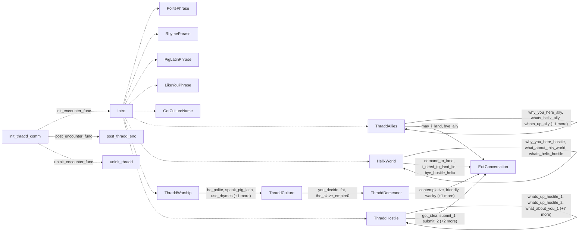

# Thraddash: existing conversation graph

> Generated by `tools/conversation_catalog.py`; do not edit this page by hand.

[Catalog and interpretation rules](../README.md) · [Proposed engine](../model.md)

Script: [thraddc.c](../../../../sc2/src/uqm/comm/thradd/thraddc.c#L1). Phrase bank: [thraddash.txt](../../../../sc2/content/base/comm/thraddash/thraddash.txt#L1).

16 handler/helper nodes; 38 response registration sites; 9 direct local calls; 154 phrase records.

## Initialization and lifecycle

| Phase | Callback | Bound by | Conditions / source |
| --- | --- | --- | --- |
| <code>init_encounter_func</code> | [<code>Intro</code>](#node-intro) | <code>init_thradd_comm</code> | No enclosing branch condition; [934](../../../../sc2/src/uqm/comm/thradd/thraddc.c#L934) |
| <code>post_encounter_func</code> | [<code>post_thradd_enc</code>](#node-post_thradd_enc) | <code>init_thradd_comm</code> | No enclosing branch condition; [935](../../../../sc2/src/uqm/comm/thradd/thraddc.c#L935) |
| <code>uninit_encounter_func</code> | [<code>uninit_thradd</code>](#node-uninit_thradd) | <code>init_thradd_comm</code> | No enclosing branch condition; [936](../../../../sc2/src/uqm/comm/thradd/thraddc.c#L936) |

## Handler graph

Solid arrows are selectable responses; dashed arrows are direct C calls. Conditions, arguments, speech and effects are cataloged below. Parallel response sites are grouped only in this diagram.



## Condition catalog

Condition IDs describe enclosing source structure. Branch predicates combine with ∧; case labels mark source locations that can also be reached by fallthrough. Values refer to their original evaluation points. Local assignments and early control flow remain in the decision bodies.

| ID | Source expression / structural condition |
| --- | --- |
| <a id="condition-c1"></a>C1 | <code>switch (GET_GAME_STATE(THRADD_CULTURE))</code> |
| <a id="condition-c2"></a>C2 | <code>case 1 (see source for fallthrough)</code> |
| <a id="condition-c3"></a>C3 | <code>case 2 (see source for fallthrough)</code> |
| <a id="condition-c4"></a>C4 | <code>case 3 (see source for fallthrough)</code> |
| <a id="condition-c5"></a>C5 | <code>default (see source for fallthrough)</code> |
| <a id="condition-c6"></a>C6 | <code>switch (which_phrase)</code> |
| <a id="condition-c7"></a>C7 | <code>case 0 (see source for fallthrough)</code> |
| <a id="condition-c8"></a>C8 | <code>PLAYER_SAID(R, bye_hostile_2)</code> |
| <a id="condition-c9"></a>C9 | <code>!(PLAYER_SAID(R, bye_hostile_2))</code> |
| <a id="condition-c10"></a>C10 | <code>PLAYER_SAID(R, bye_hostile_1)</code> |
| <a id="condition-c11"></a>C11 | <code>!(PLAYER_SAID(R, bye_hostile_1))</code> |
| <a id="condition-c12"></a>C12 | <code>PLAYER_SAID(R, submit_1)</code> |
| <a id="condition-c13"></a>C13 | <code>!(PLAYER_SAID(R, submit_1))</code> |
| <a id="condition-c14"></a>C14 | <code>PLAYER_SAID(R, submit_2)</code> |
| <a id="condition-c15"></a>C15 | <code>!(PLAYER_SAID(R, submit_2))</code> |
| <a id="condition-c16"></a>C16 | <code>PLAYER_SAID(R, got_idea)</code> |
| <a id="condition-c17"></a>C17 | <code>!(PLAYER_SAID(R, got_idea))</code> |
| <a id="condition-c18"></a>C18 | <code>PLAYER_SAID(R, bye_hostile_helix)</code> |
| <a id="condition-c19"></a>C19 | <code>!(PLAYER_SAID(R, bye_hostile_helix))</code> |
| <a id="condition-c20"></a>C20 | <code>PLAYER_SAID(R, bye_ally)</code> |
| <a id="condition-c21"></a>C21 | <code>switch (NumVisits++)</code> |
| <a id="condition-c22"></a>C22 | <code>!(PLAYER_SAID(R, bye_ally))</code> |
| <a id="condition-c23"></a>C23 | <code>PLAYER_SAID(R, may_i_land)</code> |
| <a id="condition-c24"></a>C24 | <code>!(PLAYER_SAID(R, may_i_land))</code> |
| <a id="condition-c25"></a>C25 | <code>PLAYER_SAID(R, demand_to_land)</code> |
| <a id="condition-c26"></a>C26 | <code>!(PLAYER_SAID(R, demand_to_land))</code> |
| <a id="condition-c27"></a>C27 | <code>PLAYER_SAID(R, i_need_to_land_lie)</code> |
| <a id="condition-c28"></a>C28 | <code>!(PLAYER_SAID(R, i_need_to_land_lie))</code> |
| <a id="condition-c29"></a>C29 | <code>PLAYER_SAID(R, contemplative)</code> |
| <a id="condition-c30"></a>C30 | <code>!(PLAYER_SAID(R, contemplative))</code> |
| <a id="condition-c31"></a>C31 | <code>PLAYER_SAID(R, friendly)</code> |
| <a id="condition-c32"></a>C32 | <code>!(PLAYER_SAID(R, friendly))</code> |
| <a id="condition-c33"></a>C33 | <code>PLAYER_SAID(R, wacky)</code> |
| <a id="condition-c34"></a>C34 | <code>!(PLAYER_SAID(R, wacky))</code> |
| <a id="condition-c35"></a>C35 | <code>PLAYER_SAID(R, just_like_us)</code> |
| <a id="condition-c36"></a>C36 | <code>PLAYER_SAID(R, why_you_here_ally)</code> |
| <a id="condition-c37"></a>C37 | <code>!(PLAYER_SAID(R, why_you_here_ally))</code> |
| <a id="condition-c38"></a>C38 | <code>PLAYER_SAID(R, whats_helix_ally)</code> |
| <a id="condition-c39"></a>C39 | <code>!(PLAYER_SAID(R, whats_helix_ally))</code> |
| <a id="condition-c40"></a>C40 | <code>PLAYER_SAID(R, whats_up_ally)</code> |
| <a id="condition-c41"></a>C41 | <code>!(PLAYER_SAID(R, whats_up_ally))</code> |
| <a id="condition-c42"></a>C42 | <code>PLAYER_SAID(R, how_goes_culture)</code> |
| <a id="condition-c43"></a>C43 | <code>switch (NumVisits &amp; ((1 &lt;&lt; 2) - 1))</code> |
| <a id="condition-c44"></a>C44 | <code>!(NumVisits &amp; (~((1 &lt;&lt; 2) - 1)))</code> |
| <a id="condition-c45"></a>C45 | <code>!(!(NumVisits &amp; (~((1 &lt;&lt; 2) - 1))))</code> |
| <a id="condition-c46"></a>C46 | <code>GET_GAME_STATE(GLOBAL_FLAGS_AND_DATA) &amp; (1 &lt;&lt; 6)</code> |
| <a id="condition-c47"></a>C47 | <code>PHRASE_ENABLED(why_you_here_ally)</code> |
| <a id="condition-c48"></a>C48 | <code>!(PHRASE_ENABLED(why_you_here_ally))</code> |
| <a id="condition-c49"></a>C49 | <code>PHRASE_ENABLED(whats_helix_ally)</code> |
| <a id="condition-c50"></a>C50 | <code>PHRASE_ENABLED(whats_up_ally)</code> |
| <a id="condition-c51"></a>C51 | <code>PHRASE_ENABLED(how_goes_culture)</code> |
| <a id="condition-c52"></a>C52 | <code>PLAYER_SAID(R, you_decide)</code> |
| <a id="condition-c53"></a>C53 | <code>!(PLAYER_SAID(R, you_decide))</code> |
| <a id="condition-c54"></a>C54 | <code>PLAYER_SAID(R, fat)</code> |
| <a id="condition-c55"></a>C55 | <code>!(PLAYER_SAID(R, fat))</code> |
| <a id="condition-c56"></a>C56 | <code>PLAYER_SAID(R, the_slave_empire0)</code> |
| <a id="condition-c57"></a>C57 | <code>PLAYER_SAID(R, be_polite)</code> |
| <a id="condition-c58"></a>C58 | <code>!(PLAYER_SAID(R, be_polite))</code> |
| <a id="condition-c59"></a>C59 | <code>PLAYER_SAID(R, use_rhymes)</code> |
| <a id="condition-c60"></a>C60 | <code>!(PLAYER_SAID(R, use_rhymes))</code> |
| <a id="condition-c61"></a>C61 | <code>PLAYER_SAID(R, speak_pig_latin)</code> |
| <a id="condition-c62"></a>C62 | <code>!(PLAYER_SAID(R, speak_pig_latin))</code> |
| <a id="condition-c63"></a>C63 | <code>PLAYER_SAID(R, just_the_way_we_do)</code> |
| <a id="condition-c64"></a>C64 | <code>PLAYER_SAID(R, why_you_here_hostile)</code> |
| <a id="condition-c65"></a>C65 | <code>!(PLAYER_SAID(R, why_you_here_hostile))</code> |
| <a id="condition-c66"></a>C66 | <code>PLAYER_SAID(R, what_about_this_world)</code> |
| <a id="condition-c67"></a>C67 | <code>!(PLAYER_SAID(R, what_about_this_world))</code> |
| <a id="condition-c68"></a>C68 | <code>PLAYER_SAID(R, whats_helix_hostile)</code> |
| <a id="condition-c69"></a>C69 | <code>!(PLAYER_SAID(R, whats_helix_hostile))</code> |
| <a id="condition-c70"></a>C70 | <code>!GET_GAME_STATE(THRADD_CULTURE)</code> |
| <a id="condition-c71"></a>C71 | <code>!(!GET_GAME_STATE(THRADD_CULTURE))</code> |
| <a id="condition-c72"></a>C72 | <code>switch (GET_GAME_STATE(THRADD_INTRO))</code> |
| <a id="condition-c73"></a>C73 | <code>!GET_GAME_STATE(THRADD_DEMEANOR)</code> |
| <a id="condition-c74"></a>C74 | <code>PLAYER_SAID(R, whats_up_hostile_1)</code> |
| <a id="condition-c75"></a>C75 | <code>!(PLAYER_SAID(R, whats_up_hostile_1))</code> |
| <a id="condition-c76"></a>C76 | <code>PLAYER_SAID(R, whats_up_hostile_2)</code> |
| <a id="condition-c77"></a>C77 | <code>!(PLAYER_SAID(R, whats_up_hostile_2))</code> |
| <a id="condition-c78"></a>C78 | <code>PLAYER_SAID(R, what_about_you_1)</code> |
| <a id="condition-c79"></a>C79 | <code>!(PLAYER_SAID(R, what_about_you_1))</code> |
| <a id="condition-c80"></a>C80 | <code>PLAYER_SAID(R, what_about_you_2)</code> |
| <a id="condition-c81"></a>C81 | <code>!(PLAYER_SAID(R, what_about_you_2))</code> |
| <a id="condition-c82"></a>C82 | <code>PLAYER_SAID(R, what_about_urquan_1)</code> |
| <a id="condition-c83"></a>C83 | <code>!(PLAYER_SAID(R, what_about_urquan_1))</code> |
| <a id="condition-c84"></a>C84 | <code>PLAYER_SAID(R, what_about_urquan_2)</code> |
| <a id="condition-c85"></a>C85 | <code>!(PLAYER_SAID(R, what_about_urquan_2))</code> |
| <a id="condition-c86"></a>C86 | <code>PLAYER_SAID(R, be_friends_1)</code> |
| <a id="condition-c87"></a>C87 | <code>!(PLAYER_SAID(R, be_friends_1))</code> |
| <a id="condition-c88"></a>C88 | <code>PLAYER_SAID(R, be_friends_2)</code> |
| <a id="condition-c89"></a>C89 | <code>!(PLAYER_SAID(R, be_friends_2))</code> |
| <a id="condition-c90"></a>C90 | <code>PLAYER_SAID(R, how_impressed_urquan_1)</code> |
| <a id="condition-c91"></a>C91 | <code>!(PLAYER_SAID(R, how_impressed_urquan_1))</code> |
| <a id="condition-c92"></a>C92 | <code>PLAYER_SAID(R, how_impressed_urquan_2)</code> |
| <a id="condition-c93"></a>C93 | <code>GET_GAME_STATE(THRADD_INFO) == 0</code> |
| <a id="condition-c94"></a>C94 | <code>!(GET_GAME_STATE(THRADD_INFO) == 0)</code> |
| <a id="condition-c95"></a>C95 | <code>PHRASE_ENABLED(whats_up_hostile_2)</code> |
| <a id="condition-c96"></a>C96 | <code>switch (GET_GAME_STATE(THRADD_STACK_1))</code> |
| <a id="condition-c97"></a>C97 | <code>case 4 (see source for fallthrough)</code> |
| <a id="condition-c98"></a>C98 | <code>!GET_GAME_STATE(KOHR_AH_FRENZY)</code> |
| <a id="condition-c99"></a>C99 | <code>!(!GET_GAME_STATE(KOHR_AH_FRENZY))</code> |
| <a id="condition-c100"></a>C100 | <code>GET_GAME_STATE(THRADD_HOSTILE_STACK_2) == 0</code> |
| <a id="condition-c101"></a>C101 | <code>!(GET_GAME_STATE(THRADD_HOSTILE_STACK_2) == 0)</code> |
| <a id="condition-c102"></a>C102 | <code>GET_GAME_STATE(THRADD_HOSTILE_STACK_3) == 0</code> |
| <a id="condition-c103"></a>C103 | <code>!(GET_GAME_STATE(THRADD_HOSTILE_STACK_3) == 0)</code> |
| <a id="condition-c104"></a>C104 | <code>PHRASE_ENABLED(be_friends_2)</code> |
| <a id="condition-c105"></a>C105 | <code>GET_GAME_STATE(THRADD_MISSION) == 4</code> |
| <a id="condition-c106"></a>C106 | <code>GET_GAME_STATE(THRADD_HOSTILE_STACK_4) == 0</code> |
| <a id="condition-c107"></a>C107 | <code>!(GET_GAME_STATE(THRADD_HOSTILE_STACK_4) == 0)</code> |
| <a id="condition-c108"></a>C108 | <code>GET_GAME_STATE(THRADD_HOSTILE_STACK_5) == 0</code> |
| <a id="condition-c109"></a>C109 | <code>!(GET_GAME_STATE(THRADD_HOSTILE_STACK_5) == 0)</code> |
| <a id="condition-c110"></a>C110 | <code>LOBYTE(GLOBAL(CurrentActivity)) == WON_LAST_BATTLE</code> |
| <a id="condition-c111"></a>C111 | <code>GET_GAME_STATE(AQUA_HELIX)</code> |
| <a id="condition-c112"></a>C112 | <code>!(GET_GAME_STATE(AQUA_HELIX))</code> |
| <a id="condition-c113"></a>C113 | <code>GET_GAME_STATE(ILWRATH_FIGHT_THRADDASH)</code> |
| <a id="condition-c114"></a>C114 | <code>GET_GAME_STATE(THRADD_MANNER)</code> |
| <a id="condition-c115"></a>C115 | <code>!(GET_GAME_STATE(THRADD_MANNER))</code> |
| <a id="condition-c116"></a>C116 | <code>!(GET_GAME_STATE(ILWRATH_FIGHT_THRADDASH))</code> |
| <a id="condition-c117"></a>C117 | <code>(++NumVisits) &lt; 4</code> |
| <a id="condition-c118"></a>C118 | <code>!(GET_GAME_STATE(GLOBAL_FLAGS_AND_DATA) &amp; (1 &lt;&lt; 6))</code> |
| <a id="condition-c119"></a>C119 | <code>GET_GAME_STATE(GLOBAL_FLAGS_AND_DATA) &amp; (1 &lt;&lt; 7)</code> |
| <a id="condition-c120"></a>C120 | <code>!(GET_GAME_STATE(GLOBAL_FLAGS_AND_DATA) &amp; (1 &lt;&lt; 7))</code> |
| <a id="condition-c121"></a>C121 | <code>GET_GAME_STATE(THRADDASH_BODY_COUNT) &gt;= THRADDASH_BODY_THRESHOLD</code> |
| <a id="condition-c122"></a>C122 | <code>!(GET_GAME_STATE(THRADDASH_BODY_COUNT) &gt;= THRADDASH_BODY_THRESHOLD)</code> |
| <a id="condition-c123"></a>C123 | <code>NumVisits &gt;= 16</code> |
| <a id="condition-c124"></a>C124 | <code>(NumVisits &gt;= 16) &amp;&amp; (GET_GAME_STATE(THRADD_BODY_LEVEL) == 1)</code> |
| <a id="condition-c125"></a>C125 | <code>!((NumVisits &gt;= 16) &amp;&amp; (GET_GAME_STATE(THRADD_BODY_LEVEL) == 1))</code> |
| <a id="condition-c126"></a>C126 | <code>NumVisits &gt;= 8</code> |
| <a id="condition-c127"></a>C127 | <code>(NumVisits &gt;= 8) &amp;&amp; (GET_GAME_STATE(THRADD_BODY_LEVEL) == 0)</code> |
| <a id="condition-c128"></a>C128 | <code>((NumVisits = GET_GAME_STATE(THRADD_MISSION)) == 0) &#124;&#124; (NumVisits &gt; 3)</code> |
| <a id="condition-c129"></a>C129 | <code>!(((NumVisits = GET_GAME_STATE(THRADD_MISSION)) == 0) &#124;&#124; (NumVisits &gt; 3))</code> |
| <a id="condition-c130"></a>C130 | <code>switch (NumVisits)</code> |
| <a id="condition-c131"></a>C131 | <code>GET_GAME_STATE(THRADD_MISSION_VISITS) == 0</code> |
| <a id="condition-c132"></a>C132 | <code>!(GET_GAME_STATE(THRADD_MISSION_VISITS) == 0)</code> |
| <a id="condition-c133"></a>C133 | <code>GET_GAME_STATE(THRADD_MANNER) &#124;&#124; (LOBYTE(GLOBAL(CurrentActivity)) == WON_LAST_BATTLE)</code> |
| <a id="condition-c134"></a>C134 | <code>!(GET_GAME_STATE(THRADD_MANNER) &#124;&#124; (LOBYTE(GLOBAL(CurrentActivity)) == WON_LAST_BATTLE))</code> |

## Script-scope state and lookup tables

These declarations supply shared local state, computed phrase alternatives, number speech, or lookup data used by the nodes. LOCDATA presentation defaults are linked separately in the source.

Presentation descriptor <code>thradd_desc</code>: [source](../../../../sc2/src/uqm/comm/thradd/thraddc.c#L27).

## Node catalog

<a id="node-getculturename"></a>

### GetCultureName

<code>static int GetCultureName(void)</code> — [source](../../../../sc2/src/uqm/comm/thradd/thraddc.c#L137).

Also called directly by: [<code>Intro</code>](#node-intro) ([798](../../../../sc2/src/uqm/comm/thradd/thraddc.c#L798)).

#### Actions, queries, local updates, and control flow

Calls are listed without assuming they are pure or mutating. Local updates are retained because they determine dynamic menus and counter-selected speech.

| Kind | Operation | Enclosing conditions | Source |
| --- | --- | --- | --- |
| local | <code>int culture = 0</code> | No enclosing branch condition | [139](../../../../sc2/src/uqm/comm/thradd/thraddc.c#L139) |
| call | <code>GET_GAME_STATE(THRADD_CULTURE)</code> | No enclosing branch condition | [141](../../../../sc2/src/uqm/comm/thradd/thraddc.c#L141) |
| update | <code>culture = CULTURE</code> | [C1](#condition-c1) ∧ [C2](#condition-c2) | [144](../../../../sc2/src/uqm/comm/thradd/thraddc.c#L144) |
| flow | <code>break;</code> | [C1](#condition-c1) ∧ [C2](#condition-c2) | [145](../../../../sc2/src/uqm/comm/thradd/thraddc.c#L145) |
| update | <code>culture = FAT_JERKS</code> | [C1](#condition-c1) ∧ [C3](#condition-c3) | [147](../../../../sc2/src/uqm/comm/thradd/thraddc.c#L147) |
| flow | <code>break;</code> | [C1](#condition-c1) ∧ [C3](#condition-c3) | [148](../../../../sc2/src/uqm/comm/thradd/thraddc.c#L148) |
| update | <code>culture = SLAVE_EMPIRE</code> | [C1](#condition-c1) ∧ [C4](#condition-c4) | [150](../../../../sc2/src/uqm/comm/thradd/thraddc.c#L150) |
| flow | <code>break;</code> | [C1](#condition-c1) ∧ [C4](#condition-c4) | [151](../../../../sc2/src/uqm/comm/thradd/thraddc.c#L151) |
| call | <code>assert(0 &amp;&amp; &quot;Unknown culture&quot;)</code> | [C1](#condition-c1) ∧ [C5](#condition-c5) | [153](../../../../sc2/src/uqm/comm/thradd/thraddc.c#L153) |
| flow | <code>return culture;</code> | No enclosing branch condition | [156](../../../../sc2/src/uqm/comm/thradd/thraddc.c#L156) |

<details>
<summary>Exact decision body (local calculations, early returns, fallthrough and ordering)</summary>

```c
{
	int culture = 0;

	switch (GET_GAME_STATE (THRADD_CULTURE))
	{
		case 1:
			culture = CULTURE;
			break;
		case 2:
			culture = FAT_JERKS;
			break;
		case 3:
			culture = SLAVE_EMPIRE;
			break;
		default:
			assert (0 && "Unknown culture");
	}

	return (culture);
}
```

</details>

<a id="node-politephrase"></a>

### PolitePhrase

<code>static void PolitePhrase(BYTE which_phrase)</code> — [source](../../../../sc2/src/uqm/comm/thradd/thraddc.c#L160).

Also called directly by: [<code>Intro</code>](#node-intro) ([765](../../../../sc2/src/uqm/comm/thradd/thraddc.c#L765)).

#### Dialogue / audio emissions

| Phrase or expression | Enclosing conditions | Source |
| --- | --- | --- |
| [<code>HELLO_POLITE_1</code>](#phrase-hello_polite_1)<br><code>NPCPhrase(HELLO_POLITE_1)</code> | [C6](#condition-c6) ∧ [C7](#condition-c7) | [165](../../../../sc2/src/uqm/comm/thradd/thraddc.c#L165) |
| [<code>HELLO_POLITE_2</code>](#phrase-hello_polite_2)<br><code>NPCPhrase(HELLO_POLITE_2)</code> | [C6](#condition-c6) ∧ [C2](#condition-c2) | [168](../../../../sc2/src/uqm/comm/thradd/thraddc.c#L168) |
| [<code>HELLO_POLITE_3</code>](#phrase-hello_polite_3)<br><code>NPCPhrase(HELLO_POLITE_3)</code> | [C6](#condition-c6) ∧ [C3](#condition-c3) | [171](../../../../sc2/src/uqm/comm/thradd/thraddc.c#L171) |
| [<code>HELLO_POLITE_4</code>](#phrase-hello_polite_4)<br><code>NPCPhrase(HELLO_POLITE_4)</code> | [C6](#condition-c6) ∧ [C4](#condition-c4) | [174](../../../../sc2/src/uqm/comm/thradd/thraddc.c#L174) |

#### Actions, queries, local updates, and control flow

Calls are listed without assuming they are pure or mutating. Local updates are retained because they determine dynamic menus and counter-selected speech.

| Kind | Operation | Enclosing conditions | Source |
| --- | --- | --- | --- |
| flow | <code>break;</code> | [C6](#condition-c6) ∧ [C7](#condition-c7) | [166](../../../../sc2/src/uqm/comm/thradd/thraddc.c#L166) |
| flow | <code>break;</code> | [C6](#condition-c6) ∧ [C2](#condition-c2) | [169](../../../../sc2/src/uqm/comm/thradd/thraddc.c#L169) |
| flow | <code>break;</code> | [C6](#condition-c6) ∧ [C3](#condition-c3) | [172](../../../../sc2/src/uqm/comm/thradd/thraddc.c#L172) |
| flow | <code>break;</code> | [C6](#condition-c6) ∧ [C4](#condition-c4) | [175](../../../../sc2/src/uqm/comm/thradd/thraddc.c#L175) |

<details>
<summary>Exact decision body (local calculations, early returns, fallthrough and ordering)</summary>

```c
{
	switch (which_phrase)
	{
		case 0:
			NPCPhrase (HELLO_POLITE_1);
			break;
		case 1:
			NPCPhrase (HELLO_POLITE_2);
			break;
		case 2:
			NPCPhrase (HELLO_POLITE_3);
			break;
		case 3:
			NPCPhrase (HELLO_POLITE_4);
			break;
	}
}
```

</details>

<a id="node-rhymephrase"></a>

### RhymePhrase

<code>static void RhymePhrase(BYTE which_phrase)</code> — [source](../../../../sc2/src/uqm/comm/thradd/thraddc.c#L180).

Also called directly by: [<code>Intro</code>](#node-intro) ([768](../../../../sc2/src/uqm/comm/thradd/thraddc.c#L768)).

#### Dialogue / audio emissions

| Phrase or expression | Enclosing conditions | Source |
| --- | --- | --- |
| [<code>HELLO_RHYME_1</code>](#phrase-hello_rhyme_1)<br><code>NPCPhrase(HELLO_RHYME_1)</code> | [C6](#condition-c6) ∧ [C7](#condition-c7) | [185](../../../../sc2/src/uqm/comm/thradd/thraddc.c#L185) |
| [<code>HELLO_RHYME_2</code>](#phrase-hello_rhyme_2)<br><code>NPCPhrase(HELLO_RHYME_2)</code> | [C6](#condition-c6) ∧ [C2](#condition-c2) | [188](../../../../sc2/src/uqm/comm/thradd/thraddc.c#L188) |
| [<code>HELLO_RHYME_3</code>](#phrase-hello_rhyme_3)<br><code>NPCPhrase(HELLO_RHYME_3)</code> | [C6](#condition-c6) ∧ [C3](#condition-c3) | [191](../../../../sc2/src/uqm/comm/thradd/thraddc.c#L191) |
| [<code>HELLO_RHYME_4</code>](#phrase-hello_rhyme_4)<br><code>NPCPhrase(HELLO_RHYME_4)</code> | [C6](#condition-c6) ∧ [C4](#condition-c4) | [194](../../../../sc2/src/uqm/comm/thradd/thraddc.c#L194) |

#### Actions, queries, local updates, and control flow

Calls are listed without assuming they are pure or mutating. Local updates are retained because they determine dynamic menus and counter-selected speech.

| Kind | Operation | Enclosing conditions | Source |
| --- | --- | --- | --- |
| flow | <code>break;</code> | [C6](#condition-c6) ∧ [C7](#condition-c7) | [186](../../../../sc2/src/uqm/comm/thradd/thraddc.c#L186) |
| flow | <code>break;</code> | [C6](#condition-c6) ∧ [C2](#condition-c2) | [189](../../../../sc2/src/uqm/comm/thradd/thraddc.c#L189) |
| flow | <code>break;</code> | [C6](#condition-c6) ∧ [C3](#condition-c3) | [192](../../../../sc2/src/uqm/comm/thradd/thraddc.c#L192) |
| flow | <code>break;</code> | [C6](#condition-c6) ∧ [C4](#condition-c4) | [195](../../../../sc2/src/uqm/comm/thradd/thraddc.c#L195) |

<details>
<summary>Exact decision body (local calculations, early returns, fallthrough and ordering)</summary>

```c
{
	switch (which_phrase)
	{
		case 0:
			NPCPhrase (HELLO_RHYME_1);
			break;
		case 1:
			NPCPhrase (HELLO_RHYME_2);
			break;
		case 2:
			NPCPhrase (HELLO_RHYME_3);
			break;
		case 3:
			NPCPhrase (HELLO_RHYME_4);
			break;
	}
}
```

</details>

<a id="node-piglatinphrase"></a>

### PigLatinPhrase

<code>static void PigLatinPhrase(BYTE which_phrase)</code> — [source](../../../../sc2/src/uqm/comm/thradd/thraddc.c#L200).

Also called directly by: [<code>Intro</code>](#node-intro) ([771](../../../../sc2/src/uqm/comm/thradd/thraddc.c#L771)).

#### Dialogue / audio emissions

| Phrase or expression | Enclosing conditions | Source |
| --- | --- | --- |
| [<code>HELLO_PIG_LATIN_1</code>](#phrase-hello_pig_latin_1)<br><code>NPCPhrase(HELLO_PIG_LATIN_1)</code> | [C6](#condition-c6) ∧ [C7](#condition-c7) | [205](../../../../sc2/src/uqm/comm/thradd/thraddc.c#L205) |
| [<code>HELLO_PIG_LATIN_2</code>](#phrase-hello_pig_latin_2)<br><code>NPCPhrase(HELLO_PIG_LATIN_2)</code> | [C6](#condition-c6) ∧ [C2](#condition-c2) | [208](../../../../sc2/src/uqm/comm/thradd/thraddc.c#L208) |
| [<code>HELLO_PIG_LATIN_3</code>](#phrase-hello_pig_latin_3)<br><code>NPCPhrase(HELLO_PIG_LATIN_3)</code> | [C6](#condition-c6) ∧ [C3](#condition-c3) | [211](../../../../sc2/src/uqm/comm/thradd/thraddc.c#L211) |
| [<code>HELLO_PIG_LATIN_4</code>](#phrase-hello_pig_latin_4)<br><code>NPCPhrase(HELLO_PIG_LATIN_4)</code> | [C6](#condition-c6) ∧ [C4](#condition-c4) | [214](../../../../sc2/src/uqm/comm/thradd/thraddc.c#L214) |

#### Actions, queries, local updates, and control flow

Calls are listed without assuming they are pure or mutating. Local updates are retained because they determine dynamic menus and counter-selected speech.

| Kind | Operation | Enclosing conditions | Source |
| --- | --- | --- | --- |
| flow | <code>break;</code> | [C6](#condition-c6) ∧ [C7](#condition-c7) | [206](../../../../sc2/src/uqm/comm/thradd/thraddc.c#L206) |
| flow | <code>break;</code> | [C6](#condition-c6) ∧ [C2](#condition-c2) | [209](../../../../sc2/src/uqm/comm/thradd/thraddc.c#L209) |
| flow | <code>break;</code> | [C6](#condition-c6) ∧ [C3](#condition-c3) | [212](../../../../sc2/src/uqm/comm/thradd/thraddc.c#L212) |
| flow | <code>break;</code> | [C6](#condition-c6) ∧ [C4](#condition-c4) | [215](../../../../sc2/src/uqm/comm/thradd/thraddc.c#L215) |

<details>
<summary>Exact decision body (local calculations, early returns, fallthrough and ordering)</summary>

```c
{
	switch (which_phrase)
	{
		case 0:
			NPCPhrase (HELLO_PIG_LATIN_1);
			break;
		case 1:
			NPCPhrase (HELLO_PIG_LATIN_2);
			break;
		case 2:
			NPCPhrase (HELLO_PIG_LATIN_3);
			break;
		case 3:
			NPCPhrase (HELLO_PIG_LATIN_4);
			break;
	}
}
```

</details>

<a id="node-likeyouphrase"></a>

### LikeYouPhrase

<code>static void LikeYouPhrase(BYTE which_phrase)</code> — [source](../../../../sc2/src/uqm/comm/thradd/thraddc.c#L220).

Also called directly by: [<code>Intro</code>](#node-intro) ([774](../../../../sc2/src/uqm/comm/thradd/thraddc.c#L774)).

#### Dialogue / audio emissions

| Phrase or expression | Enclosing conditions | Source |
| --- | --- | --- |
| [<code>HELLO_LIKE_YOU_1</code>](#phrase-hello_like_you_1)<br><code>NPCPhrase(HELLO_LIKE_YOU_1)</code> | [C6](#condition-c6) ∧ [C7](#condition-c7) | [225](../../../../sc2/src/uqm/comm/thradd/thraddc.c#L225) |
| [<code>HELLO_LIKE_YOU_2</code>](#phrase-hello_like_you_2)<br><code>NPCPhrase(HELLO_LIKE_YOU_2)</code> | [C6](#condition-c6) ∧ [C2](#condition-c2) | [228](../../../../sc2/src/uqm/comm/thradd/thraddc.c#L228) |
| [<code>HELLO_LIKE_YOU_3</code>](#phrase-hello_like_you_3)<br><code>NPCPhrase(HELLO_LIKE_YOU_3)</code> | [C6](#condition-c6) ∧ [C3](#condition-c3) | [231](../../../../sc2/src/uqm/comm/thradd/thraddc.c#L231) |
| [<code>HELLO_LIKE_YOU_4</code>](#phrase-hello_like_you_4)<br><code>NPCPhrase(HELLO_LIKE_YOU_4)</code> | [C6](#condition-c6) ∧ [C4](#condition-c4) | [234](../../../../sc2/src/uqm/comm/thradd/thraddc.c#L234) |

#### Actions, queries, local updates, and control flow

Calls are listed without assuming they are pure or mutating. Local updates are retained because they determine dynamic menus and counter-selected speech.

| Kind | Operation | Enclosing conditions | Source |
| --- | --- | --- | --- |
| flow | <code>break;</code> | [C6](#condition-c6) ∧ [C7](#condition-c7) | [226](../../../../sc2/src/uqm/comm/thradd/thraddc.c#L226) |
| flow | <code>break;</code> | [C6](#condition-c6) ∧ [C2](#condition-c2) | [229](../../../../sc2/src/uqm/comm/thradd/thraddc.c#L229) |
| flow | <code>break;</code> | [C6](#condition-c6) ∧ [C3](#condition-c3) | [232](../../../../sc2/src/uqm/comm/thradd/thraddc.c#L232) |
| flow | <code>break;</code> | [C6](#condition-c6) ∧ [C4](#condition-c4) | [235](../../../../sc2/src/uqm/comm/thradd/thraddc.c#L235) |

<details>
<summary>Exact decision body (local calculations, early returns, fallthrough and ordering)</summary>

```c
{
	switch (which_phrase)
	{
		case 0:
			NPCPhrase (HELLO_LIKE_YOU_1);
			break;
		case 1:
			NPCPhrase (HELLO_LIKE_YOU_2);
			break;
		case 2:
			NPCPhrase (HELLO_LIKE_YOU_3);
			break;
		case 3:
			NPCPhrase (HELLO_LIKE_YOU_4);
			break;
	}
}
```

</details>

<a id="node-exitconversation"></a>

### ExitConversation

<code>static void ExitConversation(RESPONSE_REF R)</code> — [source](../../../../sc2/src/uqm/comm/thradd/thraddc.c#L240).

Incoming player-response variants: [<code>may_i_land</code>](#phrase-may_i_land), [<code>bye_ally</code>](#phrase-bye_ally), [<code>contemplative</code>](#phrase-contemplative), [<code>friendly</code>](#phrase-friendly), [<code>wacky</code>](#phrase-wacky), [<code>just_like_us</code>](#phrase-just_like_us), [<code>demand_to_land</code>](#phrase-demand_to_land), [<code>i_need_to_land_lie</code>](#phrase-i_need_to_land_lie), [<code>bye_hostile_helix</code>](#phrase-bye_hostile_helix), [<code>got_idea</code>](#phrase-got_idea), [<code>submit_1</code>](#phrase-submit_1), [<code>submit_2</code>](#phrase-submit_2), [<code>bye_hostile_1</code>](#phrase-bye_hostile_1), [<code>bye_hostile_2</code>](#phrase-bye_hostile_2).

#### Dialogue / audio emissions

| Phrase or expression | Enclosing conditions | Source |
| --- | --- | --- |
| [<code>GOODBYE_HOSTILE_2</code>](#phrase-goodbye_hostile_2)<br><code>NPCPhrase(GOODBYE_HOSTILE_2)</code> | [C8](#condition-c8) | [245](../../../../sc2/src/uqm/comm/thradd/thraddc.c#L245) |
| [<code>GOODBYE_HOSTILE_1</code>](#phrase-goodbye_hostile_1)<br><code>NPCPhrase(GOODBYE_HOSTILE_1)</code> | [C9](#condition-c9) ∧ [C10](#condition-c10) | [248](../../../../sc2/src/uqm/comm/thradd/thraddc.c#L248) |
| [<code>NO_SUBMIT_1</code>](#phrase-no_submit_1)<br><code>NPCPhrase(NO_SUBMIT_1)</code> | [C9](#condition-c9) ∧ [C11](#condition-c11) ∧ [C12](#condition-c12) | [254](../../../../sc2/src/uqm/comm/thradd/thraddc.c#L254) |
| [<code>NO_SUBMIT_2</code>](#phrase-no_submit_2)<br><code>NPCPhrase(NO_SUBMIT_2)</code> | [C9](#condition-c9) ∧ [C11](#condition-c11) ∧ [C13](#condition-c13) ∧ [C14](#condition-c14) | [259](../../../../sc2/src/uqm/comm/thradd/thraddc.c#L259) |
| [<code>GOOD_IDEA</code>](#phrase-good_idea)<br><code>NPCPhrase(GOOD_IDEA)</code> | [C9](#condition-c9) ∧ [C11](#condition-c11) ∧ [C13](#condition-c13) ∧ [C15](#condition-c15) ∧ [C16](#condition-c16) | [262](../../../../sc2/src/uqm/comm/thradd/thraddc.c#L262) |
| [<code>GOODBYE_HOSTILE_HELIX</code>](#phrase-goodbye_hostile_helix)<br><code>NPCPhrase(GOODBYE_HOSTILE_HELIX)</code> | [C9](#condition-c9) ∧ [C11](#condition-c11) ∧ [C13](#condition-c13) ∧ [C15](#condition-c15) ∧ [C17](#condition-c17) ∧ [C18](#condition-c18) | [269](../../../../sc2/src/uqm/comm/thradd/thraddc.c#L269) |
| [<code>GOODBYE_ALLY_1</code>](#phrase-goodbye_ally_1)<br><code>NPCPhrase(GOODBYE_ALLY_1)</code> | [C9](#condition-c9) ∧ [C11](#condition-c11) ∧ [C13](#condition-c13) ∧ [C15](#condition-c15) ∧ [C17](#condition-c17) ∧ [C19](#condition-c19) ∧ [C20](#condition-c20) ∧ [C21](#condition-c21) ∧ [C7](#condition-c7) | [278](../../../../sc2/src/uqm/comm/thradd/thraddc.c#L278) |
| [<code>GOODBYE_ALLY_2</code>](#phrase-goodbye_ally_2)<br><code>NPCPhrase(GOODBYE_ALLY_2)</code> | [C9](#condition-c9) ∧ [C11](#condition-c11) ∧ [C13](#condition-c13) ∧ [C15](#condition-c15) ∧ [C17](#condition-c17) ∧ [C19](#condition-c19) ∧ [C20](#condition-c20) ∧ [C21](#condition-c21) ∧ [C2](#condition-c2) | [281](../../../../sc2/src/uqm/comm/thradd/thraddc.c#L281) |
| [<code>GOODBYE_ALLY_3</code>](#phrase-goodbye_ally_3)<br><code>NPCPhrase(GOODBYE_ALLY_3)</code> | [C9](#condition-c9) ∧ [C11](#condition-c11) ∧ [C13](#condition-c13) ∧ [C15](#condition-c15) ∧ [C17](#condition-c17) ∧ [C19](#condition-c19) ∧ [C20](#condition-c20) ∧ [C21](#condition-c21) ∧ [C3](#condition-c3) | [284](../../../../sc2/src/uqm/comm/thradd/thraddc.c#L284) |
| [<code>GOODBYE_ALLY_4</code>](#phrase-goodbye_ally_4)<br><code>NPCPhrase(GOODBYE_ALLY_4)</code> | [C9](#condition-c9) ∧ [C11](#condition-c11) ∧ [C13](#condition-c13) ∧ [C15](#condition-c15) ∧ [C17](#condition-c17) ∧ [C19](#condition-c19) ∧ [C20](#condition-c20) ∧ [C21](#condition-c21) ∧ [C4](#condition-c4) | [287](../../../../sc2/src/uqm/comm/thradd/thraddc.c#L287) |
| [<code>SURE_LAND</code>](#phrase-sure_land)<br><code>NPCPhrase(SURE_LAND)</code> | [C9](#condition-c9) ∧ [C11](#condition-c11) ∧ [C13](#condition-c13) ∧ [C15](#condition-c15) ∧ [C17](#condition-c17) ∧ [C19](#condition-c19) ∧ [C22](#condition-c22) ∧ [C23](#condition-c23) | [296](../../../../sc2/src/uqm/comm/thradd/thraddc.c#L296) |
| [<code>NO_DEMAND</code>](#phrase-no_demand)<br><code>NPCPhrase(NO_DEMAND)</code> | [C9](#condition-c9) ∧ [C11](#condition-c11) ∧ [C13](#condition-c13) ∧ [C15](#condition-c15) ∧ [C17](#condition-c17) ∧ [C19](#condition-c19) ∧ [C22](#condition-c22) ∧ [C24](#condition-c24) ∧ [C25](#condition-c25) | [302](../../../../sc2/src/uqm/comm/thradd/thraddc.c#L302) |
| [<code>CAUGHT_LIE</code>](#phrase-caught_lie)<br><code>NPCPhrase(CAUGHT_LIE)</code> | [C9](#condition-c9) ∧ [C11](#condition-c11) ∧ [C13](#condition-c13) ∧ [C15](#condition-c15) ∧ [C17](#condition-c17) ∧ [C19](#condition-c19) ∧ [C22](#condition-c22) ∧ [C24](#condition-c24) ∧ [C26](#condition-c26) ∧ [C27](#condition-c27) | [304](../../../../sc2/src/uqm/comm/thradd/thraddc.c#L304) |
| [<code>OK_CONTEMPLATIVE</code>](#phrase-ok_contemplative)<br><code>NPCPhrase(OK_CONTEMPLATIVE)</code> | [C9](#condition-c9) ∧ [C11](#condition-c11) ∧ [C13](#condition-c13) ∧ [C15](#condition-c15) ∧ [C17](#condition-c17) ∧ [C19](#condition-c19) ∧ [C22](#condition-c22) ∧ [C24](#condition-c24) ∧ [C26](#condition-c26) ∧ [C28](#condition-c28) ∧ [C29](#condition-c29) | [309](../../../../sc2/src/uqm/comm/thradd/thraddc.c#L309) |
| [<code>OK_FRIENDLY</code>](#phrase-ok_friendly)<br><code>NPCPhrase(OK_FRIENDLY)</code> | [C9](#condition-c9) ∧ [C11](#condition-c11) ∧ [C13](#condition-c13) ∧ [C15](#condition-c15) ∧ [C17](#condition-c17) ∧ [C19](#condition-c19) ∧ [C22](#condition-c22) ∧ [C24](#condition-c24) ∧ [C26](#condition-c26) ∧ [C28](#condition-c28) ∧ [C30](#condition-c30) ∧ [C31](#condition-c31) | [315](../../../../sc2/src/uqm/comm/thradd/thraddc.c#L315) |
| [<code>OK_WACKY</code>](#phrase-ok_wacky)<br><code>NPCPhrase(OK_WACKY)</code> | [C9](#condition-c9) ∧ [C11](#condition-c11) ∧ [C13](#condition-c13) ∧ [C15](#condition-c15) ∧ [C17](#condition-c17) ∧ [C19](#condition-c19) ∧ [C22](#condition-c22) ∧ [C24](#condition-c24) ∧ [C26](#condition-c26) ∧ [C28](#condition-c28) ∧ [C30](#condition-c30) ∧ [C32](#condition-c32) ∧ [C33](#condition-c33) | [321](../../../../sc2/src/uqm/comm/thradd/thraddc.c#L321) |
| [<code>OK_JUST_LIKE_YOU</code>](#phrase-ok_just_like_you)<br><code>NPCPhrase(OK_JUST_LIKE_YOU)</code> | [C9](#condition-c9) ∧ [C11](#condition-c11) ∧ [C13](#condition-c13) ∧ [C15](#condition-c15) ∧ [C17](#condition-c17) ∧ [C19](#condition-c19) ∧ [C22](#condition-c22) ∧ [C24](#condition-c24) ∧ [C26](#condition-c26) ∧ [C28](#condition-c28) ∧ [C30](#condition-c30) ∧ [C32](#condition-c32) ∧ [C34](#condition-c34) ∧ [C35](#condition-c35) | [327](../../../../sc2/src/uqm/comm/thradd/thraddc.c#L327) |
| [<code>WORK_TO_DO</code>](#phrase-work_to_do)<br><code>NPCPhrase(WORK_TO_DO)</code> | [C9](#condition-c9) ∧ [C11](#condition-c11) ∧ [C13](#condition-c13) ∧ [C15](#condition-c15) ∧ [C17](#condition-c17) ∧ [C19](#condition-c19) ∧ [C22](#condition-c22) ∧ [C24](#condition-c24) ∧ [C26](#condition-c26) ∧ [C28](#condition-c28) | [331](../../../../sc2/src/uqm/comm/thradd/thraddc.c#L331) |

#### Actions, queries, local updates, and control flow

Calls are listed without assuming they are pure or mutating. Local updates are retained because they determine dynamic menus and counter-selected speech.

| Kind | Operation | Enclosing conditions | Source |
| --- | --- | --- | --- |
| call | <code>setSegue(Segue_hostile)</code> | No enclosing branch condition | [242](../../../../sc2/src/uqm/comm/thradd/thraddc.c#L242) |
| call | <code>PLAYER_SAID(R, bye_hostile_2)</code> | No enclosing branch condition | [244](../../../../sc2/src/uqm/comm/thradd/thraddc.c#L244) |
| call | <code>PLAYER_SAID(R, bye_hostile_1)</code> | [C9](#condition-c9) | [246](../../../../sc2/src/uqm/comm/thradd/thraddc.c#L246) |
| call | <code>SET_GAME_STATE(THRADD_HOSTILE_STACK_5, 1)</code> | [C9](#condition-c9) ∧ [C10](#condition-c10) | [250](../../../../sc2/src/uqm/comm/thradd/thraddc.c#L250) |
| call | <code>PLAYER_SAID(R, submit_1)</code> | [C9](#condition-c9) ∧ [C11](#condition-c11) | [252](../../../../sc2/src/uqm/comm/thradd/thraddc.c#L252) |
| call | <code>SET_GAME_STATE(THRADD_HOSTILE_STACK_2, 1)</code> | [C9](#condition-c9) ∧ [C11](#condition-c11) ∧ [C12](#condition-c12) | [256](../../../../sc2/src/uqm/comm/thradd/thraddc.c#L256) |
| call | <code>PLAYER_SAID(R, submit_2)</code> | [C9](#condition-c9) ∧ [C11](#condition-c11) ∧ [C13](#condition-c13) | [258](../../../../sc2/src/uqm/comm/thradd/thraddc.c#L258) |
| call | <code>PLAYER_SAID(R, got_idea)</code> | [C9](#condition-c9) ∧ [C11](#condition-c11) ∧ [C13](#condition-c13) ∧ [C15](#condition-c15) | [260](../../../../sc2/src/uqm/comm/thradd/thraddc.c#L260) |
| call | <code>setSegue(Segue_peace)</code> | [C9](#condition-c9) ∧ [C11](#condition-c11) ∧ [C13](#condition-c13) ∧ [C15](#condition-c15) ∧ [C16](#condition-c16) | [264](../../../../sc2/src/uqm/comm/thradd/thraddc.c#L264) |
| call | <code>AddEvent(RELATIVE_EVENT, 0, 0, 0, ADVANCE_THRADD_MISSION)</code> | [C9](#condition-c9) ∧ [C11](#condition-c11) ∧ [C13](#condition-c13) ∧ [C15](#condition-c15) ∧ [C16](#condition-c16) | [265](../../../../sc2/src/uqm/comm/thradd/thraddc.c#L265) |
| call | <code>SET_GAME_STATE(THRADD_STACK_1, 5)</code> | [C9](#condition-c9) ∧ [C11](#condition-c11) ∧ [C13](#condition-c13) ∧ [C15](#condition-c15) ∧ [C16](#condition-c16) | [266](../../../../sc2/src/uqm/comm/thradd/thraddc.c#L266) |
| call | <code>PLAYER_SAID(R, bye_hostile_helix)</code> | [C9](#condition-c9) ∧ [C11](#condition-c11) ∧ [C13](#condition-c13) ∧ [C15](#condition-c15) ∧ [C17](#condition-c17) | [268](../../../../sc2/src/uqm/comm/thradd/thraddc.c#L268) |
| call | <code>PLAYER_SAID(R, bye_ally)</code> | [C9](#condition-c9) ∧ [C11](#condition-c11) ∧ [C13](#condition-c13) ∧ [C15](#condition-c15) ∧ [C17](#condition-c17) ∧ [C19](#condition-c19) | [270](../../../../sc2/src/uqm/comm/thradd/thraddc.c#L270) |
| update | <code>NumVisits = GET_GAME_STATE(THRADD_STACK_1)</code> | [C9](#condition-c9) ∧ [C11](#condition-c11) ∧ [C13](#condition-c13) ∧ [C15](#condition-c15) ∧ [C17](#condition-c17) ∧ [C19](#condition-c19) ∧ [C20](#condition-c20) | [274](../../../../sc2/src/uqm/comm/thradd/thraddc.c#L274) |
| call | <code>GET_GAME_STATE(THRADD_STACK_1)</code> | [C9](#condition-c9) ∧ [C11](#condition-c11) ∧ [C13](#condition-c13) ∧ [C15](#condition-c15) ∧ [C17](#condition-c17) ∧ [C19](#condition-c19) ∧ [C20](#condition-c20) | [274](../../../../sc2/src/uqm/comm/thradd/thraddc.c#L274) |
| update | <code>NumVisits++</code> | [C9](#condition-c9) ∧ [C11](#condition-c11) ∧ [C13](#condition-c13) ∧ [C15](#condition-c15) ∧ [C17](#condition-c17) ∧ [C19](#condition-c19) ∧ [C20](#condition-c20) | [275](../../../../sc2/src/uqm/comm/thradd/thraddc.c#L275) |
| flow | <code>break;</code> | [C9](#condition-c9) ∧ [C11](#condition-c11) ∧ [C13](#condition-c13) ∧ [C15](#condition-c15) ∧ [C17](#condition-c17) ∧ [C19](#condition-c19) ∧ [C20](#condition-c20) ∧ [C21](#condition-c21) ∧ [C7](#condition-c7) | [279](../../../../sc2/src/uqm/comm/thradd/thraddc.c#L279) |
| flow | <code>break;</code> | [C9](#condition-c9) ∧ [C11](#condition-c11) ∧ [C13](#condition-c13) ∧ [C15](#condition-c15) ∧ [C17](#condition-c17) ∧ [C19](#condition-c19) ∧ [C20](#condition-c20) ∧ [C21](#condition-c21) ∧ [C2](#condition-c2) | [282](../../../../sc2/src/uqm/comm/thradd/thraddc.c#L282) |
| flow | <code>break;</code> | [C9](#condition-c9) ∧ [C11](#condition-c11) ∧ [C13](#condition-c13) ∧ [C15](#condition-c15) ∧ [C17](#condition-c17) ∧ [C19](#condition-c19) ∧ [C20](#condition-c20) ∧ [C21](#condition-c21) ∧ [C3](#condition-c3) | [285](../../../../sc2/src/uqm/comm/thradd/thraddc.c#L285) |
| update | <code>--NumVisits</code> | [C9](#condition-c9) ∧ [C11](#condition-c11) ∧ [C13](#condition-c13) ∧ [C15](#condition-c15) ∧ [C17](#condition-c17) ∧ [C19](#condition-c19) ∧ [C20](#condition-c20) ∧ [C21](#condition-c21) ∧ [C4](#condition-c4) | [288](../../../../sc2/src/uqm/comm/thradd/thraddc.c#L288) |
| flow | <code>break;</code> | [C9](#condition-c9) ∧ [C11](#condition-c11) ∧ [C13](#condition-c13) ∧ [C15](#condition-c15) ∧ [C17](#condition-c17) ∧ [C19](#condition-c19) ∧ [C20](#condition-c20) ∧ [C21](#condition-c21) ∧ [C4](#condition-c4) | [289](../../../../sc2/src/uqm/comm/thradd/thraddc.c#L289) |
| call | <code>SET_GAME_STATE(THRADD_STACK_1, NumVisits)</code> | [C9](#condition-c9) ∧ [C11](#condition-c11) ∧ [C13](#condition-c13) ∧ [C15](#condition-c15) ∧ [C17](#condition-c17) ∧ [C19](#condition-c19) ∧ [C20](#condition-c20) | [291](../../../../sc2/src/uqm/comm/thradd/thraddc.c#L291) |
| call | <code>setSegue(Segue_peace)</code> | [C9](#condition-c9) ∧ [C11](#condition-c11) ∧ [C13](#condition-c13) ∧ [C15](#condition-c15) ∧ [C17](#condition-c17) ∧ [C19](#condition-c19) ∧ [C20](#condition-c20) | [292](../../../../sc2/src/uqm/comm/thradd/thraddc.c#L292) |
| call | <code>PLAYER_SAID(R, may_i_land)</code> | [C9](#condition-c9) ∧ [C11](#condition-c11) ∧ [C13](#condition-c13) ∧ [C15](#condition-c15) ∧ [C17](#condition-c17) ∧ [C19](#condition-c19) ∧ [C22](#condition-c22) | [294](../../../../sc2/src/uqm/comm/thradd/thraddc.c#L294) |
| call | <code>SET_GAME_STATE(HELIX_UNPROTECTED, 1)</code> | [C9](#condition-c9) ∧ [C11](#condition-c11) ∧ [C13](#condition-c13) ∧ [C15](#condition-c15) ∧ [C17](#condition-c17) ∧ [C19](#condition-c19) ∧ [C22](#condition-c22) ∧ [C23](#condition-c23) | [298](../../../../sc2/src/uqm/comm/thradd/thraddc.c#L298) |
| call | <code>setSegue(Segue_peace)</code> | [C9](#condition-c9) ∧ [C11](#condition-c11) ∧ [C13](#condition-c13) ∧ [C15](#condition-c15) ∧ [C17](#condition-c17) ∧ [C19](#condition-c19) ∧ [C22](#condition-c22) ∧ [C23](#condition-c23) | [299](../../../../sc2/src/uqm/comm/thradd/thraddc.c#L299) |
| call | <code>PLAYER_SAID(R, demand_to_land)</code> | [C9](#condition-c9) ∧ [C11](#condition-c11) ∧ [C13](#condition-c13) ∧ [C15](#condition-c15) ∧ [C17](#condition-c17) ∧ [C19](#condition-c19) ∧ [C22](#condition-c22) ∧ [C24](#condition-c24) | [301](../../../../sc2/src/uqm/comm/thradd/thraddc.c#L301) |
| call | <code>PLAYER_SAID(R, i_need_to_land_lie)</code> | [C9](#condition-c9) ∧ [C11](#condition-c11) ∧ [C13](#condition-c13) ∧ [C15](#condition-c15) ∧ [C17](#condition-c17) ∧ [C19](#condition-c19) ∧ [C22](#condition-c22) ∧ [C24](#condition-c24) ∧ [C26](#condition-c26) | [303](../../../../sc2/src/uqm/comm/thradd/thraddc.c#L303) |
| call | <code>PLAYER_SAID(R, contemplative)</code> | [C9](#condition-c9) ∧ [C11](#condition-c11) ∧ [C13](#condition-c13) ∧ [C15](#condition-c15) ∧ [C17](#condition-c17) ∧ [C19](#condition-c19) ∧ [C22](#condition-c22) ∧ [C24](#condition-c24) ∧ [C26](#condition-c26) ∧ [C28](#condition-c28) | [307](../../../../sc2/src/uqm/comm/thradd/thraddc.c#L307) |
| call | <code>SET_GAME_STATE(THRADD_DEMEANOR, 0)</code> | [C9](#condition-c9) ∧ [C11](#condition-c11) ∧ [C13](#condition-c13) ∧ [C15](#condition-c15) ∧ [C17](#condition-c17) ∧ [C19](#condition-c19) ∧ [C22](#condition-c22) ∧ [C24](#condition-c24) ∧ [C26](#condition-c26) ∧ [C28](#condition-c28) ∧ [C29](#condition-c29) | [311](../../../../sc2/src/uqm/comm/thradd/thraddc.c#L311) |
| call | <code>PLAYER_SAID(R, friendly)</code> | [C9](#condition-c9) ∧ [C11](#condition-c11) ∧ [C13](#condition-c13) ∧ [C15](#condition-c15) ∧ [C17](#condition-c17) ∧ [C19](#condition-c19) ∧ [C22](#condition-c22) ∧ [C24](#condition-c24) ∧ [C26](#condition-c26) ∧ [C28](#condition-c28) ∧ [C30](#condition-c30) | [313](../../../../sc2/src/uqm/comm/thradd/thraddc.c#L313) |
| call | <code>SET_GAME_STATE(THRADD_DEMEANOR, 1)</code> | [C9](#condition-c9) ∧ [C11](#condition-c11) ∧ [C13](#condition-c13) ∧ [C15](#condition-c15) ∧ [C17](#condition-c17) ∧ [C19](#condition-c19) ∧ [C22](#condition-c22) ∧ [C24](#condition-c24) ∧ [C26](#condition-c26) ∧ [C28](#condition-c28) ∧ [C30](#condition-c30) ∧ [C31](#condition-c31) | [317](../../../../sc2/src/uqm/comm/thradd/thraddc.c#L317) |
| call | <code>PLAYER_SAID(R, wacky)</code> | [C9](#condition-c9) ∧ [C11](#condition-c11) ∧ [C13](#condition-c13) ∧ [C15](#condition-c15) ∧ [C17](#condition-c17) ∧ [C19](#condition-c19) ∧ [C22](#condition-c22) ∧ [C24](#condition-c24) ∧ [C26](#condition-c26) ∧ [C28](#condition-c28) ∧ [C30](#condition-c30) ∧ [C32](#condition-c32) | [319](../../../../sc2/src/uqm/comm/thradd/thraddc.c#L319) |
| call | <code>SET_GAME_STATE(THRADD_DEMEANOR, 2)</code> | [C9](#condition-c9) ∧ [C11](#condition-c11) ∧ [C13](#condition-c13) ∧ [C15](#condition-c15) ∧ [C17](#condition-c17) ∧ [C19](#condition-c19) ∧ [C22](#condition-c22) ∧ [C24](#condition-c24) ∧ [C26](#condition-c26) ∧ [C28](#condition-c28) ∧ [C30](#condition-c30) ∧ [C32](#condition-c32) ∧ [C33](#condition-c33) | [323](../../../../sc2/src/uqm/comm/thradd/thraddc.c#L323) |
| call | <code>PLAYER_SAID(R, just_like_us)</code> | [C9](#condition-c9) ∧ [C11](#condition-c11) ∧ [C13](#condition-c13) ∧ [C15](#condition-c15) ∧ [C17](#condition-c17) ∧ [C19](#condition-c19) ∧ [C22](#condition-c22) ∧ [C24](#condition-c24) ∧ [C26](#condition-c26) ∧ [C28](#condition-c28) ∧ [C30](#condition-c30) ∧ [C32](#condition-c32) ∧ [C34](#condition-c34) | [325](../../../../sc2/src/uqm/comm/thradd/thraddc.c#L325) |
| call | <code>SET_GAME_STATE(THRADD_DEMEANOR, 3)</code> | [C9](#condition-c9) ∧ [C11](#condition-c11) ∧ [C13](#condition-c13) ∧ [C15](#condition-c15) ∧ [C17](#condition-c17) ∧ [C19](#condition-c19) ∧ [C22](#condition-c22) ∧ [C24](#condition-c24) ∧ [C26](#condition-c26) ∧ [C28](#condition-c28) ∧ [C30](#condition-c30) ∧ [C32](#condition-c32) ∧ [C34](#condition-c34) ∧ [C35](#condition-c35) | [329](../../../../sc2/src/uqm/comm/thradd/thraddc.c#L329) |
| call | <code>setSegue(Segue_peace)</code> | [C9](#condition-c9) ∧ [C11](#condition-c11) ∧ [C13](#condition-c13) ∧ [C15](#condition-c15) ∧ [C17](#condition-c17) ∧ [C19](#condition-c19) ∧ [C22](#condition-c22) ∧ [C24](#condition-c24) ∧ [C26](#condition-c26) ∧ [C28](#condition-c28) | [333](../../../../sc2/src/uqm/comm/thradd/thraddc.c#L333) |

<details>
<summary>Exact decision body (local calculations, early returns, fallthrough and ordering)</summary>

```c
{
	setSegue (Segue_hostile);

	if (PLAYER_SAID (R, bye_hostile_2))
		NPCPhrase (GOODBYE_HOSTILE_2);
	else if (PLAYER_SAID (R, bye_hostile_1))
	{
		NPCPhrase (GOODBYE_HOSTILE_1);

		SET_GAME_STATE (THRADD_HOSTILE_STACK_5, 1);
	}
	else if (PLAYER_SAID (R, submit_1))
	{
		NPCPhrase (NO_SUBMIT_1);

		SET_GAME_STATE (THRADD_HOSTILE_STACK_2, 1);
	}
	else if (PLAYER_SAID (R, submit_2))
		NPCPhrase (NO_SUBMIT_2);
	else if (PLAYER_SAID (R, got_idea))
	{
		NPCPhrase (GOOD_IDEA);

		setSegue (Segue_peace);
		AddEvent (RELATIVE_EVENT, 0, 0, 0, ADVANCE_THRADD_MISSION);
		SET_GAME_STATE (THRADD_STACK_1, 5);
	}
	else if (PLAYER_SAID (R, bye_hostile_helix))
		NPCPhrase (GOODBYE_HOSTILE_HELIX);
	else if (PLAYER_SAID (R, bye_ally))
	{
		BYTE NumVisits;

		NumVisits = GET_GAME_STATE (THRADD_STACK_1);
		switch (NumVisits++)
		{
			case 0:
				NPCPhrase (GOODBYE_ALLY_1);
				break;
			case 1:
				NPCPhrase (GOODBYE_ALLY_2);
				break;
			case 2:
				NPCPhrase (GOODBYE_ALLY_3);
				break;
			case 3:
				NPCPhrase (GOODBYE_ALLY_4);
				--NumVisits;
				break;
		}
		SET_GAME_STATE (THRADD_STACK_1, NumVisits);
		setSegue (Segue_peace);
	}
	else if (PLAYER_SAID (R, may_i_land))
	{
		NPCPhrase (SURE_LAND);

		SET_GAME_STATE (HELIX_UNPROTECTED, 1);
		setSegue (Segue_peace);
	}
	else if (PLAYER_SAID (R, demand_to_land))
		NPCPhrase (NO_DEMAND);
	else if (PLAYER_SAID (R, i_need_to_land_lie))
		NPCPhrase (CAUGHT_LIE);
	else
	{
		if (PLAYER_SAID (R, contemplative))
		{
			NPCPhrase (OK_CONTEMPLATIVE);

			SET_GAME_STATE (THRADD_DEMEANOR, 0);
		}
		else if (PLAYER_SAID (R, friendly))
		{
			NPCPhrase (OK_FRIENDLY);

			SET_GAME_STATE (THRADD_DEMEANOR, 1);
		}
		else if (PLAYER_SAID (R, wacky))
		{
			NPCPhrase (OK_WACKY);

			SET_GAME_STATE (THRADD_DEMEANOR, 2);
		}
		else if (PLAYER_SAID (R, just_like_us))
		{
			NPCPhrase (OK_JUST_LIKE_YOU);

			SET_GAME_STATE (THRADD_DEMEANOR, 3);
		}
		NPCPhrase (WORK_TO_DO);

		setSegue (Segue_peace);
	}
}
```

</details>

<a id="node-thraddallies"></a>

### ThraddAllies

<code>static void ThraddAllies(RESPONSE_REF R)</code> — [source](../../../../sc2/src/uqm/comm/thradd/thraddc.c#L338).

Incoming player-response variants: [<code>why_you_here_ally</code>](#phrase-why_you_here_ally), [<code>whats_helix_ally</code>](#phrase-whats_helix_ally), [<code>whats_up_ally</code>](#phrase-whats_up_ally), [<code>how_goes_culture</code>](#phrase-how_goes_culture).

Also called directly by: [<code>Intro</code>](#node-intro) ([801](../../../../sc2/src/uqm/comm/thradd/thraddc.c#L801)).

#### Dialogue / audio emissions

| Phrase or expression | Enclosing conditions | Source |
| --- | --- | --- |
| [<code>GUARDING_HELIX_ALLY</code>](#phrase-guarding_helix_ally)<br><code>NPCPhrase(GUARDING_HELIX_ALLY)</code> | [C36](#condition-c36) | [344](../../../../sc2/src/uqm/comm/thradd/thraddc.c#L344) |
| [<code>HELIX_IS_ALLY</code>](#phrase-helix_is_ally)<br><code>NPCPhrase(HELIX_IS_ALLY)</code> | [C37](#condition-c37) ∧ [C38](#condition-c38) | [350](../../../../sc2/src/uqm/comm/thradd/thraddc.c#L350) |
| [<code>GENERAL_INFO_ALLY_1</code>](#phrase-general_info_ally_1)<br><code>NPCPhrase(GENERAL_INFO_ALLY_1)</code> | [C37](#condition-c37) ∧ [C39](#condition-c39) ∧ [C40](#condition-c40) ∧ [C21](#condition-c21) ∧ [C7](#condition-c7) | [360](../../../../sc2/src/uqm/comm/thradd/thraddc.c#L360) |
| [<code>GENERAL_INFO_ALLY_2</code>](#phrase-general_info_ally_2)<br><code>NPCPhrase(GENERAL_INFO_ALLY_2)</code> | [C37](#condition-c37) ∧ [C39](#condition-c39) ∧ [C40](#condition-c40) ∧ [C21](#condition-c21) ∧ [C2](#condition-c2) | [363](../../../../sc2/src/uqm/comm/thradd/thraddc.c#L363) |
| [<code>GENERAL_INFO_ALLY_3</code>](#phrase-general_info_ally_3)<br><code>NPCPhrase(GENERAL_INFO_ALLY_3)</code> | [C37](#condition-c37) ∧ [C39](#condition-c39) ∧ [C40](#condition-c40) ∧ [C21](#condition-c21) ∧ [C3](#condition-c3) | [366](../../../../sc2/src/uqm/comm/thradd/thraddc.c#L366) |
| [<code>GENERAL_INFO_ALLY_4</code>](#phrase-general_info_ally_4)<br><code>NPCPhrase(GENERAL_INFO_ALLY_4)</code> | [C37](#condition-c37) ∧ [C39](#condition-c39) ∧ [C40](#condition-c40) ∧ [C21](#condition-c21) ∧ [C4](#condition-c4) | [369](../../../../sc2/src/uqm/comm/thradd/thraddc.c#L369) |
| [<code>CONTEMP_GOES_1</code>](#phrase-contemp_goes_1)<br><code>NPCPhrase(CONTEMP_GOES_1)</code> | [C37](#condition-c37) ∧ [C39](#condition-c39) ∧ [C41](#condition-c41) ∧ [C42](#condition-c42) ∧ [C43](#condition-c43) ∧ [C7](#condition-c7) ∧ [C44](#condition-c44) | [384](../../../../sc2/src/uqm/comm/thradd/thraddc.c#L384) |
| [<code>CONTEMP_GOES_2</code>](#phrase-contemp_goes_2)<br><code>NPCPhrase(CONTEMP_GOES_2)</code> | [C37](#condition-c37) ∧ [C39](#condition-c39) ∧ [C41](#condition-c41) ∧ [C42](#condition-c42) ∧ [C43](#condition-c43) ∧ [C7](#condition-c7) ∧ [C45](#condition-c45) | [386](../../../../sc2/src/uqm/comm/thradd/thraddc.c#L386) |
| [<code>FRIENDLY_GOES_1</code>](#phrase-friendly_goes_1)<br><code>NPCPhrase(FRIENDLY_GOES_1)</code> | [C37](#condition-c37) ∧ [C39](#condition-c39) ∧ [C41](#condition-c41) ∧ [C42](#condition-c42) ∧ [C43](#condition-c43) ∧ [C2](#condition-c2) ∧ [C44](#condition-c44) | [390](../../../../sc2/src/uqm/comm/thradd/thraddc.c#L390) |
| [<code>FRIENDLY_GOES_2</code>](#phrase-friendly_goes_2)<br><code>NPCPhrase(FRIENDLY_GOES_2)</code> | [C37](#condition-c37) ∧ [C39](#condition-c39) ∧ [C41](#condition-c41) ∧ [C42](#condition-c42) ∧ [C43](#condition-c43) ∧ [C2](#condition-c2) ∧ [C45](#condition-c45) | [392](../../../../sc2/src/uqm/comm/thradd/thraddc.c#L392) |
| [<code>WACKY_GOES_1</code>](#phrase-wacky_goes_1)<br><code>NPCPhrase(WACKY_GOES_1)</code> | [C37](#condition-c37) ∧ [C39](#condition-c39) ∧ [C41](#condition-c41) ∧ [C42](#condition-c42) ∧ [C43](#condition-c43) ∧ [C3](#condition-c3) ∧ [C44](#condition-c44) | [396](../../../../sc2/src/uqm/comm/thradd/thraddc.c#L396) |
| [<code>WACKY_GOES_2</code>](#phrase-wacky_goes_2)<br><code>NPCPhrase(WACKY_GOES_2)</code> | [C37](#condition-c37) ∧ [C39](#condition-c39) ∧ [C41](#condition-c41) ∧ [C42](#condition-c42) ∧ [C43](#condition-c43) ∧ [C3](#condition-c3) ∧ [C45](#condition-c45) | [398](../../../../sc2/src/uqm/comm/thradd/thraddc.c#L398) |
| [<code>LIKE_YOU_GOES_1</code>](#phrase-like_you_goes_1)<br><code>NPCPhrase(LIKE_YOU_GOES_1)</code> | [C37](#condition-c37) ∧ [C39](#condition-c39) ∧ [C41](#condition-c41) ∧ [C42](#condition-c42) ∧ [C43](#condition-c43) ∧ [C4](#condition-c4) ∧ [C44](#condition-c44) | [402](../../../../sc2/src/uqm/comm/thradd/thraddc.c#L402) |
| [<code>LIKE_YOU_GOES_2</code>](#phrase-like_you_goes_2)<br><code>NPCPhrase(LIKE_YOU_GOES_2)</code> | [C37](#condition-c37) ∧ [C39](#condition-c39) ∧ [C41](#condition-c41) ∧ [C42](#condition-c42) ∧ [C43](#condition-c43) ∧ [C4](#condition-c4) ∧ [C45](#condition-c45) | [404](../../../../sc2/src/uqm/comm/thradd/thraddc.c#L404) |

#### Response edges

| Player response | Destination on selection | Enclosing availability conditions | Source |
| --- | --- | --- | --- |
| [<code>why_you_here_ally</code>](#phrase-why_you_here_ally)<br>What&#x27;s so special about this planet? | [<code>ThraddAllies</code>](#node-thraddallies) | [C46](#condition-c46) ∧ [C47](#condition-c47) | [416](../../../../sc2/src/uqm/comm/thradd/thraddc.c#L416) |
| [<code>whats_helix_ally</code>](#phrase-whats_helix_ally)<br>So what about this `Aqua Helix&#x27; thing? Does it do any tricks? | [<code>ThraddAllies</code>](#node-thraddallies) | [C46](#condition-c46) ∧ [C48](#condition-c48) ∧ [C49](#condition-c49) | [420](../../../../sc2/src/uqm/comm/thradd/thraddc.c#L420) |
| [<code>may_i_land</code>](#phrase-may_i_land)<br>That sounds really cool! You won&#x27;t mind if I go down and just kinda look at it, would you? | [<code>ExitConversation</code>](#node-exitconversation) | [C46](#condition-c46) ∧ [C48](#condition-c48) | [421](../../../../sc2/src/uqm/comm/thradd/thraddc.c#L421) |
| [<code>whats_up_ally</code>](#phrase-whats_up_ally)<br>Have there been any developments here that I, your Great Teacher, should know of? | [<code>ThraddAllies</code>](#node-thraddallies) | [C50](#condition-c50) | [425](../../../../sc2/src/uqm/comm/thradd/thraddc.c#L425) |
| [<code>how_goes_culture</code>](#phrase-how_goes_culture)<br>So how is the new Culture developing? | [<code>ThraddAllies</code>](#node-thraddallies) | [C51](#condition-c51) | [427](../../../../sc2/src/uqm/comm/thradd/thraddc.c#L427) |
| [<code>bye_ally</code>](#phrase-bye_ally)<br>Goodbye to you, my Thraddash students. | [<code>ExitConversation</code>](#node-exitconversation) | No enclosing branch condition | [428](../../../../sc2/src/uqm/comm/thradd/thraddc.c#L428) |

#### Actions, queries, local updates, and control flow

Calls are listed without assuming they are pure or mutating. Local updates are retained because they determine dynamic menus and counter-selected speech.

| Kind | Operation | Enclosing conditions | Source |
| --- | --- | --- | --- |
| call | <code>PLAYER_SAID(R, why_you_here_ally)</code> | No enclosing branch condition | [342](../../../../sc2/src/uqm/comm/thradd/thraddc.c#L342) |
| call | <code>DISABLE_PHRASE(why_you_here_ally)</code> | [C36](#condition-c36) | [346](../../../../sc2/src/uqm/comm/thradd/thraddc.c#L346) |
| call | <code>PLAYER_SAID(R, whats_helix_ally)</code> | [C37](#condition-c37) | [348](../../../../sc2/src/uqm/comm/thradd/thraddc.c#L348) |
| call | <code>DISABLE_PHRASE(whats_helix_ally)</code> | [C37](#condition-c37) ∧ [C38](#condition-c38) | [352](../../../../sc2/src/uqm/comm/thradd/thraddc.c#L352) |
| call | <code>PLAYER_SAID(R, whats_up_ally)</code> | [C37](#condition-c37) ∧ [C39](#condition-c39) | [354](../../../../sc2/src/uqm/comm/thradd/thraddc.c#L354) |
| update | <code>NumVisits = GET_GAME_STATE(THRADD_INFO)</code> | [C37](#condition-c37) ∧ [C39](#condition-c39) ∧ [C40](#condition-c40) | [356](../../../../sc2/src/uqm/comm/thradd/thraddc.c#L356) |
| call | <code>GET_GAME_STATE(THRADD_INFO)</code> | [C37](#condition-c37) ∧ [C39](#condition-c39) ∧ [C40](#condition-c40) | [356](../../../../sc2/src/uqm/comm/thradd/thraddc.c#L356) |
| update | <code>NumVisits++</code> | [C37](#condition-c37) ∧ [C39](#condition-c39) ∧ [C40](#condition-c40) | [357](../../../../sc2/src/uqm/comm/thradd/thraddc.c#L357) |
| flow | <code>break;</code> | [C37](#condition-c37) ∧ [C39](#condition-c39) ∧ [C40](#condition-c40) ∧ [C21](#condition-c21) ∧ [C7](#condition-c7) | [361](../../../../sc2/src/uqm/comm/thradd/thraddc.c#L361) |
| flow | <code>break;</code> | [C37](#condition-c37) ∧ [C39](#condition-c39) ∧ [C40](#condition-c40) ∧ [C21](#condition-c21) ∧ [C2](#condition-c2) | [364](../../../../sc2/src/uqm/comm/thradd/thraddc.c#L364) |
| flow | <code>break;</code> | [C37](#condition-c37) ∧ [C39](#condition-c39) ∧ [C40](#condition-c40) ∧ [C21](#condition-c21) ∧ [C3](#condition-c3) | [367](../../../../sc2/src/uqm/comm/thradd/thraddc.c#L367) |
| update | <code>--NumVisits</code> | [C37](#condition-c37) ∧ [C39](#condition-c39) ∧ [C40](#condition-c40) ∧ [C21](#condition-c21) ∧ [C4](#condition-c4) | [370](../../../../sc2/src/uqm/comm/thradd/thraddc.c#L370) |
| flow | <code>break;</code> | [C37](#condition-c37) ∧ [C39](#condition-c39) ∧ [C40](#condition-c40) ∧ [C21](#condition-c21) ∧ [C4](#condition-c4) | [371](../../../../sc2/src/uqm/comm/thradd/thraddc.c#L371) |
| call | <code>SET_GAME_STATE(THRADD_INFO, NumVisits)</code> | [C37](#condition-c37) ∧ [C39](#condition-c39) ∧ [C40](#condition-c40) | [373](../../../../sc2/src/uqm/comm/thradd/thraddc.c#L373) |
| call | <code>DISABLE_PHRASE(whats_up_ally)</code> | [C37](#condition-c37) ∧ [C39](#condition-c39) ∧ [C40](#condition-c40) | [375](../../../../sc2/src/uqm/comm/thradd/thraddc.c#L375) |
| call | <code>PLAYER_SAID(R, how_goes_culture)</code> | [C37](#condition-c37) ∧ [C39](#condition-c39) ∧ [C41](#condition-c41) | [377](../../../../sc2/src/uqm/comm/thradd/thraddc.c#L377) |
| update | <code>NumVisits = GET_GAME_STATE(THRADD_DEMEANOR)</code> | [C37](#condition-c37) ∧ [C39](#condition-c39) ∧ [C41](#condition-c41) ∧ [C42](#condition-c42) | [379](../../../../sc2/src/uqm/comm/thradd/thraddc.c#L379) |
| call | <code>GET_GAME_STATE(THRADD_DEMEANOR)</code> | [C37](#condition-c37) ∧ [C39](#condition-c39) ∧ [C41](#condition-c41) ∧ [C42](#condition-c42) | [379](../../../../sc2/src/uqm/comm/thradd/thraddc.c#L379) |
| flow | <code>break;</code> | [C37](#condition-c37) ∧ [C39](#condition-c39) ∧ [C41](#condition-c41) ∧ [C42](#condition-c42) ∧ [C43](#condition-c43) ∧ [C7](#condition-c7) | [387](../../../../sc2/src/uqm/comm/thradd/thraddc.c#L387) |
| flow | <code>break;</code> | [C37](#condition-c37) ∧ [C39](#condition-c39) ∧ [C41](#condition-c41) ∧ [C42](#condition-c42) ∧ [C43](#condition-c43) ∧ [C2](#condition-c2) | [393](../../../../sc2/src/uqm/comm/thradd/thraddc.c#L393) |
| flow | <code>break;</code> | [C37](#condition-c37) ∧ [C39](#condition-c39) ∧ [C41](#condition-c41) ∧ [C42](#condition-c42) ∧ [C43](#condition-c43) ∧ [C3](#condition-c3) | [399](../../../../sc2/src/uqm/comm/thradd/thraddc.c#L399) |
| flow | <code>break;</code> | [C37](#condition-c37) ∧ [C39](#condition-c39) ∧ [C41](#condition-c41) ∧ [C42](#condition-c42) ∧ [C43](#condition-c43) ∧ [C4](#condition-c4) | [405](../../../../sc2/src/uqm/comm/thradd/thraddc.c#L405) |
| update | <code>NumVisits &#124;= 1 &lt;&lt; 2</code> | [C37](#condition-c37) ∧ [C39](#condition-c39) ∧ [C41](#condition-c41) ∧ [C42](#condition-c42) | [407](../../../../sc2/src/uqm/comm/thradd/thraddc.c#L407) |
| call | <code>SET_GAME_STATE(THRADD_DEMEANOR, NumVisits)</code> | [C37](#condition-c37) ∧ [C39](#condition-c39) ∧ [C41](#condition-c41) ∧ [C42](#condition-c42) | [408](../../../../sc2/src/uqm/comm/thradd/thraddc.c#L408) |
| call | <code>DISABLE_PHRASE(how_goes_culture)</code> | [C37](#condition-c37) ∧ [C39](#condition-c39) ∧ [C41](#condition-c41) ∧ [C42](#condition-c42) | [410](../../../../sc2/src/uqm/comm/thradd/thraddc.c#L410) |
| call | <code>GET_GAME_STATE(GLOBAL_FLAGS_AND_DATA)</code> | No enclosing branch condition | [413](../../../../sc2/src/uqm/comm/thradd/thraddc.c#L413) |
| call | <code>PHRASE_ENABLED(why_you_here_ally)</code> | [C46](#condition-c46) | [415](../../../../sc2/src/uqm/comm/thradd/thraddc.c#L415) |
| call | <code>PHRASE_ENABLED(whats_helix_ally)</code> | [C46](#condition-c46) ∧ [C48](#condition-c48) | [419](../../../../sc2/src/uqm/comm/thradd/thraddc.c#L419) |
| call | <code>PHRASE_ENABLED(whats_up_ally)</code> | No enclosing branch condition | [424](../../../../sc2/src/uqm/comm/thradd/thraddc.c#L424) |
| call | <code>PHRASE_ENABLED(how_goes_culture)</code> | No enclosing branch condition | [426](../../../../sc2/src/uqm/comm/thradd/thraddc.c#L426) |

<details>
<summary>Exact decision body (local calculations, early returns, fallthrough and ordering)</summary>

```c
{
	BYTE NumVisits;

	if (PLAYER_SAID (R, why_you_here_ally))
	{
		NPCPhrase (GUARDING_HELIX_ALLY);

		DISABLE_PHRASE (why_you_here_ally);
	}
	else if (PLAYER_SAID (R, whats_helix_ally))
	{
		NPCPhrase (HELIX_IS_ALLY);

		DISABLE_PHRASE (whats_helix_ally);
	}
	else if (PLAYER_SAID (R, whats_up_ally))
	{
		NumVisits = GET_GAME_STATE (THRADD_INFO);
		switch (NumVisits++)
		{
			case 0:
				NPCPhrase (GENERAL_INFO_ALLY_1);
				break;
			case 1:
				NPCPhrase (GENERAL_INFO_ALLY_2);
				break;
			case 2:
				NPCPhrase (GENERAL_INFO_ALLY_3);
				break;
			case 3:
				NPCPhrase (GENERAL_INFO_ALLY_4);
				--NumVisits;
				break;
		}
		SET_GAME_STATE (THRADD_INFO, NumVisits);

		DISABLE_PHRASE (whats_up_ally);
	}
	else if (PLAYER_SAID (R, how_goes_culture))
	{
		NumVisits = GET_GAME_STATE (THRADD_DEMEANOR);
		switch (NumVisits & ((1 << 2) - 1))
		{
			case 0:
				if (!(NumVisits & ~((1 << 2) - 1)))
					NPCPhrase (CONTEMP_GOES_1);
				else
					NPCPhrase (CONTEMP_GOES_2);
				break;
			case 1:
				if (!(NumVisits & ~((1 << 2) - 1)))
					NPCPhrase (FRIENDLY_GOES_1);
				else
					NPCPhrase (FRIENDLY_GOES_2);
				break;
			case 2:
				if (!(NumVisits & ~((1 << 2) - 1)))
					NPCPhrase (WACKY_GOES_1);
				else
					NPCPhrase (WACKY_GOES_2);
				break;
			case 3:
				if (!(NumVisits & ~((1 << 2) - 1)))
					NPCPhrase (LIKE_YOU_GOES_1);
				else
					NPCPhrase (LIKE_YOU_GOES_2);
				break;
		}
		NumVisits |= 1 << 2;
		SET_GAME_STATE (THRADD_DEMEANOR, NumVisits);

		DISABLE_PHRASE (how_goes_culture);
	}

	if (GET_GAME_STATE (GLOBAL_FLAGS_AND_DATA) & (1 << 6))
	{
		if (PHRASE_ENABLED (why_you_here_ally))
			Response (why_you_here_ally, ThraddAllies);
		else
		{
			if (PHRASE_ENABLED (whats_helix_ally))
				Response (whats_helix_ally, ThraddAllies);
			Response (may_i_land, ExitConversation);
		}
	}
	if (PHRASE_ENABLED (whats_up_ally))
		Response (whats_up_ally, ThraddAllies);
	if (PHRASE_ENABLED (how_goes_culture))
		Response (how_goes_culture, ThraddAllies);
	Response (bye_ally, ExitConversation);
}
```

</details>

<a id="node-thradddemeanor"></a>

### ThraddDemeanor

<code>static void ThraddDemeanor(RESPONSE_REF R)</code> — [source](../../../../sc2/src/uqm/comm/thradd/thraddc.c#L432).

Incoming player-response variants: [<code>you_decide</code>](#phrase-you_decide), [<code>fat</code>](#phrase-fat), [<code>the_slave_empire0</code>](#phrase-the_slave_empire0).

#### Dialogue / audio emissions

| Phrase or expression | Enclosing conditions | Source |
| --- | --- | --- |
| [<code>OK_CULTURE_20</code>](#phrase-ok_culture_20)<br><code>NPCPhrase(OK_CULTURE_20)</code> | [C52](#condition-c52) | [436](../../../../sc2/src/uqm/comm/thradd/thraddc.c#L436) |
| [<code>OK_FAT</code>](#phrase-ok_fat)<br><code>NPCPhrase(OK_FAT)</code> | [C53](#condition-c53) ∧ [C54](#condition-c54) | [442](../../../../sc2/src/uqm/comm/thradd/thraddc.c#L442) |
| [<code>OK_SLAVE</code>](#phrase-ok_slave)<br><code>NPCPhrase(OK_SLAVE)</code> | [C53](#condition-c53) ∧ [C55](#condition-c55) ∧ [C56](#condition-c56) | [450](../../../../sc2/src/uqm/comm/thradd/thraddc.c#L450) |
| [<code>HOW_SHOULD_WE_ACT</code>](#phrase-how_should_we_act)<br><code>NPCPhrase(HOW_SHOULD_WE_ACT)</code> | No enclosing branch condition | [453](../../../../sc2/src/uqm/comm/thradd/thraddc.c#L453) |

#### Response edges

| Player response | Destination on selection | Enclosing availability conditions | Source |
| --- | --- | --- | --- |
| [<code>contemplative</code>](#phrase-contemplative)<br>Try being more contemplative. Consider the many facets of a single gem... and stuff like that. | [<code>ExitConversation</code>](#node-exitconversation) | No enclosing branch condition | [454](../../../../sc2/src/uqm/comm/thradd/thraddc.c#L454) |
| [<code>friendly</code>](#phrase-friendly)<br>Be kind at all times and in all places. Treat each stranger you meet as your best friend. | [<code>ExitConversation</code>](#node-exitconversation) | No enclosing branch condition | [455](../../../../sc2/src/uqm/comm/thradd/thraddc.c#L455) |
| [<code>wacky</code>](#phrase-wacky)<br>Lighten up! Be kind of... you know... Wacky! Here, try watching these vids: Monty Python and the Marx Brothers. | [<code>ExitConversation</code>](#node-exitconversation) | No enclosing branch condition | [456](../../../../sc2/src/uqm/comm/thradd/thraddc.c#L456) |
| [<code>just_like_us</code>](#phrase-just_like_us)<br>Look, if you really want a model for your Culture, then be just like us! | [<code>ExitConversation</code>](#node-exitconversation) | No enclosing branch condition | [457](../../../../sc2/src/uqm/comm/thradd/thraddc.c#L457) |

#### Actions, queries, local updates, and control flow

Calls are listed without assuming they are pure or mutating. Local updates are retained because they determine dynamic menus and counter-selected speech.

| Kind | Operation | Enclosing conditions | Source |
| --- | --- | --- | --- |
| call | <code>PLAYER_SAID(R, you_decide)</code> | No enclosing branch condition | [434](../../../../sc2/src/uqm/comm/thradd/thraddc.c#L434) |
| call | <code>SET_GAME_STATE(THRADD_CULTURE, 1)</code> | [C52](#condition-c52) | [438](../../../../sc2/src/uqm/comm/thradd/thraddc.c#L438) |
| call | <code>PLAYER_SAID(R, fat)</code> | [C53](#condition-c53) | [440](../../../../sc2/src/uqm/comm/thradd/thraddc.c#L440) |
| call | <code>SET_GAME_STATE(THRADD_CULTURE, 2)</code> | [C53](#condition-c53) ∧ [C54](#condition-c54) | [444](../../../../sc2/src/uqm/comm/thradd/thraddc.c#L444) |
| call | <code>PLAYER_SAID(R, the_slave_empire0)</code> | [C53](#condition-c53) ∧ [C55](#condition-c55) | [446](../../../../sc2/src/uqm/comm/thradd/thraddc.c#L446) |
| call | <code>SET_GAME_STATE(THRADD_CULTURE, 3)</code> | [C53](#condition-c53) ∧ [C55](#condition-c55) ∧ [C56](#condition-c56) | [448](../../../../sc2/src/uqm/comm/thradd/thraddc.c#L448) |

<details>
<summary>Exact decision body (local calculations, early returns, fallthrough and ordering)</summary>

```c
{
	if (PLAYER_SAID (R, you_decide))
	{
		NPCPhrase (OK_CULTURE_20);

		SET_GAME_STATE (THRADD_CULTURE, 1);
	}
	else if (PLAYER_SAID (R, fat))
	{
		NPCPhrase (OK_FAT);

		SET_GAME_STATE (THRADD_CULTURE, 2);
	}
	else if (PLAYER_SAID (R, the_slave_empire0))
	{
		SET_GAME_STATE (THRADD_CULTURE, 3);

		NPCPhrase (OK_SLAVE);
	}

	NPCPhrase (HOW_SHOULD_WE_ACT);
	Response (contemplative, ExitConversation);
	Response (friendly, ExitConversation);
	Response (wacky, ExitConversation);
	Response (just_like_us, ExitConversation);
}
```

</details>

<a id="node-thraddculture"></a>

### ThraddCulture

<code>static void ThraddCulture(RESPONSE_REF R)</code> — [source](../../../../sc2/src/uqm/comm/thradd/thraddc.c#L461).

Incoming player-response variants: [<code>be_polite</code>](#phrase-be_polite), [<code>speak_pig_latin</code>](#phrase-speak_pig_latin), [<code>use_rhymes</code>](#phrase-use_rhymes), [<code>just_the_way_we_do</code>](#phrase-just_the_way_we_do).

#### Dialogue / audio emissions

| Phrase or expression | Enclosing conditions | Source |
| --- | --- | --- |
| [<code>OK_POLITE</code>](#phrase-ok_polite)<br><code>NPCPhrase(OK_POLITE)</code> | [C57](#condition-c57) | [465](../../../../sc2/src/uqm/comm/thradd/thraddc.c#L465) |
| [<code>OK_RHYMES</code>](#phrase-ok_rhymes)<br><code>NPCPhrase(OK_RHYMES)</code> | [C58](#condition-c58) ∧ [C59](#condition-c59) | [471](../../../../sc2/src/uqm/comm/thradd/thraddc.c#L471) |
| [<code>OK_PIG_LATIN</code>](#phrase-ok_pig_latin)<br><code>NPCPhrase(OK_PIG_LATIN)</code> | [C58](#condition-c58) ∧ [C60](#condition-c60) ∧ [C61](#condition-c61) | [477](../../../../sc2/src/uqm/comm/thradd/thraddc.c#L477) |
| [<code>OK_WAY_YOU_DO</code>](#phrase-ok_way_you_do)<br><code>NPCPhrase(OK_WAY_YOU_DO)</code> | [C58](#condition-c58) ∧ [C60](#condition-c60) ∧ [C62](#condition-c62) ∧ [C63](#condition-c63) | [483](../../../../sc2/src/uqm/comm/thradd/thraddc.c#L483) |
| [<code>WHAT_NAME_FOR_CULTURE</code>](#phrase-what_name_for_culture)<br><code>NPCPhrase(WHAT_NAME_FOR_CULTURE)</code> | No enclosing branch condition | [487](../../../../sc2/src/uqm/comm/thradd/thraddc.c#L487) |

#### Response edges

| Player response | Destination on selection | Enclosing availability conditions | Source |
| --- | --- | --- | --- |
| [<code>you_decide</code>](#phrase-you_decide)<br>I think it is important that with this new direction, you decide on your new name. | [<code>ThraddDemeanor</code>](#node-thradddemeanor) | No enclosing branch condition | [496](../../../../sc2/src/uqm/comm/thradd/thraddc.c#L496) |
| [<code>fat</code>](#phrase-fat)<br>How about `The Fat Obstreperous Jerks&#x27;? | [<code>ThraddDemeanor</code>](#node-thradddemeanor) | No enclosing branch condition | [497](../../../../sc2/src/uqm/comm/thradd/thraddc.c#L497) |
| [<code>the_slave_empire0</code>](#phrase-the_slave_empire0)<br>It will be `The Glorious Slave Empire of<br><code>DoResponsePhrase(the_slave_empire0, ThraddDemeanor, GetConversationPhraseBuffer())</code> | [<code>ThraddDemeanor</code>](#node-thradddemeanor) | No enclosing branch condition | [498](../../../../sc2/src/uqm/comm/thradd/thraddc.c#L498) |

#### Actions, queries, local updates, and control flow

Calls are listed without assuming they are pure or mutating. Local updates are retained because they determine dynamic menus and counter-selected speech.

| Kind | Operation | Enclosing conditions | Source |
| --- | --- | --- | --- |
| call | <code>PLAYER_SAID(R, be_polite)</code> | No enclosing branch condition | [463](../../../../sc2/src/uqm/comm/thradd/thraddc.c#L463) |
| call | <code>SET_GAME_STATE(THRADD_INTRO, 0)</code> | [C57](#condition-c57) | [467](../../../../sc2/src/uqm/comm/thradd/thraddc.c#L467) |
| call | <code>PLAYER_SAID(R, use_rhymes)</code> | [C58](#condition-c58) | [469](../../../../sc2/src/uqm/comm/thradd/thraddc.c#L469) |
| call | <code>SET_GAME_STATE(THRADD_INTRO, 1)</code> | [C58](#condition-c58) ∧ [C59](#condition-c59) | [473](../../../../sc2/src/uqm/comm/thradd/thraddc.c#L473) |
| call | <code>PLAYER_SAID(R, speak_pig_latin)</code> | [C58](#condition-c58) ∧ [C60](#condition-c60) | [475](../../../../sc2/src/uqm/comm/thradd/thraddc.c#L475) |
| call | <code>SET_GAME_STATE(THRADD_INTRO, 2)</code> | [C58](#condition-c58) ∧ [C60](#condition-c60) ∧ [C61](#condition-c61) | [479](../../../../sc2/src/uqm/comm/thradd/thraddc.c#L479) |
| call | <code>PLAYER_SAID(R, just_the_way_we_do)</code> | [C58](#condition-c58) ∧ [C60](#condition-c60) ∧ [C62](#condition-c62) | [481](../../../../sc2/src/uqm/comm/thradd/thraddc.c#L481) |
| call | <code>SET_GAME_STATE(THRADD_INTRO, 3)</code> | [C58](#condition-c58) ∧ [C60](#condition-c60) ∧ [C62](#condition-c62) ∧ [C63](#condition-c63) | [485](../../../../sc2/src/uqm/comm/thradd/thraddc.c#L485) |
| call | <code>construct_response(GetConversationPhraseBuffer(), the_slave_empire0, GLOBAL_SIS(CommanderName), the_slave_empire1, (UNICODE *) NULL)</code> | No enclosing branch condition | [489](../../../../sc2/src/uqm/comm/thradd/thraddc.c#L489) |
| call | <code>GetConversationPhraseBuffer()</code> | No enclosing branch condition | [490](../../../../sc2/src/uqm/comm/thradd/thraddc.c#L490) |
| call | <code>GLOBAL_SIS(CommanderName)</code> | No enclosing branch condition | [492](../../../../sc2/src/uqm/comm/thradd/thraddc.c#L492) |
| call | <code>GetConversationPhraseBuffer()</code> | No enclosing branch condition | [498](../../../../sc2/src/uqm/comm/thradd/thraddc.c#L498) |

<details>
<summary>Exact decision body (local calculations, early returns, fallthrough and ordering)</summary>

```c
{
	if (PLAYER_SAID (R, be_polite))
	{
		NPCPhrase (OK_POLITE);

		SET_GAME_STATE (THRADD_INTRO, 0);
	}
	else if (PLAYER_SAID (R, use_rhymes))
	{
		NPCPhrase (OK_RHYMES);

		SET_GAME_STATE (THRADD_INTRO, 1);
	}
	else if (PLAYER_SAID (R, speak_pig_latin))
	{
		NPCPhrase (OK_PIG_LATIN);

		SET_GAME_STATE (THRADD_INTRO, 2);
	}
	else if (PLAYER_SAID (R, just_the_way_we_do))
	{
		NPCPhrase (OK_WAY_YOU_DO);

		SET_GAME_STATE (THRADD_INTRO, 3);
	}
	NPCPhrase (WHAT_NAME_FOR_CULTURE);

	construct_response (
			GetConversationPhraseBuffer(),
			the_slave_empire0,
			GLOBAL_SIS (CommanderName),
			the_slave_empire1,
			(UNICODE*)NULL);

	Response (you_decide, ThraddDemeanor);
	Response (fat, ThraddDemeanor);
	DoResponsePhrase (the_slave_empire0, ThraddDemeanor, GetConversationPhraseBuffer());
}
```

</details>

<a id="node-thraddworship"></a>

### ThraddWorship

<code>static void ThraddWorship(RESPONSE_REF R)</code> — [source](../../../../sc2/src/uqm/comm/thradd/thraddc.c#L502).

Also called directly by: [<code>Intro</code>](#node-intro) ([824](../../../../sc2/src/uqm/comm/thradd/thraddc.c#L824)).

#### Response edges

| Player response | Destination on selection | Enclosing availability conditions | Source |
| --- | --- | --- | --- |
| [<code>be_polite</code>](#phrase-be_polite)<br>Try being polite and friendly in your greetings. | [<code>ThraddCulture</code>](#node-thraddculture) | No enclosing branch condition | [510](../../../../sc2/src/uqm/comm/thradd/thraddc.c#L510) |
| [<code>speak_pig_latin</code>](#phrase-speak_pig_latin)<br>To really capture the spirit of Interstellar Diplomatic Protocol you should speak pig latin. | [<code>ThraddCulture</code>](#node-thraddculture) | No enclosing branch condition | [511](../../../../sc2/src/uqm/comm/thradd/thraddc.c#L511) |
| [<code>use_rhymes</code>](#phrase-use_rhymes)<br>I know for a fact that rhyming in your introductions wins big points. | [<code>ThraddCulture</code>](#node-thraddculture) | No enclosing branch condition | [512](../../../../sc2/src/uqm/comm/thradd/thraddc.c#L512) |
| [<code>just_the_way_we_do</code>](#phrase-just_the_way_we_do)<br>Just greet people the way we do. | [<code>ThraddCulture</code>](#node-thraddculture) | No enclosing branch condition | [513](../../../../sc2/src/uqm/comm/thradd/thraddc.c#L513) |

#### Actions, queries, local updates, and control flow

Calls are listed without assuming they are pure or mutating. Local updates are retained because they determine dynamic menus and counter-selected speech.

| Kind | Operation | Enclosing conditions | Source |
| --- | --- | --- | --- |
| call | <code>SET_GAME_STATE(THRADD_VISITS, 0)</code> | No enclosing branch condition | [505](../../../../sc2/src/uqm/comm/thradd/thraddc.c#L505) |
| call | <code>SET_GAME_STATE(THRADD_MANNER, 1)</code> | No enclosing branch condition | [506](../../../../sc2/src/uqm/comm/thradd/thraddc.c#L506) |
| call | <code>SET_GAME_STATE(THRADD_STACK_1, 0)</code> | No enclosing branch condition | [507](../../../../sc2/src/uqm/comm/thradd/thraddc.c#L507) |
| call | <code>SetRaceAllied(THRADDASH_SHIP, TRUE)</code> | No enclosing branch condition | [508](../../../../sc2/src/uqm/comm/thradd/thraddc.c#L508) |

<details>
<summary>Exact decision body (local calculations, early returns, fallthrough and ordering)</summary>

```c
{
	(void) R;  // ignored
	SET_GAME_STATE (THRADD_VISITS, 0);
	SET_GAME_STATE (THRADD_MANNER, 1);
	SET_GAME_STATE (THRADD_STACK_1, 0);
	SetRaceAllied (THRADDASH_SHIP, TRUE);

	Response (be_polite, ThraddCulture);
	Response (speak_pig_latin, ThraddCulture);
	Response (use_rhymes, ThraddCulture);
	Response (just_the_way_we_do, ThraddCulture);
}
```

</details>

<a id="node-helixworld"></a>

### HelixWorld

<code>static void HelixWorld(RESPONSE_REF R)</code> — [source](../../../../sc2/src/uqm/comm/thradd/thraddc.c#L517).

Incoming player-response variants: [<code>why_you_here_hostile</code>](#phrase-why_you_here_hostile), [<code>what_about_this_world</code>](#phrase-what_about_this_world), [<code>whats_helix_hostile</code>](#phrase-whats_helix_hostile).

Also called directly by: [<code>Intro</code>](#node-intro) ([818](../../../../sc2/src/uqm/comm/thradd/thraddc.c#L818)).

#### Dialogue / audio emissions

| Phrase or expression | Enclosing conditions | Source |
| --- | --- | --- |
| [<code>NONE_OF_YOUR_CONCERN</code>](#phrase-none_of_your_concern)<br><code>NPCPhrase(NONE_OF_YOUR_CONCERN)</code> | [C64](#condition-c64) | [521](../../../../sc2/src/uqm/comm/thradd/thraddc.c#L521) |
| [<code>BLUE_HELIX</code>](#phrase-blue_helix)<br><code>NPCPhrase(BLUE_HELIX)</code> | [C65](#condition-c65) ∧ [C66](#condition-c66) | [527](../../../../sc2/src/uqm/comm/thradd/thraddc.c#L527) |
| [<code>HELIX_IS_HOSTILE</code>](#phrase-helix_is_hostile)<br><code>NPCPhrase(HELIX_IS_HOSTILE)</code> | [C65](#condition-c65) ∧ [C67](#condition-c67) ∧ [C68](#condition-c68) | [533](../../../../sc2/src/uqm/comm/thradd/thraddc.c#L533) |
| [<code>CAUGHT_LIE</code>](#phrase-caught_lie)<br><code>NPCPhrase(CAUGHT_LIE)</code> | [C65](#condition-c65) ∧ [C67](#condition-c67) ∧ [C69](#condition-c69) ∧ [C27](#condition-c27) | [539](../../../../sc2/src/uqm/comm/thradd/thraddc.c#L539) |

#### Response edges

| Player response | Destination on selection | Enclosing availability conditions | Source |
| --- | --- | --- | --- |
| [<code>why_you_here_hostile</code>](#phrase-why_you_here_hostile)<br>Explain your presence here, Thraddash. | [<code>HelixWorld</code>](#node-helixworld) | [C70](#condition-c70) | [545](../../../../sc2/src/uqm/comm/thradd/thraddc.c#L545) |
| [<code>demand_to_land</code>](#phrase-demand_to_land)<br>What are you hiding down there? I demand to land! | [<code>ExitConversation</code>](#node-exitconversation) | [C71](#condition-c71) | [548](../../../../sc2/src/uqm/comm/thradd/thraddc.c#L548) |
| [<code>what_about_this_world</code>](#phrase-what_about_this_world)<br>So what&#x27;s so special about this world? Why all the guards? | [<code>HelixWorld</code>](#node-helixworld) | [C72](#condition-c72) ∧ [C7](#condition-c7) | [553](../../../../sc2/src/uqm/comm/thradd/thraddc.c#L553) |
| [<code>whats_helix_hostile</code>](#phrase-whats_helix_hostile)<br>Aw, geez. Come on. That was UNFAIR! | [<code>HelixWorld</code>](#node-helixworld) | [C72](#condition-c72) ∧ [C2](#condition-c2) | [556](../../../../sc2/src/uqm/comm/thradd/thraddc.c#L556) |
| [<code>i_need_to_land_lie</code>](#phrase-i_need_to_land_lie)<br>Uh... I left something important on the surface last week. Can I just go down and get it? | [<code>ExitConversation</code>](#node-exitconversation) | [C73](#condition-c73) | [561](../../../../sc2/src/uqm/comm/thradd/thraddc.c#L561) |
| [<code>bye_hostile_helix</code>](#phrase-bye_hostile_helix)<br>We have decided to leave. Goodbye. | [<code>ExitConversation</code>](#node-exitconversation) | No enclosing branch condition | [563](../../../../sc2/src/uqm/comm/thradd/thraddc.c#L563) |

#### Actions, queries, local updates, and control flow

Calls are listed without assuming they are pure or mutating. Local updates are retained because they determine dynamic menus and counter-selected speech.

| Kind | Operation | Enclosing conditions | Source |
| --- | --- | --- | --- |
| call | <code>PLAYER_SAID(R, why_you_here_hostile)</code> | No enclosing branch condition | [519](../../../../sc2/src/uqm/comm/thradd/thraddc.c#L519) |
| call | <code>SET_GAME_STATE(THRADD_CULTURE, 1)</code> | [C64](#condition-c64) | [523](../../../../sc2/src/uqm/comm/thradd/thraddc.c#L523) |
| call | <code>PLAYER_SAID(R, what_about_this_world)</code> | [C65](#condition-c65) | [525](../../../../sc2/src/uqm/comm/thradd/thraddc.c#L525) |
| call | <code>SET_GAME_STATE(THRADD_INTRO, 1)</code> | [C65](#condition-c65) ∧ [C66](#condition-c66) | [529](../../../../sc2/src/uqm/comm/thradd/thraddc.c#L529) |
| call | <code>PLAYER_SAID(R, whats_helix_hostile)</code> | [C65](#condition-c65) ∧ [C67](#condition-c67) | [531](../../../../sc2/src/uqm/comm/thradd/thraddc.c#L531) |
| call | <code>SET_GAME_STATE(THRADD_INTRO, 2)</code> | [C65](#condition-c65) ∧ [C67](#condition-c67) ∧ [C68](#condition-c68) | [535](../../../../sc2/src/uqm/comm/thradd/thraddc.c#L535) |
| call | <code>PLAYER_SAID(R, i_need_to_land_lie)</code> | [C65](#condition-c65) ∧ [C67](#condition-c67) ∧ [C69](#condition-c69) | [537](../../../../sc2/src/uqm/comm/thradd/thraddc.c#L537) |
| call | <code>SET_GAME_STATE(THRADD_DEMEANOR, 1)</code> | [C65](#condition-c65) ∧ [C67](#condition-c67) ∧ [C69](#condition-c69) ∧ [C27](#condition-c27) | [541](../../../../sc2/src/uqm/comm/thradd/thraddc.c#L541) |
| call | <code>GET_GAME_STATE(THRADD_CULTURE)</code> | No enclosing branch condition | [544](../../../../sc2/src/uqm/comm/thradd/thraddc.c#L544) |
| call | <code>GET_GAME_STATE(THRADD_INTRO)</code> | No enclosing branch condition | [550](../../../../sc2/src/uqm/comm/thradd/thraddc.c#L550) |
| flow | <code>break;</code> | [C72](#condition-c72) ∧ [C7](#condition-c7) | [554](../../../../sc2/src/uqm/comm/thradd/thraddc.c#L554) |
| flow | <code>break;</code> | [C72](#condition-c72) ∧ [C2](#condition-c2) | [557](../../../../sc2/src/uqm/comm/thradd/thraddc.c#L557) |
| call | <code>GET_GAME_STATE(THRADD_DEMEANOR)</code> | No enclosing branch condition | [559](../../../../sc2/src/uqm/comm/thradd/thraddc.c#L559) |

<details>
<summary>Exact decision body (local calculations, early returns, fallthrough and ordering)</summary>

```c
{
	if (PLAYER_SAID (R, why_you_here_hostile))
	{
		NPCPhrase (NONE_OF_YOUR_CONCERN);

		SET_GAME_STATE (THRADD_CULTURE, 1);
	}
	else if (PLAYER_SAID (R, what_about_this_world))
	{
		NPCPhrase (BLUE_HELIX);

		SET_GAME_STATE (THRADD_INTRO, 1);
	}
	else if (PLAYER_SAID (R, whats_helix_hostile))
	{
		NPCPhrase (HELIX_IS_HOSTILE);

		SET_GAME_STATE (THRADD_INTRO, 2);
	}
	else if (PLAYER_SAID (R, i_need_to_land_lie))
	{
		NPCPhrase (CAUGHT_LIE);

		SET_GAME_STATE (THRADD_DEMEANOR, 1);
	}

	if (!GET_GAME_STATE (THRADD_CULTURE))
		Response (why_you_here_hostile, HelixWorld);
	else
	{
		Response (demand_to_land, ExitConversation);
	}
	switch (GET_GAME_STATE (THRADD_INTRO))
	{
		case 0:
			Response (what_about_this_world, HelixWorld);
			break;
		case 1:
			Response (whats_helix_hostile, HelixWorld);
			break;
	}
	if (!GET_GAME_STATE (THRADD_DEMEANOR))
	{
		Response (i_need_to_land_lie, ExitConversation);
	}
	Response (bye_hostile_helix, ExitConversation);
}
```

</details>

<a id="node-thraddhostile"></a>

### ThraddHostile

<code>static void ThraddHostile(RESPONSE_REF R)</code> — [source](../../../../sc2/src/uqm/comm/thradd/thraddc.c#L567).

Incoming player-response variants: [<code>whats_up_hostile_1</code>](#phrase-whats_up_hostile_1), [<code>whats_up_hostile_2</code>](#phrase-whats_up_hostile_2), [<code>what_about_you_1</code>](#phrase-what_about_you_1), [<code>what_about_you_2</code>](#phrase-what_about_you_2), [<code>what_about_urquan_1</code>](#phrase-what_about_urquan_1), [<code>what_about_urquan_2</code>](#phrase-what_about_urquan_2), [<code>be_friends_1</code>](#phrase-be_friends_1), [<code>be_friends_2</code>](#phrase-be_friends_2), [<code>how_impressed_urquan_1</code>](#phrase-how_impressed_urquan_1), [<code>how_impressed_urquan_2</code>](#phrase-how_impressed_urquan_2).

Also called directly by: [<code>Intro</code>](#node-intro) ([912](../../../../sc2/src/uqm/comm/thradd/thraddc.c#L912)).

#### Dialogue / audio emissions

| Phrase or expression | Enclosing conditions | Source |
| --- | --- | --- |
| [<code>GENERAL_INFO_HOSTILE_1</code>](#phrase-general_info_hostile_1)<br><code>NPCPhrase(GENERAL_INFO_HOSTILE_1)</code> | [C74](#condition-c74) | [571](../../../../sc2/src/uqm/comm/thradd/thraddc.c#L571) |
| [<code>GENERAL_INFO_HOSTILE_2</code>](#phrase-general_info_hostile_2)<br><code>NPCPhrase(GENERAL_INFO_HOSTILE_2)</code> | [C75](#condition-c75) ∧ [C76](#condition-c76) ∧ [C21](#condition-c21) ∧ [C2](#condition-c2) | [584](../../../../sc2/src/uqm/comm/thradd/thraddc.c#L584) |
| [<code>GENERAL_INFO_HOSTILE_3</code>](#phrase-general_info_hostile_3)<br><code>NPCPhrase(GENERAL_INFO_HOSTILE_3)</code> | [C75](#condition-c75) ∧ [C76](#condition-c76) ∧ [C21](#condition-c21) ∧ [C3](#condition-c3) | [587](../../../../sc2/src/uqm/comm/thradd/thraddc.c#L587) |
| [<code>GENERAL_INFO_HOSTILE_4</code>](#phrase-general_info_hostile_4)<br><code>NPCPhrase(GENERAL_INFO_HOSTILE_4)</code> | [C75](#condition-c75) ∧ [C76](#condition-c76) ∧ [C21](#condition-c21) ∧ [C4](#condition-c4) | [590](../../../../sc2/src/uqm/comm/thradd/thraddc.c#L590) |
| [<code>ABOUT_US_1</code>](#phrase-about_us_1)<br><code>NPCPhrase(ABOUT_US_1)</code> | [C75](#condition-c75) ∧ [C77](#condition-c77) ∧ [C78](#condition-c78) | [600](../../../../sc2/src/uqm/comm/thradd/thraddc.c#L600) |
| [<code>ABOUT_US_2</code>](#phrase-about_us_2)<br><code>NPCPhrase(ABOUT_US_2)</code> | [C75](#condition-c75) ∧ [C77](#condition-c77) ∧ [C79](#condition-c79) ∧ [C80](#condition-c80) | [606](../../../../sc2/src/uqm/comm/thradd/thraddc.c#L606) |
| [<code>ABOUT_URQUAN_1</code>](#phrase-about_urquan_1)<br><code>NPCPhrase(ABOUT_URQUAN_1)</code> | [C75](#condition-c75) ∧ [C77](#condition-c77) ∧ [C79](#condition-c79) ∧ [C81](#condition-c81) ∧ [C82](#condition-c82) | [612](../../../../sc2/src/uqm/comm/thradd/thraddc.c#L612) |
| [<code>ABOUT_URQUAN_2</code>](#phrase-about_urquan_2)<br><code>NPCPhrase(ABOUT_URQUAN_2)</code> | [C75](#condition-c75) ∧ [C77](#condition-c77) ∧ [C79](#condition-c79) ∧ [C81](#condition-c81) ∧ [C83](#condition-c83) ∧ [C84](#condition-c84) | [618](../../../../sc2/src/uqm/comm/thradd/thraddc.c#L618) |
| [<code>NO_FRIENDS_1</code>](#phrase-no_friends_1)<br><code>NPCPhrase(NO_FRIENDS_1)</code> | [C75](#condition-c75) ∧ [C77](#condition-c77) ∧ [C79](#condition-c79) ∧ [C81](#condition-c81) ∧ [C83](#condition-c83) ∧ [C85](#condition-c85) ∧ [C86](#condition-c86) | [624](../../../../sc2/src/uqm/comm/thradd/thraddc.c#L624) |
| [<code>NO_FRIENDS_2</code>](#phrase-no_friends_2)<br><code>NPCPhrase(NO_FRIENDS_2)</code> | [C75](#condition-c75) ∧ [C77](#condition-c77) ∧ [C79](#condition-c79) ∧ [C81](#condition-c81) ∧ [C83](#condition-c83) ∧ [C85](#condition-c85) ∧ [C87](#condition-c87) ∧ [C88](#condition-c88) | [630](../../../../sc2/src/uqm/comm/thradd/thraddc.c#L630) |
| [<code>IMPRESSED_LIKE_SO_1</code>](#phrase-impressed_like_so_1)<br><code>NPCPhrase(IMPRESSED_LIKE_SO_1)</code> | [C75](#condition-c75) ∧ [C77](#condition-c77) ∧ [C79](#condition-c79) ∧ [C81](#condition-c81) ∧ [C83](#condition-c83) ∧ [C85](#condition-c85) ∧ [C87](#condition-c87) ∧ [C89](#condition-c89) ∧ [C90](#condition-c90) | [635](../../../../sc2/src/uqm/comm/thradd/thraddc.c#L635) |
| [<code>IMPRESSED_LIKE_SO_2</code>](#phrase-impressed_like_so_2)<br><code>NPCPhrase(IMPRESSED_LIKE_SO_2)</code> | [C75](#condition-c75) ∧ [C77](#condition-c77) ∧ [C79](#condition-c79) ∧ [C81](#condition-c81) ∧ [C83](#condition-c83) ∧ [C85](#condition-c85) ∧ [C87](#condition-c87) ∧ [C89](#condition-c89) ∧ [C91](#condition-c91) ∧ [C92](#condition-c92) | [641](../../../../sc2/src/uqm/comm/thradd/thraddc.c#L641) |

#### Response edges

| Player response | Destination on selection | Enclosing availability conditions | Source |
| --- | --- | --- | --- |
| [<code>whats_up_hostile_1</code>](#phrase-whats_up_hostile_1)<br>Thraddash of Culture Nineteen: we sense a bit of hostility here. Why? | [<code>ThraddHostile</code>](#node-thraddhostile) | [C93](#condition-c93) | [647](../../../../sc2/src/uqm/comm/thradd/thraddc.c#L647) |
| [<code>whats_up_hostile_2</code>](#phrase-whats_up_hostile_2)<br>What has made you this way? Why are you so brutal? | [<code>ThraddHostile</code>](#node-thraddhostile) | [C94](#condition-c94) ∧ [C95](#condition-c95) | [649](../../../../sc2/src/uqm/comm/thradd/thraddc.c#L649) |
| [<code>what_about_you_1</code>](#phrase-what_about_you_1)<br>What can you tell us of your species? | [<code>ThraddHostile</code>](#node-thraddhostile) | [C96](#condition-c96) ∧ [C7](#condition-c7) | [653](../../../../sc2/src/uqm/comm/thradd/thraddc.c#L653) |
| [<code>what_about_you_2</code>](#phrase-what_about_you_2)<br>So violent, Rhino-Dudes! What more can you tell us about your Culture Nineteen? | [<code>ThraddHostile</code>](#node-thraddhostile) | [C96](#condition-c96) ∧ [C2](#condition-c2) | [656](../../../../sc2/src/uqm/comm/thradd/thraddc.c#L656) |
| [<code>what_about_urquan_1</code>](#phrase-what_about_urquan_1)<br>You mention the Ur-Quan. What is your relationship with them? | [<code>ThraddHostile</code>](#node-thraddhostile) | [C96](#condition-c96) ∧ [C3](#condition-c3) | [659](../../../../sc2/src/uqm/comm/thradd/thraddc.c#L659) |
| [<code>what_about_urquan_2</code>](#phrase-what_about_urquan_2)<br>Why didn&#x27;t you fight against the Alliance, and where ARE the Ur-Quan? | [<code>ThraddHostile</code>](#node-thraddhostile) | [C96](#condition-c96) ∧ [C4](#condition-c4) | [662](../../../../sc2/src/uqm/comm/thradd/thraddc.c#L662) |
| [<code>got_idea</code>](#phrase-got_idea)<br>Hey, I&#x27;ve got an idea! Why don&#x27;t you go impress your Ur-Quan masters AND show-off your Afterburner modification by attacking the Ur-Quan&#x27;s enemy!? | [<code>ExitConversation</code>](#node-exitconversation) | [C96](#condition-c96) ∧ [C97](#condition-c97) ∧ [C98](#condition-c98) | [666](../../../../sc2/src/uqm/comm/thradd/thraddc.c#L666) |
| [<code>submit_1</code>](#phrase-submit_1)<br>Your blustering does not impress me. We have requirements which you will fulfill, NOW! | [<code>ExitConversation</code>](#node-exitconversation) | [C100](#condition-c100) | [674](../../../../sc2/src/uqm/comm/thradd/thraddc.c#L674) |
| [<code>submit_2</code>](#phrase-submit_2)<br>I have secret weapons of great power. Submit, or I shall evaporate your planet. | [<code>ExitConversation</code>](#node-exitconversation) | [C101](#condition-c101) | [676](../../../../sc2/src/uqm/comm/thradd/thraddc.c#L676) |
| [<code>be_friends_1</code>](#phrase-be_friends_1)<br>We wish nothing from you, save your friendship. | [<code>ThraddHostile</code>](#node-thraddhostile) | [C102](#condition-c102) | [678](../../../../sc2/src/uqm/comm/thradd/thraddc.c#L678) |
| [<code>be_friends_2</code>](#phrase-be_friends_2)<br>You are strong! We like strong! We be friends, now, okay? | [<code>ThraddHostile</code>](#node-thraddhostile) | [C103](#condition-c103) ∧ [C104](#condition-c104) | [680](../../../../sc2/src/uqm/comm/thradd/thraddc.c#L680) |
| [<code>how_impressed_urquan_1</code>](#phrase-how_impressed_urquan_1)<br>How did impressing the Ur-Quan work out? | [<code>ThraddHostile</code>](#node-thraddhostile) | [C105](#condition-c105) ∧ [C106](#condition-c106) | [684](../../../../sc2/src/uqm/comm/thradd/thraddc.c#L684) |
| [<code>how_impressed_urquan_2</code>](#phrase-how_impressed_urquan_2)<br>Would you describe the Ur-Quan&#x27;s enemy ships? | [<code>ThraddHostile</code>](#node-thraddhostile) | [C105](#condition-c105) ∧ [C107](#condition-c107) | [686](../../../../sc2/src/uqm/comm/thradd/thraddc.c#L686) |
| [<code>bye_hostile_1</code>](#phrase-bye_hostile_1)<br>We leave in peace. | [<code>ExitConversation</code>](#node-exitconversation) | [C108](#condition-c108) | [689](../../../../sc2/src/uqm/comm/thradd/thraddc.c#L689) |
| [<code>bye_hostile_2</code>](#phrase-bye_hostile_2)<br>I guess we&#x27;ll just be going now. | [<code>ExitConversation</code>](#node-exitconversation) | [C109](#condition-c109) | [691](../../../../sc2/src/uqm/comm/thradd/thraddc.c#L691) |

#### Actions, queries, local updates, and control flow

Calls are listed without assuming they are pure or mutating. Local updates are retained because they determine dynamic menus and counter-selected speech.

| Kind | Operation | Enclosing conditions | Source |
| --- | --- | --- | --- |
| call | <code>PLAYER_SAID(R, whats_up_hostile_1)</code> | No enclosing branch condition | [569](../../../../sc2/src/uqm/comm/thradd/thraddc.c#L569) |
| call | <code>SET_GAME_STATE(THRADD_INFO, 1)</code> | [C74](#condition-c74) | [573](../../../../sc2/src/uqm/comm/thradd/thraddc.c#L573) |
| call | <code>DISABLE_PHRASE(whats_up_hostile_2)</code> | [C74](#condition-c74) | [574](../../../../sc2/src/uqm/comm/thradd/thraddc.c#L574) |
| call | <code>PLAYER_SAID(R, whats_up_hostile_2)</code> | [C75](#condition-c75) | [576](../../../../sc2/src/uqm/comm/thradd/thraddc.c#L576) |
| update | <code>NumVisits = GET_GAME_STATE(THRADD_INFO)</code> | [C75](#condition-c75) ∧ [C76](#condition-c76) | [580](../../../../sc2/src/uqm/comm/thradd/thraddc.c#L580) |
| call | <code>GET_GAME_STATE(THRADD_INFO)</code> | [C75](#condition-c75) ∧ [C76](#condition-c76) | [580](../../../../sc2/src/uqm/comm/thradd/thraddc.c#L580) |
| update | <code>NumVisits++</code> | [C75](#condition-c75) ∧ [C76](#condition-c76) | [581](../../../../sc2/src/uqm/comm/thradd/thraddc.c#L581) |
| flow | <code>break;</code> | [C75](#condition-c75) ∧ [C76](#condition-c76) ∧ [C21](#condition-c21) ∧ [C2](#condition-c2) | [585](../../../../sc2/src/uqm/comm/thradd/thraddc.c#L585) |
| flow | <code>break;</code> | [C75](#condition-c75) ∧ [C76](#condition-c76) ∧ [C21](#condition-c21) ∧ [C3](#condition-c3) | [588](../../../../sc2/src/uqm/comm/thradd/thraddc.c#L588) |
| update | <code>--NumVisits</code> | [C75](#condition-c75) ∧ [C76](#condition-c76) ∧ [C21](#condition-c21) ∧ [C4](#condition-c4) | [591](../../../../sc2/src/uqm/comm/thradd/thraddc.c#L591) |
| flow | <code>break;</code> | [C75](#condition-c75) ∧ [C76](#condition-c76) ∧ [C21](#condition-c21) ∧ [C4](#condition-c4) | [592](../../../../sc2/src/uqm/comm/thradd/thraddc.c#L592) |
| call | <code>SET_GAME_STATE(THRADD_INFO, NumVisits)</code> | [C75](#condition-c75) ∧ [C76](#condition-c76) | [594](../../../../sc2/src/uqm/comm/thradd/thraddc.c#L594) |
| call | <code>DISABLE_PHRASE(whats_up_hostile_2)</code> | [C75](#condition-c75) ∧ [C76](#condition-c76) | [596](../../../../sc2/src/uqm/comm/thradd/thraddc.c#L596) |
| call | <code>PLAYER_SAID(R, what_about_you_1)</code> | [C75](#condition-c75) ∧ [C77](#condition-c77) | [598](../../../../sc2/src/uqm/comm/thradd/thraddc.c#L598) |
| call | <code>SET_GAME_STATE(THRADD_STACK_1, 1)</code> | [C75](#condition-c75) ∧ [C77](#condition-c77) ∧ [C78](#condition-c78) | [602](../../../../sc2/src/uqm/comm/thradd/thraddc.c#L602) |
| call | <code>PLAYER_SAID(R, what_about_you_2)</code> | [C75](#condition-c75) ∧ [C77](#condition-c77) ∧ [C79](#condition-c79) | [604](../../../../sc2/src/uqm/comm/thradd/thraddc.c#L604) |
| call | <code>SET_GAME_STATE(THRADD_STACK_1, 2)</code> | [C75](#condition-c75) ∧ [C77](#condition-c77) ∧ [C79](#condition-c79) ∧ [C80](#condition-c80) | [608](../../../../sc2/src/uqm/comm/thradd/thraddc.c#L608) |
| call | <code>PLAYER_SAID(R, what_about_urquan_1)</code> | [C75](#condition-c75) ∧ [C77](#condition-c77) ∧ [C79](#condition-c79) ∧ [C81](#condition-c81) | [610](../../../../sc2/src/uqm/comm/thradd/thraddc.c#L610) |
| call | <code>SET_GAME_STATE(THRADD_STACK_1, 3)</code> | [C75](#condition-c75) ∧ [C77](#condition-c77) ∧ [C79](#condition-c79) ∧ [C81](#condition-c81) ∧ [C82](#condition-c82) | [614](../../../../sc2/src/uqm/comm/thradd/thraddc.c#L614) |
| call | <code>PLAYER_SAID(R, what_about_urquan_2)</code> | [C75](#condition-c75) ∧ [C77](#condition-c77) ∧ [C79](#condition-c79) ∧ [C81](#condition-c81) ∧ [C83](#condition-c83) | [616](../../../../sc2/src/uqm/comm/thradd/thraddc.c#L616) |
| call | <code>SET_GAME_STATE(THRADD_STACK_1, 4)</code> | [C75](#condition-c75) ∧ [C77](#condition-c77) ∧ [C79](#condition-c79) ∧ [C81](#condition-c81) ∧ [C83](#condition-c83) ∧ [C84](#condition-c84) | [620](../../../../sc2/src/uqm/comm/thradd/thraddc.c#L620) |
| call | <code>PLAYER_SAID(R, be_friends_1)</code> | [C75](#condition-c75) ∧ [C77](#condition-c77) ∧ [C79](#condition-c79) ∧ [C81](#condition-c81) ∧ [C83](#condition-c83) ∧ [C85](#condition-c85) | [622](../../../../sc2/src/uqm/comm/thradd/thraddc.c#L622) |
| call | <code>SET_GAME_STATE(THRADD_HOSTILE_STACK_3, 1)</code> | [C75](#condition-c75) ∧ [C77](#condition-c77) ∧ [C79](#condition-c79) ∧ [C81](#condition-c81) ∧ [C83](#condition-c83) ∧ [C85](#condition-c85) ∧ [C86](#condition-c86) | [626](../../../../sc2/src/uqm/comm/thradd/thraddc.c#L626) |
| call | <code>PLAYER_SAID(R, be_friends_2)</code> | [C75](#condition-c75) ∧ [C77](#condition-c77) ∧ [C79](#condition-c79) ∧ [C81](#condition-c81) ∧ [C83](#condition-c83) ∧ [C85](#condition-c85) ∧ [C87](#condition-c87) | [628](../../../../sc2/src/uqm/comm/thradd/thraddc.c#L628) |
| call | <code>DISABLE_PHRASE(be_friends_2)</code> | [C75](#condition-c75) ∧ [C77](#condition-c77) ∧ [C79](#condition-c79) ∧ [C81](#condition-c81) ∧ [C83](#condition-c83) ∧ [C85](#condition-c85) ∧ [C87](#condition-c87) ∧ [C88](#condition-c88) | [631](../../../../sc2/src/uqm/comm/thradd/thraddc.c#L631) |
| call | <code>PLAYER_SAID(R, how_impressed_urquan_1)</code> | [C75](#condition-c75) ∧ [C77](#condition-c77) ∧ [C79](#condition-c79) ∧ [C81](#condition-c81) ∧ [C83](#condition-c83) ∧ [C85](#condition-c85) ∧ [C87](#condition-c87) ∧ [C89](#condition-c89) | [633](../../../../sc2/src/uqm/comm/thradd/thraddc.c#L633) |
| call | <code>SET_GAME_STATE(THRADD_HOSTILE_STACK_4, 1)</code> | [C75](#condition-c75) ∧ [C77](#condition-c77) ∧ [C79](#condition-c79) ∧ [C81](#condition-c81) ∧ [C83](#condition-c83) ∧ [C85](#condition-c85) ∧ [C87](#condition-c87) ∧ [C89](#condition-c89) ∧ [C90](#condition-c90) | [637](../../../../sc2/src/uqm/comm/thradd/thraddc.c#L637) |
| call | <code>PLAYER_SAID(R, how_impressed_urquan_2)</code> | [C75](#condition-c75) ∧ [C77](#condition-c77) ∧ [C79](#condition-c79) ∧ [C81](#condition-c81) ∧ [C83](#condition-c83) ∧ [C85](#condition-c85) ∧ [C87](#condition-c87) ∧ [C89](#condition-c89) ∧ [C91](#condition-c91) | [639](../../../../sc2/src/uqm/comm/thradd/thraddc.c#L639) |
| call | <code>SET_GAME_STATE(THRADD_MISSION, 5)</code> | [C75](#condition-c75) ∧ [C77](#condition-c77) ∧ [C79](#condition-c79) ∧ [C81](#condition-c81) ∧ [C83](#condition-c83) ∧ [C85](#condition-c85) ∧ [C87](#condition-c87) ∧ [C89](#condition-c89) ∧ [C91](#condition-c91) ∧ [C92](#condition-c92) | [643](../../../../sc2/src/uqm/comm/thradd/thraddc.c#L643) |
| call | <code>GET_GAME_STATE(THRADD_INFO)</code> | No enclosing branch condition | [646](../../../../sc2/src/uqm/comm/thradd/thraddc.c#L646) |
| call | <code>PHRASE_ENABLED(whats_up_hostile_2)</code> | [C94](#condition-c94) | [648](../../../../sc2/src/uqm/comm/thradd/thraddc.c#L648) |
| call | <code>GET_GAME_STATE(THRADD_STACK_1)</code> | No enclosing branch condition | [650](../../../../sc2/src/uqm/comm/thradd/thraddc.c#L650) |
| flow | <code>break;</code> | [C96](#condition-c96) ∧ [C7](#condition-c7) | [654](../../../../sc2/src/uqm/comm/thradd/thraddc.c#L654) |
| flow | <code>break;</code> | [C96](#condition-c96) ∧ [C2](#condition-c2) | [657](../../../../sc2/src/uqm/comm/thradd/thraddc.c#L657) |
| flow | <code>break;</code> | [C96](#condition-c96) ∧ [C3](#condition-c3) | [660](../../../../sc2/src/uqm/comm/thradd/thraddc.c#L660) |
| flow | <code>break;</code> | [C96](#condition-c96) ∧ [C4](#condition-c4) | [663](../../../../sc2/src/uqm/comm/thradd/thraddc.c#L663) |
| call | <code>GET_GAME_STATE(KOHR_AH_FRENZY)</code> | [C96](#condition-c96) ∧ [C97](#condition-c97) | [665](../../../../sc2/src/uqm/comm/thradd/thraddc.c#L665) |
| call | <code>SET_GAME_STATE(THRADD_STACK_1, 5)</code> | [C96](#condition-c96) ∧ [C97](#condition-c97) ∧ [C99](#condition-c99) | [669](../../../../sc2/src/uqm/comm/thradd/thraddc.c#L669) |
| flow | <code>break;</code> | [C96](#condition-c96) ∧ [C97](#condition-c97) | [671](../../../../sc2/src/uqm/comm/thradd/thraddc.c#L671) |
| call | <code>GET_GAME_STATE(THRADD_HOSTILE_STACK_2)</code> | No enclosing branch condition | [673](../../../../sc2/src/uqm/comm/thradd/thraddc.c#L673) |
| call | <code>GET_GAME_STATE(THRADD_HOSTILE_STACK_3)</code> | No enclosing branch condition | [677](../../../../sc2/src/uqm/comm/thradd/thraddc.c#L677) |
| call | <code>PHRASE_ENABLED(be_friends_2)</code> | [C103](#condition-c103) | [679](../../../../sc2/src/uqm/comm/thradd/thraddc.c#L679) |
| call | <code>GET_GAME_STATE(THRADD_MISSION)</code> | No enclosing branch condition | [681](../../../../sc2/src/uqm/comm/thradd/thraddc.c#L681) |
| call | <code>GET_GAME_STATE(THRADD_HOSTILE_STACK_4)</code> | [C105](#condition-c105) | [683](../../../../sc2/src/uqm/comm/thradd/thraddc.c#L683) |
| call | <code>GET_GAME_STATE(THRADD_HOSTILE_STACK_5)</code> | No enclosing branch condition | [688](../../../../sc2/src/uqm/comm/thradd/thraddc.c#L688) |

<details>
<summary>Exact decision body (local calculations, early returns, fallthrough and ordering)</summary>

```c
{
	if (PLAYER_SAID (R, whats_up_hostile_1))
	{
		NPCPhrase (GENERAL_INFO_HOSTILE_1);

		SET_GAME_STATE (THRADD_INFO, 1);
		DISABLE_PHRASE (whats_up_hostile_2);
	}
	else if (PLAYER_SAID (R, whats_up_hostile_2))
	{
		BYTE NumVisits;

		NumVisits = GET_GAME_STATE (THRADD_INFO);
		switch (NumVisits++)
		{
			case 1:
				NPCPhrase (GENERAL_INFO_HOSTILE_2);
				break;
			case 2:
				NPCPhrase (GENERAL_INFO_HOSTILE_3);
				break;
			case 3:
				NPCPhrase (GENERAL_INFO_HOSTILE_4);
				--NumVisits;
				break;
		}
		SET_GAME_STATE (THRADD_INFO, NumVisits);

		DISABLE_PHRASE (whats_up_hostile_2);
	}
	else if (PLAYER_SAID (R, what_about_you_1))
	{
		NPCPhrase (ABOUT_US_1);

		SET_GAME_STATE (THRADD_STACK_1, 1);
	}
	else if (PLAYER_SAID (R, what_about_you_2))
	{
		NPCPhrase (ABOUT_US_2);

		SET_GAME_STATE (THRADD_STACK_1, 2);
	}
	else if (PLAYER_SAID (R, what_about_urquan_1))
	{
		NPCPhrase (ABOUT_URQUAN_1);

		SET_GAME_STATE (THRADD_STACK_1, 3);
	}
	else if (PLAYER_SAID (R, what_about_urquan_2))
	{
		NPCPhrase (ABOUT_URQUAN_2);

		SET_GAME_STATE (THRADD_STACK_1, 4);
	}
	else if (PLAYER_SAID (R, be_friends_1))
	{
		NPCPhrase (NO_FRIENDS_1);

		SET_GAME_STATE (THRADD_HOSTILE_STACK_3, 1);
	}
	else if (PLAYER_SAID (R, be_friends_2))
	{
		NPCPhrase (NO_FRIENDS_2);
		DISABLE_PHRASE (be_friends_2);
	}
	else if (PLAYER_SAID (R, how_impressed_urquan_1))
	{
		NPCPhrase (IMPRESSED_LIKE_SO_1);

		SET_GAME_STATE (THRADD_HOSTILE_STACK_4, 1);
	}
	else if (PLAYER_SAID (R, how_impressed_urquan_2))
	{
		NPCPhrase (IMPRESSED_LIKE_SO_2);

		SET_GAME_STATE (THRADD_MISSION, 5);
	}

	if (GET_GAME_STATE (THRADD_INFO) == 0)
		Response (whats_up_hostile_1, ThraddHostile);
	else if (PHRASE_ENABLED (whats_up_hostile_2))
		Response (whats_up_hostile_2, ThraddHostile);
	switch (GET_GAME_STATE (THRADD_STACK_1))
	{
		case 0:
			Response (what_about_you_1, ThraddHostile);
			break;
		case 1:
			Response (what_about_you_2, ThraddHostile);
			break;
		case 2:
			Response (what_about_urquan_1, ThraddHostile);
			break;
		case 3:
			Response (what_about_urquan_2, ThraddHostile);
			break;
		case 4:
			if (!GET_GAME_STATE (KOHR_AH_FRENZY))
				Response (got_idea, ExitConversation);
			else
			{
				SET_GAME_STATE (THRADD_STACK_1, 5);
			}
			break;
	}
	if (GET_GAME_STATE (THRADD_HOSTILE_STACK_2) == 0)
		Response (submit_1, ExitConversation);
	else
		Response (submit_2, ExitConversation);
	if (GET_GAME_STATE (THRADD_HOSTILE_STACK_3) == 0)
		Response (be_friends_1, ThraddHostile);
	else if (PHRASE_ENABLED (be_friends_2))
		Response (be_friends_2, ThraddHostile);
	if (GET_GAME_STATE (THRADD_MISSION) == 4)
	{
		if (GET_GAME_STATE (THRADD_HOSTILE_STACK_4) == 0)
			Response (how_impressed_urquan_1, ThraddHostile);
		else
			Response (how_impressed_urquan_2, ThraddHostile);
	}
	if (GET_GAME_STATE (THRADD_HOSTILE_STACK_5) == 0)
		Response (bye_hostile_1, ExitConversation);
	else
		Response (bye_hostile_2, ExitConversation);
}
```

</details>

<a id="node-intro"></a>

### Intro

<code>static void Intro(void)</code> — [source](../../../../sc2/src/uqm/comm/thradd/thraddc.c#L695).

#### Dialogue / audio emissions

| Phrase or expression | Enclosing conditions | Source |
| --- | --- | --- |
| [<code>OUT_TAKES</code>](#phrase-out_takes)<br><code>NPCPhrase(OUT_TAKES)</code> | [C110](#condition-c110) | [701](../../../../sc2/src/uqm/comm/thradd/thraddc.c#L701) |
| [<code>DIE_THIEF_1</code>](#phrase-die_thief_1)<br><code>NPCPhrase(DIE_THIEF_1)</code> | [C111](#condition-c111) ∧ [C21](#condition-c21) ∧ [C7](#condition-c7) | [713](../../../../sc2/src/uqm/comm/thradd/thraddc.c#L713) |
| [<code>DIE_THIEF_2</code>](#phrase-die_thief_2)<br><code>NPCPhrase(DIE_THIEF_2)</code> | [C111](#condition-c111) ∧ [C21](#condition-c21) ∧ [C2](#condition-c2) | [716](../../../../sc2/src/uqm/comm/thradd/thraddc.c#L716) |
| [<code>HAVING_FUN_WITH_ILWRATH_1</code>](#phrase-having_fun_with_ilwrath_1)<br><code>NPCPhrase(HAVING_FUN_WITH_ILWRATH_1)</code> | [C112](#condition-c112) ∧ [C113](#condition-c113) ∧ [C114](#condition-c114) ∧ [C21](#condition-c21) ∧ [C7](#condition-c7) | [732](../../../../sc2/src/uqm/comm/thradd/thraddc.c#L732) |
| [<code>HAVING_FUN_WITH_ILWRATH_2</code>](#phrase-having_fun_with_ilwrath_2)<br><code>NPCPhrase(HAVING_FUN_WITH_ILWRATH_2)</code> | [C112](#condition-c112) ∧ [C113](#condition-c113) ∧ [C114](#condition-c114) ∧ [C21](#condition-c21) ∧ [C2](#condition-c2) | [735](../../../../sc2/src/uqm/comm/thradd/thraddc.c#L735) |
| [<code>GO_AWAY_FIGHTING_ILWRATH_1</code>](#phrase-go_away_fighting_ilwrath_1)<br><code>NPCPhrase(GO_AWAY_FIGHTING_ILWRATH_1)</code> | [C112](#condition-c112) ∧ [C113](#condition-c113) ∧ [C115](#condition-c115) ∧ [C21](#condition-c21) ∧ [C7](#condition-c7) | [745](../../../../sc2/src/uqm/comm/thradd/thraddc.c#L745) |
| [<code>GO_AWAY_FIGHTING_ILWRATH_2</code>](#phrase-go_away_fighting_ilwrath_2)<br><code>NPCPhrase(GO_AWAY_FIGHTING_ILWRATH_2)</code> | [C112](#condition-c112) ∧ [C113](#condition-c113) ∧ [C115](#condition-c115) ∧ [C21](#condition-c21) ∧ [C2](#condition-c2) | [748](../../../../sc2/src/uqm/comm/thradd/thraddc.c#L748) |
| <code>pStr0</code><br><code>NPCPhrase(pStr0)</code> | [C112](#condition-c112) ∧ [C116](#condition-c116) ∧ [C114](#condition-c114) | [797](../../../../sc2/src/uqm/comm/thradd/thraddc.c#L797) |
| <code>GetCultureName()</code><br><code>NPCPhrase(GetCultureName())</code> | [C112](#condition-c112) ∧ [C116](#condition-c116) ∧ [C114](#condition-c114) | [798](../../../../sc2/src/uqm/comm/thradd/thraddc.c#L798) |
| <code>pStr1</code><br><code>NPCPhrase(pStr1)</code> | [C112](#condition-c112) ∧ [C116](#condition-c116) ∧ [C114](#condition-c114) | [799](../../../../sc2/src/uqm/comm/thradd/thraddc.c#L799) |
| [<code>HOSTILE_HELIX_HELLO_1</code>](#phrase-hostile_helix_hello_1)<br><code>NPCPhrase(HOSTILE_HELIX_HELLO_1)</code> | [C112](#condition-c112) ∧ [C116](#condition-c116) ∧ [C115](#condition-c115) ∧ [C46](#condition-c46) ∧ [C21](#condition-c21) ∧ [C7](#condition-c7) | [809](../../../../sc2/src/uqm/comm/thradd/thraddc.c#L809) |
| [<code>HOSTILE_HELIX_HELLO_2</code>](#phrase-hostile_helix_hello_2)<br><code>NPCPhrase(HOSTILE_HELIX_HELLO_2)</code> | [C112](#condition-c112) ∧ [C116](#condition-c116) ∧ [C115](#condition-c115) ∧ [C46](#condition-c46) ∧ [C21](#condition-c21) ∧ [C2](#condition-c2) | [812](../../../../sc2/src/uqm/comm/thradd/thraddc.c#L812) |
| [<code>AMAZING_PERFORMANCE</code>](#phrase-amazing_performance)<br><code>NPCPhrase(AMAZING_PERFORMANCE)</code> | [C112](#condition-c112) ∧ [C116](#condition-c116) ∧ [C115](#condition-c115) ∧ [C118](#condition-c118) ∧ [C121](#condition-c121) | [822](../../../../sc2/src/uqm/comm/thradd/thraddc.c#L822) |
| [<code>IMPRESSIVE_PERFORMANCE</code>](#phrase-impressive_performance)<br><code>NPCPhrase(IMPRESSIVE_PERFORMANCE)</code> | [C112](#condition-c112) ∧ [C116](#condition-c116) ∧ [C115](#condition-c115) ∧ [C118](#condition-c118) ∧ [C122](#condition-c122) ∧ [C124](#condition-c124) | [833](../../../../sc2/src/uqm/comm/thradd/thraddc.c#L833) |
| [<code>ADEQUATE_PERFORMANCE</code>](#phrase-adequate_performance)<br><code>NPCPhrase(ADEQUATE_PERFORMANCE)</code> | [C112](#condition-c112) ∧ [C116](#condition-c116) ∧ [C115](#condition-c115) ∧ [C118](#condition-c118) ∧ [C122](#condition-c122) ∧ [C125](#condition-c125) ∧ [C127](#condition-c127) | [839](../../../../sc2/src/uqm/comm/thradd/thraddc.c#L839) |
| [<code>HOSTILE_HOMEWORLD_HELLO_1</code>](#phrase-hostile_homeworld_hello_1)<br><code>NPCPhrase(HOSTILE_HOMEWORLD_HELLO_1)</code> | [C112](#condition-c112) ∧ [C116](#condition-c116) ∧ [C115](#condition-c115) ∧ [C118](#condition-c118) ∧ [C122](#condition-c122) ∧ [C119](#condition-c119) ∧ [C21](#condition-c21) ∧ [C7](#condition-c7) | [849](../../../../sc2/src/uqm/comm/thradd/thraddc.c#L849) |
| [<code>HOSTILE_HOMEWORLD_HELLO_2</code>](#phrase-hostile_homeworld_hello_2)<br><code>NPCPhrase(HOSTILE_HOMEWORLD_HELLO_2)</code> | [C112](#condition-c112) ∧ [C116](#condition-c116) ∧ [C115](#condition-c115) ∧ [C118](#condition-c118) ∧ [C122](#condition-c122) ∧ [C119](#condition-c119) ∧ [C21](#condition-c21) ∧ [C2](#condition-c2) | [852](../../../../sc2/src/uqm/comm/thradd/thraddc.c#L852) |
| [<code>HOSTILE_HOMEWORLD_HELLO_3</code>](#phrase-hostile_homeworld_hello_3)<br><code>NPCPhrase(HOSTILE_HOMEWORLD_HELLO_3)</code> | [C112](#condition-c112) ∧ [C116](#condition-c116) ∧ [C115](#condition-c115) ∧ [C118](#condition-c118) ∧ [C122](#condition-c122) ∧ [C119](#condition-c119) ∧ [C21](#condition-c21) ∧ [C3](#condition-c3) | [855](../../../../sc2/src/uqm/comm/thradd/thraddc.c#L855) |
| [<code>HOSTILE_HOMEWORLD_HELLO_4</code>](#phrase-hostile_homeworld_hello_4)<br><code>NPCPhrase(HOSTILE_HOMEWORLD_HELLO_4)</code> | [C112](#condition-c112) ∧ [C116](#condition-c116) ∧ [C115](#condition-c115) ∧ [C118](#condition-c118) ∧ [C122](#condition-c122) ∧ [C119](#condition-c119) ∧ [C21](#condition-c21) ∧ [C4](#condition-c4) | [858](../../../../sc2/src/uqm/comm/thradd/thraddc.c#L858) |
| [<code>HOSTILE_SPACE_HELLO_1</code>](#phrase-hostile_space_hello_1)<br><code>NPCPhrase(HOSTILE_SPACE_HELLO_1)</code> | [C112](#condition-c112) ∧ [C116](#condition-c116) ∧ [C115](#condition-c115) ∧ [C118](#condition-c118) ∧ [C122](#condition-c122) ∧ [C120](#condition-c120) ∧ [C128](#condition-c128) ∧ [C21](#condition-c21) ∧ [C7](#condition-c7) | [871](../../../../sc2/src/uqm/comm/thradd/thraddc.c#L871) |
| [<code>HOSTILE_SPACE_HELLO_2</code>](#phrase-hostile_space_hello_2)<br><code>NPCPhrase(HOSTILE_SPACE_HELLO_2)</code> | [C112](#condition-c112) ∧ [C116](#condition-c116) ∧ [C115](#condition-c115) ∧ [C118](#condition-c118) ∧ [C122](#condition-c122) ∧ [C120](#condition-c120) ∧ [C128](#condition-c128) ∧ [C21](#condition-c21) ∧ [C2](#condition-c2) | [874](../../../../sc2/src/uqm/comm/thradd/thraddc.c#L874) |
| [<code>HOSTILE_SPACE_HELLO_3</code>](#phrase-hostile_space_hello_3)<br><code>NPCPhrase(HOSTILE_SPACE_HELLO_3)</code> | [C112](#condition-c112) ∧ [C116](#condition-c116) ∧ [C115](#condition-c115) ∧ [C118](#condition-c118) ∧ [C122](#condition-c122) ∧ [C120](#condition-c120) ∧ [C128](#condition-c128) ∧ [C21](#condition-c21) ∧ [C3](#condition-c3) | [877](../../../../sc2/src/uqm/comm/thradd/thraddc.c#L877) |
| [<code>HOSTILE_SPACE_HELLO_4</code>](#phrase-hostile_space_hello_4)<br><code>NPCPhrase(HOSTILE_SPACE_HELLO_4)</code> | [C112](#condition-c112) ∧ [C116](#condition-c116) ∧ [C115](#condition-c115) ∧ [C118](#condition-c118) ∧ [C122](#condition-c122) ∧ [C120](#condition-c120) ∧ [C128](#condition-c128) ∧ [C21](#condition-c21) ∧ [C4](#condition-c4) | [880](../../../../sc2/src/uqm/comm/thradd/thraddc.c#L880) |
| [<code>WE_GO_TO_IMPRESS_URQUAN_1</code>](#phrase-we_go_to_impress_urquan_1)<br><code>NPCPhrase(WE_GO_TO_IMPRESS_URQUAN_1)</code> | [C112](#condition-c112) ∧ [C116](#condition-c116) ∧ [C115](#condition-c115) ∧ [C118](#condition-c118) ∧ [C122](#condition-c122) ∧ [C120](#condition-c120) ∧ [C129](#condition-c129) ∧ [C130](#condition-c130) ∧ [C2](#condition-c2) ∧ [C131](#condition-c131) | [892](../../../../sc2/src/uqm/comm/thradd/thraddc.c#L892) |
| [<code>WE_GO_TO_IMPRESS_URQUAN_2</code>](#phrase-we_go_to_impress_urquan_2)<br><code>NPCPhrase(WE_GO_TO_IMPRESS_URQUAN_2)</code> | [C112](#condition-c112) ∧ [C116](#condition-c116) ∧ [C115](#condition-c115) ∧ [C118](#condition-c118) ∧ [C122](#condition-c122) ∧ [C120](#condition-c120) ∧ [C129](#condition-c129) ∧ [C130](#condition-c130) ∧ [C2](#condition-c2) ∧ [C132](#condition-c132) | [894](../../../../sc2/src/uqm/comm/thradd/thraddc.c#L894) |
| [<code>WE_IMPRESSING_URQUAN_1</code>](#phrase-we_impressing_urquan_1)<br><code>NPCPhrase(WE_IMPRESSING_URQUAN_1)</code> | [C112](#condition-c112) ∧ [C116](#condition-c116) ∧ [C115](#condition-c115) ∧ [C118](#condition-c118) ∧ [C122](#condition-c122) ∧ [C120](#condition-c120) ∧ [C129](#condition-c129) ∧ [C130](#condition-c130) ∧ [C3](#condition-c3) ∧ [C131](#condition-c131) | [898](../../../../sc2/src/uqm/comm/thradd/thraddc.c#L898) |
| [<code>WE_IMPRESSING_URQUAN_2</code>](#phrase-we_impressing_urquan_2)<br><code>NPCPhrase(WE_IMPRESSING_URQUAN_2)</code> | [C112](#condition-c112) ∧ [C116](#condition-c116) ∧ [C115](#condition-c115) ∧ [C118](#condition-c118) ∧ [C122](#condition-c122) ∧ [C120](#condition-c120) ∧ [C129](#condition-c129) ∧ [C130](#condition-c130) ∧ [C3](#condition-c3) ∧ [C132](#condition-c132) | [900](../../../../sc2/src/uqm/comm/thradd/thraddc.c#L900) |
| [<code>WE_IMPRESSED_URQUAN_1</code>](#phrase-we_impressed_urquan_1)<br><code>NPCPhrase(WE_IMPRESSED_URQUAN_1)</code> | [C112](#condition-c112) ∧ [C116](#condition-c116) ∧ [C115](#condition-c115) ∧ [C118](#condition-c118) ∧ [C122](#condition-c122) ∧ [C120](#condition-c120) ∧ [C129](#condition-c129) ∧ [C130](#condition-c130) ∧ [C4](#condition-c4) ∧ [C131](#condition-c131) | [904](../../../../sc2/src/uqm/comm/thradd/thraddc.c#L904) |
| [<code>WE_IMPRESSED_URQUAN_2</code>](#phrase-we_impressed_urquan_2)<br><code>NPCPhrase(WE_IMPRESSED_URQUAN_2)</code> | [C112](#condition-c112) ∧ [C116](#condition-c116) ∧ [C115](#condition-c115) ∧ [C118](#condition-c118) ∧ [C122](#condition-c122) ∧ [C120](#condition-c120) ∧ [C129](#condition-c129) ∧ [C130](#condition-c130) ∧ [C4](#condition-c4) ∧ [C132](#condition-c132) | [906](../../../../sc2/src/uqm/comm/thradd/thraddc.c#L906) |

#### Actions, queries, local updates, and control flow

Calls are listed without assuming they are pure or mutating. Local updates are retained because they determine dynamic menus and counter-selected speech.

| Kind | Operation | Enclosing conditions | Source |
| --- | --- | --- | --- |
| call | <code>LOBYTE(GLOBAL(CurrentActivity))</code> | No enclosing branch condition | [699](../../../../sc2/src/uqm/comm/thradd/thraddc.c#L699) |
| call | <code>GLOBAL(CurrentActivity)</code> | No enclosing branch condition | [699](../../../../sc2/src/uqm/comm/thradd/thraddc.c#L699) |
| call | <code>setSegue(Segue_peace)</code> | [C110](#condition-c110) | [703](../../../../sc2/src/uqm/comm/thradd/thraddc.c#L703) |
| flow | <code>return;</code> | [C110](#condition-c110) | [704](../../../../sc2/src/uqm/comm/thradd/thraddc.c#L704) |
| call | <code>GET_GAME_STATE(AQUA_HELIX)</code> | No enclosing branch condition | [707](../../../../sc2/src/uqm/comm/thradd/thraddc.c#L707) |
| update | <code>NumVisits = GET_GAME_STATE(HELIX_VISITS)</code> | [C111](#condition-c111) | [709](../../../../sc2/src/uqm/comm/thradd/thraddc.c#L709) |
| call | <code>GET_GAME_STATE(HELIX_VISITS)</code> | [C111](#condition-c111) | [709](../../../../sc2/src/uqm/comm/thradd/thraddc.c#L709) |
| update | <code>NumVisits++</code> | [C111](#condition-c111) | [710](../../../../sc2/src/uqm/comm/thradd/thraddc.c#L710) |
| flow | <code>break;</code> | [C111](#condition-c111) ∧ [C21](#condition-c21) ∧ [C7](#condition-c7) | [714](../../../../sc2/src/uqm/comm/thradd/thraddc.c#L714) |
| update | <code>--NumVisits</code> | [C111](#condition-c111) ∧ [C21](#condition-c21) ∧ [C2](#condition-c2) | [717](../../../../sc2/src/uqm/comm/thradd/thraddc.c#L717) |
| flow | <code>break;</code> | [C111](#condition-c111) ∧ [C21](#condition-c21) ∧ [C2](#condition-c2) | [718](../../../../sc2/src/uqm/comm/thradd/thraddc.c#L718) |
| call | <code>SET_GAME_STATE(HELIX_VISITS, NumVisits)</code> | [C111](#condition-c111) | [720](../../../../sc2/src/uqm/comm/thradd/thraddc.c#L720) |
| call | <code>setSegue(Segue_hostile)</code> | [C111](#condition-c111) | [722](../../../../sc2/src/uqm/comm/thradd/thraddc.c#L722) |
| call | <code>GET_GAME_STATE(ILWRATH_FIGHT_THRADDASH)</code> | [C112](#condition-c112) | [724](../../../../sc2/src/uqm/comm/thradd/thraddc.c#L724) |
| update | <code>NumVisits = GET_GAME_STATE(THRADD_VISITS)</code> | [C112](#condition-c112) ∧ [C113](#condition-c113) | [726](../../../../sc2/src/uqm/comm/thradd/thraddc.c#L726) |
| call | <code>GET_GAME_STATE(THRADD_VISITS)</code> | [C112](#condition-c112) ∧ [C113](#condition-c113) | [726](../../../../sc2/src/uqm/comm/thradd/thraddc.c#L726) |
| call | <code>GET_GAME_STATE(THRADD_MANNER)</code> | [C112](#condition-c112) ∧ [C113](#condition-c113) | [727](../../../../sc2/src/uqm/comm/thradd/thraddc.c#L727) |
| update | <code>NumVisits++</code> | [C112](#condition-c112) ∧ [C113](#condition-c113) ∧ [C114](#condition-c114) | [729](../../../../sc2/src/uqm/comm/thradd/thraddc.c#L729) |
| flow | <code>break;</code> | [C112](#condition-c112) ∧ [C113](#condition-c113) ∧ [C114](#condition-c114) ∧ [C21](#condition-c21) ∧ [C7](#condition-c7) | [733](../../../../sc2/src/uqm/comm/thradd/thraddc.c#L733) |
| update | <code>--NumVisits</code> | [C112](#condition-c112) ∧ [C113](#condition-c113) ∧ [C114](#condition-c114) ∧ [C21](#condition-c21) ∧ [C2](#condition-c2) | [736](../../../../sc2/src/uqm/comm/thradd/thraddc.c#L736) |
| flow | <code>break;</code> | [C112](#condition-c112) ∧ [C113](#condition-c113) ∧ [C114](#condition-c114) ∧ [C21](#condition-c21) ∧ [C2](#condition-c2) | [737](../../../../sc2/src/uqm/comm/thradd/thraddc.c#L737) |
| update | <code>NumVisits++</code> | [C112](#condition-c112) ∧ [C113](#condition-c113) ∧ [C115](#condition-c115) | [742](../../../../sc2/src/uqm/comm/thradd/thraddc.c#L742) |
| flow | <code>break;</code> | [C112](#condition-c112) ∧ [C113](#condition-c113) ∧ [C115](#condition-c115) ∧ [C21](#condition-c21) ∧ [C7](#condition-c7) | [746](../../../../sc2/src/uqm/comm/thradd/thraddc.c#L746) |
| update | <code>--NumVisits</code> | [C112](#condition-c112) ∧ [C113](#condition-c113) ∧ [C115](#condition-c115) ∧ [C21](#condition-c21) ∧ [C2](#condition-c2) | [749](../../../../sc2/src/uqm/comm/thradd/thraddc.c#L749) |
| flow | <code>break;</code> | [C112](#condition-c112) ∧ [C113](#condition-c113) ∧ [C115](#condition-c115) ∧ [C21](#condition-c21) ∧ [C2](#condition-c2) | [750](../../../../sc2/src/uqm/comm/thradd/thraddc.c#L750) |
| call | <code>SET_GAME_STATE(THRADD_VISITS, NumVisits)</code> | [C112](#condition-c112) ∧ [C113](#condition-c113) | [753](../../../../sc2/src/uqm/comm/thradd/thraddc.c#L753) |
| call | <code>setSegue(Segue_peace)</code> | [C112](#condition-c112) ∧ [C113](#condition-c113) | [755](../../../../sc2/src/uqm/comm/thradd/thraddc.c#L755) |
| call | <code>GET_GAME_STATE(THRADD_MANNER)</code> | [C112](#condition-c112) ∧ [C116](#condition-c116) | [757](../../../../sc2/src/uqm/comm/thradd/thraddc.c#L757) |
| update | <code>NumVisits = GET_GAME_STATE(THRADD_VISITS)</code> | [C112](#condition-c112) ∧ [C116](#condition-c116) ∧ [C114](#condition-c114) | [761](../../../../sc2/src/uqm/comm/thradd/thraddc.c#L761) |
| call | <code>GET_GAME_STATE(THRADD_VISITS)</code> | [C112](#condition-c112) ∧ [C116](#condition-c116) ∧ [C114](#condition-c114) | [761](../../../../sc2/src/uqm/comm/thradd/thraddc.c#L761) |
| call | <code>GET_GAME_STATE(THRADD_INTRO)</code> | [C112](#condition-c112) ∧ [C116](#condition-c116) ∧ [C114](#condition-c114) | [762](../../../../sc2/src/uqm/comm/thradd/thraddc.c#L762) |
| call | <code>PolitePhrase(NumVisits)</code> → [<code>PolitePhrase</code>](#node-politephrase) | [C112](#condition-c112) ∧ [C116](#condition-c116) ∧ [C114](#condition-c114) ∧ [C72](#condition-c72) ∧ [C7](#condition-c7) | [765](../../../../sc2/src/uqm/comm/thradd/thraddc.c#L765) |
| flow | <code>break;</code> | [C112](#condition-c112) ∧ [C116](#condition-c116) ∧ [C114](#condition-c114) ∧ [C72](#condition-c72) ∧ [C7](#condition-c7) | [766](../../../../sc2/src/uqm/comm/thradd/thraddc.c#L766) |
| call | <code>RhymePhrase(NumVisits)</code> → [<code>RhymePhrase</code>](#node-rhymephrase) | [C112](#condition-c112) ∧ [C116](#condition-c116) ∧ [C114](#condition-c114) ∧ [C72](#condition-c72) ∧ [C2](#condition-c2) | [768](../../../../sc2/src/uqm/comm/thradd/thraddc.c#L768) |
| flow | <code>break;</code> | [C112](#condition-c112) ∧ [C116](#condition-c116) ∧ [C114](#condition-c114) ∧ [C72](#condition-c72) ∧ [C2](#condition-c2) | [769](../../../../sc2/src/uqm/comm/thradd/thraddc.c#L769) |
| call | <code>PigLatinPhrase(NumVisits)</code> → [<code>PigLatinPhrase</code>](#node-piglatinphrase) | [C112](#condition-c112) ∧ [C116](#condition-c116) ∧ [C114](#condition-c114) ∧ [C72](#condition-c72) ∧ [C3](#condition-c3) | [771](../../../../sc2/src/uqm/comm/thradd/thraddc.c#L771) |
| flow | <code>break;</code> | [C112](#condition-c112) ∧ [C116](#condition-c116) ∧ [C114](#condition-c114) ∧ [C72](#condition-c72) ∧ [C3](#condition-c3) | [772](../../../../sc2/src/uqm/comm/thradd/thraddc.c#L772) |
| call | <code>LikeYouPhrase(NumVisits)</code> → [<code>LikeYouPhrase</code>](#node-likeyouphrase) | [C112](#condition-c112) ∧ [C116](#condition-c116) ∧ [C114](#condition-c114) ∧ [C72](#condition-c72) ∧ [C4](#condition-c4) | [774](../../../../sc2/src/uqm/comm/thradd/thraddc.c#L774) |
| flow | <code>break;</code> | [C112](#condition-c112) ∧ [C116](#condition-c116) ∧ [C114](#condition-c114) ∧ [C72](#condition-c72) ∧ [C4](#condition-c4) | [775](../../../../sc2/src/uqm/comm/thradd/thraddc.c#L775) |
| update | <code>++NumVisits</code> | [C112](#condition-c112) ∧ [C116](#condition-c116) ∧ [C114](#condition-c114) | [777](../../../../sc2/src/uqm/comm/thradd/thraddc.c#L777) |
| call | <code>SET_GAME_STATE(THRADD_VISITS, NumVisits)</code> | [C112](#condition-c112) ∧ [C116](#condition-c116) ∧ [C114](#condition-c114) ∧ [C117](#condition-c117) | [779](../../../../sc2/src/uqm/comm/thradd/thraddc.c#L779) |
| call | <code>GET_GAME_STATE(GLOBAL_FLAGS_AND_DATA)</code> | [C112](#condition-c112) ∧ [C116](#condition-c116) ∧ [C114](#condition-c114) | [782](../../../../sc2/src/uqm/comm/thradd/thraddc.c#L782) |
| update | <code>pStr0 = WELCOME_HELIX0</code> | [C112](#condition-c112) ∧ [C116](#condition-c116) ∧ [C114](#condition-c114) ∧ [C46](#condition-c46) | [784](../../../../sc2/src/uqm/comm/thradd/thraddc.c#L784) |
| update | <code>pStr1 = WELCOME_HELIX1</code> | [C112](#condition-c112) ∧ [C116](#condition-c116) ∧ [C114](#condition-c114) ∧ [C46](#condition-c46) | [785](../../../../sc2/src/uqm/comm/thradd/thraddc.c#L785) |
| call | <code>GET_GAME_STATE(GLOBAL_FLAGS_AND_DATA)</code> | [C112](#condition-c112) ∧ [C116](#condition-c116) ∧ [C114](#condition-c114) ∧ [C118](#condition-c118) | [787](../../../../sc2/src/uqm/comm/thradd/thraddc.c#L787) |
| update | <code>pStr0 = WELCOME_HOMEWORLD0</code> | [C112](#condition-c112) ∧ [C116](#condition-c116) ∧ [C114](#condition-c114) ∧ [C118](#condition-c118) ∧ [C119](#condition-c119) | [789](../../../../sc2/src/uqm/comm/thradd/thraddc.c#L789) |
| update | <code>pStr1 = WELCOME_HOMEWORLD1</code> | [C112](#condition-c112) ∧ [C116](#condition-c116) ∧ [C114](#condition-c114) ∧ [C118](#condition-c118) ∧ [C119](#condition-c119) | [790](../../../../sc2/src/uqm/comm/thradd/thraddc.c#L790) |
| update | <code>pStr0 = WELCOME_SPACE0</code> | [C112](#condition-c112) ∧ [C116](#condition-c116) ∧ [C114](#condition-c114) ∧ [C118](#condition-c118) ∧ [C120](#condition-c120) | [794](../../../../sc2/src/uqm/comm/thradd/thraddc.c#L794) |
| update | <code>pStr1 = WELCOME_SPACE1</code> | [C112](#condition-c112) ∧ [C116](#condition-c116) ∧ [C114](#condition-c114) ∧ [C118](#condition-c118) ∧ [C120](#condition-c120) | [795](../../../../sc2/src/uqm/comm/thradd/thraddc.c#L795) |
| call | <code>GetCultureName()</code> → [<code>GetCultureName</code>](#node-getculturename) | [C112](#condition-c112) ∧ [C116](#condition-c116) ∧ [C114](#condition-c114) | [798](../../../../sc2/src/uqm/comm/thradd/thraddc.c#L798) |
| call | <code>ThraddAllies((RESPONSE_REF) 0)</code> → [<code>ThraddAllies</code>](#node-thraddallies) | [C112](#condition-c112) ∧ [C116](#condition-c116) ∧ [C114](#condition-c114) | [801](../../../../sc2/src/uqm/comm/thradd/thraddc.c#L801) |
| call | <code>GET_GAME_STATE(GLOBAL_FLAGS_AND_DATA)</code> | [C112](#condition-c112) ∧ [C116](#condition-c116) ∧ [C115](#condition-c115) | [803](../../../../sc2/src/uqm/comm/thradd/thraddc.c#L803) |
| update | <code>NumVisits = GET_GAME_STATE(HELIX_VISITS)</code> | [C112](#condition-c112) ∧ [C116](#condition-c116) ∧ [C115](#condition-c115) ∧ [C46](#condition-c46) | [805](../../../../sc2/src/uqm/comm/thradd/thraddc.c#L805) |
| call | <code>GET_GAME_STATE(HELIX_VISITS)</code> | [C112](#condition-c112) ∧ [C116](#condition-c116) ∧ [C115](#condition-c115) ∧ [C46](#condition-c46) | [805](../../../../sc2/src/uqm/comm/thradd/thraddc.c#L805) |
| update | <code>NumVisits++</code> | [C112](#condition-c112) ∧ [C116](#condition-c116) ∧ [C115](#condition-c115) ∧ [C46](#condition-c46) | [806](../../../../sc2/src/uqm/comm/thradd/thraddc.c#L806) |
| flow | <code>break;</code> | [C112](#condition-c112) ∧ [C116](#condition-c116) ∧ [C115](#condition-c115) ∧ [C46](#condition-c46) ∧ [C21](#condition-c21) ∧ [C7](#condition-c7) | [810](../../../../sc2/src/uqm/comm/thradd/thraddc.c#L810) |
| update | <code>--NumVisits</code> | [C112](#condition-c112) ∧ [C116](#condition-c116) ∧ [C115](#condition-c115) ∧ [C46](#condition-c46) ∧ [C21](#condition-c21) ∧ [C2](#condition-c2) | [813](../../../../sc2/src/uqm/comm/thradd/thraddc.c#L813) |
| flow | <code>break;</code> | [C112](#condition-c112) ∧ [C116](#condition-c116) ∧ [C115](#condition-c115) ∧ [C46](#condition-c46) ∧ [C21](#condition-c21) ∧ [C2](#condition-c2) | [814](../../../../sc2/src/uqm/comm/thradd/thraddc.c#L814) |
| call | <code>SET_GAME_STATE(HELIX_VISITS, NumVisits)</code> | [C112](#condition-c112) ∧ [C116](#condition-c116) ∧ [C115](#condition-c115) ∧ [C46](#condition-c46) | [816](../../../../sc2/src/uqm/comm/thradd/thraddc.c#L816) |
| call | <code>HelixWorld((RESPONSE_REF) 0)</code> → [<code>HelixWorld</code>](#node-helixworld) | [C112](#condition-c112) ∧ [C116](#condition-c116) ∧ [C115](#condition-c115) ∧ [C46](#condition-c46) | [818](../../../../sc2/src/uqm/comm/thradd/thraddc.c#L818) |
| call | <code>GET_GAME_STATE(THRADDASH_BODY_COUNT)</code> | [C112](#condition-c112) ∧ [C116](#condition-c116) ∧ [C115](#condition-c115) ∧ [C118](#condition-c118) | [820](../../../../sc2/src/uqm/comm/thradd/thraddc.c#L820) |
| call | <code>ThraddWorship((RESPONSE_REF) 0)</code> → [<code>ThraddWorship</code>](#node-thraddworship) | [C112](#condition-c112) ∧ [C116](#condition-c116) ∧ [C115](#condition-c115) ∧ [C118](#condition-c118) ∧ [C121](#condition-c121) | [824](../../../../sc2/src/uqm/comm/thradd/thraddc.c#L824) |
| update | <code>NumVisits = GET_GAME_STATE(THRADDASH_BODY_COUNT)</code> | [C112](#condition-c112) ∧ [C116](#condition-c116) ∧ [C115](#condition-c115) ∧ [C118](#condition-c118) ∧ [C122](#condition-c122) | [828](../../../../sc2/src/uqm/comm/thradd/thraddc.c#L828) |
| call | <code>GET_GAME_STATE(THRADDASH_BODY_COUNT)</code> | [C112](#condition-c112) ∧ [C116](#condition-c116) ∧ [C115](#condition-c115) ∧ [C118](#condition-c118) ∧ [C122](#condition-c122) | [828](../../../../sc2/src/uqm/comm/thradd/thraddc.c#L828) |
| call | <code>GET_GAME_STATE(THRADD_BODY_LEVEL)</code> | [C112](#condition-c112) ∧ [C116](#condition-c116) ∧ [C115](#condition-c115) ∧ [C118](#condition-c118) ∧ [C122](#condition-c122) ∧ [C123](#condition-c123) | [830](../../../../sc2/src/uqm/comm/thradd/thraddc.c#L830) |
| call | <code>SET_GAME_STATE(THRADD_BODY_LEVEL, 2)</code> | [C112](#condition-c112) ∧ [C116](#condition-c116) ∧ [C115](#condition-c115) ∧ [C118](#condition-c118) ∧ [C122](#condition-c122) ∧ [C124](#condition-c124) | [832](../../../../sc2/src/uqm/comm/thradd/thraddc.c#L832) |
| call | <code>GET_GAME_STATE(THRADD_BODY_LEVEL)</code> | [C112](#condition-c112) ∧ [C116](#condition-c116) ∧ [C115](#condition-c115) ∧ [C118](#condition-c118) ∧ [C122](#condition-c122) ∧ [C125](#condition-c125) ∧ [C126](#condition-c126) | [836](../../../../sc2/src/uqm/comm/thradd/thraddc.c#L836) |
| call | <code>SET_GAME_STATE(THRADD_BODY_LEVEL, 1)</code> | [C112](#condition-c112) ∧ [C116](#condition-c116) ∧ [C115](#condition-c115) ∧ [C118](#condition-c118) ∧ [C122](#condition-c122) ∧ [C125](#condition-c125) ∧ [C127](#condition-c127) | [838](../../../../sc2/src/uqm/comm/thradd/thraddc.c#L838) |
| call | <code>GET_GAME_STATE(GLOBAL_FLAGS_AND_DATA)</code> | [C112](#condition-c112) ∧ [C116](#condition-c116) ∧ [C115](#condition-c115) ∧ [C118](#condition-c118) ∧ [C122](#condition-c122) | [843](../../../../sc2/src/uqm/comm/thradd/thraddc.c#L843) |
| update | <code>NumVisits = GET_GAME_STATE(THRADD_HOME_VISITS)</code> | [C112](#condition-c112) ∧ [C116](#condition-c116) ∧ [C115](#condition-c115) ∧ [C118](#condition-c118) ∧ [C122](#condition-c122) ∧ [C119](#condition-c119) | [845](../../../../sc2/src/uqm/comm/thradd/thraddc.c#L845) |
| call | <code>GET_GAME_STATE(THRADD_HOME_VISITS)</code> | [C112](#condition-c112) ∧ [C116](#condition-c116) ∧ [C115](#condition-c115) ∧ [C118](#condition-c118) ∧ [C122](#condition-c122) ∧ [C119](#condition-c119) | [845](../../../../sc2/src/uqm/comm/thradd/thraddc.c#L845) |
| update | <code>NumVisits++</code> | [C112](#condition-c112) ∧ [C116](#condition-c116) ∧ [C115](#condition-c115) ∧ [C118](#condition-c118) ∧ [C122](#condition-c122) ∧ [C119](#condition-c119) | [846](../../../../sc2/src/uqm/comm/thradd/thraddc.c#L846) |
| flow | <code>break;</code> | [C112](#condition-c112) ∧ [C116](#condition-c116) ∧ [C115](#condition-c115) ∧ [C118](#condition-c118) ∧ [C122](#condition-c122) ∧ [C119](#condition-c119) ∧ [C21](#condition-c21) ∧ [C7](#condition-c7) | [850](../../../../sc2/src/uqm/comm/thradd/thraddc.c#L850) |
| flow | <code>break;</code> | [C112](#condition-c112) ∧ [C116](#condition-c116) ∧ [C115](#condition-c115) ∧ [C118](#condition-c118) ∧ [C122](#condition-c122) ∧ [C119](#condition-c119) ∧ [C21](#condition-c21) ∧ [C2](#condition-c2) | [853](../../../../sc2/src/uqm/comm/thradd/thraddc.c#L853) |
| flow | <code>break;</code> | [C112](#condition-c112) ∧ [C116](#condition-c116) ∧ [C115](#condition-c115) ∧ [C118](#condition-c118) ∧ [C122](#condition-c122) ∧ [C119](#condition-c119) ∧ [C21](#condition-c21) ∧ [C3](#condition-c3) | [856](../../../../sc2/src/uqm/comm/thradd/thraddc.c#L856) |
| update | <code>--NumVisits</code> | [C112](#condition-c112) ∧ [C116](#condition-c116) ∧ [C115](#condition-c115) ∧ [C118](#condition-c118) ∧ [C122](#condition-c122) ∧ [C119](#condition-c119) ∧ [C21](#condition-c21) ∧ [C4](#condition-c4) | [859](../../../../sc2/src/uqm/comm/thradd/thraddc.c#L859) |
| flow | <code>break;</code> | [C112](#condition-c112) ∧ [C116](#condition-c116) ∧ [C115](#condition-c115) ∧ [C118](#condition-c118) ∧ [C122](#condition-c122) ∧ [C119](#condition-c119) ∧ [C21](#condition-c21) ∧ [C4](#condition-c4) | [860](../../../../sc2/src/uqm/comm/thradd/thraddc.c#L860) |
| call | <code>SET_GAME_STATE(THRADD_HOME_VISITS, NumVisits)</code> | [C112](#condition-c112) ∧ [C116](#condition-c116) ∧ [C115](#condition-c115) ∧ [C118](#condition-c118) ∧ [C122](#condition-c122) ∧ [C119](#condition-c119) | [862](../../../../sc2/src/uqm/comm/thradd/thraddc.c#L862) |
| update | <code>NumVisits = GET_GAME_STATE(THRADD_MISSION)</code> | [C112](#condition-c112) ∧ [C116](#condition-c116) ∧ [C115](#condition-c115) ∧ [C118](#condition-c118) ∧ [C122](#condition-c122) ∧ [C120](#condition-c120) | [864](../../../../sc2/src/uqm/comm/thradd/thraddc.c#L864) |
| call | <code>GET_GAME_STATE(THRADD_MISSION)</code> | [C112](#condition-c112) ∧ [C116](#condition-c116) ∧ [C115](#condition-c115) ∧ [C118](#condition-c118) ∧ [C122](#condition-c122) ∧ [C120](#condition-c120) | [864](../../../../sc2/src/uqm/comm/thradd/thraddc.c#L864) |
| update | <code>NumVisits = GET_GAME_STATE(THRADD_VISITS)</code> | [C112](#condition-c112) ∧ [C116](#condition-c116) ∧ [C115](#condition-c115) ∧ [C118](#condition-c118) ∧ [C122](#condition-c122) ∧ [C120](#condition-c120) ∧ [C128](#condition-c128) | [867](../../../../sc2/src/uqm/comm/thradd/thraddc.c#L867) |
| call | <code>GET_GAME_STATE(THRADD_VISITS)</code> | [C112](#condition-c112) ∧ [C116](#condition-c116) ∧ [C115](#condition-c115) ∧ [C118](#condition-c118) ∧ [C122](#condition-c122) ∧ [C120](#condition-c120) ∧ [C128](#condition-c128) | [867](../../../../sc2/src/uqm/comm/thradd/thraddc.c#L867) |
| update | <code>NumVisits++</code> | [C112](#condition-c112) ∧ [C116](#condition-c116) ∧ [C115](#condition-c115) ∧ [C118](#condition-c118) ∧ [C122](#condition-c122) ∧ [C120](#condition-c120) ∧ [C128](#condition-c128) | [868](../../../../sc2/src/uqm/comm/thradd/thraddc.c#L868) |
| flow | <code>break;</code> | [C112](#condition-c112) ∧ [C116](#condition-c116) ∧ [C115](#condition-c115) ∧ [C118](#condition-c118) ∧ [C122](#condition-c122) ∧ [C120](#condition-c120) ∧ [C128](#condition-c128) ∧ [C21](#condition-c21) ∧ [C7](#condition-c7) | [872](../../../../sc2/src/uqm/comm/thradd/thraddc.c#L872) |
| flow | <code>break;</code> | [C112](#condition-c112) ∧ [C116](#condition-c116) ∧ [C115](#condition-c115) ∧ [C118](#condition-c118) ∧ [C122](#condition-c122) ∧ [C120](#condition-c120) ∧ [C128](#condition-c128) ∧ [C21](#condition-c21) ∧ [C2](#condition-c2) | [875](../../../../sc2/src/uqm/comm/thradd/thraddc.c#L875) |
| flow | <code>break;</code> | [C112](#condition-c112) ∧ [C116](#condition-c116) ∧ [C115](#condition-c115) ∧ [C118](#condition-c118) ∧ [C122](#condition-c122) ∧ [C120](#condition-c120) ∧ [C128](#condition-c128) ∧ [C21](#condition-c21) ∧ [C3](#condition-c3) | [878](../../../../sc2/src/uqm/comm/thradd/thraddc.c#L878) |
| update | <code>--NumVisits</code> | [C112](#condition-c112) ∧ [C116](#condition-c116) ∧ [C115](#condition-c115) ∧ [C118](#condition-c118) ∧ [C122](#condition-c122) ∧ [C120](#condition-c120) ∧ [C128](#condition-c128) ∧ [C21](#condition-c21) ∧ [C4](#condition-c4) | [881](../../../../sc2/src/uqm/comm/thradd/thraddc.c#L881) |
| flow | <code>break;</code> | [C112](#condition-c112) ∧ [C116](#condition-c116) ∧ [C115](#condition-c115) ∧ [C118](#condition-c118) ∧ [C122](#condition-c122) ∧ [C120](#condition-c120) ∧ [C128](#condition-c128) ∧ [C21](#condition-c21) ∧ [C4](#condition-c4) | [882](../../../../sc2/src/uqm/comm/thradd/thraddc.c#L882) |
| call | <code>SET_GAME_STATE(THRADD_VISITS, NumVisits)</code> | [C112](#condition-c112) ∧ [C116](#condition-c116) ∧ [C115](#condition-c115) ∧ [C118](#condition-c118) ∧ [C122](#condition-c122) ∧ [C120](#condition-c120) ∧ [C128](#condition-c128) | [884](../../../../sc2/src/uqm/comm/thradd/thraddc.c#L884) |
| call | <code>GET_GAME_STATE(THRADD_MISSION_VISITS)</code> | [C112](#condition-c112) ∧ [C116](#condition-c116) ∧ [C115](#condition-c115) ∧ [C118](#condition-c118) ∧ [C122](#condition-c122) ∧ [C120](#condition-c120) ∧ [C129](#condition-c129) ∧ [C130](#condition-c130) ∧ [C2](#condition-c2) | [891](../../../../sc2/src/uqm/comm/thradd/thraddc.c#L891) |
| flow | <code>break;</code> | [C112](#condition-c112) ∧ [C116](#condition-c116) ∧ [C115](#condition-c115) ∧ [C118](#condition-c118) ∧ [C122](#condition-c122) ∧ [C120](#condition-c120) ∧ [C129](#condition-c129) ∧ [C130](#condition-c130) ∧ [C2](#condition-c2) | [895](../../../../sc2/src/uqm/comm/thradd/thraddc.c#L895) |
| call | <code>GET_GAME_STATE(THRADD_MISSION_VISITS)</code> | [C112](#condition-c112) ∧ [C116](#condition-c116) ∧ [C115](#condition-c115) ∧ [C118](#condition-c118) ∧ [C122](#condition-c122) ∧ [C120](#condition-c120) ∧ [C129](#condition-c129) ∧ [C130](#condition-c130) ∧ [C3](#condition-c3) | [897](../../../../sc2/src/uqm/comm/thradd/thraddc.c#L897) |
| flow | <code>break;</code> | [C112](#condition-c112) ∧ [C116](#condition-c116) ∧ [C115](#condition-c115) ∧ [C118](#condition-c118) ∧ [C122](#condition-c122) ∧ [C120](#condition-c120) ∧ [C129](#condition-c129) ∧ [C130](#condition-c130) ∧ [C3](#condition-c3) | [901](../../../../sc2/src/uqm/comm/thradd/thraddc.c#L901) |
| call | <code>GET_GAME_STATE(THRADD_MISSION_VISITS)</code> | [C112](#condition-c112) ∧ [C116](#condition-c116) ∧ [C115](#condition-c115) ∧ [C118](#condition-c118) ∧ [C122](#condition-c122) ∧ [C120](#condition-c120) ∧ [C129](#condition-c129) ∧ [C130](#condition-c130) ∧ [C4](#condition-c4) | [903](../../../../sc2/src/uqm/comm/thradd/thraddc.c#L903) |
| flow | <code>break;</code> | [C112](#condition-c112) ∧ [C116](#condition-c116) ∧ [C115](#condition-c115) ∧ [C118](#condition-c118) ∧ [C122](#condition-c122) ∧ [C120](#condition-c120) ∧ [C129](#condition-c129) ∧ [C130](#condition-c130) ∧ [C4](#condition-c4) | [907](../../../../sc2/src/uqm/comm/thradd/thraddc.c#L907) |
| call | <code>SET_GAME_STATE(THRADD_MISSION_VISITS, 1)</code> | [C112](#condition-c112) ∧ [C116](#condition-c116) ∧ [C115](#condition-c115) ∧ [C118](#condition-c118) ∧ [C122](#condition-c122) ∧ [C120](#condition-c120) ∧ [C129](#condition-c129) | [909](../../../../sc2/src/uqm/comm/thradd/thraddc.c#L909) |
| call | <code>ThraddHostile((RESPONSE_REF) 0)</code> → [<code>ThraddHostile</code>](#node-thraddhostile) | [C112](#condition-c112) ∧ [C116](#condition-c116) ∧ [C115](#condition-c115) ∧ [C118](#condition-c118) ∧ [C122](#condition-c122) | [912](../../../../sc2/src/uqm/comm/thradd/thraddc.c#L912) |

<details>
<summary>Exact decision body (local calculations, early returns, fallthrough and ordering)</summary>

```c
{
	BYTE NumVisits;

	if (LOBYTE (GLOBAL (CurrentActivity)) == WON_LAST_BATTLE)
	{
		NPCPhrase (OUT_TAKES);

		setSegue (Segue_peace);
		return;
	}

	if (GET_GAME_STATE (AQUA_HELIX))
	{
		NumVisits = GET_GAME_STATE (HELIX_VISITS);
		switch (NumVisits++)
		{
			case 0:
				NPCPhrase (DIE_THIEF_1);
				break;
			case 1:
				NPCPhrase (DIE_THIEF_2);
				--NumVisits;
				break;
		}
		SET_GAME_STATE (HELIX_VISITS, NumVisits);

		setSegue (Segue_hostile);
	}
	else if (GET_GAME_STATE (ILWRATH_FIGHT_THRADDASH))
	{
		NumVisits = GET_GAME_STATE (THRADD_VISITS);
		if (GET_GAME_STATE (THRADD_MANNER))
		{
			switch (NumVisits++)
			{
				case 0:
					NPCPhrase (HAVING_FUN_WITH_ILWRATH_1);
					break;
				case 1:
					NPCPhrase (HAVING_FUN_WITH_ILWRATH_2);
					--NumVisits;
					break;
			}
		}
		else
		{
			switch (NumVisits++)
			{
				case 0:
					NPCPhrase (GO_AWAY_FIGHTING_ILWRATH_1);
					break;
				case 1:
					NPCPhrase (GO_AWAY_FIGHTING_ILWRATH_2);
					--NumVisits;
					break;
			}
		}
		SET_GAME_STATE (THRADD_VISITS, NumVisits);

		setSegue (Segue_peace);
	}
	else if (GET_GAME_STATE (THRADD_MANNER))
	{
		RESPONSE_REF pStr0, pStr1;

		NumVisits = GET_GAME_STATE (THRADD_VISITS);
		switch (GET_GAME_STATE (THRADD_INTRO))
		{
			case 0:
				PolitePhrase (NumVisits);
				break;
			case 1:
				RhymePhrase (NumVisits);
				break;
			case 2:
				PigLatinPhrase (NumVisits);
				break;
			case 3:
				LikeYouPhrase (NumVisits);
				break;
		}
		if (++NumVisits < 4)
		{
			SET_GAME_STATE (THRADD_VISITS, NumVisits);
		}

		if (GET_GAME_STATE (GLOBAL_FLAGS_AND_DATA) & (1 << 6))
		{
			pStr0 = WELCOME_HELIX0;
			pStr1 = WELCOME_HELIX1;
		}
		else if (GET_GAME_STATE (GLOBAL_FLAGS_AND_DATA) & (1 << 7))
		{
			pStr0 = WELCOME_HOMEWORLD0;
			pStr1 = WELCOME_HOMEWORLD1;
		}
		else
		{
			pStr0 = WELCOME_SPACE0;
			pStr1 = WELCOME_SPACE1;
		}
		NPCPhrase (pStr0);
		NPCPhrase (GetCultureName ());
		NPCPhrase (pStr1);

		ThraddAllies ((RESPONSE_REF)0);
	}
	else if (GET_GAME_STATE (GLOBAL_FLAGS_AND_DATA) & (1 << 6))
	{
		NumVisits = GET_GAME_STATE (HELIX_VISITS);
		switch (NumVisits++)
		{
			case 0:
				NPCPhrase (HOSTILE_HELIX_HELLO_1);
				break;
			case 1:
				NPCPhrase (HOSTILE_HELIX_HELLO_2);
				--NumVisits;
				break;
		}
		SET_GAME_STATE (HELIX_VISITS, NumVisits);

		HelixWorld ((RESPONSE_REF)0);
	}
	else if (GET_GAME_STATE (THRADDASH_BODY_COUNT) >= THRADDASH_BODY_THRESHOLD)
	{
		NPCPhrase (AMAZING_PERFORMANCE);

		ThraddWorship ((RESPONSE_REF)0);
	}
	else
	{
		NumVisits = GET_GAME_STATE (THRADDASH_BODY_COUNT);
		if (NumVisits >= 16
				&& GET_GAME_STATE (THRADD_BODY_LEVEL) == 1)
		{
			SET_GAME_STATE (THRADD_BODY_LEVEL, 2);
			NPCPhrase (IMPRESSIVE_PERFORMANCE);
		}
		else if (NumVisits >= 8
				&& GET_GAME_STATE (THRADD_BODY_LEVEL) == 0)
		{
			SET_GAME_STATE (THRADD_BODY_LEVEL, 1);
			NPCPhrase (ADEQUATE_PERFORMANCE);
		}

		{
			if (GET_GAME_STATE (GLOBAL_FLAGS_AND_DATA) & (1 << 7))
			{
				NumVisits = GET_GAME_STATE (THRADD_HOME_VISITS);
				switch (NumVisits++)
				{
					case 0:
						NPCPhrase (HOSTILE_HOMEWORLD_HELLO_1);
						break;
					case 1:
						NPCPhrase (HOSTILE_HOMEWORLD_HELLO_2);
						break;
					case 2:
						NPCPhrase (HOSTILE_HOMEWORLD_HELLO_3);
						break;
					case 3:
						NPCPhrase (HOSTILE_HOMEWORLD_HELLO_4);
						--NumVisits;
						break;
				}
				SET_GAME_STATE (THRADD_HOME_VISITS, NumVisits);
			}
			else if ((NumVisits = GET_GAME_STATE (THRADD_MISSION)) == 0
					|| NumVisits > 3)
			{
				NumVisits = GET_GAME_STATE (THRADD_VISITS);
				switch (NumVisits++)
				{
					case 0:
						NPCPhrase (HOSTILE_SPACE_HELLO_1);
						break;
					case 1:
						NPCPhrase (HOSTILE_SPACE_HELLO_2);
						break;
					case 2:
						NPCPhrase (HOSTILE_SPACE_HELLO_3);
						break;
					case 3:
						NPCPhrase (HOSTILE_SPACE_HELLO_4);
						--NumVisits;
						break;
				}
				SET_GAME_STATE (THRADD_VISITS, NumVisits);
			}
			else
			{
				switch (NumVisits)
				{
					case 1:
						if (GET_GAME_STATE (THRADD_MISSION_VISITS) == 0)
							NPCPhrase (WE_GO_TO_IMPRESS_URQUAN_1);
						else
							NPCPhrase (WE_GO_TO_IMPRESS_URQUAN_2);
						break;
					case 2:
						if (GET_GAME_STATE (THRADD_MISSION_VISITS) == 0)
							NPCPhrase (WE_IMPRESSING_URQUAN_1);
						else
							NPCPhrase (WE_IMPRESSING_URQUAN_2);
						break;
					case 3:
						if (GET_GAME_STATE (THRADD_MISSION_VISITS) == 0)
							NPCPhrase (WE_IMPRESSED_URQUAN_1);
						else
							NPCPhrase (WE_IMPRESSED_URQUAN_2);
						break;
				}
				SET_GAME_STATE (THRADD_MISSION_VISITS, 1);
			}

			ThraddHostile ((RESPONSE_REF)0);
		}
	}
}
```

</details>

<a id="node-uninit_thradd"></a>

### uninit_thradd

<code>static COUNT uninit_thradd(void)</code> — [source](../../../../sc2/src/uqm/comm/thradd/thraddc.c#L918).

#### Actions, queries, local updates, and control flow

Calls are listed without assuming they are pure or mutating. Local updates are retained because they determine dynamic menus and counter-selected speech.

| Kind | Operation | Enclosing conditions | Source |
| --- | --- | --- | --- |
| flow | <code>return 0;</code> | No enclosing branch condition | [920](../../../../sc2/src/uqm/comm/thradd/thraddc.c#L920) |

<details>
<summary>Exact decision body (local calculations, early returns, fallthrough and ordering)</summary>

```c
{
	return (0);
}
```

</details>

<a id="node-post_thradd_enc"></a>

### post_thradd_enc

<code>static void post_thradd_enc(void)</code> — [source](../../../../sc2/src/uqm/comm/thradd/thraddc.c#L924).

<details>
<summary>Exact decision body (local calculations, early returns, fallthrough and ordering)</summary>

```c
{
	// nothing defined so far
}
```

</details>

<a id="node-init_thradd_comm"></a>

### init_thradd_comm

<code>LOCDATA *init_thradd_comm(void)</code> — [source](../../../../sc2/src/uqm/comm/thradd/thraddc.c#L930).

#### Actions, queries, local updates, and control flow

Calls are listed without assuming they are pure or mutating. Local updates are retained because they determine dynamic menus and counter-selected speech.

| Kind | Operation | Enclosing conditions | Source |
| --- | --- | --- | --- |
| update | <code>thradd_desc.init_encounter_func = Intro</code> | No enclosing branch condition | [934](../../../../sc2/src/uqm/comm/thradd/thraddc.c#L934) |
| update | <code>thradd_desc.post_encounter_func = post_thradd_enc</code> | No enclosing branch condition | [935](../../../../sc2/src/uqm/comm/thradd/thraddc.c#L935) |
| update | <code>thradd_desc.uninit_encounter_func = uninit_thradd</code> | No enclosing branch condition | [936](../../../../sc2/src/uqm/comm/thradd/thraddc.c#L936) |
| update | <code>thradd_desc.AlienTextBaseline.x = TEXT_X_OFFS + (SIS_TEXT_WIDTH &gt;&gt; 1)</code> | No enclosing branch condition | [938](../../../../sc2/src/uqm/comm/thradd/thraddc.c#L938) |
| update | <code>thradd_desc.AlienTextBaseline.y = 0</code> | No enclosing branch condition | [939](../../../../sc2/src/uqm/comm/thradd/thraddc.c#L939) |
| update | <code>thradd_desc.AlienTextWidth = SIS_TEXT_WIDTH - 16</code> | No enclosing branch condition | [940](../../../../sc2/src/uqm/comm/thradd/thraddc.c#L940) |
| call | <code>GET_GAME_STATE(THRADD_MANNER)</code> | No enclosing branch condition | [942](../../../../sc2/src/uqm/comm/thradd/thraddc.c#L942) |
| call | <code>LOBYTE(GLOBAL(CurrentActivity))</code> | [C115](#condition-c115) | [943](../../../../sc2/src/uqm/comm/thradd/thraddc.c#L943) |
| call | <code>GLOBAL(CurrentActivity)</code> | [C115](#condition-c115) | [943](../../../../sc2/src/uqm/comm/thradd/thraddc.c#L943) |
| call | <code>setSegue(Segue_peace)</code> | [C133](#condition-c133) | [945](../../../../sc2/src/uqm/comm/thradd/thraddc.c#L945) |
| call | <code>setSegue(Segue_hostile)</code> | [C134](#condition-c134) | [949](../../../../sc2/src/uqm/comm/thradd/thraddc.c#L949) |
| update | <code>retval = &amp;thradd_desc</code> | No enclosing branch condition | [951](../../../../sc2/src/uqm/comm/thradd/thraddc.c#L951) |
| flow | <code>return retval;</code> | No enclosing branch condition | [953](../../../../sc2/src/uqm/comm/thradd/thraddc.c#L953) |

<details>
<summary>Exact decision body (local calculations, early returns, fallthrough and ordering)</summary>

```c
{
	LOCDATA *retval;

	thradd_desc.init_encounter_func = Intro;
	thradd_desc.post_encounter_func = post_thradd_enc;
	thradd_desc.uninit_encounter_func = uninit_thradd;

	thradd_desc.AlienTextBaseline.x = TEXT_X_OFFS + (SIS_TEXT_WIDTH >> 1);
	thradd_desc.AlienTextBaseline.y = 0;
	thradd_desc.AlienTextWidth = SIS_TEXT_WIDTH - 16;

	if (GET_GAME_STATE (THRADD_MANNER)
			|| LOBYTE (GLOBAL (CurrentActivity)) == WON_LAST_BATTLE)
	{
		setSegue (Segue_peace);
	}
	else
	{
		setSegue (Segue_hostile);
	}
	retval = &thradd_desc;

	return (retval);
}
```

</details>

## Phrase catalog

Full base-content text, keyed by the symbols used above. Voice filenames are resource metadata; playback also depends on installed addons and settings. Dynamic insertions retain their original placeholders.

<a id="phrase-hostile_space_hello_1"></a>

<details>
<summary>HOSTILE_SPACE_HELLO_1 — thraddash-000.ogg</summary>

[Text source](../../../../sc2/content/base/comm/thraddash/thraddash.txt#L1)

<pre>So, what&#x27;s this? SNORT! An unknown alien species?
How wonderful! Someone new to fight!
We, the Thraddash of Culture Nineteen -- famous Ur-Quan Combat Thralls
know well the value of a good fight.
Either you win and prove your superiority...
SNORT! Or you lose and are vanquished.
If the vanquished is lucky, it may survive to learn an important lesson from its defeat.
This is the way of the Thraddash! We fight and learn and improve!
All other cultural schemes are inferior. This is a proven fact.
What have you to say before we begin combat?</pre>

</details>

<a id="phrase-hostile_space_hello_2"></a>

<details>
<summary>HOSTILE_SPACE_HELLO_2 — thraddash-001.ogg</summary>

[Text source](../../../../sc2/content/base/comm/thraddash/thraddash.txt#L13)

<pre>SNORT! What a laugh! You are the least battle-worthy creature I&#x27;ve ever seen commanding a starship.
We are the Ur-Quan fighting slaves of Culture Nineteen.
Please don&#x27;t run away. We wish to be your species&#x27; new role-models!
Unfortunately, to do this, we may need to blast you into your component atoms.</pre>

</details>

<a id="phrase-hostile_space_hello_3"></a>

<details>
<summary>HOSTILE_SPACE_HELLO_3 — thraddash-002.ogg</summary>

[Text source](../../../../sc2/content/base/comm/thraddash/thraddash.txt#L19)

<pre>Attention weak, ugly humans aboard that wallowing garbage scow of a ship, SNORT!
Unless you are even more inferior than we believe and that&#x27;s hard to imagine
you already know who we are -- the Thraddash of Culture Nineteen
We are the original Ur-Quan fighting slaves, the cream of their elite forces
your instructors in the harsh realities of life.
SNORT! It is time for your next lesson.</pre>

</details>

<a id="phrase-hostile_space_hello_4"></a>

<details>
<summary>HOSTILE_SPACE_HELLO_4 — thraddash-003.ogg</summary>

[Text source](../../../../sc2/content/base/comm/thraddash/thraddash.txt#L27)

<pre>Inferior Aliens. You have once again intruded upon the territory of the Thraddash.
This is a patrolled region of space. Your presence here is considered an act of War!
How wonderful!</pre>

</details>

<a id="phrase-hostile_homeworld_hello_1"></a>

<details>
<summary>HOSTILE_HOMEWORLD_HELLO_1 — thraddash-004.ogg</summary>

[Text source](../../../../sc2/content/base/comm/thraddash/thraddash.txt#L32)

<pre>HA! View the stupid weak alien who has appeared here at our homeworld!
What do you desire, creature? Our Friendship? Our submission?!
HARG! HARG! HARG!
Foolish, dumb weakling! We, the Nineteenth Culture of the Thraddash Empire
have an enormous fleet of ships here, with which to instruct you!
We will gladly attack you -- in fact, it is a requirement that we do so
since we are Ur-Quan slaves, and you are obviously an independent.
But know this! SNORT! Pay close heed!
While it is true we keep count of the number of our ships you destroy
we consider attacking our homeworld SO irrevocably stupid
that any victories you may score here through a sheer stroke of luck
WILL NOT be added to your personal victory tally!
Now what do you wish of us before we attack?</pre>

</details>

<a id="phrase-hostile_homeworld_hello_2"></a>

<details>
<summary>HOSTILE_HOMEWORLD_HELLO_2 — thraddash-005.ogg</summary>

[Text source](../../../../sc2/content/base/comm/thraddash/thraddash.txt#L47)

<pre>Attention cowardly alien human thing!
You escaped our instructional session, SNORT! But this time things are different.
We, the Ur-Quan slaves of Culture Nineteen,
have engaged in a long-term build-up of weapons, assuring us that we shall prevail!
If you wish merely to count coup, seek our ships in space.
Now do you wish to speak, or shall we simply start blasting?</pre>

</details>

<a id="phrase-hostile_homeworld_hello_3"></a>

<details>
<summary>HOSTILE_HOMEWORLD_HELLO_3 — thraddash-006.ogg</summary>

[Text source](../../../../sc2/content/base/comm/thraddash/thraddash.txt#L55)

<pre>I am Korgk, battle-slave foreman of Culture Nineteen.
You may be interested to know that our model ZK-53 computer
has determined that you have only a fleeting 1.6% chance
of surviving a battle with our homeworld guardian fleet.
Shall we test this assertion?</pre>

</details>

<a id="phrase-hostile_homeworld_hello_4"></a>

<details>
<summary>HOSTILE_HOMEWORLD_HELLO_4 — thraddash-007.ogg</summary>

[Text source](../../../../sc2/content/base/comm/thraddash/thraddash.txt#L62)

<pre>Foolish Aliens! Shall you never learn the futility
of trying to conquer our homeworld through direct attack?
It is impossible! SNORT! We Thraddash will toast your tootsies.
Your charred bodies will be fertilizer for our fodderland.
A great fight, resulting in a glorious Thraddash victory, awaits you here!</pre>

</details>

<a id="phrase-whats_up_hostile_1"></a>

<details>
<summary>whats_up_hostile_1</summary>

[Text source](../../../../sc2/content/base/comm/thraddash/thraddash.txt#L69)

<pre>Thraddash of Culture Nineteen: we sense a bit of hostility here. Why?</pre>

</details>

<a id="phrase-whats_up_hostile_2"></a>

<details>
<summary>whats_up_hostile_2</summary>

[Text source](../../../../sc2/content/base/comm/thraddash/thraddash.txt#L72)

<pre>What has made you this way? Why are you so brutal?</pre>

</details>

<a id="phrase-general_info_hostile_1"></a>

<details>
<summary>GENERAL_INFO_HOSTILE_1 — thraddash-008.ogg</summary>

[Text source](../../../../sc2/content/base/comm/thraddash/thraddash.txt#L75)

<pre>Hostility!
HARG! HARG! HARG!
We are not `hostile&#x27;. Hostility is unwarranted aggression! SNORT!
If you want to know about hostility, let us tell you about Culture Twelve!
Culture Twelve was SO hostile that while they were on their way to their first great battle
Jugkah, the battlemaster, stepped on Gnusko the tactician&#x27;s foot, causing him great pain.
The annoyed Gnusko turned on his battlemaster, Jugkah, and sliced his body in half!
This miffed Jugkah&#x27;s troops who took it upon themselves to murder Gnusko and his elite troops.
The REAL trouble started when now-dead Jugkah&#x27;s master sergeants Muuhd and Pudt
started arguing about how to kill Gnusko -- simple crucifixion, or the slower `Lead Tatoo&#x27; technique.
The argument was resolved when Muuhd and his five hundred troops were slaughtered by Pudt and his gang.
Well, this probably all would have gone down in history as a great day of learning for Culture Twelve
were it not for the surprise arrival of Culture Twelve&#x27;s original enemy, the Yajag and his cronies
who wiped out Culture Twelve&#x27;s army, thus beginning the long and glorious Culture Thirteen.
SNORT! Now THAT&#x27;S hostility!
We, on the other hand, merely want to kill you.</pre>

</details>

<a id="phrase-general_info_hostile_2"></a>

<details>
<summary>GENERAL_INFO_HOSTILE_2 — thraddash-009.ogg</summary>

[Text source](../../../../sc2/content/base/comm/thraddash/thraddash.txt#L93)

<pre>Brutal!? You don&#x27;t know the MEANING of brutal until you&#x27;ve heard the story of Culture Three!
How brutal WAS Culture Three you ask?
Culture Three was SO brutal that they maimed, tortured, enslaved, and in general brutalized
THEMSELVES!
You see, Culture Two had made a virtue of stoic resistance to pain, stubborn fortitude, that sort of thing.
So when Culture Three came around, they had a problem.
How were they going to impress everyone as being EVEN TOUGHER?
Their answer? They would arrive at a battle, stand on a tall hill where everyone could see them
and chop off one of their own limbs! Then they&#x27;d wave it around, screaming and shaking it at their enemies.
It worked! It scared the hell out of their opponents! They ran like crazy!
You could tell who was a real war hero back then by how few arms or legs he had left.
War parades were quite different too. Instead of sturdy old warriors walking slowly past the reviewing stands
they tended to roll, and at a good clip, too.
To you, an inferior alien, this may seem bluntly stupid -- the product of a sick, primitive society.
SNORT! You couldn&#x27;t be more right!
Culture Three was, as you can well understand, only the third Thraddash Culture
and was therefore far from the tempered perfection you have encountered here and now.</pre>

</details>

<a id="phrase-general_info_hostile_3"></a>

<details>
<summary>GENERAL_INFO_HOSTILE_3 — thraddash-010.ogg</summary>

[Text source](../../../../sc2/content/base/comm/thraddash/thraddash.txt#L112)

<pre>NO! We will not answer any more of your foolish questions!
Instead, you will answer OUR questions, such as
who is responsible for those berserk red probes that keep attacking our ships?
Are these devices your robot emissaries of death? Hmm?
No! Don&#x27;t answer, I can see it in your eyes. You&#x27;ve given it all away! SNORT! I know the truth now.
The only thing that confuses me is WHY do the probes approach from the direction of Vega?</pre>

</details>

<a id="phrase-general_info_hostile_4"></a>

<details>
<summary>GENERAL_INFO_HOSTILE_4 — thraddash-011.ogg</summary>

[Text source](../../../../sc2/content/base/comm/thraddash/thraddash.txt#L120)

<pre>Back to the subject of the probes!
We found one orbiting a strange planet in the Epsilon Draconis system.
The planet causes our scanners to malfunction, producing a wildly colored image.
The probe seemed to be studying it. Is this true?
SPEAK, HUMAN! REVEAL THE TRUTH! CONFESS YOUR CRIMES!
Well, if you will not cooperate
we will have to extract the information from you in more painful ways.</pre>

</details>

<a id="phrase-what_about_you_1"></a>

<details>
<summary>what_about_you_1</summary>

[Text source](../../../../sc2/content/base/comm/thraddash/thraddash.txt#L129)

<pre>What can you tell us of your species?</pre>

</details>

<a id="phrase-about_us_1"></a>

<details>
<summary>ABOUT_US_1 — thraddash-012.ogg</summary>

[Text source](../../../../sc2/content/base/comm/thraddash/thraddash.txt#L132)

<pre>Talk! Bah, talk is for sissies, weaklings like those of Culture Fourteen.
For ten thousand years, we Thraddash have fought and died, learned and improved.
Then, along came Culture Fourteen which claimed that all this -- this perfect method...
...was wrong! -- that each time we violently transformed to a new Culture
we inevitably blasted ourselves back at least five hundred years in development.
Hmph! Some people just cannot accept the cost of progress.
Indeed, the FOOLISHNESS of Culture Fourteen&#x27;s peaceful whining was revealed
when they were conquered by Culture Fifteen after only a ten year reign.
And did the change to Culture Fifteen set us back five hundred years?
NO! SNORT!
Two, maybe three hundred years, tops.
The short span of Culture Fourteen&#x27;s reign is objective proof that as a way of life
peace is a failure.</pre>

</details>

<a id="phrase-what_about_you_2"></a>

<details>
<summary>what_about_you_2</summary>

[Text source](../../../../sc2/content/base/comm/thraddash/thraddash.txt#L147)

<pre>So violent, Rhino-Dudes! What more can you tell us about your Culture Nineteen?</pre>

</details>

<a id="phrase-about_us_2"></a>

<details>
<summary>ABOUT_US_2 — thraddash-013.ogg</summary>

[Text source](../../../../sc2/content/base/comm/thraddash/thraddash.txt#L150)

<pre>What!?! SNORT! MORE talk?
It amazes me that you ever got out of the orbit of your home planet!
Yak! Yak! Yak! -- Yammer! Yammer! Yammer!
Sigh... very well, we will talk... for a moment.
Our Culture Nineteen is the most formidable ever to appear in Thraddash space.
Admittedly, we said something similar about Culture Eighteen, BUT IT IS TRUE!
With our rather swift defeat by the Ur-Quan and subsequent enslavement
we realized that it was time for a change! A new Culture had to be established!
So, of course, we began a thermo-nuclear exchange to decide who would lead this new culture.
We were all quite disappointed when the Ur-Quan in orbit above our homeworld
launched waves of fighters who intercepted all our missiles.
The Ur-Quan explained that slaves were not permitted to engage in such destructive conflicts
so my people, being superior, introduced a super-lethal poison into our opponents&#x27; water and air
thus ending the conflict, HARG! HARG! HARG!
The Ur-Quan were not particularly happy about this resolution, and killed all of our leaders
which under other circumstances would have started a larger inter-Thraddash war
but the Ur-Quan appointed new leaders, apparently chosen at random
and explained that further disobedience would result in the destruction of our species.
Frustrating, huh?</pre>

</details>

<a id="phrase-what_about_urquan_1"></a>

<details>
<summary>what_about_urquan_1</summary>

[Text source](../../../../sc2/content/base/comm/thraddash/thraddash.txt#L171)

<pre>You mention the Ur-Quan. What is your relationship with them?</pre>

</details>

<a id="phrase-about_urquan_1"></a>

<details>
<summary>ABOUT_URQUAN_1 — thraddash-014.ogg</summary>

[Text source](../../../../sc2/content/base/comm/thraddash/thraddash.txt#L174)

<pre>A foolish question! We are their slaves, dolt! What else would we be?
When the Ur-Quan first appeared in our space over fifty years ago
coming from the direction of the Ophiuchi stars
we attacked them with gusto, zipping in to fire our Mark 6 blasters
and then theoretically zipping back out to prepare for another attack run.
SNORT! Unfortunately, before we could zip out
our ships were either blasted to smithereens by the Ur-Quan&#x27;s fusion bolts
or were picked apart by the swarms of Ur-Quan fighter-vessels.
You may wonder why we didn&#x27;t use our afterburners to escape. The answer is simple.
Fifty years ago, our ships had not yet been modified for this enhancement!
It was not until 2143 that Maintainance Engineer Reeunk invented the afterburner effect
when he accidentally stuck his cigar in the aft fuel valve of the ship he was working on.
WHABOOM!!! The ship took off like a farg out of hell, and Reeunk was fried to a crisp.
Yes, we remember Reeunk with much fondness. Of course, we have refined the device
and now that our entire fleet has been fitted with the Reeunk Afterburners
perhaps NOW the Ur-Quan will let us fight at their side as TRUE battle thralls.</pre>

</details>

<a id="phrase-what_about_urquan_2"></a>

<details>
<summary>what_about_urquan_2</summary>

[Text source](../../../../sc2/content/base/comm/thraddash/thraddash.txt#L192)

<pre>Why didn&#x27;t you fight against the Alliance, and where ARE the Ur-Quan?</pre>

</details>

<a id="phrase-about_urquan_2"></a>

<details>
<summary>ABOUT_URQUAN_2 — thraddash-015.ogg</summary>

[Text source](../../../../sc2/content/base/comm/thraddash/thraddash.txt#L195)

<pre>We wanted to, OH how we wanted to!
After all, we were the first battle thralls the Ur-Quan enslaved in this part of space
we thought we had priority!...
but the Ur-Quan thought we were too weak to hold our own in the upcoming battles
so they left us here... to guard the flank.
If only we had been WHIMPER! stronger and less... SNARF! troublesome.
Another reason the Ur-Quan wouldn&#x27;t take us with them
was because we kept picking fights with the new battle slaves
like the Umgah blobbies, or those religious idiots, the Ilwrath.
Where did they go, you ask? This is a secret, of course! We can&#x27;t tell you!
If we told you that they were fighting a secret war against a mysterious invader
you might find some way to use that information against our masters.
So forget it! No secrets!</pre>

</details>

<a id="phrase-got_idea"></a>

<details>
<summary>got_idea</summary>

[Text source](../../../../sc2/content/base/comm/thraddash/thraddash.txt#L210)

<pre>Hey, I&#x27;ve got an idea! Why don&#x27;t you go impress your Ur-Quan masters AND show-off your Afterburner modification by attacking the Ur-Quan&#x27;s enemy!?</pre>

</details>

<a id="phrase-good_idea"></a>

<details>
<summary>GOOD_IDEA — thraddash-016.ogg</summary>

[Text source](../../../../sc2/content/base/comm/thraddash/thraddash.txt#L213)

<pre>WHAT FOOLISH STUPIDITY! HARG! HARG! HARG!
WHY THAT&#x27;S AS DUMB AN IDEA AS -- what did you say?
Attack the Ur-Quan&#x27;s enemy? Help them win their war?
Why that&#x27;s a... that&#x27;s a... THAT&#x27;S AN EXCELLENT IDEA!
I&#x27;m glad I thought of it!
We shall marshal our forces and leave at once!
Stupid, human pitiful weakling dog, you have been helpful, so as a reward
you may leave alive, and when we return from our glorious campaign
we may even honor you with a retelling of the many great battles we shall certainly win.
Until then, get lost.</pre>

</details>

<a id="phrase-we_go_to_impress_urquan_1"></a>

<details>
<summary>WE_GO_TO_IMPRESS_URQUAN_1 — thraddash-017.ogg</summary>

[Text source](../../../../sc2/content/base/comm/thraddash/thraddash.txt#L225)

<pre>The Ur-Quan will be mightily impressed by our combat prowess
when we blast their enemies from space!
We build up a charging fury! Stay out of our path!</pre>

</details>

<a id="phrase-we_go_to_impress_urquan_2"></a>

<details>
<summary>WE_GO_TO_IMPRESS_URQUAN_2 — thraddash-018.ogg</summary>

[Text source](../../../../sc2/content/base/comm/thraddash/thraddash.txt#L230)

<pre>Our individual skills, our superior fighting ships
and our objectively correct political views
are sure to greatly impress our Ur-Quan Masters!
To Arms! SNORT! To Arms!</pre>

</details>

<a id="phrase-we_impressing_urquan_1"></a>

<details>
<summary>WE_IMPRESSING_URQUAN_1 — thraddash-019.ogg</summary>

[Text source](../../../../sc2/content/base/comm/thraddash/thraddash.txt#L236)

<pre>Oh! The Weapons!! The devastating bolts of sheer energy! SNORT!
The dark ships -- the Ur-Quan&#x27;s enemies, they bow before our superior technologies!
The morbid, relentless wheels of heart-pounding destructiveness
are nothing more than an inconvenience!
Oh, yes! I am sure that we are demonstrating to the Ur-Quan
the worthiness of our excellent Culture Nineteen!</pre>

</details>

<a id="phrase-we_impressing_urquan_2"></a>

<details>
<summary>WE_IMPRESSING_URQUAN_2 — thraddash-020.ogg</summary>

[Text source](../../../../sc2/content/base/comm/thraddash/thraddash.txt#L244)

<pre>We look forward to success!
The way is challenging, but our Turbo-Thrusters are at 200% and our guns stand ready!
We have engaged the dark ships and achieved victory!
The Ur-Quan know we are here! SNORT! They see our valor!...
...unfortunately they also seem to be attacking us.
We have tried to make contact with them on the usual HyperWave bands, but to no avail.
Even so, I am still quite sure that we are impressing them GREATLY!</pre>

</details>

<a id="phrase-we_impressed_urquan_1"></a>

<details>
<summary>WE_IMPRESSED_URQUAN_1 — thraddash-021.ogg</summary>

[Text source](../../../../sc2/content/base/comm/thraddash/thraddash.txt#L253)

<pre>The great gouts of flame! SNORT! The accuracy of our shooting!
We killed THOUSANDS... well at least HUNDREDS!
It was wonderful! It was delirious!
Those few of us who survived will have stories to tell for years to come.
We were marvelous! SNORT! They shook and shivered when they saw us coming!
They were so frightened of us, they froze in their tracks.
That&#x27;s how scared they were!
Ah, such fighting! SNORT! We will not soon see the like again!</pre>

</details>

<a id="phrase-we_impressed_urquan_2"></a>

<details>
<summary>WE_IMPRESSED_URQUAN_2 — thraddash-022.ogg</summary>

[Text source](../../../../sc2/content/base/comm/thraddash/thraddash.txt#L263)

<pre>Oh Yes! We have mightily impressed the Ur-Quan!
We destroyed several of their enemy&#x27;s dreaded black ships
and severely damaged many more.
Our losses? Well, yes, there were a few.
But we are still very strong!
Make no mistake about that!</pre>

</details>

<a id="phrase-hostile_helix_hello_1"></a>

<details>
<summary>HOSTILE_HELIX_HELLO_1 — thraddash-023.ogg</summary>

[Text source](../../../../sc2/content/base/comm/thraddash/thraddash.txt#L271)

<pre>WARNING! You have entered Thraddash Secured Space!
There is nothing valuable here!
Go away!</pre>

</details>

<a id="phrase-hostile_helix_hello_2"></a>

<details>
<summary>HOSTILE_HELIX_HELLO_2 — thraddash-024.ogg</summary>

[Text source](../../../../sc2/content/base/comm/thraddash/thraddash.txt#L276)

<pre>Begone Stupid, Ugly Ones!
SNORT!
Leave before we break from our guard posts and give you a good Thraddashing!</pre>

</details>

<a id="phrase-submit_1"></a>

<details>
<summary>submit_1</summary>

[Text source](../../../../sc2/content/base/comm/thraddash/thraddash.txt#L281)

<pre>Your blustering does not impress me. We have requirements which you will fulfill, NOW!</pre>

</details>

<a id="phrase-no_submit_1"></a>

<details>
<summary>NO_SUBMIT_1 — thraddash-025.ogg</summary>

[Text source](../../../../sc2/content/base/comm/thraddash/thraddash.txt#L284)

<pre>Hunh?
Hnyarg?!
WHAT?!
SNARL! YOU SAY WHAT?!!!
Foolish, pitiful, small-headed being
WE WILL DEEESTROY YOUUU AND EVERYBODY ON YOUR SHIP!!</pre>

</details>

<a id="phrase-submit_2"></a>

<details>
<summary>submit_2</summary>

[Text source](../../../../sc2/content/base/comm/thraddash/thraddash.txt#L292)

<pre>I have secret weapons of great power. Submit, or I shall evaporate your planet.</pre>

</details>

<a id="phrase-no_submit_2"></a>

<details>
<summary>NO_SUBMIT_2 — thraddash-026.ogg</summary>

[Text source](../../../../sc2/content/base/comm/thraddash/thraddash.txt#L295)

<pre>HARG! HARG! HARG!
We like secret weapons!
We will now give you the opportunity to give them to us.</pre>

</details>

<a id="phrase-be_friends_1"></a>

<details>
<summary>be_friends_1</summary>

[Text source](../../../../sc2/content/base/comm/thraddash/thraddash.txt#L300)

<pre>We wish nothing from you, save your friendship.</pre>

</details>

<a id="phrase-no_friends_1"></a>

<details>
<summary>NO_FRIENDS_1 — thraddash-027.ogg</summary>

[Text source](../../../../sc2/content/base/comm/thraddash/thraddash.txt#L303)

<pre>Perhaps, after we have made you our slaves, we can accommodate your wishes.
Until then...</pre>

</details>

<a id="phrase-be_friends_2"></a>

<details>
<summary>be_friends_2</summary>

[Text source](../../../../sc2/content/base/comm/thraddash/thraddash.txt#L307)

<pre>You are strong! We like strong! We be friends, now, okay?</pre>

</details>

<a id="phrase-no_friends_2"></a>

<details>
<summary>NO_FRIENDS_2 — thraddash-028.ogg</summary>

[Text source](../../../../sc2/content/base/comm/thraddash/thraddash.txt#L310)

<pre>We are strong. You are weak. And HARG! HARG!...
we HATE weak.
We do not need weak friends! We only want slaves and teachers.
Since you have nothing to teach us and refuse to be our slave
then you are our enemy.
Such logic must be obvious even to a stupid being like yourself.</pre>

</details>

<a id="phrase-how_impressed_urquan_1"></a>

<details>
<summary>how_impressed_urquan_1</summary>

[Text source](../../../../sc2/content/base/comm/thraddash/thraddash.txt#L318)

<pre>How did impressing the Ur-Quan work out?</pre>

</details>

<a id="phrase-impressed_like_so_1"></a>

<details>
<summary>IMPRESSED_LIKE_SO_1 — thraddash-029.ogg</summary>

[Text source](../../../../sc2/content/base/comm/thraddash/thraddash.txt#L321)

<pre>It was glorious, truly glorious!... for the most part.
It would have been entirely glorious except for two factors.
Factor One: we lost over half our battle fleet during the two-week fracas.
Factor Two: of our casualties, only 60 percent were due to the Ur-Quan&#x27;s enemy, the dark ships.
SNORT! The remaining 40 percent can be attributed to the Ur-Quan themselves.
We can be certain that we impressed them with at least one achievement
due to the Afterburner modification, we were somewhat harder for them to kill
than when they conquered us in the first place.</pre>

</details>

<a id="phrase-how_impressed_urquan_2"></a>

<details>
<summary>how_impressed_urquan_2</summary>

[Text source](../../../../sc2/content/base/comm/thraddash/thraddash.txt#L331)

<pre>Would you describe the Ur-Quan&#x27;s enemy ships?</pre>

</details>

<a id="phrase-impressed_like_so_2"></a>

<details>
<summary>IMPRESSED_LIKE_SO_2 — thraddash-030.ogg</summary>

[Text source](../../../../sc2/content/base/comm/thraddash/thraddash.txt#L334)

<pre>They were black as space itself, with only the occasional glint off their hulls as they turned to fire.
Their weapons were extremely primitive, nothing more than fast-spinning disks of dense metal
yet they penetrated our defensive screens, and inflicted grievous damage
purely through their enormous kinetic energy.
The black ship&#x27;s secret weapon is their ring of fire
which is VERY effective at short range.
Hey! Wait a minute! What am I doing answering YOUR questions?
Puny human, your time is almost up. Prepare yourself for defeat!</pre>

</details>

<a id="phrase-bye_hostile_1"></a>

<details>
<summary>bye_hostile_1</summary>

[Text source](../../../../sc2/content/base/comm/thraddash/thraddash.txt#L344)

<pre>We leave in peace.</pre>

</details>

<a id="phrase-goodbye_hostile_1"></a>

<details>
<summary>GOODBYE_HOSTILE_1 — thraddash-031.ogg</summary>

[Text source](../../../../sc2/content/base/comm/thraddash/thraddash.txt#L347)

<pre>What? You leave before the lesson begins? We have so much to teach you!
Let us show you just one thing, it&#x27;s called the `Surprise Attack&#x27;.</pre>

</details>

<a id="phrase-bye_hostile_2"></a>

<details>
<summary>bye_hostile_2</summary>

[Text source](../../../../sc2/content/base/comm/thraddash/thraddash.txt#L351)

<pre>I guess we&#x27;ll just be going now.</pre>

</details>

<a id="phrase-goodbye_hostile_2"></a>

<details>
<summary>GOODBYE_HOSTILE_2 — thraddash-032.ogg</summary>

[Text source](../../../../sc2/content/base/comm/thraddash/thraddash.txt#L354)

<pre>Then I guess we&#x27;ll just be attacking you now.</pre>

</details>

<a id="phrase-why_you_here_hostile"></a>

<details>
<summary>why_you_here_hostile</summary>

[Text source](../../../../sc2/content/base/comm/thraddash/thraddash.txt#L357)

<pre>Explain your presence here, Thraddash.</pre>

</details>

<a id="phrase-none_of_your_concern"></a>

<details>
<summary>NONE_OF_YOUR_CONCERN — thraddash-033.ogg</summary>

[Text source](../../../../sc2/content/base/comm/thraddash/thraddash.txt#L360)

<pre>It is none of your concern, human, SNORT!
Now leave this world before we get REALLY mad!</pre>

</details>

<a id="phrase-demand_to_land"></a>

<details>
<summary>demand_to_land</summary>

[Text source](../../../../sc2/content/base/comm/thraddash/thraddash.txt#L364)

<pre>What are you hiding down there? I demand to land!</pre>

</details>

<a id="phrase-no_demand"></a>

<details>
<summary>NO_DEMAND — thraddash-034.ogg</summary>

[Text source](../../../../sc2/content/base/comm/thraddash/thraddash.txt#L367)

<pre>You will make no demands, stupid captain human dog!
Instead, you will die!</pre>

</details>

<a id="phrase-what_about_this_world"></a>

<details>
<summary>what_about_this_world</summary>

[Text source](../../../../sc2/content/base/comm/thraddash/thraddash.txt#L371)

<pre>So what&#x27;s so special about this world? Why all the guards?</pre>

</details>

<a id="phrase-blue_helix"></a>

<details>
<summary>BLUE_HELIX — thraddash-035.ogg</summary>

[Text source](../../../../sc2/content/base/comm/thraddash/thraddash.txt#L374)

<pre>Very well, since we have a huge number of ships here
I guess there can&#x27;t be much harm in explaining this to you
PROVIDED YOU LEAVE WHEN WE&#x27;RE DONE!
So listen carefully.
Below us
on the surface of this planet
on the dark continent of Funt
high on a mountain
in an ancient shrine
resting in a special ceremonial cradle
glowing with its magical blue light, is the
NO! I&#x27;ve changed my mind! You don&#x27;t get to know the answer.
Sorry.</pre>

</details>

<a id="phrase-whats_helix_hostile"></a>

<details>
<summary>whats_helix_hostile</summary>

[Text source](../../../../sc2/content/base/comm/thraddash/thraddash.txt#L389)

<pre>Aw, geez. Come on. That was UNFAIR!</pre>

</details>

<a id="phrase-helix_is_hostile"></a>

<details>
<summary>HELIX_IS_HOSTILE — thraddash-036.ogg</summary>

[Text source](../../../../sc2/content/base/comm/thraddash/thraddash.txt#L392)

<pre>Okay, okay. I guess you&#x27;re right, it was a bit cruel. I&#x27;ll tell you.
Let&#x27;s see, where was I? Oh, right
on the dark continent of Funt
high on a mountain
in an ancient shrine
resting in a special ceremonial cradle
glowing with its magical blue light, is the
AQUA HELIX!
...the most revered of all Thraddash relics
the sign of any Culture&#x27;s authority.</pre>

</details>

<a id="phrase-i_need_to_land_lie"></a>

<details>
<summary>i_need_to_land_lie</summary>

[Text source](../../../../sc2/content/base/comm/thraddash/thraddash.txt#L404)

<pre>Uh... I left something important on the surface last week. Can I just go down and get it?</pre>

</details>

<a id="phrase-caught_lie"></a>

<details>
<summary>CAUGHT_LIE — thraddash-037.ogg</summary>

[Text source](../../../../sc2/content/base/comm/thraddash/thraddash.txt#L407)

<pre>Okay. Go ahead.
Hey, WAIT A MINUTE!
You are after our most ancient and important relic, AREN&#x27;T YOU?
You were going to steal it, WEREN&#x27;T YOU? SNARL!
You are sneaky and deceptive, just like the vile Culture Sixteeners!
You shall suffer their same fate -- OBLIVION!</pre>

</details>

<a id="phrase-bye_hostile_helix"></a>

<details>
<summary>bye_hostile_helix</summary>

[Text source](../../../../sc2/content/base/comm/thraddash/thraddash.txt#L415)

<pre>We have decided to leave. Goodbye.</pre>

</details>

<a id="phrase-goodbye_hostile_helix"></a>

<details>
<summary>GOODBYE_HOSTILE_HELIX — thraddash-038.ogg</summary>

[Text source](../../../../sc2/content/base/comm/thraddash/thraddash.txt#L418)

<pre>If you hurry, we won&#x27;t kill you. Goodbye.</pre>

</details>

<a id="phrase-die_thief_1"></a>

<details>
<summary>DIE_THIEF_1 — thraddash-039.ogg</summary>

[Text source](../../../../sc2/content/base/comm/thraddash/thraddash.txt#L421)

<pre>So it&#x27;s you! The Thief! The skulking little human weasel!
SNORT! We should not have left the Aqua Helix Planet unguarded!
You have shown us a weakness in ourselves, and for that we thank you.
But we desire the return of the Helix, and since I suspect you won&#x27;t give it willingly
SNORT! Eat Flaming Death You Gravy Sucking Pig!</pre>

</details>

<a id="phrase-die_thief_2"></a>

<details>
<summary>DIE_THIEF_2 — thraddash-040.ogg</summary>

[Text source](../../../../sc2/content/base/comm/thraddash/thraddash.txt#L428)

<pre>Ahoy stupid human. You are arrogant and absurd!
You took our wonderful, ancient, sacred Aqua Helix, and refuse to return it!
This makes us mad, EXTREMELY mad!
Prepare to meet thy Doom, alien Thief!</pre>

</details>

<a id="phrase-amazing_performance"></a>

<details>
<summary>AMAZING_PERFORMANCE — thraddash-041.ogg</summary>

[Text source](../../../../sc2/content/base/comm/thraddash/thraddash.txt#L434)

<pre>Admirable! Admirable! We have never witnessed such awesome combat capabilities!
You have destroyed so many of us! We are humbled in your presence!
We thought you were a weakling, a coward, a pitiful sniveling wimp.
We were wrong, so wrong! WHIMPER!
You have shown yourself superior to ourselves, indeed, even the Ur-Quan!
We wish to learn from you, thus improving our Culture.
Give us your wisdom, mighty Teacher! What is the secret to your success?
Wait! I&#x27;ve got it! It&#x27;s the way you respond to our hailing calls each time we meet!
Just as they say, first impressions are SO important!
So tell us, please! Tell us how WE should present ourselves.</pre>

</details>

<a id="phrase-impressive_performance"></a>

<details>
<summary>IMPRESSIVE_PERFORMANCE — thraddash-042.ogg</summary>

[Text source](../../../../sc2/content/base/comm/thraddash/thraddash.txt#L446)

<pre>Well, Humans have some backbone after all, but not as much as the Ur-Quan.
A Human ship is a poor second to the Ur-Quan Dreadnought.
Your weapons do not have the killing strength of an Ur-Quan fusion blast.
SNORT! The Ur-Quan are still your betters.</pre>

</details>

<a id="phrase-adequate_performance"></a>

<details>
<summary>ADEQUATE_PERFORMANCE — thraddash-043.ogg</summary>

[Text source](../../../../sc2/content/base/comm/thraddash/thraddash.txt#L452)

<pre>Perhaps Humans can fight after all, if our reports are accurate.
We will test this hypothesis in the laboratory of life -- IN GLORIOUS BATTLE!
Your puny, inadequate weaponry is no match for the Thraddash Mark 6 Blaster
with its 4 Megawatt energy discharge.
Nor can your slow, bloated tubs compare to our Flash Turbo-Boosted warships!
We have nothing to fear!</pre>

</details>

<a id="phrase-hello_polite_1"></a>

<details>
<summary>HELLO_POLITE_1 — thraddash-044.ogg</summary>

[Text source](../../../../sc2/content/base/comm/thraddash/thraddash.txt#L460)

<pre>Hello and good day! How are you today?
We are just fine, thank you! Are your mates and offspring well?
How simply marvelous!</pre>

</details>

<a id="phrase-hello_polite_2"></a>

<details>
<summary>HELLO_POLITE_2 — thraddash-045.ogg</summary>

[Text source](../../../../sc2/content/base/comm/thraddash/thraddash.txt#L465)

<pre>We are the polite and courteous Thraddash!
We greet you with all appropriate felicitations.</pre>

</details>

<a id="phrase-hello_polite_3"></a>

<details>
<summary>HELLO_POLITE_3 — thraddash-046.ogg</summary>

[Text source](../../../../sc2/content/base/comm/thraddash/thraddash.txt#L469)

<pre>Most erudite greetings to you.
As always, we will be most pleased to enter into meaningful discourse with your elevated person.</pre>

</details>

<a id="phrase-hello_polite_4"></a>

<details>
<summary>HELLO_POLITE_4 — thraddash-047.ogg</summary>

[Text source](../../../../sc2/content/base/comm/thraddash/thraddash.txt#L473)

<pre>Greetings and salutations! We trust that all is well with you
and that your stay will be pleasant and beneficial.</pre>

</details>

<a id="phrase-hello_rhyme_1"></a>

<details>
<summary>HELLO_RHYME_1 — thraddash-048.ogg</summary>

[Text source](../../../../sc2/content/base/comm/thraddash/thraddash.txt#L477)

<pre>We are the rhyming simons
blancmange rhymes with orange
space is the place
the stars in their courses
cannot catch the horses?
SNORT! This is hard!</pre>

</details>

<a id="phrase-hello_rhyme_2"></a>

<details>
<summary>HELLO_RHYME_2 — thraddash-049.ogg</summary>

[Text source](../../../../sc2/content/base/comm/thraddash/thraddash.txt#L485)

<pre>Blood is red, bruises are blue
When strangers come here, we run them through!
HARG! HARG! HARG!
Good one, eh?</pre>

</details>

<a id="phrase-hello_rhyme_3"></a>

<details>
<summary>HELLO_RHYME_3 — thraddash-050.ogg</summary>

[Text source](../../../../sc2/content/base/comm/thraddash/thraddash.txt#L491)

<pre>There once was a Thraddash named Mak-Roni
whose ship was in total caco-phony
He got lost in Apodis
and died in Draconis
Because all that he ate was baloney!
HARG! HARG! HARG!</pre>

</details>

<a id="phrase-hello_rhyme_4"></a>

<details>
<summary>HELLO_RHYME_4 — thraddash-051.ogg</summary>

[Text source](../../../../sc2/content/base/comm/thraddash/thraddash.txt#L499)

<pre>Constantly moving are
space, stars, time
SNORT!
form not function
meets in death
remembered.</pre>

</details>

<a id="phrase-hello_pig_latin_1"></a>

<details>
<summary>HELLO_PIG_LATIN_1 — thraddash-052.ogg</summary>

[Text source](../../../../sc2/content/base/comm/thraddash/thraddash.txt#L507)

<pre>Eway areyay ethay igpay atinlay eakingspay Addashthray! Ortsnay!</pre>

</details>

<a id="phrase-hello_pig_latin_2"></a>

<details>
<summary>HELLO_PIG_LATIN_2 — thraddash-053.ogg</summary>

[Text source](../../../../sc2/content/base/comm/thraddash/thraddash.txt#L510)

<pre>Ombatcay! Ecklessray ouragecay! Eakingspay igpay atinlay!
Eway aryay ategray orfay eesethay easonsray!</pre>

</details>

<a id="phrase-hello_pig_latin_3"></a>

<details>
<summary>HELLO_PIG_LATIN_3 — thraddash-054.ogg</summary>

[Text source](../../../../sc2/content/base/comm/thraddash/thraddash.txt#L514)

<pre>Ellohay umanhay! Elcomeway ackbay! E&#x27;veway eenbay xpectingay ouyay.</pre>

</details>

<a id="phrase-hello_pig_latin_4"></a>

<details>
<summary>HELLO_PIG_LATIN_4 — thraddash-055.ogg</summary>

[Text source](../../../../sc2/content/base/comm/thraddash/thraddash.txt#L517)

<pre>Eway aypay espectray otay ouryay eategray eachertay!</pre>

</details>

<a id="phrase-hello_like_you_1"></a>

<details>
<summary>HELLO_LIKE_YOU_1 — thraddash-056.ogg</summary>

[Text source](../../../../sc2/content/base/comm/thraddash/thraddash.txt#L520)

<pre>This is Grah of the starship Hot Pulsing Thrusters.</pre>

</details>

<a id="phrase-hello_like_you_2"></a>

<details>
<summary>HELLO_LIKE_YOU_2 — thraddash-057.ogg</summary>

[Text source](../../../../sc2/content/base/comm/thraddash/thraddash.txt#L523)

<pre>Greetings! I am Captain Chudd in command of the Blazing Guns of Glory!</pre>

</details>

<a id="phrase-hello_like_you_3"></a>

<details>
<summary>HELLO_LIKE_YOU_3 — thraddash-058.ogg</summary>

[Text source](../../../../sc2/content/base/comm/thraddash/thraddash.txt#L526)

<pre>Attention! This is the starship Overwhelmer.</pre>

</details>

<a id="phrase-hello_like_you_4"></a>

<details>
<summary>HELLO_LIKE_YOU_4 — thraddash-059.ogg</summary>

[Text source](../../../../sc2/content/base/comm/thraddash/thraddash.txt#L529)

<pre>I am commander Dthunk.</pre>

</details>

<a id="phrase-welcome_space0"></a>

<details>
<summary>WELCOME_SPACE0 — thraddash-060.ogg</summary>

[Text source](../../../../sc2/content/base/comm/thraddash/thraddash.txt#L532)

<pre>We of</pre>

</details>

<a id="phrase-welcome_space1"></a>

<details>
<summary>WELCOME_SPACE1 — thraddash-061.ogg</summary>

[Text source](../../../../sc2/content/base/comm/thraddash/thraddash.txt#L534)

<pre>are glad to meet you here in space, oh wise Teacher from Earth!</pre>

</details>

<a id="phrase-welcome_homeworld0"></a>

<details>
<summary>WELCOME_HOMEWORLD0 — thraddash-062.ogg</summary>

[Text source](../../../../sc2/content/base/comm/thraddash/thraddash.txt#L537)

<pre>Your presence here at our homeworld fills all of us</pre>

</details>

<a id="phrase-welcome_homeworld1"></a>

<details>
<summary>WELCOME_HOMEWORLD1 — thraddash-063.ogg</summary>

[Text source](../../../../sc2/content/base/comm/thraddash/thraddash.txt#L539)

<pre>with awe. We are honored, wise human.</pre>

</details>

<a id="phrase-welcome_helix0"></a>

<details>
<summary>WELCOME_HELIX0 — thraddash-064.ogg</summary>

[Text source](../../../../sc2/content/base/comm/thraddash/thraddash.txt#L542)

<pre>Hoy-yo-HO! The super-strong human has returned to this, our most important planet.
We,</pre>

</details>

<a id="phrase-welcome_helix1"></a>

<details>
<summary>WELCOME_HELIX1 — thraddash-065.ogg</summary>

[Text source](../../../../sc2/content/base/comm/thraddash/thraddash.txt#L545)

<pre>, bid you welcome.</pre>

</details>

<a id="phrase-why_you_here_ally"></a>

<details>
<summary>why_you_here_ally</summary>

[Text source](../../../../sc2/content/base/comm/thraddash/thraddash.txt#L548)

<pre>What&#x27;s so special about this planet?</pre>

</details>

<a id="phrase-guarding_helix_ally"></a>

<details>
<summary>GUARDING_HELIX_ALLY — thraddash-066.ogg</summary>

[Text source](../../../../sc2/content/base/comm/thraddash/thraddash.txt#L551)

<pre>We orbit here guarding that most precious of our relics, that which we hold most dearly
that which has been at the heart of all our Cultures
(except for Culture Nine, and they don&#x27;t really count)
We guard the object which transcends mortal realms
the Aqua Helix!</pre>

</details>

<a id="phrase-whats_helix_ally"></a>

<details>
<summary>whats_helix_ally</summary>

[Text source](../../../../sc2/content/base/comm/thraddash/thraddash.txt#L558)

<pre>So what about this `Aqua Helix&#x27; thing? Does it do any tricks?</pre>

</details>

<a id="phrase-helix_is_ally"></a>

<details>
<summary>HELIX_IS_ALLY — thraddash-067.ogg</summary>

[Text source](../../../../sc2/content/base/comm/thraddash/thraddash.txt#L561)

<pre>The Aqua Helix is our most precious relic.
For the totality of our historical memory, the Helix has been with us.
It guides, motivates and rewards. It is the twisty-thing that launched a thousand ships!
It is the relic all our cultures have held most... oh yeah, I said that already.
We know the Aqua Helix is great
largely because all our previous nineteen cultures have known this to be true!
If the Aqua Helix wasn&#x27;t anything special
WHY would we spend so much blood and passion over the little thing?
It would be a colossal waste! An absurd travesty!...
...actually, this is what Culture Nine said
during their two-week period of dominance before Culture Ten wiped them out.
Anyway we remain convinced!...
...we are Thraddash and all Thraddash know the significance of the Aqua Helix.
Therefore, the Aqua Helix IS great! The matter is resolved.</pre>

</details>

<a id="phrase-may_i_land"></a>

<details>
<summary>may_i_land</summary>

[Text source](../../../../sc2/content/base/comm/thraddash/thraddash.txt#L577)

<pre>That sounds really cool! You won&#x27;t mind if I go down and just kinda look at it, would you?</pre>

</details>

<a id="phrase-sure_land"></a>

<details>
<summary>SURE_LAND — thraddash-068.ogg</summary>

[Text source](../../../../sc2/content/base/comm/thraddash/thraddash.txt#L580)

<pre>Why certainly, go ahead and land on the planet and take a look at the most precious of all our relics
the relic we hold most dear, as have all our Cultures...</pre>

</details>

<a id="phrase-whats_up_ally"></a>

<details>
<summary>whats_up_ally</summary>

[Text source](../../../../sc2/content/base/comm/thraddash/thraddash.txt#L584)

<pre>Have there been any developments here that I, your Great Teacher, should know of?</pre>

</details>

<a id="phrase-general_info_ally_1"></a>

<details>
<summary>GENERAL_INFO_ALLY_1 — thraddash-069.ogg</summary>

[Text source](../../../../sc2/content/base/comm/thraddash/thraddash.txt#L587)

<pre>Yes, Teacher, there is at least one event of note.
We may have once mentioned our encounters with the tumbling red probes
the ones that attack relentlessly while spouting bizarre peace offerings.
Initially we believed that they were coming from the direction of the Vega star system.
Now we believe the opposite.
Uh.. no, Captain, we don&#x27;t know what the opposite of Vega is, that&#x27;s not what we meant.
We now believe that the probes are RETURNING to Vega.
As yet we do not know the nature of their mission.</pre>

</details>

<a id="phrase-general_info_ally_2"></a>

<details>
<summary>GENERAL_INFO_ALLY_2 — thraddash-070.ogg</summary>

[Text source](../../../../sc2/content/base/comm/thraddash/thraddash.txt#L597)

<pre>Yes, wise human, let us elaborate.
Two years ago we monitored the entry of two ships into our space.
One was clearly a Dreadnought, the ship of our ex-masters, the Ur-Quan.
The other ship was a dark and ominous ship equally as huge as the Dreadnought.
The vessels were locked in mortal combat. They fought valiantly!
Eventually, the Ur-Quan destroyed the black ship, but not before receiving mortal wounds itself.
The last we saw of the ship, it was tumbling out of control towards Alpha Pavonis.
We do not know its eventual fate.</pre>

</details>

<a id="phrase-general_info_ally_3"></a>

<details>
<summary>GENERAL_INFO_ALLY_3 — thraddash-071.ogg</summary>

[Text source](../../../../sc2/content/base/comm/thraddash/thraddash.txt#L607)

<pre>Now that you are our new role-model, I guess it&#x27;s time to spill the beans on the Ur-Quan.
Unfortunately, we never really got any beans -- secret bits of information, that is.
However, maybe you would like to know about the last time we saw the Ur-Quan.
It was in 2140, I think. All of a sudden, a fleet of Dreadnoughts came storming into our space
quickly refueled, and then left, broadcasting a recorded message
which told us to remain in our old sphere of influence, obey the slave laws, and wait for their return.
The Dreadnought fleet departed in the direction of the Crateris constellation
but where they are now is unknown.</pre>

</details>

<a id="phrase-general_info_ally_4"></a>

<details>
<summary>GENERAL_INFO_ALLY_4 — thraddash-072.ogg</summary>

[Text source](../../../../sc2/content/base/comm/thraddash/thraddash.txt#L617)

<pre>This doesn&#x27;t really count as News, Teacher
but War is truly magnificent isn&#x27;t it?
The gut wrenching sight of molten warships!
The boiling blood of depressurized soldiers!
I just love it!...
...don&#x27;t you?</pre>

</details>

<a id="phrase-how_should_we_act"></a>

<details>
<summary>HOW_SHOULD_WE_ACT — thraddash-073.ogg</summary>

[Text source](../../../../sc2/content/base/comm/thraddash/thraddash.txt#L625)

<pre>We need to learn so much from you, such as
How should we act in our new Culture? What is our direction, our ethical base?</pre>

</details>

<a id="phrase-friendly"></a>

<details>
<summary>friendly</summary>

[Text source](../../../../sc2/content/base/comm/thraddash/thraddash.txt#L629)

<pre>Be kind at all times and in all places. Treat each stranger you meet as your best friend.</pre>

</details>

<a id="phrase-ok_friendly"></a>

<details>
<summary>OK_FRIENDLY — thraddash-074.ogg</summary>

[Text source](../../../../sc2/content/base/comm/thraddash/thraddash.txt#L632)

<pre>Friendly? Kind? The wisdom escapes me.... ah yes! I understand now!
Being kind, being friendly...this will allow intruders to let their guard down
and when we kill them, they will be too surprised to react!
What a great plan, human! You are truly a great Teacher!</pre>

</details>

<a id="phrase-wacky"></a>

<details>
<summary>wacky</summary>

[Text source](../../../../sc2/content/base/comm/thraddash/thraddash.txt#L638)

<pre>Lighten up! Be kind of... you know... Wacky! Here, try watching these vids: Monty Python and the Marx Brothers.</pre>

</details>

<a id="phrase-ok_wacky"></a>

<details>
<summary>OK_WACKY — thraddash-075.ogg</summary>

[Text source](../../../../sc2/content/base/comm/thraddash/thraddash.txt#L641)

<pre>Wacky!...Wacky? I do not understand. We shall watch these vids of yours.
We shall study them, to learn to be... wacky.
Then, when we are wacky enough, we shall test our new wackiness in combat
to discover, no doubt, the great advantage it has given us.
Thank you, Great Teacher.</pre>

</details>

<a id="phrase-just_like_us"></a>

<details>
<summary>just_like_us</summary>

[Text source](../../../../sc2/content/base/comm/thraddash/thraddash.txt#L648)

<pre>Look, if you really want a model for your Culture, then be just like us!</pre>

</details>

<a id="phrase-ok_just_like_you"></a>

<details>
<summary>OK_JUST_LIKE_YOU — thraddash-076.ogg</summary>

[Text source](../../../../sc2/content/base/comm/thraddash/thraddash.txt#L651)

<pre>Aha! I see it now. We proceed carefully
we take no undue risks. We slowly build up our strength
and only attack when we have overwhelming odds on our side!
In dealings with other races, we shall question them mercilessly
trying to drag out every last bit of information, and if they are not cooperative
we will threaten them with instant death!
We will be just like you!</pre>

</details>

<a id="phrase-work_to_do"></a>

<details>
<summary>WORK_TO_DO — thraddash-077.ogg</summary>

[Text source](../../../../sc2/content/base/comm/thraddash/thraddash.txt#L660)

<pre>We have much work to do to implement these sweeping cultural changes.
Transferring from the allegiances and mores of one culture to another
is a difficult and time-consuming task.
We beg you, great warrior from Earth, give us time to make the changes you have suggested.
Return later to see our brave new world.</pre>

</details>

<a id="phrase-contemplative"></a>

<details>
<summary>contemplative</summary>

[Text source](../../../../sc2/content/base/comm/thraddash/thraddash.txt#L667)

<pre>Try being more contemplative. Consider the many facets of a single gem... and stuff like that.</pre>

</details>

<a id="phrase-ok_contemplative"></a>

<details>
<summary>OK_CONTEMPLATIVE — thraddash-078.ogg</summary>

[Text source](../../../../sc2/content/base/comm/thraddash/thraddash.txt#L670)

<pre>Aha! Contemplation, yes! New thought and realizations! With our new studious ways
we shall uncover new methods, inventions and schemes
allowing us to conquer entire civilizations with ease!
Brilliant, human, brilliant!</pre>

</details>

<a id="phrase-how_goes_culture"></a>

<details>
<summary>how_goes_culture</summary>

[Text source](../../../../sc2/content/base/comm/thraddash/thraddash.txt#L676)

<pre>So how is the new Culture developing?</pre>

</details>

<a id="phrase-contemp_goes_1"></a>

<details>
<summary>CONTEMP_GOES_1 — thraddash-079.ogg</summary>

[Text source](../../../../sc2/content/base/comm/thraddash/thraddash.txt#L679)

<pre>Augh! If it were not for our certainty in your wisdom, great Teacher from Earth
we would not have remained a `Contemplative&#x27; culture for more than a single day
As it is, we have contemplated our strategies, tactics, our weapons, the stars
the planets, and even our navels
which for a Thraddash is very uncomfortable and requires at least two mirrors.</pre>

</details>

<a id="phrase-contemp_goes_2"></a>

<details>
<summary>CONTEMP_GOES_2 — thraddash-080.ogg</summary>

[Text source](../../../../sc2/content/base/comm/thraddash/thraddash.txt#L686)

<pre>So studious! So quiet! So contemplative! SNORT!
We are not made for this. We are beginning to break out in spots!</pre>

</details>

<a id="phrase-friendly_goes_1"></a>

<details>
<summary>FRIENDLY_GOES_1 — thraddash-081.ogg</summary>

[Text source](../../../../sc2/content/base/comm/thraddash/thraddash.txt#L690)

<pre>To be frank, Great Teacher, friendliness suits us Thraddash poorly.
For example, we Thraddash do not have the necessary muscles to `smile&#x27; as you suggested we do
so we are now using small plastic prosthetic devices to prop up our lips into the required position.
Very uncomfortable.</pre>

</details>

<a id="phrase-friendly_goes_2"></a>

<details>
<summary>FRIENDLY_GOES_2 — thraddash-082.ogg</summary>

[Text source](../../../../sc2/content/base/comm/thraddash/thraddash.txt#L696)

<pre>Try as we might, we just can&#x27;t make this friendly thing work, Teacher.
Even your idea about exchanging the ritual gifts, the `Fruit Cakes&#x27; has had problems.
It seems that nobody actually wants to eat the Fruit Cakes
however, on the plus side, due to the Fruit Cakes&#x27; density and other physical characteristics
they make excellent projectile weapons!</pre>

</details>

<a id="phrase-wacky_goes_1"></a>

<details>
<summary>WACKY_GOES_1 — thraddash-083.ogg</summary>

[Text source](../../../../sc2/content/base/comm/thraddash/thraddash.txt#L703)

<pre>We have studied and studied the vids you left with us, oh Great Teacher
but we fear we are unable to grasp the essential truth and power of being wacky.
For example, last month, in an attempt to be spontaneously absurd
I turned to my subordinate and in a high-modulated tone of voice
explained that there was a penguin sitting on the vidscreen.
Not knowing what a penguin was, my subordinate spun to face the vidscreen
his hydraulic holster snapping his weapon into his hand.
BLAM! BLAM! BLAM!
The penguin, the vidscreen, and a large section of the wall were destroyed.
You see, Captain. Perhaps we are not suited to being wacky
and SNIFF!... that was my only penguin.</pre>

</details>

<a id="phrase-wacky_goes_2"></a>

<details>
<summary>WACKY_GOES_2 — thraddash-084.ogg</summary>

[Text source](../../../../sc2/content/base/comm/thraddash/thraddash.txt#L716)

<pre>We are getting a better handle on this wacky thing.
The key? Slapstick!
We Thraddash have found our mode, our idiom, our way to be wacky.
Jabbing the eyes with outstretched digits!
Striking the head with planks!
HARG! HARG! HARG! We like and understand this perfectly, Captain.
And with the addition of our native elements, high-explosives and nausea gas
Thraddash space has become Pratfall City!</pre>

</details>

<a id="phrase-like_you_goes_1"></a>

<details>
<summary>LIKE_YOU_GOES_1 — thraddash-085.ogg</summary>

[Text source](../../../../sc2/content/base/comm/thraddash/thraddash.txt#L726)

<pre>Things are proceeding well, Captain.
We have discovered one item which may interest you.
There is an unusual world orbiting Epsilon Draconis, in close solar orbit.
Though it radiates energies which scramble our sensors
we can detect many radioactive substances on the surface.
We suspect that this is one of the so-called `Precursor Dumps&#x27;
described in some ancient text fragments we found in Alpha Apodis.
The text goes on to say that these Dumps are in some kind of pattern
though what the pattern may be remains a mystery.
For now, that is all.</pre>

</details>

<a id="phrase-like_you_goes_2"></a>

<details>
<summary>LIKE_YOU_GOES_2 — thraddash-086.ogg</summary>

[Text source](../../../../sc2/content/base/comm/thraddash/thraddash.txt#L738)

<pre>A long-range scouting team was sent to explore the stars in the Lyncis constellation.
On planet I of Delta Lyncis, they encountered a life form so dangerous, so hostile
that it almost killed the entire landing party.
We know you seek information on lifeforms, Great Teacher
and we hope this information has been of use.</pre>

</details>

<a id="phrase-bye_ally"></a>

<details>
<summary>bye_ally</summary>

[Text source](../../../../sc2/content/base/comm/thraddash/thraddash.txt#L745)

<pre>Goodbye to you, my Thraddash students.</pre>

</details>

<a id="phrase-goodbye_ally_1"></a>

<details>
<summary>GOODBYE_ALLY_1 — thraddash-087.ogg</summary>

[Text source](../../../../sc2/content/base/comm/thraddash/thraddash.txt#L748)

<pre>We eagerly await your return, Great Teacher.</pre>

</details>

<a id="phrase-goodbye_ally_2"></a>

<details>
<summary>GOODBYE_ALLY_2 — thraddash-088.ogg</summary>

[Text source](../../../../sc2/content/base/comm/thraddash/thraddash.txt#L751)

<pre>We will await your return and further enlightenment with great anticipation.</pre>

</details>

<a id="phrase-goodbye_ally_3"></a>

<details>
<summary>GOODBYE_ALLY_3 — thraddash-089.ogg</summary>

[Text source](../../../../sc2/content/base/comm/thraddash/thraddash.txt#L754)

<pre>Try not to get killed, Teacher.</pre>

</details>

<a id="phrase-goodbye_ally_4"></a>

<details>
<summary>GOODBYE_ALLY_4 — thraddash-090.ogg</summary>

[Text source](../../../../sc2/content/base/comm/thraddash/thraddash.txt#L757)

<pre>Farewell Great Teacher.</pre>

</details>

<a id="phrase-be_polite"></a>

<details>
<summary>be_polite</summary>

[Text source](../../../../sc2/content/base/comm/thraddash/thraddash.txt#L760)

<pre>Try being polite and friendly in your greetings.</pre>

</details>

<a id="phrase-ok_polite"></a>

<details>
<summary>OK_POLITE — thraddash-091.ogg</summary>

[Text source](../../../../sc2/content/base/comm/thraddash/thraddash.txt#L763)

<pre>Ok, we will be polite.
That will cause visitors to let their guard down,
then we attack them!
Yes, that is an excellent plan!</pre>

</details>

<a id="phrase-speak_pig_latin"></a>

<details>
<summary>speak_pig_latin</summary>

[Text source](../../../../sc2/content/base/comm/thraddash/thraddash.txt#L769)

<pre>To really capture the spirit of Interstellar Diplomatic Protocol you should speak pig latin.</pre>

</details>

<a id="phrase-ok_pig_latin"></a>

<details>
<summary>OK_PIG_LATIN — thraddash-092.ogg</summary>

[Text source](../../../../sc2/content/base/comm/thraddash/thraddash.txt#L772)

<pre>Pig-Latin, eh? Isn&#x27;t that where you take the first letter or two of a word, put it at the end
and then add an `ay&#x27; at the very end? Hmm.. let me try
`Upidstay Eaturecray! Eparepray otay ieday!&#x27;
Hey! I like that! It gives one the semblance of wit and education
without all that dreary studying!
Just one question, Great Teacher. How do you say `example&#x27; in pig latin?</pre>

</details>

<a id="phrase-use_rhymes"></a>

<details>
<summary>use_rhymes</summary>

[Text source](../../../../sc2/content/base/comm/thraddash/thraddash.txt#L780)

<pre>I know for a fact that rhyming in your introductions wins big points.</pre>

</details>

<a id="phrase-ok_rhymes"></a>

<details>
<summary>OK_RHYMES — thraddash-093.ogg</summary>

[Text source](../../../../sc2/content/base/comm/thraddash/thraddash.txt#L783)

<pre>Rhymes? Like in poetry? SNORT!
Isn&#x27;t that kind of... you know... not-tough stuff?
SNORT! What am I saying! You are the Great Teacher! You know best!
If rhyming is necessary, then Teacher, we will be rhyming all the timing.</pre>

</details>

<a id="phrase-just_the_way_we_do"></a>

<details>
<summary>just_the_way_we_do</summary>

[Text source](../../../../sc2/content/base/comm/thraddash/thraddash.txt#L789)

<pre>Just greet people the way we do.</pre>

</details>

<a id="phrase-ok_way_you_do"></a>

<details>
<summary>OK_WAY_YOU_DO — thraddash-094.ogg</summary>

[Text source](../../../../sc2/content/base/comm/thraddash/thraddash.txt#L792)

<pre>Hmmm... okay. I see.
When necessary, we will be obsequious and kowtow
and the rest of the time, we will bluster and threaten!
How simple!</pre>

</details>

<a id="phrase-what_name_for_culture"></a>

<details>
<summary>WHAT_NAME_FOR_CULTURE — thraddash-095.ogg</summary>

[Text source](../../../../sc2/content/base/comm/thraddash/thraddash.txt#L798)

<pre>Now that we understand the nuances of introduction, Great Teacher
we have an even more significant question.
Your devastation of our battle forces have shown us
that our Culture Nineteen is inferior to your own
therefore, we will adopt your methods, your techniques
but what shall we name our new Culture?</pre>

</details>

<a id="phrase-alliance_name"></a>

<details>
<summary>alliance_name</summary>

[Text source](../../../../sc2/content/base/comm/thraddash/thraddash.txt#L806)

<pre>How about the</pre>

</details>

<a id="phrase-ok_alliance_name"></a>

<details>
<summary>OK_ALLIANCE_NAME</summary>

[Text source](../../../../sc2/content/base/comm/thraddash/thraddash.txt#L809)

<pre>Okay, the</pre>

</details>

<a id="phrase-name_tail"></a>

<details>
<summary>NAME_TAIL</summary>

[Text source](../../../../sc2/content/base/comm/thraddash/thraddash.txt#L812)

<pre></pre>

</details>

<a id="phrase-you_decide"></a>

<details>
<summary>you_decide</summary>

[Text source](../../../../sc2/content/base/comm/thraddash/thraddash.txt#L815)

<pre>I think it is important that with this new direction, you decide on your new name.</pre>

</details>

<a id="phrase-ok_culture_20"></a>

<details>
<summary>OK_CULTURE_20 — thraddash-096.ogg</summary>

[Text source](../../../../sc2/content/base/comm/thraddash/thraddash.txt#L818)

<pre>You are wise, Great Teacher. I will think long and hard on this matter
GRUNT!
It must reflect the profound changes in our social order.
GRUNT!
It must clearly explain the nature of our civilization!
GRUNT!
Yes! I have it! The perfect name is
Culture Twenty!</pre>

</details>

<a id="phrase-fat"></a>

<details>
<summary>fat</summary>

[Text source](../../../../sc2/content/base/comm/thraddash/thraddash.txt#L828)

<pre>How about `The Fat Obstreperous Jerks&#x27;?</pre>

</details>

<a id="phrase-ok_fat"></a>

<details>
<summary>OK_FAT — thraddash-097.ogg</summary>

[Text source](../../../../sc2/content/base/comm/thraddash/thraddash.txt#L831)

<pre>I like it! This name, being such an obvious contrast to our true nature
will fool our enemies into believing we are harmless
because surely only fools would let themselves be known by such a name!
Once again, Great Teacher, you have shown your wisdom. We thank you.
From this day forward, we are the Fat Obstreperous Jerks!</pre>

</details>

<a id="phrase-the_slave_empire0"></a>

<details>
<summary>the_slave_empire0</summary>

[Text source](../../../../sc2/content/base/comm/thraddash/thraddash.txt#L838)

<pre>It will be `The Glorious Slave Empire of</pre>

</details>

<a id="phrase-the_slave_empire1"></a>

<details>
<summary>the_slave_empire1</summary>

[Text source](../../../../sc2/content/base/comm/thraddash/thraddash.txt#L841)

<pre>&#x27;!</pre>

</details>

<a id="phrase-ok_slave"></a>

<details>
<summary>OK_SLAVE — thraddash-098.ogg</summary>

[Text source](../../../../sc2/content/base/comm/thraddash/thraddash.txt#L844)

<pre>Ulp! Well... you&#x27;re the one with the big starship.
So be it.</pre>

</details>

<a id="phrase-fat_jerks"></a>

<details>
<summary>FAT_JERKS — thraddash-099.ogg</summary>

[Text source](../../../../sc2/content/base/comm/thraddash/thraddash.txt#L848)

<pre>Fat Obstreperous Jerks</pre>

</details>

<a id="phrase-culture"></a>

<details>
<summary>CULTURE — thraddash-100.ogg</summary>

[Text source](../../../../sc2/content/base/comm/thraddash/thraddash.txt#L851)

<pre>Culture Twenty</pre>

</details>

<a id="phrase-slave_empire"></a>

<details>
<summary>SLAVE_EMPIRE — thraddash-101.ogg</summary>

[Text source](../../../../sc2/content/base/comm/thraddash/thraddash.txt#L854)

<pre>The Glorious Slave Empire</pre>

</details>

<a id="phrase-name_1"></a>

<details>
<summary>name_1</summary>

[Text source](../../../../sc2/content/base/comm/thraddash/thraddash.txt#L857)

<pre>The New Alliance of Free Stars</pre>

</details>

<a id="phrase-name_2"></a>

<details>
<summary>name_2</summary>

[Text source](../../../../sc2/content/base/comm/thraddash/thraddash.txt#L860)

<pre>The Concordance of Alien Nations</pre>

</details>

<a id="phrase-name_3"></a>

<details>
<summary>name_3</summary>

[Text source](../../../../sc2/content/base/comm/thraddash/thraddash.txt#L863)

<pre>The United Federation of Worlds</pre>

</details>

<a id="phrase-name_40"></a>

<details>
<summary>name_40</summary>

[Text source](../../../../sc2/content/base/comm/thraddash/thraddash.txt#L866)

<pre>The Empire of</pre>

</details>

<a id="phrase-name_41"></a>

<details>
<summary>name_41</summary>

[Text source](../../../../sc2/content/base/comm/thraddash/thraddash.txt#L868)

<pre></pre>

</details>

<a id="phrase-having_fun_with_ilwrath_1"></a>

<details>
<summary>HAVING_FUN_WITH_ILWRATH_1 — thraddash-102.ogg</summary>

[Text source](../../../../sc2/content/base/comm/thraddash/thraddash.txt#L871)

<pre>Oh! The Glory of these many battles!
The stupid Ilwrath are easy kills for our valiant warriors, SNORT!
We kill fully two of them for every one of us who perishes!
Of course, they possess twice our number of fighting ships
but that is not truly significant!
It was your wisdom and guidance that made this all possible, Great Teacher!
Thank you! Thank you! Thank you!</pre>

</details>

<a id="phrase-having_fun_with_ilwrath_2"></a>

<details>
<summary>HAVING_FUN_WITH_ILWRATH_2 — thraddash-103.ogg</summary>

[Text source](../../../../sc2/content/base/comm/thraddash/thraddash.txt#L880)

<pre>The exploding starships! The screaming crew!
The direct hits, the cunning escapes!
These are the moments we live for!
Now we must return to the great battles!
Farewell, Great Teacher.</pre>

</details>

<a id="phrase-go_away_fighting_ilwrath_1"></a>

<details>
<summary>GO_AWAY_FIGHTING_ILWRATH_1 — thraddash-104.ogg</summary>

[Text source](../../../../sc2/content/base/comm/thraddash/thraddash.txt#L887)

<pre>So, it is a stupid, ungainly human.
I thought we killed you... never mind. It is unimportant now.
We are in the midst of a great and glorious war.
The Ilwrath religious fanatics have chosen to attack us
and our brilliant defense is decimating them!
Of course we are taking small casualties, but that is acceptable.
Why am I wasting my time here with you?
I could be out there, winning honor and glory fighting the idiot spiders.
Depart human, your death is not worth the cost of my ammunition.</pre>

</details>

<a id="phrase-go_away_fighting_ilwrath_2"></a>

<details>
<summary>GO_AWAY_FIGHTING_ILWRATH_2 — thraddash-105.ogg</summary>

[Text source](../../../../sc2/content/base/comm/thraddash/thraddash.txt#L898)

<pre>Stop bothering us, human!
Can&#x27;t you see that we are fighting the most perfect war of our Nineteen Cultures?
We have brought the Ilwrath to their knee equivalents!
Now all that remains is the coup de grace -- their final annihilation!
So clear my path, alien dog, before I blast it clear myself!</pre>

</details>

<a id="phrase-out_takes"></a>

<details>
<summary>OUT_TAKES — thraddash-106.ogg</summary>

[Text source](../../../../sc2/content/base/comm/thraddash/thraddash.txt#L905)

<pre>SNORT! I am furious and ready to KILL!
Throughout this entire game, I&#x27;ve done nothing but bluster and threaten!
I&#x27;ve had no opportunity to show my true skills as an actor, my depth and range.
No one knows my sensitivity... my gentle inner being.
SNORT! What if from now on I&#x27;m type-cast as a heavy?!
WHIMPER! Now Spielberg may NEVER call me!</pre>

</details>
