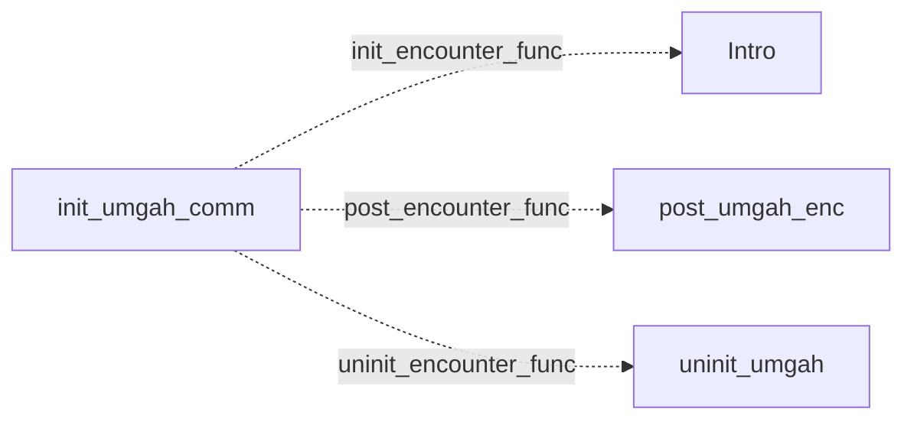

# Umgah: existing conversation graph

> Generated by `tools/conversation_catalog.py`; do not edit this page by hand.

[Catalog and interpretation rules](../README.md) · [Proposed engine](../model.md)

Script: [umgahc.c](../../../../sc2/src/uqm/comm/umgah/umgahc.c#L1). Phrase bank: [umgah.txt](../../../../sc2/content/base/comm/umgah/umgah.txt#L1).

4 handler/helper nodes; 0 response registration sites; 0 direct local calls; 87 phrase records.

## Initialization and lifecycle

| Phase | Callback | Bound by | Conditions / source |
| --- | --- | --- | --- |
| <code>init_encounter_func</code> | [<code>Intro</code>](#node-intro) | <code>init_umgah_comm</code> | No enclosing branch condition; [221](../../../../sc2/src/uqm/comm/umgah/umgahc.c#L221) |
| <code>post_encounter_func</code> | [<code>post_umgah_enc</code>](#node-post_umgah_enc) | <code>init_umgah_comm</code> | No enclosing branch condition; [222](../../../../sc2/src/uqm/comm/umgah/umgahc.c#L222) |
| <code>uninit_encounter_func</code> | [<code>uninit_umgah</code>](#node-uninit_umgah) | <code>init_umgah_comm</code> | No enclosing branch condition; [223](../../../../sc2/src/uqm/comm/umgah/umgahc.c#L223) |

## Handler graph

Solid arrows are selectable responses; dashed arrows are direct C calls. Conditions, arguments, speech and effects are cataloged below. Parallel response sites are grouped only in this diagram.



## Condition catalog

Condition IDs describe enclosing source structure. Branch predicates combine with ∧; case labels mark source locations that can also be reached by fallthrough. Values refer to their original evaluation points. Local assignments and early control flow remain in the decision bodies.

| ID | Source expression / structural condition |
| --- | --- |
| <a id="condition-c1"></a>C1 | <code>!GET_GAME_STATE(UMGAH_ZOMBIE_BLOBBIES)</code> |
| <a id="condition-c2"></a>C2 | <code>GET_GAME_STATE(TALKING_PET)</code> |
| <a id="condition-c3"></a>C3 | <code>!(GET_GAME_STATE(TALKING_PET) &amp;&amp; (!GET_GAME_STATE(UMGAH_HOSTILE)))</code> |
| <a id="condition-c4"></a>C4 | <code>(GET_GAME_STATE(TALKING_PET) &amp;&amp; (!GET_GAME_STATE(UMGAH_HOSTILE))) &#124;&#124; (LOBYTE(GLOBAL(CurrentActivity)) == WON_LAST_BATTLE)</code> |
| <a id="condition-c5"></a>C5 | <code>!((GET_GAME_STATE(TALKING_PET) &amp;&amp; (!GET_GAME_STATE(UMGAH_HOSTILE))) &#124;&#124; (LOBYTE(GLOBAL(CurrentActivity)) == WON_LAST_BATTLE))</code> |

## Script-scope state and lookup tables

These declarations supply shared local state, computed phrase alternatives, number speech, or lookup data used by the nodes. LOCDATA presentation defaults are linked separately in the source.

Presentation descriptor <code>umgah_desc</code>: [source](../../../../sc2/src/uqm/comm/umgah/umgahc.c#L26).

## Node catalog

<a id="node-intro"></a>

### Intro

<code>static void Intro(void)</code> — [source](../../../../sc2/src/uqm/comm/umgah/umgahc.c#L199).

<details>
<summary>Exact decision body (local calculations, early returns, fallthrough and ordering)</summary>

```c
{}
```

</details>

<a id="node-uninit_umgah"></a>

### uninit_umgah

<code>static COUNT uninit_umgah(void)</code> — [source](../../../../sc2/src/uqm/comm/umgah/umgahc.c#L202).

#### Actions, queries, local updates, and control flow

Calls are listed without assuming they are pure or mutating. Local updates are retained because they determine dynamic menus and counter-selected speech.

| Kind | Operation | Enclosing conditions | Source |
| --- | --- | --- | --- |
| flow | <code>return 0;</code> | No enclosing branch condition | [204](../../../../sc2/src/uqm/comm/umgah/umgahc.c#L204) |

<details>
<summary>Exact decision body (local calculations, early returns, fallthrough and ordering)</summary>

```c
{
	return (0);
}
```

</details>

<a id="node-post_umgah_enc"></a>

### post_umgah_enc

<code>static void post_umgah_enc(void)</code> — [source](../../../../sc2/src/uqm/comm/umgah/umgahc.c#L208).

#### Actions, queries, local updates, and control flow

Calls are listed without assuming they are pure or mutating. Local updates are retained because they determine dynamic menus and counter-selected speech.

| Kind | Operation | Enclosing conditions | Source |
| --- | --- | --- | --- |
| call | <code>GET_GAME_STATE(UMGAH_ZOMBIE_BLOBBIES)</code> | No enclosing branch condition | [210](../../../../sc2/src/uqm/comm/umgah/umgahc.c#L210) |
| call | <code>SET_GAME_STATE(MET_NORMAL_UMGAH, 1)</code> | [C1](#condition-c1) | [212](../../../../sc2/src/uqm/comm/umgah/umgahc.c#L212) |

<details>
<summary>Exact decision body (local calculations, early returns, fallthrough and ordering)</summary>

```c
{
	if (!GET_GAME_STATE (UMGAH_ZOMBIE_BLOBBIES))
	{
		SET_GAME_STATE (MET_NORMAL_UMGAH, 1);
	}
}
```

</details>

<a id="node-init_umgah_comm"></a>

### init_umgah_comm

<code>LOCDATA *init_umgah_comm(void)</code> — [source](../../../../sc2/src/uqm/comm/umgah/umgahc.c#L217).

#### Actions, queries, local updates, and control flow

Calls are listed without assuming they are pure or mutating. Local updates are retained because they determine dynamic menus and counter-selected speech.

| Kind | Operation | Enclosing conditions | Source |
| --- | --- | --- | --- |
| update | <code>umgah_desc.init_encounter_func = Intro</code> | No enclosing branch condition | [221](../../../../sc2/src/uqm/comm/umgah/umgahc.c#L221) |
| update | <code>umgah_desc.post_encounter_func = post_umgah_enc</code> | No enclosing branch condition | [222](../../../../sc2/src/uqm/comm/umgah/umgahc.c#L222) |
| update | <code>umgah_desc.uninit_encounter_func = uninit_umgah</code> | No enclosing branch condition | [223](../../../../sc2/src/uqm/comm/umgah/umgahc.c#L223) |
| update | <code>umgah_desc.AlienTextBaseline.x = TEXT_X_OFFS + (SIS_TEXT_WIDTH &gt;&gt; 1)</code> | No enclosing branch condition | [225](../../../../sc2/src/uqm/comm/umgah/umgahc.c#L225) |
| update | <code>umgah_desc.AlienTextBaseline.y = 0</code> | No enclosing branch condition | [226](../../../../sc2/src/uqm/comm/umgah/umgahc.c#L226) |
| update | <code>umgah_desc.AlienTextWidth = SIS_TEXT_WIDTH - 16</code> | No enclosing branch condition | [227](../../../../sc2/src/uqm/comm/umgah/umgahc.c#L227) |
| call | <code>GET_GAME_STATE(TALKING_PET)</code> | No enclosing branch condition | [229](../../../../sc2/src/uqm/comm/umgah/umgahc.c#L229) |
| call | <code>GET_GAME_STATE(UMGAH_HOSTILE)</code> | [C2](#condition-c2) | [229](../../../../sc2/src/uqm/comm/umgah/umgahc.c#L229) |
| call | <code>LOBYTE(GLOBAL(CurrentActivity))</code> | [C3](#condition-c3) | [230](../../../../sc2/src/uqm/comm/umgah/umgahc.c#L230) |
| call | <code>GLOBAL(CurrentActivity)</code> | [C3](#condition-c3) | [230](../../../../sc2/src/uqm/comm/umgah/umgahc.c#L230) |
| call | <code>setSegue(Segue_peace)</code> | [C4](#condition-c4) | [232](../../../../sc2/src/uqm/comm/umgah/umgahc.c#L232) |
| call | <code>setSegue(Segue_hostile)</code> | [C5](#condition-c5) | [236](../../../../sc2/src/uqm/comm/umgah/umgahc.c#L236) |
| update | <code>retval = &amp;umgah_desc</code> | No enclosing branch condition | [238](../../../../sc2/src/uqm/comm/umgah/umgahc.c#L238) |
| flow | <code>return retval;</code> | No enclosing branch condition | [240](../../../../sc2/src/uqm/comm/umgah/umgahc.c#L240) |

<details>
<summary>Exact decision body (local calculations, early returns, fallthrough and ordering)</summary>

```c
{
	LOCDATA *retval;

	umgah_desc.init_encounter_func = Intro;
	umgah_desc.post_encounter_func = post_umgah_enc;
	umgah_desc.uninit_encounter_func = uninit_umgah;

	umgah_desc.AlienTextBaseline.x = TEXT_X_OFFS + (SIS_TEXT_WIDTH >> 1);
	umgah_desc.AlienTextBaseline.y = 0;
	umgah_desc.AlienTextWidth = SIS_TEXT_WIDTH - 16;

	if ((GET_GAME_STATE (TALKING_PET) && !GET_GAME_STATE (UMGAH_HOSTILE))
			|| LOBYTE (GLOBAL (CurrentActivity)) == WON_LAST_BATTLE)
	{
		setSegue (Segue_peace);
	}
	else
	{
		setSegue (Segue_hostile);
	}
	retval = &umgah_desc;

	return (retval);
}
```

</details>

## Phrase catalog

Full base-content text, keyed by the symbols used above. Voice filenames are resource metadata; playback also depends on installed addons and settings. Dynamic insertions retain their original placeholders.

<a id="phrase-hwld_pre_zombie_hello_1"></a>

<details>
<summary>HWLD_PRE_ZOMBIE_HELLO_1 — umgah-000.ogg</summary>

[Text source](../../../../sc2/content/base/comm/umgah/umgah.txt#L1)

<pre>Why HELLO human Earthling! Har! Har! Har!
Must say, your appearance here comes as quite surprise to us!
We never expected to see any of you ever again
after our Ur-Quan masters put your species under slave shield!</pre>

</details>

<a id="phrase-hwld_pre_zombie_hello_2"></a>

<details>
<summary>HWLD_PRE_ZOMBIE_HELLO_2 — umgah-001.ogg</summary>

[Text source](../../../../sc2/content/base/comm/umgah/umgah.txt#L7)

<pre>Hey look everybody! Human Earthling came back!
Har! Har! Har! Say, I wonder we&#x27;ll kill him this time?
Har! Har! Har!</pre>

</details>

<a id="phrase-hwld_pre_zombie_hello_3"></a>

<details>
<summary>HWLD_PRE_ZOMBIE_HELLO_3 — umgah-002.ogg</summary>

[Text source](../../../../sc2/content/base/comm/umgah/umgah.txt#L12)

<pre>You&#x27;re back? Har! Har! Har! More fun! More fun!</pre>

</details>

<a id="phrase-hwld_pre_zombie_hello_4"></a>

<details>
<summary>HWLD_PRE_ZOMBIE_HELLO_4 — umgah-003.ogg</summary>

[Text source](../../../../sc2/content/base/comm/umgah/umgah.txt#L15)

<pre>Howdy human Earthling! Back for more fun?</pre>

</details>

<a id="phrase-space_pre_zombie_hello_1"></a>

<details>
<summary>SPACE_PRE_ZOMBIE_HELLO_1 — umgah-004.ogg</summary>

[Text source](../../../../sc2/content/base/comm/umgah/umgah.txt#L18)

<pre>Well bloat my belly! It&#x27;s a human Earthling!
Har! Har! Har! Haven&#x27;t seen a human Earthling since... since
why heck! NEVER seen a human Earthling!
What coincidence!</pre>

</details>

<a id="phrase-space_pre_zombie_hello_2"></a>

<details>
<summary>SPACE_PRE_ZOMBIE_HELLO_2 — umgah-005.ogg</summary>

[Text source](../../../../sc2/content/base/comm/umgah/umgah.txt#L24)

<pre>Hi there human! How old fluid sacks today?
What?! You don&#x27;t HAVE fluid sacks?
Har! Har! Har! What do you call your mate then?!! Har! Har! Har!...
you don&#x27;t HAVE a mate?
THAT&#x27;S EVEN FUNNIER! Har! Har! Har!</pre>

</details>

<a id="phrase-space_pre_zombie_hello_3"></a>

<details>
<summary>SPACE_PRE_ZOMBIE_HELLO_3 — umgah-006.ogg</summary>

[Text source](../../../../sc2/content/base/comm/umgah/umgah.txt#L31)

<pre>Hi there, human Earthling! What&#x27;cha here for today?
What? Can&#x27;t quite hear you? You&#x27;ll have to speak up!
Hey! What problem here?
Human Earthling making fun of me?
THIS SOME KIND OF STUPID HUMAN EARTHLING TRICK? BECAUSE IF IS
Har! Har! Har!... fooled ya, didn&#x27;t I?</pre>

</details>

<a id="phrase-space_pre_zombie_hello_4"></a>

<details>
<summary>SPACE_PRE_ZOMBIE_HELLO_4 — umgah-007.ogg</summary>

[Text source](../../../../sc2/content/base/comm/umgah/umgah.txt#L39)

<pre>Yo! Human Earthling! What up?!  Har! Har! Har!</pre>

</details>

<a id="phrase-unknown_zombie_hello_1"></a>

<details>
<summary>UNKNOWN_ZOMBIE_HELLO_1 — umgah-008.ogg</summary>

[Text source](../../../../sc2/content/base/comm/umgah/umgah.txt#L42)

<pre>HELLO. HUMAN. EARTHLING.
HAR.  HAR.  HAR.</pre>

</details>

<a id="phrase-unknown_zombie_hello_2"></a>

<details>
<summary>UNKNOWN_ZOMBIE_HELLO_2 — umgah-009.ogg</summary>

[Text source](../../../../sc2/content/base/comm/umgah/umgah.txt#L46)

<pre>HAPPY. GREETINGS. AND. WELCOME. EARTHLING. HUMAN.
HAR.  HAR.  HAR.</pre>

</details>

<a id="phrase-unknown_zombie_hello_3"></a>

<details>
<summary>UNKNOWN_ZOMBIE_HELLO_3 — umgah-010.ogg</summary>

[Text source](../../../../sc2/content/base/comm/umgah/umgah.txt#L50)

<pre>WHAT. SO. FUNNY. HUMAN. EARTHLING. YOUR. FACE. FUNNY. THING.
HAR.  HAR.  HAR.</pre>

</details>

<a id="phrase-unknown_zombie_hello_4"></a>

<details>
<summary>UNKNOWN_ZOMBIE_HELLO_4 — umgah-011.ogg</summary>

[Text source](../../../../sc2/content/base/comm/umgah/umgah.txt#L54)

<pre>WE. FUNNY. UMGAH. SO. FUNNY.
HAR.  HAR.  HAR.</pre>

</details>

<a id="phrase-destroy_interferer_1"></a>

<details>
<summary>DESTROY_INTERFERER_1 — umgah-012.ogg</summary>

[Text source](../../../../sc2/content/base/comm/umgah/umgah.txt#L58)

<pre>THE. HUMAN. INTERFERES. WITH. PLAN.
KILL. IT.</pre>

</details>

<a id="phrase-destroy_interferer_2"></a>

<details>
<summary>DESTROY_INTERFERER_2 — umgah-013.ogg</summary>

[Text source](../../../../sc2/content/base/comm/umgah/umgah.txt#L62)

<pre>STOP. THE. HUMAN. DESTROY. VESSEL.</pre>

</details>

<a id="phrase-destroy_interferer_3"></a>

<details>
<summary>DESTROY_INTERFERER_3 — umgah-014.ogg</summary>

[Text source](../../../../sc2/content/base/comm/umgah/umgah.txt#L65)

<pre>NO. DELAYS. IN. PLAN. TOLERATED.
ELIMINATE. HUMAN.</pre>

</details>

<a id="phrase-destroy_interferer_4"></a>

<details>
<summary>DESTROY_INTERFERER_4 — umgah-015.ogg</summary>

[Text source](../../../../sc2/content/base/comm/umgah/umgah.txt#L69)

<pre>DESTROY. HUMAN. IMMEDIATELY.</pre>

</details>

<a id="phrase-revealed_zombie_hello_1"></a>

<details>
<summary>REVEALED_ZOMBIE_HELLO_1 — umgah-016.ogg</summary>

[Text source](../../../../sc2/content/base/comm/umgah/umgah.txt#L72)

<pre>HUMAN. KNOWS. TOO. MUCH. IT. MUST. NOT. ESCAPE.</pre>

</details>

<a id="phrase-revealed_zombie_hello_2"></a>

<details>
<summary>REVEALED_ZOMBIE_HELLO_2 — umgah-017.ogg</summary>

[Text source](../../../../sc2/content/base/comm/umgah/umgah.txt#L75)

<pre>HUMAN. EARTHLING. CEASE. MOTION. AND. DE-ENERGIZE. SHIP. SO. WE. CAN. GIVE. GIFT.</pre>

</details>

<a id="phrase-revealed_zombie_hello_3"></a>

<details>
<summary>REVEALED_ZOMBIE_HELLO_3 — umgah-018.ogg</summary>

[Text source](../../../../sc2/content/base/comm/umgah/umgah.txt#L78)

<pre>CEASE. HOSTILITIES. WE. HAVE. CHANGED. OUR. MINDS. WE. LIKE. YOU. COME. CLOSER.</pre>

</details>

<a id="phrase-revealed_zombie_hello_4"></a>

<details>
<summary>REVEALED_ZOMBIE_HELLO_4 — umgah-019.ogg</summary>

[Text source](../../../../sc2/content/base/comm/umgah/umgah.txt#L81)

<pre>RESISTANCE. IS. USELESS. HUMAN. EARTHLING.</pre>

</details>

<a id="phrase-hostile_hello_1"></a>

<details>
<summary>HOSTILE_HELLO_1 — umgah-020.ogg</summary>

[Text source](../../../../sc2/content/base/comm/umgah/umgah.txt#L84)

<pre>Hello human Earthling savior!
Although we appreciate your efforts on our behalf
we really hate `Eternal Gratitude&#x27; stuff, so we&#x27;ve decided to kill you now.
Har! Har! Har! We pretty crazy blobbies, no?!</pre>

</details>

<a id="phrase-hostile_hello_2"></a>

<details>
<summary>HOSTILE_HELLO_2 — umgah-021.ogg</summary>

[Text source](../../../../sc2/content/base/comm/umgah/umgah.txt#L90)

<pre>Well pop my pupae! It human Earthling again!
It just doesn&#x27;t learn, does it? To Arms! To Arms!... wait a minute! Don&#x27;t HAVE any arms!
AIEE!! MY ARMS!! MY ARMS!! WHO HAS STOLEN MY ARMS!!! AIEEE!! ARM THIEF!!!
Har! Har! Har!... Never HAD any arms! Har! Har! Har!</pre>

</details>

<a id="phrase-hostile_hello_3"></a>

<details>
<summary>HOSTILE_HELLO_3 — umgah-022.ogg</summary>

[Text source](../../../../sc2/content/base/comm/umgah/umgah.txt#L96)

<pre>Look, we all decided that our treating you this way,
attacking you without mercy all time,
well, we decided that it just plain unfair.
REALLY, after all things you&#x27;ve done for our people!
So we decided to make you our honorary KING! Congratulations!
Braankk!!
What that sound, officer Flubbo? It was? You sure? King-Killing Horn?
Har! Har! Har! What a sad coincidence, eh, Captain King?</pre>

</details>

<a id="phrase-hostile_hello_4"></a>

<details>
<summary>HOSTILE_HELLO_4 — umgah-023.ogg</summary>

[Text source](../../../../sc2/content/base/comm/umgah/umgah.txt#L106)

<pre>Ho-ho! Human Earthling has returned to claim its reward!
What reward you ask? Why this reward, of course!</pre>

</details>

<a id="phrase-reward_at_homeworld_1"></a>

<details>
<summary>REWARD_AT_HOMEWORLD_1 — umgah-024.ogg</summary>

[Text source](../../../../sc2/content/base/comm/umgah/umgah.txt#L110)

<pre>Hurray! Hurray! It human Earthling! Our Savior!!
Oh hurry, human Earthling, HURRY! Your reward awaits at our homeworld!
In case you have forgotten, that at Beta Orionis!
Hurry, human Earthling, HURRY!</pre>

</details>

<a id="phrase-reward_at_homeworld_2"></a>

<details>
<summary>REWARD_AT_HOMEWORLD_2 — umgah-025.ogg</summary>

[Text source](../../../../sc2/content/base/comm/umgah/umgah.txt#L116)

<pre>Hust! Hust! You must make haste, human Earthling!
Sooner you go to our homeworld at Beta Orionis
sooner you shall receive your reward!</pre>

</details>

<a id="phrase-post_zombie_hwld_hello"></a>

<details>
<summary>POST_ZOMBIE_HWLD_HELLO — umgah-026.ogg</summary>

[Text source](../../../../sc2/content/base/comm/umgah/umgah.txt#L121)

<pre>HAIL! HAIL! Human Earthling! GREAT HERO HAS RETURNED!
Oh, my lipids quivering just looking at him on monitor!
What smile! What sparkling eyes! What nice bony structure!
He one who has saved us from mental compulsion of evil Talking Pet!
HAIL! HAIL! HAIL!
Oh Great Hero! We grateful species! Speak to us! How we reward you?!</pre>

</details>

<a id="phrase-owe_me_big_time"></a>

<details>
<summary>owe_me_big_time</summary>

[Text source](../../../../sc2/content/base/comm/umgah/umgah.txt#L129)

<pre>Yup! That&#x27;s right! You guys owe me BIG time.</pre>

</details>

<a id="phrase-our_largesse"></a>

<details>
<summary>our_largesse</summary>

[Text source](../../../../sc2/content/base/comm/umgah/umgah.txt#L132)

<pre>Gentle blobbies, please calm yourselves. We act solely from largesse. Rewards are unnecessary.</pre>

</details>

<a id="phrase-give_lifedata"></a>

<details>
<summary>GIVE_LIFEDATA — umgah-027.ogg</summary>

[Text source](../../../../sc2/content/base/comm/umgah/umgah.txt#L135)

<pre>We must reward your deeds of courage!
Killing Talking Pet was a feat none of our species could perform!
You superior! You Hero!
HAIL! HAIL! HAIL!
We MUST reward you!... but what do we have to give?
Protoplasm?... no, no, not easily appreciated.
Vigorous esters?... no, too common.
HAVE IT! HAVE IT! GENETIC MODIFICATION!! YES! IT PERFECT GIFT!!
Listen human Earthling! We add some extra eyes! A few tentacles!
Other organs of whatever size and shape you desire!!
What?! You not want more organs?... You sure?... How strange... how sad.
This was best gift. We Umgah have nothing but vast supply of biological skills and data.
Huh? What you say?
You want Biological Data?! Just plain raw Biological Data?
What you do with it?
Oh, well, you Hero. Whatever you want, you get.</pre>

</details>

<a id="phrase-thanks"></a>

<details>
<summary>THANKS — umgah-028.ogg</summary>

[Text source](../../../../sc2/content/base/comm/umgah/umgah.txt#L153)

<pre>HAIL! HAIL! HAIL!
You right! We do owe you! We MUST reward you!... but what do we have to give?
Protoplasm?... no, no, not easily appreciated.
Vigorous esters?... no, too common.
HAVE IT! HAVE IT! GENETIC MODIFICATION!! YES! IT PERFECT GIFT!!
Listen human Earthling! We add some extra eyes! A few tentacles!
Other organs of whatever size and shape you desire!!
What?! You not want more organs?... You sure?... How strange... how sad.
This was best gift. We Umgah have nothing but vast supply of biological skills and data.
Huh? What you say?
You want Biological Data?! Just plain raw Biological Data?
What you do with it?
Oh, well, you Hero. Whatever you want, you get.</pre>

</details>

<a id="phrase-what_do_with_tpet"></a>

<details>
<summary>what_do_with_tpet</summary>

[Text source](../../../../sc2/content/base/comm/umgah/umgah.txt#L168)

<pre>So how did that Talking Pet get control of your species?</pre>

</details>

<a id="phrase-trick_urquan"></a>

<details>
<summary>TRICK_URQUAN — umgah-029.ogg</summary>

[Text source](../../../../sc2/content/base/comm/umgah/umgah.txt#L171)

<pre>Ah, well Arilou Lalee&#x27;lay, who kind of our neighbors, gave us Talking Pet
hoping we could heal it more severe injuries, which we did.
While we working on it, we do routine brain structure scan
and discovered that creature have extremely sophisticated set of neural pathways
even more complex than own!
Further analysis showed that with minor genetic manipulations
Talking Pet intelligence greatly expanded, perhaps even to sentience!
Little did know what monster we creating.
Only few hours after injected nanots with modification program, creature wakes up.
Almost immediately, took control of Hospital... then city... then whole planet.
We try to resist, but creature, even in drugged, weakened state, too strong.
From that day on, we just mindless slaves who live only serve Talking Pet, and `Big Plan&#x27;.
What `Big Plan&#x27;?
We never quite sure about details of `Big Plan&#x27;, except it involved getting revenge
and mean LOTS of revenge...
against Ur-Quan masters.</pre>

</details>

<a id="phrase-any_jokes"></a>

<details>
<summary>any_jokes</summary>

[Text source](../../../../sc2/content/base/comm/umgah/umgah.txt#L189)

<pre>Why the Ur-Quan? What did it have against them?</pre>

</details>

<a id="phrase-sure"></a>

<details>
<summary>SURE — umgah-030.ogg</summary>

[Text source](../../../../sc2/content/base/comm/umgah/umgah.txt#L192)

<pre>We don&#x27;t know, but whatever it was, must been pretty bad
because Talking Pet mad... REAL mad! How mad, you ask?
Blowing up planets and eating juveniles mad! That how mad.
We got impression Ur-Quan did something awful to Talking Pet or maybe even whole species.
Whatever it was, it worse than slavery
maybe even worse than death.</pre>

</details>

<a id="phrase-what_before_tpet"></a>

<details>
<summary>what_before_tpet</summary>

[Text source](../../../../sc2/content/base/comm/umgah/umgah.txt#L200)

<pre>So what should I do with the Talking Pet?</pre>

</details>

<a id="phrase-trkd_spathi_and_ilwrath"></a>

<details>
<summary>TRKD_SPATHI_AND_ILWRATH — umgah-031.ogg</summary>

[Text source](../../../../sc2/content/base/comm/umgah/umgah.txt#L203)

<pre>You mean, CORPSE of Talking Pet, don&#x27;t you Captain?!
DID kill it, didn&#x27;t you?!</pre>

</details>

<a id="phrase-where_caster"></a>

<details>
<summary>where_caster</summary>

[Text source](../../../../sc2/content/base/comm/umgah/umgah.txt#L207)

<pre>Er... yeah! That&#x27;s right. Real dead. So what should I do with its corpse?</pre>

</details>

<a id="phrase-spathi_took_them"></a>

<details>
<summary>SPATHI_TOOK_THEM — umgah-032.ogg</summary>

[Text source](../../../../sc2/content/base/comm/umgah/umgah.txt#L210)

<pre>Hmmm... as general rule, corpses aren&#x27;t too much fun.
When we were first starting to mess with its brain
our intention to get it smart enough to accept orders from us
and then repeat them as though they legitimate Ur-Quan commands.
Har! Har! Har! Har! We going to play little joke this way!
We going to use Talking Pet to order Spathi to attack VUX!
Har! Har Har! That been great! ZAP! ZAP! KABOOM!!! Har! Har! Har!...
...even better than old Dogar and Kazon routine we pull on Ilwrath few years back
before those spoil-sport Spathi stole super cool HyperWave &#x27;Caster.</pre>

</details>

<a id="phrase-so_what_for_now"></a>

<details>
<summary>so_what_for_now</summary>

[Text source](../../../../sc2/content/base/comm/umgah/umgah.txt#L221)

<pre>So, since I&#x27;m your Great Hero Guy, tell me all your secrets.</pre>

</details>

<a id="phrase-do_this_now"></a>

<details>
<summary>DO_THIS_NOW — umgah-033.ogg</summary>

[Text source](../../../../sc2/content/base/comm/umgah/umgah.txt#L224)

<pre>Secrets, huh? You want secrets? OUR SECRETS!? YOU MADE FATAL MISTAKE, HUMAN!!
... Har! Har! Har! Good joke, eh? Scared you!
Sure! We&#x27;ll tell our secrets. Now let me see... what ARE secrets?
Oh, yes!... remember! It about Mycons!
You see, Mycons only other race we know of
that have same kind of biotechnical skills as Umgah.
But amazing thing, they do all with their own bodies, don&#x27;t need tools.
They just THINK genetic modification, and it happen!
We found that pretty hard understand, so when nobody looking, we clonk one on head
bring it back here to homeworld and slice it up for detailed study.
Those guys not product of ANY natural evolutionary process
they constructs!... some kind of multi-purpose biological tool.
We don&#x27;t know who made them or for what purpose
but they WAY beyond anything we ever heard of.
We not figure out much more before tissue samples all gross
so guess that pretty much all of big secret.
Oh... do us favor? Please not tell anybody about clonking Mycon.
It kind of against Ur-Quan Laws, and not want get Mycons mad at us.</pre>

</details>

<a id="phrase-bye_post_zombie"></a>

<details>
<summary>bye_post_zombie</summary>

[Text source](../../../../sc2/content/base/comm/umgah/umgah.txt#L244)

<pre>Well, your Great Hero must leave now, but rest assured, I&#x27;ll be back.</pre>

</details>

<a id="phrase-funny_idea"></a>

<details>
<summary>FUNNY_IDEA — umgah-034.ogg</summary>

[Text source](../../../../sc2/content/base/comm/umgah/umgah.txt#L247)

<pre>You know, Great Hero... I getting this funny feeling.
Would like to know what feeling is? Good, I tell you.
My feeling that Great Hero stuff... well, boring... not funny at all.
You only say HAIL! HAIL! HAIL! so many times before starts to lose appeal,
so... instituting slight deviation in course of our relationship.
Specifically, instead of being dull and lifeless Great Hero
you now glamorous and exciting... Great Enemy!
We give you some our Drone ships to make even more interesting!
Yes! This going to be LOTS more fun!
Here... let me show you.</pre>

</details>

<a id="phrase-whats_up_pre_zombie"></a>

<details>
<summary>whats_up_pre_zombie</summary>

[Text source](../../../../sc2/content/base/comm/umgah/umgah.txt#L259)

<pre>Umgah! Reveal your secrets!</pre>

</details>

<a id="phrase-general_info_pre_zombie"></a>

<details>
<summary>GENERAL_INFO_PRE_ZOMBIE — umgah-035.ogg</summary>

[Text source](../../../../sc2/content/base/comm/umgah/umgah.txt#L262)

<pre>Okay, since you ask so nicely, we will tell you a thing or two.
For instance, did know that even now we performing surgery on Talking Pet?
Arilou found it alone and dying in wreck of Ur-Quan Dreadnought on Alpha Pavonis.
They couldn&#x27;t heal so they brought to us.
We discovered that animal has potential for high intelligence
provided we make few minor genetic modifications.</pre>

</details>

<a id="phrase-evil_blobbies_give_up"></a>

<details>
<summary>evil_blobbies_give_up</summary>

[Text source](../../../../sc2/content/base/comm/umgah/umgah.txt#L270)

<pre>Evil blobbies. You must submit to our overwhelming power!</pre>

</details>

<a id="phrase-not_evil_blobbies"></a>

<details>
<summary>NOT_EVIL_BLOBBIES — umgah-036.ogg</summary>

[Text source](../../../../sc2/content/base/comm/umgah/umgah.txt#L273)

<pre>Har! Har! Har! GOOD JOKE!!
We use it on someone else real soon.</pre>

</details>

<a id="phrase-evil_blobbies_must_die"></a>

<details>
<summary>evil_blobbies_must_die</summary>

[Text source](../../../../sc2/content/base/comm/umgah/umgah.txt#L277)

<pre>No! I was serious. You ARE evil blobbies. You MUST die.</pre>

</details>

<a id="phrase-oh_no_we_wont"></a>

<details>
<summary>OH_NO_WE_WONT — umgah-037.ogg</summary>

[Text source](../../../../sc2/content/base/comm/umgah/umgah.txt#L280)

<pre>Har! Har! Har! Even funnier!</pre>

</details>

<a id="phrase-can_we_be_friends"></a>

<details>
<summary>can_we_be_friends</summary>

[Text source](../../../../sc2/content/base/comm/umgah/umgah.txt#L283)

<pre>Look, I know we&#x27;ve had our differences in the past, but can&#x27;t we be friends?</pre>

</details>

<a id="phrase-sure_friends"></a>

<details>
<summary>SURE_FRIENDS — umgah-038.ogg</summary>

[Text source](../../../../sc2/content/base/comm/umgah/umgah.txt#L286)

<pre>Sure! Sure! Friends for sure!
Who cares about boring old Ur-Quan and their slave laws? Har! Har! Har!
Here we come to say hello to new friends!</pre>

</details>

<a id="phrase-want_to_defeat_urquan"></a>

<details>
<summary>want_to_defeat_urquan</summary>

[Text source](../../../../sc2/content/base/comm/umgah/umgah.txt#L291)

<pre>Here&#x27;s our credo: Freedom from Ur-Quan! What do you say?</pre>

</details>

<a id="phrase-fine_by_us"></a>

<details>
<summary>FINE_BY_US — umgah-039.ogg</summary>

[Text source](../../../../sc2/content/base/comm/umgah/umgah.txt#L294)

<pre>Har! Har! Har! Freedom very good thing!
It so much easier to make good jokes without boring old Ur-Quan slave laws!
We wanting to pull real good one on those stupid nosers from Draconis for long time
but since they battle thralls too, we not allowed do even small pranks on them
like, say... dropping planetoid in their ocean.
Big waves! Big waves! Har! Har! Har!</pre>

</details>

<a id="phrase-bye_pre_zombie"></a>

<details>
<summary>bye_pre_zombie</summary>

[Text source](../../../../sc2/content/base/comm/umgah/umgah.txt#L302)

<pre>Well Umgah. It has been fascinating, but I must go.</pre>

</details>

<a id="phrase-goodbye_pre_zombie"></a>

<details>
<summary>GOODBYE_PRE_ZOMBIE — umgah-040.ogg</summary>

[Text source](../../../../sc2/content/base/comm/umgah/umgah.txt#L305)

<pre>Har! Har! Har! Hey wait human Earthling! Here best part!</pre>

</details>

<a id="phrase-threat"></a>

<details>
<summary>threat</summary>

[Text source](../../../../sc2/content/base/comm/umgah/umgah.txt#L308)

<pre>Evil blobbies, your craven nature is revealed! Submit!</pre>

</details>

<a id="phrase-no_threat"></a>

<details>
<summary>NO_THREAT — umgah-041.ogg</summary>

[Text source](../../../../sc2/content/base/comm/umgah/umgah.txt#L311)

<pre>IF. COMPREHEND. TRUE. NATURE. MUST. BE. ELIMINATED.</pre>

</details>

<a id="phrase-whats_up_zombies"></a>

<details>
<summary>whats_up_zombies</summary>

[Text source](../../../../sc2/content/base/comm/umgah/umgah.txt#L314)

<pre>So Umgah, what have you been up to these past twenty years?</pre>

</details>

<a id="phrase-general_info_zombie"></a>

<details>
<summary>GENERAL_INFO_ZOMBIE — umgah-042.ogg</summary>

[Text source](../../../../sc2/content/base/comm/umgah/umgah.txt#L317)

<pre>NOTHING. HAPPEN. LAST. TWENTY. YEARS. VERY. BORING.</pre>

</details>

<a id="phrase-how_goes_tpet"></a>

<details>
<summary>how_goes_tpet</summary>

[Text source](../../../../sc2/content/base/comm/umgah/umgah.txt#L320)

<pre>So how goes your work on that Talking Pet?</pre>

</details>

<a id="phrase-what_tpet"></a>

<details>
<summary>WHAT_TPET — umgah-043.ogg</summary>

[Text source](../../../../sc2/content/base/comm/umgah/umgah.txt#L323)

<pre>WHAT. TALKING. PET. DO. NOT. UNDERSTAND. REFERENCE.</pre>

</details>

<a id="phrase-you_told_us"></a>

<details>
<summary>you_told_us</summary>

[Text source](../../../../sc2/content/base/comm/umgah/umgah.txt#L326)

<pre>You told us you were modifying a Talking Pet, didn&#x27;t you?</pre>

</details>

<a id="phrase-sadly_it_died"></a>

<details>
<summary>SADLY_IT_DIED — umgah-044.ogg</summary>

[Text source](../../../../sc2/content/base/comm/umgah/umgah.txt#L329)

<pre>SADLY. IT. DIED.
NO. MORE. TALK. ABOUT. IT.</pre>

</details>

<a id="phrase-dont_believe"></a>

<details>
<summary>dont_believe</summary>

[Text source](../../../../sc2/content/base/comm/umgah/umgah.txt#L333)

<pre>You know, I just don&#x27;t believe you. What are you hiding?</pre>

</details>

<a id="phrase-then_die"></a>

<details>
<summary>THEN_DIE — umgah-045.ogg</summary>

[Text source](../../../../sc2/content/base/comm/umgah/umgah.txt#L336)

<pre>HUMAN. POSSESSES. FORBIDDEN. KNOWLEDGE.
NO. INTERFERENCE. IN. PLAN. CAN. BE. TOLERATED.
HUMAN. MUST. BE. ELIMINATED.</pre>

</details>

<a id="phrase-bye_unknown"></a>

<details>
<summary>bye_unknown</summary>

[Text source](../../../../sc2/content/base/comm/umgah/umgah.txt#L341)

<pre>If I try to leave, are you going to attack me?</pre>

</details>

<a id="phrase-goodbye_unknown"></a>

<details>
<summary>GOODBYE_UNKNOWN — umgah-046.ogg</summary>

[Text source](../../../../sc2/content/base/comm/umgah/umgah.txt#L344)

<pre>NO. LEAVE.</pre>

</details>

<a id="phrase-evil_blobbies"></a>

<details>
<summary>evil_blobbies</summary>

[Text source](../../../../sc2/content/base/comm/umgah/umgah.txt#L347)

<pre>You are evil blobbies, I say! Avast!</pre>

</details>

<a id="phrase-yes_very_evil"></a>

<details>
<summary>YES_VERY_EVIL — umgah-047.ogg</summary>

[Text source](../../../../sc2/content/base/comm/umgah/umgah.txt#L350)

<pre>YES. WE. ARE. VERY. EVIL.
YOUR. BEST. PLAN. IS. TO. DEPART. AND. NEVER. RETURN.</pre>

</details>

<a id="phrase-give_up_or_die"></a>

<details>
<summary>give_up_or_die</summary>

[Text source](../../../../sc2/content/base/comm/umgah/umgah.txt#L354)

<pre>Surrender to me HERE and NOW or I shall vaporize you!</pre>

</details>

<a id="phrase-not_give_up"></a>

<details>
<summary>NOT_GIVE_UP — umgah-048.ogg</summary>

[Text source](../../../../sc2/content/base/comm/umgah/umgah.txt#L357)

<pre>HUMAN. INTERFERENCE. REACHES. INTOLERABLE. LEVEL.
PLAN. MUST. NOT. BE. DELAYED.
ELIMINATE. HUMAN.</pre>

</details>

<a id="phrase-we_vindicator0"></a>

<details>
<summary>we_vindicator0</summary>

[Text source](../../../../sc2/content/base/comm/umgah/umgah.txt#L362)

<pre>I am Captain</pre>

</details>

<a id="phrase-we_vindicator1"></a>

<details>
<summary>we_vindicator1</summary>

[Text source](../../../../sc2/content/base/comm/umgah/umgah.txt#L365)

<pre>, of the starship</pre>

</details>

<a id="phrase-we_vindicator2"></a>

<details>
<summary>we_vindicator2</summary>

[Text source](../../../../sc2/content/base/comm/umgah/umgah.txt#L368)

<pre>. What is your response?</pre>

</details>

<a id="phrase-good_for_you_1"></a>

<details>
<summary>GOOD_FOR_YOU_1 — umgah-049.ogg</summary>

[Text source](../../../../sc2/content/base/comm/umgah/umgah.txt#L371)

<pre>WE. RESPOND. WITH. APPROPRIATE. AWE. AND. RESPECT.
NOW. GO. AWAY.</pre>

</details>

<a id="phrase-come_in_peace"></a>

<details>
<summary>come_in_peace</summary>

[Text source](../../../../sc2/content/base/comm/umgah/umgah.txt#L375)

<pre>Our message is Peace Between All Species!... blobbies included.</pre>

</details>

<a id="phrase-good_for_you_2"></a>

<details>
<summary>GOOD_FOR_YOU_2 — umgah-050.ogg</summary>

[Text source](../../../../sc2/content/base/comm/umgah/umgah.txt#L378)

<pre>YES. PEACE. GOOD. WE. WANT. PEACE. ALSO.
DEMONSTRATE. PEACE. NOW. BY. DEPARTING. OUR. SPACE. IMMEDIATELY.</pre>

</details>

<a id="phrase-know_any_jokes"></a>

<details>
<summary>know_any_jokes</summary>

[Text source](../../../../sc2/content/base/comm/umgah/umgah.txt#L382)

<pre>Umgah humor is renowned across space, so... know any good jokes?!</pre>

</details>

<a id="phrase-joke_1"></a>

<details>
<summary>JOKE_1 — umgah-051.ogg</summary>

[Text source](../../../../sc2/content/base/comm/umgah/umgah.txt#L385)

<pre>JOKE. YES. JOKE. HERE. IS. JOKE.
WHEN. IS. A. SLAVE. NOT. A. SLAVE.
ANSWER.
WHEN. HE. IS. A. SLAVE. MASTER.
HAR.  HAR.  HAR.</pre>

</details>

<a id="phrase-better_joke"></a>

<details>
<summary>better_joke</summary>

[Text source](../../../../sc2/content/base/comm/umgah/umgah.txt#L392)

<pre>Uh... that wasn&#x27;t very funny. Can&#x27;t you do better?</pre>

</details>

<a id="phrase-joke_2"></a>

<details>
<summary>JOKE_2 — umgah-052.ogg</summary>

[Text source](../../../../sc2/content/base/comm/umgah/umgah.txt#L395)

<pre>BETTER. JOKE. YES. BETTER. JOKE. HERE. IT. IS
WHAT. YOU. GET. WHEN. COMBINE. DEUTERIUM. PELLET. TERAWATT. LASER.
AND. PRIMITIVE. EARTH. LEADER. FROM. ASIAN. STEPPES.
ANSWER.
KHAN. FUSION.
HAR.  HAR.  HAR.</pre>

</details>

<a id="phrase-not_very_funny"></a>

<details>
<summary>not_very_funny</summary>

[Text source](../../../../sc2/content/base/comm/umgah/umgah.txt#L403)

<pre>Ugh! That wasn&#x27;t a very good joke either. I don&#x27;t think you guys are very funny.</pre>

</details>

<a id="phrase-yes_we_are"></a>

<details>
<summary>YES_WE_ARE — umgah-053.ogg</summary>

[Text source](../../../../sc2/content/base/comm/umgah/umgah.txt#L406)

<pre>UMGAH. ARE. FUNNY. WE. ARE. UMGAH. WE. ARE FUNNY.
THERE. IS. NO. ALTERNATIVE.</pre>

</details>

<a id="phrase-what_about_tpet"></a>

<details>
<summary>what_about_tpet</summary>

[Text source](../../../../sc2/content/base/comm/umgah/umgah.txt#L410)

<pre>So how&#x27;s that Talking Pet getting along?</pre>

</details>

<a id="phrase-arilou_told_us"></a>

<details>
<summary>arilou_told_us</summary>

[Text source](../../../../sc2/content/base/comm/umgah/umgah.txt#L413)

<pre>The Arilou told us they had given it to you... they did, right?</pre>

</details>

<a id="phrase-bye_zombie"></a>

<details>
<summary>bye_zombie</summary>

[Text source](../../../../sc2/content/base/comm/umgah/umgah.txt#L416)

<pre>Goodbye Umgah. I wish I could say it&#x27;s been fun.</pre>

</details>

<a id="phrase-goodbye_zombie"></a>

<details>
<summary>GOODBYE_ZOMBIE — umgah-054.ogg</summary>

[Text source](../../../../sc2/content/base/comm/umgah/umgah.txt#L419)

<pre>GOODBYE. HUMAN. EARTHLING. DO. NOT. RETURN.</pre>

</details>
