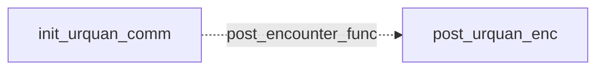

# Ur-Quan: existing conversation graph

> Generated by `tools/conversation_catalog.py`; do not edit this page by hand.

[Catalog and interpretation rules](../README.md) · [Proposed engine](../model.md)

Script: [urquanc.c](../../../../sc2/src/uqm/comm/urquan/urquanc.c#L1). Phrase bank: [urquan.txt](../../../../sc2/content/base/comm/urquan/urquan.txt#L1).

2 handler/helper nodes; 0 response registration sites; 0 direct local calls; 76 phrase records.

## Initialization and lifecycle

| Phase | Callback | Bound by | Conditions / source |
| --- | --- | --- | --- |
| <code>post_encounter_func</code> | [<code>post_urquan_enc</code>](#node-post_urquan_enc) | <code>init_urquan_comm</code> | No enclosing branch condition; [137](../../../../sc2/src/uqm/comm/urquan/urquanc.c#L137) |

## Handler graph

Solid arrows are selectable responses; dashed arrows are direct C calls. Conditions, arguments, speech and effects are cataloged below. Parallel response sites are grouped only in this diagram.



## Condition catalog

Condition IDs describe enclosing source structure. Branch predicates combine with ∧; case labels mark source locations that can also be reached by fallthrough. Values refer to their original evaluation points. Local assignments and early control flow remain in the decision bodies.

| ID | Source expression / structural condition |
| --- | --- |
| <a id="condition-c1"></a>C1 | <code>!(GET_GAME_STATE(PLAYER_HYPNOTIZED))</code> |
| <a id="condition-c2"></a>C2 | <code>!(GET_GAME_STATE(PLAYER_HYPNOTIZED) &#124;&#124; (LOBYTE(GLOBAL(CurrentActivity)) == WON_LAST_BATTLE))</code> |
| <a id="condition-c3"></a>C3 | <code>LOBYTE(GLOBAL(CurrentActivity)) == IN_INTERPLANETARY</code> |
| <a id="condition-c4"></a>C4 | <code>(LOBYTE(GLOBAL(CurrentActivity)) == IN_INTERPLANETARY) &amp;&amp; GLOBAL(BattleGroupRef)</code> |
| <a id="condition-c5"></a>C5 | <code>(GET_GAME_STATE(PLAYER_HYPNOTIZED) &#124;&#124; (LOBYTE(GLOBAL(CurrentActivity)) == WON_LAST_BATTLE)) &#124;&#124; (((LOBYTE(GLOBAL(CurrentActivity)) == IN_INTERPLANETARY) &amp;&amp; GLOBAL(BattleGroupRef)) &amp;&amp; (GLOBAL(BattleGroupRef) == GrpOffs))</code> |
| <a id="condition-c6"></a>C6 | <code>!((GET_GAME_STATE(PLAYER_HYPNOTIZED) &#124;&#124; (LOBYTE(GLOBAL(CurrentActivity)) == WON_LAST_BATTLE)) &#124;&#124; (((LOBYTE(GLOBAL(CurrentActivity)) == IN_INTERPLANETARY) &amp;&amp; GLOBAL(BattleGroupRef)) &amp;&amp; (GLOBAL(BattleGroupRef) == GrpOffs)))</code> |

## Script-scope state and lookup tables

These declarations supply shared local state, computed phrase alternatives, number speech, or lookup data used by the nodes. LOCDATA presentation defaults are linked separately in the source.

Presentation descriptor <code>urquan_desc</code>: [source](../../../../sc2/src/uqm/comm/urquan/urquanc.c#L23).

## Node catalog

<a id="node-post_urquan_enc"></a>

### post_urquan_enc

<code>static void post_urquan_enc(void)</code> — [source](../../../../sc2/src/uqm/comm/urquan/urquanc.c#L125).

#### Actions, queries, local updates, and control flow

Calls are listed without assuming they are pure or mutating. Local updates are retained because they determine dynamic menus and counter-selected speech.

| Kind | Operation | Enclosing conditions | Source |
| --- | --- | --- | --- |
| call | <code>SET_GAME_STATE(PLAYER_HYPNOTIZED, 0)</code> | No enclosing branch condition | [127](../../../../sc2/src/uqm/comm/urquan/urquanc.c#L127) |

<details>
<summary>Exact decision body (local calculations, early returns, fallthrough and ordering)</summary>

```c
{
	SET_GAME_STATE (PLAYER_HYPNOTIZED, 0);
}
```

</details>

<a id="node-init_urquan_comm"></a>

### init_urquan_comm

<code>LOCDATA *init_urquan_comm(void)</code> — [source](../../../../sc2/src/uqm/comm/urquan/urquanc.c#L131).

#### Actions, queries, local updates, and control flow

Calls are listed without assuming they are pure or mutating. Local updates are retained because they determine dynamic menus and counter-selected speech.

| Kind | Operation | Enclosing conditions | Source |
| --- | --- | --- | --- |
| update | <code>urquan_desc.post_encounter_func = post_urquan_enc</code> | No enclosing branch condition | [137](../../../../sc2/src/uqm/comm/urquan/urquanc.c#L137) |
| update | <code>urquan_desc.AlienTextBaseline.x = TEXT_X_OFFS + (SIS_TEXT_WIDTH &gt;&gt; 1)</code> | No enclosing branch condition | [139](../../../../sc2/src/uqm/comm/urquan/urquanc.c#L139) |
| update | <code>urquan_desc.AlienTextBaseline.y = 0</code> | No enclosing branch condition | [140](../../../../sc2/src/uqm/comm/urquan/urquanc.c#L140) |
| update | <code>urquan_desc.AlienTextWidth = SIS_TEXT_WIDTH - 16</code> | No enclosing branch condition | [141](../../../../sc2/src/uqm/comm/urquan/urquanc.c#L141) |
| update | <code>GrpOffs = GET_GAME_STATE_32(URQUAN_PROBE_GRPOFFS0)</code> | No enclosing branch condition | [143](../../../../sc2/src/uqm/comm/urquan/urquanc.c#L143) |
| call | <code>GET_GAME_STATE_32(URQUAN_PROBE_GRPOFFS0)</code> | No enclosing branch condition | [143](../../../../sc2/src/uqm/comm/urquan/urquanc.c#L143) |
| call | <code>GET_GAME_STATE(PLAYER_HYPNOTIZED)</code> | No enclosing branch condition | [144](../../../../sc2/src/uqm/comm/urquan/urquanc.c#L144) |
| call | <code>LOBYTE(GLOBAL(CurrentActivity))</code> | [C1](#condition-c1) | [145](../../../../sc2/src/uqm/comm/urquan/urquanc.c#L145) |
| call | <code>GLOBAL(CurrentActivity)</code> | [C1](#condition-c1) | [145](../../../../sc2/src/uqm/comm/urquan/urquanc.c#L145) |
| call | <code>LOBYTE(GLOBAL(CurrentActivity))</code> | [C2](#condition-c2) | [146](../../../../sc2/src/uqm/comm/urquan/urquanc.c#L146) |
| call | <code>GLOBAL(CurrentActivity)</code> | [C2](#condition-c2) | [146](../../../../sc2/src/uqm/comm/urquan/urquanc.c#L146) |
| call | <code>GLOBAL(BattleGroupRef)</code> | [C2](#condition-c2) ∧ [C3](#condition-c3) | [147](../../../../sc2/src/uqm/comm/urquan/urquanc.c#L147) |
| call | <code>GLOBAL(BattleGroupRef)</code> | [C2](#condition-c2) ∧ [C4](#condition-c4) | [148](../../../../sc2/src/uqm/comm/urquan/urquanc.c#L148) |
| call | <code>setSegue(Segue_peace)</code> | [C5](#condition-c5) | [150](../../../../sc2/src/uqm/comm/urquan/urquanc.c#L150) |
| call | <code>setSegue(Segue_hostile)</code> | [C6](#condition-c6) | [154](../../../../sc2/src/uqm/comm/urquan/urquanc.c#L154) |
| update | <code>retval = &amp;urquan_desc</code> | No enclosing branch condition | [156](../../../../sc2/src/uqm/comm/urquan/urquanc.c#L156) |
| flow | <code>return retval;</code> | No enclosing branch condition | [158](../../../../sc2/src/uqm/comm/urquan/urquanc.c#L158) |

<details>
<summary>Exact decision body (local calculations, early returns, fallthrough and ordering)</summary>

```c
{
	LOCDATA *retval;

	DWORD GrpOffs;

	urquan_desc.post_encounter_func = post_urquan_enc;

	urquan_desc.AlienTextBaseline.x = TEXT_X_OFFS + (SIS_TEXT_WIDTH >> 1);
	urquan_desc.AlienTextBaseline.y = 0;
	urquan_desc.AlienTextWidth = SIS_TEXT_WIDTH - 16;

	GrpOffs = GET_GAME_STATE_32 (URQUAN_PROBE_GRPOFFS0);
	if (GET_GAME_STATE (PLAYER_HYPNOTIZED)
			|| LOBYTE (GLOBAL (CurrentActivity)) == WON_LAST_BATTLE
			|| (LOBYTE (GLOBAL (CurrentActivity)) == IN_INTERPLANETARY
			&& GLOBAL (BattleGroupRef)
			&& GLOBAL (BattleGroupRef) == GrpOffs))
	{
		setSegue (Segue_peace);
	}
	else
	{
		setSegue (Segue_hostile);
	}
	retval = &urquan_desc;

	return (retval);
}
```

</details>

## Phrase catalog

Full base-content text, keyed by the symbols used above. Voice filenames are resource metadata; playback also depends on installed addons and settings. Dynamic insertions retain their original placeholders.

<a id="phrase-hello_samatra"></a>

<details>
<summary>HELLO_SAMATRA — urquan-000.ogg</summary>

[Text source](../../../../sc2/content/base/comm/urquan/urquan.txt#L1)

<pre>You may not approach the ancient Sa-Matra, the symbol of Ur-Quan dominance!
Your presence here is further violation of the slave laws
which your species have already violated so flagrantly.
We cannot tolerate such insubordination!
Your species&#x27; penalty shall be annihilation!</pre>

</details>

<a id="phrase-sense_evil"></a>

<details>
<summary>SENSE_EVIL — urquan-001.ogg</summary>

[Text source](../../../../sc2/content/base/comm/urquan/urquan.txt#L8)

<pre>There is something wrong here... something which makes my sheath retract and my talons ooze.
I sense the ugliness of a thousand evil thoughts
and I have located the source of these fetid emanations.
They come from aboard your vessel!
Foolish renegade human, why have you come here? All that you have found
is your inevitable punishment.</pre>

</details>

<a id="phrase-init_urquan_wake_up"></a>

<details>
<summary>INIT_URQUAN_WAKE_UP — urquan-002.ogg</summary>

[Text source](../../../../sc2/content/base/comm/urquan/urquan.txt#L16)

<pre>...in addition, your refusal to answer our transmissions is taken as an insult
which shall earn you the reward of Death unless you respond immediately!</pre>

</details>

<a id="phrase-where_am_i"></a>

<details>
<summary>where_am_i</summary>

[Text source](../../../../sc2/content/base/comm/urquan/urquan.txt#L20)

<pre>Hey!? Where am I?</pre>

</details>

<a id="phrase-you_are_here"></a>

<details>
<summary>YOU_ARE_HERE — urquan-003.ogg</summary>

[Text source](../../../../sc2/content/base/comm/urquan/urquan.txt#L23)

<pre>Your insubordination is intolerable!
You MUST obey the slave laws, or face our gruesome punishment!</pre>

</details>

<a id="phrase-why_does_my_head_hurt"></a>

<details>
<summary>why_does_my_head_hurt</summary>

[Text source](../../../../sc2/content/base/comm/urquan/urquan.txt#L27)

<pre>Why does my head hurt?</pre>

</details>

<a id="phrase-hurts_because"></a>

<details>
<summary>HURTS_BECAUSE — urquan-004.ogg</summary>

[Text source](../../../../sc2/content/base/comm/urquan/urquan.txt#L30)

<pre>You forget that the consequences of your misbehavior
will cause great suffering for your entire people.</pre>

</details>

<a id="phrase-what_about_2_weeks"></a>

<details>
<summary>what_about_2_weeks</summary>

[Text source](../../../../sc2/content/base/comm/urquan/urquan.txt#L34)

<pre>Wow!? Where did the last two weeks go?</pre>

</details>

<a id="phrase-about_2_weeks"></a>

<details>
<summary>ABOUT_2_WEEKS — urquan-005.ogg</summary>

[Text source](../../../../sc2/content/base/comm/urquan/urquan.txt#L37)

<pre>We have been lenient with your species, because you are so immature.
Now this attitude has changed.
You WILL be held responsible for your malfeasance!</pre>

</details>

<a id="phrase-compulsion"></a>

<details>
<summary>compulsion</summary>

[Text source](../../../../sc2/content/base/comm/urquan/urquan.txt#L42)

<pre>Whoa! I must have been under some form of weird mental compulsion.</pre>

</details>

<a id="phrase-what_compulsion"></a>

<details>
<summary>WHAT_COMPULSION — urquan-006.ogg</summary>

[Text source](../../../../sc2/content/base/comm/urquan/urquan.txt#L45)

<pre>WHAT DID YOU SAY?!
COMPULSION!?
WHAT HAPPENED?! EXPLAIN!</pre>

</details>

<a id="phrase-wascally_little_guy"></a>

<details>
<summary>wascally_little_guy</summary>

[Text source](../../../../sc2/content/base/comm/urquan/urquan.txt#L50)

<pre>It was this wascally little guy in Umgah space. He did it!</pre>

</details>

<a id="phrase-what_it_look_like"></a>

<details>
<summary>WHAT_IT_LOOK_LIKE — urquan-007.ogg</summary>

[Text source](../../../../sc2/content/base/comm/urquan/urquan.txt#L53)

<pre>WHAT DID THE CREATURE LOOK LIKE?!</pre>

</details>

<a id="phrase-terran_amphibian"></a>

<details>
<summary>terran_amphibian</summary>

[Text source](../../../../sc2/content/base/comm/urquan/urquan.txt#L56)

<pre>It resembled a large, terran amphibian.</pre>

</details>

<a id="phrase-talking_pet_on_steroids"></a>

<details>
<summary>talking_pet_on_steroids</summary>

[Text source](../../../../sc2/content/base/comm/urquan/urquan.txt#L59)

<pre>It looked like one of your Talking Pets on brain steroids.</pre>

</details>

<a id="phrase-bad_news"></a>

<details>
<summary>BAD_NEWS — urquan-008.ogg</summary>

[Text source](../../../../sc2/content/base/comm/urquan/urquan.txt#L62)

<pre>A Talking Pet with compulsion powers!
This is grave news indeed, the worst in millennia!
We will speed the war against our cousins, the Kohr-Ah
then we shall deal with this neo-Dnyarri, this Talking Pet.
Alien Captain! You have done a service for us greater than you can possibly imagine.
Your reward is continued survival, and if you return to Earth and destroy your vessel IMMEDIATELY
we will abolish all punishment against you and your species.
Now leave!... and never return.</pre>

</details>

<a id="phrase-turd_and_toad"></a>

<details>
<summary>turd_and_toad</summary>

[Text source](../../../../sc2/content/base/comm/urquan/urquan.txt#L72)

<pre>Kind of like a cross between a turd and a toad.</pre>

</details>

<a id="phrase-what_is_turd_and_toad"></a>

<details>
<summary>WHAT_IS_TURD_AND_TOAD — urquan-009.ogg</summary>

[Text source](../../../../sc2/content/base/comm/urquan/urquan.txt#L75)

<pre>These references are obscure. Respecify.</pre>

</details>

<a id="phrase-alien_mind_control"></a>

<details>
<summary>alien_mind_control</summary>

[Text source](../../../../sc2/content/base/comm/urquan/urquan.txt#L78)

<pre>I think I was attacked by some form of alien mind control!</pre>

</details>

<a id="phrase-what_felt_like"></a>

<details>
<summary>WHAT_FELT_LIKE — urquan-010.ogg</summary>

[Text source](../../../../sc2/content/base/comm/urquan/urquan.txt#L81)

<pre>WHAT?!! OH NO!!!
IT CANNOT BE!
QUICK HUMAN! TELL ME: WHAT DID IT FEEL LIKE, THIS COMPULSION?</pre>

</details>

<a id="phrase-possessed_by_devil"></a>

<details>
<summary>possessed_by_devil</summary>

[Text source](../../../../sc2/content/base/comm/urquan/urquan.txt#L86)

<pre>I am fairly sure that I was possessed by the devil.</pre>

</details>

<a id="phrase-stupid_devil"></a>

<details>
<summary>STUPID_DEVIL — urquan-011.ogg</summary>

[Text source](../../../../sc2/content/base/comm/urquan/urquan.txt#L89)

<pre>Devil? The only real devils are the ones flying the dark ships, human
the murderous Kohr-Ah.
NOW GIVE ME THE INFORMATION I DEMAND!</pre>

</details>

<a id="phrase-falling_asleep"></a>

<details>
<summary>falling_asleep</summary>

[Text source](../../../../sc2/content/base/comm/urquan/urquan.txt#L94)

<pre>It was like I fell asleep, or was unconscious.</pre>

</details>

<a id="phrase-someone_else_controlled"></a>

<details>
<summary>someone_else_controlled</summary>

[Text source](../../../../sc2/content/base/comm/urquan/urquan.txt#L97)

<pre>I felt like someone had control of my mind and my body.</pre>

</details>

<a id="phrase-sounds_familiar"></a>

<details>
<summary>SOUNDS_FAMILIAR — urquan-012.ogg</summary>

[Text source](../../../../sc2/content/base/comm/urquan/urquan.txt#L100)

<pre>This sounds all too familiar... yes, the nightmare begins again.
Perhaps we should contact the Kohr-Ah Primat, explain to her.
No, they will not believe. They are too stubborn and simple-minded.
They will not see the danger until it is too late!
Human, begone! Leave my sight! We must defeat the Kohr-Ah speedily
so that we can attend to this new Dnyarri menace.</pre>

</details>

<a id="phrase-before_coffee"></a>

<details>
<summary>before_coffee</summary>

[Text source](../../../../sc2/content/base/comm/urquan/urquan.txt#L108)

<pre>Kind of like the screen went dark, and then POW! here you were.</pre>

</details>

<a id="phrase-explain"></a>

<details>
<summary>EXPLAIN — urquan-013.ogg</summary>

[Text source](../../../../sc2/content/base/comm/urquan/urquan.txt#L111)

<pre>WHAT DO YOU MEAN?! ELUCIDATE!</pre>

</details>

<a id="phrase-why_explain"></a>

<details>
<summary>why_explain</summary>

[Text source](../../../../sc2/content/base/comm/urquan/urquan.txt#L114)

<pre>Why should I explain this to you? You&#x27;re just going to try to kill me!</pre>

</details>

<a id="phrase-must_explain"></a>

<details>
<summary>MUST_EXPLAIN — urquan-014.ogg</summary>

[Text source](../../../../sc2/content/base/comm/urquan/urquan.txt#L117)

<pre>Human. We Ur-Quan never lie. NEVER!
It is a weakness to lie, and as you haven&#x27;t noticed, the Ur-Quan are not weak!
So listen, and believe these words
if what you say is true, you were in contact with a creature so horrible, so evil
that it makes ANYTHING else you have ever known TRIVIAL by comparison.
There is no equal to the Dnyarri&#x27;s cruelty, to its love for torment.
Dying a THOUSAND TIMES would be preferable to what is in store for you
if we do not stop that creature.
So tell me what I want to know, human. NOW!</pre>

</details>

<a id="phrase-bye_init_hypno"></a>

<details>
<summary>bye_init_hypno</summary>

[Text source](../../../../sc2/content/base/comm/urquan/urquan.txt#L128)

<pre>Look, ah... this was all a mistake. A weird mistake. Bye!</pre>

</details>

<a id="phrase-goodbye_and_die_init_hypno"></a>

<details>
<summary>GOODBYE_AND_DIE_INIT_HYPNO — urquan-015.ogg</summary>

[Text source](../../../../sc2/content/base/comm/urquan/urquan.txt#L131)

<pre>Your insolence knows no bounds!
You will be punished.</pre>

</details>

<a id="phrase-subsequent_urquan_wake_up"></a>

<details>
<summary>SUBSEQUENT_URQUAN_WAKE_UP — urquan-016.ogg</summary>

[Text source](../../../../sc2/content/base/comm/urquan/urquan.txt#L135)

<pre>...and again you have violated our great battlefield
interfered with our Doctrinal War!
We were tolerant last time, and permitted you to escape.
This time, you shall not be so fortunate.</pre>

</details>

<a id="phrase-uh_oh"></a>

<details>
<summary>uh_oh</summary>

[Text source](../../../../sc2/content/base/comm/urquan/urquan.txt#L141)

<pre>Uh oh.</pre>

</details>

<a id="phrase-no_uh_oh"></a>

<details>
<summary>NO_UH_OH — urquan-017.ogg</summary>

[Text source](../../../../sc2/content/base/comm/urquan/urquan.txt#L144)

<pre>It is as though your species&#x27; brain is too small to hold a simple thought
such as, WE WILL KILL YOU FOR DISOBEYING!
This is not a complex idea.</pre>

</details>

<a id="phrase-stop_meeting"></a>

<details>
<summary>stop_meeting</summary>

[Text source](../../../../sc2/content/base/comm/urquan/urquan.txt#L149)

<pre>We have just GOT to stop meeting like this!</pre>

</details>

<a id="phrase-no_stop_meeting"></a>

<details>
<summary>NO_STOP_MEETING — urquan-018.ogg</summary>

[Text source](../../../../sc2/content/base/comm/urquan/urquan.txt#L152)

<pre>You boldly enter our space! Approach this Dreadnought as though it were a recreation base
and then play the dumb hominid?
Who do you take us for, Captain... Spathi!?</pre>

</details>

<a id="phrase-bye_sub_hypno"></a>

<details>
<summary>bye_sub_hypno</summary>

[Text source](../../../../sc2/content/base/comm/urquan/urquan.txt#L157)

<pre>Look, ah... big mistake! We&#x27;re in a hurry! Goodbye.</pre>

</details>

<a id="phrase-goodbye_and_die_sub_hypno"></a>

<details>
<summary>GOODBYE_AND_DIE_SUB_HYPNO — urquan-019.ogg</summary>

[Text source](../../../../sc2/content/base/comm/urquan/urquan.txt#L160)

<pre>We cannot permit such disobedience from our slaves.
You will make an example for the rest of our subordinates.</pre>

</details>

<a id="phrase-caught_ya"></a>

<details>
<summary>CAUGHT_YA — urquan-020.ogg</summary>

[Text source](../../../../sc2/content/base/comm/urquan/urquan.txt#L164)

<pre>SO! THE OFFSPRING HAS RETURNED TO ITS NEST!
When you left this system, our ship was near enough to detect your translation into HyperSpace.
Though we lost your HyperSpace spoor, we were able to backtrack your path here to this star system.
And what did we FIND? An outlaw culture! Humans outside of a slave shield!
You will note that this oversight has been rectified.
Now, we shall finish the job.</pre>

</details>

<a id="phrase-init_flee_human"></a>

<details>
<summary>INIT_FLEE_HUMAN — urquan-021.ogg</summary>

[Text source](../../../../sc2/content/base/comm/urquan/urquan.txt#L172)

<pre>So... it is the human slave.
How strange. I would have thought your species was extinct by now.
We have a suggestion for you.
FLEE! Run as fast and as far as your ship will take you.</pre>

</details>

<a id="phrase-subsequent_flee_human"></a>

<details>
<summary>SUBSEQUENT_FLEE_HUMAN — urquan-022.ogg</summary>

[Text source](../../../../sc2/content/base/comm/urquan/urquan.txt#L178)

<pre>Human? You are a fool! Why are you still here?
Flee!... before the Kohr-Ah find you!</pre>

</details>

<a id="phrase-why_flee"></a>

<details>
<summary>why_flee</summary>

[Text source](../../../../sc2/content/base/comm/urquan/urquan.txt#L182)

<pre>Why should we run away?</pre>

</details>

<a id="phrase-flee_because"></a>

<details>
<summary>FLEE_BECAUSE — urquan-023.ogg</summary>

[Text source](../../../../sc2/content/base/comm/urquan/urquan.txt#L185)

<pre>Because you are doomed if you remain here!
Our Doctrinal War is over. We, the Kzer-Za, have lost.
RUN HUMAN!
Because if you do not run -- do not find somewhere to hide and nurture your species
you are extinct, and we, who have tried to protect you
are now powerless to stop the killing frenzy of the Kohr-Ah.</pre>

</details>

<a id="phrase-what_happens_now"></a>

<details>
<summary>what_happens_now</summary>

[Text source](../../../../sc2/content/base/comm/urquan/urquan.txt#L193)

<pre>So what happens now?</pre>

</details>

<a id="phrase-happens_now"></a>

<details>
<summary>HAPPENS_NOW — urquan-024.ogg</summary>

[Text source](../../../../sc2/content/base/comm/urquan/urquan.txt#L196)

<pre>Now the Kohr-Ah and their Eternal Doctrine have free reign in these stars.
The Kohr-Ah will visit each of our slave races, staying only long enough
to ensure than not one of the species remains alive.</pre>

</details>

<a id="phrase-what_about_you"></a>

<details>
<summary>what_about_you</summary>

[Text source](../../../../sc2/content/base/comm/urquan/urquan.txt#L201)

<pre>So what happens to you?</pre>

</details>

<a id="phrase-about_us"></a>

<details>
<summary>ABOUT_US — urquan-025.ogg</summary>

[Text source](../../../../sc2/content/base/comm/urquan/urquan.txt#L204)

<pre>Human, days ago, I would have killed you for your insolence
but now... what is the use? You and your kind will receive the ultimate punishment soon enough.
I will tell you what you wish to know.
While the Kohr-Ah move through space, killing your neighboring species
we shall remain here, guarding the trophy... the Sa-Matra.
When the Kohr-Ah are done with their dark business
they will take possession of the Sa-Matra, and then we will part ways
traversing the galaxy in opposite directions, fulfilling our doctrines
and preparing for our next Doctrinal War.</pre>

</details>

<a id="phrase-bye_wars_over"></a>

<details>
<summary>bye_wars_over</summary>

[Text source](../../../../sc2/content/base/comm/urquan/urquan.txt#L215)

<pre>Well, it&#x27;s been less than uplifting. Bye.</pre>

</details>

<a id="phrase-goodbye_wars_over"></a>

<details>
<summary>GOODBYE_WARS_OVER — urquan-026.ogg</summary>

[Text source](../../../../sc2/content/base/comm/urquan/urquan.txt#L218)

<pre>Farewell human. I hope your species survives.</pre>

</details>

<a id="phrase-send_message"></a>

<details>
<summary>SEND_MESSAGE — urquan-027.ogg</summary>

[Text source](../../../../sc2/content/base/comm/urquan/urquan.txt#L221)

<pre>Attention interloper - heed this recorded message!
This drone-vessel speaks with the voice and authority of the Ur-Quan.
You are trespassing within Ur-Quan space.
This world, Earth, may not be approached for any reason.
Nor will hostilities against our orbital platform be tolerated.
In addition, your ship does not respond to standard Hierarchy identification transmissions
and is therefore deemed to be... independent.
This is not permissible -- only subservience shall be tolerated.
This drone now leaves to inform the Ur-Quan of your transgressions.
You are commanded to remain here and await the arrival of the Ur-Quan.
Disobedience will be punished.</pre>

</details>

<a id="phrase-init_hello"></a>

<details>
<summary>INIT_HELLO — urquan-028.ogg</summary>

[Text source](../../../../sc2/content/base/comm/urquan/urquan.txt#L234)

<pre>WHAT! A human in a Precursor service vehicle?!
How did you escape the slave shield, human?
Or are you a rogue?</pre>

</details>

<a id="phrase-subsequent_hello_1"></a>

<details>
<summary>SUBSEQUENT_HELLO_1 — urquan-029.ogg</summary>

[Text source](../../../../sc2/content/base/comm/urquan/urquan.txt#L239)

<pre>Human, you have ignored our commands and now you will be punished.</pre>

</details>

<a id="phrase-subsequent_hello_2"></a>

<details>
<summary>SUBSEQUENT_HELLO_2 — urquan-030.ogg</summary>

[Text source](../../../../sc2/content/base/comm/urquan/urquan.txt#L242)

<pre>Your insubordination is intolerable!
You MUST obey our slave laws!
Further disobedience will result in punitive measures against your homeworld.</pre>

</details>

<a id="phrase-subsequent_hello_3"></a>

<details>
<summary>SUBSEQUENT_HELLO_3 — urquan-031.ogg</summary>

[Text source](../../../../sc2/content/base/comm/urquan/urquan.txt#L247)

<pre>We will give you no more warnings, renegade human.</pre>

</details>

<a id="phrase-subsequent_hello_4"></a>

<details>
<summary>SUBSEQUENT_HELLO_4 — urquan-032.ogg</summary>

[Text source](../../../../sc2/content/base/comm/urquan/urquan.txt#L250)

<pre>We will give you no more warnings, renegade human.</pre>

</details>

<a id="phrase-you_must_surrender"></a>

<details>
<summary>you_must_surrender</summary>

[Text source](../../../../sc2/content/base/comm/urquan/urquan.txt#L253)

<pre>Uh... surrender foul creature!</pre>

</details>

<a id="phrase-nope"></a>

<details>
<summary>NOPE — urquan-033.ogg</summary>

[Text source](../../../../sc2/content/base/comm/urquan/urquan.txt#L256)

<pre>Submit or die foolish human!</pre>

</details>

<a id="phrase-i_surrender"></a>

<details>
<summary>i_surrender</summary>

[Text source](../../../../sc2/content/base/comm/urquan/urquan.txt#L259)

<pre>Okay. I guess I surrender.</pre>

</details>

<a id="phrase-disobedience_punished"></a>

<details>
<summary>DISOBEDIENCE_PUNISHED — urquan-034.ogg</summary>

[Text source](../../../../sc2/content/base/comm/urquan/urquan.txt#L262)

<pre>We will not kill your entire crew
only those responsible for decision making
specifically YOU, Captain, and your officers.</pre>

</details>

<a id="phrase-i_wont_surrender"></a>

<details>
<summary>i_wont_surrender</summary>

[Text source](../../../../sc2/content/base/comm/urquan/urquan.txt#L267)

<pre>Nope! I won&#x27;t surrender!</pre>

</details>

<a id="phrase-bad_choice"></a>

<details>
<summary>BAD_CHOICE — urquan-035.ogg</summary>

[Text source](../../../../sc2/content/base/comm/urquan/urquan.txt#L270)

<pre>You have made the incorrect choice
and now you must suffer the consequences of your mistake.</pre>

</details>

<a id="phrase-i_will_surrender"></a>

<details>
<summary>i_will_surrender</summary>

[Text source](../../../../sc2/content/base/comm/urquan/urquan.txt#L274)

<pre>I really, really, honestly surrender. I mean it. No kidding.</pre>

</details>

<a id="phrase-good_choice"></a>

<details>
<summary>GOOD_CHOICE — urquan-036.ogg</summary>

[Text source](../../../../sc2/content/base/comm/urquan/urquan.txt#L277)

<pre>Your wise decision has spared many of your crew the pain of death.
However, as the commanding officer of your renegade vessel
you will bear the full extent of the defined punishment
which is death...</pre>

</details>

<a id="phrase-key_phrase"></a>

<details>
<summary>key_phrase</summary>

[Text source](../../../../sc2/content/base/comm/urquan/urquan.txt#L283)

<pre>Hold! What you are doing to us is wrong! Why do you do this thing?</pre>

</details>

<a id="phrase-urquan_story"></a>

<details>
<summary>URQUAN_STORY — urquan-037.ogg</summary>

[Text source](../../../../sc2/content/base/comm/urquan/urquan.txt#L286)

<pre>Alien, you have spoken the Words, and you have spoken them rightly.
We will tell you our reasons why we enslave all other sentient life.
We evolved on a hostile world, the descendants of solitary hunters.
In those ancient days, there was no Kohr-Ah or Kzer-Za, only the Ur-Quan.
We explored our world, and then the space beyond.
Here we met the six races of the Sentient Milieu, which we joined as partners.
It was on a routine planetfall that one of our Milieu scoutships first met the Dnyarri.
They were evilly intelligent creatures who could control the minds of others.
They wanted to rule the universe. We had no choice but to give it to them.
For thousands of years, we were unthinking slaves to the Dnyarri.
The Dnyarri had a special liking for us Ur-Quan
so they began to tinker with our genes. They built two Ur-Quan sub-races
one Green, the thinkers and planners
the other Black, the warriors and laborers.
When the martyred genius Kzer-Za gave us the secret to defeating the Dnyarri, we destroyed them.
Then we decided that we would never again be slaves.
We would follow the Path of Now and Forever.
We decided to enslave or imprison all other intelligent life in the galaxy.
We had slave-shielded one world, when we learned that the Black Ur-Quan
under a new leader, Kohr-Ah, had devised the Eternal Doctrine
which called for the `cleansing&#x27;, the annihilation, of all non-Ur-Quan sentient life.
Before we could stop them, they burned the Yuptar race&#x27;s homeworld
and were on their way to the planet of the last remaining free race.
We met the Kohr-Ah in orbit above that planet. We confronted them. They would not submit. We fought.
When our battle was done, the Kohr-Ah were defeated.
We exiled them, sent the remnant of the Kohr-Ah fleet into the unknown reaches of the galaxy.
Then we began our own migration, moving around the galaxy in the opposite direction of the Kohr-Ah.
Captain. You have heard our words. Now you have a decision to make.
Submit to us, the Ur-Quan Kzer-Za, or face our wrath.</pre>

</details>

<a id="phrase-like_to_leave"></a>

<details>
<summary>like_to_leave</summary>

[Text source](../../../../sc2/content/base/comm/urquan/urquan.txt#L317)

<pre>I will leave now.</pre>

</details>

<a id="phrase-independence_is_bad"></a>

<details>
<summary>INDEPENDENCE_IS_BAD — urquan-038.ogg</summary>

[Text source](../../../../sc2/content/base/comm/urquan/urquan.txt#L320)

<pre>Your independence is too dangerous for us to tolerate.
You shall be punished.</pre>

</details>

<a id="phrase-whats_up_1"></a>

<details>
<summary>whats_up_1</summary>

[Text source](../../../../sc2/content/base/comm/urquan/urquan.txt#L324)

<pre>Why do you wish to enslave us?</pre>

</details>

<a id="phrase-general_info_1"></a>

<details>
<summary>GENERAL_INFO_1 — urquan-039.ogg</summary>

[Text source](../../../../sc2/content/base/comm/urquan/urquan.txt#L327)

<pre>Although you consider us the enemy, these conclusions are flawed. We are your salvation.
We bring you peace
a peace built upon OUR social framework imposed upon your planet
a new world order in which your prosperity and security are assured by the Ur-Quan.
We will protect you from the hazards of this hostile universe, from dangers so hideous
your simple minds cannot imagine their dark scope.
Today, we are the enemy. In time, this will change.
Soon, you will come to understand the boon of slavery we force upon you
and then, you will revere and even love us for this gift.</pre>

</details>

<a id="phrase-whats_up_2"></a>

<details>
<summary>whats_up_2</summary>

[Text source](../../../../sc2/content/base/comm/urquan/urquan.txt#L338)

<pre>You didn&#x27;t answer my question. What&#x27;s your problem?</pre>

</details>

<a id="phrase-general_info_2"></a>

<details>
<summary>GENERAL_INFO_2 — urquan-040.ogg</summary>

[Text source](../../../../sc2/content/base/comm/urquan/urquan.txt#L341)

<pre>You have intruded upon the battleground of our Doctrinal conflict with the Kohr-Ah.
This is not tolerable.
We must maintain our concentration on this war. We must win.
Should we lose, the consequences to you and all other sentient life in this part of the galaxy
would be very grave.
Since you have refused to depart willingly
it appears that we must eliminate you ourselves.</pre>

</details>

<a id="phrase-whats_up_3"></a>

<details>
<summary>whats_up_3</summary>

[Text source](../../../../sc2/content/base/comm/urquan/urquan.txt#L350)

<pre>Hello? Ur-Quan? Are you paying attention to me?</pre>

</details>

<a id="phrase-general_info_3"></a>

<details>
<summary>GENERAL_INFO_3 — urquan-041.ogg</summary>

[Text source](../../../../sc2/content/base/comm/urquan/urquan.txt#L353)

<pre>In our twenty thousand years along the Path of Now and Forever
we have dominated thousands of species, yes
but we have saved hundreds from extinction.
You imagine the threat of unknown invaders, or alien pestilence borne on the solar wind.
We have seen these. But you do not acknowledge your own worst enemy, yourselves.
We have found dead worlds without number, planets ravaged by atomic fire or gaian collapse.
These planets were not rendered sterile by outside forces.
They bear sad testament to the effects of unrestrained instinct and emotion
or simple ignorance.
We will prevent such mistakes.</pre>

</details>

<a id="phrase-whats_up_4"></a>

<details>
<summary>whats_up_4</summary>

[Text source](../../../../sc2/content/base/comm/urquan/urquan.txt#L365)

<pre>You aren&#x27;t much of a listener, are you?</pre>

</details>

<a id="phrase-general_info_4"></a>

<details>
<summary>GENERAL_INFO_4 — urquan-042.ogg</summary>

[Text source](../../../../sc2/content/base/comm/urquan/urquan.txt#L368)

<pre>A final command human, but it is more of a plea.
Your insubordination has guaranteed your death, there can be no alternative
but your species has not yet crossed the threshold of disobedience
that would require us to decimate Earth.
You have survived combat with us before. You may survive the ensuing battle.
If this happens, leave! Return to your home. Await our arrival there.
If you interfere with us here, we may lose the Doctrinal conflict with the Kohr-Ah.
If we are defeated, you are defeated as well.
The Kohr-Ah will be unleashed. They will begin a genocidal orgy, cleansing all known sentience.
They will crack the slave shield around Earth and reduce the surface of your blue world to cinders.</pre>

</details>

<a id="phrase-out_takes"></a>

<details>
<summary>OUT_TAKES — urquan-043.ogg</summary>

[Text source](../../../../sc2/content/base/comm/urquan/urquan.txt#L380)

<pre>Blah, blah, blah!
Mary had a little lamb!
I like to hold fuzzy little animals and give them huggie-wuggies.
You are probably wondering why an Ur-Quan is saying such stupid things.
Well, he isn&#x27;t saying them. I am... that&#x27;s right -- ME
the little guy down in the corner.
Since I&#x27;ve been stuck down here for this entire game
translating `Submit or Die!&#x27; into about a hundred different languages
I just thought I&#x27;d take this opportunity to express MY feelings.
You want to know what I think?
I think this whole game would have been better
if they&#x27;d done it as a musical!
That&#x27;s what I think, but do the designers listen to me? NO!</pre>

</details>
