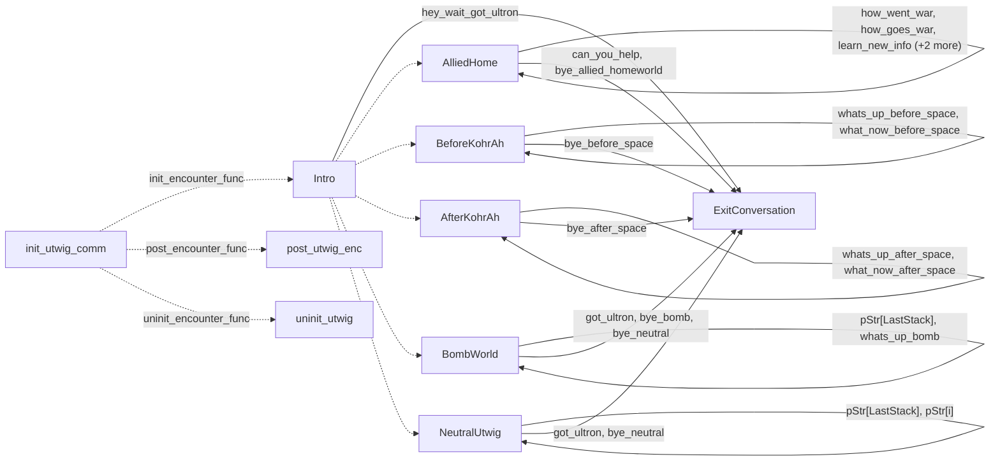

# Utwig: existing conversation graph

> Generated by `tools/conversation_catalog.py`; do not edit this page by hand.

[Catalog and interpretation rules](../README.md) · [Proposed engine](../model.md)

Script: [utwigc.c](../../../../sc2/src/uqm/comm/utwig/utwigc.c#L1). Phrase bank: [utwig.txt](../../../../sc2/content/base/comm/utwig/utwig.txt#L1).

10 handler/helper nodes; 26 response registration sites; 5 direct local calls; 117 phrase records.

## Initialization and lifecycle

| Phase | Callback | Bound by | Conditions / source |
| --- | --- | --- | --- |
| <code>init_encounter_func</code> | [<code>Intro</code>](#node-intro) | <code>init_utwig_comm</code> | No enclosing branch condition; [966](../../../../sc2/src/uqm/comm/utwig/utwigc.c#L966) |
| <code>post_encounter_func</code> | [<code>post_utwig_enc</code>](#node-post_utwig_enc) | <code>init_utwig_comm</code> | No enclosing branch condition; [967](../../../../sc2/src/uqm/comm/utwig/utwigc.c#L967) |
| <code>uninit_encounter_func</code> | [<code>uninit_utwig</code>](#node-uninit_utwig) | <code>init_utwig_comm</code> | No enclosing branch condition; [968](../../../../sc2/src/uqm/comm/utwig/utwigc.c#L968) |

## Handler graph

Solid arrows are selectable responses; dashed arrows are direct C calls. Conditions, arguments, speech and effects are cataloged below. Parallel response sites are grouped only in this diagram.



## Condition catalog

Condition IDs describe enclosing source structure. Branch predicates combine with ∧; case labels mark source locations that can also be reached by fallthrough. Values refer to their original evaluation points. Local assignments and early control flow remain in the decision bodies.

| ID | Source expression / structural condition |
| --- | --- |
| <a id="condition-c1"></a>C1 | <code>PLAYER_SAID(R, bye_neutral)</code> |
| <a id="condition-c2"></a>C2 | <code>!(PLAYER_SAID(R, bye_neutral))</code> |
| <a id="condition-c3"></a>C3 | <code>PLAYER_SAID(R, bye_after_space)</code> |
| <a id="condition-c4"></a>C4 | <code>!(PLAYER_SAID(R, bye_after_space))</code> |
| <a id="condition-c5"></a>C5 | <code>PLAYER_SAID(R, bye_before_space)</code> |
| <a id="condition-c6"></a>C6 | <code>!(PLAYER_SAID(R, bye_before_space))</code> |
| <a id="condition-c7"></a>C7 | <code>PLAYER_SAID(R, bye_allied_homeworld)</code> |
| <a id="condition-c8"></a>C8 | <code>!(PLAYER_SAID(R, bye_allied_homeworld))</code> |
| <a id="condition-c9"></a>C9 | <code>PLAYER_SAID(R, bye_bomb)</code> |
| <a id="condition-c10"></a>C10 | <code>!(PLAYER_SAID(R, bye_bomb))</code> |
| <a id="condition-c11"></a>C11 | <code>PLAYER_SAID(R, demand_bomb)</code> |
| <a id="condition-c12"></a>C12 | <code>!(PLAYER_SAID(R, demand_bomb))</code> |
| <a id="condition-c13"></a>C13 | <code>!(PLAYER_SAID(R, got_ultron))</code> |
| <a id="condition-c14"></a>C14 | <code>PLAYER_SAID(R, got_ultron) &#124;&#124; PLAYER_SAID(R, hey_wait_got_ultron)</code> |
| <a id="condition-c15"></a>C15 | <code>GET_GAME_STATE(GLOBAL_FLAGS_AND_DATA) &amp; (1 &lt;&lt; 6)</code> |
| <a id="condition-c16"></a>C16 | <code>!(GET_GAME_STATE(GLOBAL_FLAGS_AND_DATA) &amp; (1 &lt;&lt; 6))</code> |
| <a id="condition-c17"></a>C17 | <code>PLAYER_SAID(R, got_ultron)</code> |
| <a id="condition-c18"></a>C18 | <code>GET_GAME_STATE(ULTRON_CONDITION) &lt; 4</code> |
| <a id="condition-c19"></a>C19 | <code>switch (GET_GAME_STATE(UTWIG_INFO))</code> |
| <a id="condition-c20"></a>C20 | <code>case 0 (see source for fallthrough)</code> |
| <a id="condition-c21"></a>C21 | <code>case 1 (see source for fallthrough)</code> |
| <a id="condition-c22"></a>C22 | <code>!(GET_GAME_STATE(ULTRON_CONDITION) &lt; 4)</code> |
| <a id="condition-c23"></a>C23 | <code>GET_GAME_STATE(KOHR_AH_FRENZY)</code> |
| <a id="condition-c24"></a>C24 | <code>!(GET_GAME_STATE(KOHR_AH_FRENZY))</code> |
| <a id="condition-c25"></a>C25 | <code>!(PLAYER_SAID(R, got_ultron) &#124;&#124; PLAYER_SAID(R, hey_wait_got_ultron))</code> |
| <a id="condition-c26"></a>C26 | <code>PLAYER_SAID(R, can_you_help)</code> |
| <a id="condition-c27"></a>C27 | <code>EscortFeasibilityStudy(UTWIG_SHIP) == 0</code> |
| <a id="condition-c28"></a>C28 | <code>!(EscortFeasibilityStudy(UTWIG_SHIP) == 0)</code> |
| <a id="condition-c29"></a>C29 | <code>PLAYER_SAID(R, how_went_war)</code> |
| <a id="condition-c30"></a>C30 | <code>!(PLAYER_SAID(R, how_went_war))</code> |
| <a id="condition-c31"></a>C31 | <code>PLAYER_SAID(R, how_goes_war)</code> |
| <a id="condition-c32"></a>C32 | <code>NumVisits == 1</code> |
| <a id="condition-c33"></a>C33 | <code>!(NumVisits == 1)</code> |
| <a id="condition-c34"></a>C34 | <code>switch (GET_GAME_STATE(UTWIG_WAR_NEWS))</code> |
| <a id="condition-c35"></a>C35 | <code>!(PLAYER_SAID(R, how_goes_war))</code> |
| <a id="condition-c36"></a>C36 | <code>PLAYER_SAID(R, learn_new_info)</code> |
| <a id="condition-c37"></a>C37 | <code>NumVisits &lt; 5</code> |
| <a id="condition-c38"></a>C38 | <code>!(NumVisits &lt; 5)</code> |
| <a id="condition-c39"></a>C39 | <code>!(PLAYER_SAID(R, learn_new_info))</code> |
| <a id="condition-c40"></a>C40 | <code>PLAYER_SAID(R, what_now_homeworld)</code> |
| <a id="condition-c41"></a>C41 | <code>!(PLAYER_SAID(R, what_now_homeworld))</code> |
| <a id="condition-c42"></a>C42 | <code>PLAYER_SAID(R, how_is_ultron)</code> |
| <a id="condition-c43"></a>C43 | <code>NumVisits &gt;= 5</code> |
| <a id="condition-c44"></a>C44 | <code>!(News &amp; (1 &lt;&lt; 0))</code> |
| <a id="condition-c45"></a>C45 | <code>!(NumVisits &gt;= 5)</code> |
| <a id="condition-c46"></a>C46 | <code>PHRASE_ENABLED(how_goes_war) &amp;&amp; (((NumVisits == 1) &amp;&amp; (News == 0)) &#124;&#124; (NumVisits &amp;&amp; (News &lt; 2)))</code> |
| <a id="condition-c47"></a>C47 | <code>PHRASE_ENABLED(learn_new_info)</code> |
| <a id="condition-c48"></a>C48 | <code>PHRASE_ENABLED(what_now_homeworld)</code> |
| <a id="condition-c49"></a>C49 | <code>PHRASE_ENABLED(how_is_ultron)</code> |
| <a id="condition-c50"></a>C50 | <code>NumVisits == 0</code> |
| <a id="condition-c51"></a>C51 | <code>(NumVisits == 0) &amp;&amp; (EscortFeasibilityStudy(UTWIG_SHIP) != 0)</code> |
| <a id="condition-c52"></a>C52 | <code>PLAYER_SAID(R, whats_up_before_space)</code> |
| <a id="condition-c53"></a>C53 | <code>switch (NumVisits++)</code> |
| <a id="condition-c54"></a>C54 | <code>!(PLAYER_SAID(R, whats_up_before_space))</code> |
| <a id="condition-c55"></a>C55 | <code>PLAYER_SAID(R, what_now_before_space)</code> |
| <a id="condition-c56"></a>C56 | <code>PHRASE_ENABLED(whats_up_before_space)</code> |
| <a id="condition-c57"></a>C57 | <code>PHRASE_ENABLED(what_now_before_space)</code> |
| <a id="condition-c58"></a>C58 | <code>PLAYER_SAID(R, whats_up_after_space)</code> |
| <a id="condition-c59"></a>C59 | <code>!(PLAYER_SAID(R, whats_up_after_space))</code> |
| <a id="condition-c60"></a>C60 | <code>PLAYER_SAID(R, what_now_after_space)</code> |
| <a id="condition-c61"></a>C61 | <code>PHRASE_ENABLED(whats_up_after_space)</code> |
| <a id="condition-c62"></a>C62 | <code>PHRASE_ENABLED(what_now_after_space)</code> |
| <a id="condition-c63"></a>C63 | <code>PLAYER_SAID(R, we_are_vindicator0)</code> |
| <a id="condition-c64"></a>C64 | <code>!(PLAYER_SAID(R, we_are_vindicator0))</code> |
| <a id="condition-c65"></a>C65 | <code>PLAYER_SAID(R, why_sad)</code> |
| <a id="condition-c66"></a>C66 | <code>!(PLAYER_SAID(R, why_sad))</code> |
| <a id="condition-c67"></a>C67 | <code>PLAYER_SAID(R, what_ultron)</code> |
| <a id="condition-c68"></a>C68 | <code>!(PLAYER_SAID(R, what_ultron))</code> |
| <a id="condition-c69"></a>C69 | <code>PLAYER_SAID(R, dont_be_babies)</code> |
| <a id="condition-c70"></a>C70 | <code>!(PLAYER_SAID(R, dont_be_babies))</code> |
| <a id="condition-c71"></a>C71 | <code>PLAYER_SAID(R, real_sorry_about_ultron)</code> |
| <a id="condition-c72"></a>C72 | <code>!(PLAYER_SAID(R, real_sorry_about_ultron))</code> |
| <a id="condition-c73"></a>C73 | <code>PLAYER_SAID(R, what_about_you_1)</code> |
| <a id="condition-c74"></a>C74 | <code>!(PLAYER_SAID(R, what_about_you_1))</code> |
| <a id="condition-c75"></a>C75 | <code>PLAYER_SAID(R, what_about_you_2)</code> |
| <a id="condition-c76"></a>C76 | <code>!(PLAYER_SAID(R, what_about_you_2))</code> |
| <a id="condition-c77"></a>C77 | <code>PLAYER_SAID(R, what_about_you_3)</code> |
| <a id="condition-c78"></a>C78 | <code>!(PLAYER_SAID(R, what_about_you_3))</code> |
| <a id="condition-c79"></a>C79 | <code>PLAYER_SAID(R, what_about_urquan_1)</code> |
| <a id="condition-c80"></a>C80 | <code>!(PLAYER_SAID(R, what_about_urquan_1))</code> |
| <a id="condition-c81"></a>C81 | <code>PLAYER_SAID(R, what_about_urquan_2)</code> |
| <a id="condition-c82"></a>C82 | <code>switch (GET_GAME_STATE(UTWIG_STACK1))</code> |
| <a id="condition-c83"></a>C83 | <code>case 2 (see source for fallthrough)</code> |
| <a id="condition-c84"></a>C84 | <code>case 3 (see source for fallthrough)</code> |
| <a id="condition-c85"></a>C85 | <code>switch (GET_GAME_STATE(UTWIG_STACK2))</code> |
| <a id="condition-c86"></a>C86 | <code>pStr[LastStack]</code> |
| <a id="condition-c87"></a>C87 | <code>pStr[LastStack] != we_are_vindicator0</code> |
| <a id="condition-c88"></a>C88 | <code>!(pStr[LastStack] != we_are_vindicator0)</code> |
| <a id="condition-c89"></a>C89 | <code>for (i = 0; i &lt; 4; ++i)</code> |
| <a id="condition-c90"></a>C90 | <code>(i != LastStack) &amp;&amp; pStr[i]</code> |
| <a id="condition-c91"></a>C91 | <code>pStr[i] != we_are_vindicator0</code> |
| <a id="condition-c92"></a>C92 | <code>!(pStr[i] != we_are_vindicator0)</code> |
| <a id="condition-c93"></a>C93 | <code>GET_GAME_STATE(ULTRON_CONDITION)</code> |
| <a id="condition-c94"></a>C94 | <code>PLAYER_SAID(R, why_you_here)</code> |
| <a id="condition-c95"></a>C95 | <code>!(PLAYER_SAID(R, why_you_here))</code> |
| <a id="condition-c96"></a>C96 | <code>PLAYER_SAID(R, what_about_bomb)</code> |
| <a id="condition-c97"></a>C97 | <code>!(PLAYER_SAID(R, what_about_bomb))</code> |
| <a id="condition-c98"></a>C98 | <code>PLAYER_SAID(R, give_us_bomb_or_die)</code> |
| <a id="condition-c99"></a>C99 | <code>!(PLAYER_SAID(R, give_us_bomb_or_die))</code> |
| <a id="condition-c100"></a>C100 | <code>PLAYER_SAID(R, may_we_have_bomb)</code> |
| <a id="condition-c101"></a>C101 | <code>!(PLAYER_SAID(R, may_we_have_bomb))</code> |
| <a id="condition-c102"></a>C102 | <code>PLAYER_SAID(R, please)</code> |
| <a id="condition-c103"></a>C103 | <code>!(PLAYER_SAID(R, please))</code> |
| <a id="condition-c104"></a>C104 | <code>PLAYER_SAID(R, whats_up_bomb)</code> |
| <a id="condition-c105"></a>C105 | <code>GET_GAME_STATE(BOMB_INFO)</code> |
| <a id="condition-c106"></a>C106 | <code>!(GET_GAME_STATE(BOMB_INFO))</code> |
| <a id="condition-c107"></a>C107 | <code>switch (GET_GAME_STATE(BOMB_STACK2))</code> |
| <a id="condition-c108"></a>C108 | <code>switch (GET_GAME_STATE(BOMB_STACK1))</code> |
| <a id="condition-c109"></a>C109 | <code>PHRASE_ENABLED(whats_up_bomb)</code> |
| <a id="condition-c110"></a>C110 | <code>PHRASE_ENABLED(whats_up_bomb) &amp;&amp; (GET_GAME_STATE(BOMB_STACK1) &gt; 1)</code> |
| <a id="condition-c111"></a>C111 | <code>GET_GAME_STATE(ULTRON_CONDITION) &amp;&amp; (!GET_GAME_STATE(REFUSED_ULTRON_AT_BOMB))</code> |
| <a id="condition-c112"></a>C112 | <code>LOBYTE(GLOBAL(CurrentActivity)) == WON_LAST_BATTLE</code> |
| <a id="condition-c113"></a>C113 | <code>GET_GAME_STATE(UTWIG_HOSTILE)</code> |
| <a id="condition-c114"></a>C114 | <code>GET_GAME_STATE(GLOBAL_FLAGS_AND_DATA) &amp; (1 &lt;&lt; 7)</code> |
| <a id="condition-c115"></a>C115 | <code>!(GET_GAME_STATE(GLOBAL_FLAGS_AND_DATA) &amp; (1 &lt;&lt; 7))</code> |
| <a id="condition-c116"></a>C116 | <code>!(!GET_GAME_STATE(ULTRON_CONDITION))</code> |
| <a id="condition-c117"></a>C117 | <code>(!GET_GAME_STATE(ULTRON_CONDITION)) &#124;&#124; (GET_GAME_STATE(GLOBAL_FLAGS_AND_DATA) &amp; (1 &lt;&lt; 6))</code> |
| <a id="condition-c118"></a>C118 | <code>!((!GET_GAME_STATE(ULTRON_CONDITION)) &#124;&#124; (GET_GAME_STATE(GLOBAL_FLAGS_AND_DATA) &amp; (1 &lt;&lt; 6)))</code> |
| <a id="condition-c119"></a>C119 | <code>!(GET_GAME_STATE(UTWIG_HOSTILE))</code> |
| <a id="condition-c120"></a>C120 | <code>CheckAlliance(UTWIG_SHIP) == GOOD_GUY</code> |
| <a id="condition-c121"></a>C121 | <code>!(CheckAlliance(UTWIG_SHIP) == GOOD_GUY)</code> |
| <a id="condition-c122"></a>C122 | <code>GET_GAME_STATE(UTWIG_HAVE_ULTRON)</code> |
| <a id="condition-c123"></a>C123 | <code>!(GET_GAME_STATE(UTWIG_HAVE_ULTRON))</code> |
| <a id="condition-c124"></a>C124 | <code>GET_GAME_STATE(UTWIG_HAVE_ULTRON) &#124;&#124; (LOBYTE(GLOBAL(CurrentActivity)) == WON_LAST_BATTLE)</code> |
| <a id="condition-c125"></a>C125 | <code>!(GET_GAME_STATE(UTWIG_HAVE_ULTRON) &#124;&#124; (LOBYTE(GLOBAL(CurrentActivity)) == WON_LAST_BATTLE))</code> |

## Script-scope state and lookup tables

These declarations supply shared local state, computed phrase alternatives, number speech, or lookup data used by the nodes. LOCDATA presentation defaults are linked separately in the source.

Presentation descriptor <code>utwig_desc</code>: [source](../../../../sc2/src/uqm/comm/utwig/utwigc.c#L27).

## Node catalog

<a id="node-exitconversation"></a>

### ExitConversation

<code>static void ExitConversation(RESPONSE_REF R)</code> — [source](../../../../sc2/src/uqm/comm/utwig/utwigc.c#L201).

Incoming player-response variants: [<code>can_you_help</code>](#phrase-can_you_help), [<code>bye_allied_homeworld</code>](#phrase-bye_allied_homeworld), [<code>bye_before_space</code>](#phrase-bye_before_space), [<code>bye_after_space</code>](#phrase-bye_after_space), [<code>got_ultron</code>](#phrase-got_ultron), [<code>bye_neutral</code>](#phrase-bye_neutral), [<code>bye_bomb</code>](#phrase-bye_bomb), [<code>hey_wait_got_ultron</code>](#phrase-hey_wait_got_ultron).

#### Dialogue / audio emissions

| Phrase or expression | Enclosing conditions | Source |
| --- | --- | --- |
| [<code>GOODBYE_NEUTRAL</code>](#phrase-goodbye_neutral)<br><code>NPCPhrase(GOODBYE_NEUTRAL)</code> | [C1](#condition-c1) | [206](../../../../sc2/src/uqm/comm/utwig/utwigc.c#L206) |
| [<code>GOODBYE_AFTER_SPACE</code>](#phrase-goodbye_after_space)<br><code>NPCPhrase(GOODBYE_AFTER_SPACE)</code> | [C2](#condition-c2) ∧ [C3](#condition-c3) | [208](../../../../sc2/src/uqm/comm/utwig/utwigc.c#L208) |
| [<code>GOODBYE_BEFORE_SPACE</code>](#phrase-goodbye_before_space)<br><code>NPCPhrase(GOODBYE_BEFORE_SPACE)</code> | [C2](#condition-c2) ∧ [C4](#condition-c4) ∧ [C5](#condition-c5) | [210](../../../../sc2/src/uqm/comm/utwig/utwigc.c#L210) |
| [<code>GOODBYE_ALLIED_HOMEWORLD</code>](#phrase-goodbye_allied_homeworld)<br><code>NPCPhrase(GOODBYE_ALLIED_HOMEWORLD)</code> | [C2](#condition-c2) ∧ [C4](#condition-c4) ∧ [C6](#condition-c6) ∧ [C7](#condition-c7) | [212](../../../../sc2/src/uqm/comm/utwig/utwigc.c#L212) |
| [<code>GOODBYE_BOMB</code>](#phrase-goodbye_bomb)<br><code>NPCPhrase(GOODBYE_BOMB)</code> | [C2](#condition-c2) ∧ [C4](#condition-c4) ∧ [C6](#condition-c6) ∧ [C8](#condition-c8) ∧ [C9](#condition-c9) | [214](../../../../sc2/src/uqm/comm/utwig/utwigc.c#L214) |
| [<code>GUARDS_FIGHT</code>](#phrase-guards_fight)<br><code>NPCPhrase(GUARDS_FIGHT)</code> | [C2](#condition-c2) ∧ [C4](#condition-c4) ∧ [C6](#condition-c6) ∧ [C8](#condition-c8) ∧ [C10](#condition-c10) ∧ [C11](#condition-c11) | [217](../../../../sc2/src/uqm/comm/utwig/utwigc.c#L217) |
| [<code>NO_ULTRON_AT_BOMB</code>](#phrase-no_ultron_at_bomb)<br><code>NPCPhrase(NO_ULTRON_AT_BOMB)</code> | [C2](#condition-c2) ∧ [C4](#condition-c4) ∧ [C6](#condition-c6) ∧ [C8](#condition-c8) ∧ [C10](#condition-c10) ∧ [C12](#condition-c12) ∧ [C14](#condition-c14) ∧ [C15](#condition-c15) | [226](../../../../sc2/src/uqm/comm/utwig/utwigc.c#L226) |
| [<code>DONT_WANT_TO_LOOK</code>](#phrase-dont_want_to_look)<br><code>NPCPhrase(DONT_WANT_TO_LOOK)</code> | [C2](#condition-c2) ∧ [C4](#condition-c4) ∧ [C6](#condition-c6) ∧ [C8](#condition-c8) ∧ [C10](#condition-c10) ∧ [C12](#condition-c12) ∧ [C14](#condition-c14) ∧ [C16](#condition-c16) ∧ [C17](#condition-c17) | [233](../../../../sc2/src/uqm/comm/utwig/utwigc.c#L233) |
| [<code>TAUNT_US_BUT_WE_LOOK</code>](#phrase-taunt_us_but_we_look)<br><code>NPCPhrase(TAUNT_US_BUT_WE_LOOK)</code> | [C2](#condition-c2) ∧ [C4](#condition-c4) ∧ [C6](#condition-c6) ∧ [C8](#condition-c8) ∧ [C10](#condition-c10) ∧ [C12](#condition-c12) ∧ [C14](#condition-c14) ∧ [C16](#condition-c16) ∧ [C13](#condition-c13) | [235](../../../../sc2/src/uqm/comm/utwig/utwigc.c#L235) |
| [<code>SICK_TRICK_1</code>](#phrase-sick_trick_1)<br><code>NPCPhrase(SICK_TRICK_1)</code> | [C2](#condition-c2) ∧ [C4](#condition-c4) ∧ [C6](#condition-c6) ∧ [C8](#condition-c8) ∧ [C10](#condition-c10) ∧ [C12](#condition-c12) ∧ [C14](#condition-c14) ∧ [C16](#condition-c16) ∧ [C18](#condition-c18) ∧ [C19](#condition-c19) ∧ [C20](#condition-c20) ∧ [C17](#condition-c17) | [242](../../../../sc2/src/uqm/comm/utwig/utwigc.c#L242) |
| [<code>TRICKED_US_1</code>](#phrase-tricked_us_1)<br><code>NPCPhrase(TRICKED_US_1)</code> | [C2](#condition-c2) ∧ [C4](#condition-c4) ∧ [C6](#condition-c6) ∧ [C8](#condition-c8) ∧ [C10](#condition-c10) ∧ [C12](#condition-c12) ∧ [C14](#condition-c14) ∧ [C16](#condition-c16) ∧ [C18](#condition-c18) ∧ [C19](#condition-c19) ∧ [C20](#condition-c20) ∧ [C13](#condition-c13) | [245](../../../../sc2/src/uqm/comm/utwig/utwigc.c#L245) |
| [<code>SICK_TRICK_2</code>](#phrase-sick_trick_2)<br><code>NPCPhrase(SICK_TRICK_2)</code> | [C2](#condition-c2) ∧ [C4](#condition-c4) ∧ [C6](#condition-c6) ∧ [C8](#condition-c8) ∧ [C10](#condition-c10) ∧ [C12](#condition-c12) ∧ [C14](#condition-c14) ∧ [C16](#condition-c16) ∧ [C18](#condition-c18) ∧ [C19](#condition-c19) ∧ [C21](#condition-c21) ∧ [C17](#condition-c17) | [252](../../../../sc2/src/uqm/comm/utwig/utwigc.c#L252) |
| [<code>TRICKED_US_2</code>](#phrase-tricked_us_2)<br><code>NPCPhrase(TRICKED_US_2)</code> | [C2](#condition-c2) ∧ [C4](#condition-c4) ∧ [C6](#condition-c6) ∧ [C8](#condition-c8) ∧ [C10](#condition-c10) ∧ [C12](#condition-c12) ∧ [C14](#condition-c14) ∧ [C16](#condition-c16) ∧ [C18](#condition-c18) ∧ [C19](#condition-c19) ∧ [C21](#condition-c21) ∧ [C13](#condition-c13) | [255](../../../../sc2/src/uqm/comm/utwig/utwigc.c#L255) |
| [<code>HAPPY_DAYS</code>](#phrase-happy_days)<br><code>NPCPhrase(HAPPY_DAYS)</code> | [C2](#condition-c2) ∧ [C4](#condition-c4) ∧ [C6](#condition-c6) ∧ [C8](#condition-c8) ∧ [C10](#condition-c10) ∧ [C12](#condition-c12) ∧ [C14](#condition-c14) ∧ [C16](#condition-c16) ∧ [C22](#condition-c22) | [265](../../../../sc2/src/uqm/comm/utwig/utwigc.c#L265) |
| [<code>TOO_LATE</code>](#phrase-too_late)<br><code>NPCPhrase(TOO_LATE)</code> | [C2](#condition-c2) ∧ [C4](#condition-c4) ∧ [C6](#condition-c6) ∧ [C8](#condition-c8) ∧ [C10](#condition-c10) ∧ [C12](#condition-c12) ∧ [C14](#condition-c14) ∧ [C16](#condition-c16) ∧ [C22](#condition-c22) ∧ [C23](#condition-c23) | [267](../../../../sc2/src/uqm/comm/utwig/utwigc.c#L267) |
| [<code>OK_ATTACK_KOHRAH</code>](#phrase-ok_attack_kohrah)<br><code>NPCPhrase(OK_ATTACK_KOHRAH)</code> | [C2](#condition-c2) ∧ [C4](#condition-c4) ∧ [C6](#condition-c6) ∧ [C8](#condition-c8) ∧ [C10](#condition-c10) ∧ [C12](#condition-c12) ∧ [C14](#condition-c14) ∧ [C16](#condition-c16) ∧ [C22](#condition-c22) ∧ [C24](#condition-c24) | [270](../../../../sc2/src/uqm/comm/utwig/utwigc.c#L270) |
| [<code>HOW_HELP</code>](#phrase-how_help)<br><code>NPCPhrase(HOW_HELP)</code> | [C2](#condition-c2) ∧ [C4](#condition-c4) ∧ [C6](#condition-c6) ∧ [C8](#condition-c8) ∧ [C10](#condition-c10) ∧ [C12](#condition-c12) ∧ [C25](#condition-c25) ∧ [C26](#condition-c26) | [298](../../../../sc2/src/uqm/comm/utwig/utwigc.c#L298) |
| [<code>DONT_NEED</code>](#phrase-dont_need)<br><code>NPCPhrase(DONT_NEED)</code> | [C2](#condition-c2) ∧ [C4](#condition-c4) ∧ [C6](#condition-c6) ∧ [C8](#condition-c8) ∧ [C10](#condition-c10) ∧ [C12](#condition-c12) ∧ [C25](#condition-c25) ∧ [C26](#condition-c26) ∧ [C27](#condition-c27) | [300](../../../../sc2/src/uqm/comm/utwig/utwigc.c#L300) |
| [<code>HAVE_4_SHIPS</code>](#phrase-have_4_ships)<br><code>NPCPhrase(HAVE_4_SHIPS)</code> | [C2](#condition-c2) ∧ [C4](#condition-c4) ∧ [C6](#condition-c6) ∧ [C8](#condition-c8) ∧ [C10](#condition-c10) ∧ [C12](#condition-c12) ∧ [C25](#condition-c25) ∧ [C26](#condition-c26) ∧ [C28](#condition-c28) | [303](../../../../sc2/src/uqm/comm/utwig/utwigc.c#L303) |

#### Actions, queries, local updates, and control flow

Calls are listed without assuming they are pure or mutating. Local updates are retained because they determine dynamic menus and counter-selected speech.

| Kind | Operation | Enclosing conditions | Source |
| --- | --- | --- | --- |
| call | <code>setSegue(Segue_peace)</code> | No enclosing branch condition | [203](../../../../sc2/src/uqm/comm/utwig/utwigc.c#L203) |
| call | <code>PLAYER_SAID(R, bye_neutral)</code> | No enclosing branch condition | [205](../../../../sc2/src/uqm/comm/utwig/utwigc.c#L205) |
| call | <code>PLAYER_SAID(R, bye_after_space)</code> | [C2](#condition-c2) | [207](../../../../sc2/src/uqm/comm/utwig/utwigc.c#L207) |
| call | <code>PLAYER_SAID(R, bye_before_space)</code> | [C2](#condition-c2) ∧ [C4](#condition-c4) | [209](../../../../sc2/src/uqm/comm/utwig/utwigc.c#L209) |
| call | <code>PLAYER_SAID(R, bye_allied_homeworld)</code> | [C2](#condition-c2) ∧ [C4](#condition-c4) ∧ [C6](#condition-c6) | [211](../../../../sc2/src/uqm/comm/utwig/utwigc.c#L211) |
| call | <code>PLAYER_SAID(R, bye_bomb)</code> | [C2](#condition-c2) ∧ [C4](#condition-c4) ∧ [C6](#condition-c6) ∧ [C8](#condition-c8) | [213](../../../../sc2/src/uqm/comm/utwig/utwigc.c#L213) |
| call | <code>PLAYER_SAID(R, demand_bomb)</code> | [C2](#condition-c2) ∧ [C4](#condition-c4) ∧ [C6](#condition-c6) ∧ [C8](#condition-c8) ∧ [C10](#condition-c10) | [215](../../../../sc2/src/uqm/comm/utwig/utwigc.c#L215) |
| call | <code>setSegue(Segue_hostile)</code> | [C2](#condition-c2) ∧ [C4](#condition-c4) ∧ [C6](#condition-c6) ∧ [C8](#condition-c8) ∧ [C10](#condition-c10) ∧ [C11](#condition-c11) | [219](../../../../sc2/src/uqm/comm/utwig/utwigc.c#L219) |
| call | <code>PLAYER_SAID(R, got_ultron)</code> | [C2](#condition-c2) ∧ [C4](#condition-c4) ∧ [C6](#condition-c6) ∧ [C8](#condition-c8) ∧ [C10](#condition-c10) ∧ [C12](#condition-c12) | [221](../../../../sc2/src/uqm/comm/utwig/utwigc.c#L221) |
| call | <code>PLAYER_SAID(R, hey_wait_got_ultron)</code> | [C2](#condition-c2) ∧ [C4](#condition-c4) ∧ [C6](#condition-c6) ∧ [C8](#condition-c8) ∧ [C10](#condition-c10) ∧ [C12](#condition-c12) ∧ [C13](#condition-c13) | [222](../../../../sc2/src/uqm/comm/utwig/utwigc.c#L222) |
| call | <code>GET_GAME_STATE(GLOBAL_FLAGS_AND_DATA)</code> | [C2](#condition-c2) ∧ [C4](#condition-c4) ∧ [C6](#condition-c6) ∧ [C8](#condition-c8) ∧ [C10](#condition-c10) ∧ [C12](#condition-c12) ∧ [C14](#condition-c14) | [224](../../../../sc2/src/uqm/comm/utwig/utwigc.c#L224) |
| call | <code>SET_GAME_STATE(REFUSED_ULTRON_AT_BOMB, 1)</code> | [C2](#condition-c2) ∧ [C4](#condition-c4) ∧ [C6](#condition-c6) ∧ [C8](#condition-c8) ∧ [C10](#condition-c10) ∧ [C12](#condition-c12) ∧ [C14](#condition-c14) ∧ [C15](#condition-c15) | [228](../../../../sc2/src/uqm/comm/utwig/utwigc.c#L228) |
| call | <code>PLAYER_SAID(R, got_ultron)</code> | [C2](#condition-c2) ∧ [C4](#condition-c4) ∧ [C6](#condition-c6) ∧ [C8](#condition-c8) ∧ [C10](#condition-c10) ∧ [C12](#condition-c12) ∧ [C14](#condition-c14) ∧ [C16](#condition-c16) | [232](../../../../sc2/src/uqm/comm/utwig/utwigc.c#L232) |
| call | <code>GET_GAME_STATE(ULTRON_CONDITION)</code> | [C2](#condition-c2) ∧ [C4](#condition-c4) ∧ [C6](#condition-c6) ∧ [C8](#condition-c8) ∧ [C10](#condition-c10) ∧ [C12](#condition-c12) ∧ [C14](#condition-c14) ∧ [C16](#condition-c16) | [236](../../../../sc2/src/uqm/comm/utwig/utwigc.c#L236) |
| call | <code>GET_GAME_STATE(UTWIG_INFO)</code> | [C2](#condition-c2) ∧ [C4](#condition-c4) ∧ [C6](#condition-c6) ∧ [C8](#condition-c8) ∧ [C10](#condition-c10) ∧ [C12](#condition-c12) ∧ [C14](#condition-c14) ∧ [C16](#condition-c16) ∧ [C18](#condition-c18) | [238](../../../../sc2/src/uqm/comm/utwig/utwigc.c#L238) |
| call | <code>PLAYER_SAID(R, got_ultron)</code> | [C2](#condition-c2) ∧ [C4](#condition-c4) ∧ [C6](#condition-c6) ∧ [C8](#condition-c8) ∧ [C10](#condition-c10) ∧ [C12](#condition-c12) ∧ [C14](#condition-c14) ∧ [C16](#condition-c16) ∧ [C18](#condition-c18) ∧ [C19](#condition-c19) ∧ [C20](#condition-c20) | [241](../../../../sc2/src/uqm/comm/utwig/utwigc.c#L241) |
| call | <code>setSegue(Segue_hostile)</code> | [C2](#condition-c2) ∧ [C4](#condition-c4) ∧ [C6](#condition-c6) ∧ [C8](#condition-c8) ∧ [C10](#condition-c10) ∧ [C12](#condition-c12) ∧ [C14](#condition-c14) ∧ [C16](#condition-c16) ∧ [C18](#condition-c18) ∧ [C19](#condition-c19) ∧ [C20](#condition-c20) ∧ [C13](#condition-c13) | [247](../../../../sc2/src/uqm/comm/utwig/utwigc.c#L247) |
| flow | <code>break;</code> | [C2](#condition-c2) ∧ [C4](#condition-c4) ∧ [C6](#condition-c6) ∧ [C8](#condition-c8) ∧ [C10](#condition-c10) ∧ [C12](#condition-c12) ∧ [C14](#condition-c14) ∧ [C16](#condition-c16) ∧ [C18](#condition-c18) ∧ [C19](#condition-c19) ∧ [C20](#condition-c20) | [249](../../../../sc2/src/uqm/comm/utwig/utwigc.c#L249) |
| call | <code>PLAYER_SAID(R, got_ultron)</code> | [C2](#condition-c2) ∧ [C4](#condition-c4) ∧ [C6](#condition-c6) ∧ [C8](#condition-c8) ∧ [C10](#condition-c10) ∧ [C12](#condition-c12) ∧ [C14](#condition-c14) ∧ [C16](#condition-c16) ∧ [C18](#condition-c18) ∧ [C19](#condition-c19) ∧ [C21](#condition-c21) | [251](../../../../sc2/src/uqm/comm/utwig/utwigc.c#L251) |
| call | <code>setSegue(Segue_hostile)</code> | [C2](#condition-c2) ∧ [C4](#condition-c4) ∧ [C6](#condition-c6) ∧ [C8](#condition-c8) ∧ [C10](#condition-c10) ∧ [C12](#condition-c12) ∧ [C14](#condition-c14) ∧ [C16](#condition-c16) ∧ [C18](#condition-c18) ∧ [C19](#condition-c19) ∧ [C21](#condition-c21) ∧ [C13](#condition-c13) | [257](../../../../sc2/src/uqm/comm/utwig/utwigc.c#L257) |
| flow | <code>break;</code> | [C2](#condition-c2) ∧ [C4](#condition-c4) ∧ [C6](#condition-c6) ∧ [C8](#condition-c8) ∧ [C10](#condition-c10) ∧ [C12](#condition-c12) ∧ [C14](#condition-c14) ∧ [C16](#condition-c16) ∧ [C18](#condition-c18) ∧ [C19](#condition-c19) ∧ [C21](#condition-c21) | [259](../../../../sc2/src/uqm/comm/utwig/utwigc.c#L259) |
| call | <code>SET_GAME_STATE(UTWIG_INFO, 1)</code> | [C2](#condition-c2) ∧ [C4](#condition-c4) ∧ [C6](#condition-c6) ∧ [C8](#condition-c8) ∧ [C10](#condition-c10) ∧ [C12](#condition-c12) ∧ [C14](#condition-c14) ∧ [C16](#condition-c16) ∧ [C18](#condition-c18) | [261](../../../../sc2/src/uqm/comm/utwig/utwigc.c#L261) |
| call | <code>GET_GAME_STATE(KOHR_AH_FRENZY)</code> | [C2](#condition-c2) ∧ [C4](#condition-c4) ∧ [C6](#condition-c6) ∧ [C8](#condition-c8) ∧ [C10](#condition-c10) ∧ [C12](#condition-c12) ∧ [C14](#condition-c14) ∧ [C16](#condition-c16) ∧ [C22](#condition-c22) | [266](../../../../sc2/src/uqm/comm/utwig/utwigc.c#L266) |
| call | <code>AddEvent(RELATIVE_EVENT, 0, 0, 0, ADVANCE_UTWIG_SUPOX_MISSION)</code> | [C2](#condition-c2) ∧ [C4](#condition-c4) ∧ [C6](#condition-c6) ∧ [C8](#condition-c8) ∧ [C10](#condition-c10) ∧ [C12](#condition-c12) ∧ [C14](#condition-c14) ∧ [C16](#condition-c16) ∧ [C22](#condition-c22) ∧ [C24](#condition-c24) | [272](../../../../sc2/src/uqm/comm/utwig/utwigc.c#L272) |
| call | <code>SET_GAME_STATE(UTWIG_HAVE_ULTRON, 1)</code> | [C2](#condition-c2) ∧ [C4](#condition-c4) ∧ [C6](#condition-c6) ∧ [C8](#condition-c8) ∧ [C10](#condition-c10) ∧ [C12](#condition-c12) ∧ [C14](#condition-c14) ∧ [C16](#condition-c16) ∧ [C22](#condition-c22) | [275](../../../../sc2/src/uqm/comm/utwig/utwigc.c#L275) |
| call | <code>SET_GAME_STATE(ULTRON_CONDITION, 5)</code> | [C2](#condition-c2) ∧ [C4](#condition-c4) ∧ [C6](#condition-c6) ∧ [C8](#condition-c8) ∧ [C10](#condition-c10) ∧ [C12](#condition-c12) ∧ [C14](#condition-c14) ∧ [C16](#condition-c16) ∧ [C22](#condition-c22) | [276](../../../../sc2/src/uqm/comm/utwig/utwigc.c#L276) |
| call | <code>SET_GAME_STATE(UTWIG_VISITS, 0)</code> | [C2](#condition-c2) ∧ [C4](#condition-c4) ∧ [C6](#condition-c6) ∧ [C8](#condition-c8) ∧ [C10](#condition-c10) ∧ [C12](#condition-c12) ∧ [C14](#condition-c14) ∧ [C16](#condition-c16) ∧ [C22](#condition-c22) | [278](../../../../sc2/src/uqm/comm/utwig/utwigc.c#L278) |
| call | <code>SET_GAME_STATE(SUPOX_VISITS, 0)</code> | [C2](#condition-c2) ∧ [C4](#condition-c4) ∧ [C6](#condition-c6) ∧ [C8](#condition-c8) ∧ [C10](#condition-c10) ∧ [C12](#condition-c12) ∧ [C14](#condition-c14) ∧ [C16](#condition-c16) ∧ [C22](#condition-c22) | [279](../../../../sc2/src/uqm/comm/utwig/utwigc.c#L279) |
| call | <code>SET_GAME_STATE(UTWIG_HOME_VISITS, 0)</code> | [C2](#condition-c2) ∧ [C4](#condition-c4) ∧ [C6](#condition-c6) ∧ [C8](#condition-c8) ∧ [C10](#condition-c10) ∧ [C12](#condition-c12) ∧ [C14](#condition-c14) ∧ [C16](#condition-c16) ∧ [C22](#condition-c22) | [280](../../../../sc2/src/uqm/comm/utwig/utwigc.c#L280) |
| call | <code>SET_GAME_STATE(SUPOX_HOME_VISITS, 0)</code> | [C2](#condition-c2) ∧ [C4](#condition-c4) ∧ [C6](#condition-c6) ∧ [C8](#condition-c8) ∧ [C10](#condition-c10) ∧ [C12](#condition-c12) ∧ [C14](#condition-c14) ∧ [C16](#condition-c16) ∧ [C22](#condition-c22) | [281](../../../../sc2/src/uqm/comm/utwig/utwigc.c#L281) |
| call | <code>SET_GAME_STATE(BOMB_VISITS, 0)</code> | [C2](#condition-c2) ∧ [C4](#condition-c4) ∧ [C6](#condition-c6) ∧ [C8](#condition-c8) ∧ [C10](#condition-c10) ∧ [C12](#condition-c12) ∧ [C14](#condition-c14) ∧ [C16](#condition-c16) ∧ [C22](#condition-c22) | [282](../../../../sc2/src/uqm/comm/utwig/utwigc.c#L282) |
| call | <code>SET_GAME_STATE(SUPOX_INFO, 0)</code> | [C2](#condition-c2) ∧ [C4](#condition-c4) ∧ [C6](#condition-c6) ∧ [C8](#condition-c8) ∧ [C10](#condition-c10) ∧ [C12](#condition-c12) ∧ [C14](#condition-c14) ∧ [C16](#condition-c16) ∧ [C22](#condition-c22) | [284](../../../../sc2/src/uqm/comm/utwig/utwigc.c#L284) |
| call | <code>SET_GAME_STATE(UTWIG_INFO, 0)</code> | [C2](#condition-c2) ∧ [C4](#condition-c4) ∧ [C6](#condition-c6) ∧ [C8](#condition-c8) ∧ [C10](#condition-c10) ∧ [C12](#condition-c12) ∧ [C14](#condition-c14) ∧ [C16](#condition-c16) ∧ [C22](#condition-c22) | [285](../../../../sc2/src/uqm/comm/utwig/utwigc.c#L285) |
| call | <code>SET_GAME_STATE(SUPOX_WAR_NEWS, 0)</code> | [C2](#condition-c2) ∧ [C4](#condition-c4) ∧ [C6](#condition-c6) ∧ [C8](#condition-c8) ∧ [C10](#condition-c10) ∧ [C12](#condition-c12) ∧ [C14](#condition-c14) ∧ [C16](#condition-c16) ∧ [C22](#condition-c22) | [286](../../../../sc2/src/uqm/comm/utwig/utwigc.c#L286) |
| call | <code>SET_GAME_STATE(UTWIG_WAR_NEWS, 0)</code> | [C2](#condition-c2) ∧ [C4](#condition-c4) ∧ [C6](#condition-c6) ∧ [C8](#condition-c8) ∧ [C10](#condition-c10) ∧ [C12](#condition-c12) ∧ [C14](#condition-c14) ∧ [C16](#condition-c16) ∧ [C22](#condition-c22) | [287](../../../../sc2/src/uqm/comm/utwig/utwigc.c#L287) |
| call | <code>SET_GAME_STATE(SUPOX_HOSTILE, 0)</code> | [C2](#condition-c2) ∧ [C4](#condition-c4) ∧ [C6](#condition-c6) ∧ [C8](#condition-c8) ∧ [C10](#condition-c10) ∧ [C12](#condition-c12) ∧ [C14](#condition-c14) ∧ [C16](#condition-c16) ∧ [C22](#condition-c22) | [288](../../../../sc2/src/uqm/comm/utwig/utwigc.c#L288) |
| call | <code>SET_GAME_STATE(UTWIG_HOSTILE, 0)</code> | [C2](#condition-c2) ∧ [C4](#condition-c4) ∧ [C6](#condition-c6) ∧ [C8](#condition-c8) ∧ [C10](#condition-c10) ∧ [C12](#condition-c12) ∧ [C14](#condition-c14) ∧ [C16](#condition-c16) ∧ [C22](#condition-c22) | [289](../../../../sc2/src/uqm/comm/utwig/utwigc.c#L289) |
| call | <code>SetRaceAllied(UTWIG_SHIP, TRUE)</code> | [C2](#condition-c2) ∧ [C4](#condition-c4) ∧ [C6](#condition-c6) ∧ [C8](#condition-c8) ∧ [C10](#condition-c10) ∧ [C12](#condition-c12) ∧ [C14](#condition-c14) ∧ [C16](#condition-c16) ∧ [C22](#condition-c22) | [291](../../../../sc2/src/uqm/comm/utwig/utwigc.c#L291) |
| call | <code>SetRaceAllied(SUPOX_SHIP, TRUE)</code> | [C2](#condition-c2) ∧ [C4](#condition-c4) ∧ [C6](#condition-c6) ∧ [C8](#condition-c8) ∧ [C10](#condition-c10) ∧ [C12](#condition-c12) ∧ [C14](#condition-c14) ∧ [C16](#condition-c16) ∧ [C22](#condition-c22) | [292](../../../../sc2/src/uqm/comm/utwig/utwigc.c#L292) |
| call | <code>PLAYER_SAID(R, can_you_help)</code> | [C2](#condition-c2) ∧ [C4](#condition-c4) ∧ [C6](#condition-c6) ∧ [C8](#condition-c8) ∧ [C10](#condition-c10) ∧ [C12](#condition-c12) ∧ [C25](#condition-c25) | [296](../../../../sc2/src/uqm/comm/utwig/utwigc.c#L296) |
| call | <code>EscortFeasibilityStudy(UTWIG_SHIP)</code> | [C2](#condition-c2) ∧ [C4](#condition-c4) ∧ [C6](#condition-c6) ∧ [C8](#condition-c8) ∧ [C10](#condition-c10) ∧ [C12](#condition-c12) ∧ [C25](#condition-c25) ∧ [C26](#condition-c26) | [299](../../../../sc2/src/uqm/comm/utwig/utwigc.c#L299) |
| call | <code>AlienTalkSegue((COUNT) (~0))</code> | [C2](#condition-c2) ∧ [C4](#condition-c4) ∧ [C6](#condition-c6) ∧ [C8](#condition-c8) ∧ [C10](#condition-c10) ∧ [C12](#condition-c12) ∧ [C25](#condition-c25) ∧ [C26](#condition-c26) ∧ [C28](#condition-c28) | [305](../../../../sc2/src/uqm/comm/utwig/utwigc.c#L305) |
| call | <code>AddEscortShips(UTWIG_SHIP, 4)</code> | [C2](#condition-c2) ∧ [C4](#condition-c4) ∧ [C6](#condition-c6) ∧ [C8](#condition-c8) ∧ [C10](#condition-c10) ∧ [C12](#condition-c12) ∧ [C25](#condition-c25) ∧ [C26](#condition-c26) ∧ [C28](#condition-c28) | [306](../../../../sc2/src/uqm/comm/utwig/utwigc.c#L306) |

<details>
<summary>Exact decision body (local calculations, early returns, fallthrough and ordering)</summary>

```c
{
	setSegue (Segue_peace);

	if (PLAYER_SAID (R, bye_neutral))
		NPCPhrase (GOODBYE_NEUTRAL);
	else if (PLAYER_SAID (R, bye_after_space))
		NPCPhrase (GOODBYE_AFTER_SPACE);
	else if (PLAYER_SAID (R, bye_before_space))
		NPCPhrase (GOODBYE_BEFORE_SPACE);
	else if (PLAYER_SAID (R, bye_allied_homeworld))
		NPCPhrase (GOODBYE_ALLIED_HOMEWORLD);
	else if (PLAYER_SAID (R, bye_bomb))
		NPCPhrase (GOODBYE_BOMB);
	else if (PLAYER_SAID (R, demand_bomb))
	{
		NPCPhrase (GUARDS_FIGHT);

		setSegue (Segue_hostile);
	}
	else if (PLAYER_SAID (R, got_ultron)
			|| PLAYER_SAID (R, hey_wait_got_ultron))
	{
		if (GET_GAME_STATE (GLOBAL_FLAGS_AND_DATA) & (1 << 6))
		{
			NPCPhrase (NO_ULTRON_AT_BOMB);

			SET_GAME_STATE (REFUSED_ULTRON_AT_BOMB, 1);
		}
		else
		{
			if (PLAYER_SAID (R, got_ultron))
				NPCPhrase (DONT_WANT_TO_LOOK);
			else
				NPCPhrase (TAUNT_US_BUT_WE_LOOK);
			if (GET_GAME_STATE (ULTRON_CONDITION) < 4)
			{
				switch (GET_GAME_STATE (UTWIG_INFO))
				{
					case 0:
						if (PLAYER_SAID (R, got_ultron))
							NPCPhrase (SICK_TRICK_1);
						else
						{
							NPCPhrase (TRICKED_US_1);

							setSegue (Segue_hostile);
						}
						break;
					case 1:
						if (PLAYER_SAID (R, got_ultron))
							NPCPhrase (SICK_TRICK_2);
						else
						{
							NPCPhrase (TRICKED_US_2);

							setSegue (Segue_hostile);
						}
						break;
				}
				SET_GAME_STATE (UTWIG_INFO, 1);
			}
			else
			{
				NPCPhrase (HAPPY_DAYS);
				if (GET_GAME_STATE (KOHR_AH_FRENZY))
					NPCPhrase (TOO_LATE);
				else
				{
					NPCPhrase (OK_ATTACK_KOHRAH);

					AddEvent (RELATIVE_EVENT, 0, 0, 0, ADVANCE_UTWIG_SUPOX_MISSION);
				}

				SET_GAME_STATE (UTWIG_HAVE_ULTRON, 1);
				SET_GAME_STATE (ULTRON_CONDITION, 5);

				SET_GAME_STATE (UTWIG_VISITS, 0);
				SET_GAME_STATE (SUPOX_VISITS, 0);
				SET_GAME_STATE (UTWIG_HOME_VISITS, 0);
				SET_GAME_STATE (SUPOX_HOME_VISITS, 0);
				SET_GAME_STATE (BOMB_VISITS, 0);

				SET_GAME_STATE (SUPOX_INFO, 0);
				SET_GAME_STATE (UTWIG_INFO, 0);
				SET_GAME_STATE (SUPOX_WAR_NEWS, 0);
				SET_GAME_STATE (UTWIG_WAR_NEWS, 0);
				SET_GAME_STATE (SUPOX_HOSTILE, 0);
				SET_GAME_STATE (UTWIG_HOSTILE, 0);

				SetRaceAllied (UTWIG_SHIP, TRUE);
				SetRaceAllied (SUPOX_SHIP, TRUE);
			}
		}
	}
	else if (PLAYER_SAID (R, can_you_help))
	{
		NPCPhrase (HOW_HELP);
		if (EscortFeasibilityStudy (UTWIG_SHIP) == 0)
			NPCPhrase (DONT_NEED);
		else
		{
			NPCPhrase (HAVE_4_SHIPS);

			AlienTalkSegue ((COUNT)~0);
			AddEscortShips (UTWIG_SHIP, 4);
		}
	}
}
```

</details>

<a id="node-alliedhome"></a>

### AlliedHome

<code>static void AlliedHome(RESPONSE_REF R)</code> — [source](../../../../sc2/src/uqm/comm/utwig/utwigc.c#L314).

Incoming player-response variants: [<code>how_went_war</code>](#phrase-how_went_war), [<code>how_goes_war</code>](#phrase-how_goes_war), [<code>learn_new_info</code>](#phrase-learn_new_info), [<code>what_now_homeworld</code>](#phrase-what_now_homeworld), [<code>how_is_ultron</code>](#phrase-how_is_ultron).

Also called directly by: [<code>Intro</code>](#node-intro) ([833](../../../../sc2/src/uqm/comm/utwig/utwigc.c#L833)).

#### Dialogue / audio emissions

| Phrase or expression | Enclosing conditions | Source |
| --- | --- | --- |
| [<code>ABOUT_BATTLE</code>](#phrase-about_battle)<br><code>NPCPhrase(ABOUT_BATTLE)</code> | [C29](#condition-c29) | [322](../../../../sc2/src/uqm/comm/utwig/utwigc.c#L322) |
| [<code>FLEET_ON_WAY</code>](#phrase-fleet_on_way)<br><code>NPCPhrase(FLEET_ON_WAY)</code> | [C30](#condition-c30) ∧ [C31](#condition-c31) ∧ [C32](#condition-c32) | [330](../../../../sc2/src/uqm/comm/utwig/utwigc.c#L330) |
| [<code>BATTLE_HAPPENS_1</code>](#phrase-battle_happens_1)<br><code>NPCPhrase(BATTLE_HAPPENS_1)</code> | [C30](#condition-c30) ∧ [C31](#condition-c31) ∧ [C33](#condition-c33) ∧ [C34](#condition-c34) ∧ [C20](#condition-c20) | [337](../../../../sc2/src/uqm/comm/utwig/utwigc.c#L337) |
| [<code>BATTLE_HAPPENS_2</code>](#phrase-battle_happens_2)<br><code>NPCPhrase(BATTLE_HAPPENS_2)</code> | [C30](#condition-c30) ∧ [C31](#condition-c31) ∧ [C33](#condition-c33) ∧ [C34](#condition-c34) ∧ [C21](#condition-c21) | [341](../../../../sc2/src/uqm/comm/utwig/utwigc.c#L341) |
| [<code>NO_NEW_INFO</code>](#phrase-no_new_info)<br><code>NPCPhrase(NO_NEW_INFO)</code> | [C30](#condition-c30) ∧ [C35](#condition-c35) ∧ [C36](#condition-c36) ∧ [C37](#condition-c37) | [351](../../../../sc2/src/uqm/comm/utwig/utwigc.c#L351) |
| [<code>SAMATRA</code>](#phrase-samatra)<br><code>NPCPhrase(SAMATRA)</code> | [C30](#condition-c30) ∧ [C35](#condition-c35) ∧ [C36](#condition-c36) ∧ [C38](#condition-c38) | [354](../../../../sc2/src/uqm/comm/utwig/utwigc.c#L354) |
| [<code>UP_TO_YOU</code>](#phrase-up_to_you)<br><code>NPCPhrase(UP_TO_YOU)</code> | [C30](#condition-c30) ∧ [C35](#condition-c35) ∧ [C39](#condition-c39) ∧ [C40](#condition-c40) ∧ [C37](#condition-c37) | [364](../../../../sc2/src/uqm/comm/utwig/utwigc.c#L364) |
| [<code>HOPE_KILL_EACH_OTHER</code>](#phrase-hope_kill_each_other)<br><code>NPCPhrase(HOPE_KILL_EACH_OTHER)</code> | [C30](#condition-c30) ∧ [C35](#condition-c35) ∧ [C39](#condition-c39) ∧ [C40](#condition-c40) ∧ [C38](#condition-c38) | [366](../../../../sc2/src/uqm/comm/utwig/utwigc.c#L366) |
| [<code>ULTRON_IS_GREAT</code>](#phrase-ultron_is_great)<br><code>NPCPhrase(ULTRON_IS_GREAT)</code> | [C30](#condition-c30) ∧ [C35](#condition-c35) ∧ [C39](#condition-c39) ∧ [C41](#condition-c41) ∧ [C42](#condition-c42) | [372](../../../../sc2/src/uqm/comm/utwig/utwigc.c#L372) |

#### Response edges

| Player response | Destination on selection | Enclosing availability conditions | Source |
| --- | --- | --- | --- |
| [<code>how_went_war</code>](#phrase-how_went_war)<br>What were the results of your actions against the Ur-Quan and Kohr-Ah? | [<code>AlliedHome</code>](#node-alliedhome) | [C43](#condition-c43) ∧ [C44](#condition-c44) | [381](../../../../sc2/src/uqm/comm/utwig/utwigc.c#L381) |
| [<code>how_goes_war</code>](#phrase-how_goes_war)<br>How is your engagement with the Kohr-Ah and Ur-Quan going? | [<code>AlliedHome</code>](#node-alliedhome) | [C45](#condition-c45) ∧ [C46](#condition-c46) | [386](../../../../sc2/src/uqm/comm/utwig/utwigc.c#L386) |
| [<code>learn_new_info</code>](#phrase-learn_new_info)<br>I&#x27;m glad things are looking up. Anything in the way of new developments? | [<code>AlliedHome</code>](#node-alliedhome) | [C47](#condition-c47) | [388](../../../../sc2/src/uqm/comm/utwig/utwigc.c#L388) |
| [<code>what_now_homeworld</code>](#phrase-what_now_homeworld)<br>What course of action does the Ultron, your powerful attribute amplifier, recommend for us now? | [<code>AlliedHome</code>](#node-alliedhome) | [C48](#condition-c48) | [390](../../../../sc2/src/uqm/comm/utwig/utwigc.c#L390) |
| [<code>how_is_ultron</code>](#phrase-how_is_ultron)<br>It seems that you are making good use of the Ultron. Is this so? | [<code>AlliedHome</code>](#node-alliedhome) | [C49](#condition-c49) | [392](../../../../sc2/src/uqm/comm/utwig/utwigc.c#L392) |
| [<code>can_you_help</code>](#phrase-can_you_help)<br>Material aid from you would tilt the balance in the favor of Good. | [<code>ExitConversation</code>](#node-exitconversation) | [C51](#condition-c51) | [394](../../../../sc2/src/uqm/comm/utwig/utwigc.c#L394) |
| [<code>bye_allied_homeworld</code>](#phrase-bye_allied_homeworld)<br>We acknowledge the celestial Ultron and your assistance. We will now be on our way. | [<code>ExitConversation</code>](#node-exitconversation) | No enclosing branch condition | [395](../../../../sc2/src/uqm/comm/utwig/utwigc.c#L395) |

#### Actions, queries, local updates, and control flow

Calls are listed without assuming they are pure or mutating. Local updates are retained because they determine dynamic menus and counter-selected speech.

| Kind | Operation | Enclosing conditions | Source |
| --- | --- | --- | --- |
| update | <code>News = GET_GAME_STATE(UTWIG_WAR_NEWS)</code> | No enclosing branch condition | [318](../../../../sc2/src/uqm/comm/utwig/utwigc.c#L318) |
| call | <code>GET_GAME_STATE(UTWIG_WAR_NEWS)</code> | No enclosing branch condition | [318](../../../../sc2/src/uqm/comm/utwig/utwigc.c#L318) |
| update | <code>NumVisits = GET_GAME_STATE(UTWIG_SUPOX_MISSION)</code> | No enclosing branch condition | [319](../../../../sc2/src/uqm/comm/utwig/utwigc.c#L319) |
| call | <code>GET_GAME_STATE(UTWIG_SUPOX_MISSION)</code> | No enclosing branch condition | [319](../../../../sc2/src/uqm/comm/utwig/utwigc.c#L319) |
| call | <code>PLAYER_SAID(R, how_went_war)</code> | No enclosing branch condition | [320](../../../../sc2/src/uqm/comm/utwig/utwigc.c#L320) |
| update | <code>News &#124;= 1 &lt;&lt; 0</code> | [C29](#condition-c29) | [324](../../../../sc2/src/uqm/comm/utwig/utwigc.c#L324) |
| call | <code>PLAYER_SAID(R, how_goes_war)</code> | [C30](#condition-c30) | [326](../../../../sc2/src/uqm/comm/utwig/utwigc.c#L326) |
| call | <code>SET_GAME_STATE(UTWIG_WAR_NEWS, 1)</code> | [C30](#condition-c30) ∧ [C31](#condition-c31) ∧ [C32](#condition-c32) | [332](../../../../sc2/src/uqm/comm/utwig/utwigc.c#L332) |
| call | <code>GET_GAME_STATE(UTWIG_WAR_NEWS)</code> | [C30](#condition-c30) ∧ [C31](#condition-c31) ∧ [C33](#condition-c33) | [334](../../../../sc2/src/uqm/comm/utwig/utwigc.c#L334) |
| update | <code>News = 1</code> | [C30](#condition-c30) ∧ [C31](#condition-c31) ∧ [C33](#condition-c33) ∧ [C34](#condition-c34) ∧ [C20](#condition-c20) | [338](../../../../sc2/src/uqm/comm/utwig/utwigc.c#L338) |
| flow | <code>break;</code> | [C30](#condition-c30) ∧ [C31](#condition-c31) ∧ [C33](#condition-c33) ∧ [C34](#condition-c34) ∧ [C20](#condition-c20) | [339](../../../../sc2/src/uqm/comm/utwig/utwigc.c#L339) |
| update | <code>News = 2</code> | [C30](#condition-c30) ∧ [C31](#condition-c31) ∧ [C33](#condition-c33) ∧ [C34](#condition-c34) ∧ [C21](#condition-c21) | [342](../../../../sc2/src/uqm/comm/utwig/utwigc.c#L342) |
| flow | <code>break;</code> | [C30](#condition-c30) ∧ [C31](#condition-c31) ∧ [C33](#condition-c33) ∧ [C34](#condition-c34) ∧ [C21](#condition-c21) | [343](../../../../sc2/src/uqm/comm/utwig/utwigc.c#L343) |
| call | <code>DISABLE_PHRASE(how_goes_war)</code> | [C30](#condition-c30) ∧ [C31](#condition-c31) | [346](../../../../sc2/src/uqm/comm/utwig/utwigc.c#L346) |
| call | <code>PLAYER_SAID(R, learn_new_info)</code> | [C30](#condition-c30) ∧ [C35](#condition-c35) | [348](../../../../sc2/src/uqm/comm/utwig/utwigc.c#L348) |
| update | <code>News &#124;= 1 &lt;&lt; 1</code> | [C30](#condition-c30) ∧ [C35](#condition-c35) ∧ [C36](#condition-c36) ∧ [C38](#condition-c38) | [356](../../../../sc2/src/uqm/comm/utwig/utwigc.c#L356) |
| call | <code>DISABLE_PHRASE(learn_new_info)</code> | [C30](#condition-c30) ∧ [C35](#condition-c35) ∧ [C36](#condition-c36) | [359](../../../../sc2/src/uqm/comm/utwig/utwigc.c#L359) |
| call | <code>PLAYER_SAID(R, what_now_homeworld)</code> | [C30](#condition-c30) ∧ [C35](#condition-c35) ∧ [C39](#condition-c39) | [361](../../../../sc2/src/uqm/comm/utwig/utwigc.c#L361) |
| call | <code>DISABLE_PHRASE(what_now_homeworld)</code> | [C30](#condition-c30) ∧ [C35](#condition-c35) ∧ [C39](#condition-c39) ∧ [C40](#condition-c40) | [368](../../../../sc2/src/uqm/comm/utwig/utwigc.c#L368) |
| call | <code>PLAYER_SAID(R, how_is_ultron)</code> | [C30](#condition-c30) ∧ [C35](#condition-c35) ∧ [C39](#condition-c39) ∧ [C41](#condition-c41) | [370](../../../../sc2/src/uqm/comm/utwig/utwigc.c#L370) |
| call | <code>DISABLE_PHRASE(how_is_ultron)</code> | [C30](#condition-c30) ∧ [C35](#condition-c35) ∧ [C39](#condition-c39) ∧ [C41](#condition-c41) ∧ [C42](#condition-c42) | [374](../../../../sc2/src/uqm/comm/utwig/utwigc.c#L374) |
| call | <code>SET_GAME_STATE(UTWIG_WAR_NEWS, News)</code> | No enclosing branch condition | [376](../../../../sc2/src/uqm/comm/utwig/utwigc.c#L376) |
| call | <code>PHRASE_ENABLED(how_goes_war)</code> | [C45](#condition-c45) | [383](../../../../sc2/src/uqm/comm/utwig/utwigc.c#L383) |
| call | <code>PHRASE_ENABLED(learn_new_info)</code> | No enclosing branch condition | [387](../../../../sc2/src/uqm/comm/utwig/utwigc.c#L387) |
| call | <code>PHRASE_ENABLED(what_now_homeworld)</code> | No enclosing branch condition | [389](../../../../sc2/src/uqm/comm/utwig/utwigc.c#L389) |
| call | <code>PHRASE_ENABLED(how_is_ultron)</code> | No enclosing branch condition | [391](../../../../sc2/src/uqm/comm/utwig/utwigc.c#L391) |
| call | <code>EscortFeasibilityStudy(UTWIG_SHIP)</code> | [C50](#condition-c50) | [393](../../../../sc2/src/uqm/comm/utwig/utwigc.c#L393) |

<details>
<summary>Exact decision body (local calculations, early returns, fallthrough and ordering)</summary>

```c
{
	BYTE NumVisits, News;

	News = GET_GAME_STATE (UTWIG_WAR_NEWS);
	NumVisits = GET_GAME_STATE (UTWIG_SUPOX_MISSION);
	if (PLAYER_SAID (R, how_went_war))
	{
		NPCPhrase (ABOUT_BATTLE);

		News |= (1 << 0);
	}
	else if (PLAYER_SAID (R, how_goes_war))
	{
		if (NumVisits == 1)
		{
			NPCPhrase (FLEET_ON_WAY);

			SET_GAME_STATE (UTWIG_WAR_NEWS, 1);
		}
		else switch (GET_GAME_STATE (UTWIG_WAR_NEWS))
		{
			case 0:
				NPCPhrase (BATTLE_HAPPENS_1);
				News = 1;
				break;
			case 1:
				NPCPhrase (BATTLE_HAPPENS_2);
				News = 2;
				break;
		}

		DISABLE_PHRASE (how_goes_war);
	}
	else if (PLAYER_SAID (R, learn_new_info))
	{
		if (NumVisits < 5)
			NPCPhrase (NO_NEW_INFO);
		else
		{
			NPCPhrase (SAMATRA);

			News |= (1 << 1);
		}

		DISABLE_PHRASE (learn_new_info);
	}
	else if (PLAYER_SAID (R, what_now_homeworld))
	{
		if (NumVisits < 5)
			NPCPhrase (UP_TO_YOU);
		else
			NPCPhrase (HOPE_KILL_EACH_OTHER);

		DISABLE_PHRASE (what_now_homeworld);
	}
	else if (PLAYER_SAID (R, how_is_ultron))
	{
		NPCPhrase (ULTRON_IS_GREAT);

		DISABLE_PHRASE (how_is_ultron);
	}
	SET_GAME_STATE (UTWIG_WAR_NEWS, News);

	if (NumVisits >= 5)
	{
		if (!(News & (1 << 0)))
			Response (how_went_war, AlliedHome);
	}
	else if (PHRASE_ENABLED (how_goes_war)
			&& ((NumVisits == 1 && News == 0)
			|| (NumVisits && News < 2)))
		Response (how_goes_war, AlliedHome);
	if (PHRASE_ENABLED (learn_new_info))
		Response (learn_new_info, AlliedHome);
	if (PHRASE_ENABLED (what_now_homeworld))
		Response (what_now_homeworld, AlliedHome);
	if (PHRASE_ENABLED (how_is_ultron))
		Response (how_is_ultron, AlliedHome);
	if (NumVisits == 0 && EscortFeasibilityStudy (UTWIG_SHIP) != 0)
		Response (can_you_help, ExitConversation);
	Response (bye_allied_homeworld, ExitConversation);
}
```

</details>

<a id="node-beforekohrah"></a>

### BeforeKohrAh

<code>static void BeforeKohrAh(RESPONSE_REF R)</code> — [source](../../../../sc2/src/uqm/comm/utwig/utwigc.c#L399).

Incoming player-response variants: [<code>whats_up_before_space</code>](#phrase-whats_up_before_space), [<code>what_now_before_space</code>](#phrase-what_now_before_space).

Also called directly by: [<code>Intro</code>](#node-intro) ([853](../../../../sc2/src/uqm/comm/utwig/utwigc.c#L853)).

#### Dialogue / audio emissions

| Phrase or expression | Enclosing conditions | Source |
| --- | --- | --- |
| [<code>GENERAL_INFO_BEFORE_SPACE_1</code>](#phrase-general_info_before_space_1)<br><code>NPCPhrase(GENERAL_INFO_BEFORE_SPACE_1)</code> | [C52](#condition-c52) ∧ [C53](#condition-c53) ∧ [C20](#condition-c20) | [409](../../../../sc2/src/uqm/comm/utwig/utwigc.c#L409) |
| [<code>GENERAL_INFO_BEFORE_SPACE_2</code>](#phrase-general_info_before_space_2)<br><code>NPCPhrase(GENERAL_INFO_BEFORE_SPACE_2)</code> | [C52](#condition-c52) ∧ [C53](#condition-c53) ∧ [C21](#condition-c21) | [412](../../../../sc2/src/uqm/comm/utwig/utwigc.c#L412) |
| [<code>DO_THIS_BEFORE_SPACE</code>](#phrase-do_this_before_space)<br><code>NPCPhrase(DO_THIS_BEFORE_SPACE)</code> | [C54](#condition-c54) ∧ [C55](#condition-c55) | [422](../../../../sc2/src/uqm/comm/utwig/utwigc.c#L422) |

#### Response edges

| Player response | Destination on selection | Enclosing availability conditions | Source |
| --- | --- | --- | --- |
| [<code>whats_up_before_space</code>](#phrase-whats_up_before_space)<br>We are pleased that we were of assistance in the recovery of your Ultron. | [<code>BeforeKohrAh</code>](#node-beforekohrah) | [C56](#condition-c56) | [428](../../../../sc2/src/uqm/comm/utwig/utwigc.c#L428) |
| [<code>what_now_before_space</code>](#phrase-what_now_before_space)<br>Does the remarkable device suggest to us a potential course of action? | [<code>BeforeKohrAh</code>](#node-beforekohrah) | [C57](#condition-c57) | [430](../../../../sc2/src/uqm/comm/utwig/utwigc.c#L430) |
| [<code>bye_before_space</code>](#phrase-bye_before_space)<br>We anticipate an era of glory for the Utwig! Farewell! | [<code>ExitConversation</code>](#node-exitconversation) | No enclosing branch condition | [431](../../../../sc2/src/uqm/comm/utwig/utwigc.c#L431) |

#### Actions, queries, local updates, and control flow

Calls are listed without assuming they are pure or mutating. Local updates are retained because they determine dynamic menus and counter-selected speech.

| Kind | Operation | Enclosing conditions | Source |
| --- | --- | --- | --- |
| call | <code>PLAYER_SAID(R, whats_up_before_space)</code> | No enclosing branch condition | [403](../../../../sc2/src/uqm/comm/utwig/utwigc.c#L403) |
| update | <code>NumVisits = GET_GAME_STATE(UTWIG_INFO)</code> | [C52](#condition-c52) | [405](../../../../sc2/src/uqm/comm/utwig/utwigc.c#L405) |
| call | <code>GET_GAME_STATE(UTWIG_INFO)</code> | [C52](#condition-c52) | [405](../../../../sc2/src/uqm/comm/utwig/utwigc.c#L405) |
| update | <code>NumVisits++</code> | [C52](#condition-c52) | [406](../../../../sc2/src/uqm/comm/utwig/utwigc.c#L406) |
| flow | <code>break;</code> | [C52](#condition-c52) ∧ [C53](#condition-c53) ∧ [C20](#condition-c20) | [410](../../../../sc2/src/uqm/comm/utwig/utwigc.c#L410) |
| update | <code>--NumVisits</code> | [C52](#condition-c52) ∧ [C53](#condition-c53) ∧ [C21](#condition-c21) | [413](../../../../sc2/src/uqm/comm/utwig/utwigc.c#L413) |
| flow | <code>break;</code> | [C52](#condition-c52) ∧ [C53](#condition-c53) ∧ [C21](#condition-c21) | [414](../../../../sc2/src/uqm/comm/utwig/utwigc.c#L414) |
| call | <code>SET_GAME_STATE(UTWIG_INFO, NumVisits)</code> | [C52](#condition-c52) | [416](../../../../sc2/src/uqm/comm/utwig/utwigc.c#L416) |
| call | <code>DISABLE_PHRASE(whats_up_before_space)</code> | [C52](#condition-c52) | [418](../../../../sc2/src/uqm/comm/utwig/utwigc.c#L418) |
| call | <code>PLAYER_SAID(R, what_now_before_space)</code> | [C54](#condition-c54) | [420](../../../../sc2/src/uqm/comm/utwig/utwigc.c#L420) |
| call | <code>DISABLE_PHRASE(what_now_before_space)</code> | [C54](#condition-c54) ∧ [C55](#condition-c55) | [424](../../../../sc2/src/uqm/comm/utwig/utwigc.c#L424) |
| call | <code>PHRASE_ENABLED(whats_up_before_space)</code> | No enclosing branch condition | [427](../../../../sc2/src/uqm/comm/utwig/utwigc.c#L427) |
| call | <code>PHRASE_ENABLED(what_now_before_space)</code> | No enclosing branch condition | [429](../../../../sc2/src/uqm/comm/utwig/utwigc.c#L429) |

<details>
<summary>Exact decision body (local calculations, early returns, fallthrough and ordering)</summary>

```c
{
	BYTE NumVisits;

	if (PLAYER_SAID (R, whats_up_before_space))
	{
		NumVisits = GET_GAME_STATE (UTWIG_INFO);
		switch (NumVisits++)
		{
			case 0:
				NPCPhrase (GENERAL_INFO_BEFORE_SPACE_1);
				break;
			case 1:
				NPCPhrase (GENERAL_INFO_BEFORE_SPACE_2);
				--NumVisits;
				break;
		}
		SET_GAME_STATE (UTWIG_INFO, NumVisits);

		DISABLE_PHRASE (whats_up_before_space);
	}
	else if (PLAYER_SAID (R, what_now_before_space))
	{
		NPCPhrase (DO_THIS_BEFORE_SPACE);

		DISABLE_PHRASE (what_now_before_space);
	}

	if (PHRASE_ENABLED (whats_up_before_space))
		Response (whats_up_before_space, BeforeKohrAh);
	if (PHRASE_ENABLED (what_now_before_space))
		Response (what_now_before_space, BeforeKohrAh);
	Response (bye_before_space, ExitConversation);
}
```

</details>

<a id="node-afterkohrah"></a>

### AfterKohrAh

<code>static void AfterKohrAh(RESPONSE_REF R)</code> — [source](../../../../sc2/src/uqm/comm/utwig/utwigc.c#L435).

Incoming player-response variants: [<code>whats_up_after_space</code>](#phrase-whats_up_after_space), [<code>what_now_after_space</code>](#phrase-what_now_after_space).

Also called directly by: [<code>Intro</code>](#node-intro) ([885](../../../../sc2/src/uqm/comm/utwig/utwigc.c#L885)).

#### Dialogue / audio emissions

| Phrase or expression | Enclosing conditions | Source |
| --- | --- | --- |
| [<code>GENERAL_INFO_AFTER_SPACE_1</code>](#phrase-general_info_after_space_1)<br><code>NPCPhrase(GENERAL_INFO_AFTER_SPACE_1)</code> | [C58](#condition-c58) ∧ [C53](#condition-c53) ∧ [C20](#condition-c20) | [445](../../../../sc2/src/uqm/comm/utwig/utwigc.c#L445) |
| [<code>GENERAL_INFO_AFTER_SPACE_2</code>](#phrase-general_info_after_space_2)<br><code>NPCPhrase(GENERAL_INFO_AFTER_SPACE_2)</code> | [C58](#condition-c58) ∧ [C53](#condition-c53) ∧ [C21](#condition-c21) | [448](../../../../sc2/src/uqm/comm/utwig/utwigc.c#L448) |
| [<code>DO_THIS_AFTER_SPACE</code>](#phrase-do_this_after_space)<br><code>NPCPhrase(DO_THIS_AFTER_SPACE)</code> | [C59](#condition-c59) ∧ [C60](#condition-c60) | [458](../../../../sc2/src/uqm/comm/utwig/utwigc.c#L458) |

#### Response edges

| Player response | Destination on selection | Enclosing availability conditions | Source |
| --- | --- | --- | --- |
| [<code>whats_up_after_space</code>](#phrase-whats_up_after_space)<br>Tell us what events have transpired since we last met. | [<code>AfterKohrAh</code>](#node-afterkohrah) | [C61](#condition-c61) | [464](../../../../sc2/src/uqm/comm/utwig/utwigc.c#L464) |
| [<code>what_now_after_space</code>](#phrase-what_now_after_space)<br>Given what you have learned, what do you think we should do now? | [<code>AfterKohrAh</code>](#node-afterkohrah) | [C62](#condition-c62) | [466](../../../../sc2/src/uqm/comm/utwig/utwigc.c#L466) |
| [<code>bye_after_space</code>](#phrase-bye_after_space)<br>We thank you for your aid. We go now to address the matters at hand. | [<code>ExitConversation</code>](#node-exitconversation) | No enclosing branch condition | [467](../../../../sc2/src/uqm/comm/utwig/utwigc.c#L467) |

#### Actions, queries, local updates, and control flow

Calls are listed without assuming they are pure or mutating. Local updates are retained because they determine dynamic menus and counter-selected speech.

| Kind | Operation | Enclosing conditions | Source |
| --- | --- | --- | --- |
| call | <code>PLAYER_SAID(R, whats_up_after_space)</code> | No enclosing branch condition | [439](../../../../sc2/src/uqm/comm/utwig/utwigc.c#L439) |
| update | <code>NumVisits = GET_GAME_STATE(UTWIG_INFO)</code> | [C58](#condition-c58) | [441](../../../../sc2/src/uqm/comm/utwig/utwigc.c#L441) |
| call | <code>GET_GAME_STATE(UTWIG_INFO)</code> | [C58](#condition-c58) | [441](../../../../sc2/src/uqm/comm/utwig/utwigc.c#L441) |
| update | <code>NumVisits++</code> | [C58](#condition-c58) | [442](../../../../sc2/src/uqm/comm/utwig/utwigc.c#L442) |
| flow | <code>break;</code> | [C58](#condition-c58) ∧ [C53](#condition-c53) ∧ [C20](#condition-c20) | [446](../../../../sc2/src/uqm/comm/utwig/utwigc.c#L446) |
| update | <code>--NumVisits</code> | [C58](#condition-c58) ∧ [C53](#condition-c53) ∧ [C21](#condition-c21) | [449](../../../../sc2/src/uqm/comm/utwig/utwigc.c#L449) |
| flow | <code>break;</code> | [C58](#condition-c58) ∧ [C53](#condition-c53) ∧ [C21](#condition-c21) | [450](../../../../sc2/src/uqm/comm/utwig/utwigc.c#L450) |
| call | <code>SET_GAME_STATE(UTWIG_INFO, NumVisits)</code> | [C58](#condition-c58) | [452](../../../../sc2/src/uqm/comm/utwig/utwigc.c#L452) |
| call | <code>DISABLE_PHRASE(whats_up_after_space)</code> | [C58](#condition-c58) | [454](../../../../sc2/src/uqm/comm/utwig/utwigc.c#L454) |
| call | <code>PLAYER_SAID(R, what_now_after_space)</code> | [C59](#condition-c59) | [456](../../../../sc2/src/uqm/comm/utwig/utwigc.c#L456) |
| call | <code>DISABLE_PHRASE(what_now_after_space)</code> | [C59](#condition-c59) ∧ [C60](#condition-c60) | [460](../../../../sc2/src/uqm/comm/utwig/utwigc.c#L460) |
| call | <code>PHRASE_ENABLED(whats_up_after_space)</code> | No enclosing branch condition | [463](../../../../sc2/src/uqm/comm/utwig/utwigc.c#L463) |
| call | <code>PHRASE_ENABLED(what_now_after_space)</code> | No enclosing branch condition | [465](../../../../sc2/src/uqm/comm/utwig/utwigc.c#L465) |

<details>
<summary>Exact decision body (local calculations, early returns, fallthrough and ordering)</summary>

```c
{
	BYTE NumVisits;

	if (PLAYER_SAID (R, whats_up_after_space))
	{
		NumVisits = GET_GAME_STATE (UTWIG_INFO);
		switch (NumVisits++)
		{
			case 0:
				NPCPhrase (GENERAL_INFO_AFTER_SPACE_1);
				break;
			case 1:
				NPCPhrase (GENERAL_INFO_AFTER_SPACE_2);
				--NumVisits;
				break;
		}
		SET_GAME_STATE (UTWIG_INFO, NumVisits);

		DISABLE_PHRASE (whats_up_after_space);
	}
	else if (PLAYER_SAID (R, what_now_after_space))
	{
		NPCPhrase (DO_THIS_AFTER_SPACE);

		DISABLE_PHRASE (what_now_after_space);
	}

	if (PHRASE_ENABLED (whats_up_after_space))
		Response (whats_up_after_space, AfterKohrAh);
	if (PHRASE_ENABLED (what_now_after_space))
		Response (what_now_after_space, AfterKohrAh);
	Response (bye_after_space, ExitConversation);
}
```

</details>

<a id="node-neutralutwig"></a>

### NeutralUtwig

<code>static void NeutralUtwig(RESPONSE_REF R)</code> — [source](../../../../sc2/src/uqm/comm/utwig/utwigc.c#L471).

Incoming player-response variants: <code>pStr[LastStack]</code>, <code>pStr[i]</code>.

Also called directly by: [<code>Intro</code>](#node-intro) ([945](../../../../sc2/src/uqm/comm/utwig/utwigc.c#L945)).

#### Dialogue / audio emissions

| Phrase or expression | Enclosing conditions | Source |
| --- | --- | --- |
| [<code>WOULD_BE_HAPPY_BUT</code>](#phrase-would_be_happy_but)<br><code>NPCPhrase(WOULD_BE_HAPPY_BUT)</code> | [C63](#condition-c63) | [480](../../../../sc2/src/uqm/comm/utwig/utwigc.c#L480) |
| [<code>ULTRON_BROKE</code>](#phrase-ultron_broke)<br><code>NPCPhrase(ULTRON_BROKE)</code> | [C64](#condition-c64) ∧ [C65](#condition-c65) | [486](../../../../sc2/src/uqm/comm/utwig/utwigc.c#L486) |
| [<code>GLORIOUS_ULTRON</code>](#phrase-glorious_ultron)<br><code>NPCPhrase(GLORIOUS_ULTRON)</code> | [C64](#condition-c64) ∧ [C66](#condition-c66) ∧ [C67](#condition-c67) | [492](../../../../sc2/src/uqm/comm/utwig/utwigc.c#L492) |
| [<code>MOCK_OUR_PAIN</code>](#phrase-mock_our_pain)<br><code>NPCPhrase(MOCK_OUR_PAIN)</code> | [C64](#condition-c64) ∧ [C66](#condition-c66) ∧ [C68](#condition-c68) ∧ [C69](#condition-c69) | [498](../../../../sc2/src/uqm/comm/utwig/utwigc.c#L498) |
| [<code>APPRECIATE_SYMPATHY</code>](#phrase-appreciate_sympathy)<br><code>NPCPhrase(APPRECIATE_SYMPATHY)</code> | [C64](#condition-c64) ∧ [C66](#condition-c66) ∧ [C68](#condition-c68) ∧ [C70](#condition-c70) ∧ [C71](#condition-c71) | [511](../../../../sc2/src/uqm/comm/utwig/utwigc.c#L511) |
| [<code>ABOUT_US_1</code>](#phrase-about_us_1)<br><code>NPCPhrase(ABOUT_US_1)</code> | [C64](#condition-c64) ∧ [C66](#condition-c66) ∧ [C68](#condition-c68) ∧ [C70](#condition-c70) ∧ [C72](#condition-c72) ∧ [C73](#condition-c73) | [518](../../../../sc2/src/uqm/comm/utwig/utwigc.c#L518) |
| [<code>ABOUT_US_2</code>](#phrase-about_us_2)<br><code>NPCPhrase(ABOUT_US_2)</code> | [C64](#condition-c64) ∧ [C66](#condition-c66) ∧ [C68](#condition-c68) ∧ [C70](#condition-c70) ∧ [C72](#condition-c72) ∧ [C74](#condition-c74) ∧ [C75](#condition-c75) | [525](../../../../sc2/src/uqm/comm/utwig/utwigc.c#L525) |
| [<code>ABOUT_US_3</code>](#phrase-about_us_3)<br><code>NPCPhrase(ABOUT_US_3)</code> | [C64](#condition-c64) ∧ [C66](#condition-c66) ∧ [C68](#condition-c68) ∧ [C70](#condition-c70) ∧ [C72](#condition-c72) ∧ [C74](#condition-c74) ∧ [C76](#condition-c76) ∧ [C77](#condition-c77) | [533](../../../../sc2/src/uqm/comm/utwig/utwigc.c#L533) |
| [<code>ABOUT_URQUAN_1</code>](#phrase-about_urquan_1)<br><code>NPCPhrase(ABOUT_URQUAN_1)</code> | [C64](#condition-c64) ∧ [C66](#condition-c66) ∧ [C68](#condition-c68) ∧ [C70](#condition-c70) ∧ [C72](#condition-c72) ∧ [C74](#condition-c74) ∧ [C76](#condition-c76) ∧ [C78](#condition-c78) ∧ [C79](#condition-c79) | [539](../../../../sc2/src/uqm/comm/utwig/utwigc.c#L539) |
| [<code>ABOUT_URQUAN_2</code>](#phrase-about_urquan_2)<br><code>NPCPhrase(ABOUT_URQUAN_2)</code> | [C64](#condition-c64) ∧ [C66](#condition-c66) ∧ [C68](#condition-c68) ∧ [C70](#condition-c70) ∧ [C72](#condition-c72) ∧ [C74](#condition-c74) ∧ [C76](#condition-c76) ∧ [C78](#condition-c78) ∧ [C80](#condition-c80) ∧ [C81](#condition-c81) | [546](../../../../sc2/src/uqm/comm/utwig/utwigc.c#L546) |

#### Response edges

| Player response | Destination on selection | Enclosing availability conditions | Source |
| --- | --- | --- | --- |
| <code>pStr[LastStack]</code><br>Computed phrase: resolve using the local updates / decision body below. | [<code>NeutralUtwig</code>](#node-neutralutwig) | [C86](#condition-c86) ∧ [C87](#condition-c87) | [605](../../../../sc2/src/uqm/comm/utwig/utwigc.c#L605) |
| <code>pStr[LastStack]</code><br>Computed phrase: resolve using the local updates / decision body below.<br><code>DoResponsePhrase(pStr[LastStack], NeutralUtwig, GetConversationPhraseBuffer())</code> | [<code>NeutralUtwig</code>](#node-neutralutwig) | [C86](#condition-c86) ∧ [C88](#condition-c88) | [607](../../../../sc2/src/uqm/comm/utwig/utwigc.c#L607) |
| <code>pStr[i]</code><br>Computed phrase: resolve using the local updates / decision body below. | [<code>NeutralUtwig</code>](#node-neutralutwig) | [C89](#condition-c89) ∧ [C90](#condition-c90) ∧ [C91](#condition-c91) | [614](../../../../sc2/src/uqm/comm/utwig/utwigc.c#L614) |
| <code>pStr[i]</code><br>Computed phrase: resolve using the local updates / decision body below.<br><code>DoResponsePhrase(pStr[i], NeutralUtwig, GetConversationPhraseBuffer())</code> | [<code>NeutralUtwig</code>](#node-neutralutwig) | [C89](#condition-c89) ∧ [C90](#condition-c90) ∧ [C92](#condition-c92) | [616](../../../../sc2/src/uqm/comm/utwig/utwigc.c#L616) |
| [<code>got_ultron</code>](#phrase-got_ultron)<br>Hey guys, guess what we&#x27;ve got! We&#x27;ve got THE ULTRON! Wanna see it? | [<code>ExitConversation</code>](#node-exitconversation) | [C93](#condition-c93) | [620](../../../../sc2/src/uqm/comm/utwig/utwigc.c#L620) |
| [<code>bye_neutral</code>](#phrase-bye_neutral)<br>We now terminate communication in a civil, yet efficient manner. | [<code>ExitConversation</code>](#node-exitconversation) | No enclosing branch condition | [621](../../../../sc2/src/uqm/comm/utwig/utwigc.c#L621) |

#### Actions, queries, local updates, and control flow

Calls are listed without assuming they are pure or mutating. Local updates are retained because they determine dynamic menus and counter-selected speech.

| Kind | Operation | Enclosing conditions | Source |
| --- | --- | --- | --- |
| update | <code>LastStack = 0</code> | No enclosing branch condition | [476](../../../../sc2/src/uqm/comm/utwig/utwigc.c#L476) |
| update | <code>pStr[0] = (pStr[1] = (pStr[2] = (pStr[3] = 0)))</code> | No enclosing branch condition | [477](../../../../sc2/src/uqm/comm/utwig/utwigc.c#L477) |
| update | <code>pStr[1] = (pStr[2] = (pStr[3] = 0))</code> | No enclosing branch condition | [477](../../../../sc2/src/uqm/comm/utwig/utwigc.c#L477) |
| update | <code>pStr[2] = (pStr[3] = 0)</code> | No enclosing branch condition | [477](../../../../sc2/src/uqm/comm/utwig/utwigc.c#L477) |
| update | <code>pStr[3] = 0</code> | No enclosing branch condition | [477](../../../../sc2/src/uqm/comm/utwig/utwigc.c#L477) |
| call | <code>PLAYER_SAID(R, we_are_vindicator0)</code> | No enclosing branch condition | [478](../../../../sc2/src/uqm/comm/utwig/utwigc.c#L478) |
| call | <code>SET_GAME_STATE(UTWIG_STACK1, 1)</code> | [C63](#condition-c63) | [482](../../../../sc2/src/uqm/comm/utwig/utwigc.c#L482) |
| call | <code>PLAYER_SAID(R, why_sad)</code> | [C64](#condition-c64) | [484](../../../../sc2/src/uqm/comm/utwig/utwigc.c#L484) |
| call | <code>SET_GAME_STATE(UTWIG_STACK1, 2)</code> | [C64](#condition-c64) ∧ [C65](#condition-c65) | [488](../../../../sc2/src/uqm/comm/utwig/utwigc.c#L488) |
| call | <code>PLAYER_SAID(R, what_ultron)</code> | [C64](#condition-c64) ∧ [C66](#condition-c66) | [490](../../../../sc2/src/uqm/comm/utwig/utwigc.c#L490) |
| call | <code>SET_GAME_STATE(UTWIG_STACK1, 3)</code> | [C64](#condition-c64) ∧ [C66](#condition-c66) ∧ [C67](#condition-c67) | [494](../../../../sc2/src/uqm/comm/utwig/utwigc.c#L494) |
| call | <code>PLAYER_SAID(R, dont_be_babies)</code> | [C64](#condition-c64) ∧ [C66](#condition-c66) ∧ [C68](#condition-c68) | [496](../../../../sc2/src/uqm/comm/utwig/utwigc.c#L496) |
| call | <code>setSegue(Segue_hostile)</code> | [C64](#condition-c64) ∧ [C66](#condition-c66) ∧ [C68](#condition-c68) ∧ [C69](#condition-c69) | [500](../../../../sc2/src/uqm/comm/utwig/utwigc.c#L500) |
| call | <code>SET_GAME_STATE(UTWIG_STACK1, 4)</code> | [C64](#condition-c64) ∧ [C66](#condition-c66) ∧ [C68](#condition-c68) ∧ [C69](#condition-c69) | [501](../../../../sc2/src/uqm/comm/utwig/utwigc.c#L501) |
| call | <code>SET_GAME_STATE(UTWIG_HOSTILE, 1)</code> | [C64](#condition-c64) ∧ [C66](#condition-c66) ∧ [C68](#condition-c68) ∧ [C69](#condition-c69) | [502](../../../../sc2/src/uqm/comm/utwig/utwigc.c#L502) |
| call | <code>SET_GAME_STATE(UTWIG_INFO, 0)</code> | [C64](#condition-c64) ∧ [C66](#condition-c66) ∧ [C68](#condition-c68) ∧ [C69](#condition-c69) | [503](../../../../sc2/src/uqm/comm/utwig/utwigc.c#L503) |
| call | <code>SET_GAME_STATE(UTWIG_HOME_VISITS, 0)</code> | [C64](#condition-c64) ∧ [C66](#condition-c66) ∧ [C68](#condition-c68) ∧ [C69](#condition-c69) | [504](../../../../sc2/src/uqm/comm/utwig/utwigc.c#L504) |
| call | <code>SET_GAME_STATE(UTWIG_VISITS, 0)</code> | [C64](#condition-c64) ∧ [C66](#condition-c66) ∧ [C68](#condition-c68) ∧ [C69](#condition-c69) | [505](../../../../sc2/src/uqm/comm/utwig/utwigc.c#L505) |
| call | <code>SET_GAME_STATE(BOMB_VISITS, 0)</code> | [C64](#condition-c64) ∧ [C66](#condition-c66) ∧ [C68](#condition-c68) ∧ [C69](#condition-c69) | [506](../../../../sc2/src/uqm/comm/utwig/utwigc.c#L506) |
| flow | <code>return;</code> | [C64](#condition-c64) ∧ [C66](#condition-c66) ∧ [C68](#condition-c68) ∧ [C69](#condition-c69) | [507](../../../../sc2/src/uqm/comm/utwig/utwigc.c#L507) |
| call | <code>PLAYER_SAID(R, real_sorry_about_ultron)</code> | [C64](#condition-c64) ∧ [C66](#condition-c66) ∧ [C68](#condition-c68) ∧ [C70](#condition-c70) | [509](../../../../sc2/src/uqm/comm/utwig/utwigc.c#L509) |
| call | <code>SET_GAME_STATE(UTWIG_STACK1, 4)</code> | [C64](#condition-c64) ∧ [C66](#condition-c66) ∧ [C68](#condition-c68) ∧ [C70](#condition-c70) ∧ [C71](#condition-c71) | [513](../../../../sc2/src/uqm/comm/utwig/utwigc.c#L513) |
| flow | <code>return;</code> | [C64](#condition-c64) ∧ [C66](#condition-c66) ∧ [C68](#condition-c68) ∧ [C70](#condition-c70) ∧ [C71](#condition-c71) | [514](../../../../sc2/src/uqm/comm/utwig/utwigc.c#L514) |
| call | <code>PLAYER_SAID(R, what_about_you_1)</code> | [C64](#condition-c64) ∧ [C66](#condition-c66) ∧ [C68](#condition-c68) ∧ [C70](#condition-c70) ∧ [C72](#condition-c72) | [516](../../../../sc2/src/uqm/comm/utwig/utwigc.c#L516) |
| update | <code>LastStack = 2</code> | [C64](#condition-c64) ∧ [C66](#condition-c66) ∧ [C68](#condition-c68) ∧ [C70](#condition-c70) ∧ [C72](#condition-c72) ∧ [C73](#condition-c73) | [520](../../../../sc2/src/uqm/comm/utwig/utwigc.c#L520) |
| call | <code>SET_GAME_STATE(UTWIG_WAR_NEWS, 1)</code> | [C64](#condition-c64) ∧ [C66](#condition-c66) ∧ [C68](#condition-c68) ∧ [C70](#condition-c70) ∧ [C72](#condition-c72) ∧ [C73](#condition-c73) | [521](../../../../sc2/src/uqm/comm/utwig/utwigc.c#L521) |
| call | <code>PLAYER_SAID(R, what_about_you_2)</code> | [C64](#condition-c64) ∧ [C66](#condition-c66) ∧ [C68](#condition-c68) ∧ [C70](#condition-c70) ∧ [C72](#condition-c72) ∧ [C74](#condition-c74) | [523](../../../../sc2/src/uqm/comm/utwig/utwigc.c#L523) |
| update | <code>LastStack = 2</code> | [C64](#condition-c64) ∧ [C66](#condition-c66) ∧ [C68](#condition-c68) ∧ [C70](#condition-c70) ∧ [C72](#condition-c72) ∧ [C74](#condition-c74) ∧ [C75](#condition-c75) | [527](../../../../sc2/src/uqm/comm/utwig/utwigc.c#L527) |
| call | <code>StartSphereTracking(SUPOX_SHIP)</code> | [C64](#condition-c64) ∧ [C66](#condition-c66) ∧ [C68](#condition-c68) ∧ [C70](#condition-c70) ∧ [C72](#condition-c72) ∧ [C74](#condition-c74) ∧ [C75](#condition-c75) | [528](../../../../sc2/src/uqm/comm/utwig/utwigc.c#L528) |
| call | <code>SET_GAME_STATE(UTWIG_WAR_NEWS, 2)</code> | [C64](#condition-c64) ∧ [C66](#condition-c66) ∧ [C68](#condition-c68) ∧ [C70](#condition-c70) ∧ [C72](#condition-c72) ∧ [C74](#condition-c74) ∧ [C75](#condition-c75) | [529](../../../../sc2/src/uqm/comm/utwig/utwigc.c#L529) |
| call | <code>PLAYER_SAID(R, what_about_you_3)</code> | [C64](#condition-c64) ∧ [C66](#condition-c66) ∧ [C68](#condition-c68) ∧ [C70](#condition-c70) ∧ [C72](#condition-c72) ∧ [C74](#condition-c74) ∧ [C76](#condition-c76) | [531](../../../../sc2/src/uqm/comm/utwig/utwigc.c#L531) |
| call | <code>SET_GAME_STATE(UTWIG_WAR_NEWS, 3)</code> | [C64](#condition-c64) ∧ [C66](#condition-c66) ∧ [C68](#condition-c68) ∧ [C70](#condition-c70) ∧ [C72](#condition-c72) ∧ [C74](#condition-c74) ∧ [C76](#condition-c76) ∧ [C77](#condition-c77) | [535](../../../../sc2/src/uqm/comm/utwig/utwigc.c#L535) |
| call | <code>PLAYER_SAID(R, what_about_urquan_1)</code> | [C64](#condition-c64) ∧ [C66](#condition-c66) ∧ [C68](#condition-c68) ∧ [C70](#condition-c70) ∧ [C72](#condition-c72) ∧ [C74](#condition-c74) ∧ [C76](#condition-c76) ∧ [C78](#condition-c78) | [537](../../../../sc2/src/uqm/comm/utwig/utwigc.c#L537) |
| update | <code>LastStack = 3</code> | [C64](#condition-c64) ∧ [C66](#condition-c66) ∧ [C68](#condition-c68) ∧ [C70](#condition-c70) ∧ [C72](#condition-c72) ∧ [C74](#condition-c74) ∧ [C76](#condition-c76) ∧ [C78](#condition-c78) ∧ [C79](#condition-c79) | [541](../../../../sc2/src/uqm/comm/utwig/utwigc.c#L541) |
| call | <code>SET_GAME_STATE(UTWIG_STACK2, 1)</code> | [C64](#condition-c64) ∧ [C66](#condition-c66) ∧ [C68](#condition-c68) ∧ [C70](#condition-c70) ∧ [C72](#condition-c72) ∧ [C74](#condition-c74) ∧ [C76](#condition-c76) ∧ [C78](#condition-c78) ∧ [C79](#condition-c79) | [542](../../../../sc2/src/uqm/comm/utwig/utwigc.c#L542) |
| call | <code>PLAYER_SAID(R, what_about_urquan_2)</code> | [C64](#condition-c64) ∧ [C66](#condition-c66) ∧ [C68](#condition-c68) ∧ [C70](#condition-c70) ∧ [C72](#condition-c72) ∧ [C74](#condition-c74) ∧ [C76](#condition-c76) ∧ [C78](#condition-c78) ∧ [C80](#condition-c80) | [544](../../../../sc2/src/uqm/comm/utwig/utwigc.c#L544) |
| call | <code>SET_GAME_STATE(UTWIG_STACK2, 2)</code> | [C64](#condition-c64) ∧ [C66](#condition-c66) ∧ [C68](#condition-c68) ∧ [C70](#condition-c70) ∧ [C72](#condition-c72) ∧ [C74](#condition-c74) ∧ [C76](#condition-c76) ∧ [C78](#condition-c78) ∧ [C80](#condition-c80) ∧ [C81](#condition-c81) | [548](../../../../sc2/src/uqm/comm/utwig/utwigc.c#L548) |
| call | <code>GET_GAME_STATE(UTWIG_STACK1)</code> | No enclosing branch condition | [551](../../../../sc2/src/uqm/comm/utwig/utwigc.c#L551) |
| call | <code>GetAllianceName(buf, name_1)</code> | [C82](#condition-c82) ∧ [C20](#condition-c20) | [557](../../../../sc2/src/uqm/comm/utwig/utwigc.c#L557) |
| call | <code>construct_response(GetConversationPhraseBuffer(), we_are_vindicator0, GLOBAL_SIS(CommanderName), we_are_vindicator1, buf, we_are_vindicator2, (UNICODE *) NULL)</code> | [C82](#condition-c82) ∧ [C20](#condition-c20) | [558](../../../../sc2/src/uqm/comm/utwig/utwigc.c#L558) |
| call | <code>GetConversationPhraseBuffer()</code> | [C82](#condition-c82) ∧ [C20](#condition-c20) | [559](../../../../sc2/src/uqm/comm/utwig/utwigc.c#L559) |
| call | <code>GLOBAL_SIS(CommanderName)</code> | [C82](#condition-c82) ∧ [C20](#condition-c20) | [561](../../../../sc2/src/uqm/comm/utwig/utwigc.c#L561) |
| update | <code>pStr[0] = we_are_vindicator0</code> | [C82](#condition-c82) ∧ [C20](#condition-c20) | [567](../../../../sc2/src/uqm/comm/utwig/utwigc.c#L567) |
| flow | <code>break;</code> | [C82](#condition-c82) ∧ [C20](#condition-c20) | [568](../../../../sc2/src/uqm/comm/utwig/utwigc.c#L568) |
| update | <code>pStr[0] = why_sad</code> | [C82](#condition-c82) ∧ [C21](#condition-c21) | [570](../../../../sc2/src/uqm/comm/utwig/utwigc.c#L570) |
| flow | <code>break;</code> | [C82](#condition-c82) ∧ [C21](#condition-c21) | [571](../../../../sc2/src/uqm/comm/utwig/utwigc.c#L571) |
| update | <code>pStr[0] = what_ultron</code> | [C82](#condition-c82) ∧ [C83](#condition-c83) | [573](../../../../sc2/src/uqm/comm/utwig/utwigc.c#L573) |
| flow | <code>break;</code> | [C82](#condition-c82) ∧ [C83](#condition-c83) | [574](../../../../sc2/src/uqm/comm/utwig/utwigc.c#L574) |
| update | <code>pStr[0] = dont_be_babies</code> | [C82](#condition-c82) ∧ [C84](#condition-c84) | [576](../../../../sc2/src/uqm/comm/utwig/utwigc.c#L576) |
| update | <code>pStr[1] = real_sorry_about_ultron</code> | [C82](#condition-c82) ∧ [C84](#condition-c84) | [577](../../../../sc2/src/uqm/comm/utwig/utwigc.c#L577) |
| flow | <code>break;</code> | [C82](#condition-c82) ∧ [C84](#condition-c84) | [578](../../../../sc2/src/uqm/comm/utwig/utwigc.c#L578) |
| call | <code>GET_GAME_STATE(UTWIG_WAR_NEWS)</code> | No enclosing branch condition | [580](../../../../sc2/src/uqm/comm/utwig/utwigc.c#L580) |
| update | <code>pStr[2] = what_about_you_1</code> | [C34](#condition-c34) ∧ [C20](#condition-c20) | [583](../../../../sc2/src/uqm/comm/utwig/utwigc.c#L583) |
| flow | <code>break;</code> | [C34](#condition-c34) ∧ [C20](#condition-c20) | [584](../../../../sc2/src/uqm/comm/utwig/utwigc.c#L584) |
| update | <code>pStr[2] = what_about_you_2</code> | [C34](#condition-c34) ∧ [C21](#condition-c21) | [586](../../../../sc2/src/uqm/comm/utwig/utwigc.c#L586) |
| flow | <code>break;</code> | [C34](#condition-c34) ∧ [C21](#condition-c21) | [587](../../../../sc2/src/uqm/comm/utwig/utwigc.c#L587) |
| update | <code>pStr[2] = what_about_you_3</code> | [C34](#condition-c34) ∧ [C83](#condition-c83) | [589](../../../../sc2/src/uqm/comm/utwig/utwigc.c#L589) |
| flow | <code>break;</code> | [C34](#condition-c34) ∧ [C83](#condition-c83) | [590](../../../../sc2/src/uqm/comm/utwig/utwigc.c#L590) |
| call | <code>GET_GAME_STATE(UTWIG_STACK2)</code> | No enclosing branch condition | [592](../../../../sc2/src/uqm/comm/utwig/utwigc.c#L592) |
| update | <code>pStr[2] = what_about_urquan_1</code> | [C85](#condition-c85) ∧ [C20](#condition-c20) | [595](../../../../sc2/src/uqm/comm/utwig/utwigc.c#L595) |
| flow | <code>break;</code> | [C85](#condition-c85) ∧ [C20](#condition-c20) | [596](../../../../sc2/src/uqm/comm/utwig/utwigc.c#L596) |
| update | <code>pStr[2] = what_about_urquan_2</code> | [C85](#condition-c85) ∧ [C21](#condition-c21) | [598](../../../../sc2/src/uqm/comm/utwig/utwigc.c#L598) |
| flow | <code>break;</code> | [C85](#condition-c85) ∧ [C21](#condition-c21) | [599](../../../../sc2/src/uqm/comm/utwig/utwigc.c#L599) |
| call | <code>GetConversationPhraseBuffer()</code> | [C86](#condition-c86) ∧ [C88](#condition-c88) | [607](../../../../sc2/src/uqm/comm/utwig/utwigc.c#L607) |
| update | <code>i = 0</code> | No enclosing branch condition | [609](../../../../sc2/src/uqm/comm/utwig/utwigc.c#L609) |
| update | <code>++i</code> | [C89](#condition-c89) | [609](../../../../sc2/src/uqm/comm/utwig/utwigc.c#L609) |
| call | <code>GetConversationPhraseBuffer()</code> | [C89](#condition-c89) ∧ [C90](#condition-c90) ∧ [C92](#condition-c92) | [616](../../../../sc2/src/uqm/comm/utwig/utwigc.c#L616) |
| call | <code>GET_GAME_STATE(ULTRON_CONDITION)</code> | No enclosing branch condition | [619](../../../../sc2/src/uqm/comm/utwig/utwigc.c#L619) |

<details>
<summary>Exact decision body (local calculations, early returns, fallthrough and ordering)</summary>

```c
{
	BYTE i, LastStack;
	RESPONSE_REF pStr[4];

	LastStack = 0;
	pStr[0] = pStr[1] = pStr[2] = pStr[3] = 0;
	if (PLAYER_SAID (R, we_are_vindicator0))
	{
		NPCPhrase (WOULD_BE_HAPPY_BUT);

		SET_GAME_STATE (UTWIG_STACK1, 1);
	}
	else if (PLAYER_SAID (R, why_sad))
	{
		NPCPhrase (ULTRON_BROKE);

		SET_GAME_STATE (UTWIG_STACK1, 2);
	}
	else if (PLAYER_SAID (R, what_ultron))
	{
		NPCPhrase (GLORIOUS_ULTRON);

		SET_GAME_STATE (UTWIG_STACK1, 3);
	}
	else if (PLAYER_SAID (R, dont_be_babies))
	{
		NPCPhrase (MOCK_OUR_PAIN);

		setSegue (Segue_hostile);
		SET_GAME_STATE (UTWIG_STACK1, 4);
		SET_GAME_STATE (UTWIG_HOSTILE, 1);
		SET_GAME_STATE (UTWIG_INFO, 0);
		SET_GAME_STATE (UTWIG_HOME_VISITS, 0);
		SET_GAME_STATE (UTWIG_VISITS, 0);
		SET_GAME_STATE (BOMB_VISITS, 0);
		return;
	}
	else if (PLAYER_SAID (R, real_sorry_about_ultron))
	{
		NPCPhrase (APPRECIATE_SYMPATHY);

		SET_GAME_STATE (UTWIG_STACK1, 4);
		return;
	}
	else if (PLAYER_SAID (R, what_about_you_1))
	{
		NPCPhrase (ABOUT_US_1);

		LastStack = 2;
		SET_GAME_STATE (UTWIG_WAR_NEWS, 1);
	}
	else if (PLAYER_SAID (R, what_about_you_2))
	{
		NPCPhrase (ABOUT_US_2);

		LastStack = 2;
		StartSphereTracking (SUPOX_SHIP);
		SET_GAME_STATE (UTWIG_WAR_NEWS, 2);
	}
	else if (PLAYER_SAID (R, what_about_you_3))
	{
		NPCPhrase (ABOUT_US_3);

		SET_GAME_STATE (UTWIG_WAR_NEWS, 3);
	}
	else if (PLAYER_SAID (R, what_about_urquan_1))
	{
		NPCPhrase (ABOUT_URQUAN_1);

		LastStack = 3;
		SET_GAME_STATE (UTWIG_STACK2, 1);
	}
	else if (PLAYER_SAID (R, what_about_urquan_2))
	{
		NPCPhrase (ABOUT_URQUAN_2);

		SET_GAME_STATE (UTWIG_STACK2, 2);
	}

	switch (GET_GAME_STATE (UTWIG_STACK1))
	{
		case 0:
			{
				UNICODE buf[ALLIANCE_NAME_BUFSIZE];

				GetAllianceName (buf, name_1);
				construct_response (
						GetConversationPhraseBuffer(),
						we_are_vindicator0,
						GLOBAL_SIS (CommanderName),
						we_are_vindicator1,
						buf,
						we_are_vindicator2,
						(UNICODE*)NULL);
			}
			pStr[0] = we_are_vindicator0;
			break;
		case 1:
			pStr[0] = why_sad;
			break;
		case 2:
			pStr[0] = what_ultron;
			break;
		case 3:
			pStr[0] = dont_be_babies;
			pStr[1] = real_sorry_about_ultron;
			break;
	}
	switch (GET_GAME_STATE (UTWIG_WAR_NEWS))
	{
		case 0:
			pStr[2] = what_about_you_1;
			break;
		case 1:
			pStr[2] = what_about_you_2;
			break;
		case 2:
			pStr[2] = what_about_you_3;
			break;
	}
	switch (GET_GAME_STATE (UTWIG_STACK2))
	{
		case 0:
			pStr[2] = what_about_urquan_1;
			break;
		case 1:
			pStr[2] = what_about_urquan_2;
			break;
	}

	if (pStr[LastStack])
	{
		if (pStr[LastStack] != we_are_vindicator0)
			Response (pStr[LastStack], NeutralUtwig);
		else
			DoResponsePhrase (pStr[LastStack], NeutralUtwig, GetConversationPhraseBuffer());
	}
	for (i = 0; i < 4; ++i)
	{
		if (i != LastStack && pStr[i])
		{
			if (pStr[i] != we_are_vindicator0)
				Response (pStr[i], NeutralUtwig);
			else
				DoResponsePhrase (pStr[i], NeutralUtwig, GetConversationPhraseBuffer());
		}
	}
	if (GET_GAME_STATE (ULTRON_CONDITION))
		Response (got_ultron, ExitConversation);
	Response (bye_neutral, ExitConversation);
}
```

</details>

<a id="node-bombworld"></a>

### BombWorld

<code>static void BombWorld(RESPONSE_REF R)</code> — [source](../../../../sc2/src/uqm/comm/utwig/utwigc.c#L625).

Incoming player-response variants: <code>pStr[LastStack]</code>, [<code>whats_up_bomb</code>](#phrase-whats_up_bomb).

Also called directly by: [<code>Intro</code>](#node-intro) ([904](../../../../sc2/src/uqm/comm/utwig/utwigc.c#L904)).

#### Dialogue / audio emissions

| Phrase or expression | Enclosing conditions | Source |
| --- | --- | --- |
| [<code>WE_GUARD_BOMB</code>](#phrase-we_guard_bomb)<br><code>NPCPhrase(WE_GUARD_BOMB)</code> | [C94](#condition-c94) | [634](../../../../sc2/src/uqm/comm/utwig/utwigc.c#L634) |
| [<code>ABOUT_BOMB</code>](#phrase-about_bomb)<br><code>NPCPhrase(ABOUT_BOMB)</code> | [C95](#condition-c95) ∧ [C96](#condition-c96) | [640](../../../../sc2/src/uqm/comm/utwig/utwigc.c#L640) |
| [<code>GUARDS_WARN</code>](#phrase-guards_warn)<br><code>NPCPhrase(GUARDS_WARN)</code> | [C95](#condition-c95) ∧ [C97](#condition-c97) ∧ [C98](#condition-c98) | [646](../../../../sc2/src/uqm/comm/utwig/utwigc.c#L646) |
| [<code>GUARDS_FIGHT</code>](#phrase-guards_fight)<br><code>NPCPhrase(GUARDS_FIGHT)</code> | [C95](#condition-c95) ∧ [C97](#condition-c97) ∧ [C99](#condition-c99) ∧ [C11](#condition-c11) | [652](../../../../sc2/src/uqm/comm/utwig/utwigc.c#L652) |
| [<code>NO_BOMB</code>](#phrase-no_bomb)<br><code>NPCPhrase(NO_BOMB)</code> | [C95](#condition-c95) ∧ [C97](#condition-c97) ∧ [C99](#condition-c99) ∧ [C12](#condition-c12) ∧ [C100](#condition-c100) | [664](../../../../sc2/src/uqm/comm/utwig/utwigc.c#L664) |
| [<code>SORRY_NO_BOMB</code>](#phrase-sorry_no_bomb)<br><code>NPCPhrase(SORRY_NO_BOMB)</code> | [C95](#condition-c95) ∧ [C97](#condition-c97) ∧ [C99](#condition-c99) ∧ [C12](#condition-c12) ∧ [C101](#condition-c101) ∧ [C102](#condition-c102) | [671](../../../../sc2/src/uqm/comm/utwig/utwigc.c#L671) |
| [<code>GENERAL_INFO_BOMB_2</code>](#phrase-general_info_bomb_2)<br><code>NPCPhrase(GENERAL_INFO_BOMB_2)</code> | [C95](#condition-c95) ∧ [C97](#condition-c97) ∧ [C99](#condition-c99) ∧ [C12](#condition-c12) ∧ [C101](#condition-c101) ∧ [C103](#condition-c103) ∧ [C104](#condition-c104) ∧ [C105](#condition-c105) | [678](../../../../sc2/src/uqm/comm/utwig/utwigc.c#L678) |
| [<code>GENERAL_INFO_BOMB_1</code>](#phrase-general_info_bomb_1)<br><code>NPCPhrase(GENERAL_INFO_BOMB_1)</code> | [C95](#condition-c95) ∧ [C97](#condition-c97) ∧ [C99](#condition-c99) ∧ [C12](#condition-c12) ∧ [C101](#condition-c101) ∧ [C103](#condition-c103) ∧ [C104](#condition-c104) ∧ [C106](#condition-c106) | [681](../../../../sc2/src/uqm/comm/utwig/utwigc.c#L681) |

#### Response edges

| Player response | Destination on selection | Enclosing availability conditions | Source |
| --- | --- | --- | --- |
| <code>pStr[LastStack]</code><br>Computed phrase: resolve using the local updates / decision body below. | [<code>BombWorld</code>](#node-bombworld) | [C86](#condition-c86) | [717](../../../../sc2/src/uqm/comm/utwig/utwigc.c#L717) |
| <code>pStr[LastStack]</code><br>Computed phrase: resolve using the local updates / decision body below. | [<code>BombWorld</code>](#node-bombworld) | [C86](#condition-c86) | [720](../../../../sc2/src/uqm/comm/utwig/utwigc.c#L720) |
| [<code>whats_up_bomb</code>](#phrase-whats_up_bomb)<br>Tell us about the Bomb. What&#x27;s the scoop? | [<code>BombWorld</code>](#node-bombworld) | [C110](#condition-c110) | [723](../../../../sc2/src/uqm/comm/utwig/utwigc.c#L723) |
| [<code>got_ultron</code>](#phrase-got_ultron)<br>Hey guys, guess what we&#x27;ve got! We&#x27;ve got THE ULTRON! Wanna see it? | [<code>ExitConversation</code>](#node-exitconversation) | [C111](#condition-c111) | [727](../../../../sc2/src/uqm/comm/utwig/utwigc.c#L727) |
| [<code>bye_bomb</code>](#phrase-bye_bomb)<br>This Bomb is pretty dangerous and you guys are crazy. I&#x27;m getting out of here! | [<code>ExitConversation</code>](#node-exitconversation) | [C105](#condition-c105) | [731](../../../../sc2/src/uqm/comm/utwig/utwigc.c#L731) |
| [<code>bye_neutral</code>](#phrase-bye_neutral)<br>We now terminate communication in a civil, yet efficient manner. | [<code>ExitConversation</code>](#node-exitconversation) | [C106](#condition-c106) | [735](../../../../sc2/src/uqm/comm/utwig/utwigc.c#L735) |

#### Actions, queries, local updates, and control flow

Calls are listed without assuming they are pure or mutating. Local updates are retained because they determine dynamic menus and counter-selected speech.

| Kind | Operation | Enclosing conditions | Source |
| --- | --- | --- | --- |
| update | <code>LastStack = 0</code> | No enclosing branch condition | [630](../../../../sc2/src/uqm/comm/utwig/utwigc.c#L630) |
| update | <code>pStr[0] = (pStr[1] = 0)</code> | No enclosing branch condition | [631](../../../../sc2/src/uqm/comm/utwig/utwigc.c#L631) |
| update | <code>pStr[1] = 0</code> | No enclosing branch condition | [631](../../../../sc2/src/uqm/comm/utwig/utwigc.c#L631) |
| call | <code>PLAYER_SAID(R, why_you_here)</code> | No enclosing branch condition | [632](../../../../sc2/src/uqm/comm/utwig/utwigc.c#L632) |
| call | <code>SET_GAME_STATE(BOMB_STACK1, 1)</code> | [C94](#condition-c94) | [636](../../../../sc2/src/uqm/comm/utwig/utwigc.c#L636) |
| call | <code>PLAYER_SAID(R, what_about_bomb)</code> | [C95](#condition-c95) | [638](../../../../sc2/src/uqm/comm/utwig/utwigc.c#L638) |
| call | <code>SET_GAME_STATE(BOMB_STACK1, 2)</code> | [C95](#condition-c95) ∧ [C96](#condition-c96) | [642](../../../../sc2/src/uqm/comm/utwig/utwigc.c#L642) |
| call | <code>PLAYER_SAID(R, give_us_bomb_or_die)</code> | [C95](#condition-c95) ∧ [C97](#condition-c97) | [644](../../../../sc2/src/uqm/comm/utwig/utwigc.c#L644) |
| call | <code>SET_GAME_STATE(BOMB_STACK1, 3)</code> | [C95](#condition-c95) ∧ [C97](#condition-c97) ∧ [C98](#condition-c98) | [648](../../../../sc2/src/uqm/comm/utwig/utwigc.c#L648) |
| call | <code>PLAYER_SAID(R, demand_bomb)</code> | [C95](#condition-c95) ∧ [C97](#condition-c97) ∧ [C99](#condition-c99) | [650](../../../../sc2/src/uqm/comm/utwig/utwigc.c#L650) |
| call | <code>setSegue(Segue_hostile)</code> | [C95](#condition-c95) ∧ [C97](#condition-c97) ∧ [C99](#condition-c99) ∧ [C11](#condition-c11) | [654](../../../../sc2/src/uqm/comm/utwig/utwigc.c#L654) |
| call | <code>SET_GAME_STATE(UTWIG_HOSTILE, 1)</code> | [C95](#condition-c95) ∧ [C97](#condition-c97) ∧ [C99](#condition-c99) ∧ [C11](#condition-c11) | [655](../../../../sc2/src/uqm/comm/utwig/utwigc.c#L655) |
| call | <code>SET_GAME_STATE(UTWIG_INFO, 0)</code> | [C95](#condition-c95) ∧ [C97](#condition-c97) ∧ [C99](#condition-c99) ∧ [C11](#condition-c11) | [656](../../../../sc2/src/uqm/comm/utwig/utwigc.c#L656) |
| call | <code>SET_GAME_STATE(UTWIG_HOME_VISITS, 0)</code> | [C95](#condition-c95) ∧ [C97](#condition-c97) ∧ [C99](#condition-c99) ∧ [C11](#condition-c11) | [657](../../../../sc2/src/uqm/comm/utwig/utwigc.c#L657) |
| call | <code>SET_GAME_STATE(UTWIG_VISITS, 0)</code> | [C95](#condition-c95) ∧ [C97](#condition-c97) ∧ [C99](#condition-c99) ∧ [C11](#condition-c11) | [658](../../../../sc2/src/uqm/comm/utwig/utwigc.c#L658) |
| call | <code>SET_GAME_STATE(BOMB_VISITS, 0)</code> | [C95](#condition-c95) ∧ [C97](#condition-c97) ∧ [C99](#condition-c99) ∧ [C11](#condition-c11) | [659](../../../../sc2/src/uqm/comm/utwig/utwigc.c#L659) |
| flow | <code>return;</code> | [C95](#condition-c95) ∧ [C97](#condition-c97) ∧ [C99](#condition-c99) ∧ [C11](#condition-c11) | [660](../../../../sc2/src/uqm/comm/utwig/utwigc.c#L660) |
| call | <code>PLAYER_SAID(R, may_we_have_bomb)</code> | [C95](#condition-c95) ∧ [C97](#condition-c97) ∧ [C99](#condition-c99) ∧ [C12](#condition-c12) | [662](../../../../sc2/src/uqm/comm/utwig/utwigc.c#L662) |
| update | <code>LastStack = 1</code> | [C95](#condition-c95) ∧ [C97](#condition-c97) ∧ [C99](#condition-c99) ∧ [C12](#condition-c12) ∧ [C100](#condition-c100) | [666](../../../../sc2/src/uqm/comm/utwig/utwigc.c#L666) |
| call | <code>SET_GAME_STATE(BOMB_STACK2, 1)</code> | [C95](#condition-c95) ∧ [C97](#condition-c97) ∧ [C99](#condition-c99) ∧ [C12](#condition-c12) ∧ [C100](#condition-c100) | [667](../../../../sc2/src/uqm/comm/utwig/utwigc.c#L667) |
| call | <code>PLAYER_SAID(R, please)</code> | [C95](#condition-c95) ∧ [C97](#condition-c97) ∧ [C99](#condition-c99) ∧ [C12](#condition-c12) ∧ [C101](#condition-c101) | [669](../../../../sc2/src/uqm/comm/utwig/utwigc.c#L669) |
| call | <code>SET_GAME_STATE(BOMB_STACK2, 2)</code> | [C95](#condition-c95) ∧ [C97](#condition-c97) ∧ [C99](#condition-c99) ∧ [C12](#condition-c12) ∧ [C101](#condition-c101) ∧ [C102](#condition-c102) | [673](../../../../sc2/src/uqm/comm/utwig/utwigc.c#L673) |
| call | <code>PLAYER_SAID(R, whats_up_bomb)</code> | [C95](#condition-c95) ∧ [C97](#condition-c97) ∧ [C99](#condition-c99) ∧ [C12](#condition-c12) ∧ [C101](#condition-c101) ∧ [C103](#condition-c103) | [675](../../../../sc2/src/uqm/comm/utwig/utwigc.c#L675) |
| call | <code>GET_GAME_STATE(BOMB_INFO)</code> | [C95](#condition-c95) ∧ [C97](#condition-c97) ∧ [C99](#condition-c99) ∧ [C12](#condition-c12) ∧ [C101](#condition-c101) ∧ [C103](#condition-c103) ∧ [C104](#condition-c104) | [677](../../../../sc2/src/uqm/comm/utwig/utwigc.c#L677) |
| call | <code>SET_GAME_STATE(BOMB_INFO, 1)</code> | [C95](#condition-c95) ∧ [C97](#condition-c97) ∧ [C99](#condition-c99) ∧ [C12](#condition-c12) ∧ [C101](#condition-c101) ∧ [C103](#condition-c103) ∧ [C104](#condition-c104) ∧ [C106](#condition-c106) | [683](../../../../sc2/src/uqm/comm/utwig/utwigc.c#L683) |
| call | <code>DISABLE_PHRASE(whats_up_bomb)</code> | [C95](#condition-c95) ∧ [C97](#condition-c97) ∧ [C99](#condition-c99) ∧ [C12](#condition-c12) ∧ [C101](#condition-c101) ∧ [C103](#condition-c103) ∧ [C104](#condition-c104) | [686](../../../../sc2/src/uqm/comm/utwig/utwigc.c#L686) |
| call | <code>GET_GAME_STATE(BOMB_STACK2)</code> | No enclosing branch condition | [689](../../../../sc2/src/uqm/comm/utwig/utwigc.c#L689) |
| update | <code>pStr[1] = may_we_have_bomb</code> | [C107](#condition-c107) ∧ [C20](#condition-c20) | [692](../../../../sc2/src/uqm/comm/utwig/utwigc.c#L692) |
| flow | <code>break;</code> | [C107](#condition-c107) ∧ [C20](#condition-c20) | [693](../../../../sc2/src/uqm/comm/utwig/utwigc.c#L693) |
| update | <code>pStr[1] = please</code> | [C107](#condition-c107) ∧ [C21](#condition-c21) | [695](../../../../sc2/src/uqm/comm/utwig/utwigc.c#L695) |
| flow | <code>break;</code> | [C107](#condition-c107) ∧ [C21](#condition-c21) | [696](../../../../sc2/src/uqm/comm/utwig/utwigc.c#L696) |
| call | <code>GET_GAME_STATE(BOMB_STACK1)</code> | No enclosing branch condition | [698](../../../../sc2/src/uqm/comm/utwig/utwigc.c#L698) |
| update | <code>pStr[0] = why_you_here</code> | [C108](#condition-c108) ∧ [C20](#condition-c20) | [701](../../../../sc2/src/uqm/comm/utwig/utwigc.c#L701) |
| update | <code>pStr[1] = 0</code> | [C108](#condition-c108) ∧ [C20](#condition-c20) | [702](../../../../sc2/src/uqm/comm/utwig/utwigc.c#L702) |
| flow | <code>break;</code> | [C108](#condition-c108) ∧ [C20](#condition-c20) | [703](../../../../sc2/src/uqm/comm/utwig/utwigc.c#L703) |
| update | <code>pStr[0] = what_about_bomb</code> | [C108](#condition-c108) ∧ [C21](#condition-c21) | [705](../../../../sc2/src/uqm/comm/utwig/utwigc.c#L705) |
| update | <code>pStr[1] = 0</code> | [C108](#condition-c108) ∧ [C21](#condition-c21) | [706](../../../../sc2/src/uqm/comm/utwig/utwigc.c#L706) |
| flow | <code>break;</code> | [C108](#condition-c108) ∧ [C21](#condition-c21) | [707](../../../../sc2/src/uqm/comm/utwig/utwigc.c#L707) |
| update | <code>pStr[0] = give_us_bomb_or_die</code> | [C108](#condition-c108) ∧ [C83](#condition-c83) | [709](../../../../sc2/src/uqm/comm/utwig/utwigc.c#L709) |
| flow | <code>break;</code> | [C108](#condition-c108) ∧ [C83](#condition-c83) | [710](../../../../sc2/src/uqm/comm/utwig/utwigc.c#L710) |
| update | <code>pStr[0] = demand_bomb</code> | [C108](#condition-c108) ∧ [C84](#condition-c84) | [712](../../../../sc2/src/uqm/comm/utwig/utwigc.c#L712) |
| flow | <code>break;</code> | [C108](#condition-c108) ∧ [C84](#condition-c84) | [713](../../../../sc2/src/uqm/comm/utwig/utwigc.c#L713) |
| update | <code>LastStack ^= 1</code> | No enclosing branch condition | [718](../../../../sc2/src/uqm/comm/utwig/utwigc.c#L718) |
| call | <code>PHRASE_ENABLED(whats_up_bomb)</code> | No enclosing branch condition | [722](../../../../sc2/src/uqm/comm/utwig/utwigc.c#L722) |
| call | <code>GET_GAME_STATE(BOMB_STACK1)</code> | [C109](#condition-c109) | [722](../../../../sc2/src/uqm/comm/utwig/utwigc.c#L722) |
| call | <code>GET_GAME_STATE(ULTRON_CONDITION)</code> | No enclosing branch condition | [725](../../../../sc2/src/uqm/comm/utwig/utwigc.c#L725) |
| call | <code>GET_GAME_STATE(REFUSED_ULTRON_AT_BOMB)</code> | [C93](#condition-c93) | [726](../../../../sc2/src/uqm/comm/utwig/utwigc.c#L726) |
| call | <code>GET_GAME_STATE(BOMB_INFO)</code> | No enclosing branch condition | [729](../../../../sc2/src/uqm/comm/utwig/utwigc.c#L729) |

<details>
<summary>Exact decision body (local calculations, early returns, fallthrough and ordering)</summary>

```c
{
	BYTE LastStack;
	RESPONSE_REF pStr[2];

	LastStack = 0;
	pStr[0] = pStr[1] = 0;
	if (PLAYER_SAID (R, why_you_here))
	{
		NPCPhrase (WE_GUARD_BOMB);

		SET_GAME_STATE (BOMB_STACK1, 1);
	}
	else if (PLAYER_SAID (R, what_about_bomb))
	{
		NPCPhrase (ABOUT_BOMB);

		SET_GAME_STATE (BOMB_STACK1, 2);
	}
	else if (PLAYER_SAID (R, give_us_bomb_or_die))
	{
		NPCPhrase (GUARDS_WARN);

		SET_GAME_STATE (BOMB_STACK1, 3);
	}
	else if (PLAYER_SAID (R, demand_bomb))
	{
		NPCPhrase (GUARDS_FIGHT);

		setSegue (Segue_hostile);
		SET_GAME_STATE (UTWIG_HOSTILE, 1);
		SET_GAME_STATE (UTWIG_INFO, 0);
		SET_GAME_STATE (UTWIG_HOME_VISITS, 0);
		SET_GAME_STATE (UTWIG_VISITS, 0);
		SET_GAME_STATE (BOMB_VISITS, 0);
		return;
	}
	else if (PLAYER_SAID (R, may_we_have_bomb))
	{
		NPCPhrase (NO_BOMB);

		LastStack = 1;
		SET_GAME_STATE (BOMB_STACK2, 1);
	}
	else if (PLAYER_SAID (R, please))
	{
		NPCPhrase (SORRY_NO_BOMB);

		SET_GAME_STATE (BOMB_STACK2, 2);
	}
	else if (PLAYER_SAID (R, whats_up_bomb))
	{
		if (GET_GAME_STATE (BOMB_INFO))
			NPCPhrase (GENERAL_INFO_BOMB_2);
		else
		{
			NPCPhrase (GENERAL_INFO_BOMB_1);

			SET_GAME_STATE (BOMB_INFO, 1);
		}

		DISABLE_PHRASE (whats_up_bomb);
	}

	switch (GET_GAME_STATE (BOMB_STACK2))
	{
		case 0:
			pStr[1] = may_we_have_bomb;
			break;
		case 1:
			pStr[1] = please;
			break;
	}
	switch (GET_GAME_STATE (BOMB_STACK1))
	{
		case 0:
			pStr[0] = why_you_here;
			pStr[1] = 0;
			break;
		case 1:
			pStr[0] = what_about_bomb;
			pStr[1] = 0;
			break;
		case 2:
			pStr[0] = give_us_bomb_or_die;
			break;
		case 3:
			pStr[0] = demand_bomb;
			break;
	}

	if (pStr[LastStack])
		Response (pStr[LastStack], BombWorld);
	LastStack ^= 1;
	if (pStr[LastStack])
		Response (pStr[LastStack], BombWorld);

	if (PHRASE_ENABLED (whats_up_bomb) && (GET_GAME_STATE (BOMB_STACK1) > 1))
		Response (whats_up_bomb, BombWorld);

	if (GET_GAME_STATE (ULTRON_CONDITION)
			&& !GET_GAME_STATE (REFUSED_ULTRON_AT_BOMB))
		Response (got_ultron, ExitConversation);

	if (GET_GAME_STATE (BOMB_INFO))
	{
		Response (bye_bomb, ExitConversation);
	}
	else
	{
		Response (bye_neutral, ExitConversation);
	}
}
```

</details>

<a id="node-intro"></a>

### Intro

<code>static void Intro(void)</code> — [source](../../../../sc2/src/uqm/comm/utwig/utwigc.c#L740).

#### Dialogue / audio emissions

| Phrase or expression | Enclosing conditions | Source |
| --- | --- | --- |
| [<code>OUT_TAKES</code>](#phrase-out_takes)<br><code>NPCPhrase(OUT_TAKES)</code> | [C112](#condition-c112) | [746](../../../../sc2/src/uqm/comm/utwig/utwigc.c#L746) |
| [<code>HOSTILE_BOMB_HELLO_1</code>](#phrase-hostile_bomb_hello_1)<br><code>NPCPhrase(HOSTILE_BOMB_HELLO_1)</code> | [C113](#condition-c113) ∧ [C15](#condition-c15) ∧ [C53](#condition-c53) ∧ [C20](#condition-c20) | [760](../../../../sc2/src/uqm/comm/utwig/utwigc.c#L760) |
| [<code>HOSTILE_BOMB_HELLO_2</code>](#phrase-hostile_bomb_hello_2)<br><code>NPCPhrase(HOSTILE_BOMB_HELLO_2)</code> | [C113](#condition-c113) ∧ [C15](#condition-c15) ∧ [C53](#condition-c53) ∧ [C21](#condition-c21) | [763](../../../../sc2/src/uqm/comm/utwig/utwigc.c#L763) |
| [<code>HOSTILE_HOMEWORLD_HELLO_1</code>](#phrase-hostile_homeworld_hello_1)<br><code>NPCPhrase(HOSTILE_HOMEWORLD_HELLO_1)</code> | [C113](#condition-c113) ∧ [C16](#condition-c16) ∧ [C114](#condition-c114) ∧ [C53](#condition-c53) ∧ [C20](#condition-c20) | [775](../../../../sc2/src/uqm/comm/utwig/utwigc.c#L775) |
| [<code>HOSTILE_HOMEWORLD_HELLO_2</code>](#phrase-hostile_homeworld_hello_2)<br><code>NPCPhrase(HOSTILE_HOMEWORLD_HELLO_2)</code> | [C113](#condition-c113) ∧ [C16](#condition-c16) ∧ [C114](#condition-c114) ∧ [C53](#condition-c53) ∧ [C21](#condition-c21) | [778](../../../../sc2/src/uqm/comm/utwig/utwigc.c#L778) |
| [<code>HOSTILE_SPACE_HELLO_1</code>](#phrase-hostile_space_hello_1)<br><code>NPCPhrase(HOSTILE_SPACE_HELLO_1)</code> | [C113](#condition-c113) ∧ [C16](#condition-c16) ∧ [C115](#condition-c115) ∧ [C53](#condition-c53) ∧ [C20](#condition-c20) | [790](../../../../sc2/src/uqm/comm/utwig/utwigc.c#L790) |
| [<code>HOSTILE_SPACE_HELLO_2</code>](#phrase-hostile_space_hello_2)<br><code>NPCPhrase(HOSTILE_SPACE_HELLO_2)</code> | [C113](#condition-c113) ∧ [C16](#condition-c16) ∧ [C115](#condition-c115) ∧ [C53](#condition-c53) ∧ [C21](#condition-c21) | [793](../../../../sc2/src/uqm/comm/utwig/utwigc.c#L793) |
| [<code>ALLIED_HOMEWORLD_HELLO_1</code>](#phrase-allied_homeworld_hello_1)<br><code>NPCPhrase(ALLIED_HOMEWORLD_HELLO_1)</code> | [C119](#condition-c119) ∧ [C120](#condition-c120) ∧ [C114](#condition-c114) ∧ [C53](#condition-c53) ∧ [C20](#condition-c20) | [818](../../../../sc2/src/uqm/comm/utwig/utwigc.c#L818) |
| [<code>ALLIED_HOMEWORLD_HELLO_2</code>](#phrase-allied_homeworld_hello_2)<br><code>NPCPhrase(ALLIED_HOMEWORLD_HELLO_2)</code> | [C119](#condition-c119) ∧ [C120](#condition-c120) ∧ [C114](#condition-c114) ∧ [C53](#condition-c53) ∧ [C21](#condition-c21) | [821](../../../../sc2/src/uqm/comm/utwig/utwigc.c#L821) |
| [<code>ALLIED_HOMEWORLD_HELLO_3</code>](#phrase-allied_homeworld_hello_3)<br><code>NPCPhrase(ALLIED_HOMEWORLD_HELLO_3)</code> | [C119](#condition-c119) ∧ [C120](#condition-c120) ∧ [C114](#condition-c114) ∧ [C53](#condition-c53) ∧ [C83](#condition-c83) | [824](../../../../sc2/src/uqm/comm/utwig/utwigc.c#L824) |
| [<code>ALLIED_HOMEWORLD_HELLO_4</code>](#phrase-allied_homeworld_hello_4)<br><code>NPCPhrase(ALLIED_HOMEWORLD_HELLO_4)</code> | [C119](#condition-c119) ∧ [C120](#condition-c120) ∧ [C114](#condition-c114) ∧ [C53](#condition-c53) ∧ [C84](#condition-c84) | [827](../../../../sc2/src/uqm/comm/utwig/utwigc.c#L827) |
| [<code>HELLO_BEFORE_KOHRAH_SPACE_1</code>](#phrase-hello_before_kohrah_space_1)<br><code>NPCPhrase(HELLO_BEFORE_KOHRAH_SPACE_1)</code> | [C119](#condition-c119) ∧ [C120](#condition-c120) ∧ [C115](#condition-c115) ∧ [C32](#condition-c32) ∧ [C53](#condition-c53) ∧ [C20](#condition-c20) | [844](../../../../sc2/src/uqm/comm/utwig/utwigc.c#L844) |
| [<code>HELLO_BEFORE_KOHRAH_SPACE_2</code>](#phrase-hello_before_kohrah_space_2)<br><code>NPCPhrase(HELLO_BEFORE_KOHRAH_SPACE_2)</code> | [C119](#condition-c119) ∧ [C120](#condition-c120) ∧ [C115](#condition-c115) ∧ [C32](#condition-c32) ∧ [C53](#condition-c53) ∧ [C21](#condition-c21) | [847](../../../../sc2/src/uqm/comm/utwig/utwigc.c#L847) |
| [<code>HELLO_DURING_KOHRAH_SPACE_1</code>](#phrase-hello_during_kohrah_space_1)<br><code>NPCPhrase(HELLO_DURING_KOHRAH_SPACE_1)</code> | [C119](#condition-c119) ∧ [C120](#condition-c120) ∧ [C115](#condition-c115) ∧ [C33](#condition-c33) ∧ [C37](#condition-c37) ∧ [C53](#condition-c53) ∧ [C20](#condition-c20) | [861](../../../../sc2/src/uqm/comm/utwig/utwigc.c#L861) |
| [<code>HELLO_DURING_KOHRAH_SPACE_2</code>](#phrase-hello_during_kohrah_space_2)<br><code>NPCPhrase(HELLO_DURING_KOHRAH_SPACE_2)</code> | [C119](#condition-c119) ∧ [C120](#condition-c120) ∧ [C115](#condition-c115) ∧ [C33](#condition-c33) ∧ [C37](#condition-c37) ∧ [C53](#condition-c53) ∧ [C21](#condition-c21) | [864](../../../../sc2/src/uqm/comm/utwig/utwigc.c#L864) |
| [<code>HELLO_AFTER_KOHRAH_SPACE_1</code>](#phrase-hello_after_kohrah_space_1)<br><code>NPCPhrase(HELLO_AFTER_KOHRAH_SPACE_1)</code> | [C119](#condition-c119) ∧ [C120](#condition-c120) ∧ [C115](#condition-c115) ∧ [C33](#condition-c33) ∧ [C38](#condition-c38) ∧ [C53](#condition-c53) ∧ [C20](#condition-c20) | [876](../../../../sc2/src/uqm/comm/utwig/utwigc.c#L876) |
| [<code>HELLO_AFTER_KOHRAH_SPACE_2</code>](#phrase-hello_after_kohrah_space_2)<br><code>NPCPhrase(HELLO_AFTER_KOHRAH_SPACE_2)</code> | [C119](#condition-c119) ∧ [C120](#condition-c120) ∧ [C115](#condition-c115) ∧ [C33](#condition-c33) ∧ [C38](#condition-c38) ∧ [C53](#condition-c53) ∧ [C21](#condition-c21) | [879](../../../../sc2/src/uqm/comm/utwig/utwigc.c#L879) |
| [<code>BOMB_WORLD_HELLO_1</code>](#phrase-bomb_world_hello_1)<br><code>NPCPhrase(BOMB_WORLD_HELLO_1)</code> | [C119](#condition-c119) ∧ [C121](#condition-c121) ∧ [C15](#condition-c15) ∧ [C53](#condition-c53) ∧ [C20](#condition-c20) | [895](../../../../sc2/src/uqm/comm/utwig/utwigc.c#L895) |
| [<code>BOMB_WORLD_HELLO_2</code>](#phrase-bomb_world_hello_2)<br><code>NPCPhrase(BOMB_WORLD_HELLO_2)</code> | [C119](#condition-c119) ∧ [C121](#condition-c121) ∧ [C15](#condition-c15) ∧ [C53](#condition-c53) ∧ [C21](#condition-c21) | [898](../../../../sc2/src/uqm/comm/utwig/utwigc.c#L898) |
| [<code>NEUTRAL_HOMEWORLD_HELLO_1</code>](#phrase-neutral_homeworld_hello_1)<br><code>NPCPhrase(NEUTRAL_HOMEWORLD_HELLO_1)</code> | [C119](#condition-c119) ∧ [C121](#condition-c121) ∧ [C16](#condition-c16) ∧ [C114](#condition-c114) ∧ [C53](#condition-c53) ∧ [C20](#condition-c20) | [914](../../../../sc2/src/uqm/comm/utwig/utwigc.c#L914) |
| [<code>NEUTRAL_HOMEWORLD_HELLO_2</code>](#phrase-neutral_homeworld_hello_2)<br><code>NPCPhrase(NEUTRAL_HOMEWORLD_HELLO_2)</code> | [C119](#condition-c119) ∧ [C121](#condition-c121) ∧ [C16](#condition-c16) ∧ [C114](#condition-c114) ∧ [C53](#condition-c53) ∧ [C21](#condition-c21) | [917](../../../../sc2/src/uqm/comm/utwig/utwigc.c#L917) |
| [<code>NEUTRAL_HOMEWORLD_HELLO_3</code>](#phrase-neutral_homeworld_hello_3)<br><code>NPCPhrase(NEUTRAL_HOMEWORLD_HELLO_3)</code> | [C119](#condition-c119) ∧ [C121](#condition-c121) ∧ [C16](#condition-c16) ∧ [C114](#condition-c114) ∧ [C53](#condition-c53) ∧ [C83](#condition-c83) | [920](../../../../sc2/src/uqm/comm/utwig/utwigc.c#L920) |
| [<code>NEUTRAL_HOMEWORLD_HELLO_4</code>](#phrase-neutral_homeworld_hello_4)<br><code>NPCPhrase(NEUTRAL_HOMEWORLD_HELLO_4)</code> | [C119](#condition-c119) ∧ [C121](#condition-c121) ∧ [C16](#condition-c16) ∧ [C114](#condition-c114) ∧ [C53](#condition-c53) ∧ [C84](#condition-c84) | [923](../../../../sc2/src/uqm/comm/utwig/utwigc.c#L923) |
| [<code>NEUTRAL_SPACE_HELLO_1</code>](#phrase-neutral_space_hello_1)<br><code>NPCPhrase(NEUTRAL_SPACE_HELLO_1)</code> | [C119](#condition-c119) ∧ [C121](#condition-c121) ∧ [C16](#condition-c16) ∧ [C115](#condition-c115) ∧ [C53](#condition-c53) ∧ [C20](#condition-c20) | [935](../../../../sc2/src/uqm/comm/utwig/utwigc.c#L935) |
| [<code>NEUTRAL_SPACE_HELLO_2</code>](#phrase-neutral_space_hello_2)<br><code>NPCPhrase(NEUTRAL_SPACE_HELLO_2)</code> | [C119](#condition-c119) ∧ [C121](#condition-c121) ∧ [C16](#condition-c16) ∧ [C115](#condition-c115) ∧ [C53](#condition-c53) ∧ [C21](#condition-c21) | [938](../../../../sc2/src/uqm/comm/utwig/utwigc.c#L938) |

#### Response edges

| Player response | Destination on selection | Enclosing availability conditions | Source |
| --- | --- | --- | --- |
| [<code>hey_wait_got_ultron</code>](#phrase-hey_wait_got_ultron)<br>Whoa there, hold your horses! Look at this! We&#x27;ve got your Ultron! | [<code>ExitConversation</code>](#node-exitconversation) | [C113](#condition-c113) ∧ [C118](#condition-c118) | [807](../../../../sc2/src/uqm/comm/utwig/utwigc.c#L807) |

#### Actions, queries, local updates, and control flow

Calls are listed without assuming they are pure or mutating. Local updates are retained because they determine dynamic menus and counter-selected speech.

| Kind | Operation | Enclosing conditions | Source |
| --- | --- | --- | --- |
| call | <code>LOBYTE(GLOBAL(CurrentActivity))</code> | No enclosing branch condition | [744](../../../../sc2/src/uqm/comm/utwig/utwigc.c#L744) |
| call | <code>GLOBAL(CurrentActivity)</code> | No enclosing branch condition | [744](../../../../sc2/src/uqm/comm/utwig/utwigc.c#L744) |
| call | <code>setSegue(Segue_peace)</code> | [C112](#condition-c112) | [748](../../../../sc2/src/uqm/comm/utwig/utwigc.c#L748) |
| flow | <code>return;</code> | [C112](#condition-c112) | [749](../../../../sc2/src/uqm/comm/utwig/utwigc.c#L749) |
| call | <code>GET_GAME_STATE(UTWIG_HOSTILE)</code> | No enclosing branch condition | [752](../../../../sc2/src/uqm/comm/utwig/utwigc.c#L752) |
| call | <code>GET_GAME_STATE(GLOBAL_FLAGS_AND_DATA)</code> | [C113](#condition-c113) | [754](../../../../sc2/src/uqm/comm/utwig/utwigc.c#L754) |
| update | <code>NumVisits = GET_GAME_STATE(BOMB_VISITS)</code> | [C113](#condition-c113) ∧ [C15](#condition-c15) | [756](../../../../sc2/src/uqm/comm/utwig/utwigc.c#L756) |
| call | <code>GET_GAME_STATE(BOMB_VISITS)</code> | [C113](#condition-c113) ∧ [C15](#condition-c15) | [756](../../../../sc2/src/uqm/comm/utwig/utwigc.c#L756) |
| update | <code>NumVisits++</code> | [C113](#condition-c113) ∧ [C15](#condition-c15) | [757](../../../../sc2/src/uqm/comm/utwig/utwigc.c#L757) |
| flow | <code>break;</code> | [C113](#condition-c113) ∧ [C15](#condition-c15) ∧ [C53](#condition-c53) ∧ [C20](#condition-c20) | [761](../../../../sc2/src/uqm/comm/utwig/utwigc.c#L761) |
| update | <code>--NumVisits</code> | [C113](#condition-c113) ∧ [C15](#condition-c15) ∧ [C53](#condition-c53) ∧ [C21](#condition-c21) | [764](../../../../sc2/src/uqm/comm/utwig/utwigc.c#L764) |
| flow | <code>break;</code> | [C113](#condition-c113) ∧ [C15](#condition-c15) ∧ [C53](#condition-c53) ∧ [C21](#condition-c21) | [765](../../../../sc2/src/uqm/comm/utwig/utwigc.c#L765) |
| call | <code>SET_GAME_STATE(BOMB_VISITS, NumVisits)</code> | [C113](#condition-c113) ∧ [C15](#condition-c15) | [767](../../../../sc2/src/uqm/comm/utwig/utwigc.c#L767) |
| call | <code>GET_GAME_STATE(GLOBAL_FLAGS_AND_DATA)</code> | [C113](#condition-c113) ∧ [C16](#condition-c16) | [769](../../../../sc2/src/uqm/comm/utwig/utwigc.c#L769) |
| update | <code>NumVisits = GET_GAME_STATE(UTWIG_HOME_VISITS)</code> | [C113](#condition-c113) ∧ [C16](#condition-c16) ∧ [C114](#condition-c114) | [771](../../../../sc2/src/uqm/comm/utwig/utwigc.c#L771) |
| call | <code>GET_GAME_STATE(UTWIG_HOME_VISITS)</code> | [C113](#condition-c113) ∧ [C16](#condition-c16) ∧ [C114](#condition-c114) | [771](../../../../sc2/src/uqm/comm/utwig/utwigc.c#L771) |
| update | <code>NumVisits++</code> | [C113](#condition-c113) ∧ [C16](#condition-c16) ∧ [C114](#condition-c114) | [772](../../../../sc2/src/uqm/comm/utwig/utwigc.c#L772) |
| flow | <code>break;</code> | [C113](#condition-c113) ∧ [C16](#condition-c16) ∧ [C114](#condition-c114) ∧ [C53](#condition-c53) ∧ [C20](#condition-c20) | [776](../../../../sc2/src/uqm/comm/utwig/utwigc.c#L776) |
| update | <code>--NumVisits</code> | [C113](#condition-c113) ∧ [C16](#condition-c16) ∧ [C114](#condition-c114) ∧ [C53](#condition-c53) ∧ [C21](#condition-c21) | [779](../../../../sc2/src/uqm/comm/utwig/utwigc.c#L779) |
| flow | <code>break;</code> | [C113](#condition-c113) ∧ [C16](#condition-c16) ∧ [C114](#condition-c114) ∧ [C53](#condition-c53) ∧ [C21](#condition-c21) | [780](../../../../sc2/src/uqm/comm/utwig/utwigc.c#L780) |
| call | <code>SET_GAME_STATE(UTWIG_HOME_VISITS, NumVisits)</code> | [C113](#condition-c113) ∧ [C16](#condition-c16) ∧ [C114](#condition-c114) | [782](../../../../sc2/src/uqm/comm/utwig/utwigc.c#L782) |
| update | <code>NumVisits = GET_GAME_STATE(UTWIG_VISITS)</code> | [C113](#condition-c113) ∧ [C16](#condition-c16) ∧ [C115](#condition-c115) | [786](../../../../sc2/src/uqm/comm/utwig/utwigc.c#L786) |
| call | <code>GET_GAME_STATE(UTWIG_VISITS)</code> | [C113](#condition-c113) ∧ [C16](#condition-c16) ∧ [C115](#condition-c115) | [786](../../../../sc2/src/uqm/comm/utwig/utwigc.c#L786) |
| update | <code>NumVisits++</code> | [C113](#condition-c113) ∧ [C16](#condition-c16) ∧ [C115](#condition-c115) | [787](../../../../sc2/src/uqm/comm/utwig/utwigc.c#L787) |
| flow | <code>break;</code> | [C113](#condition-c113) ∧ [C16](#condition-c16) ∧ [C115](#condition-c115) ∧ [C53](#condition-c53) ∧ [C20](#condition-c20) | [791](../../../../sc2/src/uqm/comm/utwig/utwigc.c#L791) |
| update | <code>--NumVisits</code> | [C113](#condition-c113) ∧ [C16](#condition-c16) ∧ [C115](#condition-c115) ∧ [C53](#condition-c53) ∧ [C21](#condition-c21) | [794](../../../../sc2/src/uqm/comm/utwig/utwigc.c#L794) |
| flow | <code>break;</code> | [C113](#condition-c113) ∧ [C16](#condition-c16) ∧ [C115](#condition-c115) ∧ [C53](#condition-c53) ∧ [C21](#condition-c21) | [795](../../../../sc2/src/uqm/comm/utwig/utwigc.c#L795) |
| call | <code>SET_GAME_STATE(UTWIG_VISITS, NumVisits)</code> | [C113](#condition-c113) ∧ [C16](#condition-c16) ∧ [C115](#condition-c115) | [797](../../../../sc2/src/uqm/comm/utwig/utwigc.c#L797) |
| call | <code>GET_GAME_STATE(ULTRON_CONDITION)</code> | [C113](#condition-c113) | [800](../../../../sc2/src/uqm/comm/utwig/utwigc.c#L800) |
| call | <code>GET_GAME_STATE(GLOBAL_FLAGS_AND_DATA)</code> | [C113](#condition-c113) ∧ [C116](#condition-c116) | [801](../../../../sc2/src/uqm/comm/utwig/utwigc.c#L801) |
| call | <code>setSegue(Segue_hostile)</code> | [C113](#condition-c113) ∧ [C117](#condition-c117) | [803](../../../../sc2/src/uqm/comm/utwig/utwigc.c#L803) |
| call | <code>CheckAlliance(UTWIG_SHIP)</code> | [C119](#condition-c119) | [810](../../../../sc2/src/uqm/comm/utwig/utwigc.c#L810) |
| call | <code>GET_GAME_STATE(GLOBAL_FLAGS_AND_DATA)</code> | [C119](#condition-c119) ∧ [C120](#condition-c120) | [812](../../../../sc2/src/uqm/comm/utwig/utwigc.c#L812) |
| update | <code>NumVisits = GET_GAME_STATE(UTWIG_HOME_VISITS)</code> | [C119](#condition-c119) ∧ [C120](#condition-c120) ∧ [C114](#condition-c114) | [814](../../../../sc2/src/uqm/comm/utwig/utwigc.c#L814) |
| call | <code>GET_GAME_STATE(UTWIG_HOME_VISITS)</code> | [C119](#condition-c119) ∧ [C120](#condition-c120) ∧ [C114](#condition-c114) | [814](../../../../sc2/src/uqm/comm/utwig/utwigc.c#L814) |
| update | <code>NumVisits++</code> | [C119](#condition-c119) ∧ [C120](#condition-c120) ∧ [C114](#condition-c114) | [815](../../../../sc2/src/uqm/comm/utwig/utwigc.c#L815) |
| flow | <code>break;</code> | [C119](#condition-c119) ∧ [C120](#condition-c120) ∧ [C114](#condition-c114) ∧ [C53](#condition-c53) ∧ [C20](#condition-c20) | [819](../../../../sc2/src/uqm/comm/utwig/utwigc.c#L819) |
| flow | <code>break;</code> | [C119](#condition-c119) ∧ [C120](#condition-c120) ∧ [C114](#condition-c114) ∧ [C53](#condition-c53) ∧ [C21](#condition-c21) | [822](../../../../sc2/src/uqm/comm/utwig/utwigc.c#L822) |
| flow | <code>break;</code> | [C119](#condition-c119) ∧ [C120](#condition-c120) ∧ [C114](#condition-c114) ∧ [C53](#condition-c53) ∧ [C83](#condition-c83) | [825](../../../../sc2/src/uqm/comm/utwig/utwigc.c#L825) |
| update | <code>--NumVisits</code> | [C119](#condition-c119) ∧ [C120](#condition-c120) ∧ [C114](#condition-c114) ∧ [C53](#condition-c53) ∧ [C84](#condition-c84) | [828](../../../../sc2/src/uqm/comm/utwig/utwigc.c#L828) |
| flow | <code>break;</code> | [C119](#condition-c119) ∧ [C120](#condition-c120) ∧ [C114](#condition-c114) ∧ [C53](#condition-c53) ∧ [C84](#condition-c84) | [829](../../../../sc2/src/uqm/comm/utwig/utwigc.c#L829) |
| call | <code>SET_GAME_STATE(UTWIG_HOME_VISITS, NumVisits)</code> | [C119](#condition-c119) ∧ [C120](#condition-c120) ∧ [C114](#condition-c114) | [831](../../../../sc2/src/uqm/comm/utwig/utwigc.c#L831) |
| call | <code>AlliedHome((RESPONSE_REF) 0)</code> → [<code>AlliedHome</code>](#node-alliedhome) | [C119](#condition-c119) ∧ [C120](#condition-c120) ∧ [C114](#condition-c114) | [833](../../../../sc2/src/uqm/comm/utwig/utwigc.c#L833) |
| update | <code>NumVisits = GET_GAME_STATE(UTWIG_SUPOX_MISSION)</code> | [C119](#condition-c119) ∧ [C120](#condition-c120) ∧ [C115](#condition-c115) | [837](../../../../sc2/src/uqm/comm/utwig/utwigc.c#L837) |
| call | <code>GET_GAME_STATE(UTWIG_SUPOX_MISSION)</code> | [C119](#condition-c119) ∧ [C120](#condition-c120) ∧ [C115](#condition-c115) | [837](../../../../sc2/src/uqm/comm/utwig/utwigc.c#L837) |
| update | <code>NumVisits = GET_GAME_STATE(UTWIG_VISITS)</code> | [C119](#condition-c119) ∧ [C120](#condition-c120) ∧ [C115](#condition-c115) ∧ [C32](#condition-c32) | [840](../../../../sc2/src/uqm/comm/utwig/utwigc.c#L840) |
| call | <code>GET_GAME_STATE(UTWIG_VISITS)</code> | [C119](#condition-c119) ∧ [C120](#condition-c120) ∧ [C115](#condition-c115) ∧ [C32](#condition-c32) | [840](../../../../sc2/src/uqm/comm/utwig/utwigc.c#L840) |
| update | <code>NumVisits++</code> | [C119](#condition-c119) ∧ [C120](#condition-c120) ∧ [C115](#condition-c115) ∧ [C32](#condition-c32) | [841](../../../../sc2/src/uqm/comm/utwig/utwigc.c#L841) |
| flow | <code>break;</code> | [C119](#condition-c119) ∧ [C120](#condition-c120) ∧ [C115](#condition-c115) ∧ [C32](#condition-c32) ∧ [C53](#condition-c53) ∧ [C20](#condition-c20) | [845](../../../../sc2/src/uqm/comm/utwig/utwigc.c#L845) |
| update | <code>--NumVisits</code> | [C119](#condition-c119) ∧ [C120](#condition-c120) ∧ [C115](#condition-c115) ∧ [C32](#condition-c32) ∧ [C53](#condition-c53) ∧ [C21](#condition-c21) | [848](../../../../sc2/src/uqm/comm/utwig/utwigc.c#L848) |
| flow | <code>break;</code> | [C119](#condition-c119) ∧ [C120](#condition-c120) ∧ [C115](#condition-c115) ∧ [C32](#condition-c32) ∧ [C53](#condition-c53) ∧ [C21](#condition-c21) | [849](../../../../sc2/src/uqm/comm/utwig/utwigc.c#L849) |
| call | <code>SET_GAME_STATE(UTWIG_VISITS, NumVisits)</code> | [C119](#condition-c119) ∧ [C120](#condition-c120) ∧ [C115](#condition-c115) ∧ [C32](#condition-c32) | [851](../../../../sc2/src/uqm/comm/utwig/utwigc.c#L851) |
| call | <code>BeforeKohrAh((RESPONSE_REF) 0)</code> → [<code>BeforeKohrAh</code>](#node-beforekohrah) | [C119](#condition-c119) ∧ [C120](#condition-c120) ∧ [C115](#condition-c115) ∧ [C32](#condition-c32) | [853](../../../../sc2/src/uqm/comm/utwig/utwigc.c#L853) |
| update | <code>NumVisits = GET_GAME_STATE(UTWIG_VISITS)</code> | [C119](#condition-c119) ∧ [C120](#condition-c120) ∧ [C115](#condition-c115) ∧ [C33](#condition-c33) ∧ [C37](#condition-c37) | [857](../../../../sc2/src/uqm/comm/utwig/utwigc.c#L857) |
| call | <code>GET_GAME_STATE(UTWIG_VISITS)</code> | [C119](#condition-c119) ∧ [C120](#condition-c120) ∧ [C115](#condition-c115) ∧ [C33](#condition-c33) ∧ [C37](#condition-c37) | [857](../../../../sc2/src/uqm/comm/utwig/utwigc.c#L857) |
| update | <code>NumVisits++</code> | [C119](#condition-c119) ∧ [C120](#condition-c120) ∧ [C115](#condition-c115) ∧ [C33](#condition-c33) ∧ [C37](#condition-c37) | [858](../../../../sc2/src/uqm/comm/utwig/utwigc.c#L858) |
| flow | <code>break;</code> | [C119](#condition-c119) ∧ [C120](#condition-c120) ∧ [C115](#condition-c115) ∧ [C33](#condition-c33) ∧ [C37](#condition-c37) ∧ [C53](#condition-c53) ∧ [C20](#condition-c20) | [862](../../../../sc2/src/uqm/comm/utwig/utwigc.c#L862) |
| update | <code>--NumVisits</code> | [C119](#condition-c119) ∧ [C120](#condition-c120) ∧ [C115](#condition-c115) ∧ [C33](#condition-c33) ∧ [C37](#condition-c37) ∧ [C53](#condition-c53) ∧ [C21](#condition-c21) | [865](../../../../sc2/src/uqm/comm/utwig/utwigc.c#L865) |
| flow | <code>break;</code> | [C119](#condition-c119) ∧ [C120](#condition-c120) ∧ [C115](#condition-c115) ∧ [C33](#condition-c33) ∧ [C37](#condition-c37) ∧ [C53](#condition-c53) ∧ [C21](#condition-c21) | [866](../../../../sc2/src/uqm/comm/utwig/utwigc.c#L866) |
| call | <code>SET_GAME_STATE(UTWIG_VISITS, NumVisits)</code> | [C119](#condition-c119) ∧ [C120](#condition-c120) ∧ [C115](#condition-c115) ∧ [C33](#condition-c33) ∧ [C37](#condition-c37) | [868](../../../../sc2/src/uqm/comm/utwig/utwigc.c#L868) |
| update | <code>NumVisits = GET_GAME_STATE(UTWIG_VISITS)</code> | [C119](#condition-c119) ∧ [C120](#condition-c120) ∧ [C115](#condition-c115) ∧ [C33](#condition-c33) ∧ [C38](#condition-c38) | [872](../../../../sc2/src/uqm/comm/utwig/utwigc.c#L872) |
| call | <code>GET_GAME_STATE(UTWIG_VISITS)</code> | [C119](#condition-c119) ∧ [C120](#condition-c120) ∧ [C115](#condition-c115) ∧ [C33](#condition-c33) ∧ [C38](#condition-c38) | [872](../../../../sc2/src/uqm/comm/utwig/utwigc.c#L872) |
| update | <code>NumVisits++</code> | [C119](#condition-c119) ∧ [C120](#condition-c120) ∧ [C115](#condition-c115) ∧ [C33](#condition-c33) ∧ [C38](#condition-c38) | [873](../../../../sc2/src/uqm/comm/utwig/utwigc.c#L873) |
| flow | <code>break;</code> | [C119](#condition-c119) ∧ [C120](#condition-c120) ∧ [C115](#condition-c115) ∧ [C33](#condition-c33) ∧ [C38](#condition-c38) ∧ [C53](#condition-c53) ∧ [C20](#condition-c20) | [877](../../../../sc2/src/uqm/comm/utwig/utwigc.c#L877) |
| update | <code>--NumVisits</code> | [C119](#condition-c119) ∧ [C120](#condition-c120) ∧ [C115](#condition-c115) ∧ [C33](#condition-c33) ∧ [C38](#condition-c38) ∧ [C53](#condition-c53) ∧ [C21](#condition-c21) | [880](../../../../sc2/src/uqm/comm/utwig/utwigc.c#L880) |
| flow | <code>break;</code> | [C119](#condition-c119) ∧ [C120](#condition-c120) ∧ [C115](#condition-c115) ∧ [C33](#condition-c33) ∧ [C38](#condition-c38) ∧ [C53](#condition-c53) ∧ [C21](#condition-c21) | [881](../../../../sc2/src/uqm/comm/utwig/utwigc.c#L881) |
| call | <code>SET_GAME_STATE(UTWIG_VISITS, NumVisits)</code> | [C119](#condition-c119) ∧ [C120](#condition-c120) ∧ [C115](#condition-c115) ∧ [C33](#condition-c33) ∧ [C38](#condition-c38) | [883](../../../../sc2/src/uqm/comm/utwig/utwigc.c#L883) |
| call | <code>AfterKohrAh((RESPONSE_REF) 0)</code> → [<code>AfterKohrAh</code>](#node-afterkohrah) | [C119](#condition-c119) ∧ [C120](#condition-c120) ∧ [C115](#condition-c115) ∧ [C33](#condition-c33) ∧ [C38](#condition-c38) | [885](../../../../sc2/src/uqm/comm/utwig/utwigc.c#L885) |
| call | <code>GET_GAME_STATE(GLOBAL_FLAGS_AND_DATA)</code> | [C119](#condition-c119) ∧ [C121](#condition-c121) | [889](../../../../sc2/src/uqm/comm/utwig/utwigc.c#L889) |
| update | <code>NumVisits = GET_GAME_STATE(BOMB_VISITS)</code> | [C119](#condition-c119) ∧ [C121](#condition-c121) ∧ [C15](#condition-c15) | [891](../../../../sc2/src/uqm/comm/utwig/utwigc.c#L891) |
| call | <code>GET_GAME_STATE(BOMB_VISITS)</code> | [C119](#condition-c119) ∧ [C121](#condition-c121) ∧ [C15](#condition-c15) | [891](../../../../sc2/src/uqm/comm/utwig/utwigc.c#L891) |
| update | <code>NumVisits++</code> | [C119](#condition-c119) ∧ [C121](#condition-c121) ∧ [C15](#condition-c15) | [892](../../../../sc2/src/uqm/comm/utwig/utwigc.c#L892) |
| flow | <code>break;</code> | [C119](#condition-c119) ∧ [C121](#condition-c121) ∧ [C15](#condition-c15) ∧ [C53](#condition-c53) ∧ [C20](#condition-c20) | [896](../../../../sc2/src/uqm/comm/utwig/utwigc.c#L896) |
| update | <code>--NumVisits</code> | [C119](#condition-c119) ∧ [C121](#condition-c121) ∧ [C15](#condition-c15) ∧ [C53](#condition-c53) ∧ [C21](#condition-c21) | [899](../../../../sc2/src/uqm/comm/utwig/utwigc.c#L899) |
| flow | <code>break;</code> | [C119](#condition-c119) ∧ [C121](#condition-c121) ∧ [C15](#condition-c15) ∧ [C53](#condition-c53) ∧ [C21](#condition-c21) | [900](../../../../sc2/src/uqm/comm/utwig/utwigc.c#L900) |
| call | <code>SET_GAME_STATE(BOMB_VISITS, NumVisits)</code> | [C119](#condition-c119) ∧ [C121](#condition-c121) ∧ [C15](#condition-c15) | [902](../../../../sc2/src/uqm/comm/utwig/utwigc.c#L902) |
| call | <code>BombWorld((RESPONSE_REF) 0)</code> → [<code>BombWorld</code>](#node-bombworld) | [C119](#condition-c119) ∧ [C121](#condition-c121) ∧ [C15](#condition-c15) | [904](../../../../sc2/src/uqm/comm/utwig/utwigc.c#L904) |
| call | <code>GET_GAME_STATE(GLOBAL_FLAGS_AND_DATA)</code> | [C119](#condition-c119) ∧ [C121](#condition-c121) ∧ [C16](#condition-c16) | [908](../../../../sc2/src/uqm/comm/utwig/utwigc.c#L908) |
| update | <code>NumVisits = GET_GAME_STATE(UTWIG_HOME_VISITS)</code> | [C119](#condition-c119) ∧ [C121](#condition-c121) ∧ [C16](#condition-c16) ∧ [C114](#condition-c114) | [910](../../../../sc2/src/uqm/comm/utwig/utwigc.c#L910) |
| call | <code>GET_GAME_STATE(UTWIG_HOME_VISITS)</code> | [C119](#condition-c119) ∧ [C121](#condition-c121) ∧ [C16](#condition-c16) ∧ [C114](#condition-c114) | [910](../../../../sc2/src/uqm/comm/utwig/utwigc.c#L910) |
| update | <code>NumVisits++</code> | [C119](#condition-c119) ∧ [C121](#condition-c121) ∧ [C16](#condition-c16) ∧ [C114](#condition-c114) | [911](../../../../sc2/src/uqm/comm/utwig/utwigc.c#L911) |
| flow | <code>break;</code> | [C119](#condition-c119) ∧ [C121](#condition-c121) ∧ [C16](#condition-c16) ∧ [C114](#condition-c114) ∧ [C53](#condition-c53) ∧ [C20](#condition-c20) | [915](../../../../sc2/src/uqm/comm/utwig/utwigc.c#L915) |
| flow | <code>break;</code> | [C119](#condition-c119) ∧ [C121](#condition-c121) ∧ [C16](#condition-c16) ∧ [C114](#condition-c114) ∧ [C53](#condition-c53) ∧ [C21](#condition-c21) | [918](../../../../sc2/src/uqm/comm/utwig/utwigc.c#L918) |
| flow | <code>break;</code> | [C119](#condition-c119) ∧ [C121](#condition-c121) ∧ [C16](#condition-c16) ∧ [C114](#condition-c114) ∧ [C53](#condition-c53) ∧ [C83](#condition-c83) | [921](../../../../sc2/src/uqm/comm/utwig/utwigc.c#L921) |
| update | <code>--NumVisits</code> | [C119](#condition-c119) ∧ [C121](#condition-c121) ∧ [C16](#condition-c16) ∧ [C114](#condition-c114) ∧ [C53](#condition-c53) ∧ [C84](#condition-c84) | [924](../../../../sc2/src/uqm/comm/utwig/utwigc.c#L924) |
| flow | <code>break;</code> | [C119](#condition-c119) ∧ [C121](#condition-c121) ∧ [C16](#condition-c16) ∧ [C114](#condition-c114) ∧ [C53](#condition-c53) ∧ [C84](#condition-c84) | [925](../../../../sc2/src/uqm/comm/utwig/utwigc.c#L925) |
| call | <code>SET_GAME_STATE(UTWIG_HOME_VISITS, NumVisits)</code> | [C119](#condition-c119) ∧ [C121](#condition-c121) ∧ [C16](#condition-c16) ∧ [C114](#condition-c114) | [927](../../../../sc2/src/uqm/comm/utwig/utwigc.c#L927) |
| update | <code>NumVisits = GET_GAME_STATE(UTWIG_VISITS)</code> | [C119](#condition-c119) ∧ [C121](#condition-c121) ∧ [C16](#condition-c16) ∧ [C115](#condition-c115) | [931](../../../../sc2/src/uqm/comm/utwig/utwigc.c#L931) |
| call | <code>GET_GAME_STATE(UTWIG_VISITS)</code> | [C119](#condition-c119) ∧ [C121](#condition-c121) ∧ [C16](#condition-c16) ∧ [C115](#condition-c115) | [931](../../../../sc2/src/uqm/comm/utwig/utwigc.c#L931) |
| update | <code>NumVisits++</code> | [C119](#condition-c119) ∧ [C121](#condition-c121) ∧ [C16](#condition-c16) ∧ [C115](#condition-c115) | [932](../../../../sc2/src/uqm/comm/utwig/utwigc.c#L932) |
| flow | <code>break;</code> | [C119](#condition-c119) ∧ [C121](#condition-c121) ∧ [C16](#condition-c16) ∧ [C115](#condition-c115) ∧ [C53](#condition-c53) ∧ [C20](#condition-c20) | [936](../../../../sc2/src/uqm/comm/utwig/utwigc.c#L936) |
| update | <code>--NumVisits</code> | [C119](#condition-c119) ∧ [C121](#condition-c121) ∧ [C16](#condition-c16) ∧ [C115](#condition-c115) ∧ [C53](#condition-c53) ∧ [C21](#condition-c21) | [939](../../../../sc2/src/uqm/comm/utwig/utwigc.c#L939) |
| flow | <code>break;</code> | [C119](#condition-c119) ∧ [C121](#condition-c121) ∧ [C16](#condition-c16) ∧ [C115](#condition-c115) ∧ [C53](#condition-c53) ∧ [C21](#condition-c21) | [940](../../../../sc2/src/uqm/comm/utwig/utwigc.c#L940) |
| call | <code>SET_GAME_STATE(UTWIG_VISITS, NumVisits)</code> | [C119](#condition-c119) ∧ [C121](#condition-c121) ∧ [C16](#condition-c16) ∧ [C115](#condition-c115) | [942](../../../../sc2/src/uqm/comm/utwig/utwigc.c#L942) |
| call | <code>NeutralUtwig((RESPONSE_REF) 0)</code> → [<code>NeutralUtwig</code>](#node-neutralutwig) | [C119](#condition-c119) ∧ [C121](#condition-c121) ∧ [C16](#condition-c16) | [945](../../../../sc2/src/uqm/comm/utwig/utwigc.c#L945) |

<details>
<summary>Exact decision body (local calculations, early returns, fallthrough and ordering)</summary>

```c
{
	BYTE NumVisits;

	if (LOBYTE (GLOBAL (CurrentActivity)) == WON_LAST_BATTLE)
	{
		NPCPhrase (OUT_TAKES);

		setSegue (Segue_peace);
		return;
	}

	if (GET_GAME_STATE (UTWIG_HOSTILE))
	{
		if (GET_GAME_STATE (GLOBAL_FLAGS_AND_DATA) & (1 << 6))
		{
			NumVisits = GET_GAME_STATE (BOMB_VISITS);
			switch (NumVisits++)
			{
				case 0:
					NPCPhrase (HOSTILE_BOMB_HELLO_1);
					break;
				case 1:
					NPCPhrase (HOSTILE_BOMB_HELLO_2);
					--NumVisits;
					break;
			}
			SET_GAME_STATE (BOMB_VISITS, NumVisits);
		}
		else if (GET_GAME_STATE (GLOBAL_FLAGS_AND_DATA) & (1 << 7))
		{
			NumVisits = GET_GAME_STATE (UTWIG_HOME_VISITS);
			switch (NumVisits++)
			{
				case 0:
					NPCPhrase (HOSTILE_HOMEWORLD_HELLO_1);
					break;
				case 1:
					NPCPhrase (HOSTILE_HOMEWORLD_HELLO_2);
					--NumVisits;
					break;
			}
			SET_GAME_STATE (UTWIG_HOME_VISITS, NumVisits);
		}
		else
		{
			NumVisits = GET_GAME_STATE (UTWIG_VISITS);
			switch (NumVisits++)
			{
				case 0:
					NPCPhrase (HOSTILE_SPACE_HELLO_1);
					break;
				case 1:
					NPCPhrase (HOSTILE_SPACE_HELLO_2);
					--NumVisits;
					break;
			}
			SET_GAME_STATE (UTWIG_VISITS, NumVisits);
		}

		if (!GET_GAME_STATE (ULTRON_CONDITION)
				|| (GET_GAME_STATE (GLOBAL_FLAGS_AND_DATA) & (1 << 6)))
		{
			setSegue (Segue_hostile);
		}
		else
		{
			Response (hey_wait_got_ultron, ExitConversation);
		}
	}
	else if (CheckAlliance (UTWIG_SHIP) == GOOD_GUY)
	{
		if (GET_GAME_STATE (GLOBAL_FLAGS_AND_DATA) & (1 << 7))
		{
			NumVisits = GET_GAME_STATE (UTWIG_HOME_VISITS);
			switch (NumVisits++)
			{
				case 0:
					NPCPhrase (ALLIED_HOMEWORLD_HELLO_1);
					break;
				case 1:
					NPCPhrase (ALLIED_HOMEWORLD_HELLO_2);
					break;
				case 2:
					NPCPhrase (ALLIED_HOMEWORLD_HELLO_3);
					break;
				case 3:
					NPCPhrase (ALLIED_HOMEWORLD_HELLO_4);
					--NumVisits;
					break;
			}
			SET_GAME_STATE (UTWIG_HOME_VISITS, NumVisits);

			AlliedHome ((RESPONSE_REF)0);
		}
		else
		{
			NumVisits = GET_GAME_STATE (UTWIG_SUPOX_MISSION);
			if (NumVisits == 1)
			{
				NumVisits = GET_GAME_STATE (UTWIG_VISITS);
				switch (NumVisits++)
				{
					case 0:
						NPCPhrase (HELLO_BEFORE_KOHRAH_SPACE_1);
						break;
					case 1:
						NPCPhrase (HELLO_BEFORE_KOHRAH_SPACE_2);
						--NumVisits;
						break;
				}
				SET_GAME_STATE (UTWIG_VISITS, NumVisits);

				BeforeKohrAh ((RESPONSE_REF)0);
			}
			else if (NumVisits < 5)
			{
				NumVisits = GET_GAME_STATE (UTWIG_VISITS);
				switch (NumVisits++)
				{
					case 0:
						NPCPhrase (HELLO_DURING_KOHRAH_SPACE_1);
						break;
					case 1:
						NPCPhrase (HELLO_DURING_KOHRAH_SPACE_2);
						--NumVisits;
						break;
				}
				SET_GAME_STATE (UTWIG_VISITS, NumVisits);
			}
			else
			{
				NumVisits = GET_GAME_STATE (UTWIG_VISITS);
				switch (NumVisits++)
				{
					case 0:
						NPCPhrase (HELLO_AFTER_KOHRAH_SPACE_1);
						break;
					case 1:
						NPCPhrase (HELLO_AFTER_KOHRAH_SPACE_2);
						--NumVisits;
						break;
				}
				SET_GAME_STATE (UTWIG_VISITS, NumVisits);

				AfterKohrAh ((RESPONSE_REF)0);
			}
		}
	}
	else if (GET_GAME_STATE (GLOBAL_FLAGS_AND_DATA) & (1 << 6))
	{
		NumVisits = GET_GAME_STATE (BOMB_VISITS);
		switch (NumVisits++)
		{
			case 0:
				NPCPhrase (BOMB_WORLD_HELLO_1);
				break;
			case 1:
				NPCPhrase (BOMB_WORLD_HELLO_2);
				--NumVisits;
				break;
		}
		SET_GAME_STATE (BOMB_VISITS, NumVisits);

		BombWorld ((RESPONSE_REF)0);
	}
	else
	{
		if (GET_GAME_STATE (GLOBAL_FLAGS_AND_DATA) & (1 << 7))
		{
			NumVisits = GET_GAME_STATE (UTWIG_HOME_VISITS);
			switch (NumVisits++)
			{
				case 0:
					NPCPhrase (NEUTRAL_HOMEWORLD_HELLO_1);
					break;
				case 1:
					NPCPhrase (NEUTRAL_HOMEWORLD_HELLO_2);
					break;
				case 2:
					NPCPhrase (NEUTRAL_HOMEWORLD_HELLO_3);
					break;
				case 3:
					NPCPhrase (NEUTRAL_HOMEWORLD_HELLO_4);
					--NumVisits;
					break;
			}
			SET_GAME_STATE (UTWIG_HOME_VISITS, NumVisits);
		}
		else
		{
			NumVisits = GET_GAME_STATE (UTWIG_VISITS);
			switch (NumVisits++)
			{
				case 0:
					NPCPhrase (NEUTRAL_SPACE_HELLO_1);
					break;
				case 1:
					NPCPhrase (NEUTRAL_SPACE_HELLO_2);
					--NumVisits;
					break;
			}
			SET_GAME_STATE (UTWIG_VISITS, NumVisits);
		}

		NeutralUtwig ((RESPONSE_REF)0);
	}
}
```

</details>

<a id="node-uninit_utwig"></a>

### uninit_utwig

<code>static COUNT uninit_utwig(void)</code> — [source](../../../../sc2/src/uqm/comm/utwig/utwigc.c#L950).

#### Actions, queries, local updates, and control flow

Calls are listed without assuming they are pure or mutating. Local updates are retained because they determine dynamic menus and counter-selected speech.

| Kind | Operation | Enclosing conditions | Source |
| --- | --- | --- | --- |
| flow | <code>return 0;</code> | No enclosing branch condition | [952](../../../../sc2/src/uqm/comm/utwig/utwigc.c#L952) |

<details>
<summary>Exact decision body (local calculations, early returns, fallthrough and ordering)</summary>

```c
{
	return (0);
}
```

</details>

<a id="node-post_utwig_enc"></a>

### post_utwig_enc

<code>static void post_utwig_enc(void)</code> — [source](../../../../sc2/src/uqm/comm/utwig/utwigc.c#L956).

<details>
<summary>Exact decision body (local calculations, early returns, fallthrough and ordering)</summary>

```c
{
	// nothing defined so far
}
```

</details>

<a id="node-init_utwig_comm"></a>

### init_utwig_comm

<code>LOCDATA *init_utwig_comm(void)</code> — [source](../../../../sc2/src/uqm/comm/utwig/utwigc.c#L962).

#### Actions, queries, local updates, and control flow

Calls are listed without assuming they are pure or mutating. Local updates are retained because they determine dynamic menus and counter-selected speech.

| Kind | Operation | Enclosing conditions | Source |
| --- | --- | --- | --- |
| update | <code>utwig_desc.init_encounter_func = Intro</code> | No enclosing branch condition | [966](../../../../sc2/src/uqm/comm/utwig/utwigc.c#L966) |
| update | <code>utwig_desc.post_encounter_func = post_utwig_enc</code> | No enclosing branch condition | [967](../../../../sc2/src/uqm/comm/utwig/utwigc.c#L967) |
| update | <code>utwig_desc.uninit_encounter_func = uninit_utwig</code> | No enclosing branch condition | [968](../../../../sc2/src/uqm/comm/utwig/utwigc.c#L968) |
| update | <code>utwig_desc.AlienTextBaseline.x = TEXT_X_OFFS + (SIS_TEXT_WIDTH &gt;&gt; 1)</code> | No enclosing branch condition | [970](../../../../sc2/src/uqm/comm/utwig/utwigc.c#L970) |
| update | <code>utwig_desc.AlienTextBaseline.y = 70</code> | No enclosing branch condition | [971](../../../../sc2/src/uqm/comm/utwig/utwigc.c#L971) |
| update | <code>utwig_desc.AlienTextWidth = SIS_TEXT_WIDTH - 16</code> | No enclosing branch condition | [972](../../../../sc2/src/uqm/comm/utwig/utwigc.c#L972) |
| call | <code>GET_GAME_STATE(UTWIG_HAVE_ULTRON)</code> | No enclosing branch condition | [974](../../../../sc2/src/uqm/comm/utwig/utwigc.c#L974) |
| update | <code>utwig_desc.AlienAltSongRes = UTWIG_ULTRON_MUSIC</code> | [C122](#condition-c122) | [976](../../../../sc2/src/uqm/comm/utwig/utwigc.c#L976) |
| update | <code>utwig_desc.AlienSongFlags &#124;= LDASF_USE_ALTERNATE</code> | [C122](#condition-c122) | [977](../../../../sc2/src/uqm/comm/utwig/utwigc.c#L977) |
| update | <code>utwig_desc.AlienSongFlags &amp;= ~LDASF_USE_ALTERNATE</code> | [C123](#condition-c123) | [981](../../../../sc2/src/uqm/comm/utwig/utwigc.c#L981) |
| call | <code>GET_GAME_STATE(UTWIG_HAVE_ULTRON)</code> | No enclosing branch condition | [984](../../../../sc2/src/uqm/comm/utwig/utwigc.c#L984) |
| call | <code>LOBYTE(GLOBAL(CurrentActivity))</code> | [C123](#condition-c123) | [985](../../../../sc2/src/uqm/comm/utwig/utwigc.c#L985) |
| call | <code>GLOBAL(CurrentActivity)</code> | [C123](#condition-c123) | [985](../../../../sc2/src/uqm/comm/utwig/utwigc.c#L985) |
| call | <code>setSegue(Segue_peace)</code> | [C124](#condition-c124) | [987](../../../../sc2/src/uqm/comm/utwig/utwigc.c#L987) |
| call | <code>setSegue(Segue_hostile)</code> | [C125](#condition-c125) | [991](../../../../sc2/src/uqm/comm/utwig/utwigc.c#L991) |
| update | <code>retval = &amp;utwig_desc</code> | No enclosing branch condition | [993](../../../../sc2/src/uqm/comm/utwig/utwigc.c#L993) |
| flow | <code>return retval;</code> | No enclosing branch condition | [995](../../../../sc2/src/uqm/comm/utwig/utwigc.c#L995) |

<details>
<summary>Exact decision body (local calculations, early returns, fallthrough and ordering)</summary>

```c
{
	LOCDATA *retval;

	utwig_desc.init_encounter_func = Intro;
	utwig_desc.post_encounter_func = post_utwig_enc;
	utwig_desc.uninit_encounter_func = uninit_utwig;

	utwig_desc.AlienTextBaseline.x = TEXT_X_OFFS + (SIS_TEXT_WIDTH >> 1);
	utwig_desc.AlienTextBaseline.y = 70;
	utwig_desc.AlienTextWidth = SIS_TEXT_WIDTH - 16;

	if (GET_GAME_STATE (UTWIG_HAVE_ULTRON))
	{	// use alternate 'Happy Utwig!' track
		utwig_desc.AlienAltSongRes = UTWIG_ULTRON_MUSIC;
		utwig_desc.AlienSongFlags |= LDASF_USE_ALTERNATE;
	}
	else
	{	// regular track -- let's make sure
		utwig_desc.AlienSongFlags &= ~LDASF_USE_ALTERNATE;
	}

	if (GET_GAME_STATE (UTWIG_HAVE_ULTRON)
			|| LOBYTE (GLOBAL (CurrentActivity)) == WON_LAST_BATTLE)
	{
		setSegue (Segue_peace);
	}
	else
	{
		setSegue (Segue_hostile);
	}
	retval = &utwig_desc;

	return (retval);
}
```

</details>

## Phrase catalog

Full base-content text, keyed by the symbols used above. Voice filenames are resource metadata; playback also depends on installed addons and settings. Dynamic insertions retain their original placeholders.

<a id="phrase-neutral_space_hello_1"></a>

<details>
<summary>NEUTRAL_SPACE_HELLO_1 — utwig-000.ogg</summary>

[Text source](../../../../sc2/content/base/comm/utwig/utwig.txt#L1)

<pre>Ugh. I suppose, as a courtesy, I should extend an appropriate greeting.
On behalf of the Utwig Proctors I truly hope, for your sake
that your day has been better than ours
although this really isn&#x27;t saying that much.</pre>

</details>

<a id="phrase-neutral_space_hello_2"></a>

<details>
<summary>NEUTRAL_SPACE_HELLO_2 — utwig-001.ogg</summary>

[Text source](../../../../sc2/content/base/comm/utwig/utwig.txt#L7)

<pre>Just go away. Leave us to ponder our grief.</pre>

</details>

<a id="phrase-hostile_space_hello_1"></a>

<details>
<summary>HOSTILE_SPACE_HELLO_1 — utwig-002.ogg</summary>

[Text source](../../../../sc2/content/base/comm/utwig/utwig.txt#L10)

<pre>Yagh! Your attitude toward us is not acceptable!
We apologize for having to deal with you this way,
but since the loss of the Ultron, we have no choice.
As we prepare to die, so should you.</pre>

</details>

<a id="phrase-hostile_space_hello_2"></a>

<details>
<summary>HOSTILE_SPACE_HELLO_2 — utwig-003.ogg</summary>

[Text source](../../../../sc2/content/base/comm/utwig/utwig.txt#L16)

<pre>You have caught us in a private, dark moment.
We must guarantee your silence with your complete and total destruction.</pre>

</details>

<a id="phrase-bomb_world_hello_1"></a>

<details>
<summary>BOMB_WORLD_HELLO_1 — utwig-004.ogg</summary>

[Text source](../../../../sc2/content/base/comm/utwig/utwig.txt#L20)

<pre>Attention alien vessel: this world is under the full jurisdiction of the Utwig Proctorate.
We extend a subdued but civil greeting.</pre>

</details>

<a id="phrase-bomb_world_hello_2"></a>

<details>
<summary>BOMB_WORLD_HELLO_2 — utwig-005.ogg</summary>

[Text source](../../../../sc2/content/base/comm/utwig/utwig.txt#L24)

<pre>You have arrived at a most inopportune time.
Collectively, our species is dealing with a great remorse.
Nevertheless in order to foster a spirit of interspecies good will
we pull ourselves from our intense cycle of self-analysis
and offer this greeting which, we hope, will suffice.</pre>

</details>

<a id="phrase-hostile_bomb_hello_1"></a>

<details>
<summary>HOSTILE_BOMB_HELLO_1 — utwig-006.ogg</summary>

[Text source](../../../../sc2/content/base/comm/utwig/utwig.txt#L31)

<pre>Oh, woe! We find your presence here disconcerting.
In order to deal with the situation in such a way that we maintain some semblance of authority
we are forced to deploy our forces against your armada.
Prepare yourselves for battle.</pre>

</details>

<a id="phrase-hostile_bomb_hello_2"></a>

<details>
<summary>HOSTILE_BOMB_HELLO_2 — utwig-007.ogg</summary>

[Text source](../../../../sc2/content/base/comm/utwig/utwig.txt#L37)

<pre>In a fit of depression I find it necessary to vent my irreconcilable frustration on you.
I normally do not engage in such fervent activities
but I now find myself inspired to do my best to annihilate you with expediency.</pre>

</details>

<a id="phrase-neutral_homeworld_hello_1"></a>

<details>
<summary>NEUTRAL_HOMEWORLD_HELLO_1 — utwig-008.ogg</summary>

[Text source](../../../../sc2/content/base/comm/utwig/utwig.txt#L42)

<pre>Normally we would not bother to acknowledge your presence
but you find us in a state of moderate depression
instead of our normal cycle of self-destructive tendencies.</pre>

</details>

<a id="phrase-neutral_homeworld_hello_2"></a>

<details>
<summary>NEUTRAL_HOMEWORLD_HELLO_2 — utwig-009.ogg</summary>

[Text source](../../../../sc2/content/base/comm/utwig/utwig.txt#L47)

<pre>Alien vessel, grieve for the loss of both the Utwig and the Universe at large.</pre>

</details>

<a id="phrase-neutral_homeworld_hello_3"></a>

<details>
<summary>NEUTRAL_HOMEWORLD_HELLO_3 — utwig-010.ogg</summary>

[Text source](../../../../sc2/content/base/comm/utwig/utwig.txt#L50)

<pre>You disturb our routine of eternal grieving
yet we extend to you the courtesy of acknowledgment.</pre>

</details>

<a id="phrase-neutral_homeworld_hello_4"></a>

<details>
<summary>NEUTRAL_HOMEWORLD_HELLO_4 — utwig-011.ogg</summary>

[Text source](../../../../sc2/content/base/comm/utwig/utwig.txt#L54)

<pre>I am so depressed. You can try to cheer me up if you want to.</pre>

</details>

<a id="phrase-hostile_homeworld_hello_1"></a>

<details>
<summary>HOSTILE_HOMEWORLD_HELLO_1 — utwig-012.ogg</summary>

[Text source](../../../../sc2/content/base/comm/utwig/utwig.txt#L57)

<pre>You have angered the spirit of the Utwig.
Although depressed almost to the point of an inability to perform any actions whatsoever
we find within ourselves the verve required to engage you in a duel to the death.
Indeed, we will find satisfaction in your demise or in our release from our mortal burden.</pre>

</details>

<a id="phrase-hostile_homeworld_hello_2"></a>

<details>
<summary>HOSTILE_HOMEWORLD_HELLO_2 — utwig-013.ogg</summary>

[Text source](../../../../sc2/content/base/comm/utwig/utwig.txt#L63)

<pre>Attention offending vessel! Your presence here is deeply appreciated!
You have stirred us from our depression-induced apathy
to the point where our desire actually registers as a sensation!
We look forward to either finding personal release in the netherworld
or obliterating you successfully.
We thank you for this opportunity!</pre>

</details>

<a id="phrase-why_you_here"></a>

<details>
<summary>why_you_here</summary>

[Text source](../../../../sc2/content/base/comm/utwig/utwig.txt#L71)

<pre>For what purpose do you linger at this location?</pre>

</details>

<a id="phrase-we_guard_bomb"></a>

<details>
<summary>WE_GUARD_BOMB — utwig-014.ogg</summary>

[Text source](../../../../sc2/content/base/comm/utwig/utwig.txt#L74)

<pre>We are the stewards of the Bomb.
We keep it from those who would use it unwisely.
In addition, we are prepared to act under the direction of the Proctorate
should we decide to make a final atonement for our most grievous blunder.</pre>

</details>

<a id="phrase-what_about_bomb"></a>

<details>
<summary>what_about_bomb</summary>

[Text source](../../../../sc2/content/base/comm/utwig/utwig.txt#L80)

<pre>Hmm, this must be a pretty special Bomb to have all of you keeping an eye on it.</pre>

</details>

<a id="phrase-about_bomb"></a>

<details>
<summary>ABOUT_BOMB — utwig-015.ogg</summary>

[Text source](../../../../sc2/content/base/comm/utwig/utwig.txt#L83)

<pre>You are correct. It is a relic of Precursor origin.
It has the power to destroy entire planetary objects, perhaps even galaxies.
The Utwig have been entrusted by fate to watch over this device
so that it will be used in the way that it was intended by destiny.</pre>

</details>

<a id="phrase-give_us_bomb_or_die"></a>

<details>
<summary>give_us_bomb_or_die</summary>

[Text source](../../../../sc2/content/base/comm/utwig/utwig.txt#L89)

<pre>We have an urgent need for this device. Give us the Bomb.</pre>

</details>

<a id="phrase-guards_warn"></a>

<details>
<summary>GUARDS_WARN — utwig-016.ogg</summary>

[Text source](../../../../sc2/content/base/comm/utwig/utwig.txt#L92)

<pre>We cannot relinquish control of this instrument of power!
You cannot have the Bomb.
Any attempt on your part to change this current arrangement
will be met with fearsome Utwig resistance!</pre>

</details>

<a id="phrase-demand_bomb"></a>

<details>
<summary>demand_bomb</summary>

[Text source](../../../../sc2/content/base/comm/utwig/utwig.txt#L98)

<pre>We will now take the Bomb. Give it to us.</pre>

</details>

<a id="phrase-guards_fight"></a>

<details>
<summary>GUARDS_FIGHT — utwig-017.ogg</summary>

[Text source](../../../../sc2/content/base/comm/utwig/utwig.txt#L101)

<pre>Our anguish serves only to fuel our resolve concerning the jurisdiction of this device.
We stand ready!</pre>

</details>

<a id="phrase-may_we_have_bomb"></a>

<details>
<summary>may_we_have_bomb</summary>

[Text source](../../../../sc2/content/base/comm/utwig/utwig.txt#L105)

<pre>Wow, that is pretty neat! May we have the Bomb?</pre>

</details>

<a id="phrase-no_bomb"></a>

<details>
<summary>NO_BOMB — utwig-018.ogg</summary>

[Text source](../../../../sc2/content/base/comm/utwig/utwig.txt#L108)

<pre>Yes, it IS a remarkable device.
It is understandable that you would like to possess it yourselves.
Our mandate, however, requires that we maintain full control of the Bomb.</pre>

</details>

<a id="phrase-please"></a>

<details>
<summary>please</summary>

[Text source](../../../../sc2/content/base/comm/utwig/utwig.txt#L113)

<pre>Oh, please can&#x27;t we have it? It would make us really happy!</pre>

</details>

<a id="phrase-sorry_no_bomb"></a>

<details>
<summary>SORRY_NO_BOMB — utwig-019.ogg</summary>

[Text source](../../../../sc2/content/base/comm/utwig/utwig.txt#L116)

<pre>No, we are sorry. You cannot have the Bomb.
Besides being against our orders, imagine what would happen if for some reason
our Proctors decide to use it to destroy our civilization.
How would we explain its absence?</pre>

</details>

<a id="phrase-whats_up_bomb"></a>

<details>
<summary>whats_up_bomb</summary>

[Text source](../../../../sc2/content/base/comm/utwig/utwig.txt#L122)

<pre>Tell us about the Bomb. What&#x27;s the scoop?</pre>

</details>

<a id="phrase-general_info_bomb_1"></a>

<details>
<summary>GENERAL_INFO_BOMB_1 — utwig-020.ogg</summary>

[Text source](../../../../sc2/content/base/comm/utwig/utwig.txt#L125)

<pre>During standard exploration procedures we came across what appeared to be
an ancient Precursor supply base.
It had been dismantled and appeared to be empty.
In the staging area there was a collection of what appeared to be refuse.
During the cataloging of these various items, this device was discovered in a damaged container.
From what our scientists can tell, it appears to be a planeteering tool
capable of reducing moon-sized objects to particulate dust clouds.
We believe that it was either accidentally forgotten
or simply left because of a lack of room on the departing vessel.</pre>

</details>

<a id="phrase-general_info_bomb_2"></a>

<details>
<summary>GENERAL_INFO_BOMB_2 — utwig-021.ogg</summary>

[Text source](../../../../sc2/content/base/comm/utwig/utwig.txt#L136)

<pre>The Bomb may have been left here by mistake.
We suspect that if activated, it will turn this entire planet
into nothing more than an expanding mass of tiny dirt clods.
The Utwig have considered carefully that perhaps it would be best to use this device
to put us out of our collective misery.
Although this may sound extreme, I will point out that our mishandling of the Ultron
is a disaster of epic proportions.</pre>

</details>

<a id="phrase-bye_bomb"></a>

<details>
<summary>bye_bomb</summary>

[Text source](../../../../sc2/content/base/comm/utwig/utwig.txt#L145)

<pre>This Bomb is pretty dangerous and you guys are crazy. I&#x27;m getting out of here!</pre>

</details>

<a id="phrase-goodbye_bomb"></a>

<details>
<summary>GOODBYE_BOMB — utwig-022.ogg</summary>

[Text source](../../../../sc2/content/base/comm/utwig/utwig.txt#L148)

<pre>Ha ha, don&#x27;t worry. Hey! I laughed! How could I do that?
Now I sink into a depression that leaves me speechless.</pre>

</details>

<a id="phrase-hey_wait_got_ultron"></a>

<details>
<summary>hey_wait_got_ultron</summary>

[Text source](../../../../sc2/content/base/comm/utwig/utwig.txt#L152)

<pre>Whoa there, hold your horses! Look at this! We&#x27;ve got your Ultron!</pre>

</details>

<a id="phrase-taunt_us_but_we_look"></a>

<details>
<summary>TAUNT_US_BUT_WE_LOOK — utwig-023.ogg</summary>

[Text source](../../../../sc2/content/base/comm/utwig/utwig.txt#L155)

<pre>Taunting us buys you nothing except to steel our resolve to end your existence.
In fact, we will humor you in your little game.
You have seconds to show us whatever bric-a-brac you possess.
We will then commence with the cessation of your existence.</pre>

</details>

<a id="phrase-tricked_us_1"></a>

<details>
<summary>TRICKED_US_1 — utwig-024.ogg</summary>

[Text source](../../../../sc2/content/base/comm/utwig/utwig.txt#L161)

<pre>I expected no less.
You hold before us nothing more than a reminder of a past mistake that offends us to no end.
We now commence your termination.</pre>

</details>

<a id="phrase-tricked_us_2"></a>

<details>
<summary>TRICKED_US_2 — utwig-025.ogg</summary>

[Text source](../../../../sc2/content/base/comm/utwig/utwig.txt#L166)

<pre>I am speechless with rage... and yet, I must speak!
How dare you flaunt the collective embarrassment of the Utwig?!
You will now pay for your severe breach of etiquette!</pre>

</details>

<a id="phrase-we_are_vindicator0"></a>

<details>
<summary>we_are_vindicator0</summary>

[Text source](../../../../sc2/content/base/comm/utwig/utwig.txt#L171)

<pre>This is Captain</pre>

</details>

<a id="phrase-we_are_vindicator1"></a>

<details>
<summary>we_are_vindicator1</summary>

[Text source](../../../../sc2/content/base/comm/utwig/utwig.txt#L173)

<pre>, representing</pre>

</details>

<a id="phrase-we_are_vindicator2"></a>

<details>
<summary>we_are_vindicator2</summary>

[Text source](../../../../sc2/content/base/comm/utwig/utwig.txt#L176)

<pre>. Please respond.</pre>

</details>

<a id="phrase-would_be_happy_but"></a>

<details>
<summary>WOULD_BE_HAPPY_BUT — utwig-026.ogg</summary>

[Text source](../../../../sc2/content/base/comm/utwig/utwig.txt#L179)

<pre>What good would that do -- I mean, why should we?
We agonized for hours wondering if it was a cruel twist of fate
or simply a serious case of butterfingery.
Ah, the lifetimes that have been spent in the pursuit of the elusive answer
to this deceptively simple question has driven many of us down the dark road of self-destruction.
Indeed, even as these words strike the ears of any who care to listen
the real question is, Does It Matter? I cannot say, I wallow in a quandary
unable to determine what better atones for my part of the Great Sin.
Should I engage in slow and painful self-termination?
Should I commit myself to a long life of painful self-flagellation?
Should I throw myself with enthusiastic verve at the problem of collective annihilation?
I do not know. Even now my mind writhes in anguish of indecision, lest the outcome be inadequate.</pre>

</details>

<a id="phrase-why_sad"></a>

<details>
<summary>why_sad</summary>

[Text source](../../../../sc2/content/base/comm/utwig/utwig.txt#L193)

<pre>Hmm, I detect that recent events have not gone your way. Why don&#x27;t you start at the beginning?</pre>

</details>

<a id="phrase-ultron_broke"></a>

<details>
<summary>ULTRON_BROKE — utwig-027.ogg</summary>

[Text source](../../../../sc2/content/base/comm/utwig/utwig.txt#L196)

<pre>*Sigh* All right, I&#x27;ll try, but you know, it really doesn&#x27;t matter.
After all, we have a famous Utwig saying: when one loses the reason for existence
one tends to get less motivated.
This goes hand-in-hand with the painfully appropriate credo
`We broke it so we are paying for it&#x27;.
Of course, this isn&#x27;t really accurate; the situation is so much more hideous!
Imagine, if you can, holding within your hands The Answer!...
...only to have it taunt you with its former potential!
Ah, cruel irony! The loss of the Ultron grieves us all!</pre>

</details>

<a id="phrase-what_ultron"></a>

<details>
<summary>what_ultron</summary>

[Text source](../../../../sc2/content/base/comm/utwig/utwig.txt#L207)

<pre>Um, yes, of course, the Ultron. We grieve. How sad. Now, what was it again?</pre>

</details>

<a id="phrase-glorious_ultron"></a>

<details>
<summary>GLORIOUS_ULTRON — utwig-028.ogg</summary>

[Text source](../../../../sc2/content/base/comm/utwig/utwig.txt#L210)

<pre>Bah! It doesn&#x27;t matter! Besides being of no concern to you
I find discussion of this matter, well, distasteful.
*Sigh.* The Ultron was not only the thing which assures total and complete meaning of life for you and I
it is Universal; I&#x27;m sure that you too are aware of this thing if only in legend!
It granted us all limitless power and knowledge.
It has been since, well, rendered inoperative.</pre>

</details>

<a id="phrase-dont_be_babies"></a>

<details>
<summary>dont_be_babies</summary>

[Text source](../../../../sc2/content/base/comm/utwig/utwig.txt#L218)

<pre>Just because you busted your Ultra-thingy, don&#x27;t be a bunch of cry-babies!</pre>

</details>

<a id="phrase-mock_our_pain"></a>

<details>
<summary>MOCK_OUR_PAIN — utwig-029.ogg</summary>

[Text source](../../../../sc2/content/base/comm/utwig/utwig.txt#L221)

<pre>Gah! Now you&#x27;ve really done it!
Your blatant transgressions have me hopping mad!
Hop hop hop! Okay, that&#x27;s it! Put up your dukes! Nobody makes fun of the Ultron!</pre>

</details>

<a id="phrase-real_sorry_about_ultron"></a>

<details>
<summary>real_sorry_about_ultron</summary>

[Text source](../../../../sc2/content/base/comm/utwig/utwig.txt#L226)

<pre>Sniff. That reminds me when my pet dog Splib ran in front of a... rock chipper!</pre>

</details>

<a id="phrase-appreciate_sympathy"></a>

<details>
<summary>APPRECIATE_SYMPATHY — utwig-030.ogg</summary>

[Text source](../../../../sc2/content/base/comm/utwig/utwig.txt#L229)

<pre>You are kind. If we could wield the Ultron to resurrect your Splib, we would.
But I suddenly am overcome with waves of depression.
I must retire now to perform rituals of anguish.
Waves of trauma wash across my being even now. I must go.</pre>

</details>

<a id="phrase-what_about_you_1"></a>

<details>
<summary>what_about_you_1</summary>

[Text source](../../../../sc2/content/base/comm/utwig/utwig.txt#L235)

<pre>A truly unique set of events put you in your current state. Am I right?</pre>

</details>

<a id="phrase-about_us_1"></a>

<details>
<summary>ABOUT_US_1 — utwig-031.ogg</summary>

[Text source](../../../../sc2/content/base/comm/utwig/utwig.txt#L238)

<pre>Hah, to say the least!
Our past is one of a glorious and proud people coupled with a cataclysm that rocks the Universe
to its very core!
It all began when the Chimt rose from the Murky Bog and the Utwig emerged as well.
In these primitive times we cavorted about our world oblivious to any sort of higher purpose
we took everything at face value.
Meanwhile, the tendrils of the Chimt infiltrated the vast sky canopies of Fahz and then the veils fell!
Suddenly, the Utwig were stunned by a collective realization!
All immediately and urgently donned veils of every description! Hides, leaves, shells, rocks
even living drells were donned in the early days.
You see, the face is the mechanism that expresses many of the primitive qualities that hinder sentience.
Now rid of constant reminders of greed, rage, hatred, and lust
the wisdom of the Utwig was no longer hampered by constant reminders of the primitive urge.
Over many generations mask etiquette was refined to a rock-solid foundation of our society.
Sure, the Morality Riots were expensive, both in lives and infrastructure
but the result was better mask regulation; specification from your basic Mask of Gruelling but Neccessary Activity
to the most highly decorated Countenance of Stellar Representation. These were clearly defined.
Recognizing the importance of flexibility, clear-cut and efficient procedures for revision and redesign
dealt with the few anomalies.  From that moment when we covered the source of our intellectual oppression
we knew that it was a grand purpose that defined our destiny.
Are you still listening?!
Our entire development as a sentient species was coordinated to coincide with the appearance of a remarkable device
the Ultron!
We were oblivious to its tragic implication.</pre>

</details>

<a id="phrase-what_about_you_2"></a>

<details>
<summary>what_about_you_2</summary>

[Text source](../../../../sc2/content/base/comm/utwig/utwig.txt#L264)

<pre>Yow! Absolutely fascinating. But what exactly do you mean by tragic?</pre>

</details>

<a id="phrase-about_us_2"></a>

<details>
<summary>ABOUT_US_2 — utwig-032.ogg</summary>

[Text source](../../../../sc2/content/base/comm/utwig/utwig.txt#L267)

<pre>In order for you to truly understand the situation, you need to know more about the Ultron
and its unique capabilities.
You see, when the Druuge discovered the Ultron they knew that it was ours.
The Druuge were compelled by intrinsic universal direction to take it to where it has always belonged.
They brought it to us.
Oh, the Ultron!
It assured total and complete meaning of life for All -- the Universal!
With the Ultron in hand I could sense not only your motivations and desires, but your purpose.
I could act upon these things in ways that would most likely seem mysterious if not, well, daft.
Years later, you would herald our participation in your development as the turning point for your species.
The Druuge were only one of the few to benefit in this way.
Even now, they are puzzled by the way we rewarded them for the delivery of the Ultron to its correct place.
In twenty-four years, two months and three days they will all dance the dance of Jubilation.
Indeed, the Ultron has allowed us to fundamentally change the Druuge forever!
The Supox too received many benefits from our use of the Ultron.
They can testify to its power!</pre>

</details>

<a id="phrase-what_about_you_3"></a>

<details>
<summary>what_about_you_3</summary>

[Text source](../../../../sc2/content/base/comm/utwig/utwig.txt#L285)

<pre>Hmm, sounds like things were going pretty well. So what happened?</pre>

</details>

<a id="phrase-about_us_3"></a>

<details>
<summary>ABOUT_US_3 — utwig-033.ogg</summary>

[Text source](../../../../sc2/content/base/comm/utwig/utwig.txt#L288)

<pre>Yes, things were perfect. What happened is, well, I... it is difficult to talk about.
But I saw it happen. I witnessed the Chinz-Rahl celebration.
I felt the Ultron fill the empty place that I did not know was there.
I saw the Grand Proctor pass it to
well, they say that the Chief Groo did not know that it was so heavy and slippery.
Perhaps it was a combination of factors.
Some who have reviewed the records claim it was actually a conspiracy!
The commission investigation officially stated that the Ultron was rendered inoperative by the fall to the ground,
yet many feel that the whole story has not yet been told!
As it struck the ground, I saw its glow fade, and then the painful void incapacitated all.
All Utwig immediately donned the mask of Ultimate Embarrassment and Shame with a vow to wear it forever!
Bonfires all over Fahz consumed all but this mask; no other mask was spared!
The Visage of Ceremonial Orations in all of its contexts and revisions,
as I&#x27;m sure you understand,
all of the courting masks from the clever and intriguing Veil of Flirtatious Prancing
to the infamous Lewd Monacle... all consumed by the hungry flames.
Even the most fundamental fixtures were committed to this irreversible fate.
The Mask of Natural Bodily Excretions once hung in every lavatory!
Most of the public facilities have removed the disposable mask dispensers
but every once in a while I still see such a repository... always empty.
In despair, we gave the broken device to our allies, the Supox, who live at Beta Librae.
We just couldn&#x27;t stand to look at it any longer.
At that time, many suggested that we use the Precursor relic as a form of self punishment.
The proposal was that we collectively go to the second moon of the sixth planet of Zeta Hyades
and use the ancient planeteering device to end our existence.
After much discussion, we decided that we deserved to suffer.
We can use the Bomb if we ever decide the time is right
in the meantime, we atone for our grievous mistake with our collective misery.
I suddenly sink into a chasm of depression. I must go.</pre>

</details>

<a id="phrase-what_about_urquan_1"></a>

<details>
<summary>what_about_urquan_1</summary>

[Text source](../../../../sc2/content/base/comm/utwig/utwig.txt#L319)

<pre>Do you know anything about the enslaving Ur-Quan?</pre>

</details>

<a id="phrase-about_urquan_1"></a>

<details>
<summary>ABOUT_URQUAN_1 — utwig-034.ogg</summary>

[Text source](../../../../sc2/content/base/comm/utwig/utwig.txt#L322)

<pre>We know nothing of this species that you mention.
However, while we are on the subject of evil and powerful species
we have encountered a particularly gruesome race that seemed to come from the direction of Arcturus.
When we hailed them, they responded with mighty weapons that sent our delegation to their deaths
lucky fools.
The alien&#x27;s dark crusty battleships are capable of guiding spinning mines into almost any location
and should an enemy get too close, a fiery corona emerges to inflict fearsome damage.
In our skirmishes with the race, who called themselves the Kohr-Ah
we found that by using our own shielding capability we could sweep through the mines, absorb the corona
and then get close enough to the dark ships to give a lick of our own.
In truth, however, they are very powerful and ruthless.
When the Kohr-Ah started to press toward our homeworld
we thought that our deserved punishment was being administered.
But then, a mystery? They suddenly became disinterested and veered away. Bah! Confounding frustration!
With the Ultron I could speak knowledgeably on this subject!
To have this quality torn from our grasp emphasizes how meaningless our existence really is.
This lack of meaning is what drives my species to the serious contemplation of a quick end!</pre>

</details>

<a id="phrase-what_about_urquan_2"></a>

<details>
<summary>what_about_urquan_2</summary>

[Text source](../../../../sc2/content/base/comm/utwig/utwig.txt#L341)

<pre>Yes, that is really a pity. So what more do you know about the Kohr-Ah?</pre>

</details>

<a id="phrase-about_urquan_2"></a>

<details>
<summary>ABOUT_URQUAN_2 — utwig-035.ogg</summary>

[Text source](../../../../sc2/content/base/comm/utwig/utwig.txt#L344)

<pre>Aagghh! Your query once again painfully reminds me of the Ultron and what it was for the Universe!
I could tell you all and correct ALL that is wrong in the Universe!
All I can tell you is that the Kohr-Ah live to kill.
Their stated purpose is to seek out new life and new civilizations
and then annihilate them.
We seemed to qualify as such and that is why it is puzzling that after pursuing us with some tenacity
they suddenly turned away and headed toward Crateris.
Aangh! All this speculation would be unnecessary if only we had saved the Ultron!
It would not have taken much; a diving catch, a thrown pillow
even a fuzzy wumpus would have broken the fall satisfactorily!
Indeed, a panel convened to analyze the possibilities
concluded there were at least 623 ways that the Ultron could have been saved
if we had been prepared! Aagghh!
Let us cease our discussion concerning these matters.</pre>

</details>

<a id="phrase-got_ultron"></a>

<details>
<summary>got_ultron</summary>

[Text source](../../../../sc2/content/base/comm/utwig/utwig.txt#L360)

<pre>Hey guys, guess what we&#x27;ve got! We&#x27;ve got THE ULTRON! Wanna see it?</pre>

</details>

<a id="phrase-dont_want_to_look"></a>

<details>
<summary>DONT_WANT_TO_LOOK — utwig-036.ogg</summary>

[Text source](../../../../sc2/content/base/comm/utwig/utwig.txt#L363)

<pre>Gaaah! Should I set my gaze upon such a sight I might suffer sleepless nights for years on end!
It is a symbol of the collective Utwig failure.
It is our ultimate tragedy!</pre>

</details>

<a id="phrase-sick_trick_1"></a>

<details>
<summary>SICK_TRICK_1 — utwig-037.ogg</summary>

[Text source](../../../../sc2/content/base/comm/utwig/utwig.txt#L368)

<pre>Why do you flaunt the husk which once was the Ultron?
Can&#x27;t you see how much we suffer? Is this not enough?
This thing you possess... this husk of lost destiny, it is the symbol of the Ultimate Utwig Anguish!
Do - Not - Tor - ment - Me - So!</pre>

</details>

<a id="phrase-sick_trick_2"></a>

<details>
<summary>SICK_TRICK_2 — utwig-038.ogg</summary>

[Text source](../../../../sc2/content/base/comm/utwig/utwig.txt#L374)

<pre>AAAHHH!! Stop! I know that I deserve it but I cannot bear it.
Stop, please! To view this thing... I would rather bare my face
and work all of its parts in a grotesque display of self-degradation! Leave now!</pre>

</details>

<a id="phrase-bye_neutral"></a>

<details>
<summary>bye_neutral</summary>

[Text source](../../../../sc2/content/base/comm/utwig/utwig.txt#L379)

<pre>We now terminate communication in a civil, yet efficient manner.</pre>

</details>

<a id="phrase-goodbye_neutral"></a>

<details>
<summary>GOODBYE_NEUTRAL — utwig-039.ogg</summary>

[Text source](../../../../sc2/content/base/comm/utwig/utwig.txt#L382)

<pre>As do we. Go now with neither malice nor joy.</pre>

</details>

<a id="phrase-too_late"></a>

<details>
<summary>TOO_LATE — utwig-040.ogg</summary>

[Text source](../../../../sc2/content/base/comm/utwig/utwig.txt#L385)

<pre>BUT WAIT!!
The Ultron moans and hums! Matters of significance are being relayed to our brains.
It has been so long since we communicated with the Ultimate in such a manner
but slowly, the truth is revealed!!...
Something dire is afoot in the galaxy
The Kohr-Ah, the dark cousins of the Ur-Quan, have won their Doctrinal Conflict
and are even now moving through the stars on a mission of universal genocide.
The Ultron reveals that our participation is required to stop the Kohr-Ah
before they destroy all life in this part of the galaxy.
We will grant you the boon of our nigh invincible Jugger starship designs
as well as a supply of trained starship commanders.
If our allies, the Supox, are still alive, I am certain they will give you the same assistance.</pre>

</details>

<a id="phrase-name_1"></a>

<details>
<summary>name_1</summary>

[Text source](../../../../sc2/content/base/comm/utwig/utwig.txt#L399)

<pre>The New Alliance of Free Stars</pre>

</details>

<a id="phrase-name_2"></a>

<details>
<summary>name_2</summary>

[Text source](../../../../sc2/content/base/comm/utwig/utwig.txt#L402)

<pre>The Concordance of Alien Nations</pre>

</details>

<a id="phrase-name_3"></a>

<details>
<summary>name_3</summary>

[Text source](../../../../sc2/content/base/comm/utwig/utwig.txt#L405)

<pre>The United Federation of Worlds</pre>

</details>

<a id="phrase-name_40"></a>

<details>
<summary>name_40</summary>

[Text source](../../../../sc2/content/base/comm/utwig/utwig.txt#L408)

<pre>The Empire of</pre>

</details>

<a id="phrase-name_41"></a>

<details>
<summary>name_41</summary>

[Text source](../../../../sc2/content/base/comm/utwig/utwig.txt#L410)

<pre></pre>

</details>

<a id="phrase-happy_days"></a>

<details>
<summary>HAPPY_DAYS — utwig-041.ogg</summary>

[Text source](../../../../sc2/content/base/comm/utwig/utwig.txt#L413)

<pre>AAAHHH!! Every divot, every crack on Its surface is etched forever in my soul!
Remove It from my sight lest I purge my... hey!
that is not the devastated Ultron
it is the image of the Ultron BEFORE!... a trick? A TRICK?!
Oooh! I had no idea that any species could sink so low!
How dare you try to manipulate me with that cheap stage prop?!... why it&#x27;s not even
Hey, wait a second, it looks like... CAN IT BE?... YES, IT IS!...A MIRACLE!!
OH HAPPY DAY!!  JOYOUS OCCASION!!
You have our eternal thanks, good Captain!
You will be immortalized as the blessed figure that delivered unto us our future!
We will revere your very likeness!
Let me take the Ultron...yes, I feel the link...the knowledge, and... the Power.
Hmm, it seems that there is much to do.
Indeed, it seems that you should proceed to the second moon of the sixth planet of Zeta Hyades
and take what you find there; we no longer have need for it
but the Ultron reveals that YOU will!
I thank you for your part in the grand scheme. We now recover that which is ours via destiny
and proceed to perform our essential service for the universe.</pre>

</details>

<a id="phrase-ok_attack_kohrah"></a>

<details>
<summary>OK_ATTACK_KOHRAH — utwig-042.ogg</summary>

[Text source](../../../../sc2/content/base/comm/utwig/utwig.txt#L433)

<pre>BUT WAIT!!
The Ultron throbs and whistles! Matters of significance are being relayed to our brains.
It has been so long since we communicated with the ultimate in such a manner
but slowly, the truth is revealed... our destiny!!
We have been directed to join with our Supox allies and attack...
YOU!...
...no wait, that&#x27;s wrong. Sorry.
We attack... YOUR ENEMIES... the Ur-Quan and the Kohr-Ah!...
...no, that&#x27;s not quite right either... what? Oh, okay.
We must strike ONLY the black ships... only the Kohr-Ah!
IN ADDITION! We will grant you the boon of our Jugger starship designs
as well as a supply of trained starship commanders.
Our Juggers are nigh invincible!
I can also say with certainty that our allies, the Supox, will give you the same assistance.
Together, we shall defeat the Kohr-Ah!... or at least provide you with a few more months
to find a more permanent solution.
Now, Captain, we must leave to prepare our battle fleets. Wish us luck!</pre>

</details>

<a id="phrase-whats_up_after_space"></a>

<details>
<summary>whats_up_after_space</summary>

[Text source](../../../../sc2/content/base/comm/utwig/utwig.txt#L452)

<pre>Tell us what events have transpired since we last met.</pre>

</details>

<a id="phrase-general_info_after_space_1"></a>

<details>
<summary>GENERAL_INFO_AFTER_SPACE_1 — utwig-043.ogg</summary>

[Text source](../../../../sc2/content/base/comm/utwig/utwig.txt#L455)

<pre>We have met the Kohr-Ah in battle, and... well, let me explain.
Initially, when our forces swept to the Horologii stars
they proved effective against the armaments of the Kohr-Ah.
With our shield-absorption technology we were able to sweep clear the Kohr-Ah&#x27;s spinning blades
and absorb the brunt of their fiery corona, allowing our Supox allies to concentrate on the vessels themselves.
However, the costs were high... very high.
I should don the facial effigy of Remorse For Lost Comrades.</pre>

</details>

<a id="phrase-general_info_after_space_2"></a>

<details>
<summary>GENERAL_INFO_AFTER_SPACE_2 — utwig-044.ogg</summary>

[Text source](../../../../sc2/content/base/comm/utwig/utwig.txt#L464)

<pre>As you know, we were forced to withdraw from the Kohr-Ah offensive.
Although we were able to make good account of ourselves, our casualties were high.
In our attempt to balance the Doctrinal Conflict between the Kohr-Ah and the Ur-Quan
we avoided the Ur-Quan; however, they continued to engage us whenever possible.
We had no choice but to take whatever losses were handed to us.
I can think of no mask that properly expresses how I feel concerning this situation.</pre>

</details>

<a id="phrase-what_now_after_space"></a>

<details>
<summary>what_now_after_space</summary>

[Text source](../../../../sc2/content/base/comm/utwig/utwig.txt#L472)

<pre>Given what you have learned, what do you think we should do now?</pre>

</details>

<a id="phrase-do_this_after_space"></a>

<details>
<summary>DO_THIS_AFTER_SPACE — utwig-045.ogg</summary>

[Text source](../../../../sc2/content/base/comm/utwig/utwig.txt#L475)

<pre>We have done all that we can. There are no others capable of significant intervention.
Certain doom grows imminent for all of us. We lament.
But wait!...listen closely! The Ultron intervenes! There is a solution!
YOU are the solution!
Only YOU may halt the Kohr-Ah&#x27;s seemingly inevitable advance upon life.
They CAN be defeated and you MUST do it!
Oh, my spirit is lifted! If only my mask of Confident and Lofty Posture had not been burned
I would don it with rash impudence ignoring all etiquette and procedures!</pre>

</details>

<a id="phrase-bye_after_space"></a>

<details>
<summary>bye_after_space</summary>

[Text source](../../../../sc2/content/base/comm/utwig/utwig.txt#L485)

<pre>We thank you for your aid. We go now to address the matters at hand.</pre>

</details>

<a id="phrase-goodbye_after_space"></a>

<details>
<summary>GOODBYE_AFTER_SPACE — utwig-046.ogg</summary>

[Text source](../../../../sc2/content/base/comm/utwig/utwig.txt#L488)

<pre>Excellent! The Ultron&#x27;s coruscations indicate that your future actions are laced with great potential!
Proceed with our heartiest endorsement!</pre>

</details>

<a id="phrase-whats_up_before_space"></a>

<details>
<summary>whats_up_before_space</summary>

[Text source](../../../../sc2/content/base/comm/utwig/utwig.txt#L492)

<pre>We are pleased that we were of assistance in the recovery of your Ultron.</pre>

</details>

<a id="phrase-general_info_before_space_1"></a>

<details>
<summary>GENERAL_INFO_BEFORE_SPACE_1 — utwig-047.ogg</summary>

[Text source](../../../../sc2/content/base/comm/utwig/utwig.txt#L495)

<pre>Indeed! We are in the process of reacclimating our brains to its metawave gyrations.
Even now we are compelled to implement a plan of interference, thwarting the goals of the Kohr-Ah.
We sense through the influence of the Ultron that these creatures of evil
have goals which are mutually exclusive with our existence, and your own.
Even now, aided by the intangible guidance of the Ultron, we formulate a plan
that will serve to preserve the diversity in the galaxy.
We prepare an armada composed of the collective might of both the Utwig and Supox forces
that will pursue the invaders with the intent of foiling their plan of doom.</pre>

</details>

<a id="phrase-general_info_before_space_2"></a>

<details>
<summary>GENERAL_INFO_BEFORE_SPACE_2 — utwig-048.ogg</summary>

[Text source](../../../../sc2/content/base/comm/utwig/utwig.txt#L505)

<pre>We have determined that the Kohr-Ah are engaging in battle with the species you call Ur-Quan.
We are unable to determine the cause of this conflict.
Even meticulous employment of the Ultron in this matter has yielded only minimal insight.
In any case, after interpreting the direction provided by the Ultron
we must let the two species cancel each other out via attrition through combat.</pre>

</details>

<a id="phrase-what_now_before_space"></a>

<details>
<summary>what_now_before_space</summary>

[Text source](../../../../sc2/content/base/comm/utwig/utwig.txt#L512)

<pre>Does the remarkable device suggest to us a potential course of action?</pre>

</details>

<a id="phrase-do_this_before_space"></a>

<details>
<summary>DO_THIS_BEFORE_SPACE — utwig-049.ogg</summary>

[Text source](../../../../sc2/content/base/comm/utwig/utwig.txt#L515)

<pre>Your request is within our capabilities. One moment
Mmmm, emanations from the Ultron... orange furry air breathes tender yawns
Yes, it all becomes clear now... you must do something with the great Bomb
the Precursor relic we kept at Zeta Hyades VI-B.
It seems that this Bomb must be, ah...
eaten?... no. Hugged?... no
Ah! IMPROVED! That&#x27;s it!  The Bomb must be improved to fulfill its final destiny!</pre>

</details>

<a id="phrase-bye_before_space"></a>

<details>
<summary>bye_before_space</summary>

[Text source](../../../../sc2/content/base/comm/utwig/utwig.txt#L524)

<pre>We anticipate an era of glory for the Utwig! Farewell!</pre>

</details>

<a id="phrase-goodbye_before_space"></a>

<details>
<summary>GOODBYE_BEFORE_SPACE — utwig-050.ogg</summary>

[Text source](../../../../sc2/content/base/comm/utwig/utwig.txt#L527)

<pre>There is much for us to do. May the Ultron be with you!</pre>

</details>

<a id="phrase-how_went_war"></a>

<details>
<summary>how_went_war</summary>

[Text source](../../../../sc2/content/base/comm/utwig/utwig.txt#L530)

<pre>What were the results of your actions against the Ur-Quan and Kohr-Ah?</pre>

</details>

<a id="phrase-about_battle"></a>

<details>
<summary>ABOUT_BATTLE — utwig-051.ogg</summary>

[Text source](../../../../sc2/content/base/comm/utwig/utwig.txt#L533)

<pre>Ah Captain! The battle against the Kohr-Ah was fearsome.
As we and our allied Supox approached the main force
we found that the Kohr-Ah and the species you call the Ur-Quan
were engaged in a conflict of fundamental doctrine in which the Kohr-Ah thesis seemed superior.
Acting under the guidance of the Ultron, we engaged the Kohr-Ah in an effort to balance the battle.
We met with some success. We would sweep the mines clear and deplete the energy reserves of the Kohr-Ah vessels.
Then, the brave Supox would dart in and direct their weapons against the black ships.
Timing was critical. Our losses were high.
Battered in the extreme, we were forced to withdraw.</pre>

</details>

<a id="phrase-how_goes_war"></a>

<details>
<summary>how_goes_war</summary>

[Text source](../../../../sc2/content/base/comm/utwig/utwig.txt#L544)

<pre>How is your engagement with the Kohr-Ah and Ur-Quan going?</pre>

</details>

<a id="phrase-battle_happens_1"></a>

<details>
<summary>BATTLE_HAPPENS_1 — utwig-052.ogg</summary>

[Text source](../../../../sc2/content/base/comm/utwig/utwig.txt#L547)

<pre>Even as I speak, brave Utwig and noble Supox launch themselves against the merciless arsenal of the Kohr-Ah.
We continue to refine our tactics.
Alas, the Kohr-Ah are winning their war with the Ur-Quan.
We grow uncomfortable with the success that the Kohr-Ah are currently enjoying,
so we fight only the Kohr-Ah in hopes of weakening their stand against the Ur-Quan.
The Ur-Quan complicate matters by blasting our vessels with fusion bolts
thus we have made it a policy to avoid Ur-Quan ships whenever possible.</pre>

</details>

<a id="phrase-battle_happens_2"></a>

<details>
<summary>BATTLE_HAPPENS_2 — utwig-053.ogg</summary>

[Text source](../../../../sc2/content/base/comm/utwig/utwig.txt#L556)

<pre>We have discovered that the Kohr-Ah, in addition to their formidable battle vessels
will soon possess an immense ship capable of inflicting destruction on a vast scale.
I do not need to examine the pulsations of the Ultron to know that they will use this instrument
to implement their stated objective: the elimination of all intelligent life besides their own.</pre>

</details>

<a id="phrase-fleet_on_way"></a>

<details>
<summary>FLEET_ON_WAY — utwig-054.ogg</summary>

[Text source](../../../../sc2/content/base/comm/utwig/utwig.txt#L562)

<pre>Even as I utter these words, the combined military resource of both the Utwig and Supox
proceed toward Horologii to intercept the Kohr-Ah.
Besides the importance of our efforts, the Ultron indicates
all futures which include our survival are contingent on the actions that you now take.</pre>

</details>

<a id="phrase-learn_new_info"></a>

<details>
<summary>learn_new_info</summary>

[Text source](../../../../sc2/content/base/comm/utwig/utwig.txt#L568)

<pre>I&#x27;m glad things are looking up. Anything in the way of new developments?</pre>

</details>

<a id="phrase-no_new_info"></a>

<details>
<summary>NO_NEW_INFO — utwig-055.ogg</summary>

[Text source](../../../../sc2/content/base/comm/utwig/utwig.txt#L571)

<pre>Even now we acclimate to the great power of the Ultron
but are overwhelmed with the resources that the Ultron offers
in effect, we have grown rusty in its use.
As soon as we regain our proficiency, we will be able to accommodate all your requests.</pre>

</details>

<a id="phrase-samatra"></a>

<details>
<summary>SAMATRA — utwig-056.ogg</summary>

[Text source](../../../../sc2/content/base/comm/utwig/utwig.txt#L577)

<pre>The Kohr-Ah will soon possess a seemingly invincible vessel called the Sa-Matra.
I cannot give you specifics regarding this matter other than its general location
somewhere in the Crateris constellation.
The Sa-Matra is seemingly invincible, able to lay waste to an entire planet in less than an eyeblink.
The Ultron indicates that you must somehow destroy this thing or the Kohr-Ah will destroy all known life.</pre>

</details>

<a id="phrase-what_now_homeworld"></a>

<details>
<summary>what_now_homeworld</summary>

[Text source](../../../../sc2/content/base/comm/utwig/utwig.txt#L584)

<pre>What course of action does the Ultron, your powerful attribute amplifier, recommend for us now?</pre>

</details>

<a id="phrase-hope_kill_each_other"></a>

<details>
<summary>HOPE_KILL_EACH_OTHER — utwig-057.ogg</summary>

[Text source](../../../../sc2/content/base/comm/utwig/utwig.txt#L587)

<pre>We can only hope that our efforts to balance the forces of the Ur-Quan and the Kohr-Ah
will permit them to mutually annihilate each other.</pre>

</details>

<a id="phrase-how_is_ultron"></a>

<details>
<summary>how_is_ultron</summary>

[Text source](../../../../sc2/content/base/comm/utwig/utwig.txt#L591)

<pre>It seems that you are making good use of the Ultron. Is this so?</pre>

</details>

<a id="phrase-ultron_is_great"></a>

<details>
<summary>ULTRON_IS_GREAT — utwig-058.ogg</summary>

[Text source](../../../../sc2/content/base/comm/utwig/utwig.txt#L594)

<pre>You ask a question that I hesitate to answer. You see, normally at this point
I would don the mask of Rampant Jubilation and Jumping With Ecstatic Glee.
This mask is seldom worn, for few events merit its complexity.
Since I do not currently possess this mask
let me just say that the Ultron is everything it could ever possibly be and MORE!
Even now I sense that your curiosity is piqued to an extreme.
You wish to ask more questions.
However, these questions are probably best left unasked.
It is through the potent yet harmonious force of the Ultron
that I will now cause you to drop the subject altogether.</pre>

</details>

<a id="phrase-bye_allied_homeworld"></a>

<details>
<summary>bye_allied_homeworld</summary>

[Text source](../../../../sc2/content/base/comm/utwig/utwig.txt#L606)

<pre>We acknowledge the celestial Ultron and your assistance. We will now be on our way.</pre>

</details>

<a id="phrase-goodbye_allied_homeworld"></a>

<details>
<summary>GOODBYE_ALLIED_HOMEWORLD — utwig-059.ogg</summary>

[Text source](../../../../sc2/content/base/comm/utwig/utwig.txt#L609)

<pre>It is as the Ultron wills. So be it. We bid you the very best luck.
Although it is true that all possibilities can be realized through proper utilization of the Ultron
we are, as yet, deficient operators of this grand device.
We will, however, make a best attempt to help you from afar.</pre>

</details>

<a id="phrase-allied_homeworld_hello_1"></a>

<details>
<summary>ALLIED_HOMEWORLD_HELLO_1 — utwig-060.ogg</summary>

[Text source](../../../../sc2/content/base/comm/utwig/utwig.txt#L615)

<pre>Ah! It is the legendary Earth Captain! A grand celebration is in order!
We prepare now for the festivities!
Many will bow before you and offer their profuse thanks!
Proceed now to our main spaceport and then on to the parade!
The two week celebration of great thanks will begin! Joy!
What? You are too busy? Alas... perhaps another time.</pre>

</details>

<a id="phrase-allied_homeworld_hello_2"></a>

<details>
<summary>ALLIED_HOMEWORLD_HELLO_2 — utwig-061.ogg</summary>

[Text source](../../../../sc2/content/base/comm/utwig/utwig.txt#L623)

<pre>Our spirits are lifted by your visit!
I sense through the Ultron&#x27;s powers that you are curious
about the status of your well-deserved facial appliance. Fear not!
Even though we currently have no masks worthy of your stature
with the re-establishment of the Ultron within the structure of the Utwig wholeness
we proceed with the design and implementation of what will truly be the pinnacle of Utwig ingenuity.
At long last, you will be able to cover your unsightly mug with distinction!</pre>

</details>

<a id="phrase-allied_homeworld_hello_3"></a>

<details>
<summary>ALLIED_HOMEWORLD_HELLO_3 — utwig-062.ogg</summary>

[Text source](../../../../sc2/content/base/comm/utwig/utwig.txt#L632)

<pre>Ah, I see that it is the great Earth Captain honoring my lowly self with undeserved attention.
Even now my skin prickles with embarrassment since I am unable to don a mask
that accurately indicates my awed and respectful attitude toward you.
I am glad to say, however, that we are in a process
of redefining and restructuring our entire countenance catalog.
The results will be dramatic since the Ultron is now integrated in this process.
In the meantime, I beg that you bear with us while we complete this task.</pre>

</details>

<a id="phrase-allied_homeworld_hello_4"></a>

<details>
<summary>ALLIED_HOMEWORLD_HELLO_4 — utwig-063.ogg</summary>

[Text source](../../../../sc2/content/base/comm/utwig/utwig.txt#L641)

<pre>I am honored to encounter your greatness!
Currently, our collective creative force is engaged in a project to honor you.
We are in the process of transforming a planetary body
in a location that will remain secret
into a Great Mask. This mask will be worn by one individual and ONLY one individual!
It is the mask of the great Captain! It is YOU that wears this mask.
When you don this mask, we will see the eyes come alive.
When you speak, all will hear. When you smile, we will rejoice!
I sense your excitement concerning this project!</pre>

</details>

<a id="phrase-hello_before_kohrah_space_1"></a>

<details>
<summary>HELLO_BEFORE_KOHRAH_SPACE_1 — utwig-064.ogg</summary>

[Text source](../../../../sc2/content/base/comm/utwig/utwig.txt#L652)

<pre>Suddenly I am overcome with embarrassment!
I possess the distinguished honor of addressing the legendary Earth Captain!
Please excuse my lack of proper facial appliance.
This occasion ideally calls for me to don the Expression of Ultimate Gratitude.
Eegh! I am compelled by the forceful Emanations of the Ultron to describe the appearance of the mask.
Its foundation is composed entirely of a matrix of beetle secretions and Trooba Fern
in an intricate and complex texture.
The process is extremely time-consuming since even the best-trained beetle colonies
will build a thousand rejects for every successful foundation.
Alas, it will be many years before any of the Utwig will be able to wear such a mask.</pre>

</details>

<a id="phrase-hello_before_kohrah_space_2"></a>

<details>
<summary>HELLO_BEFORE_KOHRAH_SPACE_2 — utwig-065.ogg</summary>

[Text source](../../../../sc2/content/base/comm/utwig/utwig.txt#L664)

<pre>Do my eyes deceive me? Am I a victim of a glorious vision?
I believe that I see before me the legendary Earth Captain!
We have conducted a complete survey of the Utwig
and we have convened the committee that will guide the formation of your Saintly Facade.
We eagerly anticipate the delivery of an appliance!
Imagine, when development is completed in perhaps less than ten years
you may esthetically conceal the constant reminder of your bestial aspects
and walk with pride amongst those of sophisticated intellect!</pre>

</details>

<a id="phrase-hello_during_kohrah_space_1"></a>

<details>
<summary>HELLO_DURING_KOHRAH_SPACE_1 — utwig-066.ogg</summary>

[Text source](../../../../sc2/content/base/comm/utwig/utwig.txt#L674)

<pre>The Ultron indicates that you must leave the area immediately! You are in extreme danger!
This area is currently controlled by either the Ur-Quan or the Kohr-Ah, we are not sure.
We are currently engaging the Kohr-Ah in an attempt to balance the conflict. Stay clear!</pre>

</details>

<a id="phrase-hello_during_kohrah_space_2"></a>

<details>
<summary>HELLO_DURING_KOHRAH_SPACE_2 — utwig-067.ogg</summary>

[Text source](../../../../sc2/content/base/comm/utwig/utwig.txt#L679)

<pre>Battle rages in the immediate area. Beware!
The Ur-Quan and the Kohr-Ah are engaged in a conflict of doctrinal extremes.
The Ur-Quan argument seems inferior.
You must clear the area before you become a victim of either the Ur-Quan or Kohr-Ah.
Leave now! We shall remain in an attempt to balance the conflict
so that the two forces of evil might more effectively negate each other.</pre>

</details>

<a id="phrase-hello_after_kohrah_space_1"></a>

<details>
<summary>HELLO_AFTER_KOHRAH_SPACE_1 — utwig-068.ogg</summary>

[Text source](../../../../sc2/content/base/comm/utwig/utwig.txt#L687)

<pre>We extend our sincere greetings to the remarkable being
that returned to the Utwig the meaning for our continued existence.
We have returned from a conflict of a grand scale with our fleet battered
but our masks of Valor and Derring-Do held high!</pre>

</details>

<a id="phrase-hello_after_kohrah_space_2"></a>

<details>
<summary>HELLO_AFTER_KOHRAH_SPACE_2 — utwig-069.ogg</summary>

[Text source](../../../../sc2/content/base/comm/utwig/utwig.txt#L693)

<pre>Ah, it is the most recently appointed Ultron Saint -- the Captain from Earth!
We flick our facial appliances collectively in a smart salute indicating both respect and gratitude.
How can we assist you?</pre>

</details>

<a id="phrase-up_to_you"></a>

<details>
<summary>UP_TO_YOU — utwig-070.ogg</summary>

[Text source](../../../../sc2/content/base/comm/utwig/utwig.txt#L698)

<pre>The prognosticating harmonics of the Ultron reveal a truth.
We Utwig have done all that CAN be done to aid you.
Our tasks must now be confined to directing the many channels of causation.
Feel confident that we are using the Ultron to this end.</pre>

</details>

<a id="phrase-can_you_help"></a>

<details>
<summary>can_you_help</summary>

[Text source](../../../../sc2/content/base/comm/utwig/utwig.txt#L704)

<pre>Material aid from you would tilt the balance in the favor of Good.</pre>

</details>

<a id="phrase-how_help"></a>

<details>
<summary>HOW_HELP — utwig-071.ogg</summary>

[Text source](../../../../sc2/content/base/comm/utwig/utwig.txt#L707)

<pre>Hmm... a reasonable request. Give us a second while we consult the Ultimate.</pre>

</details>

<a id="phrase-dont_need"></a>

<details>
<summary>DONT_NEED — utwig-072.ogg</summary>

[Text source](../../../../sc2/content/base/comm/utwig/utwig.txt#L710)

<pre>The Ultron confirms the evidence of our ocularities
you are strong, smart and capable.
Your fleet is at maximum strength and your ethics are sound.
Further assistance would be redundant.</pre>

</details>

<a id="phrase-have_4_ships"></a>

<details>
<summary>HAVE_4_SHIPS — utwig-073.ogg</summary>

[Text source](../../../../sc2/content/base/comm/utwig/utwig.txt#L716)

<pre>Just so. The Ultron has hummed its assent.
Take possession of four of our Jugger craft this instant!</pre>

</details>

<a id="phrase-no_ultron_at_bomb"></a>

<details>
<summary>NO_ULTRON_AT_BOMB — utwig-074.ogg</summary>

[Text source](../../../../sc2/content/base/comm/utwig/utwig.txt#L720)

<pre>Foolish tricksters! Don&#x27;t you know the Druuge tried that ploy on us just a few days ago?
You say you have the Ultron, that you wish to return it to us... LIES!
The moment our back is turned, you will sneak down to the surface of this world
and deprive us of our destructive device of dignity.
If you truly had our Ultron, repaired to its state of perfection
you would surely take it to the Proctors at our homeworld at Beta Aquarii.
Speak no more of this subject.</pre>

</details>

<a id="phrase-out_takes"></a>

<details>
<summary>OUT_TAKES — utwig-075.ogg</summary>

[Text source](../../../../sc2/content/base/comm/utwig/utwig.txt#L729)

<pre>Hello again, heroic humanoid!
Ever since you returned the Ultron to us
everything has been WONDERFUL... just perfect!
Within just two days our factories will begin churning out
appropriate facial appliances, and I have already picked out my first mask
the Domino of Unrivaled Merriment!
Yes, we are all ecstatic... even the High Proctor gambols
as she performs the Exultant Caper of Revelation!
Look how she leaps with the Ultron held high!
How she twists, how she twirls, how she slips and tosses the Ultron into the air... OH NOOooooo!!!
(CRASH!!)</pre>

</details>
