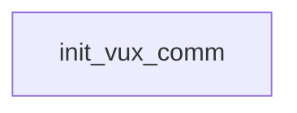

# VUX / ZEX: existing conversation graph

> Generated by `tools/conversation_catalog.py`; do not edit this page by hand.

[Catalog and interpretation rules](../README.md) · [Proposed engine](../model.md)

Script: [vuxc.c](../../../../sc2/src/uqm/comm/vux/vuxc.c#L1). Phrase bank: [vux.txt](../../../../sc2/content/base/comm/vux/vux.txt#L1).

1 handler/helper nodes; 0 response registration sites; 0 direct local calls; 102 phrase records.

## Initialization and lifecycle

| Phase | Callback | Bound by | Conditions / source |
| --- | --- | --- | --- |

## Handler graph

Solid arrows are selectable responses; dashed arrows are direct C calls. Conditions, arguments, speech and effects are cataloged below. Parallel response sites are grouped only in this diagram.



## Condition catalog

Condition IDs describe enclosing source structure. Branch predicates combine with ∧; case labels mark source locations that can also be reached by fallthrough. Values refer to their original evaluation points. Local assignments and early control flow remain in the decision bodies.

| ID | Source expression / structural condition |
| --- | --- |
| <a id="condition-c1"></a>C1 | <code>!(GET_GAME_STATE(GLOBAL_FLAGS_AND_DATA) &amp; (1 &lt;&lt; 6))</code> |
| <a id="condition-c2"></a>C2 | <code>(GET_GAME_STATE(GLOBAL_FLAGS_AND_DATA) &amp; (1 &lt;&lt; 6)) &#124;&#124; (LOBYTE(GLOBAL(CurrentActivity)) == WON_LAST_BATTLE)</code> |
| <a id="condition-c3"></a>C3 | <code>!((GET_GAME_STATE(GLOBAL_FLAGS_AND_DATA) &amp; (1 &lt;&lt; 6)) &#124;&#124; (LOBYTE(GLOBAL(CurrentActivity)) == WON_LAST_BATTLE))</code> |

## Script-scope state and lookup tables

These declarations supply shared local state, computed phrase alternatives, number speech, or lookup data used by the nodes. LOCDATA presentation defaults are linked separately in the source.

Presentation descriptor <code>vux_desc</code>: [source](../../../../sc2/src/uqm/comm/vux/vuxc.c#L23).

## Node catalog

<a id="node-init_vux_comm"></a>

### init_vux_comm

<code>LOCDATA *init_vux_comm(void)</code> — [source](../../../../sc2/src/uqm/comm/vux/vuxc.c#L205).

#### Actions, queries, local updates, and control flow

Calls are listed without assuming they are pure or mutating. Local updates are retained because they determine dynamic menus and counter-selected speech.

| Kind | Operation | Enclosing conditions | Source |
| --- | --- | --- | --- |
| update | <code>vux_desc.AlienTextBaseline.x = (TEXT_X_OFFS + (SIS_TEXT_WIDTH &gt;&gt; 1)) + (SIS_TEXT_WIDTH &gt;&gt; 2)</code> | No enclosing branch condition | [209](../../../../sc2/src/uqm/comm/vux/vuxc.c#L209) |
| update | <code>vux_desc.AlienTextBaseline.y = 0</code> | No enclosing branch condition | [211](../../../../sc2/src/uqm/comm/vux/vuxc.c#L211) |
| update | <code>vux_desc.AlienTextWidth = (SIS_TEXT_WIDTH - 16) &gt;&gt; 1</code> | No enclosing branch condition | [212](../../../../sc2/src/uqm/comm/vux/vuxc.c#L212) |
| call | <code>GET_GAME_STATE(GLOBAL_FLAGS_AND_DATA)</code> | No enclosing branch condition | [214](../../../../sc2/src/uqm/comm/vux/vuxc.c#L214) |
| call | <code>LOBYTE(GLOBAL(CurrentActivity))</code> | [C1](#condition-c1) | [215](../../../../sc2/src/uqm/comm/vux/vuxc.c#L215) |
| call | <code>GLOBAL(CurrentActivity)</code> | [C1](#condition-c1) | [215](../../../../sc2/src/uqm/comm/vux/vuxc.c#L215) |
| call | <code>setSegue(Segue_peace)</code> | [C2](#condition-c2) | [217](../../../../sc2/src/uqm/comm/vux/vuxc.c#L217) |
| call | <code>setSegue(Segue_hostile)</code> | [C3](#condition-c3) | [221](../../../../sc2/src/uqm/comm/vux/vuxc.c#L221) |
| update | <code>retval = &amp;vux_desc</code> | No enclosing branch condition | [223](../../../../sc2/src/uqm/comm/vux/vuxc.c#L223) |
| flow | <code>return retval;</code> | No enclosing branch condition | [225](../../../../sc2/src/uqm/comm/vux/vuxc.c#L225) |

<details>
<summary>Exact decision body (local calculations, early returns, fallthrough and ordering)</summary>

```c
{
	LOCDATA *retval;

	vux_desc.AlienTextBaseline.x = TEXT_X_OFFS + (SIS_TEXT_WIDTH >> 1)
			+ (SIS_TEXT_WIDTH >> 2);
	vux_desc.AlienTextBaseline.y = 0;
	vux_desc.AlienTextWidth = (SIS_TEXT_WIDTH - 16) >> 1;

	if ((GET_GAME_STATE (GLOBAL_FLAGS_AND_DATA) & (1 << 6))
			|| LOBYTE (GLOBAL (CurrentActivity)) == WON_LAST_BATTLE)
	{
		setSegue (Segue_peace);
	}
	else
	{
		setSegue (Segue_hostile);
	}
	retval = &vux_desc;

	return (retval);
}
```

</details>

## Phrase catalog

Full base-content text, keyed by the symbols used above. Voice filenames are resource metadata; playback also depends on installed addons and settings. Dynamic insertions retain their original placeholders.

<a id="phrase-zex_hello_1"></a>

<details>
<summary>ZEX_HELLO_1 — vux-000.ogg</summary>

[Text source](../../../../sc2/content/base/comm/vux/vux.txt#L1)

<pre>Ah! Human visitors! What a treat!
I am Admiral ZEX. Please do not be frightened. Unlike the rest of my species, I... enjoy humans.
You may know me by my reputation, my leadership of VUX forces during the war with your Alliance.
I assure you that this behavior, a sad necessity of those times, belies a much kinder, gentler being.
Please be welcome! We can get to know one another... expand our interspecies relationship.
But wait. How silly of me. You aren&#x27;t here for polite repartee.
You have come for my Shofixti Maidens.</pre>

</details>

<a id="phrase-zex_hello_2"></a>

<details>
<summary>ZEX_HELLO_2 — vux-001.ogg</summary>

[Text source](../../../../sc2/content/base/comm/vux/vux.txt#L10)

<pre>Why I am so blessed! My favorite friends, the humans, are back.
Captain, it is good to see you again.
You Humans are so interesting, so... beautiful.
You know, I have many pictures of your species!
I keep them on my walls to... inspire me.</pre>

</details>

<a id="phrase-zex_hello_3"></a>

<details>
<summary>ZEX_HELLO_3 — vux-002.ogg</summary>

[Text source](../../../../sc2/content/base/comm/vux/vux.txt#L17)

<pre>Captain! You are back so soon!
We had better be discreet (hee! hee!), or my countrymen will begin whispering about us.</pre>

</details>

<a id="phrase-zex_hello_4"></a>

<details>
<summary>ZEX_HELLO_4 — vux-003.ogg</summary>

[Text source](../../../../sc2/content/base/comm/vux/vux.txt#L21)

<pre>Luscious, robust human... I have eagerly awaited your return.</pre>

</details>

<a id="phrase-fight_or_trade_1"></a>

<details>
<summary>FIGHT_OR_TRADE_1 — vux-004.ogg</summary>

[Text source](../../../../sc2/content/base/comm/vux/vux.txt#L24)

<pre>Captain! You escaped after all! How remarkable!</pre>

</details>

<a id="phrase-fight_or_trade_2"></a>

<details>
<summary>FIGHT_OR_TRADE_2 — vux-005.ogg</summary>

[Text source](../../../../sc2/content/base/comm/vux/vux.txt#L27)

<pre>Human... we should be friends, not enemies!
The scope of our relationship can grow as close as you wish.</pre>

</details>

<a id="phrase-what_you_do_here"></a>

<details>
<summary>what_you_do_here</summary>

[Text source](../../../../sc2/content/base/comm/vux/vux.txt#L31)

<pre>What are you doing here, Admiral ZEX?</pre>

</details>

<a id="phrase-my_menagerie"></a>

<details>
<summary>MY_MENAGERIE — vux-006.ogg</summary>

[Text source](../../../../sc2/content/base/comm/vux/vux.txt#L34)

<pre>Ah, such a good question! But you always were a bright species.
I will explain.
After the Great War, in which I played some small part
the VUX high council, in recognition for my services
granted me this planet, so that I might pursue my... hobby
without disturbing the general VUX populace.
I am a collector, you see.
I have the finest menagerie of... beautiful... creatures in all space.</pre>

</details>

<a id="phrase-what_about_menagerie"></a>

<details>
<summary>what_about_menagerie</summary>

[Text source](../../../../sc2/content/base/comm/vux/vux.txt#L44)

<pre>A menagerie? Is this a collection of animals, like a zoo?</pre>

</details>

<a id="phrase-need_new_creature"></a>

<details>
<summary>NEED_NEW_CREATURE — vux-007.ogg</summary>

[Text source](../../../../sc2/content/base/comm/vux/vux.txt#L47)

<pre>Animals? Hee! Hee! Hee! Oh, no, Captain! Not mere animals!
My menagerie contains only the most... beautiful... creatures in the galaxy!
Each of my children, as I like to call them, has a wonderful set of traits
which make them unique and special... especially to me!
I have a complete variety of beasts from as far away as Procyon and Vega.
No, this is not just some `zoo&#x27;!
I have worked diligently for many years to craft my menagerie, to gradually improve it.
Perhaps you can&#x27;t tell, but I am rather proud of it!
Alas, there is one creature, one GORGEOUS animal which I do not yet possess.
I would give almost ANYTHING for that creature, Captain.</pre>

</details>

<a id="phrase-what_about_creature"></a>

<details>
<summary>what_about_creature</summary>

[Text source](../../../../sc2/content/base/comm/vux/vux.txt#L59)

<pre>If we went and got this little critter for you, would you give us the Shofixti Maidens?</pre>

</details>

<a id="phrase-about_creature"></a>

<details>
<summary>ABOUT_CREATURE — vux-008.ogg</summary>

[Text source](../../../../sc2/content/base/comm/vux/vux.txt#L62)

<pre>Hmmm... what an interesting proposal!
I never would have thought of such a wonderful idea myself.
You are a genius, Captain!
In answer to your question, yes! I accept your offer.
Deliver the creature to me, and I shall give you the Shofixti Maidens.
I will even provide you with a clue to finding the creature&#x27;s native planet!
My source for this information is an ancient wildlife handbook
written millennia ago by some unknown alien author. The pertinent passage goes as follows
`... demise, It(!) basks in yellow light within the constellation Linch-Nas-Ploh.&#x27;
We have translated `Linch-Nas-Ploh&#x27; to mean approximately
`the long, thin creature who has swallowed the huge beast.&#x27;
I am afraid this is all that I know.
I hope it is sufficient.</pre>

</details>

<a id="phrase-about_creature_again"></a>

<details>
<summary>about_creature_again</summary>

[Text source](../../../../sc2/content/base/comm/vux/vux.txt#L77)

<pre>Would you tell me again where I can find that creature you want so badly?</pre>

</details>

<a id="phrase-creature_again"></a>

<details>
<summary>CREATURE_AGAIN — vux-009.ogg</summary>

[Text source](../../../../sc2/content/base/comm/vux/vux.txt#L80)

<pre>Certainly, my smooth-skinned friend!
My source for this information is an ancient wildlife handbook
written millennia ago by some unknown alien author. The pertinent passage goes as follows
`... demise, It(!) basks in yellow light within the constellation Linch-Nas-Ploh.&#x27;
We have translated `Linch-Nas-Ploh&#x27; to mean approximately
`the long, thin creature who has swallowed the huge beast.&#x27;
I am afraid this is all that I know.
I hope it is sufficient.</pre>

</details>

<a id="phrase-i_have_beast"></a>

<details>
<summary>i_have_beast</summary>

[Text source](../../../../sc2/content/base/comm/vux/vux.txt#L90)

<pre>Admiral ZEX, we have captured the hideous monster from Delta Lyncis. Let us make an exchange.</pre>

</details>

<a id="phrase-give_beast"></a>

<details>
<summary>GIVE_BEAST — vux-010.ogg</summary>

[Text source](../../../../sc2/content/base/comm/vux/vux.txt#L93)

<pre>Ah, a most excellent piece of news! My chiton rasps and moistens with excitement!
I have been looking forward to this for so long! Hee! Hee! Hee!
My subordinates stand ready to receive the beast from your ship, Captain.
Effect its transfer and then... we shall give you the Maidens you desire.</pre>

</details>

<a id="phrase-ok_take_beast"></a>

<details>
<summary>ok_take_beast</summary>

[Text source](../../../../sc2/content/base/comm/vux/vux.txt#L99)

<pre>Okay, the beast is ALL yours! But be careful, it&#x27;s a killer!</pre>

</details>

<a id="phrase-fool_aiee0"></a>

<details>
<summary>FOOL_AIEE0 — vux-011.ogg</summary>

[Text source](../../../../sc2/content/base/comm/vux/vux.txt#L102)

<pre>Ah! My new child is on board. Such a big one, isn&#x27;t he!?...
...and so frisky!
I am delighted beyond words that you have given me the beast, Captain
but I am afraid that there has been a slight change in our plans. Regrettable, but necessary.
Oh, my beautiful, luscious human, I had thought that the hideous, violent monster you have given me
would complete my collection of Ugliness, my Menagerie of Monsters... I was wrong!
YOU, my human love, are the most vile, the most fierce and wretched!
My collection could never be complete without you. I need you, Captain.
But alas, I fear you will not give your consent willingly. Am I right?
Therefore, sub-commander DAX, terminate communications... warm up my modified Intruder.
Engage the Precursor warp nullifier. Hee! Hee! Hee!... prepare for battle!</pre>

</details>

<a id="phrase-fool_aiee1"></a>

<details>
<summary>FOOL_AIEE1 — vux-012.ogg</summary>

[Text source](../../../../sc2/content/base/comm/vux/vux.txt#L115)

<pre>Sub-commander? Why has my main console become inoperative?
The transmit mode is locked!
What do you mean the central system computer is damaged? How!?...
...the Beast!?... Escaped!!
No, Sub-Commander, this is impossible. It couldn&#x27;t escape from our strongest containment system
IT&#x27;S WHAT?!! Decks five and six?! Eleven Crewmen!!
Sound the alarms, you fool! Where is it now?! Engineering, report!... Engineering?!
Sub-Commander, seal Bulkhe-- Sub-Commander... are you listening to me? What are you staring at?
PAY ATTENTION, Sub-Commander! Give me a report on its posit-- WHAT ARE YOU STARING AT!...
behind me?
WH- Wh- what- wh- AIEEEEE!!!!!...</pre>

</details>

<a id="phrase-why_trust_1"></a>

<details>
<summary>why_trust_1</summary>

[Text source](../../../../sc2/content/base/comm/vux/vux.txt#L128)

<pre>Ah, Admiral ZEX, aren&#x27;t you forgetting something? The Shofixti Maidens?</pre>

</details>

<a id="phrase-trust_1"></a>

<details>
<summary>TRUST_1 — vux-013.ogg</summary>

[Text source](../../../../sc2/content/base/comm/vux/vux.txt#L131)

<pre>Oh yes, no problem. Even now my subordinates are bringing them up from the surface.
So let&#x27;s not waste time. Send that delightful beast over, immediately!</pre>

</details>

<a id="phrase-why_trust_2"></a>

<details>
<summary>why_trust_2</summary>

[Text source](../../../../sc2/content/base/comm/vux/vux.txt#L135)

<pre>Look, we believe in 1 for 1 trades. We will transfer the beast when we see the Maidens.</pre>

</details>

<a id="phrase-trust_2"></a>

<details>
<summary>TRUST_2 — vux-014.ogg</summary>

[Text source](../../../../sc2/content/base/comm/vux/vux.txt#L138)

<pre>Captain, Captain, we are both creatures of honor.
If I say that the Shofixti Maidens are on their way up from the surface, then they are.
You will have them shortly, accept my word... now please, Captain, the beast?</pre>

</details>

<a id="phrase-why_trust_3"></a>

<details>
<summary>why_trust_3</summary>

[Text source](../../../../sc2/content/base/comm/vux/vux.txt#L143)

<pre>Now see here ZEX! Humans and VUX have had a pretty stormy relationship. Why should we trust you?</pre>

</details>

<a id="phrase-trust_3"></a>

<details>
<summary>TRUST_3 — vux-015.ogg</summary>

[Text source](../../../../sc2/content/base/comm/vux/vux.txt#L146)

<pre>Really, Captain! My honor is impugned!
You have maligned me and I am deeply hurt.
I thought we had built some trust between us, different though we may be
but no, I perceive now the same bigotry and misunderstanding
which brought our two species to war!
This was our chance to cement a good relationship between Human and VUX.
With my influence, the High Council could easily have been swayed to view
the Human cause in a more favorable light.</pre>

</details>

<a id="phrase-why_dont_you_attack"></a>

<details>
<summary>why_dont_you_attack</summary>

[Text source](../../../../sc2/content/base/comm/vux/vux.txt#L156)

<pre>Admiral ZEX, why don&#x27;t you attack us, as all other VUX have?</pre>

</details>

<a id="phrase-like_you"></a>

<details>
<summary>LIKE_YOU — vux-016.ogg</summary>

[Text source](../../../../sc2/content/base/comm/vux/vux.txt#L159)

<pre>Because I like Humans, Captain. I respect and admire your species.
I do not share the bigoted views of most of my people.</pre>

</details>

<a id="phrase-why_like_me"></a>

<details>
<summary>why_like_me</summary>

[Text source](../../../../sc2/content/base/comm/vux/vux.txt#L163)

<pre>Ah, Admiral ZEX? Why do you like us? We thought all VUX hated humans.</pre>

</details>

<a id="phrase-like_because"></a>

<details>
<summary>LIKE_BECAUSE — vux-017.ogg</summary>

[Text source](../../../../sc2/content/base/comm/vux/vux.txt#L166)

<pre>No, No, not all VUX, Captain! Most... but not all.
It is true when the majority of my people view one of your species
they are forced to regurgitate
but there are those among us who have grown beyond such childishness to take a more liberal view.
We, the few sophisticates, are not subject to the whims and fads of current fashion.
Our likes and dislikes are strictly based on personal preference.
We see the... beauty in you Humans. The value in a long-term... relationship.
You are different, yes. But personally, I like difference.
In fact, I ADORE it.
Your physique is so wonderfully varied! Your multitudinous rigid appendages, your tiny double eyes
your varied skin coloration, and the delightful patchwork of hair covering only parts of your bodies
leaving other parts bare and smooth! Mmmmmm!
I value your species, Captain. I see you as just `people&#x27;... like us VUX.</pre>

</details>

<a id="phrase-are_you_a_pervert"></a>

<details>
<summary>are_you_a_pervert</summary>

[Text source](../../../../sc2/content/base/comm/vux/vux.txt#L181)

<pre>Whoa, Admiral ZEX! This is just a bit too weird. Are you some kind of perv-- er... aesthete?</pre>

</details>

<a id="phrase-call_me_what_you_wish"></a>

<details>
<summary>CALL_ME_WHAT_YOU_WISH — vux-018.ogg</summary>

[Text source](../../../../sc2/content/base/comm/vux/vux.txt#L184)

<pre>You have talked with my VUX countrymen, haven&#x27;t you?
They are closed-minded fools... bigoted in all ways.
Call me what you wish, Captain. I choose to view myself as, well
simply open-minded... free to experience the full range of life&#x27;s possibilities.
The VUX rulers could not refuse my military genius, couldn&#x27;t ignore the many victories I gave them.
But they would not tolerate my behavior, accept my desires as natural
so they sent me out here... a hero&#x27;s exile! Where  I won&#x27;t `poison&#x27; the minds of youth
with my `bizarre&#x27; ideas and `perverted&#x27; lifestyle. Hmmph... bigoted fools.
You see, Captain, we are not all that different, you and I.
We are different from the majority of VUX, and so we, in VUX eyes, are both monsters.</pre>

</details>

<a id="phrase-take_by_force"></a>

<details>
<summary>take_by_force</summary>

[Text source](../../../../sc2/content/base/comm/vux/vux.txt#L196)

<pre>We require the Shofixti Maidens. We are prepared to use force if necessary.</pre>

</details>

<a id="phrase-precursor_device"></a>

<details>
<summary>PRECURSOR_DEVICE — vux-019.ogg</summary>

[Text source](../../../../sc2/content/base/comm/vux/vux.txt#L199)

<pre>Hee! Hee! Hee! Oh, Captain, that would be such an unfortunate mistake
a grave error on both our parts.
We have so much to learn from each other, so much to give each other.
It would be such a sad loss if we were to fall back to the mindless blasting and killing
that has marred our two species&#x27; relationship up to this point.
Admittedly, as THE acknowledged VUX military genius
I would find it interesting to face your ONE powerful, alien starship
with my huge personal fleet of Intruders, but oh! What a mistake it would be.
Also... I think it only fair to warn you, Captain
that in my campaigns I collected many interesting items.
Amongst these treasures is a Precursor artifact, a warp nullification field
that prevents nearby ships from making emergency HyperSpace maneuvers... from running away.
I note by the scars on the rear of your vessel that you have made many such escapes.
So you see, Captain, if you attack me, you will face the greatest military tactician in VUX history
commanding an almost infinite number of enemy combat ships
and the battle will be to the Death!
Surely we can find an alternative.</pre>

</details>

<a id="phrase-regardless"></a>

<details>
<summary>regardless</summary>

[Text source](../../../../sc2/content/base/comm/vux/vux.txt#L218)

<pre>We will fight you regardless of your Precursor Artifact!</pre>

</details>

<a id="phrase-then_fight"></a>

<details>
<summary>THEN_FIGHT — vux-020.ogg</summary>

[Text source](../../../../sc2/content/base/comm/vux/vux.txt#L221)

<pre>Very well... to the Death!</pre>

</details>

<a id="phrase-you_lied"></a>

<details>
<summary>you_lied</summary>

[Text source](../../../../sc2/content/base/comm/vux/vux.txt#L224)

<pre>You lied, Admiral ZEX!!! There was no `warp nullification field&#x27;! Cheater!</pre>

</details>

<a id="phrase-yup_lied"></a>

<details>
<summary>YUP_LIED — vux-021.ogg</summary>

[Text source](../../../../sc2/content/base/comm/vux/vux.txt#L227)

<pre>Yes, I lied.
Surely, if a small falsehood can prevent hundreds of unnecessary deaths, this is acceptable.
Unfortunately, you saw through my falsehood and no doubt lives were lost.
Let us cease this mindless aggression, before it is our undoing.</pre>

</details>

<a id="phrase-kill_you"></a>

<details>
<summary>kill_you</summary>

[Text source](../../../../sc2/content/base/comm/vux/vux.txt#L233)

<pre>We have no fear of any of your `devices&#x27;. Now we kill you!</pre>

</details>

<a id="phrase-fight_again"></a>

<details>
<summary>FIGHT_AGAIN — vux-022.ogg</summary>

[Text source](../../../../sc2/content/base/comm/vux/vux.txt#L236)

<pre>Unfortunate. Dreary... and unfortunate.
Captain, even without such a device, you must understand the overwhelming forces I have at my command!
You cannot beat me here. It is impossible.
But... if a fight is what you demand, so be it.</pre>

</details>

<a id="phrase-bye_zex"></a>

<details>
<summary>bye_zex</summary>

[Text source](../../../../sc2/content/base/comm/vux/vux.txt#L242)

<pre>Goodbye, Admiral ZEX.</pre>

</details>

<a id="phrase-goodbye_zex"></a>

<details>
<summary>GOODBYE_ZEX — vux-023.ogg</summary>

[Text source](../../../../sc2/content/base/comm/vux/vux.txt#L245)

<pre>Goodbye, beautiful human. I hope we can meet someday as friends... perhaps even more.</pre>

</details>

<a id="phrase-homeworld_hello_1"></a>

<details>
<summary>HOMEWORLD_HELLO_1 — vux-024.ogg</summary>

[Text source](../../../../sc2/content/base/comm/vux/vux.txt#L248)

<pre>Welcome to the end of your life, courtesy of VUX technology.
Our infinite supply of Intruder vessels are even now locking their vaporizers onto your position
and we shall end your painful, grotesque existence for you as soon as possible.
In the meantime, here is a little music...</pre>

</details>

<a id="phrase-homeworld_hello_2"></a>

<details>
<summary>HOMEWORLD_HELLO_2 — vux-025.ogg</summary>

[Text source](../../../../sc2/content/base/comm/vux/vux.txt#L254)

<pre>Hello again.  We trust you are enjoying trespassing in VUX space
and look forward to removing you from existence at our earliest possible convenience.
If you believe you can fight your way past our invincible forces to our surface, you are correct.
Some ash and a few wisps of pungent vapor are sure to make it at least that far.
Our special today is particle fragmentation!
So if you will kindly open your feeding orifice and start screaming, we will begin.</pre>

</details>

<a id="phrase-homeworld_hello_3"></a>

<details>
<summary>HOMEWORLD_HELLO_3 — vux-026.ogg</summary>

[Text source](../../../../sc2/content/base/comm/vux/vux.txt#L262)

<pre>Welcome back to total annihilation, where, as they say
once is silatious, twice is phlagrant melons
but the third time is when it really hurts.
Please stay seated until your vessel starts smoking
then feel free to dash your head painfully against the floor.</pre>

</details>

<a id="phrase-homeworld_hello_4"></a>

<details>
<summary>HOMEWORLD_HELLO_4 — vux-027.ogg</summary>

[Text source](../../../../sc2/content/base/comm/vux/vux.txt#L269)

<pre>Congratulations for exhausting the VUX vocabulary of greetings to despicable life-forms.
May we take this opportunity to lock our femoral scrapers onto your ship
and to wish you an unpleasant afterlife.</pre>

</details>

<a id="phrase-space_hello_1"></a>

<details>
<summary>SPACE_HELLO_1 — vux-028.ogg</summary>

[Text source](../../../../sc2/content/base/comm/vux/vux.txt#L274)

<pre>Greetings from VUX!... the last word in life form destruction!
To gain an intimate knowledge of our engines of war
simply place both hands over your eyes and count to three.</pre>

</details>

<a id="phrase-space_hello_2"></a>

<details>
<summary>SPACE_HELLO_2 — vux-029.ogg</summary>

[Text source](../../../../sc2/content/base/comm/vux/vux.txt#L279)

<pre>Salutations, and may your sense of self-preservation always be so dim.
As our Intruders surround your vessel, you may care to raise both hands into the air above you
and practice the ancient chant of the prancing oowee master, ZEN DUX, which begins...
`AAAAAAAAA AAAAAAHH!!!&#x27;</pre>

</details>

<a id="phrase-space_hello_3"></a>

<details>
<summary>SPACE_HELLO_3 — vux-030.ogg</summary>

[Text source](../../../../sc2/content/base/comm/vux/vux.txt#L285)

<pre>This is VUX Commander YAX.  On behalf of the team here
I would like to say how very much we have all enjoyed taunting you
and to congratulate you on plumbing the limits of VUX courtesy
which you have now exhausted. Therefore, let me just say
Die, you two-eyed loathsome faceless slug!</pre>

</details>

<a id="phrase-space_hello_4"></a>

<details>
<summary>SPACE_HELLO_4 — vux-031.ogg</summary>

[Text source](../../../../sc2/content/base/comm/vux/vux.txt#L292)

<pre>Welcome back. All our coherent destructors are currently off-line
but if you&#x27;d care to hold your present course and speed
one will be free to annihilate you shortly.</pre>

</details>

<a id="phrase-kill_you_squids_1"></a>

<details>
<summary>kill_you_squids_1</summary>

[Text source](../../../../sc2/content/base/comm/vux/vux.txt#L297)

<pre>You grotesque squids! We will kill you for your insolence!</pre>

</details>

<a id="phrase-kill_you_squids_2"></a>

<details>
<summary>kill_you_squids_2</summary>

[Text source](../../../../sc2/content/base/comm/vux/vux.txt#L300)

<pre>You are the most vile, repulsive creature I&#x27;ve ever seen!</pre>

</details>

<a id="phrase-kill_you_squids_3"></a>

<details>
<summary>kill_you_squids_3</summary>

[Text source](../../../../sc2/content/base/comm/vux/vux.txt#L303)

<pre>I must say, your rating on the vomit-meter would be AT LEAST ninety six.</pre>

</details>

<a id="phrase-kill_you_squids_4"></a>

<details>
<summary>kill_you_squids_4</summary>

[Text source](../../../../sc2/content/base/comm/vux/vux.txt#L306)

<pre>You bloated bag of protoplasm! You worm!</pre>

</details>

<a id="phrase-we_fight"></a>

<details>
<summary>WE_FIGHT — vux-032.ogg</summary>

[Text source](../../../../sc2/content/base/comm/vux/vux.txt#L309)

<pre>Watch everybody! We&#x27;re going to kill the repulsive little monster now!</pre>

</details>

<a id="phrase-why_so_mean"></a>

<details>
<summary>why_so_mean</summary>

[Text source](../../../../sc2/content/base/comm/vux/vux.txt#L312)

<pre>Why are you so hostile toward our species?</pre>

</details>

<a id="phrase-urquan_slaves"></a>

<details>
<summary>URQUAN_SLAVES — vux-033.ogg</summary>

[Text source](../../../../sc2/content/base/comm/vux/vux.txt#L315)

<pre>Augh! You are even uglier than I had thought possible!
Can&#x27;t you see you are making me sick?
Please, foul creature, turn your head, or better yet, put a sack over it.
Never mind, I have adjusted my display so it is dim enough to be tolerable.
In answer to your question, our response is simple.
We must attack you because our masters the Ur-Quan wish it so!
Now if you don&#x27;t mind, stop nodding your head like that.
We VUX do not share this range of motion
and it appears as though your neck is broken
and you are a jabbering corpse. Ugh.</pre>

</details>

<a id="phrase-deeper_reason"></a>

<details>
<summary>deeper_reason</summary>

[Text source](../../../../sc2/content/base/comm/vux/vux.txt#L327)

<pre>Is there another reason you hate us? Come on, tell me the truth.</pre>

</details>

<a id="phrase-old_insult"></a>

<details>
<summary>OLD_INSULT — vux-034.ogg</summary>

[Text source](../../../../sc2/content/base/comm/vux/vux.txt#L330)

<pre>Do we need another reason?
Ah! I understand. You refer to the First Human Encounter
the Insult!
What more can be said? On that day, your species proved its true crass nature.
You see, we VUX pride ourselves on our open-mindedness
our ability to see beyond even the most bizarre and disgusting face like yours
but that insult was so low, so totally reprehensible that we will never forget it.
Yes, to be honest, that event pretty much fixed our attitude setting at `ABHOR&#x27;.
I suspect we will despise you forever.</pre>

</details>

<a id="phrase-if_we_apologize"></a>

<details>
<summary>if_we_apologize</summary>

[Text source](../../../../sc2/content/base/comm/vux/vux.txt#L341)

<pre>What if we apologized? Could we talk truce then?</pre>

</details>

<a id="phrase-probably_not"></a>

<details>
<summary>PROBABLY_NOT — vux-035.ogg</summary>

[Text source](../../../../sc2/content/base/comm/vux/vux.txt#L344)

<pre>Er... probably not. You see, although we VUX are highly reasonable beings
who would never judge a race solely on its (urk!) appearance
the magnitude of your Captain Rand&#x27;s insult was such that we will probably never forgive your species.</pre>

</details>

<a id="phrase-try_any_way"></a>

<details>
<summary>try_any_way</summary>

[Text source](../../../../sc2/content/base/comm/vux/vux.txt#L349)

<pre>Well, I&#x27;ll try anyway. The People of Earth Hereby Apologize To The VUX!</pre>

</details>

<a id="phrase-nope"></a>

<details>
<summary>NOPE — vux-036.ogg</summary>

[Text source](../../../../sc2/content/base/comm/vux/vux.txt#L352)

<pre>Nope. I didn&#x27;t think that would be sufficient. It lacked conviction.
Sorry, but I&#x27;m afraid we&#x27;ll just have to kill you now.</pre>

</details>

<a id="phrase-apologize_in_space"></a>

<details>
<summary>APOLOGIZE_IN_SPACE — vux-037.ogg</summary>

[Text source](../../../../sc2/content/base/comm/vux/vux.txt#L356)

<pre>Because the Human named Rand offended one of our starship commanders
apologizing here at the Homeworld is useless.
Besides, we have decided that you are just too disgusting to live
so we have decided to vaporize you.</pre>

</details>

<a id="phrase-apology_1"></a>

<details>
<summary>apology_1</summary>

[Text source](../../../../sc2/content/base/comm/vux/vux.txt#L362)

<pre>Let&#x27;s try that again. We, The People Of Earth, Really Truly Apologize For The Stupid Insult Made By Captain Rand!</pre>

</details>

<a id="phrase-not_accepted_1"></a>

<details>
<summary>NOT_ACCEPTED_1 — vux-038.ogg</summary>

[Text source](../../../../sc2/content/base/comm/vux/vux.txt#L365)

<pre>No. That didn&#x27;t cut it either.</pre>

</details>

<a id="phrase-apology_2"></a>

<details>
<summary>apology_2</summary>

[Text source](../../../../sc2/content/base/comm/vux/vux.txt#L368)

<pre>You were RIGHT! We WERE wrong. We see it all so clearly now!</pre>

</details>

<a id="phrase-not_accepted_2"></a>

<details>
<summary>NOT_ACCEPTED_2 — vux-039.ogg</summary>

[Text source](../../../../sc2/content/base/comm/vux/vux.txt#L371)

<pre>I don&#x27;t think your heart is in it.</pre>

</details>

<a id="phrase-apology_3"></a>

<details>
<summary>apology_3</summary>

[Text source](../../../../sc2/content/base/comm/vux/vux.txt#L374)

<pre>Pleeeeeeeeease forgive us!</pre>

</details>

<a id="phrase-not_accepted_3"></a>

<details>
<summary>NOT_ACCEPTED_3 — vux-040.ogg</summary>

[Text source](../../../../sc2/content/base/comm/vux/vux.txt#L377)

<pre>You said that just because you want stuff from us VUX. You didn&#x27;t really mean it.</pre>

</details>

<a id="phrase-apology_4"></a>

<details>
<summary>apology_4</summary>

[Text source](../../../../sc2/content/base/comm/vux/vux.txt#L380)

<pre>We - are - sorry! May a thousand insects sting my softest parts if I lie!</pre>

</details>

<a id="phrase-not_accepted_4"></a>

<details>
<summary>NOT_ACCEPTED_4 — vux-041.ogg</summary>

[Text source](../../../../sc2/content/base/comm/vux/vux.txt#L383)

<pre>It&#x27;s pointless. Why even bother trying again?</pre>

</details>

<a id="phrase-apology_5"></a>

<details>
<summary>apology_5</summary>

[Text source](../../../../sc2/content/base/comm/vux/vux.txt#L386)

<pre>We would like to present a petition of 1 million signatures! Each one says, `I&#x27;m sorry!&#x27;</pre>

</details>

<a id="phrase-not_accepted_5"></a>

<details>
<summary>NOT_ACCEPTED_5 — vux-042.ogg</summary>

[Text source](../../../../sc2/content/base/comm/vux/vux.txt#L389)

<pre>A good try, Captain... but not good enough.</pre>

</details>

<a id="phrase-apology_6"></a>

<details>
<summary>apology_6</summary>

[Text source](../../../../sc2/content/base/comm/vux/vux.txt#L392)

<pre>Wrong? Yes we were wrong. Oh, so wrong! Boy, were we wrong! The wrongest.</pre>

</details>

<a id="phrase-not_accepted_6"></a>

<details>
<summary>NOT_ACCEPTED_6 — vux-043.ogg</summary>

[Text source](../../../../sc2/content/base/comm/vux/vux.txt#L395)

<pre>We detect a hint of genuine regret, but not enough to forgive you.</pre>

</details>

<a id="phrase-apology_7"></a>

<details>
<summary>apology_7</summary>

[Text source](../../../../sc2/content/base/comm/vux/vux.txt#L398)

<pre>(Let&#x27;s try reverse psychology) Listen VUX! You are right! We cannot ever atone for Rand&#x27;s cruel barb!</pre>

</details>

<a id="phrase-not_accepted_7"></a>

<details>
<summary>NOT_ACCEPTED_7 — vux-044.ogg</summary>

[Text source](../../../../sc2/content/base/comm/vux/vux.txt#L401)

<pre>Oh? I was just thinking that maybe we should consider forgiving you
but I guess you&#x27;re right.
There&#x27;s no going back.</pre>

</details>

<a id="phrase-apology_8"></a>

<details>
<summary>apology_8</summary>

[Text source](../../../../sc2/content/base/comm/vux/vux.txt#L406)

<pre>If sorrow were a pebble, our remorse would be... would be!... a great big boulder!</pre>

</details>

<a id="phrase-not_accepted_8"></a>

<details>
<summary>NOT_ACCEPTED_8 — vux-045.ogg</summary>

[Text source](../../../../sc2/content/base/comm/vux/vux.txt#L409)

<pre>Hey! That was pretty good!
I could sense the true sadness in your voice for your species&#x27; past stupidity.
Unfortunately, it was not good enough.</pre>

</details>

<a id="phrase-apology_9"></a>

<details>
<summary>apology_9</summary>

[Text source](../../../../sc2/content/base/comm/vux/vux.txt#L414)

<pre>If there is ANYTHING we can do to gain your forgiveness, we shall do it a thousand times.</pre>

</details>

<a id="phrase-not_accepted_9"></a>

<details>
<summary>NOT_ACCEPTED_9 — vux-046.ogg</summary>

[Text source](../../../../sc2/content/base/comm/vux/vux.txt#L417)

<pre>Um..., er... that was about as good as it gets, I think
but we don&#x27;t accept it because... because... well, just BECAUSE!</pre>

</details>

<a id="phrase-apology_10"></a>

<details>
<summary>apology_10</summary>

[Text source](../../../../sc2/content/base/comm/vux/vux.txt#L421)

<pre>Please, for the love of reason. Heed these words: We, the People of Earth Apologize To The VUX.</pre>

</details>

<a id="phrase-truth"></a>

<details>
<summary>TRUTH — vux-047.ogg</summary>

[Text source](../../../../sc2/content/base/comm/vux/vux.txt#L424)

<pre>AIEEE! Human! You have hounded and hounded and hounded us with your pitiful apologies!
It&#x27;s driving us crazy! STOP! Please STOP!
We give up. We accept! We accept! We will no longer hold Rand&#x27;s insult against your species.
You are forgiven for all eternity, just stop apologizing!
But now you have forced us to reveal our REAL reason for hating you humans
an embarrassing reason with no acceptable justification, but nonetheless undeniable!
Human! You are SOOO ugly, SOOO hideous to us that we will NEVER be able to find peace with your species!
Whenever we see your kind, we just want to kick you!... stomp on you!... squish you!...
...vaporize your ugly faces from the entire universe!
We know its unreasonable! We know that you had no choice about how you look!
We know that it is cruel fate that the Creator made you appear like putrid excretion
but WE JUST CAN&#x27;T HANDLE IT!
Why right now, because of your insufferable wretchedness
I am faced with a grotesque choice: keep talking to you and regurgitate uncontrollably
or break off communication and attack your vessel...</pre>

</details>

<a id="phrase-whats_up_hostile"></a>

<details>
<summary>whats_up_hostile</summary>

[Text source](../../../../sc2/content/base/comm/vux/vux.txt#L441)

<pre>VUX. We seek to learn more about you. Maybe then we can see eye to... eyes.</pre>

</details>

<a id="phrase-general_info_hostile_1"></a>

<details>
<summary>GENERAL_INFO_HOSTILE_1 — vux-048.ogg</summary>

[Text source](../../../../sc2/content/base/comm/vux/vux.txt#L444)

<pre>Look, vomitous alien. If you want to talk to one of our species
without making them sick
why don&#x27;t you go see Admiral ZEX at his world in Alpha Cerenkov.
He (urp!) likes humans.</pre>

</details>

<a id="phrase-general_info_hostile_2"></a>

<details>
<summary>GENERAL_INFO_HOSTILE_2 — vux-049.ogg</summary>

[Text source](../../../../sc2/content/base/comm/vux/vux.txt#L450)

<pre>Look at those yellowish-white hard things in your mouth!
How do you keep from biting off that pulpy organ... Gross!</pre>

</details>

<a id="phrase-general_info_hostile_3"></a>

<details>
<summary>GENERAL_INFO_HOSTILE_3 — vux-050.ogg</summary>

[Text source](../../../../sc2/content/base/comm/vux/vux.txt#L454)

<pre>Yuck! Don&#x27;t show your tongue like that. It makes me sick.</pre>

</details>

<a id="phrase-general_info_hostile_4"></a>

<details>
<summary>GENERAL_INFO_HOSTILE_4 — vux-051.ogg</summary>

[Text source](../../../../sc2/content/base/comm/vux/vux.txt#L457)

<pre>Forget it, human. We can&#x27;t think straight when we have to look at you.
If you&#x27;re lonely, go to Alpha Cerenkov and talk with that pervert, Admiral ZEX.</pre>

</details>

<a id="phrase-cant_we_be_friends_1"></a>

<details>
<summary>cant_we_be_friends_1</summary>

[Text source](../../../../sc2/content/base/comm/vux/vux.txt#L461)

<pre>Why can&#x27;t we be friends? I like YOU.</pre>

</details>

<a id="phrase-never_ugly_humans_1"></a>

<details>
<summary>NEVER_UGLY_HUMANS_1 — vux-052.ogg</summary>

[Text source](../../../../sc2/content/base/comm/vux/vux.txt#L464)

<pre>I listened. I heard. I know you like ME.
But the problem is, I DESPISE you!
Which is why I am attacking, in case you were wondering.</pre>

</details>

<a id="phrase-cant_we_be_friends_2"></a>

<details>
<summary>cant_we_be_friends_2</summary>

[Text source](../../../../sc2/content/base/comm/vux/vux.txt#L469)

<pre>We have too much to gain through cooperation. Just try.</pre>

</details>

<a id="phrase-never_ugly_humans_2"></a>

<details>
<summary>NEVER_UGLY_HUMANS_2 — vux-053.ogg</summary>

[Text source](../../../../sc2/content/base/comm/vux/vux.txt#L472)

<pre>Okay, I&#x27;ll try to like you.
I&#x27;m really trying.
Naw! This is never going to work.
Every time I try to think of your friendly smiling face
(urp!) I want to blow chunks.
I have a better idea. I&#x27;ll just kill you.</pre>

</details>

<a id="phrase-cant_we_be_friends_3"></a>

<details>
<summary>cant_we_be_friends_3</summary>

[Text source](../../../../sc2/content/base/comm/vux/vux.txt#L480)

<pre>Didn&#x27;t anyone ever tell you, `you can&#x27;t judge a book by its cover?&#x27;</pre>

</details>

<a id="phrase-never_ugly_humans_3"></a>

<details>
<summary>NEVER_UGLY_HUMANS_3 — vux-054.ogg</summary>

[Text source](../../../../sc2/content/base/comm/vux/vux.txt#L483)

<pre>Do you want to know how ugly you are to us VUX? I&#x27;ll tell you.
You humans are SO ugly, that I get my kids to behave by holding a picture of you behind my back
and I tell the kids that if they aren&#x27;t good, I&#x27;ll show it to them!
I am such a bad father (sob!) I must destroy you... for the children!</pre>

</details>

<a id="phrase-cant_we_be_friends_4"></a>

<details>
<summary>cant_we_be_friends_4</summary>

[Text source](../../../../sc2/content/base/comm/vux/vux.txt#L489)

<pre>You are just a bunch of bigots. I thought you were better than that.</pre>

</details>

<a id="phrase-never_ugly_humans_4"></a>

<details>
<summary>NEVER_UGLY_HUMANS_4 — vux-055.ogg</summary>

[Text source](../../../../sc2/content/base/comm/vux/vux.txt#L492)

<pre>This IS embarrassing. We pride ourselves on being rational!
But you are so disgusting that we feel we just HAVE to kill you!
Like right now!</pre>

</details>

<a id="phrase-bye_hostile_space"></a>

<details>
<summary>bye_hostile_space</summary>

[Text source](../../../../sc2/content/base/comm/vux/vux.txt#L497)

<pre>Well, THIS has been useless. Goodbye.</pre>

</details>

<a id="phrase-goodbye_and_die_hostile_space_1"></a>

<details>
<summary>GOODBYE_AND_DIE_HOSTILE_SPACE_1 — vux-056.ogg</summary>

[Text source](../../../../sc2/content/base/comm/vux/vux.txt#L500)

<pre>Human, based upon our commitment to the Ur-Quan
and your general disgusting demeanor, we have decided to blow you to bits.</pre>

</details>

<a id="phrase-goodbye_and_die_hostile_space_2"></a>

<details>
<summary>GOODBYE_AND_DIE_HOSTILE_SPACE_2 — vux-057.ogg</summary>

[Text source](../../../../sc2/content/base/comm/vux/vux.txt#L504)

<pre>Wait! I have one last thing to say
Die!</pre>

</details>

<a id="phrase-goodbye_and_die_hostile_space_3"></a>

<details>
<summary>GOODBYE_AND_DIE_HOSTILE_SPACE_3 — vux-058.ogg</summary>

[Text source](../../../../sc2/content/base/comm/vux/vux.txt#L508)

<pre>For the good of the whole, I will now erase your putrid presence.</pre>

</details>

<a id="phrase-goodbye_and_die_hostile_space_4"></a>

<details>
<summary>GOODBYE_AND_DIE_HOSTILE_SPACE_4 — vux-059.ogg</summary>

[Text source](../../../../sc2/content/base/comm/vux/vux.txt#L511)

<pre>We have no choice. You are too wretched. We shall eliminate you.</pre>

</details>

<a id="phrase-out_takes"></a>

<details>
<summary>OUT_TAKES — vux-060.ogg</summary>

[Text source](../../../../sc2/content/base/comm/vux/vux.txt#L514)

<pre>Oh no! It&#x27;s one of those ultra-gross humans again!
Quick, hide your eye!
AGGH! Look at the pulpy red thing in its mouth
how it wriggles and writhes like a wet blood worm
and plays over the hard white nubs that protrude from its headbone!
I think I&#x27;m going to be sick.</pre>

</details>
