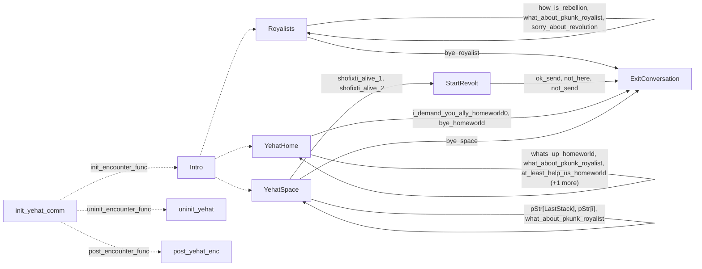

# Yehat royalists: existing conversation graph

> Generated by `tools/conversation_catalog.py`; do not edit this page by hand.

[Catalog and interpretation rules](../README.md) · [Proposed engine](../model.md)

Script: [yehatc.c](../../../../sc2/src/uqm/comm/yehat/yehatc.c#L1). Phrase bank: [yehat.txt](../../../../sc2/content/base/comm/yehat/yehat.txt#L1).

9 handler/helper nodes; 21 response registration sites; 3 direct local calls; 75 phrase records.

## Initialization and lifecycle

| Phase | Callback | Bound by | Conditions / source |
| --- | --- | --- | --- |
| <code>init_encounter_func</code> | [<code>Intro</code>](#node-intro) | <code>init_yehat_comm</code> | No enclosing branch condition; [666](../../../../sc2/src/uqm/comm/yehat/yehatc.c#L666) |
| <code>post_encounter_func</code> | [<code>post_yehat_enc</code>](#node-post_yehat_enc) | <code>init_yehat_comm</code> | No enclosing branch condition; [667](../../../../sc2/src/uqm/comm/yehat/yehatc.c#L667) |
| <code>uninit_encounter_func</code> | [<code>uninit_yehat</code>](#node-uninit_yehat) | <code>init_yehat_comm</code> | No enclosing branch condition; [668](../../../../sc2/src/uqm/comm/yehat/yehatc.c#L668) |

## Handler graph

Solid arrows are selectable responses; dashed arrows are direct C calls. Conditions, arguments, speech and effects are cataloged below. Parallel response sites are grouped only in this diagram.



## Condition catalog

Condition IDs describe enclosing source structure. Branch predicates combine with ∧; case labels mark source locations that can also be reached by fallthrough. Values refer to their original evaluation points. Local assignments and early control flow remain in the decision bodies.

| ID | Source expression / structural condition |
| --- | --- |
| <a id="condition-c1"></a>C1 | <code>PLAYER_SAID(R, bye_homeworld)</code> |
| <a id="condition-c2"></a>C2 | <code>!(PLAYER_SAID(R, bye_homeworld))</code> |
| <a id="condition-c3"></a>C3 | <code>PLAYER_SAID(R, bye_royalist)</code> |
| <a id="condition-c4"></a>C4 | <code>!(PLAYER_SAID(R, bye_royalist))</code> |
| <a id="condition-c5"></a>C5 | <code>PLAYER_SAID(R, i_demand_you_ally_homeworld0)</code> |
| <a id="condition-c6"></a>C6 | <code>!(PLAYER_SAID(R, i_demand_you_ally_homeworld0))</code> |
| <a id="condition-c7"></a>C7 | <code>PLAYER_SAID(R, bye_space)</code> |
| <a id="condition-c8"></a>C8 | <code>((BYTE) TFB_Random()) &amp; 1</code> |
| <a id="condition-c9"></a>C9 | <code>!(((BYTE) TFB_Random()) &amp; 1)</code> |
| <a id="condition-c10"></a>C10 | <code>!(PLAYER_SAID(R, bye_space))</code> |
| <a id="condition-c11"></a>C11 | <code>!(PLAYER_SAID(R, not_here))</code> |
| <a id="condition-c12"></a>C12 | <code>PLAYER_SAID(R, not_here) &#124;&#124; PLAYER_SAID(R, not_send)</code> |
| <a id="condition-c13"></a>C13 | <code>switch (GET_GAME_STATE(YEHAT_REBEL_VISITS))</code> |
| <a id="condition-c14"></a>C14 | <code>case 0 (see source for fallthrough)</code> |
| <a id="condition-c15"></a>C15 | <code>case 1 (see source for fallthrough)</code> |
| <a id="condition-c16"></a>C16 | <code>!(PLAYER_SAID(R, not_here) &#124;&#124; PLAYER_SAID(R, not_send))</code> |
| <a id="condition-c17"></a>C17 | <code>PLAYER_SAID(R, ok_send)</code> |
| <a id="condition-c18"></a>C18 | <code>PLAYER_SAID(R, how_is_rebellion)</code> |
| <a id="condition-c19"></a>C19 | <code>switch (NumVisits++)</code> |
| <a id="condition-c20"></a>C20 | <code>!(PLAYER_SAID(R, how_is_rebellion))</code> |
| <a id="condition-c21"></a>C21 | <code>PLAYER_SAID(R, what_about_pkunk_royalist)</code> |
| <a id="condition-c22"></a>C22 | <code>GET_GAME_STATE(YEHAT_ABSORBED_PKUNK)</code> |
| <a id="condition-c23"></a>C23 | <code>!(GET_GAME_STATE(YEHAT_ABSORBED_PKUNK))</code> |
| <a id="condition-c24"></a>C24 | <code>!(PLAYER_SAID(R, what_about_pkunk_royalist))</code> |
| <a id="condition-c25"></a>C25 | <code>PLAYER_SAID(R, sorry_about_revolution)</code> |
| <a id="condition-c26"></a>C26 | <code>PHRASE_ENABLED(how_is_rebellion)</code> |
| <a id="condition-c27"></a>C27 | <code>!GET_GAME_STATE(YEHAT_ROYALIST_TOLD_PKUNK)</code> |
| <a id="condition-c28"></a>C28 | <code>(!GET_GAME_STATE(YEHAT_ROYALIST_TOLD_PKUNK)) &amp;&amp; GET_GAME_STATE(PKUNK_VISITS)</code> |
| <a id="condition-c29"></a>C29 | <code>((!GET_GAME_STATE(YEHAT_ROYALIST_TOLD_PKUNK)) &amp;&amp; GET_GAME_STATE(PKUNK_VISITS)) &amp;&amp; GET_GAME_STATE(PKUNK_HOME_VISITS)</code> |
| <a id="condition-c30"></a>C30 | <code>!GET_GAME_STATE(NO_YEHAT_INFO)</code> |
| <a id="condition-c31"></a>C31 | <code>PLAYER_SAID(R, shofixti_alive_1)</code> |
| <a id="condition-c32"></a>C32 | <code>!(PLAYER_SAID(R, shofixti_alive_1))</code> |
| <a id="condition-c33"></a>C33 | <code>PLAYER_SAID(R, shofixti_alive_2)</code> |
| <a id="condition-c34"></a>C34 | <code>HaveEscortShip(SHOFIXTI_SHIP)</code> |
| <a id="condition-c35"></a>C35 | <code>!(HaveEscortShip(SHOFIXTI_SHIP))</code> |
| <a id="condition-c36"></a>C36 | <code>PLAYER_SAID(R, whats_up_homeworld)</code> |
| <a id="condition-c37"></a>C37 | <code>!(PLAYER_SAID(R, whats_up_homeworld))</code> |
| <a id="condition-c38"></a>C38 | <code>PLAYER_SAID(R, at_least_help_us_homeworld)</code> |
| <a id="condition-c39"></a>C39 | <code>!(PLAYER_SAID(R, at_least_help_us_homeworld))</code> |
| <a id="condition-c40"></a>C40 | <code>PLAYER_SAID(R, give_info)</code> |
| <a id="condition-c41"></a>C41 | <code>!(PLAYER_SAID(R, give_info))</code> |
| <a id="condition-c42"></a>C42 | <code>PHRASE_ENABLED(whats_up_homeworld)</code> |
| <a id="condition-c43"></a>C43 | <code>!GET_GAME_STATE(NO_YEHAT_HELP_HOME)</code> |
| <a id="condition-c44"></a>C44 | <code>!GET_GAME_STATE(NO_YEHAT_ALLY_HOME)</code> |
| <a id="condition-c45"></a>C45 | <code>!(PLAYER_SAID(R, whats_up_space_1))</code> |
| <a id="condition-c46"></a>C46 | <code>!(PLAYER_SAID(R, whats_up_space_1) &#124;&#124; PLAYER_SAID(R, whats_up_space_2))</code> |
| <a id="condition-c47"></a>C47 | <code>!((PLAYER_SAID(R, whats_up_space_1) &#124;&#124; PLAYER_SAID(R, whats_up_space_2)) &#124;&#124; PLAYER_SAID(R, whats_up_space_3))</code> |
| <a id="condition-c48"></a>C48 | <code>((PLAYER_SAID(R, whats_up_space_1) &#124;&#124; PLAYER_SAID(R, whats_up_space_2)) &#124;&#124; PLAYER_SAID(R, whats_up_space_3)) &#124;&#124; PLAYER_SAID(R, whats_up_space_4)</code> |
| <a id="condition-c49"></a>C49 | <code>case 2 (see source for fallthrough)</code> |
| <a id="condition-c50"></a>C50 | <code>case 3 (see source for fallthrough)</code> |
| <a id="condition-c51"></a>C51 | <code>!(((PLAYER_SAID(R, whats_up_space_1) &#124;&#124; PLAYER_SAID(R, whats_up_space_2)) &#124;&#124; PLAYER_SAID(R, whats_up_space_3)) &#124;&#124; PLAYER_SAID(R, whats_up_space_4))</code> |
| <a id="condition-c52"></a>C52 | <code>PLAYER_SAID(R, i_demand_you_ally_space0)</code> |
| <a id="condition-c53"></a>C53 | <code>!(PLAYER_SAID(R, i_demand_you_ally_space0))</code> |
| <a id="condition-c54"></a>C54 | <code>PLAYER_SAID(R, obligation)</code> |
| <a id="condition-c55"></a>C55 | <code>!(PLAYER_SAID(R, obligation))</code> |
| <a id="condition-c56"></a>C56 | <code>PLAYER_SAID(R, at_least_help_us_space)</code> |
| <a id="condition-c57"></a>C57 | <code>!(PLAYER_SAID(R, at_least_help_us_space))</code> |
| <a id="condition-c58"></a>C58 | <code>PLAYER_SAID(R, dishonor)</code> |
| <a id="condition-c59"></a>C59 | <code>!(PLAYER_SAID(R, dishonor))</code> |
| <a id="condition-c60"></a>C60 | <code>PHRASE_ENABLED(whats_up_space_1)</code> |
| <a id="condition-c61"></a>C61 | <code>switch (GET_GAME_STATE(YEHAT_REBEL_INFO))</code> |
| <a id="condition-c62"></a>C62 | <code>switch (GET_GAME_STATE(NO_YEHAT_HELP_SPACE))</code> |
| <a id="condition-c63"></a>C63 | <code>switch (GET_GAME_STATE(NO_YEHAT_ALLY_SPACE))</code> |
| <a id="condition-c64"></a>C64 | <code>pStr[LastStack]</code> |
| <a id="condition-c65"></a>C65 | <code>pStr[LastStack] != i_demand_you_ally_space0</code> |
| <a id="condition-c66"></a>C66 | <code>!(pStr[LastStack] != i_demand_you_ally_space0)</code> |
| <a id="condition-c67"></a>C67 | <code>for (i = 0; i &lt; 3; ++i)</code> |
| <a id="condition-c68"></a>C68 | <code>(i != LastStack) &amp;&amp; pStr[i]</code> |
| <a id="condition-c69"></a>C69 | <code>pStr[i] != i_demand_you_ally_space0</code> |
| <a id="condition-c70"></a>C70 | <code>!(pStr[i] != i_demand_you_ally_space0)</code> |
| <a id="condition-c71"></a>C71 | <code>GET_GAME_STATE(SHOFIXTI_VISITS)</code> |
| <a id="condition-c72"></a>C72 | <code>switch (GET_GAME_STATE(YEHAT_REBEL_TOLD_PKUNK))</code> |
| <a id="condition-c73"></a>C73 | <code>LOBYTE(GLOBAL(CurrentActivity)) == WON_LAST_BATTLE</code> |
| <a id="condition-c74"></a>C74 | <code>GET_GAME_STATE(YEHAT_CIVIL_WAR)</code> |
| <a id="condition-c75"></a>C75 | <code>GET_GAME_STATE(GLOBAL_FLAGS_AND_DATA) &amp; (1 &lt;&lt; 7)</code> |
| <a id="condition-c76"></a>C76 | <code>!(GET_GAME_STATE(GLOBAL_FLAGS_AND_DATA) &amp; (1 &lt;&lt; 7))</code> |
| <a id="condition-c77"></a>C77 | <code>!(GET_GAME_STATE(YEHAT_CIVIL_WAR))</code> |
| <a id="condition-c78"></a>C78 | <code>LOBYTE(GLOBAL(CurrentActivity)) != WON_LAST_BATTLE</code> |
| <a id="condition-c79"></a>C79 | <code>!(LOBYTE(GLOBAL(CurrentActivity)) != WON_LAST_BATTLE)</code> |

## Script-scope state and lookup tables

These declarations supply shared local state, computed phrase alternatives, number speech, or lookup data used by the nodes. LOCDATA presentation defaults are linked separately in the source.

Presentation descriptor <code>yehat_desc</code>: [source](../../../../sc2/src/uqm/comm/yehat/yehatc.c#L28).

## Node catalog

<a id="node-exitconversation"></a>

### ExitConversation

<code>static void ExitConversation(RESPONSE_REF R)</code> — [source](../../../../sc2/src/uqm/comm/yehat/yehatc.c#L195).

Incoming player-response variants: [<code>bye_royalist</code>](#phrase-bye_royalist), [<code>ok_send</code>](#phrase-ok_send), [<code>not_here</code>](#phrase-not_here), [<code>not_send</code>](#phrase-not_send), [<code>i_demand_you_ally_homeworld0</code>](#phrase-i_demand_you_ally_homeworld0), [<code>bye_homeworld</code>](#phrase-bye_homeworld), [<code>bye_space</code>](#phrase-bye_space).

#### Dialogue / audio emissions

| Phrase or expression | Enclosing conditions | Source |
| --- | --- | --- |
| [<code>GOODBYE_AND_DIE_HOMEWORLD</code>](#phrase-goodbye_and_die_homeworld)<br><code>NPCPhrase(GOODBYE_AND_DIE_HOMEWORLD)</code> | [C1](#condition-c1) | [200](../../../../sc2/src/uqm/comm/yehat/yehatc.c#L200) |
| [<code>GOODBYE_AND_DIE_ROYALIST</code>](#phrase-goodbye_and_die_royalist)<br><code>NPCPhrase(GOODBYE_AND_DIE_ROYALIST)</code> | [C2](#condition-c2) ∧ [C3](#condition-c3) | [202](../../../../sc2/src/uqm/comm/yehat/yehatc.c#L202) |
| [<code>ENEMY_MUST_DIE</code>](#phrase-enemy_must_die)<br><code>NPCPhrase(ENEMY_MUST_DIE)</code> | [C2](#condition-c2) ∧ [C4](#condition-c4) ∧ [C5](#condition-c5) | [205](../../../../sc2/src/uqm/comm/yehat/yehatc.c#L205) |
| [<code>GOODBYE_AND_DIE_SPACE</code>](#phrase-goodbye_and_die_space)<br><code>NPCPhrase(GOODBYE_AND_DIE_SPACE)</code> | [C2](#condition-c2) ∧ [C4](#condition-c4) ∧ [C6](#condition-c6) ∧ [C7](#condition-c7) ∧ [C8](#condition-c8) | [212](../../../../sc2/src/uqm/comm/yehat/yehatc.c#L212) |
| [<code>GO_IN_PEACE</code>](#phrase-go_in_peace)<br><code>NPCPhrase(GO_IN_PEACE)</code> | [C2](#condition-c2) ∧ [C4](#condition-c4) ∧ [C6](#condition-c6) ∧ [C7](#condition-c7) ∧ [C9](#condition-c9) | [215](../../../../sc2/src/uqm/comm/yehat/yehatc.c#L215) |
| [<code>JUST_A_TRICK_1</code>](#phrase-just_a_trick_1)<br><code>NPCPhrase(JUST_A_TRICK_1)</code> | [C2](#condition-c2) ∧ [C4](#condition-c4) ∧ [C6](#condition-c6) ∧ [C10](#condition-c10) ∧ [C12](#condition-c12) ∧ [C13](#condition-c13) ∧ [C14](#condition-c14) | [226](../../../../sc2/src/uqm/comm/yehat/yehatc.c#L226) |
| [<code>JUST_A_TRICK_2</code>](#phrase-just_a_trick_2)<br><code>NPCPhrase(JUST_A_TRICK_2)</code> | [C2](#condition-c2) ∧ [C4](#condition-c4) ∧ [C6](#condition-c6) ∧ [C10](#condition-c10) ∧ [C12](#condition-c12) ∧ [C13](#condition-c13) ∧ [C15](#condition-c15) | [229](../../../../sc2/src/uqm/comm/yehat/yehatc.c#L229) |
| [<code>WE_REVOLT</code>](#phrase-we_revolt)<br><code>NPCPhrase(WE_REVOLT)</code> | [C2](#condition-c2) ∧ [C4](#condition-c4) ∧ [C6](#condition-c6) ∧ [C10](#condition-c10) ∧ [C16](#condition-c16) ∧ [C17](#condition-c17) | [236](../../../../sc2/src/uqm/comm/yehat/yehatc.c#L236) |

#### Actions, queries, local updates, and control flow

Calls are listed without assuming they are pure or mutating. Local updates are retained because they determine dynamic menus and counter-selected speech.

| Kind | Operation | Enclosing conditions | Source |
| --- | --- | --- | --- |
| call | <code>setSegue(Segue_hostile)</code> | No enclosing branch condition | [197](../../../../sc2/src/uqm/comm/yehat/yehatc.c#L197) |
| call | <code>PLAYER_SAID(R, bye_homeworld)</code> | No enclosing branch condition | [199](../../../../sc2/src/uqm/comm/yehat/yehatc.c#L199) |
| call | <code>PLAYER_SAID(R, bye_royalist)</code> | [C2](#condition-c2) | [201](../../../../sc2/src/uqm/comm/yehat/yehatc.c#L201) |
| call | <code>PLAYER_SAID(R, i_demand_you_ally_homeworld0)</code> | [C2](#condition-c2) ∧ [C4](#condition-c4) | [203](../../../../sc2/src/uqm/comm/yehat/yehatc.c#L203) |
| call | <code>SET_GAME_STATE(NO_YEHAT_ALLY_HOME, 1)</code> | [C2](#condition-c2) ∧ [C4](#condition-c4) ∧ [C5](#condition-c5) | [207](../../../../sc2/src/uqm/comm/yehat/yehatc.c#L207) |
| call | <code>PLAYER_SAID(R, bye_space)</code> | [C2](#condition-c2) ∧ [C4](#condition-c4) ∧ [C6](#condition-c6) | [209](../../../../sc2/src/uqm/comm/yehat/yehatc.c#L209) |
| call | <code>TFB_Random()</code> | [C2](#condition-c2) ∧ [C4](#condition-c4) ∧ [C6](#condition-c6) ∧ [C7](#condition-c7) | [211](../../../../sc2/src/uqm/comm/yehat/yehatc.c#L211) |
| call | <code>setSegue(Segue_peace)</code> | [C2](#condition-c2) ∧ [C4](#condition-c4) ∧ [C6](#condition-c6) ∧ [C7](#condition-c7) ∧ [C9](#condition-c9) | [217](../../../../sc2/src/uqm/comm/yehat/yehatc.c#L217) |
| call | <code>PLAYER_SAID(R, not_here)</code> | [C2](#condition-c2) ∧ [C4](#condition-c4) ∧ [C6](#condition-c6) ∧ [C10](#condition-c10) | [220](../../../../sc2/src/uqm/comm/yehat/yehatc.c#L220) |
| call | <code>PLAYER_SAID(R, not_send)</code> | [C2](#condition-c2) ∧ [C4](#condition-c4) ∧ [C6](#condition-c6) ∧ [C10](#condition-c10) ∧ [C11](#condition-c11) | [221](../../../../sc2/src/uqm/comm/yehat/yehatc.c#L221) |
| call | <code>GET_GAME_STATE(YEHAT_REBEL_VISITS)</code> | [C2](#condition-c2) ∧ [C4](#condition-c4) ∧ [C6](#condition-c6) ∧ [C10](#condition-c10) ∧ [C12](#condition-c12) | [223](../../../../sc2/src/uqm/comm/yehat/yehatc.c#L223) |
| flow | <code>break;</code> | [C2](#condition-c2) ∧ [C4](#condition-c4) ∧ [C6](#condition-c6) ∧ [C10](#condition-c10) ∧ [C12](#condition-c12) ∧ [C13](#condition-c13) ∧ [C14](#condition-c14) | [227](../../../../sc2/src/uqm/comm/yehat/yehatc.c#L227) |
| flow | <code>break;</code> | [C2](#condition-c2) ∧ [C4](#condition-c4) ∧ [C6](#condition-c6) ∧ [C10](#condition-c10) ∧ [C12](#condition-c12) ∧ [C13](#condition-c13) ∧ [C15](#condition-c15) | [230](../../../../sc2/src/uqm/comm/yehat/yehatc.c#L230) |
| call | <code>SET_GAME_STATE(YEHAT_REBEL_VISITS, 1)</code> | [C2](#condition-c2) ∧ [C4](#condition-c4) ∧ [C6](#condition-c6) ∧ [C10](#condition-c10) ∧ [C12](#condition-c12) | [232](../../../../sc2/src/uqm/comm/yehat/yehatc.c#L232) |
| call | <code>PLAYER_SAID(R, ok_send)</code> | [C2](#condition-c2) ∧ [C4](#condition-c4) ∧ [C6](#condition-c6) ∧ [C10](#condition-c10) ∧ [C16](#condition-c16) | [234](../../../../sc2/src/uqm/comm/yehat/yehatc.c#L234) |
| call | <code>setSegue(Segue_peace)</code> | [C2](#condition-c2) ∧ [C4](#condition-c4) ∧ [C6](#condition-c6) ∧ [C10](#condition-c10) ∧ [C16](#condition-c16) ∧ [C17](#condition-c17) | [238](../../../../sc2/src/uqm/comm/yehat/yehatc.c#L238) |
| call | <code>SET_GAME_STATE(YEHAT_CIVIL_WAR, 1)</code> | [C2](#condition-c2) ∧ [C4](#condition-c4) ∧ [C6](#condition-c6) ∧ [C10](#condition-c10) ∧ [C16](#condition-c16) ∧ [C17](#condition-c17) | [239](../../../../sc2/src/uqm/comm/yehat/yehatc.c#L239) |
| call | <code>SET_GAME_STATE(YEHAT_VISITS, 0)</code> | [C2](#condition-c2) ∧ [C4](#condition-c4) ∧ [C6](#condition-c6) ∧ [C10](#condition-c10) ∧ [C16](#condition-c16) ∧ [C17](#condition-c17) | [240](../../../../sc2/src/uqm/comm/yehat/yehatc.c#L240) |
| call | <code>SET_GAME_STATE(YEHAT_HOME_VISITS, 0)</code> | [C2](#condition-c2) ∧ [C4](#condition-c4) ∧ [C6](#condition-c6) ∧ [C10](#condition-c10) ∧ [C16](#condition-c16) ∧ [C17](#condition-c17) | [241](../../../../sc2/src/uqm/comm/yehat/yehatc.c#L241) |
| call | <code>SET_GAME_STATE(YEHAT_REBEL_VISITS, 0)</code> | [C2](#condition-c2) ∧ [C4](#condition-c4) ∧ [C6](#condition-c6) ∧ [C10](#condition-c10) ∧ [C16](#condition-c16) ∧ [C17](#condition-c17) | [242](../../../../sc2/src/uqm/comm/yehat/yehatc.c#L242) |
| call | <code>SET_GAME_STATE(YEHAT_REBEL_INFO, 0)</code> | [C2](#condition-c2) ∧ [C4](#condition-c4) ∧ [C6](#condition-c6) ∧ [C10](#condition-c10) ∧ [C16](#condition-c16) ∧ [C17](#condition-c17) | [243](../../../../sc2/src/uqm/comm/yehat/yehatc.c#L243) |
| call | <code>SET_GAME_STATE(YEHAT_REBEL_TOLD_PKUNK, 0)</code> | [C2](#condition-c2) ∧ [C4](#condition-c4) ∧ [C6](#condition-c6) ∧ [C10](#condition-c10) ∧ [C16](#condition-c16) ∧ [C17](#condition-c17) | [244](../../../../sc2/src/uqm/comm/yehat/yehatc.c#L244) |
| call | <code>SET_GAME_STATE(NO_YEHAT_INFO, 0)</code> | [C2](#condition-c2) ∧ [C4](#condition-c4) ∧ [C6](#condition-c6) ∧ [C10](#condition-c10) ∧ [C16](#condition-c16) ∧ [C17](#condition-c17) | [245](../../../../sc2/src/uqm/comm/yehat/yehatc.c#L245) |
| call | <code>AddEvent(RELATIVE_EVENT, 0, 0, 0, YEHAT_REBEL_EVENT)</code> | [C2](#condition-c2) ∧ [C4](#condition-c4) ∧ [C6](#condition-c6) ∧ [C10](#condition-c10) ∧ [C16](#condition-c16) ∧ [C17](#condition-c17) | [247](../../../../sc2/src/uqm/comm/yehat/yehatc.c#L247) |

<details>
<summary>Exact decision body (local calculations, early returns, fallthrough and ordering)</summary>

```c
{
	setSegue (Segue_hostile);

	if (PLAYER_SAID (R, bye_homeworld))
		NPCPhrase (GOODBYE_AND_DIE_HOMEWORLD);
	else if (PLAYER_SAID (R, bye_royalist))
		NPCPhrase (GOODBYE_AND_DIE_ROYALIST);
	else if (PLAYER_SAID (R, i_demand_you_ally_homeworld0))
	{
		NPCPhrase (ENEMY_MUST_DIE);

		SET_GAME_STATE (NO_YEHAT_ALLY_HOME, 1);
	}
	else if (PLAYER_SAID (R, bye_space))
	{
		if ((BYTE)TFB_Random () & 1)
			NPCPhrase (GOODBYE_AND_DIE_SPACE);
		else
		{
			NPCPhrase (GO_IN_PEACE);

			setSegue (Segue_peace);
		}
	}
	else if (PLAYER_SAID (R, not_here)
			|| PLAYER_SAID (R, not_send))
	{
		switch (GET_GAME_STATE (YEHAT_REBEL_VISITS))
		{
			case 0:
				NPCPhrase (JUST_A_TRICK_1);
				break;
			case 1:
				NPCPhrase (JUST_A_TRICK_2);
				break;
		}
		SET_GAME_STATE (YEHAT_REBEL_VISITS, 1);
	}
	else if (PLAYER_SAID (R, ok_send))
	{
		NPCPhrase (WE_REVOLT);

		setSegue (Segue_peace);
		SET_GAME_STATE (YEHAT_CIVIL_WAR, 1);
		SET_GAME_STATE (YEHAT_VISITS, 0);
		SET_GAME_STATE (YEHAT_HOME_VISITS, 0);
		SET_GAME_STATE (YEHAT_REBEL_VISITS, 0);
		SET_GAME_STATE (YEHAT_REBEL_INFO, 0);
		SET_GAME_STATE (YEHAT_REBEL_TOLD_PKUNK, 0);
		SET_GAME_STATE (NO_YEHAT_INFO, 0);

		AddEvent (RELATIVE_EVENT, 0, 0, 0, YEHAT_REBEL_EVENT);
	}
}
```

</details>

<a id="node-royalists"></a>

### Royalists

<code>static void Royalists(RESPONSE_REF R)</code> — [source](../../../../sc2/src/uqm/comm/yehat/yehatc.c#L252).

Incoming player-response variants: [<code>how_is_rebellion</code>](#phrase-how_is_rebellion), [<code>what_about_pkunk_royalist</code>](#phrase-what_about_pkunk_royalist), [<code>sorry_about_revolution</code>](#phrase-sorry_about_revolution).

Also called directly by: [<code>Intro</code>](#node-intro) ([605](../../../../sc2/src/uqm/comm/yehat/yehatc.c#L605)).

#### Dialogue / audio emissions

| Phrase or expression | Enclosing conditions | Source |
| --- | --- | --- |
| [<code>ROYALIST_REBELLION_1</code>](#phrase-royalist_rebellion_1)<br><code>NPCPhrase(ROYALIST_REBELLION_1)</code> | [C18](#condition-c18) ∧ [C19](#condition-c19) ∧ [C14](#condition-c14) | [262](../../../../sc2/src/uqm/comm/yehat/yehatc.c#L262) |
| [<code>ROYALIST_REBELLION_2</code>](#phrase-royalist_rebellion_2)<br><code>NPCPhrase(ROYALIST_REBELLION_2)</code> | [C18](#condition-c18) ∧ [C19](#condition-c19) ∧ [C15](#condition-c15) | [265](../../../../sc2/src/uqm/comm/yehat/yehatc.c#L265) |
| [<code>PKUNK_ABSORBED_ROYALIST</code>](#phrase-pkunk_absorbed_royalist)<br><code>NPCPhrase(PKUNK_ABSORBED_ROYALIST)</code> | [C20](#condition-c20) ∧ [C21](#condition-c21) ∧ [C22](#condition-c22) | [276](../../../../sc2/src/uqm/comm/yehat/yehatc.c#L276) |
| [<code>HATE_PKUNK_ROYALIST</code>](#phrase-hate_pkunk_royalist)<br><code>NPCPhrase(HATE_PKUNK_ROYALIST)</code> | [C20](#condition-c20) ∧ [C21](#condition-c21) ∧ [C23](#condition-c23) | [278](../../../../sc2/src/uqm/comm/yehat/yehatc.c#L278) |
| [<code>ALL_YOUR_FAULT</code>](#phrase-all_your_fault)<br><code>NPCPhrase(ALL_YOUR_FAULT)</code> | [C20](#condition-c20) ∧ [C24](#condition-c24) ∧ [C25](#condition-c25) | [284](../../../../sc2/src/uqm/comm/yehat/yehatc.c#L284) |

#### Response edges

| Player response | Destination on selection | Enclosing availability conditions | Source |
| --- | --- | --- | --- |
| [<code>how_is_rebellion</code>](#phrase-how_is_rebellion)<br>So, how&#x27;s the revolution going for you guys? | [<code>Royalists</code>](#node-royalists) | [C26](#condition-c26) | [290](../../../../sc2/src/uqm/comm/yehat/yehatc.c#L290) |
| [<code>what_about_pkunk_royalist</code>](#phrase-what_about_pkunk_royalist)<br>We have encountered an offshoot of your species, the Pkunk. Tell us about them. | [<code>Royalists</code>](#node-royalists) | [C29](#condition-c29) | [294](../../../../sc2/src/uqm/comm/yehat/yehatc.c#L294) |
| [<code>sorry_about_revolution</code>](#phrase-sorry_about_revolution)<br>Gosh, I&#x27;m sorry about this revolution thing. I didn&#x27;t mean any harm. | [<code>Royalists</code>](#node-royalists) | [C30](#condition-c30) | [296](../../../../sc2/src/uqm/comm/yehat/yehatc.c#L296) |
| [<code>bye_royalist</code>](#phrase-bye_royalist)<br>Goodbye Royalist fool! | [<code>ExitConversation</code>](#node-exitconversation) | No enclosing branch condition | [297](../../../../sc2/src/uqm/comm/yehat/yehatc.c#L297) |

#### Actions, queries, local updates, and control flow

Calls are listed without assuming they are pure or mutating. Local updates are retained because they determine dynamic menus and counter-selected speech.

| Kind | Operation | Enclosing conditions | Source |
| --- | --- | --- | --- |
| call | <code>PLAYER_SAID(R, how_is_rebellion)</code> | No enclosing branch condition | [254](../../../../sc2/src/uqm/comm/yehat/yehatc.c#L254) |
| update | <code>NumVisits = GET_GAME_STATE(YEHAT_ROYALIST_INFO)</code> | [C18](#condition-c18) | [258](../../../../sc2/src/uqm/comm/yehat/yehatc.c#L258) |
| call | <code>GET_GAME_STATE(YEHAT_ROYALIST_INFO)</code> | [C18](#condition-c18) | [258](../../../../sc2/src/uqm/comm/yehat/yehatc.c#L258) |
| update | <code>NumVisits++</code> | [C18](#condition-c18) | [259](../../../../sc2/src/uqm/comm/yehat/yehatc.c#L259) |
| flow | <code>break;</code> | [C18](#condition-c18) ∧ [C19](#condition-c19) ∧ [C14](#condition-c14) | [263](../../../../sc2/src/uqm/comm/yehat/yehatc.c#L263) |
| update | <code>--NumVisits</code> | [C18](#condition-c18) ∧ [C19](#condition-c19) ∧ [C15](#condition-c15) | [266](../../../../sc2/src/uqm/comm/yehat/yehatc.c#L266) |
| flow | <code>break;</code> | [C18](#condition-c18) ∧ [C19](#condition-c19) ∧ [C15](#condition-c15) | [267](../../../../sc2/src/uqm/comm/yehat/yehatc.c#L267) |
| call | <code>SET_GAME_STATE(YEHAT_ROYALIST_INFO, NumVisits)</code> | [C18](#condition-c18) | [269](../../../../sc2/src/uqm/comm/yehat/yehatc.c#L269) |
| call | <code>DISABLE_PHRASE(how_is_rebellion)</code> | [C18](#condition-c18) | [271](../../../../sc2/src/uqm/comm/yehat/yehatc.c#L271) |
| call | <code>PLAYER_SAID(R, what_about_pkunk_royalist)</code> | [C20](#condition-c20) | [273](../../../../sc2/src/uqm/comm/yehat/yehatc.c#L273) |
| call | <code>GET_GAME_STATE(YEHAT_ABSORBED_PKUNK)</code> | [C20](#condition-c20) ∧ [C21](#condition-c21) | [275](../../../../sc2/src/uqm/comm/yehat/yehatc.c#L275) |
| call | <code>SET_GAME_STATE(YEHAT_ROYALIST_TOLD_PKUNK, 1)</code> | [C20](#condition-c20) ∧ [C21](#condition-c21) | [280](../../../../sc2/src/uqm/comm/yehat/yehatc.c#L280) |
| call | <code>PLAYER_SAID(R, sorry_about_revolution)</code> | [C20](#condition-c20) ∧ [C24](#condition-c24) | [282](../../../../sc2/src/uqm/comm/yehat/yehatc.c#L282) |
| call | <code>SET_GAME_STATE(NO_YEHAT_INFO, 1)</code> | [C20](#condition-c20) ∧ [C24](#condition-c24) ∧ [C25](#condition-c25) | [286](../../../../sc2/src/uqm/comm/yehat/yehatc.c#L286) |
| call | <code>PHRASE_ENABLED(how_is_rebellion)</code> | No enclosing branch condition | [289](../../../../sc2/src/uqm/comm/yehat/yehatc.c#L289) |
| call | <code>GET_GAME_STATE(YEHAT_ROYALIST_TOLD_PKUNK)</code> | No enclosing branch condition | [291](../../../../sc2/src/uqm/comm/yehat/yehatc.c#L291) |
| call | <code>GET_GAME_STATE(PKUNK_VISITS)</code> | [C27](#condition-c27) | [292](../../../../sc2/src/uqm/comm/yehat/yehatc.c#L292) |
| call | <code>GET_GAME_STATE(PKUNK_HOME_VISITS)</code> | [C28](#condition-c28) | [293](../../../../sc2/src/uqm/comm/yehat/yehatc.c#L293) |
| call | <code>GET_GAME_STATE(NO_YEHAT_INFO)</code> | No enclosing branch condition | [295](../../../../sc2/src/uqm/comm/yehat/yehatc.c#L295) |

<details>
<summary>Exact decision body (local calculations, early returns, fallthrough and ordering)</summary>

```c
{
	if (PLAYER_SAID (R, how_is_rebellion))
	{
		BYTE NumVisits;

		NumVisits = GET_GAME_STATE (YEHAT_ROYALIST_INFO);
		switch (NumVisits++)
		{
			case 0:
				NPCPhrase (ROYALIST_REBELLION_1);
				break;
			case 1:
				NPCPhrase (ROYALIST_REBELLION_2);
				--NumVisits;
				break;
		}
		SET_GAME_STATE (YEHAT_ROYALIST_INFO, NumVisits);

		DISABLE_PHRASE (how_is_rebellion);
	}
	else if (PLAYER_SAID (R, what_about_pkunk_royalist))
	{
		if (GET_GAME_STATE (YEHAT_ABSORBED_PKUNK))
			NPCPhrase (PKUNK_ABSORBED_ROYALIST);
		else
			NPCPhrase (HATE_PKUNK_ROYALIST);

		SET_GAME_STATE (YEHAT_ROYALIST_TOLD_PKUNK, 1);
	}
	else if (PLAYER_SAID (R, sorry_about_revolution))
	{
		NPCPhrase (ALL_YOUR_FAULT);

		SET_GAME_STATE (NO_YEHAT_INFO, 1);
	}

	if (PHRASE_ENABLED (how_is_rebellion))
		Response (how_is_rebellion, Royalists);
	if (!GET_GAME_STATE (YEHAT_ROYALIST_TOLD_PKUNK)
			&& GET_GAME_STATE (PKUNK_VISITS)
			&& GET_GAME_STATE (PKUNK_HOME_VISITS))
		Response (what_about_pkunk_royalist, Royalists);
	if (!GET_GAME_STATE (NO_YEHAT_INFO))
		Response (sorry_about_revolution, Royalists);
	Response (bye_royalist, ExitConversation);
}
```

</details>

<a id="node-startrevolt"></a>

### StartRevolt

<code>static void StartRevolt(RESPONSE_REF R)</code> — [source](../../../../sc2/src/uqm/comm/yehat/yehatc.c#L301).

Incoming player-response variants: [<code>shofixti_alive_1</code>](#phrase-shofixti_alive_1), [<code>shofixti_alive_2</code>](#phrase-shofixti_alive_2).

#### Dialogue / audio emissions

| Phrase or expression | Enclosing conditions | Source |
| --- | --- | --- |
| [<code>SEND_HIM_OVER_1</code>](#phrase-send_him_over_1)<br><code>NPCPhrase(SEND_HIM_OVER_1)</code> | [C31](#condition-c31) | [305](../../../../sc2/src/uqm/comm/yehat/yehatc.c#L305) |
| [<code>SEND_HIM_OVER_2</code>](#phrase-send_him_over_2)<br><code>NPCPhrase(SEND_HIM_OVER_2)</code> | [C32](#condition-c32) ∧ [C33](#condition-c33) | [310](../../../../sc2/src/uqm/comm/yehat/yehatc.c#L310) |

#### Response edges

| Player response | Destination on selection | Enclosing availability conditions | Source |
| --- | --- | --- | --- |
| [<code>ok_send</code>](#phrase-ok_send)<br>All right, I&#x27;ll send over the Shofixti... but don&#x27;t mess with him, okay? | [<code>ExitConversation</code>](#node-exitconversation) | [C34](#condition-c34) | [313](../../../../sc2/src/uqm/comm/yehat/yehatc.c#L313) |
| [<code>not_here</code>](#phrase-not_here)<br>Well I don&#x27;t have one right HERE. | [<code>ExitConversation</code>](#node-exitconversation) | [C35](#condition-c35) | [315](../../../../sc2/src/uqm/comm/yehat/yehatc.c#L315) |
| [<code>not_send</code>](#phrase-not_send)<br>I will not subject one of my officers to such danger. How do I know you won&#x27;t just kill him? | [<code>ExitConversation</code>](#node-exitconversation) | No enclosing branch condition | [316](../../../../sc2/src/uqm/comm/yehat/yehatc.c#L316) |

#### Actions, queries, local updates, and control flow

Calls are listed without assuming they are pure or mutating. Local updates are retained because they determine dynamic menus and counter-selected speech.

| Kind | Operation | Enclosing conditions | Source |
| --- | --- | --- | --- |
| call | <code>PLAYER_SAID(R, shofixti_alive_1)</code> | No enclosing branch condition | [303](../../../../sc2/src/uqm/comm/yehat/yehatc.c#L303) |
| call | <code>SET_GAME_STATE(YEHAT_REBEL_TOLD_PKUNK, 1)</code> | [C31](#condition-c31) | [307](../../../../sc2/src/uqm/comm/yehat/yehatc.c#L307) |
| call | <code>PLAYER_SAID(R, shofixti_alive_2)</code> | [C32](#condition-c32) | [309](../../../../sc2/src/uqm/comm/yehat/yehatc.c#L309) |
| call | <code>HaveEscortShip(SHOFIXTI_SHIP)</code> | No enclosing branch condition | [312](../../../../sc2/src/uqm/comm/yehat/yehatc.c#L312) |

<details>
<summary>Exact decision body (local calculations, early returns, fallthrough and ordering)</summary>

```c
{
	if (PLAYER_SAID (R, shofixti_alive_1))
	{
		NPCPhrase (SEND_HIM_OVER_1);

		SET_GAME_STATE (YEHAT_REBEL_TOLD_PKUNK, 1);
	}
	else if (PLAYER_SAID (R, shofixti_alive_2))
		NPCPhrase (SEND_HIM_OVER_2);

	if (HaveEscortShip (SHOFIXTI_SHIP))
		Response (ok_send, ExitConversation);
	else
		Response (not_here, ExitConversation);
	Response (not_send, ExitConversation);
}
```

</details>

<a id="node-yehathome"></a>

### YehatHome

<code>static void YehatHome(RESPONSE_REF R)</code> — [source](../../../../sc2/src/uqm/comm/yehat/yehatc.c#L320).

Incoming player-response variants: [<code>whats_up_homeworld</code>](#phrase-whats_up_homeworld), [<code>what_about_pkunk_royalist</code>](#phrase-what_about_pkunk_royalist), [<code>at_least_help_us_homeworld</code>](#phrase-at_least_help_us_homeworld), [<code>give_info</code>](#phrase-give_info).

Also called directly by: [<code>Intro</code>](#node-intro) ([622](../../../../sc2/src/uqm/comm/yehat/yehatc.c#L622)).

#### Dialogue / audio emissions

| Phrase or expression | Enclosing conditions | Source |
| --- | --- | --- |
| [<code>GENERAL_INFO_HOMEWORLD_1</code>](#phrase-general_info_homeworld_1)<br><code>NPCPhrase(GENERAL_INFO_HOMEWORLD_1)</code> | [C36](#condition-c36) ∧ [C19](#condition-c19) ∧ [C14](#condition-c14) | [331](../../../../sc2/src/uqm/comm/yehat/yehatc.c#L331) |
| [<code>GENERAL_INFO_HOMEWORLD_2</code>](#phrase-general_info_homeworld_2)<br><code>NPCPhrase(GENERAL_INFO_HOMEWORLD_2)</code> | [C36](#condition-c36) ∧ [C19](#condition-c19) ∧ [C15](#condition-c15) | [334](../../../../sc2/src/uqm/comm/yehat/yehatc.c#L334) |
| [<code>NO_HELP_ENEMY</code>](#phrase-no_help_enemy)<br><code>NPCPhrase(NO_HELP_ENEMY)</code> | [C37](#condition-c37) ∧ [C38](#condition-c38) | [344](../../../../sc2/src/uqm/comm/yehat/yehatc.c#L344) |
| [<code>NO_INFO_FOR_ENEMY</code>](#phrase-no_info_for_enemy)<br><code>NPCPhrase(NO_INFO_FOR_ENEMY)</code> | [C37](#condition-c37) ∧ [C39](#condition-c39) ∧ [C40](#condition-c40) | [350](../../../../sc2/src/uqm/comm/yehat/yehatc.c#L350) |
| [<code>PKUNK_ABSORBED_ROYALIST</code>](#phrase-pkunk_absorbed_royalist)<br><code>NPCPhrase(PKUNK_ABSORBED_ROYALIST)</code> | [C37](#condition-c37) ∧ [C39](#condition-c39) ∧ [C41](#condition-c41) ∧ [C21](#condition-c21) ∧ [C22](#condition-c22) | [357](../../../../sc2/src/uqm/comm/yehat/yehatc.c#L357) |
| [<code>HATE_PKUNK_ROYALIST</code>](#phrase-hate_pkunk_royalist)<br><code>NPCPhrase(HATE_PKUNK_ROYALIST)</code> | [C37](#condition-c37) ∧ [C39](#condition-c39) ∧ [C41](#condition-c41) ∧ [C21](#condition-c21) ∧ [C23](#condition-c23) | [359](../../../../sc2/src/uqm/comm/yehat/yehatc.c#L359) |

#### Response edges

| Player response | Destination on selection | Enclosing availability conditions | Source |
| --- | --- | --- | --- |
| [<code>whats_up_homeworld</code>](#phrase-whats_up_homeworld)<br>What has happened in the twenty years since our species last met? | [<code>YehatHome</code>](#node-yehathome) | [C42](#condition-c42) | [365](../../../../sc2/src/uqm/comm/yehat/yehatc.c#L365) |
| [<code>what_about_pkunk_royalist</code>](#phrase-what_about_pkunk_royalist)<br>We have encountered an offshoot of your species, the Pkunk. Tell us about them. | [<code>YehatHome</code>](#node-yehathome) | [C29](#condition-c29) | [369](../../../../sc2/src/uqm/comm/yehat/yehatc.c#L369) |
| [<code>at_least_help_us_homeworld</code>](#phrase-at_least_help_us_homeworld)<br>You must help us. Surely you owe us this much, at least! | [<code>YehatHome</code>](#node-yehathome) | [C43](#condition-c43) | [371](../../../../sc2/src/uqm/comm/yehat/yehatc.c#L371) |
| [<code>give_info</code>](#phrase-give_info)<br>Surely giving us some scraps of information would be okay, wouldn&#x27;t it? | [<code>YehatHome</code>](#node-yehathome) | [C30](#condition-c30) | [373](../../../../sc2/src/uqm/comm/yehat/yehatc.c#L373) |
| [<code>i_demand_you_ally_homeworld0</code>](#phrase-i_demand_you_ally_homeworld0)<br>I,<br><code>DoResponsePhrase(i_demand_you_ally_homeworld0, ExitConversation, GetConversationPhraseBuffer())</code> | [<code>ExitConversation</code>](#node-exitconversation) | [C44](#condition-c44) | [389](../../../../sc2/src/uqm/comm/yehat/yehatc.c#L389) |
| [<code>bye_homeworld</code>](#phrase-bye_homeworld)<br>You disappoint us. We expected more from you. Goodbye. | [<code>ExitConversation</code>](#node-exitconversation) | No enclosing branch condition | [392](../../../../sc2/src/uqm/comm/yehat/yehatc.c#L392) |

#### Actions, queries, local updates, and control flow

Calls are listed without assuming they are pure or mutating. Local updates are retained because they determine dynamic menus and counter-selected speech.

| Kind | Operation | Enclosing conditions | Source |
| --- | --- | --- | --- |
| call | <code>PLAYER_SAID(R, whats_up_homeworld)</code> | No enclosing branch condition | [323](../../../../sc2/src/uqm/comm/yehat/yehatc.c#L323) |
| update | <code>NumVisits = GET_GAME_STATE(YEHAT_ROYALIST_INFO)</code> | [C36](#condition-c36) | [327](../../../../sc2/src/uqm/comm/yehat/yehatc.c#L327) |
| call | <code>GET_GAME_STATE(YEHAT_ROYALIST_INFO)</code> | [C36](#condition-c36) | [327](../../../../sc2/src/uqm/comm/yehat/yehatc.c#L327) |
| update | <code>NumVisits++</code> | [C36](#condition-c36) | [328](../../../../sc2/src/uqm/comm/yehat/yehatc.c#L328) |
| flow | <code>break;</code> | [C36](#condition-c36) ∧ [C19](#condition-c19) ∧ [C14](#condition-c14) | [332](../../../../sc2/src/uqm/comm/yehat/yehatc.c#L332) |
| update | <code>--NumVisits</code> | [C36](#condition-c36) ∧ [C19](#condition-c19) ∧ [C15](#condition-c15) | [335](../../../../sc2/src/uqm/comm/yehat/yehatc.c#L335) |
| flow | <code>break;</code> | [C36](#condition-c36) ∧ [C19](#condition-c19) ∧ [C15](#condition-c15) | [336](../../../../sc2/src/uqm/comm/yehat/yehatc.c#L336) |
| call | <code>SET_GAME_STATE(YEHAT_ROYALIST_INFO, NumVisits)</code> | [C36](#condition-c36) | [338](../../../../sc2/src/uqm/comm/yehat/yehatc.c#L338) |
| call | <code>DISABLE_PHRASE(whats_up_homeworld)</code> | [C36](#condition-c36) | [340](../../../../sc2/src/uqm/comm/yehat/yehatc.c#L340) |
| call | <code>PLAYER_SAID(R, at_least_help_us_homeworld)</code> | [C37](#condition-c37) | [342](../../../../sc2/src/uqm/comm/yehat/yehatc.c#L342) |
| call | <code>SET_GAME_STATE(NO_YEHAT_HELP_HOME, 1)</code> | [C37](#condition-c37) ∧ [C38](#condition-c38) | [346](../../../../sc2/src/uqm/comm/yehat/yehatc.c#L346) |
| call | <code>PLAYER_SAID(R, give_info)</code> | [C37](#condition-c37) ∧ [C39](#condition-c39) | [348](../../../../sc2/src/uqm/comm/yehat/yehatc.c#L348) |
| call | <code>SET_GAME_STATE(NO_YEHAT_INFO, 1)</code> | [C37](#condition-c37) ∧ [C39](#condition-c39) ∧ [C40](#condition-c40) | [352](../../../../sc2/src/uqm/comm/yehat/yehatc.c#L352) |
| call | <code>PLAYER_SAID(R, what_about_pkunk_royalist)</code> | [C37](#condition-c37) ∧ [C39](#condition-c39) ∧ [C41](#condition-c41) | [354](../../../../sc2/src/uqm/comm/yehat/yehatc.c#L354) |
| call | <code>GET_GAME_STATE(YEHAT_ABSORBED_PKUNK)</code> | [C37](#condition-c37) ∧ [C39](#condition-c39) ∧ [C41](#condition-c41) ∧ [C21](#condition-c21) | [356](../../../../sc2/src/uqm/comm/yehat/yehatc.c#L356) |
| call | <code>SET_GAME_STATE(YEHAT_ROYALIST_TOLD_PKUNK, 1)</code> | [C37](#condition-c37) ∧ [C39](#condition-c39) ∧ [C41](#condition-c41) ∧ [C21](#condition-c21) | [361](../../../../sc2/src/uqm/comm/yehat/yehatc.c#L361) |
| call | <code>PHRASE_ENABLED(whats_up_homeworld)</code> | No enclosing branch condition | [364](../../../../sc2/src/uqm/comm/yehat/yehatc.c#L364) |
| call | <code>GET_GAME_STATE(YEHAT_ROYALIST_TOLD_PKUNK)</code> | No enclosing branch condition | [366](../../../../sc2/src/uqm/comm/yehat/yehatc.c#L366) |
| call | <code>GET_GAME_STATE(PKUNK_VISITS)</code> | [C27](#condition-c27) | [367](../../../../sc2/src/uqm/comm/yehat/yehatc.c#L367) |
| call | <code>GET_GAME_STATE(PKUNK_HOME_VISITS)</code> | [C28](#condition-c28) | [368](../../../../sc2/src/uqm/comm/yehat/yehatc.c#L368) |
| call | <code>GET_GAME_STATE(NO_YEHAT_HELP_HOME)</code> | No enclosing branch condition | [370](../../../../sc2/src/uqm/comm/yehat/yehatc.c#L370) |
| call | <code>GET_GAME_STATE(NO_YEHAT_INFO)</code> | No enclosing branch condition | [372](../../../../sc2/src/uqm/comm/yehat/yehatc.c#L372) |
| call | <code>GET_GAME_STATE(NO_YEHAT_ALLY_HOME)</code> | No enclosing branch condition | [374](../../../../sc2/src/uqm/comm/yehat/yehatc.c#L374) |
| call | <code>GetAllianceName(buf, name_1)</code> | [C44](#condition-c44) | [378](../../../../sc2/src/uqm/comm/yehat/yehatc.c#L378) |
| call | <code>construct_response(GetConversationPhraseBuffer(), i_demand_you_ally_homeworld0, GLOBAL_SIS(CommanderName), i_demand_you_ally_homeworld1, buf, i_demand_you_ally_homeworld2, GLOBAL_SIS(ShipName), i_demand_you_ally_homeworld3, (UNICODE *) NULL)</code> | [C44](#condition-c44) | [379](../../../../sc2/src/uqm/comm/yehat/yehatc.c#L379) |
| call | <code>GetConversationPhraseBuffer()</code> | [C44](#condition-c44) | [380](../../../../sc2/src/uqm/comm/yehat/yehatc.c#L380) |
| call | <code>GLOBAL_SIS(CommanderName)</code> | [C44](#condition-c44) | [382](../../../../sc2/src/uqm/comm/yehat/yehatc.c#L382) |
| call | <code>GLOBAL_SIS(ShipName)</code> | [C44](#condition-c44) | [386](../../../../sc2/src/uqm/comm/yehat/yehatc.c#L386) |
| call | <code>GetConversationPhraseBuffer()</code> | [C44](#condition-c44) | [390](../../../../sc2/src/uqm/comm/yehat/yehatc.c#L390) |

<details>
<summary>Exact decision body (local calculations, early returns, fallthrough and ordering)</summary>

```c
{

	if (PLAYER_SAID (R, whats_up_homeworld))
	{
		BYTE NumVisits;

		NumVisits = GET_GAME_STATE (YEHAT_ROYALIST_INFO);
		switch (NumVisits++)
		{
			case 0:
				NPCPhrase (GENERAL_INFO_HOMEWORLD_1);
				break;
			case 1:
				NPCPhrase (GENERAL_INFO_HOMEWORLD_2);
				--NumVisits;
				break;
		}
		SET_GAME_STATE (YEHAT_ROYALIST_INFO, NumVisits);

		DISABLE_PHRASE (whats_up_homeworld);
	}
	else if (PLAYER_SAID (R, at_least_help_us_homeworld))
	{
		NPCPhrase (NO_HELP_ENEMY);

		SET_GAME_STATE (NO_YEHAT_HELP_HOME, 1);
	}
	else if (PLAYER_SAID (R, give_info))
	{
		NPCPhrase (NO_INFO_FOR_ENEMY);

		SET_GAME_STATE (NO_YEHAT_INFO, 1);
	}
	else if (PLAYER_SAID (R, what_about_pkunk_royalist))
	{
		if (GET_GAME_STATE (YEHAT_ABSORBED_PKUNK))
			NPCPhrase (PKUNK_ABSORBED_ROYALIST);
		else
			NPCPhrase (HATE_PKUNK_ROYALIST);

		SET_GAME_STATE (YEHAT_ROYALIST_TOLD_PKUNK, 1);
	}

	if (PHRASE_ENABLED (whats_up_homeworld))
		Response (whats_up_homeworld, YehatHome);
	if (!GET_GAME_STATE (YEHAT_ROYALIST_TOLD_PKUNK)
			&& GET_GAME_STATE (PKUNK_VISITS)
			&& GET_GAME_STATE (PKUNK_HOME_VISITS))
		Response (what_about_pkunk_royalist, YehatHome);
	if (!GET_GAME_STATE (NO_YEHAT_HELP_HOME))
		Response (at_least_help_us_homeworld, YehatHome);
	if (!GET_GAME_STATE (NO_YEHAT_INFO))
		Response (give_info, YehatHome);
	if (!GET_GAME_STATE (NO_YEHAT_ALLY_HOME))
	{
		UNICODE buf[ALLIANCE_NAME_BUFSIZE];

		GetAllianceName (buf, name_1);
		construct_response (
				GetConversationPhraseBuffer(),
				i_demand_you_ally_homeworld0,
				GLOBAL_SIS (CommanderName),
				i_demand_you_ally_homeworld1,
				buf,
				i_demand_you_ally_homeworld2,
				GLOBAL_SIS (ShipName),
				i_demand_you_ally_homeworld3,
				(UNICODE*)NULL);
		DoResponsePhrase (i_demand_you_ally_homeworld0,
				ExitConversation, GetConversationPhraseBuffer());
	}
	Response (bye_homeworld, ExitConversation);
}
```

</details>

<a id="node-yehatspace"></a>

### YehatSpace

<code>static void YehatSpace(RESPONSE_REF R)</code> — [source](../../../../sc2/src/uqm/comm/yehat/yehatc.c#L396).

Incoming player-response variants: <code>pStr[LastStack]</code>, <code>pStr[i]</code>, [<code>what_about_pkunk_royalist</code>](#phrase-what_about_pkunk_royalist).

Also called directly by: [<code>Intro</code>](#node-intro) ([645](../../../../sc2/src/uqm/comm/yehat/yehatc.c#L645)).

#### Dialogue / audio emissions

| Phrase or expression | Enclosing conditions | Source |
| --- | --- | --- |
| [<code>GENERAL_INFO_SPACE_1</code>](#phrase-general_info_space_1)<br><code>NPCPhrase(GENERAL_INFO_SPACE_1)</code> | [C48](#condition-c48) ∧ [C19](#condition-c19) ∧ [C14](#condition-c14) | [414](../../../../sc2/src/uqm/comm/yehat/yehatc.c#L414) |
| [<code>GENERAL_INFO_SPACE_2</code>](#phrase-general_info_space_2)<br><code>NPCPhrase(GENERAL_INFO_SPACE_2)</code> | [C48](#condition-c48) ∧ [C19](#condition-c19) ∧ [C15](#condition-c15) | [417](../../../../sc2/src/uqm/comm/yehat/yehatc.c#L417) |
| [<code>GENERAL_INFO_SPACE_3</code>](#phrase-general_info_space_3)<br><code>NPCPhrase(GENERAL_INFO_SPACE_3)</code> | [C48](#condition-c48) ∧ [C19](#condition-c19) ∧ [C49](#condition-c49) | [420](../../../../sc2/src/uqm/comm/yehat/yehatc.c#L420) |
| [<code>GENERAL_INFO_SPACE_4</code>](#phrase-general_info_space_4)<br><code>NPCPhrase(GENERAL_INFO_SPACE_4)</code> | [C48](#condition-c48) ∧ [C19](#condition-c19) ∧ [C50](#condition-c50) | [423](../../../../sc2/src/uqm/comm/yehat/yehatc.c#L423) |
| [<code>WE_CANNOT_1</code>](#phrase-we_cannot_1)<br><code>NPCPhrase(WE_CANNOT_1)</code> | [C51](#condition-c51) ∧ [C52](#condition-c52) | [433](../../../../sc2/src/uqm/comm/yehat/yehatc.c#L433) |
| [<code>WE_CANNOT_2</code>](#phrase-we_cannot_2)<br><code>NPCPhrase(WE_CANNOT_2)</code> | [C51](#condition-c51) ∧ [C53](#condition-c53) ∧ [C54](#condition-c54) | [440](../../../../sc2/src/uqm/comm/yehat/yehatc.c#L440) |
| [<code>SORRY_CANNOT</code>](#phrase-sorry_cannot)<br><code>NPCPhrase(SORRY_CANNOT)</code> | [C51](#condition-c51) ∧ [C53](#condition-c53) ∧ [C55](#condition-c55) ∧ [C56](#condition-c56) | [449](../../../../sc2/src/uqm/comm/yehat/yehatc.c#L449) |
| [<code>HERES_A_HINT</code>](#phrase-heres_a_hint)<br><code>NPCPhrase(HERES_A_HINT)</code> | [C51](#condition-c51) ∧ [C53](#condition-c53) ∧ [C55](#condition-c55) ∧ [C57](#condition-c57) ∧ [C58](#condition-c58) | [456](../../../../sc2/src/uqm/comm/yehat/yehatc.c#L456) |
| [<code>PKUNK_ABSORBED_ROYALIST</code>](#phrase-pkunk_absorbed_royalist)<br><code>NPCPhrase(PKUNK_ABSORBED_ROYALIST)</code> | [C51](#condition-c51) ∧ [C53](#condition-c53) ∧ [C55](#condition-c55) ∧ [C57](#condition-c57) ∧ [C59](#condition-c59) ∧ [C21](#condition-c21) ∧ [C22](#condition-c22) | [463](../../../../sc2/src/uqm/comm/yehat/yehatc.c#L463) |
| [<code>HATE_PKUNK_ROYALIST</code>](#phrase-hate_pkunk_royalist)<br><code>NPCPhrase(HATE_PKUNK_ROYALIST)</code> | [C51](#condition-c51) ∧ [C53](#condition-c53) ∧ [C55](#condition-c55) ∧ [C57](#condition-c57) ∧ [C59](#condition-c59) ∧ [C21](#condition-c21) ∧ [C23](#condition-c23) | [465](../../../../sc2/src/uqm/comm/yehat/yehatc.c#L465) |

#### Response edges

| Player response | Destination on selection | Enclosing availability conditions | Source |
| --- | --- | --- | --- |
| <code>pStr[LastStack]</code><br>Computed phrase: resolve using the local updates / decision body below. | [<code>YehatSpace</code>](#node-yehatspace) | [C64](#condition-c64) ∧ [C65](#condition-c65) | [526](../../../../sc2/src/uqm/comm/yehat/yehatc.c#L526) |
| <code>pStr[LastStack]</code><br>Computed phrase: resolve using the local updates / decision body below.<br><code>DoResponsePhrase(pStr[LastStack], YehatSpace, GetConversationPhraseBuffer())</code> | [<code>YehatSpace</code>](#node-yehatspace) | [C64](#condition-c64) ∧ [C66](#condition-c66) | [528](../../../../sc2/src/uqm/comm/yehat/yehatc.c#L528) |
| <code>pStr[i]</code><br>Computed phrase: resolve using the local updates / decision body below. | [<code>YehatSpace</code>](#node-yehatspace) | [C67](#condition-c67) ∧ [C68](#condition-c68) ∧ [C69](#condition-c69) | [535](../../../../sc2/src/uqm/comm/yehat/yehatc.c#L535) |
| <code>pStr[i]</code><br>Computed phrase: resolve using the local updates / decision body below.<br><code>DoResponsePhrase(pStr[i], YehatSpace, GetConversationPhraseBuffer())</code> | [<code>YehatSpace</code>](#node-yehatspace) | [C67](#condition-c67) ∧ [C68](#condition-c68) ∧ [C70](#condition-c70) | [537](../../../../sc2/src/uqm/comm/yehat/yehatc.c#L537) |
| [<code>what_about_pkunk_royalist</code>](#phrase-what_about_pkunk_royalist)<br>We have encountered an offshoot of your species, the Pkunk. Tell us about them. | [<code>YehatSpace</code>](#node-yehatspace) | [C29](#condition-c29) | [543](../../../../sc2/src/uqm/comm/yehat/yehatc.c#L543) |
| [<code>shofixti_alive_1</code>](#phrase-shofixti_alive_1)<br>This may come as a shock, but the Shofixti are reborn. | [<code>StartRevolt</code>](#node-startrevolt) | [C71](#condition-c71) ∧ [C72](#condition-c72) ∧ [C14](#condition-c14) | [549](../../../../sc2/src/uqm/comm/yehat/yehatc.c#L549) |
| [<code>shofixti_alive_2</code>](#phrase-shofixti_alive_2)<br>We have a Shofixti Captain here with us. Now do you believe? | [<code>StartRevolt</code>](#node-startrevolt) | [C71](#condition-c71) ∧ [C72](#condition-c72) ∧ [C15](#condition-c15) | [552](../../../../sc2/src/uqm/comm/yehat/yehatc.c#L552) |
| [<code>bye_space</code>](#phrase-bye_space)<br>Goodbye Yehat... our allies and friends. | [<code>ExitConversation</code>](#node-exitconversation) | No enclosing branch condition | [556](../../../../sc2/src/uqm/comm/yehat/yehatc.c#L556) |

#### Actions, queries, local updates, and control flow

Calls are listed without assuming they are pure or mutating. Local updates are retained because they determine dynamic menus and counter-selected speech.

| Kind | Operation | Enclosing conditions | Source |
| --- | --- | --- | --- |
| update | <code>LastStack = 0</code> | No enclosing branch condition | [401](../../../../sc2/src/uqm/comm/yehat/yehatc.c#L401) |
| update | <code>pStr[0] = (pStr[1] = (pStr[2] = 0))</code> | No enclosing branch condition | [402](../../../../sc2/src/uqm/comm/yehat/yehatc.c#L402) |
| update | <code>pStr[1] = (pStr[2] = 0)</code> | No enclosing branch condition | [402](../../../../sc2/src/uqm/comm/yehat/yehatc.c#L402) |
| update | <code>pStr[2] = 0</code> | No enclosing branch condition | [402](../../../../sc2/src/uqm/comm/yehat/yehatc.c#L402) |
| call | <code>PLAYER_SAID(R, whats_up_space_1)</code> | No enclosing branch condition | [403](../../../../sc2/src/uqm/comm/yehat/yehatc.c#L403) |
| call | <code>PLAYER_SAID(R, whats_up_space_2)</code> | [C45](#condition-c45) | [404](../../../../sc2/src/uqm/comm/yehat/yehatc.c#L404) |
| call | <code>PLAYER_SAID(R, whats_up_space_3)</code> | [C46](#condition-c46) | [405](../../../../sc2/src/uqm/comm/yehat/yehatc.c#L405) |
| call | <code>PLAYER_SAID(R, whats_up_space_4)</code> | [C47](#condition-c47) | [406](../../../../sc2/src/uqm/comm/yehat/yehatc.c#L406) |
| update | <code>NumVisits = GET_GAME_STATE(YEHAT_REBEL_INFO)</code> | [C48](#condition-c48) | [410](../../../../sc2/src/uqm/comm/yehat/yehatc.c#L410) |
| call | <code>GET_GAME_STATE(YEHAT_REBEL_INFO)</code> | [C48](#condition-c48) | [410](../../../../sc2/src/uqm/comm/yehat/yehatc.c#L410) |
| update | <code>NumVisits++</code> | [C48](#condition-c48) | [411](../../../../sc2/src/uqm/comm/yehat/yehatc.c#L411) |
| flow | <code>break;</code> | [C48](#condition-c48) ∧ [C19](#condition-c19) ∧ [C14](#condition-c14) | [415](../../../../sc2/src/uqm/comm/yehat/yehatc.c#L415) |
| flow | <code>break;</code> | [C48](#condition-c48) ∧ [C19](#condition-c19) ∧ [C15](#condition-c15) | [418](../../../../sc2/src/uqm/comm/yehat/yehatc.c#L418) |
| flow | <code>break;</code> | [C48](#condition-c48) ∧ [C19](#condition-c19) ∧ [C49](#condition-c49) | [421](../../../../sc2/src/uqm/comm/yehat/yehatc.c#L421) |
| update | <code>--NumVisits</code> | [C48](#condition-c48) ∧ [C19](#condition-c19) ∧ [C50](#condition-c50) | [424](../../../../sc2/src/uqm/comm/yehat/yehatc.c#L424) |
| flow | <code>break;</code> | [C48](#condition-c48) ∧ [C19](#condition-c19) ∧ [C50](#condition-c50) | [425](../../../../sc2/src/uqm/comm/yehat/yehatc.c#L425) |
| call | <code>SET_GAME_STATE(YEHAT_REBEL_INFO, NumVisits)</code> | [C48](#condition-c48) | [427](../../../../sc2/src/uqm/comm/yehat/yehatc.c#L427) |
| call | <code>DISABLE_PHRASE(whats_up_space_1)</code> | [C48](#condition-c48) | [429](../../../../sc2/src/uqm/comm/yehat/yehatc.c#L429) |
| call | <code>PLAYER_SAID(R, i_demand_you_ally_space0)</code> | [C51](#condition-c51) | [431](../../../../sc2/src/uqm/comm/yehat/yehatc.c#L431) |
| update | <code>LastStack = 2</code> | [C51](#condition-c51) ∧ [C52](#condition-c52) | [435](../../../../sc2/src/uqm/comm/yehat/yehatc.c#L435) |
| call | <code>SET_GAME_STATE(NO_YEHAT_ALLY_SPACE, 1)</code> | [C51](#condition-c51) ∧ [C52](#condition-c52) | [436](../../../../sc2/src/uqm/comm/yehat/yehatc.c#L436) |
| call | <code>PLAYER_SAID(R, obligation)</code> | [C51](#condition-c51) ∧ [C53](#condition-c53) | [438](../../../../sc2/src/uqm/comm/yehat/yehatc.c#L438) |
| call | <code>setSegue(Segue_peace)</code> | [C51](#condition-c51) ∧ [C53](#condition-c53) ∧ [C54](#condition-c54) | [442](../../../../sc2/src/uqm/comm/yehat/yehatc.c#L442) |
| call | <code>SET_GAME_STATE(NO_YEHAT_ALLY_SPACE, 2)</code> | [C51](#condition-c51) ∧ [C53](#condition-c53) ∧ [C54](#condition-c54) | [443](../../../../sc2/src/uqm/comm/yehat/yehatc.c#L443) |
| flow | <code>return;</code> | [C51](#condition-c51) ∧ [C53](#condition-c53) ∧ [C54](#condition-c54) | [445](../../../../sc2/src/uqm/comm/yehat/yehatc.c#L445) |
| call | <code>PLAYER_SAID(R, at_least_help_us_space)</code> | [C51](#condition-c51) ∧ [C53](#condition-c53) ∧ [C55](#condition-c55) | [447](../../../../sc2/src/uqm/comm/yehat/yehatc.c#L447) |
| update | <code>LastStack = 1</code> | [C51](#condition-c51) ∧ [C53](#condition-c53) ∧ [C55](#condition-c55) ∧ [C56](#condition-c56) | [451](../../../../sc2/src/uqm/comm/yehat/yehatc.c#L451) |
| call | <code>SET_GAME_STATE(NO_YEHAT_HELP_SPACE, 1)</code> | [C51](#condition-c51) ∧ [C53](#condition-c53) ∧ [C55](#condition-c55) ∧ [C56](#condition-c56) | [452](../../../../sc2/src/uqm/comm/yehat/yehatc.c#L452) |
| call | <code>PLAYER_SAID(R, dishonor)</code> | [C51](#condition-c51) ∧ [C53](#condition-c53) ∧ [C55](#condition-c55) ∧ [C57](#condition-c57) | [454](../../../../sc2/src/uqm/comm/yehat/yehatc.c#L454) |
| call | <code>SET_GAME_STATE(NO_YEHAT_HELP_SPACE, 2)</code> | [C51](#condition-c51) ∧ [C53](#condition-c53) ∧ [C55](#condition-c55) ∧ [C57](#condition-c57) ∧ [C58](#condition-c58) | [458](../../../../sc2/src/uqm/comm/yehat/yehatc.c#L458) |
| call | <code>PLAYER_SAID(R, what_about_pkunk_royalist)</code> | [C51](#condition-c51) ∧ [C53](#condition-c53) ∧ [C55](#condition-c55) ∧ [C57](#condition-c57) ∧ [C59](#condition-c59) | [460](../../../../sc2/src/uqm/comm/yehat/yehatc.c#L460) |
| call | <code>GET_GAME_STATE(YEHAT_ABSORBED_PKUNK)</code> | [C51](#condition-c51) ∧ [C53](#condition-c53) ∧ [C55](#condition-c55) ∧ [C57](#condition-c57) ∧ [C59](#condition-c59) ∧ [C21](#condition-c21) | [462](../../../../sc2/src/uqm/comm/yehat/yehatc.c#L462) |
| call | <code>SET_GAME_STATE(YEHAT_ROYALIST_TOLD_PKUNK, 1)</code> | [C51](#condition-c51) ∧ [C53](#condition-c53) ∧ [C55](#condition-c55) ∧ [C57](#condition-c57) ∧ [C59](#condition-c59) ∧ [C21](#condition-c21) | [467](../../../../sc2/src/uqm/comm/yehat/yehatc.c#L467) |
| call | <code>PHRASE_ENABLED(whats_up_space_1)</code> | No enclosing branch condition | [471](../../../../sc2/src/uqm/comm/yehat/yehatc.c#L471) |
| call | <code>GET_GAME_STATE(YEHAT_REBEL_INFO)</code> | [C60](#condition-c60) | [473](../../../../sc2/src/uqm/comm/yehat/yehatc.c#L473) |
| update | <code>pStr[0] = whats_up_space_1</code> | [C60](#condition-c60) ∧ [C61](#condition-c61) ∧ [C14](#condition-c14) | [476](../../../../sc2/src/uqm/comm/yehat/yehatc.c#L476) |
| flow | <code>break;</code> | [C60](#condition-c60) ∧ [C61](#condition-c61) ∧ [C14](#condition-c14) | [477](../../../../sc2/src/uqm/comm/yehat/yehatc.c#L477) |
| update | <code>pStr[0] = whats_up_space_2</code> | [C60](#condition-c60) ∧ [C61](#condition-c61) ∧ [C15](#condition-c15) | [479](../../../../sc2/src/uqm/comm/yehat/yehatc.c#L479) |
| flow | <code>break;</code> | [C60](#condition-c60) ∧ [C61](#condition-c61) ∧ [C15](#condition-c15) | [480](../../../../sc2/src/uqm/comm/yehat/yehatc.c#L480) |
| update | <code>pStr[0] = whats_up_space_3</code> | [C60](#condition-c60) ∧ [C61](#condition-c61) ∧ [C49](#condition-c49) | [482](../../../../sc2/src/uqm/comm/yehat/yehatc.c#L482) |
| flow | <code>break;</code> | [C60](#condition-c60) ∧ [C61](#condition-c61) ∧ [C49](#condition-c49) | [483](../../../../sc2/src/uqm/comm/yehat/yehatc.c#L483) |
| update | <code>pStr[0] = whats_up_space_4</code> | [C60](#condition-c60) ∧ [C61](#condition-c61) ∧ [C50](#condition-c50) | [485](../../../../sc2/src/uqm/comm/yehat/yehatc.c#L485) |
| flow | <code>break;</code> | [C60](#condition-c60) ∧ [C61](#condition-c61) ∧ [C50](#condition-c50) | [486](../../../../sc2/src/uqm/comm/yehat/yehatc.c#L486) |
| call | <code>GET_GAME_STATE(NO_YEHAT_HELP_SPACE)</code> | No enclosing branch condition | [489](../../../../sc2/src/uqm/comm/yehat/yehatc.c#L489) |
| update | <code>pStr[1] = at_least_help_us_space</code> | [C62](#condition-c62) ∧ [C14](#condition-c14) | [492](../../../../sc2/src/uqm/comm/yehat/yehatc.c#L492) |
| flow | <code>break;</code> | [C62](#condition-c62) ∧ [C14](#condition-c14) | [493](../../../../sc2/src/uqm/comm/yehat/yehatc.c#L493) |
| update | <code>pStr[1] = dishonor</code> | [C62](#condition-c62) ∧ [C15](#condition-c15) | [495](../../../../sc2/src/uqm/comm/yehat/yehatc.c#L495) |
| flow | <code>break;</code> | [C62](#condition-c62) ∧ [C15](#condition-c15) | [496](../../../../sc2/src/uqm/comm/yehat/yehatc.c#L496) |
| call | <code>GET_GAME_STATE(NO_YEHAT_ALLY_SPACE)</code> | No enclosing branch condition | [498](../../../../sc2/src/uqm/comm/yehat/yehatc.c#L498) |
| call | <code>GetAllianceName(buf, name_1)</code> | [C63](#condition-c63) ∧ [C14](#condition-c14) | [504](../../../../sc2/src/uqm/comm/yehat/yehatc.c#L504) |
| call | <code>construct_response(GetConversationPhraseBuffer(), i_demand_you_ally_space0, GLOBAL_SIS(CommanderName), i_demand_you_ally_space1, GLOBAL_SIS(ShipName), i_demand_you_ally_space2, buf, i_demand_you_ally_space3, (UNICODE *) NULL)</code> | [C63](#condition-c63) ∧ [C14](#condition-c14) | [505](../../../../sc2/src/uqm/comm/yehat/yehatc.c#L505) |
| call | <code>GetConversationPhraseBuffer()</code> | [C63](#condition-c63) ∧ [C14](#condition-c14) | [506](../../../../sc2/src/uqm/comm/yehat/yehatc.c#L506) |
| call | <code>GLOBAL_SIS(CommanderName)</code> | [C63](#condition-c63) ∧ [C14](#condition-c14) | [508](../../../../sc2/src/uqm/comm/yehat/yehatc.c#L508) |
| call | <code>GLOBAL_SIS(ShipName)</code> | [C63](#condition-c63) ∧ [C14](#condition-c14) | [510](../../../../sc2/src/uqm/comm/yehat/yehatc.c#L510) |
| update | <code>pStr[2] = i_demand_you_ally_space0</code> | [C63](#condition-c63) ∧ [C14](#condition-c14) | [515](../../../../sc2/src/uqm/comm/yehat/yehatc.c#L515) |
| flow | <code>break;</code> | [C63](#condition-c63) ∧ [C14](#condition-c14) | [516](../../../../sc2/src/uqm/comm/yehat/yehatc.c#L516) |
| update | <code>pStr[2] = obligation</code> | [C63](#condition-c63) ∧ [C15](#condition-c15) | [519](../../../../sc2/src/uqm/comm/yehat/yehatc.c#L519) |
| flow | <code>break;</code> | [C63](#condition-c63) ∧ [C15](#condition-c15) | [520](../../../../sc2/src/uqm/comm/yehat/yehatc.c#L520) |
| call | <code>GetConversationPhraseBuffer()</code> | [C64](#condition-c64) ∧ [C66](#condition-c66) | [528](../../../../sc2/src/uqm/comm/yehat/yehatc.c#L528) |
| update | <code>i = 0</code> | No enclosing branch condition | [530](../../../../sc2/src/uqm/comm/yehat/yehatc.c#L530) |
| update | <code>++i</code> | [C67](#condition-c67) | [530](../../../../sc2/src/uqm/comm/yehat/yehatc.c#L530) |
| call | <code>GetConversationPhraseBuffer()</code> | [C67](#condition-c67) ∧ [C68](#condition-c68) ∧ [C70](#condition-c70) | [537](../../../../sc2/src/uqm/comm/yehat/yehatc.c#L537) |
| call | <code>GET_GAME_STATE(YEHAT_ROYALIST_TOLD_PKUNK)</code> | No enclosing branch condition | [540](../../../../sc2/src/uqm/comm/yehat/yehatc.c#L540) |
| call | <code>GET_GAME_STATE(PKUNK_VISITS)</code> | [C27](#condition-c27) | [541](../../../../sc2/src/uqm/comm/yehat/yehatc.c#L541) |
| call | <code>GET_GAME_STATE(PKUNK_HOME_VISITS)</code> | [C28](#condition-c28) | [542](../../../../sc2/src/uqm/comm/yehat/yehatc.c#L542) |
| call | <code>GET_GAME_STATE(SHOFIXTI_VISITS)</code> | No enclosing branch condition | [544](../../../../sc2/src/uqm/comm/yehat/yehatc.c#L544) |
| call | <code>GET_GAME_STATE(YEHAT_REBEL_TOLD_PKUNK)</code> | [C71](#condition-c71) | [546](../../../../sc2/src/uqm/comm/yehat/yehatc.c#L546) |
| flow | <code>break;</code> | [C71](#condition-c71) ∧ [C72](#condition-c72) ∧ [C14](#condition-c14) | [550](../../../../sc2/src/uqm/comm/yehat/yehatc.c#L550) |
| flow | <code>break;</code> | [C71](#condition-c71) ∧ [C72](#condition-c72) ∧ [C15](#condition-c15) | [553](../../../../sc2/src/uqm/comm/yehat/yehatc.c#L553) |

<details>
<summary>Exact decision body (local calculations, early returns, fallthrough and ordering)</summary>

```c
{
	BYTE i, LastStack;
	RESPONSE_REF pStr[3];

	LastStack = 0;
	pStr[0] = pStr[1] = pStr[2] = 0;
	if (PLAYER_SAID (R, whats_up_space_1)
			|| PLAYER_SAID (R, whats_up_space_2)
			|| PLAYER_SAID (R, whats_up_space_3)
			|| PLAYER_SAID (R, whats_up_space_4))
	{
		BYTE NumVisits;

		NumVisits = GET_GAME_STATE (YEHAT_REBEL_INFO);
		switch (NumVisits++)
		{
			case 0:
				NPCPhrase (GENERAL_INFO_SPACE_1);
				break;
			case 1:
				NPCPhrase (GENERAL_INFO_SPACE_2);
				break;
			case 2:
				NPCPhrase (GENERAL_INFO_SPACE_3);
				break;
			case 3:
				NPCPhrase (GENERAL_INFO_SPACE_4);
				--NumVisits;
				break;
		}
		SET_GAME_STATE (YEHAT_REBEL_INFO, NumVisits);

		DISABLE_PHRASE (whats_up_space_1);
	}
	else if (PLAYER_SAID (R, i_demand_you_ally_space0))
	{
		NPCPhrase (WE_CANNOT_1);

		LastStack = 2;
		SET_GAME_STATE (NO_YEHAT_ALLY_SPACE, 1);
	}
	else if (PLAYER_SAID (R, obligation))
	{
		NPCPhrase (WE_CANNOT_2);

		setSegue (Segue_peace);
		SET_GAME_STATE (NO_YEHAT_ALLY_SPACE, 2);

		return;
	}
	else if (PLAYER_SAID (R, at_least_help_us_space))
	{
		NPCPhrase (SORRY_CANNOT);

		LastStack = 1;
		SET_GAME_STATE (NO_YEHAT_HELP_SPACE, 1);
	}
	else if (PLAYER_SAID (R, dishonor))
	{
		NPCPhrase (HERES_A_HINT);

		SET_GAME_STATE (NO_YEHAT_HELP_SPACE, 2);
	}
	else if (PLAYER_SAID (R, what_about_pkunk_royalist))
	{
		if (GET_GAME_STATE (YEHAT_ABSORBED_PKUNK))
			NPCPhrase (PKUNK_ABSORBED_ROYALIST);
		else
			NPCPhrase (HATE_PKUNK_ROYALIST);

		SET_GAME_STATE (YEHAT_ROYALIST_TOLD_PKUNK, 1);
	}

// SET_FUNCPTR (&PtrDesc, YehatSpace);
	if (PHRASE_ENABLED (whats_up_space_1))
	{
		switch (GET_GAME_STATE (YEHAT_REBEL_INFO))
		{
			case 0:
				pStr[0] = whats_up_space_1;
				break;
			case 1:
				pStr[0] = whats_up_space_2;
				break;
			case 2:
				pStr[0] = whats_up_space_3;
				break;
			case 3:
				pStr[0] = whats_up_space_4;
				break;
		}
	}
	switch (GET_GAME_STATE (NO_YEHAT_HELP_SPACE))
	{
		case 0:
			pStr[1] = at_least_help_us_space;
			break;
		case 1:
			pStr[1] = dishonor;
			break;
	}
	switch (GET_GAME_STATE (NO_YEHAT_ALLY_SPACE))
	{
		case 0:
		{
			UNICODE buf[ALLIANCE_NAME_BUFSIZE];

			GetAllianceName (buf, name_1);
			construct_response (
					GetConversationPhraseBuffer(),
					i_demand_you_ally_space0,
					GLOBAL_SIS (CommanderName),
					i_demand_you_ally_space1,
					GLOBAL_SIS (ShipName),
					i_demand_you_ally_space2,
					buf,
					i_demand_you_ally_space3,
					(UNICODE*)NULL);
			pStr[2] = i_demand_you_ally_space0;
			break;
		}
		case 1:
			pStr[2] = obligation;
			break;
	}

	if (pStr[LastStack])
	{
		if (pStr[LastStack] != i_demand_you_ally_space0)
			Response (pStr[LastStack], YehatSpace);
		else
			DoResponsePhrase (pStr[LastStack], YehatSpace, GetConversationPhraseBuffer());
	}
	for (i = 0; i < 3; ++i)
	{
		if (i != LastStack && pStr[i])
		{
			if (pStr[i] != i_demand_you_ally_space0)
				Response (pStr[i], YehatSpace);
			else
				DoResponsePhrase (pStr[i], YehatSpace, GetConversationPhraseBuffer());
		}
	}
	if (!GET_GAME_STATE (YEHAT_ROYALIST_TOLD_PKUNK)
			&& GET_GAME_STATE (PKUNK_VISITS)
			&& GET_GAME_STATE (PKUNK_HOME_VISITS))
		Response (what_about_pkunk_royalist, YehatSpace);
	if (GET_GAME_STATE (SHOFIXTI_VISITS))
	{
		switch (GET_GAME_STATE (YEHAT_REBEL_TOLD_PKUNK))
		{
			case 0:
				Response (shofixti_alive_1, StartRevolt);
				break;
			case 1:
				Response (shofixti_alive_2, StartRevolt);
				break;
		}
	}
	Response (bye_space, ExitConversation);
}
```

</details>

<a id="node-intro"></a>

### Intro

<code>static void Intro(void)</code> — [source](../../../../sc2/src/uqm/comm/yehat/yehatc.c#L560).

#### Dialogue / audio emissions

| Phrase or expression | Enclosing conditions | Source |
| --- | --- | --- |
| [<code>OUT_TAKES</code>](#phrase-out_takes)<br><code>NPCPhrase(OUT_TAKES)</code> | [C73](#condition-c73) | [566](../../../../sc2/src/uqm/comm/yehat/yehatc.c#L566) |
| [<code>ROYALIST_HOMEWORLD_HELLO_1</code>](#phrase-royalist_homeworld_hello_1)<br><code>NPCPhrase(ROYALIST_HOMEWORLD_HELLO_1)</code> | [C74](#condition-c74) ∧ [C75](#condition-c75) ∧ [C19](#condition-c19) ∧ [C14](#condition-c14) | [580](../../../../sc2/src/uqm/comm/yehat/yehatc.c#L580) |
| [<code>ROYALIST_HOMEWORLD_HELLO_2</code>](#phrase-royalist_homeworld_hello_2)<br><code>NPCPhrase(ROYALIST_HOMEWORLD_HELLO_2)</code> | [C74](#condition-c74) ∧ [C75](#condition-c75) ∧ [C19](#condition-c19) ∧ [C15](#condition-c15) | [583](../../../../sc2/src/uqm/comm/yehat/yehatc.c#L583) |
| [<code>ROYALIST_SPACE_HELLO_1</code>](#phrase-royalist_space_hello_1)<br><code>NPCPhrase(ROYALIST_SPACE_HELLO_1)</code> | [C74](#condition-c74) ∧ [C76](#condition-c76) ∧ [C19](#condition-c19) ∧ [C14](#condition-c14) | [595](../../../../sc2/src/uqm/comm/yehat/yehatc.c#L595) |
| [<code>ROYALIST_SPACE_HELLO_2</code>](#phrase-royalist_space_hello_2)<br><code>NPCPhrase(ROYALIST_SPACE_HELLO_2)</code> | [C74](#condition-c74) ∧ [C76](#condition-c76) ∧ [C19](#condition-c19) ∧ [C15](#condition-c15) | [598](../../../../sc2/src/uqm/comm/yehat/yehatc.c#L598) |
| [<code>HOMEWORLD_HELLO_1</code>](#phrase-homeworld_hello_1)<br><code>NPCPhrase(HOMEWORLD_HELLO_1)</code> | [C77](#condition-c77) ∧ [C75](#condition-c75) ∧ [C19](#condition-c19) ∧ [C14](#condition-c14) | [613](../../../../sc2/src/uqm/comm/yehat/yehatc.c#L613) |
| [<code>HOMEWORLD_HELLO_2</code>](#phrase-homeworld_hello_2)<br><code>NPCPhrase(HOMEWORLD_HELLO_2)</code> | [C77](#condition-c77) ∧ [C75](#condition-c75) ∧ [C19](#condition-c19) ∧ [C15](#condition-c15) | [616](../../../../sc2/src/uqm/comm/yehat/yehatc.c#L616) |
| [<code>SPACE_HELLO_1</code>](#phrase-space_hello_1)<br><code>NPCPhrase(SPACE_HELLO_1)</code> | [C77](#condition-c77) ∧ [C76](#condition-c76) ∧ [C19](#condition-c19) ∧ [C14](#condition-c14) | [630](../../../../sc2/src/uqm/comm/yehat/yehatc.c#L630) |
| [<code>SPACE_HELLO_2</code>](#phrase-space_hello_2)<br><code>NPCPhrase(SPACE_HELLO_2)</code> | [C77](#condition-c77) ∧ [C76](#condition-c76) ∧ [C19](#condition-c19) ∧ [C15](#condition-c15) | [633](../../../../sc2/src/uqm/comm/yehat/yehatc.c#L633) |
| [<code>SPACE_HELLO_3</code>](#phrase-space_hello_3)<br><code>NPCPhrase(SPACE_HELLO_3)</code> | [C77](#condition-c77) ∧ [C76](#condition-c76) ∧ [C19](#condition-c19) ∧ [C49](#condition-c49) | [636](../../../../sc2/src/uqm/comm/yehat/yehatc.c#L636) |
| [<code>SPACE_HELLO_4</code>](#phrase-space_hello_4)<br><code>NPCPhrase(SPACE_HELLO_4)</code> | [C77](#condition-c77) ∧ [C76](#condition-c76) ∧ [C19](#condition-c19) ∧ [C50](#condition-c50) | [639](../../../../sc2/src/uqm/comm/yehat/yehatc.c#L639) |

#### Actions, queries, local updates, and control flow

Calls are listed without assuming they are pure or mutating. Local updates are retained because they determine dynamic menus and counter-selected speech.

| Kind | Operation | Enclosing conditions | Source |
| --- | --- | --- | --- |
| call | <code>LOBYTE(GLOBAL(CurrentActivity))</code> | No enclosing branch condition | [564](../../../../sc2/src/uqm/comm/yehat/yehatc.c#L564) |
| call | <code>GLOBAL(CurrentActivity)</code> | No enclosing branch condition | [564](../../../../sc2/src/uqm/comm/yehat/yehatc.c#L564) |
| call | <code>setSegue(Segue_peace)</code> | [C73](#condition-c73) | [568](../../../../sc2/src/uqm/comm/yehat/yehatc.c#L568) |
| flow | <code>return;</code> | [C73](#condition-c73) | [569](../../../../sc2/src/uqm/comm/yehat/yehatc.c#L569) |
| call | <code>GET_GAME_STATE(YEHAT_CIVIL_WAR)</code> | No enclosing branch condition | [572](../../../../sc2/src/uqm/comm/yehat/yehatc.c#L572) |
| call | <code>GET_GAME_STATE(GLOBAL_FLAGS_AND_DATA)</code> | [C74](#condition-c74) | [574](../../../../sc2/src/uqm/comm/yehat/yehatc.c#L574) |
| update | <code>NumVisits = GET_GAME_STATE(YEHAT_HOME_VISITS)</code> | [C74](#condition-c74) ∧ [C75](#condition-c75) | [576](../../../../sc2/src/uqm/comm/yehat/yehatc.c#L576) |
| call | <code>GET_GAME_STATE(YEHAT_HOME_VISITS)</code> | [C74](#condition-c74) ∧ [C75](#condition-c75) | [576](../../../../sc2/src/uqm/comm/yehat/yehatc.c#L576) |
| update | <code>NumVisits++</code> | [C74](#condition-c74) ∧ [C75](#condition-c75) | [577](../../../../sc2/src/uqm/comm/yehat/yehatc.c#L577) |
| flow | <code>break;</code> | [C74](#condition-c74) ∧ [C75](#condition-c75) ∧ [C19](#condition-c19) ∧ [C14](#condition-c14) | [581](../../../../sc2/src/uqm/comm/yehat/yehatc.c#L581) |
| update | <code>--NumVisits</code> | [C74](#condition-c74) ∧ [C75](#condition-c75) ∧ [C19](#condition-c19) ∧ [C15](#condition-c15) | [584](../../../../sc2/src/uqm/comm/yehat/yehatc.c#L584) |
| flow | <code>break;</code> | [C74](#condition-c74) ∧ [C75](#condition-c75) ∧ [C19](#condition-c19) ∧ [C15](#condition-c15) | [585](../../../../sc2/src/uqm/comm/yehat/yehatc.c#L585) |
| call | <code>SET_GAME_STATE(YEHAT_HOME_VISITS, NumVisits)</code> | [C74](#condition-c74) ∧ [C75](#condition-c75) | [587](../../../../sc2/src/uqm/comm/yehat/yehatc.c#L587) |
| update | <code>NumVisits = GET_GAME_STATE(YEHAT_VISITS)</code> | [C74](#condition-c74) ∧ [C76](#condition-c76) | [591](../../../../sc2/src/uqm/comm/yehat/yehatc.c#L591) |
| call | <code>GET_GAME_STATE(YEHAT_VISITS)</code> | [C74](#condition-c74) ∧ [C76](#condition-c76) | [591](../../../../sc2/src/uqm/comm/yehat/yehatc.c#L591) |
| update | <code>NumVisits++</code> | [C74](#condition-c74) ∧ [C76](#condition-c76) | [592](../../../../sc2/src/uqm/comm/yehat/yehatc.c#L592) |
| flow | <code>break;</code> | [C74](#condition-c74) ∧ [C76](#condition-c76) ∧ [C19](#condition-c19) ∧ [C14](#condition-c14) | [596](../../../../sc2/src/uqm/comm/yehat/yehatc.c#L596) |
| update | <code>--NumVisits</code> | [C74](#condition-c74) ∧ [C76](#condition-c76) ∧ [C19](#condition-c19) ∧ [C15](#condition-c15) | [599](../../../../sc2/src/uqm/comm/yehat/yehatc.c#L599) |
| flow | <code>break;</code> | [C74](#condition-c74) ∧ [C76](#condition-c76) ∧ [C19](#condition-c19) ∧ [C15](#condition-c15) | [600](../../../../sc2/src/uqm/comm/yehat/yehatc.c#L600) |
| call | <code>SET_GAME_STATE(YEHAT_VISITS, NumVisits)</code> | [C74](#condition-c74) ∧ [C76](#condition-c76) | [602](../../../../sc2/src/uqm/comm/yehat/yehatc.c#L602) |
| call | <code>Royalists((RESPONSE_REF) 0)</code> → [<code>Royalists</code>](#node-royalists) | [C74](#condition-c74) | [605](../../../../sc2/src/uqm/comm/yehat/yehatc.c#L605) |
| call | <code>GET_GAME_STATE(GLOBAL_FLAGS_AND_DATA)</code> | [C77](#condition-c77) | [607](../../../../sc2/src/uqm/comm/yehat/yehatc.c#L607) |
| update | <code>NumVisits = GET_GAME_STATE(YEHAT_HOME_VISITS)</code> | [C77](#condition-c77) ∧ [C75](#condition-c75) | [609](../../../../sc2/src/uqm/comm/yehat/yehatc.c#L609) |
| call | <code>GET_GAME_STATE(YEHAT_HOME_VISITS)</code> | [C77](#condition-c77) ∧ [C75](#condition-c75) | [609](../../../../sc2/src/uqm/comm/yehat/yehatc.c#L609) |
| update | <code>NumVisits++</code> | [C77](#condition-c77) ∧ [C75](#condition-c75) | [610](../../../../sc2/src/uqm/comm/yehat/yehatc.c#L610) |
| flow | <code>break;</code> | [C77](#condition-c77) ∧ [C75](#condition-c75) ∧ [C19](#condition-c19) ∧ [C14](#condition-c14) | [614](../../../../sc2/src/uqm/comm/yehat/yehatc.c#L614) |
| update | <code>--NumVisits</code> | [C77](#condition-c77) ∧ [C75](#condition-c75) ∧ [C19](#condition-c19) ∧ [C15](#condition-c15) | [617](../../../../sc2/src/uqm/comm/yehat/yehatc.c#L617) |
| flow | <code>break;</code> | [C77](#condition-c77) ∧ [C75](#condition-c75) ∧ [C19](#condition-c19) ∧ [C15](#condition-c15) | [618](../../../../sc2/src/uqm/comm/yehat/yehatc.c#L618) |
| call | <code>SET_GAME_STATE(YEHAT_HOME_VISITS, NumVisits)</code> | [C77](#condition-c77) ∧ [C75](#condition-c75) | [620](../../../../sc2/src/uqm/comm/yehat/yehatc.c#L620) |
| call | <code>YehatHome((RESPONSE_REF) 0)</code> → [<code>YehatHome</code>](#node-yehathome) | [C77](#condition-c77) ∧ [C75](#condition-c75) | [622](../../../../sc2/src/uqm/comm/yehat/yehatc.c#L622) |
| update | <code>NumVisits = GET_GAME_STATE(YEHAT_VISITS)</code> | [C77](#condition-c77) ∧ [C76](#condition-c76) | [626](../../../../sc2/src/uqm/comm/yehat/yehatc.c#L626) |
| call | <code>GET_GAME_STATE(YEHAT_VISITS)</code> | [C77](#condition-c77) ∧ [C76](#condition-c76) | [626](../../../../sc2/src/uqm/comm/yehat/yehatc.c#L626) |
| update | <code>NumVisits++</code> | [C77](#condition-c77) ∧ [C76](#condition-c76) | [627](../../../../sc2/src/uqm/comm/yehat/yehatc.c#L627) |
| flow | <code>break;</code> | [C77](#condition-c77) ∧ [C76](#condition-c76) ∧ [C19](#condition-c19) ∧ [C14](#condition-c14) | [631](../../../../sc2/src/uqm/comm/yehat/yehatc.c#L631) |
| flow | <code>break;</code> | [C77](#condition-c77) ∧ [C76](#condition-c76) ∧ [C19](#condition-c19) ∧ [C15](#condition-c15) | [634](../../../../sc2/src/uqm/comm/yehat/yehatc.c#L634) |
| flow | <code>break;</code> | [C77](#condition-c77) ∧ [C76](#condition-c76) ∧ [C19](#condition-c19) ∧ [C49](#condition-c49) | [637](../../../../sc2/src/uqm/comm/yehat/yehatc.c#L637) |
| update | <code>--NumVisits</code> | [C77](#condition-c77) ∧ [C76](#condition-c76) ∧ [C19](#condition-c19) ∧ [C50](#condition-c50) | [640](../../../../sc2/src/uqm/comm/yehat/yehatc.c#L640) |
| flow | <code>break;</code> | [C77](#condition-c77) ∧ [C76](#condition-c76) ∧ [C19](#condition-c19) ∧ [C50](#condition-c50) | [641](../../../../sc2/src/uqm/comm/yehat/yehatc.c#L641) |
| call | <code>SET_GAME_STATE(YEHAT_VISITS, NumVisits)</code> | [C77](#condition-c77) ∧ [C76](#condition-c76) | [643](../../../../sc2/src/uqm/comm/yehat/yehatc.c#L643) |
| call | <code>YehatSpace((RESPONSE_REF) 0)</code> → [<code>YehatSpace</code>](#node-yehatspace) | [C77](#condition-c77) ∧ [C76](#condition-c76) | [645](../../../../sc2/src/uqm/comm/yehat/yehatc.c#L645) |

<details>
<summary>Exact decision body (local calculations, early returns, fallthrough and ordering)</summary>

```c
{
	BYTE NumVisits;

	if (LOBYTE (GLOBAL (CurrentActivity)) == WON_LAST_BATTLE)
	{
		NPCPhrase (OUT_TAKES);

		setSegue (Segue_peace);
		return;
	}

	if (GET_GAME_STATE (YEHAT_CIVIL_WAR))
	{
		if (GET_GAME_STATE (GLOBAL_FLAGS_AND_DATA) & (1 << 7))
		{
			NumVisits = GET_GAME_STATE (YEHAT_HOME_VISITS);
			switch (NumVisits++)
			{
				case 0:
					NPCPhrase (ROYALIST_HOMEWORLD_HELLO_1);
					break;
				case 1:
					NPCPhrase (ROYALIST_HOMEWORLD_HELLO_2);
					--NumVisits;
					break;
			}
			SET_GAME_STATE (YEHAT_HOME_VISITS, NumVisits);
		}
		else
		{
			NumVisits = GET_GAME_STATE (YEHAT_VISITS);
			switch (NumVisits++)
			{
				case 0:
					NPCPhrase (ROYALIST_SPACE_HELLO_1);
					break;
				case 1:
					NPCPhrase (ROYALIST_SPACE_HELLO_2);
					--NumVisits;
					break;
			}
			SET_GAME_STATE (YEHAT_VISITS, NumVisits);
		}

		Royalists ((RESPONSE_REF)0);
	}
	else if (GET_GAME_STATE (GLOBAL_FLAGS_AND_DATA) & (1 << 7))
	{
		NumVisits = GET_GAME_STATE (YEHAT_HOME_VISITS);
		switch (NumVisits++)
		{
			case 0:
				NPCPhrase (HOMEWORLD_HELLO_1);
				break;
			case 1:
				NPCPhrase (HOMEWORLD_HELLO_2);
				--NumVisits;
				break;
		}
		SET_GAME_STATE (YEHAT_HOME_VISITS, NumVisits);

		YehatHome ((RESPONSE_REF)0);
	}
	else
	{
		NumVisits = GET_GAME_STATE (YEHAT_VISITS);
		switch (NumVisits++)
		{
			case 0:
				NPCPhrase (SPACE_HELLO_1);
				break;
			case 1:
				NPCPhrase (SPACE_HELLO_2);
				break;
			case 2:
				NPCPhrase (SPACE_HELLO_3);
				break;
			case 3:
				NPCPhrase (SPACE_HELLO_4);
				--NumVisits;
				break;
		}
		SET_GAME_STATE (YEHAT_VISITS, NumVisits);

		YehatSpace ((RESPONSE_REF)0);
	}
}
```

</details>

<a id="node-uninit_yehat"></a>

### uninit_yehat

<code>static COUNT uninit_yehat(void)</code> — [source](../../../../sc2/src/uqm/comm/yehat/yehatc.c#L650).

#### Actions, queries, local updates, and control flow

Calls are listed without assuming they are pure or mutating. Local updates are retained because they determine dynamic menus and counter-selected speech.

| Kind | Operation | Enclosing conditions | Source |
| --- | --- | --- | --- |
| flow | <code>return 0;</code> | No enclosing branch condition | [652](../../../../sc2/src/uqm/comm/yehat/yehatc.c#L652) |

<details>
<summary>Exact decision body (local calculations, early returns, fallthrough and ordering)</summary>

```c
{
	return (0);
}
```

</details>

<a id="node-post_yehat_enc"></a>

### post_yehat_enc

<code>static void post_yehat_enc(void)</code> — [source](../../../../sc2/src/uqm/comm/yehat/yehatc.c#L656).

<details>
<summary>Exact decision body (local calculations, early returns, fallthrough and ordering)</summary>

```c
{
	// nothing defined so far
}
```

</details>

<a id="node-init_yehat_comm"></a>

### init_yehat_comm

<code>LOCDATA *init_yehat_comm(void)</code> — [source](../../../../sc2/src/uqm/comm/yehat/yehatc.c#L662).

#### Actions, queries, local updates, and control flow

Calls are listed without assuming they are pure or mutating. Local updates are retained because they determine dynamic menus and counter-selected speech.

| Kind | Operation | Enclosing conditions | Source |
| --- | --- | --- | --- |
| update | <code>yehat_desc.init_encounter_func = Intro</code> | No enclosing branch condition | [666](../../../../sc2/src/uqm/comm/yehat/yehatc.c#L666) |
| update | <code>yehat_desc.post_encounter_func = post_yehat_enc</code> | No enclosing branch condition | [667](../../../../sc2/src/uqm/comm/yehat/yehatc.c#L667) |
| update | <code>yehat_desc.uninit_encounter_func = uninit_yehat</code> | No enclosing branch condition | [668](../../../../sc2/src/uqm/comm/yehat/yehatc.c#L668) |
| update | <code>yehat_desc.AlienTextBaseline.x = (SIS_SCREEN_WIDTH * 2) / 3</code> | No enclosing branch condition | [670](../../../../sc2/src/uqm/comm/yehat/yehatc.c#L670) |
| update | <code>yehat_desc.AlienTextBaseline.y = 60</code> | No enclosing branch condition | [671](../../../../sc2/src/uqm/comm/yehat/yehatc.c#L671) |
| update | <code>yehat_desc.AlienTextWidth = ((SIS_TEXT_WIDTH - 16) * 2) / 3</code> | No enclosing branch condition | [672](../../../../sc2/src/uqm/comm/yehat/yehatc.c#L672) |
| call | <code>LOBYTE(GLOBAL(CurrentActivity))</code> | No enclosing branch condition | [674](../../../../sc2/src/uqm/comm/yehat/yehatc.c#L674) |
| call | <code>GLOBAL(CurrentActivity)</code> | No enclosing branch condition | [674](../../../../sc2/src/uqm/comm/yehat/yehatc.c#L674) |
| call | <code>setSegue(Segue_hostile)</code> | [C78](#condition-c78) | [676](../../../../sc2/src/uqm/comm/yehat/yehatc.c#L676) |
| call | <code>setSegue(Segue_peace)</code> | [C79](#condition-c79) | [680](../../../../sc2/src/uqm/comm/yehat/yehatc.c#L680) |
| update | <code>retval = &amp;yehat_desc</code> | No enclosing branch condition | [682](../../../../sc2/src/uqm/comm/yehat/yehatc.c#L682) |
| flow | <code>return retval;</code> | No enclosing branch condition | [684](../../../../sc2/src/uqm/comm/yehat/yehatc.c#L684) |

<details>
<summary>Exact decision body (local calculations, early returns, fallthrough and ordering)</summary>

```c
{
	LOCDATA *retval;

	yehat_desc.init_encounter_func = Intro;
	yehat_desc.post_encounter_func = post_yehat_enc;
	yehat_desc.uninit_encounter_func = uninit_yehat;

	yehat_desc.AlienTextBaseline.x = SIS_SCREEN_WIDTH * 2 / 3;
	yehat_desc.AlienTextBaseline.y = 60;
	yehat_desc.AlienTextWidth = (SIS_TEXT_WIDTH - 16) * 2 / 3;

	if (LOBYTE (GLOBAL (CurrentActivity)) != WON_LAST_BATTLE)
	{
		setSegue (Segue_hostile);
	}
	else
	{
		setSegue (Segue_peace);
	}
	retval = &yehat_desc;

	return (retval);
}
```

</details>

## Phrase catalog

Full base-content text, keyed by the symbols used above. Voice filenames are resource metadata; playback also depends on installed addons and settings. Dynamic insertions retain their original placeholders.

<a id="phrase-homeworld_hello_1"></a>

<details>
<summary>HOMEWORLD_HELLO_1 — yehat-000.ogg</summary>

[Text source](../../../../sc2/content/base/comm/yehat/yehat.txt#L1)

<pre>It is sure and a true thing that the alien interloper has now been warned
not to approach Caer Zeep-Reep, the Queen&#x27;s High Perch
lest it be blasted without further warning!</pre>

</details>

<a id="phrase-homeworld_hello_2"></a>

<details>
<summary>HOMEWORLD_HELLO_2 — yehat-001.ogg</summary>

[Text source](../../../../sc2/content/base/comm/yehat/yehat.txt#L6)

<pre>It is a shocking thing to see the return of the human renegade!
One knows this will not be boding well with her Majesty today.</pre>

</details>

<a id="phrase-whats_up_homeworld"></a>

<details>
<summary>whats_up_homeworld</summary>

[Text source](../../../../sc2/content/base/comm/yehat/yehat.txt#L10)

<pre>What has happened in the twenty years since our species last met?</pre>

</details>

<a id="phrase-general_info_homeworld_1"></a>

<details>
<summary>GENERAL_INFO_HOMEWORLD_1 — yehat-002.ogg</summary>

[Text source](../../../../sc2/content/base/comm/yehat/yehat.txt#L13)

<pre>It is a wondering thought that crosses my mind human starship Captain.
Are ye not knowing that the cause of our Queen and empire
is now allied with the fortunes of the mighty Ur-Quan?...
...and that yer presence here is being only the end of yer life?
Haven&#x27;t ye got the sense, human, to know this simple thing?</pre>

</details>

<a id="phrase-general_info_homeworld_2"></a>

<details>
<summary>GENERAL_INFO_HOMEWORLD_2 — yehat-003.ogg</summary>

[Text source](../../../../sc2/content/base/comm/yehat/yehat.txt#L20)

<pre>Ye are asking the words of a mindless child, human!
Here, in the Hall of the Queen&#x27;s High Perch
ye shall not be finding the sympathies ye so vainly seek.
There are none here but the nobles and battlemasters of the Yehat Clans.
It is a sure thing that we will not be casting flower petals in yer path of rebellion.</pre>

</details>

<a id="phrase-i_demand_you_ally_homeworld0"></a>

<details>
<summary>i_demand_you_ally_homeworld0</summary>

[Text source](../../../../sc2/content/base/comm/yehat/yehat.txt#L27)

<pre>I,</pre>

</details>

<a id="phrase-i_demand_you_ally_homeworld1"></a>

<details>
<summary>i_demand_you_ally_homeworld1</summary>

[Text source](../../../../sc2/content/base/comm/yehat/yehat.txt#L30)

<pre>, of</pre>

</details>

<a id="phrase-i_demand_you_ally_homeworld2"></a>

<details>
<summary>i_demand_you_ally_homeworld2</summary>

[Text source](../../../../sc2/content/base/comm/yehat/yehat.txt#L33)

<pre>commanding the</pre>

</details>

<a id="phrase-i_demand_you_ally_homeworld3"></a>

<details>
<summary>i_demand_you_ally_homeworld3</summary>

[Text source](../../../../sc2/content/base/comm/yehat/yehat.txt#L36)

<pre>, demand that you uphold your duties as allies of the human species!</pre>

</details>

<a id="phrase-enemy_must_die"></a>

<details>
<summary>ENEMY_MUST_DIE — yehat-004.ogg</summary>

[Text source](../../../../sc2/content/base/comm/yehat/yehat.txt#L39)

<pre>Are ye DAFT human!? Have ye not heard our words?
You and yer kind are slaves, just as we
but you humans have been confined within a shield of slaves!
To be found outside this selfsame shield is surely yer own doom!
It is NOT a permitted thing fer ye to be a-travelling through space
and now, we must be conforming to our Queen&#x27;s oath to the Ur-Quan.
We must be getting about the business of killing you!</pre>

</details>

<a id="phrase-at_least_help_us_homeworld"></a>

<details>
<summary>at_least_help_us_homeworld</summary>

[Text source](../../../../sc2/content/base/comm/yehat/yehat.txt#L48)

<pre>You must help us. Surely you owe us this much, at least!</pre>

</details>

<a id="phrase-no_help_enemy"></a>

<details>
<summary>NO_HELP_ENEMY — yehat-005.ogg</summary>

[Text source](../../../../sc2/content/base/comm/yehat/yehat.txt#L51)

<pre>It is an unbelievable thing!
Ye speak the words that ruffle our feathers and cause our blood to boil!
We, the loyal servants of our Queen, bless her Beak, will not be helping the likes of you
or any of the traitor Yehat bastards ye may have found among the ranks of the starship Clans!</pre>

</details>

<a id="phrase-give_info"></a>

<details>
<summary>give_info</summary>

[Text source](../../../../sc2/content/base/comm/yehat/yehat.txt#L57)

<pre>Surely giving us some scraps of information would be okay, wouldn&#x27;t it?</pre>

</details>

<a id="phrase-no_info_for_enemy"></a>

<details>
<summary>NO_INFO_FOR_ENEMY — yehat-006.ogg</summary>

[Text source](../../../../sc2/content/base/comm/yehat/yehat.txt#L60)

<pre>Our Queen has spoken the commands to us, and we are obeying her words!
No assistance, of any kind at all, shall be given to you, human
so do not be making the assumptions, that ye know a right thing from a wrong!
Are ye smarter than the Queen, is that what yer saying, human?
We shall not be giving ye a SCRAP OF MEAT!... much less our secrets.</pre>

</details>

<a id="phrase-what_about_pkunk_royalist"></a>

<details>
<summary>what_about_pkunk_royalist</summary>

[Text source](../../../../sc2/content/base/comm/yehat/yehat.txt#L67)

<pre>We have encountered an offshoot of your species, the Pkunk. Tell us about them.</pre>

</details>

<a id="phrase-pkunk_absorbed_royalist"></a>

<details>
<summary>PKUNK_ABSORBED_ROYALIST — yehat-007.ogg</summary>

[Text source](../../../../sc2/content/base/comm/yehat/yehat.txt#L70)

<pre>The Pkunk have been absorbed.
They are no more. This is how it should be.
Now the matter is settled, human. Do not be bringing it up again...</pre>

</details>

<a id="phrase-hate_pkunk_royalist"></a>

<details>
<summary>HATE_PKUNK_ROYALIST — yehat-008.ogg</summary>

[Text source](../../../../sc2/content/base/comm/yehat/yehat.txt#L75)

<pre>The cowards live?!! This is unbelievable!!
It is a SAD, SAD day to be hearing this thing from ye, human.
The P... the Pku... I canna even say their vile name!
The Pku... PKU-NK! are the greatest embarrassment our species has ever suffered!
Do not be calling these wretched creatures an offshoot of our species!
Better it is that ye be calling them GARBAGE or DROPPINGS!
Or better yet do not be talking about them at all!</pre>

</details>

<a id="phrase-bye_homeworld"></a>

<details>
<summary>bye_homeworld</summary>

[Text source](../../../../sc2/content/base/comm/yehat/yehat.txt#L84)

<pre>You disappoint us. We expected more from you. Goodbye.</pre>

</details>

<a id="phrase-goodbye_and_die_homeworld"></a>

<details>
<summary>GOODBYE_AND_DIE_HOMEWORLD — yehat-009.ogg</summary>

[Text source](../../../../sc2/content/base/comm/yehat/yehat.txt#L87)

<pre>So human, now ye be thinking that ye shall slink away
to commit some vile treason and dirty our Queen&#x27;s good name. Isn&#x27;t this true?
Do not be answering! We know the truth.
We will not let ye pass!</pre>

</details>

<a id="phrase-space_hello_1"></a>

<details>
<summary>SPACE_HELLO_1 — yehat-010.ogg</summary>

[Text source](../../../../sc2/content/base/comm/yehat/yehat.txt#L93)

<pre>What am I seeing on my view screen!?
It is none other than the flattened old face of our friends the human!
But old ally, are ye not knowing that we, the Yehat are allied with the Ur-Quan now?...
and yer presence outside the slave shield, and in an armed starship
are clear violations of yer Oath of Fealty?!
Whatever shall we do? It just isn&#x27;t a right thing to kill you, human,
but as a loyal member of my Clan, I must obey the wishes of our Queen!</pre>

</details>

<a id="phrase-space_hello_2"></a>

<details>
<summary>SPACE_HELLO_2 — yehat-011.ogg</summary>

[Text source](../../../../sc2/content/base/comm/yehat/yehat.txt#L102)

<pre>Human, what are you doing back here!? Are you totally off yer perch!?
We have sympathies fer yer cause, tis true
but we must obey the orders of our Queen, however much we may disagree with them!</pre>

</details>

<a id="phrase-space_hello_3"></a>

<details>
<summary>SPACE_HELLO_3 — yehat-012.ogg</summary>

[Text source](../../../../sc2/content/base/comm/yehat/yehat.txt#L107)

<pre>Human! I am beginning to think that ye are touched, fer sure!
Ye tempt fate and our sympathy too much, I think.
This time, perhaps we cannot be as much yer friends as ye would like.</pre>

</details>

<a id="phrase-space_hello_4"></a>

<details>
<summary>SPACE_HELLO_4 — yehat-013.ogg</summary>

[Text source](../../../../sc2/content/base/comm/yehat/yehat.txt#L112)

<pre>Human! Human. You try our souls with yer return!
What is it ye be wanting now?</pre>

</details>

<a id="phrase-whats_up_space_1"></a>

<details>
<summary>whats_up_space_1</summary>

[Text source](../../../../sc2/content/base/comm/yehat/yehat.txt#L116)

<pre>We should be allies... friends! Explain why this cannot be.</pre>

</details>

<a id="phrase-general_info_space_1"></a>

<details>
<summary>GENERAL_INFO_SPACE_1 — yehat-014.ogg</summary>

[Text source](../../../../sc2/content/base/comm/yehat/yehat.txt#L119)

<pre>Your words are flying in the face of the facts, human.
We are no longer being your allies.
But unlike the nobles of our homeworld, we, of the Starship Clans
are bereaved at this course of events.
The Queen&#x27;s decision to be joining the Hierarchy, pains us!</pre>

</details>

<a id="phrase-whats_up_space_2"></a>

<details>
<summary>whats_up_space_2</summary>

[Text source](../../../../sc2/content/base/comm/yehat/yehat.txt#L126)

<pre>How did the Ur-Quan defeat you? What happened?</pre>

</details>

<a id="phrase-general_info_space_2"></a>

<details>
<summary>GENERAL_INFO_SPACE_2 — yehat-015.ogg</summary>

[Text source](../../../../sc2/content/base/comm/yehat/yehat.txt#L129)

<pre>WE - WERE - NOT - DEFEATED, HUMAN!!!!
Never! Never in the two-thousand years of the Veep-Neep Queens
have the Yehat ever, EVER suffered a defeat!
It is this fact ALONE that is making our loyalty to the Queen so strong!
This is the unbreakable bond that keeps the Clans together!
When the Ur-Quan were entering our home star system at Gamma Serpentis
we had a thousand starships prepared to defend our home
and then... the Queen... She... she
allied with the Ur-Quan
and the fight is over before it is even begun. AWK!</pre>

</details>

<a id="phrase-whats_up_space_3"></a>

<details>
<summary>whats_up_space_3</summary>

[Text source](../../../../sc2/content/base/comm/yehat/yehat.txt#L141)

<pre>What about your legendary honor? Your courage? What would the Shofixti think?!</pre>

</details>

<a id="phrase-general_info_space_3"></a>

<details>
<summary>GENERAL_INFO_SPACE_3 — yehat-016.ogg</summary>

[Text source](../../../../sc2/content/base/comm/yehat/yehat.txt#L144)

<pre>(sob!)... (whimper) We have fallen so far. (sob!)
We are not being the same (whimper!) great birds of prey your people were once knowing and trusting.
We have each betrayed the honor of our Clan, (whimper!)... just as our Queen
is betraying each of us with her association with the Ur-Quan...
If the valiant child species, the (sob-gulp!)... Shofixti were being here today
the shame!... Oh the shame!... it would be unbearable!
(whimper!)... awk!</pre>

</details>

<a id="phrase-whats_up_space_4"></a>

<details>
<summary>whats_up_space_4</summary>

[Text source](../../../../sc2/content/base/comm/yehat/yehat.txt#L153)

<pre>Aren&#x27;t you just slaves to the Ur-Quan?</pre>

</details>

<a id="phrase-general_info_space_4"></a>

<details>
<summary>GENERAL_INFO_SPACE_4 — yehat-017.ogg</summary>

[Text source](../../../../sc2/content/base/comm/yehat/yehat.txt#L156)

<pre>NO!  WE ARE NOT SLAVES!! WE ARE!... We are!... we are...
Battle Thralls.</pre>

</details>

<a id="phrase-i_demand_you_ally_space0"></a>

<details>
<summary>i_demand_you_ally_space0</summary>

[Text source](../../../../sc2/content/base/comm/yehat/yehat.txt#L160)

<pre>By your honor, Yehat captain, I,</pre>

</details>

<a id="phrase-i_demand_you_ally_space1"></a>

<details>
<summary>i_demand_you_ally_space1</summary>

[Text source](../../../../sc2/content/base/comm/yehat/yehat.txt#L163)

<pre>, master of the</pre>

</details>

<a id="phrase-i_demand_you_ally_space2"></a>

<details>
<summary>i_demand_you_ally_space2</summary>

[Text source](../../../../sc2/content/base/comm/yehat/yehat.txt#L166)

<pre>, in the name of</pre>

</details>

<a id="phrase-i_demand_you_ally_space3"></a>

<details>
<summary>i_demand_you_ally_space3</summary>

[Text source](../../../../sc2/content/base/comm/yehat/yehat.txt#L169)

<pre>call upon the Starship Clans to honor their word and fight for our cause!</pre>

</details>

<a id="phrase-we_cannot_1"></a>

<details>
<summary>WE_CANNOT_1 — yehat-018.ogg</summary>

[Text source](../../../../sc2/content/base/comm/yehat/yehat.txt#L172)

<pre>As much as my heart cries to aid ye, valiant human, I cannot!
Each of us is sworn first to our Queen who
has commanded us to treat ye as an enemy of the Crown!</pre>

</details>

<a id="phrase-obligation"></a>

<details>
<summary>obligation</summary>

[Text source](../../../../sc2/content/base/comm/yehat/yehat.txt#L177)

<pre>Your species&#x27; obligation cannot simply be forgotten! What about your honor, your pride!?</pre>

</details>

<a id="phrase-we_cannot_2"></a>

<details>
<summary>WE_CANNOT_2 — yehat-019.ogg</summary>

[Text source](../../../../sc2/content/base/comm/yehat/yehat.txt#L180)

<pre>Can&#x27;t ye see that ye are killing me human?
The shame!... the awful shame of it!
What ye say is true, we SHOULD be under the same wing
but DAMN YER EYES!... our Queen has given the Ur-Quan our allegiance
and there is nothing I can be doing about it now!</pre>

</details>

<a id="phrase-at_least_help_us_space"></a>

<details>
<summary>at_least_help_us_space</summary>

[Text source](../../../../sc2/content/base/comm/yehat/yehat.txt#L187)

<pre>At least help us with materials for our struggle!</pre>

</details>

<a id="phrase-sorry_cannot"></a>

<details>
<summary>SORRY_CANNOT — yehat-020.ogg</summary>

[Text source](../../../../sc2/content/base/comm/yehat/yehat.txt#L190)

<pre>We cannot!
To be doing so would be a direct violation of our royal Queen&#x27;s commands!</pre>

</details>

<a id="phrase-dishonor"></a>

<details>
<summary>dishonor</summary>

[Text source](../../../../sc2/content/base/comm/yehat/yehat.txt#L194)

<pre>Think Yehat. The sheer dishonor of it all.</pre>

</details>

<a id="phrase-heres_a_hint"></a>

<details>
<summary>HERES_A_HINT — yehat-021.ogg</summary>

[Text source](../../../../sc2/content/base/comm/yehat/yehat.txt#L197)

<pre>We cannot be giving ye material aid, Captain.
But perhaps ye can make use of this information, Captain.
When we were fighting the Great War against the Mycons
we encountered a number of odd worlds which seemed to be having their crust shattered.
Molten lava ran across the surface in huge rivers, and dense metallic elements were abundant.
But the strangest world we found was the first planet at the star at coordinates 639.5 : 231.2.
The Mycons were guarding this planet with an almost limitless number of their Podships
as though there were something of great value there.
We could never break through their forces, though we destroyed scores of their ships.
Perhaps, if ye fare better than us, or can somehow trick the Mycons to let ye land
you may discover this secret, and it may help ye in yer quest.</pre>

</details>

<a id="phrase-what_about_pkunk_space"></a>

<details>
<summary>what_about_pkunk_space</summary>

[Text source](../../../../sc2/content/base/comm/yehat/yehat.txt#L210)

<pre>Tell us about the Pkunk.</pre>

</details>

<a id="phrase-pkunk_absorbed_space"></a>

<details>
<summary>PKUNK_ABSORBED_SPACE — yehat-022.ogg</summary>

[Text source](../../../../sc2/content/base/comm/yehat/yehat.txt#L213)

<pre>This is a matter for the Yehat, human, and ONLY for the Yehat.
The Pkunk have been absorbed... and that is being the end of it.
Do not ask further about this matter.</pre>

</details>

<a id="phrase-hate_pkunk_space"></a>

<details>
<summary>HATE_PKUNK_SPACE — yehat-023.ogg</summary>

[Text source](../../../../sc2/content/base/comm/yehat/yehat.txt#L218)

<pre>You have met them!?? The wretched creatures are alive?!!
You should be telling us where they are, Captain!
Tell us so that we can be correcting the mistake made a thousand years ago
when we permitted the Pkunk to leave our Nest alive.
By all rights, we should have eliminated the craven cowards down to the last bird!</pre>

</details>

<a id="phrase-bye_space"></a>

<details>
<summary>bye_space</summary>

[Text source](../../../../sc2/content/base/comm/yehat/yehat.txt#L225)

<pre>Goodbye Yehat... our allies and friends.</pre>

</details>

<a id="phrase-go_in_peace"></a>

<details>
<summary>GO_IN_PEACE — yehat-024.ogg</summary>

[Text source](../../../../sc2/content/base/comm/yehat/yehat.txt#L228)

<pre>Though honoring our past commitment we are not,
we will be letting you go in peace.</pre>

</details>

<a id="phrase-goodbye_and_die_space"></a>

<details>
<summary>GOODBYE_AND_DIE_SPACE — yehat-025.ogg</summary>

[Text source](../../../../sc2/content/base/comm/yehat/yehat.txt#L232)

<pre>You are causing us sorrow, human, sorrow indeed,
because now we must obey the commands of our Queen and destroy you.</pre>

</details>

<a id="phrase-shofixti_alive_1"></a>

<details>
<summary>shofixti_alive_1</summary>

[Text source](../../../../sc2/content/base/comm/yehat/yehat.txt#L236)

<pre>This may come as a shock, but the Shofixti are reborn.</pre>

</details>

<a id="phrase-shofixti_alive_2"></a>

<details>
<summary>shofixti_alive_2</summary>

[Text source](../../../../sc2/content/base/comm/yehat/yehat.txt#L239)

<pre>We have a Shofixti Captain here with us. Now do you believe?</pre>

</details>

<a id="phrase-send_him_over_1"></a>

<details>
<summary>SEND_HIM_OVER_1 — yehat-026.ogg</summary>

[Text source](../../../../sc2/content/base/comm/yehat/yehat.txt#L242)

<pre>If this is being a true thing, there will be many changes.
But we are a species long wise in the ways of deceit.
Ye must be proving these words ye say, Captain.
Send the Shofixti to us as a way of proof.</pre>

</details>

<a id="phrase-send_him_over_2"></a>

<details>
<summary>SEND_HIM_OVER_2 — yehat-027.ogg</summary>

[Text source](../../../../sc2/content/base/comm/yehat/yehat.txt#L248)

<pre>Ye are lying to us once, Captain. Now we need the hard evidence.
Order yer supposed Shofixti to come to us, Captain.</pre>

</details>

<a id="phrase-not_here"></a>

<details>
<summary>not_here</summary>

[Text source](../../../../sc2/content/base/comm/yehat/yehat.txt#L252)

<pre>Well I don&#x27;t have one right HERE.</pre>

</details>

<a id="phrase-not_send"></a>

<details>
<summary>not_send</summary>

[Text source](../../../../sc2/content/base/comm/yehat/yehat.txt#L255)

<pre>I will not subject one of my officers to such danger. How do I know you won&#x27;t just kill him?</pre>

</details>

<a id="phrase-just_a_trick_1"></a>

<details>
<summary>JUST_A_TRICK_1 — yehat-028.ogg</summary>

[Text source](../../../../sc2/content/base/comm/yehat/yehat.txt#L258)

<pre>It is a trick then, isn&#x27;t it! And nothing more.
Human, we have been patient with ye up to this point, but now ye have gone too far.
Ye have most skillfully rubbed the salt into our wounds, and ye shall pay fer it in blood!</pre>

</details>

<a id="phrase-just_a_trick_2"></a>

<details>
<summary>JUST_A_TRICK_2 — yehat-029.ogg</summary>

[Text source](../../../../sc2/content/base/comm/yehat/yehat.txt#L263)

<pre>Another TRICK!
Yer lying tongue has doomed ye!</pre>

</details>

<a id="phrase-ok_send"></a>

<details>
<summary>ok_send</summary>

[Text source](../../../../sc2/content/base/comm/yehat/yehat.txt#L267)

<pre>All right, I&#x27;ll send over the Shofixti... but don&#x27;t mess with him, okay?</pre>

</details>

<a id="phrase-we_revolt"></a>

<details>
<summary>WE_REVOLT — yehat-030.ogg</summary>

[Text source](../../../../sc2/content/base/comm/yehat/yehat.txt#L270)

<pre>We are scanning the separation of a vessel from yer fleet, Captain
and indeed, its configuration matches that of a Shofixti Scout vessel.
This had better not be a trick, Captain!
We are knowing the power of a Glory Device, and if you detonate the weapon near us
the price for you shall be dear, very dear.
The Scout has docked, and we await the pilot&#x27;s appearance at the airlock.
The atmosphere cycle is complete... the door slides open... and
IT IS TRUE!!! THE SHOFIXTI ARE ALIVE!!!
Look at that furred muzzle, those shining black eyes, the sweet claws!
Our children have returned from oblivion!!
But now we are faced with the cruellest truth!...
...We who have sacrificed our honor! We who have lain with the enemy!
WE ARE NOT WORTHY! WE ARE NOTHING!...We are less than nothing.
But wait! We are not Spathi. We are Yehat... OF THE STARSHIP CLANS!
We will NOT live this lie any longer!
Listen as I speak these words! If our Queen makes the dishonorable command
then it is THE QUEEN WHO HAS NO HONOR!
And a dishonorable Queen is NO QUEEN AT ALL!
We, the Zeep-Zeep, are the only Clan who remember the TRUE MEANING of honor
we shall TEAR THE QUEEN FROM HER THRONE!
The two-thousand year reign of the Veep-Neep Queens IS OVER!
THE REVOLUTION HAS BEGUN!</pre>

</details>

<a id="phrase-royalist_space_hello_1"></a>

<details>
<summary>ROYALIST_SPACE_HELLO_1 — yehat-031.ogg</summary>

[Text source](../../../../sc2/content/base/comm/yehat/yehat.txt#L294)

<pre>Human... ye shall never be fully comprehending the damage you are doing now to our Yehat culture.
For fully TWO THOUSAND YEARS there has been peace between the Clans!...
...and now you have cast the ancient seed of dissension between our beaks!
The bloody Wars of Ascension are renewed, and YOU are the cause, Captain!
While the Zeep-Zeep traitors may be your allies, Captain
I can be assuring you that we, of the Feep-Eeep Starship Clan
are wanting nothing more dearly than your death!</pre>

</details>

<a id="phrase-royalist_space_hello_2"></a>

<details>
<summary>ROYALIST_SPACE_HELLO_2 — yehat-032.ogg</summary>

[Text source](../../../../sc2/content/base/comm/yehat/yehat.txt#L303)

<pre>It is the human Agitator who would see Her Radiant Majesty pulled from the High Perch!
Ye will rue the day ye devised this wicked scheme!</pre>

</details>

<a id="phrase-royalist_homeworld_hello_1"></a>

<details>
<summary>ROYALIST_HOMEWORLD_HELLO_1 — yehat-033.ogg</summary>

[Text source](../../../../sc2/content/base/comm/yehat/yehat.txt#L307)

<pre>Human! Like all heroes, ye be as brainless as ye are brave.
Do ye not know, that here there be none of the traitorous Zeep-Zeep Starship Clans!
Ye are as good as dead, human.</pre>

</details>

<a id="phrase-royalist_homeworld_hello_2"></a>

<details>
<summary>ROYALIST_HOMEWORLD_HELLO_2 — yehat-034.ogg</summary>

[Text source](../../../../sc2/content/base/comm/yehat/yehat.txt#L312)

<pre>Cease yer bloody taunting, human!
Ye dance like a sick breeg, never engaging us in battle-to-the-death
as honor and true courage are demanding!</pre>

</details>

<a id="phrase-how_is_rebellion"></a>

<details>
<summary>how_is_rebellion</summary>

[Text source](../../../../sc2/content/base/comm/yehat/yehat.txt#L317)

<pre>So, how&#x27;s the revolution going for you guys?</pre>

</details>

<a id="phrase-royalist_rebellion_1"></a>

<details>
<summary>ROYALIST_REBELLION_1 — yehat-035.ogg</summary>

[Text source](../../../../sc2/content/base/comm/yehat/yehat.txt#L320)

<pre>Revolution!? Ye compliment yerself unnecessarily, Captain.
This is nothing more than a... band of thugs trying to undo the peace of a hundred generations!
We will roast the traitors in their ships, and crack the eggs in their Clanhome
so that never again will the Zeep-Zeep criminals be flying though our stars.</pre>

</details>

<a id="phrase-royalist_rebellion_2"></a>

<details>
<summary>ROYALIST_REBELLION_2 — yehat-036.ogg</summary>

[Text source](../../../../sc2/content/base/comm/yehat/yehat.txt#L326)

<pre>Do not be worrying yerself, Captain! Victory is almost within our grasp.</pre>

</details>

<a id="phrase-sorry_about_revolution"></a>

<details>
<summary>sorry_about_revolution</summary>

[Text source](../../../../sc2/content/base/comm/yehat/yehat.txt#L329)

<pre>Gosh, I&#x27;m sorry about this revolution thing. I didn&#x27;t mean any harm.</pre>

</details>

<a id="phrase-all_your_fault"></a>

<details>
<summary>ALL_YOUR_FAULT — yehat-037.ogg</summary>

[Text source](../../../../sc2/content/base/comm/yehat/yehat.txt#L332)

<pre>The pain and suffering of this useless conflict are being nothing but a tragic waste of life.
Congratulate yourself, Captain. The source of all this death and misery is yerself.</pre>

</details>

<a id="phrase-bye_royalist"></a>

<details>
<summary>bye_royalist</summary>

[Text source](../../../../sc2/content/base/comm/yehat/yehat.txt#L336)

<pre>Goodbye Royalist fool!</pre>

</details>

<a id="phrase-goodbye_and_die_royalist"></a>

<details>
<summary>GOODBYE_AND_DIE_ROYALIST — yehat-038.ogg</summary>

[Text source](../../../../sc2/content/base/comm/yehat/yehat.txt#L339)

<pre>Now ye must pay fer yer crimes, human!</pre>

</details>

<a id="phrase-name_1"></a>

<details>
<summary>name_1</summary>

[Text source](../../../../sc2/content/base/comm/yehat/yehat.txt#L342)

<pre>The New Alliance of Free Stars</pre>

</details>

<a id="phrase-name_2"></a>

<details>
<summary>name_2</summary>

[Text source](../../../../sc2/content/base/comm/yehat/yehat.txt#L345)

<pre>The Concordance of Alien Nations</pre>

</details>

<a id="phrase-name_3"></a>

<details>
<summary>name_3</summary>

[Text source](../../../../sc2/content/base/comm/yehat/yehat.txt#L348)

<pre>The United Federation of Worlds</pre>

</details>

<a id="phrase-name_40"></a>

<details>
<summary>name_40</summary>

[Text source](../../../../sc2/content/base/comm/yehat/yehat.txt#L351)

<pre>The Empire of</pre>

</details>

<a id="phrase-name_41"></a>

<details>
<summary>name_41</summary>

[Text source](../../../../sc2/content/base/comm/yehat/yehat.txt#L353)

<pre></pre>

</details>

<a id="phrase-out_takes"></a>

<details>
<summary>OUT_TAKES — yehat-039.ogg</summary>

[Text source](../../../../sc2/content/base/comm/yehat/yehat.txt#L355)

<pre>So, I suppose you are wondering what I&#x27;m doing at this control console
well, I guess I can tell you now.
I&#x27;m writing a screenplay!
It&#x27;s an existential thriller!
Kind of a cross between a Woody Allen angst-fest mixed with some of Tobe Hooper&#x27;s best work.
But actually, this is just my way of getting my wing in the door, you see
what I really want to do is DIRECT!</pre>

</details>
