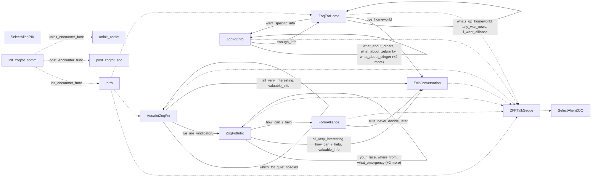

# Zoq-Fot-Pik: existing conversation graph

> Generated by `tools/conversation_catalog.py`; do not edit this page by hand.

[Catalog and interpretation rules](../README.md) · [Proposed engine](../model.md)

Script: [zoqfotc.c](../../../../sc2/src/uqm/comm/zoqfot/zoqfotc.c#L1). Phrase bank: [zoqfotpik.txt](../../../../sc2/content/base/comm/zoqfotpik/zoqfotpik.txt#L1).

13 handler/helper nodes; 28 response registration sites; 48 direct local calls; 337 phrase records.

## Initialization and lifecycle

| Phase | Callback | Bound by | Conditions / source |
| --- | --- | --- | --- |
| <code>init_encounter_func</code> | [<code>Intro</code>](#node-intro) | <code>init_zoqfot_comm</code> | No enclosing branch condition; [955](../../../../sc2/src/uqm/comm/zoqfot/zoqfotc.c#L955) |
| <code>post_encounter_func</code> | [<code>post_zoqfot_enc</code>](#node-post_zoqfot_enc) | <code>init_zoqfot_comm</code> | No enclosing branch condition; [956](../../../../sc2/src/uqm/comm/zoqfot/zoqfotc.c#L956) |
| <code>uninit_encounter_func</code> | [<code>uninit_zoqfot</code>](#node-uninit_zoqfot) | <code>init_zoqfot_comm</code> | No enclosing branch condition; [957](../../../../sc2/src/uqm/comm/zoqfot/zoqfotc.c#L957) |

## Handler graph

Solid arrows are selectable responses; dashed arrows are direct C calls. Conditions, arguments, speech and effects are cataloged below. Parallel response sites are grouped only in this diagram.



## Condition catalog

Condition IDs describe enclosing source structure. Branch predicates combine with ∧; case labels mark source locations that can also be reached by fallthrough. Values refer to their original evaluation points. Local assignments and early control flow remain in the decision bodies.

| ID | Source expression / structural condition |
| --- | --- |
| <a id="condition-c1"></a>C1 | <code>LastAlien != ZOQ_ALIEN</code> |
| <a id="condition-c2"></a>C2 | <code>LastAlien != FOT_ALIEN</code> |
| <a id="condition-c3"></a>C3 | <code>LastAlien != PIK_ALIEN</code> |
| <a id="condition-c4"></a>C4 | <code>PLAYER_SAID(R, bye_homeworld)</code> |
| <a id="condition-c5"></a>C5 | <code>!(PLAYER_SAID(R, bye_homeworld))</code> |
| <a id="condition-c6"></a>C6 | <code>PLAYER_SAID(R, decide_later)</code> |
| <a id="condition-c7"></a>C7 | <code>!(PLAYER_SAID(R, decide_later))</code> |
| <a id="condition-c8"></a>C8 | <code>PLAYER_SAID(R, valuable_info)</code> |
| <a id="condition-c9"></a>C9 | <code>!(PLAYER_SAID(R, valuable_info))</code> |
| <a id="condition-c10"></a>C10 | <code>PLAYER_SAID(R, how_can_i_help)</code> |
| <a id="condition-c11"></a>C11 | <code>!(PLAYER_SAID(R, how_can_i_help))</code> |
| <a id="condition-c12"></a>C12 | <code>PLAYER_SAID(R, sure)</code> |
| <a id="condition-c13"></a>C13 | <code>!(PLAYER_SAID(R, sure))</code> |
| <a id="condition-c14"></a>C14 | <code>PLAYER_SAID(R, all_very_interesting)</code> |
| <a id="condition-c15"></a>C15 | <code>!(PLAYER_SAID(R, all_very_interesting))</code> |
| <a id="condition-c16"></a>C16 | <code>PLAYER_SAID(R, never)</code> |
| <a id="condition-c17"></a>C17 | <code>PLAYER_SAID(R, we_are_vindicator0)</code> |
| <a id="condition-c18"></a>C18 | <code>!(PLAYER_SAID(R, we_are_vindicator0))</code> |
| <a id="condition-c19"></a>C19 | <code>PLAYER_SAID(R, your_race)</code> |
| <a id="condition-c20"></a>C20 | <code>!(PLAYER_SAID(R, your_race))</code> |
| <a id="condition-c21"></a>C21 | <code>PLAYER_SAID(R, where_from)</code> |
| <a id="condition-c22"></a>C22 | <code>!(PLAYER_SAID(R, where_from))</code> |
| <a id="condition-c23"></a>C23 | <code>PLAYER_SAID(R, what_emergency)</code> |
| <a id="condition-c24"></a>C24 | <code>!(PLAYER_SAID(R, what_emergency))</code> |
| <a id="condition-c25"></a>C25 | <code>PLAYER_SAID(R, tough_luck)</code> |
| <a id="condition-c26"></a>C26 | <code>!(PLAYER_SAID(R, tough_luck))</code> |
| <a id="condition-c27"></a>C27 | <code>PLAYER_SAID(R, what_look_like)</code> |
| <a id="condition-c28"></a>C28 | <code>!(PHRASE_ENABLED(your_race))</code> |
| <a id="condition-c29"></a>C29 | <code>!(PHRASE_ENABLED(your_race) &#124;&#124; PHRASE_ENABLED(where_from))</code> |
| <a id="condition-c30"></a>C30 | <code>(PHRASE_ENABLED(your_race) &#124;&#124; PHRASE_ENABLED(where_from)) &#124;&#124; PHRASE_ENABLED(what_emergency)</code> |
| <a id="condition-c31"></a>C31 | <code>PHRASE_ENABLED(your_race)</code> |
| <a id="condition-c32"></a>C32 | <code>PHRASE_ENABLED(where_from)</code> |
| <a id="condition-c33"></a>C33 | <code>PHRASE_ENABLED(what_emergency)</code> |
| <a id="condition-c34"></a>C34 | <code>!((PHRASE_ENABLED(your_race) &#124;&#124; PHRASE_ENABLED(where_from)) &#124;&#124; PHRASE_ENABLED(what_emergency))</code> |
| <a id="condition-c35"></a>C35 | <code>PHRASE_ENABLED(tough_luck)</code> |
| <a id="condition-c36"></a>C36 | <code>PHRASE_ENABLED(what_look_like)</code> |
| <a id="condition-c37"></a>C37 | <code>GET_GAME_STATE(GLOBAL_FLAGS_AND_DATA) &amp; (1 &lt;&lt; 7)</code> |
| <a id="condition-c38"></a>C38 | <code>!(GET_GAME_STATE(GLOBAL_FLAGS_AND_DATA) &amp; (1 &lt;&lt; 7))</code> |
| <a id="condition-c39"></a>C39 | <code>PLAYER_SAID(R, which_fot)</code> |
| <a id="condition-c40"></a>C40 | <code>!(PLAYER_SAID(R, which_fot))</code> |
| <a id="condition-c41"></a>C41 | <code>PLAYER_SAID(R, quiet_toadies)</code> |
| <a id="condition-c42"></a>C42 | <code>PHRASE_ENABLED(we_are_vindicator0)</code> |
| <a id="condition-c43"></a>C43 | <code>PHRASE_ENABLED(which_fot)</code> |
| <a id="condition-c44"></a>C44 | <code>PHRASE_ENABLED(quiet_toadies)</code> |
| <a id="condition-c45"></a>C45 | <code>PLAYER_SAID(R, want_specific_info)</code> |
| <a id="condition-c46"></a>C46 | <code>!(PLAYER_SAID(R, want_specific_info))</code> |
| <a id="condition-c47"></a>C47 | <code>PLAYER_SAID(R, what_about_others)</code> |
| <a id="condition-c48"></a>C48 | <code>!(PLAYER_SAID(R, what_about_others))</code> |
| <a id="condition-c49"></a>C49 | <code>PLAYER_SAID(R, what_about_zebranky)</code> |
| <a id="condition-c50"></a>C50 | <code>!(PLAYER_SAID(R, what_about_zebranky))</code> |
| <a id="condition-c51"></a>C51 | <code>PLAYER_SAID(R, what_about_stinger)</code> |
| <a id="condition-c52"></a>C52 | <code>!(PLAYER_SAID(R, what_about_stinger))</code> |
| <a id="condition-c53"></a>C53 | <code>PLAYER_SAID(R, what_about_guy_in_back)</code> |
| <a id="condition-c54"></a>C54 | <code>!(PLAYER_SAID(R, what_about_guy_in_back))</code> |
| <a id="condition-c55"></a>C55 | <code>PLAYER_SAID(R, what_about_past)</code> |
| <a id="condition-c56"></a>C56 | <code>PHRASE_ENABLED(what_about_others)</code> |
| <a id="condition-c57"></a>C57 | <code>PHRASE_ENABLED(what_about_zebranky)</code> |
| <a id="condition-c58"></a>C58 | <code>PHRASE_ENABLED(what_about_stinger)</code> |
| <a id="condition-c59"></a>C59 | <code>PHRASE_ENABLED(what_about_guy_in_back)</code> |
| <a id="condition-c60"></a>C60 | <code>PHRASE_ENABLED(what_about_past)</code> |
| <a id="condition-c61"></a>C61 | <code>!InfoLeft</code> |
| <a id="condition-c62"></a>C62 | <code>PLAYER_SAID(R, whats_up_homeworld)</code> |
| <a id="condition-c63"></a>C63 | <code>switch (NumVisits++)</code> |
| <a id="condition-c64"></a>C64 | <code>case 0 (see source for fallthrough)</code> |
| <a id="condition-c65"></a>C65 | <code>case 1 (see source for fallthrough)</code> |
| <a id="condition-c66"></a>C66 | <code>case 2 (see source for fallthrough)</code> |
| <a id="condition-c67"></a>C67 | <code>case 3 (see source for fallthrough)</code> |
| <a id="condition-c68"></a>C68 | <code>!(PLAYER_SAID(R, whats_up_homeworld))</code> |
| <a id="condition-c69"></a>C69 | <code>PLAYER_SAID(R, any_war_news)</code> |
| <a id="condition-c70"></a>C70 | <code>!(KnowMask &amp; KOHR_AH_KILL)</code> |
| <a id="condition-c71"></a>C71 | <code>(!(KnowMask &amp; KOHR_AH_KILL)) &amp;&amp; GET_GAME_STATE(KOHR_AH_FRENZY)</code> |
| <a id="condition-c72"></a>C72 | <code>!((!(KnowMask &amp; KOHR_AH_KILL)) &amp;&amp; GET_GAME_STATE(KOHR_AH_FRENZY))</code> |
| <a id="condition-c73"></a>C73 | <code>((!(KnowMask &amp; UTWIG_BUY_TIME)) &amp;&amp; (NumVisits &gt; 0)) &amp;&amp; (NumVisits &lt; 5)</code> |
| <a id="condition-c74"></a>C74 | <code>!(((!(KnowMask &amp; UTWIG_BUY_TIME)) &amp;&amp; (NumVisits &gt; 0)) &amp;&amp; (NumVisits &lt; 5))</code> |
| <a id="condition-c75"></a>C75 | <code>NumVisits</code> |
| <a id="condition-c76"></a>C76 | <code>(i -= GLOBAL(GameClock.year_index)) == 1</code> |
| <a id="condition-c77"></a>C77 | <code>((i -= GLOBAL(GameClock.year_index)) == 1) &amp;&amp; (GLOBAL(GameClock.month_index) &gt; 2)</code> |
| <a id="condition-c78"></a>C78 | <code>(!(KnowMask &amp; URQUAN_LOSE)) &amp;&amp; (i &lt;= 0)</code> |
| <a id="condition-c79"></a>C79 | <code>!((!(KnowMask &amp; URQUAN_LOSE)) &amp;&amp; (i &lt;= 0))</code> |
| <a id="condition-c80"></a>C80 | <code>(!(KnowMask &amp; KOHR_AH_WIN)) &amp;&amp; (i == 1)</code> |
| <a id="condition-c81"></a>C81 | <code>!((!(KnowMask &amp; KOHR_AH_WIN)) &amp;&amp; (i == 1))</code> |
| <a id="condition-c82"></a>C82 | <code>!(PLAYER_SAID(R, any_war_news))</code> |
| <a id="condition-c83"></a>C83 | <code>PLAYER_SAID(R, i_want_alliance)</code> |
| <a id="condition-c84"></a>C84 | <code>!(PLAYER_SAID(R, i_want_alliance))</code> |
| <a id="condition-c85"></a>C85 | <code>PLAYER_SAID(R, enough_info)</code> |
| <a id="condition-c86"></a>C86 | <code>PHRASE_ENABLED(whats_up_homeworld)</code> |
| <a id="condition-c87"></a>C87 | <code>PHRASE_ENABLED(any_war_news)</code> |
| <a id="condition-c88"></a>C88 | <code>CheckAlliance(ZOQFOTPIK_SHIP) != GOOD_GUY</code> |
| <a id="condition-c89"></a>C89 | <code>!(CheckAlliance(ZOQFOTPIK_SHIP) != GOOD_GUY)</code> |
| <a id="condition-c90"></a>C90 | <code>PHRASE_ENABLED(want_specific_info)</code> |
| <a id="condition-c91"></a>C91 | <code>LOBYTE(GLOBAL(CurrentActivity)) == WON_LAST_BATTLE</code> |
| <a id="condition-c92"></a>C92 | <code>GET_GAME_STATE(ZOQFOT_HOSTILE)</code> |
| <a id="condition-c93"></a>C93 | <code>!(GET_GAME_STATE(ZOQFOT_HOSTILE))</code> |
| <a id="condition-c94"></a>C94 | <code>!GET_GAME_STATE(MET_ZOQFOT)</code> |
| <a id="condition-c95"></a>C95 | <code>!(!GET_GAME_STATE(MET_ZOQFOT))</code> |
| <a id="condition-c96"></a>C96 | <code>GET_GAME_STATE(ZOQFOT_DISTRESS)</code> |
| <a id="condition-c97"></a>C97 | <code>!(GET_GAME_STATE(ZOQFOT_DISTRESS))</code> |
| <a id="condition-c98"></a>C98 | <code>!(CheckAlliance(ZOQFOTPIK_SHIP) == GOOD_GUY)</code> |
| <a id="condition-c99"></a>C99 | <code>(CheckAlliance(ZOQFOTPIK_SHIP) == GOOD_GUY) &#124;&#124; (LOBYTE(GLOBAL(CurrentActivity)) == WON_LAST_BATTLE)</code> |
| <a id="condition-c100"></a>C100 | <code>!((CheckAlliance(ZOQFOTPIK_SHIP) == GOOD_GUY) &#124;&#124; (LOBYTE(GLOBAL(CurrentActivity)) == WON_LAST_BATTLE))</code> |

## Script-scope state and lookup tables

These declarations supply shared local state, computed phrase alternatives, number speech, or lookup data used by the nodes. LOCDATA presentation defaults are linked separately in the source.

Presentation descriptor <code>zoqfot_desc</code>: [source](../../../../sc2/src/uqm/comm/zoqfot/zoqfotc.c#L43).

<details>
<summary>declaration</summary>

[Source](../../../../sc2/src/uqm/comm/zoqfot/zoqfotc.c#L112)

```c
enum
{
  ZOQ_ALIEN,
  FOT_ALIEN,
  PIK_ALIEN
};
```

</details>

<details>
<summary>LastAlien</summary>

[Source](../../../../sc2/src/uqm/comm/zoqfot/zoqfotc.c#L119)

```c
static int LastAlien;
```

</details>

## Node catalog

<a id="node-selectalienzoq"></a>

### SelectAlienZOQ

<code>static void SelectAlienZOQ(CallbackArg arg)</code> — [source](../../../../sc2/src/uqm/comm/zoqfot/zoqfotc.c#L123).

Also called directly by: [<code>ZFPTalkSegue</code>](#node-zfptalksegue) ([175](../../../../sc2/src/uqm/comm/zoqfot/zoqfotc.c#L175)).

#### Actions, queries, local updates, and control flow

Calls are listed without assuming they are pure or mutating. Local updates are retained because they determine dynamic menus and counter-selected speech.

| Kind | Operation | Enclosing conditions | Source |
| --- | --- | --- | --- |
| update | <code>GetConversationData()-&gt;AlienTransitionDesc.AnimFlags &#124;= TALK_DONE</code> | [C1](#condition-c1) ∧ [C2](#condition-c2) | [129](../../../../sc2/src/uqm/comm/zoqfot/zoqfotc.c#L129) |
| call | <code>GetConversationData()</code> | [C1](#condition-c1) ∧ [C2](#condition-c2) | [129](../../../../sc2/src/uqm/comm/zoqfot/zoqfotc.c#L129) |
| update | <code>LastAlien = ZOQ_ALIEN</code> | [C1](#condition-c1) | [130](../../../../sc2/src/uqm/comm/zoqfot/zoqfotc.c#L130) |
| update | <code>GetConversationData()-&gt;AlienTransitionDesc.AnimFlags &#124;= TALK_INTRO</code> | [C1](#condition-c1) | [131](../../../../sc2/src/uqm/comm/zoqfot/zoqfotc.c#L131) |
| call | <code>GetConversationData()</code> | [C1](#condition-c1) | [131](../../../../sc2/src/uqm/comm/zoqfot/zoqfotc.c#L131) |
| update | <code>GetConversationData()-&gt;AlienTransitionDesc.StartIndex = FOT_TO_ZOQ</code> | [C1](#condition-c1) | [132](../../../../sc2/src/uqm/comm/zoqfot/zoqfotc.c#L132) |
| call | <code>GetConversationData()</code> | [C1](#condition-c1) | [132](../../../../sc2/src/uqm/comm/zoqfot/zoqfotc.c#L132) |
| update | <code>GetConversationData()-&gt;AlienTalkDesc.StartIndex = ZOQ_TALK_INDEX</code> | [C1](#condition-c1) | [133](../../../../sc2/src/uqm/comm/zoqfot/zoqfotc.c#L133) |
| call | <code>GetConversationData()</code> | [C1](#condition-c1) | [133](../../../../sc2/src/uqm/comm/zoqfot/zoqfotc.c#L133) |
| update | <code>GetConversationData()-&gt;AlienTalkDesc.NumFrames = ZOQ_TALK_FRAMES</code> | [C1](#condition-c1) | [134](../../../../sc2/src/uqm/comm/zoqfot/zoqfotc.c#L134) |
| call | <code>GetConversationData()</code> | [C1](#condition-c1) | [134](../../../../sc2/src/uqm/comm/zoqfot/zoqfotc.c#L134) |
| update | <code>GetConversationData()-&gt;AlienAmbientArray[1].AnimFlags &amp;= ~WAIT_TALKING</code> | [C1](#condition-c1) | [135](../../../../sc2/src/uqm/comm/zoqfot/zoqfotc.c#L135) |
| call | <code>GetConversationData()</code> | [C1](#condition-c1) | [135](../../../../sc2/src/uqm/comm/zoqfot/zoqfotc.c#L135) |
| update | <code>GetConversationData()-&gt;AlienTextBaseline.x = (SWORD) ZOQ_BASE_X</code> | [C1](#condition-c1) | [137](../../../../sc2/src/uqm/comm/zoqfot/zoqfotc.c#L137) |
| call | <code>GetConversationData()</code> | [C1](#condition-c1) | [137](../../../../sc2/src/uqm/comm/zoqfot/zoqfotc.c#L137) |
| update | <code>GetConversationData()-&gt;AlienTextBaseline.y = ZOQ_BASE_Y</code> | [C1](#condition-c1) | [138](../../../../sc2/src/uqm/comm/zoqfot/zoqfotc.c#L138) |
| call | <code>GetConversationData()</code> | [C1](#condition-c1) | [138](../../../../sc2/src/uqm/comm/zoqfot/zoqfotc.c#L138) |
| update | <code>GetConversationData()-&gt;AlienTextFColor = ZOQ_FG_COLOR</code> | [C1](#condition-c1) | [139](../../../../sc2/src/uqm/comm/zoqfot/zoqfotc.c#L139) |
| call | <code>GetConversationData()</code> | [C1](#condition-c1) | [139](../../../../sc2/src/uqm/comm/zoqfot/zoqfotc.c#L139) |
| update | <code>GetConversationData()-&gt;AlienTextBColor = ZOQ_BG_COLOR</code> | [C1](#condition-c1) | [140](../../../../sc2/src/uqm/comm/zoqfot/zoqfotc.c#L140) |
| call | <code>GetConversationData()</code> | [C1](#condition-c1) | [140](../../../../sc2/src/uqm/comm/zoqfot/zoqfotc.c#L140) |

<details>
<summary>Exact decision body (local calculations, early returns, fallthrough and ordering)</summary>

```c
{
	if (LastAlien != ZOQ_ALIEN)
	{
		// Transition to neutral state first if Pik was talking
		if (LastAlien != FOT_ALIEN)
			GetConversationData()->AlienTransitionDesc.AnimFlags |= TALK_DONE;
		LastAlien = ZOQ_ALIEN;
		GetConversationData()->AlienTransitionDesc.AnimFlags |= TALK_INTRO;
		GetConversationData()->AlienTransitionDesc.StartIndex = FOT_TO_ZOQ;
		GetConversationData()->AlienTalkDesc.StartIndex = ZOQ_TALK_INDEX;
		GetConversationData()->AlienTalkDesc.NumFrames = ZOQ_TALK_FRAMES;
		GetConversationData()->AlienAmbientArray[1].AnimFlags &= ~WAIT_TALKING;

		GetConversationData()->AlienTextBaseline.x = (SWORD)ZOQ_BASE_X;
		GetConversationData()->AlienTextBaseline.y = ZOQ_BASE_Y;
		GetConversationData()->AlienTextFColor = ZOQ_FG_COLOR;
		GetConversationData()->AlienTextBColor = ZOQ_BG_COLOR;
	}

	(void)arg; // ignored
}
```

</details>

<a id="node-selectalienpik"></a>

### SelectAlienPIK

<code>static void SelectAlienPIK(CallbackArg arg)</code> — [source](../../../../sc2/src/uqm/comm/zoqfot/zoqfotc.c#L148).

#### Actions, queries, local updates, and control flow

Calls are listed without assuming they are pure or mutating. Local updates are retained because they determine dynamic menus and counter-selected speech.

| Kind | Operation | Enclosing conditions | Source |
| --- | --- | --- | --- |
| update | <code>GetConversationData()-&gt;AlienTransitionDesc.AnimFlags &#124;= TALK_DONE</code> | [C3](#condition-c3) ∧ [C2](#condition-c2) | [154](../../../../sc2/src/uqm/comm/zoqfot/zoqfotc.c#L154) |
| call | <code>GetConversationData()</code> | [C3](#condition-c3) ∧ [C2](#condition-c2) | [154](../../../../sc2/src/uqm/comm/zoqfot/zoqfotc.c#L154) |
| update | <code>LastAlien = PIK_ALIEN</code> | [C3](#condition-c3) | [155](../../../../sc2/src/uqm/comm/zoqfot/zoqfotc.c#L155) |
| update | <code>GetConversationData()-&gt;AlienTransitionDesc.AnimFlags &#124;= TALK_INTRO</code> | [C3](#condition-c3) | [156](../../../../sc2/src/uqm/comm/zoqfot/zoqfotc.c#L156) |
| call | <code>GetConversationData()</code> | [C3](#condition-c3) | [156](../../../../sc2/src/uqm/comm/zoqfot/zoqfotc.c#L156) |
| update | <code>GetConversationData()-&gt;AlienTransitionDesc.StartIndex = FOT_TO_PIK</code> | [C3](#condition-c3) | [157](../../../../sc2/src/uqm/comm/zoqfot/zoqfotc.c#L157) |
| call | <code>GetConversationData()</code> | [C3](#condition-c3) | [157](../../../../sc2/src/uqm/comm/zoqfot/zoqfotc.c#L157) |
| update | <code>GetConversationData()-&gt;AlienTalkDesc.StartIndex = PIK_TALK_INDEX</code> | [C3](#condition-c3) | [158](../../../../sc2/src/uqm/comm/zoqfot/zoqfotc.c#L158) |
| call | <code>GetConversationData()</code> | [C3](#condition-c3) | [158](../../../../sc2/src/uqm/comm/zoqfot/zoqfotc.c#L158) |
| update | <code>GetConversationData()-&gt;AlienTalkDesc.NumFrames = PIK_TALK_FRAMES</code> | [C3](#condition-c3) | [159](../../../../sc2/src/uqm/comm/zoqfot/zoqfotc.c#L159) |
| call | <code>GetConversationData()</code> | [C3](#condition-c3) | [159](../../../../sc2/src/uqm/comm/zoqfot/zoqfotc.c#L159) |
| update | <code>GetConversationData()-&gt;AlienAmbientArray[1].AnimFlags &#124;= WAIT_TALKING</code> | [C3](#condition-c3) | [160](../../../../sc2/src/uqm/comm/zoqfot/zoqfotc.c#L160) |
| call | <code>GetConversationData()</code> | [C3](#condition-c3) | [160](../../../../sc2/src/uqm/comm/zoqfot/zoqfotc.c#L160) |
| update | <code>GetConversationData()-&gt;AlienTextBaseline.x = (SWORD) PIK_BASE_X</code> | [C3](#condition-c3) | [162](../../../../sc2/src/uqm/comm/zoqfot/zoqfotc.c#L162) |
| call | <code>GetConversationData()</code> | [C3](#condition-c3) | [162](../../../../sc2/src/uqm/comm/zoqfot/zoqfotc.c#L162) |
| update | <code>GetConversationData()-&gt;AlienTextBaseline.y = PIK_BASE_Y</code> | [C3](#condition-c3) | [163](../../../../sc2/src/uqm/comm/zoqfot/zoqfotc.c#L163) |
| call | <code>GetConversationData()</code> | [C3](#condition-c3) | [163](../../../../sc2/src/uqm/comm/zoqfot/zoqfotc.c#L163) |
| update | <code>GetConversationData()-&gt;AlienTextFColor = PIK_FG_COLOR</code> | [C3](#condition-c3) | [164](../../../../sc2/src/uqm/comm/zoqfot/zoqfotc.c#L164) |
| call | <code>GetConversationData()</code> | [C3](#condition-c3) | [164](../../../../sc2/src/uqm/comm/zoqfot/zoqfotc.c#L164) |
| update | <code>GetConversationData()-&gt;AlienTextBColor = PIK_BG_COLOR</code> | [C3](#condition-c3) | [165](../../../../sc2/src/uqm/comm/zoqfot/zoqfotc.c#L165) |
| call | <code>GetConversationData()</code> | [C3](#condition-c3) | [165](../../../../sc2/src/uqm/comm/zoqfot/zoqfotc.c#L165) |

<details>
<summary>Exact decision body (local calculations, early returns, fallthrough and ordering)</summary>

```c
{
	if (LastAlien != PIK_ALIEN)
	{
		// Transition to neutral state first if Zoq was talking
		if (LastAlien != FOT_ALIEN)
			GetConversationData()->AlienTransitionDesc.AnimFlags |= TALK_DONE;
		LastAlien = PIK_ALIEN;
		GetConversationData()->AlienTransitionDesc.AnimFlags |= TALK_INTRO;
		GetConversationData()->AlienTransitionDesc.StartIndex = FOT_TO_PIK;
		GetConversationData()->AlienTalkDesc.StartIndex = PIK_TALK_INDEX;
		GetConversationData()->AlienTalkDesc.NumFrames = PIK_TALK_FRAMES;
		GetConversationData()->AlienAmbientArray[1].AnimFlags |= WAIT_TALKING;

		GetConversationData()->AlienTextBaseline.x = (SWORD)PIK_BASE_X;
		GetConversationData()->AlienTextBaseline.y = PIK_BASE_Y;
		GetConversationData()->AlienTextFColor = PIK_FG_COLOR;
		GetConversationData()->AlienTextBColor = PIK_BG_COLOR;
	}

	(void)arg; // ignored
}
```

</details>

<a id="node-zfptalksegue"></a>

### ZFPTalkSegue

<code>static void ZFPTalkSegue(COUNT wait_track)</code> — [source](../../../../sc2/src/uqm/comm/zoqfot/zoqfotc.c#L172).

Also called directly by: [<code>ExitConversation</code>](#node-exitconversation) ([188](../../../../sc2/src/uqm/comm/zoqfot/zoqfotc.c#L188)), [<code>ExitConversation</code>](#node-exitconversation) ([194](../../../../sc2/src/uqm/comm/zoqfot/zoqfotc.c#L194)), [<code>ExitConversation</code>](#node-exitconversation) ([202](../../../../sc2/src/uqm/comm/zoqfot/zoqfotc.c#L202)), [<code>ExitConversation</code>](#node-exitconversation) ([214](../../../../sc2/src/uqm/comm/zoqfot/zoqfotc.c#L214)), [<code>ExitConversation</code>](#node-exitconversation) ([224](../../../../sc2/src/uqm/comm/zoqfot/zoqfotc.c#L224)), [<code>ExitConversation</code>](#node-exitconversation) ([235](../../../../sc2/src/uqm/comm/zoqfot/zoqfotc.c#L235)), [<code>ExitConversation</code>](#node-exitconversation) ([245](../../../../sc2/src/uqm/comm/zoqfot/zoqfotc.c#L245)), [<code>FormAlliance</code>](#node-formalliance) ([263](../../../../sc2/src/uqm/comm/zoqfot/zoqfotc.c#L263)), [<code>ZoqFotIntro</code>](#node-zoqfotintro) ([281](../../../../sc2/src/uqm/comm/zoqfot/zoqfotc.c#L281)), [<code>ZoqFotIntro</code>](#node-zoqfotintro) ([301](../../../../sc2/src/uqm/comm/zoqfot/zoqfotc.c#L301)), [<code>ZoqFotIntro</code>](#node-zoqfotintro) ([313](../../../../sc2/src/uqm/comm/zoqfot/zoqfotc.c#L313)), [<code>ZoqFotIntro</code>](#node-zoqfotintro) ([331](../../../../sc2/src/uqm/comm/zoqfot/zoqfotc.c#L331)), [<code>ZoqFotIntro</code>](#node-zoqfotintro) ([343](../../../../sc2/src/uqm/comm/zoqfot/zoqfotc.c#L343)), [<code>ZoqFotIntro</code>](#node-zoqfotintro) ([353](../../../../sc2/src/uqm/comm/zoqfot/zoqfotc.c#L353)), [<code>AquaintZoqFot</code>](#node-aquaintzoqfot) ([401](../../../../sc2/src/uqm/comm/zoqfot/zoqfotc.c#L401)), [<code>AquaintZoqFot</code>](#node-aquaintzoqfot) ([415](../../../../sc2/src/uqm/comm/zoqfot/zoqfotc.c#L415)), [<code>ZoqFotInfo</code>](#node-zoqfotinfo) ([456](../../../../sc2/src/uqm/comm/zoqfot/zoqfotc.c#L456)), [<code>ZoqFotInfo</code>](#node-zoqfotinfo) ([474](../../../../sc2/src/uqm/comm/zoqfot/zoqfotc.c#L474)), [<code>ZoqFotInfo</code>](#node-zoqfotinfo) ([488](../../../../sc2/src/uqm/comm/zoqfot/zoqfotc.c#L488)), [<code>ZoqFotInfo</code>](#node-zoqfotinfo) ([500](../../../../sc2/src/uqm/comm/zoqfot/zoqfotc.c#L500)), [<code>ZoqFotInfo</code>](#node-zoqfotinfo) ([508](../../../../sc2/src/uqm/comm/zoqfot/zoqfotc.c#L508)), [<code>ZoqFotInfo</code>](#node-zoqfotinfo) ([526](../../../../sc2/src/uqm/comm/zoqfot/zoqfotc.c#L526)), [<code>ZoqFotHome</code>](#node-zoqfothome) ([580](../../../../sc2/src/uqm/comm/zoqfot/zoqfotc.c#L580)), [<code>ZoqFotHome</code>](#node-zoqfothome) ([591](../../../../sc2/src/uqm/comm/zoqfot/zoqfotc.c#L591)), [<code>ZoqFotHome</code>](#node-zoqfothome) ([600](../../../../sc2/src/uqm/comm/zoqfot/zoqfotc.c#L600)), [<code>ZoqFotHome</code>](#node-zoqfothome) ([615](../../../../sc2/src/uqm/comm/zoqfot/zoqfotc.c#L615)), [<code>ZoqFotHome</code>](#node-zoqfothome) ([648](../../../../sc2/src/uqm/comm/zoqfot/zoqfotc.c#L648)), [<code>ZoqFotHome</code>](#node-zoqfothome) ([669](../../../../sc2/src/uqm/comm/zoqfot/zoqfotc.c#L669)), [<code>ZoqFotHome</code>](#node-zoqfothome) ([691](../../../../sc2/src/uqm/comm/zoqfot/zoqfotc.c#L691)), [<code>ZoqFotHome</code>](#node-zoqfothome) ([707](../../../../sc2/src/uqm/comm/zoqfot/zoqfotc.c#L707)), [<code>ZoqFotHome</code>](#node-zoqfothome) ([715](../../../../sc2/src/uqm/comm/zoqfot/zoqfotc.c#L715)), [<code>ZoqFotHome</code>](#node-zoqfothome) ([734](../../../../sc2/src/uqm/comm/zoqfot/zoqfotc.c#L734)), [<code>ZoqFotHome</code>](#node-zoqfothome) ([742](../../../../sc2/src/uqm/comm/zoqfot/zoqfotc.c#L742)), [<code>Intro</code>](#node-intro) ([779](../../../../sc2/src/uqm/comm/zoqfot/zoqfotc.c#L779)), [<code>Intro</code>](#node-intro) ([792](../../../../sc2/src/uqm/comm/zoqfot/zoqfotc.c#L792)), [<code>Intro</code>](#node-intro) ([801](../../../../sc2/src/uqm/comm/zoqfot/zoqfotc.c#L801)), [<code>Intro</code>](#node-intro) ([806](../../../../sc2/src/uqm/comm/zoqfot/zoqfotc.c#L806)), [<code>Intro</code>](#node-intro) ([811](../../../../sc2/src/uqm/comm/zoqfot/zoqfotc.c#L811)), [<code>Intro</code>](#node-intro) ([847](../../../../sc2/src/uqm/comm/zoqfot/zoqfotc.c#L847)), [<code>Intro</code>](#node-intro) ([868](../../../../sc2/src/uqm/comm/zoqfot/zoqfotc.c#L868)), [<code>Intro</code>](#node-intro) ([894](../../../../sc2/src/uqm/comm/zoqfot/zoqfotc.c#L894)), [<code>Intro</code>](#node-intro) ([905](../../../../sc2/src/uqm/comm/zoqfot/zoqfotc.c#L905)), [<code>Intro</code>](#node-intro) ([916](../../../../sc2/src/uqm/comm/zoqfot/zoqfotc.c#L916)), [<code>Intro</code>](#node-intro) ([921](../../../../sc2/src/uqm/comm/zoqfot/zoqfotc.c#L921)), [<code>Intro</code>](#node-intro) ([926](../../../../sc2/src/uqm/comm/zoqfot/zoqfotc.c#L926)).

#### Actions, queries, local updates, and control flow

Calls are listed without assuming they are pure or mutating. Local updates are retained because they determine dynamic menus and counter-selected speech.

| Kind | Operation | Enclosing conditions | Source |
| --- | --- | --- | --- |
| update | <code>LastAlien = FOT_ALIEN</code> | No enclosing branch condition | [174](../../../../sc2/src/uqm/comm/zoqfot/zoqfotc.c#L174) |
| call | <code>SelectAlienZOQ(0)</code> → [<code>SelectAlienZOQ</code>](#node-selectalienzoq) | No enclosing branch condition | [175](../../../../sc2/src/uqm/comm/zoqfot/zoqfotc.c#L175) |
| call | <code>AlienTalkSegue(wait_track)</code> | No enclosing branch condition | [176](../../../../sc2/src/uqm/comm/zoqfot/zoqfotc.c#L176) |

<details>
<summary>Exact decision body (local calculations, early returns, fallthrough and ordering)</summary>

```c
{
	LastAlien = FOT_ALIEN;
	SelectAlienZOQ (0);
	AlienTalkSegue (wait_track);
}
```

</details>

<a id="node-exitconversation"></a>

### ExitConversation

<code>static void ExitConversation(RESPONSE_REF R)</code> — [source](../../../../sc2/src/uqm/comm/zoqfot/zoqfotc.c#L180).

Incoming player-response variants: [<code>sure</code>](#phrase-sure), [<code>never</code>](#phrase-never), [<code>decide_later</code>](#phrase-decide_later), [<code>all_very_interesting</code>](#phrase-all_very_interesting), [<code>how_can_i_help</code>](#phrase-how_can_i_help), [<code>valuable_info</code>](#phrase-valuable_info), [<code>bye_homeworld</code>](#phrase-bye_homeworld).

#### Dialogue / audio emissions

| Phrase or expression | Enclosing conditions | Source |
| --- | --- | --- |
| [<code>GOODBYE_HOME0</code>](#phrase-goodbye_home0)<br><code>NPCPhrase_cb(GOODBYE_HOME0, &amp;SelectAlienZOQ)</code> | [C4](#condition-c4) | [186](../../../../sc2/src/uqm/comm/zoqfot/zoqfotc.c#L186) |
| [<code>GOODBYE_HOME1</code>](#phrase-goodbye_home1)<br><code>NPCPhrase_cb(GOODBYE_HOME1, &amp;SelectAlienPIK)</code> | [C4](#condition-c4) | [187](../../../../sc2/src/uqm/comm/zoqfot/zoqfotc.c#L187) |
| [<code>PLEASE_HURRY0</code>](#phrase-please_hurry0)<br><code>NPCPhrase_cb(PLEASE_HURRY0, &amp;SelectAlienZOQ)</code> | [C5](#condition-c5) ∧ [C6](#condition-c6) | [192](../../../../sc2/src/uqm/comm/zoqfot/zoqfotc.c#L192) |
| [<code>PLEASE_HURRY1</code>](#phrase-please_hurry1)<br><code>NPCPhrase_cb(PLEASE_HURRY1, &amp;SelectAlienPIK)</code> | [C5](#condition-c5) ∧ [C6](#condition-c6) | [193](../../../../sc2/src/uqm/comm/zoqfot/zoqfotc.c#L193) |
| [<code>GOODBYE0</code>](#phrase-goodbye0)<br><code>NPCPhrase_cb(GOODBYE0, &amp;SelectAlienZOQ)</code> | [C5](#condition-c5) ∧ [C7](#condition-c7) ∧ [C8](#condition-c8) | [198](../../../../sc2/src/uqm/comm/zoqfot/zoqfotc.c#L198) |
| [<code>GOODBYE1</code>](#phrase-goodbye1)<br><code>NPCPhrase_cb(GOODBYE1, &amp;SelectAlienPIK)</code> | [C5](#condition-c5) ∧ [C7](#condition-c7) ∧ [C8](#condition-c8) | [199](../../../../sc2/src/uqm/comm/zoqfot/zoqfotc.c#L199) |
| [<code>GOODBYE2</code>](#phrase-goodbye2)<br><code>NPCPhrase_cb(GOODBYE2, &amp;SelectAlienZOQ)</code> | [C5](#condition-c5) ∧ [C7](#condition-c7) ∧ [C8](#condition-c8) | [200](../../../../sc2/src/uqm/comm/zoqfot/zoqfotc.c#L200) |
| [<code>GOODBYE3</code>](#phrase-goodbye3)<br><code>NPCPhrase_cb(GOODBYE3, &amp;SelectAlienPIK)</code> | [C5](#condition-c5) ∧ [C7](#condition-c7) ∧ [C8](#condition-c8) | [201](../../../../sc2/src/uqm/comm/zoqfot/zoqfotc.c#L201) |
| [<code>EMMISSARIES0</code>](#phrase-emmissaries0)<br><code>NPCPhrase_cb(EMMISSARIES0, &amp;SelectAlienZOQ)</code> | [C5](#condition-c5) ∧ [C7](#condition-c7) ∧ [C9](#condition-c9) ∧ [C10](#condition-c10) | [206](../../../../sc2/src/uqm/comm/zoqfot/zoqfotc.c#L206) |
| [<code>EMMISSARIES1</code>](#phrase-emmissaries1)<br><code>NPCPhrase_cb(EMMISSARIES1, &amp;SelectAlienPIK)</code> | [C5](#condition-c5) ∧ [C7](#condition-c7) ∧ [C9](#condition-c9) ∧ [C10](#condition-c10) | [207](../../../../sc2/src/uqm/comm/zoqfot/zoqfotc.c#L207) |
| [<code>EMMISSARIES2</code>](#phrase-emmissaries2)<br><code>NPCPhrase_cb(EMMISSARIES2, &amp;SelectAlienZOQ)</code> | [C5](#condition-c5) ∧ [C7](#condition-c7) ∧ [C9](#condition-c9) ∧ [C10](#condition-c10) | [208](../../../../sc2/src/uqm/comm/zoqfot/zoqfotc.c#L208) |
| [<code>EMMISSARIES3</code>](#phrase-emmissaries3)<br><code>NPCPhrase_cb(EMMISSARIES3, &amp;SelectAlienPIK)</code> | [C5](#condition-c5) ∧ [C7](#condition-c7) ∧ [C9](#condition-c9) ∧ [C10](#condition-c10) | [209](../../../../sc2/src/uqm/comm/zoqfot/zoqfotc.c#L209) |
| [<code>EMMISSARIES4</code>](#phrase-emmissaries4)<br><code>NPCPhrase_cb(EMMISSARIES4, &amp;SelectAlienZOQ)</code> | [C5](#condition-c5) ∧ [C7](#condition-c7) ∧ [C9](#condition-c9) ∧ [C10](#condition-c10) | [210](../../../../sc2/src/uqm/comm/zoqfot/zoqfotc.c#L210) |
| [<code>EMMISSARIES5</code>](#phrase-emmissaries5)<br><code>NPCPhrase_cb(EMMISSARIES5, &amp;SelectAlienPIK)</code> | [C5](#condition-c5) ∧ [C7](#condition-c7) ∧ [C9](#condition-c9) ∧ [C10](#condition-c10) | [211](../../../../sc2/src/uqm/comm/zoqfot/zoqfotc.c#L211) |
| [<code>EMMISSARIES6</code>](#phrase-emmissaries6)<br><code>NPCPhrase_cb(EMMISSARIES6, &amp;SelectAlienZOQ)</code> | [C5](#condition-c5) ∧ [C7](#condition-c7) ∧ [C9](#condition-c9) ∧ [C10](#condition-c10) | [212](../../../../sc2/src/uqm/comm/zoqfot/zoqfotc.c#L212) |
| [<code>EMMISSARIES7</code>](#phrase-emmissaries7)<br><code>NPCPhrase_cb(EMMISSARIES7, &amp;SelectAlienPIK)</code> | [C5](#condition-c5) ∧ [C7](#condition-c7) ∧ [C9](#condition-c9) ∧ [C10](#condition-c10) | [213](../../../../sc2/src/uqm/comm/zoqfot/zoqfotc.c#L213) |
| [<code>WE_ALLY0</code>](#phrase-we_ally0)<br><code>NPCPhrase_cb(WE_ALLY0, &amp;SelectAlienZOQ)</code> | [C5](#condition-c5) ∧ [C7](#condition-c7) ∧ [C9](#condition-c9) ∧ [C11](#condition-c11) ∧ [C12](#condition-c12) | [218](../../../../sc2/src/uqm/comm/zoqfot/zoqfotc.c#L218) |
| [<code>WE_ALLY1</code>](#phrase-we_ally1)<br><code>NPCPhrase_cb(WE_ALLY1, &amp;SelectAlienPIK)</code> | [C5](#condition-c5) ∧ [C7](#condition-c7) ∧ [C9](#condition-c9) ∧ [C11](#condition-c11) ∧ [C12](#condition-c12) | [219](../../../../sc2/src/uqm/comm/zoqfot/zoqfotc.c#L219) |
| [<code>WE_ALLY2</code>](#phrase-we_ally2)<br><code>NPCPhrase_cb(WE_ALLY2, &amp;SelectAlienZOQ)</code> | [C5](#condition-c5) ∧ [C7](#condition-c7) ∧ [C9](#condition-c9) ∧ [C11](#condition-c11) ∧ [C12](#condition-c12) | [220](../../../../sc2/src/uqm/comm/zoqfot/zoqfotc.c#L220) |
| [<code>WE_ALLY3</code>](#phrase-we_ally3)<br><code>NPCPhrase_cb(WE_ALLY3, &amp;SelectAlienPIK)</code> | [C5](#condition-c5) ∧ [C7](#condition-c7) ∧ [C9](#condition-c9) ∧ [C11](#condition-c11) ∧ [C12](#condition-c12) | [221](../../../../sc2/src/uqm/comm/zoqfot/zoqfotc.c#L221) |
| [<code>WE_ALLY4</code>](#phrase-we_ally4)<br><code>NPCPhrase_cb(WE_ALLY4, &amp;SelectAlienZOQ)</code> | [C5](#condition-c5) ∧ [C7](#condition-c7) ∧ [C9](#condition-c9) ∧ [C11](#condition-c11) ∧ [C12](#condition-c12) | [222](../../../../sc2/src/uqm/comm/zoqfot/zoqfotc.c#L222) |
| [<code>WE_ALLY5</code>](#phrase-we_ally5)<br><code>NPCPhrase_cb(WE_ALLY5, &amp;SelectAlienPIK)</code> | [C5](#condition-c5) ∧ [C7](#condition-c7) ∧ [C9](#condition-c9) ∧ [C11](#condition-c11) ∧ [C12](#condition-c12) | [223](../../../../sc2/src/uqm/comm/zoqfot/zoqfotc.c#L223) |
| [<code>SEE_TOLD_YOU0</code>](#phrase-see_told_you0)<br><code>NPCPhrase_cb(SEE_TOLD_YOU0, &amp;SelectAlienZOQ)</code> | [C5](#condition-c5) ∧ [C7](#condition-c7) ∧ [C9](#condition-c9) ∧ [C11](#condition-c11) ∧ [C13](#condition-c13) ∧ [C14](#condition-c14) | [231](../../../../sc2/src/uqm/comm/zoqfot/zoqfotc.c#L231) |
| [<code>SEE_TOLD_YOU1</code>](#phrase-see_told_you1)<br><code>NPCPhrase_cb(SEE_TOLD_YOU1, &amp;SelectAlienPIK)</code> | [C5](#condition-c5) ∧ [C7](#condition-c7) ∧ [C9](#condition-c9) ∧ [C11](#condition-c11) ∧ [C13](#condition-c13) ∧ [C14](#condition-c14) | [232](../../../../sc2/src/uqm/comm/zoqfot/zoqfotc.c#L232) |
| [<code>SEE_TOLD_YOU2</code>](#phrase-see_told_you2)<br><code>NPCPhrase_cb(SEE_TOLD_YOU2, &amp;SelectAlienZOQ)</code> | [C5](#condition-c5) ∧ [C7](#condition-c7) ∧ [C9](#condition-c9) ∧ [C11](#condition-c11) ∧ [C13](#condition-c13) ∧ [C14](#condition-c14) | [233](../../../../sc2/src/uqm/comm/zoqfot/zoqfotc.c#L233) |
| [<code>SEE_TOLD_YOU3</code>](#phrase-see_told_you3)<br><code>NPCPhrase_cb(SEE_TOLD_YOU3, &amp;SelectAlienPIK)</code> | [C5](#condition-c5) ∧ [C7](#condition-c7) ∧ [C9](#condition-c9) ∧ [C11](#condition-c11) ∧ [C13](#condition-c13) ∧ [C14](#condition-c14) | [234](../../../../sc2/src/uqm/comm/zoqfot/zoqfotc.c#L234) |
| [<code>WE_ENEMIES0</code>](#phrase-we_enemies0)<br><code>NPCPhrase_cb(WE_ENEMIES0, &amp;SelectAlienZOQ)</code> | [C5](#condition-c5) ∧ [C7](#condition-c7) ∧ [C9](#condition-c9) ∧ [C11](#condition-c11) ∧ [C13](#condition-c13) ∧ [C15](#condition-c15) ∧ [C16](#condition-c16) | [243](../../../../sc2/src/uqm/comm/zoqfot/zoqfotc.c#L243) |
| [<code>WE_ENEMIES1</code>](#phrase-we_enemies1)<br><code>NPCPhrase_cb(WE_ENEMIES1, &amp;SelectAlienPIK)</code> | [C5](#condition-c5) ∧ [C7](#condition-c7) ∧ [C9](#condition-c9) ∧ [C11](#condition-c11) ∧ [C13](#condition-c13) ∧ [C15](#condition-c15) ∧ [C16](#condition-c16) | [244](../../../../sc2/src/uqm/comm/zoqfot/zoqfotc.c#L244) |

#### Actions, queries, local updates, and control flow

Calls are listed without assuming they are pure or mutating. Local updates are retained because they determine dynamic menus and counter-selected speech.

| Kind | Operation | Enclosing conditions | Source |
| --- | --- | --- | --- |
| call | <code>setSegue(Segue_peace)</code> | No enclosing branch condition | [182](../../../../sc2/src/uqm/comm/zoqfot/zoqfotc.c#L182) |
| call | <code>PLAYER_SAID(R, bye_homeworld)</code> | No enclosing branch condition | [184](../../../../sc2/src/uqm/comm/zoqfot/zoqfotc.c#L184) |
| call | <code>ZFPTalkSegue((COUNT) (~0))</code> → [<code>ZFPTalkSegue</code>](#node-zfptalksegue) | [C4](#condition-c4) | [188](../../../../sc2/src/uqm/comm/zoqfot/zoqfotc.c#L188) |
| call | <code>PLAYER_SAID(R, decide_later)</code> | [C5](#condition-c5) | [190](../../../../sc2/src/uqm/comm/zoqfot/zoqfotc.c#L190) |
| call | <code>ZFPTalkSegue((COUNT) (~0))</code> → [<code>ZFPTalkSegue</code>](#node-zfptalksegue) | [C5](#condition-c5) ∧ [C6](#condition-c6) | [194](../../../../sc2/src/uqm/comm/zoqfot/zoqfotc.c#L194) |
| call | <code>PLAYER_SAID(R, valuable_info)</code> | [C5](#condition-c5) ∧ [C7](#condition-c7) | [196](../../../../sc2/src/uqm/comm/zoqfot/zoqfotc.c#L196) |
| call | <code>ZFPTalkSegue((COUNT) (~0))</code> → [<code>ZFPTalkSegue</code>](#node-zfptalksegue) | [C5](#condition-c5) ∧ [C7](#condition-c7) ∧ [C8](#condition-c8) | [202](../../../../sc2/src/uqm/comm/zoqfot/zoqfotc.c#L202) |
| call | <code>PLAYER_SAID(R, how_can_i_help)</code> | [C5](#condition-c5) ∧ [C7](#condition-c7) ∧ [C9](#condition-c9) | [204](../../../../sc2/src/uqm/comm/zoqfot/zoqfotc.c#L204) |
| call | <code>ZFPTalkSegue((COUNT) (~0))</code> → [<code>ZFPTalkSegue</code>](#node-zfptalksegue) | [C5](#condition-c5) ∧ [C7](#condition-c7) ∧ [C9](#condition-c9) ∧ [C10](#condition-c10) | [214](../../../../sc2/src/uqm/comm/zoqfot/zoqfotc.c#L214) |
| call | <code>PLAYER_SAID(R, sure)</code> | [C5](#condition-c5) ∧ [C7](#condition-c7) ∧ [C9](#condition-c9) ∧ [C11](#condition-c11) | [216](../../../../sc2/src/uqm/comm/zoqfot/zoqfotc.c#L216) |
| call | <code>ZFPTalkSegue((COUNT) (~0))</code> → [<code>ZFPTalkSegue</code>](#node-zfptalksegue) | [C5](#condition-c5) ∧ [C7](#condition-c7) ∧ [C9](#condition-c9) ∧ [C11](#condition-c11) ∧ [C12](#condition-c12) | [224](../../../../sc2/src/uqm/comm/zoqfot/zoqfotc.c#L224) |
| call | <code>SetRaceAllied(ZOQFOTPIK_SHIP, TRUE)</code> | [C5](#condition-c5) ∧ [C7](#condition-c7) ∧ [C9](#condition-c9) ∧ [C11](#condition-c11) ∧ [C12](#condition-c12) | [225](../../../../sc2/src/uqm/comm/zoqfot/zoqfotc.c#L225) |
| call | <code>AddEvent(RELATIVE_EVENT, 3, 0, 0, ZOQFOT_DISTRESS_EVENT)</code> | [C5](#condition-c5) ∧ [C7](#condition-c7) ∧ [C9](#condition-c9) ∧ [C11](#condition-c11) ∧ [C12](#condition-c12) | [226](../../../../sc2/src/uqm/comm/zoqfot/zoqfotc.c#L226) |
| call | <code>SET_GAME_STATE(ZOQFOT_HOME_VISITS, 0)</code> | [C5](#condition-c5) ∧ [C7](#condition-c7) ∧ [C9](#condition-c9) ∧ [C11](#condition-c11) ∧ [C12](#condition-c12) | [227](../../../../sc2/src/uqm/comm/zoqfot/zoqfotc.c#L227) |
| call | <code>PLAYER_SAID(R, all_very_interesting)</code> | [C5](#condition-c5) ∧ [C7](#condition-c7) ∧ [C9](#condition-c9) ∧ [C11](#condition-c11) ∧ [C13](#condition-c13) | [229](../../../../sc2/src/uqm/comm/zoqfot/zoqfotc.c#L229) |
| call | <code>ZFPTalkSegue((COUNT) (~0))</code> → [<code>ZFPTalkSegue</code>](#node-zfptalksegue) | [C5](#condition-c5) ∧ [C7](#condition-c7) ∧ [C9](#condition-c9) ∧ [C11](#condition-c11) ∧ [C13](#condition-c13) ∧ [C14](#condition-c14) | [235](../../../../sc2/src/uqm/comm/zoqfot/zoqfotc.c#L235) |
| call | <code>SET_GAME_STATE(ZOQFOT_HOSTILE, 1)</code> | [C5](#condition-c5) ∧ [C7](#condition-c7) ∧ [C9](#condition-c9) ∧ [C11](#condition-c11) ∧ [C13](#condition-c13) ∧ [C14](#condition-c14) | [237](../../../../sc2/src/uqm/comm/zoqfot/zoqfotc.c#L237) |
| call | <code>SET_GAME_STATE(ZOQFOT_HOME_VISITS, 0)</code> | [C5](#condition-c5) ∧ [C7](#condition-c7) ∧ [C9](#condition-c9) ∧ [C11](#condition-c11) ∧ [C13](#condition-c13) ∧ [C14](#condition-c14) | [238](../../../../sc2/src/uqm/comm/zoqfot/zoqfotc.c#L238) |
| call | <code>setSegue(Segue_hostile)</code> | [C5](#condition-c5) ∧ [C7](#condition-c7) ∧ [C9](#condition-c9) ∧ [C11](#condition-c11) ∧ [C13](#condition-c13) ∧ [C14](#condition-c14) | [239](../../../../sc2/src/uqm/comm/zoqfot/zoqfotc.c#L239) |
| call | <code>PLAYER_SAID(R, never)</code> | [C5](#condition-c5) ∧ [C7](#condition-c7) ∧ [C9](#condition-c9) ∧ [C11](#condition-c11) ∧ [C13](#condition-c13) ∧ [C15](#condition-c15) | [241](../../../../sc2/src/uqm/comm/zoqfot/zoqfotc.c#L241) |
| call | <code>ZFPTalkSegue((COUNT) (~0))</code> → [<code>ZFPTalkSegue</code>](#node-zfptalksegue) | [C5](#condition-c5) ∧ [C7](#condition-c7) ∧ [C9](#condition-c9) ∧ [C11](#condition-c11) ∧ [C13](#condition-c13) ∧ [C15](#condition-c15) ∧ [C16](#condition-c16) | [245](../../../../sc2/src/uqm/comm/zoqfot/zoqfotc.c#L245) |
| call | <code>SET_GAME_STATE(ZOQFOT_HOME_VISITS, 0)</code> | [C5](#condition-c5) ∧ [C7](#condition-c7) ∧ [C9](#condition-c9) ∧ [C11](#condition-c11) ∧ [C13](#condition-c13) ∧ [C15](#condition-c15) ∧ [C16](#condition-c16) | [247](../../../../sc2/src/uqm/comm/zoqfot/zoqfotc.c#L247) |
| call | <code>SET_GAME_STATE(ZOQFOT_HOSTILE, 1)</code> | [C5](#condition-c5) ∧ [C7](#condition-c7) ∧ [C9](#condition-c9) ∧ [C11](#condition-c11) ∧ [C13](#condition-c13) ∧ [C15](#condition-c15) ∧ [C16](#condition-c16) | [248](../../../../sc2/src/uqm/comm/zoqfot/zoqfotc.c#L248) |
| call | <code>setSegue(Segue_hostile)</code> | [C5](#condition-c5) ∧ [C7](#condition-c7) ∧ [C9](#condition-c9) ∧ [C11](#condition-c11) ∧ [C13](#condition-c13) ∧ [C15](#condition-c15) ∧ [C16](#condition-c16) | [249](../../../../sc2/src/uqm/comm/zoqfot/zoqfotc.c#L249) |

<details>
<summary>Exact decision body (local calculations, early returns, fallthrough and ordering)</summary>

```c
{
	setSegue (Segue_peace);

	if (PLAYER_SAID (R, bye_homeworld))
	{
		NPCPhrase_cb (GOODBYE_HOME0, &SelectAlienZOQ);
		NPCPhrase_cb (GOODBYE_HOME1, &SelectAlienPIK);
		ZFPTalkSegue ((COUNT)~0);
	}
	else if (PLAYER_SAID (R, decide_later))
	{
		NPCPhrase_cb (PLEASE_HURRY0, &SelectAlienZOQ);
		NPCPhrase_cb (PLEASE_HURRY1, &SelectAlienPIK);
		ZFPTalkSegue ((COUNT)~0);
	}
	else if (PLAYER_SAID (R, valuable_info))
	{
		NPCPhrase_cb (GOODBYE0, &SelectAlienZOQ);
		NPCPhrase_cb (GOODBYE1, &SelectAlienPIK);
		NPCPhrase_cb (GOODBYE2, &SelectAlienZOQ);
		NPCPhrase_cb (GOODBYE3, &SelectAlienPIK);
		ZFPTalkSegue ((COUNT)~0);
	}
	else if (PLAYER_SAID (R, how_can_i_help))
	{
		NPCPhrase_cb (EMMISSARIES0, &SelectAlienZOQ);
		NPCPhrase_cb (EMMISSARIES1, &SelectAlienPIK);
		NPCPhrase_cb (EMMISSARIES2, &SelectAlienZOQ);
		NPCPhrase_cb (EMMISSARIES3, &SelectAlienPIK);
		NPCPhrase_cb (EMMISSARIES4, &SelectAlienZOQ);
		NPCPhrase_cb (EMMISSARIES5, &SelectAlienPIK);
		NPCPhrase_cb (EMMISSARIES6, &SelectAlienZOQ);
		NPCPhrase_cb (EMMISSARIES7, &SelectAlienPIK);
		ZFPTalkSegue ((COUNT)~0);
	}
	else if (PLAYER_SAID (R, sure))
	{
		NPCPhrase_cb (WE_ALLY0, &SelectAlienZOQ);
		NPCPhrase_cb (WE_ALLY1, &SelectAlienPIK);
		NPCPhrase_cb (WE_ALLY2, &SelectAlienZOQ);
		NPCPhrase_cb (WE_ALLY3, &SelectAlienPIK);
		NPCPhrase_cb (WE_ALLY4, &SelectAlienZOQ);
		NPCPhrase_cb (WE_ALLY5, &SelectAlienPIK);
		ZFPTalkSegue ((COUNT)~0);
		SetRaceAllied (ZOQFOTPIK_SHIP, TRUE);
		AddEvent (RELATIVE_EVENT, 3, 0, 0, ZOQFOT_DISTRESS_EVENT);
		SET_GAME_STATE (ZOQFOT_HOME_VISITS, 0);
	}
	else if (PLAYER_SAID (R, all_very_interesting))
	{
		NPCPhrase_cb (SEE_TOLD_YOU0, &SelectAlienZOQ);
		NPCPhrase_cb (SEE_TOLD_YOU1, &SelectAlienPIK);
		NPCPhrase_cb (SEE_TOLD_YOU2, &SelectAlienZOQ);
		NPCPhrase_cb (SEE_TOLD_YOU3, &SelectAlienPIK);
		ZFPTalkSegue ((COUNT)~0);

		SET_GAME_STATE (ZOQFOT_HOSTILE, 1);
		SET_GAME_STATE (ZOQFOT_HOME_VISITS, 0);
		setSegue (Segue_hostile);
	}
	else if (PLAYER_SAID (R, never))
	{
		NPCPhrase_cb (WE_ENEMIES0, &SelectAlienZOQ);
		NPCPhrase_cb (WE_ENEMIES1, &SelectAlienPIK);
		ZFPTalkSegue ((COUNT)~0);

		SET_GAME_STATE (ZOQFOT_HOME_VISITS, 0);
		SET_GAME_STATE (ZOQFOT_HOSTILE, 1);
		setSegue (Segue_hostile);
	}
}
```

</details>

<a id="node-formalliance"></a>

### FormAlliance

<code>static void FormAlliance(RESPONSE_REF R)</code> — [source](../../../../sc2/src/uqm/comm/zoqfot/zoqfotc.c#L254).

Incoming player-response variants: [<code>how_can_i_help</code>](#phrase-how_can_i_help).

#### Dialogue / audio emissions

| Phrase or expression | Enclosing conditions | Source |
| --- | --- | --- |
| [<code>ALLY_WITH_US0</code>](#phrase-ally_with_us0)<br><code>NPCPhrase_cb(ALLY_WITH_US0, &amp;SelectAlienZOQ)</code> | No enclosing branch condition | [257](../../../../sc2/src/uqm/comm/zoqfot/zoqfotc.c#L257) |
| [<code>ALLY_WITH_US1</code>](#phrase-ally_with_us1)<br><code>NPCPhrase_cb(ALLY_WITH_US1, &amp;SelectAlienPIK)</code> | No enclosing branch condition | [258](../../../../sc2/src/uqm/comm/zoqfot/zoqfotc.c#L258) |
| [<code>ALLY_WITH_US2</code>](#phrase-ally_with_us2)<br><code>NPCPhrase_cb(ALLY_WITH_US2, &amp;SelectAlienZOQ)</code> | No enclosing branch condition | [259](../../../../sc2/src/uqm/comm/zoqfot/zoqfotc.c#L259) |
| [<code>ALLY_WITH_US3</code>](#phrase-ally_with_us3)<br><code>NPCPhrase_cb(ALLY_WITH_US3, &amp;SelectAlienPIK)</code> | No enclosing branch condition | [260](../../../../sc2/src/uqm/comm/zoqfot/zoqfotc.c#L260) |
| [<code>ALLY_WITH_US4</code>](#phrase-ally_with_us4)<br><code>NPCPhrase_cb(ALLY_WITH_US4, &amp;SelectAlienZOQ)</code> | No enclosing branch condition | [261](../../../../sc2/src/uqm/comm/zoqfot/zoqfotc.c#L261) |
| [<code>ALLY_WITH_US5</code>](#phrase-ally_with_us5)<br><code>NPCPhrase_cb(ALLY_WITH_US5, &amp;SelectAlienPIK)</code> | No enclosing branch condition | [262](../../../../sc2/src/uqm/comm/zoqfot/zoqfotc.c#L262) |

#### Response edges

| Player response | Destination on selection | Enclosing availability conditions | Source |
| --- | --- | --- | --- |
| [<code>sure</code>](#phrase-sure)<br>You are under attack by the Ur-Quan, our enemy as well. Therefore, speaking for all the People of Earth, I accept your offer. | [<code>ExitConversation</code>](#node-exitconversation) | No enclosing branch condition | [265](../../../../sc2/src/uqm/comm/zoqfot/zoqfotc.c#L265) |
| [<code>never</code>](#phrase-never)<br>What? Protect you failures? No way! You&#x27;re too lame! | [<code>ExitConversation</code>](#node-exitconversation) | No enclosing branch condition | [266](../../../../sc2/src/uqm/comm/zoqfot/zoqfotc.c#L266) |
| [<code>decide_later</code>](#phrase-decide_later)<br>Uh... I need to consult with our, er... our Grand-High Poobah! | [<code>ExitConversation</code>](#node-exitconversation) | No enclosing branch condition | [267](../../../../sc2/src/uqm/comm/zoqfot/zoqfotc.c#L267) |

#### Actions, queries, local updates, and control flow

Calls are listed without assuming they are pure or mutating. Local updates are retained because they determine dynamic menus and counter-selected speech.

| Kind | Operation | Enclosing conditions | Source |
| --- | --- | --- | --- |
| call | <code>ZFPTalkSegue((COUNT) (~0))</code> → [<code>ZFPTalkSegue</code>](#node-zfptalksegue) | No enclosing branch condition | [263](../../../../sc2/src/uqm/comm/zoqfot/zoqfotc.c#L263) |

<details>
<summary>Exact decision body (local calculations, early returns, fallthrough and ordering)</summary>

```c
{
	(void) R;  // ignored
	NPCPhrase_cb (ALLY_WITH_US0, &SelectAlienZOQ);
	NPCPhrase_cb (ALLY_WITH_US1, &SelectAlienPIK);
	NPCPhrase_cb (ALLY_WITH_US2, &SelectAlienZOQ);
	NPCPhrase_cb (ALLY_WITH_US3, &SelectAlienPIK);
	NPCPhrase_cb (ALLY_WITH_US4, &SelectAlienZOQ);
	NPCPhrase_cb (ALLY_WITH_US5, &SelectAlienPIK);
	ZFPTalkSegue ((COUNT)~0);

	Response (sure, ExitConversation);
	Response (never, ExitConversation);
	Response (decide_later, ExitConversation);
}
```

</details>

<a id="node-zoqfotintro"></a>

### ZoqFotIntro

<code>static void ZoqFotIntro(RESPONSE_REF R)</code> — [source](../../../../sc2/src/uqm/comm/zoqfot/zoqfotc.c#L271).

Incoming player-response variants: [<code>your_race</code>](#phrase-your_race), [<code>where_from</code>](#phrase-where_from), [<code>what_emergency</code>](#phrase-what_emergency), [<code>tough_luck</code>](#phrase-tough_luck), [<code>what_look_like</code>](#phrase-what_look_like), [<code>we_are_vindicator0</code>](#phrase-we_are_vindicator0).

#### Dialogue / audio emissions

| Phrase or expression | Enclosing conditions | Source |
| --- | --- | --- |
| [<code>WE_GLAD0</code>](#phrase-we_glad0)<br><code>NPCPhrase_cb(WE_GLAD0, &amp;SelectAlienZOQ)</code> | [C17](#condition-c17) | [275](../../../../sc2/src/uqm/comm/zoqfot/zoqfotc.c#L275) |
| [<code>WE_GLAD1</code>](#phrase-we_glad1)<br><code>NPCPhrase_cb(WE_GLAD1, &amp;SelectAlienPIK)</code> | [C17](#condition-c17) | [276](../../../../sc2/src/uqm/comm/zoqfot/zoqfotc.c#L276) |
| [<code>WE_GLAD2</code>](#phrase-we_glad2)<br><code>NPCPhrase_cb(WE_GLAD2, &amp;SelectAlienZOQ)</code> | [C17](#condition-c17) | [277](../../../../sc2/src/uqm/comm/zoqfot/zoqfotc.c#L277) |
| [<code>WE_GLAD3</code>](#phrase-we_glad3)<br><code>NPCPhrase_cb(WE_GLAD3, &amp;SelectAlienPIK)</code> | [C17](#condition-c17) | [278](../../../../sc2/src/uqm/comm/zoqfot/zoqfotc.c#L278) |
| [<code>WE_GLAD4</code>](#phrase-we_glad4)<br><code>NPCPhrase_cb(WE_GLAD4, &amp;SelectAlienZOQ)</code> | [C17](#condition-c17) | [279](../../../../sc2/src/uqm/comm/zoqfot/zoqfotc.c#L279) |
| [<code>WE_GLAD5</code>](#phrase-we_glad5)<br><code>NPCPhrase_cb(WE_GLAD5, &amp;SelectAlienPIK)</code> | [C17](#condition-c17) | [280](../../../../sc2/src/uqm/comm/zoqfot/zoqfotc.c#L280) |
| [<code>YEARS_AGO0</code>](#phrase-years_ago0)<br><code>NPCPhrase_cb(YEARS_AGO0, &amp;SelectAlienZOQ)</code> | [C18](#condition-c18) ∧ [C19](#condition-c19) | [287](../../../../sc2/src/uqm/comm/zoqfot/zoqfotc.c#L287) |
| [<code>YEARS_AGO1</code>](#phrase-years_ago1)<br><code>NPCPhrase_cb(YEARS_AGO1, &amp;SelectAlienPIK)</code> | [C18](#condition-c18) ∧ [C19](#condition-c19) | [288](../../../../sc2/src/uqm/comm/zoqfot/zoqfotc.c#L288) |
| [<code>YEARS_AGO2</code>](#phrase-years_ago2)<br><code>NPCPhrase_cb(YEARS_AGO2, &amp;SelectAlienZOQ)</code> | [C18](#condition-c18) ∧ [C19](#condition-c19) | [289](../../../../sc2/src/uqm/comm/zoqfot/zoqfotc.c#L289) |
| [<code>YEARS_AGO3</code>](#phrase-years_ago3)<br><code>NPCPhrase_cb(YEARS_AGO3, &amp;SelectAlienPIK)</code> | [C18](#condition-c18) ∧ [C19](#condition-c19) | [290](../../../../sc2/src/uqm/comm/zoqfot/zoqfotc.c#L290) |
| [<code>YEARS_AGO4</code>](#phrase-years_ago4)<br><code>NPCPhrase_cb(YEARS_AGO4, &amp;SelectAlienZOQ)</code> | [C18](#condition-c18) ∧ [C19](#condition-c19) | [291](../../../../sc2/src/uqm/comm/zoqfot/zoqfotc.c#L291) |
| [<code>YEARS_AGO5</code>](#phrase-years_ago5)<br><code>NPCPhrase_cb(YEARS_AGO5, &amp;SelectAlienPIK)</code> | [C18](#condition-c18) ∧ [C19](#condition-c19) | [292](../../../../sc2/src/uqm/comm/zoqfot/zoqfotc.c#L292) |
| [<code>YEARS_AGO6</code>](#phrase-years_ago6)<br><code>NPCPhrase_cb(YEARS_AGO6, &amp;SelectAlienZOQ)</code> | [C18](#condition-c18) ∧ [C19](#condition-c19) | [293](../../../../sc2/src/uqm/comm/zoqfot/zoqfotc.c#L293) |
| [<code>YEARS_AGO7</code>](#phrase-years_ago7)<br><code>NPCPhrase_cb(YEARS_AGO7, &amp;SelectAlienPIK)</code> | [C18](#condition-c18) ∧ [C19](#condition-c19) | [294](../../../../sc2/src/uqm/comm/zoqfot/zoqfotc.c#L294) |
| [<code>YEARS_AGO8</code>](#phrase-years_ago8)<br><code>NPCPhrase_cb(YEARS_AGO8, &amp;SelectAlienZOQ)</code> | [C18](#condition-c18) ∧ [C19](#condition-c19) | [295](../../../../sc2/src/uqm/comm/zoqfot/zoqfotc.c#L295) |
| [<code>YEARS_AGO9</code>](#phrase-years_ago9)<br><code>NPCPhrase_cb(YEARS_AGO9, &amp;SelectAlienPIK)</code> | [C18](#condition-c18) ∧ [C19](#condition-c19) | [296](../../../../sc2/src/uqm/comm/zoqfot/zoqfotc.c#L296) |
| [<code>YEARS_AGO10</code>](#phrase-years_ago10)<br><code>NPCPhrase_cb(YEARS_AGO10, &amp;SelectAlienZOQ)</code> | [C18](#condition-c18) ∧ [C19](#condition-c19) | [297](../../../../sc2/src/uqm/comm/zoqfot/zoqfotc.c#L297) |
| [<code>YEARS_AGO11</code>](#phrase-years_ago11)<br><code>NPCPhrase_cb(YEARS_AGO11, &amp;SelectAlienPIK)</code> | [C18](#condition-c18) ∧ [C19](#condition-c19) | [298](../../../../sc2/src/uqm/comm/zoqfot/zoqfotc.c#L298) |
| [<code>YEARS_AGO12</code>](#phrase-years_ago12)<br><code>NPCPhrase_cb(YEARS_AGO12, &amp;SelectAlienZOQ)</code> | [C18](#condition-c18) ∧ [C19](#condition-c19) | [299](../../../../sc2/src/uqm/comm/zoqfot/zoqfotc.c#L299) |
| [<code>YEARS_AGO13</code>](#phrase-years_ago13)<br><code>NPCPhrase_cb(YEARS_AGO13, &amp;SelectAlienPIK)</code> | [C18](#condition-c18) ∧ [C19](#condition-c19) | [300](../../../../sc2/src/uqm/comm/zoqfot/zoqfotc.c#L300) |
| [<code>TRAVELED_FAR0</code>](#phrase-traveled_far0)<br><code>NPCPhrase_cb(TRAVELED_FAR0, &amp;SelectAlienZOQ)</code> | [C18](#condition-c18) ∧ [C20](#condition-c20) ∧ [C21](#condition-c21) | [307](../../../../sc2/src/uqm/comm/zoqfot/zoqfotc.c#L307) |
| [<code>TRAVELED_FAR1</code>](#phrase-traveled_far1)<br><code>NPCPhrase_cb(TRAVELED_FAR1, &amp;SelectAlienPIK)</code> | [C18](#condition-c18) ∧ [C20](#condition-c20) ∧ [C21](#condition-c21) | [308](../../../../sc2/src/uqm/comm/zoqfot/zoqfotc.c#L308) |
| [<code>TRAVELED_FAR2</code>](#phrase-traveled_far2)<br><code>NPCPhrase_cb(TRAVELED_FAR2, &amp;SelectAlienZOQ)</code> | [C18](#condition-c18) ∧ [C20](#condition-c20) ∧ [C21](#condition-c21) | [309](../../../../sc2/src/uqm/comm/zoqfot/zoqfotc.c#L309) |
| [<code>TRAVELED_FAR3</code>](#phrase-traveled_far3)<br><code>NPCPhrase_cb(TRAVELED_FAR3, &amp;SelectAlienPIK)</code> | [C18](#condition-c18) ∧ [C20](#condition-c20) ∧ [C21](#condition-c21) | [310](../../../../sc2/src/uqm/comm/zoqfot/zoqfotc.c#L310) |
| [<code>TRAVELED_FAR4</code>](#phrase-traveled_far4)<br><code>NPCPhrase_cb(TRAVELED_FAR4, &amp;SelectAlienZOQ)</code> | [C18](#condition-c18) ∧ [C20](#condition-c20) ∧ [C21](#condition-c21) | [311](../../../../sc2/src/uqm/comm/zoqfot/zoqfotc.c#L311) |
| [<code>TRAVELED_FAR5</code>](#phrase-traveled_far5)<br><code>NPCPhrase_cb(TRAVELED_FAR5, &amp;SelectAlienPIK)</code> | [C18](#condition-c18) ∧ [C20](#condition-c20) ∧ [C21](#condition-c21) | [312](../../../../sc2/src/uqm/comm/zoqfot/zoqfotc.c#L312) |
| [<code>UNDER_ATTACK0</code>](#phrase-under_attack0)<br><code>NPCPhrase_cb(UNDER_ATTACK0, &amp;SelectAlienZOQ)</code> | [C18](#condition-c18) ∧ [C20](#condition-c20) ∧ [C22](#condition-c22) ∧ [C23](#condition-c23) | [319](../../../../sc2/src/uqm/comm/zoqfot/zoqfotc.c#L319) |
| [<code>UNDER_ATTACK1</code>](#phrase-under_attack1)<br><code>NPCPhrase_cb(UNDER_ATTACK1, &amp;SelectAlienPIK)</code> | [C18](#condition-c18) ∧ [C20](#condition-c20) ∧ [C22](#condition-c22) ∧ [C23](#condition-c23) | [320](../../../../sc2/src/uqm/comm/zoqfot/zoqfotc.c#L320) |
| [<code>UNDER_ATTACK2</code>](#phrase-under_attack2)<br><code>NPCPhrase_cb(UNDER_ATTACK2, &amp;SelectAlienZOQ)</code> | [C18](#condition-c18) ∧ [C20](#condition-c20) ∧ [C22](#condition-c22) ∧ [C23](#condition-c23) | [321](../../../../sc2/src/uqm/comm/zoqfot/zoqfotc.c#L321) |
| [<code>UNDER_ATTACK3</code>](#phrase-under_attack3)<br><code>NPCPhrase_cb(UNDER_ATTACK3, &amp;SelectAlienPIK)</code> | [C18](#condition-c18) ∧ [C20](#condition-c20) ∧ [C22](#condition-c22) ∧ [C23](#condition-c23) | [322](../../../../sc2/src/uqm/comm/zoqfot/zoqfotc.c#L322) |
| [<code>UNDER_ATTACK4</code>](#phrase-under_attack4)<br><code>NPCPhrase_cb(UNDER_ATTACK4, &amp;SelectAlienZOQ)</code> | [C18](#condition-c18) ∧ [C20](#condition-c20) ∧ [C22](#condition-c22) ∧ [C23](#condition-c23) | [323](../../../../sc2/src/uqm/comm/zoqfot/zoqfotc.c#L323) |
| [<code>UNDER_ATTACK5</code>](#phrase-under_attack5)<br><code>NPCPhrase_cb(UNDER_ATTACK5, &amp;SelectAlienPIK)</code> | [C18](#condition-c18) ∧ [C20](#condition-c20) ∧ [C22](#condition-c22) ∧ [C23](#condition-c23) | [324](../../../../sc2/src/uqm/comm/zoqfot/zoqfotc.c#L324) |
| [<code>UNDER_ATTACK6</code>](#phrase-under_attack6)<br><code>NPCPhrase_cb(UNDER_ATTACK6, &amp;SelectAlienZOQ)</code> | [C18](#condition-c18) ∧ [C20](#condition-c20) ∧ [C22](#condition-c22) ∧ [C23](#condition-c23) | [325](../../../../sc2/src/uqm/comm/zoqfot/zoqfotc.c#L325) |
| [<code>UNDER_ATTACK7</code>](#phrase-under_attack7)<br><code>NPCPhrase_cb(UNDER_ATTACK7, &amp;SelectAlienPIK)</code> | [C18](#condition-c18) ∧ [C20](#condition-c20) ∧ [C22](#condition-c22) ∧ [C23](#condition-c23) | [326](../../../../sc2/src/uqm/comm/zoqfot/zoqfotc.c#L326) |
| [<code>UNDER_ATTACK8</code>](#phrase-under_attack8)<br><code>NPCPhrase_cb(UNDER_ATTACK8, &amp;SelectAlienZOQ)</code> | [C18](#condition-c18) ∧ [C20](#condition-c20) ∧ [C22](#condition-c22) ∧ [C23](#condition-c23) | [327](../../../../sc2/src/uqm/comm/zoqfot/zoqfotc.c#L327) |
| [<code>UNDER_ATTACK9</code>](#phrase-under_attack9)<br><code>NPCPhrase_cb(UNDER_ATTACK9, &amp;SelectAlienPIK)</code> | [C18](#condition-c18) ∧ [C20](#condition-c20) ∧ [C22](#condition-c22) ∧ [C23](#condition-c23) | [328](../../../../sc2/src/uqm/comm/zoqfot/zoqfotc.c#L328) |
| [<code>UNDER_ATTACK10</code>](#phrase-under_attack10)<br><code>NPCPhrase_cb(UNDER_ATTACK10, &amp;SelectAlienZOQ)</code> | [C18](#condition-c18) ∧ [C20](#condition-c20) ∧ [C22](#condition-c22) ∧ [C23](#condition-c23) | [329](../../../../sc2/src/uqm/comm/zoqfot/zoqfotc.c#L329) |
| [<code>UNDER_ATTACK11</code>](#phrase-under_attack11)<br><code>NPCPhrase_cb(UNDER_ATTACK11, &amp;SelectAlienPIK)</code> | [C18](#condition-c18) ∧ [C20](#condition-c20) ∧ [C22](#condition-c22) ∧ [C23](#condition-c23) | [330](../../../../sc2/src/uqm/comm/zoqfot/zoqfotc.c#L330) |
| [<code>NOT_HELPFUL0</code>](#phrase-not_helpful0)<br><code>NPCPhrase_cb(NOT_HELPFUL0, &amp;SelectAlienZOQ)</code> | [C18](#condition-c18) ∧ [C20](#condition-c20) ∧ [C22](#condition-c22) ∧ [C24](#condition-c24) ∧ [C25](#condition-c25) | [337](../../../../sc2/src/uqm/comm/zoqfot/zoqfotc.c#L337) |
| [<code>NOT_HELPFUL1</code>](#phrase-not_helpful1)<br><code>NPCPhrase_cb(NOT_HELPFUL1, &amp;SelectAlienPIK)</code> | [C18](#condition-c18) ∧ [C20](#condition-c20) ∧ [C22](#condition-c22) ∧ [C24](#condition-c24) ∧ [C25](#condition-c25) | [338](../../../../sc2/src/uqm/comm/zoqfot/zoqfotc.c#L338) |
| [<code>NOT_HELPFUL2</code>](#phrase-not_helpful2)<br><code>NPCPhrase_cb(NOT_HELPFUL2, &amp;SelectAlienZOQ)</code> | [C18](#condition-c18) ∧ [C20](#condition-c20) ∧ [C22](#condition-c22) ∧ [C24](#condition-c24) ∧ [C25](#condition-c25) | [339](../../../../sc2/src/uqm/comm/zoqfot/zoqfotc.c#L339) |
| [<code>NOT_HELPFUL3</code>](#phrase-not_helpful3)<br><code>NPCPhrase_cb(NOT_HELPFUL3, &amp;SelectAlienPIK)</code> | [C18](#condition-c18) ∧ [C20](#condition-c20) ∧ [C22](#condition-c22) ∧ [C24](#condition-c24) ∧ [C25](#condition-c25) | [340](../../../../sc2/src/uqm/comm/zoqfot/zoqfotc.c#L340) |
| [<code>NOT_HELPFUL4</code>](#phrase-not_helpful4)<br><code>NPCPhrase_cb(NOT_HELPFUL4, &amp;SelectAlienZOQ)</code> | [C18](#condition-c18) ∧ [C20](#condition-c20) ∧ [C22](#condition-c22) ∧ [C24](#condition-c24) ∧ [C25](#condition-c25) | [341](../../../../sc2/src/uqm/comm/zoqfot/zoqfotc.c#L341) |
| [<code>NOT_HELPFUL5</code>](#phrase-not_helpful5)<br><code>NPCPhrase_cb(NOT_HELPFUL5, &amp;SelectAlienPIK)</code> | [C18](#condition-c18) ∧ [C20](#condition-c20) ∧ [C22](#condition-c22) ∧ [C24](#condition-c24) ∧ [C25](#condition-c25) | [342](../../../../sc2/src/uqm/comm/zoqfot/zoqfotc.c#L342) |
| [<code>LOOK_LIKE0</code>](#phrase-look_like0)<br><code>NPCPhrase_cb(LOOK_LIKE0, &amp;SelectAlienZOQ)</code> | [C18](#condition-c18) ∧ [C20](#condition-c20) ∧ [C22](#condition-c22) ∧ [C24](#condition-c24) ∧ [C26](#condition-c26) ∧ [C27](#condition-c27) | [349](../../../../sc2/src/uqm/comm/zoqfot/zoqfotc.c#L349) |
| [<code>LOOK_LIKE1</code>](#phrase-look_like1)<br><code>NPCPhrase_cb(LOOK_LIKE1, &amp;SelectAlienPIK)</code> | [C18](#condition-c18) ∧ [C20](#condition-c20) ∧ [C22](#condition-c22) ∧ [C24](#condition-c24) ∧ [C26](#condition-c26) ∧ [C27](#condition-c27) | [350](../../../../sc2/src/uqm/comm/zoqfot/zoqfotc.c#L350) |
| [<code>LOOK_LIKE2</code>](#phrase-look_like2)<br><code>NPCPhrase_cb(LOOK_LIKE2, &amp;SelectAlienZOQ)</code> | [C18](#condition-c18) ∧ [C20](#condition-c20) ∧ [C22](#condition-c22) ∧ [C24](#condition-c24) ∧ [C26](#condition-c26) ∧ [C27](#condition-c27) | [351](../../../../sc2/src/uqm/comm/zoqfot/zoqfotc.c#L351) |
| [<code>LOOK_LIKE3</code>](#phrase-look_like3)<br><code>NPCPhrase_cb(LOOK_LIKE3, &amp;SelectAlienPIK)</code> | [C18](#condition-c18) ∧ [C20](#condition-c20) ∧ [C22](#condition-c22) ∧ [C24](#condition-c24) ∧ [C26](#condition-c26) ∧ [C27](#condition-c27) | [352](../../../../sc2/src/uqm/comm/zoqfot/zoqfotc.c#L352) |

#### Response edges

| Player response | Destination on selection | Enclosing availability conditions | Source |
| --- | --- | --- | --- |
| [<code>your_race</code>](#phrase-your_race)<br>Before we go on, can you tell us more about your species? | [<code>ZoqFotIntro</code>](#node-zoqfotintro) | [C30](#condition-c30) ∧ [C31](#condition-c31) | [363](../../../../sc2/src/uqm/comm/zoqfot/zoqfotc.c#L363) |
| [<code>where_from</code>](#phrase-where_from)<br>What do you seek from us? | [<code>ZoqFotIntro</code>](#node-zoqfotintro) | [C30](#condition-c30) ∧ [C32](#condition-c32) | [365](../../../../sc2/src/uqm/comm/zoqfot/zoqfotc.c#L365) |
| [<code>what_emergency</code>](#phrase-what_emergency)<br>What `nightmare&#x27; are you talking about? What&#x27;s the matter? | [<code>ZoqFotIntro</code>](#node-zoqfotintro) | [C30](#condition-c30) ∧ [C33](#condition-c33) | [367](../../../../sc2/src/uqm/comm/zoqfot/zoqfotc.c#L367) |
| [<code>tough_luck</code>](#phrase-tough_luck)<br>Hey, space is a tough place where wimps eat flaming plasma death. | [<code>ZoqFotIntro</code>](#node-zoqfotintro) | [C34](#condition-c34) ∧ [C35](#condition-c35) | [372](../../../../sc2/src/uqm/comm/zoqfot/zoqfotc.c#L372) |
| [<code>what_look_like</code>](#phrase-what_look_like)<br>Who is attacking you? What do they look like? | [<code>ZoqFotIntro</code>](#node-zoqfotintro) | [C34](#condition-c34) ∧ [C36](#condition-c36) | [374](../../../../sc2/src/uqm/comm/zoqfot/zoqfotc.c#L374) |
| [<code>all_very_interesting</code>](#phrase-all_very_interesting)<br>Yes, yes, that&#x27;s all very interesting, but now we are going to attack you! | [<code>ExitConversation</code>](#node-exitconversation) | [C34](#condition-c34) | [375](../../../../sc2/src/uqm/comm/zoqfot/zoqfotc.c#L375) |
| [<code>how_can_i_help</code>](#phrase-how_can_i_help)<br>We want to help. What can we do? | [<code>FormAlliance</code>](#node-formalliance) | [C34](#condition-c34) ∧ [C37](#condition-c37) | [378](../../../../sc2/src/uqm/comm/zoqfot/zoqfotc.c#L378) |
| [<code>how_can_i_help</code>](#phrase-how_can_i_help)<br>We want to help. What can we do? | [<code>ExitConversation</code>](#node-exitconversation) | [C34](#condition-c34) ∧ [C38](#condition-c38) | [382](../../../../sc2/src/uqm/comm/zoqfot/zoqfotc.c#L382) |
| [<code>valuable_info</code>](#phrase-valuable_info)<br>You have given us valuable information. Goodbye. | [<code>ExitConversation</code>](#node-exitconversation) | [C34](#condition-c34) | [384](../../../../sc2/src/uqm/comm/zoqfot/zoqfotc.c#L384) |

#### Actions, queries, local updates, and control flow

Calls are listed without assuming they are pure or mutating. Local updates are retained because they determine dynamic menus and counter-selected speech.

| Kind | Operation | Enclosing conditions | Source |
| --- | --- | --- | --- |
| call | <code>PLAYER_SAID(R, we_are_vindicator0)</code> | No enclosing branch condition | [273](../../../../sc2/src/uqm/comm/zoqfot/zoqfotc.c#L273) |
| call | <code>ZFPTalkSegue((COUNT) (~0))</code> → [<code>ZFPTalkSegue</code>](#node-zfptalksegue) | [C17](#condition-c17) | [281](../../../../sc2/src/uqm/comm/zoqfot/zoqfotc.c#L281) |
| call | <code>DISABLE_PHRASE(we_are_vindicator0)</code> | [C17](#condition-c17) | [283](../../../../sc2/src/uqm/comm/zoqfot/zoqfotc.c#L283) |
| call | <code>PLAYER_SAID(R, your_race)</code> | [C18](#condition-c18) | [285](../../../../sc2/src/uqm/comm/zoqfot/zoqfotc.c#L285) |
| call | <code>ZFPTalkSegue((COUNT) (~0))</code> → [<code>ZFPTalkSegue</code>](#node-zfptalksegue) | [C18](#condition-c18) ∧ [C19](#condition-c19) | [301](../../../../sc2/src/uqm/comm/zoqfot/zoqfotc.c#L301) |
| call | <code>DISABLE_PHRASE(your_race)</code> | [C18](#condition-c18) ∧ [C19](#condition-c19) | [303](../../../../sc2/src/uqm/comm/zoqfot/zoqfotc.c#L303) |
| call | <code>PLAYER_SAID(R, where_from)</code> | [C18](#condition-c18) ∧ [C20](#condition-c20) | [305](../../../../sc2/src/uqm/comm/zoqfot/zoqfotc.c#L305) |
| call | <code>ZFPTalkSegue((COUNT) (~0))</code> → [<code>ZFPTalkSegue</code>](#node-zfptalksegue) | [C18](#condition-c18) ∧ [C20](#condition-c20) ∧ [C21](#condition-c21) | [313](../../../../sc2/src/uqm/comm/zoqfot/zoqfotc.c#L313) |
| call | <code>DISABLE_PHRASE(where_from)</code> | [C18](#condition-c18) ∧ [C20](#condition-c20) ∧ [C21](#condition-c21) | [315](../../../../sc2/src/uqm/comm/zoqfot/zoqfotc.c#L315) |
| call | <code>PLAYER_SAID(R, what_emergency)</code> | [C18](#condition-c18) ∧ [C20](#condition-c20) ∧ [C22](#condition-c22) | [317](../../../../sc2/src/uqm/comm/zoqfot/zoqfotc.c#L317) |
| call | <code>ZFPTalkSegue((COUNT) (~0))</code> → [<code>ZFPTalkSegue</code>](#node-zfptalksegue) | [C18](#condition-c18) ∧ [C20](#condition-c20) ∧ [C22](#condition-c22) ∧ [C23](#condition-c23) | [331](../../../../sc2/src/uqm/comm/zoqfot/zoqfotc.c#L331) |
| call | <code>DISABLE_PHRASE(what_emergency)</code> | [C18](#condition-c18) ∧ [C20](#condition-c20) ∧ [C22](#condition-c22) ∧ [C23](#condition-c23) | [333](../../../../sc2/src/uqm/comm/zoqfot/zoqfotc.c#L333) |
| call | <code>PLAYER_SAID(R, tough_luck)</code> | [C18](#condition-c18) ∧ [C20](#condition-c20) ∧ [C22](#condition-c22) ∧ [C24](#condition-c24) | [335](../../../../sc2/src/uqm/comm/zoqfot/zoqfotc.c#L335) |
| call | <code>ZFPTalkSegue((COUNT) (~0))</code> → [<code>ZFPTalkSegue</code>](#node-zfptalksegue) | [C18](#condition-c18) ∧ [C20](#condition-c20) ∧ [C22](#condition-c22) ∧ [C24](#condition-c24) ∧ [C25](#condition-c25) | [343](../../../../sc2/src/uqm/comm/zoqfot/zoqfotc.c#L343) |
| call | <code>DISABLE_PHRASE(tough_luck)</code> | [C18](#condition-c18) ∧ [C20](#condition-c20) ∧ [C22](#condition-c22) ∧ [C24](#condition-c24) ∧ [C25](#condition-c25) | [345](../../../../sc2/src/uqm/comm/zoqfot/zoqfotc.c#L345) |
| call | <code>PLAYER_SAID(R, what_look_like)</code> | [C18](#condition-c18) ∧ [C20](#condition-c20) ∧ [C22](#condition-c22) ∧ [C24](#condition-c24) ∧ [C26](#condition-c26) | [347](../../../../sc2/src/uqm/comm/zoqfot/zoqfotc.c#L347) |
| call | <code>ZFPTalkSegue((COUNT) (~0))</code> → [<code>ZFPTalkSegue</code>](#node-zfptalksegue) | [C18](#condition-c18) ∧ [C20](#condition-c20) ∧ [C22](#condition-c22) ∧ [C24](#condition-c24) ∧ [C26](#condition-c26) ∧ [C27](#condition-c27) | [353](../../../../sc2/src/uqm/comm/zoqfot/zoqfotc.c#L353) |
| call | <code>DISABLE_PHRASE(what_look_like)</code> | [C18](#condition-c18) ∧ [C20](#condition-c20) ∧ [C22](#condition-c22) ∧ [C24](#condition-c24) ∧ [C26](#condition-c26) ∧ [C27](#condition-c27) | [355](../../../../sc2/src/uqm/comm/zoqfot/zoqfotc.c#L355) |
| call | <code>PHRASE_ENABLED(your_race)</code> | No enclosing branch condition | [358](../../../../sc2/src/uqm/comm/zoqfot/zoqfotc.c#L358) |
| call | <code>PHRASE_ENABLED(where_from)</code> | [C28](#condition-c28) | [359](../../../../sc2/src/uqm/comm/zoqfot/zoqfotc.c#L359) |
| call | <code>PHRASE_ENABLED(what_emergency)</code> | [C29](#condition-c29) | [360](../../../../sc2/src/uqm/comm/zoqfot/zoqfotc.c#L360) |
| call | <code>PHRASE_ENABLED(your_race)</code> | [C30](#condition-c30) | [362](../../../../sc2/src/uqm/comm/zoqfot/zoqfotc.c#L362) |
| call | <code>PHRASE_ENABLED(where_from)</code> | [C30](#condition-c30) | [364](../../../../sc2/src/uqm/comm/zoqfot/zoqfotc.c#L364) |
| call | <code>PHRASE_ENABLED(what_emergency)</code> | [C30](#condition-c30) | [366](../../../../sc2/src/uqm/comm/zoqfot/zoqfotc.c#L366) |
| call | <code>PHRASE_ENABLED(tough_luck)</code> | [C34](#condition-c34) | [371](../../../../sc2/src/uqm/comm/zoqfot/zoqfotc.c#L371) |
| call | <code>PHRASE_ENABLED(what_look_like)</code> | [C34](#condition-c34) | [373](../../../../sc2/src/uqm/comm/zoqfot/zoqfotc.c#L373) |
| call | <code>GET_GAME_STATE(GLOBAL_FLAGS_AND_DATA)</code> | [C34](#condition-c34) | [376](../../../../sc2/src/uqm/comm/zoqfot/zoqfotc.c#L376) |

<details>
<summary>Exact decision body (local calculations, early returns, fallthrough and ordering)</summary>

```c
{
	if (PLAYER_SAID (R, we_are_vindicator0))
	{
		NPCPhrase_cb (WE_GLAD0, &SelectAlienZOQ);
		NPCPhrase_cb (WE_GLAD1, &SelectAlienPIK);
		NPCPhrase_cb (WE_GLAD2, &SelectAlienZOQ);
		NPCPhrase_cb (WE_GLAD3, &SelectAlienPIK);
		NPCPhrase_cb (WE_GLAD4, &SelectAlienZOQ);
		NPCPhrase_cb (WE_GLAD5, &SelectAlienPIK);
		ZFPTalkSegue ((COUNT)~0);

		DISABLE_PHRASE (we_are_vindicator0);
	}
	else if (PLAYER_SAID (R, your_race))
	{
		NPCPhrase_cb (YEARS_AGO0, &SelectAlienZOQ);
		NPCPhrase_cb (YEARS_AGO1, &SelectAlienPIK);
		NPCPhrase_cb (YEARS_AGO2, &SelectAlienZOQ);
		NPCPhrase_cb (YEARS_AGO3, &SelectAlienPIK);
		NPCPhrase_cb (YEARS_AGO4, &SelectAlienZOQ);
		NPCPhrase_cb (YEARS_AGO5, &SelectAlienPIK);
		NPCPhrase_cb (YEARS_AGO6, &SelectAlienZOQ);
		NPCPhrase_cb (YEARS_AGO7, &SelectAlienPIK);
		NPCPhrase_cb (YEARS_AGO8, &SelectAlienZOQ);
		NPCPhrase_cb (YEARS_AGO9, &SelectAlienPIK);
		NPCPhrase_cb (YEARS_AGO10, &SelectAlienZOQ);
		NPCPhrase_cb (YEARS_AGO11, &SelectAlienPIK);
		NPCPhrase_cb (YEARS_AGO12, &SelectAlienZOQ);
		NPCPhrase_cb (YEARS_AGO13, &SelectAlienPIK);
		ZFPTalkSegue ((COUNT)~0);

		DISABLE_PHRASE (your_race);
	}
	else if (PLAYER_SAID (R, where_from))
	{
		NPCPhrase_cb (TRAVELED_FAR0, &SelectAlienZOQ);
		NPCPhrase_cb (TRAVELED_FAR1, &SelectAlienPIK);
		NPCPhrase_cb (TRAVELED_FAR2, &SelectAlienZOQ);
		NPCPhrase_cb (TRAVELED_FAR3, &SelectAlienPIK);
		NPCPhrase_cb (TRAVELED_FAR4, &SelectAlienZOQ);
		NPCPhrase_cb (TRAVELED_FAR5, &SelectAlienPIK);
		ZFPTalkSegue ((COUNT)~0);

		DISABLE_PHRASE (where_from);
	}
	else if (PLAYER_SAID (R, what_emergency))
	{
		NPCPhrase_cb (UNDER_ATTACK0, &SelectAlienZOQ);
		NPCPhrase_cb (UNDER_ATTACK1, &SelectAlienPIK);
		NPCPhrase_cb (UNDER_ATTACK2, &SelectAlienZOQ);
		NPCPhrase_cb (UNDER_ATTACK3, &SelectAlienPIK);
		NPCPhrase_cb (UNDER_ATTACK4, &SelectAlienZOQ);
		NPCPhrase_cb (UNDER_ATTACK5, &SelectAlienPIK);
		NPCPhrase_cb (UNDER_ATTACK6, &SelectAlienZOQ);
		NPCPhrase_cb (UNDER_ATTACK7, &SelectAlienPIK);
		NPCPhrase_cb (UNDER_ATTACK8, &SelectAlienZOQ);
		NPCPhrase_cb (UNDER_ATTACK9, &SelectAlienPIK);
		NPCPhrase_cb (UNDER_ATTACK10, &SelectAlienZOQ);
		NPCPhrase_cb (UNDER_ATTACK11, &SelectAlienPIK);
		ZFPTalkSegue ((COUNT)~0);

		DISABLE_PHRASE (what_emergency);
	}
	else if (PLAYER_SAID (R, tough_luck))
	{
		NPCPhrase_cb (NOT_HELPFUL0, &SelectAlienZOQ);
		NPCPhrase_cb (NOT_HELPFUL1, &SelectAlienPIK);
		NPCPhrase_cb (NOT_HELPFUL2, &SelectAlienZOQ);
		NPCPhrase_cb (NOT_HELPFUL3, &SelectAlienPIK);
		NPCPhrase_cb (NOT_HELPFUL4, &SelectAlienZOQ);
		NPCPhrase_cb (NOT_HELPFUL5, &SelectAlienPIK);
		ZFPTalkSegue ((COUNT)~0);

		DISABLE_PHRASE (tough_luck);
	}
	else if (PLAYER_SAID (R, what_look_like))
	{
		NPCPhrase_cb (LOOK_LIKE0, &SelectAlienZOQ);
		NPCPhrase_cb (LOOK_LIKE1, &SelectAlienPIK);
		NPCPhrase_cb (LOOK_LIKE2, &SelectAlienZOQ);
		NPCPhrase_cb (LOOK_LIKE3, &SelectAlienPIK);
		ZFPTalkSegue ((COUNT)~0);

		DISABLE_PHRASE (what_look_like);
	}

	if (PHRASE_ENABLED (your_race)
			|| PHRASE_ENABLED (where_from)
			|| PHRASE_ENABLED (what_emergency))
	{
		if (PHRASE_ENABLED (your_race))
			 Response (your_race, ZoqFotIntro);
		if (PHRASE_ENABLED (where_from))
			 Response (where_from, ZoqFotIntro);
		if (PHRASE_ENABLED (what_emergency))
			 Response (what_emergency, ZoqFotIntro);
	}
	else
	{
		if (PHRASE_ENABLED (tough_luck))
			 Response (tough_luck, ZoqFotIntro);
		if (PHRASE_ENABLED (what_look_like))
			 Response (what_look_like, ZoqFotIntro);
		Response (all_very_interesting, ExitConversation);
		if (GET_GAME_STATE (GLOBAL_FLAGS_AND_DATA) & (1 << 7))
		{
			Response (how_can_i_help, FormAlliance);
		}
		else
		{
			Response (how_can_i_help, ExitConversation);
		}
		Response (valuable_info, ExitConversation);
	}
}
```

</details>

<a id="node-aquaintzoqfot"></a>

### AquaintZoqFot

<code>static void AquaintZoqFot(RESPONSE_REF R)</code> — [source](../../../../sc2/src/uqm/comm/zoqfot/zoqfotc.c#L389).

Incoming player-response variants: [<code>which_fot</code>](#phrase-which_fot), [<code>quiet_toadies</code>](#phrase-quiet_toadies).

Also called directly by: [<code>Intro</code>](#node-intro) ([849](../../../../sc2/src/uqm/comm/zoqfot/zoqfotc.c#L849)).

#### Dialogue / audio emissions

| Phrase or expression | Enclosing conditions | Source |
| --- | --- | --- |
| [<code>HE_IS0</code>](#phrase-he_is0)<br><code>NPCPhrase_cb(HE_IS0, &amp;SelectAlienZOQ)</code> | [C39](#condition-c39) | [393](../../../../sc2/src/uqm/comm/zoqfot/zoqfotc.c#L393) |
| [<code>HE_IS1</code>](#phrase-he_is1)<br><code>NPCPhrase_cb(HE_IS1, &amp;SelectAlienPIK)</code> | [C39](#condition-c39) | [394](../../../../sc2/src/uqm/comm/zoqfot/zoqfotc.c#L394) |
| [<code>HE_IS2</code>](#phrase-he_is2)<br><code>NPCPhrase_cb(HE_IS2, &amp;SelectAlienZOQ)</code> | [C39](#condition-c39) | [395](../../../../sc2/src/uqm/comm/zoqfot/zoqfotc.c#L395) |
| [<code>HE_IS3</code>](#phrase-he_is3)<br><code>NPCPhrase_cb(HE_IS3, &amp;SelectAlienPIK)</code> | [C39](#condition-c39) | [396](../../../../sc2/src/uqm/comm/zoqfot/zoqfotc.c#L396) |
| [<code>HE_IS4</code>](#phrase-he_is4)<br><code>NPCPhrase_cb(HE_IS4, &amp;SelectAlienZOQ)</code> | [C39](#condition-c39) | [397](../../../../sc2/src/uqm/comm/zoqfot/zoqfotc.c#L397) |
| [<code>HE_IS5</code>](#phrase-he_is5)<br><code>NPCPhrase_cb(HE_IS5, &amp;SelectAlienPIK)</code> | [C39](#condition-c39) | [398](../../../../sc2/src/uqm/comm/zoqfot/zoqfotc.c#L398) |
| [<code>HE_IS6</code>](#phrase-he_is6)<br><code>NPCPhrase_cb(HE_IS6, &amp;SelectAlienZOQ)</code> | [C39](#condition-c39) | [399](../../../../sc2/src/uqm/comm/zoqfot/zoqfotc.c#L399) |
| [<code>HE_IS7</code>](#phrase-he_is7)<br><code>NPCPhrase_cb(HE_IS7, &amp;SelectAlienPIK)</code> | [C39](#condition-c39) | [400](../../../../sc2/src/uqm/comm/zoqfot/zoqfotc.c#L400) |
| [<code>TOLD_YOU0</code>](#phrase-told_you0)<br><code>NPCPhrase_cb(TOLD_YOU0, &amp;SelectAlienZOQ)</code> | [C40](#condition-c40) ∧ [C41](#condition-c41) | [407](../../../../sc2/src/uqm/comm/zoqfot/zoqfotc.c#L407) |
| [<code>TOLD_YOU1</code>](#phrase-told_you1)<br><code>NPCPhrase_cb(TOLD_YOU1, &amp;SelectAlienPIK)</code> | [C40](#condition-c40) ∧ [C41](#condition-c41) | [408](../../../../sc2/src/uqm/comm/zoqfot/zoqfotc.c#L408) |
| [<code>TOLD_YOU2</code>](#phrase-told_you2)<br><code>NPCPhrase_cb(TOLD_YOU2, &amp;SelectAlienZOQ)</code> | [C40](#condition-c40) ∧ [C41](#condition-c41) | [409](../../../../sc2/src/uqm/comm/zoqfot/zoqfotc.c#L409) |
| [<code>TOLD_YOU3</code>](#phrase-told_you3)<br><code>NPCPhrase_cb(TOLD_YOU3, &amp;SelectAlienPIK)</code> | [C40](#condition-c40) ∧ [C41](#condition-c41) | [410](../../../../sc2/src/uqm/comm/zoqfot/zoqfotc.c#L410) |
| [<code>TOLD_YOU4</code>](#phrase-told_you4)<br><code>NPCPhrase_cb(TOLD_YOU4, &amp;SelectAlienZOQ)</code> | [C40](#condition-c40) ∧ [C41](#condition-c41) | [411](../../../../sc2/src/uqm/comm/zoqfot/zoqfotc.c#L411) |
| [<code>TOLD_YOU5</code>](#phrase-told_you5)<br><code>NPCPhrase_cb(TOLD_YOU5, &amp;SelectAlienPIK)</code> | [C40](#condition-c40) ∧ [C41](#condition-c41) | [412](../../../../sc2/src/uqm/comm/zoqfot/zoqfotc.c#L412) |
| [<code>TOLD_YOU6</code>](#phrase-told_you6)<br><code>NPCPhrase_cb(TOLD_YOU6, &amp;SelectAlienZOQ)</code> | [C40](#condition-c40) ∧ [C41](#condition-c41) | [413](../../../../sc2/src/uqm/comm/zoqfot/zoqfotc.c#L413) |
| [<code>TOLD_YOU7</code>](#phrase-told_you7)<br><code>NPCPhrase_cb(TOLD_YOU7, &amp;SelectAlienPIK)</code> | [C40](#condition-c40) ∧ [C41](#condition-c41) | [414](../../../../sc2/src/uqm/comm/zoqfot/zoqfotc.c#L414) |

#### Response edges

| Player response | Destination on selection | Enclosing availability conditions | Source |
| --- | --- | --- | --- |
| [<code>which_fot</code>](#phrase-which_fot)<br>Which one of you creatures is the Fot? | [<code>AquaintZoqFot</code>](#node-aquaintzoqfot) | [C43](#condition-c43) | [436](../../../../sc2/src/uqm/comm/zoqfot/zoqfotc.c#L436) |
| [<code>we_are_vindicator0</code>](#phrase-we_are_vindicator0)<br>We are<br><code>DoResponsePhrase(we_are_vindicator0, ZoqFotIntro, GetConversationPhraseBuffer())</code> | [<code>ZoqFotIntro</code>](#node-zoqfotintro) | [C42](#condition-c42) | [438](../../../../sc2/src/uqm/comm/zoqfot/zoqfotc.c#L438) |
| [<code>quiet_toadies</code>](#phrase-quiet_toadies)<br>SILENCE BLATHERING TOADIES! We are your new masters. | [<code>AquaintZoqFot</code>](#node-aquaintzoqfot) | [C44](#condition-c44) | [440](../../../../sc2/src/uqm/comm/zoqfot/zoqfotc.c#L440) |
| [<code>all_very_interesting</code>](#phrase-all_very_interesting)<br>Yes, yes, that&#x27;s all very interesting, but now we are going to attack you! | [<code>ExitConversation</code>](#node-exitconversation) | No enclosing branch condition | [441](../../../../sc2/src/uqm/comm/zoqfot/zoqfotc.c#L441) |
| [<code>valuable_info</code>](#phrase-valuable_info)<br>You have given us valuable information. Goodbye. | [<code>ExitConversation</code>](#node-exitconversation) | No enclosing branch condition | [442](../../../../sc2/src/uqm/comm/zoqfot/zoqfotc.c#L442) |

#### Actions, queries, local updates, and control flow

Calls are listed without assuming they are pure or mutating. Local updates are retained because they determine dynamic menus and counter-selected speech.

| Kind | Operation | Enclosing conditions | Source |
| --- | --- | --- | --- |
| call | <code>PLAYER_SAID(R, which_fot)</code> | No enclosing branch condition | [391](../../../../sc2/src/uqm/comm/zoqfot/zoqfotc.c#L391) |
| call | <code>ZFPTalkSegue((COUNT) (~0))</code> → [<code>ZFPTalkSegue</code>](#node-zfptalksegue) | [C39](#condition-c39) | [401](../../../../sc2/src/uqm/comm/zoqfot/zoqfotc.c#L401) |
| call | <code>DISABLE_PHRASE(which_fot)</code> | [C39](#condition-c39) | [403](../../../../sc2/src/uqm/comm/zoqfot/zoqfotc.c#L403) |
| call | <code>PLAYER_SAID(R, quiet_toadies)</code> | [C40](#condition-c40) | [405](../../../../sc2/src/uqm/comm/zoqfot/zoqfotc.c#L405) |
| call | <code>ZFPTalkSegue((COUNT) (~0))</code> → [<code>ZFPTalkSegue</code>](#node-zfptalksegue) | [C40](#condition-c40) ∧ [C41](#condition-c41) | [415](../../../../sc2/src/uqm/comm/zoqfot/zoqfotc.c#L415) |
| call | <code>DISABLE_PHRASE(quiet_toadies)</code> | [C40](#condition-c40) ∧ [C41](#condition-c41) | [417](../../../../sc2/src/uqm/comm/zoqfot/zoqfotc.c#L417) |
| call | <code>PHRASE_ENABLED(we_are_vindicator0)</code> | No enclosing branch condition | [420](../../../../sc2/src/uqm/comm/zoqfot/zoqfotc.c#L420) |
| call | <code>GetAllianceName(buf, name_1)</code> | [C42](#condition-c42) | [424](../../../../sc2/src/uqm/comm/zoqfot/zoqfotc.c#L424) |
| call | <code>construct_response(GetConversationPhraseBuffer(), we_are_vindicator0, buf, we_are_vindicator1, GLOBAL_SIS(ShipName), we_are_vindicator2, (UNICODE *) NULL)</code> | [C42](#condition-c42) | [425](../../../../sc2/src/uqm/comm/zoqfot/zoqfotc.c#L425) |
| call | <code>GetConversationPhraseBuffer()</code> | [C42](#condition-c42) | [426](../../../../sc2/src/uqm/comm/zoqfot/zoqfotc.c#L426) |
| call | <code>GLOBAL_SIS(ShipName)</code> | [C42](#condition-c42) | [430](../../../../sc2/src/uqm/comm/zoqfot/zoqfotc.c#L430) |
| call | <code>PHRASE_ENABLED(which_fot)</code> | No enclosing branch condition | [435](../../../../sc2/src/uqm/comm/zoqfot/zoqfotc.c#L435) |
| call | <code>PHRASE_ENABLED(we_are_vindicator0)</code> | No enclosing branch condition | [437](../../../../sc2/src/uqm/comm/zoqfot/zoqfotc.c#L437) |
| call | <code>GetConversationPhraseBuffer()</code> | [C42](#condition-c42) | [438](../../../../sc2/src/uqm/comm/zoqfot/zoqfotc.c#L438) |
| call | <code>PHRASE_ENABLED(quiet_toadies)</code> | No enclosing branch condition | [439](../../../../sc2/src/uqm/comm/zoqfot/zoqfotc.c#L439) |

<details>
<summary>Exact decision body (local calculations, early returns, fallthrough and ordering)</summary>

```c
{
	if (PLAYER_SAID (R, which_fot))
	{
		NPCPhrase_cb (HE_IS0, &SelectAlienZOQ);
		NPCPhrase_cb (HE_IS1, &SelectAlienPIK);
		NPCPhrase_cb (HE_IS2, &SelectAlienZOQ);
		NPCPhrase_cb (HE_IS3, &SelectAlienPIK);
		NPCPhrase_cb (HE_IS4, &SelectAlienZOQ);
		NPCPhrase_cb (HE_IS5, &SelectAlienPIK);
		NPCPhrase_cb (HE_IS6, &SelectAlienZOQ);
		NPCPhrase_cb (HE_IS7, &SelectAlienPIK);
		ZFPTalkSegue ((COUNT)~0);

		DISABLE_PHRASE (which_fot);
	}
	else if (PLAYER_SAID (R, quiet_toadies))
	{
		NPCPhrase_cb (TOLD_YOU0, &SelectAlienZOQ);
		NPCPhrase_cb (TOLD_YOU1, &SelectAlienPIK);
		NPCPhrase_cb (TOLD_YOU2, &SelectAlienZOQ);
		NPCPhrase_cb (TOLD_YOU3, &SelectAlienPIK);
		NPCPhrase_cb (TOLD_YOU4, &SelectAlienZOQ);
		NPCPhrase_cb (TOLD_YOU5, &SelectAlienPIK);
		NPCPhrase_cb (TOLD_YOU6, &SelectAlienZOQ);
		NPCPhrase_cb (TOLD_YOU7, &SelectAlienPIK);
		ZFPTalkSegue ((COUNT)~0);

		DISABLE_PHRASE (quiet_toadies);
	}

	if (PHRASE_ENABLED (we_are_vindicator0))
	{
		UNICODE buf[ALLIANCE_NAME_BUFSIZE];

		GetAllianceName (buf, name_1);
		construct_response (
				GetConversationPhraseBuffer(),
				we_are_vindicator0,
				buf,
				we_are_vindicator1,
				GLOBAL_SIS (ShipName),
				we_are_vindicator2,
				(UNICODE*)NULL);
	}

	if (PHRASE_ENABLED (which_fot))
		Response (which_fot, AquaintZoqFot);
	if (PHRASE_ENABLED (we_are_vindicator0))
		DoResponsePhrase (we_are_vindicator0, ZoqFotIntro, GetConversationPhraseBuffer());
	if (PHRASE_ENABLED (quiet_toadies))
		Response (quiet_toadies, AquaintZoqFot);
	Response (all_very_interesting, ExitConversation);
	Response (valuable_info, ExitConversation);
}
```

</details>

<a id="node-zoqfotinfo"></a>

### ZoqFotInfo

<code>static void ZoqFotInfo(RESPONSE_REF R)</code> — [source](../../../../sc2/src/uqm/comm/zoqfot/zoqfotc.c#L448).

Incoming player-response variants: [<code>what_about_others</code>](#phrase-what_about_others), [<code>what_about_zebranky</code>](#phrase-what_about_zebranky), [<code>what_about_stinger</code>](#phrase-what_about_stinger), [<code>what_about_guy_in_back</code>](#phrase-what_about_guy_in_back), [<code>what_about_past</code>](#phrase-what_about_past), [<code>want_specific_info</code>](#phrase-want_specific_info).

#### Dialogue / audio emissions

| Phrase or expression | Enclosing conditions | Source |
| --- | --- | --- |
| [<code>WHAT_SPECIFIC_INFO0</code>](#phrase-what_specific_info0)<br><code>NPCPhrase_cb(WHAT_SPECIFIC_INFO0, &amp;SelectAlienZOQ)</code> | [C45](#condition-c45) | [454](../../../../sc2/src/uqm/comm/zoqfot/zoqfotc.c#L454) |
| [<code>WHAT_SPECIFIC_INFO1</code>](#phrase-what_specific_info1)<br><code>NPCPhrase_cb(WHAT_SPECIFIC_INFO1, &amp;SelectAlienPIK)</code> | [C45](#condition-c45) | [455](../../../../sc2/src/uqm/comm/zoqfot/zoqfotc.c#L455) |
| [<code>ABOUT_OTHERS0</code>](#phrase-about_others0)<br><code>NPCPhrase_cb(ABOUT_OTHERS0, &amp;SelectAlienZOQ)</code> | [C46](#condition-c46) ∧ [C47](#condition-c47) | [460](../../../../sc2/src/uqm/comm/zoqfot/zoqfotc.c#L460) |
| [<code>ABOUT_OTHERS1</code>](#phrase-about_others1)<br><code>NPCPhrase_cb(ABOUT_OTHERS1, &amp;SelectAlienPIK)</code> | [C46](#condition-c46) ∧ [C47](#condition-c47) | [461](../../../../sc2/src/uqm/comm/zoqfot/zoqfotc.c#L461) |
| [<code>ABOUT_OTHERS2</code>](#phrase-about_others2)<br><code>NPCPhrase_cb(ABOUT_OTHERS2, &amp;SelectAlienZOQ)</code> | [C46](#condition-c46) ∧ [C47](#condition-c47) | [462](../../../../sc2/src/uqm/comm/zoqfot/zoqfotc.c#L462) |
| [<code>ABOUT_OTHERS3</code>](#phrase-about_others3)<br><code>NPCPhrase_cb(ABOUT_OTHERS3, &amp;SelectAlienPIK)</code> | [C46](#condition-c46) ∧ [C47](#condition-c47) | [463](../../../../sc2/src/uqm/comm/zoqfot/zoqfotc.c#L463) |
| [<code>ABOUT_OTHERS4</code>](#phrase-about_others4)<br><code>NPCPhrase_cb(ABOUT_OTHERS4, &amp;SelectAlienZOQ)</code> | [C46](#condition-c46) ∧ [C47](#condition-c47) | [464](../../../../sc2/src/uqm/comm/zoqfot/zoqfotc.c#L464) |
| [<code>ABOUT_OTHERS5</code>](#phrase-about_others5)<br><code>NPCPhrase_cb(ABOUT_OTHERS5, &amp;SelectAlienPIK)</code> | [C46](#condition-c46) ∧ [C47](#condition-c47) | [465](../../../../sc2/src/uqm/comm/zoqfot/zoqfotc.c#L465) |
| [<code>ABOUT_OTHERS6</code>](#phrase-about_others6)<br><code>NPCPhrase_cb(ABOUT_OTHERS6, &amp;SelectAlienZOQ)</code> | [C46](#condition-c46) ∧ [C47](#condition-c47) | [466](../../../../sc2/src/uqm/comm/zoqfot/zoqfotc.c#L466) |
| [<code>ABOUT_OTHERS7</code>](#phrase-about_others7)<br><code>NPCPhrase_cb(ABOUT_OTHERS7, &amp;SelectAlienPIK)</code> | [C46](#condition-c46) ∧ [C47](#condition-c47) | [467](../../../../sc2/src/uqm/comm/zoqfot/zoqfotc.c#L467) |
| [<code>ABOUT_OTHERS8</code>](#phrase-about_others8)<br><code>NPCPhrase_cb(ABOUT_OTHERS8, &amp;SelectAlienZOQ)</code> | [C46](#condition-c46) ∧ [C47](#condition-c47) | [468](../../../../sc2/src/uqm/comm/zoqfot/zoqfotc.c#L468) |
| [<code>ABOUT_OTHERS9</code>](#phrase-about_others9)<br><code>NPCPhrase_cb(ABOUT_OTHERS9, &amp;SelectAlienPIK)</code> | [C46](#condition-c46) ∧ [C47](#condition-c47) | [469](../../../../sc2/src/uqm/comm/zoqfot/zoqfotc.c#L469) |
| [<code>ABOUT_OTHERS10</code>](#phrase-about_others10)<br><code>NPCPhrase_cb(ABOUT_OTHERS10, &amp;SelectAlienZOQ)</code> | [C46](#condition-c46) ∧ [C47](#condition-c47) | [470](../../../../sc2/src/uqm/comm/zoqfot/zoqfotc.c#L470) |
| [<code>ABOUT_OTHERS11</code>](#phrase-about_others11)<br><code>NPCPhrase_cb(ABOUT_OTHERS11, &amp;SelectAlienPIK)</code> | [C46](#condition-c46) ∧ [C47](#condition-c47) | [471](../../../../sc2/src/uqm/comm/zoqfot/zoqfotc.c#L471) |
| [<code>ABOUT_OTHERS12</code>](#phrase-about_others12)<br><code>NPCPhrase_cb(ABOUT_OTHERS12, &amp;SelectAlienZOQ)</code> | [C46](#condition-c46) ∧ [C47](#condition-c47) | [472](../../../../sc2/src/uqm/comm/zoqfot/zoqfotc.c#L472) |
| [<code>ABOUT_OTHERS13</code>](#phrase-about_others13)<br><code>NPCPhrase_cb(ABOUT_OTHERS13, &amp;SelectAlienPIK)</code> | [C46](#condition-c46) ∧ [C47](#condition-c47) | [473](../../../../sc2/src/uqm/comm/zoqfot/zoqfotc.c#L473) |
| [<code>ABOUT_ZEBRANKY0</code>](#phrase-about_zebranky0)<br><code>NPCPhrase_cb(ABOUT_ZEBRANKY0, &amp;SelectAlienZOQ)</code> | [C46](#condition-c46) ∧ [C48](#condition-c48) ∧ [C49](#condition-c49) | [480](../../../../sc2/src/uqm/comm/zoqfot/zoqfotc.c#L480) |
| [<code>ABOUT_ZEBRANKY1</code>](#phrase-about_zebranky1)<br><code>NPCPhrase_cb(ABOUT_ZEBRANKY1, &amp;SelectAlienPIK)</code> | [C46](#condition-c46) ∧ [C48](#condition-c48) ∧ [C49](#condition-c49) | [481](../../../../sc2/src/uqm/comm/zoqfot/zoqfotc.c#L481) |
| [<code>ABOUT_ZEBRANKY2</code>](#phrase-about_zebranky2)<br><code>NPCPhrase_cb(ABOUT_ZEBRANKY2, &amp;SelectAlienZOQ)</code> | [C46](#condition-c46) ∧ [C48](#condition-c48) ∧ [C49](#condition-c49) | [482](../../../../sc2/src/uqm/comm/zoqfot/zoqfotc.c#L482) |
| [<code>ABOUT_ZEBRANKY3</code>](#phrase-about_zebranky3)<br><code>NPCPhrase_cb(ABOUT_ZEBRANKY3, &amp;SelectAlienPIK)</code> | [C46](#condition-c46) ∧ [C48](#condition-c48) ∧ [C49](#condition-c49) | [483](../../../../sc2/src/uqm/comm/zoqfot/zoqfotc.c#L483) |
| [<code>ABOUT_ZEBRANKY4</code>](#phrase-about_zebranky4)<br><code>NPCPhrase_cb(ABOUT_ZEBRANKY4, &amp;SelectAlienZOQ)</code> | [C46](#condition-c46) ∧ [C48](#condition-c48) ∧ [C49](#condition-c49) | [484](../../../../sc2/src/uqm/comm/zoqfot/zoqfotc.c#L484) |
| [<code>ABOUT_ZEBRANKY5</code>](#phrase-about_zebranky5)<br><code>NPCPhrase_cb(ABOUT_ZEBRANKY5, &amp;SelectAlienPIK)</code> | [C46](#condition-c46) ∧ [C48](#condition-c48) ∧ [C49](#condition-c49) | [485](../../../../sc2/src/uqm/comm/zoqfot/zoqfotc.c#L485) |
| [<code>ABOUT_ZEBRANKY6</code>](#phrase-about_zebranky6)<br><code>NPCPhrase_cb(ABOUT_ZEBRANKY6, &amp;SelectAlienZOQ)</code> | [C46](#condition-c46) ∧ [C48](#condition-c48) ∧ [C49](#condition-c49) | [486](../../../../sc2/src/uqm/comm/zoqfot/zoqfotc.c#L486) |
| [<code>ABOUT_ZEBRANKY7</code>](#phrase-about_zebranky7)<br><code>NPCPhrase_cb(ABOUT_ZEBRANKY7, &amp;SelectAlienPIK)</code> | [C46](#condition-c46) ∧ [C48](#condition-c48) ∧ [C49](#condition-c49) | [487](../../../../sc2/src/uqm/comm/zoqfot/zoqfotc.c#L487) |
| [<code>ABOUT_STINGER0</code>](#phrase-about_stinger0)<br><code>NPCPhrase_cb(ABOUT_STINGER0, &amp;SelectAlienZOQ)</code> | [C46](#condition-c46) ∧ [C48](#condition-c48) ∧ [C50](#condition-c50) ∧ [C51](#condition-c51) | [494](../../../../sc2/src/uqm/comm/zoqfot/zoqfotc.c#L494) |
| [<code>ABOUT_STINGER1</code>](#phrase-about_stinger1)<br><code>NPCPhrase_cb(ABOUT_STINGER1, &amp;SelectAlienPIK)</code> | [C46](#condition-c46) ∧ [C48](#condition-c48) ∧ [C50](#condition-c50) ∧ [C51](#condition-c51) | [495](../../../../sc2/src/uqm/comm/zoqfot/zoqfotc.c#L495) |
| [<code>ABOUT_STINGER2</code>](#phrase-about_stinger2)<br><code>NPCPhrase_cb(ABOUT_STINGER2, &amp;SelectAlienZOQ)</code> | [C46](#condition-c46) ∧ [C48](#condition-c48) ∧ [C50](#condition-c50) ∧ [C51](#condition-c51) | [496](../../../../sc2/src/uqm/comm/zoqfot/zoqfotc.c#L496) |
| [<code>ABOUT_STINGER3</code>](#phrase-about_stinger3)<br><code>NPCPhrase_cb(ABOUT_STINGER3, &amp;SelectAlienPIK)</code> | [C46](#condition-c46) ∧ [C48](#condition-c48) ∧ [C50](#condition-c50) ∧ [C51](#condition-c51) | [497](../../../../sc2/src/uqm/comm/zoqfot/zoqfotc.c#L497) |
| [<code>ABOUT_STINGER4</code>](#phrase-about_stinger4)<br><code>NPCPhrase_cb(ABOUT_STINGER4, &amp;SelectAlienZOQ)</code> | [C46](#condition-c46) ∧ [C48](#condition-c48) ∧ [C50](#condition-c50) ∧ [C51](#condition-c51) | [498](../../../../sc2/src/uqm/comm/zoqfot/zoqfotc.c#L498) |
| [<code>ABOUT_STINGER5</code>](#phrase-about_stinger5)<br><code>NPCPhrase_cb(ABOUT_STINGER5, &amp;SelectAlienPIK)</code> | [C46](#condition-c46) ∧ [C48](#condition-c48) ∧ [C50](#condition-c50) ∧ [C51](#condition-c51) | [499](../../../../sc2/src/uqm/comm/zoqfot/zoqfotc.c#L499) |
| [<code>ABOUT_GUY0</code>](#phrase-about_guy0)<br><code>NPCPhrase_cb(ABOUT_GUY0, &amp;SelectAlienZOQ)</code> | [C46](#condition-c46) ∧ [C48](#condition-c48) ∧ [C50](#condition-c50) ∧ [C52](#condition-c52) ∧ [C53](#condition-c53) | [506](../../../../sc2/src/uqm/comm/zoqfot/zoqfotc.c#L506) |
| [<code>ABOUT_GUY1</code>](#phrase-about_guy1)<br><code>NPCPhrase_cb(ABOUT_GUY1, &amp;SelectAlienPIK)</code> | [C46](#condition-c46) ∧ [C48](#condition-c48) ∧ [C50](#condition-c50) ∧ [C52](#condition-c52) ∧ [C53](#condition-c53) | [507](../../../../sc2/src/uqm/comm/zoqfot/zoqfotc.c#L507) |
| [<code>ABOUT_PAST0</code>](#phrase-about_past0)<br><code>NPCPhrase_cb(ABOUT_PAST0, &amp;SelectAlienZOQ)</code> | [C46](#condition-c46) ∧ [C48](#condition-c48) ∧ [C50](#condition-c50) ∧ [C52](#condition-c52) ∧ [C54](#condition-c54) ∧ [C55](#condition-c55) | [514](../../../../sc2/src/uqm/comm/zoqfot/zoqfotc.c#L514) |
| [<code>ABOUT_PAST1</code>](#phrase-about_past1)<br><code>NPCPhrase_cb(ABOUT_PAST1, &amp;SelectAlienPIK)</code> | [C46](#condition-c46) ∧ [C48](#condition-c48) ∧ [C50](#condition-c50) ∧ [C52](#condition-c52) ∧ [C54](#condition-c54) ∧ [C55](#condition-c55) | [515](../../../../sc2/src/uqm/comm/zoqfot/zoqfotc.c#L515) |
| [<code>ABOUT_PAST2</code>](#phrase-about_past2)<br><code>NPCPhrase_cb(ABOUT_PAST2, &amp;SelectAlienZOQ)</code> | [C46](#condition-c46) ∧ [C48](#condition-c48) ∧ [C50](#condition-c50) ∧ [C52](#condition-c52) ∧ [C54](#condition-c54) ∧ [C55](#condition-c55) | [516](../../../../sc2/src/uqm/comm/zoqfot/zoqfotc.c#L516) |
| [<code>ABOUT_PAST3</code>](#phrase-about_past3)<br><code>NPCPhrase_cb(ABOUT_PAST3, &amp;SelectAlienPIK)</code> | [C46](#condition-c46) ∧ [C48](#condition-c48) ∧ [C50](#condition-c50) ∧ [C52](#condition-c52) ∧ [C54](#condition-c54) ∧ [C55](#condition-c55) | [517](../../../../sc2/src/uqm/comm/zoqfot/zoqfotc.c#L517) |
| [<code>ABOUT_PAST4</code>](#phrase-about_past4)<br><code>NPCPhrase_cb(ABOUT_PAST4, &amp;SelectAlienZOQ)</code> | [C46](#condition-c46) ∧ [C48](#condition-c48) ∧ [C50](#condition-c50) ∧ [C52](#condition-c52) ∧ [C54](#condition-c54) ∧ [C55](#condition-c55) | [518](../../../../sc2/src/uqm/comm/zoqfot/zoqfotc.c#L518) |
| [<code>ABOUT_PAST5</code>](#phrase-about_past5)<br><code>NPCPhrase_cb(ABOUT_PAST5, &amp;SelectAlienPIK)</code> | [C46](#condition-c46) ∧ [C48](#condition-c48) ∧ [C50](#condition-c50) ∧ [C52](#condition-c52) ∧ [C54](#condition-c54) ∧ [C55](#condition-c55) | [519](../../../../sc2/src/uqm/comm/zoqfot/zoqfotc.c#L519) |
| [<code>ABOUT_PAST6</code>](#phrase-about_past6)<br><code>NPCPhrase_cb(ABOUT_PAST6, &amp;SelectAlienZOQ)</code> | [C46](#condition-c46) ∧ [C48](#condition-c48) ∧ [C50](#condition-c50) ∧ [C52](#condition-c52) ∧ [C54](#condition-c54) ∧ [C55](#condition-c55) | [520](../../../../sc2/src/uqm/comm/zoqfot/zoqfotc.c#L520) |
| [<code>ABOUT_PAST7</code>](#phrase-about_past7)<br><code>NPCPhrase_cb(ABOUT_PAST7, &amp;SelectAlienPIK)</code> | [C46](#condition-c46) ∧ [C48](#condition-c48) ∧ [C50](#condition-c50) ∧ [C52](#condition-c52) ∧ [C54](#condition-c54) ∧ [C55](#condition-c55) | [521](../../../../sc2/src/uqm/comm/zoqfot/zoqfotc.c#L521) |
| [<code>ABOUT_PAST8</code>](#phrase-about_past8)<br><code>NPCPhrase_cb(ABOUT_PAST8, &amp;SelectAlienZOQ)</code> | [C46](#condition-c46) ∧ [C48](#condition-c48) ∧ [C50](#condition-c50) ∧ [C52](#condition-c52) ∧ [C54](#condition-c54) ∧ [C55](#condition-c55) | [522](../../../../sc2/src/uqm/comm/zoqfot/zoqfotc.c#L522) |
| [<code>ABOUT_PAST9</code>](#phrase-about_past9)<br><code>NPCPhrase_cb(ABOUT_PAST9, &amp;SelectAlienPIK)</code> | [C46](#condition-c46) ∧ [C48](#condition-c48) ∧ [C50](#condition-c50) ∧ [C52](#condition-c52) ∧ [C54](#condition-c54) ∧ [C55](#condition-c55) | [523](../../../../sc2/src/uqm/comm/zoqfot/zoqfotc.c#L523) |
| [<code>ABOUT_PAST10</code>](#phrase-about_past10)<br><code>NPCPhrase_cb(ABOUT_PAST10, &amp;SelectAlienZOQ)</code> | [C46](#condition-c46) ∧ [C48](#condition-c48) ∧ [C50](#condition-c50) ∧ [C52](#condition-c52) ∧ [C54](#condition-c54) ∧ [C55](#condition-c55) | [524](../../../../sc2/src/uqm/comm/zoqfot/zoqfotc.c#L524) |
| [<code>ABOUT_PAST11</code>](#phrase-about_past11)<br><code>NPCPhrase_cb(ABOUT_PAST11, &amp;SelectAlienPIK)</code> | [C46](#condition-c46) ∧ [C48](#condition-c48) ∧ [C50](#condition-c50) ∧ [C52](#condition-c52) ∧ [C54](#condition-c54) ∧ [C55](#condition-c55) | [525](../../../../sc2/src/uqm/comm/zoqfot/zoqfotc.c#L525) |

#### Response edges

| Player response | Destination on selection | Enclosing availability conditions | Source |
| --- | --- | --- | --- |
| [<code>what_about_others</code>](#phrase-what_about_others)<br>What do you know about other alien races? | [<code>ZoqFotInfo</code>](#node-zoqfotinfo) | [C56](#condition-c56) | [534](../../../../sc2/src/uqm/comm/zoqfot/zoqfotc.c#L534) |
| [<code>what_about_zebranky</code>](#phrase-what_about_zebranky)<br>Tell me more about your people. | [<code>ZoqFotInfo</code>](#node-zoqfotinfo) | [C57](#condition-c57) | [539](../../../../sc2/src/uqm/comm/zoqfot/zoqfotc.c#L539) |
| [<code>what_about_stinger</code>](#phrase-what_about_stinger)<br>Can you describe your `Stinger&#x27; starship? | [<code>ZoqFotInfo</code>](#node-zoqfotinfo) | [C58](#condition-c58) | [544](../../../../sc2/src/uqm/comm/zoqfot/zoqfotc.c#L544) |
| [<code>what_about_guy_in_back</code>](#phrase-what_about_guy_in_back)<br>Does that guy in back ever say anything? | [<code>ZoqFotInfo</code>](#node-zoqfotinfo) | [C59](#condition-c59) | [549](../../../../sc2/src/uqm/comm/zoqfot/zoqfotc.c#L549) |
| [<code>what_about_past</code>](#phrase-what_about_past)<br>What was your history like? | [<code>ZoqFotInfo</code>](#node-zoqfotinfo) | [C60](#condition-c60) | [554](../../../../sc2/src/uqm/comm/zoqfot/zoqfotc.c#L554) |
| [<code>enough_info</code>](#phrase-enough_info)<br>That&#x27;s enough info for now, thanks! | [<code>ZoqFotHome</code>](#node-zoqfothome) | No enclosing branch condition | [557](../../../../sc2/src/uqm/comm/zoqfot/zoqfotc.c#L557) |

#### Actions, queries, local updates, and control flow

Calls are listed without assuming they are pure or mutating. Local updates are retained because they determine dynamic menus and counter-selected speech.

| Kind | Operation | Enclosing conditions | Source |
| --- | --- | --- | --- |
| call | <code>PLAYER_SAID(R, want_specific_info)</code> | No enclosing branch condition | [452](../../../../sc2/src/uqm/comm/zoqfot/zoqfotc.c#L452) |
| call | <code>ZFPTalkSegue((COUNT) (~0))</code> → [<code>ZFPTalkSegue</code>](#node-zfptalksegue) | [C45](#condition-c45) | [456](../../../../sc2/src/uqm/comm/zoqfot/zoqfotc.c#L456) |
| call | <code>PLAYER_SAID(R, what_about_others)</code> | [C46](#condition-c46) | [458](../../../../sc2/src/uqm/comm/zoqfot/zoqfotc.c#L458) |
| call | <code>ZFPTalkSegue((COUNT) (~0))</code> → [<code>ZFPTalkSegue</code>](#node-zfptalksegue) | [C46](#condition-c46) ∧ [C47](#condition-c47) | [474](../../../../sc2/src/uqm/comm/zoqfot/zoqfotc.c#L474) |
| call | <code>DISABLE_PHRASE(what_about_others)</code> | [C46](#condition-c46) ∧ [C47](#condition-c47) | [476](../../../../sc2/src/uqm/comm/zoqfot/zoqfotc.c#L476) |
| call | <code>PLAYER_SAID(R, what_about_zebranky)</code> | [C46](#condition-c46) ∧ [C48](#condition-c48) | [478](../../../../sc2/src/uqm/comm/zoqfot/zoqfotc.c#L478) |
| call | <code>ZFPTalkSegue((COUNT) (~0))</code> → [<code>ZFPTalkSegue</code>](#node-zfptalksegue) | [C46](#condition-c46) ∧ [C48](#condition-c48) ∧ [C49](#condition-c49) | [488](../../../../sc2/src/uqm/comm/zoqfot/zoqfotc.c#L488) |
| call | <code>DISABLE_PHRASE(what_about_zebranky)</code> | [C46](#condition-c46) ∧ [C48](#condition-c48) ∧ [C49](#condition-c49) | [490](../../../../sc2/src/uqm/comm/zoqfot/zoqfotc.c#L490) |
| call | <code>PLAYER_SAID(R, what_about_stinger)</code> | [C46](#condition-c46) ∧ [C48](#condition-c48) ∧ [C50](#condition-c50) | [492](../../../../sc2/src/uqm/comm/zoqfot/zoqfotc.c#L492) |
| call | <code>ZFPTalkSegue((COUNT) (~0))</code> → [<code>ZFPTalkSegue</code>](#node-zfptalksegue) | [C46](#condition-c46) ∧ [C48](#condition-c48) ∧ [C50](#condition-c50) ∧ [C51](#condition-c51) | [500](../../../../sc2/src/uqm/comm/zoqfot/zoqfotc.c#L500) |
| call | <code>DISABLE_PHRASE(what_about_stinger)</code> | [C46](#condition-c46) ∧ [C48](#condition-c48) ∧ [C50](#condition-c50) ∧ [C51](#condition-c51) | [502](../../../../sc2/src/uqm/comm/zoqfot/zoqfotc.c#L502) |
| call | <code>PLAYER_SAID(R, what_about_guy_in_back)</code> | [C46](#condition-c46) ∧ [C48](#condition-c48) ∧ [C50](#condition-c50) ∧ [C52](#condition-c52) | [504](../../../../sc2/src/uqm/comm/zoqfot/zoqfotc.c#L504) |
| call | <code>ZFPTalkSegue((COUNT) (~0))</code> → [<code>ZFPTalkSegue</code>](#node-zfptalksegue) | [C46](#condition-c46) ∧ [C48](#condition-c48) ∧ [C50](#condition-c50) ∧ [C52](#condition-c52) ∧ [C53](#condition-c53) | [508](../../../../sc2/src/uqm/comm/zoqfot/zoqfotc.c#L508) |
| call | <code>DISABLE_PHRASE(what_about_guy_in_back)</code> | [C46](#condition-c46) ∧ [C48](#condition-c48) ∧ [C50](#condition-c50) ∧ [C52](#condition-c52) ∧ [C53](#condition-c53) | [510](../../../../sc2/src/uqm/comm/zoqfot/zoqfotc.c#L510) |
| call | <code>PLAYER_SAID(R, what_about_past)</code> | [C46](#condition-c46) ∧ [C48](#condition-c48) ∧ [C50](#condition-c50) ∧ [C52](#condition-c52) ∧ [C54](#condition-c54) | [512](../../../../sc2/src/uqm/comm/zoqfot/zoqfotc.c#L512) |
| call | <code>ZFPTalkSegue((COUNT) (~0))</code> → [<code>ZFPTalkSegue</code>](#node-zfptalksegue) | [C46](#condition-c46) ∧ [C48](#condition-c48) ∧ [C50](#condition-c50) ∧ [C52](#condition-c52) ∧ [C54](#condition-c54) ∧ [C55](#condition-c55) | [526](../../../../sc2/src/uqm/comm/zoqfot/zoqfotc.c#L526) |
| call | <code>DISABLE_PHRASE(what_about_past)</code> | [C46](#condition-c46) ∧ [C48](#condition-c48) ∧ [C50](#condition-c50) ∧ [C52](#condition-c52) ∧ [C54](#condition-c54) ∧ [C55](#condition-c55) | [528](../../../../sc2/src/uqm/comm/zoqfot/zoqfotc.c#L528) |
| update | <code>InfoLeft = FALSE</code> | No enclosing branch condition | [531](../../../../sc2/src/uqm/comm/zoqfot/zoqfotc.c#L531) |
| call | <code>PHRASE_ENABLED(what_about_others)</code> | No enclosing branch condition | [532](../../../../sc2/src/uqm/comm/zoqfot/zoqfotc.c#L532) |
| update | <code>InfoLeft = TRUE</code> | [C56](#condition-c56) | [535](../../../../sc2/src/uqm/comm/zoqfot/zoqfotc.c#L535) |
| call | <code>PHRASE_ENABLED(what_about_zebranky)</code> | No enclosing branch condition | [537](../../../../sc2/src/uqm/comm/zoqfot/zoqfotc.c#L537) |
| update | <code>InfoLeft = TRUE</code> | [C57](#condition-c57) | [540](../../../../sc2/src/uqm/comm/zoqfot/zoqfotc.c#L540) |
| call | <code>PHRASE_ENABLED(what_about_stinger)</code> | No enclosing branch condition | [542](../../../../sc2/src/uqm/comm/zoqfot/zoqfotc.c#L542) |
| update | <code>InfoLeft = TRUE</code> | [C58](#condition-c58) | [545](../../../../sc2/src/uqm/comm/zoqfot/zoqfotc.c#L545) |
| call | <code>PHRASE_ENABLED(what_about_guy_in_back)</code> | No enclosing branch condition | [547](../../../../sc2/src/uqm/comm/zoqfot/zoqfotc.c#L547) |
| update | <code>InfoLeft = TRUE</code> | [C59](#condition-c59) | [550](../../../../sc2/src/uqm/comm/zoqfot/zoqfotc.c#L550) |
| call | <code>PHRASE_ENABLED(what_about_past)</code> | No enclosing branch condition | [552](../../../../sc2/src/uqm/comm/zoqfot/zoqfotc.c#L552) |
| update | <code>InfoLeft = TRUE</code> | [C60](#condition-c60) | [555](../../../../sc2/src/uqm/comm/zoqfot/zoqfotc.c#L555) |
| call | <code>DISABLE_PHRASE(want_specific_info)</code> | [C61](#condition-c61) | [561](../../../../sc2/src/uqm/comm/zoqfot/zoqfotc.c#L561) |

<details>
<summary>Exact decision body (local calculations, early returns, fallthrough and ordering)</summary>

```c
{
	BYTE InfoLeft;

	if (PLAYER_SAID (R, want_specific_info))
	{
		NPCPhrase_cb (WHAT_SPECIFIC_INFO0, &SelectAlienZOQ);
		NPCPhrase_cb (WHAT_SPECIFIC_INFO1, &SelectAlienPIK);
		ZFPTalkSegue ((COUNT)~0);
	}
	else if (PLAYER_SAID (R, what_about_others))
	{
		NPCPhrase_cb (ABOUT_OTHERS0, &SelectAlienZOQ);
		NPCPhrase_cb (ABOUT_OTHERS1, &SelectAlienPIK);
		NPCPhrase_cb (ABOUT_OTHERS2, &SelectAlienZOQ);
		NPCPhrase_cb (ABOUT_OTHERS3, &SelectAlienPIK);
		NPCPhrase_cb (ABOUT_OTHERS4, &SelectAlienZOQ);
		NPCPhrase_cb (ABOUT_OTHERS5, &SelectAlienPIK);
		NPCPhrase_cb (ABOUT_OTHERS6, &SelectAlienZOQ);
		NPCPhrase_cb (ABOUT_OTHERS7, &SelectAlienPIK);
		NPCPhrase_cb (ABOUT_OTHERS8, &SelectAlienZOQ);
		NPCPhrase_cb (ABOUT_OTHERS9, &SelectAlienPIK);
		NPCPhrase_cb (ABOUT_OTHERS10, &SelectAlienZOQ);
		NPCPhrase_cb (ABOUT_OTHERS11, &SelectAlienPIK);
		NPCPhrase_cb (ABOUT_OTHERS12, &SelectAlienZOQ);
		NPCPhrase_cb (ABOUT_OTHERS13, &SelectAlienPIK);
		ZFPTalkSegue ((COUNT)~0);

		DISABLE_PHRASE (what_about_others);
	}
	else if (PLAYER_SAID (R, what_about_zebranky))
	{
		NPCPhrase_cb (ABOUT_ZEBRANKY0, &SelectAlienZOQ);
		NPCPhrase_cb (ABOUT_ZEBRANKY1, &SelectAlienPIK);
		NPCPhrase_cb (ABOUT_ZEBRANKY2, &SelectAlienZOQ);
		NPCPhrase_cb (ABOUT_ZEBRANKY3, &SelectAlienPIK);
		NPCPhrase_cb (ABOUT_ZEBRANKY4, &SelectAlienZOQ);
		NPCPhrase_cb (ABOUT_ZEBRANKY5, &SelectAlienPIK);
		NPCPhrase_cb (ABOUT_ZEBRANKY6, &SelectAlienZOQ);
		NPCPhrase_cb (ABOUT_ZEBRANKY7, &SelectAlienPIK);
		ZFPTalkSegue ((COUNT)~0);

		DISABLE_PHRASE (what_about_zebranky);
	}
	else if (PLAYER_SAID (R, what_about_stinger))
	{
		NPCPhrase_cb (ABOUT_STINGER0, &SelectAlienZOQ);
		NPCPhrase_cb (ABOUT_STINGER1, &SelectAlienPIK);
		NPCPhrase_cb (ABOUT_STINGER2, &SelectAlienZOQ);
		NPCPhrase_cb (ABOUT_STINGER3, &SelectAlienPIK);
		NPCPhrase_cb (ABOUT_STINGER4, &SelectAlienZOQ);
		NPCPhrase_cb (ABOUT_STINGER5, &SelectAlienPIK);
		ZFPTalkSegue ((COUNT)~0);

		DISABLE_PHRASE (what_about_stinger);
	}
	else if (PLAYER_SAID (R, what_about_guy_in_back))
	{
		NPCPhrase_cb (ABOUT_GUY0, &SelectAlienZOQ);
		NPCPhrase_cb (ABOUT_GUY1, &SelectAlienPIK);
		ZFPTalkSegue ((COUNT)~0);

		DISABLE_PHRASE (what_about_guy_in_back);
	}
	else if (PLAYER_SAID (R, what_about_past))
	{
		NPCPhrase_cb (ABOUT_PAST0, &SelectAlienZOQ);
		NPCPhrase_cb (ABOUT_PAST1, &SelectAlienPIK);
		NPCPhrase_cb (ABOUT_PAST2, &SelectAlienZOQ);
		NPCPhrase_cb (ABOUT_PAST3, &SelectAlienPIK);
		NPCPhrase_cb (ABOUT_PAST4, &SelectAlienZOQ);
		NPCPhrase_cb (ABOUT_PAST5, &SelectAlienPIK);
		NPCPhrase_cb (ABOUT_PAST6, &SelectAlienZOQ);
		NPCPhrase_cb (ABOUT_PAST7, &SelectAlienPIK);
		NPCPhrase_cb (ABOUT_PAST8, &SelectAlienZOQ);
		NPCPhrase_cb (ABOUT_PAST9, &SelectAlienPIK);
		NPCPhrase_cb (ABOUT_PAST10, &SelectAlienZOQ);
		NPCPhrase_cb (ABOUT_PAST11, &SelectAlienPIK);
		ZFPTalkSegue ((COUNT)~0);

		DISABLE_PHRASE (what_about_past);
	}

	InfoLeft = FALSE;
	if (PHRASE_ENABLED (what_about_others))
	{
		Response (what_about_others, ZoqFotInfo);
		InfoLeft = TRUE;
	}
	if (PHRASE_ENABLED (what_about_zebranky))
	{
		Response (what_about_zebranky, ZoqFotInfo);
		InfoLeft = TRUE;
	}
	if (PHRASE_ENABLED (what_about_stinger))
	{
		Response (what_about_stinger, ZoqFotInfo);
		InfoLeft = TRUE;
	}
	if (PHRASE_ENABLED (what_about_guy_in_back))
	{
		Response (what_about_guy_in_back, ZoqFotInfo);
		InfoLeft = TRUE;
	}
	if (PHRASE_ENABLED (what_about_past))
	{
		Response (what_about_past, ZoqFotInfo);
		InfoLeft = TRUE;
	}
	Response (enough_info, ZoqFotHome);

	if (!InfoLeft)
	{
		DISABLE_PHRASE (want_specific_info);
	}
}
```

</details>

<a id="node-zoqfothome"></a>

### ZoqFotHome

<code>static void ZoqFotHome(RESPONSE_REF R)</code> — [source](../../../../sc2/src/uqm/comm/zoqfot/zoqfotc.c#L566).

Incoming player-response variants: [<code>enough_info</code>](#phrase-enough_info), [<code>whats_up_homeworld</code>](#phrase-whats_up_homeworld), [<code>any_war_news</code>](#phrase-any_war_news), [<code>i_want_alliance</code>](#phrase-i_want_alliance).

Also called directly by: [<code>Intro</code>](#node-intro) ([934](../../../../sc2/src/uqm/comm/zoqfot/zoqfotc.c#L934)).

#### Dialogue / audio emissions

| Phrase or expression | Enclosing conditions | Source |
| --- | --- | --- |
| [<code>GENERAL_INFO_10</code>](#phrase-general_info_10)<br><code>NPCPhrase_cb(GENERAL_INFO_10, &amp;SelectAlienZOQ)</code> | [C62](#condition-c62) ∧ [C63](#condition-c63) ∧ [C64](#condition-c64) | [576](../../../../sc2/src/uqm/comm/zoqfot/zoqfotc.c#L576) |
| [<code>GENERAL_INFO_11</code>](#phrase-general_info_11)<br><code>NPCPhrase_cb(GENERAL_INFO_11, &amp;SelectAlienPIK)</code> | [C62](#condition-c62) ∧ [C63](#condition-c63) ∧ [C64](#condition-c64) | [577](../../../../sc2/src/uqm/comm/zoqfot/zoqfotc.c#L577) |
| [<code>GENERAL_INFO_12</code>](#phrase-general_info_12)<br><code>NPCPhrase_cb(GENERAL_INFO_12, &amp;SelectAlienZOQ)</code> | [C62](#condition-c62) ∧ [C63](#condition-c63) ∧ [C64](#condition-c64) | [578](../../../../sc2/src/uqm/comm/zoqfot/zoqfotc.c#L578) |
| [<code>GENERAL_INFO_13</code>](#phrase-general_info_13)<br><code>NPCPhrase_cb(GENERAL_INFO_13, &amp;SelectAlienPIK)</code> | [C62](#condition-c62) ∧ [C63](#condition-c63) ∧ [C64](#condition-c64) | [579](../../../../sc2/src/uqm/comm/zoqfot/zoqfotc.c#L579) |
| [<code>GENERAL_INFO_20</code>](#phrase-general_info_20)<br><code>NPCPhrase_cb(GENERAL_INFO_20, &amp;SelectAlienZOQ)</code> | [C62](#condition-c62) ∧ [C63](#condition-c63) ∧ [C65](#condition-c65) | [583](../../../../sc2/src/uqm/comm/zoqfot/zoqfotc.c#L583) |
| [<code>GENERAL_INFO_21</code>](#phrase-general_info_21)<br><code>NPCPhrase_cb(GENERAL_INFO_21, &amp;SelectAlienPIK)</code> | [C62](#condition-c62) ∧ [C63](#condition-c63) ∧ [C65](#condition-c65) | [584](../../../../sc2/src/uqm/comm/zoqfot/zoqfotc.c#L584) |
| [<code>GENERAL_INFO_22</code>](#phrase-general_info_22)<br><code>NPCPhrase_cb(GENERAL_INFO_22, &amp;SelectAlienZOQ)</code> | [C62](#condition-c62) ∧ [C63](#condition-c63) ∧ [C65](#condition-c65) | [585](../../../../sc2/src/uqm/comm/zoqfot/zoqfotc.c#L585) |
| [<code>GENERAL_INFO_23</code>](#phrase-general_info_23)<br><code>NPCPhrase_cb(GENERAL_INFO_23, &amp;SelectAlienPIK)</code> | [C62](#condition-c62) ∧ [C63](#condition-c63) ∧ [C65](#condition-c65) | [586](../../../../sc2/src/uqm/comm/zoqfot/zoqfotc.c#L586) |
| [<code>GENERAL_INFO_24</code>](#phrase-general_info_24)<br><code>NPCPhrase_cb(GENERAL_INFO_24, &amp;SelectAlienZOQ)</code> | [C62](#condition-c62) ∧ [C63](#condition-c63) ∧ [C65](#condition-c65) | [587](../../../../sc2/src/uqm/comm/zoqfot/zoqfotc.c#L587) |
| [<code>GENERAL_INFO_25</code>](#phrase-general_info_25)<br><code>NPCPhrase_cb(GENERAL_INFO_25, &amp;SelectAlienPIK)</code> | [C62](#condition-c62) ∧ [C63](#condition-c63) ∧ [C65](#condition-c65) | [588](../../../../sc2/src/uqm/comm/zoqfot/zoqfotc.c#L588) |
| [<code>GENERAL_INFO_26</code>](#phrase-general_info_26)<br><code>NPCPhrase_cb(GENERAL_INFO_26, &amp;SelectAlienZOQ)</code> | [C62](#condition-c62) ∧ [C63](#condition-c63) ∧ [C65](#condition-c65) | [589](../../../../sc2/src/uqm/comm/zoqfot/zoqfotc.c#L589) |
| [<code>GENERAL_INFO_27</code>](#phrase-general_info_27)<br><code>NPCPhrase_cb(GENERAL_INFO_27, &amp;SelectAlienPIK)</code> | [C62](#condition-c62) ∧ [C63](#condition-c63) ∧ [C65](#condition-c65) | [590](../../../../sc2/src/uqm/comm/zoqfot/zoqfotc.c#L590) |
| [<code>GENERAL_INFO_30</code>](#phrase-general_info_30)<br><code>NPCPhrase_cb(GENERAL_INFO_30, &amp;SelectAlienZOQ)</code> | [C62](#condition-c62) ∧ [C63](#condition-c63) ∧ [C66](#condition-c66) | [594](../../../../sc2/src/uqm/comm/zoqfot/zoqfotc.c#L594) |
| [<code>GENERAL_INFO_31</code>](#phrase-general_info_31)<br><code>NPCPhrase_cb(GENERAL_INFO_31, &amp;SelectAlienPIK)</code> | [C62](#condition-c62) ∧ [C63](#condition-c63) ∧ [C66](#condition-c66) | [595](../../../../sc2/src/uqm/comm/zoqfot/zoqfotc.c#L595) |
| [<code>GENERAL_INFO_32</code>](#phrase-general_info_32)<br><code>NPCPhrase_cb(GENERAL_INFO_32, &amp;SelectAlienZOQ)</code> | [C62](#condition-c62) ∧ [C63](#condition-c63) ∧ [C66](#condition-c66) | [596](../../../../sc2/src/uqm/comm/zoqfot/zoqfotc.c#L596) |
| [<code>GENERAL_INFO_33</code>](#phrase-general_info_33)<br><code>NPCPhrase_cb(GENERAL_INFO_33, &amp;SelectAlienPIK)</code> | [C62](#condition-c62) ∧ [C63](#condition-c63) ∧ [C66](#condition-c66) | [597](../../../../sc2/src/uqm/comm/zoqfot/zoqfotc.c#L597) |
| [<code>GENERAL_INFO_34</code>](#phrase-general_info_34)<br><code>NPCPhrase_cb(GENERAL_INFO_34, &amp;SelectAlienZOQ)</code> | [C62](#condition-c62) ∧ [C63](#condition-c63) ∧ [C66](#condition-c66) | [598](../../../../sc2/src/uqm/comm/zoqfot/zoqfotc.c#L598) |
| [<code>GENERAL_INFO_35</code>](#phrase-general_info_35)<br><code>NPCPhrase_cb(GENERAL_INFO_35, &amp;SelectAlienPIK)</code> | [C62](#condition-c62) ∧ [C63](#condition-c63) ∧ [C66](#condition-c66) | [599](../../../../sc2/src/uqm/comm/zoqfot/zoqfotc.c#L599) |
| [<code>GENERAL_INFO_40</code>](#phrase-general_info_40)<br><code>NPCPhrase_cb(GENERAL_INFO_40, &amp;SelectAlienZOQ)</code> | [C62](#condition-c62) ∧ [C63](#condition-c63) ∧ [C67](#condition-c67) | [603](../../../../sc2/src/uqm/comm/zoqfot/zoqfotc.c#L603) |
| [<code>GENERAL_INFO_41</code>](#phrase-general_info_41)<br><code>NPCPhrase_cb(GENERAL_INFO_41, &amp;SelectAlienPIK)</code> | [C62](#condition-c62) ∧ [C63](#condition-c63) ∧ [C67](#condition-c67) | [604](../../../../sc2/src/uqm/comm/zoqfot/zoqfotc.c#L604) |
| [<code>GENERAL_INFO_42</code>](#phrase-general_info_42)<br><code>NPCPhrase_cb(GENERAL_INFO_42, &amp;SelectAlienZOQ)</code> | [C62](#condition-c62) ∧ [C63](#condition-c63) ∧ [C67](#condition-c67) | [605](../../../../sc2/src/uqm/comm/zoqfot/zoqfotc.c#L605) |
| [<code>GENERAL_INFO_43</code>](#phrase-general_info_43)<br><code>NPCPhrase_cb(GENERAL_INFO_43, &amp;SelectAlienPIK)</code> | [C62](#condition-c62) ∧ [C63](#condition-c63) ∧ [C67](#condition-c67) | [606](../../../../sc2/src/uqm/comm/zoqfot/zoqfotc.c#L606) |
| [<code>GENERAL_INFO_44</code>](#phrase-general_info_44)<br><code>NPCPhrase_cb(GENERAL_INFO_44, &amp;SelectAlienZOQ)</code> | [C62](#condition-c62) ∧ [C63](#condition-c63) ∧ [C67](#condition-c67) | [607](../../../../sc2/src/uqm/comm/zoqfot/zoqfotc.c#L607) |
| [<code>GENERAL_INFO_45</code>](#phrase-general_info_45)<br><code>NPCPhrase_cb(GENERAL_INFO_45, &amp;SelectAlienPIK)</code> | [C62](#condition-c62) ∧ [C63](#condition-c63) ∧ [C67](#condition-c67) | [608](../../../../sc2/src/uqm/comm/zoqfot/zoqfotc.c#L608) |
| [<code>GENERAL_INFO_46</code>](#phrase-general_info_46)<br><code>NPCPhrase_cb(GENERAL_INFO_46, &amp;SelectAlienZOQ)</code> | [C62](#condition-c62) ∧ [C63](#condition-c63) ∧ [C67](#condition-c67) | [609](../../../../sc2/src/uqm/comm/zoqfot/zoqfotc.c#L609) |
| [<code>GENERAL_INFO_47</code>](#phrase-general_info_47)<br><code>NPCPhrase_cb(GENERAL_INFO_47, &amp;SelectAlienPIK)</code> | [C62](#condition-c62) ∧ [C63](#condition-c63) ∧ [C67](#condition-c67) | [610](../../../../sc2/src/uqm/comm/zoqfot/zoqfotc.c#L610) |
| [<code>GENERAL_INFO_48</code>](#phrase-general_info_48)<br><code>NPCPhrase_cb(GENERAL_INFO_48, &amp;SelectAlienZOQ)</code> | [C62](#condition-c62) ∧ [C63](#condition-c63) ∧ [C67](#condition-c67) | [611](../../../../sc2/src/uqm/comm/zoqfot/zoqfotc.c#L611) |
| [<code>GENERAL_INFO_49</code>](#phrase-general_info_49)<br><code>NPCPhrase_cb(GENERAL_INFO_49, &amp;SelectAlienPIK)</code> | [C62](#condition-c62) ∧ [C63](#condition-c63) ∧ [C67](#condition-c67) | [612](../../../../sc2/src/uqm/comm/zoqfot/zoqfotc.c#L612) |
| [<code>GENERAL_INFO_410</code>](#phrase-general_info_410)<br><code>NPCPhrase_cb(GENERAL_INFO_410, &amp;SelectAlienZOQ)</code> | [C62](#condition-c62) ∧ [C63](#condition-c63) ∧ [C67](#condition-c67) | [613](../../../../sc2/src/uqm/comm/zoqfot/zoqfotc.c#L613) |
| [<code>GENERAL_INFO_411</code>](#phrase-general_info_411)<br><code>NPCPhrase_cb(GENERAL_INFO_411, &amp;SelectAlienPIK)</code> | [C62](#condition-c62) ∧ [C63](#condition-c63) ∧ [C67](#condition-c67) | [614](../../../../sc2/src/uqm/comm/zoqfot/zoqfotc.c#L614) |
| [<code>KOHRAH_FRENZY0</code>](#phrase-kohrah_frenzy0)<br><code>NPCPhrase_cb(KOHRAH_FRENZY0, &amp;SelectAlienZOQ)</code> | [C68](#condition-c68) ∧ [C69](#condition-c69) ∧ [C71](#condition-c71) | [636](../../../../sc2/src/uqm/comm/zoqfot/zoqfotc.c#L636) |
| [<code>KOHRAH_FRENZY1</code>](#phrase-kohrah_frenzy1)<br><code>NPCPhrase_cb(KOHRAH_FRENZY1, &amp;SelectAlienPIK)</code> | [C68](#condition-c68) ∧ [C69](#condition-c69) ∧ [C71](#condition-c71) | [637](../../../../sc2/src/uqm/comm/zoqfot/zoqfotc.c#L637) |
| [<code>KOHRAH_FRENZY2</code>](#phrase-kohrah_frenzy2)<br><code>NPCPhrase_cb(KOHRAH_FRENZY2, &amp;SelectAlienZOQ)</code> | [C68](#condition-c68) ∧ [C69](#condition-c69) ∧ [C71](#condition-c71) | [638](../../../../sc2/src/uqm/comm/zoqfot/zoqfotc.c#L638) |
| [<code>KOHRAH_FRENZY3</code>](#phrase-kohrah_frenzy3)<br><code>NPCPhrase_cb(KOHRAH_FRENZY3, &amp;SelectAlienPIK)</code> | [C68](#condition-c68) ∧ [C69](#condition-c69) ∧ [C71](#condition-c71) | [639](../../../../sc2/src/uqm/comm/zoqfot/zoqfotc.c#L639) |
| [<code>KOHRAH_FRENZY4</code>](#phrase-kohrah_frenzy4)<br><code>NPCPhrase_cb(KOHRAH_FRENZY4, &amp;SelectAlienZOQ)</code> | [C68](#condition-c68) ∧ [C69](#condition-c69) ∧ [C71](#condition-c71) | [640](../../../../sc2/src/uqm/comm/zoqfot/zoqfotc.c#L640) |
| [<code>KOHRAH_FRENZY5</code>](#phrase-kohrah_frenzy5)<br><code>NPCPhrase_cb(KOHRAH_FRENZY5, &amp;SelectAlienPIK)</code> | [C68](#condition-c68) ∧ [C69](#condition-c69) ∧ [C71](#condition-c71) | [641](../../../../sc2/src/uqm/comm/zoqfot/zoqfotc.c#L641) |
| [<code>KOHRAH_FRENZY6</code>](#phrase-kohrah_frenzy6)<br><code>NPCPhrase_cb(KOHRAH_FRENZY6, &amp;SelectAlienZOQ)</code> | [C68](#condition-c68) ∧ [C69](#condition-c69) ∧ [C71](#condition-c71) | [642](../../../../sc2/src/uqm/comm/zoqfot/zoqfotc.c#L642) |
| [<code>KOHRAH_FRENZY7</code>](#phrase-kohrah_frenzy7)<br><code>NPCPhrase_cb(KOHRAH_FRENZY7, &amp;SelectAlienPIK)</code> | [C68](#condition-c68) ∧ [C69](#condition-c69) ∧ [C71](#condition-c71) | [643](../../../../sc2/src/uqm/comm/zoqfot/zoqfotc.c#L643) |
| [<code>KOHRAH_FRENZY8</code>](#phrase-kohrah_frenzy8)<br><code>NPCPhrase_cb(KOHRAH_FRENZY8, &amp;SelectAlienZOQ)</code> | [C68](#condition-c68) ∧ [C69](#condition-c69) ∧ [C71](#condition-c71) | [644](../../../../sc2/src/uqm/comm/zoqfot/zoqfotc.c#L644) |
| [<code>KOHRAH_FRENZY9</code>](#phrase-kohrah_frenzy9)<br><code>NPCPhrase_cb(KOHRAH_FRENZY9, &amp;SelectAlienPIK)</code> | [C68](#condition-c68) ∧ [C69](#condition-c69) ∧ [C71](#condition-c71) | [645](../../../../sc2/src/uqm/comm/zoqfot/zoqfotc.c#L645) |
| [<code>KOHRAH_FRENZY10</code>](#phrase-kohrah_frenzy10)<br><code>NPCPhrase_cb(KOHRAH_FRENZY10, &amp;SelectAlienZOQ)</code> | [C68](#condition-c68) ∧ [C69](#condition-c69) ∧ [C71](#condition-c71) | [646](../../../../sc2/src/uqm/comm/zoqfot/zoqfotc.c#L646) |
| [<code>KOHRAH_FRENZY11</code>](#phrase-kohrah_frenzy11)<br><code>NPCPhrase_cb(KOHRAH_FRENZY11, &amp;SelectAlienPIK)</code> | [C68](#condition-c68) ∧ [C69](#condition-c69) ∧ [C71](#condition-c71) | [647](../../../../sc2/src/uqm/comm/zoqfot/zoqfotc.c#L647) |
| [<code>UTWIG_DELAY0</code>](#phrase-utwig_delay0)<br><code>NPCPhrase_cb(UTWIG_DELAY0, &amp;SelectAlienZOQ)</code> | [C68](#condition-c68) ∧ [C69](#condition-c69) ∧ [C72](#condition-c72) ∧ [C73](#condition-c73) | [655](../../../../sc2/src/uqm/comm/zoqfot/zoqfotc.c#L655) |
| [<code>UTWIG_DELAY1</code>](#phrase-utwig_delay1)<br><code>NPCPhrase_cb(UTWIG_DELAY1, &amp;SelectAlienPIK)</code> | [C68](#condition-c68) ∧ [C69](#condition-c69) ∧ [C72](#condition-c72) ∧ [C73](#condition-c73) | [656](../../../../sc2/src/uqm/comm/zoqfot/zoqfotc.c#L656) |
| [<code>UTWIG_DELAY2</code>](#phrase-utwig_delay2)<br><code>NPCPhrase_cb(UTWIG_DELAY2, &amp;SelectAlienZOQ)</code> | [C68](#condition-c68) ∧ [C69](#condition-c69) ∧ [C72](#condition-c72) ∧ [C73](#condition-c73) | [657](../../../../sc2/src/uqm/comm/zoqfot/zoqfotc.c#L657) |
| [<code>UTWIG_DELAY3</code>](#phrase-utwig_delay3)<br><code>NPCPhrase_cb(UTWIG_DELAY3, &amp;SelectAlienPIK)</code> | [C68](#condition-c68) ∧ [C69](#condition-c69) ∧ [C72](#condition-c72) ∧ [C73](#condition-c73) | [658](../../../../sc2/src/uqm/comm/zoqfot/zoqfotc.c#L658) |
| [<code>UTWIG_DELAY4</code>](#phrase-utwig_delay4)<br><code>NPCPhrase_cb(UTWIG_DELAY4, &amp;SelectAlienZOQ)</code> | [C68](#condition-c68) ∧ [C69](#condition-c69) ∧ [C72](#condition-c72) ∧ [C73](#condition-c73) | [659](../../../../sc2/src/uqm/comm/zoqfot/zoqfotc.c#L659) |
| [<code>UTWIG_DELAY5</code>](#phrase-utwig_delay5)<br><code>NPCPhrase_cb(UTWIG_DELAY5, &amp;SelectAlienPIK)</code> | [C68](#condition-c68) ∧ [C69](#condition-c69) ∧ [C72](#condition-c72) ∧ [C73](#condition-c73) | [660](../../../../sc2/src/uqm/comm/zoqfot/zoqfotc.c#L660) |
| [<code>UTWIG_DELAY6</code>](#phrase-utwig_delay6)<br><code>NPCPhrase_cb(UTWIG_DELAY6, &amp;SelectAlienZOQ)</code> | [C68](#condition-c68) ∧ [C69](#condition-c69) ∧ [C72](#condition-c72) ∧ [C73](#condition-c73) | [661](../../../../sc2/src/uqm/comm/zoqfot/zoqfotc.c#L661) |
| [<code>UTWIG_DELAY7</code>](#phrase-utwig_delay7)<br><code>NPCPhrase_cb(UTWIG_DELAY7, &amp;SelectAlienPIK)</code> | [C68](#condition-c68) ∧ [C69](#condition-c69) ∧ [C72](#condition-c72) ∧ [C73](#condition-c73) | [662](../../../../sc2/src/uqm/comm/zoqfot/zoqfotc.c#L662) |
| [<code>UTWIG_DELAY8</code>](#phrase-utwig_delay8)<br><code>NPCPhrase_cb(UTWIG_DELAY8, &amp;SelectAlienZOQ)</code> | [C68](#condition-c68) ∧ [C69](#condition-c69) ∧ [C72](#condition-c72) ∧ [C73](#condition-c73) | [663](../../../../sc2/src/uqm/comm/zoqfot/zoqfotc.c#L663) |
| [<code>UTWIG_DELAY9</code>](#phrase-utwig_delay9)<br><code>NPCPhrase_cb(UTWIG_DELAY9, &amp;SelectAlienPIK)</code> | [C68](#condition-c68) ∧ [C69](#condition-c69) ∧ [C72](#condition-c72) ∧ [C73](#condition-c73) | [664](../../../../sc2/src/uqm/comm/zoqfot/zoqfotc.c#L664) |
| [<code>UTWIG_DELAY10</code>](#phrase-utwig_delay10)<br><code>NPCPhrase_cb(UTWIG_DELAY10, &amp;SelectAlienZOQ)</code> | [C68](#condition-c68) ∧ [C69](#condition-c69) ∧ [C72](#condition-c72) ∧ [C73](#condition-c73) | [665](../../../../sc2/src/uqm/comm/zoqfot/zoqfotc.c#L665) |
| [<code>UTWIG_DELAY11</code>](#phrase-utwig_delay11)<br><code>NPCPhrase_cb(UTWIG_DELAY11, &amp;SelectAlienPIK)</code> | [C68](#condition-c68) ∧ [C69](#condition-c69) ∧ [C72](#condition-c72) ∧ [C73](#condition-c73) | [666](../../../../sc2/src/uqm/comm/zoqfot/zoqfotc.c#L666) |
| [<code>UTWIG_DELAY12</code>](#phrase-utwig_delay12)<br><code>NPCPhrase_cb(UTWIG_DELAY12, &amp;SelectAlienZOQ)</code> | [C68](#condition-c68) ∧ [C69](#condition-c69) ∧ [C72](#condition-c72) ∧ [C73](#condition-c73) | [667](../../../../sc2/src/uqm/comm/zoqfot/zoqfotc.c#L667) |
| [<code>UTWIG_DELAY13</code>](#phrase-utwig_delay13)<br><code>NPCPhrase_cb(UTWIG_DELAY13, &amp;SelectAlienPIK)</code> | [C68](#condition-c68) ∧ [C69](#condition-c69) ∧ [C72](#condition-c72) ∧ [C73](#condition-c73) | [668](../../../../sc2/src/uqm/comm/zoqfot/zoqfotc.c#L668) |
| [<code>URQUAN_NEARLY_GONE0</code>](#phrase-urquan_nearly_gone0)<br><code>NPCPhrase_cb(URQUAN_NEARLY_GONE0, &amp;SelectAlienZOQ)</code> | [C68](#condition-c68) ∧ [C69](#condition-c69) ∧ [C72](#condition-c72) ∧ [C74](#condition-c74) ∧ [C78](#condition-c78) | [685](../../../../sc2/src/uqm/comm/zoqfot/zoqfotc.c#L685) |
| [<code>URQUAN_NEARLY_GONE1</code>](#phrase-urquan_nearly_gone1)<br><code>NPCPhrase_cb(URQUAN_NEARLY_GONE1, &amp;SelectAlienPIK)</code> | [C68](#condition-c68) ∧ [C69](#condition-c69) ∧ [C72](#condition-c72) ∧ [C74](#condition-c74) ∧ [C78](#condition-c78) | [686](../../../../sc2/src/uqm/comm/zoqfot/zoqfotc.c#L686) |
| [<code>URQUAN_NEARLY_GONE2</code>](#phrase-urquan_nearly_gone2)<br><code>NPCPhrase_cb(URQUAN_NEARLY_GONE2, &amp;SelectAlienZOQ)</code> | [C68](#condition-c68) ∧ [C69](#condition-c69) ∧ [C72](#condition-c72) ∧ [C74](#condition-c74) ∧ [C78](#condition-c78) | [687](../../../../sc2/src/uqm/comm/zoqfot/zoqfotc.c#L687) |
| [<code>URQUAN_NEARLY_GONE3</code>](#phrase-urquan_nearly_gone3)<br><code>NPCPhrase_cb(URQUAN_NEARLY_GONE3, &amp;SelectAlienPIK)</code> | [C68](#condition-c68) ∧ [C69](#condition-c69) ∧ [C72](#condition-c72) ∧ [C74](#condition-c74) ∧ [C78](#condition-c78) | [688](../../../../sc2/src/uqm/comm/zoqfot/zoqfotc.c#L688) |
| [<code>URQUAN_NEARLY_GONE4</code>](#phrase-urquan_nearly_gone4)<br><code>NPCPhrase_cb(URQUAN_NEARLY_GONE4, &amp;SelectAlienZOQ)</code> | [C68](#condition-c68) ∧ [C69](#condition-c69) ∧ [C72](#condition-c72) ∧ [C74](#condition-c74) ∧ [C78](#condition-c78) | [689](../../../../sc2/src/uqm/comm/zoqfot/zoqfotc.c#L689) |
| [<code>URQUAN_NEARLY_GONE5</code>](#phrase-urquan_nearly_gone5)<br><code>NPCPhrase_cb(URQUAN_NEARLY_GONE5, &amp;SelectAlienPIK)</code> | [C68](#condition-c68) ∧ [C69](#condition-c69) ∧ [C72](#condition-c72) ∧ [C74](#condition-c74) ∧ [C78](#condition-c78) | [690](../../../../sc2/src/uqm/comm/zoqfot/zoqfotc.c#L690) |
| [<code>KOHRAH_WINNING0</code>](#phrase-kohrah_winning0)<br><code>NPCPhrase_cb(KOHRAH_WINNING0, &amp;SelectAlienZOQ)</code> | [C68](#condition-c68) ∧ [C69](#condition-c69) ∧ [C72](#condition-c72) ∧ [C74](#condition-c74) ∧ [C79](#condition-c79) ∧ [C80](#condition-c80) | [697](../../../../sc2/src/uqm/comm/zoqfot/zoqfotc.c#L697) |
| [<code>KOHRAH_WINNING1</code>](#phrase-kohrah_winning1)<br><code>NPCPhrase_cb(KOHRAH_WINNING1, &amp;SelectAlienPIK)</code> | [C68](#condition-c68) ∧ [C69](#condition-c69) ∧ [C72](#condition-c72) ∧ [C74](#condition-c74) ∧ [C79](#condition-c79) ∧ [C80](#condition-c80) | [698](../../../../sc2/src/uqm/comm/zoqfot/zoqfotc.c#L698) |
| [<code>KOHRAH_WINNING2</code>](#phrase-kohrah_winning2)<br><code>NPCPhrase_cb(KOHRAH_WINNING2, &amp;SelectAlienZOQ)</code> | [C68](#condition-c68) ∧ [C69](#condition-c69) ∧ [C72](#condition-c72) ∧ [C74](#condition-c74) ∧ [C79](#condition-c79) ∧ [C80](#condition-c80) | [699](../../../../sc2/src/uqm/comm/zoqfot/zoqfotc.c#L699) |
| [<code>KOHRAH_WINNING3</code>](#phrase-kohrah_winning3)<br><code>NPCPhrase_cb(KOHRAH_WINNING3, &amp;SelectAlienPIK)</code> | [C68](#condition-c68) ∧ [C69](#condition-c69) ∧ [C72](#condition-c72) ∧ [C74](#condition-c74) ∧ [C79](#condition-c79) ∧ [C80](#condition-c80) | [700](../../../../sc2/src/uqm/comm/zoqfot/zoqfotc.c#L700) |
| [<code>KOHRAH_WINNING4</code>](#phrase-kohrah_winning4)<br><code>NPCPhrase_cb(KOHRAH_WINNING4, &amp;SelectAlienZOQ)</code> | [C68](#condition-c68) ∧ [C69](#condition-c69) ∧ [C72](#condition-c72) ∧ [C74](#condition-c74) ∧ [C79](#condition-c79) ∧ [C80](#condition-c80) | [701](../../../../sc2/src/uqm/comm/zoqfot/zoqfotc.c#L701) |
| [<code>KOHRAH_WINNING5</code>](#phrase-kohrah_winning5)<br><code>NPCPhrase_cb(KOHRAH_WINNING5, &amp;SelectAlienPIK)</code> | [C68](#condition-c68) ∧ [C69](#condition-c69) ∧ [C72](#condition-c72) ∧ [C74](#condition-c74) ∧ [C79](#condition-c79) ∧ [C80](#condition-c80) | [702](../../../../sc2/src/uqm/comm/zoqfot/zoqfotc.c#L702) |
| [<code>KOHRAH_WINNING6</code>](#phrase-kohrah_winning6)<br><code>NPCPhrase_cb(KOHRAH_WINNING6, &amp;SelectAlienZOQ)</code> | [C68](#condition-c68) ∧ [C69](#condition-c69) ∧ [C72](#condition-c72) ∧ [C74](#condition-c74) ∧ [C79](#condition-c79) ∧ [C80](#condition-c80) | [703](../../../../sc2/src/uqm/comm/zoqfot/zoqfotc.c#L703) |
| [<code>KOHRAH_WINNING7</code>](#phrase-kohrah_winning7)<br><code>NPCPhrase_cb(KOHRAH_WINNING7, &amp;SelectAlienPIK)</code> | [C68](#condition-c68) ∧ [C69](#condition-c69) ∧ [C72](#condition-c72) ∧ [C74](#condition-c74) ∧ [C79](#condition-c79) ∧ [C80](#condition-c80) | [704](../../../../sc2/src/uqm/comm/zoqfot/zoqfotc.c#L704) |
| [<code>KOHRAH_WINNING8</code>](#phrase-kohrah_winning8)<br><code>NPCPhrase_cb(KOHRAH_WINNING8, &amp;SelectAlienZOQ)</code> | [C68](#condition-c68) ∧ [C69](#condition-c69) ∧ [C72](#condition-c72) ∧ [C74](#condition-c74) ∧ [C79](#condition-c79) ∧ [C80](#condition-c80) | [705](../../../../sc2/src/uqm/comm/zoqfot/zoqfotc.c#L705) |
| [<code>KOHRAH_WINNING9</code>](#phrase-kohrah_winning9)<br><code>NPCPhrase_cb(KOHRAH_WINNING9, &amp;SelectAlienPIK)</code> | [C68](#condition-c68) ∧ [C69](#condition-c69) ∧ [C72](#condition-c72) ∧ [C74](#condition-c74) ∧ [C79](#condition-c79) ∧ [C80](#condition-c80) | [706](../../../../sc2/src/uqm/comm/zoqfot/zoqfotc.c#L706) |
| [<code>NO_WAR_NEWS0</code>](#phrase-no_war_news0)<br><code>NPCPhrase_cb(NO_WAR_NEWS0, &amp;SelectAlienZOQ)</code> | [C68](#condition-c68) ∧ [C69](#condition-c69) ∧ [C72](#condition-c72) ∧ [C74](#condition-c74) ∧ [C79](#condition-c79) ∧ [C81](#condition-c81) | [713](../../../../sc2/src/uqm/comm/zoqfot/zoqfotc.c#L713) |
| [<code>NO_WAR_NEWS1</code>](#phrase-no_war_news1)<br><code>NPCPhrase_cb(NO_WAR_NEWS1, &amp;SelectAlienPIK)</code> | [C68](#condition-c68) ∧ [C69](#condition-c69) ∧ [C72](#condition-c72) ∧ [C74](#condition-c74) ∧ [C79](#condition-c79) ∧ [C81](#condition-c81) | [714](../../../../sc2/src/uqm/comm/zoqfot/zoqfotc.c#L714) |
| [<code>GOOD0</code>](#phrase-good0)<br><code>NPCPhrase_cb(GOOD0, &amp;SelectAlienZOQ)</code> | [C68](#condition-c68) ∧ [C82](#condition-c82) ∧ [C83](#condition-c83) | [724](../../../../sc2/src/uqm/comm/zoqfot/zoqfotc.c#L724) |
| [<code>GOOD1</code>](#phrase-good1)<br><code>NPCPhrase_cb(GOOD1, &amp;SelectAlienPIK)</code> | [C68](#condition-c68) ∧ [C82](#condition-c82) ∧ [C83](#condition-c83) | [725](../../../../sc2/src/uqm/comm/zoqfot/zoqfotc.c#L725) |
| [<code>GOOD2</code>](#phrase-good2)<br><code>NPCPhrase_cb(GOOD2, &amp;SelectAlienZOQ)</code> | [C68](#condition-c68) ∧ [C82](#condition-c82) ∧ [C83](#condition-c83) | [726](../../../../sc2/src/uqm/comm/zoqfot/zoqfotc.c#L726) |
| [<code>GOOD3</code>](#phrase-good3)<br><code>NPCPhrase_cb(GOOD3, &amp;SelectAlienPIK)</code> | [C68](#condition-c68) ∧ [C82](#condition-c82) ∧ [C83](#condition-c83) | [727](../../../../sc2/src/uqm/comm/zoqfot/zoqfotc.c#L727) |
| [<code>GOOD4</code>](#phrase-good4)<br><code>NPCPhrase_cb(GOOD4, &amp;SelectAlienZOQ)</code> | [C68](#condition-c68) ∧ [C82](#condition-c82) ∧ [C83](#condition-c83) | [728](../../../../sc2/src/uqm/comm/zoqfot/zoqfotc.c#L728) |
| [<code>GOOD5</code>](#phrase-good5)<br><code>NPCPhrase_cb(GOOD5, &amp;SelectAlienPIK)</code> | [C68](#condition-c68) ∧ [C82](#condition-c82) ∧ [C83](#condition-c83) | [729](../../../../sc2/src/uqm/comm/zoqfot/zoqfotc.c#L729) |
| [<code>GOOD6</code>](#phrase-good6)<br><code>NPCPhrase_cb(GOOD6, &amp;SelectAlienZOQ)</code> | [C68](#condition-c68) ∧ [C82](#condition-c82) ∧ [C83](#condition-c83) | [730](../../../../sc2/src/uqm/comm/zoqfot/zoqfotc.c#L730) |
| [<code>GOOD7</code>](#phrase-good7)<br><code>NPCPhrase_cb(GOOD7, &amp;SelectAlienPIK)</code> | [C68](#condition-c68) ∧ [C82](#condition-c82) ∧ [C83](#condition-c83) | [731](../../../../sc2/src/uqm/comm/zoqfot/zoqfotc.c#L731) |
| [<code>GOOD8</code>](#phrase-good8)<br><code>NPCPhrase_cb(GOOD8, &amp;SelectAlienZOQ)</code> | [C68](#condition-c68) ∧ [C82](#condition-c82) ∧ [C83](#condition-c83) | [732](../../../../sc2/src/uqm/comm/zoqfot/zoqfotc.c#L732) |
| [<code>GOOD9</code>](#phrase-good9)<br><code>NPCPhrase_cb(GOOD9, &amp;SelectAlienPIK)</code> | [C68](#condition-c68) ∧ [C82](#condition-c82) ∧ [C83](#condition-c83) | [733](../../../../sc2/src/uqm/comm/zoqfot/zoqfotc.c#L733) |
| [<code>OK_ENOUGH_INFO</code>](#phrase-ok_enough_info)<br><code>NPCPhrase_cb(OK_ENOUGH_INFO, &amp;SelectAlienZOQ)</code> | [C68](#condition-c68) ∧ [C82](#condition-c82) ∧ [C84](#condition-c84) ∧ [C85](#condition-c85) | [741](../../../../sc2/src/uqm/comm/zoqfot/zoqfotc.c#L741) |

#### Response edges

| Player response | Destination on selection | Enclosing availability conditions | Source |
| --- | --- | --- | --- |
| [<code>whats_up_homeworld</code>](#phrase-whats_up_homeworld)<br>So, what&#x27;s happening around here? | [<code>ZoqFotHome</code>](#node-zoqfothome) | [C86](#condition-c86) | [746](../../../../sc2/src/uqm/comm/zoqfot/zoqfotc.c#L746) |
| [<code>any_war_news</code>](#phrase-any_war_news)<br>Any news about the war between the two alien races? | [<code>ZoqFotHome</code>](#node-zoqfothome) | [C87](#condition-c87) | [748](../../../../sc2/src/uqm/comm/zoqfot/zoqfotc.c#L748) |
| [<code>i_want_alliance</code>](#phrase-i_want_alliance)<br>I have travelled here to seek an alliance between our peoples. | [<code>ZoqFotHome</code>](#node-zoqfothome) | [C88](#condition-c88) | [750](../../../../sc2/src/uqm/comm/zoqfot/zoqfotc.c#L750) |
| [<code>want_specific_info</code>](#phrase-want_specific_info)<br>I would like some specific information. | [<code>ZoqFotInfo</code>](#node-zoqfotinfo) | [C89](#condition-c89) ∧ [C90](#condition-c90) | [753](../../../../sc2/src/uqm/comm/zoqfot/zoqfotc.c#L753) |
| [<code>bye_homeworld</code>](#phrase-bye_homeworld)<br>Bye Zoq. Bye Fot. Bye Pik. | [<code>ExitConversation</code>](#node-exitconversation) | No enclosing branch condition | [755](../../../../sc2/src/uqm/comm/zoqfot/zoqfotc.c#L755) |

#### Actions, queries, local updates, and control flow

Calls are listed without assuming they are pure or mutating. Local updates are retained because they determine dynamic menus and counter-selected speech.

| Kind | Operation | Enclosing conditions | Source |
| --- | --- | --- | --- |
| call | <code>PLAYER_SAID(R, whats_up_homeworld)</code> | No enclosing branch condition | [570](../../../../sc2/src/uqm/comm/zoqfot/zoqfotc.c#L570) |
| update | <code>NumVisits = GET_GAME_STATE(ZOQFOT_INFO)</code> | [C62](#condition-c62) | [572](../../../../sc2/src/uqm/comm/zoqfot/zoqfotc.c#L572) |
| call | <code>GET_GAME_STATE(ZOQFOT_INFO)</code> | [C62](#condition-c62) | [572](../../../../sc2/src/uqm/comm/zoqfot/zoqfotc.c#L572) |
| update | <code>NumVisits++</code> | [C62](#condition-c62) | [573](../../../../sc2/src/uqm/comm/zoqfot/zoqfotc.c#L573) |
| call | <code>ZFPTalkSegue((COUNT) (~0))</code> → [<code>ZFPTalkSegue</code>](#node-zfptalksegue) | [C62](#condition-c62) ∧ [C63](#condition-c63) ∧ [C64](#condition-c64) | [580](../../../../sc2/src/uqm/comm/zoqfot/zoqfotc.c#L580) |
| flow | <code>break;</code> | [C62](#condition-c62) ∧ [C63](#condition-c63) ∧ [C64](#condition-c64) | [581](../../../../sc2/src/uqm/comm/zoqfot/zoqfotc.c#L581) |
| call | <code>ZFPTalkSegue((COUNT) (~0))</code> → [<code>ZFPTalkSegue</code>](#node-zfptalksegue) | [C62](#condition-c62) ∧ [C63](#condition-c63) ∧ [C65](#condition-c65) | [591](../../../../sc2/src/uqm/comm/zoqfot/zoqfotc.c#L591) |
| flow | <code>break;</code> | [C62](#condition-c62) ∧ [C63](#condition-c63) ∧ [C65](#condition-c65) | [592](../../../../sc2/src/uqm/comm/zoqfot/zoqfotc.c#L592) |
| call | <code>ZFPTalkSegue((COUNT) (~0))</code> → [<code>ZFPTalkSegue</code>](#node-zfptalksegue) | [C62](#condition-c62) ∧ [C63](#condition-c63) ∧ [C66](#condition-c66) | [600](../../../../sc2/src/uqm/comm/zoqfot/zoqfotc.c#L600) |
| flow | <code>break;</code> | [C62](#condition-c62) ∧ [C63](#condition-c63) ∧ [C66](#condition-c66) | [601](../../../../sc2/src/uqm/comm/zoqfot/zoqfotc.c#L601) |
| call | <code>ZFPTalkSegue((COUNT) (~0))</code> → [<code>ZFPTalkSegue</code>](#node-zfptalksegue) | [C62](#condition-c62) ∧ [C63](#condition-c63) ∧ [C67](#condition-c67) | [615](../../../../sc2/src/uqm/comm/zoqfot/zoqfotc.c#L615) |
| update | <code>--NumVisits</code> | [C62](#condition-c62) ∧ [C63](#condition-c63) ∧ [C67](#condition-c67) | [616](../../../../sc2/src/uqm/comm/zoqfot/zoqfotc.c#L616) |
| flow | <code>break;</code> | [C62](#condition-c62) ∧ [C63](#condition-c63) ∧ [C67](#condition-c67) | [617](../../../../sc2/src/uqm/comm/zoqfot/zoqfotc.c#L617) |
| call | <code>SET_GAME_STATE(ZOQFOT_INFO, NumVisits)</code> | [C62](#condition-c62) | [619](../../../../sc2/src/uqm/comm/zoqfot/zoqfotc.c#L619) |
| call | <code>DISABLE_PHRASE(whats_up_homeworld)</code> | [C62](#condition-c62) | [621](../../../../sc2/src/uqm/comm/zoqfot/zoqfotc.c#L621) |
| call | <code>PLAYER_SAID(R, any_war_news)</code> | [C68](#condition-c68) | [623](../../../../sc2/src/uqm/comm/zoqfot/zoqfotc.c#L623) |
| update | <code>NumVisits = GET_GAME_STATE(UTWIG_SUPOX_MISSION)</code> | [C68](#condition-c68) ∧ [C69](#condition-c69) | [632](../../../../sc2/src/uqm/comm/zoqfot/zoqfotc.c#L632) |
| call | <code>GET_GAME_STATE(UTWIG_SUPOX_MISSION)</code> | [C68](#condition-c68) ∧ [C69](#condition-c69) | [632](../../../../sc2/src/uqm/comm/zoqfot/zoqfotc.c#L632) |
| update | <code>KnowMask = GET_GAME_STATE(ZOQFOT_KNOW_MASK)</code> | [C68](#condition-c68) ∧ [C69](#condition-c69) | [633](../../../../sc2/src/uqm/comm/zoqfot/zoqfotc.c#L633) |
| call | <code>GET_GAME_STATE(ZOQFOT_KNOW_MASK)</code> | [C68](#condition-c68) ∧ [C69](#condition-c69) | [633](../../../../sc2/src/uqm/comm/zoqfot/zoqfotc.c#L633) |
| call | <code>GET_GAME_STATE(KOHR_AH_FRENZY)</code> | [C68](#condition-c68) ∧ [C69](#condition-c69) ∧ [C70](#condition-c70) | [634](../../../../sc2/src/uqm/comm/zoqfot/zoqfotc.c#L634) |
| call | <code>ZFPTalkSegue((COUNT) (~0))</code> → [<code>ZFPTalkSegue</code>](#node-zfptalksegue) | [C68](#condition-c68) ∧ [C69](#condition-c69) ∧ [C71](#condition-c71) | [648](../../../../sc2/src/uqm/comm/zoqfot/zoqfotc.c#L648) |
| update | <code>KnowMask = KNOW_ALL</code> | [C68](#condition-c68) ∧ [C69](#condition-c69) ∧ [C71](#condition-c71) | [650](../../../../sc2/src/uqm/comm/zoqfot/zoqfotc.c#L650) |
| call | <code>ZFPTalkSegue((COUNT) (~0))</code> → [<code>ZFPTalkSegue</code>](#node-zfptalksegue) | [C68](#condition-c68) ∧ [C69](#condition-c69) ∧ [C72](#condition-c72) ∧ [C73](#condition-c73) | [669](../../../../sc2/src/uqm/comm/zoqfot/zoqfotc.c#L669) |
| update | <code>KnowMask &#124;= UTWIG_BUY_TIME</code> | [C68](#condition-c68) ∧ [C69](#condition-c69) ∧ [C72](#condition-c72) ∧ [C73](#condition-c73) | [671](../../../../sc2/src/uqm/comm/zoqfot/zoqfotc.c#L671) |
| update | <code>i = START_YEAR + YEARS_TO_KOHRAH_VICTORY</code> | [C68](#condition-c68) ∧ [C69](#condition-c69) ∧ [C72](#condition-c72) ∧ [C74](#condition-c74) | [677](../../../../sc2/src/uqm/comm/zoqfot/zoqfotc.c#L677) |
| update | <code>++i</code> | [C68](#condition-c68) ∧ [C69](#condition-c69) ∧ [C72](#condition-c72) ∧ [C74](#condition-c74) ∧ [C75](#condition-c75) | [679](../../../../sc2/src/uqm/comm/zoqfot/zoqfotc.c#L679) |
| update | <code>i -= GLOBAL(GameClock.year_index)</code> | [C68](#condition-c68) ∧ [C69](#condition-c69) ∧ [C72](#condition-c72) ∧ [C74](#condition-c74) | [680](../../../../sc2/src/uqm/comm/zoqfot/zoqfotc.c#L680) |
| call | <code>GLOBAL(GameClock.year_index)</code> | [C68](#condition-c68) ∧ [C69](#condition-c69) ∧ [C72](#condition-c72) ∧ [C74](#condition-c74) | [680](../../../../sc2/src/uqm/comm/zoqfot/zoqfotc.c#L680) |
| call | <code>GLOBAL(GameClock.month_index)</code> | [C68](#condition-c68) ∧ [C69](#condition-c69) ∧ [C72](#condition-c72) ∧ [C74](#condition-c74) ∧ [C76](#condition-c76) | [681](../../../../sc2/src/uqm/comm/zoqfot/zoqfotc.c#L681) |
| update | <code>i = 0</code> | [C68](#condition-c68) ∧ [C69](#condition-c69) ∧ [C72](#condition-c72) ∧ [C74](#condition-c74) ∧ [C77](#condition-c77) | [682](../../../../sc2/src/uqm/comm/zoqfot/zoqfotc.c#L682) |
| call | <code>ZFPTalkSegue((COUNT) (~0))</code> → [<code>ZFPTalkSegue</code>](#node-zfptalksegue) | [C68](#condition-c68) ∧ [C69](#condition-c69) ∧ [C72](#condition-c72) ∧ [C74](#condition-c74) ∧ [C78](#condition-c78) | [691](../../../../sc2/src/uqm/comm/zoqfot/zoqfotc.c#L691) |
| update | <code>KnowMask &#124;= KOHR_AH_WIN &#124; URQUAN_LOSE</code> | [C68](#condition-c68) ∧ [C69](#condition-c69) ∧ [C72](#condition-c72) ∧ [C74](#condition-c74) ∧ [C78](#condition-c78) | [693](../../../../sc2/src/uqm/comm/zoqfot/zoqfotc.c#L693) |
| call | <code>ZFPTalkSegue((COUNT) (~0))</code> → [<code>ZFPTalkSegue</code>](#node-zfptalksegue) | [C68](#condition-c68) ∧ [C69](#condition-c69) ∧ [C72](#condition-c72) ∧ [C74](#condition-c74) ∧ [C79](#condition-c79) ∧ [C80](#condition-c80) | [707](../../../../sc2/src/uqm/comm/zoqfot/zoqfotc.c#L707) |
| update | <code>KnowMask &#124;= KOHR_AH_WIN</code> | [C68](#condition-c68) ∧ [C69](#condition-c69) ∧ [C72](#condition-c72) ∧ [C74](#condition-c74) ∧ [C79](#condition-c79) ∧ [C80](#condition-c80) | [709](../../../../sc2/src/uqm/comm/zoqfot/zoqfotc.c#L709) |
| call | <code>ZFPTalkSegue((COUNT) (~0))</code> → [<code>ZFPTalkSegue</code>](#node-zfptalksegue) | [C68](#condition-c68) ∧ [C69](#condition-c69) ∧ [C72](#condition-c72) ∧ [C74](#condition-c74) ∧ [C79](#condition-c79) ∧ [C81](#condition-c81) | [715](../../../../sc2/src/uqm/comm/zoqfot/zoqfotc.c#L715) |
| call | <code>SET_GAME_STATE(ZOQFOT_KNOW_MASK, KnowMask)</code> | [C68](#condition-c68) ∧ [C69](#condition-c69) | [718](../../../../sc2/src/uqm/comm/zoqfot/zoqfotc.c#L718) |
| call | <code>DISABLE_PHRASE(any_war_news)</code> | [C68](#condition-c68) ∧ [C69](#condition-c69) | [720](../../../../sc2/src/uqm/comm/zoqfot/zoqfotc.c#L720) |
| call | <code>PLAYER_SAID(R, i_want_alliance)</code> | [C68](#condition-c68) ∧ [C82](#condition-c82) | [722](../../../../sc2/src/uqm/comm/zoqfot/zoqfotc.c#L722) |
| call | <code>ZFPTalkSegue((COUNT) (~0))</code> → [<code>ZFPTalkSegue</code>](#node-zfptalksegue) | [C68](#condition-c68) ∧ [C82](#condition-c82) ∧ [C83](#condition-c83) | [734](../../../../sc2/src/uqm/comm/zoqfot/zoqfotc.c#L734) |
| call | <code>SetRaceAllied(ZOQFOTPIK_SHIP, TRUE)</code> | [C68](#condition-c68) ∧ [C82](#condition-c82) ∧ [C83](#condition-c83) | [736](../../../../sc2/src/uqm/comm/zoqfot/zoqfotc.c#L736) |
| call | <code>AddEvent(RELATIVE_EVENT, 3, 0, 0, ZOQFOT_DISTRESS_EVENT)</code> | [C68](#condition-c68) ∧ [C82](#condition-c82) ∧ [C83](#condition-c83) | [737](../../../../sc2/src/uqm/comm/zoqfot/zoqfotc.c#L737) |
| call | <code>PLAYER_SAID(R, enough_info)</code> | [C68](#condition-c68) ∧ [C82](#condition-c82) ∧ [C84](#condition-c84) | [739](../../../../sc2/src/uqm/comm/zoqfot/zoqfotc.c#L739) |
| call | <code>ZFPTalkSegue((COUNT) (~0))</code> → [<code>ZFPTalkSegue</code>](#node-zfptalksegue) | [C68](#condition-c68) ∧ [C82](#condition-c82) ∧ [C84](#condition-c84) ∧ [C85](#condition-c85) | [742](../../../../sc2/src/uqm/comm/zoqfot/zoqfotc.c#L742) |
| call | <code>PHRASE_ENABLED(whats_up_homeworld)</code> | No enclosing branch condition | [745](../../../../sc2/src/uqm/comm/zoqfot/zoqfotc.c#L745) |
| call | <code>PHRASE_ENABLED(any_war_news)</code> | No enclosing branch condition | [747](../../../../sc2/src/uqm/comm/zoqfot/zoqfotc.c#L747) |
| call | <code>CheckAlliance(ZOQFOTPIK_SHIP)</code> | No enclosing branch condition | [749](../../../../sc2/src/uqm/comm/zoqfot/zoqfotc.c#L749) |
| call | <code>PHRASE_ENABLED(want_specific_info)</code> | [C89](#condition-c89) | [751](../../../../sc2/src/uqm/comm/zoqfot/zoqfotc.c#L751) |

<details>
<summary>Exact decision body (local calculations, early returns, fallthrough and ordering)</summary>

```c
{
	BYTE NumVisits;

	if (PLAYER_SAID (R, whats_up_homeworld))
	{
		NumVisits = GET_GAME_STATE (ZOQFOT_INFO);
		switch (NumVisits++)
		{
			case 0:
				NPCPhrase_cb (GENERAL_INFO_10, &SelectAlienZOQ);
				NPCPhrase_cb (GENERAL_INFO_11, &SelectAlienPIK);
				NPCPhrase_cb (GENERAL_INFO_12, &SelectAlienZOQ);
				NPCPhrase_cb (GENERAL_INFO_13, &SelectAlienPIK);
				ZFPTalkSegue ((COUNT)~0);
				break;
			case 1:
				NPCPhrase_cb (GENERAL_INFO_20, &SelectAlienZOQ);
				NPCPhrase_cb (GENERAL_INFO_21, &SelectAlienPIK);
				NPCPhrase_cb (GENERAL_INFO_22, &SelectAlienZOQ);
				NPCPhrase_cb (GENERAL_INFO_23, &SelectAlienPIK);
				NPCPhrase_cb (GENERAL_INFO_24, &SelectAlienZOQ);
				NPCPhrase_cb (GENERAL_INFO_25, &SelectAlienPIK);
				NPCPhrase_cb (GENERAL_INFO_26, &SelectAlienZOQ);
				NPCPhrase_cb (GENERAL_INFO_27, &SelectAlienPIK);
				ZFPTalkSegue ((COUNT)~0);
				break;
			case 2:
				NPCPhrase_cb (GENERAL_INFO_30, &SelectAlienZOQ);
				NPCPhrase_cb (GENERAL_INFO_31, &SelectAlienPIK);
				NPCPhrase_cb (GENERAL_INFO_32, &SelectAlienZOQ);
				NPCPhrase_cb (GENERAL_INFO_33, &SelectAlienPIK);
				NPCPhrase_cb (GENERAL_INFO_34, &SelectAlienZOQ);
				NPCPhrase_cb (GENERAL_INFO_35, &SelectAlienPIK);
				ZFPTalkSegue ((COUNT)~0);
				break;
			case 3:
				NPCPhrase_cb (GENERAL_INFO_40, &SelectAlienZOQ);
				NPCPhrase_cb (GENERAL_INFO_41, &SelectAlienPIK);
				NPCPhrase_cb (GENERAL_INFO_42, &SelectAlienZOQ);
				NPCPhrase_cb (GENERAL_INFO_43, &SelectAlienPIK);
				NPCPhrase_cb (GENERAL_INFO_44, &SelectAlienZOQ);
				NPCPhrase_cb (GENERAL_INFO_45, &SelectAlienPIK);
				NPCPhrase_cb (GENERAL_INFO_46, &SelectAlienZOQ);
				NPCPhrase_cb (GENERAL_INFO_47, &SelectAlienPIK);
				NPCPhrase_cb (GENERAL_INFO_48, &SelectAlienZOQ);
				NPCPhrase_cb (GENERAL_INFO_49, &SelectAlienPIK);
				NPCPhrase_cb (GENERAL_INFO_410, &SelectAlienZOQ);
				NPCPhrase_cb (GENERAL_INFO_411, &SelectAlienPIK);
				ZFPTalkSegue ((COUNT)~0);
				--NumVisits;
				break;
		}
		SET_GAME_STATE (ZOQFOT_INFO, NumVisits);

		DISABLE_PHRASE (whats_up_homeworld);
	}
	else if (PLAYER_SAID (R, any_war_news))
	{
#define UTWIG_BUY_TIME (1 << 0)
#define KOHR_AH_WIN (1 << 1)
#define URQUAN_LOSE (1 << 2)
#define KOHR_AH_KILL (1 << 3)
#define KNOW_ALL (UTWIG_BUY_TIME | KOHR_AH_WIN | URQUAN_LOSE | KOHR_AH_KILL)
		BYTE KnowMask;

		NumVisits = GET_GAME_STATE (UTWIG_SUPOX_MISSION);
		KnowMask = GET_GAME_STATE (ZOQFOT_KNOW_MASK);
		if (!(KnowMask & KOHR_AH_KILL) && GET_GAME_STATE (KOHR_AH_FRENZY))
		{
			NPCPhrase_cb (KOHRAH_FRENZY0, &SelectAlienZOQ);
			NPCPhrase_cb (KOHRAH_FRENZY1, &SelectAlienPIK);
			NPCPhrase_cb (KOHRAH_FRENZY2, &SelectAlienZOQ);
			NPCPhrase_cb (KOHRAH_FRENZY3, &SelectAlienPIK);
			NPCPhrase_cb (KOHRAH_FRENZY4, &SelectAlienZOQ);
			NPCPhrase_cb (KOHRAH_FRENZY5, &SelectAlienPIK);
			NPCPhrase_cb (KOHRAH_FRENZY6, &SelectAlienZOQ);
			NPCPhrase_cb (KOHRAH_FRENZY7, &SelectAlienPIK);
			NPCPhrase_cb (KOHRAH_FRENZY8, &SelectAlienZOQ);
			NPCPhrase_cb (KOHRAH_FRENZY9, &SelectAlienPIK);
			NPCPhrase_cb (KOHRAH_FRENZY10, &SelectAlienZOQ);
			NPCPhrase_cb (KOHRAH_FRENZY11, &SelectAlienPIK);
			ZFPTalkSegue ((COUNT)~0);

			KnowMask = KNOW_ALL;
		}
		else if (!(KnowMask & UTWIG_BUY_TIME)
				&& NumVisits > 0 && NumVisits < 5)
		{
			NPCPhrase_cb (UTWIG_DELAY0, &SelectAlienZOQ);
			NPCPhrase_cb (UTWIG_DELAY1, &SelectAlienPIK);
			NPCPhrase_cb (UTWIG_DELAY2, &SelectAlienZOQ);
			NPCPhrase_cb (UTWIG_DELAY3, &SelectAlienPIK);
			NPCPhrase_cb (UTWIG_DELAY4, &SelectAlienZOQ);
			NPCPhrase_cb (UTWIG_DELAY5, &SelectAlienPIK);
			NPCPhrase_cb (UTWIG_DELAY6, &SelectAlienZOQ);
			NPCPhrase_cb (UTWIG_DELAY7, &SelectAlienPIK);
			NPCPhrase_cb (UTWIG_DELAY8, &SelectAlienZOQ);
			NPCPhrase_cb (UTWIG_DELAY9, &SelectAlienPIK);
			NPCPhrase_cb (UTWIG_DELAY10, &SelectAlienZOQ);
			NPCPhrase_cb (UTWIG_DELAY11, &SelectAlienPIK);
			NPCPhrase_cb (UTWIG_DELAY12, &SelectAlienZOQ);
			NPCPhrase_cb (UTWIG_DELAY13, &SelectAlienPIK);
			ZFPTalkSegue ((COUNT)~0);

			KnowMask |= UTWIG_BUY_TIME;
		}
		else
		{
			SIZE i;

			i = START_YEAR + YEARS_TO_KOHRAH_VICTORY;
			if (NumVisits)
				++i;
			if ((i -= GLOBAL (GameClock.year_index)) == 1
					&& GLOBAL (GameClock.month_index) > 2)
				i = 0;
			if (!(KnowMask & URQUAN_LOSE) && i <= 0)
			{
				NPCPhrase_cb (URQUAN_NEARLY_GONE0, &SelectAlienZOQ);
				NPCPhrase_cb (URQUAN_NEARLY_GONE1, &SelectAlienPIK);
				NPCPhrase_cb (URQUAN_NEARLY_GONE2, &SelectAlienZOQ);
				NPCPhrase_cb (URQUAN_NEARLY_GONE3, &SelectAlienPIK);
				NPCPhrase_cb (URQUAN_NEARLY_GONE4, &SelectAlienZOQ);
				NPCPhrase_cb (URQUAN_NEARLY_GONE5, &SelectAlienPIK);
				ZFPTalkSegue ((COUNT)~0);

				KnowMask |= KOHR_AH_WIN | URQUAN_LOSE;
			}
			else if (!(KnowMask & KOHR_AH_WIN) && i == 1)
			{
				NPCPhrase_cb (KOHRAH_WINNING0, &SelectAlienZOQ);
				NPCPhrase_cb (KOHRAH_WINNING1, &SelectAlienPIK);
				NPCPhrase_cb (KOHRAH_WINNING2, &SelectAlienZOQ);
				NPCPhrase_cb (KOHRAH_WINNING3, &SelectAlienPIK);
				NPCPhrase_cb (KOHRAH_WINNING4, &SelectAlienZOQ);
				NPCPhrase_cb (KOHRAH_WINNING5, &SelectAlienPIK);
				NPCPhrase_cb (KOHRAH_WINNING6, &SelectAlienZOQ);
				NPCPhrase_cb (KOHRAH_WINNING7, &SelectAlienPIK);
				NPCPhrase_cb (KOHRAH_WINNING8, &SelectAlienZOQ);
				NPCPhrase_cb (KOHRAH_WINNING9, &SelectAlienPIK);
				ZFPTalkSegue ((COUNT)~0);

				KnowMask |= KOHR_AH_WIN;
			}
			else
			{
				NPCPhrase_cb (NO_WAR_NEWS0, &SelectAlienZOQ);
				NPCPhrase_cb (NO_WAR_NEWS1, &SelectAlienPIK);
				ZFPTalkSegue ((COUNT)~0);
			}
		}
		SET_GAME_STATE (ZOQFOT_KNOW_MASK, KnowMask);

		DISABLE_PHRASE (any_war_news);
	}
	else if (PLAYER_SAID (R, i_want_alliance))
	{
		NPCPhrase_cb (GOOD0, &SelectAlienZOQ);
		NPCPhrase_cb (GOOD1, &SelectAlienPIK);
		NPCPhrase_cb (GOOD2, &SelectAlienZOQ);
		NPCPhrase_cb (GOOD3, &SelectAlienPIK);
		NPCPhrase_cb (GOOD4, &SelectAlienZOQ);
		NPCPhrase_cb (GOOD5, &SelectAlienPIK);
		NPCPhrase_cb (GOOD6, &SelectAlienZOQ);
		NPCPhrase_cb (GOOD7, &SelectAlienPIK);
		NPCPhrase_cb (GOOD8, &SelectAlienZOQ);
		NPCPhrase_cb (GOOD9, &SelectAlienPIK);
		ZFPTalkSegue ((COUNT)~0);

		SetRaceAllied (ZOQFOTPIK_SHIP, TRUE);
		AddEvent (RELATIVE_EVENT, 3, 0, 0, ZOQFOT_DISTRESS_EVENT);
	}
	else if (PLAYER_SAID (R, enough_info))
	{
		NPCPhrase_cb (OK_ENOUGH_INFO, &SelectAlienZOQ);
		ZFPTalkSegue ((COUNT)~0);
	}

	if (PHRASE_ENABLED (whats_up_homeworld))
		Response (whats_up_homeworld, ZoqFotHome);
	if (PHRASE_ENABLED (any_war_news))
		Response (any_war_news, ZoqFotHome);
	if (CheckAlliance (ZOQFOTPIK_SHIP) != GOOD_GUY)
		Response (i_want_alliance, ZoqFotHome);
	else if (PHRASE_ENABLED (want_specific_info))
	{
		Response (want_specific_info, ZoqFotInfo);
	}
	Response (bye_homeworld, ExitConversation);
}
```

</details>

<a id="node-intro"></a>

### Intro

<code>static void Intro(void)</code> — [source](../../../../sc2/src/uqm/comm/zoqfot/zoqfotc.c#L759).

#### Dialogue / audio emissions

| Phrase or expression | Enclosing conditions | Source |
| --- | --- | --- |
| [<code>OUT_TAKES0</code>](#phrase-out_takes0)<br><code>NPCPhrase_cb(OUT_TAKES0, &amp;SelectAlienZOQ)</code> | [C91](#condition-c91) | [765](../../../../sc2/src/uqm/comm/zoqfot/zoqfotc.c#L765) |
| [<code>OUT_TAKES1</code>](#phrase-out_takes1)<br><code>NPCPhrase_cb(OUT_TAKES1, &amp;SelectAlienPIK)</code> | [C91](#condition-c91) | [766](../../../../sc2/src/uqm/comm/zoqfot/zoqfotc.c#L766) |
| [<code>OUT_TAKES2</code>](#phrase-out_takes2)<br><code>NPCPhrase_cb(OUT_TAKES2, &amp;SelectAlienZOQ)</code> | [C91](#condition-c91) | [767](../../../../sc2/src/uqm/comm/zoqfot/zoqfotc.c#L767) |
| [<code>OUT_TAKES3</code>](#phrase-out_takes3)<br><code>NPCPhrase_cb(OUT_TAKES3, &amp;SelectAlienPIK)</code> | [C91](#condition-c91) | [768](../../../../sc2/src/uqm/comm/zoqfot/zoqfotc.c#L768) |
| [<code>OUT_TAKES4</code>](#phrase-out_takes4)<br><code>NPCPhrase_cb(OUT_TAKES4, &amp;SelectAlienZOQ)</code> | [C91](#condition-c91) | [769](../../../../sc2/src/uqm/comm/zoqfot/zoqfotc.c#L769) |
| [<code>OUT_TAKES5</code>](#phrase-out_takes5)<br><code>NPCPhrase_cb(OUT_TAKES5, &amp;SelectAlienPIK)</code> | [C91](#condition-c91) | [770](../../../../sc2/src/uqm/comm/zoqfot/zoqfotc.c#L770) |
| [<code>OUT_TAKES6</code>](#phrase-out_takes6)<br><code>NPCPhrase_cb(OUT_TAKES6, &amp;SelectAlienZOQ)</code> | [C91](#condition-c91) | [771](../../../../sc2/src/uqm/comm/zoqfot/zoqfotc.c#L771) |
| [<code>OUT_TAKES7</code>](#phrase-out_takes7)<br><code>NPCPhrase_cb(OUT_TAKES7, &amp;SelectAlienPIK)</code> | [C91](#condition-c91) | [772](../../../../sc2/src/uqm/comm/zoqfot/zoqfotc.c#L772) |
| [<code>OUT_TAKES8</code>](#phrase-out_takes8)<br><code>NPCPhrase_cb(OUT_TAKES8, &amp;SelectAlienZOQ)</code> | [C91](#condition-c91) | [773](../../../../sc2/src/uqm/comm/zoqfot/zoqfotc.c#L773) |
| [<code>OUT_TAKES9</code>](#phrase-out_takes9)<br><code>NPCPhrase_cb(OUT_TAKES9, &amp;SelectAlienPIK)</code> | [C91](#condition-c91) | [774](../../../../sc2/src/uqm/comm/zoqfot/zoqfotc.c#L774) |
| [<code>OUT_TAKES10</code>](#phrase-out_takes10)<br><code>NPCPhrase_cb(OUT_TAKES10, &amp;SelectAlienZOQ)</code> | [C91](#condition-c91) | [775](../../../../sc2/src/uqm/comm/zoqfot/zoqfotc.c#L775) |
| [<code>OUT_TAKES11</code>](#phrase-out_takes11)<br><code>NPCPhrase_cb(OUT_TAKES11, &amp;SelectAlienPIK)</code> | [C91](#condition-c91) | [776](../../../../sc2/src/uqm/comm/zoqfot/zoqfotc.c#L776) |
| [<code>OUT_TAKES12</code>](#phrase-out_takes12)<br><code>NPCPhrase_cb(OUT_TAKES12, &amp;SelectAlienZOQ)</code> | [C91](#condition-c91) | [777](../../../../sc2/src/uqm/comm/zoqfot/zoqfotc.c#L777) |
| [<code>OUT_TAKES13</code>](#phrase-out_takes13)<br><code>NPCPhrase_cb(OUT_TAKES13, &amp;SelectAlienPIK)</code> | [C91](#condition-c91) | [778](../../../../sc2/src/uqm/comm/zoqfot/zoqfotc.c#L778) |
| [<code>HOSTILE_HELLO_10</code>](#phrase-hostile_hello_10)<br><code>NPCPhrase_cb(HOSTILE_HELLO_10, &amp;SelectAlienZOQ)</code> | [C92](#condition-c92) ∧ [C63](#condition-c63) ∧ [C64](#condition-c64) | [790](../../../../sc2/src/uqm/comm/zoqfot/zoqfotc.c#L790) |
| [<code>HOSTILE_HELLO_11</code>](#phrase-hostile_hello_11)<br><code>NPCPhrase_cb(HOSTILE_HELLO_11, &amp;SelectAlienPIK)</code> | [C92](#condition-c92) ∧ [C63](#condition-c63) ∧ [C64](#condition-c64) | [791](../../../../sc2/src/uqm/comm/zoqfot/zoqfotc.c#L791) |
| [<code>HOSTILE_HELLO_20</code>](#phrase-hostile_hello_20)<br><code>NPCPhrase_cb(HOSTILE_HELLO_20, &amp;SelectAlienZOQ)</code> | [C92](#condition-c92) ∧ [C63](#condition-c63) ∧ [C65](#condition-c65) | [795](../../../../sc2/src/uqm/comm/zoqfot/zoqfotc.c#L795) |
| [<code>HOSTILE_HELLO_21</code>](#phrase-hostile_hello_21)<br><code>NPCPhrase_cb(HOSTILE_HELLO_21, &amp;SelectAlienPIK)</code> | [C92](#condition-c92) ∧ [C63](#condition-c63) ∧ [C65](#condition-c65) | [796](../../../../sc2/src/uqm/comm/zoqfot/zoqfotc.c#L796) |
| [<code>HOSTILE_HELLO_22</code>](#phrase-hostile_hello_22)<br><code>NPCPhrase_cb(HOSTILE_HELLO_22, &amp;SelectAlienZOQ)</code> | [C92](#condition-c92) ∧ [C63](#condition-c63) ∧ [C65](#condition-c65) | [797](../../../../sc2/src/uqm/comm/zoqfot/zoqfotc.c#L797) |
| [<code>HOSTILE_HELLO_23</code>](#phrase-hostile_hello_23)<br><code>NPCPhrase_cb(HOSTILE_HELLO_23, &amp;SelectAlienPIK)</code> | [C92](#condition-c92) ∧ [C63](#condition-c63) ∧ [C65](#condition-c65) | [798](../../../../sc2/src/uqm/comm/zoqfot/zoqfotc.c#L798) |
| [<code>HOSTILE_HELLO_24</code>](#phrase-hostile_hello_24)<br><code>NPCPhrase_cb(HOSTILE_HELLO_24, &amp;SelectAlienZOQ)</code> | [C92](#condition-c92) ∧ [C63](#condition-c63) ∧ [C65](#condition-c65) | [799](../../../../sc2/src/uqm/comm/zoqfot/zoqfotc.c#L799) |
| [<code>HOSTILE_HELLO_25</code>](#phrase-hostile_hello_25)<br><code>NPCPhrase_cb(HOSTILE_HELLO_25, &amp;SelectAlienPIK)</code> | [C92](#condition-c92) ∧ [C63](#condition-c63) ∧ [C65](#condition-c65) | [800](../../../../sc2/src/uqm/comm/zoqfot/zoqfotc.c#L800) |
| [<code>HOSTILE_HELLO_30</code>](#phrase-hostile_hello_30)<br><code>NPCPhrase_cb(HOSTILE_HELLO_30, &amp;SelectAlienZOQ)</code> | [C92](#condition-c92) ∧ [C63](#condition-c63) ∧ [C66](#condition-c66) | [804](../../../../sc2/src/uqm/comm/zoqfot/zoqfotc.c#L804) |
| [<code>HOSTILE_HELLO_31</code>](#phrase-hostile_hello_31)<br><code>NPCPhrase_cb(HOSTILE_HELLO_31, &amp;SelectAlienPIK)</code> | [C92](#condition-c92) ∧ [C63](#condition-c63) ∧ [C66](#condition-c66) | [805](../../../../sc2/src/uqm/comm/zoqfot/zoqfotc.c#L805) |
| [<code>HOSTILE_HELLO_40</code>](#phrase-hostile_hello_40)<br><code>NPCPhrase_cb(HOSTILE_HELLO_40, &amp;SelectAlienZOQ)</code> | [C92](#condition-c92) ∧ [C63](#condition-c63) ∧ [C67](#condition-c67) | [809](../../../../sc2/src/uqm/comm/zoqfot/zoqfotc.c#L809) |
| [<code>HOSTILE_HELLO_41</code>](#phrase-hostile_hello_41)<br><code>NPCPhrase_cb(HOSTILE_HELLO_41, &amp;SelectAlienPIK)</code> | [C92](#condition-c92) ∧ [C63](#condition-c63) ∧ [C67](#condition-c67) | [810](../../../../sc2/src/uqm/comm/zoqfot/zoqfotc.c#L810) |
| [<code>WE_ARE0</code>](#phrase-we_are0)<br><code>NPCPhrase_cb(WE_ARE0, &amp;SelectAlienZOQ)</code> | [C93](#condition-c93) ∧ [C94](#condition-c94) | [823](../../../../sc2/src/uqm/comm/zoqfot/zoqfotc.c#L823) |
| [<code>WE_ARE1</code>](#phrase-we_are1)<br><code>NPCPhrase_cb(WE_ARE1, &amp;SelectAlienPIK)</code> | [C93](#condition-c93) ∧ [C94](#condition-c94) | [824](../../../../sc2/src/uqm/comm/zoqfot/zoqfotc.c#L824) |
| [<code>WE_ARE2</code>](#phrase-we_are2)<br><code>NPCPhrase_cb(WE_ARE2, &amp;SelectAlienZOQ)</code> | [C93](#condition-c93) ∧ [C94](#condition-c94) | [825](../../../../sc2/src/uqm/comm/zoqfot/zoqfotc.c#L825) |
| [<code>WE_ARE3</code>](#phrase-we_are3)<br><code>NPCPhrase_cb(WE_ARE3, &amp;SelectAlienPIK)</code> | [C93](#condition-c93) ∧ [C94](#condition-c94) | [826](../../../../sc2/src/uqm/comm/zoqfot/zoqfotc.c#L826) |
| [<code>WE_ARE4</code>](#phrase-we_are4)<br><code>NPCPhrase_cb(WE_ARE4, &amp;SelectAlienZOQ)</code> | [C93](#condition-c93) ∧ [C94](#condition-c94) | [827](../../../../sc2/src/uqm/comm/zoqfot/zoqfotc.c#L827) |
| [<code>WE_ARE5</code>](#phrase-we_are5)<br><code>NPCPhrase_cb(WE_ARE5, &amp;SelectAlienPIK)</code> | [C93](#condition-c93) ∧ [C94](#condition-c94) | [828](../../../../sc2/src/uqm/comm/zoqfot/zoqfotc.c#L828) |
| [<code>WE_ARE6</code>](#phrase-we_are6)<br><code>NPCPhrase_cb(WE_ARE6, &amp;SelectAlienZOQ)</code> | [C93](#condition-c93) ∧ [C94](#condition-c94) | [829](../../../../sc2/src/uqm/comm/zoqfot/zoqfotc.c#L829) |
| [<code>WE_ARE7</code>](#phrase-we_are7)<br><code>NPCPhrase_cb(WE_ARE7, &amp;SelectAlienPIK)</code> | [C93](#condition-c93) ∧ [C94](#condition-c94) | [830](../../../../sc2/src/uqm/comm/zoqfot/zoqfotc.c#L830) |
| [<code>INIT_HOME_HELLO0</code>](#phrase-init_home_hello0)<br><code>NPCPhrase_cb(INIT_HOME_HELLO0, &amp;SelectAlienZOQ)</code> | [C93](#condition-c93) ∧ [C94](#condition-c94) ∧ [C37](#condition-c37) | [834](../../../../sc2/src/uqm/comm/zoqfot/zoqfotc.c#L834) |
| [<code>INIT_HOME_HELLO1</code>](#phrase-init_home_hello1)<br><code>NPCPhrase_cb(INIT_HOME_HELLO1, &amp;SelectAlienPIK)</code> | [C93](#condition-c93) ∧ [C94](#condition-c94) ∧ [C37](#condition-c37) | [835](../../../../sc2/src/uqm/comm/zoqfot/zoqfotc.c#L835) |
| [<code>INIT_HOME_HELLO2</code>](#phrase-init_home_hello2)<br><code>NPCPhrase_cb(INIT_HOME_HELLO2, &amp;SelectAlienZOQ)</code> | [C93](#condition-c93) ∧ [C94](#condition-c94) ∧ [C37](#condition-c37) | [836](../../../../sc2/src/uqm/comm/zoqfot/zoqfotc.c#L836) |
| [<code>INIT_HOME_HELLO3</code>](#phrase-init_home_hello3)<br><code>NPCPhrase_cb(INIT_HOME_HELLO3, &amp;SelectAlienPIK)</code> | [C93](#condition-c93) ∧ [C94](#condition-c94) ∧ [C37](#condition-c37) | [837](../../../../sc2/src/uqm/comm/zoqfot/zoqfotc.c#L837) |
| [<code>SCOUT_HELLO0</code>](#phrase-scout_hello0)<br><code>NPCPhrase_cb(SCOUT_HELLO0, &amp;SelectAlienZOQ)</code> | [C93](#condition-c93) ∧ [C94](#condition-c94) ∧ [C38](#condition-c38) | [841](../../../../sc2/src/uqm/comm/zoqfot/zoqfotc.c#L841) |
| [<code>SCOUT_HELLO1</code>](#phrase-scout_hello1)<br><code>NPCPhrase_cb(SCOUT_HELLO1, &amp;SelectAlienPIK)</code> | [C93](#condition-c93) ∧ [C94](#condition-c94) ∧ [C38](#condition-c38) | [842](../../../../sc2/src/uqm/comm/zoqfot/zoqfotc.c#L842) |
| [<code>SCOUT_HELLO2</code>](#phrase-scout_hello2)<br><code>NPCPhrase_cb(SCOUT_HELLO2, &amp;SelectAlienZOQ)</code> | [C93](#condition-c93) ∧ [C94](#condition-c94) ∧ [C38](#condition-c38) | [843](../../../../sc2/src/uqm/comm/zoqfot/zoqfotc.c#L843) |
| [<code>SCOUT_HELLO3</code>](#phrase-scout_hello3)<br><code>NPCPhrase_cb(SCOUT_HELLO3, &amp;SelectAlienPIK)</code> | [C93](#condition-c93) ∧ [C94](#condition-c94) ∧ [C38](#condition-c38) | [844](../../../../sc2/src/uqm/comm/zoqfot/zoqfotc.c#L844) |
| [<code>THANKS_FOR_RESCUE0</code>](#phrase-thanks_for_rescue0)<br><code>NPCPhrase_cb(THANKS_FOR_RESCUE0, &amp;SelectAlienZOQ)</code> | [C93](#condition-c93) ∧ [C95](#condition-c95) ∧ [C96](#condition-c96) | [856](../../../../sc2/src/uqm/comm/zoqfot/zoqfotc.c#L856) |
| [<code>THANKS_FOR_RESCUE1</code>](#phrase-thanks_for_rescue1)<br><code>NPCPhrase_cb(THANKS_FOR_RESCUE1, &amp;SelectAlienPIK)</code> | [C93](#condition-c93) ∧ [C95](#condition-c95) ∧ [C96](#condition-c96) | [857](../../../../sc2/src/uqm/comm/zoqfot/zoqfotc.c#L857) |
| [<code>THANKS_FOR_RESCUE2</code>](#phrase-thanks_for_rescue2)<br><code>NPCPhrase_cb(THANKS_FOR_RESCUE2, &amp;SelectAlienZOQ)</code> | [C93](#condition-c93) ∧ [C95](#condition-c95) ∧ [C96](#condition-c96) | [858](../../../../sc2/src/uqm/comm/zoqfot/zoqfotc.c#L858) |
| [<code>THANKS_FOR_RESCUE3</code>](#phrase-thanks_for_rescue3)<br><code>NPCPhrase_cb(THANKS_FOR_RESCUE3, &amp;SelectAlienPIK)</code> | [C93](#condition-c93) ∧ [C95](#condition-c95) ∧ [C96](#condition-c96) | [859](../../../../sc2/src/uqm/comm/zoqfot/zoqfotc.c#L859) |
| [<code>THANKS_FOR_RESCUE4</code>](#phrase-thanks_for_rescue4)<br><code>NPCPhrase_cb(THANKS_FOR_RESCUE4, &amp;SelectAlienZOQ)</code> | [C93](#condition-c93) ∧ [C95](#condition-c95) ∧ [C96](#condition-c96) | [860](../../../../sc2/src/uqm/comm/zoqfot/zoqfotc.c#L860) |
| [<code>THANKS_FOR_RESCUE5</code>](#phrase-thanks_for_rescue5)<br><code>NPCPhrase_cb(THANKS_FOR_RESCUE5, &amp;SelectAlienPIK)</code> | [C93](#condition-c93) ∧ [C95](#condition-c95) ∧ [C96](#condition-c96) | [861](../../../../sc2/src/uqm/comm/zoqfot/zoqfotc.c#L861) |
| [<code>THANKS_FOR_RESCUE6</code>](#phrase-thanks_for_rescue6)<br><code>NPCPhrase_cb(THANKS_FOR_RESCUE6, &amp;SelectAlienZOQ)</code> | [C93](#condition-c93) ∧ [C95](#condition-c95) ∧ [C96](#condition-c96) | [862](../../../../sc2/src/uqm/comm/zoqfot/zoqfotc.c#L862) |
| [<code>THANKS_FOR_RESCUE7</code>](#phrase-thanks_for_rescue7)<br><code>NPCPhrase_cb(THANKS_FOR_RESCUE7, &amp;SelectAlienPIK)</code> | [C93](#condition-c93) ∧ [C95](#condition-c95) ∧ [C96](#condition-c96) | [863](../../../../sc2/src/uqm/comm/zoqfot/zoqfotc.c#L863) |
| [<code>THANKS_FOR_RESCUE8</code>](#phrase-thanks_for_rescue8)<br><code>NPCPhrase_cb(THANKS_FOR_RESCUE8, &amp;SelectAlienZOQ)</code> | [C93](#condition-c93) ∧ [C95](#condition-c95) ∧ [C96](#condition-c96) | [864](../../../../sc2/src/uqm/comm/zoqfot/zoqfotc.c#L864) |
| [<code>THANKS_FOR_RESCUE9</code>](#phrase-thanks_for_rescue9)<br><code>NPCPhrase_cb(THANKS_FOR_RESCUE9, &amp;SelectAlienPIK)</code> | [C93](#condition-c93) ∧ [C95](#condition-c95) ∧ [C96](#condition-c96) | [865](../../../../sc2/src/uqm/comm/zoqfot/zoqfotc.c#L865) |
| [<code>THANKS_FOR_RESCUE10</code>](#phrase-thanks_for_rescue10)<br><code>NPCPhrase_cb(THANKS_FOR_RESCUE10, &amp;SelectAlienZOQ)</code> | [C93](#condition-c93) ∧ [C95](#condition-c95) ∧ [C96](#condition-c96) | [866](../../../../sc2/src/uqm/comm/zoqfot/zoqfotc.c#L866) |
| [<code>THANKS_FOR_RESCUE11</code>](#phrase-thanks_for_rescue11)<br><code>NPCPhrase_cb(THANKS_FOR_RESCUE11, &amp;SelectAlienPIK)</code> | [C93](#condition-c93) ∧ [C95](#condition-c95) ∧ [C96](#condition-c96) | [867](../../../../sc2/src/uqm/comm/zoqfot/zoqfotc.c#L867) |
| [<code>NEUTRAL_HOME_HELLO_10</code>](#phrase-neutral_home_hello_10)<br><code>NPCPhrase_cb(NEUTRAL_HOME_HELLO_10, &amp;SelectAlienZOQ)</code> | [C93](#condition-c93) ∧ [C95](#condition-c95) ∧ [C97](#condition-c97) ∧ [C88](#condition-c88) ∧ [C63](#condition-c63) ∧ [C64](#condition-c64) | [881](../../../../sc2/src/uqm/comm/zoqfot/zoqfotc.c#L881) |
| [<code>NEUTRAL_HOME_HELLO_11</code>](#phrase-neutral_home_hello_11)<br><code>NPCPhrase_cb(NEUTRAL_HOME_HELLO_11, &amp;SelectAlienPIK)</code> | [C93](#condition-c93) ∧ [C95](#condition-c95) ∧ [C97](#condition-c97) ∧ [C88](#condition-c88) ∧ [C63](#condition-c63) ∧ [C64](#condition-c64) | [882](../../../../sc2/src/uqm/comm/zoqfot/zoqfotc.c#L882) |
| [<code>NEUTRAL_HOME_HELLO_12</code>](#phrase-neutral_home_hello_12)<br><code>NPCPhrase_cb(NEUTRAL_HOME_HELLO_12, &amp;SelectAlienZOQ)</code> | [C93](#condition-c93) ∧ [C95](#condition-c95) ∧ [C97](#condition-c97) ∧ [C88](#condition-c88) ∧ [C63](#condition-c63) ∧ [C64](#condition-c64) | [883](../../../../sc2/src/uqm/comm/zoqfot/zoqfotc.c#L883) |
| [<code>NEUTRAL_HOME_HELLO_13</code>](#phrase-neutral_home_hello_13)<br><code>NPCPhrase_cb(NEUTRAL_HOME_HELLO_13, &amp;SelectAlienPIK)</code> | [C93](#condition-c93) ∧ [C95](#condition-c95) ∧ [C97](#condition-c97) ∧ [C88](#condition-c88) ∧ [C63](#condition-c63) ∧ [C64](#condition-c64) | [884](../../../../sc2/src/uqm/comm/zoqfot/zoqfotc.c#L884) |
| [<code>NEUTRAL_HOME_HELLO_20</code>](#phrase-neutral_home_hello_20)<br><code>NPCPhrase_cb(NEUTRAL_HOME_HELLO_20, &amp;SelectAlienZOQ)</code> | [C93](#condition-c93) ∧ [C95](#condition-c95) ∧ [C97](#condition-c97) ∧ [C88](#condition-c88) ∧ [C63](#condition-c63) ∧ [C65](#condition-c65) | [887](../../../../sc2/src/uqm/comm/zoqfot/zoqfotc.c#L887) |
| [<code>NEUTRAL_HOME_HELLO_21</code>](#phrase-neutral_home_hello_21)<br><code>NPCPhrase_cb(NEUTRAL_HOME_HELLO_21, &amp;SelectAlienPIK)</code> | [C93](#condition-c93) ∧ [C95](#condition-c95) ∧ [C97](#condition-c97) ∧ [C88](#condition-c88) ∧ [C63](#condition-c63) ∧ [C65](#condition-c65) | [888](../../../../sc2/src/uqm/comm/zoqfot/zoqfotc.c#L888) |
| [<code>NEUTRAL_HOME_HELLO_22</code>](#phrase-neutral_home_hello_22)<br><code>NPCPhrase_cb(NEUTRAL_HOME_HELLO_22, &amp;SelectAlienZOQ)</code> | [C93](#condition-c93) ∧ [C95](#condition-c95) ∧ [C97](#condition-c97) ∧ [C88](#condition-c88) ∧ [C63](#condition-c63) ∧ [C65](#condition-c65) | [889](../../../../sc2/src/uqm/comm/zoqfot/zoqfotc.c#L889) |
| [<code>NEUTRAL_HOME_HELLO_23</code>](#phrase-neutral_home_hello_23)<br><code>NPCPhrase_cb(NEUTRAL_HOME_HELLO_23, &amp;SelectAlienPIK)</code> | [C93](#condition-c93) ∧ [C95](#condition-c95) ∧ [C97](#condition-c97) ∧ [C88](#condition-c88) ∧ [C63](#condition-c63) ∧ [C65](#condition-c65) | [890](../../../../sc2/src/uqm/comm/zoqfot/zoqfotc.c#L890) |
| [<code>ALLIED_HOME_HELLO_10</code>](#phrase-allied_home_hello_10)<br><code>NPCPhrase_cb(ALLIED_HOME_HELLO_10, &amp;SelectAlienZOQ)</code> | [C93](#condition-c93) ∧ [C95](#condition-c95) ∧ [C97](#condition-c97) ∧ [C89](#condition-c89) ∧ [C63](#condition-c63) ∧ [C64](#condition-c64) | [901](../../../../sc2/src/uqm/comm/zoqfot/zoqfotc.c#L901) |
| [<code>ALLIED_HOME_HELLO_11</code>](#phrase-allied_home_hello_11)<br><code>NPCPhrase_cb(ALLIED_HOME_HELLO_11, &amp;SelectAlienPIK)</code> | [C93](#condition-c93) ∧ [C95](#condition-c95) ∧ [C97](#condition-c97) ∧ [C89](#condition-c89) ∧ [C63](#condition-c63) ∧ [C64](#condition-c64) | [902](../../../../sc2/src/uqm/comm/zoqfot/zoqfotc.c#L902) |
| [<code>ALLIED_HOME_HELLO_12</code>](#phrase-allied_home_hello_12)<br><code>NPCPhrase_cb(ALLIED_HOME_HELLO_12, &amp;SelectAlienZOQ)</code> | [C93](#condition-c93) ∧ [C95](#condition-c95) ∧ [C97](#condition-c97) ∧ [C89](#condition-c89) ∧ [C63](#condition-c63) ∧ [C64](#condition-c64) | [903](../../../../sc2/src/uqm/comm/zoqfot/zoqfotc.c#L903) |
| [<code>ALLIED_HOME_HELLO_13</code>](#phrase-allied_home_hello_13)<br><code>NPCPhrase_cb(ALLIED_HOME_HELLO_13, &amp;SelectAlienPIK)</code> | [C93](#condition-c93) ∧ [C95](#condition-c95) ∧ [C97](#condition-c97) ∧ [C89](#condition-c89) ∧ [C63](#condition-c63) ∧ [C64](#condition-c64) | [904](../../../../sc2/src/uqm/comm/zoqfot/zoqfotc.c#L904) |
| [<code>ALLIED_HOME_HELLO_20</code>](#phrase-allied_home_hello_20)<br><code>NPCPhrase_cb(ALLIED_HOME_HELLO_20, &amp;SelectAlienZOQ)</code> | [C93](#condition-c93) ∧ [C95](#condition-c95) ∧ [C97](#condition-c97) ∧ [C89](#condition-c89) ∧ [C63](#condition-c63) ∧ [C65](#condition-c65) | [908](../../../../sc2/src/uqm/comm/zoqfot/zoqfotc.c#L908) |
| [<code>ALLIED_HOME_HELLO_21</code>](#phrase-allied_home_hello_21)<br><code>NPCPhrase_cb(ALLIED_HOME_HELLO_21, &amp;SelectAlienPIK)</code> | [C93](#condition-c93) ∧ [C95](#condition-c95) ∧ [C97](#condition-c97) ∧ [C89](#condition-c89) ∧ [C63](#condition-c63) ∧ [C65](#condition-c65) | [909](../../../../sc2/src/uqm/comm/zoqfot/zoqfotc.c#L909) |
| [<code>ALLIED_HOME_HELLO_22</code>](#phrase-allied_home_hello_22)<br><code>NPCPhrase_cb(ALLIED_HOME_HELLO_22, &amp;SelectAlienZOQ)</code> | [C93](#condition-c93) ∧ [C95](#condition-c95) ∧ [C97](#condition-c97) ∧ [C89](#condition-c89) ∧ [C63](#condition-c63) ∧ [C65](#condition-c65) | [910](../../../../sc2/src/uqm/comm/zoqfot/zoqfotc.c#L910) |
| [<code>ALLIED_HOME_HELLO_23</code>](#phrase-allied_home_hello_23)<br><code>NPCPhrase_cb(ALLIED_HOME_HELLO_23, &amp;SelectAlienPIK)</code> | [C93](#condition-c93) ∧ [C95](#condition-c95) ∧ [C97](#condition-c97) ∧ [C89](#condition-c89) ∧ [C63](#condition-c63) ∧ [C65](#condition-c65) | [911](../../../../sc2/src/uqm/comm/zoqfot/zoqfotc.c#L911) |
| [<code>ALLIED_HOME_HELLO_24</code>](#phrase-allied_home_hello_24)<br><code>NPCPhrase_cb(ALLIED_HOME_HELLO_24, &amp;SelectAlienZOQ)</code> | [C93](#condition-c93) ∧ [C95](#condition-c95) ∧ [C97](#condition-c97) ∧ [C89](#condition-c89) ∧ [C63](#condition-c63) ∧ [C65](#condition-c65) | [912](../../../../sc2/src/uqm/comm/zoqfot/zoqfotc.c#L912) |
| [<code>ALLIED_HOME_HELLO_25</code>](#phrase-allied_home_hello_25)<br><code>NPCPhrase_cb(ALLIED_HOME_HELLO_25, &amp;SelectAlienPIK)</code> | [C93](#condition-c93) ∧ [C95](#condition-c95) ∧ [C97](#condition-c97) ∧ [C89](#condition-c89) ∧ [C63](#condition-c63) ∧ [C65](#condition-c65) | [913](../../../../sc2/src/uqm/comm/zoqfot/zoqfotc.c#L913) |
| [<code>ALLIED_HOME_HELLO_26</code>](#phrase-allied_home_hello_26)<br><code>NPCPhrase_cb(ALLIED_HOME_HELLO_26, &amp;SelectAlienZOQ)</code> | [C93](#condition-c93) ∧ [C95](#condition-c95) ∧ [C97](#condition-c97) ∧ [C89](#condition-c89) ∧ [C63](#condition-c63) ∧ [C65](#condition-c65) | [914](../../../../sc2/src/uqm/comm/zoqfot/zoqfotc.c#L914) |
| [<code>ALLIED_HOME_HELLO_27</code>](#phrase-allied_home_hello_27)<br><code>NPCPhrase_cb(ALLIED_HOME_HELLO_27, &amp;SelectAlienPIK)</code> | [C93](#condition-c93) ∧ [C95](#condition-c95) ∧ [C97](#condition-c97) ∧ [C89](#condition-c89) ∧ [C63](#condition-c63) ∧ [C65](#condition-c65) | [915](../../../../sc2/src/uqm/comm/zoqfot/zoqfotc.c#L915) |
| [<code>ALLIED_HOME_HELLO_30</code>](#phrase-allied_home_hello_30)<br><code>NPCPhrase_cb(ALLIED_HOME_HELLO_30, &amp;SelectAlienZOQ)</code> | [C93](#condition-c93) ∧ [C95](#condition-c95) ∧ [C97](#condition-c97) ∧ [C89](#condition-c89) ∧ [C63](#condition-c63) ∧ [C66](#condition-c66) | [919](../../../../sc2/src/uqm/comm/zoqfot/zoqfotc.c#L919) |
| [<code>ALLIED_HOME_HELLO_31</code>](#phrase-allied_home_hello_31)<br><code>NPCPhrase_cb(ALLIED_HOME_HELLO_31, &amp;SelectAlienPIK)</code> | [C93](#condition-c93) ∧ [C95](#condition-c95) ∧ [C97](#condition-c97) ∧ [C89](#condition-c89) ∧ [C63](#condition-c63) ∧ [C66](#condition-c66) | [920](../../../../sc2/src/uqm/comm/zoqfot/zoqfotc.c#L920) |
| [<code>ALLIED_HOME_HELLO_40</code>](#phrase-allied_home_hello_40)<br><code>NPCPhrase_cb(ALLIED_HOME_HELLO_40, &amp;SelectAlienZOQ)</code> | [C93](#condition-c93) ∧ [C95](#condition-c95) ∧ [C97](#condition-c97) ∧ [C89](#condition-c89) ∧ [C63](#condition-c63) ∧ [C67](#condition-c67) | [924](../../../../sc2/src/uqm/comm/zoqfot/zoqfotc.c#L924) |
| [<code>ALLIED_HOME_HELLO_41</code>](#phrase-allied_home_hello_41)<br><code>NPCPhrase_cb(ALLIED_HOME_HELLO_41, &amp;SelectAlienPIK)</code> | [C93](#condition-c93) ∧ [C95](#condition-c95) ∧ [C97](#condition-c97) ∧ [C89](#condition-c89) ∧ [C63](#condition-c63) ∧ [C67](#condition-c67) | [925](../../../../sc2/src/uqm/comm/zoqfot/zoqfotc.c#L925) |

#### Actions, queries, local updates, and control flow

Calls are listed without assuming they are pure or mutating. Local updates are retained because they determine dynamic menus and counter-selected speech.

| Kind | Operation | Enclosing conditions | Source |
| --- | --- | --- | --- |
| call | <code>LOBYTE(GLOBAL(CurrentActivity))</code> | No enclosing branch condition | [763](../../../../sc2/src/uqm/comm/zoqfot/zoqfotc.c#L763) |
| call | <code>GLOBAL(CurrentActivity)</code> | No enclosing branch condition | [763](../../../../sc2/src/uqm/comm/zoqfot/zoqfotc.c#L763) |
| call | <code>ZFPTalkSegue((COUNT) (~0))</code> → [<code>ZFPTalkSegue</code>](#node-zfptalksegue) | [C91](#condition-c91) | [779](../../../../sc2/src/uqm/comm/zoqfot/zoqfotc.c#L779) |
| call | <code>setSegue(Segue_peace)</code> | [C91](#condition-c91) | [780](../../../../sc2/src/uqm/comm/zoqfot/zoqfotc.c#L780) |
| flow | <code>return;</code> | [C91](#condition-c91) | [781](../../../../sc2/src/uqm/comm/zoqfot/zoqfotc.c#L781) |
| call | <code>GET_GAME_STATE(ZOQFOT_HOSTILE)</code> | No enclosing branch condition | [784](../../../../sc2/src/uqm/comm/zoqfot/zoqfotc.c#L784) |
| update | <code>NumVisits = GET_GAME_STATE(ZOQFOT_HOME_VISITS)</code> | [C92](#condition-c92) | [786](../../../../sc2/src/uqm/comm/zoqfot/zoqfotc.c#L786) |
| call | <code>GET_GAME_STATE(ZOQFOT_HOME_VISITS)</code> | [C92](#condition-c92) | [786](../../../../sc2/src/uqm/comm/zoqfot/zoqfotc.c#L786) |
| update | <code>NumVisits++</code> | [C92](#condition-c92) | [787](../../../../sc2/src/uqm/comm/zoqfot/zoqfotc.c#L787) |
| call | <code>ZFPTalkSegue((COUNT) (~0))</code> → [<code>ZFPTalkSegue</code>](#node-zfptalksegue) | [C92](#condition-c92) ∧ [C63](#condition-c63) ∧ [C64](#condition-c64) | [792](../../../../sc2/src/uqm/comm/zoqfot/zoqfotc.c#L792) |
| flow | <code>break;</code> | [C92](#condition-c92) ∧ [C63](#condition-c63) ∧ [C64](#condition-c64) | [793](../../../../sc2/src/uqm/comm/zoqfot/zoqfotc.c#L793) |
| call | <code>ZFPTalkSegue((COUNT) (~0))</code> → [<code>ZFPTalkSegue</code>](#node-zfptalksegue) | [C92](#condition-c92) ∧ [C63](#condition-c63) ∧ [C65](#condition-c65) | [801](../../../../sc2/src/uqm/comm/zoqfot/zoqfotc.c#L801) |
| flow | <code>break;</code> | [C92](#condition-c92) ∧ [C63](#condition-c63) ∧ [C65](#condition-c65) | [802](../../../../sc2/src/uqm/comm/zoqfot/zoqfotc.c#L802) |
| call | <code>ZFPTalkSegue((COUNT) (~0))</code> → [<code>ZFPTalkSegue</code>](#node-zfptalksegue) | [C92](#condition-c92) ∧ [C63](#condition-c63) ∧ [C66](#condition-c66) | [806](../../../../sc2/src/uqm/comm/zoqfot/zoqfotc.c#L806) |
| flow | <code>break;</code> | [C92](#condition-c92) ∧ [C63](#condition-c63) ∧ [C66](#condition-c66) | [807](../../../../sc2/src/uqm/comm/zoqfot/zoqfotc.c#L807) |
| call | <code>ZFPTalkSegue((COUNT) (~0))</code> → [<code>ZFPTalkSegue</code>](#node-zfptalksegue) | [C92](#condition-c92) ∧ [C63](#condition-c63) ∧ [C67](#condition-c67) | [811](../../../../sc2/src/uqm/comm/zoqfot/zoqfotc.c#L811) |
| update | <code>--NumVisits</code> | [C92](#condition-c92) ∧ [C63](#condition-c63) ∧ [C67](#condition-c67) | [812](../../../../sc2/src/uqm/comm/zoqfot/zoqfotc.c#L812) |
| flow | <code>break;</code> | [C92](#condition-c92) ∧ [C63](#condition-c63) ∧ [C67](#condition-c67) | [813](../../../../sc2/src/uqm/comm/zoqfot/zoqfotc.c#L813) |
| call | <code>SET_GAME_STATE(ZOQFOT_HOME_VISITS, NumVisits)</code> | [C92](#condition-c92) | [815](../../../../sc2/src/uqm/comm/zoqfot/zoqfotc.c#L815) |
| call | <code>setSegue(Segue_hostile)</code> | [C92](#condition-c92) | [817](../../../../sc2/src/uqm/comm/zoqfot/zoqfotc.c#L817) |
| call | <code>GET_GAME_STATE(MET_ZOQFOT)</code> | [C93](#condition-c93) | [819](../../../../sc2/src/uqm/comm/zoqfot/zoqfotc.c#L819) |
| call | <code>SET_GAME_STATE(MET_ZOQFOT, 1)</code> | [C93](#condition-c93) ∧ [C94](#condition-c94) | [821](../../../../sc2/src/uqm/comm/zoqfot/zoqfotc.c#L821) |
| call | <code>GET_GAME_STATE(GLOBAL_FLAGS_AND_DATA)</code> | [C93](#condition-c93) ∧ [C94](#condition-c94) | [832](../../../../sc2/src/uqm/comm/zoqfot/zoqfotc.c#L832) |
| call | <code>ZFPTalkSegue((COUNT) (~0))</code> → [<code>ZFPTalkSegue</code>](#node-zfptalksegue) | [C93](#condition-c93) ∧ [C94](#condition-c94) | [847](../../../../sc2/src/uqm/comm/zoqfot/zoqfotc.c#L847) |
| call | <code>AquaintZoqFot(0)</code> → [<code>AquaintZoqFot</code>](#node-aquaintzoqfot) | [C93](#condition-c93) ∧ [C94](#condition-c94) | [849](../../../../sc2/src/uqm/comm/zoqfot/zoqfotc.c#L849) |
| call | <code>GET_GAME_STATE(ZOQFOT_DISTRESS)</code> | [C93](#condition-c93) ∧ [C95](#condition-c95) | [853](../../../../sc2/src/uqm/comm/zoqfot/zoqfotc.c#L853) |
| call | <code>ZFPTalkSegue((COUNT) (~0))</code> → [<code>ZFPTalkSegue</code>](#node-zfptalksegue) | [C93](#condition-c93) ∧ [C95](#condition-c95) ∧ [C96](#condition-c96) | [868](../../../../sc2/src/uqm/comm/zoqfot/zoqfotc.c#L868) |
| call | <code>SET_GAME_STATE(ZOQFOT_DISTRESS, 0)</code> | [C93](#condition-c93) ∧ [C95](#condition-c95) ∧ [C96](#condition-c96) | [870](../../../../sc2/src/uqm/comm/zoqfot/zoqfotc.c#L870) |
| call | <code>AddEscortShips(ZOQFOTPIK_SHIP, MAX_ZFP_SHIPS)</code> | [C93](#condition-c93) ∧ [C95](#condition-c95) ∧ [C96](#condition-c96) | [871](../../../../sc2/src/uqm/comm/zoqfot/zoqfotc.c#L871) |
| update | <code>NumVisits = GET_GAME_STATE(ZOQFOT_HOME_VISITS)</code> | [C93](#condition-c93) ∧ [C95](#condition-c95) ∧ [C97](#condition-c97) | [875](../../../../sc2/src/uqm/comm/zoqfot/zoqfotc.c#L875) |
| call | <code>GET_GAME_STATE(ZOQFOT_HOME_VISITS)</code> | [C93](#condition-c93) ∧ [C95](#condition-c95) ∧ [C97](#condition-c97) | [875](../../../../sc2/src/uqm/comm/zoqfot/zoqfotc.c#L875) |
| call | <code>CheckAlliance(ZOQFOTPIK_SHIP)</code> | [C93](#condition-c93) ∧ [C95](#condition-c95) ∧ [C97](#condition-c97) | [876](../../../../sc2/src/uqm/comm/zoqfot/zoqfotc.c#L876) |
| update | <code>NumVisits++</code> | [C93](#condition-c93) ∧ [C95](#condition-c95) ∧ [C97](#condition-c97) ∧ [C88](#condition-c88) | [878](../../../../sc2/src/uqm/comm/zoqfot/zoqfotc.c#L878) |
| flow | <code>break;</code> | [C93](#condition-c93) ∧ [C95](#condition-c95) ∧ [C97](#condition-c97) ∧ [C88](#condition-c88) ∧ [C63](#condition-c63) ∧ [C64](#condition-c64) | [885](../../../../sc2/src/uqm/comm/zoqfot/zoqfotc.c#L885) |
| update | <code>--NumVisits</code> | [C93](#condition-c93) ∧ [C95](#condition-c95) ∧ [C97](#condition-c97) ∧ [C88](#condition-c88) ∧ [C63](#condition-c63) ∧ [C65](#condition-c65) | [891](../../../../sc2/src/uqm/comm/zoqfot/zoqfotc.c#L891) |
| flow | <code>break;</code> | [C93](#condition-c93) ∧ [C95](#condition-c95) ∧ [C97](#condition-c97) ∧ [C88](#condition-c88) ∧ [C63](#condition-c63) ∧ [C65](#condition-c65) | [892](../../../../sc2/src/uqm/comm/zoqfot/zoqfotc.c#L892) |
| call | <code>ZFPTalkSegue((COUNT) (~0))</code> → [<code>ZFPTalkSegue</code>](#node-zfptalksegue) | [C93](#condition-c93) ∧ [C95](#condition-c95) ∧ [C97](#condition-c97) ∧ [C88](#condition-c88) | [894](../../../../sc2/src/uqm/comm/zoqfot/zoqfotc.c#L894) |
| update | <code>NumVisits++</code> | [C93](#condition-c93) ∧ [C95](#condition-c95) ∧ [C97](#condition-c97) ∧ [C89](#condition-c89) | [898](../../../../sc2/src/uqm/comm/zoqfot/zoqfotc.c#L898) |
| call | <code>ZFPTalkSegue((COUNT) (~0))</code> → [<code>ZFPTalkSegue</code>](#node-zfptalksegue) | [C93](#condition-c93) ∧ [C95](#condition-c95) ∧ [C97](#condition-c97) ∧ [C89](#condition-c89) ∧ [C63](#condition-c63) ∧ [C64](#condition-c64) | [905](../../../../sc2/src/uqm/comm/zoqfot/zoqfotc.c#L905) |
| flow | <code>break;</code> | [C93](#condition-c93) ∧ [C95](#condition-c95) ∧ [C97](#condition-c97) ∧ [C89](#condition-c89) ∧ [C63](#condition-c63) ∧ [C64](#condition-c64) | [906](../../../../sc2/src/uqm/comm/zoqfot/zoqfotc.c#L906) |
| call | <code>ZFPTalkSegue((COUNT) (~0))</code> → [<code>ZFPTalkSegue</code>](#node-zfptalksegue) | [C93](#condition-c93) ∧ [C95](#condition-c95) ∧ [C97](#condition-c97) ∧ [C89](#condition-c89) ∧ [C63](#condition-c63) ∧ [C65](#condition-c65) | [916](../../../../sc2/src/uqm/comm/zoqfot/zoqfotc.c#L916) |
| flow | <code>break;</code> | [C93](#condition-c93) ∧ [C95](#condition-c95) ∧ [C97](#condition-c97) ∧ [C89](#condition-c89) ∧ [C63](#condition-c63) ∧ [C65](#condition-c65) | [917](../../../../sc2/src/uqm/comm/zoqfot/zoqfotc.c#L917) |
| call | <code>ZFPTalkSegue((COUNT) (~0))</code> → [<code>ZFPTalkSegue</code>](#node-zfptalksegue) | [C93](#condition-c93) ∧ [C95](#condition-c95) ∧ [C97](#condition-c97) ∧ [C89](#condition-c89) ∧ [C63](#condition-c63) ∧ [C66](#condition-c66) | [921](../../../../sc2/src/uqm/comm/zoqfot/zoqfotc.c#L921) |
| flow | <code>break;</code> | [C93](#condition-c93) ∧ [C95](#condition-c95) ∧ [C97](#condition-c97) ∧ [C89](#condition-c89) ∧ [C63](#condition-c63) ∧ [C66](#condition-c66) | [922](../../../../sc2/src/uqm/comm/zoqfot/zoqfotc.c#L922) |
| call | <code>ZFPTalkSegue((COUNT) (~0))</code> → [<code>ZFPTalkSegue</code>](#node-zfptalksegue) | [C93](#condition-c93) ∧ [C95](#condition-c95) ∧ [C97](#condition-c97) ∧ [C89](#condition-c89) ∧ [C63](#condition-c63) ∧ [C67](#condition-c67) | [926](../../../../sc2/src/uqm/comm/zoqfot/zoqfotc.c#L926) |
| update | <code>--NumVisits</code> | [C93](#condition-c93) ∧ [C95](#condition-c95) ∧ [C97](#condition-c97) ∧ [C89](#condition-c89) ∧ [C63](#condition-c63) ∧ [C67](#condition-c67) | [927](../../../../sc2/src/uqm/comm/zoqfot/zoqfotc.c#L927) |
| flow | <code>break;</code> | [C93](#condition-c93) ∧ [C95](#condition-c95) ∧ [C97](#condition-c97) ∧ [C89](#condition-c89) ∧ [C63](#condition-c63) ∧ [C67](#condition-c67) | [928](../../../../sc2/src/uqm/comm/zoqfot/zoqfotc.c#L928) |
| call | <code>SET_GAME_STATE(ZOQFOT_HOME_VISITS, NumVisits)</code> | [C93](#condition-c93) ∧ [C95](#condition-c95) ∧ [C97](#condition-c97) | [931](../../../../sc2/src/uqm/comm/zoqfot/zoqfotc.c#L931) |
| call | <code>ZoqFotHome(0)</code> → [<code>ZoqFotHome</code>](#node-zoqfothome) | [C93](#condition-c93) ∧ [C95](#condition-c95) | [934](../../../../sc2/src/uqm/comm/zoqfot/zoqfotc.c#L934) |

<details>
<summary>Exact decision body (local calculations, early returns, fallthrough and ordering)</summary>

```c
{
	BYTE NumVisits;

	if (LOBYTE (GLOBAL (CurrentActivity)) == WON_LAST_BATTLE)
	{
		NPCPhrase_cb (OUT_TAKES0, &SelectAlienZOQ);
		NPCPhrase_cb (OUT_TAKES1, &SelectAlienPIK);
		NPCPhrase_cb (OUT_TAKES2, &SelectAlienZOQ);
		NPCPhrase_cb (OUT_TAKES3, &SelectAlienPIK);
		NPCPhrase_cb (OUT_TAKES4, &SelectAlienZOQ);
		NPCPhrase_cb (OUT_TAKES5, &SelectAlienPIK);
		NPCPhrase_cb (OUT_TAKES6, &SelectAlienZOQ);
		NPCPhrase_cb (OUT_TAKES7, &SelectAlienPIK);
		NPCPhrase_cb (OUT_TAKES8, &SelectAlienZOQ);
		NPCPhrase_cb (OUT_TAKES9, &SelectAlienPIK);
		NPCPhrase_cb (OUT_TAKES10, &SelectAlienZOQ);
		NPCPhrase_cb (OUT_TAKES11, &SelectAlienPIK);
		NPCPhrase_cb (OUT_TAKES12, &SelectAlienZOQ);
		NPCPhrase_cb (OUT_TAKES13, &SelectAlienPIK);
		ZFPTalkSegue ((COUNT)~0);
		setSegue (Segue_peace);
		return;
	}

	if (GET_GAME_STATE (ZOQFOT_HOSTILE))
	{
		NumVisits = GET_GAME_STATE (ZOQFOT_HOME_VISITS);
		switch (NumVisits++)
		{
			case 0:
				NPCPhrase_cb (HOSTILE_HELLO_10, &SelectAlienZOQ);
				NPCPhrase_cb (HOSTILE_HELLO_11, &SelectAlienPIK);
				ZFPTalkSegue ((COUNT)~0);
				break;
			case 1:
				NPCPhrase_cb (HOSTILE_HELLO_20, &SelectAlienZOQ);
				NPCPhrase_cb (HOSTILE_HELLO_21, &SelectAlienPIK);
				NPCPhrase_cb (HOSTILE_HELLO_22, &SelectAlienZOQ);
				NPCPhrase_cb (HOSTILE_HELLO_23, &SelectAlienPIK);
				NPCPhrase_cb (HOSTILE_HELLO_24, &SelectAlienZOQ);
				NPCPhrase_cb (HOSTILE_HELLO_25, &SelectAlienPIK);
				ZFPTalkSegue ((COUNT)~0);
				break;
			case 2:
				NPCPhrase_cb (HOSTILE_HELLO_30, &SelectAlienZOQ);
				NPCPhrase_cb (HOSTILE_HELLO_31, &SelectAlienPIK);
				ZFPTalkSegue ((COUNT)~0);
				break;
			case 3:
				NPCPhrase_cb (HOSTILE_HELLO_40, &SelectAlienZOQ);
				NPCPhrase_cb (HOSTILE_HELLO_41, &SelectAlienPIK);
				ZFPTalkSegue ((COUNT)~0);
				--NumVisits;
				break;
		}
		SET_GAME_STATE (ZOQFOT_HOME_VISITS, NumVisits);

		setSegue (Segue_hostile);
	}
	else if (!GET_GAME_STATE (MET_ZOQFOT))
	{
		SET_GAME_STATE (MET_ZOQFOT, 1);

		NPCPhrase_cb (WE_ARE0, &SelectAlienZOQ);
		NPCPhrase_cb (WE_ARE1, &SelectAlienPIK);
		NPCPhrase_cb (WE_ARE2, &SelectAlienZOQ);
		NPCPhrase_cb (WE_ARE3, &SelectAlienPIK);
		NPCPhrase_cb (WE_ARE4, &SelectAlienZOQ);
		NPCPhrase_cb (WE_ARE5, &SelectAlienPIK);
		NPCPhrase_cb (WE_ARE6, &SelectAlienZOQ);
		NPCPhrase_cb (WE_ARE7, &SelectAlienPIK);

		if (GET_GAME_STATE (GLOBAL_FLAGS_AND_DATA) & (1 << 7))
		{
			NPCPhrase_cb (INIT_HOME_HELLO0, &SelectAlienZOQ);
			NPCPhrase_cb (INIT_HOME_HELLO1, &SelectAlienPIK);
			NPCPhrase_cb (INIT_HOME_HELLO2, &SelectAlienZOQ);
			NPCPhrase_cb (INIT_HOME_HELLO3, &SelectAlienPIK);
		}
		else
		{
			NPCPhrase_cb (SCOUT_HELLO0, &SelectAlienZOQ);
			NPCPhrase_cb (SCOUT_HELLO1, &SelectAlienPIK);
			NPCPhrase_cb (SCOUT_HELLO2, &SelectAlienZOQ);
			NPCPhrase_cb (SCOUT_HELLO3, &SelectAlienPIK);
		}

		ZFPTalkSegue ((COUNT)~0);

		AquaintZoqFot (0);
	}
	else
	{
		if (GET_GAME_STATE (ZOQFOT_DISTRESS))
		{
#define MAX_ZFP_SHIPS 4
			NPCPhrase_cb (THANKS_FOR_RESCUE0, &SelectAlienZOQ);
			NPCPhrase_cb (THANKS_FOR_RESCUE1, &SelectAlienPIK);
			NPCPhrase_cb (THANKS_FOR_RESCUE2, &SelectAlienZOQ);
			NPCPhrase_cb (THANKS_FOR_RESCUE3, &SelectAlienPIK);
			NPCPhrase_cb (THANKS_FOR_RESCUE4, &SelectAlienZOQ);
			NPCPhrase_cb (THANKS_FOR_RESCUE5, &SelectAlienPIK);
			NPCPhrase_cb (THANKS_FOR_RESCUE6, &SelectAlienZOQ);
			NPCPhrase_cb (THANKS_FOR_RESCUE7, &SelectAlienPIK);
			NPCPhrase_cb (THANKS_FOR_RESCUE8, &SelectAlienZOQ);
			NPCPhrase_cb (THANKS_FOR_RESCUE9, &SelectAlienPIK);
			NPCPhrase_cb (THANKS_FOR_RESCUE10, &SelectAlienZOQ);
			NPCPhrase_cb (THANKS_FOR_RESCUE11, &SelectAlienPIK);
			ZFPTalkSegue ((COUNT)~0);

			SET_GAME_STATE (ZOQFOT_DISTRESS, 0);
			AddEscortShips (ZOQFOTPIK_SHIP, MAX_ZFP_SHIPS);
		}
		else
		{
			NumVisits = GET_GAME_STATE (ZOQFOT_HOME_VISITS);
			if (CheckAlliance (ZOQFOTPIK_SHIP) != GOOD_GUY)
			{
				switch (NumVisits++)
				{
					case 0:
						NPCPhrase_cb (NEUTRAL_HOME_HELLO_10, &SelectAlienZOQ);
						NPCPhrase_cb (NEUTRAL_HOME_HELLO_11, &SelectAlienPIK);
						NPCPhrase_cb (NEUTRAL_HOME_HELLO_12, &SelectAlienZOQ);
						NPCPhrase_cb (NEUTRAL_HOME_HELLO_13, &SelectAlienPIK);
						break;
					case 1:
						NPCPhrase_cb (NEUTRAL_HOME_HELLO_20, &SelectAlienZOQ);
						NPCPhrase_cb (NEUTRAL_HOME_HELLO_21, &SelectAlienPIK);
						NPCPhrase_cb (NEUTRAL_HOME_HELLO_22, &SelectAlienZOQ);
						NPCPhrase_cb (NEUTRAL_HOME_HELLO_23, &SelectAlienPIK);
						--NumVisits;
						break;
				}
				ZFPTalkSegue ((COUNT)~0);
			}
			else
			{
				switch (NumVisits++)
				{
					case 0:
						NPCPhrase_cb (ALLIED_HOME_HELLO_10, &SelectAlienZOQ);
						NPCPhrase_cb (ALLIED_HOME_HELLO_11, &SelectAlienPIK);
						NPCPhrase_cb (ALLIED_HOME_HELLO_12, &SelectAlienZOQ);
						NPCPhrase_cb (ALLIED_HOME_HELLO_13, &SelectAlienPIK);
						ZFPTalkSegue ((COUNT)~0);
						break;
					case 1:
						NPCPhrase_cb (ALLIED_HOME_HELLO_20, &SelectAlienZOQ);
						NPCPhrase_cb (ALLIED_HOME_HELLO_21, &SelectAlienPIK);
						NPCPhrase_cb (ALLIED_HOME_HELLO_22, &SelectAlienZOQ);
						NPCPhrase_cb (ALLIED_HOME_HELLO_23, &SelectAlienPIK);
						NPCPhrase_cb (ALLIED_HOME_HELLO_24, &SelectAlienZOQ);
						NPCPhrase_cb (ALLIED_HOME_HELLO_25, &SelectAlienPIK);
						NPCPhrase_cb (ALLIED_HOME_HELLO_26, &SelectAlienZOQ);
						NPCPhrase_cb (ALLIED_HOME_HELLO_27, &SelectAlienPIK);
						ZFPTalkSegue ((COUNT)~0);
						break;
					case 2:
						NPCPhrase_cb (ALLIED_HOME_HELLO_30, &SelectAlienZOQ);
						NPCPhrase_cb (ALLIED_HOME_HELLO_31, &SelectAlienPIK);
						ZFPTalkSegue ((COUNT)~0);
						break;
					case 3:
						NPCPhrase_cb (ALLIED_HOME_HELLO_40, &SelectAlienZOQ);
						NPCPhrase_cb (ALLIED_HOME_HELLO_41, &SelectAlienPIK);
						ZFPTalkSegue ((COUNT)~0);
						--NumVisits;
						break;
				}
			}
			SET_GAME_STATE (ZOQFOT_HOME_VISITS, NumVisits);
		}

		ZoqFotHome (0);
	}
}
```

</details>

<a id="node-uninit_zoqfot"></a>

### uninit_zoqfot

<code>static COUNT uninit_zoqfot(void)</code> — [source](../../../../sc2/src/uqm/comm/zoqfot/zoqfotc.c#L939).

#### Actions, queries, local updates, and control flow

Calls are listed without assuming they are pure or mutating. Local updates are retained because they determine dynamic menus and counter-selected speech.

| Kind | Operation | Enclosing conditions | Source |
| --- | --- | --- | --- |
| flow | <code>return 0;</code> | No enclosing branch condition | [941](../../../../sc2/src/uqm/comm/zoqfot/zoqfotc.c#L941) |

<details>
<summary>Exact decision body (local calculations, early returns, fallthrough and ordering)</summary>

```c
{
	return (0);
}
```

</details>

<a id="node-post_zoqfot_enc"></a>

### post_zoqfot_enc

<code>static void post_zoqfot_enc(void)</code> — [source](../../../../sc2/src/uqm/comm/zoqfot/zoqfotc.c#L945).

<details>
<summary>Exact decision body (local calculations, early returns, fallthrough and ordering)</summary>

```c
{
	// nothing defined so far
}
```

</details>

<a id="node-init_zoqfot_comm"></a>

### init_zoqfot_comm

<code>LOCDATA *init_zoqfot_comm(void)</code> — [source](../../../../sc2/src/uqm/comm/zoqfot/zoqfotc.c#L951).

#### Actions, queries, local updates, and control flow

Calls are listed without assuming they are pure or mutating. Local updates are retained because they determine dynamic menus and counter-selected speech.

| Kind | Operation | Enclosing conditions | Source |
| --- | --- | --- | --- |
| update | <code>zoqfot_desc.init_encounter_func = Intro</code> | No enclosing branch condition | [955](../../../../sc2/src/uqm/comm/zoqfot/zoqfotc.c#L955) |
| update | <code>zoqfot_desc.post_encounter_func = post_zoqfot_enc</code> | No enclosing branch condition | [956](../../../../sc2/src/uqm/comm/zoqfot/zoqfotc.c#L956) |
| update | <code>zoqfot_desc.uninit_encounter_func = uninit_zoqfot</code> | No enclosing branch condition | [957](../../../../sc2/src/uqm/comm/zoqfot/zoqfotc.c#L957) |
| update | <code>zoqfot_desc.AlienTextWidth = (SIS_TEXT_WIDTH &gt;&gt; 1) - TEXT_X_OFFS</code> | No enclosing branch condition | [959](../../../../sc2/src/uqm/comm/zoqfot/zoqfotc.c#L959) |
| call | <code>CheckAlliance(ZOQFOTPIK_SHIP)</code> | No enclosing branch condition | [961](../../../../sc2/src/uqm/comm/zoqfot/zoqfotc.c#L961) |
| call | <code>LOBYTE(GLOBAL(CurrentActivity))</code> | [C98](#condition-c98) | [962](../../../../sc2/src/uqm/comm/zoqfot/zoqfotc.c#L962) |
| call | <code>GLOBAL(CurrentActivity)</code> | [C98](#condition-c98) | [962](../../../../sc2/src/uqm/comm/zoqfot/zoqfotc.c#L962) |
| call | <code>setSegue(Segue_peace)</code> | [C99](#condition-c99) | [964](../../../../sc2/src/uqm/comm/zoqfot/zoqfotc.c#L964) |
| call | <code>setSegue(Segue_hostile)</code> | [C100](#condition-c100) | [968](../../../../sc2/src/uqm/comm/zoqfot/zoqfotc.c#L968) |
| update | <code>retval = &amp;zoqfot_desc</code> | No enclosing branch condition | [971](../../../../sc2/src/uqm/comm/zoqfot/zoqfotc.c#L971) |
| flow | <code>return retval;</code> | No enclosing branch condition | [973](../../../../sc2/src/uqm/comm/zoqfot/zoqfotc.c#L973) |

<details>
<summary>Exact decision body (local calculations, early returns, fallthrough and ordering)</summary>

```c
{
	LOCDATA *retval;

	zoqfot_desc.init_encounter_func = Intro;
	zoqfot_desc.post_encounter_func = post_zoqfot_enc;
	zoqfot_desc.uninit_encounter_func = uninit_zoqfot;

	zoqfot_desc.AlienTextWidth = (SIS_TEXT_WIDTH >> 1) - TEXT_X_OFFS;

	if (CheckAlliance (ZOQFOTPIK_SHIP) == GOOD_GUY
			|| LOBYTE (GLOBAL (CurrentActivity)) == WON_LAST_BATTLE)
	{
		setSegue (Segue_peace);
	}
	else
	{
		setSegue (Segue_hostile);
	}

	retval = &zoqfot_desc;

	return (retval);
}
```

</details>

## Phrase catalog

Full base-content text, keyed by the symbols used above. Voice filenames are resource metadata; playback also depends on installed addons and settings. Dynamic insertions retain their original placeholders.

<a id="phrase-we_are0"></a>

<details>
<summary>WE_ARE0 — zoqfotpik-000.ogg</summary>

[Text source](../../../../sc2/content/base/comm/zoqfotpik/zoqfotpik.txt#L1)

<pre>Attention starship!
We are the Zoq-Fot-Pik.</pre>

</details>

<a id="phrase-we_are1"></a>

<details>
<summary>WE_ARE1 — zoqfotpik-001.ogg</summary>

[Text source](../../../../sc2/content/base/comm/zoqfotpik/zoqfotpik.txt#L4)

<pre>Make no hostile actions!</pre>

</details>

<a id="phrase-we_are2"></a>

<details>
<summary>WE_ARE2 — zoqfotpik-002.ogg</summary>

[Text source](../../../../sc2/content/base/comm/zoqfotpik/zoqfotpik.txt#L6)

<pre>We come in peace, and with good will.</pre>

</details>

<a id="phrase-we_are3"></a>

<details>
<summary>WE_ARE3 — zoqfotpik-003.ogg</summary>

[Text source](../../../../sc2/content/base/comm/zoqfotpik/zoqfotpik.txt#L8)

<pre>But if you make one false move, you&#x27;re vapor!</pre>

</details>

<a id="phrase-we_are4"></a>

<details>
<summary>WE_ARE4 — zoqfotpik-004.ogg</summary>

[Text source](../../../../sc2/content/base/comm/zoqfotpik/zoqfotpik.txt#L10)

<pre>Don&#x27;t worry, my companion is just a bit nervous...</pre>

</details>

<a id="phrase-we_are5"></a>

<details>
<summary>WE_ARE5 — zoqfotpik-005.ogg</summary>

[Text source](../../../../sc2/content/base/comm/zoqfotpik/zoqfotpik.txt#L12)

<pre>No, I&#x27;m not!</pre>

</details>

<a id="phrase-we_are6"></a>

<details>
<summary>WE_ARE6 — zoqfotpik-006.ogg</summary>

[Text source](../../../../sc2/content/base/comm/zoqfotpik/zoqfotpik.txt#L14)

<pre>...and argumentative.</pre>

</details>

<a id="phrase-we_are7"></a>

<details>
<summary>WE_ARE7 — zoqfotpik-007.ogg</summary>

[Text source](../../../../sc2/content/base/comm/zoqfotpik/zoqfotpik.txt#L16)

<pre>No, I&#x27;m not.</pre>

</details>

<a id="phrase-scout_hello0"></a>

<details>
<summary>SCOUT_HELLO0 — zoqfotpik-008.ogg</summary>

[Text source](../../../../sc2/content/base/comm/zoqfotpik/zoqfotpik.txt#L19)

<pre>We are a scout vessel
dispatched from our homeworld.</pre>

</details>

<a id="phrase-scout_hello1"></a>

<details>
<summary>SCOUT_HELLO1 — zoqfotpik-009.ogg</summary>

[Text source](../../../../sc2/content/base/comm/zoqfotpik/zoqfotpik.txt#L22)

<pre>We have travelled far
through hostile, uncharted space
to find you.
We hail from the green dwarf star at coordinates
ziggerfau-gerrrnuf, Ah-ah, Pahoy-hoy.</pre>

</details>

<a id="phrase-scout_hello2"></a>

<details>
<summary>SCOUT_HELLO2 — zoqfotpik-010.ogg</summary>

[Text source](../../../../sc2/content/base/comm/zoqfotpik/zoqfotpik.txt#L28)

<pre>No, you idiot, in their coordinate system!</pre>

</details>

<a id="phrase-scout_hello3"></a>

<details>
<summary>SCOUT_HELLO3 — zoqfotpik-011.ogg</summary>

[Text source](../../../../sc2/content/base/comm/zoqfotpik/zoqfotpik.txt#L30)

<pre>Oh! Er
Coordinates 400.0 : 543.7.</pre>

</details>

<a id="phrase-init_home_hello0"></a>

<details>
<summary>INIT_HOME_HELLO0 — zoqfotpik-012.ogg</summary>

[Text source](../../../../sc2/content/base/comm/zoqfotpik/zoqfotpik.txt#L34)

<pre>You have arrived at our homeworld.</pre>

</details>

<a id="phrase-init_home_hello1"></a>

<details>
<summary>INIT_HOME_HELLO1 — zoqfotpik-013.ogg</summary>

[Text source](../../../../sc2/content/base/comm/zoqfotpik/zoqfotpik.txt#L36)

<pre>And we&#x27;ve got a billion ships here!</pre>

</details>

<a id="phrase-init_home_hello2"></a>

<details>
<summary>INIT_HOME_HELLO2 — zoqfotpik-014.ogg</summary>

[Text source](../../../../sc2/content/base/comm/zoqfotpik/zoqfotpik.txt#L38)

<pre>We are fortunate that you have found us in our time of need.</pre>

</details>

<a id="phrase-init_home_hello3"></a>

<details>
<summary>INIT_HOME_HELLO3 — zoqfotpik-015.ogg</summary>

[Text source](../../../../sc2/content/base/comm/zoqfotpik/zoqfotpik.txt#L40)

<pre>So don&#x27;t even think of trying to attack us!</pre>

</details>

<a id="phrase-which_fot"></a>

<details>
<summary>which_fot</summary>

[Text source](../../../../sc2/content/base/comm/zoqfotpik/zoqfotpik.txt#L43)

<pre>Which one of you creatures is the Fot?</pre>

</details>

<a id="phrase-he_is0"></a>

<details>
<summary>HE_IS0 — zoqfotpik-016.ogg</summary>

[Text source](../../../../sc2/content/base/comm/zoqfotpik/zoqfotpik.txt#L46)

<pre>He is.</pre>

</details>

<a id="phrase-he_is1"></a>

<details>
<summary>HE_IS1 — zoqfotpik-017.ogg</summary>

[Text source](../../../../sc2/content/base/comm/zoqfotpik/zoqfotpik.txt#L48)

<pre>No, she is!</pre>

</details>

<a id="phrase-he_is2"></a>

<details>
<summary>HE_IS2 — zoqfotpik-018.ogg</summary>

[Text source](../../../../sc2/content/base/comm/zoqfotpik/zoqfotpik.txt#L50)

<pre>No, I&#x27;m not!</pre>

</details>

<a id="phrase-he_is3"></a>

<details>
<summary>HE_IS3 — zoqfotpik-019.ogg</summary>

[Text source](../../../../sc2/content/base/comm/zoqfotpik/zoqfotpik.txt#L52)

<pre>Yes, you are.</pre>

</details>

<a id="phrase-he_is4"></a>

<details>
<summary>HE_IS4 — zoqfotpik-020.ogg</summary>

[Text source](../../../../sc2/content/base/comm/zoqfotpik/zoqfotpik.txt#L54)

<pre>Cripes! We&#x27;ve been through this a million times!</pre>

</details>

<a id="phrase-he_is5"></a>

<details>
<summary>HE_IS5 — zoqfotpik-021.ogg</summary>

[Text source](../../../../sc2/content/base/comm/zoqfotpik/zoqfotpik.txt#L56)

<pre>That doesn&#x27;t change anything. You&#x27;re the Fot!</pre>

</details>

<a id="phrase-he_is6"></a>

<details>
<summary>HE_IS6 — zoqfotpik-022.ogg</summary>

[Text source](../../../../sc2/content/base/comm/zoqfotpik/zoqfotpik.txt#L58)

<pre>Faugh!
Well, Captain, as you can see, this is a point of some contention.</pre>

</details>

<a id="phrase-he_is7"></a>

<details>
<summary>HE_IS7 — zoqfotpik-023.ogg</summary>

[Text source](../../../../sc2/content/base/comm/zoqfotpik/zoqfotpik.txt#L61)

<pre>Fot!</pre>

</details>

<a id="phrase-we_are_vindicator0"></a>

<details>
<summary>we_are_vindicator0</summary>

[Text source](../../../../sc2/content/base/comm/zoqfotpik/zoqfotpik.txt#L64)

<pre>We are</pre>

</details>

<a id="phrase-we_are_vindicator1"></a>

<details>
<summary>we_are_vindicator1</summary>

[Text source](../../../../sc2/content/base/comm/zoqfotpik/zoqfotpik.txt#L66)

<pre>flagship</pre>

</details>

<a id="phrase-we_are_vindicator2"></a>

<details>
<summary>we_are_vindicator2</summary>

[Text source](../../../../sc2/content/base/comm/zoqfotpik/zoqfotpik.txt#L68)

<pre>from Earth.  What are your intentions?</pre>

</details>

<a id="phrase-we_glad0"></a>

<details>
<summary>WE_GLAD0 — zoqfotpik-024.ogg</summary>

[Text source](../../../../sc2/content/base/comm/zoqfotpik/zoqfotpik.txt#L71)

<pre>Hurrah!
Then we&#x27;ve finally found our saviors!</pre>

</details>

<a id="phrase-we_glad1"></a>

<details>
<summary>WE_GLAD1 — zoqfotpik-025.ogg</summary>

[Text source](../../../../sc2/content/base/comm/zoqfotpik/zoqfotpik.txt#L74)

<pre>Maybe.</pre>

</details>

<a id="phrase-we_glad2"></a>

<details>
<summary>WE_GLAD2 — zoqfotpik-026.ogg</summary>

[Text source](../../../../sc2/content/base/comm/zoqfotpik/zoqfotpik.txt#L76)

<pre>At last, our search is over!
It is just as the great Crystal ones promised!</pre>

</details>

<a id="phrase-we_glad3"></a>

<details>
<summary>WE_GLAD3 — zoqfotpik-027.ogg</summary>

[Text source](../../../../sc2/content/base/comm/zoqfotpik/zoqfotpik.txt#L79)

<pre>They look sneaky.
I think they&#x27;re lying.</pre>

</details>

<a id="phrase-we_glad4"></a>

<details>
<summary>WE_GLAD4 — zoqfotpik-028.ogg</summary>

[Text source](../../../../sc2/content/base/comm/zoqfotpik/zoqfotpik.txt#L82)

<pre>Quiet, fool!
Can&#x27;t you see our nightmare is over!?
This ship is from the Great Crystal One&#x27;s fabled Alliance
the Alliance of Free Stars!</pre>

</details>

<a id="phrase-we_glad5"></a>

<details>
<summary>WE_GLAD5 — zoqfotpik-029.ogg</summary>

[Text source](../../../../sc2/content/base/comm/zoqfotpik/zoqfotpik.txt#L87)

<pre>Maybe.</pre>

</details>

<a id="phrase-quiet_toadies"></a>

<details>
<summary>quiet_toadies</summary>

[Text source](../../../../sc2/content/base/comm/zoqfotpik/zoqfotpik.txt#L90)

<pre>SILENCE BLATHERING TOADIES! We are your new masters.</pre>

</details>

<a id="phrase-told_you0"></a>

<details>
<summary>TOLD_YOU0 — zoqfotpik-030.ogg</summary>

[Text source](../../../../sc2/content/base/comm/zoqfotpik/zoqfotpik.txt#L93)

<pre>We are disappointed.</pre>

</details>

<a id="phrase-told_you1"></a>

<details>
<summary>TOLD_YOU1 — zoqfotpik-031.ogg</summary>

[Text source](../../../../sc2/content/base/comm/zoqfotpik/zoqfotpik.txt#L95)

<pre>See! I TOLD you!</pre>

</details>

<a id="phrase-told_you2"></a>

<details>
<summary>TOLD_YOU2 — zoqfotpik-032.ogg</summary>

[Text source](../../../../sc2/content/base/comm/zoqfotpik/zoqfotpik.txt#L97)

<pre>We had hoped that our species could be friends.</pre>

</details>

<a id="phrase-told_you3"></a>

<details>
<summary>TOLD_YOU3 — zoqfotpik-033.ogg</summary>

[Text source](../../../../sc2/content/base/comm/zoqfotpik/zoqfotpik.txt#L99)

<pre>Never in a million years! Just look at their beady eyes!</pre>

</details>

<a id="phrase-told_you4"></a>

<details>
<summary>TOLD_YOU4 — zoqfotpik-034.ogg</summary>

[Text source](../../../../sc2/content/base/comm/zoqfotpik/zoqfotpik.txt#L101)

<pre>But in the spirit of understanding...</pre>

</details>

<a id="phrase-told_you5"></a>

<details>
<summary>TOLD_YOU5 — zoqfotpik-035.ogg</summary>

[Text source](../../../../sc2/content/base/comm/zoqfotpik/zoqfotpik.txt#L103)

<pre>Oh, no! You&#x27;re not even considering...</pre>

</details>

<a id="phrase-told_you6"></a>

<details>
<summary>TOLD_YOU6 — zoqfotpik-036.ogg</summary>

[Text source](../../../../sc2/content/base/comm/zoqfotpik/zoqfotpik.txt#L105)

<pre>...We will forgive you this transgression.</pre>

</details>

<a id="phrase-told_you7"></a>

<details>
<summary>TOLD_YOU7 — zoqfotpik-037.ogg</summary>

[Text source](../../../../sc2/content/base/comm/zoqfotpik/zoqfotpik.txt#L107)

<pre>Sheesh! What a pushover you are!</pre>

</details>

<a id="phrase-your_race"></a>

<details>
<summary>your_race</summary>

[Text source](../../../../sc2/content/base/comm/zoqfotpik/zoqfotpik.txt#L110)

<pre>Before we go on, can you tell us more about your species?</pre>

</details>

<a id="phrase-years_ago0"></a>

<details>
<summary>YEARS_AGO0 — zoqfotpik-038.ogg</summary>

[Text source](../../../../sc2/content/base/comm/zoqfotpik/zoqfotpik.txt#L113)

<pre>In our ancient past, four species evolved intelligence on our homeworld.</pre>

</details>

<a id="phrase-years_ago1"></a>

<details>
<summary>YEARS_AGO1 — zoqfotpik-039.ogg</summary>

[Text source](../../../../sc2/content/base/comm/zoqfotpik/zoqfotpik.txt#L115)

<pre>Simultaneously.</pre>

</details>

<a id="phrase-years_ago2"></a>

<details>
<summary>YEARS_AGO2 — zoqfotpik-040.ogg</summary>

[Text source](../../../../sc2/content/base/comm/zoqfotpik/zoqfotpik.txt#L117)

<pre>They were the Zoq...</pre>

</details>

<a id="phrase-years_ago3"></a>

<details>
<summary>YEARS_AGO3 — zoqfotpik-041.ogg</summary>

[Text source](../../../../sc2/content/base/comm/zoqfotpik/zoqfotpik.txt#L119)

<pre>...the Fot...</pre>

</details>

<a id="phrase-years_ago4"></a>

<details>
<summary>YEARS_AGO4 — zoqfotpik-042.ogg</summary>

[Text source](../../../../sc2/content/base/comm/zoqfotpik/zoqfotpik.txt#L121)

<pre>...the Pik...</pre>

</details>

<a id="phrase-years_ago5"></a>

<details>
<summary>YEARS_AGO5 — zoqfotpik-043.ogg</summary>

[Text source](../../../../sc2/content/base/comm/zoqfotpik/zoqfotpik.txt#L123)

<pre>...and the Zebranky.</pre>

</details>

<a id="phrase-years_ago6"></a>

<details>
<summary>YEARS_AGO6 — zoqfotpik-044.ogg</summary>

[Text source](../../../../sc2/content/base/comm/zoqfotpik/zoqfotpik.txt#L125)

<pre>We three, the Zoq, Fot, and Pik evolved in such a way
as to acquire sustenance from many sources...</pre>

</details>

<a id="phrase-years_ago7"></a>

<details>
<summary>YEARS_AGO7 — zoqfotpik-045.ogg</summary>

[Text source](../../../../sc2/content/base/comm/zoqfotpik/zoqfotpik.txt#L128)

<pre>...from airborne zooplankton...</pre>

</details>

<a id="phrase-years_ago8"></a>

<details>
<summary>YEARS_AGO8 — zoqfotpik-046.ogg</summary>

[Text source](../../../../sc2/content/base/comm/zoqfotpik/zoqfotpik.txt#L130)

<pre>...from solar and ambient energies...</pre>

</details>

<a id="phrase-years_ago9"></a>

<details>
<summary>YEARS_AGO9 — zoqfotpik-047.ogg</summary>

[Text source](../../../../sc2/content/base/comm/zoqfotpik/zoqfotpik.txt#L132)

<pre>...and from rocky fungal clingers.</pre>

</details>

<a id="phrase-years_ago10"></a>

<details>
<summary>YEARS_AGO10 — zoqfotpik-048.ogg</summary>

[Text source](../../../../sc2/content/base/comm/zoqfotpik/zoqfotpik.txt#L134)

<pre>Our favorite!</pre>

</details>

<a id="phrase-years_ago11"></a>

<details>
<summary>YEARS_AGO11 — zoqfotpik-049.ogg</summary>

[Text source](../../../../sc2/content/base/comm/zoqfotpik/zoqfotpik.txt#L136)

<pre>The Zebranky also consumed a variety of foods
namely: the Zoq
the Fot
and the Pik.</pre>

</details>

<a id="phrase-years_ago12"></a>

<details>
<summary>YEARS_AGO12 — zoqfotpik-050.ogg</summary>

[Text source](../../../../sc2/content/base/comm/zoqfotpik/zoqfotpik.txt#L141)

<pre>To survive the predations of the Zebranky
we banded together
annihilated the Zebranky...</pre>

</details>

<a id="phrase-years_ago13"></a>

<details>
<summary>YEARS_AGO13 — zoqfotpik-051.ogg</summary>

[Text source](../../../../sc2/content/base/comm/zoqfotpik/zoqfotpik.txt#L145)

<pre>...and formed the cooperative union you now encounter.</pre>

</details>

<a id="phrase-where_from"></a>

<details>
<summary>where_from</summary>

[Text source](../../../../sc2/content/base/comm/zoqfotpik/zoqfotpik.txt#L148)

<pre>What do you seek from us?</pre>

</details>

<a id="phrase-traveled_far0"></a>

<details>
<summary>TRAVELED_FAR0 — zoqfotpik-052.ogg</summary>

[Text source](../../../../sc2/content/base/comm/zoqfotpik/zoqfotpik.txt#L151)

<pre>We are a relatively peaceful group of species.</pre>

</details>

<a id="phrase-traveled_far1"></a>

<details>
<summary>TRAVELED_FAR1 — zoqfotpik-053.ogg</summary>

[Text source](../../../../sc2/content/base/comm/zoqfotpik/zoqfotpik.txt#L153)

<pre>Unless we&#x27;re angry.</pre>

</details>

<a id="phrase-traveled_far2"></a>

<details>
<summary>TRAVELED_FAR2 — zoqfotpik-054.ogg</summary>

[Text source](../../../../sc2/content/base/comm/zoqfotpik/zoqfotpik.txt#L155)

<pre>So we find ourselves in need of help.</pre>

</details>

<a id="phrase-traveled_far3"></a>

<details>
<summary>TRAVELED_FAR3 — zoqfotpik-055.ogg</summary>

[Text source](../../../../sc2/content/base/comm/zoqfotpik/zoqfotpik.txt#L157)

<pre>We only need a LITTLE!</pre>

</details>

<a id="phrase-traveled_far4"></a>

<details>
<summary>TRAVELED_FAR4 — zoqfotpik-056.ogg</summary>

[Text source](../../../../sc2/content/base/comm/zoqfotpik/zoqfotpik.txt#L159)

<pre>Because of our desperate situation.</pre>

</details>

<a id="phrase-traveled_far5"></a>

<details>
<summary>TRAVELED_FAR5 — zoqfotpik-057.ogg</summary>

[Text source](../../../../sc2/content/base/comm/zoqfotpik/zoqfotpik.txt#L161)

<pre>`Desperate&#x27; is too strong a word.
I think `troublesome&#x27; is more like it.</pre>

</details>

<a id="phrase-what_emergency"></a>

<details>
<summary>what_emergency</summary>

[Text source](../../../../sc2/content/base/comm/zoqfotpik/zoqfotpik.txt#L165)

<pre>What `nightmare&#x27; are you talking about? What&#x27;s the matter?</pre>

</details>

<a id="phrase-under_attack0"></a>

<details>
<summary>UNDER_ATTACK0 — zoqfotpik-058.ogg</summary>

[Text source](../../../../sc2/content/base/comm/zoqfotpik/zoqfotpik.txt#L168)

<pre>Our planets are under attack from an invading horde!</pre>

</details>

<a id="phrase-under_attack1"></a>

<details>
<summary>UNDER_ATTACK1 — zoqfotpik-059.ogg</summary>

[Text source](../../../../sc2/content/base/comm/zoqfotpik/zoqfotpik.txt#L170)

<pre>We do not know who they are, or why they are here.</pre>

</details>

<a id="phrase-under_attack2"></a>

<details>
<summary>UNDER_ATTACK2 — zoqfotpik-060.ogg</summary>

[Text source](../../../../sc2/content/base/comm/zoqfotpik/zoqfotpik.txt#L172)

<pre>We are being blown to bits.</pre>

</details>

<a id="phrase-under_attack3"></a>

<details>
<summary>UNDER_ATTACK3 — zoqfotpik-061.ogg</summary>

[Text source](../../../../sc2/content/base/comm/zoqfotpik/zoqfotpik.txt#L174)

<pre>Fleets of alien ships appear out of nowhere
then unleash terrible destructive energies.</pre>

</details>

<a id="phrase-under_attack4"></a>

<details>
<summary>UNDER_ATTACK4 — zoqfotpik-062.ogg</summary>

[Text source](../../../../sc2/content/base/comm/zoqfotpik/zoqfotpik.txt#L177)

<pre>Fortunately...</pre>

</details>

<a id="phrase-under_attack5"></a>

<details>
<summary>UNDER_ATTACK5 — zoqfotpik-063.ogg</summary>

[Text source](../../../../sc2/content/base/comm/zoqfotpik/zoqfotpik.txt#L179)

<pre>...they release these energies on each other.</pre>

</details>

<a id="phrase-under_attack6"></a>

<details>
<summary>UNDER_ATTACK6 — zoqfotpik-064.ogg</summary>

[Text source](../../../../sc2/content/base/comm/zoqfotpik/zoqfotpik.txt#L181)

<pre>Unfortunately...</pre>

</details>

<a id="phrase-under_attack7"></a>

<details>
<summary>UNDER_ATTACK7 — zoqfotpik-065.ogg</summary>

[Text source](../../../../sc2/content/base/comm/zoqfotpik/zoqfotpik.txt#L183)

<pre>...they favor combat near strong gravity wells.
Their stray shots regularly strike the surface of our planets
often with tragic results.</pre>

</details>

<a id="phrase-under_attack8"></a>

<details>
<summary>UNDER_ATTACK8 — zoqfotpik-066.ogg</summary>

[Text source](../../../../sc2/content/base/comm/zoqfotpik/zoqfotpik.txt#L187)

<pre>Fortunately...</pre>

</details>

<a id="phrase-under_attack9"></a>

<details>
<summary>UNDER_ATTACK9 — zoqfotpik-067.ogg</summary>

[Text source](../../../../sc2/content/base/comm/zoqfotpik/zoqfotpik.txt#L189)

<pre>...they have never found our homeworld, only our colony planets.</pre>

</details>

<a id="phrase-under_attack10"></a>

<details>
<summary>UNDER_ATTACK10 — zoqfotpik-068.ogg</summary>

[Text source](../../../../sc2/content/base/comm/zoqfotpik/zoqfotpik.txt#L191)

<pre>Unfortunately...</pre>

</details>

<a id="phrase-under_attack11"></a>

<details>
<summary>UNDER_ATTACK11 — zoqfotpik-069.ogg</summary>

[Text source](../../../../sc2/content/base/comm/zoqfotpik/zoqfotpik.txt#L193)

<pre>...all of our colonies have perished as a consequence.</pre>

</details>

<a id="phrase-tough_luck"></a>

<details>
<summary>tough_luck</summary>

[Text source](../../../../sc2/content/base/comm/zoqfotpik/zoqfotpik.txt#L196)

<pre>Hey, space is a tough place where wimps eat flaming plasma death.</pre>

</details>

<a id="phrase-not_helpful0"></a>

<details>
<summary>NOT_HELPFUL0 — zoqfotpik-070.ogg</summary>

[Text source](../../../../sc2/content/base/comm/zoqfotpik/zoqfotpik.txt#L199)

<pre>Oh, dear.</pre>

</details>

<a id="phrase-not_helpful1"></a>

<details>
<summary>NOT_HELPFUL1 — zoqfotpik-071.ogg</summary>

[Text source](../../../../sc2/content/base/comm/zoqfotpik/zoqfotpik.txt#L201)

<pre>I told you he looked like a creep!</pre>

</details>

<a id="phrase-not_helpful2"></a>

<details>
<summary>NOT_HELPFUL2 — zoqfotpik-072.ogg</summary>

[Text source](../../../../sc2/content/base/comm/zoqfotpik/zoqfotpik.txt#L203)

<pre>No! We must try to understand.
His ways are not like our own.</pre>

</details>

<a id="phrase-not_helpful3"></a>

<details>
<summary>NOT_HELPFUL3 — zoqfotpik-073.ogg</summary>

[Text source](../../../../sc2/content/base/comm/zoqfotpik/zoqfotpik.txt#L206)

<pre>You mean his WHOLE SPECIES are jerks?</pre>

</details>

<a id="phrase-not_helpful4"></a>

<details>
<summary>NOT_HELPFUL4 — zoqfotpik-074.ogg</summary>

[Text source](../../../../sc2/content/base/comm/zoqfotpik/zoqfotpik.txt#L208)

<pre>Let us give him one more chance.</pre>

</details>

<a id="phrase-not_helpful5"></a>

<details>
<summary>NOT_HELPFUL5 — zoqfotpik-075.ogg</summary>

[Text source](../../../../sc2/content/base/comm/zoqfotpik/zoqfotpik.txt#L210)

<pre>Just look at him! He&#x27;s a killer, I tell you!</pre>

</details>

<a id="phrase-what_look_like"></a>

<details>
<summary>what_look_like</summary>

[Text source](../../../../sc2/content/base/comm/zoqfotpik/zoqfotpik.txt#L213)

<pre>Who is attacking you? What do they look like?</pre>

</details>

<a id="phrase-look_like0"></a>

<details>
<summary>LOOK_LIKE0 — zoqfotpik-076.ogg</summary>

[Text source](../../../../sc2/content/base/comm/zoqfotpik/zoqfotpik.txt#L216)

<pre>Some of the vessels are huge, green battleships
which launch wave after wave of small fighters.</pre>

</details>

<a id="phrase-look_like1"></a>

<details>
<summary>LOOK_LIKE1 — zoqfotpik-077.ogg</summary>

[Text source](../../../../sc2/content/base/comm/zoqfotpik/zoqfotpik.txt#L219)

<pre>The other ships are black as space
and their hulls are carved with strange alien writing.</pre>

</details>

<a id="phrase-look_like2"></a>

<details>
<summary>LOOK_LIKE2 — zoqfotpik-078.ogg</summary>

[Text source](../../../../sc2/content/base/comm/zoqfotpik/zoqfotpik.txt#L222)

<pre>In combat the two ships seem evenly matched.</pre>

</details>

<a id="phrase-look_like3"></a>

<details>
<summary>LOOK_LIKE3 — zoqfotpik-079.ogg</summary>

[Text source](../../../../sc2/content/base/comm/zoqfotpik/zoqfotpik.txt#L224)

<pre>One fires blasts of fusion energy
while the other launches spinning projectiles.</pre>

</details>

<a id="phrase-valuable_info"></a>

<details>
<summary>valuable_info</summary>

[Text source](../../../../sc2/content/base/comm/zoqfotpik/zoqfotpik.txt#L228)

<pre>You have given us valuable information. Goodbye.</pre>

</details>

<a id="phrase-goodbye0"></a>

<details>
<summary>GOODBYE0 — zoqfotpik-080.ogg</summary>

[Text source](../../../../sc2/content/base/comm/zoqfotpik/zoqfotpik.txt#L231)

<pre>If you must go now, we understand.</pre>

</details>

<a id="phrase-goodbye1"></a>

<details>
<summary>GOODBYE1 — zoqfotpik-081.ogg</summary>

[Text source](../../../../sc2/content/base/comm/zoqfotpik/zoqfotpik.txt#L233)

<pre>That&#x27;s it?! You&#x27;re leaving?!!</pre>

</details>

<a id="phrase-goodbye2"></a>

<details>
<summary>GOODBYE2 — zoqfotpik-082.ogg</summary>

[Text source](../../../../sc2/content/base/comm/zoqfotpik/zoqfotpik.txt#L235)

<pre>We hope that on your next visit
we can establish a mutual assistance pact.</pre>

</details>

<a id="phrase-goodbye3"></a>

<details>
<summary>GOODBYE3 — zoqfotpik-083.ogg</summary>

[Text source](../../../../sc2/content/base/comm/zoqfotpik/zoqfotpik.txt#L238)

<pre>I can&#x27;t believe that he&#x27;s just leaving us here!
...what a jerk.</pre>

</details>

<a id="phrase-all_very_interesting"></a>

<details>
<summary>all_very_interesting</summary>

[Text source](../../../../sc2/content/base/comm/zoqfotpik/zoqfotpik.txt#L242)

<pre>Yes, yes, that&#x27;s all very interesting, but now we are going to attack you!</pre>

</details>

<a id="phrase-see_told_you0"></a>

<details>
<summary>SEE_TOLD_YOU0 — zoqfotpik-084.ogg</summary>

[Text source](../../../../sc2/content/base/comm/zoqfotpik/zoqfotpik.txt#L245)

<pre>What?</pre>

</details>

<a id="phrase-see_told_you1"></a>

<details>
<summary>SEE_TOLD_YOU1 — zoqfotpik-085.ogg</summary>

[Text source](../../../../sc2/content/base/comm/zoqfotpik/zoqfotpik.txt#L247)

<pre>See! I told you.!...
...but would you listen... NO!</pre>

</details>

<a id="phrase-see_told_you2"></a>

<details>
<summary>SEE_TOLD_YOU2 — zoqfotpik-086.ogg</summary>

[Text source](../../../../sc2/content/base/comm/zoqfotpik/zoqfotpik.txt#L250)

<pre>I don&#x27;t understand!</pre>

</details>

<a id="phrase-see_told_you3"></a>

<details>
<summary>SEE_TOLD_YOU3 — zoqfotpik-087.ogg</summary>

[Text source](../../../../sc2/content/base/comm/zoqfotpik/zoqfotpik.txt#L252)

<pre>So what does all your nicey-nice to the alien get us?
Nothing! That&#x27;s what!
You should have done what I said
and told him we were the Precursors.</pre>

</details>

<a id="phrase-how_can_i_help"></a>

<details>
<summary>how_can_i_help</summary>

[Text source](../../../../sc2/content/base/comm/zoqfotpik/zoqfotpik.txt#L258)

<pre>We want to help. What can we do?</pre>

</details>

<a id="phrase-ally_with_us0"></a>

<details>
<summary>ALLY_WITH_US0 — zoqfotpik-088.ogg</summary>

[Text source](../../../../sc2/content/base/comm/zoqfotpik/zoqfotpik.txt#L261)

<pre>We would like to establish
a formal mutual-assistance pact
with your species.</pre>

</details>

<a id="phrase-ally_with_us1"></a>

<details>
<summary>ALLY_WITH_US1 — zoqfotpik-089.ogg</summary>

[Text source](../../../../sc2/content/base/comm/zoqfotpik/zoqfotpik.txt#L265)

<pre>One of those `You scratch my vent
I&#x27;ll scratch your flipper&#x27; set-ups.</pre>

</details>

<a id="phrase-ally_with_us2"></a>

<details>
<summary>ALLY_WITH_US2 — zoqfotpik-090.ogg</summary>

[Text source](../../../../sc2/content/base/comm/zoqfotpik/zoqfotpik.txt#L268)

<pre>And as a sign of our good faith
we will provide you with skilled Captains
and plans for building our `Stinger&#x27; starships.</pre>

</details>

<a id="phrase-ally_with_us3"></a>

<details>
<summary>ALLY_WITH_US3 — zoqfotpik-091.ogg</summary>

[Text source](../../../../sc2/content/base/comm/zoqfotpik/zoqfotpik.txt#L272)

<pre>In return, if the bad guys find our homeworld
you&#x27;ll rush over here and vaporize &#x27;em.</pre>

</details>

<a id="phrase-ally_with_us4"></a>

<details>
<summary>ALLY_WITH_US4 — zoqfotpik-092.ogg</summary>

[Text source](../../../../sc2/content/base/comm/zoqfotpik/zoqfotpik.txt#L275)

<pre>That is, essentially, correct.</pre>

</details>

<a id="phrase-ally_with_us5"></a>

<details>
<summary>ALLY_WITH_US5 — zoqfotpik-093.ogg</summary>

[Text source](../../../../sc2/content/base/comm/zoqfotpik/zoqfotpik.txt#L277)

<pre>Great deal, eh?
You can&#x27;t afford to pass it up!
So what do you say?</pre>

</details>

<a id="phrase-decide_later"></a>

<details>
<summary>decide_later</summary>

[Text source](../../../../sc2/content/base/comm/zoqfotpik/zoqfotpik.txt#L282)

<pre>Uh... I need to consult with our, er... our Grand-High Poobah!</pre>

</details>

<a id="phrase-please_hurry0"></a>

<details>
<summary>PLEASE_HURRY0 — zoqfotpik-094.ogg</summary>

[Text source](../../../../sc2/content/base/comm/zoqfotpik/zoqfotpik.txt#L285)

<pre>Please hurry back with word from your Poobah.
Millions of lives are at stake!</pre>

</details>

<a id="phrase-please_hurry1"></a>

<details>
<summary>PLEASE_HURRY1 — zoqfotpik-095.ogg</summary>

[Text source](../../../../sc2/content/base/comm/zoqfotpik/zoqfotpik.txt#L288)

<pre>Not the least of which is mine.</pre>

</details>

<a id="phrase-emmissaries0"></a>

<details>
<summary>EMMISSARIES0 — zoqfotpik-096.ogg</summary>

[Text source](../../../../sc2/content/base/comm/zoqfotpik/zoqfotpik.txt#L291)

<pre>These are the words we have prayed for!</pre>

</details>

<a id="phrase-emmissaries1"></a>

<details>
<summary>EMMISSARIES1 — zoqfotpik-097.ogg</summary>

[Text source](../../../../sc2/content/base/comm/zoqfotpik/zoqfotpik.txt#L293)

<pre>Hey! This trip&#x27;s not a waste after all!</pre>

</details>

<a id="phrase-emmissaries2"></a>

<details>
<summary>EMMISSARIES2 — zoqfotpik-098.ogg</summary>

[Text source](../../../../sc2/content/base/comm/zoqfotpik/zoqfotpik.txt#L295)

<pre>More than anything, we seek an ally
to help us survive in this hostile universe.</pre>

</details>

<a id="phrase-emmissaries3"></a>

<details>
<summary>EMMISSARIES3 — zoqfotpik-099.ogg</summary>

[Text source](../../../../sc2/content/base/comm/zoqfotpik/zoqfotpik.txt#L298)

<pre>We are having some problems of that general nature.</pre>

</details>

<a id="phrase-emmissaries4"></a>

<details>
<summary>EMMISSARIES4 — zoqfotpik-100.ogg</summary>

[Text source](../../../../sc2/content/base/comm/zoqfotpik/zoqfotpik.txt#L300)

<pre>But we are only emissaries.
You must meet with our leaders.
They are wiser... more powerful beings!</pre>

</details>

<a id="phrase-emmissaries5"></a>

<details>
<summary>EMMISSARIES5 — zoqfotpik-101.ogg</summary>

[Text source](../../../../sc2/content/base/comm/zoqfotpik/zoqfotpik.txt#L304)

<pre>They look just like us, though.</pre>

</details>

<a id="phrase-emmissaries6"></a>

<details>
<summary>EMMISSARIES6 — zoqfotpik-102.ogg</summary>

[Text source](../../../../sc2/content/base/comm/zoqfotpik/zoqfotpik.txt#L306)

<pre>Fly to the star called Alpha Tucanae.
The planet closest to the sun is our home.</pre>

</details>

<a id="phrase-emmissaries7"></a>

<details>
<summary>EMMISSARIES7 — zoqfotpik-103.ogg</summary>

[Text source](../../../../sc2/content/base/comm/zoqfotpik/zoqfotpik.txt#L309)

<pre>And if possible, hurry.</pre>

</details>

<a id="phrase-sure"></a>

<details>
<summary>sure</summary>

[Text source](../../../../sc2/content/base/comm/zoqfotpik/zoqfotpik.txt#L312)

<pre>You are under attack by the Ur-Quan, our enemy as well.  Therefore, speaking for all the People of Earth, I accept your offer.</pre>

</details>

<a id="phrase-we_ally0"></a>

<details>
<summary>WE_ALLY0 — zoqfotpik-104.ogg</summary>

[Text source](../../../../sc2/content/base/comm/zoqfotpik/zoqfotpik.txt#L315)

<pre>How wonderful!</pre>

</details>

<a id="phrase-we_ally1"></a>

<details>
<summary>WE_ALLY1 — zoqfotpik-105.ogg</summary>

[Text source](../../../../sc2/content/base/comm/zoqfotpik/zoqfotpik.txt#L317)

<pre>Hurray!</pre>

</details>

<a id="phrase-we_ally2"></a>

<details>
<summary>WE_ALLY2 — zoqfotpik-106.ogg</summary>

[Text source](../../../../sc2/content/base/comm/zoqfotpik/zoqfotpik.txt#L319)

<pre>How marvelous!</pre>

</details>

<a id="phrase-we_ally3"></a>

<details>
<summary>WE_ALLY3 — zoqfotpik-107.ogg</summary>

[Text source](../../../../sc2/content/base/comm/zoqfotpik/zoqfotpik.txt#L321)

<pre>Yee-ha!</pre>

</details>

<a id="phrase-we_ally4"></a>

<details>
<summary>WE_ALLY4 — zoqfotpik-108.ogg</summary>

[Text source](../../../../sc2/content/base/comm/zoqfotpik/zoqfotpik.txt#L323)

<pre>Captain, we shall begin fulfilling our commitment at once!
We will begin transporting our officers to your base immediately!</pre>

</details>

<a id="phrase-we_ally5"></a>

<details>
<summary>WE_ALLY5 — zoqfotpik-109.ogg</summary>

[Text source](../../../../sc2/content/base/comm/zoqfotpik/zoqfotpik.txt#L326)

<pre>Why, heck!
Maybe I&#x27;ll even make the trip to your planet!
I&#x27;d make a good starship captain, Captain!
I&#x27;m pretty darn mean in a fight
and there ain&#x27;t nobody better than me
with a thrusting stinger tongue attack!</pre>

</details>

<a id="phrase-never"></a>

<details>
<summary>never</summary>

[Text source](../../../../sc2/content/base/comm/zoqfotpik/zoqfotpik.txt#L334)

<pre>What? Protect you failures? No way! You&#x27;re too lame!</pre>

</details>

<a id="phrase-we_enemies0"></a>

<details>
<summary>WE_ENEMIES0 — zoqfotpik-110.ogg</summary>

[Text source](../../../../sc2/content/base/comm/zoqfotpik/zoqfotpik.txt#L337)

<pre>We have revealed ourselves to you.
We have held out our appendages to you in friendship!...
...and you have treated us like dead Zebrankys.
It takes a great deal to anger one of my species, Captain
BUT YOU HAVE JUST SUCCEEDED!
Attention Shipmates! Man the spray gun! Hoist the tongue!
PREPARE FOR BATTLE!</pre>

</details>

<a id="phrase-we_enemies1"></a>

<details>
<summary>WE_ENEMIES1 — zoqfotpik-111.ogg</summary>

[Text source](../../../../sc2/content/base/comm/zoqfotpik/zoqfotpik.txt#L345)

<pre>Yeah.
Let&#x27;s toast those creeps!</pre>

</details>

<a id="phrase-hostile_hello_10"></a>

<details>
<summary>HOSTILE_HELLO_10 — zoqfotpik-112.ogg</summary>

[Text source](../../../../sc2/content/base/comm/zoqfotpik/zoqfotpik.txt#L349)

<pre>Coming here was pointless, human.
Our species are at war.</pre>

</details>

<a id="phrase-hostile_hello_11"></a>

<details>
<summary>HOSTILE_HELLO_11 — zoqfotpik-113.ogg</summary>

[Text source](../../../../sc2/content/base/comm/zoqfotpik/zoqfotpik.txt#L352)

<pre>Right!
Prepare to die, alien scum!</pre>

</details>

<a id="phrase-hostile_hello_20"></a>

<details>
<summary>HOSTILE_HELLO_20 — zoqfotpik-114.ogg</summary>

[Text source](../../../../sc2/content/base/comm/zoqfotpik/zoqfotpik.txt#L356)

<pre>If you had allied with us, Captain</pre>

</details>

<a id="phrase-hostile_hello_21"></a>

<details>
<summary>HOSTILE_HELLO_21 — zoqfotpik-115.ogg</summary>

[Text source](../../../../sc2/content/base/comm/zoqfotpik/zoqfotpik.txt#L358)

<pre>Which you didn&#x27;t!</pre>

</details>

<a id="phrase-hostile_hello_22"></a>

<details>
<summary>HOSTILE_HELLO_22 — zoqfotpik-116.ogg</summary>

[Text source](../../../../sc2/content/base/comm/zoqfotpik/zoqfotpik.txt#L360)

<pre>We would gladly tell you what we have learned</pre>

</details>

<a id="phrase-hostile_hello_23"></a>

<details>
<summary>HOSTILE_HELLO_23 — zoqfotpik-117.ogg</summary>

[Text source](../../../../sc2/content/base/comm/zoqfotpik/zoqfotpik.txt#L362)

<pre>Which we won&#x27;t!</pre>

</details>

<a id="phrase-hostile_hello_24"></a>

<details>
<summary>HOSTILE_HELLO_24 — zoqfotpik-118.ogg</summary>

[Text source](../../../../sc2/content/base/comm/zoqfotpik/zoqfotpik.txt#L364)

<pre>Regarding the two warring alien factions
the Ur-Quan and their siblings, the Kohr-Ah.</pre>

</details>

<a id="phrase-hostile_hello_25"></a>

<details>
<summary>HOSTILE_HELLO_25 — zoqfotpik-119.ogg</summary>

[Text source](../../../../sc2/content/base/comm/zoqfotpik/zoqfotpik.txt#L367)

<pre>But now you&#x27;ll NEVER know!</pre>

</details>

<a id="phrase-hostile_hello_30"></a>

<details>
<summary>HOSTILE_HELLO_30 — zoqfotpik-120.ogg</summary>

[Text source](../../../../sc2/content/base/comm/zoqfotpik/zoqfotpik.txt#L370)

<pre>With whatever remaining forces we have
we will do our best to destroy you.</pre>

</details>

<a id="phrase-hostile_hello_31"></a>

<details>
<summary>HOSTILE_HELLO_31 — zoqfotpik-121.ogg</summary>

[Text source](../../../../sc2/content/base/comm/zoqfotpik/zoqfotpik.txt#L373)

<pre>Yeah! And she means it too!</pre>

</details>

<a id="phrase-hostile_hello_40"></a>

<details>
<summary>HOSTILE_HELLO_40 — zoqfotpik-122.ogg</summary>

[Text source](../../../../sc2/content/base/comm/zoqfotpik/zoqfotpik.txt#L376)

<pre>Your villainy is beyond possible forgiveness!
We are compelled by our anger to destroy you.</pre>

</details>

<a id="phrase-hostile_hello_41"></a>

<details>
<summary>HOSTILE_HELLO_41 — zoqfotpik-123.ogg</summary>

[Text source](../../../../sc2/content/base/comm/zoqfotpik/zoqfotpik.txt#L379)

<pre>He&#x27;s probably just gonna run away again.
The coward!</pre>

</details>

<a id="phrase-neutral_home_hello_10"></a>

<details>
<summary>NEUTRAL_HOME_HELLO_10 — zoqfotpik-124.ogg</summary>

[Text source](../../../../sc2/content/base/comm/zoqfotpik/zoqfotpik.txt#L383)

<pre>Ah! It is the alien from the Chenjesu&#x27;s Alliance!</pre>

</details>

<a id="phrase-neutral_home_hello_11"></a>

<details>
<summary>NEUTRAL_HOME_HELLO_11 — zoqfotpik-125.ogg</summary>

[Text source](../../../../sc2/content/base/comm/zoqfotpik/zoqfotpik.txt#L385)

<pre>Just look at those weapon pods on his ship.</pre>

</details>

<a id="phrase-neutral_home_hello_12"></a>

<details>
<summary>NEUTRAL_HOME_HELLO_12 — zoqfotpik-126.ogg</summary>

[Text source](../../../../sc2/content/base/comm/zoqfotpik/zoqfotpik.txt#L387)

<pre>We hope that during this visit
we can make clear to your species
the benefits of a mutual-assistance pact.</pre>

</details>

<a id="phrase-neutral_home_hello_13"></a>

<details>
<summary>NEUTRAL_HOME_HELLO_13 — zoqfotpik-127.ogg</summary>

[Text source](../../../../sc2/content/base/comm/zoqfotpik/zoqfotpik.txt#L391)

<pre>But we&#x27;re also armed to the teeth
so don&#x27;t try stealing our atmosphere or anything sneaky like that!</pre>

</details>

<a id="phrase-neutral_home_hello_20"></a>

<details>
<summary>NEUTRAL_HOME_HELLO_20 — zoqfotpik-128.ogg</summary>

[Text source](../../../../sc2/content/base/comm/zoqfotpik/zoqfotpik.txt#L395)

<pre>Once more, the Alliance starship has returned.</pre>

</details>

<a id="phrase-neutral_home_hello_21"></a>

<details>
<summary>NEUTRAL_HOME_HELLO_21 — zoqfotpik-129.ogg</summary>

[Text source](../../../../sc2/content/base/comm/zoqfotpik/zoqfotpik.txt#L397)

<pre>Yeah. I bet THIS is the time they try to trick us.</pre>

</details>

<a id="phrase-neutral_home_hello_22"></a>

<details>
<summary>NEUTRAL_HOME_HELLO_22 — zoqfotpik-130.ogg</summary>

[Text source](../../../../sc2/content/base/comm/zoqfotpik/zoqfotpik.txt#L399)

<pre>Alien Captain, do you bring word from your Leaders?</pre>

</details>

<a id="phrase-neutral_home_hello_23"></a>

<details>
<summary>NEUTRAL_HOME_HELLO_23 — zoqfotpik-131.ogg</summary>

[Text source](../../../../sc2/content/base/comm/zoqfotpik/zoqfotpik.txt#L401)

<pre>If he does, I bet it&#x27;s something like
`Submit or be Eaten&#x27;!</pre>

</details>

<a id="phrase-allied_home_hello_10"></a>

<details>
<summary>ALLIED_HOME_HELLO_10 — zoqfotpik-132.ogg</summary>

[Text source](../../../../sc2/content/base/comm/zoqfotpik/zoqfotpik.txt#L405)

<pre>Hello friend and ally!</pre>

</details>

<a id="phrase-allied_home_hello_11"></a>

<details>
<summary>ALLIED_HOME_HELLO_11 — zoqfotpik-133.ogg</summary>

[Text source](../../../../sc2/content/base/comm/zoqfotpik/zoqfotpik.txt#L407)

<pre>Got any presents for us?</pre>

</details>

<a id="phrase-allied_home_hello_12"></a>

<details>
<summary>ALLIED_HOME_HELLO_12 — zoqfotpik-134.ogg</summary>

[Text source](../../../../sc2/content/base/comm/zoqfotpik/zoqfotpik.txt#L409)

<pre>We hope your struggle against the Ur-Quan goes well!</pre>

</details>

<a id="phrase-allied_home_hello_13"></a>

<details>
<summary>ALLIED_HOME_HELLO_13 — zoqfotpik-135.ogg</summary>

[Text source](../../../../sc2/content/base/comm/zoqfotpik/zoqfotpik.txt#L411)

<pre>Darn! He never gives us anything.</pre>

</details>

<a id="phrase-allied_home_hello_20"></a>

<details>
<summary>ALLIED_HOME_HELLO_20 — zoqfotpik-136.ogg</summary>

[Text source](../../../../sc2/content/base/comm/zoqfotpik/zoqfotpik.txt#L414)

<pre>Welcome back to our world.</pre>

</details>

<a id="phrase-allied_home_hello_21"></a>

<details>
<summary>ALLIED_HOME_HELLO_21 — zoqfotpik-137.ogg</summary>

[Text source](../../../../sc2/content/base/comm/zoqfotpik/zoqfotpik.txt#L416)

<pre>Yeah, welcome back to our world!</pre>

</details>

<a id="phrase-allied_home_hello_22"></a>

<details>
<summary>ALLIED_HOME_HELLO_22 — zoqfotpik-138.ogg</summary>

[Text source](../../../../sc2/content/base/comm/zoqfotpik/zoqfotpik.txt#L418)

<pre>I just said that.</pre>

</details>

<a id="phrase-allied_home_hello_23"></a>

<details>
<summary>ALLIED_HOME_HELLO_23 — zoqfotpik-139.ogg</summary>

[Text source](../../../../sc2/content/base/comm/zoqfotpik/zoqfotpik.txt#L420)

<pre>So? It doesn&#x27;t mean I can&#x27;t say it too.
Besides, you always get to talk first.
That&#x27;s not fair!</pre>

</details>

<a id="phrase-allied_home_hello_24"></a>

<details>
<summary>ALLIED_HOME_HELLO_24 — zoqfotpik-140.ogg</summary>

[Text source](../../../../sc2/content/base/comm/zoqfotpik/zoqfotpik.txt#L424)

<pre>Sorry, that&#x27;s just the way it is.</pre>

</details>

<a id="phrase-allied_home_hello_25"></a>

<details>
<summary>ALLIED_HOME_HELLO_25 — zoqfotpik-141.ogg</summary>

[Text source](../../../../sc2/content/base/comm/zoqfotpik/zoqfotpik.txt#L426)

<pre>Well why?! That doesn&#x27;t make sense.</pre>

</details>

<a id="phrase-allied_home_hello_26"></a>

<details>
<summary>ALLIED_HOME_HELLO_26 — zoqfotpik-142.ogg</summary>

[Text source](../../../../sc2/content/base/comm/zoqfotpik/zoqfotpik.txt#L428)

<pre>Look, don&#x27;t ask me.
I think it&#x27;s something technical.</pre>

</details>

<a id="phrase-allied_home_hello_27"></a>

<details>
<summary>ALLIED_HOME_HELLO_27 — zoqfotpik-143.ogg</summary>

[Text source](../../../../sc2/content/base/comm/zoqfotpik/zoqfotpik.txt#L431)

<pre>Yeah, right. I&#x27;m so sure.
What a lame excuse.</pre>

</details>

<a id="phrase-allied_home_hello_30"></a>

<details>
<summary>ALLIED_HOME_HELLO_30 — zoqfotpik-144.ogg</summary>

[Text source](../../../../sc2/content/base/comm/zoqfotpik/zoqfotpik.txt#L435)

<pre>Greetings Captain.
What can your allies do for you?</pre>

</details>

<a id="phrase-allied_home_hello_31"></a>

<details>
<summary>ALLIED_HOME_HELLO_31 — zoqfotpik-145.ogg</summary>

[Text source](../../../../sc2/content/base/comm/zoqfotpik/zoqfotpik.txt#L438)

<pre>Your favorite allies!</pre>

</details>

<a id="phrase-allied_home_hello_40"></a>

<details>
<summary>ALLIED_HOME_HELLO_40 — zoqfotpik-146.ogg</summary>

[Text source](../../../../sc2/content/base/comm/zoqfotpik/zoqfotpik.txt#L441)

<pre>Hello human ally.
We are at your service.</pre>

</details>

<a id="phrase-allied_home_hello_41"></a>

<details>
<summary>ALLIED_HOME_HELLO_41 — zoqfotpik-147.ogg</summary>

[Text source](../../../../sc2/content/base/comm/zoqfotpik/zoqfotpik.txt#L444)

<pre>What do you want?</pre>

</details>

<a id="phrase-thanks_for_rescue0"></a>

<details>
<summary>THANKS_FOR_RESCUE0 — zoqfotpik-148.ogg</summary>

[Text source](../../../../sc2/content/base/comm/zoqfotpik/zoqfotpik.txt#L447)

<pre>Our Savior! Our Savior!
You have rescued us from certain destruction!</pre>

</details>

<a id="phrase-thanks_for_rescue1"></a>

<details>
<summary>THANKS_FOR_RESCUE1 — zoqfotpik-149.ogg</summary>

[Text source](../../../../sc2/content/base/comm/zoqfotpik/zoqfotpik.txt#L450)

<pre>Howee-baby! That was a close one!</pre>

</details>

<a id="phrase-thanks_for_rescue2"></a>

<details>
<summary>THANKS_FOR_RESCUE2 — zoqfotpik-150.ogg</summary>

[Text source](../../../../sc2/content/base/comm/zoqfotpik/zoqfotpik.txt#L452)

<pre>The black ship appeared in orbit several days ago
and began raining down bolts of destructive energy
on the surface of our planet!</pre>

</details>

<a id="phrase-thanks_for_rescue3"></a>

<details>
<summary>THANKS_FOR_RESCUE3 — zoqfotpik-151.ogg</summary>

[Text source](../../../../sc2/content/base/comm/zoqfotpik/zoqfotpik.txt#L456)

<pre>Fortunately...</pre>

</details>

<a id="phrase-thanks_for_rescue4"></a>

<details>
<summary>THANKS_FOR_RESCUE4 — zoqfotpik-152.ogg</summary>

[Text source](../../../../sc2/content/base/comm/zoqfotpik/zoqfotpik.txt#L458)

<pre>...we were able to focus our planetary shields
to deflect the energy blasts away from our cities.</pre>

</details>

<a id="phrase-thanks_for_rescue5"></a>

<details>
<summary>THANKS_FOR_RESCUE5 — zoqfotpik-153.ogg</summary>

[Text source](../../../../sc2/content/base/comm/zoqfotpik/zoqfotpik.txt#L461)

<pre>Unfortunately...</pre>

</details>

<a id="phrase-thanks_for_rescue6"></a>

<details>
<summary>THANKS_FOR_RESCUE6 — zoqfotpik-154.ogg</summary>

[Text source](../../../../sc2/content/base/comm/zoqfotpik/zoqfotpik.txt#L463)

<pre>Large sections of our planet&#x27;s beautiful wilderness
have been annihilated... entire ecosystems destroyed.</pre>

</details>

<a id="phrase-thanks_for_rescue7"></a>

<details>
<summary>THANKS_FOR_RESCUE7 — zoqfotpik-155.ogg</summary>

[Text source](../../../../sc2/content/base/comm/zoqfotpik/zoqfotpik.txt#L466)

<pre>Oh! That makes me REALLY mad!
I mean, attacking helpless, intelligent, alien species
that&#x27;s one thing,
but toasting our cute little wood Jukes and tree Narfs
that is really low!</pre>

</details>

<a id="phrase-thanks_for_rescue8"></a>

<details>
<summary>THANKS_FOR_RESCUE8 — zoqfotpik-156.ogg</summary>

[Text source](../../../../sc2/content/base/comm/zoqfotpik/zoqfotpik.txt#L472)

<pre>If the black ship had been accompanied by others of its kind
we wouldn&#x27;t have been able stop the rain of destruction.
They would have killed us all.</pre>

</details>

<a id="phrase-thanks_for_rescue9"></a>

<details>
<summary>THANKS_FOR_RESCUE9 — zoqfotpik-157.ogg</summary>

[Text source](../../../../sc2/content/base/comm/zoqfotpik/zoqfotpik.txt#L476)

<pre>Well in that case, better those Jukes and Narfs than us, right?</pre>

</details>

<a id="phrase-thanks_for_rescue10"></a>

<details>
<summary>THANKS_FOR_RESCUE10 — zoqfotpik-158.ogg</summary>

[Text source](../../../../sc2/content/base/comm/zoqfotpik/zoqfotpik.txt#L478)

<pre>Captain, it is clear that in matters of war
you are more capable than ourselves.
With this in mind, we would like to give you
our four finest starships and crew.
I hope they bring you many victories.</pre>

</details>

<a id="phrase-thanks_for_rescue11"></a>

<details>
<summary>THANKS_FOR_RESCUE11 — zoqfotpik-159.ogg</summary>

[Text source](../../../../sc2/content/base/comm/zoqfotpik/zoqfotpik.txt#L484)

<pre>Try not to lose them all right away.</pre>

</details>

<a id="phrase-bye_homeworld"></a>

<details>
<summary>bye_homeworld</summary>

[Text source](../../../../sc2/content/base/comm/zoqfotpik/zoqfotpik.txt#L487)

<pre>Bye Zoq. Bye Fot. Bye Pik.</pre>

</details>

<a id="phrase-goodbye_home0"></a>

<details>
<summary>GOODBYE_HOME0 — zoqfotpik-160.ogg</summary>

[Text source](../../../../sc2/content/base/comm/zoqfotpik/zoqfotpik.txt#L490)

<pre>Goodbye Captain.</pre>

</details>

<a id="phrase-goodbye_home1"></a>

<details>
<summary>GOODBYE_HOME1 — zoqfotpik-161.ogg</summary>

[Text source](../../../../sc2/content/base/comm/zoqfotpik/zoqfotpik.txt#L492)

<pre>See ya.</pre>

</details>

<a id="phrase-whats_up_homeworld"></a>

<details>
<summary>whats_up_homeworld</summary>

[Text source](../../../../sc2/content/base/comm/zoqfotpik/zoqfotpik.txt#L495)

<pre>So, what&#x27;s happening around here?</pre>

</details>

<a id="phrase-general_info_10"></a>

<details>
<summary>GENERAL_INFO_10 — zoqfotpik-162.ogg</summary>

[Text source](../../../../sc2/content/base/comm/zoqfotpik/zoqfotpik.txt#L498)

<pre>We had a close call last week.</pre>

</details>

<a id="phrase-general_info_11"></a>

<details>
<summary>GENERAL_INFO_11 — zoqfotpik-163.ogg</summary>

[Text source](../../../../sc2/content/base/comm/zoqfotpik/zoqfotpik.txt#L500)

<pre>One of those black ships was snooping around the system.</pre>

</details>

<a id="phrase-general_info_12"></a>

<details>
<summary>GENERAL_INFO_12 — zoqfotpik-164.ogg</summary>

[Text source](../../../../sc2/content/base/comm/zoqfotpik/zoqfotpik.txt#L502)

<pre>But before it got to our world
some of the Green ships warped in
destroyed the black vessel
and then left immediately.</pre>

</details>

<a id="phrase-general_info_13"></a>

<details>
<summary>GENERAL_INFO_13 — zoqfotpik-165.ogg</summary>

[Text source](../../../../sc2/content/base/comm/zoqfotpik/zoqfotpik.txt#L507)

<pre>We got lucky.</pre>

</details>

<a id="phrase-general_info_20"></a>

<details>
<summary>GENERAL_INFO_20 — zoqfotpik-166.ogg</summary>

[Text source](../../../../sc2/content/base/comm/zoqfotpik/zoqfotpik.txt#L510)

<pre>It&#x27;s been pretty quiet, Captain.
Nothing new to report.</pre>

</details>

<a id="phrase-general_info_21"></a>

<details>
<summary>GENERAL_INFO_21 — zoqfotpik-167.ogg</summary>

[Text source](../../../../sc2/content/base/comm/zoqfotpik/zoqfotpik.txt#L513)

<pre>Are you CRAZY?! What about the Frungy Championships!?</pre>

</details>

<a id="phrase-general_info_22"></a>

<details>
<summary>GENERAL_INFO_22 — zoqfotpik-168.ogg</summary>

[Text source](../../../../sc2/content/base/comm/zoqfotpik/zoqfotpik.txt#L515)

<pre>Why should we tell the Earth Captain about that?
He wouldn&#x27;t be interested.</pre>

</details>

<a id="phrase-general_info_23"></a>

<details>
<summary>GENERAL_INFO_23 — zoqfotpik-169.ogg</summary>

[Text source](../../../../sc2/content/base/comm/zoqfotpik/zoqfotpik.txt#L518)

<pre>Oh, yeah? How do you know?</pre>

</details>

<a id="phrase-general_info_24"></a>

<details>
<summary>GENERAL_INFO_24 — zoqfotpik-170.ogg</summary>

[Text source](../../../../sc2/content/base/comm/zoqfotpik/zoqfotpik.txt#L520)

<pre>Because I&#x27;M not even interested.
Nobody with any brains is interested in Frungy!</pre>

</details>

<a id="phrase-general_info_25"></a>

<details>
<summary>GENERAL_INFO_25 — zoqfotpik-171.ogg</summary>

[Text source](../../../../sc2/content/base/comm/zoqfotpik/zoqfotpik.txt#L523)

<pre>Well what about me, huh?
I LOVE Frungy! It&#x27;s the Sport of Kings!</pre>

</details>

<a id="phrase-general_info_26"></a>

<details>
<summary>GENERAL_INFO_26 — zoqfotpik-172.ogg</summary>

[Text source](../../../../sc2/content/base/comm/zoqfotpik/zoqfotpik.txt#L526)

<pre>Sheesh!</pre>

</details>

<a id="phrase-general_info_27"></a>

<details>
<summary>GENERAL_INFO_27 — zoqfotpik-173.ogg</summary>

[Text source](../../../../sc2/content/base/comm/zoqfotpik/zoqfotpik.txt#L528)

<pre>Oh, all right
he wouldn&#x27;t know any of the teams anyway.</pre>

</details>

<a id="phrase-general_info_30"></a>

<details>
<summary>GENERAL_INFO_30 — zoqfotpik-174.ogg</summary>

[Text source](../../../../sc2/content/base/comm/zoqfotpik/zoqfotpik.txt#L532)

<pre>Although this may not pertain to the Ur-Quan
we have received an interesting report
from one of our deep space scouts.</pre>

</details>

<a id="phrase-general_info_31"></a>

<details>
<summary>GENERAL_INFO_31 — zoqfotpik-175.ogg</summary>

[Text source](../../../../sc2/content/base/comm/zoqfotpik/zoqfotpik.txt#L536)

<pre>She found a strange metal door-thing
embedded in the surface of an alien planet.</pre>

</details>

<a id="phrase-general_info_32"></a>

<details>
<summary>GENERAL_INFO_32 — zoqfotpik-176.ogg</summary>

[Text source](../../../../sc2/content/base/comm/zoqfotpik/zoqfotpik.txt#L539)

<pre>Although she and her crew spent many days
trying to open the door</pre>

</details>

<a id="phrase-general_info_33"></a>

<details>
<summary>GENERAL_INFO_33 — zoqfotpik-177.ogg</summary>

[Text source](../../../../sc2/content/base/comm/zoqfotpik/zoqfotpik.txt#L542)

<pre>they failed utterly to so much as budge it.</pre>

</details>

<a id="phrase-general_info_34"></a>

<details>
<summary>GENERAL_INFO_34 — zoqfotpik-178.ogg</summary>

[Text source](../../../../sc2/content/base/comm/zoqfotpik/zoqfotpik.txt#L544)

<pre>The reported location of this alien artifact
is Epsilon Camelopardalis I-A.</pre>

</details>

<a id="phrase-general_info_35"></a>

<details>
<summary>GENERAL_INFO_35 — zoqfotpik-179.ogg</summary>

[Text source](../../../../sc2/content/base/comm/zoqfotpik/zoqfotpik.txt#L547)

<pre>Go open it!
I bet there&#x27;s something cool inside!</pre>

</details>

<a id="phrase-general_info_40"></a>

<details>
<summary>GENERAL_INFO_40 — zoqfotpik-180.ogg</summary>

[Text source](../../../../sc2/content/base/comm/zoqfotpik/zoqfotpik.txt#L551)

<pre>We may not have told you this before, Captain
but my species is somewhat sensitive
to certain meta-psychic vibrations.</pre>

</details>

<a id="phrase-general_info_41"></a>

<details>
<summary>GENERAL_INFO_41 — zoqfotpik-181.ogg</summary>

[Text source](../../../../sc2/content/base/comm/zoqfotpik/zoqfotpik.txt#L555)

<pre>Oh, no! Not this mental stuff again!</pre>

</details>

<a id="phrase-general_info_42"></a>

<details>
<summary>GENERAL_INFO_42 — zoqfotpik-182.ogg</summary>

[Text source](../../../../sc2/content/base/comm/zoqfotpik/zoqfotpik.txt#L557)

<pre>Although my friend&#x27;s species
has difficulty understanding our powers
I can guarantee you, Captain
that our limited abilities are quite real.</pre>

</details>

<a id="phrase-general_info_43"></a>

<details>
<summary>GENERAL_INFO_43 — zoqfotpik-183.ogg</summary>

[Text source](../../../../sc2/content/base/comm/zoqfotpik/zoqfotpik.txt#L562)

<pre>Oh, yeah! Remember that time
you said you could fix our broken chronometers
with your `sympathetic psionic waves&#x27;?
More like `pathetic waves&#x27; if you ask me!
Nyark! Nyark! Nyark!</pre>

</details>

<a id="phrase-general_info_44"></a>

<details>
<summary>GENERAL_INFO_44 — zoqfotpik-184.ogg</summary>

[Text source](../../../../sc2/content/base/comm/zoqfotpik/zoqfotpik.txt#L568)

<pre>Even through all this negative energy, Captain
we have discovered that...</pre>

</details>

<a id="phrase-general_info_45"></a>

<details>
<summary>GENERAL_INFO_45 — zoqfotpik-185.ogg</summary>

[Text source](../../../../sc2/content/base/comm/zoqfotpik/zoqfotpik.txt#L571)

<pre>...and THEN there was the time
you said you could bend dorfs with just your...</pre>

</details>

<a id="phrase-general_info_46"></a>

<details>
<summary>GENERAL_INFO_46 — zoqfotpik-186.ogg</summary>

[Text source](../../../../sc2/content/base/comm/zoqfotpik/zoqfotpik.txt#L574)

<pre>SHUT UP!</pre>

</details>

<a id="phrase-general_info_47"></a>

<details>
<summary>GENERAL_INFO_47 — zoqfotpik-187.ogg</summary>

[Text source](../../../../sc2/content/base/comm/zoqfotpik/zoqfotpik.txt#L576)

<pre>...sorry.</pre>

</details>

<a id="phrase-general_info_48"></a>

<details>
<summary>GENERAL_INFO_48 — zoqfotpik-188.ogg</summary>

[Text source](../../../../sc2/content/base/comm/zoqfotpik/zoqfotpik.txt#L578)

<pre>As I was saying, before I was so RUDELY interrupted!...</pre>

</details>

<a id="phrase-general_info_49"></a>

<details>
<summary>GENERAL_INFO_49 — zoqfotpik-189.ogg</summary>

[Text source](../../../../sc2/content/base/comm/zoqfotpik/zoqfotpik.txt#L580)

<pre>I said I was sorry.</pre>

</details>

<a id="phrase-general_info_410"></a>

<details>
<summary>GENERAL_INFO_410 — zoqfotpik-190.ogg</summary>

[Text source](../../../../sc2/content/base/comm/zoqfotpik/zoqfotpik.txt#L582)

<pre>Our most talented Seers have detected
some ominous and powerful meta-psychic signals
from the direction of the Orionis constellation.</pre>

</details>

<a id="phrase-general_info_411"></a>

<details>
<summary>GENERAL_INFO_411 — zoqfotpik-191.ogg</summary>

[Text source](../../../../sc2/content/base/comm/zoqfotpik/zoqfotpik.txt#L586)

<pre>Faker.</pre>

</details>

<a id="phrase-any_war_news"></a>

<details>
<summary>any_war_news</summary>

[Text source](../../../../sc2/content/base/comm/zoqfotpik/zoqfotpik.txt#L589)

<pre>Any news about the war between the two alien races?</pre>

</details>

<a id="phrase-utwig_delay0"></a>

<details>
<summary>UTWIG_DELAY0 — zoqfotpik-192.ogg</summary>

[Text source](../../../../sc2/content/base/comm/zoqfotpik/zoqfotpik.txt#L592)

<pre>Our scouts have witnessed an exciting event
in the Horologii star system.</pre>

</details>

<a id="phrase-utwig_delay1"></a>

<details>
<summary>UTWIG_DELAY1 — zoqfotpik-193.ogg</summary>

[Text source](../../../../sc2/content/base/comm/zoqfotpik/zoqfotpik.txt#L595)

<pre>Yeah! Big news!</pre>

</details>

<a id="phrase-utwig_delay2"></a>

<details>
<summary>UTWIG_DELAY2 — zoqfotpik-194.ogg</summary>

[Text source](../../../../sc2/content/base/comm/zoqfotpik/zoqfotpik.txt#L597)

<pre>Two alien races have entered that region of space
from the coreward direction.</pre>

</details>

<a id="phrase-utwig_delay3"></a>

<details>
<summary>UTWIG_DELAY3 — zoqfotpik-195.ogg</summary>

[Text source](../../../../sc2/content/base/comm/zoqfotpik/zoqfotpik.txt#L600)

<pre>One of the races look like big talkin&#x27; weeds
and the other wears a funny mask.</pre>

</details>

<a id="phrase-utwig_delay4"></a>

<details>
<summary>UTWIG_DELAY4 — zoqfotpik-196.ogg</summary>

[Text source](../../../../sc2/content/base/comm/zoqfotpik/zoqfotpik.txt#L603)

<pre>And they are attacking our enemies!</pre>

</details>

<a id="phrase-utwig_delay5"></a>

<details>
<summary>UTWIG_DELAY5 — zoqfotpik-197.ogg</summary>

[Text source](../../../../sc2/content/base/comm/zoqfotpik/zoqfotpik.txt#L605)

<pre>Well, ONE of our enemies, anyway.</pre>

</details>

<a id="phrase-utwig_delay6"></a>

<details>
<summary>UTWIG_DELAY6 — zoqfotpik-198.ogg</summary>

[Text source](../../../../sc2/content/base/comm/zoqfotpik/zoqfotpik.txt#L607)

<pre>Yes, the new aliens seem to be confining their hostilities
to the sinister Kohr-Ah.</pre>

</details>

<a id="phrase-utwig_delay7"></a>

<details>
<summary>UTWIG_DELAY7 — zoqfotpik-199.ogg</summary>

[Text source](../../../../sc2/content/base/comm/zoqfotpik/zoqfotpik.txt#L610)

<pre>Actually, that&#x27;s good news.</pre>

</details>

<a id="phrase-utwig_delay8"></a>

<details>
<summary>UTWIG_DELAY8 — zoqfotpik-200.ogg</summary>

[Text source](../../../../sc2/content/base/comm/zoqfotpik/zoqfotpik.txt#L612)

<pre>By focusing on the Kohr-Ah
who have been winning their war up to this point...</pre>

</details>

<a id="phrase-utwig_delay9"></a>

<details>
<summary>UTWIG_DELAY9 — zoqfotpik-201.ogg</summary>

[Text source](../../../../sc2/content/base/comm/zoqfotpik/zoqfotpik.txt#L615)

<pre>They&#x27;ve been plastering the Ur-Quan.</pre>

</details>

<a id="phrase-utwig_delay10"></a>

<details>
<summary>UTWIG_DELAY10 — zoqfotpik-202.ogg</summary>

[Text source](../../../../sc2/content/base/comm/zoqfotpik/zoqfotpik.txt#L617)

<pre>The balance of power has been equalized somewhat...</pre>

</details>

<a id="phrase-utwig_delay11"></a>

<details>
<summary>UTWIG_DELAY11 — zoqfotpik-203.ogg</summary>

[Text source](../../../../sc2/content/base/comm/zoqfotpik/zoqfotpik.txt#L619)

<pre>But the Kohr-Ah will STILL probably win!</pre>

</details>

<a id="phrase-utwig_delay12"></a>

<details>
<summary>UTWIG_DELAY12 — zoqfotpik-204.ogg</summary>

[Text source](../../../../sc2/content/base/comm/zoqfotpik/zoqfotpik.txt#L621)

<pre>But we estimate that the efforts of these new alien races
has delayed the Kohr-Ah&#x27;s eventual victory
by nine to twelve months.</pre>

</details>

<a id="phrase-utwig_delay13"></a>

<details>
<summary>UTWIG_DELAY13 — zoqfotpik-205.ogg</summary>

[Text source](../../../../sc2/content/base/comm/zoqfotpik/zoqfotpik.txt#L625)

<pre>Still, it&#x27;s better than nothing!</pre>

</details>

<a id="phrase-kohrah_winning0"></a>

<details>
<summary>KOHRAH_WINNING0 — zoqfotpik-206.ogg</summary>

[Text source](../../../../sc2/content/base/comm/zoqfotpik/zoqfotpik.txt#L628)

<pre>We have modified a few of our Stinger starships
for long-range reconnaissance missions.</pre>

</details>

<a id="phrase-kohrah_winning1"></a>

<details>
<summary>KOHRAH_WINNING1 — zoqfotpik-207.ogg</summary>

[Text source](../../../../sc2/content/base/comm/zoqfotpik/zoqfotpik.txt#L631)

<pre>We strapped a bunch of fuel tanks on their hulls.</pre>

</details>

<a id="phrase-kohrah_winning2"></a>

<details>
<summary>KOHRAH_WINNING2 — zoqfotpik-208.ogg</summary>

[Text source](../../../../sc2/content/base/comm/zoqfotpik/zoqfotpik.txt#L633)

<pre>The scouts were ordered to investigate the progress of the war
between the green ships, who we now know as the `Ur-Quan&#x27;
and the black ships, flown by the `Kohr-Ah&#x27;.</pre>

</details>

<a id="phrase-kohrah_winning3"></a>

<details>
<summary>KOHRAH_WINNING3 — zoqfotpik-209.ogg</summary>

[Text source](../../../../sc2/content/base/comm/zoqfotpik/zoqfotpik.txt#L637)

<pre>We sent out ten... two came back</pre>

</details>

<a id="phrase-kohrah_winning4"></a>

<details>
<summary>KOHRAH_WINNING4 — zoqfotpik-210.ogg</summary>

[Text source](../../../../sc2/content/base/comm/zoqfotpik/zoqfotpik.txt#L639)

<pre>But the information they gathered was worth the cost.</pre>

</details>

<a id="phrase-kohrah_winning5"></a>

<details>
<summary>KOHRAH_WINNING5 — zoqfotpik-211.ogg</summary>

[Text source](../../../../sc2/content/base/comm/zoqfotpik/zoqfotpik.txt#L641)

<pre>Unless you were one of the scouts, I suppose?
Nyark! Nyark! Nyark!</pre>

</details>

<a id="phrase-kohrah_winning6"></a>

<details>
<summary>KOHRAH_WINNING6 — zoqfotpik-212.ogg</summary>

[Text source](../../../../sc2/content/base/comm/zoqfotpik/zoqfotpik.txt#L644)

<pre>SHUT UP!</pre>

</details>

<a id="phrase-kohrah_winning7"></a>

<details>
<summary>KOHRAH_WINNING7 — zoqfotpik-213.ogg</summary>

[Text source](../../../../sc2/content/base/comm/zoqfotpik/zoqfotpik.txt#L646)

<pre>...sorry.</pre>

</details>

<a id="phrase-kohrah_winning8"></a>

<details>
<summary>KOHRAH_WINNING8 — zoqfotpik-214.ogg</summary>

[Text source](../../../../sc2/content/base/comm/zoqfotpik/zoqfotpik.txt#L648)

<pre>Anyway, as I was saying, the intelligence they gathered
indicates that the Kohr-Ah will win their war
sometime near the beginning of the year 2158.</pre>

</details>

<a id="phrase-kohrah_winning9"></a>

<details>
<summary>KOHRAH_WINNING9 — zoqfotpik-215.ogg</summary>

[Text source](../../../../sc2/content/base/comm/zoqfotpik/zoqfotpik.txt#L652)

<pre>Unless someone evens up the alien forces
by destroying about a bazillion Kohr-Ah ships.</pre>

</details>

<a id="phrase-urquan_nearly_gone0"></a>

<details>
<summary>URQUAN_NEARLY_GONE0 — zoqfotpik-216.ogg</summary>

[Text source](../../../../sc2/content/base/comm/zoqfotpik/zoqfotpik.txt#L656)

<pre>Our reconnaissance ships have returned once more</pre>

</details>

<a id="phrase-urquan_nearly_gone1"></a>

<details>
<summary>URQUAN_NEARLY_GONE1 — zoqfotpik-217.ogg</summary>

[Text source](../../../../sc2/content/base/comm/zoqfotpik/zoqfotpik.txt#L658)

<pre>With bad news.</pre>

</details>

<a id="phrase-urquan_nearly_gone2"></a>

<details>
<summary>URQUAN_NEARLY_GONE2 — zoqfotpik-218.ogg</summary>

[Text source](../../../../sc2/content/base/comm/zoqfotpik/zoqfotpik.txt#L660)

<pre>Based on what they have seen
the Kohr-Ah will defeat the Ur-Quan
in less than six months.</pre>

</details>

<a id="phrase-urquan_nearly_gone3"></a>

<details>
<summary>URQUAN_NEARLY_GONE3 — zoqfotpik-219.ogg</summary>

[Text source](../../../../sc2/content/base/comm/zoqfotpik/zoqfotpik.txt#L664)

<pre>Bummer.</pre>

</details>

<a id="phrase-urquan_nearly_gone4"></a>

<details>
<summary>URQUAN_NEARLY_GONE4 — zoqfotpik-220.ogg</summary>

[Text source](../../../../sc2/content/base/comm/zoqfotpik/zoqfotpik.txt#L666)

<pre>And based on our last encounter with the Kohr-Ah
we expect that when they win their war with the Ur-Quan
the Kohr-Ah will move through this entire region of space
destroying all intelligent life.</pre>

</details>

<a id="phrase-urquan_nearly_gone5"></a>

<details>
<summary>URQUAN_NEARLY_GONE5 — zoqfotpik-221.ogg</summary>

[Text source](../../../../sc2/content/base/comm/zoqfotpik/zoqfotpik.txt#L671)

<pre>Major bummer!</pre>

</details>

<a id="phrase-kohrah_frenzy0"></a>

<details>
<summary>KOHRAH_FRENZY0 — zoqfotpik-222.ogg</summary>

[Text source](../../../../sc2/content/base/comm/zoqfotpik/zoqfotpik.txt#L674)

<pre>I fear we have received our last scouting reports, Captain.</pre>

</details>

<a id="phrase-kohrah_frenzy1"></a>

<details>
<summary>KOHRAH_FRENZY1 — zoqfotpik-223.ogg</summary>

[Text source](../../../../sc2/content/base/comm/zoqfotpik/zoqfotpik.txt#L676)

<pre>Poor Yip, Tun and Haffy! I&#x27;ll really miss those guys!</pre>

</details>

<a id="phrase-kohrah_frenzy2"></a>

<details>
<summary>KOHRAH_FRENZY2 — zoqfotpik-224.ogg</summary>

[Text source](../../../../sc2/content/base/comm/zoqfotpik/zoqfotpik.txt#L678)

<pre>Although none of our scouts returned home alive</pre>

</details>

<a id="phrase-kohrah_frenzy3"></a>

<details>
<summary>KOHRAH_FRENZY3 — zoqfotpik-225.ogg</summary>

[Text source](../../../../sc2/content/base/comm/zoqfotpik/zoqfotpik.txt#L680)

<pre>...and Jiff... and Fod... and (sniff!)...
...and my best pal, Rogi!</pre>

</details>

<a id="phrase-kohrah_frenzy4"></a>

<details>
<summary>KOHRAH_FRENZY4 — zoqfotpik-226.ogg</summary>

[Text source](../../../../sc2/content/base/comm/zoqfotpik/zoqfotpik.txt#L683)

<pre>They were able to send a last message.
The Kohr-Ah have won their war against the Ur-Quan
and they have begun their hideous death march.</pre>

</details>

<a id="phrase-kohrah_frenzy5"></a>

<details>
<summary>KOHRAH_FRENZY5 — zoqfotpik-227.ogg</summary>

[Text source](../../../../sc2/content/base/comm/zoqfotpik/zoqfotpik.txt#L687)

<pre>(sniff!)</pre>

</details>

<a id="phrase-kohrah_frenzy6"></a>

<details>
<summary>KOHRAH_FRENZY6 — zoqfotpik-228.ogg</summary>

[Text source](../../../../sc2/content/base/comm/zoqfotpik/zoqfotpik.txt#L689)

<pre>The only piece of knowledge we have
that may help you defeat them
is a fragment of a transmission we received
from our agent Buppo who was in the Crateris constellation.</pre>

</details>

<a id="phrase-kohrah_frenzy7"></a>

<details>
<summary>KOHRAH_FRENZY7 — zoqfotpik-229.ogg</summary>

[Text source](../../../../sc2/content/base/comm/zoqfotpik/zoqfotpik.txt#L694)

<pre>They got Buppo too?!...(SOB!)</pre>

</details>

<a id="phrase-kohrah_frenzy8"></a>

<details>
<summary>KOHRAH_FRENZY8 — zoqfotpik-230.ogg</summary>

[Text source](../../../../sc2/content/base/comm/zoqfotpik/zoqfotpik.txt#L696)

<pre>He reported that the Kohr-Ah had something
`big, dangerous and important as hell&#x27;
in one of the nearby star systems.
That was all we got before Buppo&#x27;s signal was cut off.</pre>

</details>

<a id="phrase-kohrah_frenzy9"></a>

<details>
<summary>KOHRAH_FRENZY9 — zoqfotpik-231.ogg</summary>

[Text source](../../../../sc2/content/base/comm/zoqfotpik/zoqfotpik.txt#L701)

<pre>(SOB!)</pre>

</details>

<a id="phrase-kohrah_frenzy10"></a>

<details>
<summary>KOHRAH_FRENZY10 — zoqfotpik-232.ogg</summary>

[Text source](../../../../sc2/content/base/comm/zoqfotpik/zoqfotpik.txt#L703)

<pre>You have got to stop the Kohr-Ah, Captain!...
...before they kill us all.</pre>

</details>

<a id="phrase-kohrah_frenzy11"></a>

<details>
<summary>KOHRAH_FRENZY11 — zoqfotpik-233.ogg</summary>

[Text source](../../../../sc2/content/base/comm/zoqfotpik/zoqfotpik.txt#L706)

<pre>(sniff!)</pre>

</details>

<a id="phrase-no_war_news0"></a>

<details>
<summary>NO_WAR_NEWS0 — zoqfotpik-234.ogg</summary>

[Text source](../../../../sc2/content/base/comm/zoqfotpik/zoqfotpik.txt#L709)

<pre>No. We have nothing new to report.</pre>

</details>

<a id="phrase-no_war_news1"></a>

<details>
<summary>NO_WAR_NEWS1 — zoqfotpik-235.ogg</summary>

[Text source](../../../../sc2/content/base/comm/zoqfotpik/zoqfotpik.txt#L711)

<pre>Nope! Not a thing.</pre>

</details>

<a id="phrase-i_want_alliance"></a>

<details>
<summary>i_want_alliance</summary>

[Text source](../../../../sc2/content/base/comm/zoqfotpik/zoqfotpik.txt#L714)

<pre>I have travelled here to seek an alliance between our peoples.</pre>

</details>

<a id="phrase-good0"></a>

<details>
<summary>GOOD0 — zoqfotpik-236.ogg</summary>

[Text source](../../../../sc2/content/base/comm/zoqfotpik/zoqfotpik.txt#L717)

<pre>How wonderful! We accept!</pre>

</details>

<a id="phrase-good1"></a>

<details>
<summary>GOOD1 — zoqfotpik-237.ogg</summary>

[Text source](../../../../sc2/content/base/comm/zoqfotpik/zoqfotpik.txt#L719)

<pre>Hurray!</pre>

</details>

<a id="phrase-good2"></a>

<details>
<summary>GOOD2 — zoqfotpik-238.ogg</summary>

[Text source](../../../../sc2/content/base/comm/zoqfotpik/zoqfotpik.txt#L721)

<pre>How marvelous!</pre>

</details>

<a id="phrase-good3"></a>

<details>
<summary>GOOD3 — zoqfotpik-239.ogg</summary>

[Text source](../../../../sc2/content/base/comm/zoqfotpik/zoqfotpik.txt#L723)

<pre>Yee-ha!</pre>

</details>

<a id="phrase-good4"></a>

<details>
<summary>GOOD4 — zoqfotpik-240.ogg</summary>

[Text source](../../../../sc2/content/base/comm/zoqfotpik/zoqfotpik.txt#L725)

<pre>Captain, we are delighted that your people have made this choice!</pre>

</details>

<a id="phrase-good5"></a>

<details>
<summary>GOOD5 — zoqfotpik-241.ogg</summary>

[Text source](../../../../sc2/content/base/comm/zoqfotpik/zoqfotpik.txt#L727)

<pre>Now WE won&#x27;t get slaughtered!</pre>

</details>

<a id="phrase-good6"></a>

<details>
<summary>GOOD6 — zoqfotpik-242.ogg</summary>

[Text source](../../../../sc2/content/base/comm/zoqfotpik/zoqfotpik.txt#L729)

<pre>In exchange for our cooperation helping you with captains and ship designs
all that we ask for is your protection.</pre>

</details>

<a id="phrase-good7"></a>

<details>
<summary>GOOD7 — zoqfotpik-243.ogg</summary>

[Text source](../../../../sc2/content/base/comm/zoqfotpik/zoqfotpik.txt#L732)

<pre>So we don&#x27;t get slaughtered!</pre>

</details>

<a id="phrase-good8"></a>

<details>
<summary>GOOD8 — zoqfotpik-244.ogg</summary>

[Text source](../../../../sc2/content/base/comm/zoqfotpik/zoqfotpik.txt#L734)

<pre>We shall begin fulfilling our commitment at once!
We will transport officers and our Stinger design to your base immediately!</pre>

</details>

<a id="phrase-good9"></a>

<details>
<summary>GOOD9 — zoqfotpik-245.ogg</summary>

[Text source](../../../../sc2/content/base/comm/zoqfotpik/zoqfotpik.txt#L737)

<pre>Why, heck!
Maybe I&#x27;ll even make the trip to your planet!
I&#x27;d make a good starship captain, Captain!
I&#x27;m pretty darn mean in a fight
and there ain&#x27;t nobody better than me
with a thrusting stinger tongue attack!</pre>

</details>

<a id="phrase-want_specific_info"></a>

<details>
<summary>want_specific_info</summary>

[Text source](../../../../sc2/content/base/comm/zoqfotpik/zoqfotpik.txt#L745)

<pre>I would like some specific information.</pre>

</details>

<a id="phrase-what_specific_info0"></a>

<details>
<summary>WHAT_SPECIFIC_INFO0 — zoqfotpik-246.ogg</summary>

[Text source](../../../../sc2/content/base/comm/zoqfotpik/zoqfotpik.txt#L748)

<pre>Sure. What do you want to know?</pre>

</details>

<a id="phrase-what_specific_info1"></a>

<details>
<summary>WHAT_SPECIFIC_INFO1 — zoqfotpik-247.ogg</summary>

[Text source](../../../../sc2/content/base/comm/zoqfotpik/zoqfotpik.txt#L750)

<pre>Just ask away!</pre>

</details>

<a id="phrase-enough_info"></a>

<details>
<summary>enough_info</summary>

[Text source](../../../../sc2/content/base/comm/zoqfotpik/zoqfotpik.txt#L753)

<pre>That&#x27;s enough info for now, thanks!</pre>

</details>

<a id="phrase-ok_enough_info"></a>

<details>
<summary>OK_ENOUGH_INFO — zoqfotpik-248.ogg</summary>

[Text source](../../../../sc2/content/base/comm/zoqfotpik/zoqfotpik.txt#L756)

<pre>Anything else?</pre>

</details>

<a id="phrase-what_about_others"></a>

<details>
<summary>what_about_others</summary>

[Text source](../../../../sc2/content/base/comm/zoqfotpik/zoqfotpik.txt#L759)

<pre>What do you know about other alien races?</pre>

</details>

<a id="phrase-about_others0"></a>

<details>
<summary>ABOUT_OTHERS0 — zoqfotpik-249.ogg</summary>

[Text source](../../../../sc2/content/base/comm/zoqfotpik/zoqfotpik.txt#L762)

<pre>Not much, to tell the truth.</pre>

</details>

<a id="phrase-about_others1"></a>

<details>
<summary>ABOUT_OTHERS1 — zoqfotpik-250.ogg</summary>

[Text source](../../../../sc2/content/base/comm/zoqfotpik/zoqfotpik.txt#L764)

<pre>This space exploration stuff is kinda new to us.</pre>

</details>

<a id="phrase-about_others2"></a>

<details>
<summary>ABOUT_OTHERS2 — zoqfotpik-251.ogg</summary>

[Text source](../../../../sc2/content/base/comm/zoqfotpik/zoqfotpik.txt#L766)

<pre>Besides the green alien ships...</pre>

</details>

<a id="phrase-about_others3"></a>

<details>
<summary>ABOUT_OTHERS3 — zoqfotpik-252.ogg</summary>

[Text source](../../../../sc2/content/base/comm/zoqfotpik/zoqfotpik.txt#L768)

<pre>Which have only tried to kill us.</pre>

</details>

<a id="phrase-about_others4"></a>

<details>
<summary>ABOUT_OTHERS4 — zoqfotpik-253.ogg</summary>

[Text source](../../../../sc2/content/base/comm/zoqfotpik/zoqfotpik.txt#L770)

<pre>...and the black alien ships...</pre>

</details>

<a id="phrase-about_others5"></a>

<details>
<summary>ABOUT_OTHERS5 — zoqfotpik-254.ogg</summary>

[Text source](../../../../sc2/content/base/comm/zoqfotpik/zoqfotpik.txt#L772)

<pre>Which have actually been QUITE SUCCESSFUL at killing us.</pre>

</details>

<a id="phrase-about_others6"></a>

<details>
<summary>ABOUT_OTHERS6 — zoqfotpik-255.ogg</summary>

[Text source](../../../../sc2/content/base/comm/zoqfotpik/zoqfotpik.txt#L774)

<pre>The only other starships we have encountered
are strange tumbling red probes
which profess to be on a peaceful mission...</pre>

</details>

<a id="phrase-about_others7"></a>

<details>
<summary>ABOUT_OTHERS7 — zoqfotpik-256.ogg</summary>

[Text source](../../../../sc2/content/base/comm/zoqfotpik/zoqfotpik.txt#L778)

<pre>...but then attack like slavering Zebrankys.</pre>

</details>

<a id="phrase-about_others8"></a>

<details>
<summary>ABOUT_OTHERS8 — zoqfotpik-257.ogg</summary>

[Text source](../../../../sc2/content/base/comm/zoqfotpik/zoqfotpik.txt#L780)

<pre>We believe that the probes are actually robotic scouts
which have suffered some kind of malfunction
resulting in their aberrant behavior.</pre>

</details>

<a id="phrase-about_others9"></a>

<details>
<summary>ABOUT_OTHERS9 — zoqfotpik-258.ogg</summary>

[Text source](../../../../sc2/content/base/comm/zoqfotpik/zoqfotpik.txt#L784)

<pre>And what&#x27;s worse, they are multiplying.</pre>

</details>

<a id="phrase-about_others10"></a>

<details>
<summary>ABOUT_OTHERS10 — zoqfotpik-259.ogg</summary>

[Text source](../../../../sc2/content/base/comm/zoqfotpik/zoqfotpik.txt#L786)

<pre>Yes, that&#x27;s true.
The probes seem to be replicating at a geometric rate.</pre>

</details>

<a id="phrase-about_others11"></a>

<details>
<summary>ABOUT_OTHERS11 — zoqfotpik-260.ogg</summary>

[Text source](../../../../sc2/content/base/comm/zoqfotpik/zoqfotpik.txt#L789)

<pre>AIEE! That means if there was only one last week
then next month... ah
wait a minute... let me calculate
uh
That means, next month there will be
...A WHOLE MESS OF THOSE THINGS!</pre>

</details>

<a id="phrase-about_others12"></a>

<details>
<summary>ABOUT_OTHERS12 — zoqfotpik-261.ogg</summary>

[Text source](../../../../sc2/content/base/comm/zoqfotpik/zoqfotpik.txt#L796)

<pre>By back-tracing the probes&#x27; course paths
we have been able to calculate
that the source of the probes
is somewhere on a direct line
that includes our star, and Epsilon Muscae.</pre>

</details>

<a id="phrase-about_others13"></a>

<details>
<summary>ABOUT_OTHERS13 — zoqfotpik-262.ogg</summary>

[Text source](../../../../sc2/content/base/comm/zoqfotpik/zoqfotpik.txt#L802)

<pre>Go get &#x27;em, Captain!</pre>

</details>

<a id="phrase-what_about_zebranky"></a>

<details>
<summary>what_about_zebranky</summary>

[Text source](../../../../sc2/content/base/comm/zoqfotpik/zoqfotpik.txt#L805)

<pre>Tell me more about your people.</pre>

</details>

<a id="phrase-about_zebranky0"></a>

<details>
<summary>ABOUT_ZEBRANKY0 — zoqfotpik-263.ogg</summary>

[Text source](../../../../sc2/content/base/comm/zoqfotpik/zoqfotpik.txt#L808)

<pre>Ah! Cultural exchange. A good idea.</pre>

</details>

<a id="phrase-about_zebranky1"></a>

<details>
<summary>ABOUT_ZEBRANKY1 — zoqfotpik-264.ogg</summary>

[Text source](../../../../sc2/content/base/comm/zoqfotpik/zoqfotpik.txt#L810)

<pre>Yeah! Let&#x27;s tell him about Frungy!</pre>

</details>

<a id="phrase-about_zebranky2"></a>

<details>
<summary>ABOUT_ZEBRANKY2 — zoqfotpik-265.ogg</summary>

[Text source](../../../../sc2/content/base/comm/zoqfotpik/zoqfotpik.txt#L812)

<pre>Be quiet, you fool! He asked a serious question!
He doesn&#x27;t want to know about Frungy.</pre>

</details>

<a id="phrase-about_zebranky3"></a>

<details>
<summary>ABOUT_ZEBRANKY3 — zoqfotpik-266.ogg</summary>

[Text source](../../../../sc2/content/base/comm/zoqfotpik/zoqfotpik.txt#L815)

<pre>How do you know? What makes you so smart?
You never even asked him if he wants to know about Frungy.
Why, I&#x27;ll bet right now he&#x27;s wondering
`What is this wonderful sport, Frungy?&#x27;, `How is it played?&#x27;
`What kind of equipment do you need to play Frungy?&#x27;
and `I wonder who&#x27;s ahead in the Frungy Championships?&#x27;</pre>

</details>

<a id="phrase-about_zebranky4"></a>

<details>
<summary>ABOUT_ZEBRANKY4 — zoqfotpik-267.ogg</summary>

[Text source](../../../../sc2/content/base/comm/zoqfotpik/zoqfotpik.txt#L822)

<pre>AUGH! Will you SHUT UP ABOUT FRUNGY?!
If you say another word about that STUPID GAME
I&#x27;m going to lose control and blow a cloud of spores at you!</pre>

</details>

<a id="phrase-about_zebranky5"></a>

<details>
<summary>ABOUT_ZEBRANKY5 — zoqfotpik-268.ogg</summary>

[Text source](../../../../sc2/content/base/comm/zoqfotpik/zoqfotpik.txt#L826)

<pre>Yech! Okay, okay. Don&#x27;t blow your sac.
I won&#x27;t mention Frungy again, I promise.</pre>

</details>

<a id="phrase-about_zebranky6"></a>

<details>
<summary>ABOUT_ZEBRANKY6 — zoqfotpik-269.ogg</summary>

[Text source](../../../../sc2/content/base/comm/zoqfotpik/zoqfotpik.txt#L829)

<pre>Well, Captain, as you can probably see
our culture&#x27;s predominant trait
its greatest strength AND weakness
is the diverse interactions between Zoq, Fot, and Pik.</pre>

</details>

<a id="phrase-about_zebranky7"></a>

<details>
<summary>ABOUT_ZEBRANKY7 — zoqfotpik-270.ogg</summary>

[Text source](../../../../sc2/content/base/comm/zoqfotpik/zoqfotpik.txt#L834)

<pre>FRUNGY! FRUNGY! FRUNGY!</pre>

</details>

<a id="phrase-what_about_past"></a>

<details>
<summary>what_about_past</summary>

[Text source](../../../../sc2/content/base/comm/zoqfotpik/zoqfotpik.txt#L837)

<pre>What was your history like?</pre>

</details>

<a id="phrase-about_past0"></a>

<details>
<summary>ABOUT_PAST0 — zoqfotpik-271.ogg</summary>

[Text source](../../../../sc2/content/base/comm/zoqfotpik/zoqfotpik.txt#L840)

<pre>Our past? Quite a broad topic for this short conversation
but we&#x27;ll share a key piece of our history with you.</pre>

</details>

<a id="phrase-about_past1"></a>

<details>
<summary>ABOUT_PAST1 — zoqfotpik-272.ogg</summary>

[Text source](../../../../sc2/content/base/comm/zoqfotpik/zoqfotpik.txt#L843)

<pre>After we killed off the last Zebranky
we faced an interesting question.</pre>

</details>

<a id="phrase-about_past2"></a>

<details>
<summary>ABOUT_PAST2 — zoqfotpik-273.ogg</summary>

[Text source](../../../../sc2/content/base/comm/zoqfotpik/zoqfotpik.txt#L846)

<pre>Should we proceed, and establish a culture
which would advance in art, technology and social sophistication?...</pre>

</details>

<a id="phrase-about_past3"></a>

<details>
<summary>ABOUT_PAST3 — zoqfotpik-274.ogg</summary>

[Text source](../../../../sc2/content/base/comm/zoqfotpik/zoqfotpik.txt#L849)

<pre>...Or should we just go back into the forest
and kick back and enjoy ourselves
knowing that a Zebranky wasn&#x27;t gonna jump out of the bush and eat us!</pre>

</details>

<a id="phrase-about_past4"></a>

<details>
<summary>ABOUT_PAST4 — zoqfotpik-275.ogg</summary>

[Text source](../../../../sc2/content/base/comm/zoqfotpik/zoqfotpik.txt#L853)

<pre>Well, we DID go back into the forest.
We stayed there for about five thousand years and had a great time...</pre>

</details>

<a id="phrase-about_past5"></a>

<details>
<summary>ABOUT_PAST5 — zoqfotpik-276.ogg</summary>

[Text source](../../../../sc2/content/base/comm/zoqfotpik/zoqfotpik.txt#L856)

<pre>...then, one stormy day, a Zoq, a Fot, and a Pik were walking up a steep path
looking for something good to eat, when a bolt of lightning struck nearby.
With a huge flash of light, the bolt of energy
carved a strangely-shaped chunk of granite out of a cliff.</pre>

</details>

<a id="phrase-about_past6"></a>

<details>
<summary>ABOUT_PAST6 — zoqfotpik-277.ogg</summary>

[Text source](../../../../sc2/content/base/comm/zoqfotpik/zoqfotpik.txt#L861)

<pre>It was a disk, with a hole in the middle!
As the rock began to roll down the hill, toward the three terrified beings
some dry grass got caught in its hole, and since the rock was still hot
the grass caught on fire.</pre>

</details>

<a id="phrase-about_past7"></a>

<details>
<summary>ABOUT_PAST7 — zoqfotpik-278.ogg</summary>

[Text source](../../../../sc2/content/base/comm/zoqfotpik/zoqfotpik.txt#L866)

<pre>When the rock finally got to the Zoq, the Fot, and the Pik
they simultaneously discovered the Wheel, Fire, and Religion
thus catapulting them on to the road of progress.</pre>

</details>

<a id="phrase-about_past8"></a>

<details>
<summary>ABOUT_PAST8 — zoqfotpik-279.ogg</summary>

[Text source](../../../../sc2/content/base/comm/zoqfotpik/zoqfotpik.txt#L870)

<pre>Which has led us to this day, Captain.
Oh! How did the flaming wheel give religion to our Culture, you ask?</pre>

</details>

<a id="phrase-about_past9"></a>

<details>
<summary>ABOUT_PAST9 — zoqfotpik-280.ogg</summary>

[Text source](../../../../sc2/content/base/comm/zoqfotpik/zoqfotpik.txt#L873)

<pre>I will explain.
You see, when it got to the threesome, the flaming wheel was going at a pretty good clip
and it ran smack into the Zoq, killing him.</pre>

</details>

<a id="phrase-about_past10"></a>

<details>
<summary>ABOUT_PAST10 — zoqfotpik-281.ogg</summary>

[Text source](../../../../sc2/content/base/comm/zoqfotpik/zoqfotpik.txt#L877)

<pre>The Fot and the Pik felt so bad
they really liked that Zoq!...
...that they decided the Zoq hadn&#x27;t really died when the wheel flattened him
he had just gone to `a better place.&#x27;</pre>

</details>

<a id="phrase-about_past11"></a>

<details>
<summary>ABOUT_PAST11 — zoqfotpik-282.ogg</summary>

[Text source](../../../../sc2/content/base/comm/zoqfotpik/zoqfotpik.txt#L882)

<pre>Presumably one without lethal flaming wheels.</pre>

</details>

<a id="phrase-what_about_stinger"></a>

<details>
<summary>what_about_stinger</summary>

[Text source](../../../../sc2/content/base/comm/zoqfotpik/zoqfotpik.txt#L885)

<pre>Can you describe your `Stinger&#x27; starship?</pre>

</details>

<a id="phrase-about_stinger0"></a>

<details>
<summary>ABOUT_STINGER0 — zoqfotpik-283.ogg</summary>

[Text source](../../../../sc2/content/base/comm/zoqfotpik/zoqfotpik.txt#L888)

<pre>The Stinger is the peak of our technological prowess.</pre>

</details>

<a id="phrase-about_stinger1"></a>

<details>
<summary>ABOUT_STINGER1 — zoqfotpik-284.ogg</summary>

[Text source](../../../../sc2/content/base/comm/zoqfotpik/zoqfotpik.txt#L890)

<pre>It&#x27;s totally awesome!</pre>

</details>

<a id="phrase-about_stinger2"></a>

<details>
<summary>ABOUT_STINGER2 — zoqfotpik-285.ogg</summary>

[Text source](../../../../sc2/content/base/comm/zoqfotpik/zoqfotpik.txt#L892)

<pre>These vessels are cheap to build
and can be quite effective in short range combat.</pre>

</details>

<a id="phrase-about_stinger3"></a>

<details>
<summary>ABOUT_STINGER3 — zoqfotpik-286.ogg</summary>

[Text source](../../../../sc2/content/base/comm/zoqfotpik/zoqfotpik.txt#L895)

<pre>They turn on a... on a
well a small round thing that&#x27;s REAL small!</pre>

</details>

<a id="phrase-about_stinger4"></a>

<details>
<summary>ABOUT_STINGER4 — zoqfotpik-287.ogg</summary>

[Text source](../../../../sc2/content/base/comm/zoqfotpik/zoqfotpik.txt#L898)

<pre>Remember though, against most ships
the Stinger must close distance immediately
and give unrelenting tongue attacks
until either the enemy or the Stinger are destroyed.</pre>

</details>

<a id="phrase-about_stinger5"></a>

<details>
<summary>ABOUT_STINGER5 — zoqfotpik-288.ogg</summary>

[Text source](../../../../sc2/content/base/comm/zoqfotpik/zoqfotpik.txt#L903)

<pre>Yeah! The tonguing is the best part!</pre>

</details>

<a id="phrase-what_about_guy_in_back"></a>

<details>
<summary>what_about_guy_in_back</summary>

[Text source](../../../../sc2/content/base/comm/zoqfotpik/zoqfotpik.txt#L906)

<pre>Does that guy in back ever say anything?</pre>

</details>

<a id="phrase-about_guy0"></a>

<details>
<summary>ABOUT_GUY0 — zoqfotpik-289.ogg</summary>

[Text source](../../../../sc2/content/base/comm/zoqfotpik/zoqfotpik.txt#L909)

<pre>Nope.</pre>

</details>

<a id="phrase-about_guy1"></a>

<details>
<summary>ABOUT_GUY1 — zoqfotpik-290.ogg</summary>

[Text source](../../../../sc2/content/base/comm/zoqfotpik/zoqfotpik.txt#L911)

<pre>Not a word.</pre>

</details>

<a id="phrase-name_1"></a>

<details>
<summary>name_1</summary>

[Text source](../../../../sc2/content/base/comm/zoqfotpik/zoqfotpik.txt#L914)

<pre>The New Alliance of Free Stars&#x27;</pre>

</details>

<a id="phrase-name_2"></a>

<details>
<summary>name_2</summary>

[Text source](../../../../sc2/content/base/comm/zoqfotpik/zoqfotpik.txt#L917)

<pre>The Concordance of Alien Nations&#x27;</pre>

</details>

<a id="phrase-name_3"></a>

<details>
<summary>name_3</summary>

[Text source](../../../../sc2/content/base/comm/zoqfotpik/zoqfotpik.txt#L920)

<pre>The United Federation of Worlds&#x27;</pre>

</details>

<a id="phrase-name_40"></a>

<details>
<summary>name_40</summary>

[Text source](../../../../sc2/content/base/comm/zoqfotpik/zoqfotpik.txt#L923)

<pre>The Empire of</pre>

</details>

<a id="phrase-name_41"></a>

<details>
<summary>name_41</summary>

[Text source](../../../../sc2/content/base/comm/zoqfotpik/zoqfotpik.txt#L925)

<pre>&#x27;s</pre>

</details>

<a id="phrase-out_takes0"></a>

<details>
<summary>OUT_TAKES0 — zoqfotpik-291.ogg</summary>

[Text source](../../../../sc2/content/base/comm/zoqfotpik/zoqfotpik.txt#L928)

<pre>Thank you for playing The Ur-Quan Masters.</pre>

</details>

<a id="phrase-out_takes1"></a>

<details>
<summary>OUT_TAKES1 — zoqfotpik-292.ogg</summary>

[Text source](../../../../sc2/content/base/comm/zoqfotpik/zoqfotpik.txt#L931)

<pre>This game has been brought to you by
Frungy! The Sport of Kings!</pre>

</details>

<a id="phrase-out_takes2"></a>

<details>
<summary>OUT_TAKES2 — zoqfotpik-293.ogg</summary>

[Text source](../../../../sc2/content/base/comm/zoqfotpik/zoqfotpik.txt#L935)

<pre>No it wasn&#x27;t!</pre>

</details>

<a id="phrase-out_takes3"></a>

<details>
<summary>OUT_TAKES3 — zoqfotpik-293.ogg</summary>

[Text source](../../../../sc2/content/base/comm/zoqfotpik/zoqfotpik.txt#L938)

<pre>Yes it was!</pre>

</details>

<a id="phrase-out_takes4"></a>

<details>
<summary>OUT_TAKES4 — zoqfotpik-294.ogg</summary>

[Text source](../../../../sc2/content/base/comm/zoqfotpik/zoqfotpik.txt#L941)

<pre>Frungy had nothing to do with it!
This game was about war, slavery, intolerance
heroism, justice, and the inevitable triumph of Good over Evil!</pre>

</details>

<a id="phrase-out_takes5"></a>

<details>
<summary>OUT_TAKES5 — zoqfotpik-291.ogg</summary>

[Text source](../../../../sc2/content/base/comm/zoqfotpik/zoqfotpik.txt#L946)

<pre>Are you crazy?! The developers got millions in Frungy endorsements!</pre>

</details>

<a id="phrase-out_takes6"></a>

<details>
<summary>OUT_TAKES6 — zoqfotpik-293.ogg</summary>

[Text source](../../../../sc2/content/base/comm/zoqfotpik/zoqfotpik.txt#L949)

<pre>No they didn&#x27;t.</pre>

</details>

<a id="phrase-out_takes7"></a>

<details>
<summary>OUT_TAKES7 — zoqfotpik-293.ogg</summary>

[Text source](../../../../sc2/content/base/comm/zoqfotpik/zoqfotpik.txt#L952)

<pre>Yes they did.</pre>

</details>

<a id="phrase-out_takes8"></a>

<details>
<summary>OUT_TAKES8 — zoqfotpik-293.ogg</summary>

[Text source](../../../../sc2/content/base/comm/zoqfotpik/zoqfotpik.txt#L955)

<pre>No they didn&#x27;t!</pre>

</details>

<a id="phrase-out_takes9"></a>

<details>
<summary>OUT_TAKES9 — zoqfotpik-293.ogg</summary>

[Text source](../../../../sc2/content/base/comm/zoqfotpik/zoqfotpik.txt#L958)

<pre>Yes they did!</pre>

</details>

<a id="phrase-out_takes10"></a>

<details>
<summary>OUT_TAKES10 — zoqfotpik-293.ogg</summary>

[Text source](../../../../sc2/content/base/comm/zoqfotpik/zoqfotpik.txt#L961)

<pre>Did not!</pre>

</details>

<a id="phrase-out_takes11"></a>

<details>
<summary>OUT_TAKES11 — zoqfotpik-293.ogg</summary>

[Text source](../../../../sc2/content/base/comm/zoqfotpik/zoqfotpik.txt#L964)

<pre>Did too!</pre>

</details>

<a id="phrase-out_takes12"></a>

<details>
<summary>OUT_TAKES12 — zoqfotpik-293.ogg</summary>

[Text source](../../../../sc2/content/base/comm/zoqfotpik/zoqfotpik.txt#L967)

<pre>Did not!</pre>

</details>

<a id="phrase-out_takes13"></a>

<details>
<summary>OUT_TAKES13 — zoqfotpik-293.ogg</summary>

[Text source](../../../../sc2/content/base/comm/zoqfotpik/zoqfotpik.txt#L970)

<pre>Did too!</pre>

</details>
