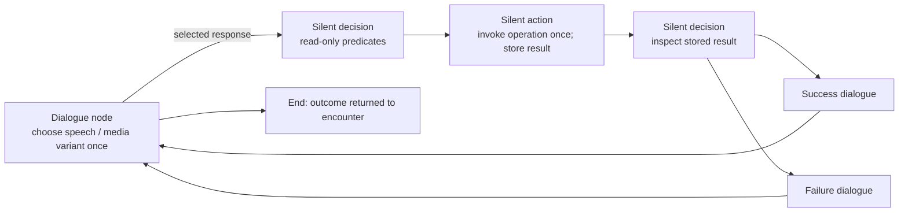

# Conversation engine design prototype

The graph engine is now production code in
[`sc2/src/uqm/dialogue`](../../../../sc2/src/uqm/dialogue). Both game builds use it;
the headers here forward to that implementation so design experiments and tests do
not maintain a second engine. The Hayes/Melnorme examples below remain design
proposals; the game uses [live compatibility graphs](../../../../sc2/content/base/conversations)
for all 27 scripts. Twenty-four scripts use general graph/state operations; three
graphs explicitly mark the remaining native C story bodies as `handlers.legacy_turn`. This integration is not a completed C-to-JSON
story migration. See [live integration and remaining work](../../../conversation-runtime.md).

Start with:

- [Commander Hayes JSON](examples/commander_hayes.json): first contact, aid,
  reactor restoration, moon base, alliance naming, and operational-starbase topics.
- [Melnorme JSON](examples/melnorme.json): first meeting, buying/selling, fuel,
  technology, information, hostility/apology, and rescue offers.
- [All consolidated verbs](verbs.md) and the [machine-readable registry](verbs.json).
- [Native operation contracts and remaining migration work](native-contracts.md).
- [Current-script call mapping](legacy-verbs.json): every active function-call
  expression across all 27 scripts, including calls that become graph structure
  or presentation services instead of state verbs.

The definitions contain all **399 Hayes and 282 Melnorme base phrase records**,
including full text and optional voice metadata. They cover every statically
named response registered in those three source scripts. This is topology and
API design coverage, **not a claim of completed behavioral migration**. Reports,
commerce and rescue require native implementations; known differences are listed
in each definition's `_coverage` and in the native contracts.

## The graph



There are three functional node forms and a terminal marker:

| Node | Responsibility |
| --- | --- |
| Dialogue | First matching speech/presentation variant; conditional player responses OR automatic continuation after speech |
| Decision | First matching read-only condition; explicit fallback destination |
| Action | Exactly one invocation on entry; save its named result; continue |
| End | Return an outcome such as `peace` or `hostile`; parent encounter owns combat |

No game-state actions are embedded in a dialogue variant or response predicate.
No response is automatically consumed. Selection history is visit-local and
reported as `selectedBefore`; a presenter may gray it while keeping it selectable.
Explicit local/state actions control any actual pruning.

## Graph ownership and traversal

[`ConversationGraph`](graph.hpp) owns nodes contiguously in a `std::vector<Node>`.
Nodes carry direct non-owning `Node*` connections: an action/automatic dialogue has
one successor, while responses and decision branches hold their own destination
pointers. The cursor follows those pointers without index lookup or offset math.

The JSON header declares `node_count`: the compiled count, including two generated
nodes for every compact response action. The generator writes it automatically.
The loader validates it against the definition before allocating the vector once,
then fills the slots and wires connections. Invalid counts throw before binding
or executing operations. Older/minimal definitions without the field still use
the calculated count. Graph depth is not an allocation size, especially with cycles.

It never resizes after creating a node pointer. Nodes remain at stable addresses,
and the graph cannot be copied or moved.
Cursors must not outlive it. All variant alternatives share the same `sizeof(Node)`;
strings and branch lists may still have their own allocations. Contiguous ownership
can improve locality, though graph connections need not follow physical storage order.

Outgoing links do not own their targets. The vector releases every node once,
including nodes with multiple incoming links or cyclic connections. No separate
ownership chain or recursive graph cleanup is needed.

The container provides `value_type`, `size_type`, `size()`, `empty()`, `begin()`,
`end()`, `cbegin()`, `cend()` and `start()` (an alias for the entry cursor).
`iterator` and `const_iterator` expose read-only nodes with `*` and `->`. They are
branch-aware traversal cursors, not standard ForwardIterators: there is no linear
node order or iterator category, and graph cycles need not terminate. `size()`
counts owned nodes, including generated nodes; it does not count traversal steps.

```cpp
auto current = graph.start();
current.next(response);     // Follow the response's resolved connection.
current.next(branch);       // Follow an explicitly selected decision branch.
++current;                 // Follow an unconditional connection.
// After a terminal node, ++current reaches graph.end().
```

`next()` and `operator++` require an unconditional connection or terminal node.
Menus and decisions require explicit branch selection. Moving a cursor does not
execute actions, evaluate predicates or play speech; `Conversation` handles those
operations before advancing its `current_`. A copied cursor is independent and
must not outlive the graph. Foreign-graph connections and end dereferences throw.

Conversation completion is `current_ == graph_.end()`, replacing `ended_`. The
terminal node records the outcome before advancing to end. Response selection
history lives on each `Edge`, replacing the separate set of node/response pairs.
`dialogueGeneration_` identifies playback instances, including repeat visits to
the same node; it guards against stale callbacks and is unrelated to graph size.

## Graph experiments without changing conversation behavior

`BasicConversation<Graph>` owns its graph by value. Existing code uses the alias
`Conversation = BasicConversation<ConversationGraph>`, retaining the contiguous
vector-backed implementation. An experiment selects its backend explicitly:

```cpp
using ExperimentalConversation = BasicConversation<MyGraph>;
auto conversation = ExperimentalConversation::load(definition, state);
```

The graph contract is deliberately small: `iterator`, `prepare(count)`, `emplace()`
(returning a stable `Node*`), `set_start(Node*)`, `at(iterator)` (mutable `Node&` for
the owning executor), `start()`, `end()` and `size()`. Cursors expose read-only
`Node` access, equality and `next()`/`next(destination)`/`next(response)`.
Backends share the existing node records and direct-pointer connections. All node
addresses must remain valid until graph destruction, and graph destruction must
release nodes before conversation memory. Neither the graph nor conversation moves.
No inheritance or virtual graph interface is required.

The default backend's `prepare` sizes storage once. `set_start` requires all slots
to be initialized and seals allocation; later preparation or allocation throws.
Runtime code uses the graph's public operations, with no access to backend storage
fields or cursor internals. Definitions remain in the production `engine.tpp` so experiments can
instantiate the same engine; `engine.cpp` explicitly instantiates the default.
Tests exercise a separate graph adapter through this contract.

## Loading and binding

`Conversation::load(definition, state)` creates a nonmovable conversation and its
local memory first, preallocates authored/generated nodes and resolves destination names to direct node pointers, then invokes
`VerbFactory` to bind all queries, conditions and actions. `std::bind` owns the
arguments and borrows the state/memory through reference wrappers. The runtime
uses `std::invoke`; it never parses a verb or searches JSON node IDs during play.

The switch cases use typed enums. String lookup happens only during loading, so
cases are grouped by domain rather than frequency. The few argument-vector
helpers keep literal and state-derived arguments on the same path. Overload
selection for `fleet.give` happens while binding:

```json
{"action":"fleet.give", "args":["spathi"]}
```

```json
{"action":"fleet.give", "args":["spathi","Fwiffo",1]}
```

The first binds the default-producing overload. It generates the captain name
and maximum crew **when invoked**, then delegates to the explicit overload. A
second-argument count requests multiple ordinary ships. Actual fleet rules stay
in the state/fleet adapter.

`State` is the proposed facade for existing session-owned accessors and
operations. Its implementation must resolve race/device/story names using the
real typed registries, validate their domains, and enforce normal gameplay rules.
The prototype uses string IDs at that boundary; it does not yet bind the live
StoryFlag/StoryCounter or fleet classes. The borrowed state outlives the complete
conversation. Callables are session-bound and cannot be cached for another player.

## Values and conditions

Simple state read:

```json
{"get":["story","MET_ARILOU",false]}
```

Live arithmetic/comparison:

```json
{"gt":[
  {"query":"ship.fuel"},
  {"subtract":[{"query":"ship.fuel_capacity"},50]}
]}
```

Read a saved action result:

```json
{"eq":[{"get":["result","fuel_purchase.code"]},"no_credit"]}
```

- Scopes: `story`, `player`, `galaxy`, `session`, `encounter`, `config`, `local`, `result`.
- `get` takes a scope/key and optional fallback. Result keys use `resultName.field`.
- Values: literals, `get`, named queries, and bounded integer arithmetic.
- Predicates: `eq`, `ne`, `gt`, `ge`, `lt`, `le`, `all`, `any`, `not`.
- Predicate results must be booleans; compare numeric query results explicitly.
- Integers use signed 64-bit checked arithmetic. Negative subtraction does not
  wrap. Division truncates toward zero; fuel/currency conversions belong in the
  relevant state operation.
- `{"literal": {...}}` passes an object as data rather than interpreting it as an instruction.

The factory rejects action objects as conditions and unknown query/action verbs.
It validates node structure, argument counts and expression forms while loading.
Dynamic argument types and game-domain identifiers/ranges require evaluation or
native adapter validation. Loading does not execute getters to infer types or
consume names, RNG, credit, or inventory.

## Authoring a response as one interaction

A response may contain its availability, action and result destinations together:

```json
{
  "id": "buy_five",
  "text": "melnorme.buy_5_fuel",
  "when": {"gt": [{"query": "ship.free_fuel", "args": []}, 0]},
  "action": {"action": "trade.purchase", "args": ["melnorme", "fuel", 5]},
  "save_as": "fuel_purchase",
  "then": {"ok": "fuel.success", "no_credit": "fuel.no_credit", "no_room": "fuel.no_room"},
  "otherwise": "error"
}
```

`when` is optional and read-only. The action runs exactly once after selection,
never while listing responses or redrawing. `then` maps result codes to dialogue
or other node IDs. `otherwise` is optional: an unhandled code without a fallback
throws and poisons the conversation, preventing a retry of a committed operation.
`save_as` is optional; provide it when subsequent speech/conditions need the result
payload. Otherwise the loader allocates a private result name. The prefix
`__response_` is reserved for these generated names.

A compact response uses `action` and a nonempty `then`, instead of `next`. Ordinary
responses still use `next`; result-routing fields without an action are rejected.
Loading validates every destination and binds the operation without executing it,
then allocates an ordinary action node and decision node and connects their pointers.
No separate execution path or new runtime node type is introduced. Explicit nodes
remain useful for shared branches, initialization and multi-step operations.

The Melnorme purchase menus and Hayes mineral sale use this form. They retain
existing result names, speech payloads and failure destinations.

## Action results

```json
{
  "id":"purchase",
  "kind":"action",
  "action":{"action":"trade.purchase","args":["melnorme","fuel",10]},
  "save_as":"fuel_purchase",
  "next":"purchase_result"
}
```

```json
{
  "id":"purchase_result",
  "kind":"decision",
  "branches":[
    {"when":{"eq":[{"get":["result","fuel_purchase.code"]},"ok"]},"next":"got_fuel"},
    {"when":{"eq":[{"get":["result","fuel_purchase.code"]},"no_credit"]},"next":"need_credit"}
  ],
  "otherwise":"purchase_error"
}
```

`Result` has a code and object payload. A predicate reads it; it never invokes the
purchase again. Expected failures use codes. Unexpected exceptions poison the
conversation instance so callers cannot retry a partially committed operation.
This does not make a multi-owner state operation transactional: that responsibility
belongs to its native implementation.

## Presentation and lifetime

[Presentation](presentation.hpp) is a device contract; [presentation.json](presentation.json)
extracts the actual Hayes/Melnorme ambient, transition and talking sprite-layer
defaults and gives their resource/palette/music profiles. Times are rational
seconds; block masks become explicit blocked-layer indices. Nodes usually say
`composite: continue`, keeping assets, background animation and music alive across
silent nodes and multiple dialogue nodes.

Dialogue variants select once per entry. The conversation owner caches a view;
redraw and resume do not reroll variants, replay actions or restart audio. The
presenter resolves phrase IDs against the definition's phrase bank. `compose`,
`insert`, and `number` are typed text/presentation requests, not executable C.
The factory resolves their state/result insertions read-only when speech is entered
or response text is rebuilt;
formatters and legacy number-speech stitching remain adapter work.

When voice finishes, or the player skips it, the mode calls
`finishDialogue(view.entry)`. It then builds responses or follows the automatic
continuation. The same entry token goes with response selection. Stale playback
callbacks cannot advance a newer dialogue. Pending media callbacks must be
canceled before releasing their owner or session.

The mode retains the immutable phrase/presentation data alongside the presenter
and asset references, using its session's asset cache. Loading copies the node
values it needs; the presenter still needs the phrase book while playing them.
It stops media and restores parent bindings through RAII when ending/canceling.
The prototype intentionally does not invent renderer/audio/input implementations.
All graph/state operations are confined to the gameplay thread; const is not a
thread-safety mechanism. The traversal budget detects runaway silent cycles; it
is a diagnostic work limit, not a gameplay time interval.

## Build, checks and regeneration

This separate CMake project uses GCC, C++17, Ninja, nlohmann/json and Boost.Test.
It is **not registered in the game's CMake or legacy source lists**.

```sh
cmake -S docs/design/conversation/engine -B build-conversation-design -G Ninja
cmake --build build-conversation-design
ctest --test-dir build-conversation-design --output-on-failure
```

The Python data builders reuse the development-only `pycparser` dependency from
the existing catalog. JSON is checked in for direct reading/editing; the example
builder documents how these initial drafts were authored. Editing JSON directly
is supported; rerunning that authoring builder will replace those edits.

```sh
python3 docs/design/conversation/engine/build_examples.py
python3 docs/design/conversation/engine/build_presentation.py
python3 docs/design/conversation/engine/build_vocabulary.py
python3 docs/design/conversation/engine/validate_design.py
```

Tests exercise binding purity, overload defaults, actual JSON traversal, fuel
failure outcomes, repeatable responses, live conditions, cached speech variants,
stale callback protection, malformed definitions, overflow, silent cycles, and
failed-action retry suppression. They use a test state adapter, not the running
game, and do not certify commerce/report/rescue implementations that do not yet
exist.

Generated JSON keeps nodes and response records expanded, while short conditions,
argument lists and presentation settings stay inline (a soft 120-column limit).
The builders share `json_format.py`, so regeneration preserves this layout.

Queries, conditions and text insertions bind through `QueryFactory(const State&,
const Memory&)`. That binder stores only const references, including for specialized
queries. `VerbFactory` composes it and retains mutable references for actions alone.
Action arguments still use the const binder. Const access prevents query-side
mutation; subsequent queries see updates committed by actions. Both borrowed objects
must outlive the bound callables. This does not provide thread synchronization.

Specialized native operations use the explicit `handlers.*` vocabulary; see
[the handler contract](verbs.md#specialized-handlers) and the nested static
`QueryFactory::Handlers` entry points in `verb_factory.hpp`. General state access
continues to use its existing verbs.
