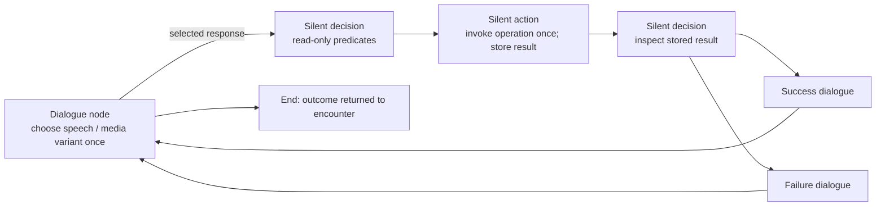

# Conversation engine design prototype

This is a **standalone executable C++17 design**, outside the game build. It
implements the proposed graph traversal and JSON-to-callable binding. It does
not replace the current alien scripts, implement a second live GameState, or
provide SDL playback. The abstract [state contract](state.hpp) deliberately
throws for operations that an adapter has not implemented.

Start with:

- [Commander Hayes JSON](examples/commander_hayes.json): first contact, aid,
  reactor restoration, moon base, alliance naming, and operational-starbase topics.
- [Melnorme JSON](examples/melnorme.json): first meeting, buying/selling, fuel,
  technology, information, hostility/apology, and rescue offers.
- [All consolidated verbs](verbs.md) and the [machine-readable registry](verbs.json).
- [Native operation contracts and remaining migration work](native-contracts.md).
- [Current-script call mapping](legacy-verbs.json): every active function-call
  expression across all 27 scripts, including calls that become graph structure
  or presentation services instead of state verbs.

The definitions contain all **399 Hayes and 282 Melnorme base phrase records**,
including full text and optional voice metadata. They cover every statically
named response registered in those three source scripts. This is topology and
API design coverage, **not a claim of completed behavioral migration**. Reports,
commerce and rescue require native implementations; known differences are listed
in each definition's `_coverage` and in the native contracts.

## The graph



There are three functional node forms and a terminal marker:

| Node | Responsibility |
| --- | --- |
| Dialogue | First matching speech/presentation variant; conditional player responses OR automatic continuation after speech |
| Decision | First matching read-only condition; explicit fallback destination |
| Action | Exactly one invocation on entry; save its named result; continue |
| End | Return an outcome such as `peace` or `hostile`; parent encounter owns combat |

No game-state actions are embedded in a dialogue variant or response predicate.
No response is automatically consumed. Selection history is visit-local and
reported as `selectedBefore`; a presenter may gray it while keeping it selectable.
Explicit local/state actions control any actual pruning.

## Loading and binding

`Conversation::load(definition, state)` creates a nonmovable conversation and its
local memory first, resolves destination names to vector indices, then invokes
`VerbFactory` to bind all queries, conditions and actions. `std::bind` owns the
arguments and borrows the state/memory through reference wrappers. The runtime
uses `std::invoke`; it never parses a verb or searches JSON node IDs during play.

The switch cases use typed enums. String lookup happens only during loading, so
cases are grouped by domain rather than frequency. The few argument-vector
helpers keep literal and state-derived arguments on the same path. Overload
selection for `fleet.give` happens while binding:

```json
{"verb":"fleet.give", "args":["spathi"]}
```

```json
{"verb":"fleet.give", "args":["spathi","Fwiffo",1]}
```

The first binds the default-producing overload. It generates the captain name
and maximum crew **when invoked**, then delegates to the explicit overload. A
second-argument count requests multiple ordinary ships. Actual fleet rules stay
in the state/fleet adapter.

`State` is the proposed facade for existing session-owned accessors and
operations. Its implementation must resolve race/device/story names using the
real typed registries, validate their domains, and enforce normal gameplay rules.
The prototype uses string IDs at that boundary; it does not yet bind the live
StoryFlag/StoryCounter or fleet classes. The borrowed state outlives the complete
conversation. Callables are session-bound and cannot be cached for another player.

## Values and conditions

Simple state read:

```json
{"get":["story","MET_ARILOU",false]}
```

Live arithmetic/comparison:

```json
{"gt":[
  {"query":"ship.fuel"},
  {"subtract":[{"query":"ship.fuel_capacity"},50]}
]}
```

Read a saved action result:

```json
{"eq":[{"get":["result","fuel_purchase.code"]},"no_credit"]}
```

- Scopes: `story`, `player`, `galaxy`, `session`, `encounter`, `config`, `local`, `result`.
- `get` takes a scope/key and optional fallback. Result keys use `resultName.field`.
- Values: literals, `get`, named queries, and bounded integer arithmetic.
- Predicates: `eq`, `ne`, `gt`, `ge`, `lt`, `le`, `all`, `any`, `not`.
- Predicate results must be booleans; compare numeric query results explicitly.
- Integers use signed 64-bit checked arithmetic. Negative subtraction does not
  wrap. Division truncates toward zero; fuel/currency conversions belong in the
  relevant state operation.
- `{"literal": {...}}` passes an object as data rather than interpreting it as an instruction.

The factory rejects action objects as conditions and unknown query/action verbs.
It validates node structure, argument counts and expression forms while loading.
Dynamic argument types and game-domain identifiers/ranges require evaluation or
native adapter validation. Loading does not execute getters to infer types or
consume names, RNG, credit, or inventory.

## Action results

```json
{
  "id":"purchase",
  "kind":"action",
  "action":{"verb":"trade.purchase","args":["melnorme","fuel",10]},
  "save_as":"fuel_purchase",
  "next":"purchase_result"
}
```

```json
{
  "id":"purchase_result",
  "kind":"decision",
  "branches":[
    {"when":{"eq":[{"get":["result","fuel_purchase.code"]},"ok"]},"next":"got_fuel"},
    {"when":{"eq":[{"get":["result","fuel_purchase.code"]},"no_credit"]},"next":"need_credit"}
  ],
  "otherwise":"purchase_error"
}
```

`Result` has a code and object payload. A predicate reads it; it never invokes the
purchase again. Expected failures use codes. Unexpected exceptions poison the
conversation instance so callers cannot retry a partially committed operation.
This does not make a multi-owner state operation transactional: that responsibility
belongs to its native implementation.

## Presentation and lifetime

[Presentation](presentation.hpp) is a device contract; [presentation.json](presentation.json)
extracts the actual Hayes/Melnorme ambient, transition and talking sprite-layer
defaults and gives their resource/palette/music profiles. Times are rational
seconds; block masks become explicit blocked-layer indices. Nodes usually say
`composite: continue`, keeping assets, background animation and music alive across
silent nodes and multiple dialogue nodes.

Dialogue variants select once per entry. The conversation owner caches a view;
redraw and resume do not reroll variants, replay actions or restart audio. The
presenter resolves phrase IDs against the definition's phrase bank. `compose`,
`insert`, and `number` are typed text/presentation requests, not executable C.
The factory resolves their state/result insertions read-only when speech is entered
or response text is rebuilt;
formatters and legacy number-speech stitching remain adapter work.

When voice finishes, or the player skips it, the mode calls
`finishDialogue(view.entry)`. It then builds responses or follows the automatic
continuation. The same entry token goes with response selection. Stale playback
callbacks cannot advance a newer dialogue. Pending media callbacks must be
canceled before releasing their owner or session.

The mode retains the immutable phrase/presentation data alongside the presenter
and asset references, using its session's asset cache. Loading copies the node
values it needs; the presenter still needs the phrase book while playing them.
It stops media and restores parent bindings through RAII when ending/canceling.
The prototype intentionally does not invent renderer/audio/input implementations.
All graph/state operations are confined to the gameplay thread; const is not a
thread-safety mechanism. The traversal budget detects runaway silent cycles; it
is a diagnostic work limit, not a gameplay time interval.

## Build, checks and regeneration

This separate CMake project uses GCC, C++17, Ninja, nlohmann/json and Boost.Test.
It is **not registered in the game's CMake or legacy source lists**.

```sh
cmake -S docs/design/conversation/engine -B build-conversation-design -G Ninja
cmake --build build-conversation-design
ctest --test-dir build-conversation-design --output-on-failure
```

The Python data builders reuse the development-only `pycparser` dependency from
the existing catalog. JSON is checked in for direct reading/editing; the example
builder documents how these initial drafts were authored. Editing JSON directly
is supported; rerunning that authoring builder will replace those edits.

```sh
python3 docs/design/conversation/engine/build_examples.py
python3 docs/design/conversation/engine/build_presentation.py
python3 docs/design/conversation/engine/build_vocabulary.py
python3 docs/design/conversation/engine/validate_design.py
```

Tests exercise binding purity, overload defaults, actual JSON traversal, fuel
failure outcomes, repeatable responses, live conditions, cached speech variants,
stale callback protection, malformed definitions, overflow, silent cycles, and
failed-action retry suppression. They use a test state adapter, not the running
game, and do not certify commerce/report/rescue implementations that do not yet
exist.
