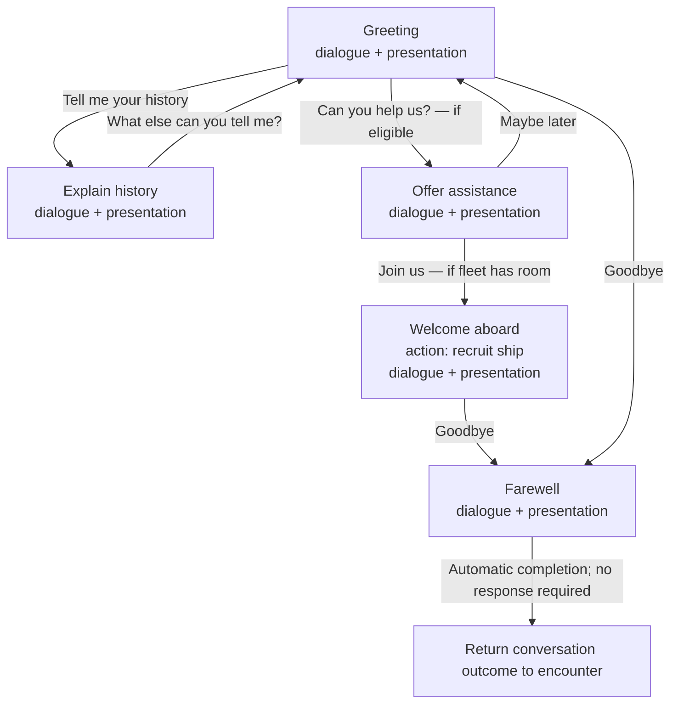
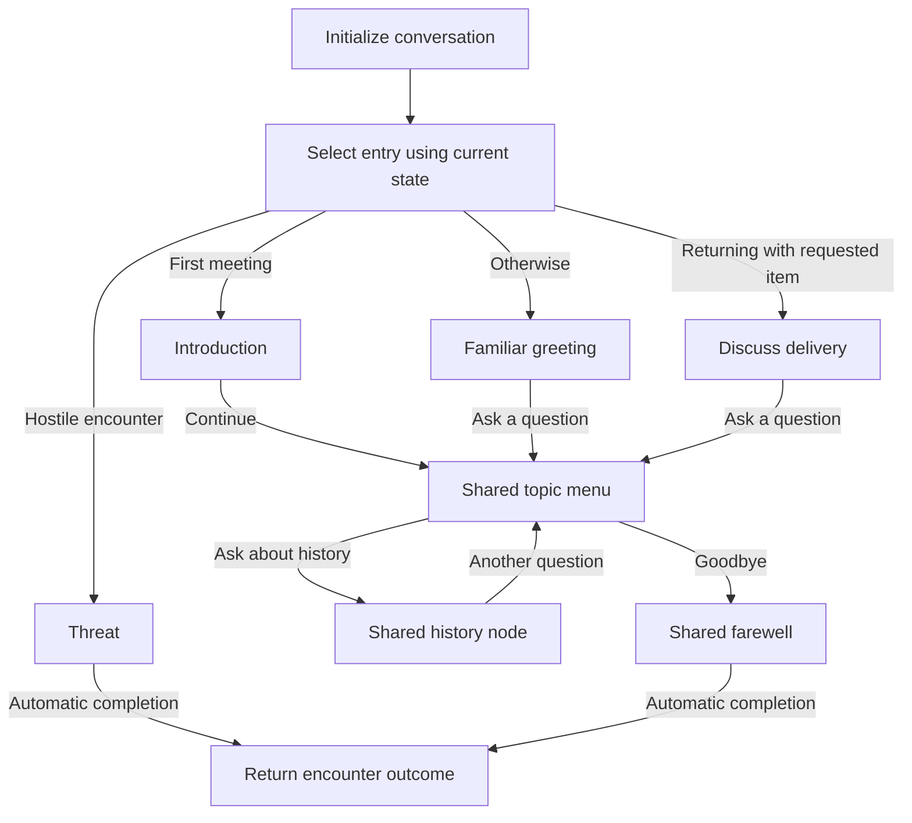
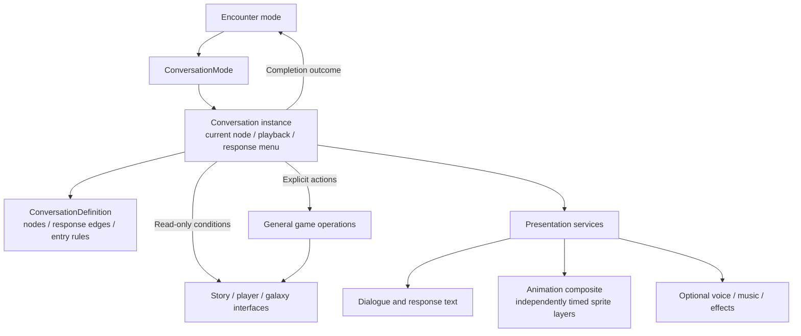

# Conversation graph design

This records the proposed conversation model. It is a design document, not an
implemented engine or a settled JSON schema. The existing
[conversation child mode](../conversation-mode.md) still runs the legacy alien
scripts. We will design the C++ abstractions and general state operations before
choosing how to serialize their definitions.

## Nodes and response edges

A conversation is a directed graph. A node represents what the other character
says and does. Its outgoing edges are the player's possible responses.

| Part | Contents |
| --- | --- |
| Node | Dialogue text, an animation composite, optional voice/audio, actions, and outgoing response edges |
| Response edge | Player response text, an optional availability condition, and a destination node |
| Entry selection | Rules that choose a starting node from the encounter circumstances and current game state |
| Running conversation | Current node, playback progress, the available-response menu, and any temporary history |

Selecting a response follows its edge to another node. That destination can
perform an action, present more dialogue, and offer another response menu.
Actions interact with story, player, or galaxy state through general game
operations. Recruitment, cargo transfers, and story changes should use the same
operations when initiated elsewhere in the game.

The examples below illustrate structure; they are not an audit of a particular
alien's existing dialogue.

The loop is intentional. Returning to a topic does not consume it. A response
remains available unless its explicit condition becomes false. Some nodes need
no player response: a farewell can finish the conversation, and a monologue can
continue automatically. These automatic continuations are distinct from response
edges.

## Multiple entry points and shared branches

Initialization can choose among several entry points. This can feel like several
conversation trees while still using one graph with shared topics and endings.
We do not need to duplicate an entire tree for every initial circumstance.

Entry-rule precedence must be explicit when several rules match. The example
labels describe possible circumstances rather than a finalized selection API.
Entry selection chooses where to begin; response conditions are evaluated again
as the conversation proceeds.

## Conditional response menus

Conditions are read-only queries of the current state. When a node presents its
response menu, the engine evaluates its outgoing response edges and includes the
ones whose conditions pass. An unconditional response is always eligible.

“Pruning” means filtering this visit's menu. It does not delete edges from the
conversation definition. Returning to the node reevaluates eligibility, so an
action that changes state can change the next menu.

There is no automatic rule that hides a response after selection. If a topic is
supposed to disappear, its definition must explicitly express that behavior.
Permanent facts belong to the appropriate game state. Temporary facts can belong
to the running conversation when a particular conversation needs them.

## Optional seen-response styling

Availability and selection history are separate. As an optional presentation
feature, a response selected before could appear in a muted color while remaining
selectable. This is a renderer color/style choice; it need not require another
font asset.

Tracking selections during the current conversation would be sufficient for an
initial implementation. Remembering selections across later visits would require
stable response identifiers and player-owned persistent history. That persistence
policy is not decided here. “Selected before” also need not mean “all resulting
dialogue has been heard”; playback and skipping make those different facts.

## Runtime and presentation responsibilities

ConversationMode owns the running conversation and borrows session state and
services. The definition describes content; it does not store mutable playback
state or own a player's state. Animation composites can combine a background,
talking mouth, blinking eyes, and other independently timed layers.

Action timing must be explicit. Entering a node, finishing dialogue, and selecting
a response are distinct events. Redrawing a frame or resuming after a child mode
must not repeat an entry action. Intentionally revisiting a node is a new entry;
one-time rewards still need explicit state conditions or guarded game operations.
The exact action hooks remain to be designed.

A conversation can finish with an outcome such as peaceful departure or hostility.
The enclosing encounter remains responsible for deciding whether to launch combat.

## Next design work

Before defining a file format, trace contrasting existing scripts: a simple story
exchange, recruitment/trading, repeated visits with counters, and an encounter
that leads to combat. Use them to establish the condition/action vocabulary and
C++ interfaces. Named exceptional C++ actions remain an option; we have not chosen
a general scripting language, expression syntax, or editor format.
