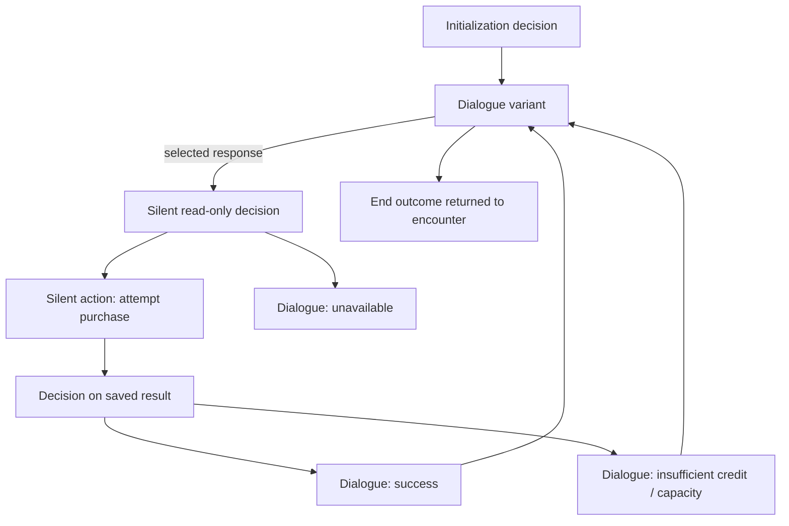
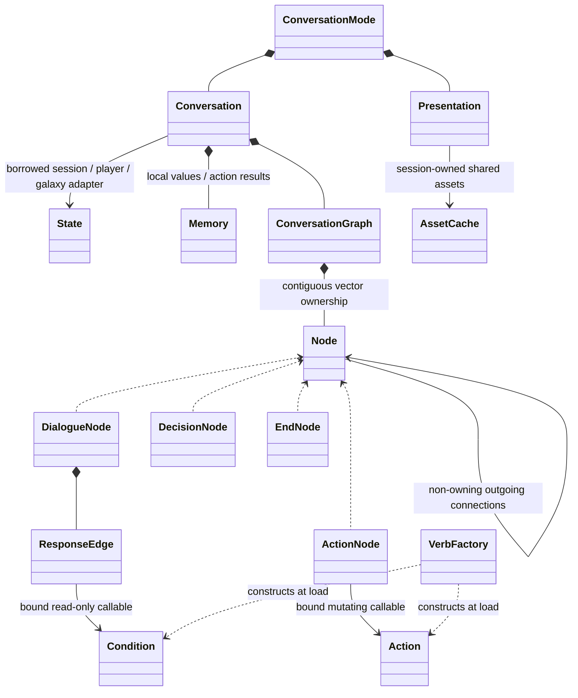

# Proposed conversation engine

The [standalone C++17 design prototype](engine/README.md) implements graph loading,
bound conditions/actions and traversal. It shares the production graph implementation; the live game currently uses explicitly marked native-handler envelopes. The
[current conversation catalog](README.md) remains the source-backed record of
existing behavior; prototype JSON does not yet replace those scripts.

## Three functional nodes

- **Dialogue:** select one text/animation/audio variant from ordered read-only
  conditions, then offer eligible player responses or continue after playback.
- **Decision:** silently check state or a stored action result and follow the
  first matching edge, with an optional fallback; no matching branch without one throws.
- **Action:** silently invoke an operation once, retain its result, then continue.

An end marker returns an outcome to the enclosing encounter. Combat remains that
encounter's responsibility. Both decision and action nodes are normally invisible
and traverse immediately; operations requiring visible progress need explicit
presentation/handoff rather than an accidental wait inside a predicate.

## Bound vocabulary

A master VerbFactory constructs separate query/condition and action callables.
Private binding helpers select an ordinary native accessor/operation and use
`std::bind` to retain its arguments. Runtime traversal uses `std::invoke`.
Conditions are read-only and may be reevaluated. Actions can return failure,
partial-success or quote data; decision nodes inspect that saved result without
executing the operation a second time.

There are [21 consolidated domain queries and 25 actions](engine/verbs.md), plus
typed state reads, comparisons, boolean composition and bounded integer arithmetic.
The [legacy mapping](engine/legacy-verbs.json) classifies every active call site
across all 27 scripts. Routing becomes edges; packed encodings become native
state adapters; input/drawing/playback become presentation service work.

Factory overload binding supports ordinary ships with generated defaults,
explicit captain/crew overrides and bulk gifts. Defaults are generated when the
bound action executes, not when the graph is loaded. The state owner enforces
normal fleet, cargo, trade and story rules.

## Data and runtime ownership

Each prototype Node contains a `std::variant` of the four simple records, not a
second class hierarchy. Node IDs resolve to direct node pointers at load. Conversation is nonmovable
because its callables borrow its stable local memory. The session's state and
asset services outlive the conversation and presenter.

The dialogue definition specifies presentation. The running owner retains assets,
composites and playback across nodes. A redraw or resume uses the selected view;
it does not restart audio, reroll a variant, or run an action. Entry tokens reject
stale playback callbacks and stale menu selections. Presentation callbacks execute
on the gameplay thread; query constness does not provide synchronization.

## Responses and repetition

Responses contain player text, a condition and a destination. Filtering a menu
does not remove edges from the definition. Reentering a node reevaluates
eligibility. Topics may cycle indefinitely; explicit local/story state controls
pruning when the content requires it.

Visit-local response selection history can gray previously selected answers.
It changes styling only, and says “selected before,” not “all subsequent speech
was heard.” Persistent cross-visit history is not implemented by this design.

## Concrete design data and limits

- [Commander Hayes](engine/examples/commander_hayes.json): first contact and
  operational starbase, 293 authored nodes and 399 original phrase records.
- [Melnorme](engine/examples/melnorme.json): introduction, commerce, hostility and
  rescue, 154 authored nodes and 282 original phrase records, plus market data.
- [Presentation data](engine/presentation.json): extracted ambient/talk/transition
  layers and palette/music profiles for Hayes and Melnorme.
- [Native contracts](engine/native-contracts.md): required query/action behavior,
  complex report/trade/rescue seams, units, action results, and draft differences.

The shared runtime is tested with state adapters and live graph fixtures. Probe,
Kohr-Ah, Ur-Quan and Arilou are graph-owned; 23 scripts still use explicit native-turn
handlers. The Hayes/Melnorme proposals still need their commerce/report bindings
and timing audit before replacing those native handlers. See
[live migration status](../../conversation-runtime.md).

The authored JSON can keep a response, its condition, its action and its result
routes together. The loader expands this compact interaction into the same silent
action/decision nodes; the internal graph need not dictate the authoring format.
See [compact responses](engine/README.md#authoring-a-response-as-one-interaction).

## Graph container and current position

`ConversationGraph` owns nodes in a vector sized once before wiring connections.
Edges contain direct non-owning node pointers, and `Conversation::current_` follows them directly. `start()`/`begin()`
identify the entry and `end()` identifies completion. A cursor advances through
an unconditional connection with `next()` or `++`; responses and decisions select
an outgoing connection explicitly. Advancing the cursor does not execute a node.
The session-bound `Conversation` remains responsible for invoking its behavior.
See [graph ownership and traversal](engine/README.md#graph-ownership-and-traversal).
