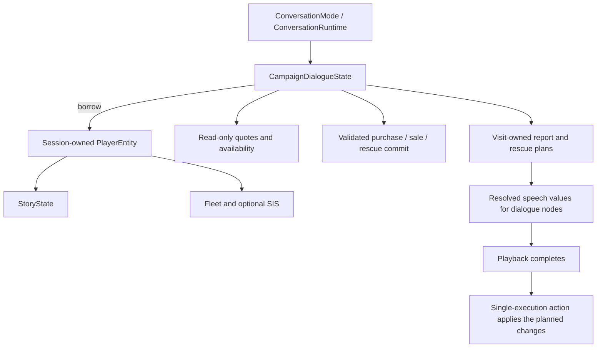

# Campaign transactions and conversation reports

This is the next implementation boundary for the live graph migration. Druuge,
Melnorme and the operational starbase still run through explicit native-turn
bridges. Their text is editable and they use the live graph runner, but their C
story bodies have not been replaced. The initial Commander Hayes script is already
ported independently; the combined Hayes design example is not a replacement for
these two live resources.

The graph format and its dialogue/decision/action separation remain unchanged.
The missing work is in campaign operations behind `CampaignDialogueState`, not
another scripting language or another conversation engine. The existing abstract
`State` interface already lists purchase/sale, inventory, technology, rescue,
calendar and report operations. Unsupported operations currently throw.

## Ownership and calls



Keep the player/session lifetime rules already used by the live adapter. A pending
rescue offer or report plan is an owned value inside that adapter, destroyed with
the conversation. It does not own the player, expose legacy queue pointers or
change the save layout. No shared ownership, networking framework or transaction
manager is required for the current single-threaded campaign.

A small value vocabulary is sufficient for the native implementation:

```cpp
enum class Account { ResourceUnits, MerchantCredit };
struct Price { Account account; std::int64_t amount; };
struct Quote {
    std::string item;
    std::int64_t quantity;
    Price total;
};
enum class PurchaseStatus { Completed, Unavailable, InsufficientFunds, NoCapacity };
struct PurchaseResult {
    PurchaseStatus status;
    std::int64_t quantity;
};
```

These are a wireframe, not additional production classes. Put their implementation
where the campaign already owns the relevant ship, fleet and story state. Public
JSON verbs continue to bind ordinary accessors and actions at load time. Parse
untrusted names and quantities before selecting a typed operation.

## Query and action contracts

* Quotes and eligibility queries borrow const state. They cannot debit currency,
  grant technology, reserve fleet slots, change story flags or consume RNG.
* A purchase checks price, eligibility, payment, cargo capacity and escort capacity
  together before committing any change. A failed purchase returns an explicit
  result code and changes nothing. A graph response directs each result to its
  own dialogue node.
* Prepare anything that can fail, including vessel allocation, before charging.
  A failed allocation must not charge the player or leave a partial purchase.
  Only the successful commit updates the UI. Existing free `fleet.give` gifts may
  still clamp to available slots; a paid fleet purchase needs its own contract.
* Default ship crew and captain selection happen during creation, not during a
  read-only availability check. Explicit named-captain creation currently resolves
  Fwiffo's native entry; that is not support for arbitrary captain names.
* Rescue preparation is an action if it needs a random choice. Store the selected
  offer once. Replaying text and pruning responses cannot reroll it. Acceptance
  applies that stored offer once after rechecking that its requirements still hold.
* Keep resource units, merchant credits, crew, biomass and fuel as distinct units.
  The public conversation fuel contract uses displayed units; native SIS storage
  uses hundredths. Quote and charge rounding must match the offered quantity,
  including the final partial tank unit. Check all narrowing and account limits.
* Purchases and report commits are actions. A query must never hide a sale,
  collection, resource grant or report acknowledgement.

## Reports need a plan

The native starbase `DiscussDevices(FALSE)` path still writes zero-valued story
flags. It cannot be called from the const `reportAvailable` query unchanged.
Extract its scan into a read-only report plan containing the selected utterances
and the state changes to apply. The same applies to bulletins, timed reports and
mineral-sale summaries that interleave speech and bookkeeping today.

Queue the plan's speech through an ordinary dialogue node. Commit its bookkeeping
at the source's playback boundary through a bounded registered action. Add a
shared commit-report verb if that proves useful across reports; do not add one
public method per bulletin or expose an unchecked JSON list of native calls.
Aborting before playback completes must not acknowledge an unplayed report.
Replaying a completed report must not repeat a grant, sale or acknowledgement.

## Migration order and checks

1. Druuge: separate prices and transactions from speech, including crew payment,
   artifacts, escort capacity and the fuel-tank deal. Bind them to the existing
   purchase/sale and inventory vocabulary, then port its graph.
2. Melnorme: implement credit accounting, technology/information availability,
   biomass and rainbow-world sales, fuel purchases and the stored rescue offer.
   Audit the design example's documented differences against the actual script.
3. Operational starbase: implement read-only bulletin/device scans, report commits,
   date boundaries and mineral sale reporting. Keep its resource/phrase bank
   separate from the initial Commander conversation.

Use Boost.Test for insufficient funds, full cargo/fleets, partial fuel capacity,
account limits, failed allocation, rescue preparation/acceptance and report
prepare/replay/commit boundaries. Continue running the ordinary and legacy game
builds. Remove each native-turn bridge only when its real operations and live
speech path are connected; a renamed whole-turn handler is not a completed port.

Related work: [dialogue graphs #25](https://github.com/yost-jacob/uqm-cpp17/issues/25),
[state operations #19](https://github.com/yost-jacob/uqm-cpp17/issues/19),
[animation composition #31](https://github.com/yost-jacob/uqm-cpp17/issues/31).
