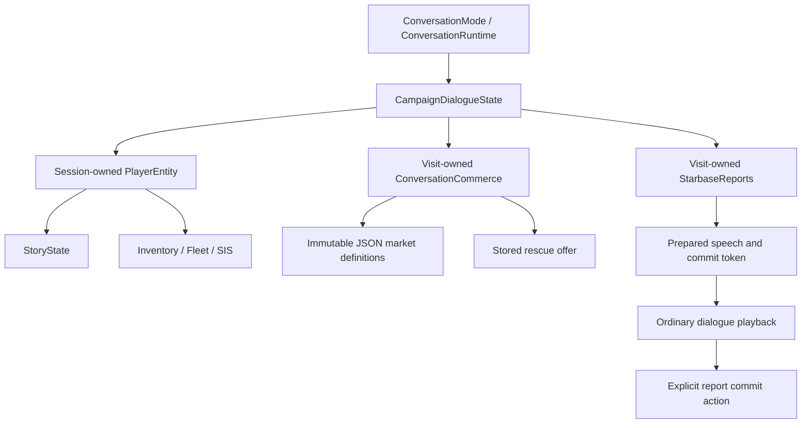

# Campaign transactions and conversation reports

The final Druuge, Melnorme and operational-starbase graphs now run through the
same engine as the other 24 conversations. Their native story turns are removed.
This page records the operation boundary; see [implementation contracts](../../conversation-commerce.md)
for the completed migration and its deliberate presentation/timing differences.



## State operations

```json
{"action":"transact","args":[{"credits":100},{"fuel":10}]}
{"action":"transact","args":[{},{"crew":100,"items.sun_device":1}]}
{"action":"set","args":[{"MET_ARILOU":true},{"ARILOU_VISITS":2}]}
```

Packages mean player-gives first, player-receives second. Inventory validates and
stages exact scalar/item exchanges over authoritative save storage. Bare `set`
validates all narrative writes before applying them; inventory fields are excluded.
Local memory continues to use `state.set`. Inventory applies no merchant pricing
or narrative effects. See [package actions](package-actions.md).

Merchant `trade.purchase`/`trade.sell` operations coordinate their bounded policies
with inventory/fleet: validate payment/capacity, prepare vessel allocations and
speech, then commit. Ordinary failures return typed codes; malformed data throws.
The generic package vocabulary does not yet support arbitrary ship bags. Paid
Druuge ships use the native Fleet factory with rollback of failed reservations;
free barter gifts explicitly retain up-to-available-space semantics.

Public `fuel` uses displayed units. Explicit `fuel_hundredths` supports precise
quotes/delivery. Melnorme fill charges ceiling units and fills the exact remaining
space; capped crew-for-fuel trades choose the smaller delivery explicitly.

## Plans and read-only queries

Quotes, market eligibility and report availability use const state, without
payment, grants, acknowledgement or RNG. Rescue preparation owns its selected
seeded offer until acceptance or visit destruction. Acceptance rejects a changed
ship or redeemed token. Replay invokes neither preparation nor acceptance.

A starbase report prepares speech plus proposed effects. The graph's separate
`hayes.commit` action acknowledges it after playback or skip. A pending plan dies
on cancellation; old tokens are stale and duplicate current commits do nothing.
Bulletin replay retains speech without repeating the Arilou gift. Played one-time
rewards have durable markers even if farewell is never reached.

The ready-base grant, devices, bulletins, timing, analysis and mineral-sale paths
are implemented. Native descriptor/media services remain; the old per-unit cargo
sale animation/mutation loops are removed in favor of one commit and gauge refresh.

## Limits and follow-ups

A transaction and a later narrative batch are separate commits. This is not a
cross-domain transaction framework. Named specialized policies define their own
coupled behavior. Existing C save fields remain storage; generic inventory flag
migration and wider shared state operations continue under #19. Fatal C/service
error handling is #23, animations #31, and menu reuse #63. No save format or
multiplayer authority model is introduced here.
