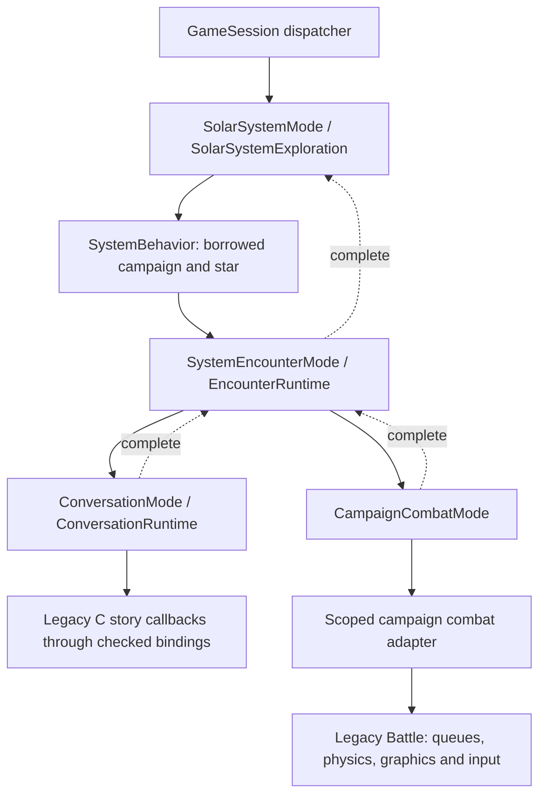

# Runtime encapsulation roadmap

This page distinguishes production ownership from remaining legacy machinery.
Update it with each ownership change. Issues record future ideas; this page
records what the executable actually does.

## Current focus

Complete the exploration → encounter → conversation/combat → exploration path
with explicit state dependencies and scoped resources. Work incrementally through
this path before starting independent graphics, dialogue-data, or multiplayer work.

The arrows describe synchronous child calls, not concurrent tasks. The dispatcher
retains each suspended parent until its child finishes. Child teardown precedes
binding restoration and parent resume. Session exits unwind the old call stack;
a load does not decode a replacement campaign while these objects remain alive.

## Production status

| Area | Owner and state dependency | Remaining boundary |
| --- | --- | --- |
| Exploration | SolarSystemMode owns SolarSystemExploration and native systems; behaviors borrow campaign and catalogue star | Legacy planet/input/render descriptors and process services |
| Orbital encounter | SystemEncounterMode owns EncounterRuntime, borrowing its session's campaign and star | Activity flags, physical fleet queues, selection UI and aftermath |
| Conversation | ConversationMode owns runtime, script storage, resources and animation state | C race callbacks, story globals, shared audio/render services |
| Campaign combat | CampaignCombatMode borrows the session and campaign; backend scopes temporary sounds, cyborg input and activity | Battle loop, rosters, mechanics and engine resources retain existing ownership |
| Persistent escorts | PlayerEntity owns Fleet and native Ship storage; combat binds vessel IDs | C recruitment/UI/save buffers, flagship storage and NPC queue ownership |
| Lander | Child LanderMode owns LanderVisit with explicit system/campaign borrows | Element callbacks and graphics caches |
| Session startup | RunGameSession C adapter invokes GameSession::runCampaign | C title loop; definition is in sc2/src/uqm/gameplay_modes.cpp |

A C++ mode wrapper establishes a lifetime boundary; it does not by itself
encapsulate every service or legacy payload accessed beneath that boundary.

## State naming

The personal progress interface is `StoryState`, accessed as `player.story()`.
It owns flags, counters and personal discovery progress, not the fleet or the
whole campaign. This is a naming refactor of the same storage and serialization;
there is no compatibility alias or second copy of the state. Fleet is a separately owned member of PlayerEntity (#21); its native Ship objects
share their compatibility records with existing C callers.

## This increment

Campaign combat now runs through swapGameMode, like conversation and lander
visits. EncounterRuntime still prepares both combat rosters and applies aftermath
only after the combat child has returned. The combat backend owns temporary
sound/input/activity changes through a scope, restoring the caller's previous
input, speed and sound bindings. Existing combat retirement, reincarnation,
projectile and victory timing logic is unchanged.

Persistent escorts now belong to PlayerEntity's Fleet. Their native Ship objects
share C compatibility records; combat participants borrow an owning roster and
vessel ID. Crew results resolve identity instead of traversing parallel queues.
See [fleet ownership](fleet-ownership.md) for API and save-format contracts.

This is the campaign-specific integration step toward #17, not completion of a
campaign-independent CombatMode. Super Melee and HyperSpace retain their current
Battle entry paths; HyperSpace uses Battle for navigation rather than combat.

## Next steps on this path

1. Continue fleet migration (#21): persistent escorts now belong to PlayerEntity's
   Fleet and combat results resolve stable vessel IDs. Next address native default/
   resource construction, flagship integration, and enemy fleet ownership. See
   [fleet ownership](fleet-ownership.md).
2. Pass explicit campaign/player dependencies through combat callbacks and
   factor a shared combat interface usable by Super Melee (#17, #18, #22).
3. Replace shared rendering/input/audio access with borrowed session services
   (#15), migrating one real consumer at a time.
4. Continue removing legacy state access behind typed state operations (#19).
   Dialogue-graph migration (#25) is a later consumer of those operations.

Graceful nested failure unwinding remains #23: the dispatcher still aborts for
exceptions escaping a child. Local RAII restores the combat adapter's resources
before an escaping backend exception, but this does not make session failure
recovery complete.

Animation generalization (#31), cutscenes (#16), rotation (#20), artwork (#29),
headless training (#26/#27), and multiplayer (#28) are recorded future work.
They need not interrupt this ownership path.

## Verification boundaries

Boost.Test exercises the real campaign combat mode, dispatcher and scoped
backend with simulated Battle/input/audio services: explicit campaign delivery,
normal child return, load/shutdown requests, restoration before parent resume,
human input preservation, legacy defeat policy, and backend exception cleanup.
Existing exploration, encounter, conversation and rendering tests cover their
respective boundaries. These are not a full interactive story playthrough or a
claim that the physical combat engine is isolated.

See [runtime details](runtime-encapsulation.md),
[conversation ownership](conversation-mode.md), and
[nested-mode contracts](nested-modes.md).

For this increment, Debug and Release CMake/Ninja builds and all three CTest
entries pass. The full Boost.Test suite has 164 cases / 13,779 assertions;
ASan/UBSan and the legacy SDL2 build also pass. Changed native sources pass
`-Wall -Wextra -Werror`. A focused GUI check loaded an existing probe encounter into dialogue and started
a fresh campaign in Sol. No exhaustive story/combat playthrough was performed.
