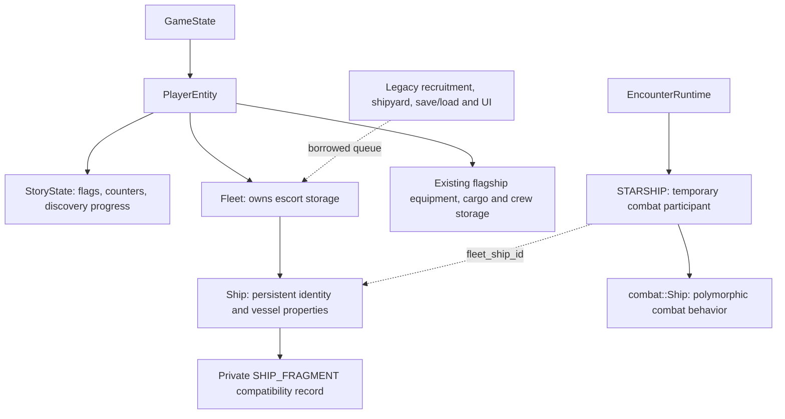

# Persistent fleet and combat vessel identity

`PlayerEntity` owns one `Fleet` through a unique pointer. The fleet owns its
fixed-capacity queue storage, whose ship pool now contains actual native `Ship`
objects. A `Ship` contains exactly one legacy `SHIP_FRAGMENT` compatibility
record. Native accessors and existing C callers therefore read and mutate the
same authoritative fields; there is no synchronized second roster.

## Interfaces and contracts

- `Fleet::create(ShipSpec)` accepts explicit species, race, captain resource
  index, crew/capacity and display slot. It validates quantities and slot use
  before mutation, returning no ID when full. This low-level native entry does
  not load graphics or choose a random captain. The existing C template factory
  remains the production source of defaults and borrowed resource bindings.
- `Fleet::find(ShipId)` returns an optional reference wrapper, const for a const
  fleet. `ships()` returns IDs in display order. Resolve an ID again after an
  erase/reset; do not keep a reference beyond its vessel's lifetime.
- `Ship` exposes identity, species/race, captain index, crew/capacity, slot and
  alive status. Its crew field is authoritative, so alive is derived rather
  than a second independently mutable boolean. Finite native crew updates
  reject values above capacity and do not resurrect retired vessels.
- `destroy()` retires a vessel while retaining its roster slot. `pruneRetired()`
  removes retired vessels after consumers no longer need their display entries.
  A ship withdrawn from combat with crew remains alive. Campaign aftermath
  removes vessels through Fleet at its existing cleanup boundary.
- Fleet/Ship are noncopyable. Access remains simulation-thread confined.
  Resources referenced by the record belong to existing race/asset owners;
  freeing a fleet does not free those borrowed assets.

The campaign still has twelve escort slots. The flagship's equipment, cargo and
crew remain in their existing authoritative player storage; this increment does
not create a duplicate flagship record. It also does not convert Super Melee
setup into a campaign fleet.

## Compatibility and lifetime

`built_ship_q` is removed from the legacy `GAME_STATE` payload. C callers use
`GetPlayerFleetQueue()`, implemented in game_state.cpp, to borrow the active
player's fleet buffer. Native code receives the fleet through the player.
Initialization and campaign teardown clear its contents; PlayerEntity lifetime
owns destruction of its pool. Clearing the global compatibility payload no
longer clears or loses an owning escort-queue descriptor.

`fleet_legacy.hpp` is internal buffer/pool access, not the gameplay interface.
The standard-layout Ship's first and only member is its C record. Layout checks
allow the queue engine to publish record addresses while owning native objects.
Other ship-fragment pools, including NPC encounter queues, use the same native
Ship storage, but retain their existing owning queue scopes for now.

A monotonic process-wide ID is assigned at pool reservation, including when a
released address is reused. Build preserves the ID while initializing the C
record. IDs remain unique across fleets and resets; the counter is atomic for
uniqueness only, not to make fleet mutation thread-safe. Overflow terminates
rather than reusing an identity.

## Combat and save compatibility

Encounter roster construction records the source ShipId and borrowed owning roster in each STARSHIP.
`UpdateShipFragCrew` resolves that identity in the appropriate fleet, so queue
reordering cannot redirect crew results. Zero identities (flagship/Super Melee)
and missing/stale identities do not update escorts. Infinite NPC fleets retain
their sentinel behavior. The C result adapter bounds crew to the stored vessel
capacity when edited tuning differs from saved data, and ignores late results
for finally retired vessels; the native update method remains range-checked. The parallel traversal of fragment and combat queues
is deleted. The C callback receives its roster through the participant and does not look up
the process player or infer ownership from player number. That roster must
outlive the combat participant.

Combat retirement, Pkunk reincarnation, death marks, victory timing, and ship
selection remain in the existing engine. Reincarnation resolves before final
crew publication/retirement. Destroyed entries remain available to the existing
red-X display until aftermath cleanup, while withdrawal preserves survivors.

The current and legacy save code serializes vessel fields explicitly. Runtime
ShipId and combat binding fields are not serialized. Loaded vessels receive
fresh IDs, invalidating old combat bindings. The old legacy queue-descriptor
bytes are still consumed before packed story bits, preserving stream alignment.
No save version or file encoding is changed. Netplay checksums serialize selected
simulation fields rather than the new identity metadata.

## Verification

Boost.Test covers explicit creation/crew overrides, invalid quantities, capacity,
const borrows, identity across slot reuse/reset, independent player fleets,
shared C/native storage, dead-slot pruning, withdrawn survivors, real C Build,
reordered combat results, stale bindings, zero identities and infinite NPC fleets.
Existing queue tests still check alignment, fixed capacity, physical slot stride,
LIFO reuse and link order. Build and runtime results are recorded in the PR.

Remaining work includes defaults/resource construction through native APIs,
flagship vessel integration, explicit callback contexts, enemy fleet ownership,
and Super Melee's shared fleet interface. See #17, #19, #21 and #22.
