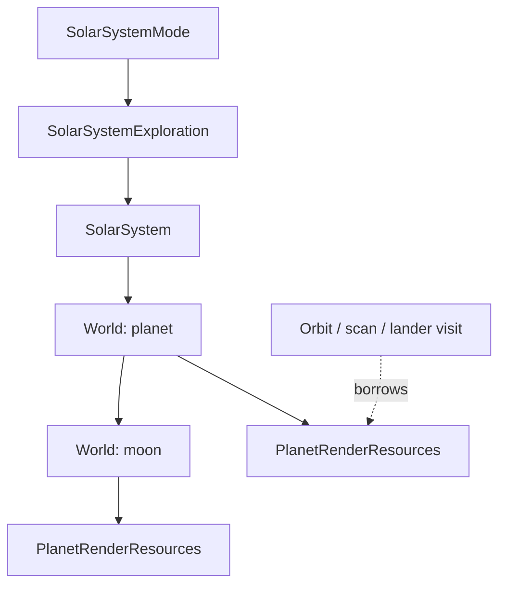

# Planet and moon rendering ownership

Each native World lazily owns PlanetRenderResources. No graphics allocation is
made simply because the system contains a planet. The first orbit visit creates
its resource owner, then the existing generators populate that body's view.

The owner releases the surface/topography frame, globe frames, shield/atmosphere
frames, tint and workspace frames, surface-node/creature sprites, color maps,
translation tables and the elevation/color/scratch buffers. reset() handles an
empty or partially generated body and clears its borrowed pointers before
releasing allocations. Destruction never publishes story/world progress.

SOLARSYS_STATE no longer contains those owned fields. Its graphics pointer is a
scoped C compatibility borrow of the selected body's record. Native callers use
the World and PlanetRenderResources; only the generation/drawing boundary sees
the mutable record. A lander borrows the parent's body resources throughout its
synchronous visit. It does not take ownership of the planet's graphics.

PlanetRenderBorrow resets that body's previous generated output before a new
orbit visit, then detaches the C view on scope exit. This migration preserves the
existing per-visit surface generation: story effects, lighting and scan services
are not yet a cache-reuse protocol. Resources remain owned after changing views,
but are regenerated on the next orbit entry. Retained graphics therefore use
memory until regeneration, body/layout replacement or system destruction.

Orbit rotation, music, discovery-report fonts/text and screen contexts retain
visit lifetimes. Their cleanup now runs in a scope around generation and the
orbit menu, including early exits after a surface was created. FinishPlanetOrbit
finishes those visit services while the body retains its graphics and buffers. A future device-service
uqm_context is independent of this ownership change.

Descriptor refresh uses refreshPlanets/refreshChildren. If generated definitions
match, the existing native planets/moons, their behavior and their resource
owners stay alive. A changed definition uses the validated replacement path,
releasing the replaced subtree's resources. Explicit replacePlanets/replaceChildren
still deliberately replace their objects. Invalid replacement leaves the old
objects and resources intact.

Remaining boundaries include the legacy surface/globe algorithms, graphics
service bindings, descriptor arrays and shared system-wide star/planet artwork.
This increment does not introduce an asset-cache framework or a second graphics
state alongside the owning record.
