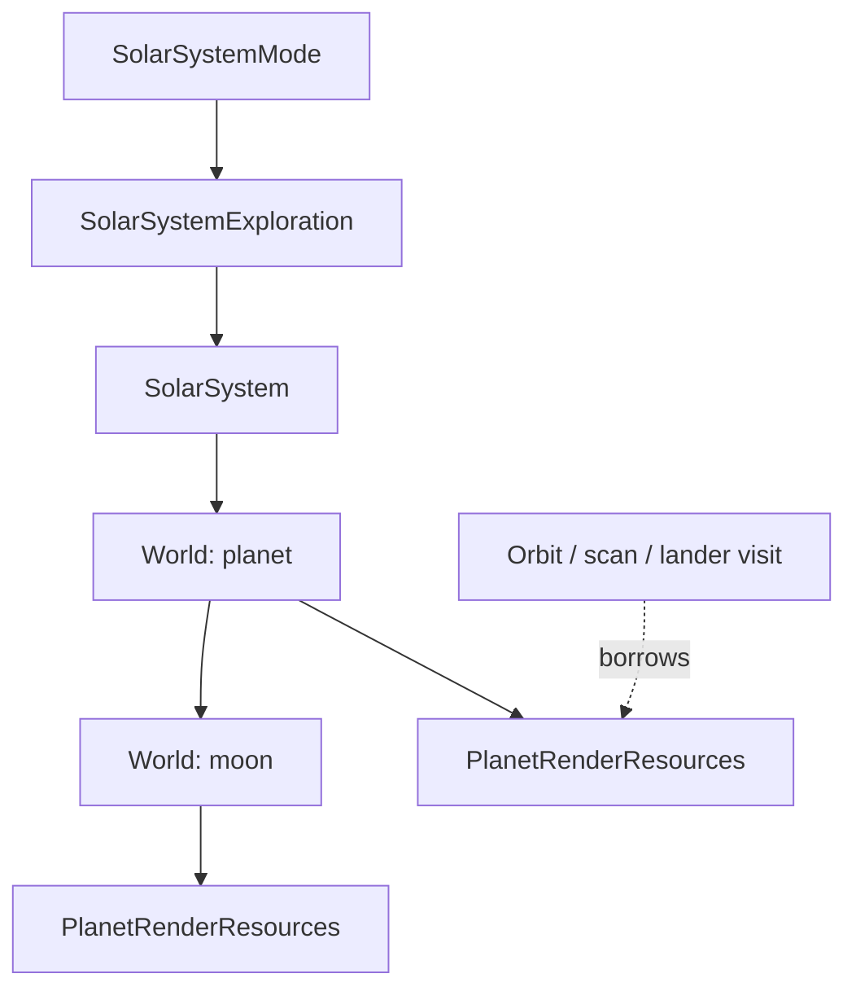

# Planet and moon rendering ownership

Each native World lazily owns PlanetRenderResources. No graphics allocation is
made simply because the system contains a planet. The first orbit visit creates
its resource owner, then the existing generators populate that body's view.

The owner releases the surface/topography frame, globe frames, shield/atmosphere
frames, tint and workspace frames, surface-node/creature sprites, color maps,
translation tables and the elevation/color/scratch buffers. reset() handles an
empty or partially generated body and clears its borrowed pointers before
releasing allocations. Destruction never publishes story/world progress.

SOLARSYS_STATE no longer contains those owned fields. Its graphics pointer is a
scoped C compatibility borrow of the selected body's record. Native callers use
the World and PlanetRenderResources; only the generation/drawing boundary sees
the mutable record. A lander borrows the parent's body resources throughout its
synchronous visit. It does not take ownership of the planet's graphics.

PlanetRenderBorrow resets that body's previous generated output before a new
orbit visit, then detaches the C view on scope exit. This migration preserves the
existing per-visit surface generation: story effects, lighting and scan services
are not yet a cache-reuse protocol. Resources remain owned after changing views,
but are regenerated on the next orbit entry. Retained graphics therefore use
memory until regeneration, body/layout replacement or system destruction.

Orbit rotation, music and screen contexts have a visit-owned OrbitPresentation
scope, started before surface generation. It releases services on normal return,
load cancellation and partial generation failure while the body retains its
graphics and buffers. Discovery text and fonts belong to WorldVisit::report(),
including report-only events that never create a surface. A future device-service
uqm_context is independent of this ownership change.

Descriptor refresh uses refreshPlanets/refreshChildren. If generated definitions
match, the existing native planets/moons, their behavior and their resource
owners stay alive. A changed definition uses the validated replacement path,
releasing the replaced subtree's resources. Explicit replacePlanets/replaceChildren
still deliberately replace their objects. Invalid replacement leaves the old
objects and resources intact.

Remaining boundaries include the legacy surface/globe algorithms, graphics
service bindings, descriptor arrays and shared system-wide star/planet artwork.
This increment does not introduce an asset-cache framework or a second graphics
state alongside the owning record.

## Generation and animation workspace

The graphics owner lazily allocates PlanetSphereData with the surface. Its
lighting/projection arrays, elevation/color/scratch vectors and rotation state
belong to that body. C render records borrow vector storage without owning it;
no buffer is resized while its frames are being animated. Reset detaches the
views and releases the workspace. Partial generation failure releases both its
frames and workspace, allowing a fresh attempt.

Terrain and globe functions take explicit references, not a selected-system
global. Drawing an existing globe frame does not advance it. Rotation/zoom
updates the owning body's frame/map cursors and deadline. The legacy input-frame
callback has no userdata and still resolves the active graphics at that one
boundary; scoped callback restoration prevents it surviving its orbital menu.
The general animation compositor, tick scheduler and renderer services remain
separate future work.

## System flight views

SystemViewState belongs to SolarSystemExploration's runtime. It owns the prepared
star field and cached flight-scene frames through unique_ptr with a drawable
release deleter; exceptions and mode teardown release partially created views.
Entering orbit invalidates only the cached flight scene. The star field remains
available to orbit, scan and lander visits. These camera/view caches are separate
from the body's generated graphics, which remain owned by World.

The zoom rectangle and drawing order are also per visit. Drawing order is a
vector of const descriptor references, rebuilt on generation and sorted with
std::stable_sort. It explicitly includes the sun and uses no negative planet
index or intrusive next-index fields. Equal-depth bodies retain generation order.
Descriptor arrays outlive these borrows; replacing the generated layout requires
rebuilding the order before drawing it.

Native flight, transition, collision and drawing helpers receive their system
by reference. C callers still resolve the scoped legacy binding at their adapter;
shared artwork/music, display services and entity callbacks remain legacy.
