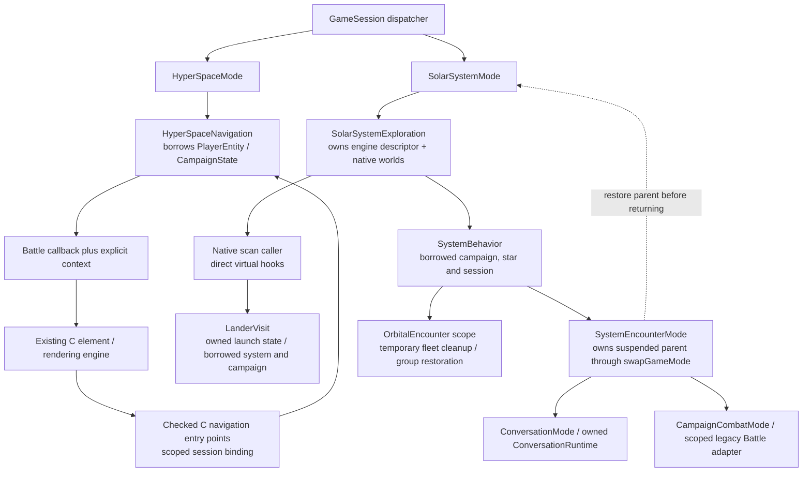

# Exploration, navigation and orbital encounter ownership

This describes the live implementation, not the larger battle/conversation
wireframes. Gameplay still runs synchronously on the simulation thread.

## Exploration

`SolarSystemMode` owns `SolarSystemExploration` as a member. Its opaque runtime
contains the actual `SOLARSYS_STATE` descriptor, native SolarSystem owner,
borrowed CampaignState and GameSession, and shared WorldState. Descriptor
addresses stay stable through nested encounters. The C input backend still
borrows its existing descriptor shape; no owning C++ members enter save records.

Exploration, scanning and debug traversal now compile as C++. They call
`SystemBehavior` directly. The `genFuncs` field, all thirteen generator bridge
functions, the bridge table and `generate.h` are deleted. Active-system binding
is restored when exploration returns or unwinds, and completed initialization
has scoped `UninitSolarSys` cleanup. Partial failures *inside* legacy initialization
are not made transactional by this scope.

Native system behaviors receive their immutable catalogue record before hooks.
Their story methods no longer read `CurStarDescPtr`; private helpers such as the
Melnorme selector use the attached record too. Androsynth discovery reads use the
injected campaign. Catalogue records outlive every explored system and cannot
be rebound midway through a visit.

Exploration scan/render helpers now take `SOLARSYS_STATE&` (const when read-only).
Both scan menus carry that descriptor in userdata, including the landing-site
selection. Cursor position, saved image, flash phase and flight frame timing live
in the exploration runtime rather than process statics. A scan scope releases
its cursor image. Only the two remaining C planet-loop entry points recover
`pSolarSysState`; native lander redraws pass their descriptor directly.

Orbital entry/exit and NPC lifecycle helpers use the supplied campaign. Generation
and body naming resolve the star from the system's bound catalogue ID. Planet
progress reads and permanent-bit publication also take an explicit system; the
lander no longer goes through a global `PutPlanetInfo` bridge.

## HyperSpace and QuasiSpace

`HyperSpaceMode` owns one `HyperSpaceNavigation`, borrowing its player and
campaign. Fuel-distance accumulation belongs to this visit. The portal location
belongs to transient PlayerEntity navigation memory, because it must survive an
encounter and subsequent navigation-mode recreation. It retains the old
nonserialized lifetime semantics rather than changing the legacy save format.

Navigation reads story fields through CampaignState and accesses flagship fuel,
crew and logical coordinates through PlayerEntity methods. Its frame callback
now receives an explicit context pointer in `BATTLE_STATE`. Combat callers with
no callback pass null context. The navigation menu callback borrows its navigation
owner through MENU_STATE userdata rather than looking up the active session. This runtime field is not serialized.

C entry points that cannot yet carry userdata use a scoped, checked session
binding. It rejects another player's navigation object and restores the previous
binding on normal return or exception. It owns nothing. There is no new
process-global owning navigation singleton. Native helpers call each other on
their existing object rather than repeatedly looking up the active session.

`SaveSisHyperState` remains a standalone compatibility operation: it is also
called from an encounter save screen *after* the navigation mode has ended.
Requiring an active navigation owner there would break existing saves. Sprite
and colormap caches keep their existing process/resource lifecycle.

## Orbital encounters

The explored behavior is attached to its production session. Its `communicate`
method creates a `SystemEncounterMode` and calls `swapGameMode`. The child runs
a native `EncounterRuntime` with explicit campaign and catalogue context, then
returns completion or a pending session exit. It does not rerun the parent. The communication result borrows a
variable on the suspended caller's stack, whose lifetime spans the whole child.

For load/title/shutdown requests, the helper translates the result to the legacy
exit flags so remaining exploration frames unwind. No new campaign is decoded
while an old handler or lander is suspended. Native production modes also receive
their session explicitly rather than looking up the active process session in
each mode body. Legacy debug/test contexts without an attached session retain
their explicit synchronous backend entry.

Sixteen temporary orbital encounter setups now use `OrbitalEncounter`. It saves
system groups before clearing them, owns responsibility for the temporary fleet,
and restores at the original explicit story boundary or on early scope exit.
Restoration is idempotent. Load/abort retains the original handoff to campaign
teardown; it does not restore groups into a departing campaign.

Sol's starbase handoff is intentionally different: it leaves exploration and
hands state to the outer encounter mode, rather than restoring a temporary
fleet within the orbital call. Its persistent group-save operation remains
explicit. NPC lifecycle/archive operations also remain distinct from temporary
encounter scopes.

## Encounter orchestration and devices

Root encounters own the same `EncounterRuntime` as orbital children. Race
selection, saved-encounter reconstruction, combat setup, hail/attack routing and
aftermath moved out of comm.c/encount.c into native procedures on that owner.
The remaining C `InitCommunication` is a compatibility entry for starbase code.
Hailed dialogue now runs in `ConversationMode`, whose runtime owns UI state,
script data, assets and animation sequences. C alien scripts retain their story
callbacks through checked borrows. See [conversation ownership](conversation-mode.md). Campaign combat now runs as a separate child through `swapGameMode`.
`EncounterRuntime` prepares its rosters and applies aftermath after the child
returns. The combat adapter scopes temporary sound, cyborg input and caller
activity, restoring the saved bindings rather than assuming default controls.
The underlying Battle engine and fleet queues retain their legacy ownership.
See the [current roadmap](encapsulation-roadmap.md) for remaining work toward
a shared campaign/Super Melee combat interface.

`DeviceMenu` takes `CampaignState&` and optionally a borrowed explored system.
Navigation and exploration call it directly; C planet menus use the compatibility
entry. Its callbacks carry their owner through userdata. Broadcaster, Sun Device,
Talking Pet, Ultron and portal actions use typed campaign access; system checks
use the bound star. The pure inventory query returns `vector<BYTE>` in the old
stable order; the C save adapter copies only the prefix that fits. The menu owns
its vector and restores the caller's sound flags with RAII.

This pass replaces or deletes 82 story macro uses, removes seven redundant C
entry declarations/bridges, and converts device/encounter local macros to
constants. It retains legacy activity flags, physical queues and graphics calls
inside the backend, rather than exposing the campaign payload through a new
untyped accessor. No save layout or story conditions are redesigned.

## Lander

`LanderMode`, launched through `swapGameMode`, owns a private `LanderVisit`. The formerly public
PLANETSIDE_DESC is removed from the C header. Crew, movement/weapon delays,
damage, explosion and cargo data live in that visit rather than separate process
statics. Surface callbacks use its borrowed system/campaign references; no
`pSolarSysState` or story macros remain in the lander implementation.

One scoped nonowning visit pointer remains for legacy C element callbacks with
no userdata. It is restored before the visit owner disappears. Graphics/music
caches retain their old resource lifetime. The existing `InitLander` C UI entry
obtains the active campaign once because it can run outside a launched visit.
Creature, mineral, hazard and projectile algorithms remain procedural.

The dispatcher suspends parent services, destroys the completed child, restores
borrowed bindings, and calls the parent `resume()` hook. Exploration owns the
renderer snapshot and redraw policy. Lander members restore menu sounds and
callback bindings and clean transient effects. Explicit normal completion applies
cargo and crew changes; load/abort skips those outcomes. See
[nested modes](nested-modes.md) for service lifecycle contracts.

## Remaining boundaries and verification

This does not make gameplay concurrent or headless. Rendering/input handles,
physics queues, selected-star compatibility storage, portions of the exploration
engine and cargo/UI mutation still use the legacy backend. Alien story scripts
and combat mechanics are retained; the conversation engine and its animation
state now have native child-mode ownership. The nested-mode catch still
uses the agreed diagnostic + abort policy with a graceful-shutdown TODO.

Boost.Test covers scoped navigation binding, player isolation, portal-memory
lifetime, packed story encodings, explicit star binding, nested system-encounter
resumption/load requests, and temporary-fleet restoration/abort handoff. Fake UI
and encounter services exercise ownership contracts without simulating dialogue
or terrain rendering. The full game links all real implementations. Build,
sanitizer and focused GUI results are recorded in the PR; they are not exhaustive
planet or story playthroughs.

Sources: [exploration owner](../../sc2/src/uqm/system_runtime.hpp),
[engine](../../sc2/src/uqm/planets/solarsys.cpp),
[navigation](../../sc2/src/uqm/hyper_navigation.hpp),
[scoped navigation binding](../../sc2/src/uqm/navigation_context.cpp),
[child encounter](../../sc2/src/uqm/system_encounter.cpp),
[encounter owner](../../sc2/src/uqm/encounter_runtime.hpp),
[device owner](../../sc2/src/uqm/device_menu.hpp),
[fleet scope](../../sc2/src/uqm/orbital_encounter.hpp),
[lander](../../sc2/src/uqm/planets/lander.cpp).

## Validation for this pass

Debug and Release CMake/Ninja builds and CTest pass. A fresh legacy dependency
regeneration and link pass, and the executable reports its version. All 154
Boost.Test cases / 13,668 assertions pass under ASan/UBSan, including conversation child lifetime,
script binding, partial resource cleanup, and packed encounter
fields, restored-encounter precedence, caller-campaign delivery, per-player device
inventory and bounded legacy save-buffer copying. Navigation, exploration,
scan, lander, mode and encounter/context sources pass strict warning checks.

A focused GUI run started a new campaign in Sol, flew into HyperSpace, entered a
normal fleet encounter, saved slot zero from that encounter screen, and loaded
it back to the same date/location/fuel/crew. Orbital child encounters and lander
ownership are covered by dependency-isolated regression checks and compilation,
not exhaustive interactive story or landing playthroughs.

The current pass also loaded a saved HyperSpace fleet encounter, displayed the
native encounter action screen, and entered probe dialogue. Special device/story
outcomes and landing have not received exhaustive interactive playthroughs.
