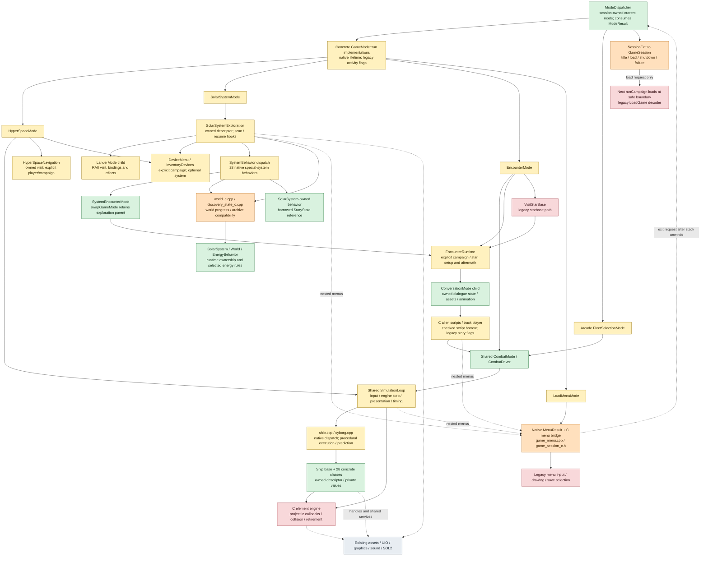
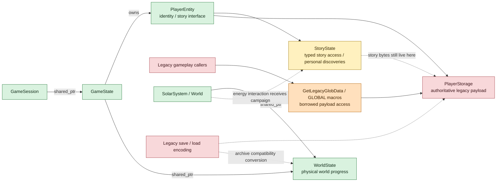
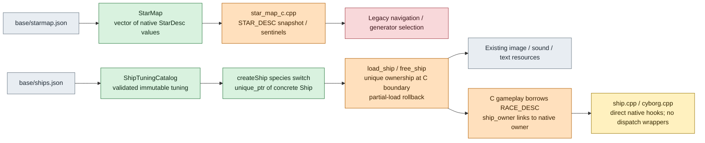

# Runtime architecture and migration map

This maps the live implementation starting at the session-owned dispatcher.
It is a subsystem map, not a complete call graph. Campaign and arcade sessions
own separate instances of ModeDispatcher and share CombatMode/CombatDriver.

Colors describe the implementation boundary, not gameplay quality:

- **Green — native:** explicit C++ ownership and a native interface.
- **Yellow — mixed:** native coordination or execution that still relies on legacy state, handles, or routines.
- **Orange — adapter:** C/C++ translation, borrowed buffers, opaque handles, or flag conversion.
- **Red — legacy:** procedural loops, globals, packed records, or callback tables remain authoritative.
- **Gray — foundation:** shared resource/platform infrastructure; not necessarily a candidate for replacement.

A green object can still depend on red storage. Dashed arrows indicate shared
state or supporting services; solid arrows indicate the main execution path.

## Execution from the mode dispatcher

There is currently **no separate campaign CombatMode**. Encounter and other
legacy paths can enter combat below the mode boundary. Modes run synchronously;
this is not an asynchronous task graph. A menu requests a session exit, existing
frames return, and the dispatcher releases its mode before campaign teardown or
loading. The decoder itself remains nontransactional.

## State ownership and compatibility access

Ownership is encapsulated more thoroughly than access. C callers can still
mutate the authoritative payload through the compatibility view. Campaign story
flags are views over the existing packed bytes, not a second copy. Shared
ownership preserves lifetime; it does not make the game concurrent or multiplayer.

## Data and ship construction

The old ship code-resource machinery and three C ship-dispatch wrappers are
removed. The remaining ship asset adapter has real C callers and selective asset
transfer contracts; it is not redundant simply because its implementation is C++.

## Reading the remaining work

| Area | Current boundary | What deeper encapsulation would involve |
| --- | --- | --- |
| Mode selection | Native dispatcher; mixed mode bodies | Move remaining C activity/transition flags into explicit results; production modes already receive their session. |
| Solar-system generation | Scoped native ownership; all special-system behavior classes borrow story state | Replace remaining global runtime/queue access and C engine entry points. |
| Navigation | Owned native HyperSpace state; menu userdata; explicit campaign device actions | Move remaining selected-star, graphics and C input dependencies behind explicit interfaces. |
| Encounters and communication | Native encounter runtime, conversation children and owned dialogue/animation state; C alien scripts | Migrate script story access and global media services; preserve root encounter/starbase handoffs. |
| Combat | Native ships and callers over a legacy element engine | Encapsulate battle/element lifetime, collisions and projectile behaviors; preserve retirement and reincarnation ordering. |
| Menus and saves | Typed exit request around legacy UI and decoder | Migrate menu callers; separately address transactional state decoding. |
| State | Native lifetime around a legacy payload | Replace borrowed global access incrementally without introducing duplicate authoritative state. |

The Battle / ProjectileBehavior design in [combat/README.md](combat/README.md)
is an executable test prototype, **not** the production combat implementation
shown above. Likewise, native EnergyBehavior covers selected energy-site rules;
it is separate from system-level orbital/story dispatch. See the
[system behavior migration](solar-system/system-behavior.md) for the live default
and all-special-system migration, scoped owner and remaining C engine boundary.

## Source anchors

- [Dispatcher template](../../sc2/src/uqm/dispatcher.hpp), [mode bodies and campaign lifecycle](../../sc2/src/uqm/gameplay_modes.cpp), [application sessions](sessions.md) and [gameplay entry](../../sc2/src/uqm/starcon.cpp).
- [State ownership](../../sc2/src/uqm/game_state.hpp), [payload adapter](../../sc2/src/uqm/game_state.cpp), [world runtime](../../sc2/src/uqm/world.hpp).
- [Encounter orchestration](../../sc2/src/uqm/encounter_runtime.hpp), [device menu](../../sc2/src/uqm/device_menu.hpp), [device inventory and save adapter](../../sc2/src/uqm/device_inventory.cpp).
- [World adapter](../../sc2/src/uqm/world_c.cpp), [behavior selection](../../sc2/src/uqm/system_behavior_factory.cpp), [menu adapter](../../sc2/src/uqm/game_menu.cpp).
- [Ship execution](../../sc2/src/uqm/ship.cpp), [cyborg prediction](../../sc2/src/uqm/cyborg.cpp), [native ship](../../sc2/src/uqm/ship_behavior.hpp), [asset boundary](../../sc2/src/uqm/loadship.cpp).
- [Star catalogue adapter](../../sc2/src/uqm/star_map_c.cpp), [session definitions](../../sc2/src/uqm/game_definitions.cpp).

The session uses [synchronous nested modes](nested-modes.md) for orbital
system conversations. See the [current ownership and callback boundaries](runtime-encapsulation.md)
for navigation, exploration, lander visits and temporary fleets.

See [conversation child ownership](conversation-mode.md) for the dialogue lifecycle, C script boundary and credits host.
