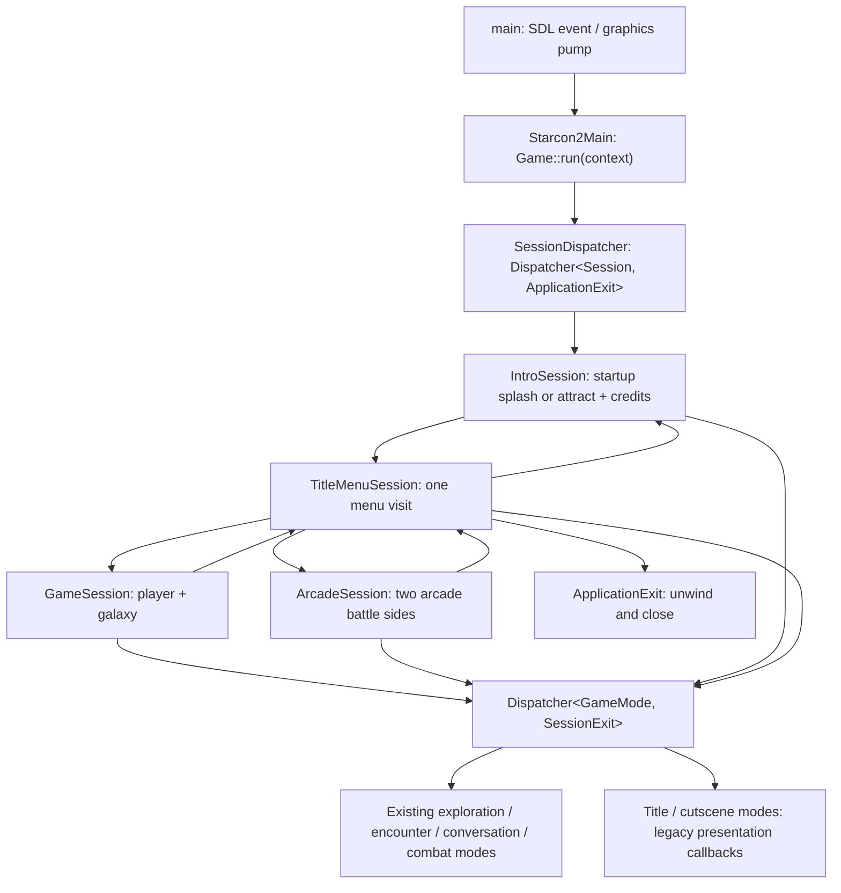

# Application sessions

The live gameplay entry is now `Game::run(UQM_Context&)`, called in
[`Starcon2Main`](../../sc2/src/uqm/starcon.cpp). The C `main()` still owns SDL's
main-thread event/graphics pump and starts that gameplay worker. Moving the call
to `main()` requires resolving backend thread affinity; this change preserves it.

`Session` owns the internally synchronized asset cache as its first member, a
private RNG and mode dispatcher, and transitional activity fields. Derived
sessions own their specific state. Every campaign visit constructs a fresh
`GameState`/player/galaxy; arcade has isolated compatibility buffers. Frontend
sessions have their own temporary buffers for the remaining C presentation code.
Transient activity does not carry across transitions. Application settings are
owned by `UQM_Context::configuration()`, rather than copied between sessions.
A session's cache and RNG are never shared with another visit.

`SessionDispatcher` borrows the application context. Sessions borrow that host,
which outlives them; modes borrow their owning session. A result is an owned
successor, a typed exit, or completion. The common dispatcher releases the
outgoing node before running its successor. Successor construction happens while
the old node is still alive, so constructors must not start UI or simulation.
The same template implements synchronous child handoff for either node type.
Parent ownership and bindings are restored before child exceptions propagate.
The root catches failures, releases nodes, and reports an explicit failed exit.
There is no temporary `abort()` branch in the dispatcher.

A scoped session activation selects its C payload/fleet/flagship/activity buffers
and RNG on the gameplay thread. Native callers retain explicit references.
`gameSession()` selects the active campaign through this compatibility binding;
its startup fallback remains for unmigrated callers and tests outside a session.
C `LastActivity`/`NextActivity` expressions are projections into Session-owned
fields. No C++ owners enter the saved C layouts. Main-thread quit requests use
the existing `QuitPosted` transport; gameplay input polling applies the abort to
the selected session instead of main mutating a gameplay payload.

Campaign load requests stay within the same `GameSession`, after old modes and
runtime cleanup unwind. Ending presentation runs while campaign state is still
owned, then returns the title successor. Title menu code returns a choice and
never launches a session. Kernel context setup no longer initializes or shuts down a simulation queue;
each mode owns that lifetime. The old `StartGame`/`TryStartGame` loops and unused
`RunGameSession`/`RunArcadeSession` C entry adapters are removed.

`UQM_Context` owns `GameConfiguration`: display driver/flags/effective resolution,
audio driver/quality/volume, PC/3DO presentation choices, subtitles, audio toggles,
and input-template selection/names. Existing C lvalue adapters project into that
same record, so SetupMenu updates persist across session changes. The C startup
fills a bootstrap record before the context exists; ConfigurationOwner transfers
its unique ownership without moving data or changing any backend address. It
returns ownership for main's final device shutdown after context destruction.
Settings access retains the backend's existing threading rules; the ownership
mutex guards transfer, not concurrent field mutation. Audio mute bits in old save
payloads retain their binary layout but no longer override application settings.
Mounted directories/addon handles and key-binding backend storage remain resource
services rather than configuration values.

`UQM_Context` also scopes existing kernel/master-list/game-kernel setup and
cleanup. It is a backend lifetime facade: renderer, audio, input, resource tables,
and some UI callbacks remain legacy globals. Title/menu and cutscene modes still
call the existing presentation routines. This does not make backend operations
concurrent or transactional. Full device interfaces, scripted cutscenes, and
native menu resource ownership remain follow-up work.

Boost.Test covers bounded successor lifetime, isolated buffers, active campaign
selection, nested failure/destructor binding order and mode handoff. Device/UI
entry methods are replaced in the unit target; runtime smoke checks cover the
production title-to-campaign/arcade path separately.
