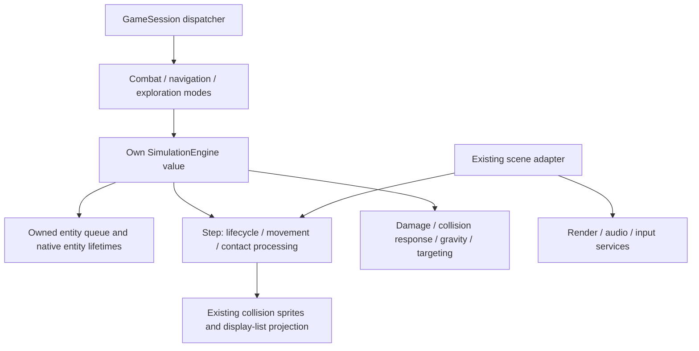

# Mode-owned simulation engine

Each GameMode contains a SimulationEngine value member. Combat, HyperSpace and
solar-system exploration use the same engine implementation with distinct queues.
Persistent player/story/galaxy state remains on its existing owners.

## Ownership and lifetime

The raw process-global `QUEUE disp_q` definition is removed. Each mode's engine owns its
compatibility queue by value; its private QueueStorage continues to own native
CombatEntity objects through unique_ptr. Initialization uses the established
capacity of 150. Reset invalidates handles without firing death callbacks.
Shutdown releases the pool and is idempotent; the destructor also calls it.
C startup graphics setup/teardown call compatibility-engine adapters at their existing lifecycle points,
so entity destruction still precedes device shutdown.

The dispatcher binds each mode's engine while initializing, running and destroying
that mode. A suspended parent retains its engine; the child owns another one.
The child is destroyed before the parent's binding and view resume. The flat
successor path also destroys the outgoing mode against its own engine.

GameMode's engine is constructed normally with the GameMode. The dispatcher calls
its virtual initialize() hook after full derived construction and before run().
The default does nothing further; specialized modes can prepare a scene here.
There is no virtual call from the base constructor and no shared engine owner.

The lander initialize() hook uses SimulationSceneTransfer to take the prepared
orbital surface scene. On destruction it returns that scene, including collected
nodes and stunned creatures, to the parent's engine. Pool addresses and native
handles are preserved; no duplicate surface simulation or state copy is created.
This is an explicit scene handoff between two distinct engine owners.

Each engine also retains its primitive projection buffer/free list with the entity
queue: ELEMENT::PrimIndex must always index the matching buffer. Scoped bindings
select the correct existing drawing aliases and restore their previous values.
Actual renderer/device ownership and graphics contexts remain outside the engine.

Native clients borrow mode.engine(). Native handle resolution returns an optional
reference, const when the engine is const. The queue buffer is available through
the internal SimulationAccess boundary. The disp_q compatibility macro borrows
GetSimulationQueue(); it is not another queue owner. Startup/title and the existing
C Super Melee path use a compatibility engine until they are GameModes themselves.
SimulationBinding is thread-local and does not provide device thread safety.

## Simulation responsibilities

Engine methods now own the existing implementations of:

- step: lifecycle, movement/contact passes and safe removal ordering;
- damage: ship crew loss, finite-object hit points, and massive-body immunity;
- resolveCollision and contact: physical response and generic contact rules;
- weaponHit: weapon damage/expiration and existing impact presentation requests;
- gravity: traversal using each native planet's GravityField;
- track and clearTargets: target selection and removal of old target links.

The old C functions are adapters to those methods. Implementations remain split
across focused files rather than collected into one large engine class source.
TrackShip and collision/weapon helpers preserve targeting tie breaks, random
consumption, arena wrapping and collision order. Existing specialized entity
hooks and ship retirement/reincarnation rules retain their behavior.

The renderer's RedrawQueue now asks engine.step() to simulate before drawing.
Its context setup, graphics scaling, DrawBatch, sound positioning and flushes
remain in the scene adapter. Sprite-based narrow-phase collision and display-list
projection still use the loaded asset/geometry services inside the old pass.
The step counter counts completed simulation passes since the scene reset; it
is not a replacement for the netplay frame counter and is not serialized.

## Practical boundaries

This is an ownership and execution migration, not a new headless physics model.
The step pass still requires prepared sprite collision data and scene contexts.
Impact requests, ship crew/HUD updates and legacy effects still call their
existing presentation adapters. Rendering, audio and input services were not
rewritten. Battle mode orchestration, fleet selection and outcome policy stay
with their mode/controller owners.

ELEMENT remains the compatibility simulation record. Legacy hTarget and STARSHIP
associations still exist inside behavior code; they have not all become native
EntityHandle fields. Cached legacy targets must refer to the active engine's
pool. The shared RNG service and other campaign/global services retain their
current scope. Separate engine queues therefore do not yet make complete game
sessions safe to run concurrently or without assets.

## Verification

Boost.Test runs real engine storage, damage and targeting implementations with
only the crew/HUD boundary simulated. It checks independent queues, nested binding
restoration, reset/shutdown invalidation, planet immunity, ship/projectile death,
target search confinement and target clearing. A mode test verifies that two modes sharing player state still own distinct engines and that mode execution
selects the correct queue. Existing regression coverage continues unchanged.

The migration also replaces DISPLAY_TO_WORLD's signed left shift with equivalent
multiplication, making negative coordinate conversion well-defined in C++17.
Sanitizer validation uses UBSAN_OPTIONS=halt_on_error=1 so warnings fail the run.
